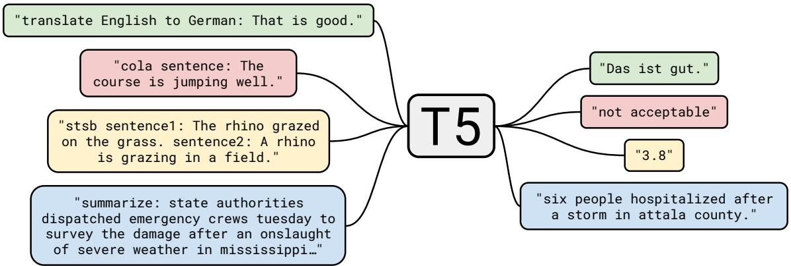
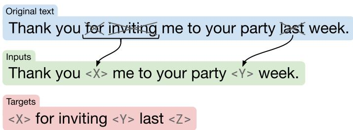
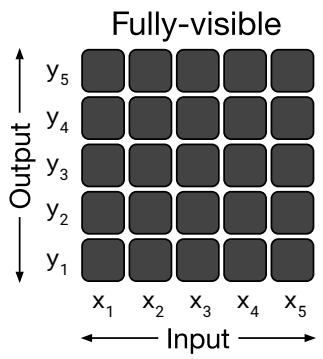
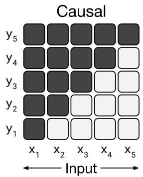
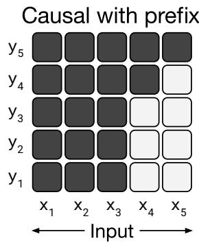
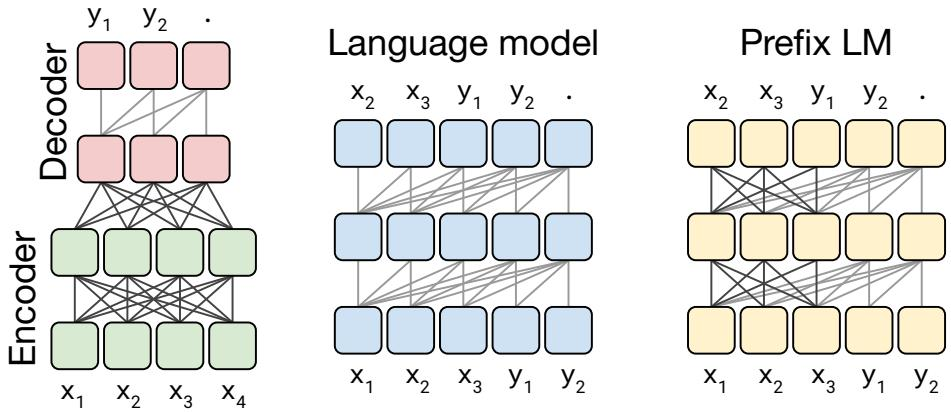
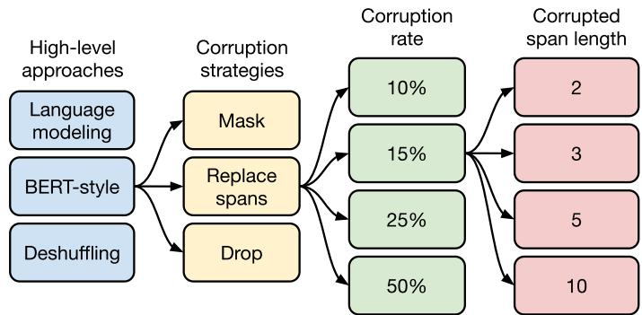
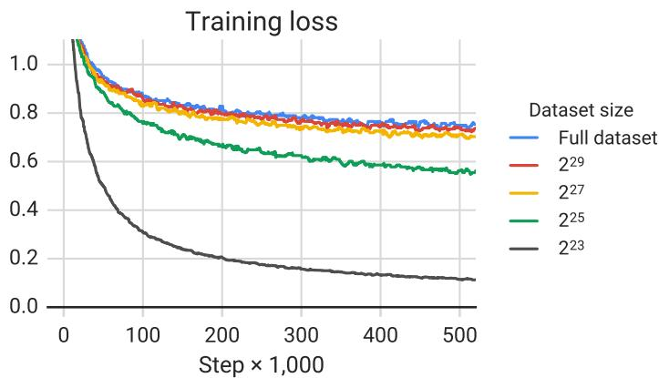

# 探索统一文本到文本 Transformer 迁移学习的极限

Colin Rafel∗ craffel@gmail.com Noam Shazeer∗ noam@google.com Adam Roberts∗ adarob@google.com Katherine Lee∗ katherinelee@google.com Sharan Narang sharannarang@google.com Michael Matena mmatena@google.com Yanqi Zhou yanqiz@google.com Wei Li mweili@google.com Peter J. Liu peterjliu@google.com

Google, Mountain View, CA 94043, USA

编辑：Ivan Titov

## 摘要

迁移学习（transfer learning，即模型首先在数据丰富的任务上进行预训练，然后针对下游任务进行微调）已成为自然语言处理（NLP）领域的一项强大技术。迁移学习的有效性催生了多样化的途径、方法论和实践。在本文中，我们通过引入一个将所有基于文本的语言问题转化为文本到文本（text-to-text）格式的统一框架，来探索 NLP 迁移学习技术的全貌。我们的系统性研究在数十个语言理解任务上对比了预训练目标、模型架构、无标签数据集、迁移方法及其他因素。通过将探索中获得的见解与规模化以及我们新构建的“超大型清洗爬取语料库”（Colossal Clean Crawled Corpus）相结合，我们在涵盖文本摘要、问答、文本分类等领域的众多基准测试中取得了最先进（state-of-the-art）的结果。为了促进未来关于 NLP 迁移学习的研究工作，我们发布了数据集、预训练模型和代码。1

关键词：迁移学习、自然语言处理、多任务学习、基于注意力的模型、深度学习

## 1. 引言

训练机器学习模型执行自然语言处理（NLP）任务通常需要模型能够以一种有利于下游学习的方式来处理文本。这可以宽泛地视为培养使模型能够“理解”文本的通用知识。这些知识可以从低层次（例如单词的拼写或含义）到高层次（例如大号太大了，装不进大多数背包）。在现代机器学习实践中，显式提供这类知识的情况极为罕见；相反，它通常作为辅助任务的一部分被学习。例如，历史上一种常见的方法是使用词向量（Mikolov et al., 2013b,a; Pennington et al., 2014）将词的本体映射为连续表示，在理想情况下，相似的词会被映射到相似的向量。这些向量通常通过某种目标函数来学习，例如促使共现词在连续空间中彼此靠近（Mikolov et al., 2013b）。

最近，在数据丰富的任务上预训练整个模型变得越来越普遍。理想情况下，这种预训练使模型能够发展出通用能力和知识，进而可以迁移到下游任务中。在迁移学习应用于计算机视觉（Oquab et al., 2014; Jia et al., 2014; Huh et al., 2016; Yosinski et al., 2014）时，预训练通常是通过在像 ImageNet（Russakovsky et al., 2015; Deng et al., 2009）这样的大型标注数据集上进行监督学习来完成的。相比之下，NLP（自然语言处理）中现代的迁移学习技术通常在未标注数据上使用无监督学习进行预训练。最近，该方法已被用于在许多最常见的 NLP 基准测试中取得最先进（state-of-the-art）的结果（Devlin et al., 2018; Yang et al., 2019; Dong et al., 2019; Liu et al., 2019c; Lan et al., 2019）。除了经验上的优越性之外，NLP 的无监督预训练尤为引人注目，因为得益于互联网，存在着海量的未标注文本数据——例如，Common Crawl 项目2每月从网页中提取约 20TB 的文本数据。这与神经网络天然契合，因为神经网络已被证明具有显著的可扩展性，即通常只需在更大的数据集上训练更大的模型即可获得更好的性能（Hestness et al., 2017; Shazeer et al., 2017; Jozefowicz et al., 2016; Mahajan et al., 2018; Radford et al., 2019; Shazeer et al., 2018; Huang et al., 2018b; Keskar et al., 2019a）。

这种协同效应推动了近期大量开发 NLP 迁移学习方法的工作，催生了广泛的预训练目标（Howard and Ruder, 2018; Devlin et al., 2018; Yang et al., 2019; Dong et al., 2019）、未标注数据集（Yang et al., 2019; Liu et al., 2019c; Zellers et al., 2019）、基准测试（Wang et al., 2019b, 2018; Conneau and Kiela, 2018）、微调方法（Howard and Ruder, 2018; Houlsby et al., 2019; Peters et al., 2019）等。在这一蓬勃发展的领域中，快速的进展步伐和多样化的技术使得比较不同算法、厘清各项新贡献的实际效果以及全面理解现有的迁移学习方法格局变得十分困难。出于对更严谨理解的需求，我们采用了一种统一的迁移学习方法，使我们能够系统地研究不同方法并推进该领域的现有极限。

我们工作的基本思想是将每个文本处理问题都视为一个“文本到文本”（text-to-text）问题，即以文本作为输入并生成新的文本作为输出。这种方法受到了先前用于 NLP（自然语言处理）任务的统一框架的启发，包括将所有文本问题转化为问答（McCann et al., 2018）、语言建模（Radford et al., 2019）或片段抽取任务 Keskar et al. (2019b)。至关重要的是，文本到文本框架使我们能够将相同的模型、目标、训练流程和解码过程直接应用于我们所考虑的每个任务。我们通过在广泛的基于英语的 NLP 问题上评估性能来利用这种灵活性，其中包括问答、文档摘要和情感分类等。借助这种统一的方法，我们可以比较不同迁移学习目标、无标注数据集以及其他因素的有效性，同时通过将模型和数据集扩展到前所未有的规模来探索 NLP 迁移学习的极限。

  
Figure 1: 我们的文本到文本框架示意图。我们考虑的每个任务——包括翻译、问答和分类——都被转化为向模型输入文本并训练其生成某种目标文本。这使我们能够在多样化的任务集上使用相同的模型、损失函数、超参数等。它还为我们实证调研中涵盖的方法提供了一个标准测试平台。“T5”指的是我们的模型，我们将其命名为“Text-to-Text Transfer Transformer”（文本到文本迁移 Transformer）。

我们强调，我们的目标并不是提出新方法，而是提供一个关于该领域现状的全面视角。因此，我们的工作主要包括对现有技术的综述、探索和实证比较。我们还通过扩展系统性研究所得出的见解（训练参数量高达 110 亿的模型）来探索当前方法的极限，并在我们所考虑的许多任务中取得了最先进（state-of-the-art）的结果。为了在这一规模下开展实验，我们引入了“Colossal Clean Crawled Corpus”（C4，海量清洗网络爬取语料库），这是一个由从网络抓取的数百吉字节干净英文文本组成的数据集。考虑到迁移学习的主要效用在于能够在数据匮乏的场景下利用预训练模型，我们开源了代码、数据集和预训练模型。1

本文的其余部分结构如下：在下一节中，我们讨论基础模型及其实现、将每个文本处理问题形式化为文本到文本（text-to-text）任务的过程，以及我们考虑的任务套件。在第 3 节中，我们展示了一系列探索 NLP 迁移学习领域的大规模实验。在该节末尾（第 3.7 节），我们结合系统研究得出的见解，在各种各样的基准测试上取得了最先进的（state-of-the-art）结果。最后，我们在第 4 节中总结了研究结果，并对未来进行了展望。

## 2. 设置

在展示大规模实证研究的结果之前，我们回顾了理解这些结果所需的必要背景知识，包括 Transformer 模型架构以及我们用于评估的下游任务。我们还介绍了将每个问题都视为文本到文本任务的方法，并描述了我们的“超大规模清洗网络抓取语料库”（Colossal Clean Crawled Corpus，简称 C4），这是我们基于 Common Crawl 创建的、用作无标注文本数据源的数据集。我们将我们的模型和框架称为“文本到文本迁移 Transformer”（Text-to-Text Transfer Transformer，简称 T5）。

## 2.1 模型

早期在 NLP 迁移学习方面的成果主要利用循环神经网络（recurrent neural networks）（Peters et al., 2018; Howard and Ruder, 2018），但近期使用基于“Transformer”架构的模型已变得更为普遍（Vaswani et al., 2017）。Transformer 最初被证明对机器翻译非常有效，但随后被广泛应用于各种各样的 NLP 场景（Radford et al., 2018; Devlin et al., 2018; McCann et al., 2018; Yu et al., 2018）。鉴于其日益普及，我们所研究的所有模型均基于 Transformer 架构。除了下文提到的细节以及我们在第 3.2 节中探讨的变体之外，我们并未对最初提出的这一架构进行重大改动。我们在此不再对该模型进行详尽的定义，感兴趣的读者可以参阅原论文（Vaswani et al., 2017）或后续教程3,4以获取更详细的介绍。

Transformer 的主要构建模块是自注意力机制（self-attention）（Cheng et al., 2016）。自注意力机制是注意力机制（attention）（Graves, 2013; Bahdanau et al., 2015）的一种变体，它通过将序列中的每个元素替换为序列其余部分的加权平均值来处理序列。原始的 Transformer 由编码器-解码器（encoder-decoder）架构组成，专为序列到序列（sequence-to-sequence）（Sutskever et al., 2014; Kalchbrenner et al., 2014）任务而设计。最近，使用由单个 Transformer 层堆叠构成的模型也变得很普遍，并通过使用不同形式的自注意力机制来构建适用于语言建模（language modeling）（Radford et al., 2018; Al-Rfou et al., 2019）或分类与片段预测（span prediction）任务（Devlin et al., 2018; Yang et al., 2019）的架构。我们在第 3.2 节中对这些架构变体进行了实证探索。

总体而言，我们的编码器-解码器（encoder-decoder）Transformer 实现紧密遵循了其最初提出的形式（Vaswani et al., 2017）。首先，输入的 token 序列被映射为一个嵌入（embedding）序列，然后传入编码器。编码器由一堆“块”（blocks）堆叠而成，每个块包含两个子组件：一个自注意力（self-attention）层，紧接着是一个小型前馈网络（feed-forward network）。层归一化（Layer normalization，Ba et al., 2016）被应用于每个子组件的输入。我们使用了一种简化版的层归一化，其中仅对激活值进行重新缩放，而不应用加性偏置（additive bias）。在层归一化之后，残差跳跃连接（residual skip connection，He et al., 2016）将每个子组件的输入添加到其输出中。Dropout（Srivastava et al., 2014）被应用于前馈网络内部、跳跃连接上、注意力权重上，以及整个堆叠结构的输入和输出处。解码器在结构上与编码器类似，不同之处在于它在每个自注意力层之后包含一个标准的注意力机制，用于关注编码器的输出。解码器中的自注意力机制还采用了一种自回归或因果自注意力（autoregressive or causal self-attention）形式，该形式仅允许模型关注过去的输出。最后一个解码器块的输出被送入一个带有 softmax 输出的稠密层（dense layer），其权重与输入嵌入矩阵共享。Transformer 中的所有注意力机制都被拆分为独立的“头”（heads），这些头的输出在进一步处理之前会被拼接在一起。

由于自注意力机制（self-attention）与顺序无关（即它是对集合的操作），通常需要为 Transformer 提供显式的位置信号。最初的 Transformer 使用了正弦位置信号或可学习的位置嵌入（position embeddings），而最近使用相对位置嵌入（Shaw et al., 2018; Huang et al., 2018a）变得更为普遍。相对位置嵌入不是为每个位置使用固定的嵌入，而是根据自注意力机制中进行比较的“键”（key）和“查询”（query）之间的偏移量产生不同的学习嵌入。我们使用了一种简化形式的位置嵌入，其中每个“嵌入”仅仅是一个标量，并被添加到用于计算注意力权重的对应 logit 上。为了提高效率，我们还在模型的所有层之间共享位置嵌入参数，不过在给定层内，每个注意力头（attention head）使用不同的可学习位置嵌入。通常，模型会学习固定数量的嵌入，每个嵌入对应一段可能的键-查询偏移量范围。在这项工作中，我们对所有模型均使用 32 个嵌入，其范围大小以对数形式增长，最大偏移量可达 128，超过该偏移量的所有相对位置都被分配给同一个嵌入。需要注意的是，给定层对超过 128 个 token 的相对位置是不敏感的，但后续层可以通过结合前几层的局部信息，建立对更大偏移量的敏感度。总而言之，我们的模型与 Vaswani et al. (2017) 提出的原始 Transformer 大致相当，区别仅在于移除了 Layer Norm（层归一化）偏置、将层归一化置于残差路径之外，以及使用了不同的位置嵌入方案。由于这些架构上的改动与我们在迁移学习实证调查中考虑的实验因素是相互正交的，我们将对其影响的消融研究留待未来的工作。

作为我们研究的一部分，我们对这些模型的可扩展性进行了实验，即当模型的参数量或层数增加时，其性能会发生怎样的变化。训练大模型绝非易事，因为它们可能无法容纳在单台机器上，并且需要大量的计算。因此，我们结合使用了模型并行与数据并行，并在 Cloud TPU Pods 的“切片（slices）”上训练模型。5 TPU pod 是多机架机器学习超级计算机，包含 1,024 个通过高速 2D 网状互连（2D mesh interconnect）连接的 TPU v3 芯片以及支持的 CPU 主机。我们利用 Mesh TensorFlow 库（Shazeer et al., 2018）来简化模型并行和数据并行（Krizhevsky, 2014）的实现。

## 2.2 The Colossal Clean Crawled Corpus（超大规模清洗爬取语料库）

以往许多关于 NLP（自然语言处理）迁移学习的工作都利用大规模无标签数据集进行无监督学习。在本文中，我们关注于衡量这种无标签数据的质量、特征和规模所产生的影响。为了生成满足我们需求的数据集，我们利用 Common Crawl 作为从网络抓取文本的来源。Common

Crawl 此前已被用作 NLP 的文本数据来源，例如用于训练 n-gram 语言模型（Buck et al., 2014）、作为常识推理的训练数据（Trinh and Le, 2018）、用于挖掘机器翻译的平行文本（Smith et al., 2013）、作为预训练数据集（Grave et al., 2018; Zellers et al., 2019; Liu et al., 2019c），甚至仅仅作为测试优化器的大型文本语料库（Anil et al., 2019）。

Common Crawl 是一个公开可用的网络档案库，它通过从抓取的 HTML 文件中移除标记语言和其他非文本内容来提供“网页提取文本”。该过程每月产生约 20TB 的抓取文本数据。遗憾的是，生成的大多数文本并非自然语言。相反，它主要由乱码或样板文本组成，如菜单、错误消息或重复文本。此外，抓取到的文本中相当一部分包含不太可能对我们所考虑的任何任务有所帮助的内容（攻击性语言、占位符文本、源代码等）。为了解决这些问题，我们使用了以下启发式规则来清洗 Common Crawl 的网页提取文本：

• 我们仅保留以句末标点符号（即句号、感叹号、问号或结束引号）结尾的行。

• 我们丢弃了少于 3 个句子的所有页面，并且仅保留包含至少 5 个词的行。

• 我们移除了包含“脏话、淘气词、淫秽词或其他不良词汇列表”（List of Dirty, Naughty, Obscene or Otherwise Bad Words）中任何词汇的所有页面。6

• 许多抓取的页面包含提示应启用 Javascript 的警告，因此我们移除了任何包含单词 Javascript 的行。

• 一些页面包含占位符“lorem ipsum”文本；我们移除了出现短语“lorem ipsum”的所有页面。

• 一些页面无意中包含了代码。由于花括号“{”出现在许多编程语言中（例如网络上广泛使用的 Javascript），但不会出现在自然文本中，因此我们移除了所有包含花括号的页面。

• 由于一些抓取的页面来源于 Wikipedia 并带有引用标记（例如 [1]、[citation needed] 等），我们移除了所有此类标记。

• 许多页面包含样板政策声明，因此我们移除了包含以下字符串的任何行：“terms of use”、“privacy policy”、“cookie policy”、“uses cookies”、“use of cookies”或“use cookies”。

• 为了对数据集去重，对于在数据集中出现多次的任何三句跨度，我们仅保留一份，其余全部丢弃。

此外，由于我们的大多数下游任务都集中在英语文本上，因此我们使用 langdetect7 过滤掉了所有被归类为英语的概率低于 0.99 的页面。我们的启发式方法受到了以往利用 Common Crawl 作为 NLP 数据来源的研究的启发：例如，Grave et al. (2018) 同样使用自动语言检测器过滤文本并丢弃过短的行，Smith et al. (2013) 与 Grave et al. (2018) 都执行了行级去重。然而，我们选择创建一个新的数据集，因为先前的数据集使用了较为有限的启发式过滤规则、未公开提供，并且/或者在涵盖范围上有所不同（例如，仅限于新闻数据 (Zellers et al., 2019; Liu et al., 2019c)、仅包含知识共享 (Creative Commons) 内容 (Habernal et al., 2016)，或是专注于机器翻译的平行训练数据 (Smith et al., 2013)）。

为了构建我们的基础数据集，我们下载了 2019 年 4 月从网络抽取的文本，并应用了上述过滤规则。这产生了一个文本集合，它不仅比大多数用于预训练的数据集大几个数量级（约 750 GB），而且包含了相当干净且自然的英语文本。我们将该数据集命名为“Colossal Clean Crawled Corpus”（超大规模清洗抓取语料库，简称 C4），并将其作为 TensorFlow Datasets 的一部分发布。8 我们在第 3.4 节中探讨了使用该数据集的各种替代版本所产生的影响。

## 2.3 下游任务

本文的目标是衡量通用的语言学习能力。因此，我们在多样化的基准测试集上研究下游性能，包括机器翻译、问答、生成式摘要（abstractive summarization）以及文本分类。具体而言，我们评估了在 GLUE 和 SuperGLUE 文本分类元基准、CNN/Daily Mail 生成式摘要、SQuAD 问答以及 WMT 英语到德语、法语和罗马尼亚语翻译上的性能。所有数据均来源于 TensorFlow Datasets。9

GLUE (Wang et al., 2018) 和 SuperGLUE (Wang et al., 2019b) 各自包含一系列旨在测试通用语言理解能力的文本分类任务：

• 句子可接受度判断（Sentence acceptability judgment，CoLA (Warstadt et al., 2018)）

• 情感分析（Sentiment analysis，SST-2 (Socher et al., 2013)）

• 释义/句子相似度（Paraphrasing/sentence similarity，MRPC (Dolan and Brockett, 2005)、STS-B (Cer et al., 2017)、QQP (Iyer et al., 2017)）

• 自然语言推理（Natural language inference，MNLI (Williams et al., 2017)、QNLI (Rajpurkar et al., 2016)、RTE (Dagan et al., 2005)、CB (De Marnef et al., 2019)）

• 指代消解（Coreference resolution，WNLI 与 WSC (Levesque et al., 2012)）

• 句子补全（Sentence completion，COPA (Roemmele et al., 2011)）

• 词义消歧（Word sense disambiguation，WIC (Pilehvar and Camacho-Collados, 2018)）

• 问答（Question answering，MultiRC (Khashabi et al., 2018)、ReCoRD (Zhang et al., 2018)、BoolQ (Clark et al., 2019)）

我们使用了由 GLUE 和 SuperGLUE 基准分发的数据集。为了简化流程，在微调时，我们通过拼接所有组成数据集，将 GLUE 基准中的所有任务（SuperGLUE 亦然）视为单个任务。根据 Kocijan et al. (2019) 的建议，我们还将确定代词消歧（Definite Pronoun Resolution，DPR）数据集（Rahman and Ng, 2012）包含在合并后的 SuperGLUE 任务中。

CNN/Daily Mail（Hermann et al., 2015）数据集最初是作为问答任务引入的，但后来被 Nallapati et al. (2016) 改编用于文本摘要；我们使用来自 See et al. (2017) 的非匿名版本作为生成式摘要（abstractive summarization）任务。SQuAD（Rajpurkar et al., 2016）是一个常见的问答基准。在我们的实验中，模型输入问题及其上下文，并被要求逐 token 生成答案。对于 WMT 英语到德语翻译，我们使用与 Vaswan et al. (2017) 相同的训练数据（即 News Commentary v13、Common Crawl、Europarl v7），并使用 newstest2013 作为验证集（Bojar et al., 2014）。对于英语到法语，我们使用 2015 年的标准训练数据，并使用 newstest2014 作为验证集（Bojar et al., 2015）。对于英语到罗马尼亚语——这是一个标准的低资源机器翻译基准，我们使用来自 WMT 2016（Bojar et al., 2016）的训练集和验证集。需要注意的是，我们仅在英文数据上进行预训练，因此为了学习翻译，给定的模型需要学习用一种新语言生成文本。

## 2.4 输入与输出格式

为了在上述多样化的任务集上训练单个模型，我们将所考虑的所有任务都转换为“文本到文本”（text-to-text）格式——即模型输入一些文本作为上下文或条件，然后被要求生成一些输出文本的任务形式。该框架为预训练和微调提供了统一的训练目标。具体而言，无论何种任务，模型均采用极大似然目标（使用“教师强制”（teacher forcing）（Williams and Zipser, 1989））进行训练。为了指明模型应执行哪项任务，我们在将原始输入序列输入模型之前，为其添加一个任务特定的（文本）前缀。

例如，要让模型将句子“That is good.”从英文翻译成德文，系统会向模型输入序列“translate English to German: That is good.”，并训练其输出“Das ist gut.”。对于文本分类任务，模型只需预测与目标标签对应的一个单词。例如，在 MNLI 基准（Williams et al., 2017）中，目标是预测前提对于假设是蕴含（“entailment”）、矛盾（“contradiction”）还是中立（“neutral”）。经过我们的预处理，输入序列变为“mnli premise: I hate pigeons. hypothesis: My feelings towards pigeons are filled with animosity.”，对应的目标词为“entailment”。需要注意的是，如果我们的模型在文本分类任务中输出了与任何可能标签都不对应的文本（例如，当某个任务仅有的可能标签为“entailment”、“neutral”或“contradiction”时，模型却输出了“hamburger”），就会出现问题。在这种情况下，我们一律将模型的输出判定为错误，不过在我们训练的所有模型中均未观察到这种行为。值得注意的是，针对特定任务所选用的文本前缀（prefix）本质上是一个超参数；我们发现改变前缀的具体措辞影响有限，因此并未对不同的前缀选择进行广泛的实验。我们的文本到文本（text-to-text）框架示意图及若干输入/输出示例见 Figure 1。我们在 Appendix D 中提供了所研究的每个任务的预处理输入完整示例。

我们的文本到文本（text-to-text）框架遵循了以往将多种 NLP 任务转换为统一格式的研究：McCann et al. (2018) 提出了“自然语言十项全能”（Natural Language Decathlon），这是一个针对包含十个 NLP 任务的基准套件，采用了统一的问答格式。Natural Language Decathlon 还规定所有模型必须具备多任务能力，即能够同时处理所有任务。与之不同的是，我们允许在每个单独的任务上对模型进行独立微调，并使用简短的任务前缀替代明确的问答格式。Radford et al. (2019) 通过将某些输入作为前缀提供给模型，然后自回归地采样输出，以此评估语言模型的零样本学习（zero-shot learning）能力。例如，自动摘要是通过输入一篇文档并附带文本“TL;DR:”（“too long, didn’t read”的常见缩写），随后通过自回归解码预测摘要。我们主要考虑先使用编码器显式处理输入，再使用独立的解码器生成输出的模型，并且我们侧重于迁移学习（transfer learning）而非零样本学习。最后，Keskar et al. (2019b) 将许多 NLP 任务统一为“片段抽取”（span extraction），即将对应于可能输出选项的文本附加到输入中，并训练模型抽取对应于正确选项的输入片段。相比之下，我们的框架还适用于机器翻译和生成式摘要（abstractive summarization）等生成式任务，在这些任务中无法枚举所有可能的输出选项。

除了 STS-B 之外，我们能够直接将所考虑的所有任务转化为文本到文本格式；STS-B 是一个回归任务，其目标是预测 1 到 5 之间的相似度分数。我们发现这些分数大多以 0.2 为步长进行标注，因此我们只需将任意分数四舍五入到最接近的 0.2 的倍数，并将结果转换为该数字的字面字符串表示（例如，浮点值 2.57 将被映射为字符串“2.6”）。在测试时，如果模型输出对应于 1 到 5 之间数字的字符串，我们将其转换为浮点值；否则，我们将模型的预测视为不正确。这实际上将 STS-B 回归问题重构为了一个 21 类别的分类问题。

另外，我们还将 Winograd 任务（来自 GLUE 的 WNLI、来自 Super-GLUE 的 WSC 以及我们添加到 SuperGLUE 中的 DPR 数据集）转换为一种更适合 text-to-text 框架的更简单格式。Winograd 任务的样本由一段包含歧义代词的文本段落组成，该代词可能指代段落中的多个名词短语。例如，段落可能是“The city councilmen refused the demonstrators a permit because they feared violence.”（市议员拒绝给示威者发放许可证，因为他们害怕发生暴力事件），其中包含歧义代词“they”，它既可能指代“city councilmen”（市议员），也可能指代“demonstrators”（示威者）。我们通过在文本段落中高亮标出该歧义代词并要求模型预测其所指代的名词，将 WNLI、WSC 和 DPR 任务转换为 text-to-text 问题。上述例子将被转换为输入“The city councilmen refused the demonstrators a permit because \*they\* feared violence.”，并训练模型预测目标文本“The city councilmen”。

对于 WSC，样本包含段落、歧义代词、候选名词以及反映候选词是否与代词匹配（忽略任何冠词）的 True/False 标签。我们仅在带有“True”标签的样本上进行训练，因为对于带有“False”标签的样本，我们不知道正确的目标名词。评估时，如果模型输出中的词语是候选名词短语中词语的子集（反之亦然），我们就赋予“True”标签，否则赋予“False”标签。这样会移除 WSC 训练集的大约一半样本，但 DPR 数据集增加了约 1,000 个代词消歧样本。DPR 中的样本标注了正确的指代名词，使得将该数据集转换为上述格式变得非常容易。

WNLI 训练集和验证集与 WSC 训练集存在大量重叠。为了避免验证集样本泄露到我们的训练数据中（这是第 3.5.2 节多任务实验中的一个特殊问题），我们因此从不在 WNLI 上进行训练，也从不报告 WNLI 验证集上的结果。由于 WNLI 验证集相对于训练集是“对抗性”的（即验证集样本全都是带有相反标签的训练集样本的微小扰动版本），因此省略 WNLI 验证集上的结果是标准做法 (Devlin et al., 2018)。正因如此，每当我们报告验证集上的表现时（除第 3.7 节展示测试集结果之外的所有小节），我们都不会在平均 GLUE 得分中包含 WNLI。将 WNLI 的样本转换为上述“指代名词预测”变体稍显复杂；我们在附录 B 中描述了这一过程。

## 3. 实验

近期 NLP（自然语言处理）领域迁移学习的进展源于各种各样的发展，例如新的预训练目标、模型架构、无标签数据集等。在本节中，我们对这些技术进行了实证调研，希望能厘清它们各自的贡献与重要性。随后，我们结合所获得的见解，在我们考虑的许多任务中达到了 state-of-the-art（最先进水平）。由于 NLP 迁移学习是一个快速发展的研究领域，我们无法在实证研究中涵盖所有可能的技术或构想。如需更广泛的文献综述，我们推荐 Ruder et al. (2019) 最近的综述文章。

我们通过采用一个合理的基线（在 Section 3.1 中描述）并每次仅改变设置的一个方面，来系统地研究这些贡献。例如，在 Section 3.3 中，我们在保持实验流程其余部分不变的情况下，评估了不同无监督目标的性能。这种“坐标上升”（coordinate ascent）方法可能会忽略二阶效应（例如，某种特定的无监督目标可能在比我们基线设置更大的模型上效果最好），但在我们的研究中对所有因素进行组合探索的成本过高。在未来的工作中，我们期望更全面地考虑我们所研究方法的组合可能会富有成果。

我们的目标是在尽可能保持更多因素固定的同时，在多样化的任务集上比较各种不同的方法。为了实现这一目标，在某些情况下我们并没有完全复制现有的方法。例如，像 BERT (Devlin et al., 2018) 这样的“仅编码器”（encoder-only）模型被设计为针对每个输入 token 产生单个预测，或针对整个输入序列产生单个预测。这使得它们适用于分类或片段预测任务，但不适用于诸如翻译或生成式摘要等生成任务。因此，我们所考虑的模型架构中没有一个与 BERT 完全相同，也没有采用仅编码器的结构。相反，我们测试了在理念上类似的方法——例如，我们考虑了一个类似于 BERT 的“掩码语言建模”（masked language modeling）目标，见

Section 3.3，并且在 Section 3.2 中考虑了一种在文本分类任务上行为类似于 BERT 的模型架构。

在接下来的小节中概述了我们的基线实验设置之后，我们对模型架构（Section 3.2）、无监督目标（Section 3.3）、预训练数据集（Section 3.4）、迁移方法（Section 3.5）和规模缩放（Section 3.6）进行了实证比较。在本节的最后，我们将研究中的见解与规模扩展相结合，在我们考虑的许多任务中取得了 state-of-the-art 的结果（Section 3.7）。

## 3.1 基线

我们基线模型的目标是反映典型且现代的做法。我们使用一个简单的去噪目标预训练一个标准 Transformer（如第 2.1 节所述），然后分别在我们的各个下游任务上进行微调。我们在以下小节中详细描述该实验设置。

## 3.1.1 模型

对于我们的模型，我们采用了 Vaswani et al. (2017) 提出的标准编码器-解码器（encoder-decoder）Transformer。尽管在自然语言处理（NLP）迁移学习的许多现代方法中，使用的是仅由单个“堆栈（stack）”组成的 Transformer 架构（例如用于语言建模 (Radford et al., 2018; Dong et al., 2019) 或分类与跨度预测 (Devlin et al., 2018; Yang et al., 2019)），但我们发现使用标准的编码器-解码器结构在生成任务和分类任务上均取得了良好的结果。我们在第 3.2 节中探讨了不同模型架构的性能。

我们的基线模型设计使得编码器和解码器在尺寸和配置上均与 $\mathrm { a \ ^ { 6 4 } B E R T _ { B A S E } } ^ { \prime \mathrm { 5 } }$ (Devlin et al., 2018) 堆栈相似。具体而言，编码器和解码器均由 12 个块组成（每个块包含自注意力、可选的编码器-解码器注意力和一个前馈网络）。每个块中的前馈网络由一个输出维度为 $d _ { \mathrm { f f } } = 3 0 7 2$ 的密集层（dense layer）、随后的一个 ReLU 非线性激活函数以及另一个密集层组成。所有注意力机制的“键（key）”和“值（value）”矩阵的内部维度均为 $d _ { \mathrm { k v } } = 6 4$，且所有注意力机制都具有 12 个头。所有其他子层和嵌入的维度均为 $d _ { \mathrm { m o d e l } } = 7 6 8$。总体而言，这产生了一个拥有约 2.2 亿参数的模型。这大约是 $\mathrm { B E R T _ { B A S E } }$ 参数量的两倍，因为我们的基线模型包含两个层堆栈而非一个。为了进行正则化，我们在模型中应用 dropout 的所有位置均使用 0.1 的 dropout 概率。

## 3.1.2 训练

如第 2.4 节所述，所有任务均被形式化为文本到文本（text-to-text）任务。这使得我们始终可以使用标准的最大似然进行训练，即使用教师强制（teacher forcing）(Williams and Zipser, 1989) 和交叉熵损失。在优化方面，我们使用 AdaFactor (Shazeer and Stern, 2018)。在测试时，我们使用贪婪解码（greedy decoding，即在每个时间步选择概率最高的 logit）。

在微调之前，我们在 C4 数据集上对每个模型预训练 $2 ^ { 1 9 } = 5 2 4 { , } 2 8 8$ 步。我们使用的最大序列长度为 512，批次大小（batch size）为 128 个序列。只要可能，我们就会将多个序列“打包”（pack）到批次的每个条目中10，从而使我们的批次包含大约 $2 ^ { 1 6 } = 6 5 { , } 5 3 6$ 个 token。总体而言，该批次大小和训练步数相当于在 $2 ^ { 3 5 } \approx 3 4 \mathrm { B }$ 个 token 上进行预训练。这显著少于 BERT（Devlin et al., 2018）使用的大约 137B token，或 RoBERTa（Liu et al., 2019c）使用的大约 2.2T token。仅使用 $2 ^ { 3 5 }$ 个 token 可以在合理的计算预算内提供足够的预训练量以取得令人满意的性能。我们在第 3.6 节和第 3.7 节中考察了进行更多步数预训练的效果。需要注意的是，$2 ^ { 3 5 }$ 个 token 仅涵盖了整个 C4 数据集的一小部分，因此我们在预训练期间从未重复任何数据。

在预训练期间，我们使用“反平方根”（inverse square root）学习率调度策略：$1 / \sqrt { \operatorname* { m a x } ( n , k ) }$，其中 n 是当前训练迭代步数，k 是预热（warm-up）步数（在我们的所有实验中均设置为 104）。这在前 $1 0 ^ { 4 }$ 步中设置了 0.01 的恒定学习率，随后指数衰减学习率直至预训练结束。我们还尝试了使用三角学习率（Howard and Ruder, 2018），该方法取得了略好的结果，但需要提前获知总训练步数。由于我们将在部分实验中改变训练步数，因此我们选择了更具通用性的反平方根调度策略。

我们的模型在所有任务上均微调 $2 ^ { 1 8 } = 2 6 2$ ,144 步。选择该值是为了在高资源任务（即拥有大型数据集的任务，能够受益于额外的微调）与低资源任务（较小的数据集，容易迅速过拟合）之间进行权衡。在微调期间，我们继续使用包含 128 个长度为 512 的序列的批次（即每个批次 $2 ^ { 1 6 }$ 个 token）。微调时我们使用 0.001 的恒定学习率。我们每 5,000 步保存一次检查点（checkpoint），并汇报验证集性能最高时所对应的模型检查点上的结果。对于在多项任务上微调的模型，我们针对每个任务独立选择最佳检查点。除第 3.7 节中的实验外，在所有其他实验中，我们均汇报验证集上的结果，以避免在测试集上进行模型选择。

## 3.1.3 词表

我们使用 SentencePiece (Kudo and Richardson, 2018) 将文本编码为 WordPiece 标记（WordPiece tokens）(Sennrich et al., 2015; Kudo, 2018)。在所有实验中，我们使用包含 32,000 个词元（wordpieces）的词表。由于我们最终会在英语到德语、法语和罗马尼亚语的翻译任务上微调模型，因此我们还要求词表涵盖这些非英语语言。为此，我们将 C4 中使用的 Common Crawl 抓取页面分类为德语、法语和罗马尼亚语。然后，我们按照 10 份英语 C4 数据与德语、法语、罗马尼亚语分类数据各 1 份的混合比例来训练 SentencePiece 模型。该词表在模型的输入和输出端共享。需要注意的是，我们的词表决定了模型只能处理预先设定的固定语言集合。

## 3.1.4 无监督目标

利用未标注数据对模型进行预训练，需要一种不需要标签但（简而言之）能向模型传授对下游任务有用的通用化知识的目标。将对模型所有参数进行预训练和微调的迁移学习范式应用于 NLP 问题的早期工作，采用了因果语言建模（causal language modeling）目标进行预训练 (Dai and Le, 2015; Peters et al., 2018; Radford et al., 2018; Howard and Ruder, 2018)。然而，最近的研究表明，“去噪”（denoising）目标 (Devlin et al., 2018; Taylor, 1953)（也称为“掩码语言建模”，masked language modeling）能带来更好的性能，因此迅速成为了标准做法。在去噪目标中，模型被训练用来预测输入中缺失或受到其他方式损坏的标记（tokens）。受 BERT 的“掩码语言建模”目标和“词丢弃”（word dropout）正则化技术 (Bowman et al., 2015) 的启发，我们设计了一种目标：随机采样并丢弃输入序列中 15% 的标记。所有连续被丢弃的标记跨度（spans）都会被替换为单个哨兵标记（sentinel token）。每个哨兵标记都会被分配一个在该序列中唯一的标记 ID。哨兵 ID 是添加到我们词表中的特殊标记，不对应于任何 wordpiece。目标序列则对应于所有被丢弃的标记跨度，由输入序列中使用的相同哨兵标记进行定界，并在末尾加上一个最终的哨兵标记以表示目标序列的结束。我们选择掩码连续的标记跨度且仅预测被丢弃的标记，是为了降低预训练的计算成本。我们在 Section 3.3 对预训练目标进行了深入研究。应用该目标得到的变换示例见 Figure 2。我们在 Section 3.3 通过实证将该目标与许多其他变体进行了比较。

  
Figure 2: 我们在基线模型中使用的目标示意图。在此示例中，我们处理句子“Thank you for inviting me to your party last week.”。词语“for”、“inviting”和“last”（用 × 标记）被随机选中进行破坏。每个被破坏的连续标记（token）跨度都会被替换为一个在该样本中唯一的哨兵标记（sentinel token，显示为 <X> 和 <Y>）。由于“for”和“inviting”是连续出现的，它们被单个哨兵标记 <X> 替换。输出序列随后由被丢弃的跨度组成，各跨度之间由在输入中用于替换它们的哨兵标记分隔，并以一个最终的哨兵标记 <Z> 结尾。

## 3.1.5 基线性能

在本节中，我们展示使用上述基线实验流程获得的结果，以便对我们在这一系列下游任务上的预期性能有一个大致了解。理想情况下，我们会将研究中的每个实验重复多次，以获得结果的置信区间。不幸的是，由于我们进行的实验数量庞大，这种做法在成本上是不可承受的。作为一种成本更低的替代方案，我们从头开始训练基线模型 10 次（即使用不同的随机初始化和数据集打乱），并假设基础模型在这些运行中的方差也适用于每个实验变体。我们预计所做的大多数修改不会对运行间的方差产生显著影响，因此这应该能够合理地指示不同修改的显著性。此外，我们还测量了在不进行预训练的情况下，在所有下游任务上训练模型 218 步（与微调所用的步数相同）的性能。这让我们能够了解在基线设置下预训练对模型的益处有多大。

<table><tr><td></td><td>GLUE</td><td>CNNDM</td><td>SQuAD</td><td>SGLUE</td><td>EnDe</td><td>EnFr</td><td>EnRo</td></tr><tr><td>★ Baseline average</td><td>83.28</td><td>19.24</td><td>80.88</td><td>71.36</td><td>26.98</td><td>39.82</td><td>27.65</td></tr><tr><td>Baseline standard deviation</td><td>0.235</td><td>0.065</td><td>0.343</td><td>0.416</td><td>0.112</td><td>0.090</td><td>0.108</td></tr><tr><td>No pre-training</td><td>66.22</td><td>17.60</td><td>50.31</td><td>53.04</td><td>25.86</td><td>39.77</td><td>24.04</td></tr></table>

Table 1: 我们的基线模型和训练流程所取得分数的平均值和标准差。为了进行比较，我们还报告了在每个任务上从头训练（即不进行任何预训练）相同步数（与微调基线模型所用步数相同）时的性能。本表（以及本文中除 Table 14 之外的每个表格）中的所有分数均在每个数据集的验证集上报告。

在正文中汇报结果时，为了节省篇幅并便于解读，我们仅汇报了所有基准测试中一部分分数的子集。对于 GLUE 和 SuperGLUE，我们在“GLUE”和“SGLUE”标题下汇报了所有子任务的平均得分（根据官方基准的规定）。对于所有翻译任务，我们汇报由 SacreBLEU v1.3.0 (Post, 2018) 提供的 BLEU 分数 (Papineni et al., 2002)，采用“exp”平滑和“intl”分词。我们将 WMT 英语到德语、英语到法语以及英语到罗马尼亚语的分数分别简称为 EnDe、EnFr 和 EnRo。对于 CNN/Daily Mail，我们发现模型在 ROUGE-1-F、ROUGE-2-F 和 ROUGE-L-F 指标 (Lin, 2004) 上的表现高度相关，因此我们在“CNNDM”标题下仅汇报 ROUGE-2-F 分数。类似地，对于 SQuAD，我们发现“精确匹配（exact match）”和“F1”分数的表现高度相关，因此我们仅汇报“精确匹配”分数。我们在附录 E 的 Table 16 中提供了所有实验在各项任务上取得的每一个分数。

我们的结果表格格式统一为：每一行对应一种特定的实验配置，各列给出各个基准测试的得分。我们将在大多数表格中包含基线配置的平均性能。凡是出现基线配置的地方，我们都会用 ⋆ 标记（如 Table 1 的第一行所示）。我们还会对在给定实验中处于最大值（最佳）两个标准差以内的所有得分进行加粗。

我们的基线结果如 Table 1 所示。总体而言，我们的结果与相似规模的现有模型相当。例如，BERTBASE 在 SQuAD 上取得了 80.8 的精确匹配分数，在 MNLI-matched 上取得了 84.4 的准确率，而我们分别取得了 80.88 和 84.24（见 Table 16）。请注意，我们无法将基线模型与 BERT 进行直接比较，因为我们的模型是编码器-解码器（encoder-decoder）模型，且预训练步数大约只有其 1⁄4。不出所料，我们发现预训练在几乎所有基准测试中都带来了显著的提升。唯一的例外是 WMT 英语到法语，该数据集规模足够大，以至于预训练带来的收益微乎其微。我们在实验中包含此任务是为了测试迁移学习（transfer learning）在高资源场景下的表现。由于我们通过选择表现最佳的检查点来进行早停（early stopping），基线与“无预训练（no pre-training）”之间的巨大差距强调了预训练在数据有限的任务上能带来多么显著的性能提升。尽管我们在本文中没有明确衡量数据效率（data efficiency）的提升，但我们强调这是迁移学习范式的主要优势之一。

关于不同运行之间的方差（inter-run variance），我们发现对于大多数任务，不同运行之间的标准差小于该任务基线分数的 1%。该规律的例外情况包括 CoLA、CB 和 COPA，它们都是来自 GLUE 和 SuperGLUE 基准的低资源任务。例如，在 CB 上，我们的基线模型的平均 F1 分数为 91.22，标准差为 3.237（见 Table 16），这可能部分归因于 CB 的验证集仅包含 56 个样本。请注意，GLUE 和 SuperGLUE 的分数是按构成各基准的所有任务的分数平均值计算的。因此，我们提醒注意，CoLA、CB 和 COPA 较高的运行间方差可能会使仅通过 GLUE 和 SuperGLUE 分数来比较模型变得更加困难。

## 3.2 架构

尽管 Transformer 最初提出时采用的是编码器-解码器（encoder-decoder）架构，但 NLP 迁移学习中的许多现代工作都采用了其他替代架构。在本节中，我们回顾并比较这些架构变体。

## 3.2.1 模型结构

不同架构的一个主要区别因素是模型中不同注意力机制所使用的“掩码”（mask）。回想一下，Transformer 中的自注意力操作接收一个序列作为输入，并输出一个相同长度的新序列。输出序列的每一项都是通过计算输入序列各项的加权平均值生成的。具体而言，令 $y _ { i }$ 表示输出序列的第 i 项，$x _ { j }$ 表示输入序列的第 j 项。$y _ { i }$ 的计算方式为 $\textstyle \sum _ { j } w _ { i , j } x _ { j }$ ，其中 $w _ { i , j }$ 是自注意力机制根据 $x _ { i }$ 和 $x _ { j }$ 计算得到的标量权重。随后，注意力掩码被用于将某些权重置零，以限制在给定的输出时间步上可以关注输入的哪些项。我们所考虑的掩码示意图如 Figure 3 所示。例如，因果掩码（causal mask，Figure 3 中间）会在 $j > i$ 时将所有 $w _ { i , j }$ 置零

我们考虑的第一种模型结构是编码器-解码器 Transformer，它由两个层堆叠组成：输入序列被送入的编码器，以及生成新输出序列的解码器。该架构变体的原理图如 Figure 4 左侧面板所示。

编码器使用“全可见”（fully-visible）注意力掩码。全可见掩码允许自注意力机制在生成其输出的每个条目时，关注输入的任何条目。我们在 Figure 3（左）中将这种掩码模式可视化。当关注“前缀”（prefix）时，即提供给模型并在后续用于进行预测的某些上下文时，这种掩码形式是合适的。BERT (Devlin et al., 2018) 也使用了全可见掩码模式，并在输入中附加了一个特殊的“分类”（classification）标记。然后，BERT 在对应于该分类标记的时间步上的输出被用于对输入序列进行分类预测。

  
Figure 3: 表示不同注意力掩码模式的矩阵。自注意力机制的输入和输出分别表示为 x 和 y。位于第 i 行第 j 列的深色单元格表示自注意力机制被允许在输出时间步 i 处关注输入元素 $j$。浅色单元格表示自注意力机制不被允许关注对应的 i 和 j 组合。左：全可见掩码允许自注意力机制在每个输出时间步关注全部输入。中：因果掩码防止第 i 个输出元素依赖于来自“未来”的任何输入元素。右：带前缀的因果掩码允许自注意力机制在输入序列的一部分上使用全可见掩码。

Transformer 解码器中的自注意力操作使用“因果”（causal）掩码模式。在生成输出序列的第 i 个条目时，因果掩码会防止模型关注 $j > i$ 的输入序列第 j 个条目。这在训练期间使用，以便模型在生成输出时无法“窥视未来”。这种掩码模式的注意力矩阵如 Figure 3（中）所示。

编码器-解码器 Transformer 中的解码器用于自回归地生成输出序列。也就是说，在每个输出时间步，从模型的预测分布中采样一个 token，并将该样本反馈回模型以生成下一个输出时间步的预测，依此类推。因此，Transformer 解码器（不含编码器）可以用作语言模型（LM），即仅针对下一步预测进行训练的模型 (Liu et al., 2018; Radford et al., 2018; Al-Rfou et al., 2019)。这构成了我们考虑的第二种模型结构。该架构的示意图见 Figure 4（中）。事实上，NLP（自然语言处理）领域早期关于迁移学习的工作就采用了这种架构，并将语言建模目标作为预训练方法 (Radford et al., 2018)。

语言模型通常用于压缩或序列生成（Graves, 2013）。然而，只需将输入和目标拼接起来，它们也可以用于文本到文本（text-to-text）框架中。举个例子，考虑英语到德语翻译的情况：如果我们有一个训练数据点，输入句子为“That is good.”，目标为“Das ist gut.”，我们只需在拼接后的输入序列“translate English to German: That is good. target: Das ist gut.”上训练模型进行下一步预测。如果我们想获取模型对该样本的预测，就会向模型输入前缀“translate English to German: That is good. target:”，并要求其自回归地生成序列的其余部分。通过这种方式，模型可以在给定输入的情况下预测输出序列，从而满足文本到文本任务的需求。最近该方法被用于证明语言模型可以在无监督的情况下学习执行某些文本到文本任务（Radford et al., 2019）。

  
Figure 4: 我们所考虑的 Transformer 架构变体示意图。在此图中，方块代表序列中的元素，线条代表注意力可见性。不同颜色的方块组表示不同的 Transformer 层堆叠。深灰色线条对应完全可见掩码（fully-visible masking），浅灰色线条对应因果掩码（causal masking）。我们使用“.”表示用于代表预测结束的特殊序列结束标记。输入序列和输出序列分别表示为 x 和 y。左图：标准编码器-解码器架构在编码器及编码器-解码器注意力中使用完全可见掩码，在解码器中使用因果掩码。中图：语言模型由单个 Transformer 层堆叠组成，输入为输入与目标的拼接，并全程使用因果掩码。右图：为语言模型添加前缀相当于允许在输入上使用完全可见掩码。

在文本到文本设置中使用语言模型的一个根本且经常被提及的缺点是，因果掩码迫使模型对输入序列第 $i$ 项的表示仅依赖于直到 $i$ 为止的各项。为了理解为什么这可能是不利的，请考虑文本到文本框架：在要求模型做出预测之前，先为其提供前缀/上下文（例如，前缀是一个英语句子，模型被要求预测德语翻译）。在完全因果掩码下，模型对前缀状态的表示只能依赖于该前缀中之前的各项。因此，在预测输出的某一项时，模型所注意到的前缀表示受到了不必要的限制。对于在序列到序列模型中使用单向循环神经网络编码器，也有过类似的反对论点（Bahdanau et al., 2015）。

在基于 Transformer 的语言模型中，只需改变掩码模式即可避免这个问题。我们不再使用因果掩码（causal mask），而是在序列的前缀部分使用全可见掩码（fully-visible masking）。这种掩码模式以及由此产生的“前缀 LM”（prefix LM，我们考虑的第三种模型结构）的示意图分别展示在 Figure 3 和 Figure 4 最右侧的面板中。在上述英译德的例子中，全可见掩码将应用于前缀“translate English to German: That is good. target:”，而在训练预测目标“Das ist gut.”期间使用因果掩码。在文本到文本框架中使用 prefix LM 最早由 Liu et al. (2018) 提出。近期，Dong et al. (2019) 表明该架构在各种文本到文本任务上均非常有效。这种架构类似于在编码器和解码器之间共享参数的编码器-解码器（encoder-decoder）模型，并将编码器-解码器注意力替换为跨输入和目标序列的全注意力（full attention）。

我们注意到，在采用我们的文本到文本框架时，prefix LM 架构在分类任务上与 BERT (Devlin et al., 2018) 非常相似。为了理解原因，以 MNLI 基准中的一个样本为例，其中前提（premise）是“I hate pigeons.”，假设（hypothesis）是“My feelings towards pigeons are filled with animosity.”，正确标签是“entailment”。为了将该样本输入语言模型，我们会将其转换为序列“mnli premise: I hate pigeons. hypothesis: My feelings towards pigeons are filled with animosity. target: entailment”。在这种情况下，全可见前缀将对应于直至“target:”一词的整个输入序列，这可以被视为类似于 BERT 中使用的“分类”token。因此，我们的模型对整个输入具有完全可见性，然后通过输出词语“entailment”来完成分类任务。在给定任务前缀（在本例中为“mnli”）的情况下，模型很容易学会输出有效的类别标签之一。因此，prefix LM 与 BERT 架构之间的主要区别仅在于 prefix LM 中分类器直接集成到了 Transformer 解码器的输出层中。

## 3.2.2 比较不同模型结构

为了通过实验对比这些架构变体，我们希望所考虑的每个模型在某种有意义的维度上是等价的。我们可以认为，如果两个模型要么具有相同数量的参数，要么在处理给定的（输入序列，目标序列）对时需要大致相同的计算量，那么它们就是等价的。遗憾的是，无法同时根据这两个标准将编码器-解码器（encoder-decoder）模型与语言模型架构（由单个 Transformer 堆叠构成）进行对比。究其原因，首先应注意，编码器具有 L 层且解码器具有 L 层的编码器-解码器模型，其参数量大致与具有 2L 层的语言模型相同。然而，同样的 L + L 编码器-解码器模型的计算开销却大致与仅有 L 层的语言模型相同。这是因为语言模型中的 L 层必须同时作用于输入和输出序列，而编码器仅作用于输入序列，解码器仅作用于输出序列。需要注意的是，这些等价关系是近似的——解码器中由于存在编码器-解码器注意力机制而引入了一些额外参数，且注意力层中也存在关于序列长度呈二次方增长的计算开销。但在实践中，我们观察到 L 层语言模型与 L + L 层编码器-解码器模型的单步执行时间（step time）几乎相同，这表明计算开销大致相当。此外，在我们考虑的模型规模下，编码器-解码器注意力层中的参数量约占总参数量的 10%，因此我们采用了一个简化假设，即 L + L 层编码器-解码器模型与 2L 层语言模型具有相同的参数量。

为了提供合理的对比手段，我们为编码器-解码器模型考虑了多种配置。我们将 BERTBASE 规模的层堆叠中的层数和参数量分别记为 L 和 P。我们将使用 M 来表示 L + L 层编码器-解码器模型或 L 层仅解码器（decoder-only）模型处理给定的输入-目标对所需的 FLOPs。总共，我们将对比：

• 编码器具有 L 层、解码器具有 L 层的编码器-解码器模型。该模型具有 2P 个参数，计算开销为 M FLOPs。

• 等效模型，但在编码器和解码器之间共享参数，从而产生 P 个参数和 M-FLOP 的计算开销。

• 编码器和解码器各具有 $L / 2$ 层的编码器-解码器模型，具有 P 个参数和 $M / 2 – \mathrm { F L O P }$ 的开销。

• 具有 L 层和 P 个参数且计算开销为 M FLOPs 的仅解码器语言模型。

• 具有相同架构（因此具有相同的参数量和计算开销），但对输入采用全可见自注意力（fully-visible self-attention）的仅解码器前缀语言模型（prefix LM）。

## 3.2.3 目标

作为无监督目标，我们将同时考虑基础的语言建模目标以及在第 3.1.4 节中描述的基线去噪目标。我们纳入语言建模目标，一方面是因为它在历史上曾被用作预训练目标 (Dai and Le, 2015; Ramachandran et al., 2016; Howard and Ruder, 2018; Radford et al., 2018; Peters et al., 2018)，另一方面是因为它天然契合我们所考虑的语言模型架构。对于在做出预测前先输入前缀的模型（encoder-decoder 模型和 prefix LM），我们从无标签数据集中采样一段文本，并随机选择一个切分点将其划分为前缀和目标部分。对于标准语言模型，我们训练模型从头到尾预测整个文本片段。我们的无监督去噪目标是为 text-to-text 模型设计的；为了将其适配用于语言模型，我们如第 3.2.1 节所述将输入和目标进行拼接。

## 3.2.4 结果

我们所比较的各架构取得的分数如 Table 2 所示。在所有任务中，采用去噪目标的 encoder-decoder 架构表现最好。该变体具有最高的参数量（2P），但计算开销与具有 P 个参数的 decoder-only 模型相同。令人惊讶的是，我们发现跨 encoder 和 decoder 共享参数的表现几乎同样出色。相比之下，将 encoder 和 decoder 堆叠中的层数减半会显著损害性能。同时期的研究工作 (Lan et al., 2019) 也发现，跨 Transformer 块共享参数是降低总参数量且不大幅牺牲性能的有效手段。XLNet 也与采用去噪目标的共享 encoder-decoder 方法有一定相似之处 (Yang et al., 2019)。我们还注意到，共享参数的 encoder-decoder 优于 decoder-only prefix LM，这表明加入显式的 encoder-decoder attention 是有益的。最后，我们证实了普遍持有的观点：与语言建模目标相比，使用去噪目标总能在下游任务中取得更好的性能。这一观察此前已被 Devlin et al. (2018)、Voita et al. (2019) 以及 Lample and Conneau (2019) 等人提出。我们将在接下来的章节中对无监督目标进行更详细的探索。

<table><tr><td>架构</td><td>目标</td><td>参数量</td><td>成本</td><td>GLUE</td><td>CNNDM</td><td>SQuAD</td><td>SGLUE</td><td>EnDe</td><td>EnFr</td><td>EnRo</td></tr><tr><td>★Encoder-decoder</td><td>去噪</td><td>2P</td><td>M</td><td>83.28</td><td>19.24</td><td>80.88</td><td>71.36</td><td>26.98</td><td>39.82</td><td>27.65</td></tr><tr><td>Enc-dec, 共享</td><td>去噪</td><td>P</td><td>M</td><td>82.81</td><td>18.78</td><td>80.63</td><td>70.73</td><td>26.72</td><td>39.03</td><td>27.46</td></tr><tr><td>Enc-dec, 6层</td><td>去噪</td><td>P</td><td>M/2</td><td>80.88</td><td>18.97</td><td>77.59</td><td>68.42</td><td>26.38</td><td>38.40</td><td>26.95</td></tr><tr><td>Language model</td><td>去噪</td><td>P</td><td>M</td><td>74.70</td><td>17.93</td><td>61.14</td><td>55.02</td><td>25.09</td><td>35.28</td><td>25.86</td></tr><tr><td>Prefix LM</td><td>去噪</td><td>P</td><td>M</td><td>81.82</td><td>18.61</td><td>78.94</td><td>68.11</td><td>26.43</td><td>37.98</td><td>27.39</td></tr><tr><td>Encoder-decoder</td><td>LM</td><td>2P</td><td>M</td><td>79.56</td><td>18.59</td><td>76.02</td><td>64.29</td><td>26.27</td><td>39.17</td><td>26.86</td></tr><tr><td>Enc-dec, 共享</td><td>LM</td><td>P</td><td>M</td><td>79.60</td><td>18.13</td><td>76.35</td><td>63.50</td><td>26.62</td><td>39.17</td><td>27.05</td></tr><tr><td>Enc-dec, 6层</td><td>LM</td><td>P</td><td>M/2</td><td>78.67</td><td>18.26</td><td>75.32</td><td>64.06</td><td>26.13</td><td>38.42</td><td>26.89</td></tr><tr><td>Language model</td><td>LM</td><td>P</td><td>M</td><td>73.78</td><td>17.54</td><td>53.81</td><td>56.51</td><td>25.23</td><td>34.31</td><td>25.38</td></tr><tr><td>Prefix LM</td><td>LM</td><td>P</td><td>M</td><td>79.68</td><td>17.84</td><td>76.87</td><td>64.86</td><td>26.28</td><td>37.51</td><td>26.76</td></tr></table>

Table 2: 第 3.2.2 节中描述的不同架构变体的性能。我们用 P 表示 12 层基础 Transformer 层堆叠中的参数量，用 M 表示使用编码器-解码器模型处理一个序列所需的 FLOPs。我们分别使用去噪目标（在第 3.1.4 节中描述）和自回归目标（常用于训练语言模型）对每个架构变体进行了评估。

## 3.3 无监督目标

无监督目标的选择至关重要，因为它提供了模型获取可应用于下游任务的通用知识的机制。这促进了各种各样预训练目标的发展 (Dai and Le, 2015; Ramachandran et al., 2016; Radford et al., 2018; Devlin et al., 2018; Yang et al., 2019; Liu et al., 2019b; Wang et al., 2019a; Song et al., 2019; Dong et al., 2019; Joshi et al., 2019)。在本节中，我们对无监督目标的设计空间进行了系统性探索。在许多情况下，我们不会完全照搬现有目标——有些目标会被修改以适应我们的文本到文本（text-to-text）编码器-解码器框架，在其他情况下，我们将使用融合了多种常见方法概念的目标。

总体而言，我们所有的目标都接收对应于来自未标记文本数据集的分词文本片段的 token ID 序列。对该 token 序列进行处理，以生成（受损的）输入序列和相应的目标序列。然后，模型按常规使用极大似然估计进行训练，以预测目标序列。我们在 Table 3 中给出了我们考虑的许多目标的说明性示例。

<table><tr><td>目标</td><td>输入</td><td>目标序列</td></tr><tr><td>前缀语言建模 (Prefix language modeling)</td><td>Thank you for inviting</td><td>me to your party last week .</td></tr><tr><td>BERT 风格 Devlin et al. (2018)</td><td>Thank you &lt;M&gt; &lt;M&gt; me to your party apple week .</td><td>(原始文本)</td></tr><tr><td>去打乱 (Deshuffling)</td><td>party me for your to . last fun you inviting week Thank</td><td>(原始文本)</td></tr><tr><td>MASS 风格 Song et al. (2019)</td><td>Thank you &lt;M&gt; &lt;M&gt; me to your party &lt;M&gt; week .</td><td>(原始文本)</td></tr><tr><td>独立同分布噪声，替换片段</td><td>Thank you &lt;X&gt; me to your party &lt;Y&gt; week .</td><td>&lt;X&gt; for inviting &lt;Y&gt; last &lt;Z&gt;</td></tr><tr><td>独立同分布噪声，丢弃 token</td><td>Thank you me to your party week .</td><td>for inviting last</td></tr><tr><td>随机片段</td><td>Thank you &lt;X&gt; to &lt;Y&gt; week .</td><td>&lt;X&gt; for inviting me &lt;Y&gt; your party last &lt;Z&gt;</td></tr></table>

Table 3: 我们考虑的部分无监督目标应用于输入文本“Thank you for inviting me to your party last week .”时所生成的输入和目标示例。请注意，我们所有的目标都处理分词后的文本。对于这个特定的句子，词表中所有单词都被映射为单个 token。我们用 (原始文本) 作为目标，表示模型的任务是重构整个输入文本。<M> 表示共享的掩码 token，而 <X>、<Y> 和 <Z> 表示被分配了唯一 token ID 的哨兵 token（sentinel token）。BERT 风格的目标（第二行）包含一种加噪损坏操作，即某些 token 会被替换为随机的 token ID；我们通过灰色显示的单词 apple 来展示这一点。

## 3.3.1 不同的高层方法

首先，我们比较了三种受常用目标启发但在方法上存在显著差异的技术。首先，我们纳入了第 3.2.3 节中使用的基础“前缀语言建模（prefix language modeling）”目标。该技术将一段文本拆分为两个部分，一部分作为编码器的输入，另一部分作为解码器待预测的目标序列。其次，我们考虑了一个受 BERT (Devlin et al., 2018) 中使用的“掩码语言建模（masked language modeling, MLM）”目标启发的目标。MLM 取一段文本并损坏其中 15% 的 token。在被损坏的 token 中，90% 被替换为特殊的掩码 token，10% 被替换为随机 token。由于 BERT 是一个仅编码器（encoder-only）模型，其在预训练期间的目标是在编码器的输出端重构被掩码的 token。在编码器-解码器架构中，我们直接使用完整的未损坏序列作为目标。注意，这与我们仅使用损坏 token 作为目标的基线目标不同；我们将在第 3.3.2 节中对这两种方法进行比较。最后，我们还考虑了如 (Liu et al., 2019a) 中所使用的基础反打乱（deshuffling）目标，该方法被应用于去噪序列自编码器。该方法接收一个 token 序列，将其打乱，然后使用原始的未打乱序列作为目标。我们在 Table 3 的前三行中给出了这三种方法的输入和目标示例。

这三种目标的性能如 Table 4 所示。总体而言，我们发现 BERT 风格的目标表现最好，尽管前缀语言建模目标在翻译任务上取得了相近的性能。事实上，提出 BERT 目标的动机正是为了超越基于语言模型的预训练。反打乱目标的表现明显差于前缀语言建模和 BERT 风格目标。

<table><tr><td>目标</td><td>GLUE</td><td>CNNDM</td><td>SQuAD</td><td>SGLUE</td><td>EnDe</td><td>EnFr</td><td>EnRo</td></tr><tr><td>前缀语言建模</td><td>80.69</td><td>18.94</td><td>77.99</td><td>65.27</td><td>26.86</td><td>39.73</td><td>27.49</td></tr><tr><td>BERT 风格 (Devlin et al., 2018)</td><td>82.96</td><td>19.17</td><td>80.65</td><td>69.85</td><td>26.78</td><td>40.03</td><td>27.41</td></tr><tr><td>反打乱</td><td>73.17</td><td>18.59</td><td>67.61</td><td>58.47</td><td>26.11</td><td>39.30</td><td>25.62</td></tr></table>

Table 4: 第 3.3.1 节中描述的三种不同预训练目标的性能。

<table><tr><td>目标</td><td>GLUE</td><td>CNNDM</td><td>SQuAD</td><td>SGLUE</td><td>EnDe</td><td>EnFr</td><td>EnRo</td></tr><tr><td>BERT 风格 (Devlin et al., 2018)</td><td>82.96</td><td>19.17</td><td>80.65</td><td>69.85</td><td>26.78</td><td>40.03</td><td>27.41</td></tr><tr><td>MASS 风格 (Song et al., 2019)</td><td>82.32</td><td>19.16</td><td>80.10</td><td>69.28</td><td>26.79</td><td>39.89</td><td>27.55</td></tr><tr><td>★替换受损跨度</td><td>83.28</td><td>19.24</td><td>80.88</td><td>71.36</td><td>26.98</td><td>39.82</td><td>27.65</td></tr><tr><td>丢弃受损标记</td><td>84.44</td><td>19.31</td><td>80.52</td><td>68.67</td><td>27.07</td><td>39.76</td><td>27.82</td></tr></table>

Table 5: BERT 风格预训练目标变体的比较。在前两种变体中，模型被训练用于重构原始未受损的文本片段。在后两种变体中，模型仅预测受损标记序列。

## 3.3.2 简化 BERT 目标

基于前一节的结果，我们现在将重点探索对 BERT 风格去噪目标的修改。该目标最初是作为一种针对仅编码器（encoder-only）模型的预训练技术提出的，用于分类和跨度预测。因此，可能可以通过对其进行修改，使其在我们的编码器-解码器（encoder-decoder）文本到文本设置中表现更好或更高效。

首先，我们考虑 BERT 风格目标的一个简单变体，其中不包含随机标记交换步骤。所得的目标仅仅是将输入中 15% 的标记替换为掩码标记（mask token），并训练模型以重构原始未受损的序列。Song et al. (2019) 使用了类似的掩码目标，并将其称为“MASS”，因此我们将该变体称为“MASS 风格”目标。其次，我们感兴趣的是能否避免预测整个未受损的文本跨度，因为这需要在解码器中对长序列进行自注意力计算。我们考虑了两种策略来实现这一点：第一，与其将每个受损标记替换为一个掩码标记，不如将每个连续的受损标记跨度整体替换为一个唯一的掩码标记。然后，目标序列变为这些“受损”跨度的拼接，每个跨度都以输入中用于替换它的掩码标记作为前缀。这是我们在基线中使用的预训练目标，已在 Section 3.1.4 中描述。第二，我们还考虑了一种变体，即直接从输入序列中完全丢弃受损标记，并让模型按顺序重构被丢弃的标记。这些方法的示例如 Table 3 的第五行和第六行所示。

原始 BERT 风格目标与这三种替代方案的实证对比见 Table 5。我们发现在我们的设定下，所有这些变体的表现都相似。唯一的例外是，完全丢弃被破坏的 token 在 GLUE 分数上产生了小幅提升，这归功于在 CoLA 上的分数显著提高（60.04，而我们的基线平均分为 53.84，见 Table 16）。这可能是因为 CoLA 涉及对给定句子在语法和句法上是否可接受进行分类，而能够判断 token 何时缺失与检测语言可接受性密切相关。然而，在 SuperGLUE 上，完全丢弃 token 的表现要逊于将其替换为哨兵 token（sentinel tokens）。不需要预测完整原始序列的两种变体（“替换被破坏的跨度”和“丢弃被破坏的跨度”）都具有潜在的吸引力，因为它们使目标序列变短，从而使训练更快。在后续研究中，我们将探索将破坏的跨度替换为哨兵 token 并仅预测被破坏 token 的变体（正如在我们的基线目标中一样）。

<table><tr><td>破坏率</td><td>GLUE</td><td>CNNDM</td><td>SQuAD</td><td>SGLUE</td><td>EnDe</td><td>EnFr</td><td>EnRo</td></tr><tr><td>10%</td><td>82.82</td><td>19.00</td><td>80.38</td><td>69.55</td><td>26.87</td><td>39.28</td><td>27.44</td></tr><tr><td>★ 15%</td><td>83.28</td><td>19.24</td><td>80.88</td><td>71.36</td><td>26.98</td><td>39.82</td><td>27.65</td></tr><tr><td>25%</td><td>83.00</td><td>19.54</td><td>80.96</td><td>70.48</td><td>27.04</td><td>39.83</td><td>27.47</td></tr><tr><td>50%</td><td>81.27</td><td>19.32</td><td>79.80</td><td>70.33</td><td>27.01</td><td>39.90</td><td>27.49</td></tr></table>

Table 6: 采用不同破坏率的独立同分布（i.i.d.）破坏目标的性能。

## 3.3.3 改变破坏率

到目前为止，我们一直破坏 15% 的 token，这也是 BERT（Devlin et al., 2018）中所使用的数值。同样，由于我们的 text-to-text 框架与 BERT 不同，我们很想了解不同的破坏率是否对我们更有效。我们在 Table 6 中对比了 10%、15%、25% 和 50% 的破坏率。总体而言，我们发现破坏率对模型性能的影响有限。唯一的例外是，我们考虑的最大破坏率（50%）导致在 GLUE 和 SQuAD 上的性能显著下降。使用更大的破坏率还会导致更长的目标序列，这可能会减慢训练速度。基于这些结果以及 BERT 树立的历史先例，我们将在后续采用 15% 的破坏率。

## 3.3.4 破坏跨度

我们现在转向通过预测更短的目标来加速训练这一目标。到目前为止我们所使用的方法是对每个输入 token 独立同分布（i.i.d.）地决定是否对其进行破坏。当多个连续的 token 被破坏时，它们会被视为一个“跨度”（span），并使用单个唯一的掩码 token 来替换整个跨度。用单个 token 替换整个跨度使得未标注文本数据被处理成更短的序列。由于我们使用的是 i.i.d. 破坏策略，大量被破坏的 token 并不总是连续出现。因此，通过专门破坏 token 跨度而不是以 i.i.d. 方式破坏单个 token，我们可能会获得额外的加速。破坏跨度此前也曾被考虑作为 BERT 的预训练目标，并被发现可以提升性能（Joshi et al., 2019）。

为了测试这一想法，我们考虑一种专门破坏连续且随机间隔的 token 跨度的目标。该目标可以通过要破坏的 token 比例以及被破坏跨度的总数来进行参数化。然后随机选择跨度长度以满足这些指定的参数。例如，如果我们正在处理一个包含 500 个 token 的序列，并且指定破坏 15% 的 token 以及总共包含 25 个跨度，那么被破坏的 token 总数将是 $5 0 0 \times 0 . 1 5 = 7 5$，平均跨度长度将是 $7 5 / 2 5 = 3$。需要注意的是，在给定原始序列长度和破坏率的情况下，我们可以等价地通过平均跨度长度或跨度总数来对该目标进行参数化。

<table><tr><td>跨度长度</td><td>GLUE</td><td>CNNDM</td><td>SQuAD</td><td>SGLUE</td><td>EnDe</td><td>EnFr</td><td>EnRo</td></tr><tr><td>★基线 (i.i.d.)</td><td>83.28</td><td>19.24</td><td>80.88</td><td>71.36</td><td>26.98</td><td>39.82</td><td>27.65</td></tr><tr><td>2</td><td>83.54</td><td>19.39</td><td>82.09</td><td>72.20</td><td>26.76</td><td>39.99</td><td>27.63</td></tr><tr><td>3</td><td>83.49</td><td>19.62</td><td>81.84</td><td>72.53</td><td>26.86</td><td>39.65</td><td>27.62</td></tr><tr><td>5</td><td>83.40</td><td>19.24</td><td>82.05</td><td>72.23</td><td>26.88</td><td>39.40</td><td>27.53</td></tr><tr><td>10</td><td>82.85</td><td>19.33</td><td>81.84</td><td>70.44</td><td>26.79</td><td>39.49</td><td>27.69</td></tr></table>

Table 7: 不同平均跨度长度下跨度破坏目标（灵感来自 Joshi et al. (2019)）的性能表现。在所有情况下，我们破坏了原始文本序列的 15%。

我们在 Table 7 中比较了跨度损坏（span-corruption）目标与独立同分布损坏（i.i.d-corruption）目标。我们在所有情况下均使用 15% 的损坏率，并对平均跨度长度为 2、3、5 和 10 的情况进行了比较。同样，我们发现这些目标之间的差异很小，尽管在某些情况下平均跨度长度为 10 的版本略逊于其他取值。我们还特别发现，在大多数非翻译基准上，使用平均跨度长度为 3 的表现略微（但显著）优于 i.i.d. 目标。幸运的是，与 i.i.d. 噪声方法相比，跨度损坏目标在训练期间还带来了一定的加速，因为跨度损坏平均会产生更短的序列。

## 3.3.5 讨论

Figure 5 展示了我们在探索无监督目标过程中所做选择的流程图。总体而言，我们观察到的最显著的性能差异是，用于预训练的去噪（denoising）目标优于语言建模（language modeling）和去打乱（deshuffling）。在我们探索的去噪目标的众多变体之间，我们并未观察到显著差异。然而，不同的目标（或目标的参数化方式）会导致不同的序列长度，从而导致不同的训练速度。这意味着，在我们这里考虑的去噪目标中进行选择，应主要依据其计算成本。我们的结果还表明，针对我们所考虑的任务和模型，对类似于此处考虑的目标进行进一步探索可能不会带来显著收益。相反，探索完全不同的利用无标签数据的方法可能会更有成效。

## 3.4 预训练数据集

与无监督目标类似，预训练数据集本身也是迁移学习流程（transfer learning pipeline）的关键组成部分。然而，与目标和基准不同，新的预训练数据集本身通常不被视为重大贡献，并且往往不会与预训练模型和代码一同发布。相反，它们通常是在介绍一种新方法或新模型时顺带引入的。因此，不同预训练数据集之间的比较相对较少，也缺乏用于预训练的“标准”数据集。近期一些值得注意的例外（Baevski et al., 2019; Liu et al., 2019c; Yang et al., 2019）比较了在新的大型数据集（通常来源于 Common Crawl）上进行预训练与使用较小的既有数据集（通常为 Wikipedia）的效果。为了更深入地探究预训练数据集对性能的影响，在本节中我们比较了 C4 数据集的各种变体以及其他潜在的预训练数据来源。我们将所考虑的所有 C4 数据集变体作为 TensorFlow Datasets 的一部分予以发布。11

  
Figure 5：我们对无监督目标探索的流程图。我们首先在第 3.3.1 节中考虑了几种截然不同的方法，并发现类 BERT 去噪目标表现最佳。然后，在第 3.3.2 节中，我们考虑了用于简化 BERT 目标以使其生成更短目标序列的各种方法。鉴于用哨兵标记（sentinel tokens）替换丢弃的跨度表现良好且能产生较短的目标序列，我们在第 3.3.3 节中对不同的损坏率进行了实验。最后，我们在第 3.3.4 节中评估了一种特意损坏连续标记跨度的目标。

## 3.4.1 未标注数据集

在创建 C4 时，我们开发了各种启发式方法来过滤从 Common Crawl 中提取的网络文本（详见第 2.2 节的描述）。除了将其与其他过滤方法和常用预训练数据集进行比较之外，我们还希望衡量这种过滤是否能提高下游任务的性能。为此，我们比较了基线模型在以下数据集上进行预训练后的性能：

C4 作为基线，我们首先考虑按照第 2.2 节所述，在我们提出的未标注数据集上进行预训练。

Unfiltered C4（未过滤的 C4） 为了衡量我们在创建 C4 时所使用的启发式过滤（去重、移除不良词汇、仅保留句子等）的效果，我们还生成了一个放弃此类过滤的 C4 备用版本。请注意，我们仍使用 langdetect 来提取英文文本。因此，我们的“未过滤”变体实际上仍包含某些过滤，因为 langdetect 有时会给非自然英文文本赋予较低的概率。

RealNews-like（类 RealNews） 近期的研究工作使用了从新闻网站提取的文本数据（Zellers et al., 2019; Baevski et al., 2019）。为了与该方法进行对比，我们生成了另一个未标注数据集，即对 C4 进行额外过滤，使其仅包含“RealNews”数据集（Zellers et al., 2019）所使用的域名之一的内容。请注意，为了便于比较，我们保留了 C4 中使用的启发式过滤方法；唯一的区别在于我们表面上排除了所有非新闻内容。

**类 WebText（WebText-like）** 类似地，WebText 数据集（Radford et al., 2019）仅使用提交到内容聚合网站 Reddit 且获得至少 3 点“得分（score）”的网页内容。提交到 Reddit 的网页得分是根据支持（赞成票/upvote）或反对（反对票/downvote）该网页的用户比例计算得出的。将 Reddit 得分用作质量信号背后的思想是，该网站的用户只会给高质量的文本内容投赞成票。为了生成一个具有可比性的数据集，我们首先尝试从 C4 中移除所有未出现在由 OpenWebText 项目12准备的列表中的 URL 对应的内容。然而，这导致内容相对较少——仅约 2 GB——因为大多数页面从未在 Reddit 上出现过。请注意，C4 是基于单个月份的 Common Crawl 数据创建的。为了避免使用过小的数据集，我们因此下载了 2018 年 8 月至 2019 年 7 月共 12 个月的 Common Crawl 数据，应用了我们针对 C4 的启发式过滤，然后应用了 Reddit 过滤器。这生成了一个 17 GB 的类 WebText 数据集，其大小与原始的 40 GB WebText 数据集相当（Radford et al., 2019）。

**维基百科（Wikipedia）** 维基百科网站由协作撰写的数百万篇百科全书文章组成。该网站上的内容遵循严格的质量准则，因此一直被用作干净且自然文本的可靠来源。我们使用来自 TensorFlow Datasets13 的英文维基百科文本数据，它省略了文章中的任何标记或参考文献部分。

**维基百科 + 多伦多图书语料库（Wikipedia + Toronto Books Corpus）** 使用来自维基百科的预训练数据的一个缺点是，它仅代表自然文本的一种可能领域（百科文章）。为了缓解这一问题，BERT（Devlin et al., 2018）将来自维基百科的数据与多伦多图书语料库（Toronto Books Corpus, TBC）（Zhu et al., 2015）结合在一起。TBC 包含从电子书中提取的文本，代表了自然语言的一个不同领域。BERT 的普及使得“维基百科 + TBC”的组合在许多后续工作中得到广泛使用。

在这些数据集上分别进行预训练后取得的结果如 Table 8 所示。首个显而易见的结论是，去除 C4 中的启发式过滤会一致性地降低性能，并使未过滤变体在每个任务中的表现均处于最差。除此之外，我们发现，在某些情况下，领域更为受限的预训练数据集的表现超越了涵盖广泛多样的 C4 数据集。例如，使用 Wikipedia + TBC 语料库取得了 73.24 的 SuperGLUE 得分，优于我们基线的得分（使用 C4，71.36 分）。这几乎完全归因于 MultiRC 的精确匹配（Exact Match）得分从 25.78（基线，C4）大幅提升至 50.93（Wikipedia + TBC）（参见 Table 16）。MultiRC 是一个阅读理解数据集，其最大数据来源是虚构类书籍，而这恰好是 TBC 所涵盖的领域。类似地，使用类 RealNews（RealNews-like）数据集进行预训练，使得在评估新闻文章阅读理解能力的数据集 ReCoRD 上的精确匹配得分从 68.16 提升至 73.72。作为最后一个例子，使用来自 Wikipedia 的数据在 SQuAD（一个段落来源于 Wikipedia 的问答数据集）上带来了显著（但没那么剧烈）的增益。先前的研究中也得出过类似的观察结果，例如 Beltagy et al. (2019) 发现，在来自研究论文的文本上对 BERT 进行预训练，可以提升其在科学任务上的性能。这些发现背后的主要启示在于，在领域内无标签数据上进行预训练可以提升下游任务的性能。如果我们的目标是预训练一个能够快速适应任意领域语言任务的模型，那么这一结论虽然在意料之中，但也并不尽如人意。Liu et al. (2019c) 同样观察到，在更多样化的数据集上进行预训练可以在下游任务上带来提升。这一观察也推动了自然语言处理领域自适应（domain adaptation）这一并行研究方向；有关该领域的综述参见如 Ruder (2019)；Li (2012)。

<table><tr><td>数据集</td><td>大小</td><td>GLUE</td><td>CNNDM</td><td>SQuAD</td><td>SGLUE</td><td>EnDe</td><td>EnFr</td><td>EnRo</td></tr><tr><td>★C4</td><td>745GB</td><td>83.28</td><td>19.24</td><td>80.88</td><td>71.36</td><td>26.98</td><td>39.82</td><td>27.65</td></tr><tr><td>C4，未过滤</td><td>6.1TB</td><td>81.46</td><td>19.14</td><td>78.78</td><td>68.04</td><td>26.55</td><td>39.34</td><td>27.21</td></tr><tr><td>RealNews-like</td><td>35GB</td><td>83.83</td><td>19.23</td><td>80.39</td><td>72.38</td><td>26.75</td><td>39.90</td><td>27.48</td></tr><tr><td>WebText-like</td><td>17GB</td><td>84.03</td><td>19.31</td><td>81.42</td><td>71.40</td><td>26.80</td><td>39.74</td><td>27.59</td></tr><tr><td>Wikipedia</td><td>16GB</td><td>81.85</td><td>19.31</td><td>81.29</td><td>68.01</td><td>26.94</td><td>39.69</td><td>27.67</td></tr><tr><td>Wikipedia + TBC</td><td>20GB</td><td>83.65</td><td>19.28</td><td>82.08</td><td>73.24</td><td>26.77</td><td>39.63</td><td>27.57</td></tr></table>

Table 8：在不同数据集上进行预训练所产生的性能。前四个变体基于我们新的 C4 数据集。

仅在单一领域上进行预训练的一个缺点是，生成的数据集通常会大幅缩小。类似地，尽管类 WebText（WebText-like）变体在我们的基线设置中表现与 C4 数据集相当甚至更好，但基于 Reddit 的过滤产生的数据集比 C4 小约 40 倍，尽管其基于来自 Common Crawl 的 12 倍以上的数据。然而需要注意的是，在我们的基线设置中，我们仅在 $2 ^ { 3 5 } \approx 3 4 \mathrm { B }$ 个 token 上进行预训练，这仅比我们考虑的最小预训练数据集大约 8 倍。我们在接下来的章节中研究使用更小的预训练数据集在何时会成为一个问题。

## 3.4.2 预训练数据集大小

我们用于创建 C4 的流程旨在能够创建极大规模的预训练数据集。能够获取如此多的数据使我们能够在不重复样本的情况下预训练模型。目前尚不清楚在预训练期间重复样本对下游性能是有益还是有害，因为我们的预训练目标本身具有随机性，有助于防止模型多次看到完全相同的数据。

<table><tr><td>Token 数量</td><td>重复次数</td><td>GLUE</td><td>CNNDM</td><td>SQuAD</td><td>SGLUE</td><td>EnDe</td><td>EnFr</td><td>EnRo</td></tr><tr><td>★完整数据集</td><td>0</td><td>83.28</td><td>19.24</td><td>80.88</td><td>71.36</td><td>26.98</td><td>39.82</td><td>27.65</td></tr><tr><td> $2^{29}$ </td><td>64</td><td>82.87</td><td>19.19</td><td>80.97</td><td>72.03</td><td>26.83</td><td>39.74</td><td>27.63</td></tr><tr><td> $2^{27}$ </td><td>256</td><td>82.62</td><td>19.20</td><td>79.78</td><td>69.97</td><td>27.02</td><td>39.71</td><td>27.33</td></tr><tr><td> $2^{25}$ </td><td>1,024</td><td>79.55</td><td>18.57</td><td>76.27</td><td>64.76</td><td>26.38</td><td>39.56</td><td>26.80</td></tr><tr><td> $2^{23}$ </td><td>4,096</td><td>76.34</td><td>18.33</td><td>70.92</td><td>59.29</td><td>26.37</td><td>38.84</td><td>25.81</td></tr></table>

Table 9：衡量预训练期间重复数据的影响。在这些实验中，我们仅使用来自 C4 的前 N 个 token（第一列显示了 N 的不同取值），但仍预训练超过 $2 ^ { 3 5 }$ 个 token。这会导致数据集在预训练过程中被重复（第二列显示了每个实验的重复次数），这可能会导致记忆现象（见 Figure 6）。

为了测试有限的未标注数据集大小的影响，我们在人工截断的 C4 版本上对基线模型进行了预训练。回顾一下，我们在 $2 ^ { 3 5 } \approx 3 4 \mathrm { B }$ 个 token（仅占 C4 总大小的一小部分）上预训练基线模型。我们考虑在由 $2 ^ { 2 9 } , 2 ^ { 2 7 } , 2 ^ { 2 5 }$ 和 $2 ^ { 2 3 }$ 个 token 组成的截断版 C4 上进行训练。这些大小分别对应于在预训练过程中将数据集重复 64、256、1,024 和 4,096 次。

得到的下游性能如 Table 9 所示。正如预期的那样，随着数据集大小的缩小，性能会下降。我们怀疑这可能是由于模型开始死记预训练数据集。为了衡量这是否属实，我们在 Figure 6 中绘制了这些数据集大小各自的训练损失。事实上，随着预训练数据集大小的缩小，模型获得了明显更小的训练损失，这表明可能存在记忆现象。Baevski et al. (2019) 同样观察到截断预训练数据集大小会降低下游任务性能。

我们注意到，当预训练数据集仅重复 64 次时，这些影响是有限的。这表明适度重复预训练数据可能并没有害处。然而，鉴于额外的预训练可能是有益的（如我们将在 Section 3.6 中展示的），并且获取额外的未标注数据既便宜又容易，我们建议尽可能使用大型预训练数据集。我们还注意到，对于更大的模型规模，这种影响可能会更加明显，即更大的模型可能更容易过拟合到较小的预训练数据集。

## 3.5 训练策略

到目前为止，我们考虑的都是先在无监督任务上预训练模型的所有参数，然后在单个监督任务上进行微调的设定。虽然这种方法很直接，但人们已经提出了各种在下游/监督任务上训练模型的替代方法。在本节中，除了在多个任务上同时训练模型的方法外，我们还比较了微调模型的不同方案。

  
Figure 6: 原始 C4 数据集以及 4 个经过人工截断的版本的预训练损失。列出的大小指的是每个数据集中的 token 数量。所考虑的四种大小对应于在预训练过程中将数据集重复 64 到 4,096 次。使用较小的数据集大小会导致较小的训练损失值，这可能表明对未标注数据集存在某种记忆现象。

## 3.5.1 微调方法

有观点认为，微调模型的所有参数可能会导致次优的结果，尤其是在低资源任务上（Peters et al., 2019）。文本分类任务中迁移学习的早期成果主张仅微调一个小型分类器的参数，该分类器以固定的预训练模型生成的句子嵌入（sentence embeddings）作为输入（Subramanian et al., 2018; Kiros et al., 2015; Logeswaran and Lee, 2018; Hill et al., 2016; Conneau et al., 2017）。这种方法不太适用于我们的编码器-解码器（encoder-decoder）模型，因为必须训练整个解码器才能为给定任务输出目标序列。因此，我们重点研究了另外两种微调方法，它们仅更新我们编码器-解码器模型参数的一个子集。

第一种方法是“适配器层”（adapter layers）（Houlsby et al., 2019; Bapna et al., 2019），其初衷是在微调时保持大部分原始模型固定不变。适配器层是额外的“全连接-ReLU-全连接”（dense-ReLU-dense）模块，被添加到 Transformer 每个块中原有的前馈网络之后。这些新的前馈网络经过特殊设计，使其输出维度与输入维度相匹配。这使得它们可以直接插入到网络中，而无需对结构或参数进行任何额外的更改。微调时，仅更新适配器层和层归一化（layer normalization）的参数。该方法的主要超参数是前馈网络的内部维度 $d$，它决定了添加到模型中的新参数数量。我们对 $d$ 的不同取值进行了实验。

我们考虑的第二种替代微调方法是“渐进式解冻”（gradual unfreezing）（Howard and Ruder, 2018）。在渐进式解冻中，随着时间的推移，模型中越来越多的参数会被微调。渐进式解冻最初应用于由单一堆叠层组成的语言模型架构中。在这种设置下，微调开始时仅更新最后一层的参数，然后在训练一定数量的更新步数后，倒数第二层的参数也会被包含进来，依此类推，直到整个网络的参数都被微调。为了将这种方法适配到我们的编码器-解码器模型中，我们并行地逐渐解冻编码器和解码器中的层，两种情况都从顶层开始。由于我们的输入嵌入矩阵和输出分类矩阵的参数是共享的，因此我们在整个微调过程中都会更新它们。回想一下，我们的基线模型在编码器和解码器中各包含 12 层，并进行了 $2 ^ { 1 8 }$ 步的微调。因此，我们将微调过程细分为 12 个阶段（episode），每个阶段包含 $^ { 2 ^ { 1 8 } } / 1 2$ 步，并在第 n 个阶段中训练从第 $1 2 - n$ 层到第 12 层的参数。我们注意到 Howard and Ruder (2018) 建议在每个训练轮次（epoch）之后额外微调一层。然而，由于我们的监督数据集大小差异极大，且我们的一些下游任务实际上是多个任务的混合（GLUE 和 SuperGLUE），因此我们转而采用更简单的策略，即每经过 $^ { 2 ^ { 1 8 } } / 1 2$ 步后额外微调一层。

<table><tr><td>微调方法</td><td>GLUE</td><td>CNNDM</td><td>SQuAD</td><td>SGLUE</td><td>EnDe</td><td>EnFr</td><td>EnRo</td></tr><tr><td>★ 所有参数</td><td>83.28</td><td>19.24</td><td>80.88</td><td>71.36</td><td>26.98</td><td>39.82</td><td>27.65</td></tr><tr><td>适配器层, d = 32</td><td>80.52</td><td>15.08</td><td>79.32</td><td>60.40</td><td>13.84</td><td>17.88</td><td>15.54</td></tr><tr><td>适配器层, d = 128</td><td>81.51</td><td>16.62</td><td>79.47</td><td>63.03</td><td>19.83</td><td>27.50</td><td>22.63</td></tr><tr><td>适配器层, d = 512</td><td>81.54</td><td>17.78</td><td>79.18</td><td>64.30</td><td>23.45</td><td>33.98</td><td>25.81</td></tr><tr><td>适配器层, d = 2048</td><td>81.51</td><td>16.62</td><td>79.47</td><td>63.03</td><td>19.83</td><td>27.50</td><td>22.63</td></tr><tr><td>渐进式解冻</td><td>82.50</td><td>18.95</td><td>79.17</td><td>70.79</td><td>26.71</td><td>39.02</td><td>26.93</td></tr></table>

Table 10: 仅更新模型参数子集的不同替代微调方法的比较。对于适配器层，d 表示适配器的内部维度。

这些微调方法的性能对比见 Table 10。对于适配器层（adapter layers），我们报告了使用内部维度 $d$ 为 32、128、512、2048 时的性能。与以往的结果（Houlsby et al., 2019; Bapna et al., 2019）一致，我们发现像 SQuAD 这样资源较少的任务在较小的 $d$ 值下表现良好，而高资源任务则需要较大的维度才能达到合理的性能。这表明，只要根据任务规模适当缩放维度，适配器层可能是一种利用更少参数进行微调的有前景的技术。需要注意的是，在我们的实验中，我们通过拼接 GLUE 和 SuperGLUE 各自包含的数据集，将其分别视为单个“任务”，因此尽管它们包含一些低资源数据集，但合并后的数据集规模足够大，因而需要较大的 $d$ 值。我们发现，渐进式解冻（gradual unfreezing）在所有任务上都导致了轻微的性能下降，尽管它确实在微调过程中提供了一定的加速。通过更仔细地调整解冻调度方案，可能会获得更好的结果。

## 3.5.2 多任务学习

到目前为止，我们一直是在单个无监督学习任务上对模型进行预训练，然后再分别在每个下游任务上对其进行微调。另一种被称为“多任务学习”（multitask learning；Ruder, 2017; Caruana, 1997）的替代方法是同时在多个任务上训练模型。这种方法通常的目标是训练一个能够同时执行许多任务的单一模型，即模型及其大部分参数在所有任务之间共享。我们在一定程度上放宽了这一目标，转而研究同时在多个任务上进行训练的方法，以便最终生成在每个单独任务上均表现良好的独立参数设置。例如，我们可以在多个任务上训练单一模型，但在报告性能时允许为每个任务选择不同的检查点（checkpoint）。这放宽了多任务学习框架，并使其与我们迄今为止考虑的“先预训练后微调”方法处于更平等的对比基准上。我们还注意到，在我们统一的 text-to-text 框架中，“多任务学习”仅仅对应于将数据集混合在一起。由此可见，在使用多任务学习时，我们可以通过将无监督任务作为混合任务之一，继续在未标注数据上进行训练。相比之下，多任务学习在 NLP 中的大多数应用都会为每个任务添加特定任务的分类网络或使用不同的损失函数（Liu et al., 2019b）。

正如 Arivazhagan et al. (2019) 所指出的，多任务学习中一个极其重要的因素是模型应该在每个任务的多少数据上进行训练。我们的目标是不对模型进行欠训练或过训练——也就是说，我们希望模型从给定的任务中看到足够的数据以使其能够良好地执行该任务，但又不会看到过多的数据以至于记住了训练集。具体如何设定来自每个任务的数据比例取决于多种因素，包括数据集规模、学习该任务的“难度”（即模型在能够有效执行该任务之前必须看到多少数据）、正则化等。另一个问题是潜在的“任务干扰”（task interference）或“负迁移”（negative transfer），即在某个任务上取得良好表现可能会损害在另一个任务上的表现。考虑到这些顾虑，我们首先探索用于设定来自每个任务的数据比例的各种策略。Wang et al. (2019a) 也进行了类似的探索。

按样本比例混合（Examples-proportional mixing） 决定模型对给定任务过拟合速度的一个主要因素是该任务的数据集规模。因此，设定混合比例的一种自然方式是按每个任务的数据集规模成比例进行采样。这等同于将所有任务的数据集拼接在一起，并从合并后的数据集中随机抽取样本。然而需要注意的是，我们包含了无监督去噪任务，该任务使用的数据集比其他所有任务的数据集要大上好几个数量级。由此产生的结果是，如果我们仅仅按每个数据集的规模成比例采样，模型绝大部分看到的数据都将是无标注的，从而导致在所有监督任务上都发生欠训练。即使没有无监督任务，某些任务（例如 WMT 英语到法语）也极为庞大，同样会挤占大多数批次。为了解决这个问题，我们在计算比例之前对数据集规模设置了一个人为的“上限”（limit）。具体而言，如果我们的 N 个任务数据集中每个任务的样本数量为 $e _ { n } , n \in \{ 1 , \ldots , N \}$，那么我们在训练期间从第 m 个任务中抽取样本的概率设定为 $r _ { m } = \mathrm { m i n } ( e _ { m } , K ) / \sum \mathrm { m i n } ( e _ { n } , K )$，其中 K 是人为设定的数据集规模上限。

基于温度缩放的混合（Temperature-scaled mixing） 缓解数据集规模巨大差异的另一种方法是调整混合比例的“温度”。multilingual BERT 采用了这种方法，以确保模型在低资源语言上得到充分训练。14 为了实现温度为 T 的温度缩放，我们将每个任务的混合比例 $r _ { m }$ 取 ${ ^ { 1 } / } _ { T }$ 次幂，并重新归一化这些比例使其和为 1。当 $T = 1$ 时，该方法等价于按样本比例混合；随着 $T$ 的增大，各比例越来越接近均等混合。我们保留了数据集大小限制 K（在温度缩放前用于获得 $r _ { m }$），但将其设置为一个较大的值 $K = 2 ^ { 2 1 }$。我们使用较大的 K 值，是因为提高温度会降低最大数据集的混合比例。

均等混合（Equal mixing） 在这种情况下，我们以相等的概率从每个任务中采样样本。具体而言，每个批次中的每个样本都是从我们训练的数据集之一中均匀随机采样的。这极有可能是一种次优策略，因为模型会在低资源任务上迅速过拟合，而在高资源任务上欠拟合。我们纳入该策略主要作为参考基准，以展示当比例设置次优时可能会出现的问题。

为了在与基线先预训练后微调结果相同的基础上比较这些混合策略，我们训练多任务模型的总步数相同：$2 ^ { 1 9 } + 2 ^ { 1 8 } =$ 786,432。结果如 Table 11 所示。

总体而言，我们发现多任务训练在大多数任务上的表现逊于先预训练后微调的方法。特别是“均等”混合策略导致性能显著下降，这可能是因为低资源任务发生了过拟合，高资源任务未见到足够的数据，或者模型未见到足够的无标注数据来学习通用语言能力。对于按样本比例混合，我们发现对大多数任务而言存在一个最佳的 K 值“甜点区”，模型在此处获得最佳性能，而过大或过小的 K 值往往会导致性能下降。唯一的例外（在我们考虑的 K 值范围内）是 WMT English to French translation，它是一个极高资源的任务，因而总是能从更高的混合比例中获益。最后，我们注意到温度缩放混合也提供了一种在大多数任务上获得合理性能的手段，其中 $T = 2$ 在大多数情况下表现最佳。多任务模型的表现不及在各单独任务上分别训练的模型这一发现，此前已在 Arivazhagan et al. (2019) 和 McCann et al. (2018) 等研究中被观察到，尽管已有研究表明多任务设置在高度相似的任务之间可以带来收益 Liu et al. (2019b); Ratner et al. (2018)。在下一节中，我们将探索缩小多任务训练与先预训练后微调方法之间差距的途径。

## 3.5.3 将多任务学习与微调相结合

回想一下，我们正在研究一种多任务学习的宽松版本，即我们在混合任务上训练单个模型，但允许使用模型的不同参数设置（检查点，checkpoints）来评估性能。我们可以通过考虑这样一种情况来扩展这种方法：模型一次性在所有任务上进行预训练，然后分别在各个监督任务上进行微调。这正是 $\mathrm { ^ { 6 6 } M T \mathrm { - D N N } ^ { \mathrm { 3 5 } } }$ (Liu et al., 2015, 2019b) 所采用的方法，该方法在提出时在 GLUE 及其他基准测试上取得了最先进的性能。我们考虑该方法的三个变体：在第一种变体中，我们只需在人工数据集大小上限为 $K = 2 ^ { 1 9 }$ 的样本成比例混合（examples-proportional mixture）上对模型进行预训练，然后再在每个单独的下游任务上对其进行微调。这有助于我们衡量在预训练期间将监督任务与无监督目标一起纳入，是否能让模型对下游任务产生有益的早期接触。我们可能还希望，在预训练模型适配到特定任务之前，混合多种监督来源可以帮助其获得更通用的“技能”（宽泛而言）集。为了直接衡量这一点，我们考虑了第二种变体，即在相同的样本成比例混合（其中 $K = 2 ^ { 1 9 } )$ 上预训练模型，但从该预训练混合中省略其中一个下游任务。然后，我们在预训练中被遗漏的任务上对模型进行微调。我们对所考虑的每个下游任务重复此操作。我们将这种方法称为“留一法”（leave-one-out）多任务训练。这模拟了现实世界中的设定，即预训练模型在预训练期间未见过的任务上进行微调。请注意，多任务预训练提供了多样化的监督任务混合。由于其他领域（例如计算机视觉 (Oquab et al., 2014; Jia et al., 2014; Huh et al., 2016; Yosinski et al., 2014)）使用监督数据集进行预训练，我们很想了解从多任务预训练混合中省略无监督任务是否仍能产生良好的结果。因此，对于我们的第三种变体，我们在所考虑的所有监督任务的样本成比例混合（$K = 2 ^ { 1 9 }$）上进行预训练。在所有这些变体中，我们都遵循标准流程，即先预训练 $2 ^ { 1 9 }$ 步，然后微调 $2 ^ { 1 8 }$ 步。

<table><tr><td>混合策略</td><td>GLUE</td><td>CNNDM</td><td>SQuAD</td><td>SGLUE</td><td>EnDe</td><td>EnFr</td><td>EnRo</td></tr><tr><td>★基线（预训练/微调）</td><td>83.28</td><td>19.24</td><td>80.88</td><td>71.36</td><td>26.98</td><td>39.82</td><td>27.65</td></tr><tr><td>均等</td><td>76.13</td><td>19.02</td><td>76.51</td><td>63.37</td><td>23.89</td><td>34.31</td><td>26.78</td></tr><tr><td>样本比例，$K = 2^{16}$</td><td>80.45</td><td>19.04</td><td>77.25</td><td>69.95</td><td>24.35</td><td>34.99</td><td>27.10</td></tr><tr><td>样本比例，$K = 2^{17}$</td><td>81.56</td><td>19.12</td><td>77.00</td><td>67.91</td><td>24.36</td><td>35.00</td><td>27.25</td></tr><tr><td>样本比例，$K = 2^{18}$</td><td>81.67</td><td>19.07</td><td>78.17</td><td>67.94</td><td>24.57</td><td>35.19</td><td>27.39</td></tr><tr><td>样本比例，$K = 2^{19}$</td><td>81.42</td><td>19.24</td><td>79.78</td><td>67.30</td><td>25.21</td><td>36.30</td><td>27.76</td></tr><tr><td>样本比例，$K = 2^{20}$</td><td>80.80</td><td>19.24</td><td>80.36</td><td>67.38</td><td>25.66</td><td>36.93</td><td>27.68</td></tr><tr><td>样本比例，$K = 2^{21}$</td><td>79.83</td><td>18.79</td><td>79.50</td><td>65.10</td><td>25.82</td><td>37.22</td><td>27.13</td></tr><tr><td>温度缩放，$T = 2$</td><td>81.90</td><td>19.28</td><td>79.42</td><td>69.92</td><td>25.42</td><td>36.72</td><td>27.20</td></tr><tr><td>温度缩放，$T = 4$</td><td>80.56</td><td>19.22</td><td>77.99</td><td>69.54</td><td>25.04</td><td>35.82</td><td>27.45</td></tr><tr><td>温度缩放，$T = 8$</td><td>77.21</td><td>19.10</td><td>77.14</td><td>66.07</td><td>24.55</td><td>35.35</td><td>27.17</td></tr></table>

Table 11: 使用不同混合策略的多任务训练比较。按样本比例混合（Examples-proportional mixing）是指根据每个数据集的总大小从中采样样本，并对最大数据集大小设置人为上限 $( K )$。温度缩放混合（Temperature-scaled mixing）通过温度 T 重新缩放采样率。对于温度缩放混合，我们使用的人为设定数据集大小上限为 $K = 2 ^ { 2 1 }$。

我们在 Table 12 中对比了这些方法的结果。为了进行对比，我们还纳入了基线模型（预训练后微调）以及在样本比例混合（$K = 2 ^ { 1 9 }$）下的标准多任务学习（无微调）的结果。我们发现，在多任务预训练之后进行微调所取得的性能与基线相当。这表明在多任务学习之后进行微调有助于缓解 3.5.2 节中描述的不同混合比例之间的某些权衡。有趣的是，“留一法”（leave-one-out）训练的性能仅略逊一筹，这表明在多种任务上训练过的模型仍然能够适应新任务（即多任务预训练可能不会导致严重的任务干扰）。最后，除了翻译任务之外，有监督多任务预训练在所有情况下的表现均显著较差。这可能表明翻译任务从（英语）预训练中获益较少，而无监督预训练则是其他任务中的一个重要因素。

<table><tr><td>训练策略</td><td>GLUE</td><td>CNNDM</td><td>SQuAD</td><td>SGLUE</td><td>EnDe</td><td>EnFr</td><td>EnRo</td></tr><tr><td>★ 无监督预训练 + 微调</td><td>83.28</td><td>19.24</td><td>80.88</td><td>71.36</td><td>26.98</td><td>39.82</td><td>27.65</td></tr><tr><td>多任务训练</td><td>81.42</td><td>19.24</td><td>79.78</td><td>67.30</td><td>25.21</td><td>36.30</td><td>27.76</td></tr><tr><td>多任务预训练 + 微调</td><td>83.11</td><td>19.12</td><td>80.26</td><td>71.03</td><td>27.08</td><td>39.80</td><td>28.07</td></tr><tr><td>留一法多任务训练</td><td>81.98</td><td>19.05</td><td>79.97</td><td>71.68</td><td>26.93</td><td>39.79</td><td>27.87</td></tr><tr><td>有监督多任务预训练</td><td>79.93</td><td>18.96</td><td>77.38</td><td>65.36</td><td>26.81</td><td>40.13</td><td>28.04</td></tr></table>

Table 12: 无监督预训练、多任务学习以及各种形式的多任务预训练的对比。

## 3.6 规模扩展（Scaling）

机器学习研究中“苦涩的教训”（bitter lesson）指出，能够利用额外计算资源的通用方法最终会战胜依赖人类专业知识的方法（Sutton, 2019; Hestness et al., 2017; Shazeer et al., 2017; Jozefowicz et al., 2016; Mahajan et al., 2018; Shazeer et al., 2018, 2017; Huang et al., 2018b; Keskar et al., 2019a）。近期的研究结果表明，这一结论在自然语言处理（NLP）的迁移学习中同样适用（Liu et al., 2019c; Radford et al., 2019; Yang et al., 2019; Lan et al., 2019），即反复证明了与更加精心工程化设计的方法相比，扩大规模（scaling up）能带来更好的性能。然而，扩大规模有多种可行的途径，包括使用更大的模型、训练模型更多步数以及进行模型集成。在本节中，我们通过探讨以下假设来比较这些不同的方法：“如果刚刚给了你 4× 的额外计算资源，你应该如何使用它？”

我们从基线模型开始，该模型拥有 220M 参数，预训练和微调的步数分别为 $2 ^ { 1 9 }$ 和 $2 ^ { 1 8 }$ 步。编码器和解码器的规模均与“BERT ”相当。为了进行增加模型规模的实验，我们遵循 Devlin et al. (2018) $\mathrm { o f \ ^ {  } B E R T _ { L A R G E } } \ '$ 的指导方针，使用 $d _ { \mathrm { f f } } = 4 0 9 6 , d _ { \mathrm { m o d e l } } = 1 0 2 4 , d _ { \mathrm { k v } } = 6 4$ 以及 16 头注意力机制。随后我们在编码器和解码器中分别设置 16 层和 32 层，构建出两个变体，其参数量分别是原始模型的 2× 和 4×。这两个变体的计算成本也大致为原模型的 2× 和 4×。利用我们的基线模型和这两个更大的模型，我们考虑了利用 4× 计算资源的三种方式：训练 4× 的步数；使用 2× 大小的模型训练 2× 的步数；以及使用 4× 大小的模型训练“基线”数量的训练步数。为简便起见，当我们增加训练步数时，会同时按比例缩放预训练和微调的步数。需要注意的是，当增加预训练步数时，我们实际上引入了更多的预训练数据，因为 C4 数据集规模极大，即使训练 $2 ^ { 2 3 }$ 步也无法完整遍历一遍数据。

让模型看到 4× 数据量的另一种替代方法是将批大小（batch size）增加 4 倍。得益于更高效的并行化，这可能会使训练更快。然而，使用 4× 批大小训练与训练 4× 的步数可能会产生不同的结果（Shallue et al., 2018）。我们增加了一个额外的实验，使用 4× 批大小训练我们的基线模型，以对这两种情况进行比较。

<table><tr><td>扩展策略</td><td>GLUE</td><td>CNNDM</td><td>SQuAD</td><td>SGLUE</td><td>EnDe</td><td>EnFr</td><td>EnRo</td></tr><tr><td>★Baseline</td><td>83.28</td><td>19.24</td><td>80.88</td><td>71.36</td><td>26.98</td><td>39.82</td><td>27.65</td></tr><tr><td>1× 规模，4× 训练步数</td><td>85.33</td><td>19.33</td><td>82.45</td><td>74.72</td><td>27.08</td><td>40.66</td><td>27.93</td></tr><tr><td>1× 规模，4× 批大小</td><td>84.60</td><td>19.42</td><td>82.52</td><td>74.64</td><td>27.07</td><td>40.60</td><td>27.84</td></tr><tr><td>2× 规模，2× 训练步数</td><td>86.18</td><td>19.66</td><td>84.18</td><td>77.18</td><td>27.52</td><td>41.03</td><td>28.19</td></tr><tr><td>4× 规模，1× 训练步数</td><td>85.91</td><td>19.73</td><td>83.86</td><td>78.04</td><td>27.47</td><td>40.71</td><td>28.10</td></tr><tr><td>4× 集成</td><td>84.77</td><td>20.10</td><td>83.09</td><td>71.74</td><td>28.05</td><td>40.53</td><td>28.57</td></tr><tr><td>4× 集成，仅微调</td><td>84.05</td><td>19.57</td><td>82.36</td><td>71.55</td><td>27.55</td><td>40.22</td><td>28.09</td></tr></table>

Table 13: 扩展我们基线模型的不同方法比较。除集成微调模型外，所有方法均使用了基线模型 4× 的计算量。“规模（Size）”指模型中的参数数量，“训练时间（training time）”指用于预训练和微调的步数。

在我们考虑的许多基准测试中，通过使用模型集成进行训练和评估来进一步提升性能是一种常见做法。这提供了一种利用额外计算资源的正交途径。为了将其他扩展方法与集成方法进行对比，我们还评估了 4 个分别独立进行预训练和微调的模型所组成的集成性能。我们在将 logits 输入输出 softmax 非线性激活函数之前对其进行平均，以获得聚合预测。除了预训练 4 个独立的模型之外，一种成本更低的替代方案是采用单个预训练模型并生成 4 个独立的微调版本。尽管这种方法没有用完我们全部的 4× 计算预算，但我们仍然将其纳入对比，以观察它是否能取得与其他扩展方法相媲美的性能。

应用这些不同的扩展方法后所取得的性能如 Table 13 所示。不出所料，增加训练时间和/或模型大小能够持续提升基线性能。在训练 4 倍步数与使用 4 倍批次大小之间没有明显的优胜者，尽管两者都是有益的。总体而言，与仅增加训练时间或批次大小相比，增加模型大小带来了额外的性能提升。在我们研究的任何任务中，我们都没有观察到训练大 2 倍的模型 2 倍时间与训练大 4 倍的模型之间存在显著差异。这表明增加训练时间和增加模型大小可以作为提升性能的互补手段。我们的结果还表明，集成（ensembling）提供了一种通过规模提升性能的正交且有效的方法。在某些任务中（CNN/DM、WMT English to German 和 WMT English to Romanian），集成 4 个完全独立训练的模型显著优于所有其他扩展方法。集成共同预训练但单独微调的模型相比基线也带来了大幅的性能提升，这表明了一种成本更低的性能提升手段。唯一的例外是 SuperGLUE，其中两种集成方法都未比基线产生显著改善。

我们注意到，不同的扩展方法除了性能差异外，还具有不同的权衡。例如，使用更大的模型会使下游微调和推理更加昂贵。相反，如果将一个训练时间更长的小模型应用于许多下游任务，其预训练成本实际上会被有效摊薄。另外，我们注意到集成 $N$ 个独立模型的成本与使用计算成本高 $N$ 倍的模型相似。因此，在选择扩展方法时，对模型的最终用途进行考量非常重要。

## 3.7 综合实践

我们现在利用系统研究中获得的见解，来确定我们能在主流 NLP 基准上将性能推向多高。我们还对通过在海量数据上训练更大的模型来探索 NLP 迁移学习的当前极限感兴趣。我们从基线训练方法出发，并进行以下更改：

**目标（Objective）** 我们将基线中的 i.i.d. 去噪目标替换为 Section 3.3.4 中描述的片段破坏（span-corruption）目标，该目标的灵感大致来源于 SpanBERT (Joshi et al., 2019)。具体来说，我们使用平均片段长度为 3，并破坏原始序列的 15%。我们发现该目标带来了略微更好的性能（Table 7），同时由于目标序列长度较短，在计算效率上也略高一些。

更长的训练 我们的基线模型使用的预训练量相对较少（仅为 BERT (Devlin et al., 2018) 的 1⁄4，XLNet (Yang et al., 2019) 的 1⁄16，RoBERTa (Liu et al., 2019c) 的 1⁄64 等）。幸运的是，C4 足够大，使我们可以在不重复数据的情况下进行大幅延长的训练（如第 3.4.2 节所示，重复数据可能是有害的）。我们在第 3.6 节中发现，额外的预训练确实有所助益，并且增大批大小（batch size）和增加训练步数均能带来这种增益。因此，我们以 $2 ^ { 1 1 }$ 条长度为 512 的序列构成的批大小对模型预训练 100 万步，总计对应约 1 万亿（1 trillion）个预训练 token（约为我们基线模型的 32 倍）。在第 3.4.1 节中，我们展示了在类 RealNews、类 WebText 以及 Wikipedia + TBC 数据集上进行预训练在少数下游任务上的表现优于在 C4 上的预训练。然而，这些数据集变体规模过小，在 1 万亿 token 的预训练过程中会被重复数百次。由于我们在第 3.4.2 节中证明了这种重复可能是有害的，因此我们选择继续使用 C4 数据集。

模型尺寸 在第 3.6 节中，我们还展示了扩大基线模型规模是如何提升性能的。然而，在微调或推理可用的计算资源有限的情况下，使用较小的模型可能会有所帮助。基于这些因素，我们训练了涵盖多种尺寸的模型：

• Base。这是我们的基线模型，其超参数在第 3.1.1 节中描述。它拥有大约 2.2 亿（220 million）个参数。

• Small。我们考虑了一个更小的模型，它通过设置 $d _ { \mathrm { m o d e l } } = 5 1 2 , d _ { \mathrm { f f } } = 2 { , } 0 4 8$、8 头注意力以及编码器和解码器各仅 6 层来缩小基线规模。该变体拥有大约 6000 万（60 million）个参数。

• Large。由于我们的基线使用了 $\mathrm { B E R T _ { B A S E }  – s i z e d }$ 大小的编码器和解码器，我们还考虑了一种编码器和解码器在尺寸和结构上均类似于 $\mathrm { B E R T _ { L A R G E } }$ 的变体。具体而言，该变体使用 $d _ { \mathrm { m o d e l } } = 1 , 0 2 4$ $d _ { \mathrm { f f } } = 4 , 0 9 6 , d _ { \mathrm { k v } } = 6 4$、16 头注意力，并且编码器和解码器各 24 层，从而产生了大约 7.7 亿（770 million）个参数。

• 3B 和 11B。为了进一步探索使用更大模型时可能达到的性能，我们考虑了两个额外的变体。在这两种情况下，我们均使用 $d _ { \mathrm { m o d e l } } = 1 0 2 4$、24 层的编码器和解码器，以及 $d _ { \mathrm { k v } } = 1 2 8$。对于“3B”变体，我们使用 $d _ { \mathrm { f f } } = 1 6 { , } 3 8 4$ 和 32 头注意力机制，产生约 28 亿个参数；对于 $^ { 6 6 } 1 1 \mathrm { B } ^ { \prime \ }$，我们使用 $d _ { \mathrm { f f } } = 6 5 { , } 5 3 6$ 和 128 头注意力机制，生成的模型包含约 110 亿个参数。我们特别选择扩大 $d _ { \mathrm { f } }$，是因为现代加速器（例如我们用于训练模型的 TPU）在处理大型密集矩阵乘法（如 Transformer 的前馈网络中的计算）时效率最高。

多任务预训练 在第 3.5.3 节中，我们表明在微调之前，在无监督和有监督任务的多任务混合上进行预训练，其效果与仅在无监督任务上进行预训练一样好。这是“MT-DNN”（Liu et al., 2015, 2019b）所倡导的方法。它还具有一个实际好处，即能够在整个训练期间监控“下游”任务性能，而不仅仅是在微调期间。因此，我们在最终的一组实验中采用了多任务预训练。我们假设，训练时间更长的大型模型可能会从更大比例的未标注数据中受益，因为它们更容易过拟合较小的训练数据集。然而，我们还注意到第 3.5.3 节的结果表明，在多任务预训练之后进行微调可以缓解由于选择次优的未标注数据比例可能引发的一些问题。基于这些想法，在使用标准按样本比例混合（如第 3.5.2 节所述）之前，我们为未标注数据替换了以下人为设定的数据集大小：Small 为 710,000，Base 为 2,620,000，Large 为 8,660,000，3B 为 33,500,000，11B 为 133,000,000。对于所有模型变体，在预训练期间，我们还将 WMT 英语到法语以及 WMT 英语到德语数据集的有效数据集大小上限设定为 1M 个样本。

在单个 GLUE 和 SuperGLUE 任务上微调 迄今为止，在 GLUE 和 SuperGLUE 上进行微调时，我们拼接了每个基准中的所有数据集，因此我们只需为 GLUE 微调一次模型，为 SuperGLUE 微调一次模型。这种方法在组织实施上更为简单，但我们发现，与在各个任务上分别进行微调相比，这种做法会在某些任务上牺牲少量的性能。在单个任务上微调的一个潜在问题（而在所有任务上同时训练本可以缓解该问题）在于，我们可能会在低资源任务上迅速过拟合。例如，对于许多低资源的 GLUE 和 SuperGLUE 任务，我们使用的 $2 ^ { 1 1 }$ 个长度为 512 的序列组成的大批次大小（batch size）会导致整个数据集在每个批次中多次出现。因此，在对每个 GLUE 和 SuperGLUE 任务进行微调时，我们使用了更小的批次大小，即 8 个长度为 512 的序列。我们还将保存检查点（checkpoints）的频率从每 5,000 步一次调整为每 1,000 步一次，以确保我们能在模型过拟合之前获取其参数。

束搜索（Beam search） 我们之前报告的所有结果均采用贪婪解码（greedy decoding）。对于具有较长输出序列的任务，我们发现使用束搜索（Sutskever et al., 2014）可以提升性能。具体而言，对于 WMT 翻译和 CNN/DM 摘要任务，我们使用了大小为 4 的束宽（beam width）和 $\alpha = 0.6$ 的长度惩罚（length penalty）（Wu et al., 2016）。

测试集 由于这是我们的最后一组实验，我们报告的是测试集而非验证集上的结果。对于 CNN/Daily Mail，我们使用随数据集一同分发的标准测试集。对于 WMT 任务，这对应于英语-德语使用 newstest2014，英语-法语使用 newstest2015，英语-罗马尼亚语使用 newstest2016。对于 GLUE 和 SuperGLUE，我们使用基准评估服务器来计算官方测试集分数。15,16 对于 SQuAD，在测试集上进行评估需要在基准服务器上运行推理。遗憾的是，该服务器上的计算资源不足以支持获取我们最大模型的预测结果。因此，我们转而继续报告在 SQuAD 验证集上的性能。幸运的是，在 SQuAD 测试集上取得最高性能的模型也报告了其在验证集上的结果，因此我们仍然可以与表面上的现有最佳水平（state-of-the-art）进行对比。

除了上述变更之外，我们采用了与基线相同的训练流程和超参数（AdaFactor 优化器、预训练阶段的逆平方根学习率调度策略、微调阶段的恒定学习率、dropout 正则化、词表等）。作为参考，这些细节在第 2 节中已有说明。

这组最终实验的结果如 Table 14 所示。总体而言，在我们所考虑的 24 项任务中，我们在 18 项上取得了当前最优（state-of-the-art）的性能。正如预期的那样，我们最大的（110 亿参数）模型变体在所有任务上的表现均优于其他尺寸的变体。我们的 T5-3B 模型变体确实在少数任务上超越了先前的最优性能，但将模型规模扩大到 110 亿参数是取得我们最佳性能的最关键因素。接下来我们将分别分析每个基准测试的结果。

我们在 GLUE 上取得了 90.3 的当前最优平均得分。值得注意的是，在自然语言推理（natural language inference）任务 MNLI、RTE 和 WNLI 上，我们的表现显著优于先前的最优水平。RTE 和 WNLI 是历史上机器表现落后于人类表现（分别为 93.6 和 95.9）的两项任务（Wang et al., 2018）。就参数量而言，我们的 11B 模型变体是提交至 GLUE 基准测试的最大模型。然而，大多数得分最高的提交都使用了大量的模型集成（ensembling）和计算来生成预测。例如，表现最佳的 ALBERT（Lan et al., 2019）变体所使用的模型在尺寸和架构上与我们的 3B 变体相似（尽管由于巧妙的参数共享，其参数量大幅减少）。为了在 GLUE 上取得令人瞩目的表现，ALBERT 的作者根据任务的不同集成了“6 到 17 个”模型。这很可能导致使用 ALBERT 集成模型生成预测的计算开销比使用 T5-11B 还要高。

在 SQuAD 上，我们在精确匹配（Exact Match）得分上比先前的最优模型（ALBERT (Lan et al., 2019)）高出 1 点以上。SQuAD 是一个存在已久的基准测试，它

<table><tr><td>模型</td><td>GLUE 平均</td><td>CoLA Matthew&#x27;s</td><td>SST-2 准确率</td><td>MRPC F1</td><td>MRPC 准确率</td><td>STS-B Pearson</td><td>STS-B Spearman</td></tr><tr><td>先前最佳</td><td> $89.4^a$ </td><td> $69.2^b$ </td><td> $97.1^a$ </td><td> $93.6^b$ </td><td> $91.5^b$ </td><td> $92.7^b$ </td><td> $92.3^b$ </td></tr><tr><td>T5-Small</td><td>77.4</td><td>41.0</td><td>91.8</td><td>89.7</td><td>86.6</td><td>85.6</td><td>85.0</td></tr><tr><td>T5-Base</td><td>82.7</td><td>51.1</td><td>95.2</td><td>90.7</td><td>87.5</td><td>89.4</td><td>88.6</td></tr><tr><td>T5-Large</td><td>86.4</td><td>61.2</td><td>96.3</td><td>92.4</td><td>89.9</td><td>89.9</td><td>89.2</td></tr><tr><td>T5-3B</td><td>88.5</td><td>67.1</td><td>97.4</td><td>92.5</td><td>90.0</td><td>90.6</td><td>89.8</td></tr><tr><td>T5-11B</td><td>90.3</td><td>71.6</td><td>97.5</td><td>92.8</td><td>90.4</td><td>93.1</td><td>92.8</td></tr><tr><td>模型</td><td>QQP F1</td><td>QQP 准确率</td><td>MNLI-m 准确率</td><td>MNLI-mm 准确率</td><td>QNLI 准确率</td><td>RTE 准确率</td><td>WNLI 准确率</td></tr><tr><td>先前最佳</td><td> $74.8^c$ </td><td> $90.7^b$ </td><td> $91.3^a$ </td><td> $91.0^a$ </td><td> $99.2^a$ </td><td> $89.2^a$ </td><td> $91.8^a$ </td></tr><tr><td>T5-Small</td><td>70.0</td><td>88.0</td><td>82.4</td><td>82.3</td><td>90.3</td><td>69.9</td><td>69.2</td></tr><tr><td>T5-Base</td><td>72.6</td><td>89.4</td><td>87.1</td><td>86.2</td><td>93.7</td><td>80.1</td><td>78.8</td></tr><tr><td>T5-Large</td><td>73.9</td><td>89.9</td><td>89.9</td><td>89.6</td><td>94.8</td><td>87.2</td><td>85.6</td></tr><tr><td>T5-3B</td><td>74.4</td><td>89.7</td><td>91.4</td><td>91.2</td><td>96.3</td><td>91.1</td><td>89.7</td></tr><tr><td>T5-11B</td><td>75.1</td><td>90.6</td><td>92.2</td><td>91.9</td><td>96.9</td><td>92.8</td><td>94.5</td></tr><tr><td>模型</td><td>SQuAD EM</td><td>SQuAD F1</td><td>SuperGLUE 平均</td><td>BoolQ 准确率</td><td>CB F1</td><td>CB 准确率</td><td>COPA 准确率</td></tr><tr><td>先前最佳</td><td> $90.1^a$ </td><td> $95.5^a$ </td><td> $84.6^d$ </td><td> $87.1^d$ </td><td> $90.5^d$ </td><td> $95.2^d$ </td><td> $90.6^d$ </td></tr><tr><td>T5-Small</td><td>79.10</td><td>87.24</td><td>63.3</td><td>76.4</td><td>56.9</td><td>81.6</td><td>46.0</td></tr><tr><td>T5-Base</td><td>85.44</td><td>92.08</td><td>76.2</td><td>81.4</td><td>86.2</td><td>94.0</td><td>71.2</td></tr><tr><td>T5-Large</td><td>86.66</td><td>93.79</td><td>82.3</td><td>85.4</td><td>91.6</td><td>94.8</td><td>83.4</td></tr><tr><td>T5-3B</td><td>88.53</td><td>94.95</td><td>86.4</td><td>89.9</td><td>90.3</td><td>94.4</td><td>92.0</td></tr><tr><td>T5-11B</td><td>91.26</td><td>96.22</td><td>88.9</td><td>91.2</td><td>93.9</td><td>96.8</td><td>94.8</td></tr><tr><td>模型</td><td>MultiRC F1a</td><td>MultiRC EM</td><td>ReCoRD F1</td><td>ReCoRD 准确率</td><td>RTE 准确率</td><td>WiC 准确率</td><td>WSC 准确率</td></tr><tr><td>先前最佳</td><td> $84.4^d$ </td><td> $52.5^d$ </td><td> $90.6^d$ </td><td> $90.0^d$ </td><td> $88.2^d$ </td><td> $69.9^d$ </td><td> $89.0^d$ </td></tr><tr><td>T5-Small</td><td>69.3</td><td>26.3</td><td>56.3</td><td>55.4</td><td>73.3</td><td>66.9</td><td>70.5</td></tr><tr><td>T5-Base</td><td>79.7</td><td>43.1</td><td>75.0</td><td>74.2</td><td>81.5</td><td>68.3</td><td>80.8</td></tr><tr><td>T5-Large</td><td>83.3</td><td>50.7</td><td>86.8</td><td>85.9</td><td>87.8</td><td>69.3</td><td>86.3</td></tr><tr><td>T5-3B</td><td>86.8</td><td>58.3</td><td>91.2</td><td>90.4</td><td>90.7</td><td>72.1</td><td>90.4</td></tr><tr><td>T5-11B</td><td>88.1</td><td>63.3</td><td>94.1</td><td>93.4</td><td>92.5</td><td>76.9</td><td>93.8</td></tr><tr><td>模型</td><td>WMT EnDe BLEU</td><td>WMT EnFr BLEU</td><td colspan="2">WMT EnRo BLEU</td><td>CNN/DM ROUGE-1</td><td>CNN/DM ROUGE-2</td><td>CNN/DM ROUGE-L</td></tr><tr><td>先前最佳</td><td> $33.8^e$ </td><td> $43.8^e$ </td><td colspan="2"> $38.5^f$ </td><td> $43.47^g$ </td><td> $20.30^g$ </td><td> $40.63^g$ </td></tr><tr><td>T5-Small</td><td>26.7</td><td>36.0</td><td colspan="2">26.8</td><td>41.12</td><td>19.56</td><td>38.35</td></tr><tr><td>T5-Base</td><td>30.9</td><td>41.2</td><td colspan="2">28.0</td><td>42.05</td><td>20.34</td><td>39.40</td></tr><tr><td>T5-Large</td><td>32.0</td><td>41.5</td><td colspan="2">28.1</td><td>42.50</td><td>20.68</td><td>39.75</td></tr><tr><td>T5-3B</td><td>31.8</td><td>42.6</td><td colspan="2">28.2</td><td>42.72</td><td>21.02</td><td>39.94</td></tr><tr><td>T5-11B</td><td>32.1</td><td>43.4</td><td colspan="2">28.1</td><td>43.52</td><td>21.55</td><td>40.69</td></tr></table>

Table 14: 我们的 T5 变体在我们研究的每项任务上的性能。Small、Base、Large、3B 和 11B 分别指代参数量为 6000 万（60 million）、2.2 亿（220 million）、7.7 亿（770 million）、30 亿（3 billion）和 110 亿（11 billion）的模型配置。在每个表格的第一行中，我们报告了该任务的当前最优水平（SOTA，截至 2019 年 10 月 24 日），上标表示其来源，参考文献列于本图注末尾。除 SQuAD 使用验证集外，所有结果均在测试集上报告。a(Lan et al., 2019) b(Wang et al., 2019c) c(Zhu et al., 2019) d(Liu et al., 2019c) e(Edunov et al., 2018) f(Lample and Conneau, 2019) g(Dong et al., 2019)

创建于三年多以前，并且最近的大多数改进仅仅将当前最优水平提高了零点几个百分点。我们注意到，当在测试集上报告结果时，它们通常基于模型集成（ensemble）和/或利用外部数据集（例如 TriviaQA (Joshi et al., 2017) 或 NewsQA (Trischler et al., 2016)）来扩充较小的 SQuAD 训练集。人类在 SQuAD 上的表现估计在精确匹配（Exact Match）和 F1 指标上分别为 82.30 和 91.22 (Rajpurkar et al., 2016)，因此尚不清楚在该基准上的进一步提升是否仍有意义。

对于 SuperGLUE，我们大幅超越了当前最优水平（平均分从 84.6 (Liu et al., 2019c) 提升至 88.9）。SuperGLUE 的设计旨在包含“超出当前最先进系统能力范围，但大多数受过大学教育的英语使用者可以解决”的任务 (Wang et al., 2019b)。我们几乎达到了 89.8 的人类表现水平 (Wang et al., 2019b)。有趣的是，在阅读理解任务（MultiRC 和 ReCoRD）上，我们大幅超越了人类表现，这表明用于这些任务的评估指标可能偏向于机器生成的预测。另一方面，人类在 COPA 和 WSC 上都达到了 100% 的准确率，这显著优于我们模型的表现。这表明仍存在一些我们的模型难以完美解决的语言任务，特别是在低资源（low-resource）设定下。

我们在任何一项 WMT 翻译任务中均未达到最先进（state-of-the-art）的性能。这可能部分归因于我们使用的是纯英文的无标注数据集。我们还注意到，这些任务中的大多数最佳结果都采用了反向翻译（backtranslation）（Edunov et al., 2018; Lample and Conneau, 2019），这是一种复杂的据增强方案。低资源英语到罗马尼亚语基准上的最先进方法还采用了其他形式的跨语言无监督训练（Lample and Conneau, 2019）。我们的结果表明，单纯依靠规模和英文预训练可能不足以匹敌这些更复杂的方法。具体而言，英语到德语 newstest2014 测试集上的最佳结果使用了来自 WMT 2018 规模大得多的训练集（Edunov et al., 2018），这使得将其与我们的结果进行直接比较变得十分困难。

最后，在 CNN/Daily Mail 上我们达到了最先进的性能，尽管仅在 ROUGE-2-F 分数上有显著提升。已有研究表明，ROUGE 分数的提高并不一定对应更连贯的摘要（Paulus et al., 2017）。此外，虽然 CNN/Daily Mail 被定义为一个生成式摘要（abstractive summarization）基准，但纯抽取式方法已被证明表现良好（Liu, 2019）。也有观点认为，使用极大似然训练的生成模型容易产生重复的摘要（See et al., 2017）。尽管存在这些潜在问题，我们发现我们的模型确实生成了连贯且大体正确的摘要。我们在附录 C 中提供了一些未经人工挑选（non-cherry-picked）的验证集示例。

为了取得强大的性能，T5 将我们实验研究中的见解与前所未有的规模结合在一起。需要注意的是，在第 3.6 节中，我们发现扩大基线模型的预训练量或模型尺寸均带来了显著的收益。鉴于此，我们希望衡量引入到 T5 中的“非扩展性”（non-scaling）改动对其强大性能的贡献程度。因此，我们进行了最后一项实验，比较了以下三种配置：首先是标准基线模型，它在 $2 ^ { 3 5 } \approx 3 4 \mathrm { B }$ 个 token 上进行了预训练；其次是改用约 1 万亿（1 trillion）个 token 进行训练的基线（即与 T5 使用相同预训练量的模型），我们将其称为“baseline-1T”；第三是 T5-Base。请注意，baseline-1T 与 T5-Base 之间的差异构成了我们在设计 T5 时所做的“非扩展性”改动。因此，比较这两个模型的性能可以让我们具体衡量出系统性研究见解所带来的影响。

<table><tr><td>模型</td><td>GLUE</td><td>CNNDM</td><td>SQuAD</td><td>SGLUE</td><td>EnDe</td><td>EnFr</td><td>EnRo</td></tr><tr><td>★Baseline</td><td>83.28</td><td>19.24</td><td>80.88</td><td>71.36</td><td>26.98</td><td>39.82</td><td>27.65</td></tr><tr><td>Baseline-1T</td><td>84.80</td><td>19.62</td><td>83.01</td><td>73.90</td><td>27.46</td><td>40.30</td><td>28.34</td></tr><tr><td>T5-Base</td><td>85.97</td><td>20.90</td><td>85.44</td><td>75.64</td><td>28.37</td><td>41.37</td><td>28.98</td></tr></table>

Table 15: T5-Base 与本文其余部分所使用的基线实验设置的性能对比。结果在验证集上报告。“Baseline-1T”是指将基线模型在 1 万亿个 token 上进行预训练所取得的性能（与 T5 模型变体使用的数量相同），而不是 $2 ^ { 3 5 }$ ≈ 34B 个 token（如基线所使用的）。

这三种模型配置的性能如 Table 15 所示。与第 3.6 节的发现一致，我们发现额外的预训练相较于基线提升了性能。然而，T5-Base 在所有下游任务上的表现都显著优于 baseline-1T。这表明规模并不是促成 T5 成功的唯一因素。我们推测，更大的模型不仅受益于其增大的体量，还受益于这些非规模因素。

## 4. 反思

在完成了我们的系统性研究后，我们首先通过回顾一些最重要的发现来进行收尾。我们的研究结果提供了一个高层次的视角，指出哪些研究途径可能更有前景或前景较小。最后，我们概述了一些我们认为可能为进一步推动该领域发展提供有效途径的课题。

## 4.1 核心结论

Text-to-text（文本到文本） 我们的 text-to-text 框架提供了一种简单的方法，可以使用相同的损失函数和解码过程在各种各样的文本任务上训练单个模型。我们展示了该方法如何成功应用于生成式任务（如生成式摘要）、分类任务（如自然语言推理），甚至是回归任务（如 STS-B）。尽管该框架十分简单，但我们发现 text-to-text 框架取得了与特定任务架构相当的性能，并在与规模化相结合时最终取得了最先进（state-of-the-art）的结果。

Architectures（模型架构） 虽然一些针对 NLP 迁移学习的研究考虑了 Transformer 的架构变体，但我们发现在我们的 text-to-text 框架中，原始的编码器-解码器（encoder-decoder）形式表现最佳。虽然编码器-解码器模型使用的参数量是“仅编码器”（encoder-only，例如 BERT）或“仅解码器”（decoder-only，语言模型）架构的两倍，但它具有相似的计算开销。我们还表明，在编码器和解码器之间共享参数不会导致显著的性能下降，同时还能将总参数量减半。

无监督目标 总体而言，我们发现大多数训练模型重构随机受损文本的“去噪”目标在文本到文本（text-to-text）设置中表现相似。因此，我们建议使用生成较短目标序列的目标函数，以使无监督预训练在计算上更高效。

数据集 我们引入了“超大规模清洗爬取语料库”（Colossal Clean Crawled Corpus，C4），它由来自 Common Crawl 网页转储中经过启发式清洗的文本组成。在将 C4 与采用额外过滤的数据集进行对比时，我们发现在领域内未标注数据上进行训练可以提升少数下游任务的性能。然而，局限于单一领域通常会导致数据集规模较小。我们还单独证明了，当未标注数据集小到在预训练过程中被多次重复时，性能可能会下降。这促使我们在通用语言理解任务中使用像 C4 这样庞大且多样化的数据集。

训练策略 我们发现，在微调期间更新预训练模型全部参数的基本方法优于旨在更新较少参数的方法，尽管更新全部参数的开销最大。我们还试验了同时在多个任务上训练模型的各种方法，这在我们的文本到文本设置中仅对应于构建批次（batch）时混合来自不同数据集的样本。多任务学习的主要关注点是设置每个任务的训练比例。我们最终没有找到一种设置混合比例的策略能够达到“无监督预训练后进行监督微调”这一基本方法的性能。然而，我们发现在多任务混合预训练后再进行微调，所产生的性能可与无监督预训练相媲美。

扩展 我们对比了利用额外计算资源的各种策略，包括在更多数据上训练模型、训练更大的模型以及使用模型集成。我们发现每种方法都能显著提升性能，尽管在更多数据上训练较小模型的表现往往不如训练步数较少的较大模型。我们还证明了模型集成可以提供显著优于单个模型的结果，这提供了一种利用额外计算的正交途径。对从同一基础预训练模型微调而来的模型进行集成，其表现不如完全独立地预训练和微调所有模型，尽管仅微调的集成性能仍大幅优于单个模型。

突破极限 我们结合上述见解，训练了规模大得多的模型（参数量最高达 110 亿），在我们考量的许多基准上取得了最先进（state-of-the-art）的结果。在无监督训练中，我们从 C4 数据集中提取文本，并应用了一种破坏连续 token 片段的去噪目标。在对单个任务进行微调之前，我们在多任务混合数据集上进行了预训练。总体而言，我们的模型在超过 1 万亿个 token 上进行了训练。为了促进我们研究结果的复现、扩展和应用，我们开源了代码、C4 数据集以及每个 T5 变体的预训练模型权重。1

## 4.2 展望

大型模型的不便之处 我们研究中一个在意料之中但至关重要的结果是，更大的模型往往表现更好。用于运行这些模型的硬件正在不断变得更加便宜且强大，这一事实表明，扩大模型规模（scaling up）可能仍然是获得更好性能的一种有前景的途径 (Sutton, 2019)。然而，在某些应用和场景中，使用更小或开销更低的模型始终是有益的，例如在进行客户端推理或联邦学习（federated learning）时 (Konečn\`y et al., 2015, 2016)。与此相关的是，迁移学习（transfer learning）的一个有益用途在于能够在低资源任务上取得良好性能。低资源任务（根据定义）通常发生在缺乏资源来标注更多数据的场景中。由此可见，低资源应用通常也只能获得有限的计算资源，而使用更多计算资源会产生额外成本。因此，我们倡导研究能够利用成本更低的模型实现更强性能的方法，以便将迁移学习应用到最具影响力的地方。目前沿着这些方向的一些研究包括知识蒸馏（distillation）(Hinton et al., 2015; Sanh et al., 2019; Jiao et al., 2019)、参数共享（parameter sharing）(Lan et al., 2019) 和条件计算（conditional computation）(Shazeer et al., 2017)。

更高效的知识提取 回想一下，预训练的目标之一（宽泛地讲）是为模型提供通用的“知识”，以提升其在下游任务中的性能。我们在本研究中使用的方法（也是当前的通用做法）是训练模型对受损的文本片段进行去噪。我们推测，这种简单化的技术可能并不是向模型传授通用知识的一种非常高效的方式。更具体地说，如果无需先在 1 万亿个 token 的文本上训练模型就能获得良好的微调性能，那将是非常有价值的。沿着这些方向的一些同期工作通过预训练模型来区分真实文本和机器生成的文本，从而提高了效率 (Clark et al., 2020)。

形式化任务之间的相似性 我们观察到，在无标注的领域内数据上进行预训练可以提升下游任务的性能（第 3.4 节）。这一发现主要依赖于一些基础观察，例如 SQuAD 是利用来自 Wikipedia 的数据构建的。如果能对预训练与下游任务之间的“相似性”建立一个更加严谨的概念，将会有很大帮助，从而使我们能够更有原则地选择使用何种来源的无标注数据。计算机视觉领域在这一方向上已有部分早期的实证工作（Huh et al., 2016; Kornblith et al., 2018; He et al., 2018）。对任务相关性建立更好的概念也有助于选择有监督的预训练任务，这已被证明对 GLUE 基准测试很有帮助（Phang et al., 2018）。

语言无关模型 我们遗憾地发现，仅使用英语进行预训练在我们所研究的翻译任务上未能取得最先进（state-of-the-art）的结果。我们同样希望能避免需要预先指定词表能够编码哪些语言这一流程上的繁琐困难。为了解决这些问题，我们有兴趣进一步探索语言无关模型（language-agnostic models），即无论文本为何种语言，都能在给定的 NLP 任务上取得良好性能的模型。鉴于世界上绝大多数人口的母语并非英语，这是一个尤为切中要害的问题。

本文的研究动机源于近期关于 NLP 迁移学习的大量涌现的研究工作。在我们开展这项工作之前，这些进展已经使得在基于学习的方法尚未被证明有效的场景中取得了突破。我们很高兴能够延续这一趋势，例如在专为刁难现代迁移学习流程而设计的 SuperGLUE 基准测试上，几乎达到了人类水平的表现。我们的研究成果归功于一个直观且统一的 text-to-text 框架、我们全新的 C4 数据集以及来自系统性研究的深刻见解的结合。此外，我们还提供了该领域的实证概览以及对其现状的深入观察。我们非常期待看到迁移学习在通向通用语言理解目标的道路上继续产出更多工作。

## 致谢

我们感谢 Grady Simon、Noah Fiedel、Samuel R. Bowman、Augustus Odena、Daphne Ippolito、Noah Constant、Orhan Firat、Ankur Bapna 以及 Sebastian Ruder 对本手稿提出的意见；感谢 Zak Stone 和 TFRC 团队的支持；感谢 Austin Tarango 在数据集构建方面的指导；感谢 Melvin Johnson、Dima Lepikhin、Katrin Tomanek、Jef Klingner 以及 Naveen Arivazhagan 在多任务机器翻译方面的真知灼见；感谢 Neil Houlsby 对适配器层（adapter layers）提出的建议；感谢 Olga Wichowska、Ola Spyra、Michael Banfield、Yi Lin 以及 Frank Chen 在基础设施方面的协助；感谢 Etienne Pot、Ryan Sepassi 和 Pierre Ruyssen 在 TensorFlow Datasets 上的合作；感谢 Rohan Anil 在 Common Crawl 下载流水线方面提供的帮助；感谢 Robby Neale 和 Taku Kudo 在 SentencePiece 方面的工作；感谢 Jefrey Li 指出 C4 构建过程中遗漏的细节；并感谢 Google Brain 团队的许多其他成员参与讨论并提供宝贵见解。

## 附录 A. 作者贡献

Colin 设计了本项目的研究范围并撰写了本文，运行了第 3.1 节至第 3.6 节中的所有实验，并为我们的代码库贡献了很大一部分代码。Noam 贡献了许多核心想法，包括文本到文本（text-to-text）框架、无监督目标和数据集混合策略；实现了我们的基础 Transformer 模型及其架构变体；并运行了第 3.7 节中的实验。Adam 负责本项目的所有工程方面，创建了 C4 数据集，实现了我们的数据集处理流水线，并添加了各种基准数据集。Katherine 协调了实验，撰写并更新了文档，运行实验以帮助设计我们的基线，并为我们代码库的许多部分做出了贡献。Sharan 贡献了部分所需的数据集和预处理器，运行了各种初步实验，并共同领导了我们代码库的开源工作。Michael 全权负责 Winograd 数据集的相关工作，摄取了我们使用的许多数据集，为我们的基础设施贡献了各种改进和修复，并运行了一些初步实验。Yanqi 运行了实验并实现了相关方法以帮助确定合理的基线，并协助完成了第 3.7 节中模型的最终微调。Wei 也协助完成了最终的微调并改进了我们的一些预处理器。Peter 原型化了预训练数据集的早期版本，并解决了与 SQuAD 和 CNN/DM 任务相关的问题。所有作者都参与设定了我们在本项工作中遵循的研究范围和研究方向。

## 附录 B. 将 WNLI 转换为我们的文本到文本格式

请注意，正如第 2.4 节中所讨论的，我们没有在来自 WNLI 的任何数据上进行训练。相反，在 WNLI 测试集上进行评估时（用于第 3.7 节中的结果），我们将 WNLI 测试集转换为“指代名词预测”（referent noun prediction）文本到文本格式，以便能够使用在 WSC 和 DPR 上训练的模型进行评估。我们的 WNLI 预处理器灵感来自 He et al. (2019) 提出的方法。回想一下，来自 WNLI 的样本由前提（premise）、假设（hypothesis）以及指示假设为真（True）或假（False）的标签组成。使用第 2.4 节中的例子，假设为“The city councilmen refused the demonstrators a permit because they feared violence.”，前提为“The demonstrators feared violence.”，标签为 False。我们首先在前提中找到所有代词的位置（在我们的例子中为“they”）。然后，我们忽略大小写和标点符号，找出每个代词前面或后面作为假设中子字符串的最大单词数（在我们的例子中为“feared violence”）。当前提包含多个候选代词时，我们选择前面或后面带有假设中最长子字符串的代词。随后，我们通过在代词周围添加星号来突出显示前提中的该代词。对于候选名词（将其与我们模型的预测结果进行比较以获得 True 或 False 标签），我们从假设中移除匹配的子字符串，并可选地将其转换为非所有格形式（从而得到“the demonstrators”）。

## 附录 C. CNN/Daily Mail 上的预测示例

为了证明我们的模型能够生成流畅的摘要，我们提供了最佳模型（T5-11B）在验证集上的一些解码示例以及真实参考（Ground-truth）摘要。这些示例为随机抽取，并未经过刻意挑选。

1. 真实参考（Ground-truth）：leopard gave up after spiky creature refused to back down in fight in kruger national park, south africa . wildlife enthusiast lisl moolman, 41, caught the bizarre battle while out on the road and armed with her camera . the leopard and porcupine tumbled out of the bushes and began to fight by roadside - watched by ms moolman .（在南非 Kruger National Park 的一场争斗中，长满尖刺的生物拒绝退让，猎豹最终放弃。41 岁的野生动物爱好者 Lisl Moolman 在外出途中手持相机记录下了这场罕见的对决。猎豹和豪猪从灌木丛中翻滚出来，并在路边开始搏斗——Moolman 女士目睹了这一幕。）

预测（Prediction）：leopard tried to make lunch out of a plucky porcupine in kruger national park, south africa . but the predator was put firmly in its place after the spiky creature refused to back down during a fight . wildlife enthusiast lisl moolman, 41, caught the bizarre battle while out on the road and armed with her camera .（在南非 Kruger National Park，猎豹试图将一只勇敢的豪猪变成盘中美餐。但在这只长满尖刺的生物于争斗中拒绝退让后，这只捕食者被狠狠挫了锐气。41 岁的野生动物爱好者 Lisl Moolman 在外出途中手持相机记录下了这场罕见的对决。）

2. 真实参考（Ground-truth）：researchers say homes are a hotbed of undiscovered species study of 40 north carolina homes found 8,000 bacterial and archaeal taxa 11 houses in california revealed a great variety of fungus among us .（研究人员表示住宅是未被发现物种的温床 对北卡罗来纳州 40 户住宅的研究发现了 8,000 个细菌和古菌分类群 加利福尼亚州的 11 处住宅揭示了我们身边存在着种类繁多的真菌。）

预测：研究人员估计，室内生物群系约占无冰陆地的 0.5%，即约 247,000 平方英里，几乎与得克萨斯州相当。一项针对北卡罗来纳州 40 所房屋的研究利用基因组技术记录了 8,000 多个细菌和古菌分类单元。同州的另一项针对 50 所房屋的研究描述了 750 多种节肢动物，包括昆虫和蜘蛛。一项针对加利福尼亚州 11 所房屋的调查发现，我们周围存在着种类繁多的真菌。

3. 真实标签：在周一晚上用于注射死刑的药物出现问题后，该州的死刑执行已暂时停止。当发现致死剂量的戊巴比妥出现浑浊时，Kelly Gissendaner 的死刑被第二次推迟。州官员对这一决定犹豫不决，在决定不承担药物可能无效的风险之前曾三次改变主意。佐治亚州总检察长 Sam Olens 表示，“以符合宪法的方式执行死刑是至关重要的”。

预测：佐治亚州死囚牢房中唯一的女性 Kelly Gissendaner 的死刑在周一被第二次推迟。执行团队发现致死剂量的戊巴比妥出现浑浊。浑浊的药物让死刑反对者更有底气，在该国其他地区发生三起失败的死刑执行后，他们一直高调表示反对。

4. 真实标签：Dani Alves 未入选巴西队迎战法国和智利的大名单。周六，有人拍到这位巴塞罗那后卫为人们提供热狗。本周，Alves 与前队友 Jose Pinto 发行了一首慈善单曲。Alves 看起来将在今年夏天以自由身离开巴塞罗那。西班牙媒体报道称他将签约巴黎圣日耳曼（Paris Saint-Germain）。

预测：Dani Alves 未入选巴西对阵法国和智利友谊赛的阵容。这位巴塞罗那右后卫与 Jose Pinto 合作发行了一首慈善单曲。周六，有人拍到 Alves 在热狗吧的柜台后分发小吃。Alves 尚未在诺坎普（Nou Camp）获得一份新合同。点击此处查看所有巴塞罗那最新消息。

## 附录 D. 预处理示例

在本节中，我们提供了针对我们所考虑的每个数据集的预处理示例。

## D.1 CoLA

原始输入：

Sentence: John made Bill master of himself.

处理后的输入：cola sentence: John made Bill master of himself.

原始目标：1

处理后的目标：acceptable

## D.2 RTE

原始输入：

Sentence 1: A smaller proportion of Yugoslavia’s Italians were settled in Slovenia (at the 1991 national census, some 3000 inhabitants of Slovenia declared themselves as ethnic Italians).

Sentence 2: Slovenia has 3,000 inhabitants.

处理后的输入：rte sentence1: A smaller proportion of Yugoslavia’s Italians were settled in Slovenia (at the 1991 national census, some 3000 inhabitants of Slovenia declared themselves as ethnic Italians). sentence2: Slovenia has 3,000 inhabitants.

原始目标：1

处理后目标：not\_entailment

## D.3 MNLI

原始输入：

Hypothesis: The St. Louis Cardinals have always won.

Premise: yeah well losing is i mean i’m i’m originally from Saint Louis and Saint Louis Cardinals when they were there were uh a mostly a losing team but

处理后输入：mnli hypothesis: The St. Louis Cardinals have always won. premise: yeah well losing is i mean i’m i’m originally from Saint Louis and Saint Louis Cardinals when they were there were uh a mostly a losing team but

## 原始目标：2

处理后目标：contradiction

## D.4 MRPC

## 原始输入：

Sentence 1: We acted because we saw the existing evidence in a new light , through the prism of our experience on 11 September , " Rumsfeld said .

Sentence 2: Rather , the US acted because the administration saw " existing evidence in a new light , through the prism of our experience on September 11 " .

处理后输入：mrpc sentence1: We acted because we saw the existing evidence in a new light , through the prism of our experience on 11 September , " Rumsfeld said . sentence2: Rather , the US acted because the administration saw " existing evidence in a new light , through the prism of our experience on September 11 " .

原始目标：1

处理后目标：equivalent

## D.5 QNLI

原始输入：

Question: Where did Jebe die?

Sentence: Genghis Khan recalled Subutai back to Mongolia soon afterwards, and Jebe died on the road back to Samarkand.

处理后输入：qnli question: Where did Jebe die? sentence: Genghis Khan recalled Subutai back to Mongolia soon afterwards, and Jebe died on the road back to Samarkand.

## 原始目标：0

处理后目标：entailment

## D.6 QQP

原始输入：

Question 1: What attributes would have made you highly desirable in ancient Rome?

Question 2: How I GET OPPERTINUTY TO JOIN IT COMPANY AS A FRESHER?

处理后输入：qqp question1: What attributes would have made you highly desirable in ancient Rome? question2: How I GET OPPERTINUTY TO JOIN IT COMPANY AS A FRESHER?

原始目标：0

处理后目标：not\_duplicate

## D.7 SST2

原始输入：

Sentence: it confirms fincher ’s status as a film maker who artfully bends technical know-how to the service of psychological insight .

处理后输入：sst2 sentence: it confirms fincher ’s status as a film maker who artfully bends technical know-how to the service of psychological insight

原始目标：1

处理后目标：positive

## D.8 STSB

原始输入：

Sentence 1: Representatives for Puretunes could not immediately be reached for comment Wednesday.

Sentence 2: Puretunes representatives could not be located Thursday to comment on the suit.

处理后输入：stsb sentence1: Representatives for Puretunes could not immediately be reached for comment Wednesday. sentence2: Puretunes representatives could not be located Thursday to comment on the suit.

原始目标：3.25

处理后目标：3.2

## D.9 CB

原始输入：

Hypothesis: Valence was helping

前提：瓦伦斯（Valence）这个脑子空空的家伙，瓦伦斯这个品行端正的男仆。为什么这个家伙不能选择自己那部分庞大的解剖结构去坑害呢？难道他以为自己在帮忙吗？

处理后的输入：cb hypothesis: Valence was helping premise: Valence the void-brain, Valence the virtuous valet. Why couldn’t the figger choose his own portion of titanic anatomy to shaft? Did he think he was helping?

原始目标：1

处理后的目标：contradiction

## D.10 COPA

原始输入：

问题：effect（结果）

前提：该国爆发了政治暴力事件。

选项 1：许多公民迁移到了首都。

选项 2：许多公民逃往其他地区避难。

处理后的输入：copa choice1: Many citizens relocated to the capitol. choice2: Many citizens took refuge in other territories. premise: Political violence broke out in the nation. question: effect

原始目标：1

处理后的目标：True

## D.11 MultiRC

原始输入：

答案：只有馅饼可以吃，而不是传统的早餐食品

段落：<b>Sent 1: </b>从前，有一只名叫乔伊（Joey）的松鼠。 <b>Sent 2: </b>乔伊喜欢去户外和他的表弟吉米（Jimmy）一起玩耍。 <b>Sent 3: </b>乔伊和吉米一起玩着滑稽的游戏，总是笑声不断。 <b>Sen 4: </b>一天，乔伊和吉米一起去朱莉阿姨（Aunt Julie）的池塘游泳。 <b>Sent 5: </b>乔伊大清早就醒来了，想在出发前吃点东西。 <b>Sent 6: </b>除了馅饼，他找不到任何可以吃的东西！ <b>Sent 7: </b>通常，乔伊早餐会吃麦片、水果（一个梨）或燕麦粥。 <b>Sent 8: </b>吃完后，他和吉米一起去了池塘。 <b>Sent 9: </b>在路上，他们遇到了他们的朋友长耳野兔杰克（Jack Rabbit）。 <b>Sent 10: </b>他们跳入水中，游了几个小时。 <b>Sent 11: </b>虽然阳光明媚，但微风却很冷。 <b>Sent 12: </b>乔伊和吉米从水里出来，开始往家走。 <b>Sent 13: </b>他们的毛发湿漉漉的，微风吹得他们直发抖。 <b>Sent 14: </b>到家后，他们擦干了身子，吉米穿上了他最喜欢的紫色衬衫。 <b>Sent 15: </b>乔伊穿上了一件带有红色和绿色圆点的蓝色衬衫。 <b>Sent 16: </b>两只松鼠吃了乔伊的妈妈贾斯敏（Jasmine）做的食物，然后就上床睡觉了。 

问题：乔伊早上醒来吃早餐时为什么感到惊讶？

处理后输入：multirc question: 为什么乔伊在早晨醒来吃早饭时感到惊讶？ answer: 只有馅饼可以吃，而不是传统的早餐食物 paragraph: <b>Sent 1: </b>从前，有一只叫乔伊的松鼠。 <b>Sent 2: </b>乔伊喜欢到外面和他的表弟吉米一起玩。 <b>Sent 3: </b>乔伊和吉米一起玩幼稚可笑的游戏，而且总是笑声不断。 <b>Sent 4: </b>有一天，乔伊和吉米一起去他们朱莉阿姨的池塘游泳。 <b>Sent 5: </b>乔伊大清早醒来，想在他们出发前吃点东西。 <b>Sent 6: </b>除了馅饼，他什么吃的也找不到！ <b>Sent 7: </b>通常，乔伊早餐会吃麦片、水果（一个梨）或燕麦片。 <b>Sent 8: </b>吃完后，他和吉米去了池塘。 <b>Sent 9: </b>在去的路上，他们看到了他们的朋友长耳野兔杰克。 <b>Sent 10: </b>他们跳入水中，游了几个小时。 <b>Sent 11: </b>太阳出来了，但微风很冷。 <b>Sent 12: </b>乔伊和吉米从水里出来，开始步行回家。 <b>Sent 13: </b>他们的毛湿透了，微风让他们感到阵阵寒意。 <b>Sent 14: </b>回到家后，他们擦干身体，吉米穿上了他最喜欢的紫色衬衫。 <b>Sent 15: </b>乔伊穿上了一件带有红绿波点的蓝色衬衫。 <b>Sent 16: </b>两只松鼠吃了乔伊的妈妈茉莉做的一些食物，然后就去睡觉了。 

原始目标：1

处理后目标：True

## D.12 WiC

原始输入：

POS: N

句子 1：是他行事的蓄意令人感到受侮辱。

句子 2：陪审团的商议。

单词：deliberation

处理后输入：wic pos: N sentence1: It was the deliberation of his act that was insulting . sentence2: The deliberations of the jury . word: deliberation

原始目标：0

处理后目标：False

## D.13 WSC 与 DPR

原始输入：

片段 2 文本：it

片段 1 文本：stable

片段 2 索引：20

片段 1 索引：1

文本：马厩非常宽敞，有四个不错的隔间；一扇大平开窗通向院子，这使得它宜人且通风良好。（The stable was very roomy, with four good stalls; a large swinging window opened into the yard , which made it pleasant and airy.）

处理后输入：wsc: The stable was very roomy, with four good stalls; a large swinging window opened into the yard , which made \*it\* pleasant and airy.

## 原始目标：1

处理后目标：stable

## D.14 CNN/Daily Mail

Original input: Marouane Fellaini（马鲁万·费莱尼）和 Adnan Januzaj（阿德南·贾努扎伊）继续向全世界展示他们不仅是队友，更是挚友。在周三对阵 Newcastle（纽卡斯尔联）的比赛之前，这对 Manchester United（曼联）兼 Belgium（比利时）国家队二人组均在周一晚上发布了他们外出就餐的照片。Januzaj 站在 Fellaini 和一位朋友中间合影，看起来像是一个没收到当晚是 Jackson 5（杰克逊五人组）主题之夜通知的人。Premier League（英超）二人组 Adnan Januzaj 和 Marouane Fellaini 与一位朋友在舞池中合影。Manchester United 兼 Belgium 国家队搭档 Fellaini 和 Januzaj 无论在场上还是场下都是好朋友。Manchester United 王牌球员 Fellaini 跑向替补席，与好友 Januzaj 一同庆祝对阵 QPR（女王公园巡游者）时的进球。背景中的迪斯科特效印证了这一说法，但 Januzaj 似乎并不介意，因为他们随后与其他朋友一起在舞池中合影。Manchester United 本赛季并没有太多值得载歌载舞的理由，因此他们前往迪斯科舞厅似乎是作为另一种宣泄方式。然而，在周三战胜 Newcastle 将会让主教练 Louis van Gaal（路易斯·范加尔）至少能惬意地打起节拍，因为他们本赛季仍在继续争夺 Champions League（欧冠）席位。Januzaj 和 Robin van Persie（罗宾·范佩西）与 Fellaini 一起在 West Brom（西布罗姆维奇）主场的 Manchester United 球迷面前庆祝。Januzaj 接受了来自 Manchester United 荷兰籍主教练 Louis van Gaal 的悉心指点。在对阵 Newcastle 的比赛前，Januzaj 和 Fellaini 在一些朋友的陪伴下走上了舞池。

Processed input: summarize: Marouane Fellaini 和 Adnan Januzaj 继续向全世界展示他们不仅是队友，更是挚友。在周三对阵 Newcastle 的比赛之前，这对 Manchester United 兼 Belgium 国家队二人组均在周一晚上发布了他们外出就餐的照片。Januzaj 站在 Fellaini 和一位朋友中间合影，看起来像是一个没收到当晚是 Jackson 5 主题之夜通知的人。Premier League 二人组 Adnan Januzaj 和 Marouane Fellaini 与一位朋友在舞池中合影。Manchester United 兼 Belgium 国家队搭档 Fellaini 和 Januzaj 无论在场上还是场下都是好朋友。Manchester United 王牌球员 Fellaini 跑向替补席，与好友 Januzaj 一同庆祝对阵 QPR 时的进球。背景中的迪斯科特效印证了这一说法，但 Januzaj 似乎并不介意，因为他们随后与其他朋友一起在舞池中合影。Manchester United 本赛季并没有太多值得载歌载舞的理由，因此他们前往迪斯科舞厅似乎是作为另一种宣泄方式。然而，在周三战胜 Newcastle 将会让主教练 Louis van Gaal 至少能惬意地打起节拍，因为他们本赛季仍在继续争夺 Champions League 席位。Januzaj 和 Robin van Persie 与 Fellaini 一起在 West Brom 主场的 Manchester United 球迷面前庆祝。Januzaj 接受了一些悉心指点

来自曼联（Manchester United）的荷兰籍主教练 louis van gaal。在对阵纽卡斯尔联（Newcastle）的比赛之前，januzaj 和 fellaini 与一些朋友一起步入舞池。

原始目标（Original target）：这对比利时搭档于周一晚上与一些朋友一起步入舞池。曼联将于周三在英超联赛中对阵纽卡斯尔联。红魔将力争取得近七场联赛客场比赛中的仅第二场胜利。louis van gaal 率领的球队目前以两分优势领先利物浦，位居第四。

处理后目标（Processed target）：这对比利时搭档于周一晚上与一些朋友一起步入舞池。曼联将于周三在英超联赛中对阵纽卡斯尔联。红魔将力争取得近七场联赛客场比赛中的仅第二场胜利。louis van gaal 率领的球队目前以两分优势领先利物浦，位居第四。

## D.15 SQuAD

## 原始输入：

问题：患者肺部增加的氧气浓度置换了什么？

上下文：高压（高压强）医学使用特殊的氧气舱来提高患者周围以及在需要时提高医务人员周围的 O 2 分压。一氧化碳中毒、气性坏疽和减压病（“潜水夫病”）有时会使用这些设备进行治疗。肺部 O 2 浓度的增加有助于从血红蛋白的血红素基团中置换出一氧化碳。氧气对引起气性坏疽的厌氧菌是有毒的，因此提高其分压有助于杀死它们。减压病发生在潜水后减压过快的潜水员身上，导致惰性气体（主要是氮气和氦气）气泡在他们的血液中形成。尽快增加 O 2 的压力是治疗的一部分。

处理后输入：question: What does increased oxygen concentrations in the patient’s lungs displace? context: Hyperbaric (high-pressure) medicine uses special oxygen chambers to increase the partial pressure of O 2 around the patient and, when needed, the medical staff. Carbon monoxide poisoning, gas gangrene, and decompression sickness (the ’bends’) are sometimes treated using these devices. Increased O 2 concentration in the lungs helps to displace carbon monoxide from the heme group of hemoglobin. Oxygen gas is poisonous to the anaerobic bacteria that cause gas gangrene, so increasing its partial pressure helps kill them. Decompression sickness occurs in divers who decompress too quickly after a dive, resulting in bubbles of inert gas, mostly nitrogen and helium, forming in their blood. Increasing the pressure of O 2 as soon as possible is part of the treatment.

原始目标：一氧化碳（carbon monoxide）

处理后目标：一氧化碳（carbon monoxide）

## D.16 WMT 英语到德语（WMT English to German）

原始输入：“Luigi 经常对我说，他从不希望兄弟俩对簿公堂，”她写道。

处理后输入：translate English to German: "Luigi often said to me that he never wanted the brothers to end up in court," she wrote.

原始目标："Luigi sagte oft zu mir, dass er nie wollte, dass die Brüder vor Gericht landen", schrieb sie.

处理后目标："Luigi sagte oft zu mir, dass er nie wollte, dass die Brüder vor Gericht landen", schrieb sie.

## D.17 WMT 英语到法语

原始输入：This image section from an infrared recording by the Spitzer telescope shows a "family portrait" of countless generations of stars: the oldest stars are seen as blue dots, while more difficult to identify are the pink-coloured "new-borns" in the star delivery room.

处理后输入：translate English to French: This image section from an infrared recording by the Spitzer telescope shows a "family portrait" of countless generations of stars: the oldest stars are seen as blue dots, while more difficult to identify are the pink-coloured "new-borns" in the star delivery room.

原始目标：Ce détail d’une photographie infrarouge prise par le télescope Spitzer montre un "portrait de famille" des innombrables générations d’étoiles: les plus vieilles étoiles sont en bleu et les points roses, plus difficiles à identifier, sont les "nouveau-nés" dans la salle d’accouchement de l’univers.

处理后目标：Ce détail d’une photographie infrarouge prise par le télescope Spitzer montre un "portrait de famille" des innombrables générations d’étoiles: les plus vieilles étoiles sont en bleu et les points roses, plus difficiles à identifier, sont les "nouveau-nés" dans la salle d’accouchement de l’univers.

## D.18 WMT 英语到罗马尼亚语

原始输入：Taco Bell said it plans to add 2,000 locations in the US by 2022.

处理后输入：translate English to Romanian: Taco Bell said it plans to add 2,000 locations in the US by 2022.

原始目标：Taco Bell a afirmat că, până în 2022, intent,ionează să deschidă 2000 de restaurante în SUA.

处理后目标：Taco Bell a afirmat că, până în 2022, intentionează să deschidă 2000 de restaurante în SUA.

## 附录 E. 所有实验在各项任务上的得分

下表列出了在第 3.2 节至第 3.6 节所述实验中各项任务所取得的得分。

<table><tr><td rowspan="3">表格</td><td rowspan="3">实验</td><td rowspan="3">平均得分</td><td rowspan="3">CoLA MCC</td><td rowspan="3">SST-2 Acc</td><td rowspan="3">MRPC F1</td><td rowspan="3">MRPC Acc</td><td rowspan="3">STSB PCC</td><td colspan="12">GLUE</td><td colspan="13">SuperGLUE</td><td colspan="2">WMT</td></tr><tr><td rowspan="2">STSB SCC</td><td rowspan="2">QQP F1</td><td rowspan="2">QQP Acc</td><td rowspan="2"> $MNLI_m$ Acc</td><td rowspan="2"> $MNLI_{lem}$ Acc</td><td rowspan="2">QNLI Acc</td><td rowspan="2">RTE Acc</td><td colspan="3">CNN/DM</td><td colspan="2">SQuAD</td><td rowspan="2">平均得分</td><td rowspan="2">BoolQ Acc</td><td rowspan="2">CB F1</td><td rowspan="2">CB Acc</td><td rowspan="2">COPA Acc</td><td rowspan="2">MultiRC F1</td><td rowspan="2">MultiRC EM</td><td rowspan="2">ReCoRD F1</td><td rowspan="2">ReCoRD EM</td><td rowspan="2">RTE Acc</td><td rowspan="2">WiC Acc</td><td rowspan="2">WSC Acc</td><td rowspan="2">EnDe BLEU</td><td rowspan="2">EnFr BLEU</td><td>EnRo BLEU</td></tr><tr><td>R-L-F</td><td>R-Z-F</td><td>R-L-F</td><td>EM</td><td>F1</td><td></td></tr><tr><td>1</td><td>★基线平均值</td><td>83.28</td><td>53.84</td><td>92.68</td><td>92.07</td><td>88.92</td><td>88.02</td><td>87.94</td><td>88.67</td><td>91.56</td><td>84.24</td><td>84.57</td><td>90.48</td><td>76.28</td><td>41.33</td><td>19.24</td><td>38.77</td><td>80.88</td><td>88.81</td><td>71.36</td><td>76.62</td><td>91.22</td><td>91.96</td><td>66.20</td><td>66.13</td><td>25.78</td><td>69.05</td><td>68.16</td><td>75.34</td><td>68.04</td><td>78.56</td><td>26.98</td><td>39.82</td><td>27.65</td></tr><tr><td>1</td><td>基线标准差</td><td>0.235</td><td>1.111</td><td>0.569</td><td>0.729</td><td>1.019</td><td>0.374</td><td>0.418</td><td>0.108</td><td>0.070</td><td>0.291</td><td>0.231</td><td>0.361</td><td>1.393</td><td>0.065</td><td>0.065</td><td>0.058</td><td>0.343</td><td>0.226</td><td>0.416</td><td>0.365</td><td>3.237</td><td>2.560</td><td>2.741</td><td>0.716</td><td>1.011</td><td>0.370</td><td>0.379</td><td>1.228</td><td>0.850</td><td>2.029</td><td>0.112</td><td>0.090</td><td>0.108</td></tr><tr><td>1</td><td>无预训练</td><td>66.22</td><td>12.29</td><td>80.62</td><td>81.42</td><td>73.04</td><td>72.58</td><td>72.97</td><td>81.94</td><td>86.62</td><td>68.02</td><td>67.98</td><td>75.69</td><td>58.84</td><td>39.19</td><td>17.60</td><td>36.69</td><td>50.31</td><td>61.97</td><td>53.04</td><td>65.38</td><td>71.61</td><td>76.79</td><td>62.00</td><td>59.10</td><td>0.84</td><td>20.33</td><td>17.95</td><td>54.15</td><td>54.08</td><td>65.38</td><td>25.86</td><td>39.77</td><td>24.04</td></tr><tr><td>2</td><td>★编码器/解码器，去噪</td><td>83.28</td><td>53.84</td><td>92.68</td><td>92.07</td><td>88.92</td><td>88.02</td><td>87.94</td><td>88.67</td><td>91.56</td><td>84.24</td><td>84.57</td><td>90.48</td><td>76.28</td><td>41.33</td><td>19.24</td><td>38.77</td><td>80,88</td><td>88.81</td><td>71.36</td><td>76.62</td><td>91.22</td><td>91.96</td><td>66.20</td><td>66.13</td><td>25.78</td><td>69.05</td><td>68.16</td><td>75.34</td><td>68.04</td><td>78.56</td><td>26.98</td><td>39.82</td><td>27.65</td></tr></table>

Table 16: 我们基线模型（在第 3.1 节中描述）在所有实验中所考虑的每项任务上取得的得分

## 参考文献

Rami Al-Rfou, Dokook Choe, Noah Constant, Mandy Guo, and Llion Jones. Character-level language modeling with deeper self-attention. In Proceedings of the AAAI Conference on Artificial Intelligence, 2019.

Rohan Anil, Vineet Gupta, Tomer Koren, and Yoram Singer. Memory-eficient adaptive optimization for large-scale learning. arXiv preprint arXiv:1901.11150, 2019.

Naveen Arivazhagan, Ankur Bapna, Orhan Firat, Dmitry Lepikhin, Melvin Johnson, Maxim Krikun, Mia Xu Chen, Yuan Cao, George Foster, Colin Cherry, et al. Massively multilingual neural machine translation in the wild: Findings and challenges. arXiv preprint arXiv:1907.05019, 2019.

Jimmy Lei Ba, Jamie Ryan Kiros, and Geofrey E. Hinton. Layer normalization. arXiv preprint arXiv:1607.06450, 2016.

Alexei Baevski, Sergey Edunov, Yinhan Liu, Luke Zettlemoyer, and Michael Auli. Clozedriven pretraining of self-attention networks. arXiv preprint arXiv:1903.07785, 2019.

Dzmitry Bahdanau, Kyunghyun Cho, and Yoshua Bengio. Neural machine translation by jointly learning to align and translate. In Third International Conference on Learning Representations, 2015.

Ankur Bapna, Naveen Arivazhagan, and Orhan Firat. Simple, scalable adaptation for neural machine translation. arXiv preprint arXiv:1909.08478, 2019.

Iz Beltagy, Kyle Lo, and Arman Cohan. SciBERT: A pretrained language model for scientific text. In Proceedings of the 2019 Conference on Empirical Methods in Natural Language Processing and the 9th International Joint Conference on Natural Language Processing (EMNLP-IJCNLP), 2019.

Ondřej Bojar, Christian Buck, Christian Federmann, Barry Haddow, Philipp Koehn, Johannes Leveling, Christof Monz, Pavel Pecina, Matt Post, Herve Saint-Amand, et al. Findings of the 2014 workshop on statistical machine translation. In Proceedings of the Ninth Workshop on Statistical Machine Translation, 2014.

Ondřej Bojar, Rajen Chatterjee, Christian Federmann, Barry Haddow, Matthias Huck, Chris Hokamp, Philipp Koehn, Varvara Logacheva, Christof Monz, Matteo Negri, et al. Findings of the 2015 workshop on statistical machine translation. In Proceedings of the Tenth Workshop on Statistical Machine Translation, 2015.

Ondřej Bojar, Rajen Chatterjee, Christian Federmann, Yvette Graham, Barry Haddow, Matthias Huck, Antonio Jimeno Yepes, Philipp Koehn, Varvara Logacheva, Christof Monz, et al. Findings of the 2016 conference on machine translation. In Proceedings of the First Conference on Machine Translation, 2016.

Samuel R. Bowman, Luke Vilnis, Oriol Vinyals, Andrew M. Dai, Rafal Jozefowicz, and Samy Bengio. Generating sentences from a continuous space. arXiv preprint arXiv:1511.06349, 2015.

Christian Buck, Kenneth Heafield, and Bas Van Ooyen. N-gram counts and language models from the common crawl. In LREC, 2014.

Rich Caruana. Multitask learning. Machine learning, 28(1), 1997.

Daniel Cer, Mona Diab, Eneko Agirre, Inigo Lopez-Gazpio, and Lucia Specia. Semeval-2017 任务 1：语义文本相似度——多语言与跨语言重点评估（Semeval-2017 task 1: Semantic textual similarity-multilingual and cross-lingual focused evaluation）. arXiv preprint arXiv:1708.00055, 2017.

Jianpeng Cheng, Li Dong, and Mirella Lapata. 用于机器阅读的长短期记忆网络（Long short-term memory-networks for machine reading）. arXiv preprint arXiv:1601.06733, 2016.

Christopher Clark, Kenton Lee, Ming-Wei Chang, Tom Kwiatkowski, Michael Collins, and Kristina Toutanova. BoolQ：探究自然是非问答惊人的难度（BoolQ: Exploring the surprising difficulty of natural yes/no questions）. arXiv preprint arXiv:1905.10044, 2019.

Kevin Clark, Minh-Thang Luong, Quoc V Le, and Christopher D Manning. ELECTRA：将文本编码器预训练为判别器而非生成器（Electra: Pre-training text encoders as discriminators rather than generators）. arXiv preprint arXiv:2003.10555, 2020.

Alexis Conneau and Douwe Kiela. SentEval：通用句子表示评估工具包（SentEval: An evaluation toolkit for universal sentence representations）. arXiv preprint arXiv:1803.05449, 2018.

Alexis Conneau, Douwe Kiela, Holger Schwenk, Loic Barrault, and Antoine Bordes. 从自然语言推理数据中监督学习通用句子表示（Supervised learning of universal sentence representations from natural language inference data）. arXiv preprint arXiv:1705.02364, 2017.

Ido Dagan, Oren Glickman, and Bernardo Magnini. PASCAL 文本蕴涵识别挑战赛（The PASCAL recognising textual entailment challenge）. In Machine Learning Challenges Workshop, 2005.

Andrew M. Dai and Quoc V. Le. 半监督序列学习（Semi-supervised sequence learning）. In Advances in neural information processing systems, 2015.

Marie-Catherine De Marnef, Mandy Simons, and Judith Tonhauser. CommitmentBank：自然话语中投射现象的研究（The CommitmentBank: Investigating projection in naturally occurring discourse）. In Sinn und Bedeutung 23, 2019.

Jia Deng, Wei Dong, Richard Socher, Li-Jia Li, Kai Li, and Li Fei-Fei. ImageNet：大规模层次化图像数据库（ImageNet: A large-scale hierarchical image database）. In 2009 IEEE conference on computer vision and pattern recognition, 2009.

Jacob Devlin, Ming-Wei Chang, Kenton Lee, and Kristina Toutanova. BERT：用于语言理解的深度双向 Transformer 预训练（BERT: Pretraining of deep bidirectional transformers for language understanding）. arXiv preprint arXiv:1810.04805, 2018.

William B. Dolan and Chris Brockett. 自动构建句级释义语料库（Automatically constructing a corpus of sentential paraphrases）. In Proceedings of the Third International Workshop on Paraphrasing (IWP2005), 2005.

Li Dong, Nan Yang, Wenhui Wang, Furu Wei, Xiaodong Liu, Yu Wang, Jianfeng Gao, Ming Zhou, and Hsiao-Wuen Hon. 用于自然语言理解与生成的统一语言模型预训练（Unified language model pre-training for natural language understanding and generation）. arXiv preprint arXiv:1905.03197, 2019.

Sergey Edunov, Myle Ott, Michael Auli, and David Grangier. 大规模回译的深入理解（Understanding back-translation at scale）. arXiv preprint arXiv:1808.09381, 2018.

Edouard Grave, Piotr Bojanowski, Prakhar Gupta, Armand Joulin, and Tomas Mikolov. 学习 157 种语言的词向量（Learning word vectors for 157 languages）. arXiv preprint arXiv:1802.06893, 2018.

Alex Graves. 基于循环神经网络的序列生成（Generating sequences with recurrent neural networks）. arXiv preprint arXiv:1308.0850, 2013.

Ivan Habernal, Omnia Zayed, and Iryna Gurevych. C4Corpus: Multilingual web-size corpus with free license. In Proceedings of the Tenth International Conference on Language Resources and Evaluation (LREC’16), pages 914–922, 2016.

Kaiming He, Xiangyu Zhang, Shaoqing Ren, and Jian Sun. Deep residual learning for image recognition. In Proceedings of the IEEE conference on computer vision and pattern recognition, 2016.

Kaiming He, Ross Girshick, and Piotr Dollár. Rethinking ImageNet pre-training. arXiv preprint arXiv:1811.08883, 2018.

Pengcheng He, Xiaodong Liu, Weizhu Chen, and Jianfeng Gao. A hybrid neural network model for commonsense reasoning. arXiv preprint arXiv:1907.11983, 2019.

Karl Moritz Hermann, Tomas Kocisky, Edward Grefenstette, Lasse Espeholt, Will Kay, Mustafa Suleyman, and Phil Blunsom. Teaching machines to read and comprehend. In Advances in neural information processing systems, 2015.

Joel Hestness, Sharan Narang, Newsha Ardalani, Gregory Diamos, Heewoo Jun, Hassan Kianinejad, Md. Mostofa Ali Patwary, Yang Yang, and Yanqi Zhou. Deep learning scaling is predictable, empirically. arXiv preprint arXiv:1712.00409, 2017.

Felix Hill, Kyunghyun Cho, and Anna Korhonen. Learning distributed representations of sentences from unlabelled data. arXiv preprint arXiv:1602.03483, 2016.

Geofrey Hinton, Oriol Vinyals, and Jef Dean. Distilling the knowledge in a neural network. arXiv preprint arXiv:1503.02531, 2015.

Neil Houlsby, Andrei Giurgiu, Stanislaw Jastrzebski, Bruna Morrone, Quentin De Laroussilhe, Andrea Gesmundo, Mona Attariyan, and Sylvain Gelly. Parameter-eficient transfer learning for NLP. arXiv preprint arXiv:1902.00751, 2019.

Jeremy Howard and Sebastian Ruder. Universal language model fine-tuning for text classification. arXiv preprint arXiv:1801.06146, 2018.

Cheng-Zhi Anna Huang, Ashish Vaswani, Jakob Uszkoreit, Ian Simon, Curtis Hawthorne, Noam Shazeer, Andrew M. Dai, Matthew D. Hofman, Monica Dinculescu, and Douglas Eck. Music transformer: Generating music with long-term structure. In Seventh International Conference on Learning Representations, 2018a.

Yanping Huang, Yonglong Cheng, Dehao Chen, HyoukJoong Lee, Jiquan Ngiam, Quoc V Le, and Zhifeng Chen. GPipe: Eficient training of giant neural networks using pipeline parallelism. arXiv preprint arXiv:1811.06965, 2018b.

Minyoung Huh, Pulkit Agrawal, and Alexei A. Efros. What makes ImageNet good for transfer learning? arXiv preprint arXiv:1608.08614, 2016.

Shankar Iyer, Nikhil Dandekar, and Kornel Csernai. First Quora dataset release: Question pairs. https://data.quora.com/First-Quora-Dataset-Release-Question-Pairs, 2017.

Yangqing Jia, Evan Shelhamer, Jef Donahue, Sergey Karayev, Jonathan Long, Ross Girshick, Sergio Guadarrama, and Trevor Darrell. Cafe: Convolutional architecture for fast feature embedding. In Proceedings of the 22nd ACM international conference on Multimedia, 2014.

Xiaoqi Jiao, Yichun Yin, Lifeng Shang, Xin Jiang, Xiao Chen, Linlin Li, Fang Wang, and Qun Liu. TinyBERT: Distilling BERT for natural language understanding. arXiv preprint arXiv:1909.10351, 2019.

Mandar Joshi, Eunsol Choi, Daniel S. Weld, and Luke Zettlemoyer. TriviaQA: A large scale distantly supervised challenge dataset for reading comprehension. arXiv preprint arXiv:1705.03551, 2017.

Mandar Joshi, Danqi Chen, Yinhan Liu, Daniel S. Weld, Luke Zettlemoyer, and Omer Levy. SpanBERT: Improving pre-training by representing and predicting spans. arXiv preprint arXiv:1907.10529, 2019.

Rafal Jozefowicz, Oriol Vinyals, Mike Schuster, Noam Shazeer, and Yonghui Wu. Exploring the limits of language modeling. arXiv preprint arXiv:1602.02410, 2016.

Nal Kalchbrenner, Edward Grefenstette, and Phil Blunsom. A convolutional neural network for modelling sentences. In Proceedings of the 52nd Annual Meeting of the Association for Computational Linguistics, 2014.

Nitish Shirish Keskar, Bryan McCann, Lav R. Varshney, Caiming Xiong, and Richard Socher. CTRL: A conditional transformer language model for controllable generation. arXiv preprint arXiv:1909.05858, 2019a.

Nitish Shirish Keskar, Bryan McCann, Caiming Xiong, and Richard Socher. Unifying question answering and text classification via span extraction. arXiv preprint arXiv:1904.09286, 2019b.

Daniel Khashabi, Snigdha Chaturvedi, Michael Roth, Shyam Upadhyay, and Dan Roth. Looking beyond the surface: A challenge set for reading comprehension over multiple sentences. In Proceedings of North American Chapter of the Association for Computational Linguistics (NAACL), 2018.

Ryan Kiros, Yukun Zhu, Ruslan R. Salakhutdinov, Richard Zemel, Raquel Urtasun, Antonio Torralba, and Sanja Fidler. Skip-thought vectors. In Advances in neural information processing systems, 2015.

Vid Kocijan, Ana-Maria Cretu, Oana-Maria Camburu, Yordan Yordanov, and Thomas Lukasiewicz. A surprisingly robust trick for Winograd schema challenge. arXiv preprint arXiv:1905.06290, 2019.

Jakub Konečn\`y, Brendan McMahan, and Daniel Ramage. Federated optimization: Distributed optimization beyond the datacenter. arXiv preprint arXiv:1511.03575, 2015.

Jakub Konečn\`y, H. Brendan McMahan, Felix X. Yu, Peter Richtárik, Ananda Theertha Suresh, and Dave Bacon. Federated learning: Strategies for improving communication eficiency. arXiv preprint arXiv:1610.05492, 2016.

Simon Kornblith, Jonathon Shlens, and Quoc V. Le. Do better ImageNet models transfer better? arXiv preprint arXiv:1805.08974, 2018.

Alex Krizhevsky. One weird trick for parallelizing convolutional neural networks. arXiv preprint arXiv:1404.5997, 2014.

Taku Kudo. Subword regularization: Improving neural network translation models with multiple subword candidates. arXiv preprint arXiv:1804.10959, 2018.

Taku Kudo and John Richardson. SentencePiece: A simple and language independent subword tokenizer and detokenizer for neural text processing. arXiv preprint arXiv:1808.06226, 2018.

Guillaume Lample and Alexis Conneau. Cross-lingual language model pretraining. arXiv preprint arXiv:1901.07291, 2019.

Zhenzhong Lan, Mingda Chen, Sebastian Goodman, Kevin Gimpel, Piyush Sharma, and Radu Soricut. ALBERT: A lite BERT for self-supervised learning of language representations. arXiv preprint arXiv:1909.11942, 2019.

Hector Levesque, Ernest Davis, and Leora Morgenstern. The Winograd schema challenge. In Thirteenth International Conference on the Principles of Knowledge Representation and Reasoning, 2012.

Qi Li. Literature survey: domain adaptation algorithms for natural language processing. 2012.

Chin-Yew Lin. ROUGE: A package for automatic evaluation of summaries. In Text summarization branches out, 2004.

Peter J. Liu, Mohammad Saleh, Etienne Pot, Ben Goodrich, Ryan Sepassi, Lukasz Kaiser, and Noam Shazeer. Generating Wikipedia by summarizing long sequences. arXiv preprint arXiv:1801.10198, 2018.

Peter J. Liu, Yu-An Chung, and Jie Ren. SummAE: Zero-shot abstractive text summarization using length-agnostic auto-encoders. arXiv preprint arXiv:1910.00998, 2019a.

Xiaodong Liu, Jianfeng Gao, Xiaodong He, Li Deng, Kevin Duh, and Ye-Yi Wang. Representation learning using multi-task deep neural networks for semantic classification and information retrieval. In Proceedings of the 2015 Conference of the North American Chapter of the Association for Computational Linguistics: Human Language Technologies, 2015.

Xiaodong Liu, Pengcheng He, Weizhu Chen, and Jianfeng Gao. Multi-task deep neural networks for natural language understanding. arXiv preprint arXiv:1901.11504, 2019b.

Yang Liu. Fine-tune BERT for extractive summarization. arXiv preprint arXiv:1903.10318, 2019.

Yinhan Liu, Myle Ott, Naman Goyal, Jingfei Du, Mandar Joshi, Danqi Chen, Omer Levy, Mike Lewis, Luke Zettlemoyer, and Veselin Stoyanov. RoBERTa: A robustly optimized BERT pretraining approach. arXiv preprint arXiv:1907.11692, 2019c.

Lajanugen Logeswaran and Honglak Lee. An eficient framework for learning sentence representations. arXiv preprint arXiv:1803.02893, 2018.

Dhruv Mahajan, Ross Girshick, Vignesh Ramanathan, Kaiming He, Manohar Paluri, Yixuan Li, Ashwin Bharambe, and Laurens van der Maaten. Exploring the limits of weakly supervised pretraining. In Proceedings of the European Conference on Computer Vision (ECCV), 2018.

Bryan McCann, Nitish Shirish Keskar, Caiming Xiong, and Richard Socher. The natural language decathlon: Multitask learning as question answering. arXiv preprint arXiv:1806.08730, 2018.

Tomas Mikolov, Kai Chen, Greg Corrado, and Jefrey Dean. Eficient estimation of word representations in vector space. arXiv preprint arXiv:1301.3781, 2013a.

Tomas Mikolov, Ilya Sutskever, Kai Chen, Greg S. Corrado, and Jef Dean. Distributed representations of words and phrases and their compositionality. In Advances in neural information processing systems, 2013b.

Ramesh Nallapati, Bowen Zhou, Cicero Nogueira dos santos, Caglar Gulcehre, and Bing Xiang. 基于序列到序列 RNN 及其拓展的生成式文本摘要. arXiv 预印本 arXiv:1602.06023, 2016.

Maxime Oquab, Leon Bottou, Ivan Laptev, and Josef Sivic. 利用卷积神经网络学习与迁移中层图像表征. 载于：IEEE 计算机视觉与模式识别会议论文集（Proceedings of the IEEE conference on computer vision and pattern recognition）, 2014.

Kishore Papineni, Salim Roukos, Todd Ward, and Wei-Jing Zhu. BLEU：一种机器翻译自动评估方法. 载于：第 40 届计算语言学协会年会论文集. 计算语言学协会（Association for Computational Linguistics）, 2002.

Romain Paulus, Caiming Xiong, and Richard Socher. 一种用于生成式摘要的深度强化模型. arXiv 预印本 arXiv:1705.04304, 2017.

Jefrey Pennington, Richard Socher, and Christopher Manning. GloVe：用于词表征的全局向量. 载于：2014 年自然语言处理实证方法会议论文集（EMNLP）, 2014.

Matthew Peters, Sebastian Ruder, and Noah A. Smith. 微调还是不微调？将预训练表征适配到多样化任务. arXiv 预印本 arXiv:1903.05987, 2019.

Matthew E. Peters, Mark Neumann, Mohit Iyyer, Matt Gardner, Christopher Clark, Kenton Lee, and Luke Zettlemoyer. 深度上下文相关词表征. arXiv 预印本 arXiv:1802.05365, 2018.

Jason Phang, Thibault Févry, and Samuel R. Bowman. STILTs 上的句子编码器：在中间带标注数据任务上的补充训练. arXiv 预印本 arXiv:1811.01088, 2018.

Mohammad Taher Pilehvar and Jose Camacho-Collados. WiC：用于评估上下文敏感表征的 10,000 个样本对. arXiv 预印本 arXiv:1808.09121, 2018.

Matt Post. 呼吁明确报告 BLEU 分数. arXiv 预印本 arXiv:1804.08771, 2018.

Alec Radford, Karthik Narasimhan, Tim Salimans, and Ilya Sutskever. 通过生成式预训练提升语言理解能力, 2018.

Alec Radford, Jefrey Wu, Rewon Child, David Luan, Dario Amodei, and Ilya Sutskever. 语言模型是无监督的多任务学习者, 2019.

Altaf Rahman and Vincent Ng. 解决确定代词的复杂情况：Winograd 模式挑战. 载于：2012 年自然语言处理实证方法与计算自然语言学习联合会议论文集. 计算语言学协会（Association for Computational Linguistics）, 2012.

Pranav Rajpurkar, Jian Zhang, Konstantin Lopyrev, and Percy Liang. SQuAD：用于文本机器理解的 100,000+ 个问题. arXiv 预印本 arXiv:1606.05250, 2016.

Prajit Ramachandran, Peter J. Liu, and Quoc V. Le. 用于序列到序列学习的无监督预训练. arXiv 预印本 arXiv:1611.02683, 2016.

Alex Ratner, Braden Hancock, Jared Dunnmon, Roger Goldman, and Christopher Ré. Snorkel MeTaL: 多任务学习的弱监督. In Proceedings of the Second Workshop on Data Management for End-To-End Machine Learning, 2018.

Melissa Roemmele, Cosmin Adrian Bejan, and Andrew S Gordon. 合理替代方案的选择：常识因果推理评估. In 2011 AAAI Spring Symposium Series, 2011.

Sebastian Ruder. 深度神经网络中的多任务学习概述. arXiv preprint arXiv:1706.05098, 2017.

Sebastian Ruder. 自然语言处理中的神经迁移学习. PhD thesis, NUI Galway, 2019.

Sebastian Ruder, Matthew E. Peters, Swabha Swayamdipta, and Thomas Wolf. 自然语言处理中的迁移学习. In Proceedings of the 2019 Conference of the North American Chapter of the Association for Computational Linguistics: Tutorials, pages 15–18, 2019.

Olga Russakovsky, Jia Deng, Hao Su, Jonathan Krause, Sanjeev Satheesh, Sean Ma, Zhiheng Huang, Andrej Karpathy, Aditya Khosla, Michael Bernstein, et al. ImageNet 大规模视觉识别挑战. International journal of computer vision, 2015.

Victor Sanh, Lysandre Debut, Julien Chaumond, and Thomas Wolf. DistilBERT，BERT 的蒸馏版本：更小、更快、更便宜且更轻量. arXiv preprint arXiv:1910.01108, 2019.

Abigail See, Peter J. Liu, and Christopher D. Manning. 直奔主题：基于指针-生成器网络的文本摘要. arXiv preprint arXiv:1704.04368, 2017.

Rico Sennrich, Barry Haddow, and Alexandra Birch. 基于子词单元的罕见词神经机器翻译. arXiv preprint arXiv:1508.07909, 2015.

Christopher J Shallue, Jaehoon Lee, Joe Antognini, Jascha Sohl-Dickstein, Roy Frostig, and George E. Dahl. 测量数据并行对神经网络训练的影响. arXiv preprint arXiv:1811.03600, 2018.

Peter Shaw, Jakob Uszkoreit, and Ashish Vaswani. 具有相对位置表征的自注意力机制. arXiv preprint arXiv:1803.02155, 2018.

Noam Shazeer and Mitchell Stern. Adafactor：具有次线性内存开销的自适应学习率. arXiv preprint arXiv:1804.04235, 2018.

Noam Shazeer, Azalia Mirhoseini, Krzysztof Maziarz, Andy Davis, Quoc Le, Geofrey Hinton, and Jef Dean. 超大规模神经网络：稀疏门控专家混合层. arXiv preprint arXiv:1701.06538, 2017.

Noam Shazeer, Youlong Cheng, Niki Parmar, Dustin Tran, Ashish Vaswani, Penporn Koanantakool, Peter Hawkins, HyoukJoong Lee, Mingsheng Hong, Clif Young, Ryan Sepassi, and Blake Hechtman. Mesh-TensorFlow：超级计算机上的深度学习. In Advances in Neural Information Processing Systems, 2018.

Jason R. Smith, Herve Saint-Amand, Magdalena Plamada, Philipp Koehn, Chris Callison-Burch, and Adam Lopez. 来自 Common Crawl 的超低成本网络规模平行文本. In Proceedings of the 51st Annual Meeting of the Association for Computational Linguistics, 2013.

Richard Socher, Alex Perelygin, Jean Wu, Jason Chuang, Christopher D. Manning, Andrew Ng, and Christopher Potts. Recursive deep models for semantic compositionality over a sentiment treebank. In Proceedings of the 2013 conference on empirical methods in natural language processing, 2013.

Kaitao Song, Xu Tan, Tao Qin, Jianfeng Lu, and Tie-Yan Liu. MASS: Masked sequence to sequence pre-training for language generation. arXiv preprint arXiv:1905.02450, 2019.

Nitish Srivastava, Geofrey Hinton, Alex Krizhevsky, Ilya Sutskever, and Ruslan Salakhutdinov. Dropout: a simple way to prevent neural networks from overfitting. The Journal of Machine Learning Research, 2014.

Sandeep Subramanian, Adam Trischler, Yoshua Bengio, and Christopher J. Pal. Learning general purpose distributed sentence representations via large scale multi-task learning. arXiv preprint arXiv:1804.00079, 2018.

Ilya Sutskever, Oriol Vinyals, and Quoc V. Le. Sequence to sequence learning with neural networks. In Advances in neural information processing systems, 2014.

Richard S. Sutton. The bitter lesson. http://www.incompleteideas.net/IncIdeas/ BitterLesson.html, 2019.

Wilson L. Taylor. “Cloze procedure”: A new tool for measuring readability. Journalism Bulletin, 1953.

Trieu H. Trinh and Quoc V. Le. A simple method for commonsense reasoning. arXiv preprint arXiv:1806.02847, 2018.

Adam Trischler, Tong Wang, Xingdi Yuan, Justin Harris, Alessandro Sordoni, Philip Bachman, and Kaheer Suleman. NewsQA: A machine comprehension dataset. arXiv preprint arXiv:1611.09830, 2016.

Ashish Vaswani, Noam Shazeer, Niki Parmar, Jakob Uszkoreit, Llion Jones, Aidan N. Gomez, Łukasz Kaiser, and Illia Polosukhin. Attention is all you need. In Advances in neural information processing systems, 2017.

Elena Voita, Rico Sennrich, and Ivan Titov. The bottom-up evolution of representations in the transformer: A study with machine translation and language modeling objectives. arXiv preprint arXiv:1909.01380, 2019.

Alex Wang, Amapreet Singh, Julian Michael, Felix Hill, Omer Levy, and Samuel R. Bowman. GLUE: A multi-task benchmark and analysis platform for natural language understanding. arXiv preprint arXiv:1804.07461, 2018.

Alex Wang, Jan Hula, Patrick Xia, Raghavendra Pappagari, R. Thomas McCoy, Roma Patel, Najoung Kim, Ian Tenney, Yinghui Huang, Katherin Yu, et al. Can you tell me how to get past Sesame Street? Sentence-level pretraining beyond language modeling. In Proceedings of the 57th Annual Meeting of the Association for Computational Linguistics, 2019a.

Alex Wang, Yada Pruksachatkun, Nikita Nangia, Amanpreet Singh, Julian Michael, Felix Hill, Omer Levy, and Samuel R. Bowman. SuperGLUE: A stickier benchmark for generalpurpose language understanding systems. arXiv preprint arXiv:1905.00537, 2019b.

Wei Wang, Bin Bi, Ming Yan, Chen Wu, Zuyi Bao, Liwei Peng, and Luo Si. StructBERT: Incorporating language structures into pre-training for deep language understanding. arXiv preprint arXiv:1908.04577, 2019c.

Alex Warstadt, Amanpreet Singh, and Samuel R. Bowman. Neural network acceptability judgments. arXiv preprint arXiv:1805.12471, 2018.

Adina Williams, Nikita Nangia, and Samuel R. Bowman. A broad-coverage challenge corpus for sentence understanding through inference. arXiv preprint arXiv:1704.05426, 2017.

Ronald J. Williams and David Zipser. A learning algorithm for continually running fully recurrent neural networks. Neural computation, 1989.

Yonghui Wu, Mike Schuster, Zhifeng Chen, Quoc V. Le, Mohammad Norouzi, Wolfgang Macherey, Maxim Krikun, Yuan Cao, Qin Gao, Klaus Macherey, et al. Google’s neural machine translation system: Bridging the gap between human and machine translation. arXiv preprint arXiv:1609.08144, 2016.

Zhilin Yang, Zihang Dai, Yiming Yang, Jaime Carbonell, Ruslan Salakhutdinov, and Quoc V. Le. XLNet: Generalized autoregressive pretraining for language understanding. arXiv preprint arXiv:1906.08237, 2019.

Jason Yosinski, Jef Clune, Yoshua Bengio, and Hod Lipson. How transferable are features in deep neural networks? In Advances in neural information processing systems, 2014.

Adams Wei Yu, David Dohan, Minh-Thang Luong, Rui Zhao, Kai Chen, Mohammad Norouzi, and Quoc V. Le. QAnet: Combining local convolution with global self-attention for reading comprehension. arXiv preprint arXiv:1804.09541, 2018.

Rowan Zellers, Ari Holtzman, Hannah Rashkin, Yonatan Bisk, Ali Farhadi, Franziska Roesner, and Yejin Choi. Defending against neural fake news. arXiv preprint arXiv:1905.12616, 2019.

Sheng Zhang, Xiaodong Liu, Jingjing Liu, Jianfeng Gao, Kevin Duh, and Benjamin Van Durme. ReCoRD: Bridging the gap between human and machine commonsense reading comprehension. arXiv preprint arXiv:1810.12885, 2018.

Chen Zhu, Yu Cheng, Zhe Gan, Siqi Sun, Thomas Goldstein, and Jingjing Liu. Freelb: Enhanced adversarial training for language understanding. arXiv preprint arXiv:1909.11764, 2019.

Yukun Zhu, Ryan Kiros, Rich Zemel, Ruslan Salakhutdinov, Raquel Urtasun, Antonio Torralba, and Sanja Fidler. Aligning books and movies: Towards story-like visual explanations by watching movies and reading books. In Proceedings of the IEEE international conference on computer vision, 2015.