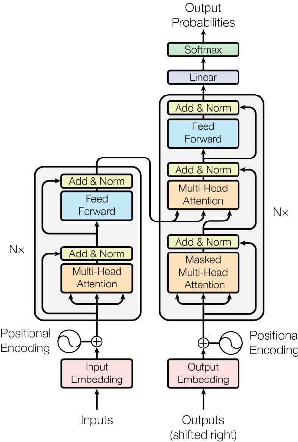
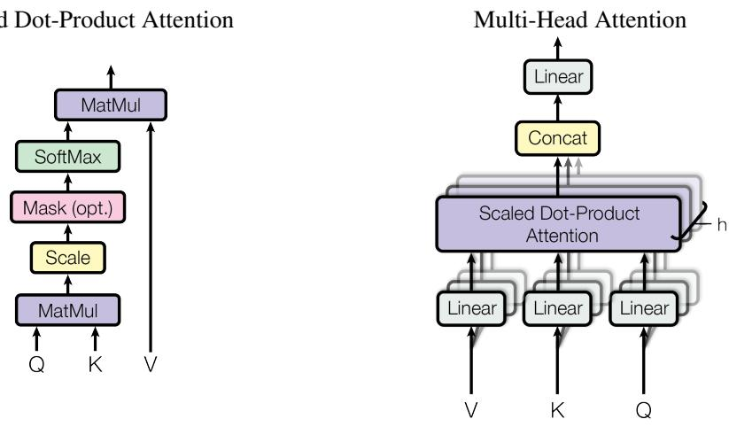
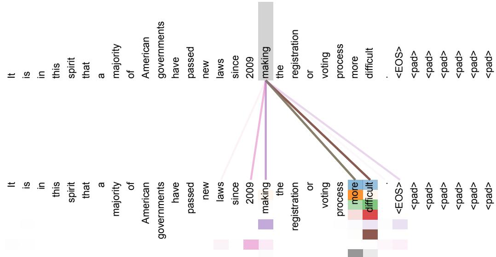
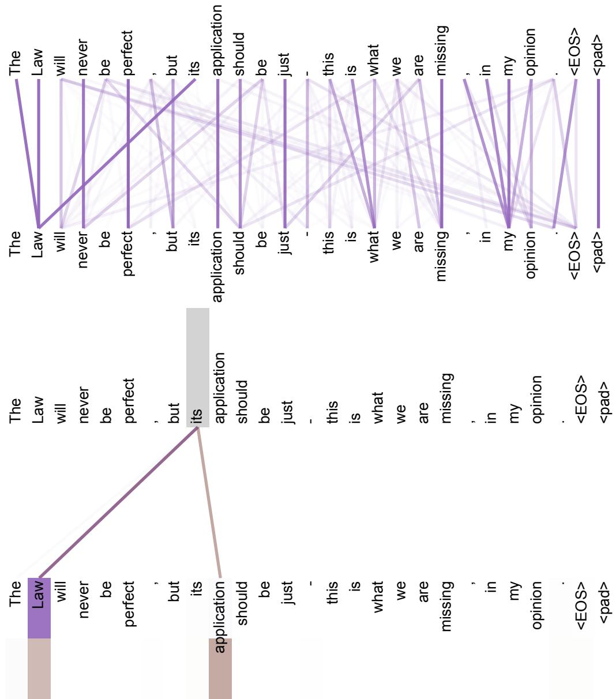
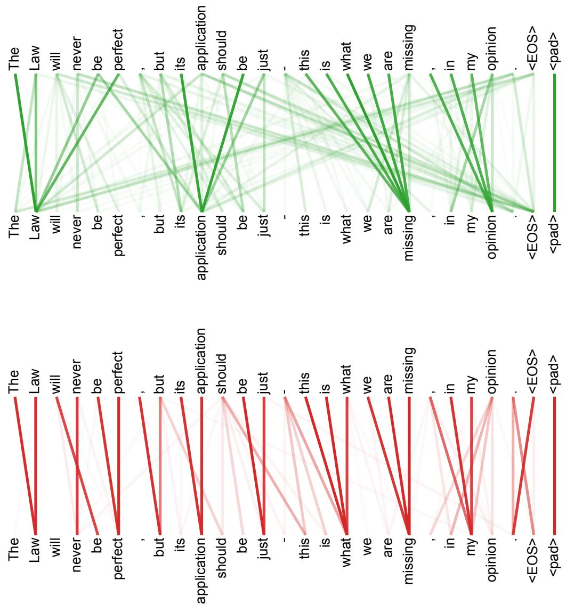

在提供适当归属说明的前提下，Google 特此许可仅在新闻或学术作品中复制本文中的表格和图表。

# 注意力即所需 (Attention Is All You Need)

Ashish Vaswani∗ Google Brain avaswani@google.com

Noam Shazeer∗ Google Brain noam@google.com

Niki Parmar∗ Google Research nikip@google.com

Jakob Uszkoreit∗ Google Research usz@google.com

Llion Jones∗ Google Research llion@google.com

Aidan N. Gomez∗ † University of Toronto aidan@cs.toronto.edu

Łukasz Kaiser∗ Google Brain lukaszkaiser@google.com

Illia Polosukhin∗ ‡ illia.polosukhin@gmail.com

## 摘要

主流的序列转换模型大多基于包含编码器和解码器的复杂循环神经网络或卷积神经网络。性能最佳的模型还会通过注意力机制（attention mechanism）将编码器和解码器连接起来。我们提出了一种名为 Transformer 的新型简单网络架构，它完全基于注意力机制，彻底摒弃了循环和卷积。在两个机器翻译任务上的实验表明，这些模型不仅质量更优，而且更易于并行化，所需的训练时间也显著减少。在 WMT 2014 英语-德语翻译任务中，我们的模型取得了 28.4 BLEU 的成绩，比包括集成模型在内的现有最佳结果提高了 2 个 BLEU 以上。在 WMT 2014 英语-法语翻译任务中，我们的模型在 8 块 GPU 上训练了 3.5 天后，创下了 41.8 的单模型最新最高（SOTA）BLEU 得分，训练成本仅为文献中最佳模型的一小部分。我们通过将 Transformer 成功应用于大规模和受限训练数据下的英语成分句法分析（English constituency parsing），证明了其具有良好的泛化能力。

## 1 引言

循环神经网络，尤其是长短期记忆网络（long short-term memory, LSTM）[13] 和门控循环单元（gated recurrent unit, GRU）[7] 神经网络，已在语言建模和机器翻译等序列建模与转换问题中被牢固确立为最先进的方法 [35, 2, 5]。此后，许多研究持续拓展循环语言模型和编码器-解码器架构的边界 [38, 24, 15]。

循环模型（Recurrent models）通常沿着输入和输出序列的符号位置进行计算分解。通过将位置与计算时间步对齐，它们生成一系列隐藏状态 $h _ { t } ,$，作为前一个隐藏状态 $h _ { t - 1 }$ 和位置 t 的输入的函数。这种固有的顺序特性阻碍了训练样本内部的并行化，而这在较长的序列长度下变得尤为关键，因为内存限制限制了样本间的批处理（batching）。近期的工作通过分解技巧 [21] 和条件计算 [32] 在计算效率上取得了显著提升，同时在后者的情况下也提高了模型性能。然而，顺序计算的根本约束依然存在。

注意力机制（Attention mechanisms）已成为各种任务中极具吸引力的序列建模和转导模型中不可或缺的组成部分，它允许对依赖关系进行建模，而无需考虑它们在输入或输出序列中的距离 [2, 19]。然而，除了极少数情况 [27] 之外，此类注意力机制都是与循环网络结合使用的。

在这项工作中，我们提出了 Transformer，这是一种摒弃循环结构，完全依赖注意力机制来绘制输入和输出之间全局依赖关系的模型架构。Transformer 允许显著更多的并行化，并且在八块 P100 GPU 上仅训练十二个小时后，就能在翻译质量上达到新的最先进水平（state of the art）。

## 2 背景

减少顺序计算的目标也构成了 Extended Neural GPU [16]、ByteNet [18] 和 ConvS2S [9] 的基础，它们都使用卷积神经网络作为基本构建块，为所有输入和输出位置并行计算隐藏表示。在这些模型中，关联来自两个任意输入或输出位置的信号所需的操作数随位置之间的距离而增长，ConvS2S 为线性增长，ByteNet 为对数增长。这使得学习远距离位置之间的依赖关系变得更加困难 [12]。在 Transformer 中，这被减少到了常数次操作，尽管这是以由于平均注意力加权位置而降低有效分辨率为代价的，但正如第 3.2 节所述，我们通过多头注意力（Multi-Head Attention）抵消了这种影响。

自注意力（Self-attention），有时被称为内部注意力（intra-attention），是一种将单个序列的不同位置关联起来以计算该序列表示的注意力机制。自注意力已成功应用于各种任务，包括阅读理解、生成式摘要（abstractive summarization）、文本蕴涵以及学习与任务无关的句子表示 [4, 27, 28, 22]。

端到端记忆网络（End-to-end memory networks）基于循环注意力机制而非序列对齐的循环结构，并已被证明在简单语言问答和语言建模任务上表现良好 [34]。

据我们所知，Transformer 是第一个完全依赖自注意力（self-attention）来计算其输入和输出表示的转换模型，而没有使用序列对齐的 RNNs 或卷积。在接下来的章节中，我们将介绍 Transformer，阐述自注意力的动机，并讨论其相比于 [17, 18] 和 [9] 等模型的优势。

## 3 模型架构

大多数极具竞争力的神经序列转换模型都具有编码器-解码器（encoder-decoder）结构 [5, 2, 35]。在这里，编码器将符号表示的输入序列 $( x _ { 1 } , . . . , x _ { n } )$ 映射为连续表示的序列 $\textbf { z } = ~ ( z _ { 1 } , . . . , z _ { n } )$。给定 z，解码器随后逐个元素生成符号的输出序列 $\left( y _ { 1 } , . . . , y _ { m } \right)$。在每一步中，模型都是自回归的（auto-regressive）[10]，在生成下一个符号时将先前生成的符号作为额外输入。

  
Figure 1: Transformer - 模型架构。

Transformer 遵循这一总体架构，编码器和解码器均采用堆叠的自注意力层和逐点全连接层，分别如 Figure 1 的左半部分和右半部分所示。

## 3.1 编码器和解码器堆栈

编码器：编码器由 $N = 6$ 个相同层的堆栈组成。每层包含两个子层。第一个是多头自注意力机制（multi-head self-attention mechanism），第二个是简单的逐位置全连接前馈网络（positionwise fully connected feed-forward network）。我们在两个子层周围均采用残差连接（residual connection）[11]，随后进行层归一化（layer normalization）[1]。也就是说，每个子层的输出为 LayerNorm(x + Sublayer(x))，其中 Sublayer(x) 是由子层本身实现的函数。为了便于这些残差连接，模型中的所有子层以及嵌入层产生的输出维度均为 $d _ { \mathrm { m o d e l } } = 5 1 2$。

解码器：解码器同样由 $N = 6$ 个相同层的堆栈组成。除了每个编码器层中的两个子层之外，解码器还插入了第三个子层，该子层对编码器堆栈的输出执行多头注意力。与编码器类似，我们在每个子层周围采用残差连接，随后进行层归一化。我们还修改了解码器堆栈中的自注意力子层，以防止当前位置关注后续位置。这种掩蔽（masking）结合输出嵌入向后偏移一个位置的设计，确保了对位置 i 的预测只能依赖于小于 i 的已知输出位置。

## 3.2 注意力机制

注意力函数可以描述为将一个查询（query）和一组键值对（key-value pairs）映射到一个输出，其中查询、键、值和输出都是向量。输出计算为值的加权和，其中分配给每个值的权重是通过查询与相应键的兼容性函数计算得出的。

  
Figure 2: （左）缩放点积注意力（Scaled Dot-Product Attention）。（右）多头注意力（Multi-Head Attention）由多个并行运行的注意力层组成。

## 3.2.1 缩放点积注意力（Scaled Dot-Product Attention）

我们将我们特定的注意力机制称为“缩放点积注意力”（Scaled Dot-Product Attention）（Figure 2）。输入由维度为 $d _ { k }$ 的查询和键，以及维度为 $d _ { v }$ 的值组成。我们计算查询与所有键的点积，将每个点积除以 $\sqrt { d _ { k } }$，并应用 softmax 函数以获得值的权重。

在实践中，我们同时对一组查询计算注意力函数，并将它们打包成一个矩阵 $Q .$。键和值也分别打包成矩阵 K 和 V。我们将输出矩阵计算为：

$$
\operatorname{Attention} (Q, K, V) = \operatorname{softmax} (\frac {Q K ^ {T}}{\sqrt {d _ {k}}}) V\tag{1}
$$

两种最常用的注意力函数是加法注意力（additive attention）[2] 和点积（乘法）注意力（dot-product attention）。除了缩放因子 $\frac { 1 } { \sqrt { d _ { k } } }$ 之外，点积注意力与我们的算法完全相同。加法注意力使用具有单个隐藏层的前馈网络来计算兼容性函数。尽管两者在理论复杂度上相似，但在实践中，点积注意力要快得多且更节省空间，因为它可以利用高度优化的矩阵乘法代码来实现。

尽管对于较小的 $d _ { k }$ 值，这两种机制的表现相似，但对于较大的 $d _ { k }$ 值，未缩放的点积注意力表现不如加法注意力 [3]。我们推测，对于较大的 $d _ { k }$ 值，点积在数量级上会增长得很大，从而将 softmax 函数推入具有极小梯度的区域 4。为了抵消这种影响，我们将点积缩放 $\frac { 1 } { \sqrt { d _ { k } } }$。

## 3.2.2 多头注意力（Multi-Head Attention）

与其使用 $d _ { \mathrm { m o d e l } }$ 维的键、值和查询执行单个注意力函数，我们发现将查询、键和值分别通过不同且学习到的线性投影线性投影 h 次到 $d _ { k } , d _ { k }$ 和 $d _ { v }$ 维度是有益的。然后，我们在这些查询、键和值的投影版本上并行执行注意力函数，产生 $d _ { v }$ 维的输出值。将这些输出值拼接起来并再次进行投影，即可得到最终的值，如 Figure 2 所示。

多头注意力（Multi-head attention）允许模型在不同位置共同关注来自不同表示子空间的信息。如果仅使用单个注意力头，平均操作会抑制这一能力。

$$
\begin{array}{c} \text {MultiHead} (Q, K, V) = \text {Concat} (\text {head} _ {1},..., \text {head} _ {\mathrm{h}}) W ^ {O} \\ \text {where} \text {head} _ {\mathrm{i}} = \text {Attention} (Q W _ {i} ^ {Q}, K W _ {i} ^ {K}, V W _ {i} ^ {V}) \end{array}
$$

其中投影为参数矩阵 $\begin{array} { r } { W _ { i } ^ { Q } \in \mathbb { R } ^ { d _ { \operatorname* { m o d e l } } \times d _ { k } } , W _ { i } ^ { K } \in \mathbb { R } ^ { d _ { \operatorname* { m o d e l } } \times d _ { k } } , W _ { i } ^ { V } \in \mathbb { R } ^ { d _ { \operatorname* { m o d e l } } \times d _ { \imath } } } \end{array}$ 以及 $W ^ { O } \in \mathbb R ^ { \bar { h } d _ { v } \times d _ { \mathrm { m o d e l } } }$。

在这项工作中，我们采用了 $h \ : = \ : 8$ 个并行的注意力层（或称注意力头）。对于其中的每一个，我们使用 $d _ { k } = d _ { v } = d _ { \mathrm { m o d e l } } / h \stackrel {  } { = } \dot { 6 } 4$。由于每个头的维度都有所降低，总计算成本与具有全维度的单头注意力相似。

## 3.2.3 注意力机制在我们模型中的应用

Transformer 以三种不同的方式使用多头注意力：

• 在“编码器-解码器注意力”（encoder-decoder attention）层中，查询（queries）来自前一个解码器层，而记忆键（keys）和值（values）来自编码器的输出。这允许解码器中的每个位置都能关注输入序列中的所有位置。这模仿了诸如 [38, 2, 9] 等序列到序列（sequence-to-sequence）模型中典型的编码器-解码器注意力机制。

• 编码器包含自注意力（self-attention）层。在自注意力层中，所有的键、值和查询都来自同一个地方，即编码器前一层的输出。编码器中的每个位置都可以关注编码器前一层的所有位置。

• 类似地，解码器中的自注意力层允许解码器中的每个位置关注解码器中直到并包括该位置的所有位置。我们需要防止解码器中的向左信息流，以保持自回归（auto-regressive）特性。我们在缩放点积注意力内部通过将 softmax 输入中对应于非法连接的所有值屏蔽（设置为 $-\infty$）来实现这一点。参见 Figure 2。

## 3.3 逐位置前馈网络

除了注意力子层之外，我们编码器和解码器中的每个层都包含一个全连接前馈网络，该网络分别且相同地应用于每个位置。它由两个线性变换组成，中间夹有一个 ReLU 激活函数。

$$
\operatorname{FFN} (x) = \max (0, x W _ {1} + b _ {1}) W _ {2} + b _ {2}\tag{2}
$$

虽然不同位置上的线性变换是相同的，但在不同的层之间它们使用的是不同的参数。另一种描述方式是将其视为两个核大小为 1 的卷积。输入和输出的维度为 $d _ { \mathrm { m o d e l } } = 5 1 2$ ，内部层的维度为 $d _ { f f } = 2 0 4 8$。

## 3.4 嵌入与 Softmax

与其他序列转导模型类似，我们使用学习到的嵌入（learned embeddings）将输入词元（tokens）和输出词元转换为维度为 $d _ { \mathrm { m o d e l } }$ 的向量。我们还使用常规的学习线性变换和 softmax 函数将解码器输出转换为预测的下一个词元概率。在我们的模型中，与 [30] 类似，我们在两个嵌入层以及 softmax 之前的线性变换之间共享相同的权重矩阵。在嵌入层中，我们将这些权重乘以 $\sqrt { d _ { \mathrm { { m o d e l } } } }$。

Table 1: 不同层类型的最大路径长度、每层复杂度以及最少顺序操作次数。n 为序列长度，d 为表示维度，k 为卷积的核大小，r 为受限自注意力中的邻域大小。

<table><tr><td>层类型</td><td>每层复杂度</td><td>顺序操作</td><td>最大路径长度</td></tr><tr><td>自注意力 (Self-Attention)</td><td> $O(n^{2} \cdot d)$ </td><td>O(1)</td><td>O(1)</td></tr><tr><td>循环 (Recurrent)</td><td> $O(n \cdot d^{2})$ </td><td>O(n)</td><td>O(n)</td></tr><tr><td>卷积 (Convolutional)</td><td> $O(k \cdot n \cdot d^{2})$ </td><td>O(1)</td><td> $O(\log_{k}(n))$ </td></tr><tr><td>自注意力（受限）</td><td> $O(r \cdot n \cdot d)$ </td><td>O(1)</td><td>O(n/r)</td></tr></table>

## 3.5 位置编码

由于我们的模型不包含循环和卷积，为了使模型能够利用序列的顺序信息，我们必须注入序列中词元的相对或绝对位置的信息。为此，我们在编码器和解码器堆栈底部的输入嵌入中加入了“位置编码”（positional encodings）。位置编码与嵌入具有相同的维度 $d _ { \mathrm { m o d e l } }$ ，因此两者可以相加。位置编码有多种选择，包括可学习的和固定的 [9]。

在这项工作中，我们使用不同频率的正弦和余弦函数：

$$
\begin{array}{r} P E _ {(p o s, 2 i)} = \sin (p o s / 1 0 0 0 0 ^ {2 i / d _ {\mathrm{model}}}) \\ P E _ {(p o s, 2 i + 1)} = \cos (p o s / 1 0 0 0 0 ^ {2 i / d _ {\mathrm{model}}}) \end{array}
$$

其中 $pos$ 是位置，$i$ 是维度。也就是说，位置编码的每个维度都对应一个正弦曲线。其波长构成从 $2 \pi$ 到 $1 0 0 0 0 \cdot 2 \pi$ 的等比数列。我们选择该函数是因为我们假设它能使模型轻松学习通过相对位置进行注意力计算，因为对于任意固定的偏移量 $k$，$P E _ { p o s + k }$ 都可以表示为 $P E _ { p o s }$ 的线性函数。

我们还尝试了改用可学习的位置嵌入 [9]，发现这两种版本产生了几乎相同的结果（参见 Table 3 行 (E)）。我们选择正弦曲线版本是因为它可能允许模型外推到比训练期间遇到的序列长度更长的序列。

## 4 为什么选择自注意力

在本节中，我们将自注意力层与常用于将一个可变长度的符号表示序列 $( x _ { 1 } , . . . , x _ { n } )$ 映射到另一个等长序列 $\left( z _ { 1 } , . . . , z _ { n } \right)$（其中 $x _ { i } , z _ { i } \in \mathbb { R } ^ { d }$，例如典型序列转换编码器或解码器中的隐藏层）的循环层和卷积层的各个方面进行比较。为了阐明我们使用自注意力的动机，我们考虑了三个期望目标。

其一是每层的总计算复杂度。其二是可并行化的计算量，以所需的最小顺序操作数来衡量。

其三是网络中长距离依赖之间的路径长度。学习长距离依赖是许多序列转换任务中的关键挑战。影响学习这种依赖能力的一个关键因素是前向和后向信号在网络中必须遍历的路径长度。输入和输出序列中任意位置组合之间的这些路径越短，就越容易学习长距离依赖 [12]。因此，我们还比较了由不同层类型组成的网络中任意两个输入和输出位置之间的最大路径长度。

如 Table 1 所示，自注意力层通过常数级的顺序执行操作连接所有位置，而循环层则需要 $O ( n )$ 个顺序操作。在计算复杂度方面，当序列长度 $n$ 小于表示维度 $d$ 时，自注意力层比循环层更快，而机器翻译中最先进模型所使用的句子表示通常属于这种情况，例如 word-piece [38] 和 byte-pair [31] 表示。为了提高涉及极长序列的任务的计算性能，自注意力可以限制为仅考虑输入序列中以对应输出位置为中心的大小为 $r$ 的邻域。这会将最大路径长度增加到 $O ( n / r )$。我们计划在未来的工作中进一步研究这种方法。

核宽度为 $k <$ n 的单个卷积层无法连接所有输入和输出位置对。在连续卷积核的情况下，要实现这一点需要堆叠 $O ( n / k )$ 个卷积层；而在空洞卷积（dilated convolutions）[18] 的情况下，则需要堆叠 $O ( l o g _ { k } ( n ) )$ 层，这增加了网络中任意两个位置之间最长路径的长度。卷积层的计算开销通常比循环层高出 $k$ 倍。然而，可分离卷积（Separable convolutions）[6] 可以显著降低复杂度，降至 $\overset { \cdot } { O ( k \cdot n \cdot d + n \cdot d ^ { 2 } ) }$。不过，即使在 $k = n$ 的情况下，可分离卷积的复杂度也等同于自注意力（self-attention）层与逐点前馈（point-wise feed-forward）层的组合，而这正是我们在模型中采用的方法。

作为额外收益，自注意力机制可以带来更具可解释性的模型。我们考察了模型的注意力分布，并在附录中展示和讨论了相关示例。各个注意力头不仅明显学会了执行不同的任务，许多头似乎还表现出了与句子的句法和语义结构相关的行为。

## 5 训练

本节介绍了我们模型的训练机制。

## 5.1 训练数据与批处理

我们在标准的 WMT 2014 英语-德语数据集上进行了训练，该数据集包含约 450 万个句子对。句子使用字节对编码（byte-pair encoding）[3] 进行编码，其具有约 37000 个词元的源语言-目标语言共享词表。对于英语-法语，我们使用了规模大得多的 WMT 2014 英语-法语数据集，该数据集包含 3600 万个句子，并将词元切分为 32000 个词片（word-piece）词表 [38]。句子对按相近的序列长度组合成批。每个训练批次包含一组句子对，总共约有 25000 个源语言词元和 25000 个目标语言词元。

## 5.2 硬件与训练进度

我们在配备 8 块 NVIDIA P100 GPU 的单台机器上训练模型。对于使用全文所述超参数的基础模型（base models），每个训练步约耗时 0.4 秒。我们对基础模型总共训练了 100,000 步（即 12 小时）。对于我们的大模型（big models，如表 3 底行所述），单步耗时为 1.0 秒。大模型共训练了 300,000 步（3.5 天）。

## 5.3 优化器

我们使用了 Adam 优化器 [20]，参数设置为 $\beta _ { 1 } = 0 . 9 , \beta _ { 2 } = 0 . 9 8$ 以及 $\epsilon = 1 0 ^ { - 9 }$。在训练过程中，我们根据以下公式调整学习率：

$$
l r a t e = d _ {\mathrm{model}} ^ {- 0. 5} \cdot \min (s t e p \_ n u m ^ {- 0. 5}, s t e p \_ n u m \cdot w a r m u p \_ s t e p s ^ {- 1. 5})\tag{3}
$$

这对应于在前 warmup\_steps 个训练步中线性增大学习率，此后按步数的平方根反比减小学习率。我们设置 warmup\_ $. s t e p s = 4 0 0 0$。

## 5.4 正则化

我们在训练过程中采用了三种正则化方式：

Table 2: 在英语-德语和英语-法语 newstest2014 测试中，Transformer 取得了优于此前最先进模型的 BLEU 分数，且训练成本仅为后者的几分之一。

<table><tr><td rowspan="2">模型</td><td colspan="2">BLEU</td><td colspan="2">训练成本 (FLOPs)</td></tr><tr><td>EN-DE</td><td>EN-FR</td><td>EN-DE</td><td>EN-FR</td></tr><tr><td>ByteNet [18]</td><td>23.75</td><td></td><td></td><td></td></tr><tr><td>Deep-Att + PosUnk [39]</td><td></td><td>39.2</td><td></td><td> $1.0 \cdot 10^{20}$ </td></tr><tr><td>GNMT + RL [38]</td><td>24.6</td><td>39.92</td><td> $2.3 \cdot 10^{19}$ </td><td> $1.4 \cdot 10^{20}$ </td></tr><tr><td>ConvS2S [9]</td><td>25.16</td><td>40.46</td><td> $9.6 \cdot 10^{18}$ </td><td> $1.5 \cdot 10^{20}$ </td></tr><tr><td>MoE [32]</td><td>26.03</td><td>40.56</td><td> $2.0 \cdot 10^{19}$ </td><td> $1.2 \cdot 10^{20}$ </td></tr><tr><td>Deep-Att + PosUnk Ensemble [39]</td><td></td><td>40.4</td><td></td><td> $8.0 \cdot 10^{20}$ </td></tr><tr><td>GNMT + RL Ensemble [38]</td><td>26.30</td><td>41.16</td><td> $1.8 \cdot 10^{20}$ </td><td> $1.1 \cdot 10^{21}$ </td></tr><tr><td>ConvS2S Ensemble [9]</td><td>26.36</td><td>41.29</td><td> $7.7 \cdot 10^{19}$ </td><td> $1.2 \cdot 10^{21}$ </td></tr><tr><td>Transformer (base model)</td><td>27.3</td><td>38.1</td><td colspan="2"> $3.3 \cdot 10^{18}$ </td></tr><tr><td>Transformer (big)</td><td>28.4</td><td>41.8</td><td colspan="2"> $2.3 \cdot 10^{19}$ </td></tr></table>

残差丢弃（Residual Dropout） 我们将 dropout [33] 应用于每个子层的输出，在将其加到子层输入并进行归一化之前。此外，我们还将 dropout 应用于编码器和解码器堆栈中的嵌入与位置编码之和。对于基础模型，我们使用的丢弃率为 $P _ { d r o p } = 0 . 1$。

标签平滑（Label Smoothing） 在训练期间，我们采用了参数值为 $\epsilon _ { l s } = 0 . 1 [ 3 6 ]$ 的标签平滑。这会损害困惑度（perplexity），因为模型学会了变得更加不确定，但它提高了准确率和 BLEU 分数。

## 6 结果

## 6.1 机器翻译

在 WMT 2014 英语-德语翻译任务中，大型 Transformer 模型（Table 2 中的 Transformer (big)）比以往报道的最佳模型（包括集成模型）高出 2.0 以上的 BLEU 分数，创下了 28.4 的最新最佳 BLEU 分数。该模型的配置列在 Table 3 的最后一行。在 8 块 P100 GPU 上训练耗时 3.5 天。即使是我们的基础模型（base model），也超越了以往所有已发表的模型和集成模型，而训练成本仅为任何竞争模型的一小部分。

在 WMT 2014 英语-法语翻译任务中，我们的大型模型取得了 41.0 的 BLEU 分数，超越了此前所有已发表的单一模型，且训练成本不到此前最先进模型的 1/4。用于英语-法语训练的 Transformer (big) 模型使用的 dropout 丢弃率为 $P _ { d r o p } = 0 . 1$，而非 0.3。

对于基础模型（base models），我们使用了通过对以 10 分钟间隔保存的最后 5 个检查点（checkpoints）取平均所获得的单一模型。对于大模型（big models），我们对最后 20 个检查点取了平均。我们使用了集束搜索（beam search），集束大小（beam size）为 4，长度惩罚 $\alpha = 0 . 6 [ 3 8 ]$。这些超参数是在开发集上进行实验后选定的。我们在推理过程中将最大输出长度设为输入长度 + 50，但在可能的情况下提前终止 [38]。

Table 2 总结了我们的结果，并将我们的翻译质量和训练成本与文献中的其他模型架构进行了比较。我们通过将训练时间、使用的 GPU 数量以及每个 $\mathrm { G P U } ^ { 5 }$ 持续单精度浮点运算能力的估计值相乘，来估算用于训练模型的浮点运算次数。

## 6.2 模型变体

为了评估 Transformer 不同组件的重要性，我们以不同的方式改变了基础模型，并在开发集 newstest2013 上测量了英德翻译性能的变化。我们使用了如前一节所述的集束搜索，但没有进行检查点平均。我们在 Table 3 中展示了这些结果。

Table 3: Transformer 架构的变体。未列出的数值与基础模型相同。所有指标均基于英德翻译开发集 newstest2013。所列出的困惑度（perplexities）是根据我们的字节对编码（byte-pair encoding）计算的每分词（per-wordpiece）困惑度，不应与每词（per-word）困惑度进行比较。

<table><tr><td></td><td>N</td><td> $d_{model}$ </td><td> $d_{ff}$ </td><td>h</td><td> $d_k$ </td><td> $d_v$ </td><td> $P_{drop}$ </td><td> $\epsilon_{ls}$ </td><td>训练步数</td><td>PPL (dev)</td><td>BLEU (dev)</td><td>参数量  $\times 10^6$ </td></tr><tr><td>base</td><td>6</td><td>512</td><td>2048</td><td>8</td><td>64</td><td>64</td><td>0.1</td><td>0.1</td><td>100K</td><td>4.92</td><td>25.8</td><td>65</td></tr><tr><td rowspan="4">(A)</td><td></td><td></td><td></td><td>1</td><td>512</td><td>512</td><td></td><td></td><td></td><td>5.29</td><td>24.9</td><td></td></tr><tr><td></td><td></td><td></td><td>4</td><td>128</td><td>128</td><td></td><td></td><td></td><td>5.00</td><td>25.5</td><td></td></tr><tr><td></td><td></td><td></td><td>16</td><td>32</td><td>32</td><td></td><td></td><td></td><td>4.91</td><td>25.8</td><td></td></tr><tr><td></td><td></td><td></td><td>32</td><td>16</td><td>16</td><td></td><td></td><td></td><td>5.01</td><td>25.4</td><td></td></tr><tr><td rowspan="2">(B)</td><td></td><td></td><td></td><td></td><td>16</td><td></td><td></td><td></td><td></td><td>5.16</td><td>25.1</td><td>58</td></tr><tr><td></td><td></td><td></td><td></td><td>32</td><td></td><td></td><td></td><td></td><td>5.01</td><td>25.4</td><td>60</td></tr><tr><td rowspan="7">(C)</td><td>2</td><td></td><td></td><td></td><td></td><td></td><td></td><td></td><td></td><td>6.11</td><td>23.7</td><td>36</td></tr><tr><td>4</td><td></td><td></td><td></td><td></td><td></td><td></td><td></td><td></td><td>5.19</td><td>25.3</td><td>50</td></tr><tr><td>8</td><td></td><td></td><td></td><td></td><td></td><td></td><td></td><td></td><td>4.88</td><td>25.5</td><td>80</td></tr><tr><td></td><td>256</td><td></td><td></td><td>32</td><td>32</td><td></td><td></td><td></td><td>5.75</td><td>24.5</td><td>28</td></tr><tr><td></td><td>1024</td><td></td><td></td><td>128</td><td>128</td><td></td><td></td><td></td><td>4.66</td><td>26.0</td><td>168</td></tr><tr><td></td><td></td><td>1024</td><td></td><td></td><td></td><td></td><td></td><td></td><td>5.12</td><td>25.4</td><td>53</td></tr><tr><td></td><td></td><td>4096</td><td></td><td></td><td></td><td></td><td></td><td></td><td>4.75</td><td>26.2</td><td>90</td></tr><tr><td rowspan="4">(D)</td><td></td><td></td><td></td><td></td><td></td><td></td><td>0.0</td><td></td><td></td><td>5.77</td><td>24.6</td><td></td></tr><tr><td></td><td></td><td></td><td></td><td></td><td></td><td>0.2</td><td></td><td></td><td>4.95</td><td>25.5</td><td></td></tr><tr><td></td><td></td><td></td><td></td><td></td><td></td><td></td><td>0.0</td><td></td><td>4.67</td><td>25.3</td><td></td></tr><tr><td></td><td></td><td></td><td></td><td></td><td></td><td></td><td>0.2</td><td></td><td>5.47</td><td>25.7</td><td></td></tr><tr><td>(E)</td><td colspan="9">使用位置嵌入代替正弦函数</td><td>4.92</td><td>25.7</td><td></td></tr><tr><td>big</td><td>6</td><td>1024</td><td>4096</td><td>16</td><td></td><td></td><td>0.3</td><td></td><td>300K</td><td>4.33</td><td>26.4</td><td>213</td></tr></table>

在 Table 3 的 (A) 行中，如第 3.2.2 节所述，我们在保持计算量恒定的情况下改变了注意力头数以及注意力键和值的维度。虽然单头注意力的 BLEU 分值比最佳设置低 0.9，但头数过多时质量也会下降。

在 Table 3 的 (B) 行中，我们观察到减小注意力键的维度 $d _ { k }$ 会损害模型质量。这表明确定兼容性并非易事，且采用比点积更复杂的兼容性函数可能会更有益。我们在 (C) 行和 (D) 行中进一步观察到，正如预期的那样，更大的模型表现更好，并且 dropout 对避免过拟合非常有帮助。在 (E) 行中，我们将正弦位置编码替换为可学习的位置嵌入（learned positional embeddings）[9]，观察到了与基础模型几乎相同的结果。

## 6.3 英语成分句法分析

为了评估 Transformer 是否能够泛化到其他任务，我们进行了英语成分句法分析（English constituency parsing）实验。该任务具有特定的挑战：输出受到强烈的结构约束，且明显长于输入。此外，RNN 序列到序列（sequence-to-sequence）模型在小数据规模下一直未能取得最顶尖（state-of-the-art）的结果 [37]。

我们在 Penn Treebank [25] 的 Wall Street Journal (WSJ) 部分（约 40K 训练句子）上训练了一个 $d _ { m o d e l } = 1 0 2 4$ 的 4 层 Transformer。我们还在半监督设置下对其进行了训练，使用了来自 [37] 的包含约 17M 句子的高置信度（high-confidence）和 BerkleyParser 更大数据集。对于仅使用 WSJ 的设置，我们使用了 16K 个 token 的词表；对于半监督设置，则使用了 32K 个 token 的词表。

我们仅进行了少量的实验以在 Section 22 开发集上选择 dropout（包括注意力和残差 dropout，第 5.4 节）、学习率和束搜索大小（beam size），所有其他参数均与英语-德语基础翻译模型保持一致。在推理过程中，我们将最大输出长度增加到输入长度 + 300。对于仅使用 WSJ 和半监督设置，我们均使用了大小为 21 的 beam size 和 α = 0.3。

Table 4: Transformer 能很好地泛化到英语成分句法分析（结果基于 WSJ 的 Section 23）

<table><tr><td>解析器</td><td>训练方式</td><td>WSJ 23 F1</td></tr><tr><td>Vinyals &amp; Kaiser el al. (2014) [37]</td><td>仅 WSJ，判别式</td><td>88.3</td></tr><tr><td>Petrov et al. (2006) [29]</td><td>仅 WSJ，判别式</td><td>90.4</td></tr><tr><td>Zhu et al. (2013) [40]</td><td>仅 WSJ，判别式</td><td>90.4</td></tr><tr><td>Dyer et al. (2016) [8]</td><td>仅 WSJ，判别式</td><td>91.7</td></tr><tr><td>Transformer (4 layers)</td><td>仅 WSJ，判别式</td><td>91.3</td></tr><tr><td>Zhu et al. (2013) [40]</td><td>半监督</td><td>91.3</td></tr><tr><td>Huang &amp; Harper (2009) [14]</td><td>半监督</td><td>91.3</td></tr><tr><td>McClosky et al. (2006) [26]</td><td>半监督</td><td>92.1</td></tr><tr><td>Vinyals &amp; Kaiser el al. (2014) [37]</td><td>半监督</td><td>92.1</td></tr><tr><td>Transformer (4 layers)</td><td>半监督</td><td>92.7</td></tr><tr><td>Luong et al. (2015) [23]</td><td>多任务</td><td>93.0</td></tr><tr><td>Dyer et al. (2016) [8]</td><td>生成式</td><td>93.3</td></tr></table>

我们在表 4 中的结果表明，尽管缺乏针对特定任务的调优，我们的模型表现依然出奇地好，除循环神经网络语法（Recurrent Neural Network Grammar）[8] 之外，取得了优于所有先前报道的模型的结果。

与 RNN 序列到序列模型 [37] 相比，Transformer 即使仅在包含 40K 句子的 WSJ 训练集上进行训练，其表现也优于 Berkeley-Parser [29]。

## 7 结论

在这项工作中，我们提出了 Transformer，这是第一个完全基于注意力机制的序列转换模型，用多头自注意力（multi-headed self-attention）取代了编码器-解码器架构中最常用的循环层。

对于翻译任务，Transformer 的训练速度明显快于基于循环或卷积层的架构。在 WMT 2014 英语-德语和 WMT 2014 英语-法语翻译任务上，我们均取得了新的最优性能（state of the art）。在前一项任务中，我们的最佳模型甚至超越了以往报道的所有集成模型。

我们对基于注意力的模型的未来感到兴奋，并计划将它们应用于其他任务。我们计划将 Transformer 扩展到涉及文本以外的输入和输出模态的问题，并研究局部、受限的注意力机制，以高效处理图像、音频和视频等大型输入和输出。减少生成的序列依赖性是我们的另一个研究目标。

我们用于训练和评估模型的代码可在 https://github.com/tensorflow/tensor2tensor 获取。

致谢 我们感谢 Nal Kalchbrenner 和 Stephan Gouws 提出的富有成效的意见、修正和启发。

## 参考文献

[1] Jimmy Lei Ba, Jamie Ryan Kiros, and Geoffrey E Hinton. Layer normalization. arXiv preprint arXiv:1607.06450, 2016.

[2] Dzmitry Bahdanau, Kyunghyun Cho, and Yoshua Bengio. 通过联合学习对齐与翻译的神经机器翻译. CoRR, abs/1409.0473, 2014.

[3] Denny Britz, Anna Goldie, Minh-Thang Luong, and Quoc V. Le. 神经机器翻译架构的大规模探索. CoRR, abs/1703.03906, 2017.

[4] Jianpeng Cheng, Li Dong, and Mirella Lapata. 用于机器阅读的长短期记忆网络. arXiv preprint arXiv:1601.06733, 2016.

[5] Kyunghyun Cho, Bart van Merrienboer, Caglar Gulcehre, Fethi Bougares, Holger Schwenk, and Yoshua Bengio. 使用用于统计机器翻译的 RNN 编码器-解码器学习短语表示. CoRR, abs/1406.1078, 2014.

[6] Francois Chollet. Xception：基于深度可分离卷积的深度学习. arXiv preprint arXiv:1610.02357, 2016.

[7] Junyoung Chung, Çaglar Gülçehre, Kyunghyun Cho, and Yoshua Bengio. 门控循环神经网络在序列建模上的实证评估. CoRR, abs/1412.3555, 2014.

[8] Chris Dyer, Adhiguna Kuncoro, Miguel Ballesteros, and Noah A. Smith. 循环神经网络文法. In Proc. of NAACL, 2016.

[9] Jonas Gehring, Michael Auli, David Grangier, Denis Yarats, and Yann N. Dauphin. 卷积序列到序列学习. arXiv preprint arXiv:1705.03122v2, 2017.

[10] Alex Graves. 使用循环神经网络生成序列. arXiv preprint arXiv:1308.0850, 2013.

[11] Kaiming He, Xiangyu Zhang, Shaoqing Ren, and Jian Sun. 用于图像识别的深度残差学习. In Proceedings of the IEEE Conference on Computer Vision and Pattern Recognition, pages 770–778, 2016.

[12] Sepp Hochreiter, Yoshua Bengio, Paolo Frasconi, and Jürgen Schmidhuber. 循环网络中的梯度流：学习长期依赖的困难, 2001.

[13] Sepp Hochreiter and Jürgen Schmidhuber. 长短期记忆网络. Neural computation, 9(8):1735–1780, 1997.

[14] Zhongqiang Huang and Mary Harper. 跨语言带有潜在标注的自训练 PCFG 文法. In Proceedings of the 2009 Conference on Empirical Methods in Natural Language Processing, pages 832–841. ACL, August 2009.

[15] Rafal Jozefowicz, Oriol Vinyals, Mike Schuster, Noam Shazeer, and Yonghui Wu. 探索语言建模的极限. arXiv preprint arXiv:1602.02410, 2016.

[16] Łukasz Kaiser and Samy Bengio. 主动记忆能否替代注意力机制？ In Advances in Neural Information Processing Systems, (NIPS), 2016.

[17] Łukasz Kaiser and Ilya Sutskever. 神经 GPU 学习算法. In International Conference on Learning Representations (ICLR), 2016.

[18] Nal Kalchbrenner, Lasse Espeholt, Karen Simonyan, Aaron van den Oord, Alex Graves, and Koray Kavukcuoglu. 线性时间内的神经机器翻译. arXiv preprint arXiv:1610.10099v2, 2017.

[19] Yoon Kim, Carl Denton, Luong Hoang, and Alexander M. Rush. 结构化注意力网络. In International Conference on Learning Representations, 2017.

[20] Diederik Kingma and Jimmy Ba. Adam: A method for stochastic optimization. In ICLR, 2015.

[21] Oleksii Kuchaiev and Boris Ginsburg. Factorization tricks for LSTM networks. arXiv preprint arXiv:1703.10722, 2017.

[22] Zhouhan Lin, Minwei Feng, Cicero Nogueira dos Santos, Mo Yu, Bing Xiang, Bowen Zhou, and Yoshua Bengio. A structured self-attentive sentence embedding. arXiv preprint arXiv:1703.03130, 2017.

[23] Minh-Thang Luong, Quoc V. Le, Ilya Sutskever, Oriol Vinyals, and Lukasz Kaiser. Multi-task sequence to sequence learning. arXiv preprint arXiv:1511.06114, 2015.

[24] Minh-Thang Luong, Hieu Pham, and Christopher D Manning. Effective approaches to attentionbased neural machine translation. arXiv preprint arXiv:1508.04025, 2015.

[25] Mitchell P Marcus, Mary Ann Marcinkiewicz, and Beatrice Santorini. Building a large annotated corpus of english: The penn treebank. Computational linguistics, 19(2):313–330, 1993.

[26] David McClosky, Eugene Charniak, and Mark Johnson. Effective self-training for parsing. In Proceedings of the Human Language Technology Conference of the NAACL, Main Conference, pages 152–159. ACL, June 2006.

[27] Ankur Parikh, Oscar Täckström, Dipanjan Das, and Jakob Uszkoreit. A decomposable attention model. In Empirical Methods in Natural Language Processing, 2016.

[28] Romain Paulus, Caiming Xiong, and Richard Socher. A deep reinforced model for abstractive summarization. arXiv preprint arXiv:1705.04304, 2017.

[29] Slav Petrov, Leon Barrett, Romain Thibaux, and Dan Klein. Learning accurate, compact, and interpretable tree annotation. In Proceedings of the 21st International Conference on Computational Linguistics and 44th Annual Meeting of the ACL, pages 433–440. ACL, July 2006.

[30] Ofir Press and Lior Wolf. Using the output embedding to improve language models. arXiv preprint arXiv:1608.05859, 2016.

[31] Rico Sennrich, Barry Haddow, and Alexandra Birch. Neural machine translation of rare words with subword units. arXiv preprint arXiv:1508.07909, 2015.

[32] Noam Shazeer, Azalia Mirhoseini, Krzysztof Maziarz, Andy Davis, Quoc Le, Geoffrey Hinton, and Jeff Dean. Outrageously large neural networks: The sparsely-gated mixture-of-experts layer. arXiv preprint arXiv:1701.06538, 2017.

[33] Nitish Srivastava, Geoffrey E Hinton, Alex Krizhevsky, Ilya Sutskever, and Ruslan Salakhutdinov. Dropout: a simple way to prevent neural networks from overfitting. Journal ofMachine Learning Research, 15(1):1929–1958, 2014.

[34] Sainbayar Sukhbaatar, Arthur Szlam, Jason Weston, and Rob Fergus. End-to-end memory networks. In C. Cortes, N. D. Lawrence, D. D. Lee, M. Sugiyama, and R. Garnett, editors, Advances in Neural Information Processing Systems 28, pages 2440–2448. Curran Associates, Inc., 2015.

[35] Ilya Sutskever, Oriol Vinyals, and Quoc VV Le. Sequence to sequence learning with neural networks. In Advances in Neural Information Processing Systems, pages 3104–3112, 2014.

[36] Christian Szegedy, Vincent Vanhoucke, Sergey Ioffe, Jonathon Shlens, and Zbigniew Wojna. Rethinking the inception architecture for computer vision. CoRR, abs/1512.00567, 2015.

[37] Vinyals & Kaiser, Koo, Petrov, Sutskever, and Hinton. Grammar as a foreign language. In Advances in Neural Information Processing Systems, 2015.

[38] Yonghui Wu, Mike Schuster, Zhifeng Chen, Quoc V Le, Mohammad Norouzi, Wolfgang Macherey, Maxim Krikun, Yuan Cao, Qin Gao, Klaus Macherey, et al. Google’s neural machine translation system: Bridging the gap between human and machine translation. arXiv preprint arXiv:1609.08144, 2016.

[39] Jie Zhou, Ying Cao, Xuguang Wang, Peng Li, and Wei Xu. Deep recurrent models with fast-forward connections for neural machine translation. CoRR, abs/1606.04199, 2016.

[40] Muhua Zhu, Yue Zhang, Wenliang Chen, Min Zhang, and Jingbo Zhu. Fast and accurate shift-reduce constituent parsing. In Proceedings ofthe 51st Annual Meeting ofthe ACL (Volume 1: Long Papers), pages 434–443. ACL, August 2013.

注意力可视化  
  
Figure 3: 在共 6 层的编码器自注意力机制中，第 5 层捕捉长距离依赖关系的注意力机制示例。许多注意力头关注动词“making”的远距离依赖，从而补全了短语“making...more difficult”。此处仅展示单词“making”的注意力分布。不同的颜色代表不同的注意力头。建议彩色阅读。

  
Figure 4: 同样位于共 6 层的第 5 层中的两个注意力头，明显参与了指代消解（anaphora resolution）。上方：注意力头 5 的完整注意力分布。下方：注意力头 5 和 6 仅针对单词“its”的单独注意力分布。请注意，针对该单词的注意力分布非常集中（sharp）。

  
Figure 5: 许多注意力头表现出似乎与句子结构相关的行为。我们在上方展示了两个此类示例，分别来自共 6 层的编码器自注意力机制中第 5 层的两个不同注意力头。这些头显然学会了执行不同的任务。