# 神经语言模型的缩放定律

Jared Kaplan \*
Johns Hopkins University, OpenAI
jaredk@jhu.edu

Tom Henighan
OpenAI
henighan@openai.com
Tom B. Brown
OpenAI
tom@openai.com

Scott Gray    Alec Radford
OpenAI    OpenAI
scott@openai.com    alec@openai.com

Sam McCandlish\* OpenAI sam@openai.com

Benjamin Chess    Rewon Child
OpenAI    OpenAI
bchess@openai.com    rewon@openai.com

Jeffrey Wu
OpenAI
jeffwu@openai.com
Dario Amodei
OpenAI
damodei@openai.com

## 摘要

我们研究了语言模型在交叉熵损失下性能的经验缩放定律（scaling laws）。损失与模型大小、数据集大小以及用于训练的计算量之间呈幂律（power-law）关系，其中一些趋势跨越了七个以上的数量级。在较宽的范围内，网络宽度或深度等其他架构细节的影响极小。简单的方程支配着过拟合对模型/数据集大小的依赖关系，以及训练速度对模型大小的依赖关系。这些关系使我们能够确定固定计算预算的最优分配。更大的模型具有显著更高的样本效率，因此在计算效率最高的最优训练中，应当在相对适量的数据上训练极大的模型，并在远未达到收敛时就停止训练。

## 目录

1 引言 2
2 背景与方法 6
3 经验结果与基本幂律 7
4 描绘无限数据极限与过拟合 10
5 模型大小与训练时间的缩放定律 12
6 计算预算的最优分配 14
7 相关工作 18
8 讨论 18
附录 20
A 幂律总结 20
B 计算高效前沿的经验模型 20
C 注意事项 22
D 补充图表 23

## 1 引言

语言为人工智能的研究提供了一个自然的领域，因为绝大多数推理任务都可以用语言有效地表达和评估，而且全球的文本资源为通过生成建模进行的无监督学习提供了丰富的数据。深度学习近期在语言建模领域取得了快速进展，最先进的模型 [RNSS18, DCLT18, YDY $^{+}$ 19, LOG $^{+}$ 19, RSR $^{+}$ 19] 在许多特定任务 [WPN $^{+}$ 19] 上已接近人类水平，包括根据提示生成连贯的多段落文本样本 [RWC $^{+}$ 19]。

人们可能会预期语言建模性能取决于模型架构、神经模型的大小、用于训练模型的计算能力以及可用于该训练过程的数据。在本文中，我们将重点关注 Transformer 架构 $[VSP^{+}17, LSP^{+}18]$，实证研究语言建模损失对所有这些因素的依赖关系。语言任务性能的高上限与低下限使我们能够跨越七个以上的数量级规模来研究相关趋势。

在整个研究中，我们将观察到性能作为训练时间、上下文长度、数据集大小、模型大小和计算预算的函数，呈现出精确的幂律缩放关系。

## 1.1 Summary

我们关于 Transformer 语言模型的核心发现如下：

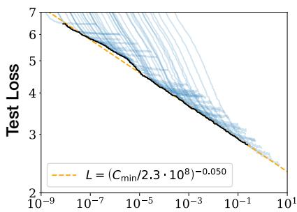  
Compute  
PF-days, non-embedding

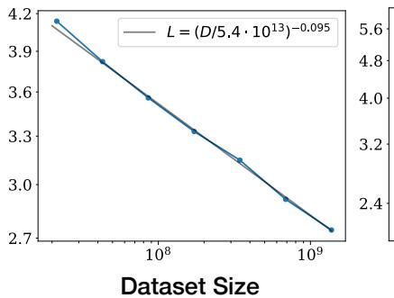  
tokens

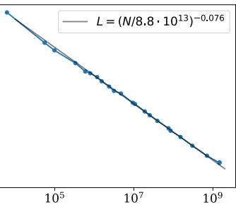  
Parameters  
non-embedding  
Figure 1 随着我们增加模型大小、数据集大小以及用于训练的计算量 $^{2}$，语言建模性能平稳提升。为获得最佳性能，所有这三个因素必须协同扩展。在不受另外两个因素制约时，经验性能与每个单一因素均呈现幂律关系。

性能强依赖于规模，弱依赖于模型形状：模型性能最强地依赖于规模，规模由三个因素构成：模型参数量 N（不包含嵌入层）、数据集大小 D 以及用于训练的计算量 C。在合理范围内，性能对其他架构超参数（如深度与宽度的比例）的依赖极弱。(Section 3)

平滑的幂律：在不受另外两个因素制约时，性能与 N、D、C 这三个规模因素中的每一个均呈幂律关系，这一趋势跨越了六个以上数量级（见 Figure 1）。在规模上限处，我们没有观察到偏离这些趋势的迹象，尽管性能在达到零损失之前最终必然会趋于平缓。(Section 3)

过拟合的普遍性：只要我们协同扩大 N 和 D，性能就会可预测地提升；但若在增加其中一个的同时固定 N 或 D 中的另一个，则会进入收益递减区间。性能损失可预测地取决于比率 $N^{0.74}/D$ ，这意味着每次我们将模型大小扩大 8 倍时，仅需将数据量扩大约 5 倍即可避免性能惩罚。(Section 4)

训练的普遍性：训练曲线遵循可预测的幂律，其参数大致与模型大小无关。通过外推训练曲线的早期部分，我们大致可以预测如果训练更长时间所能达到的损失。(Section 5)

迁移能力随测试性能提升：当我们在与训练分布不同的文本上评估模型时，评估结果与在训练验证集上的结果强相关，损失值上仅存在一个大致恒定的偏移——换句话说，迁移到不同的分布会产生一个恒定的惩罚，但除此之外，其提升趋势与在训练集上的性能表现大致保持一致。(Section 3.2.2)

样本效率（Sample efficiency）：大模型比小模型具有更高的样本效率，能够以更少的优化步数（Figure 2）和使用更少的数据点（Figure 4）达到相同的性能水平。

收敛是低效的（Convergence is inefficient）：在固定的计算预算 C 内，且对模型大小 N 或可用数据量 D 没有任何其他限制的情况下，我们通过训练非常大的模型并在远未达到收敛时停止训练来获得最优性能（见 Figure 3）。因此，最具计算效率的训练将比基于将小模型训练至收敛所预期的样本效率高得多，其数据需求随训练计算量的增长非常缓慢，表现为 $D \sim C^{0.27}$。（Section 6）

最优批次大小（Optimal batch size）：训练这些模型的理想批次大小大致仅是损失的幂函数，并且依然可以通过测量梯度噪声尺度（gradient noise scale）[MKAT18] 来确定；对于我们能够训练的最大模型，收敛时的批次大小大约为 100 万到 200 万个 token。（Section 5.1）

综合来看，这些结果表明，随着我们适当地扩大模型规模、数据量和计算量，语言建模性能将平稳且可预测地提升。我们预计，更大的语言模型将表现得更好，并且比当前模型具有更高的样本效率。

更大的模型需要更少的样本即可达到相同的性能

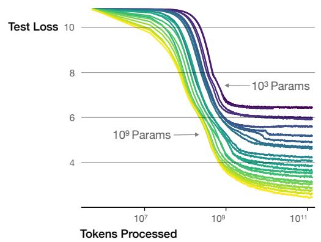  
最优模型大小随目标损失和计算预算平稳增长

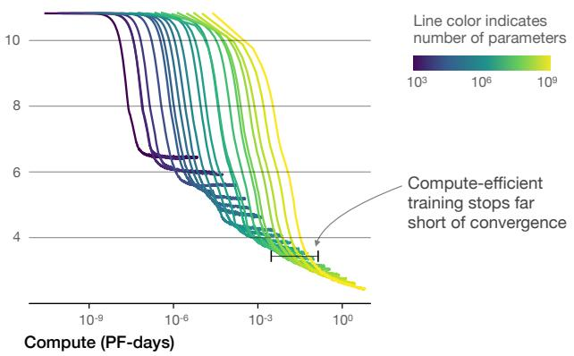  
Figure 2 我们展示了一系列语言模型训练运行，模型参数量从 $10^{3}$ 到 $10^{9}$ 不等（不包括嵌入层）。

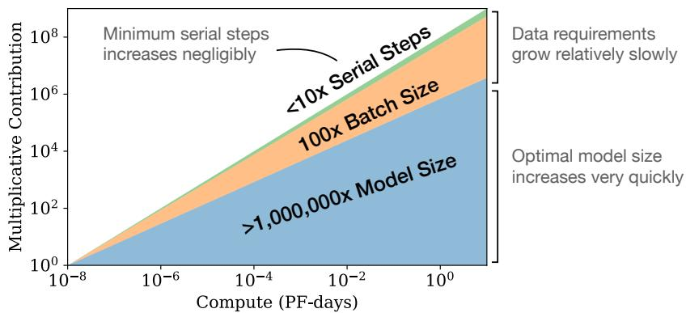  
Figure 3 随着可用计算量的增加，我们可以选择在训练更大模型、使用更大批次以及训练更多步数之间如何分配计算资源。我们以计算量增加十亿倍为例对此进行了说明。为了实现最优计算效率的训练，大部分计算量增长应该分配给增大模型规模。为了避免数据复用，仅需要相对较小的数据量增长。在增加的数据中，大部分可通过更大的批次大小来提高并行度，仅需要极少量的串行训练时间增加。

## 1.2 缩放定律总结

当性能仅受非嵌入参数量 N、数据集大小 D 或最优分配的计算预算 $C_{min}$ 之一限制时，经过自回归语言建模训练的 Transformer 的测试损失可以使用幂律进行预测（见 Figure 1）：

1. 对于参数量有限且在足够大的数据集上训练至收敛的模型：

$$
L (N) = \left(N _ {\mathrm{c}} / N\right) ^ {\alpha_ {N}}; \alpha_ {N} \sim 0. 0 7 6, N _ {\mathrm{c}} \sim 8. 8 \times 1 0 ^ {1 3} (\text {non - embedding parameters})\tag{1.1}
$$

2. 对于使用有限数据集并通过早停（early stopping）训练的大模型：

$$
L (D) = \left(D _ {\mathrm{c}} / D\right) ^ {\alpha_ {D}}; \alpha_ {D} \sim 0. 0 9 5, D _ {\mathrm{c}} \sim 5. 4 \times 1 0 ^ {1 3} (\text { tokens })\tag{1.2}
$$

3. 当在有限计算量、足够大的数据集、最优模型大小以及足够小的批大小（以实现对计算量的最优化 $^{3}$ 利用）的条件下进行训练时：

$$
L (C _ {\min}) = \left(C _ {c} ^ {\min} / C _ {\min}\right) ^ {\alpha_ {C} ^ {\min}}; \alpha_ {C} ^ {\min} \sim 0. 0 5 0, C _ {c} ^ {\min} \sim 3. 1 \times 1 0 ^ {8} (\text {PF - days})\tag{1.3}
$$

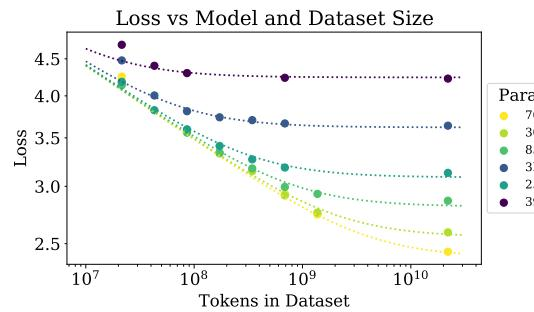

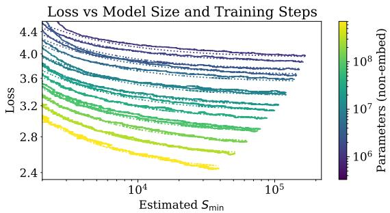  
Figure 4 左图：早停测试损失 $L(N, D)$ 根据公式 (1.5) 随数据集大小 $D$ 和模型大小 $N$ 呈现可预测的变化。右图：在经历初始过渡期后，所有模型大小 $N$ 的学习曲线均可用公式 (1.6) 进行拟合，该公式以大批次训练时的步数 $S_{\mathrm{min}}$ 进行参数化（详见 Section 5.1）。

这些关系在 $C_{min}$ 的八个数量级、N 的六个数量级以及 D 的两个以上数量级范围内均成立。它们对模型形状和其他 Transformer 超参数（深度、宽度、自注意力头数）的依赖性极弱，其具体数值与 Webtext2 训练集 $[RWC^{+}19]$ 相关。幂律指数 $\alpha_{N}, \alpha_{D}, \alpha_{C}^{min}$ 规定了当我们扩大 N、D 或 $C_{min}$ 时预期的性能提升程度；例如，将参数数量翻倍会使损失降低为原来的 $2^{-\alpha_{N}} = 0.95$ 倍。$N_{c}, C_{c}^{min}$ 和 $D_{c}$ 的精确数值取决于词表大小和分词（tokenization），因此并不具有根本性的物理意义。

决定数据并行速度与效率权衡（[MKAT18]）的临界批大小（critical batch size），在大致上也遵循关于 L 的幂律：

$$
B _ {\text { crit }} (L) = \frac {B _ {*}}{L ^ {1 / \alpha_ {B}}}, \quad B _ {*} \sim 2 \cdot 1 0 ^ {8} \text {   tokens }, \alpha_ {B} \sim 0. 2 1\tag{1.4}
$$

公式 (1.1) 和 (1.2) 共同表明，随着我们增加模型大小，我们应当根据 $D \propto N^{\frac{\alpha_{N}}{\alpha_{D}}} \sim N^{0.74}$ 次线性地增加数据集大小。事实上，我们发现存在一个结合了 (1.1) 和 (1.2) 的统一方程，它同时支配着对 N 和 D 的依赖关系，并决定了过拟合的程度：

$$
L (N, D) = \left[ \left(\frac {N _ {c}}{N}\right) ^ {\frac {\alpha_ {N}}{\alpha_ {D}}} + \frac {D _ {c}}{D} \right] ^ {\alpha_ {D}}\tag{1.5}
$$

其拟合效果如图 Figure 4 左图所示。我们推测，这种函数形式也可以用于对其他生成式建模任务中训练得到的对数似然进行参数化。

在无限数据极限下，针对有限的参数更新步数 $S$ 训练给定的模型时，在经历初始过渡期后，学习曲线可以通过以下公式精确拟合（见图 4 右侧）：

$$
L (N, S) = \left(\frac {N _ {c}}{N}\right) ^ {\alpha_ {N}} + \left(\frac {S _ {c}}{S _ {\mathrm{min}} (S)}\right) ^ {\alpha_ {S}}\tag{1.6}
$$

其中 $S_{c} \approx 2.1 \times 10^{3}$ 且 $\alpha_{S} \approx 0.76$ ，$S_{\min}(S)$ 是使用公式 (5.4) 估计的最小可能优化步数（参数更新次数）。

当在固定的计算预算 $C$ 内训练且无其他约束时，公式 (1.6) 导出的预测表明，最优模型大小 $N$、最优批次大小（batch size）$B$、最优步数 $S$ 以及数据集大小 $D$ 应当按以下方式增长：

$$
N \propto C ^ {\alpha_ {C} ^ {\mathrm{min}} / \alpha_ {N}}, B \propto C ^ {\alpha_ {C} ^ {\mathrm{min}} / \alpha_ {B}}, S \propto C ^ {\alpha_ {C} ^ {\mathrm{min}} / \alpha_ {S}}, D = B \cdot S\tag{1.7}
$$

其中

$$
\alpha_ {C} ^ {\mathrm{min}} = 1 / \left(1 / \alpha_ {S} + 1 / \alpha_ {B} + 1 / \alpha_ {N}\right)\tag{1.8}
$$

这与经验上的最优结果 $N \propto C_{\min}^{0.73}$ 、$B \propto C_{\min}^{0.24}$ 以及 $S \propto C_{\min}^{0.03}$ 紧密吻合。随着计算预算 $C$ 的增加，它应该主要用于更大的模型，而不需要大幅增加训练时间或数据集大小（见图 3）。这也意味着随着模型变大，它们的样本效率会越来越高。在实践中，由于硬件限制，研究人员通常训练较小模型的时间比达到最大计算效率所需的时间更长。最优性能作为幂律依赖于总计算量（见公式 (1.3)）。

我们为公式 (1.5) 提供了一些基本的理论动机、对学习曲线拟合的分析及其对训练时间的影响，以及按 token 细分的结果。我们还简要对比了 LSTM 和循环 Transformer $[DGV^{+}18]$ 。

## 1.3 符号说明

我们使用以下符号表示：

\- $L$ – 交叉熵损失，单位为 nats。通常它是在一个上下文中的所有 token 上取平均，但在某些情况下，我们也会报告上下文中特定 token 的损失。

\- $N$ – 模型参数量，不包括所有词表和位置嵌入（embeddings）

\- $C \approx 6NBS -$ 对非嵌入训练总计算量的估计，其中 $B$ 为批次大小，$S$ 为训练步数（即参数更新次数）。我们以 PF-days 为单位给出数值，其中 1 PF-day $= 10^{15} \times 24 \times 3600 = 8.64 \times 10^{19}$ 次浮点运算。

\- $D$ – 数据集大小，以 token 为单位

\- $B_{\mathrm{crit}}$ – 临界批次大小（critical batch size）[MKAT18]，在第 5.1 节中定义和讨论。在临界批次大小下进行训练可以在时间和计算效率之间取得大致最优的权衡。

- $C_{\mathrm{min}}$ - 达到给定损失值所需的非嵌入计算量的最小估计值。这是在批次大小（batch size）远小于临界批次大小（critical batch size）下训练模型时所消耗的训练计算量。

- $S_{\mathrm{min}}$ - 达到给定损失值所需的最小训练步数的估计值。这也是在批次大小远大于临界批次大小下训练模型时所采用的训练步数。

- $\alpha_{X}$ - 损失按 $L(X)\propto 1 / X^{\alpha_X}$ 缩放时的幂律指数，其中 $X$ 可以是 $N,D,C,S,B,C^{\mathrm{min}}$ 中的任意一个。

## 2 背景与方法

我们在 WebText2（WebText $[RWC^{+}19]$ 数据集的扩展版本）上训练语言模型，该数据集使用字节对编码（byte-pair encoding，BPE）[SHB15] 进行分词，词表大小为 $n_{vocab} = 50257$。我们优化在 1024 个 token 的上下文上平均的自回归对数似然（即交叉熵损失），这同时也是我们的主要性能指标。我们记录了模型在 WebText2 测试分布以及一系列精选的其他文本分布上的损失。我们主要训练纯解码器（decoder-only）$[LSP^{+}18, RNSS18]$ 的 Transformer $[VSP^{+}17]$ 模型，不过为了进行对比，我们也训练了 LSTM 模型和 Universal Transformers $[DGV^{+}18]$。

## 2.1 Transformer 的参数与计算量缩放

我们使用超参数 $n_{layer}$（层数）、$d_{model}$（残差流维度）、$d_{ff}$（中间前馈层维度）、$d_{attn}$（注意力输出维度）以及 $n_{heads}$（每层的注意力头数）对 Transformer 架构进行参数化。我们在输入上下文中包含 $n_{ctx}$ 个 token，除另有说明外，$n_{ctx} = 1024$。

我们用 $N$ 来表示模型大小，将其定义为非嵌入参数的数量

$$
\begin{array}{r l} & N \approx 2 d _ {\mathrm{model}} n _ {\mathrm{layer}} (2 d _ {\mathrm{attn}} + d _ {\mathrm{ff}}) \\ & \quad = 1 2 n _ {\mathrm{layer}} d _ {\mathrm{model}} ^ {2} \quad \text {with the standard} \quad d _ {\mathrm{attn}} = d _ {\mathrm{ff}} / 4 = d _ {\mathrm{model}} \end{array}\tag{2.1}
$$

其中我们排除了偏置项和其他次要项。我们的模型在嵌入矩阵中还包含 $n_{vocab}d_{model}$ 个参数，并使用 $n_{ctx}d_{model}$ 个参数用于位置嵌入，但我们在讨论“模型大小” $N$ 时不包含这些参数；我们将会看到，这样做可以得到明显更为清晰规整的缩放法则。

评估 Transformer 的单次前向传播大约涉及

$$
C _ {\mathrm{forward}} \approx 2 N + 2 n _ {\mathrm{layer}} n _ {\mathrm{ctx}} d _ {\mathrm{model}}\tag{2.2}
$$

次加-乘操作（add-multiply operations），其中的系数 2 来自矩阵乘法中使用的乘累加操作。Table 1 中给出了各项操作更详细的参数量和计算量统计。

<table><tr><td>操作</td><td>参数量</td><td>每 Token 的 FLOPs</td></tr><tr><td>嵌入</td><td> $(n_{\text{vocab}} + n_{\text{ctx}}) d_{\text{model}}$ </td><td> $4d_{\text{model}}$ </td></tr><tr><td>注意力：QKV</td><td> $n_{\text{layer}} d_{\text{model}} 3d_{\text{attn}}$ </td><td> $2n_{\text{layer}} d_{\text{model}} 3d_{\text{attn}}$ </td></tr><tr><td>注意力：掩码</td><td>—</td><td> $2n_{\text{layer}} n_{\text{ctx}} d_{\text{attn}}$ </td></tr><tr><td>注意力：投影</td><td> $n_{\text{layer}} d_{\text{attn}} d_{\text{model}}$ </td><td> $2n_{\text{layer}} d_{\text{attn}} d_{\text{embd}}$ </td></tr><tr><td>前馈网络</td><td> $n_{\text{layer}} 2d_{\text{model}} d_{\text{ff}}$ </td><td> $2n_{\text{layer}} 2d_{\text{model}} d_{\text{ff}}$ </td></tr><tr><td>解嵌入</td><td>—</td><td> $2d_{\text{model}} n_{\text{vocab}}$ </td></tr><tr><td>总计（非嵌入）</td><td> $N = 2d_{\text{model}} n_{\text{layer}} (2d_{\text{attn}} + d_{\text{ff}})$ </td><td> $C_{\text{forward}} = 2N + 2n_{\text{layer}} n_{\text{ctx}} d_{\text{attn}}$ </td></tr></table>

Table 1 Transformer 模型的参数量和计算量（前向传播）估计。忽略了非线性变换、偏置和层归一化等次要项。

对于满足 $d_{model} > n_{ctx}/12$ 的上下文和模型，每个 token 与上下文相关的计算开销在总计算量中占比较小。由于我们主要研究满足 $d_{model} \gg n_{ctx}/12$ 的模型，因此在估计训练计算量时没有包含与上下文相关的项。考虑到反向传播（计算量约为前向传播的两倍），我们将估计的非嵌入计算量定义为每个训练 token 大约 $C \approx 6N$ 次浮点运算。

## 2.2 训练流程

除非另有说明，我们使用 Adam 优化器 [KB14] 训练模型，固定步数为 $2.5 \times 10^{5}$ 步，批大小为 512 条序列（每条序列包含 1024 个 token）。由于显存限制，我们最大的模型（参数量超过 1B）使用 Adafactor [SS18] 进行训练。我们尝试了多种学习率和调度策略，详见附录 D.6。我们发现收敛时的结果在很大程度上与学习率调度策略无关。除非另有说明，我们数据中包含的所有训练运行均采用经过 3000 步线性预热后余弦衰减至零的学习率调度策略。

## 2.3 数据集

我们在 $[RWC^{+}19]$ 中描述的 WebText 数据集的扩展版本上训练我们的模型。原始的 WebText 数据集是对截至 2017 年 12 月在 Reddit 上获得至少 3 个 karma 的出站链接的网络抓取。在第二个版本 WebText2 中，我们添加了 2018 年 1 月至 10 月期间的 Reddit 出站链接，同样要求至少获得 3 个 karma。karma 阈值作为衡量人们是否觉得该链接有趣或有用的启发式标准。新链接的文本使用 Newspaper3k Python 库提取。该数据集总计包含 2030 万篇（20.3M）文档，涵盖 96 GB 文本和 $1.62 \times 10^{10}$ 个单词（word，由 wc 定义）。随后我们应用 $[RWC^{+}19]$ 中描述的可逆分词器（reversible tokenizer），生成了 $2.29 \times 10^{10}$ 个 token。我们保留了其中 $6.6 \times 10^{8}$ 个 token 作为测试集，并且我们还在类似处理的 Books Corpus $[ZKZ^{+}15]$、Common Crawl [Fou]、英文维基百科（English Wikipedia）以及公开可获取的互联网图书（Internet Books）集合的样本上进行了测试。

## 3 实证结果与基本幂律

为了表征语言模型的缩放（scaling）特性，我们训练了多种模型，改变了包括以下因素在内的诸多变量：

\- 模型大小（非嵌入参数量从 768 到 15 亿不等）

\- 数据集大小（从 2200 万到 230 亿个 token 不等）

\- 架构形状（包括深度、宽度、注意力头数以及前馈维度）

\- 上下文长度（大多数运行中为 1024，不过我们也尝试了更短的上下文）

\- 批大小（大部分运行中为 $2^{19}$，但我们也对其进行了调整以测量临界批大小）

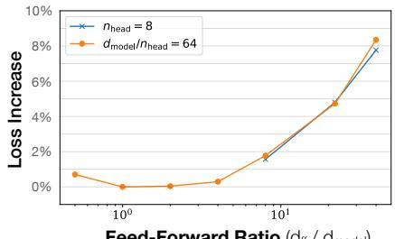  
前馈比率 ( $d_{ff} / d_{model}$ )  
50M 参数

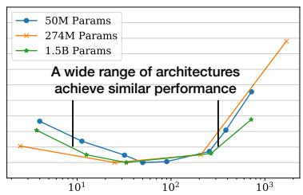  
宽高比 ( $d_{model} / n_{layer}$ )

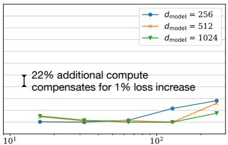  
注意力头维度 ( $d_{model} / n_{head}$ )  
25M 参数

Figure 5 当非嵌入参数总量 N 保持固定时，性能对模型形状的依赖性非常微弱。在广泛的形状范围内，损失仅变化几个百分点。参数量的细微差异通过使用对 $L(N)$ 的拟合作为基线来进行补偿。特别是宽高比可以相差 40 倍，而对性能的影响却微乎其微；$(n_{\mathrm{layer}}, d_{\mathrm{model}}) = (6, 4288)$ 的模型所达到的损失与 $[RWC^{+}19]$ 中使用的 (48, 1600) 模型相比差异在 3% 以内。  
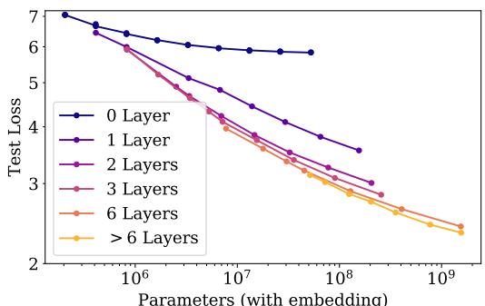  
参数量（含嵌入层）

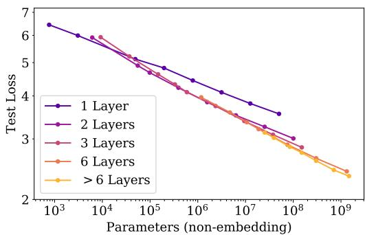  
Figure 6 左图：当包含嵌入参数时，性能似乎除了依赖参数量之外，还强烈依赖于层数。右图：当排除嵌入参数时，不同深度模型的性能会收敛到单一趋势。只有少于 2 层的模型或具有极端深宽比的模型才会显著偏离该趋势。

在本节中，我们将展示数据以及基于经验的拟合结果，理论分析将推迟到后续章节。

## 3.1 Transformer 形状和超参数的近似独立性

当我们将非嵌入参数总量 N 保持固定时，Transformer 的性能对形状参数 $n_{layer}$、$n_{heads}$ 和 $d_{ff}$ 的依赖性非常弱。为了得出这些结果，我们在改变单个超参数的同时训练了固定大小的模型。对于 $n_{heads}$ 的情况最为简单。在改变 $n_{layer}$ 时，我们同时改变 $d_{model}$，同时保持 $N \approx 12n_{layer}d_{model}^{2}$ 固定。类似地，要在固定模型大小下改变 $d_{ff}$，根据表 1 中的参数量计算，我们也同时改变了 $d_{model}$ 参数。如果更深的 Transformer 在实际表现上类似于更浅模型的集成（正如针对 ResNets 所提出的观点 [VWB16]），那么就会呈现出对 $n_{layers}$ 的独立性。结果如图 5 所示。

## 3.2 随非嵌入参数量 N 变化的性能

在图 6 中，我们展示了各种各样模型的性能，范围从形状为 $(n_{\text{layer}}, d_{\text{model}}) = (2, 128)$ 的小型模型，到形状范围从 $(6, 4288)$ 到 $(207, 768)$ 的十亿级参数模型。在此，我们在完整的 WebText2 数据集上训练至接近收敛，并且没有观察到过拟合现象（可能极大型模型除外）。

如图 1 所示，我们发现随着非嵌入参数量 $N$ 的增加呈现出稳定的趋势，该趋势可以拟合为公式 (1.5) 的第一项，即：

$$
L (N) \approx \left(\frac {N _ {c}}{N}\right) ^ {\alpha_ {N}}\tag{3.1}
$$

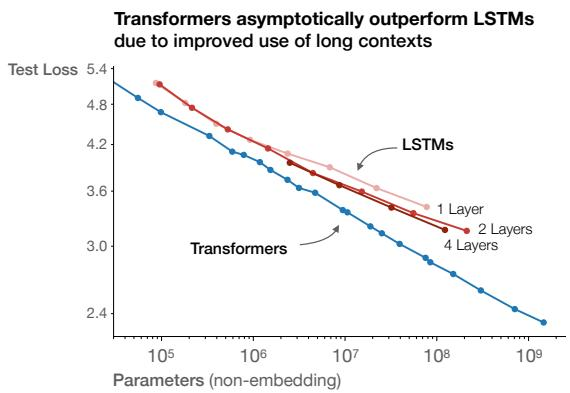

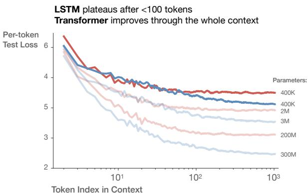  
Figure 7

为了观察到这些趋势，将性能作为 N 的函数进行研究至关重要；如果我们改用总参数量（包括嵌入参数），这一趋势就会在一定程度上被掩盖（见图 6）。这表明嵌入矩阵可以在不影响性能的情况下变小，正如近期研究 $[LCG^{+}19]$ 中所见。

尽管这些模型是在 WebText2 数据集上训练的，但它们在其他各种数据集上的测试损失也是 N 的幂律函数，且具有几乎相同的幂指数，如图 8 所示。

## 3.2.1 与 LSTM 和 Universal Transformer 的比较

在 Figure 7 中，我们比较了作为非嵌入参数量 N 的函数的 LSTM 和 Transformer 性能。LSTM 使用相同的数据集和上下文长度进行训练。从这些图中我们可以看出，对于出现在上下文较早位置的 token，LSTM 的表现与 Transformer 一样好，但对于较后位置的 token，则无法匹敌 Transformer 的性能。我们在附录 D.5 中给出了性能与上下文位置之间的幂律关系，其中较大模型对应越来越大的幂次，表明其快速识别模式的能力有所提升。

我们还在附录的 Figure 17 中比较了标准 Transformer 与循环 Transformer（recurrent Transformer）$[DGV^{+}18]$ 的性能。这些模型复用了参数，因此作为 N 的函数表现略好，但代价是增加了每个参数的计算量。

## 3.2.2 数据分布间的泛化能力

我们还在一组额外的文本数据分布上测试了我们的模型。这些数据集上的测试损失作为模型大小的函数如 Figure 8 所示；在所有情况下，模型都仅在 WebText2 数据集上进行训练。我们看到，在这些其他数据分布上的损失随着模型大小平滑改善，这与在 WebText2 上的改善完全平行。我们发现，泛化能力几乎完全取决于分布内验证损失，而不取决于训练时长或是否接近收敛。我们还观察到泛化能力与模型深度无关（见附录 D.8）。

## 3.3 性能随数据集大小和计算量的变化

我们在 Figure 1 中展示了测试损失作为数据集大小 D（以 token 计）和训练计算量 C 的函数的经验趋势。

对于随 D 变化的趋势，我们在 WebText2 数据集的固定子集上训练了一个 $(n_{\text{layer}}, n_{\text{embd}}) = (36, 1280)$ 的模型。一旦测试损失不再下降，我们就停止训练。我们看到，所得的测试损失可以用关于数据集大小的简单幂律

$$
L (D) \approx \left(\frac {D _ {c}}{D}\right) ^ {\alpha_ {D}}\tag{3.2}
$$

进行拟合。数据和拟合曲线显示在 Figure 1 中。

训练期间使用的非嵌入计算总量可以估算为 C = 6NBS，其中 B 为批次大小（batch size），S 为参数更新次数，系数 6 对应前向传播和反向传播。因此，对于给定的 C 值，我们可以遍历具有各种 N 的所有模型，以找到在步数 $S = \frac{C}{6BS}$ 下性能最好的模型。请注意，在这些结果中，批次大小 B 对所有模型保持固定，这意味着这些经验结果并非真正最优。我们将在后面的章节中使用调整后的 $C_{min}$ 来对此进行修正，以产生更清晰的趋势。

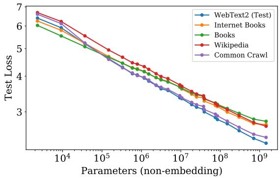

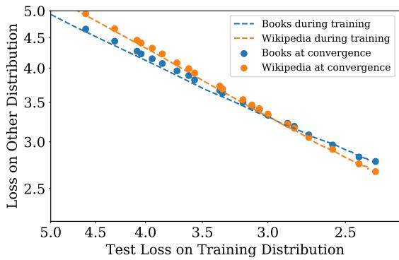  
Figure 8 左图：对其他数据分布的泛化性能随着模型规模平滑提升，且与 WebText2 训练分布之间仅存在很小且增长极其缓慢的偏移。右图：泛化性能仅取决于在训练分布上的性能，而与训练阶段无关。我们将收敛模型的泛化性能（散点）与单个大模型在训练过程中的泛化性能（虚线）进行了对比。

该结果在图 1 的左图中显示为粗黑线。它可以拟合为

$$
L (C) \approx \left(\frac {C _ {c}}{C}\right) ^ {\alpha_ {C}}\tag{3.3}
$$

图中还包含了各个学习曲线的图像，以阐明各个模型何时达到最优。稍后我们将更深入地研究计算量的最优分配。数据强烈表明样本效率随着模型规模的增大而提高，我们也在附录的图 19 中直接说明了这一点。

## 4 探究无限数据极限与过拟合

在第 3 节中，我们发现了语言建模性能的一些基本缩放定律。在这里，我们将同时改变大小为 $N$ 的模型和包含 $D$ 个 token 的数据集，研究模型的性能。我们将通过实验证明，最优训练的测试损失符合公式 (1.5) 的缩放定律。这为我们在控制过拟合的同时需要多少数据来训练更大规模的模型提供了指导。

## 4.1 提出的 $L(N,D)$ 方程

我们基于三个原则选择了参数化形式 (1.5)（为方便起见在此重述）：

$$
L (N, D) = \left[ \left(\frac {N _ {c}}{N}\right) ^ {\frac {\alpha_ {N}}{\alpha_ {D}}} + \frac {D _ {c}}{D} \right] ^ {\alpha_ {D}}\tag{4.1}
$$

原则如下：

1. 词表大小或分词方式（tokenization）的改变预计会使损失按一个整体因子进行缩放。$L(N, D)$ 的参数化（以及损失的所有模型）必须自然地允许这种缩放。

2. 固定 $D$ 并令 $N \to \infty$ 时，总损失应趋近于 $L(D)$。反之，固定 $N$ 并令 $D \to \infty$ 时，损失必须趋近于 $L(N)$。

3. $L(N, D)$ 在 $D = \infty$ 处应该是解析的，以便它可以展开为含有整数幂次的 $1 / D$ 级数。支持这一原则的理论依据明显弱于前两条。

我们对 $L(N, D)$ 的选择满足了第一个要求，因为我们可以随着词表的变化对 $N_{c}, D_{c}$ 进行重新缩放。这也意味着 $N_{c}, D_{c}$ 的数值并没有根本性的意义。

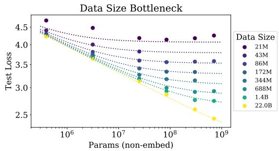

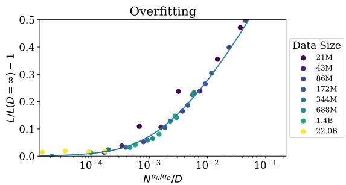  
Figure 9 根据公式 (1.5)，早停（early-stopped）测试损失 $L(N, D)$ 可预测地取决于数据集大小 D 和模型大小 N。左图：对于较大的 D，性能关于 N 呈直线幂律关系。对于较小的固定 D，随着 N 的增加，性能停止改善，模型开始过拟合。（反之亦然，见 Figure 4。）右图：过拟合的程度主要取决于比率 $N^{\frac{\alpha_{N}}{\alpha_{D}}} / D$，正如公式 (4.3) 中所预测的那样。该直线是我们对该公式的拟合。  
由于我们在测试损失不再改善时提前停止训练，并以相同的方式优化所有模型，因此我们预期较大的模型应该总是比较小的模型表现更好。但在固定的有限 D 下，我们也不期望任何模型能够接近最佳可能损失（即文本的熵）。类似地，固定大小的模型也会受到容量限制。这些考量构成了我们第二个原则的基础。请注意，在无限 D 下的 $L(N)$ 和在无限 N 下的 $L(D)$ 的先验知识完全决定了 $L(N, D)$ 中的所有参数。  
第三个原则更具推测性。有一个简单且普遍的原因使得人们预期在非常大的 D 下过拟合按 $\propto 1/D$ 缩放。过拟合应与数据集的方差或信噪比相关 [AS17]，并且这按 1/D 缩放。这种预期应适用于任何平滑损失函数，因为我们预期能够围绕 $D \to \infty$ 极限展开损失函数。然而，该论点假设 1/D 修正主导了其他方差来源，例如有限的批次大小以及对优化效率的其他限制。在没有实证确认的情况下，我们对其适用性不会非常有信心。  
我们的第三个原则解释了公式 (1.5) 中 N 和 D 作用之间的不对称性。非常相似的对称表达式 $^{4}$ 是可能的，但它们不具备带有整数幂的 1/D 展开式，并且需要引入一个额外的参数。  
无论如何，我们将看到我们的 $L(N, D)$ 公式能够很好地拟合数据，这是对我们 $L(N, D)$ 拟设（ansatz）的最重要证明。

## 4.2 结果

我们使用 $10\%$ 的 dropout 对所有模型进行正则化，并通过跟踪测试损失并在其不再下降时停止训练。结果展示在 Figure 9 中，包括对公式 (1.5) 中四个参数 $\alpha_{N}, \alpha_{D}, N_{c}, D_{c}$ 的拟合：

<table><tr><td>参数</td><td> $\alpha_{N}$ </td><td> $\alpha_{D}$ </td><td> $N_{c}$ </td><td> $D_{c}$ </td></tr><tr><td>数值</td><td>0.076</td><td>0.103</td><td> $6.4 \times 10^{13}$ </td><td> $1.8 \times 10^{13}$ </td></tr></table>

Table 2 $L(N, D)$ 的拟合结果

我们获得了极佳的拟合效果，除了数据集缩减为原来的 1/1024（约为 $2 \times 10^{7}$ 个 token）的那些实验运行。在如此小的数据集下，一个 epoch 仅包含 40 次参数更新。也许如此微小的数据集代表了语言建模的一种不同机制（regime），因为过拟合在训练早期就会发生（见 Figure 16）。还需注意的是，这里的参数与第 3 节中得到的参数有非常微小的差异，因为这里我们拟合的是完整的 $L(N, D)$，而不仅仅是 $L(N, \infty)$ 或 $L(\infty, D)$。

为了描绘无限数据极限的边界区域，我们可以直接研究过拟合的程度。除了最大的模型之外，当使用完整的 22B token WebText2 数据集进行训练时，我们没有观察到过拟合的迹象，因此我们可以将其视为 $D = \infty$ 的代表。因此，我们可以通过

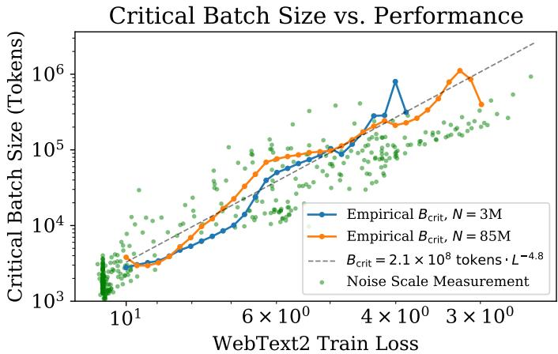  
Figure 10 临界批次大小 $B_{crit}$ 随着性能提升在损失上遵循幂律分布，且并不直接依赖于模型大小。我们发现，损失每下降 13%，临界批次大小大约翻倍。$B_{crit}$ 是根据 Figure 18 中所示的数据实证测得的，但它也可以通过梯度噪声尺度粗略预测，如 [MKAT18] 所示。

定义

$$
\delta L (N, D) \equiv \frac {L (N , D)}{L (N , \infty)} - 1\tag{4.2}
$$

并将其作为 N、D 的函数来进行研究，从而将有限的 D 与无限数据极限进行比较。事实上，正如 Figure 16 所示，我们在实证中发现 $\delta L$ 仅取决于 N 和 D 的特定组合。这是由公式 (1.5) 的缩放定律所决定的，该定律表明

$$
\delta L \approx \left(1 + \left(\frac {N}{N _ {c}}\right) ^ {\frac {\alpha_ {N}}{\alpha_ {D}}} \frac {D _ {c}}{D}\right) ^ {\alpha_ {D}} - 1\tag{4.3}
$$

注意在 D 较大时，该公式也可以展开为 1/D 的幂级数。

我们估计不同随机种子下的损失变化大约为 0.02，这意味着在训练收敛至该阈值范围内时，为了避免过拟合，我们需要

$$
D \gtrsim (5 \times 1 0 ^ {3}) N ^ {0. 7 4}\tag{4.4}
$$

根据这一关系，参数量小于 $10^{9}$ 的模型在 22B token 的 WebText2 数据集上训练时过拟合极小，但我们最大的模型会遇到轻微的过拟合。更普遍地说，这一关系表明，在避免过拟合的前提下，数据集大小可以随模型大小呈次线性增长。然而需要注意的是，这通常并不代表计算效率最高的训练方式。我们还应该强调，在改变数据集和模型大小的同时，我们并没有对正则化（例如 dropout 概率）进行优化。

## 5 模型大小与训练时间的缩放定律

在本节中，我们将证明一个简单的标度律能够很好地描述损失作为模型大小 N 和训练时间的函数。首先，我们将解释如何利用 [MKAT18] 的结果来定义一个通用训练步数 $S_{min}$，这考虑了我们的大多数模型并未在最优批次大小（batch size）下训练这一事实。然后，我们将证明可以使用公式 (1.6) 来拟合损失对模型大小和训练时间的依赖关系。随后，我们将使用这些结果来预测训练计算量在模型大小与训练时间之间的最优分配，并对该预测进行验证。

## 5.1 针对在 $B_{\mathrm{crit}}(L)$ 下训练的调整

[MKAT18] 中提出了关于训练对批次大小依赖关系的简单经验理论（另见 $[SLA^{+}18, ZLN^{+}19]$）。该理论认为训练存在一个临界批次大小 $B_{crit}$；当 B 高于或等于 $B_{crit}$ 时，增加批次大小对计算效率的损耗极小，而当 $B > B_{crit}$ 时，增加 B 会导致收益递减。该理论还指出，梯度噪声尺度为 $B_{crit}$ 提供了一个简单的预测，并且除了通过已达到的损失值产生关联之外，两者均不直接依赖于模型大小。这些结果可用于预测训练时间和计算量将如何随批次大小而变化。为了尽可能高效地利用训练时间和计算量，最好在批次大小 $B \approx B_{crit}$ 下进行训练。在 $B \gg B_{crit}$ 下训练可以最小化训练步数，而在 $B \ll B_{crit}$ 下训练则可以最小化计算量的消耗。

更具体地，研究表明，对于各种各样的神经网络任务，当训练至损失 L 的任意固定值时，训练步数 S 与处理的数据样本数 E = BS 满足如下简单关系：

$$
\left(\frac {S}{S _ {\min}} - 1\right) \left(\frac {E}{E _ {\min}} - 1\right) = 1\tag{5.1}
$$

此处 $S_{min}$ 是达到 L 所需的最小步数，而 $E_{min}$ 则是必须处理的最小数据样本数。

我们在附录的 Figure 18 中展示了 Transformer 的关系式 (5.1)。该关系定义了临界批次大小

$$
B _ {\mathrm{crit}} (L) \equiv \frac {E _ {\mathrm{min}}}{S _ {\mathrm{min}}}\tag{5.2}
$$

它是目标损失值的函数。在临界批次大小下训练可以在时间与计算量之间实现大致最优的权衡，需要 $2S_{min}$ 个训练步数并处理 $E = 2E_{min}$ 个数据样本。

在 Figure 10 中，我们绘制了两种不同模型的临界批次大小和梯度噪声尺度 $^{5}$ 随训练损失变化的曲线。我们可以看到 $B_{\mathrm{crit}}(L)$ 与模型大小无关，仅取决于损失 L。因此，[MKAT18] 的预测对于 Transformer 语言模型依然成立。临界批次大小可以通过关于损失的幂律进行拟合

$$
B _ {\mathrm{crit}} (L) \approx \frac {B _ {*}}{L ^ {1 / \alpha_ {B}}}\tag{5.3}
$$

其中 $B_{*} \approx 2 \times 10^{8}$ 且 $\alpha_{B} \approx 0.21$。

我们为 $B_{\mathrm{crit}}(L)$ 选择这种参数化形式，是因为当损失接近其最小值 $L_{min}$ 时，梯度噪声尺度预计会发散，并且我们期望 $B_{crit}$ 能跟随这一噪声尺度。我们不知道 $L_{min}$ 的具体数值，因为我们没有看到模型接近它的迹象，但由于自然语言的熵非零，所以 $L_{min} > 0$。鉴于显然 $L_{min}$ 远小于我们已达到的 L 值，我们采用了一种当 $L \to 0$ 时 $B_{crit}$ 发散的参数化形式。

我们将使用 $B_{\mathrm{crit}}(L)$ 来估计在批量大小 $B = 2^{19}$ 个 token 下训练时的训练步数 S 与在 $B \gg B_{crit}$ 下训练时的训练步数之间的关系。对于任何给定的目标损失值 L，这可以简单表示为

$$
S _ {\min} (S) \equiv \frac {S}{1 + B _ {\mathrm{crit}} (L) / B} \quad (\text { minimum   steps,   at } B \gg B _ {\mathrm{crit}})\tag{5.4}
$$

如果我们在 $B \ll B_{\mathrm{crit}}(L)$ 下训练，这同时也定义了使用大小为 N 的模型训练至 L 所需计算量的临界值。即

$$
C _ {\min} (C) \equiv \frac {C}{1 + B / B _ {\mathrm{crit}} (L)} \quad (\text { minimum   compute,   at } B \ll B _ {\mathrm{crit}})\tag{5.5}
$$

其中 C = 6NBS 用于估计在批量大小 B 下所消耗的（非嵌入）计算量。

## 5.2 $L(N, S_{\min})$ 的结果以及模型大小与计算量的性能表现

现在，我们将使用公式 (5.4) 中定义的 $S_{min}$，在无限数据极限下获得损失对模型大小和训练时间依赖性的简单且通用的拟合。我们将使用公式 (1.6) 拟合稳定且由 Adam 优化的训练运行，为方便起见在此重述公式：

$$
L (N, S _ {\min}) = \left(\frac {N _ {c}}{N}\right) ^ {\alpha_ {N}} + \left(\frac {S _ {c}}{S _ {\min}}\right) ^ {\alpha_ {S}}\tag{5.6}
$$

表示损失。我们包含了学习率调度预热期之后的所有训练步数，并找到了与数据拟合的参数：

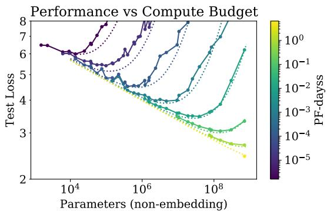

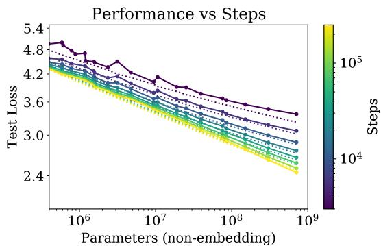  
Figure 11 当我们保持总计算量或训练步数固定时，性能遵循公式 (5.6) 中的 $L(N, S)$。每个计算预算值都有一个与之相关的最优模型大小，以使性能最大化。在较小的 S 下拟合效果一般并不令人意外，因为学习曲线的幂律方程在训练的极早期就会失效。

<table><tr><td>Parameter</td><td> $\alpha_{N}$ </td><td> $\alpha_{S}$ </td><td> $N_{c}$ </td><td> $S_{c}$ </td></tr><tr><td>Value</td><td>0.077</td><td>0.76</td><td> $6.5 \times 10^{13}$ </td><td> $2.1 \times 10^{3}$ </td></tr></table>

Table 3 对 $L(N, S)$ 的拟合参数

使用这些参数，我们得到了 Figure 4 中的学习曲线拟合。尽管拟合并不完美，但考虑到公式 (5.6) 的简洁性，我们认为结果是相当令人信服的。

数据和拟合结果可以以一种不同且更有趣的方式进行可视化，如 Figure 11 所示。在那里，我们在固定训练中使用的总非嵌入计算量 $C$ 或步数 $S$ 的情况下，研究测试损失作为模型大小的函数。对于拟合，我们使用了公式 (5.5) 和 (5.4)，以及上述参数和公式 (5.6)。

损失对 $S_{min}$ 的幂律依赖性反映了优化器动力学与损失地形（loss landscape）之间的相互作用。由于拟合在训练后期效果最好（此时损失可能近似为二次型），因此该幂律应该能够提供有关损失的 Hessian 矩阵谱的信息。其普适性表明，Hessian 特征值密度大致与模型大小无关。

## 5.3 早停步数的下界

$L(N, S_{\min})$ 的结果可用于推导在数据受限情况下训练时应当发生早停（early stopping）步数的下界（以及粗略估计）。其出发点在于：对于给定模型，有限 $D$ 和无限 $D$ 的学习曲线在达到 $S_{min} \approx S_{stop}$ 之前会非常相似。因此，过拟合应该与直接在 $S_{stop}$ 处结束训练的修正成比例。这会低估 $S_{stop}$，因为在现实中，当 $D$ 有限时测试损失下降得更慢，因此我们需要更多的训练步数才能在有限 $D$ 下达到最优测试损失。这一推理逻辑导出了以下不等式：

$$
S _ {\mathrm{stop}} (N, D) \gtrsim \frac {S _ {c}}{[ L (N , D) - L (N , \infty) ] ^ {1 / \alpha_ {S}}}\tag{5.7}
$$

其中 $L(N,\infty)$ 是在无限可用数据下评估的收敛损失。该不等式及其与经验数据的对比展示在附录的 Figure 16 中。在该图中，$S_{stop}$ 和 $L(N,D)$ 的值是经验值（尽管 $S_{stop}$ 经过调整以模拟在 $B \gg B_{crit}$ 下的训练），而 $L(N,\infty)$ 是根据在 $D=\infty$ 处评估的 $L(N,D)$ 拟合计算得出的。

## 6 计算预算的最优分配

我们在 Figure 1 的右上角展示了性能作为训练期间所用计算量函数的经验趋势。然而，该结果是在固定批次大小 $B$ 下训练得到的，而我们知道，实际上通过在第 5.1 节讨论的临界批次大小 $B_{crit}$ 下进行训练，我们可以更高效地训练$^{6}$。较大和较小的损失值原本可以分别用更少的样本或更少的步数来实现，通过标准化到临界批次大小来纠正这种低效性，可以得到更清晰、更具可预测性的趋势。

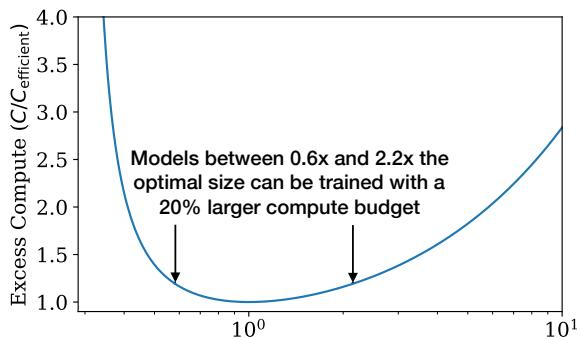  
与最优模型的偏差 ( $N/N_{efficient}$ )

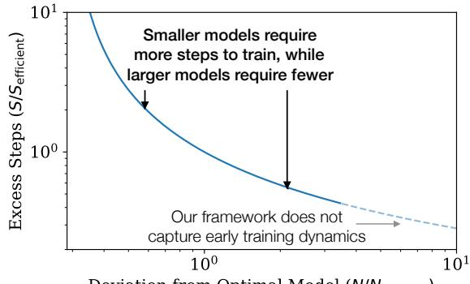  
偏离最优模型 ( $N/N_{efficient}$ )

Figure 12 左：在固定的计算预算下，存在一个特定的最优模型大小，尽管稍大或稍小的模型只需极少的额外计算量即可完成训练。右：大于计算高效尺寸的模型所需的训练步数更少，如果可以实现足够的额外并行性，可能会实现更快的训练速度。请注意，对于非常大的模型，不应盲信该公式，因为它仅在初始瞬态效应之后的学习曲线幂律区域内有效。  
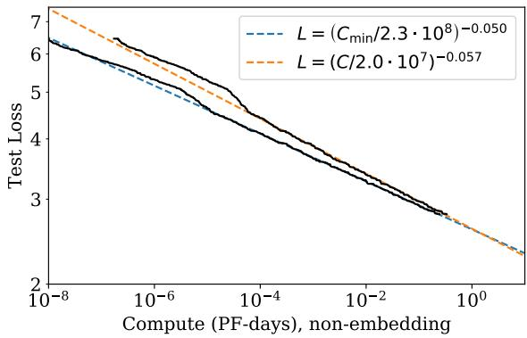  
Figure 13 当调整性能以模拟在远低于临界批次大小的条件下进行训练时，与完全实证的结果相比，我们发现 $L(C_{\mathrm{min}})$ 的幂律有所改变。在 $10^{-5}$ PF-days 处的明显隆起标志着从 1 层网络到 2 层网络的转变；我们在幂律拟合中排除了 1 层网络。我们预期正是这一 $L(C_{\mathrm{min}})$ 趋势能够为更大的计算量提供可靠的外推。

在本节中，我们将修正这一疏忽。更重要的是，我们将利用第 5 节的结果来确定在模型大小 N 与训练期间处理的数据量（即 $2B_{crit}S_{min}$ ）之间计算预算的最优分配。我们将通过实证以及利用 $L(N, S_{\min})$ 的公式在理论上确定这种分配，并且我们将证明这两种方法是一致的。

## 6.1 最优性能与分配

我们首先研究损失作为公式 (5.5) 中最优分配计算量的函数。结果绘制在 Figure 13 中，并附有幂律拟合。我们发现，与 Figure 1 的计算量图相比，采用 $C_{min}$ 的新拟合略有改善。

给定 $L(C_{\min})$ ，很自然会探究在给定训练计算量下能够获得最小损失的最优模型大小 $N(C_{\min})$ 。最优模型大小如 Figure 14 所示。我们观察到 $N(C_{\min})$

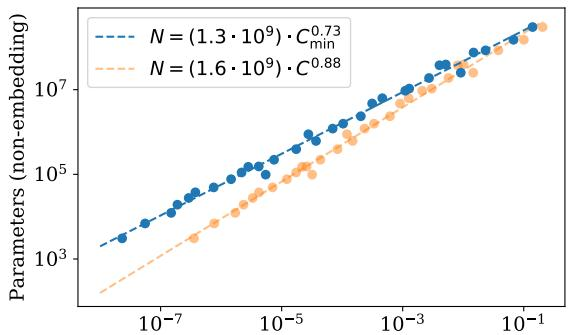  
计算量（PF-days），不含嵌入

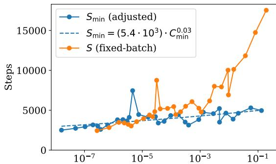  
计算量（PF-days），排除嵌入  
Figure 14 左：每个计算预算 $C_{min}$ 的值都有一个对应的最优模型大小 N。最优模型大小随 $C_{min}$ 的增长非常迅速，计算量每增加 10 倍，模型大小增加 5 倍。处理的数据样本数量构成了其余的增长，增长相对温和，仅为 2 倍。
右：批次调整后的优化步数增长也极慢（即便有所增长），这意味着处理数据样本数量的大部分增长都可以用于增大批次大小。

可以非常好地用幂律拟合

$$
N (C _ {\mathrm{min}}) \propto (C _ {\mathrm{min}}) ^ {0. 7 3}.\tag{6.1}
$$

在 Figure 12 中，我们展示了训练次优大小模型的效果（见附录 B.4）。

根据定义 $C_{\min} \equiv 6NB_{\operatorname{crit}}S$ ，因此我们可以利用 $N(C_{\min})$ 来推导进一步的结果。特别是，由于先前的拟合表明 $B \propto L^{-4.8}$ 且 $L \propto C_{\min}^{-0.05}$ ，我们可以得出 $B_{crit} \propto C_{\min}^{0.24}$ 。这使我们得出结论：最优步数随计算量的增长非常缓慢，即

$$
S _ {\mathrm{min}} \propto (C _ {\mathrm{min}}) ^ {0. 0 3},\tag{6.2}
$$

这与 Figure 14 中的实证结果相吻合。事实上，测得的指数足够小，以至于我们的结果甚至可能与指数为零的情况一致。

因此我们得出结论：当我们在最优计算分配下扩大语言模型规模时，应主要增加模型大小 N，同时通过 $B \propto B_{crit}$ 扩大批量大小，而串行步数的增加可以忽略不计。由于计算高效的训练使用的优化步数相对较少，进一步研究加速早期训练动力学的工作可能是合理的。

## 6.2 基于 $L(N, S_{\min})$ 的预测

$L(C_{\min})$ 的结果和分配情况可以通过第 5 节中获得的 $L(N, S_{\min})$ 方程进行预测。给定我们关于 $L(N, S_{\min})$ 的方程，我们可以代入 $S_{\min} = \frac{C_{\min}}{6NB}$ ，然后在固定训练计算量的情况下求出损失关于 N 的极小值。我们在附录 B 中详细执行了这一过程，并在那里提供了一些额外的预测。

对于作为训练计算量函数的损失，我们预测：

$$
L (C _ {\mathrm{min}}) = \left(\frac {C _ {c} ^ {\mathrm{min}}}{C _ {\mathrm{min}}}\right) ^ {\alpha_ {C} ^ {\mathrm{min}}}\tag{6.3}
$$

其中

$$
\alpha_ {C} ^ {\mathrm{min}} \equiv \frac {1}{1 / \alpha_ {S} + 1 / \alpha_ {B} + 1 / \alpha_ {N}} \approx 0. 0 5 4\tag{6.4}
$$

这与 Figure 13 中的指数高度吻合。我们还预测：

$$
N (C _ {\mathrm{min}}) \propto (C _ {\mathrm{min}}) ^ {\alpha_ {C} ^ {\mathrm{min}} / \alpha_ {N}} \approx (C _ {\mathrm{min}}) ^ {0. 7 1}\tag{6.5}
$$

这与 Figure 14 的标度律的偏差也在几个百分点以内。我们的标度律为语言模型的性能提供了一个具有预测能力的框架。

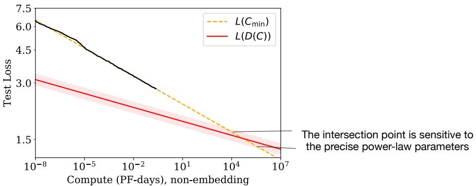  
Figure 15 在远超我们实证研究的模型规模下，由于计算高效训练所需数据量的缓慢增长，我们发现 $L(C_{\mathrm{min}})$ 和 $L(D)$ 方程之间存在矛盾。交点标志着我们预期预测失效的临界点。该点的位置对幂律拟合中得出的精确指数高度敏感。

## 6.3 矛盾与猜想

在计算量、数据量或模型规模较大的情况下，我们没有观察到偏离纯幂律趋势的迹象。然而，由于自然语言具有非零熵，我们的趋势最终必然会趋于平缓。

事实上，本节中描述的计算高效型训练（compute-efficient training）趋势已经包含了一个明显的矛盾。在比本文记录的规模高出几个数量级时，$L(C_{\mathrm{min}})$ 缩放律预测的性能会下降到低于在训练数据随计算量增长缓慢的情况下所应达到的水平。这意味着我们的缩放律在此点之前必然会失效，但我们推测这个交点具有更深层的含义：它提供了对 Transformer 语言模型达到最大性能点的估计。

由于计算高效型训练所使用的数据量随着计算预算的增长而缓慢增长，因此由 $L(C_{\mathrm{min}})$ 预测的性能最终会达到由 $L(D)$ 幂律所设定的下界（见 Figure 15）。让我们对此进行更详细的推导。

为了控制过拟合，第 4 节的结果表明我们应该按如下方式扩展数据集规模：

$$
D \propto N ^ {0. 7 4} \propto C _ {\mathrm{min}} ^ {0. 5 4}\tag{6.6}
$$

其中我们使用了 Figure 14 中的计算高效型 $N(C_{\min})$。

让我们将此与计算高效型训练的数据需求进行比较。如果我们在临界批次大小（critical batch size，即 $C = 2C_{min}$）下进行训练，并且在训练过程中从不重复使用数据，我们发现数据使用量随计算量的增长关系为：

$$
D (C _ {\mathrm{min}}) = \frac {2 C _ {\mathrm{min}}}{6 N (C _ {\mathrm{min}})} \approx \left(4 \times 1 0 ^ {1 0} \mathrm{tokens}\right) (C _ {\mathrm{min}} / \mathrm{PF-Day}) ^ {0. 2 6}\tag{6.7}
$$

这是数据集规模随计算量有效增长的最大速率，因为这意味我们仅训练了一个轮次（epoch）。但该数据集增长速度远慢于公式 (6.6) 中的速度。这似乎表明，即使训练过程从不重复使用任何数据，计算高效型训练最终也会遇到过拟合问题！

根据 Figure 1，我们预期当受到数据集规模的瓶颈限制（即受过拟合限制）时，损失应按 $L(D) \propto D^{-0.095}$ 缩放。这意味着一旦我们受数据限制，损失随计算量的缩放关系将为 $L(D(C_{\mathrm{min}})) \propto C_{\mathrm{min}}^{-0.03}$。这再次产生了一个矛盾，因为这一趋势最终将与我们来自 Figure 13 中对 $L(C_{\mathrm{min}})$ 的预测相交，在 Figure 13 中我们发现缩放关系为 $L(C_{\mathrm{min}}) \propto C_{\mathrm{min}}^{-0.050}$。

$L(D(C_{\min}))$ 和 $L(C_{\min})$ 的交点出现在：

$$
C ^ {*} \sim 1 0 ^ {4} \text { PF - Days } \quad N ^ {*} \sim 1 0 ^ {1 2} \text { parameters }, \quad D ^ {*} \sim 1 0 ^ {1 2} \text { tokens }, \quad L ^ {*} \sim 1. 7 \text { nats / token }\tag{6.8}
$$

尽管这些数值具有高度不确定性，根据幂律拟合中指数的具体数值不同，在任一方向上都可能存在一个数量级的变化。最直接的解释是，我们的缩放法则在达到该点之时或之前就会失效，而该点在计算量和模型大小上距离我们仍有许多个数量级之遥。

人们也可能会推测这一交点具有更深层的含义。如果我们在没有质的不同的数据需求的情况下，无法将模型大小增加到超过 $N^{*}$，这或许意味着一旦我们达到 $C_{min}^{*}$ 和 $N^{*}$，我们就已经提取了自然语言数据中可用的全部可靠信息。按照这种解释，$L^{*}$ 将为自然语言的每词元熵（entropy-per-token）$^{7}$ 提供一个粗略的估计。在这种情况下，我们预计损失趋势将在达到 $L^{*}$ 之时或之前趋于平缓。

我们可以通过考虑加入噪声的训练数据集版本，来推测 $L(C_{\mathrm{min}})$ 趋于平缓时的函数形式。例如，我们可以在展示给模型的每个上下文中追加一段随机的词元字符串，以通过一个恒定的加性因子人为地增加损失。此时，与噪声底线的距离 $L - L_{noise}$ 将成为一个更有意义的性能指标，即便该距离只有微小的减小，也可能代表定性性能的显著提升。由于人工噪声会对我们所有的趋势产生相同的影响，因此 6.8 的临界点不会改变（除了 $L^{*}$ 的绝对值之外），并且即使它发生在趋于平缓之后，也可能具有意义。

## 7 相关工作

幂律可以源于各种不同的机制 [THK18]。密度估计 [Was06] 和随机森林（random forest）模型 [Bia12] 中随模型和数据集大小的幂律缩放可能与我们的结果有关。这些模型表明，幂律指数可以非常粗略地解释为数据中相关特征数量的倒数。

一些早期工作 [BB01, Goo01] 发现了性能与数据集大小之间的幂律缩放关系。较近期的研究 $[HNA^{+}17, HAD19]$ 也探究了模型大小与数据大小之间的缩放关系；他们的工作可能是现有文献中与我们最接近的 $^{8}$。然而需要注意的是，$[HNA^{+}17]$ 发现数据集大小随模型大小呈超线性（super-linear）缩放，而我们发现的是次线性（sub-linear）缩放。我们在计算量最优分配方面的发现与 [Kom19] 存在一些相似之处，包括幂律学习曲线。EfficientNets [TL19] 的准确率与模型大小之间似乎也遵循近似的幂律关系。最新的工作 [RRBS19b] 针对各种数据集研究了随数据集大小和模型大小的缩放，并拟合了与我们类似的拟设（ansatz）。

EfficientNet [TL19] 主张对深度和宽度按指数（具有不同系数）进行缩放，以获得图像模型的最佳性能，从而导致宽度作为深度的函数呈幂律缩放。我们发现，对于语言模型，在进行模型放大时该幂次应大致为 1（因为宽度/深度比例应保持固定）。但更重要的是，我们发现与语言模型的整体规模相比，具体的架构超参数并不重要。在 [VWB16] 中有研究认为，深层模型可以充当较浅模型的集成，这可能可以解释这一发现。早期的工作 [ZK16] 对比了宽度与深度，发现宽 ResNets 在图像分类上的表现可以优于深 ResNets。一些研究固定了每个数据样本的计算量，这往往与模型参数量成正比缩放，而我们则研究了同时随模型大小和训练计算量进行缩放的情况。

多项工作 [AS17, BHMM18] 研究了高度过参数化模型中的泛化问题，发现在模型大小达到数据集大小时会出现“堵塞转变”（jamming transition）$[GJS^{+}19]$（这可能需要超出常规实践许多数量级的训练，且特别是不采用早停法）。我们没有观察到这种转变，并发现所需的训练数据量随模型大小呈次线性缩放。在模型大小方面的展开分析，尤其是在大宽度下 $[JGH18, LXS^{+}19]$，可能为思考我们的一些缩放关系提供有用的框架。我们在优化方面的结果（例如学习曲线的形状）很可能可以通过噪声二次模型来解释，该模型在实际场景中可以提供相当准确的预测 $[ZLN^{+}19]$。要定量建立这种联系，需要对 Hessian 谱 $[Pap18, GKX19, GARD18]$ 进行表征。

## 8 讨论

我们观察到语言模型的对数似然损失与非嵌入参数量 N、数据集大小 D 以及优化后的训练计算量 $C_{min}$ 之间存在一致的缩放关系，如公式 (1.5) 和 (1.6) 所概括。相反，我们发现模型对许多架构和优化超参数的依赖性非常弱。由于与 N、D、$C_{min}$ 的缩放关系遵循幂律，随着规模的增加，收益会出现递减。

我们能够精确地建模在 N 与 D 同时变化，或者 N 与 S 同时变化时，损失对它们的依赖关系。我们利用这些关系推导出了训练大语言模型时的计算量缩放、过拟合程度、早停步数以及数据需求。因此，我们的缩放关系超越了单纯的观察，提供了一个预测性框架。人们可以将这些关系理解为类似于理想气体状态方程的存在，该定律以一种普适的方式将气体的宏观性质联系起来，而独立于其微观组成的大多数细节。

很自然地可以推测，这些缩放关系（scaling relations）将适用于其他采用极大似然损失的生成建模任务，并且可能也适用于其他设定。为此，在其他领域（例如图像、音频和视频模型，也许还有随机网络蒸馏）上测试这些关系将会很有意义。目前，我们尚不清楚我们的结果中有哪些取决于自然语言数据的结构，哪些是通用的。如果能找到一个可以推导出这些缩放关系的理论框架，那也将令人兴奋：即在我们观察到的“热力学”背后的“统计力学”。这样的理论或将使推导出其他更精确的预测成为可能，并为理解缩放定律的局限性提供系统性的认识。

在自然语言领域，研究损失（loss）的持续改善是否会转化为相关语言任务上的提升至关重要。平滑的量变可能会掩盖重大的质变：“多者异也”（“more is different”）。例如，经济的平滑总体增长并没有指明支撑其发展的具体技术进步。同样地，语言模型损失的平滑改善可能隐藏着能力上看似质的飞跃。

我们的结果强烈表明，更大的模型将继续表现得更好，并且其样本效率也将远高于先前的认知。大模型可能比大数据更为重要。在此背景下，对模型并行性（model parallelism）进行进一步研究是十分必要的。深层模型可以通过流水线技术 $[HCC^{+}18]$ 进行训练，该技术沿深度方向在不同设备之间拆分参数，但随着使用设备数量的增加，最终需要增大大批量（batch size）。另一方面，宽网络更容易进行并行化 $[SCP^{+}18]$ ，因为大层可以在多个工作节点之间拆分，且串行依赖较少。稀疏性 $[CGRS19, GRK17]$ 或分支（例如 $[KSH12]$ ）可以通过提高模型并行性来实现大网络更快速的训练。而使用像 $[WRH17, WYL19]$ 这样在训练过程中逐渐扩展网络的方法，或许有可能在整个训练过程中始终保持在计算效率前沿。

## 致谢

我们要感谢 Shan Carter、Paul Christiano、Jack Clark、Ajeya Cotra、Ethan Dyer、Jason Eisner、Danny Hernandez、Jacob Hilton、Brice Menard、Chris Olah 和 Ilya Sutskever 参与讨论并对本工作的草稿提供反馈。

## 附录

## A 幂律总结

为了便于参考，我们在下文总结了贯穿整篇论文的关键趋势。

<table><tr><td>参数</td><td>数据</td><td>计算量</td><td>批大小</td><td>公式</td></tr><tr><td>N</td><td>∞</td><td>∞</td><td>固定</td><td> $L(N) = (N_c/N)^{\alpha_N}$ </td></tr><tr><td>∞</td><td>D</td><td>早停</td><td>固定</td><td> $L(D) = (D_c/D)^{\alpha_D}$ </td></tr><tr><td>最优</td><td>∞</td><td>C</td><td>固定</td><td> $L(C) = (C_c/C)^{\alpha_C}$  （朴素）</td></tr><tr><td> $N_{\text{opt}}$ </td><td> $D_{\text{opt}}$ </td><td> $C_{\text{min}}$ </td><td> $B \ll B_{\text{crit}}$ </td><td> $L(C_{\text{min}}) = \left( C_{\text{c}}^{\text{min}} / C_{\text{min}} \right)^{\alpha_C^{\text{min}}}$ </td></tr><tr><td>N</td><td>D</td><td>早停</td><td>固定</td><td> $L(N, D) = \left[ \left( \frac{N_c}{N} \right)^{\frac{\alpha_N}{\alpha_D}} + \frac{D_c}{D} \right]^{\alpha_D}$ </td></tr><tr><td>N</td><td>∞</td><td>S 步</td><td>B</td><td> $L(N, S) = \left( \frac{N_c}{N} \right)^{\alpha_N} + \left( \frac{S_c}{S_{\text{min}}(S, B)} \right)^{\alpha_S}$ </td></tr></table>

Table 4

这些趋势的经验拟合值如下：

<table><tr><td>幂律</td><td>尺度（依赖于分词方式）</td></tr><tr><td> $\alpha_{N} = 0.076$ </td><td> $N_{c} = 8.8 \times 10^{13}$  参数（非嵌入）</td></tr><tr><td> $\alpha_{D} = 0.095$ </td><td> $D_{c} = 5.4 \times 10^{13}$  tokens</td></tr><tr><td> $\alpha_{C} = 0.057$ </td><td> $C_{c} = 1.6 \times 10^{7}$  PF-days</td></tr><tr><td> $\alpha_{C}^{\min} = 0.050$ </td><td> $C_{c}^{\min} = 3.1 \times 10^{8}$  PF-days</td></tr><tr><td> $\alpha_{B} = 0.21$ </td><td> $B_{*} = 2.1 \times 10^{8}$  tokens</td></tr><tr><td> $\alpha_{S} = 0.76$ </td><td> $S_{c} = 2.1 \times 10^{3}$  步</td></tr></table>

Table 5

计算高效训练的最优参数如下：

<table><tr><td>计算高效值</td><td>幂律</td><td>尺度</td></tr><tr><td> $N_{\text{opt}} = N_e \cdot C_{\text{min}}^{p_N}$ </td><td> $p_N = 0.73$ </td><td> $N_e = 1.3 \cdot 10^9$ 参数</td></tr><tr><td> $B \ll B_{\text{crit}} = \frac{B_*}{L^{1/\alpha_B}} = B_e C_{\text{min}}^{p_B}$ </td><td> $p_B = 0.24$ </td><td> $B_e = 2.0 \cdot 10^6$ tokens</td></tr><tr><td> $S_{\text{min}} = S_e \cdot C_{\text{min}}^{p_S}$  （下界）</td><td> $p_S = 0.03$ </td><td> $S_e = 5.4 \cdot 10^3$ 步</td></tr><tr><td> $D_{\text{opt}} = D_e \cdot C_{\text{min}}^{p_D}$  （1 轮）</td><td> $p_D = 0.27$ </td><td> $D_e = 2 \cdot 10^{10}$ tokens</td></tr></table>

Table 6

## B 计算高效边界的经验模型

在本附录中，$C$、$S$ 和 $\alpha_{C}$ 的所有值均针对在临界批大小 $B_{crit}$ 下的训练进行了调整。为避免符号繁杂，我们省略了“adj”标记。

## B.1 定义方程

学习曲线的幂律拟合为计算高效训练（compute-efficient training）提供了一套简单的准则。在本附录中，我们将推导作为计算预算函数的最佳性能、模型大小以及训练步数。我们从公式 (1.6) 开始，为方便起见在此重述：

$$
L (N, S) = \left(\frac {N _ {c}}{N}\right) ^ {\alpha_ {N}} + \left(\frac {S _ {c}}{S}\right) ^ {\alpha_ {S}}.\tag{B.1}
$$

此处，S 表示在临界批大小（critical batch size）[MKAT18] 下训练时的参数更新次数，该批大小在公式 (5.2) $^{9}$ 中定义：

$$
B (L) = \frac {B _ {*}}{L ^ {1 / \alpha_ {B}}}.\tag{B.2}
$$

我们希望确定固定计算预算下的最佳训练参数，因此我们代入 $S = C / (6NB(L))$，其中 C 是训练运行中使用的 FLOPs 数量：

$$
L (N, C) = \left(\frac {N _ {c}}{N}\right) ^ {\alpha_ {N}} + \left(6 B _ {*} S _ {c} \frac {N}{L ^ {1 / \alpha_ {B}} C}\right) ^ {\alpha_ {S}}.\tag{B.3}
$$

现在，我们令 $\partial_N L|_C = 0$ 以求得最优化条件：

$$
\begin{array}{l} 0 = \frac {\partial L}{\partial N} \big | _ {C} \\ = - \frac {\alpha_ {N}}{N} \left(\frac {N _ {c}}{N}\right) ^ {\alpha_ {N}} + \frac {\alpha_ {S}}{N} \left(6 B _ {*} S _ {c} \frac {N}{L ^ {1 / \alpha_ {B}} C}\right) ^ {\alpha_ {S}} \left(1 - 5 \frac {N}{L} \frac {\partial L}{\partial N} \big | _ {C}\right) \\ \implies \frac {\alpha_ {N}}{\alpha_ {S}} \left(\frac {N _ {c}}{N}\right) ^ {\alpha_ {N}} = \left(6 B _ {*} S _ {c} \frac {N}{L ^ {1 / \alpha_ {B}} C}\right) ^ {\alpha_ {S}} \end{array}\tag{B.4}
$$

公式 (B.3) 和 (B.4) 共同决定了计算高效前沿（compute-efficient frontier）。

## B.2 高效训练

现在我们结合公式 (B.3) 和 (B.4) 的推论。首先，注意到将 (B.4) 代入 (B.3) 可得

$$
L \left(N _ {\mathrm{eff}} (C), C\right) = \left(1 + \frac {\alpha_ {N}}{\alpha_ {S}}\right) L \left(N _ {\mathrm{eff}}, \infty\right),\tag{B.5}
$$

这意味着对于计算高效训练，我们应该训练到比收敛损失高出固定百分比 $\frac{\alpha_{N}}{\alpha_{S}} \approx 10\%$ 的位置。接下来，我们来确定最佳损失如何依赖于计算预算。消去 N 可以得到性能对计算量的幂律依赖关系：

$$
L (C) = \left(\frac {C _ {c}}{C}\right) ^ {\alpha_ {C}}\tag{B.6}
$$

其中我们定义

$$
\alpha_ {C} = 1 / (1 / \alpha_ {S} + 1 / \alpha_ {B} + 1 / \alpha_ {N}) \approx 0. 0 5 2
$$

(B.7)

$$
C _ {c} = 6 N _ {c} B _ {*} S _ {c} \left(1 + \frac {\alpha_ {N}}{\alpha_ {S}}\right) ^ {1 / \alpha_ {S} + 1 / \alpha_ {N}} \left(\frac {\alpha_ {S}}{\alpha_ {N}}\right) ^ {1 / \alpha_ {S}}.\tag{B.8}
$$

类似地，我们可以消去 $L$ 来求解 $N(C)$：

$$
\frac {N (C)}{N _ {c}} = \left(\frac {C}{C _ {c}}\right) ^ {\alpha_ {C} / \alpha_ {N}} \left(1 + \frac {\alpha_ {N}}{\alpha_ {S}}\right) ^ {1 / \alpha_ {N}}\tag{B.9}
$$

以及

$$
S (C) = \frac {C _ {c}}{6 N _ {c} B _ {*}} \left(1 + \frac {\alpha_ {N}}{\alpha_ {S}}\right) ^ {- 1 / \alpha_ {N}} \left(\frac {C}{C _ {c}}\right) ^ {\alpha_ {C} / \alpha_ {S}}\tag{B.10}
$$

## B.3 与低效训练的对比

通常，研究人员会训练模型直至其看起来接近收敛。在本节中，我们将上述计算高效的训练过程与这种更典型的设置进行比较。我们将收敛因子 $f$ 定义为偏离收敛损失的百分比：

$$
L (N, C) = (1 + f) L (N, \infty).\tag{B.11}
$$

对于计算高效的训练，由前一节可知 $f = \alpha_{N}/\alpha_{S} \approx 10\%$，但研究人员通常会使用小得多的值。在此，我们选取 $f' = 2\%$ 作为估计值。对于固定的损失值，我们预测：

$$
\frac {N _ {f}}{N _ {f ^ {\prime}}} = \left(\frac {1 + f}{1 + f ^ {\prime}}\right) ^ {1 / \alpha_ {N}} \approx 2. 7\tag{B.12}
$$

$$
\frac {S _ {f}}{S _ {f ^ {\prime}}} = \left(\frac {1 + \frac {1}{f}}{1 + \frac {1}{f ^ {\prime}}}\right) ^ {1 / \alpha_ {S}} \approx 0. 1 3\tag{B.13}
$$

$$
\frac {C _ {f}}{C _ {f ^ {\prime}}} = \frac {N _ {f}}{N _ {f ^ {\prime}}} \frac {S _ {f}}{S _ {f ^ {\prime}}} \approx 0. 3 5\tag{B.14}
$$

因此，达到相同的损失，计算高效的训练所使用的参数更新次数减少了 7.7 倍，参数量增加了 2.7 倍，并且计算量减少了 65%。

## B.4 次优模型规模

我们可以求解 A.1，以得到大小为 $N$ 的模型达到给定损失值 $L$ 所需计算量的表达式：

$$
C (N, L) = \left(6 B _ {*} S _ {c} \frac {N}{L ^ {1 / \alpha_ {B}}}\right) \left(L - \left(\frac {N _ {c}}{N}\right) ^ {\alpha_ {N}}\right) ^ {- 1 / \alpha_ {S}}.\tag{B.15}
$$

利用 A.6 和 A.9，我们可以消去 $L$，用最高效达到 $L$ 的模型大小 $N_{\mathrm{eff}}(L)$ 代替。由此，我们得到了由于使用次优模型大小而导致所需额外计算量的表达式：

$$
\frac {C (N , N _ {\mathrm{eff}})}{C (N _ {\mathrm{eff}} , N _ {\mathrm{eff}})} = \frac {N}{N _ {\mathrm{eff}}} \left[ 1 + \frac {\alpha_ {S}}{\alpha_ {N}} \left(1 - \left(\frac {N _ {\mathrm{eff}}}{N}\right) ^ {\alpha_ {N}}\right) \right] ^ {- 1 / \alpha_ {S}}.\tag{B.16}
$$

结果如图 Figure X 所示。大小在最优大小 0.6 倍至 2.2 倍之间的模型，仅需增加 20% 的计算预算即可使用。当考虑推理成本时，使用较小的模型是有益的。而在硬件资源充足的情况下，较大的模型可以在更少的步数内训练到相同的性能水平，从而实现更高的并行度和更快的训练（见 Figure Y）：

$$
\frac {S (N , N _ {\mathrm{eff}})}{S (N _ {\mathrm{eff}} , N _ {\mathrm{eff}})} = \left[ 1 + \frac {\alpha_ {S}}{\alpha_ {N}} \left(1 - \left(\frac {N _ {\mathrm{eff}}}{N}\right) ^ {\alpha_ {N}}\right) \right] ^ {- 1 / \alpha_ {S}}.\tag{B.17}
$$

一个大 2.2 倍的模型所需的步数减少 45%，代价是训练计算量增加 20%。注意，该方程不应完全信任用于超大模型，因为它仅在学习曲线度过初始过渡阶段后的幂律区域内有效。

## C 注意事项

在本节中，我们列出了本分析中一些潜在的注意事项。

\- 目前，对于我们提出的任何标度律，我们都缺乏坚实的理论理解。关于模型大小和计算量的标度关系尤其令人费解。在固定模型大小的情况下，通过使用带噪声的二次函数对损失建模，或许可以理解在非常大的 $D$ 下的标度关系 [AS17]，以及训练后期的学习曲线形状。但在模型尺寸极大时随 $D$ 的标度变化仍然成谜。缺乏理论指导或对标度律修正项的系统性理解，很难确定它们在何种情况下是值得信赖的。

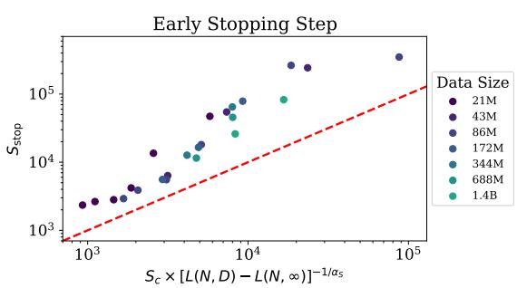

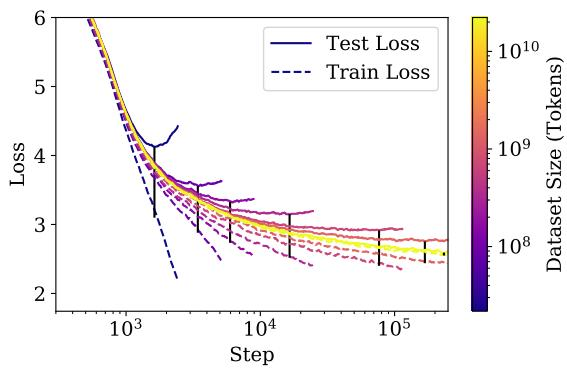  
Figure 16 左图：我们将发生早停的步数表征为过拟合程度的函数。红线表示在第 5.3 节中推导出的早停下界。右图：我们展示了一系列在不同大小的数据集子样本上训练的 300M 参数模型的训练损失和测试损失。测试损失通常与在无限制数据上运行的测试损失保持一致，直到发生发散。注意，过拟合程度（相比于无限数据极限）被 $L_{test} - L_{train}$（每次运行用黑条标出）显著高估了。

\- 对于远超出我们探索范围的损失值，我们对其 $B_{\mathrm{crit}}(L)$ 的预测并不是特别有信心。$B_{crit}$ 的变化可能会对数据并行性与所需串行训练步数之间的权衡产生重大影响，进而对训练时间产生重大影响。

\- 我们没有深入研究小数据机制，并且对于最小的 $D$ 值（其中一个 epoch 仅对应 40 步），我们对 $L(N, D)$ 的拟合较差。此外，我们没有对正则化和数据增强进行实验。在这些方面的改进可能会在定量或定性上改变我们的结果。

\- 我们使用了估计的训练计算量 $C \approx 6NBS$ ，其中不包括与 $n_{ctx}$ 成比例的贡献（参见第 2.1 节）。因此，在实践中处于非常大的 $n_{ctx}$ 机制下，特别是当 $n_{ctx} \gtrsim 12d_{model}$ 时，我们关于计算量的标度关系可能会受到混淆干扰。

\- 我们调整了学习率，并对学习率调度策略进行了实验。但我们可能忽略了调整某些对标度关系有重要影响的超参数（例如初始化尺度或动量）。

- 学习率的最优选择对目标损失很敏感。当训练接近收敛时，可能需要使用较小的学习率以避免发散。但在进行较短的训练运行（例如由于计算资源限制）时，可以使用较大的学习率。我们没有对未进行到收敛的训练运行尝试更高的学习率。

## D 补充图表

## D.1 早停与测试集对训练集

在第 5.3 节中，我们描述了图 16（Figure 16）所示的结果，该结果提供了早停步数下界的预测。我们还展示了在不同大小的数据集上训练时，给定模型大小的训练损失和测试损失。

## D.2 通用 Transformer

我们在图 17（Figure 17）中比较了标准 Transformer 与循环 Transformer（Recurrent Transformers）$[DGV^{+}18]$ 的性能。这些模型复用了参数，因此作为 $N$ 的函数时表现稍好，但作为计算量 $C$ 的函数时表现稍差。我们纳入了几种不同的参数复用可能性。

## D.3 批大小

我们使用图 18（Figure 18）中显示的数据测量了临界批大小。这使得估计图 10（Figure 10）中的 $B_{\mathrm{crit}}(L)$ 成为可能。

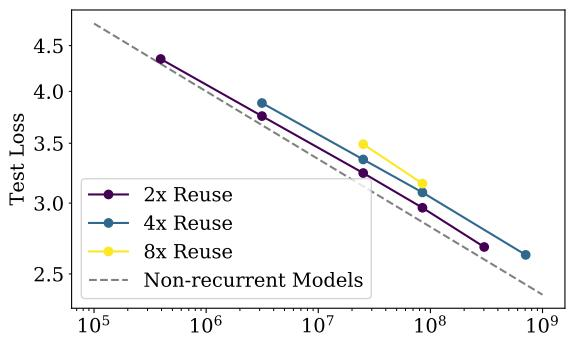  
参数量，包含复用（非嵌入）

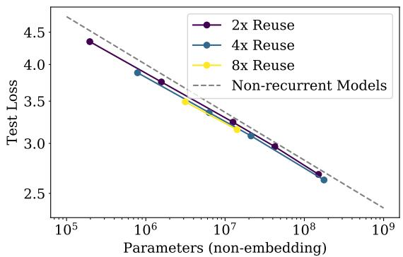  
Figure 17 我们将复用参数的循环 Transformer $[DGV^{+}18]$ 与标准 Transformer 进行了比较。在比较参数量相等的模型时，循环 Transformer 的表现略好；但在考虑参数复用并按每 FLOP 比较时，其表现略差。

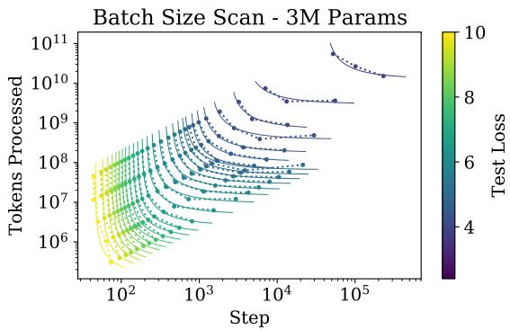

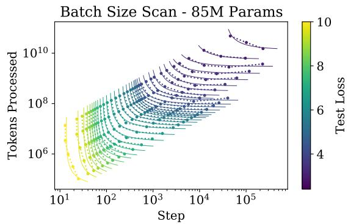  
Figure 18 这些图展示了在大量损失值 $L$ 以及两种不同 Transformer 模型大小下对公式 (5.1) 的拟合情况。这些拟合用于测量图 10（Figure 10）中的 $B_{\mathrm{crit}}(L)$。

## D.4 样本效率与模型大小

从图 2（Figure 2）中很容易看出，较大的模型训练速度更快，因此具有更高的样本效率。我们在图 19（Figure 19）中提供了看待这种现象的另一种视角，该图展示了不同模型达到各种固定损失值的时间。

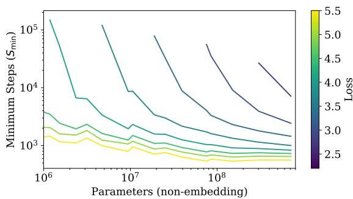

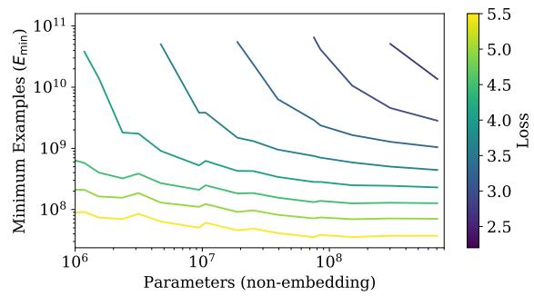  
Figure 19 达到测试损失的任意固定值所需的最少串行步数随模型大小急剧下降。样本效率（此处展示的是远低于临界批大小的训练情况）也大幅提升，在比较可能采用的最小模型与极大模型时，样本效率提升了近 100 倍。

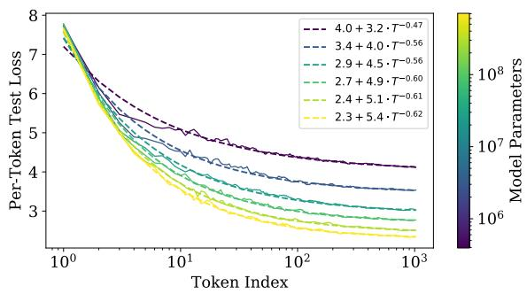

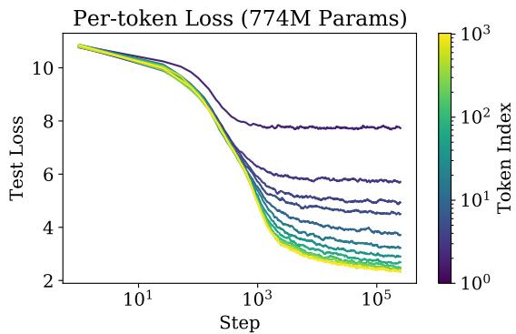  
Figure 20 该图提供了关于每个 token 的性能随模型大小和训练时间变化的信息。左图：在 1024 个 token 的上下文中，每个 token 的损失作为其位置 T 的函数。损失随 T 呈可预测的幂律缩放。右图：每个 token 的测试损失随训练步数的变化。

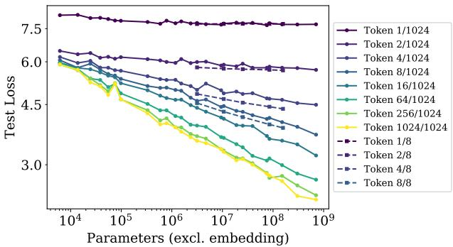  
Figure 21 除了平均损失之外，随着模型大小的增加，1024 个 token 上下文中的各个独立 token 的表现也会平滑改善。在较短上下文 $n_{ctx} = 8$（虚线）下训练的模型在靠前的 token 上表现更好，因为它们可以将所有容量都分配给这些 token。

## D.5 上下文依赖性

Figure 21 展示了上下文中不同 token 的损失随模型大小变化的趋势。我们可以看到，在 $n_{ctx} = 1024$ 上训练的模型，除了第一个 token 之外，在所有 token 上的性能都随着模型大小的增大而稳步提升。

固定模型大小后，损失似乎作为上下文中位置 T 的函数呈幂律缩放，参见 Figure 20。这可能是语言中潜在幂律相关性的结果 [EP94, ACDE12, LT16]，也可能是模型架构和优化更一般的特征。这为在更大上下文中进行训练的潜在益处（或无益处）提供了一些启示。较大的模型不仅在 T = 1024 处收敛到更好的性能，而且在靠前的 token 上的提升速度也更快，这表明较大的模型在利用较少上下文信息检测模式时更为高效。在右侧图中，我们展示了对于固定模型，每个 token 的性能如何随着训练步数变化。模型首先学习短程信息，仅在训练后期才学习更长程的相关性。

我们还纳入了在极小上下文 $n_{ctx} = 8$ 下训练的模型，以便与较长上下文的模型进行对比。即使是在 $n_{ctx} = 8$ 下训练的中等规模模型，在非常靠前的 token 上也能优于我们最大的 $n_{ctx} = 1024$ 模型。这也表明，在长上下文上训练大得多的模型应该能够带来进一步的改进。

## D.6 学习率调度与误差分析

我们对多种学习率和调度策略（learning rate schedules）进行了实验。图 22 绘制了一个小型语言模型的多种调度策略及其测试性能。我们的结论是，只要学习率的总和足够大，并且调度策略包含预热阶段（warmup period）和最终衰减至接近于零的学习率，学习率调度策略的选择基本无关紧要。不同调度策略之间的差异似乎属于统计噪声，并为不同训练运行之间的变异尺度提供了粗略的衡量标准。对更大规模模型的实验表明，不同随机种子之间最终测试损失的变异幅度在不同模型大小下大致恒定。

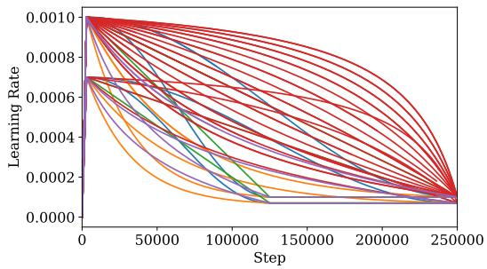

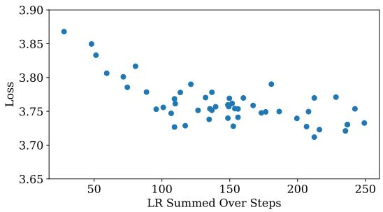  
Figure 22 我们在一个 300 万（3 million）参数的模型上测试了多种学习率调度策略，包括余弦衰减、线性衰减以及其他更快/更慢的衰减调度策略，如左图所示。在这些实验中，我们并没有将其衰减到零，因为我们发现这往往会在接近训练结束时带来固定的性能提升。我们发现，只要学习率不太小且衰减不太快，性能就不会强烈依赖于学习率。不同运行之间的损失变异在 0.05 的水平，因此要验证小于该水平的性能变化，必须对多次运行取平均值。

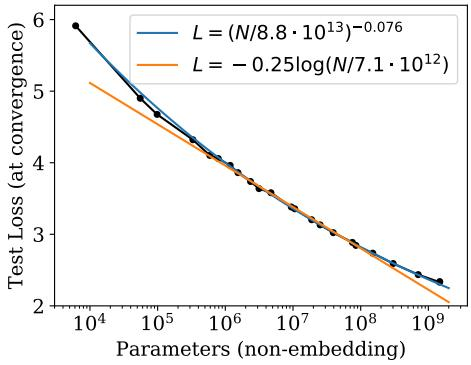  
Figure 23 从定性层面来看，性能作为参数量的函数 $L(N)$ 的趋势，相比于对数等其他函数，幂律能够更好地进行拟合。

我们发现，较大的模型需要较小的学习率以防止发散，而较小的模型可以容忍较大的学习率。为了实现这一点，大多数运行中采用了以下经验法则：

$$
\operatorname{LR} (N) \approx 0. 0 0 3 2 3 9 + - 0. 0 0 0 1 3 9 5 \log (N)\tag{D.1}
$$

我们预期该公式仍可改进。它可能依赖于网络宽度（network width），这可能是由初始化尺度决定的。对于 $N > 10^{10}$ 的参数量，该公式也会失效。尽管如此，我们发现它对我们所考虑的模型表现得足够好。

## D.7 拟合细节与幂律质量

我们针对 $L(N)$、$L(C)$ 和 $L(D)$ 的拟合尝试了多种函数形式；幂律拟合在定性上远比对数等其他函数更为准确（见 Figure 23）。

对于 $L(C)$，我们在拟合中没有包含只有 1 层的较小模型，因为从 1 层到 2 层的过渡会在数据中引起明显的突起。对于 $L(N)$，我们在拟合中同样排除了只有 1 层的极小模型，并且排除了未完全训练至收敛的最大模型。如果将它们包含在内，拟合参数的变化微乎其微，而且无论哪种情况，趋势在两个方向上的外推效果都很好。

## D.8 泛化与架构

在图 24 中，我们展示了当保持总参数量不变时，向其他数据分布的泛化能力并不依赖于网络深度。它似乎只取决于在训练分布上的性能。

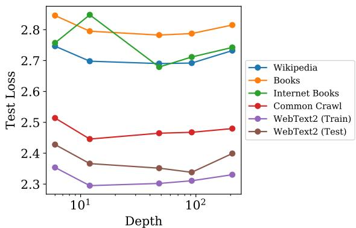  
Figure 24 我们展示了针对约 15 亿（1.5 Billion）参数的模型在一系列数据集上的评估结果。我们观察到深度对泛化没有影响；泛化性能主要取决于训练分布上的性能。12 层模型在 Internet Books 数据集上出现了过拟合，我们展示了其早停（early-stopped）性能；我们在其他实验中尚未观察到这一令人意外的结果。

## 插图列表

简单幂律总结 3   
样本效率与计算效率图解 4   
如何扩展模型规模、批大小与串行步数 4   
同时改变模型与数据规模，或模型与训练步数时的性能 5   
性能对超参数调优的弱依赖性 8   
包含或排除嵌入层时的性能趋势对比 8   
LSTM 与 Transformer 性能对比 9   
对其他测试数据集的泛化 10   
过拟合的普遍性 11   
临界批大小 12   
性能与计算预算或参数更新次数的关系 14   
在次优模型上的训练 15   
经验计算趋势与调整后计算趋势的对比 15   
最佳模型规模及串行步数与计算预算的关系 16   
计算与数据趋势之间的矛盾 17   
过拟合模型的早停下界与训练曲线 23   
Universal transformers 24   
批大小扫描 24   
重新审视样本效率 24   
性能对上下文位置的幂律依赖关系 25   
不同上下文位置的性能与模型规模的关系 25   
学习率调度策略扫描 26   
幂律拟合与对数拟合的对比 26   
泛化与深度的关系 27

## 表格列表

1 Transformer 的参数量与计算量统计 7  
2 $L(N, D)$ 的拟合 11  
3 $L(N, S)$ 的拟合 14  
4 关键趋势方程 20  
5 趋势拟合的关键参数 20  
6 计算高效训练的趋势 20

## 参考文献

[ACDE12] Eduardo G Altmann, Giampaolo Cristadoro, and Mirko Degli Esposti. On the origin of long-range correlations in texts. Proceedings of the National Academy of Sciences, 109(29):11582–11587, 2012. 25

[AS17] Madhu S. Advani and Andrew M. Saxe. High-dimensional dynamics of generalization error in neural networks. arXiv, 2017, 1710.03667. 11, 18, 22

[BB01] Michele Banko and Eric Brill. Scaling to very very large corpora for natural language disambiguation. In Proceedings of the 39th annual meeting on association for computational linguistics, pages 26–33. Association for Computational Linguistics, 2001. 18

[BHMM18] Mikhail Belkin, Daniel Hsu, Siyuan Ma, and Soumik Mandal. Reconciling modern machine learning and the bias-variance trade-off. arXiv, 2018, 1812.11118. 18

[Bia12] Gérard Biau. Analysis of a random forests model. Journal of Machine Learning Research, 13(Apr):1063–1095, 2012. 18

[CGRS19] Rewon Child, Scott Gray, Alec Radford, and Ilya Sutskever. Generating long sequences with sparse transformers. CoRR, abs/1904.10509, 2019, 1904.10509. URL http://arxiv.org/abs/1904.10509. 19

[DCLT18] Jacob Devlin, Ming-Wei Chang, Kenton Lee, and Kristina Toutanova. Bert: Pre-training of deep bidirectional transformers for language understanding, 2018, arXiv:1810.04805. 2

[ $DGV^{+}18$ ] Mostafa Dehghani, Stephan Gouws, Oriol Vinyals, Jakob Uszkoreit, and Lukasz Kaiser. Universal transformers. CoRR, abs/1807.03819, 2018, 1807.03819. URL http://arxiv.org/abs/1807.03819. 6, 9, 23, 24

[EP94] Werner Ebeling and Thorsten Pöschel. Entropy and long-range correlations in literary english. EPL (Europhysics Letters), 26(4):241, 1994. 25

[Fou] The Common Crawl Foundation. Common crawl. URL http://commoncrawl.org. 7

[GARD18] Guy Gur-Ari, Daniel A. Roberts, and Ethan Dyer. Gradient descent happens in a tiny subspace. 2018, arXiv:1812.04754. 18

[GJS $^{+}$ 19] Mario Geiger, Arthur Jacot, Stefano Spigler, Franck Gabriel, Levent Sagun, Stéphane d'Ascoli, Giulio Biroli, Clément Hongler, and Matthieu Wyart. Scaling description of generalization with number of parameters in deep learning. arXiv, 2019, 1901.01608. 18

[GKX19] Behrooz Ghorbani, Shankar Krishnan, and Ying Xiao. An investigation into neural net optimization via hessian eigenvalue density. CoRR, abs/1901.10159, 2019, 1901.10159. URL http://arxiv.org/abs/1901.10159. 18

[Goo01] Joshua Goodman. A bit of progress in language modeling. CoRR, cs.CL/0108005, 2001. URL http://arxiv.org/abs/cs.CL/0108005. 18

[GRK17] Scott Gray, Alec Radford, and Diederik P Kingma. Gpu kernels for block-sparse weights. openai.com, 2017. 19

[HAD19] Joel Hestness, Newsha Ardalani, and Gregory Diamos. Beyond human-level accuracy: Computational challenges in deep learning. In Proceedings of the 24th Symposium on Principles and Practice of Parallel Programming, PPOPP '19, pages 1–14, New York, NY, USA, 2019. ACM. doi:10.1145/3293883.3295710. 18

[HCC $^{+}$ 18] Yanping Huang, Yonglong Cheng, Dehao Chen, HyoukJoong Lee, Jiquan Ngiam, Quoc V. Le, and Zhifeng Chen. Gpipe: Efficient training of giant neural networks using pipeline parallelism. CoRR, abs/1811.06965, 2018, 1811.06965. URL http://arxiv.org/abs/1811.06965. 19

[HNA $^{+}$ 17] Joel Hestness, Sharan Narang, Newsha Ardalani, Gregory Diamos, Heewoo Jun, Hassan Kianinejad, Md. Mostofa Ali Patwary, Yang Yang, and Yanqi Zhou. 经验表明，深度学习的扩展性是可预测的（Deep learning scaling is predictable, empirically）, 2017, 1712.00409. 18

[JGH18] Arthur Jacot, Franck Gabriel, and Clément Hongler. 神经正切核：神经网络中的收敛与泛化（Neural tangent kernel: Convergence and generalization in neural networks）. 载于 Advances in neural information processing systems, 第 8571–8580 页, 2018. 18

[KB14] Diederik P. Kingma and Jimmy Ba. Adam：一种随机优化方法（Adam: A method for stochastic optimization）, 2014, 1412.6980. 7

[Kom19] Aran Komatsuzaki. 单轮训练足矣（One epoch is all you need）, 2019, arXiv:1906.06669. 18

[KSH12] Alex Krizhevsky, Ilya Sutskever, and Geoffrey E. Hinton. 基于深度卷积神经网络的 ImageNet 分类（Imagenet classification with deep convolutional neural networks）. 载于 Proceedings of the 25th International Conference on Neural Information Processing Systems - Volume 1, NIPS'12, 第 1097–1105 页, USA, 2012. Curran Associates Inc. URL http://dl.acm.org/citation.cfm?id=2999134.2999257.19

[LCG $^{+}$ 19] Zhenzhong Lan, Mingda Chen, Sebastian Goodman, Kevin Gimpel, Piyush Sharma, and Radu Soricut. ALBERT：用于语言表征自监督学习的轻量版 BERT（Albert: A lite bert for self-supervised learning of language representations）, 2019, 1909.11942. 9

[LOG $^{+}$ 19] Yinhan Liu, Myle Ott, Naman Goyal, Jingfei Du, Mandar Joshi, Danqi Chen, Omer Levy, Mike Lewis, Luke Zettlemoyer, and Veselin Stoyanov. RoBERTa：一种鲁棒优化的 BERT 预训练方法（Roberta: A robustly optimized BERT pretraining approach）. CoRR, abs/1907.11692, 2019, 1907.11692. URL http://arxiv.org/abs/1907.11692.2

[LSP+18] Peter J. Liu, Mohammad Saleh, Etienne Pot, Ben Goodrich, Ryan Sepassi, Lukasz Kaiser, and Noam Shazeer. 通过长序列摘要生成维基百科（Generating wikipedia by summarizing long sequences）. arXiv:1801.10198 [cs], 2018, 1801.10198. URL http://arxiv.org/abs/1801.10198. 2, 6

[LT16] Henry W Lin and Max Tegmark. 形式语言与统计物理学中的临界性（Criticality in formal languages and statistical physics）. arXiv preprint arXiv:1606.06737, 2016. 25

[LXS $^{+}$ 19] Jaehoon Lee, Lechao Xiao, Samuel S. Schoenholz, Yasaman Bahri, Roman Novak, Jascha Sohl-Dickstein, and Jeffrey Pennington. 任意深度的宽神经网络在梯度下降下均演变为线性模型（Wide neural networks of any depth evolve as linear models under gradient descent）, 2019, arXiv:1902.06720. 18

[MKAT18] Sam McCandlish, Jared Kaplan, Dario Amodei, and OpenAI Dota Team. 大批量训练的经验模型（An empirical model of large-batch training）, 2018, arXiv:1812.06162. 3, 5, 6, 12, 13, 21

[Pap18] Vardan Papyan. 大规模深度网络 Hessian 矩阵的全谱：随样本量变化的动力学（The full spectrum of deep net hessians at scale: Dynamics with sample size）. CoRR, abs/1811.07062, 2018, 1811.07062. URL http://arxiv.org/abs/1811.07062. 18

[RNSS18] Alec Radford, Karthik Narasimhan, Tim Salimans, and Ilya Sutskever. 通过生成式预训练提升语言理解能力（Improving language understanding by generative pre-training）. URL https://s3-us-west-2.amazonaws.com/openai-assets/research-covers/languageunsupervised/language understanding paper.pdf, 2018. 2, 6

[RRBS19a] Jonathan S. Rosenfeld, Amir Rosenfeld, Yonatan Belinkov, and Nir Shavit. 跨尺度泛化误差的构造性预测（A constructive prediction of the generalization error across scales）, 2019, 1909.12673. 18

[RRBS19b] Jonathan S. Rosenfeld, Amir Rosenfeld, Yonatan Belinkov, and Nir Shavit. A constructive prediction of the generalization error across scales, 2019, arXiv:1909.12673. 18

[RSR $^{+}$ 19] Colin Raffel, Noam Shazeer, Adam Roberts, Katherine Lee, Sharan Narang, Michael Matena, Yanqi Zhou, Wei Li, and Peter J. Liu. Exploring the limits of transfer learning with a unified text-to-text transformer, 2019, arXiv:1910.10683. 2

[RWC $^{+}$ 19] Alec Radford, Jeff Wu, Rewon Child, David Luan, Dario Amodei, and Ilya Sutskever. Language models are unsupervised multitask learners. openai.com, 2019. 2, 5, 6, 7, 8

[SCP+18] Noam Shazeer, Youlong Cheng, Niki Parmar, Dustin Tran, Ashish Vaswani, Penporn Koanan-takool, Peter Hawkins, HyoukJoong Lee, Mingsheng Hong, Cliff Young, Ryan Sepassi, and Blake Hechtman. Mesh-tensorflow: Deep learning for supercomputers, 2018, 1811.02084. 19

[SHB15] Rico Sennrich, Barry Haddow, and Alexandra Birch. Neural machine translation of rare words with subword units. CoRR, 2015, 1508.07909. 6

[SLA $^{+}$ 18] Christopher J. Shallue, Jaehoon Lee, Joe Antognini, Jascha Sohl-Dickstein, Roy Frostig, and George E. Dahl. Measuring the effects of data parallelism on neural network training, 2018, arXiv:1811.03600. 12

[SS18] Noam Shazeer and Mitchell Stern. Adafactor: Adaptive learning rates with sublinear memory cost. CoRR, abs/1804.04235, 2018, 1804.04235. URL http://arxiv.org/abs/1804.04235. 7

[THK18] Stefan Thurner, Rudolf Hanel, and Peter Klimek. Introduction to the theory of complex systems. Oxford University Press, 2018. 18

[TL19] Mingxing Tan and Quoc V. Le. Efficientnet: Rethinking model scaling for convolutional neural networks. CoRR, abs/1905.11946, 2019, 1905.11946. URL http://arxiv.org/abs/1905.11946. 18

[VSP+17] Ashish Vaswani, Noam Shazeer, Niki Parmar, Jakob Uszkoreit, Llion Jones, Aidan N Gomez, Łukasz Kaiser, and Illia Polosukhin. Attention is all you need. In I. Guyon, U. V. Luxburg, S. Bengio, H. Wallach, R. Fergus, S. Vishwanathan, and R. Garnett, editors, Advances in Neural Information Processing Systems 30, pages 5998–6008. Curran Associates, Inc., 2017. URL http://papers.nips.cc/paper/7181-attention-is-all-you-need.pdf. 2, 6

[VWB16] Andreas Veit, Michael Wilber, and Serge Belongie. Residual networks behave like ensembles of relatively shallow networks, 2016, arXiv:1605.06431. 8, 18

[Was06] Larry Wasserman. All of nonparametric statistics. Springer Science & Business Media, 2006. 18

[WPN $^{+}$ 19] Alex Wang, Yada Pruksachatkun, Nikita Nangia, Amanpreet Singh, Julian Michael, Felix Hill, Omer Levy, and Samuel R. Bowman. Superglue: A stickier benchmark for general-purpose language understanding systems, 2019, 1905.00537. 2

[WRH17] Yu-Xiong Wang, Deva Ramanan, and Martial Hebert. Growing a brain: Fine-tuning by increasing model capacity. 2017 IEEE Conference on Computer Vision and Pattern Recognition (CVPR), Jul 2017. doi:10.1109/cvpr.2017.323. 19

[WYL19] Wei Wen, Feng Yan, and Hai Li. Autogrow: Automatic layer growing in deep convolutional networks, 2019, 1906.02909. 19

[YDY $^{+}$ 19] Zhilin Yang, Zihang Dai, Yiming Yang, Jaime Carbonell, Ruslan Salakhutdinov, and Quoc V. Le. Xlnet: Generalized autoregressive pretraining for language understanding, 2019, arXiv:1906.08237. 2

[ZK16] Sergey Zagoruyko and Nikos Komodakis. Wide residual networks. Proceedings of the British Machine Vision Conference 2016, 2016. doi:10.5244/c.30.87.18

[ZKZ $^{+}$ 15] Yukun Zhu, Ryan Kiros, Rich Zemel, Ruslan Salakhutdinov, Raquel Urtasun, Antonio Torralba, and Sanja Fidler. Aligning books and movies: Towards story-like visual explanations by watching movies and reading books. 2015 IEEE International Conference on Computer Vision (ICCV), Dec 2015. doi:10.1109/iccv.2015.11.7

[ZLN $^{+}$ 19] Guodong Zhang, Lala Li, Zachary Nado, James Martens, Sushant Sachdeva, George E. Dahl, Christopher J. Shallue, and Roger B. Grosse. Which algorithmic choices matter at which batch sizes? insights from a noisy quadratic model. CoRR, abs/1907.04164, 2019, 1907.04164. URL http://arxiv.org/abs/1907.04164.12, 18