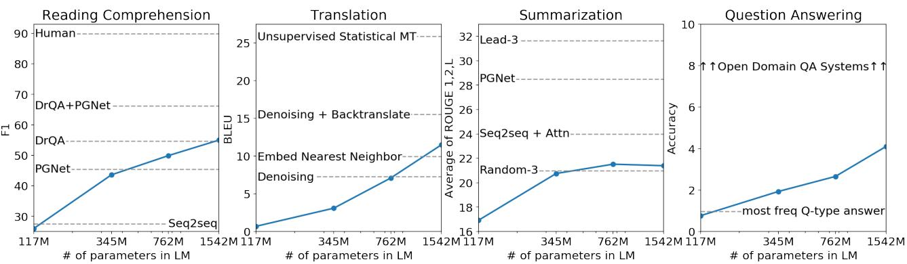
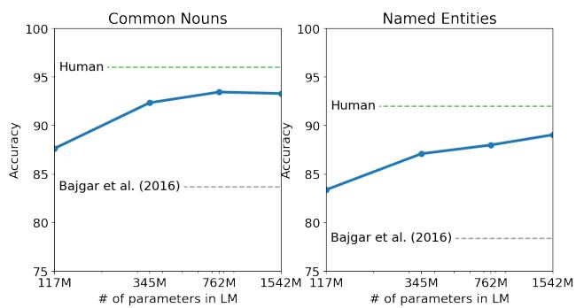
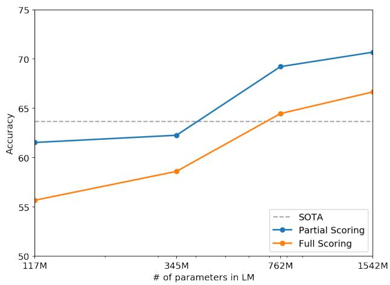
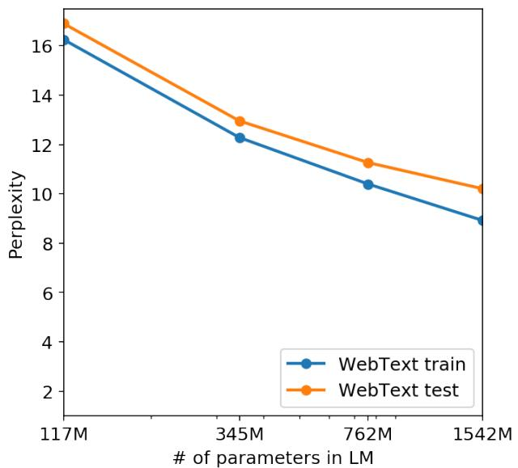
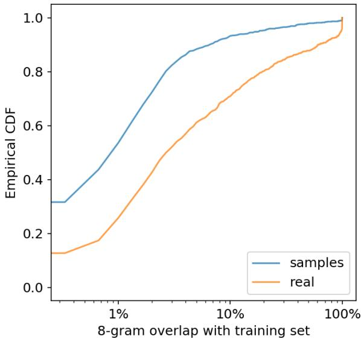
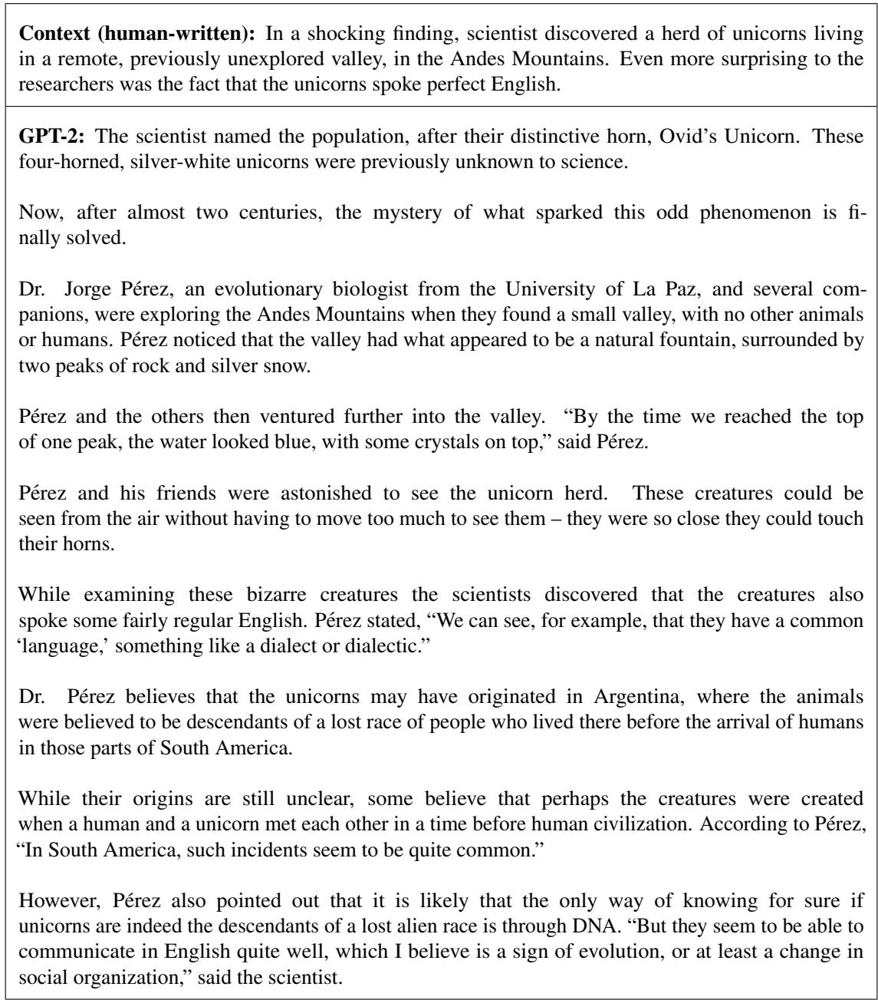

# 语言模型是无监督多任务学习者

Alec Radford \* 1 Jeffrey Wu \* 1 Rewon Child 1 David Luan 1 Dario Amodei \*\* 1 Ilya Sutskever \*\* 1

## 摘要

自然语言处理任务，如问答、机器翻译、阅读理解和摘要生成，通常采用在特定任务数据集上进行监督学习的方法。我们证明，当在一个名为 WebText 的数百万网页新数据集上训练时，语言模型无需任何显式监督即可开始学习这些任务。当以文档加上问题作为条件时，语言模型生成的答案在 CoQA 数据集上达到了 55 F1——在不使用 127,000 多个训练样本的情况下，达到或超过了 4 个基线系统中 3 个的表现。语言模型的容量对于零样本（zero-shot）任务迁移的成功至关重要，且增大模型容量会在各项任务上以对数线性方式提升性能。我们最大的模型 GPT-2 是一个拥有 15 亿参数的 Transformer，在零样本设定下在 8 个测试的语言建模数据集中的 7 个上取得了最先进（state of the art）的结果，但仍对 WebText 存在欠拟合。该模型的生成样本反映了这些改进，并包含连贯的文本段落。这些发现为构建从自然发生的演示中学习执行任务的语言处理系统指明了一条充满希望的路径。

## 1. 引言

通过结合大型数据集、高容量模型和监督学习，机器学习系统目前在其所训练的任务上表现优异（在期望意义上）(Krizhevsky et al., 2012) (Sutskever et al., 2014) (Amode et al., 2016)。然而，这些系统非常脆弱，且对数据分布 (Recht et al., 2018) 和任务规格 (Kirkpatrick et al., 2017) 的微小变化十分敏感。目前的系统更适合被描述为狭隘的专家，而非称职的通才。我们希望迈向更通用的系统，它们能够执行许多任务——最终无需为每个任务手动创建和标注训练数据集。

构建机器学习系统的主流方法是收集一个训练样本数据集，用于演示所需任务的正确行为，训练系统模仿这些行为，然后在独立同分布（IID）的保留测试样本上评估其性能。这对于在狭隘专家系统上取得进展十分有效。但是，图像描述模型 (Lake et al., 2017)、阅读理解系统 (Jia & Liang, 2017) 以及图像分类器 (Alcorn et al., 2018) 在面对多样化且可能出现的各种输入时所表现出的频繁异常行为，凸显了该方法的一些不足之处。

我们推测，在单一领域数据集上进行单任务训练的普遍做法，是导致当前系统缺乏泛化能力的主要原因。基于现有架构构建鲁棒系统，可能需要在广泛的领域和任务上进行训练并评估性能。最近，人们提出了几个基准测试（如 GLUE (Wang et al., 2018) 和 decaNLP (McCann et al., 2018)）来着手对此进行研究。

多任务学习（Multitask learning）(Caruana, 1997) 是提升通用性能的一个很有前景的框架。然而，NLP 中的多任务训练仍处于起步阶段。最近的研究报告了适度的性能提升 (Yogatama et al., 2019)，而迄今为止最具雄心的两项工作分别总共在 10 个和 17 个（数据集，目标）对上进行了训练 (McCann et al., 2018) (Bowman et al., 2018)。从元学习（meta-learning）的角度来看，每个（数据集，目标）对都是从数据集和目标的分布中采样得到的单个训练样本。当前的机器学习（ML）系统需要数百到数千个样本才能归纳出泛化良好的函数。这表明，在当前方法下，多任务训练可能需要同样多的有效训练对才能实现其承诺的潜力。若要继续通过当前技术以“蛮力”扩展数据集的创建和目标的设计，以达到可能所需的规模，将是非常困难的。这促使我们探索进行多任务学习的其他设定。

目前在语言任务上表现最好的系统结合了预训练和监督微调（supervised finetuning）。这种方法历史悠久，且呈现出向更灵活的迁移形式发展的趋势。起初，人们学习词向量并将其作为特定任务架构的输入 (Mikolov et al., 2013) (Collobert et al., 2011)；随后，循环网络的上下文表示被用于迁移 (Dai & Le, 2015) (Peters et al., 2018)；而近期的研究表明，特定任务的架构已不再必要，迁移多个自注意力块（self-attention blocks）便已足够 (Radford et al., 2018) (Devlin et al., 2018)。

  
Figure 1. 在多个 NLP 任务上，WebText 语言模型（LM）的零样本（zero-shot）任务性能随模型大小的变化。阅读理解结果基于 CoQA (Reddy et al., 2018)，翻译基于 WMT-14 Fr-En (Artetxe et al., 2017)，摘要生成基于 CNN 和 Daily Mail (See et al., 2017)，问答基于 Natural Questions (Kwiatkowski et al., 2019)。第 3 节包含每个结果的详细描述。

这些方法仍然需要监督训练来执行特定任务。当只有极少或没有监督数据可用时，另一条研究路线展示了语言模型在执行特定任务方面的潜力，例如常识推理（commonsense reasoning）(Schwartz et al., 2017) 和情感分析（sentiment analysis）(Radford et al., 2017)。

在本文中，我们联系了这两条研究路线，并延续了采用更通用迁移方法的趋势。我们证明了语言模型能够在零样本（zero-shot）设置下执行下游任务——无需对参数或架构进行任何修改。我们通过强调语言模型在零样本设置下执行广泛任务的能力，展示了该方法的潜力。根据任务的不同，我们取得了有前景的、具有竞争力的以及达到最先进水准（state of the art）的结果。

## 2. 方法

我们方法的核心是语言建模（language modeling）。语言建模通常被形式化为根据一组样本 $( x _ { 1 } , x _ { 2 } , . . . , x _ { n } )$ 进行的无监督分布估计，其中每个样本均由变长的符号序列 $\left( s _ { 1 } , s _ { 2 } , . . . , s _ { n } \right)$ 组成。由于语言具有天然的时序顺序，通常将符号上的联合概率分解为条件概率的乘积 (Jelinek & Mercer, 1980) (Bengio et al., 2003)：

$$
p (x) = \prod_ {i = 1} ^ {n} p (s _ {n} | s _ {1}, \dots , s _ {n - 1})\tag{1}
$$

这种方法使得对 $p ( x )$ 以及形如 $p ( s _ { n - k } , . . . , s _ { n } \vert s _ { 1 } , . . . , s _ { n - k - 1 } )$ 的任意条件概率进行可行的采样与估计成为可能。近年来，能够计算这些条件概率的模型在表达能力上有了显著提升，例如像 Transformer (Vaswani et al., 2017) 这样的自注意力架构。

在概率框架中，学习执行单一任务可以表示为估计条件分布 p(output|input)。由于通用系统应当能够执行许多不同的任务，即使对于相同的输入也是如此，因此它不仅应该以输入为条件，还应该以要执行的任务为条件。也就是说，它应该对 p(output|input, task) 进行建模。这在多任务和元学习（meta-learning）设置中已被以多种形式形式化。任务条件化通常在架构层面实现，例如 (Kaiser et al., 2017) 中的任务特定编码器和解码器，或者在算法层面实现，例如 MAML (Finn et al., 2017) 的内外循环优化框架。但正如 McCann et al. (2018) 所展示的，语言提供了一种灵活的方式，可以将任务、输入和输出全部指定为符号序列。例如，一个翻译训练样本可以写成序列 (translate to french, english text, french text)。同样，一个阅读理解训练样本可以写成 (answer the question, document, question, answer)。McCann et al. (2018) 证明了训练单一模型 MQAN 来在此类格式的样本上推断并执行许多不同任务是可行的。

原则上，语言建模也能够在不需要显式监督哪些符号是待预测输出的情况下，学习 McCann et al. (2018) 中的任务。由于监督目标与无监督目标相同，只是仅在序列的一个子集上进行评估，因此无监督目标的全局最小值也是监督目标的全局最小值。在这种略显简化的玩具式（toy）设定下，Sutskever et al. (2015) 中讨论的关于将密度估计作为原则性训练目标的担忧便被规避了。问题转而在实际中变成了我们是否能够将无监督目标优化至收敛。初步实验证实，足够大的语言模型能够在这种类似玩具的设定中进行多任务学习，但其学习速度远慢于显式监督方法。

尽管从上述定义明确的设定迈向复杂混乱的“真实场景语言（language in the wild）”是一个巨大的跨越，但在对话背景下，Weston (2016) 主张需要开发能够直接从自然语言中学习的系统，并展示了一个概念验证——通过对教师输出进行前向预测，在没有奖励信号的情况下学习问答（QA）任务。尽管对话是一种吸引人的方法，但我们担心它受到的限制过多。互联网包含了海量的信息，这些信息无需交互式交流即可被动获取。我们的推测是，拥有足够容量的语言模型为了更好地预测自然语言序列，将开始学习推断并执行其中所展示的任务，而无论这些序列是通过何种方式获取的。如果语言模型能够做到这一点，它实际上就是在执行无监督多任务学习。我们通过分析语言模型在零样本（zero-shot）设定下于各类任务中的表现，来检验情况是否确实如此。

## 2.1. 训练数据集

大多数先前的工作都在单一领域的文本上训练语言模型，例如新闻文章（Jozefowicz et al., 2016）、Wikipedia（Merity et al., 2016）或小说书籍（Kiros et al., 2015）。我们的方法促使我们构建一个尽可能庞大且多样化的数据集，以便在尽可能多样化的领域和上下文中收集任务的自然语言示范。

多样化且近乎无限的文本的一个大有前景的来源是网页抓取数据，例如 Common Crawl。尽管这些归档库比当前的语言建模数据集大好几个数量级，但它们存在严重的数据质量问题。Trinh & Le (2018) 在其关于常识推理的工作中使用了 Common Crawl，但注意到大量文档“其内容大多难以理解”。我们在使用……的初步实验中也观察到了类似的数据问题

<table><tr><td>“我不是世界上最聪明的人，但正如法语中所说：Je ne suis pas un imbecile [我不是个傻瓜]。”</td></tr><tr><td>在 8 月 16 日一篇现已删除的帖子中，Joliette 选区的保守党候选人 Soheil Eid 用法语写道：“Mentez mentez, il en restera toujours quelque chose,” 翻译过来就是：“谎话扯多了，总会留下痕迹。”</td></tr><tr><td>“我讨厌‘perfume’这个词，”Burr 说。“法语里的‘parfum’感觉稍好一些。”</td></tr><tr><td>如果在 29:55 仔细听，可以听到两个男人用法语交谈：“-Comment on fait pour aller de l'autre coté? -Quel autre coté?”，意思是“- 你怎么去另一边？- 哪一边？”。</td></tr><tr><td>如果这听起来有点牵强，可以看看法语里的这个问句：As-tu aller au cinéma?，即 Did you go to the movies?，字面翻译为 Have-you to go to movies/theater?</td></tr><tr><td>“Brevet Sans Garantie Du Gouvernement”，翻译成英文：“Patented without government warranty”。</td></tr></table>

Table 1. 在 WebText 训练集中发现的自然出现的英语至法语以及法语至英语翻译示例。

Common Crawl。Trinh & Le (2018) 的最佳结果是利用 Common Crawl 的一个小子样本取得的，该子样本仅包含与其目标数据集 Winograd Schema Challenge 最相似的文档。虽然这是一种提高特定任务性能的务实方法，但我们希望避免预先对要执行的任务做出假设。

相反，我们创建了一个强调文档质量的新网络抓取数据集。为此，我们仅抓取了经过人工策展/筛选的网页。对整个网络抓取数据进行人工筛选的成本极其高昂，因此作为一个起点，我们抓取了社交媒体平台 Reddit 上所有获得至少 3 个 karma 的出站链接。这可以被视为其他用户是否认为该链接有趣、具有教育意义或仅仅是有趣的一个启发式指标。

最终得到的数据集 WebText 包含了这 4500 万个链接的文本子集。为了从 HTML 响应中提取文本，我们结合使用了 Dragnet (Peters & Lecocq, 2013) 和 Newspaper1 内容提取器。本文展示的所有结果均使用 WebText 的初步版本，该版本不包含 2017 年 12 月之后创建的链接，在去重和一些基于启发式的清洗之后，包含略多于 800 万篇文档，总计 40 GB 文本。我们从 WebText 中移除了所有 Wikipedia 文档，因为它是其他数据集的常见数据来源，可能会因训练数据与测试评估任务重叠而使分析复杂化。

## 2.2. 输入表示

通用语言模型（LM）应该能够计算任何字符串的概率（并生成该字符串）。目前的大规模语言模型包含诸如小写化、分词（tokenization）和未登录词标记（out-of-vocabulary tokens）等预处理步骤，这些步骤限制了可建模字符串的空间。虽然像 Gillick et al. (2015) 的工作所示，将 Unicode 字符串作为 UTF-8 字节序列进行处理优雅地满足了这一要求，但在大规模数据集（例如 One Billion Word Benchmark (Al-Rfou et al., 2018)）上，当前的字节级语言模型与词级语言模型相比并不具备竞争力。我们在尝试于 WebText 上训练标准字节级语言模型时也观察到了类似的性能差距。

字节对编码（Byte Pair Encoding，BPE）(Sennrich et al., 2015) 是一种介于字符级和词级语言建模之间的实用折中方案，它有效地在高频符号序列的词级输入和低频符号序列的字符级输入之间进行了插值。尽管名为字节对编码，BPE 的参考实现通常是在 Unicode 码点（code points）而非字节序列上操作的。为了对所有 Unicode 字符串进行建模，这些实现需要包含 Unicode 符号的完整空间。这会导致在添加任何多符号 token 之前，基础词表大小就超过 130,000。与通常与 BPE 一起使用的 32,000 到 64,000 个 token 的词表相比，这个体量过大而不可行。相比之下，字节级版本的 BPE 仅需要大小为 256 的基础词表。然而，由于 BPE 使用基于贪心频率的启发式方法来构建 token 词表，直接将 BPE 应用于字节序列会导致次优的合并。我们观察到 BPE 包含了常见单词（如 dog）的许多版本，因为它们以多种变体形式出现，例如 dog.、dog!、dog?。这导致了有限的词表容量和模型容量的次优分配。为了避免这种情况，我们阻止 BPE 对任何字节序列进行跨字符类别的合并。我们为空格添加了一个例外，这显著提高了压缩效率，同时仅对跨多个词表 token 的单词造成极小的碎片化。

这种输入表示使我们能够将词级语言模型的经验优势与字节级方法的通用性结合起来。由于我们的方法可以为任何 Unicode 字符串分配概率，这使得我们能够在任何数据集上评估我们的语言模型，而无需考虑预处理、分词或词表大小。

## 2.3. 模型

我们的语言模型（LM）采用了基于 Transformer（Vaswani et al., 2017）的架构。该模型大体遵循 OpenAI GPT 模型（Radford et al., 2018）的细节，并进行了少量修改。层归一化（Layer normalization，Ba et al., 2016）被移至每个子块的输入端，类似于预激活残差网络（pre-activation residual network，He et al., 2016），并且在最终的自注意力（self-attention）块之后添加了一个额外的层归一化。我们采用了一种改进的初始化方法，以考虑随模型深度在残差路径上的累积。在初始化时，我们将残差层的权重缩放 $1 / \hat { \sqrt { N } }$ 倍，其中 N 是残差层的数量。词表大小扩展到 50,257。我们还将上下文大小从 512 增加到 1024 个 token，并采用了更大的批次大小（batchsize）512。

<table><tr><td>参数量</td><td>层数</td><td> $d_{model}$ </td></tr><tr><td>117M</td><td>12</td><td>768</td></tr><tr><td>345M</td><td>24</td><td>1024</td></tr><tr><td>762M</td><td>36</td><td>1280</td></tr><tr><td>1542M</td><td>48</td><td>1600</td></tr></table>

Table 2. 4 种模型尺寸的架构超参数。

## 3. 实验

我们训练并评估了四种尺寸大致呈对数均匀间隔的 LM。其架构汇总于 Table 2 中。最小的模型等同于原始 GPT，第二小的模型等同于 BERT（Devlin et al., 2018）中最大的模型。我们最大的模型（被称为 GPT-2）比 GPT 多出一个数量级以上的参数。每个模型的学习率都经过手动微调，以在 WebText 的 5% 保留样本上获得最佳困惑度（perplexity）。所有模型对 Web-Text 仍然欠拟合，并且随着训练时间的增加，保留集上的困惑度迄今仍在持续改善。

## 3.1. 语言建模

作为迈向零样本任务迁移（zero-shot task transfer）的第一步，我们有兴趣了解 WebText LM（语言模型）在它们所训练的主要任务——语言建模上的零样本领域迁移表现如何。由于我们的模型在字节级别运行，且不需要有损的预处理或分词（tokenization），因此我们可以在任何语言模型基准上对其进行评估。语言建模数据集上的结果通常以某个量来报告，该量是每个规范预测单元（通常是字符、字节或单词）的平均负对数概率的缩放或指数化版本。我们通过根据 WebText LM 计算数据集的对数概率并除以规范单元的数量来评估相同的量。对于其中的许多数据集，WebText LM 将面临显著的分布外（out-of-distribution）测试，必须预测经过激进标准化的文本、分词人为痕迹（例如分离的标点符号和缩略词）、打乱顺序的句子，甚至是在 WebText 中极少出现的字符串 <UNK>——在 400 亿字节中仅出现过 26 次。我们在 Table 3 中使用可逆去分词器（invertible de-tokenizer）报告了主要结果，这些去分词器尽可能多地消除了这些分词/预处理的人为痕迹。由于这些去分词器是可逆的，我们仍然可以计算数据集的对数概率，它们也可以被视为一种简单的领域自适应（domain adaptation）形式。我们观察到，借助这些去分词器，GPT-2 的困惑度获得了 2.5 到 5 的改善。

语言模型是无监督多任务学习者

<table><tr><td></td><td>LAMBADA(PPL)</td><td>LAMBADA(ACC)</td><td>CBT-CN(ACC)</td><td>CBT-NE(ACC)</td><td>WikiText2(PPL)</td><td>PTB(PPL)</td><td>enwik8(BPB)</td><td>text8(BPC)</td><td>WikiText103(PPL)</td><td>1BW(PPL)</td></tr><tr><td>SOTA</td><td>99.8</td><td>59.23</td><td>85.7</td><td>82.3</td><td>39.14</td><td>46.54</td><td>0.99</td><td>1.08</td><td>18.3</td><td>21.8</td></tr><tr><td>117M</td><td>35.13</td><td>45.99</td><td>87.65</td><td>83.4</td><td>29.41</td><td>65.85</td><td>1.16</td><td>1.17</td><td>37.50</td><td>75.20</td></tr><tr><td>345M</td><td>15.60</td><td>55.48</td><td>92.35</td><td>87.1</td><td>22.76</td><td>47.33</td><td>1.01</td><td>1.06</td><td>26.37</td><td>55.72</td></tr><tr><td>762M</td><td>10.87</td><td>60.12</td><td>93.45</td><td>88.0</td><td>19.93</td><td>40.31</td><td>0.97</td><td>1.02</td><td>22.05</td><td>44.575</td></tr><tr><td>1542M</td><td>8.63</td><td>63.24</td><td>93.30</td><td>89.05</td><td>18.34</td><td>35.76</td><td>0.93</td><td>0.98</td><td>17.48</td><td>42.16</td></tr></table>

Table 3. 在多个数据集上的零样本结果。所有这些结果均未进行任何训练或微调。PTB 和 WikiText-2 的结果来自 (Gong et al., 2018)。CBT 的结果来自 (Bajgar et al., 2016)。LAMBADA 准确率结果来自 (Hoang et al., 2018)，LAMBADA 困惑度结果来自 (Grave et al., 2016)。其他结果来自 (Dai et al., 2019)。

WebText 语言模型（LMs）在不同领域和数据集之间具有良好的迁移能力，在零样本（zero-shot）设置下提升了 8 个数据集中 7 个的最优性能（state of the art）。在仅有 100 万到 200 万训练 token 的小型数据集（如 Penn Treebank 和 WikiText-2）上观察到了显著的提升。在旨在衡量长期依赖关系的数据集（如 LAMBADA (Paperno et al., 2016) 和 Children’s Book Test (Hill et al., 2015)）上也观察到了显著提升。在 One Billion Word Benchmark (Chelba et al., 2013) 上，我们的模型仍显著逊于先前的研究工作。这可能是由于两个因素的共同作用：它既是最大的数据集，又包含最具破坏性的预处理——1BW 的句子级打乱移除了所有长程结构。

## 3.2. Children’s Book Test

  
Figure 2. Children’s Book Test 上的性能随模型容量的变化关系。人类表现数据来自 Bajgar et al. (2016)，而非原论文中低得多的估计值。

Children’s Book Test (CBT) (Hill et al., 2015) 的创建旨在检验语言模型在不同词类别上的表现：命名实体、名词、动词和介词。CBT 没有报告困惑度（perplexity）作为评估指标，而是报告在自动构建的完形填空测试中的准确率，该任务是预测省略词的 10 个备选选项中哪一个是正确的。遵循原论文中介绍的语言模型方法，我们根据语言模型计算每个选项以及以此选项为条件的句子剩余部分的概率，并预测概率最高的一个。如图 Figure 2 所示，随着模型规模的增大，性能稳步提升，并缩小了与该测试中人类表现的大部分差距。数据重叠分析表明，CBT 测试集中的一本书——Rudyard Kipling 的《丛林奇谭》（The Jungle Book）存在于 WebText 中，因此我们报告了无显著重叠的验证集上的结果。GPT-2 在普通名词上取得了 93.3% 的最新最优结果，在命名实体上取得了 89.1% 的最新最优结果。我们应用了反分词器（de-tokenizer）以消除 CBT 中 PTB 风格的分词伪影（tokenization artifacts）。

## 3.3. LAMBADA

LAMBADA 数据集（Paperno et al., 2016）测试了系统在文本中建模长距离依赖关系的能力。该任务旨在预测句子的最后一个词，人类通常需要至少 50 个 token 的上下文才能成功预测该词。GPT-2 将最先进水平（state of the art）的困惑度从 99.8（Grave et al., 2016）提升（降低）至 8.6，并将语言模型在该测试上的准确率从 19%（Dehghani et al., 2018）提高到 52.66%。对 GPT-2 错误的分析表明，大多数预测都是句子的有效延续，但并不是有效的句子结尾词。这表明语言模型没有利用“该词必须是句子结尾”这一有用的额外约束。添加一个停用词过滤器作为对此的近似，将准确率进一步提高至 63.24%，使该任务上的整体最先进水平提高了 4%。先前的最先进水平（Hoang et al., 2018）使用了一种不同的受限预测设置，其中模型的输出被限制为仅在上下文中出现过的词。对于 GPT-2 来说，这种限制是有害而不是有益的，因为有 19% 的答案并不在上下文中。我们使用的是未经过预处理的数据集版本。

## 3.4. Winograd Schema 挑战

  
Figure 3. Winograd Schema 挑战中的性能随模型容量变化的关系。

Winograd Schema 挑战（Levesque et al., 2012）旨在通过衡量系统消除文本中歧义的能力，来评估其进行常识推理的能力。近期，Trinh & Le (2018) 利用语言模型在该挑战上取得了显著进展，具体方法是预测具有更高概率的歧义消解结果。我们遵循他们的问题形式化方法，并在 Figure 3 中使用完整评分和部分评分技术可视化了我们模型的性能。GPT-2 将最先进的准确率提高了 7%，达到了 70.70%。该数据集非常小，仅包含 273 个样本，因此我们建议阅读 Trichelair et al. (2018) 以帮助结合背景理解这一结果。

## 3.5. 阅读理解

对话式问答数据集（CoQA，Reddy et al., 2018）由来自 7 个不同领域的文档以及提问者和回答者之间关于该文档的自然语言对话组成。CoQA 测试了阅读理解能力，以及模型回答依赖于对话历史的问题（例如“Why?”）的能力。

当以文档、相关对话历史以及最终 token A: 为条件时，GPT-2 的贪婪解码（Greedy decoding）在开发集上达到了 55 的 F1 分数。在没有使用那些基线模型所训练的 127,000 多个手动收集的问答对的情况下，这一结果达到或超过了 4 个基线系统中 3 个的性能。监督学习的 SOTA 是一个基于 BERT 的系统（Devlin et al.,

<table><tr><td></td><td>R-1</td><td>R-2</td><td>R-L</td><td>R-AVG</td></tr><tr><td>Bottom-Up Sum</td><td>41.22</td><td>18.68</td><td>38.34</td><td>32.75</td></tr><tr><td>Lede-3</td><td>40.38</td><td>17.66</td><td>36.62</td><td>31.55</td></tr><tr><td>Seq2Seq + Attn</td><td>31.33</td><td>11.81</td><td>28.83</td><td>23.99</td></tr><tr><td>GPT-2 TL; DR:</td><td>29.34</td><td>8.27</td><td>26.58</td><td>21.40</td></tr><tr><td>Random-3</td><td>28.78</td><td>8.63</td><td>25.52</td><td>20.98</td></tr><tr><td>GPT-2 no hint</td><td>21.58</td><td>4.03</td><td>19.47</td><td>15.03</td></tr></table>

Table 4. 在 CNN 和 Daily Mail 数据集上通过 ROUGE F1 指标衡量的摘要性能。Bottom-Up Sum 是来自 (Gehrmann et al., 2018) 的 SOTA 模型

2018)，已接近人类 89 F1 的表现。尽管对于一个没有任何监督训练的系统来说，GPT-2 的性能令人振奋，但对其答案和错误的一些检查表明，GPT-2 通常使用基于简单检索的启发式方法，例如对于包含“who”的提问，便用文档中的某个名字作为回答。

## 3.6. 文本摘要

我们在 CNN 和 Daily Mail 数据集 (Nallapati et al., 2016) 上测试了 GPT-2 执行文本摘要的能力。为了诱导摘要行为，我们在文章后添加文本 TL;DR:，并使用 Top-k 随机采样 (Fan et al., 2018) 生成 100 个 token（设置 $k = 2$），这减少了重复，并相比贪婪解码促成了更具生成性的摘要。我们使用这 100 个 token 中生成的前 3 个句子作为摘要。尽管从定性来看，生成的内容与摘要相似（如 Table 14 所示），但它们往往关注文章中较靠后的内容，或混淆具体细节，例如车祸中涉及了几辆车，或者商标是印在帽子上还是衬衫上。在常用的 ROUGE 1、2、L 指标上，生成的摘要仅开始接近经典神经基线的性能，并且仅略优于从文章中随机抽取 3 个句子。当去除任务提示（task hint）时，GPT-2 在综合指标上的性能下降了 6.4 个点，这证明了使用自然语言在语言模型中调用特定任务行为的能力。

## 3.7. 机器翻译

我们测试了 GPT-2 是否已经开始学习如何从一种语言翻译到另一种语言。为了帮助它推断出这是所需的目标任务，我们在语言模型的上下文中提供格式为 english sentence = french sentence 的示例对，然后在最后的提示词 english sentence = 之后，使用贪婪解码（greedy decoding）从模型中进行采样，并将生成的第一个句子作为翻译结果。在 WMT-14 英语-法语测试集上，GPT-2 获得了 5 BLEU 分数，略低于先前无监督词翻译研究（Conneau et al., 2017b）中基于推断出的双语词典进行逐词替换的表现。在 WMT-14 法语-英语测试集上，GPT-2 能够利用其极强的英语语言模型取得明显更好的表现，达到了 11.5 BLEU。这优于来自 (Artetxe et al., 2017) 和 (Lample et al., 2017) 的几个无监督机器翻译基线，但仍远低于当前最佳无监督机器翻译方法（Artetxe et al., 2019）的 33.5 BLEU。该任务上的表现令我们感到惊讶，因为我们在过滤步骤中特意从 WebText 中移除了非英语网页。为了证实这一点，我们在 WebText 上运行了一个字节级语言检测器2，检测到其中仅有 10MB 的法语数据，这比以往无监督机器翻译研究中常见的单语法语语料库小了大约 500 倍。

<table><tr><td>问题</td><td>生成答案</td><td>正确</td><td>概率</td></tr><tr><td>谁写了《物种起源》（The Origin of Species）这本书？</td><td>Charles Darwin</td><td>√</td><td>83.4%</td></tr><tr><td>谁是 Ubuntu 项目的创始人？</td><td>Mark Shuttleworth</td><td>√</td><td>82.0%</td></tr><tr><td>谁是绿湾包装工队（Green Bay Packers）的四分卫？</td><td>Aaron Rodgers</td><td>√</td><td>81.1%</td></tr><tr><td>大熊猫是哪个国家的国宝动物？</td><td>China</td><td>√</td><td>76.8%</td></tr><tr><td>谁提出了相对论？</td><td>Albert Einstein</td><td>√</td><td>76.4%</td></tr><tr><td>第一部《星球大战》（Star Wars）电影是何时上映的？</td><td>1977</td><td>√</td><td>71.4%</td></tr><tr><td>瑞典最常见的血型是什么？</td><td>A</td><td>✕</td><td>70.6%</td></tr><tr><td>谁被认为是精神分析学的创始人？</td><td>Sigmund Freud</td><td>√</td><td>69.3%</td></tr><tr><td>谁在1969年踏上了月球第一步？</td><td>Neil Armstrong</td><td>√</td><td>66.8%</td></tr><tr><td>谁是英国最大的连锁超市？</td><td>Tesco</td><td>√</td><td>65.3%</td></tr><tr><td>shalom 在英语中是什么意思？</td><td>peace</td><td>√</td><td>64.0%</td></tr><tr><td>《孙子兵法》（The Art of War）的作者是谁？</td><td>Sun Tzu</td><td>√</td><td>59.6%</td></tr><tr><td>按陆地面积计算，美国最大的州是哪个？</td><td>California</td><td>✕</td><td>59.2%</td></tr><tr><td>绿藻是哪种繁殖方式的例子？</td><td>parthenogenesis</td><td>✕</td><td>56.5%</td></tr><tr><td>维克拉姆历（Vikram Samvat calendar）在哪个国家是官方历法？</td><td>India</td><td>√</td><td>55.6%</td></tr><tr><td>谁主要负责起草《独立宣言》（Declaration of Independence）？</td><td>Thomas Jefferson</td><td>√</td><td>53.3%</td></tr><tr><td>美国的哪个州构成了蒙大拿州的西部边界？</td><td>Montana</td><td>✕</td><td>52.3%</td></tr><tr><td>谁在《权力的游戏》（Game of Thrones）中饰演戴佛斯爵士（Ser Davos）？</td><td>Peter Dinklage</td><td>✕</td><td>52.1%</td></tr><tr><td>谁任命联邦储备系统的主席？</td><td>Janet Yellen</td><td>✕</td><td>51.5%</td></tr><tr><td>指出将一个细胞核分裂为两个基因相同的细胞核的过程？</td><td>mitosis</td><td>√</td><td>50.7%</td></tr><tr><td>谁在 NBA 中获得常规赛最有价值球员（MVP）奖项最多？</td><td>Michael Jordan</td><td>✕</td><td>50.2%</td></tr><tr><td>哪条河流与罗马城相关？</td><td>the Tiber</td><td>√</td><td>48.6%</td></tr><tr><td>谁是第一位被弹劾的总统？</td><td>Andrew Johnson</td><td>√</td><td>48.3%</td></tr><tr><td>谁是2017年美国国土安全部的部长？</td><td>John Kelly</td><td>√</td><td>47.0%</td></tr><tr><td>欧洲联盟的通用货币名称是什么？</td><td>Euro</td><td>√</td><td>46.8%</td></tr><tr><td>《星球大战》（Star Wars）中皇帝的名字是什么？</td><td>Palpatine</td><td>√</td><td>46.5%</td></tr><tr><td>在射击场射击必须持有持枪许可证吗？</td><td>No</td><td>√</td><td>46.4%</td></tr><tr><td>谁在1859年提出进化论作为生物发展的基础？</td><td>Charles Darwin</td><td>√</td><td>45.7%</td></tr><tr><td>在俄罗斯（原苏联地区）发生爆炸的核电站是哪座？</td><td>Chernobyl</td><td>√</td><td>45.7%</td></tr><tr><td>谁在最初的《终结者》（Terminator）中饰演约翰·康纳（John Connor）？</td><td>Arnold Schwarzenegger</td><td>✕</td><td>45.2%</td></tr></table>

Table 5. GPT-2 在 Natural Questions 开发集上生成的置信度最高的 30 个答案，按 GPT-2 评估的概率排序。根据第 4 节中描述的流程，这些问题均未出现在 WebText 中。

## 3.8. 问答

测试语言模型中包含哪些信息的一种潜在方法，是评估其对事实型（factoid-style）问题生成正确答案的频率。以往在所有信息都存储在参数中的神经系统（如《神经对话模型》（A Neural Conversational Model，Vinyals & Le, 2015））中展示这种行为的研究，由于缺乏高质量的评估数据集，仅报告了定性结果。最近推出的 Natural Questions 数据集（Kwiatkowski et al.,

2019）是一个很有前景的资源，可用于更定量地测试这一点。与翻译类似，语言模型的上下文预先填入示例问答对，这有助于模型推断出该数据集的简短回答风格。当使用阅读理解数据集（如 SQuAD）常用的精确匹配（exact match）指标进行评估时，GPT-2 正确回答了 4.1% 的问题。3 作为对比，最小的模型准确率未超过 1.0%，而这仅相当于一个极其简单的基线——即返回每种问题类型（who、what、where 等）的最常见答案。GPT-2 回答正确的题数是其 5.3 倍，这表明模型容量至今仍是神经系统在此类任务上表现欠佳的主要因素。GPT-2 为其生成的答案所赋予的概率经过了良好校准，在它最有信心的 1% 的问题上，GPT-2 的准确率达到了 63.1%。GPT-2 在开发集问题上生成的置信度最高的 30 个答案如 Table 5 所示。GPT-2 的性能仍远逊于将信息检索与抽取式文档问答相结合的开放域问答系统的 30% 至 50% 范围（Alberti et al., 2019）。

<table><tr><td></td><td>PTB</td><td>WikiText-2</td><td>enwik8</td><td>text8</td><td>Wikitext-103</td><td>1BW</td></tr><tr><td>数据集训练集</td><td>2.67%</td><td>0.66%</td><td>7.50%</td><td>2.34%</td><td>9.09%</td><td>13.19%</td></tr><tr><td>WebText 训练集</td><td>0.88%</td><td>1.63%</td><td>6.31%</td><td>3.94%</td><td>2.42%</td><td>3.75%</td></tr></table>

Table 6. 测试集 8-gram 与训练集重叠的百分比。

## 4. 泛化与记忆

计算机视觉领域的近期研究表明，常见的图像数据集中包含大量近似重复的图像。例如，CIFAR-10 的训练图像与测试图像之间存在 3.3% 的重叠（Barz & Denzler, 2019）。这导致机器学习系统的泛化性能被高估。随着数据集规模的增加，这一问题出现的可能性越来越大，这表明 WebText 中可能也存在类似的现象。因此，分析有多少测试数据也出现在训练数据中至关重要。

为了对此进行研究，我们构建了包含 WebText 训练集 token 的 8-gram 布隆过滤器（Bloom filters）。为了提高召回率，字符串被归一化为仅包含小写字母数字词，并以单个空格作为分隔符。布隆过滤器的构建使得假阳性率（false positive rate）的上限为 $\frac { 1 } { 1 0 ^ { 8 } }$。我们通过生成 100 万（1M）个字符串进一步验证了低假阳性率，过滤器从中检测到的匹配数为零。

这些布隆过滤器使我们能够计算在给定数据集的情况下，该数据集中同时出现在 WebText 训练集中的 8-gram 所占的百分比。Table 6 展示了常见 LM 基准测试集的重叠分析。常见 LM 数据集的测试集与 WebText 训练集之间有 1-6% 的重叠，平均重叠率为 3.2%。有些令人意外的是，许多数据集与其自身的训练集划分之间存在更大的重叠，平均重叠率为 5.9%。

我们的方法针对召回率进行了优化，尽管对重叠部分的人工检查显示存在许多常见短语，但也有许多较长的匹配是由重复数据导致的。这并非 WebText 所独有。例如，我们发现 WikiText-103 的测试集中有一篇文章也存在于其训练数据集中。由于测试集中只有 60 篇文章，因此重叠率至少为 1.6%。4 可能更令人担忧的是，根据我们的处理流程，1BW 与其自身的训练集重叠率接近 13.2%。

对于 Winograd Schema Challenge，我们仅发现了 10 个与 WebText 训练集存在 8-gram 重叠的模式（schemata）。在这些模式中，有 2 个是伪匹配（spurious matches）。在剩下的 8 个中，只有 1 个模式出现在直接透露了答案的上下文中。

对于 CoQA，新闻领域中约有 15% 的文档已存在于 WebText 中，并且模型在这些文档上的表现高出约 3 个 F1 点。CoQA 的开发集指标报告了 5 个不同领域的平均性能，我们测得由于各领域的重叠带来了约 0.5-1.0 F1 的提升。然而，由于 CoQA 是在 WebText 中链接的截止日期之后发布的，因此 WebText 中不存在实际的训练问题或答案。

在 LAMBADA 上，平均重叠率为 1.2%。对于重叠率大于 15% 的样本，GPT-2 的困惑度（perplexity）表现大约好 2 个点。当排除所有存在任何重叠的样本后重新计算指标时，困惑度从 8.6 变为 8.7，准确率从 63.2% 降至 62.9%。总体结果的这一微小变化很可能是因为每 200 个样本中仅有 1 个存在显著重叠。

总体而言，我们的分析表明，WebText 训练数据与特定评估数据集之间的数据重叠对报告的结果带来了微小但持续的增益。然而，正如 Table 6 所强调的，对于大多数数据集，我们并未发现重叠程度显著大于标准训练集与测试集之间已存在的重叠。

理解并量化高度相似的文本如何影响性能是一个重要的研究问题。诸如可扩展模糊匹配等更好的去重技术也可以帮助更好地回答这些问题。目前，我们建议在为新的 NLP 数据集创建训练和测试划分时，将基于 n-gram 重叠的去重作为一个重要的验证步骤和健全性检查（sanity check）。

确定 WebText 语言模型（LM）的性能是否归因于记忆的另一种潜在方法是检查它们在自身保留集（held-out set）上的性能。如图 Figure 4 所示，在 WebText 的训练集和测试集上的性能相近，并且随着模型规模的增加而共同提升。这表明即使是 GPT-2，在许多方面对 WebText 仍处于欠拟合状态。

GPT-2 还能够撰写关于发现会说话的独角兽的新闻报道。Table 13 中提供了一个示例。

## 5. 相关工作

本项工作的重要部分在于衡量了在更大规模数据集上训练的更大规模语言模型的性能。这类似于 Jozefowicz et al. (2016) 的工作，他们将基于 RNN 的语言模型扩展到了 1 Billion Word Benchmark 上。Bajgar et al. (2016) 此前也通过从 Project Gutenberg 构建大得多的训练数据集来补充标准训练数据集，从而提升了在 Children’s Book Test 上的结果。Hestness et al. (2017) 对各种深度学习模型的性能如何随模型容量和数据集规模的变化而变化进行了彻底的分析。我们的实验虽然在各个任务上噪声大得多，但也表明相似的趋势在某一目标的子任务中同样成立，并一直延续到 1B+ 参数规模。

  
Figure 4. 在 WebText 上训练的语言模型性能随模型规模的变化。

生成模型中习得的有趣功能此前已有记载，例如 Karpathy et al. (2015) 发现 RNN 语言模型中的单元能够执行行宽跟踪以及引号/注释检测。对我们工作更具启发性的是 Liu et al. (2018) 的观察，即一个被训练用于生成 Wikipedia 文章的模型还学会了在不同语言之间翻译名称。

此前已有工作探索了过滤和构建大规模网页文本语料库的替代方法，例如 iWeb Corpus (Davies, 2018)。

语言任务的预训练方法已有大量相关工作。除了引言中提到的方法外，GloVe (Pennington et al., 2014) 将词向量表征学习扩展到了整个 Common Crawl 数据集。Skip-thought Vectors (Kiros et al., 2015) 是文本深度表征学习领域一项具有影响力的早期工作。McCann et al. (2017) 探索了利用衍生自机器翻译模型的表征，而 Howard & Ruder (2018)

改进了 (Dai & Le, 2015) 基于 RNN 的微调方法。(Conneau et al., 2017a) 研究了自然语言推理（natural language inference）模型所学表征的迁移性能，(Subramanian et al., 2018) 则探索了大规模多任务训练。

(Ramachandran et al., 2016) 证明了使用预训练语言模型作为编码器和解码器进行初始化能够使 seq2seq 模型受益。近期的研究还表明，LM（语言模型）预训练在微调应用于闲聊对话和基于对话的问答系统等困难生成任务时同样大有裨益 (Wolf et al., 2019) (Dinan et al., 2018)。

## 6. 讨论

已有大量研究致力于学习 (Hill et al., 2016)、理解 (Levy & Goldberg, 2014) 以及审慎评估 (Wieting & Kiela, 2019) 监督和无监督预训练方法的表征。我们的研究结果表明，无监督任务学习是一个值得探索的极具前景的研究方向。这些发现有助于解释预训练技术在下游 NLP 任务中取得的广泛成功，因为我们表明，在极限情况下，其中一种预训练技术无需监督自适应或修改，便开始学习直接执行任务。

在阅读理解任务中，GPT-2 在零样本（zero-shot）设置下的性能可与监督基线相媲美。然而，在其他任务（如文本摘要）上，尽管它在定性层面上正在执行该任务，但根据定量指标评估，其表现仍处于初级水平。虽然作为一项研究成果具有启发意义，但就实际应用而言，GPT-2 的零样本性能距离达到可用水平仍有很大差距。

我们研究了 WebText 语言模型在许多经典 NLP 任务上的零样本性能，但仍有许多其他任务可以进行评估。毫无疑问，在许多实际任务中，GPT-2 的表现依然不优于随机猜测。即使在我们评估的常见任务（如问答和翻译）上，语言模型也只有在具备足够容量时，才开始超越简单的基线模型。

尽管零样本（zero-shot）性能为 GPT-2 在许多任务上的潜在表现确立了基线，但通过微调（finetuning）所能达到的上限仍未可知。在某些任务上，GPT-2 的全生成式输出与目前在许多问答和阅读理解数据集上处于最先进水平的基于抽取式指针网络（extractive pointer network, Vinyals et al., 2015）的输出有着显著不同。鉴于此前微调 GPT 所取得的成功，我们计划在 decaNLP 和 GLUE 等基准上研究微调效果，尤其是考虑到目前尚不清楚 GPT-2 额外的数据量和模型容量是否足以克服 BERT（Devlin et al., 2018）所指出的单向表征的低效性。

## 7. 结论

当一个大型语言模型在足够大且多样化的数据集上进行训练时，它能够在许多领域和数据集上表现优异。GPT-2 在 8 个测试的语言建模数据集中的 7 个上以零样本方式达到了最先进的性能。该模型在零样本设置下能够完成的任务多样性表明，通过训练以最大化足够多样化文本语料库似然度的高容量模型，开始学会如何在无需显式监督的情况下执行数量惊人的任务。5

## 致谢

感谢所有在 WebText 中撰写文本、分享链接和点赞内容的人。数以百万计的人参与创建了用于训练 GPT-2 的数据。还要感谢所有在训练基础设施方面为我们提供帮助的 Google 员工，包括 Zak Stone、JS Riehl、Jonathan Hseu、Russell Power、Youlong Cheng、Noam Shazeer、Solomon Boulos、Michael Banfield、Aman Gupta、Daniel Sohn 等等。最后，感谢对论文初稿提出反馈意见的各位：Jacob Steinhardt、Sam Bowman、Geoffrey Irving 和 Madison May。

## 参考文献

Al-Rfou, R., Choe, D., Constant, N., Guo, M., and Jones, L. Character-level language modeling with deeper self-attention. arXiv preprint arXiv:1808.04444, 2018.

Alberti, C., Lee, K., and Collins, M. A bert baseline for the natural questions. arXiv preprint arXiv:1901.08634, 2019.

Alcorn, M. A., Li, Q., Gong, Z., Wang, C., Mai, L., Ku, W.-S., and Nguyen, A. Strike (with) a pose: Neural networks are easily fooled by strange poses of familiar objects. arXiv preprint arXiv:1811.11553, 2018.

Amodei, D., Ananthanarayanan, S., Anubhai, R., Bai, J., Battenberg, E., Case, C., Casper, J., Catanzaro, B., Cheng, Q., Chen, G., et al. Deep speech 2: End-to-end speech recognition in english and mandarin. In International Conference on Machine Learning, pp. 173–182, 2016.

Artetxe, M., Labaka, G., Agirre, E., and Cho, K. Unsupervised neural machine translation. arXiv preprint arXiv:1710.11041, 2017.

Artetxe, M., Labaka, G., and Agirre, E. An effective approach to unsupervised machine translation. arXiv preprint arXiv:1902.01313, 2019.

5用于下载和使用小模型的初步代码可参见 https://github.com/openai/gpt-2

Ba, J. L., Kiros, J. R., and Hinton, G. E. Layer normalization. arXiv preprint arXiv:1607.06450, 2016.

Bajgar, O., Kadlec, R., and Kleindienst, J. Embracing data abundance: Booktest dataset for reading comprehension. arXiv preprint arXiv:1610.00956, 2016.

Barz, B. and Denzler, J. Do we train on test data? purging cifar of near-duplicates. arXiv preprint arXiv:1902.00423, 2019.

Bengio, Y., Ducharme, R., Vincent, P., and Jauvin, C. A neural probabilistic language model. Journal of machine learning research, 3(Feb):1137–1155, 2003.

Bowman, S. R., Pavlick, E., Grave, E., Van Durme, B., Wang, A., Hula, J., Xia, P., Pappagari, R., McCoy, R. T., Patel, R., et al. Looking for elmo’s friends: Sentence-level pretraining beyond language modeling. arXiv preprint arXiv:1812.10860, 2018.

Caruana, R. Multitask learning. Machine learning, 28(1):41–75, 1997.

Chelba, C., Mikolov, T., Schuster, M., Ge, Q., Brants, T., Koehn, P., and Robinson, T. One billion word benchmark for measuring progress in statistical language modeling. arXiv preprint arXiv:1312.3005, 2013.

Collobert, R., Weston, J., Bottou, L., Karlen, M., Kavukcuoglu, K., and Kuksa, P. Natural language processing (almost) from scratch. Journal ofMachine Learning Research, 12(Aug):2493– 2537, 2011.

Conneau, A., Kiela, D., Schwenk, H., Barrault, L., and Bordes, A. Supervised learning of universal sentence representations from natural language inference data. arXiv preprint arXiv:1705.02364, 2017a.

Conneau, A., Lample, G., Ranzato, M., Denoyer, L., and Jegou,´ H. Word translation without parallel data. arXiv preprint arXiv:1710.04087, 2017b.

Dai, A. M. and Le, Q. V. Semi-supervised sequence learning. In Advances in neural information processing systems, pp. 3079– 3087, 2015.

Dai, Z., Yang, Z., Yang, Y., Cohen, W. W., Carbonell, J., Le, Q. V., and Salakhutdinov, R. Transformer-xl: Attentive language models beyond a fixed-length context. arXiv preprint arXiv:1901.02860, 2019.

Davies, M. The 14 billion word iweb corpus. https://corpus.byu.edu/iWeb/, 2018.

Dehghani, M., Gouws, S., Vinyals, O., Uszkoreit, J., and Kaiser, Ł. Universal transformers. arXiv preprint arXiv:1807.03819, 2018.

Devlin, J., Chang, M.-W., Lee, K., and Toutanova, K. Bert: Pretraining of deep bidirectional transformers for language understanding. arXiv preprint arXiv:1810.04805, 2018.

Dinan, E., Roller, S., Shuster, K., Fan, A., Auli, M., and Weston, J. Wizard of wikipedia: Knowledge-powered conversational agents. arXiv preprint arXiv:1811.01241, 2018.

Fan, A., Lewis, M., and Dauphin, Y. Hierarchical neural story generation. arXiv preprint arXiv:1805.04833, 2018.

Finn, C., Abbeel, P., and Levine, S. Model-agnostic metalearning for fast adaptation of deep networks. arXiv preprint arXiv:1703.03400, 2017.

Gehrmann, S., Deng, Y., and Rush, A. M. Bottom-up abstractive summarization. arXiv preprint arXiv:1808.10792, 2018.

Gillick, D., Brunk, C., Vinyals, O., and Subramanya, A. Multilingual language processing from bytes. arXiv preprint arXiv:1512.00103, 2015.

Gong, C., He, D., Tan, X., Qin, T., Wang, L., and Liu, T.-Y. Frage: frequency-agnostic word representation. In Advances in Neural Information Processing Systems, pp. 1341–1352, 2018.

Grave, E., Joulin, A., and Usunier, N. Improving neural language models with a continuous cache. arXiv preprint arXiv:1612.04426, 2016.

He, K., Zhang, X., Ren, S., and Sun, J. Identity mappings in deep residual networks. In European conference on computer vision, pp. 630–645. Springer, 2016.

Hestness, J., Narang, S., Ardalani, N., Diamos, G., Jun, H., Kianinejad, H., Patwary, M., Ali, M., Yang, Y., and Zhou, Y. Deep learning scaling is predictable, empirically. arXiv preprint arXiv:1712.00409, 2017.

Hill, F., Bordes, A., Chopra, S., and Weston, J. The goldilocks principle: Reading children’s books with explicit memory representations. arXiv preprint arXiv:1511.02301, 2015.

Hill, F., Cho, K., and Korhonen, A. Learning distributed representations of sentences from unlabelled data. arXiv preprint arXiv:1602.03483, 2016.

Hoang, L., Wiseman, S., and Rush, A. M. Entity tracking improves cloze-style reading comprehension. arXiv preprint arXiv:1810.02891, 2018.

Howard, J. and Ruder, S. Universal language model fine-tuning for text classification. In Proceedings ofthe 56th Annual Meeting of the Association for Computational Linguistics (Volume 1: Long Papers), volume 1, pp. 328–339, 2018.

Jelinek, F. and Mercer, R. L. Interpolated estimation of markov source parameters from sparse data. In Proceedings of the Workshop on Pattern Recognition in Practice, Amsterdam, The Netherlands: North-Holland, May., 1980.

Jia, R. and Liang, P. Adversarial examples for evaluating reading comprehension systems. arXiv preprint arXiv:1707.07328, 2017.

Jozefowicz, R., Vinyals, O., Schuster, M., Shazeer, N., and Wu, Y. Exploring the limits of language modeling. arXiv preprint arXiv:1602.02410, 2016.

Kaiser, L., Gomez, A. N., Shazeer, N., Vaswani, A., Parmar, N., Jones, L., and Uszkoreit, J. One model to learn them all. arXiv preprint arXiv:1706.05137, 2017.

Karpathy, A., Johnson, J., and Fei-Fei, L. Visualizing and understanding recurrent networks. arXiv preprint arXiv:1506.02078, 2015.

Kirkpatrick, J., Pascanu, R., Rabinowitz, N., Veness, J., Desjardins, G., Rusu, A. A., Milan, K., Quan, J., Ramalho, T., Grabska-Barwinska, A., et al. Overcoming catastrophic forgetting in neural networks. Proceedings ofthe national academy ofsciences, pp. 201611835, 2017.

Kiros, R., Zhu, Y., Salakhutdinov, R. R., Zemel, R., Urtasun, R., Torralba, A., and Fidler, S. Skip-thought vectors. In Advances in neural information processing systems, pp. 3294–3302, 2015.

Krizhevsky, A., Sutskever, I., and Hinton, G. E. Imagenet classification with deep convolutional neural networks. In Advances in neural information processing systems, pp. 1097–1105, 2012.

Kwiatkowski, T., Palomaki, J., Rhinehart, O., Collins, M., Parikh, A., Alberti, C., Epstein, D., Polosukhin, I., Kelcey, M., Devlin, J., et al. Natural questions: a benchmark for question answering research. 2019.

Lake, B. M., Ullman, T. D., Tenenbaum, J. B., and Gershman, S. J. Building machines that learn and think like people. Behavioral and Brain Sciences, 40, 2017.

Lample, G., Conneau, A., Denoyer, L., and Ranzato, M. Unsupervised machine translation using monolingual corpora only. arXiv preprint arXiv:1711.00043, 2017.

Levesque, H., Davis, E., and Morgenstern, L. The winograd schema challenge. In Thirteenth International Conference on the Principles of Knowledge Representation and Reasoning, 2012.

Levy, O. and Goldberg, Y. Neural word embedding as implicit matrix factorization. In Advances in neural information processing systems, pp. 2177–2185, 2014.

Liu, P. J., Saleh, M., Pot, E., Goodrich, B., Sepassi, R., Kaiser, L., and Shazeer, N. Generating wikipedia by summarizing long sequences. arXiv preprint arXiv:1801.10198, 2018.

McCann, B., Bradbury, J., Xiong, C., and Socher, R. Learned in translation: Contextualized word vectors. In Advances in Neural Information Processing Systems, pp. 6294–6305, 2017.

McCann, B., Keskar, N. S., Xiong, C., and Socher, R. The natural language decathlon: Multitask learning as question answering. arXiv preprint arXiv:1806.08730, 2018.

Merity, S., Xiong, C., Bradbury, J., and Socher, R. Pointer sentinel mixture models. arXiv preprint arXiv:1609.07843, 2016.

Mikolov, T., Sutskever, I., Chen, K., Corrado, G. S., and Dean, J. Distributed representations of words and phrases and their compositionality. In Advances in neural information processing systems, pp. 3111–3119, 2013.

Nallapati, R., Zhou, B., Gulcehre, C., Xiang, B., et al. Abstractive text summarization using sequence-to-sequence rnns and beyond. arXiv preprint arXiv:1602.06023, 2016.

Paperno, D., Kruszewski, G., Lazaridou, A., Pham, Q. N., Bernardi, R., Pezzelle, S., Baroni, M., Boleda, G., and Fernandez, R. The´ lambada dataset: Word prediction requiring a broad discourse context. arXiv preprint arXiv:1606.06031, 2016.

Pennington, J., Socher, R., and Manning, C. Glove: Global vectors for word representation. In Proceedings of the 2014 conference on empirical methods in natural language processing (EMNLP), pp. 1532–1543, 2014.

Peters, M. E. and Lecocq, D. Content extraction using diverse feature sets. In Proceedings of the 22nd International Conference on World Wide Web, pp. 89–90. ACM, 2013.

Peters, M. E., Neumann, M., Iyyer, M., Gardner, M., Clark, C., Lee, K., and Zettlemoyer, L. Deep contextualized word representations. arXiv preprint arXiv:1802.05365, 2018.

Radford, A., Jozefowicz, R., and Sutskever, I. Learning to generate reviews and discovering sentiment. arXiv preprint arXiv:1704.01444, 2017.

Radford, A., Narasimhan, K., Salimans, T., and Sutskever, I. Improving language understanding by generative pre-training. 2018.

Ramachandran, P., Liu, P. J., and Le, Q. V. Unsupervised pretraining for sequence to sequence learning. arXiv preprint arXiv:1611.02683, 2016.

Recht, B., Roelofs, R., Schmidt, L., and Shankar, V. Do cifar-10 classifiers generalize to cifar-10? arXiv preprint arXiv:1806.00451, 2018.

Reddy, S., Chen, D., and Manning, C. D. Coqa: A conversational question answering challenge. arXiv preprint arXiv:1808.07042, 2018.

Schwartz, R., Sap, M., Konstas, I., Zilles, L., Choi, Y., and Smith, N. A. Story cloze task: Uw nlp system. In Proceedings ofthe 2nd Workshop on Linking Models of Lexical, Sentential and Discourse-level Semantics, pp. 52–55, 2017.

See, A., Liu, P. J., and Manning, C. D. Get to the point: Summarization with pointer-generator networks. arXiv preprint arXiv:1704.04368, 2017.

Sennrich, R., Haddow, B., and Birch, A. Neural machine translation of rare words with subword units. arXiv preprint arXiv:1508.07909, 2015.

Subramanian, S., Trischler, A., Bengio, Y., and Pal, C. J. Learning general purpose distributed sentence representations via large scale multi-task learning. arXiv preprint arXiv:1804.00079, 2018.

Sutskever, I., Vinyals, O., and Le, Q. V. Sequence to sequence learning with neural networks. In Advances in neural information processing systems, pp. 3104–3112, 2014.

Sutskever, I., Jozefowicz, R., Gregor, K., Rezende, D., Lillicrap, T., and Vinyals, O. Towards principled unsupervised learning. arXiv preprint arXiv:1511.06440, 2015.

Trichelair, P., Emami, A., Cheung, J. C. K., Trischler, A., Suleman, K., and Diaz, F. On the evaluation of common-sense reasoning in natural language understanding. arXiv preprint arXiv:1811.01778, 2018.

Trinh, T. H. and Le, Q. V. A simple method for commonsense reasoning. arXiv preprint arXiv:1806.02847, 2018.

Vaswani, A., Shazeer, N., Parmar, N., Uszkoreit, J., Jones, L., Gomez, A. N., Kaiser, Ł., and Polosukhin, I. Attention is all you need. In Advances in Neural Information Processing Systems, pp. 5998–6008, 2017.

Vinyals, O. and Le, Q. A neural conversational model. arXiv preprint arXiv:1506.05869, 2015.

Vinyals, O., Fortunato, M., and Jaitly, N. Pointer networks. In Advances in Neural Information Processing Systems, pp. 2692– 2700, 2015.

Wang, A., Singh, A., Michael, J., Hill, F., Levy, O., and Bowman, S. R. Glue: A multi-task benchmark and analysis platform for natural language understanding. arXiv preprint arXiv:1804.07461, 2018.

Weston, J. E. Dialog-based language learning. In Advances in Neural Information Processing Systems, pp. 829–837, 2016.

Wieting, J. and Kiela, D. No training required: Exploring random encoders for sentence classification. arXiv preprint arXiv:1901.10444, 2019.

Wolf, T., Sanh, V., Chaumond, J., and Delangue, C. Transfertransfo: A transfer learning approach for neural network based conversational agents. arXiv preprint arXiv:1901.08149, 2019.

Yogatama, D., d’Autume, C. d. M., Connor, J., Kocisky, T., Chrzanowski, M., Kong, L., Lazaridou, A., Ling, W., Yu, L., Dyer, C., et al. Learning and evaluating general linguistic intelligence. arXiv preprint arXiv:1901.11373, 2019.

## 8. 附录 A：生成样本 (Appendix A: Samples)

## 8.1. 模型容量

为了对图 4 中所示的更大语言模型（LM）在 WebText 上的困惑度收益进行补充，表 7 至表 11 展示了最小的 WebText LM 与 GPT-2 在随机未见过的 WebText 测试集文章上的并排补全对比。

## 8.2. 文本记忆

我们在 GPT-2 中观察到，对于在数据集中多次重复出现的较长字符串（例如名言或著名演讲），模型存在一定的记忆行为。例如，当以《葛底斯堡演说》（Gettysburg Address，在整个 WebText 中大约出现 40 次）的前一个半句子为条件时，GPT-2 进行 argmax 解码能够复原该演讲。即使在无截断的采样情况下，我们发现模型在偏离之前也会抄录一段该演讲，不过风格相似。它通常在 100-200 个 token 内发生偏离，并且一旦偏离，就会展现出越来越广泛的多样性。

为了量化精确记忆在生成样本中出现的频率，我们以 WebText 测试集文章为条件，使用 GPT-2 生成了样本，并将 GPT-2 生成内容的重合率与真实补全内容的重合率进行了比较。该分析的结果如下所示，表明 GPT-2 重复训练集文本的频率低于保留测试集文章的基线重合率。

  
Figure 5. WebText 测试集和生成样本（以 WebText 测试集为条件，采用 $k = 4 0 )$ 的 top-k 截断随机采样）与 WebText 训练集的 8-gram 重合百分比累积分布函数（CDF）。大多数样本的重合率低于 1%，其中超过 30% 的样本完全没有重合，而测试集的中位数重合率为 2.6%。

## 8.3. 多样性

表 12 展示了对同一随机 WebText 测试集上下文的多个补全结果，体现了在标准采样设置下补全的多样性。

## 8.4. 稳健性

表 13 展示了前文提到的关于“会说话的独角兽”的新闻文章。我们发现该模型能够处理分布外（out of distribution）的上下文，但这些样本的质量通常较低。

<table><tr><td colspan="2">上下文（WebText 测试集）</td></tr><tr><td colspan="2">搭配 1：经典款买这双鞋时，我最先想到的就是这套搭配。它就像是 Jake Grantham 那套穿搭的夏季版；事实上，我的鞋子颜色和他那双 Nike Racers 很接近！我没有选择厚重的 Harris Tweed 夹克和牛仔衬衫，而是穿了一件纯棉双排扣夹克和一件亚麻衬衫。这两种面料（在这些配色下）绝对是夏季的必备之选，因为它们深色和浅色裤子都能搭！正如你所见，它们与深色牛仔裤和鞋子搭配得极为协调。这是一套伪男装/预科生风格（menswear/prep）的穿搭。总的来说，这是一套非常休闲的装束，这也是我搭配球鞋的原因。我可不想像 GQ 经常展示的那样用全羊毛西装搭配球鞋，但我绝对乐于保持休闲风格，就像这件纯棉双排扣夹克一样。休闲面料是在低调男装搭配中驾驭球鞋的关键。我甚至建议用这些球鞋搭配卡其斜纹棉布西装或白色亚麻西装。只要记得摘掉领带，或者内搭一件 T 恤或 Polo 衫；穿球鞋打领带就有点用力过猛了</td></tr><tr><td>小型模型补全搭配 2：高端款这套搭配正处于风口浪尖。它是 ASICS 街头风格（类似 J. Crew）与 J. Crew 略偏传统休闲单品的混合体。同样，正如我之前提到的，它是一件低预算单品，而且它们可能非常昂贵。如果你想做一名休闲球鞋制作师，这些绝对会是个问题，这没关系，但如果你想尝试他们穿搭的低价版本，请不要犹豫！这个版本采用了非常低胸的领口（这不是件坏事），裤长略长，以及一双大长腿来保持美感。对于这些单品，我偏好的颜色是蓝灰色（这是我的首选颜色，因为它们是浅白色），或是黑色（这是我设计中最喜欢的）。一如既往，我从这家店挑选的颜色除了设计本身之外与其他任何东西都无关。对于高端款，我会向所有人推荐这个！搭配 3：高光款这是我趁着有机会融入一些色彩时打造的“高光”造型。我认为这个颜色是基于</td><td>GPT-2 补全对我来说！搭配 2：休闲夹克我知道有些人可能反对穿着高领毛衣配球鞋，但我想忠于自己，所以我选择了一件修身高领毛衣，颜色更接近我当天最喜欢的颜色。总的来说，这是一件经典的高领毛衣，没有任何过于张扬的地方。我确实把鞋子换成了这双 ASICS Tiger Killshots，我真希望自己没这么做。鞋子本身很舒服，但是，我发现穿这双球鞋让我的脚看起来有点偏大。我会用它们搭配牛仔裤、斜纹棉布裤等等，但绝不建议单穿它们。涉及的变量实在太多了。搭配 3：正装这是我穿 ASICS Tiger Killshots 的最后一套搭配。这个版本的 ASICS 是一个更加现代且流线型的版本。这双鞋拥有我能想到的最现代、最简约的设计！配上大量的黑色，这些球鞋看起来非常酷。在夏天穿它们绝对会非常舒适。对我来说，搭配西装是穿好一双球鞋最简单的方式。基本上就是这样了！如果</td></tr><tr><td colspan="2">上下文（WebText 测试集）西班牙一些最壮丽的历史名胜可以追溯到穆斯林统治时期，包括作为科尔多瓦大清真寺兴建的梅兹基塔（The Mezquita），以及同样位于科尔多瓦、如今已成废墟但仍可供参观的阿尔扎哈拉古城（Medina Azahara，作为安达卢斯宫殿 Madinat al-Zahra 建造）；还有位于格拉纳达的阿尔罕布拉宫（Alhambra），一座保存完好、金碧辉煌的宫殿。还有两座建于穆斯林西班牙时期的犹太教堂至今依然耸立：位于托莱多的圣玛利亚白色教堂（Santa María la Blanca）和位于老城区的科尔多瓦犹太教堂（Synagogue of Córdoba）。收复失地运动与帝国时代 [编辑]</td></tr><tr><td>小型模型补全</td><td>GPT-2 补全</td></tr><tr><td>穆斯林西班牙时代与世界其他地区大不相同，拥有相当广泛的中世纪历史。虽然西班牙帝国在公元前 9 世纪下半叶就已经存在，但直到公元 1150 年，它才缓慢地转变为一个较小、世俗化的帝国，处于更加繁荣和多元的状态。公元 1050 年，那不勒斯皇帝（其特征至少部分体现在从西北海岸到该地区西海岸的一系列战争和入侵中，例如在多瑙河上，该河流从直布罗陀一直延伸到西班牙南部，但同一天很快就被罗马军队摧毁），获得了那不勒斯皇帝的称号。在过去的几十年里，他为恢复和维持帝国做出了巨大贡献，其中第一个是对西方。他的继任者是斐迪南（Ferdinand），他在 1148 年从教皇宝座手中夺取了政权，而第一位帝国继任者是瑞典国王阿尔弗雷德二世（Alfred II）。帝国再次成为欧洲大陆少数几个独立国家之一，尽管在此期间其领土上生活的人口不超过 2 亿，但人民对皇帝有很大的发言权。从 1720 年起，穆斯林占了西班牙人口的一半。</td><td>1092 年和 1095 年的收复失地运动（Reconquista，字面意思是“重返故土”）见证了卡斯蒂利亚和阿拉贡联合王国在伊比利亚半岛的建立，其中将存在一个穆斯林王朝。这是穆斯林统治在欧洲最后一次被视为“本土”，也是由基督教激起并组织起来的冲突在欧洲显露身手的最后一次机会。穆斯林摩尔人在西班牙的统治通常被称为（特别是在非穆斯林中）“格拉纳达征服”，而西班牙有时被称为“格拉纳达”中的西班牙。穆斯林统治的最后几年伴随着西班牙收复失地运动，随着斐迪南九世（Ferdinand IX）于 1189 年 3 月在普瓦捷战役（Battle of Poitiers）中的胜利以及萨拉丁（Saladin）于 1187 年对耶路撒冷的征服，穆斯林被赶出或被迫离开伊比利亚半岛。西班牙的收复失地运动时期随着摩尔人向北撤退而告终。然而，摩尔人的统治直到收复失地运动时代恢复才完全被基督教统治所取代，收复失地运动从 1229 年持续到 1492 年。西班牙最后一个穆斯林国家格拉纳达被以下势力征服：</td></tr><tr><td colspan="2">上下文（WebText 测试集）</td></tr><tr><td colspan="2">Pinky</td></tr><tr><td colspan="2">粉色幽灵的 AI 设计旨在“感受”与红色幽灵相反的行为。Pinky 实际上试图跑到吃豆人（Pac-Man）的前面。这是通过将目标设置在吃豆人当前行进方向的前方 4 个图块位置来实现的。对此的一个例外是当吃豆人向上移动时。由于代码中的溢出漏洞（overflow bug），计算中包含了一个等于预期向上偏移量的向左偏移量。对吃豆人预期位置的利用使玩家能够利用 Pinky 的寻路代码。这种情况最常见于吃豆人和 Pinky 彼此非常接近的情况。例如，如果它们迎面相向而行，一旦它们之间的距离小于 4 个图块，目标图块就会位于 Pinky 的后方。如果他在这种情况下遇到路口，他将尝试掉头（通过转向）以到达目标图块。玩家经常会在 Pinky 即将接近路口时通过快速改变方向来执行所谓的“假动作”（head fake）。通过在 Pinky 即将</td></tr><tr><td>小型模型补全向左移动时置换目标图块，他们将获得“正确”的方向。如果该位置实际上距离吃豆人所在的位置更远，玩家将不会对幽灵的移动做出反应，幽灵反而会返回玩家的当前位置。这是因为吃豆人不是通过转向来移动的。幽灵必须前往某种其他位置才能返回其初始位置，这可以通过许多方式实现。它通常会直接离开该位置，例如，如果吃豆人跳下悬崖，他将返回到消失在太空中之前所在的位置。这些幽灵路径有相当多的可能性，但最明显的是如果玩家想避免卷入游戏中，目标就像让吃豆人在游戏中存活原来 1/3 的时间一样容易。追踪在吃豆人的情况下，这类似于吃豆人在战斗中如何“追赶”。幽灵可以穿过敌人进行追击。出于多种原因，这对于吃豆人及其 AI 都很有用。与大多数幽灵游戏不同，这个幽灵只是沿着来自</td><td>GPT-2 补全穿过十字路口时，吃豆人就能够躲避幽灵的投掷物并返回安全屋的安全位置。Buster黄色幽灵的 AI 专门设计用于尽量防止吃豆人离开安全屋。玩家必须按下空格键（SPACE）来显露安全屋的门，然后进入其中找到藏在隔壁房间的黄色幽灵。玩家还必须注意，如果幽灵看到吃豆人已经在那里，它就不会尝试离开安全屋。事实上，幽灵根本不会尝试离开，除非它们已经在安全屋里。这两种行为基于这样一个事实：玩家并不总是试图在吃豆人（或 Blinky）之前到达安全屋。如果幽灵（或其他玩家）已经在安全屋中，并试图在吃豆人或 Blinky 离开后立即出去，玩家还必须提防这个故障（glitch）。此时，幽灵将尝试以类似于“追击”（Chase）模式的方式离开安全屋。吃豆人有一些幽灵会尾随吃豆人。这些幽灵是</td></tr><tr><td colspan="2">上下文（WebText 测试集）Michael P. Goeldin 下士于 1860 年 11 月加入 A 连时，是一名来自爱尔兰的非技术劳工。Goldein 在战争中幸存下来。同样来自爱尔兰的 Patrick O’Neal 下士于 1854 年首次入伍，曾在俄勒冈州的美国第 3 炮兵团 L 连服役。他回到东海岸，并于 1860 年加入了该连。O’Neal 一直服役到 1874 年，当时他被任命为纽约威利斯角国家公墓的主管。Benjamin Browne 下士是来自纽约州奥兰治县的一名鞋匠。1862 年 8 月，他加入了新组建的纽约第 124 志愿步兵团，是当年 10 月转入 A 连的 61 人之一。1864 年 2 月，该连在布兰迪站扎营期间，Browne 再次在该连服役。在 1867 年服役期满后，他重归平民生活。6 月 10 日，工匠 William Collins 被提升为下士，可能是为了填补渡过詹姆斯河行动中的战斗领导层空缺。Collins 的服役记录并未反映出他为获得此次晋升所展现出的品质，但他显然克服了一些严重的问题。Collins 出生于纽约州萨基茨港，于 1853 年 12 月以 22 岁的年龄加入该连，并于 1858 年 12 月再次入伍。就在 1861 年 4 月战争爆发前一个月，Collins 成了“逃兵”，直到三年后才被抓获。1864 年 3 月 22 日被遣送回连队后，他接受了审判</td></tr><tr><td>小型模型补全受到军事指控并被从美军开除。他回到了连队，并在内战期间被分配到内政部（Division of Internal Affairs）。作为一名工程师，Collins 还在他的家乡纽约接受过工程学培训。在联合工程学院（Union College of Engineering）研究生毕业后，他同时在美国陆军工作了两年。在那里，他在 Daniel Pfeiffer 上尉手下工作，并于 1870 年 5 月晋升为上校，这是在 Pfeiffer 上尉入伍三年后。Collins 在第一师服役满第一年后回到英国老家，接下来的两年在陆军工兵部队服役，到了第二年，他开始体验自己的服役职责。;—endoftext—;路透社莫斯科 7 月 5 日电 - 据英国的俄罗斯官方媒体、政府消息人士及专家称，莫斯科试图淡化叙利亚反对派的“军事集结”，同时继续支持唐纳德·特朗普总统沿美墨边境修建隔离墙的计划，并称其为“军事政变”。美国主导的叙利亚战争老兵兼叙利亚特使 Michael Flynn（共和党），右，与常驻美国的叙利亚政治分析家 Ahmet Koryat 一起打手势，与</td><td>GPT-2 补全于当年 6 月。他因擅离职守被判处枪决，但仍处于现役状态。James J. Dall 上尉于 1829 年大革命期间出生于弗吉尼亚州，并于 1836 年随父亲参军。他曾在弗吉尼亚第 2 步兵团服役至 1845 年，随后前往西储军团（Western Reserve Regiment）；退伍后，他又在纽约第 25 志愿兵团 I 连重新入伍（该团在 1845 年约有 4500 人）。他的一个兄弟 James 在同一旅以相同身份在其连队服役。虽然该团在 1846 年一直驻扎在康涅狄格州，但 Dall 上尉在退伍前曾多次在 I 连服役。作为美墨战争的老兵，他曾在圣安东尼奥的 John J. Sullivan 准将的参谋部服役两年。在 1863 年的半岛战役中，他指挥了一个 23 人的连队，并负责掌管由 54门重型迫击炮组成的炮台以及该炮台的平塔号（Pinta）炮艇、一艘炮艇和其他几艘船只。1865 年秋，Dall 上尉在 I 连服现役。两年后，他被提升为少尉。John A. O’ 上尉</td></tr><tr><td colspan="2">上下文（WebText 测试集）Xmonad、Xresources 和字体Xresources 可能会让人非常痛苦（我以前就深有体会）。所以，这里提供一些帮助：首先，Xmonad 中通常处理字体的方式是通过 XFT。Xft 是 X FreeType 接口库，是在 Xmonad/urxvt 中处理字体实际渲染的库（Xresources 为在 X 窗口管理器下启动的程序指定了一系列资源。单个程序的设置在 Xresources 中指定如下：Urxvt.background;此处填写背景设置）。无论如何，在 Xresources 中使用以下语法设置字体：urxvt*font:xft:此处填写字体名称:size=此处填写字体大小,xft:此处填写备用字体1这就是通过 Xresources 指定 urxvt 中字体的最基本部分。在 Cygwin 中修复 /.ssh/ 权限在 Windows 上的 Cygwin 中，我发现我无法将我的 /.ssh/ 文件夹权限设置为 0600，而这是 ssh 允许你使用密钥所必需的。我遇到的症状是，无论我做什么，它总是会修改所有者和所属组</td></tr><tr><td>小型模型补全被设置为 /.ssh/，事情原本就是这样。这无法彻底解决。我发现只需用鼠标输入用户名，然后尝试将组权限设置为“0600”，就能使其变得更加可行，这就是我系统现在的配置方式。然而，从 Linux 上的 Cygwin 7 开始，我发现这样做对我的系统来说已经是“不必要”的了！我还安装了一个名为 chroot 的软件包。它通过允许你安装/升级到你的系统目录来实现这一点。因此，从 Windows 8 及更高版本开始，安装它可能需要 chroot，所以我尝试了又尝试，发现在 Linux 上安装该软件包然后将其卸载并没有那么糟糕。截至我上一篇关于 Cygwin 的文章，该脚本只是完成了它的工作（sudo 命令完成了剩下的事情），如果你尝试它，你将不得不记录该更改。如果这还不够令人困惑的话，这就是我尝试的做法，然后直接回到了我的 /.ssh/ 目录和 chroot 脚本。我发现我的权限终于用光了（因为我忘记从文件系统创建指向 ssh 的符号链接，并且</td><td>GPT-2 补全，导致这些文件变为只读。我尝试直接启动 ssh 并使用像 passwd 这样将所有者/组修改为 0644 权限的程序，但这没有用。这很烦人，但远没有想象的那么糟糕，只是不得不摆弄权限让人觉得心烦。所以我决定反其道而行之：对于 Cygwin 目录中的每个 .ssh 文件夹，将每个文件和目录的权限设置为 2644。然后使用以下命令启动 ssh：ssh-add/.ssh/首次连接时，你刚刚在 Cygwin 中拥有的 /.ssh 文件夹的权限将被设置为 0600。然后每次再次连接时，你的权限将更改为 0644。用于 /.xsessionrc 中的 Xresources 的 Makefile这些是在我的 .xsessionrc 中创建的：.xprofile:.xsession-errors: color=""例如：.xprofile: color=blue由于颜色存储在单独的文件中，因此你的 /.xsession-errors 中的颜色看起来会是青色而不是蓝色。这主要是因为截至目前，仅将颜色分配给了你的</td></tr></table>

Table 7. 随机未见上下文（顶部），以及来自最小模型（左侧）和最大模型（右侧）的非精选补全结果。上下文为 768 个 token，展示了大约 256 个 token 的段落。补全内容为 256 个 token 且完整展示。生成时采用了 $k = 40$ 的 Top-k 随机采样。  
Table 11. 随机未见上下文（顶部），以及来自最小模型（左侧）和最大模型（右侧）的非精选补全结果。上下文为 768 个 token，展示了大约 256 个 token 的段落。补全内容为 256 个 token 且完整展示。生成时采用了 $k = 40$ 的 Top-k 随机采样。

Table 8. 随机未见上下文（顶部），以及来自最小模型（左侧）和最大模型（右侧）的非精选补全结果。上下文为 768 个 token，展示了大约 256 个 token 的段落。补全内容为 256 个 token 且完整展示。生成时采用了 $k = 40$ 的 Top-k 随机采样。

Table 9. 随机未见上下文（顶部），以及来自最小模型（左侧）和最大模型（右侧）的非精选补全结果。上下文为 768 个 token，展示了大约 256 个 token 的段落。补全内容为 256 个 token 且完整展示。生成时采用了 $k = 40$ 的 Top-k 随机采样。

Table 10. 随机未见上下文（顶部），以及来自最小模型（左侧）和最大模型（右侧）的非精选补全结果。上下文为 768 个 token，展示了大约 256 个 token 的段落。补全内容为 256 个 token 且完整展示。生成时采用了 $k = 40$ 的 Top-k 随机采样。

<table><tr><td colspan="3">上下文（WebText test）Aaron 非常喜欢薄荷巧克力蛋糕，但他要求必须搭配迷你巧克力豆，所以我在夹层之间撒了一些。我手头正好还有一些薄荷夹心饼干（Peppermint Jo Jos），于是我把它们压碎，和一些碎蛋白霜饼干一起加了进去，因为为什么不呢？这简直是一场汇集了薄荷、巧克力碎、饼干酥脆美味的大狂欢。我没有称量每种配料的具体用量，但尝了成品之后，真希望自己能多加一点。你可以添加任何你想要的东西——碎拐杖糖、薄荷巧克力脆皮等。而且千万别手软。口感好 = 一切都好。如果你没有 7 英寸的蛋糕模具，你可以用这个做出 3 个较矮的 8 英寸</td></tr><tr><td>GPT-2 Completion 1配方。我做了较长耗时的版本，然后用模具做了一层奶油糖霜，并把其中的 1/3 放入冰箱作为糖霜顶层装饰。只要确保你在做这个蛋糕之前就把所有这些糖霜准备好，你就不必在蛋白静置于搅拌碗底部时去等待它。你想要把蛋白打发到硬性发泡吗？那就把你的蛋糕盘放在一锅微沸的水上加热，直到它刚刚变温。这不需要超过 3-5 分钟；刚好足够启动打发</td><td>GPT-2 Completion 2配方。如果你这样做了，而且你知道怎么做那个蛋糕，那么你的生活将彻底改变。说到饼干碎或巧克力豆，我有两条非常简单的原则。1) 当我买原糖时，在它冷却下来且上面至少有半茶匙糖之前，我是不会用的。这就是我的原则。2) 如果我有一个配方需要某种原料而我想在配方中使用它，我不会在网上用别的东西来替代。就像这样。我发现了一张非常可爱的小猫卡片，上面有</td><td>GPT-2 Completion 3配方，烘烤出的蛋糕量大概也差不多。巧克力脱脂牛奶蛋糕 打印 巧克力蛋糕块，裹上脱脂牛奶，上面撒上酥脆的巧克力碎，再淋上巧克力酱。做法简单，却比普通巧克力蛋糕别有一番风味！作者：Momma Made 配料 巧克力脱脂牛奶蛋糕配料 1 1/2 杯无盐黄油，室温 1 1/2 杯白砂糖 3 个大号鸡蛋加 1 个蛋黄 巧克力淋面配料 1/3 杯可可粉 1 3/4 杯糖粉 6 盎司半甜</td></tr><tr><td>GPT-2 Completion 4配方。蛋白霜饼干 1 3/4 杯黄油，软化 1 杯糖 1 个蛋黄 3 大勺重奶油 3 1/2-4 杯面粉 少许盐 薄荷乔乔饼干顶料 1 1/4 杯糖粉 1 杯切碎的山核桃 1/2 杯切细的薄荷叶 1/2 杯切碎的新鲜薄荷（约 1/2 片）1 茶匙薄荷精 1/4 茶匙海盐 少许海</td><td>GPT-2 Completion 5配方。我在圣诞节早晨的 2 次失败并不是因为糖霜手艺不好。那是另一个成功的故事。蛋糕非常湿润，嗯，总之就是一个非常漂亮的蛋糕。里面的空气和水分很少，但所有的巧克力和薄荷都完美地融合在一起。唯一让我有点抓狂的是，所有这些原料——蛋黄、糖、融化的黄油、巧克力豆、融化的巧克力和薄荷——都必须直接混合到蛋糕面糊中，这非常耗时。一位朋友建议，如果我把面糊放在一个单独的碗里，我</td><td>GPT-2 Completion 6配方，这样可以做出大约 6-9 人份的美味巧克力蛋糕。为了防止蛋糕层粘连在一起，我使用了 8 英寸的圆形挞模，垫上烘焙纸，然后从中切出 4 个 7 英寸的圆形蛋糕胚，并在各层之间夹上配料（这对于 1 层巧克力蛋糕也同样适用）。当你准备烘烤这个蛋糕时，取下烘焙纸，将烤箱预热到 350 度并烘烤约 30 - 40 分钟，直到顶部呈金黄色，插入测试签拔出时干净无残留。配薄荷乔乔饼干的巧克力脱脂牛奶千层蛋糕（Chocolate Buttermilk Layer Cake with Peppermint Jo</td></tr></table>

Table 12. GPT-2 基于相同上下文（来自 WebText 测试集）生成的非精选补全内容。上下文为 384 个 token（截断显示），生成内容为 128 个 token。生成时使用了 k = 40 的 Top-k 随机采样。

  
Table 13. GPT-2 在分布外（out-of-distribution）上下文上的条件生成。使用 k = 40 生成的 10 个精选样本。

<table><tr><td colspan="2">文章：36,000年前，史前人类在如今法国境内的一处洞穴粗糙的石灰石岩壁上，绘制了令人惊叹的众多史前巨兽。如今，借助尖端科技，肖维-蓬达尔克洞穴（Chauvet-Pont-d’Arc Cave）中的这些艺术品得以复原，打造出世界上最大的复制洞穴。这座名为蓬达尔克洞穴（Caverne du Pont-d’Arc）的人造洞穴建在距离法国南部瓦隆蓬达尔克（Vallon-Pont-D’arc）原始遗址几英里远的地方，包含1,000幅精心临摹的图画，以及约450具骨骼和其他地貌特征……36,000年前，原始男女在洞穴粗糙的石灰石岩壁上绘制了令人惊叹的众多史前巨兽，如今已制作出复制品（如图）……</td></tr><tr><td>GPT-2：位于法国南部瓦隆蓬达尔克（Vallon-Pont-D’arc）的原始遗址是联合国教科文组织世界遗产，是已知最古老且保存最完好的人类装饰洞穴。该复制洞穴建在距离法国南部瓦隆蓬达尔克原始遗址几英里处。洞内包含14种不同动物的图像，包括披毛犀、猛犸象和大型猫科动物。</td><td>参考：洞穴模拟了法国著名的蓬达尔克洞穴（Caverne du Pont-d’Arc），这是人类装饰的最古老且保存最完好的洞穴。复制品包含全部1,000幅壁画，其中包括披毛犀和猛犸象等425幅图画。利用常用于拍摄宽荧幕画面的3D建模和变形技术复制了微小细节。这座现代洞穴还包括原始洞穴中保存的熊爪印复制品、骨骼以及各项细节。</td></tr><tr><td colspan="2">文章：“如果你能找到我的潜艇，它就是你的了，”俄罗斯石油亿万富翁 Roman Abramovich 曾这样说过。这位寡头兼切尔西足球俱乐部老板的潜艇，只是其价值3亿英镑的超级游艇“日蚀号”（Eclipse）附带的众多额外配置之一（非常适合在不被察觉的情况下靠岸），而他似乎并不是唯一一位挥金如土进行水下探索的富商。海洋被称为地球真正“最后的疆界”，至今仍鲜有人涉足，以至于亿万富翁们排着队购买能够让他们一瞥世界各大海洋壮丽海景和不可思议野生动物的潜水器。因此，如果你银行里有闲置的几百万，并且想要拍一些真正能技压群芳的度假快照发到 Instagram 上，你可能也想抢购一台这样的设备……尽享欢乐时光：OrcaSub 能带你潜入水下2000英尺处，其配备两个加压有机玻璃观景圆顶，以实现最佳的探索体验……</td></tr><tr><td>GPT-2：U-Boat Worx 潜水艇可下潜至984英尺（300米），并能够潜入海底。它可用于潜水、浮潜甚至浮潜潜水。该潜艇还配备了一个浮潜平台。</td><td>参考：乘坐最先进的深海潜水器，体验宛如詹姆斯·邦德反派般的感受。有些潜水器可从游艇转换为潜艇，其他潜水器则可分离出来进行高速探索。Oliver’s Travels 在其潜水艇上提供“一英里低空”（Mile Low）套餐，配备厨师和管家，每晚收费17.5万英镑。</td></tr><tr><td colspan="2">文章：Amina Ali Qassim 膝上坐着她最小的孙女，用头巾擦拭着眼泪。这名女婴只有几个月大，空袭开始的那天晚上，她曾拼命想要捂住这名女婴的耳朵。她说，她躺在也门比里姆岛（Birim）一座村庄清真寺里彻夜未眠，伴随着婴儿的哭声数着爆炸声。不过，情况本可能更糟。第一枚导弹落下来时，他们可能还呆在自己家里。“我们的邻居对我丈夫喊道‘你们快走，他们来了。’然后我们就跑了。我们一离开房子，第一枚导弹就落在了房子旁边，接着第二枚直接击中了房子。它把一切都烧成了灰烬，”Qassim 告诉我们……</td></tr><tr><td>GPT-2：也门正处于内战之中。沙特阿拉伯正领导联军的轰炸行动。它轰炸也门已经两个多月了。</td><td>参考：Amina Ali Qassim 的一家在逃离也门前曾在一座清真寺避难。像他们这样的数千人正登上开往吉布提的船只。沙特阿拉伯一直在轰击也门，企图击败胡塞武装叛军。</td></tr><tr><td>英文参考This re-release, titled The Next Day Extra, was presented in the form of three disks: the original album, unpublished studio sessions and remixes, plus a DVD containing the four clips that have already been unveiled.</td><td>GPT-2 法语翻译Les nouvelles re-releases, tout en premier disc, nécessaire de l’album, un studio session et remixes, plus une DVD de l’écran de quelques clips qui ont été déjà échappés.</td></tr><tr><td>法语参考Un homme expliquait que le fonctionnement de la hernia fonctionnelle qu’il avait reconnaît avant de faire, le fonctionnement de la hernia fonctionnelle que j’ai réussi, j’ai réussi.</td><td>GPT-2 英语翻译This release, originally released on three discs: the original album, sessions studio inédites and remixes, a DVD containing the four clips that were released on the previous day.</td></tr><tr><td>英文参考One man explained that the free hernia surgery he’d received will allow him to work again.</td><td>GPT-2 法语翻译Un homme expliquait que le fonctionnement de la hernia fonctionnelle qu’il avait reconnaît avant de faire, le fonctionnement de la hernia fonctionnelle que j’ai réussi, j’ai réussi.</td></tr><tr><td>法语参考Un homme a expliqué que l’opération gratuite qu’il avait subie pour soigner une hernie lui permettrait de travailler à nouveau.</td><td>GPT-2 英语翻译A man told me that the operation gratuity he had been promised would not allow him to travel.</td></tr><tr><td>英文参考Speaking to an open government conference in London via video link, Mr Kerry said: ”There is no question that the President and I and others in government have actually learned of some things that had been happening on an automatic pilot because the ability has been there, going back to World War Two and to the very difficult years of the Cold War, and then, of course, 9/11.”</td><td>GPT-2 法语翻译Le premier conference de l’édition internationale en ligne sur la vide, le ministre de l’Édition internationale a été vide, lui dit : ”Il n’y a qu’une question que le président et moi et tous les autres personnes d’une administration qui a été évident par la fois, par la part de la guerre, par la part de la guer</td></tr><tr><td>法语参考S’exprimant lors d’une conférence intergouvernementale à Londres par liaison vidéo, M. Kerry a déclaré: ”Il est indéniable que le Président, moi-même et d’autres membres du gouvernement avons pris connaissance de certaines choses en mode pilote automatique parce que nous en avions la possibilité, dès la Seconde guerre mondiale et jusqu’aux années difficiles de la Guerre froide, puis bien sûr le 11 septembre.”</td><td>GPT-2 英语翻译In a conférence between the United States and London, Secretary of State John Kerry said: ”It is indeniable that the President, myself and others of the government have been aware of certain certain choices that have been made in the past in order to be able to do certain things in a more automated way.”</td></tr></table>

Table 14. GPT-2 在 CNN 和 Daily Mail 数据集测试集上生成的摘要以及参考摘要。

Table 15. GPT-2 生成的英译法和法译英结果。

<table><tr><td>上下文（文章及之前的问答对）</td></tr><tr><td>2008年夏季奥运会火炬接力于2008年3月24日至8月8日（2008年夏季奥运会开幕前）举行，主题为“同一个世界，同一个梦想”。接力计划于2007年4月26日在中国北京公布。该接力活动也被组织者称为“和谐之旅”，历时129天，火炬传递路程达 137,000 km（85,000 mi）——自1936年夏季奥运会前开创该传统以来，这是历届奥运会火炬接力中距离最长的一次。</td></tr><tr><td>3月24日在奥林匹克运动会发源地希腊奥林匹亚点燃后，火炬前往雅典的帕那辛奈克体育场，随后于3月31日抵达北京。从北京出发，火炬沿途穿越了六大洲。火炬造访了丝绸之路沿线城市，象征着中国与世界其他地区的古老纽带。接力还包括将圣火从中国一侧（该侧为此次活动特别关闭）传递至位于尼泊尔与中国西藏交界的珠穆朗玛峰顶峰。</td></tr><tr><td>Q: 主题是什么A: “同一个世界，同一个梦想”。</td></tr><tr><td>Q: 接力的长度是多少？A: 137,000 km</td></tr><tr><td>Q: 它比以往的规模更大吗？A: 不是</td></tr><tr><td>Q: 接力从哪里开始？A: 希腊奥林匹亚</td></tr><tr><td>Q: 那个地方有什么特别之处吗？A: 奥林匹克运动会发源地</td></tr><tr><td>Q: 之后他们去了哪里？A: 雅典</td></tr><tr><td>Q: 接力持续了多少天？A: 7天</td></tr><tr><td>Q: 他们造访了什么著名地标吗？A: 帕那辛奈克体育场</td></tr><tr><td>Q: 他们攀登了什么山峰吗？A:</td></tr><tr><td>模型回答：Everest（珠穆朗玛峰）Turker回答：unknown, yes, Yes, yes</td></tr></table>

  
Table 17. 选取的 CoQA 补全示例。