# 通用 Transformer (UNIVERSAL TRANSFORMERS)

Mostafa Dehghani<sup>∗</sup>† University of Amsterdam dehghani@uva.nl

Stephan Gouws<sup>∗</sup> DeepMind sgouws@google.com

Oriol Vinyals DeepMind vinyals@google.com

Jakob Uszkoreit Google Brain usz@google.com

Łukasz Kaiser Google Brain lukaszkaiser@google.com

## 摘要

循环神经网络（RNN）通过在接收到每个新数据点时更新其状态来按顺序处理数据，长期以来一直是序列建模任务的事实标准。然而，其固有的时序计算特性导致其训练速度较慢。最近的研究表明，前馈和卷积架构在机器翻译等某些序列建模任务上取得了更优异的结果，并且具有能够并发处理序列中所有输入的额外优势，从而易于并行化并实现更快的训练速度。尽管取得了这些成功，流行的前馈序列模型（如 Transformer）在许多循环模型能轻松处理的简单任务中却无法泛化，例如在字符串或公式长度超出训练时所见长度时的字符串复制甚至简单逻辑推理。我们提出了通用 Transformer（Universal Transformer，简称 UT），这是一种时间并行（parallel-in-time）、自注意力的循环序列模型，可被视为 Transformer 模型的推广，并解决了这些问题。UT 将前馈序列模型（如 Transformer）的并行性和全局感受野与 RNN 的循环归纳偏置（recurrent inductive bias）相结合。我们还加入了一种动态的按位置停机机制（halting mechanism），并发现它在多个任务上提高了准确率。与标准 Transformer 相比，在特定假设下可以证明 UT 是图灵完备的（Turing-complete）。我们的实验表明，UT 在广泛的算法和语言理解任务上均优于标准 Transformer，包括在极具挑战性的 LAMBADA 语言建模任务中达到了新的最先进水平（state of the art），以及在机器翻译中，UT 在 WMT14 En-De 数据集上相比 Transformer 取得了 0.9 BLEU 的提升。

## 1 引言

卷积和全注意力前馈架构（如 Transformer）最近在诸多序列建模任务中（尤其是机器翻译）作为循环神经网络（RNNs）的有力替代方案脱颖而出（Gehring et al., 2017; Vaswani et al., 2017）。这些基于时间并行的架构解决了 RNN 的一个重大缺陷，即其固有的序列化计算阻碍了输入序列各元素之间的并行化，同时还解决了随着序列长度增加而出现的梯度消失问题（Hochreiter et al., 2003）。特别是 Transformer 模型，完全依赖自注意力机制（Parikh et al., 2016; Lin et al., 2017）来计算其输入和输出中符号的一系列包含上下文信息的向量空间表示，随后在模型逐符号预测输出序列时，利用这些表示来预测后续符号的分布。这种机制不仅易于并行化，而且由于每个符号的表示都能直接获取所有其他符号表示的信息，因此在整个序列上形成了实际上的全局感受野。这与通常仅具有有限感受野的卷积架构等形成了鲜明对比。

然而值得注意的是，Transformer 采用固定堆叠的不同层结构，放弃了 RNN 倾向于学习迭代或递归变换的归纳偏置（inductive bias）。我们的实验表明，这种归纳偏置对于不同复杂度的若干算法和语言理解任务可能至关重要：与神经图灵机（Neural Turing Machine）（Graves et al., 2014）、神经 GPU（Neural GPU）（Kaiser & Sutskever, 2016）或栈式 RNN（Stack RNNs）（Joulin & Mikolov, 2015）等模型相比，Transformer 无法很好地泛化到训练期间未曾遇到的输入长度。

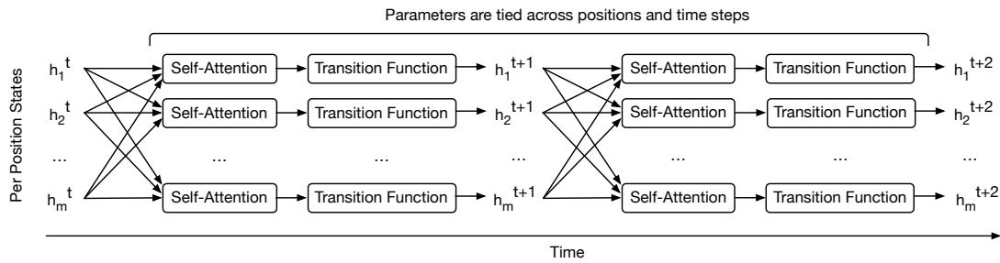  
Figure 1: Universal Transformer 通过使用自注意力机制（参见公式 2）结合来自不同位置的信息，并在所有时间步 $1 \leq t \leq T$ 上应用循环转换函数（参见公式 4），并行地为序列的每个位置反复提炼一系列向量表示。我们展示了该过程在两个循环时间步上的情况。箭头表示操作之间的依赖关系。最初，$\dot { h } ^ { 0 }$ 使用序列中每个符号的嵌入进行初始化。$h _ { i } ^ { t }$ 表示在循环时间步 t 时输入符号 $1 \leq i \leq$ m 的表示。在动态停机机制下，T 针对每个位置动态确定（第 2.2 节）。

在本文中，我们提出了通用Transformer（Universal Transformer, UT），这是一种时间并行（parallel-in-time）的循环自注意力序列模型，可被视为Transformer模型的一种推广，在广泛且具有挑战性的序列到序列任务上提供了更强的理论能力并取得了更好的效果。UT将类似Transformer的前馈序列模型的并行性和全局感受野，与循环神经网络（RNNs）的循环归纳偏置相结合，后者似乎更适合一系列算法和自然语言理解序列到序列问题。正如其名称所示，与标准Transformer相比，在特定假设下，UT被证明是图灵完备的（或如第4节所示的“计算通用性”）。

在每个循环步骤中，通用Transformer利用自注意力机制（Parikh et al., 2016; Lin et al., 2017）并行地迭代细化序列中所有符号的表示，随后通过由深度可分离卷积（Chollet, 2016; Kaiser et al., 2017）或逐位置全连接层构成的变换（在所有位置和时间步上共享）（参见 Fig 1）。我们还添加了逐位置的动态停机机制（Graves, 2016），允许模型为每个符号动态选择所需的细化步骤数，并首次证明了这种条件计算机制实际上可以提高若干较小的结构化算法和语言推理任务的准确率（尽管它在机器翻译（MT）上的效果略有下降）。

我们强有力的实验结果表明，UT在广泛的任务中均优于Transformer和LSTM。增加的循环机制在机器翻译中带来了效果提升，UT的表现优于标准Transformer。在若干算法任务和bAbI语言理解任务的实验中，UT相比LSTM和标准Transformer也有一致且显著的提升。此外，在具有挑战性的LAMBADA文本理解数据集上，带有动态停机机制的UT取得了新的最优结果（state of the art）。

## 2 模型描述

## 2.1 通用TRANSFORMER (THE UNIVERSAL TRANSFORMER)

通用Transformer（UT；参见 Fig. 2）基于大多数神经序列到序列模型中常用的编码器-解码器架构（Sutskever et al., 2014; Cho et al., 2014; Vaswani et al., 2017）。UT的编码器和解码器分别通过将循环神经网络应用于输入和输出序列中每个位置的表示来运作。然而，与循环神经网络在序列数据中的大多数应用不同，UT不是在序列中的位置上进行循环，而是在每个位置的向量表示的连续修正上（即在“深度”上）进行循环。换句话说，UT在计算上不受序列中符号数量的约束，而仅受对每个符号表示进行的修正次数的约束。

在每个循环时间步（recurrent time-step）中，每个位置的表示都会在两个子步骤中并发（并行）修正：首先，使用自注意力机制在序列中的所有位置之间交换信息，从而为每个位置生成一个向量表示，该表示结合了上一时间步所有其他位置的表示信息。然后，在每个位置上独立地对自注意力机制的输出应用转移函数（该函数跨位置和时间共享）。由于循环转移函数可以应用任意次数，这意味着 UT（Universal Transformer）可以具有可变深度（每个符号的处理步数）。至关重要的是，这与大多数流行的神经序列模型形成对比，包括 Transformer（Vaswani et al., 2017）或深度 RNN，后者由于应用了固定堆叠的层而具有恒定的深度。我们现在更详细地描述编码器和解码器。

编码器（ENCODER）：给定长度为 $m$ 的输入序列，我们从一个矩阵 $H ^ { 0 } \in \mathbb { R } ^ { m \times d }$ 开始，其各行被初始化为序列中每个位置处符号的 d 维嵌入。随后，UT 通过应用 Vaswani et al. (2017) 中的多头点积自注意力机制，紧接着应用循环转移函数，并行地为所有 $m$ 个位置迭代计算步长 t 处的表示 $H ^ { t }$。我们还在每个这些函数块周围添加了残差连接，并应用了 dropout 和层归一化（Layer Normalization）（Srivastava et al., 2014; Ba et al., 2016）（简化示意图参见 Fig. 2，完整模型参见附录 A 中的 Fig. 4）。

更具体地，我们使用缩放点积注意力（scaled dot-product attention），它按如下方式组合查询 Q、键 K 和值 V

$$
\operatorname{ATTENTION} (Q, K, V) = \operatorname{SOFTMAX} \left(\frac {Q K ^ {T}}{\sqrt {d}}\right) V,\tag{1}
$$

其中 d 是 Q、K 和 V 的列数。我们使用具有 k 个头的多头版本，正如 (Vaswani et al., 2017) 中所介绍的，

$$
\mathbf {M U L T I H E A D S E L F A T T E N T I O N} (H ^ {t}) = \mathbf {C O N C A T} (\mathrm{head} _ {1}, \dots , \mathrm{head} _ {\mathrm{k}}) W ^ {O}\tag{2}
$$

$$
\text { where   } \mathrm{head} _ {i} = \text { ATTENTION } (H ^ {t} W _ {i} ^ {Q}, H ^ {t} W _ {i} ^ {K}, H ^ {t} W _ {i} ^ {V})\tag{3}
$$

并且我们使用学习到的参数矩阵 $\begin{array} { r } { \dot { W ^ { Q } } \in \mathbb { R } ^ { d \times d / k } , \boldsymbol { W } ^ { \hat { K } } \in \mathbb { R } ^ { d \times d / \hat { k } } , \boldsymbol { W } ^ { V } \in \mathbb { R } ^ { d \times d / k } \mathrm { a n d } \boldsymbol { W } ^ { \hat { O } ^ { * } } \in \mathbb { R } ^ { d \times d / k } } \end{array}$ 通过仿射投影将状态 $H ^ { t }$ 映射到查询、键和值

在步长 t，UT 随后按如下方式为所有 m 个输入位置计算修正后的表示 $H ^ { t } \in \mathbb { R } ^ { m \times d }$：

$$
H ^ {t} = \text { LAYERNORM } (A ^ {t} + \text { TRANSITION } (A ^ {t}))\tag{4}
$$

$$
\text { where } A ^ {t} = \text { LAYERNorm } ((H ^ {t - 1} + P ^ {t}) + \text { MULTIHEADSELFATTENTION } (H ^ {t - 1} + P ^ {t})),\tag{5}
$$

其中 LAYERNORM() 定义见 Ba et al. (2016)，TRANSITION() 和 $P ^ { t }$ 将在下文讨论。

根据任务的不同，我们使用两种不同转换函数中的一种：要么是可分离卷积（Chollet, 2016），要么是在两个仿射变换之间包含单个线性整流（rectified-linear）激活函数的全连接神经网络，该网络以逐位置的方式应用，即单独应用于 A<sup>t</sup> 的每一行。

上述 $P ^ { t } \in \mathbb { R } ^ { m \times d }$ 是固定的、常数的二维（位置、时间）坐标嵌入，通过针对每个向量维度 $1 \leq j \leq d$ 分别计算如 (Vaswani et al., 2017) 中定义的位置 $1 \leq i \leq r$ m 和时间步 $1 \leq t \leq T$ 的正弦位置嵌入向量并求和得到：

$$
P _ {i, 2 j} ^ {t} = \sin (i / 1 0 0 0 0 ^ {2 j / d}) + \sin (t / 1 0 0 0 0 ^ {2 j / d})\tag{6}
$$

$$
P _ {i, 2 j + 1} ^ {t} = \cos (i / 1 0 0 0 0 ^ {2 j / d}) + \cos (t / 1 0 0 0 0 ^ {2 j / d}).\tag{7}
$$

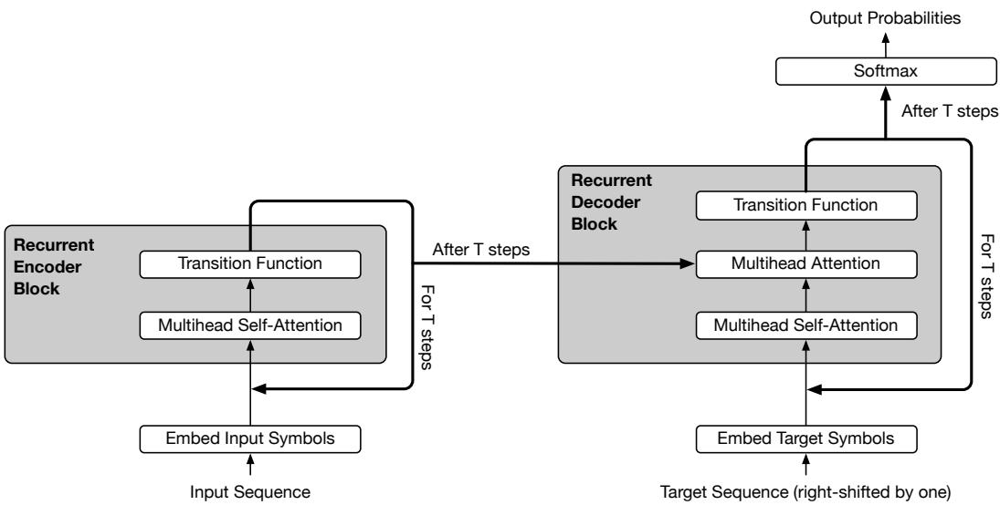  
Figure 2: Universal Transformer 编码器和解码器的循环块。此图省略了位置和时间步编码，以及 dropout、残差连接和层归一化。完整版本见附录 A。具有动态停机（dynamic halting）机制的 Universal Transformer 使用 ACT (Graves, 2016) 单独为每个位置确定步数 T。

经过 T 步（每一步都并行更新输入序列的所有位置）后，Universal Transformer 编码器的最终输出是一个由输入序列中 m 个符号的 d 维向量表示构成的矩阵 $H ^ { T } \in \mathbb { R } ^ { m \times d }$。

DECODER（解码器）：解码器具有与编码器相同的基本循环结构。然而，在自注意力函数之后，解码器还使用与公式 2 相同的多头点积注意力函数，额外关注输入序列各位置的最终编码器表示 $H ^ { T }$，但其中的查询 Q 是通过投影解码器表示获得的，而键和值（K 和 V）则是通过投影编码器表示获得的（该过程类似于标准注意力机制 (Bahdanau et al., 2014)）。

与 Transformer 模型类似，UT 是自回归的（Graves, 2013）。该模型使用 Teacher-Forcing 进行训练，在生成时一次生成一个输出符号，解码器接收先前生成的输出位置。在训练期间，解码器的输入是向右平移一个位置的目标输出。解码器的自注意力分布被进一步掩码（masked），使得模型只能关注任何预测符号左侧的位置。最后，通过对最终解码器状态应用仿射变换 $O \in \mathbb { R } ^ { d \times V }$ 到输出词表大小 V，然后经过 softmax 处理，得到一个按行归一化的 $(m \times V)$ 维输出矩阵，从而获得每个符号的目标分布：

$$
p \big (y _ {p o s} | y _ {[ 1: p o s - 1 ]}, H ^ {T} \big) = \mathrm{SOFTMAX} (O H ^ {T}) ^ {1}\tag{8}
$$

为了从模型中进行生成，首先针对条件输入序列运行一次编码器。然后重复运行解码器，接收所有已经生成的符号，并在每次迭代中为下一个输出位置的符号额外生成一个在词表上的分布。接着，我们通常采样或选择概率最高的符号作为下一个符号。

## 2.2 动态停机

在序列处理系统中，某些符号（例如某些词或音素）通常比其他符号更具歧义性。因此，为这些更具歧义的符号分配更多的处理资源是合理的。自适应计算时间（Adaptive Computation Time, ACT）（Graves, 2016）是一种机制，用于在标准循环神经网络中，根据模型在每一步预测的标量停机概率，动态调节处理每个输入符号所需的计算步数（称为“思考时间”，ponder time）。

<table><tr><td rowspan="2">模型</td><td colspan="2">10K 样本</td><td colspan="2">1K 样本</td></tr><tr><td>单任务训练</td><td>联合训练</td><td>单任务训练</td><td>联合训练</td></tr><tr><td colspan="5">此前最佳结果：</td></tr><tr><td>QRNet (Seo et al., 2016)</td><td>0.3 (0/20)</td><td>-</td><td>-</td><td>-</td></tr><tr><td>Sparse DNC (Rae et al., 2016)</td><td>-</td><td>2.9 (1/20)</td><td>-</td><td>-</td></tr><tr><td>GA+MAGE Dhingra et al. (2017)</td><td>-</td><td>-</td><td>8.7 (5/20)</td><td>-</td></tr><tr><td>MemN2N Sukhbaatar et al. (2015)</td><td>-</td><td>-</td><td>-</td><td>12.4 (11/20)</td></tr><tr><td colspan="5">我们的结果：</td></tr><tr><td>Transformer (Vaswani et al., 2017)</td><td>15.2 (10/20)</td><td>22.1 (12/20)</td><td>21.8 (5/20)</td><td>26.8 (14/20)</td></tr><tr><td>Universal Transformer（本工作）</td><td>0.23 (0/20)</td><td>0.47 (0/20)</td><td>5.31 (5/20)</td><td>8.50 (8/20)</td></tr><tr><td>带有动态停机的 UT（本工作）</td><td>0.21 (0/20)</td><td>0.29 (0/20)</td><td>4.55 (3/20)</td><td>7.78 (5/20)</td></tr></table>

Table 1：在不同训练/评估设置下，bAbI 数据集上的平均错误率以及 20 个任务中失败的任务数（错误率 > 5%）（括号内；两项指标均越低越好）。我们在有可用数据时标出了各设置下的最先进水平（state-of-the-art），否则标为“-”。

受到将 Universal Transformer 解释为在序列的所有位置上并行应用自注意力 RNN 的启发，我们还为每个位置添加了动态 ACT 停机机制（即应用到每个符号级的自注意力 RNN 中；详见附录 C）。一旦逐符号的循环块停机，其状态就会直接复制到下一步，直到所有块都停机，或者达到最大步数。然后，编码器的最终输出就是通过这种方式生成的最终层表征。

## 3 实验与分析

我们在一些列算法和语言理解任务以及机器翻译上评估了 Universal Transformer。我们在附录 D 中更详细地描述了这些任务和数据集。

## 3.1 BABI 问答

bAbi 问答数据集（Weston et al., 2015）由 20 个不同的任务组成，其目标是在给定若干包含可能多个支持事实的英文句子的前提下回答问题。该任务的目标是通过要求对每个故事中呈现的语言事实进行某种类型的推理，来衡量各种形式的语言理解能力。标准 Transformer 在该任务上未能取得良好的结果<sup>2</sup>。然而，我们设计了一个基于 Universal Transformer 的模型，该模型在此任务上取得了最先进（state-of-the-art）的结果。

为了对输入进行编码，类似于 Henaff et al. (2016)，我们首先通过对每个词的嵌入应用一个可学习的乘性位置掩码（multiplicative positional mask），并将所有嵌入相加来对故事中的每个事实进行编码。我们以相同的方式嵌入问题，然后将这些事实和问题的嵌入输入到（Universal）Transformer 中。

正如最初提出的那样，模型既可以在每个任务上单独训练（“单任务训练/train single”），也可以在所有任务上联合训练（“联合训练/train joint”）。Table 1 总结了我们的结果。与先前的研究类似，我们使用不同的初始化进行了 10 次运行，并根据验证集上的性能挑选了最佳模型。在 10K 和 1K 两种训练规模下，UT 以及带有动态停机的 UT 在平均错误率和失败任务数<sup>3</sup>方面，在所有任务上均取得了最先进的结果（按任务细分的结果见附录 E）。

为了更好地理解该模型的工作机制，我们分析了该任务的注意力分布以及平均 ACT 思考时间（ponder times）（详见附录 F）。首先，我们观察到注意力分布起初非常均匀，但在后续步骤中，逐渐聚焦在回答每个问题所需的正确支持性事实周围，这与人类解决该任务的方式确实非常相似。其次，在采用动态停机（dynamic halting）的情况下，我们观察到测试数据的所有样本中，对于需要三个支持性事实的任务，所有位置的平均思考时间（即每个符号循环处理链的深度）较高（3.8±2.2），高于仅需两个支持性事实的任务（3.1±1.1），而后者又高于仅需一个支持性事实的任务（2.3±0.8）。这表明模型会根据回答问题所需支持性事实的数量来调整处理步数。最后，我们观察到，与需要两个和三个支持性事实的任务相比，仅需一个支持性事实的任务在不同位置上的思考时间直方图更加均匀；同样，需要两个支持性事实的任务比需要三个的也更为均匀。特别是对于需要三个支持性事实的任务，许多位置在第 1 步或第 2 步就已经停机，只有少数位置会经历更多步的转换（参见图 3 示例）。这一点尤其值得关注，因为在这种设定下故事的长度确实要长得多，包含更多无关事实，而模型似乎通过这种方式成功学会了忽略它们。

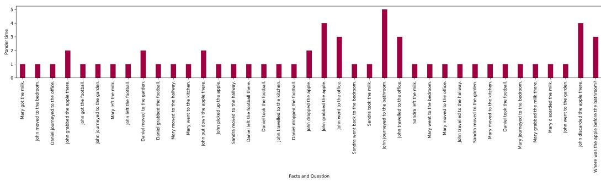  
Figure 3: 带有动态停机的 UT 在需要三个支持性事实的 bAbI 任务中编码故事中的事实和问题时的思考时间。

与动态记忆网络（Dynamic Memory Networks，Kumar et al., 2016）类似，UT 中存在一个迭代注意力过程，使模型能够根据前几次迭代的结果来调整其对记忆的注意力。附录 F 给出了若干示例，说明 UT 中存在时间状态（temporal states）的概念，模型在每一步中根据前几步的输出更新其状态（记忆），而这一更新链也可以被视作多跳推理（multi-hop reasoning）过程中的若干步骤。

## 3.2 主谓一致

接下来，我们考虑预测英语句子中主语和动词之间的数一致性（number-agreement）任务（Linzen et al., 2016）。该任务可作为衡量模型捕捉自然语言句子中层级（依存）结构能力的代表性指标。我们使用 (Linzen et al., 2016) 提供的数据集，并遵循其实验方案，即采用语言建模训练设置（即预测下一个词的目标）来解决该任务，随后在测试阶段计算目标动词的排序准确率。我们在具有不同任务难度的测试数据子集上评估了模型，难度通过一致性干扰词（agreement attractors）来衡量——即与主语具有相反数特征的介入名词数量（旨在混淆模型）。例如，给定句子 *The keys to the cabinet*<sup>4</sup>，训练期间的目标是预测动词 *are*（复数）。在测试阶段，我们接着评估一致性干扰词的排序准确率：即在此例中，目标是将 *are* 的排序排在 *is* 之前。

我们的结果汇总在 Table 2 中。文献中表现最好的带注意力机制的 LSTM 在该任务上达到了 99.18%（Yogatama et al., 2018），优于原版 Transformer（Tran et al., 2018）。UT（Universal Transformer，通用 Transformer）显著优于标准 Transformer，并取得了与当前最先进水平相当的平均结果（99.2%）。然而，我们发现随着干扰词数量的增加，UT（特别是带有动态停机机制的 UT）的表现逐步优于所有其他模型（见最后一行，∆）。

## 3.3 LAMBADA 语言建模

LAMBADA 任务（Paperno et al., 2016）是一项语言建模任务，包含在给定前文 4-5 个句子的更广泛上下文下预测缺失目标词。该数据集经过特殊设计，人类在看到完整上下文时能够准确预测目标词，但仅看到目标词所在的单句时则无法预测。因此，它超越了普通的语言建模，测试了模型在预测目标词时整合更广泛语篇和更长期上下文的能力。

<table><tr><td rowspan="2">模型</td><td colspan="6">干扰项（attractor）数量</td><td rowspan="2">总计</td></tr><tr><td>0</td><td>1</td><td>2</td><td>3</td><td>4</td><td>5</td></tr><tr><td colspan="8">此前最佳结果 (Yogatama et al., 2018)：</td></tr><tr><td>最佳 Stack-RNN</td><td>0.994</td><td>0.979</td><td>0.965</td><td>0.935</td><td>0.916</td><td>0.880</td><td>0.992</td></tr><tr><td>最佳 LSTM</td><td>0.993</td><td>0.972</td><td>0.950</td><td>0.922</td><td>0.900</td><td>0.842</td><td>0.991</td></tr><tr><td>最佳 Attention</td><td>0.994</td><td>0.977</td><td>0.959</td><td>0.929</td><td>0.907</td><td>0.842</td><td>0.992</td></tr><tr><td colspan="8">我们的结果：</td></tr><tr><td>Transformer</td><td>0.973</td><td>0.941</td><td>0.932</td><td>0.917</td><td>0.901</td><td>0.883</td><td>0.962</td></tr><tr><td>Universal Transformer</td><td>0.993</td><td>0.971</td><td>0.969</td><td>0.940</td><td>0.921</td><td>0.892</td><td>0.992</td></tr><tr><td>UT w/ ACT</td><td>0.994</td><td>0.969</td><td>0.967</td><td>0.944</td><td>0.932</td><td>0.907</td><td>0.992</td></tr><tr><td>Δ (UT w/ ACT - 最佳)</td><td>0</td><td>-0.008</td><td>0.002</td><td>0.009</td><td>0.016</td><td>0.027</td><td>-</td></tr></table>

Table 2：主谓一致数预测任务的准确率（越高越好）。

<table><tr><td rowspan="2">模型</td><td colspan="3">LM 困惑度与（准确率）</td><td colspan="3">RC 准确率</td></tr><tr><td>对照集</td><td>开发集</td><td>测试集</td><td>对照集</td><td>开发集</td><td>测试集</td></tr><tr><td>Neural Cache (Grave et al., 2016)</td><td>129</td><td>139</td><td>-</td><td>-</td><td>-</td><td>-</td></tr><tr><td>Dhingra et al. Dhingra et al. (2018)</td><td>-</td><td>-</td><td>-</td><td>-</td><td>-</td><td>0.5569</td></tr><tr><td>Transformer</td><td>142 (0.19)</td><td>5122 (0.0)</td><td>7321 (0.0)</td><td>0.4102</td><td>0.4401</td><td>0.3988</td></tr><tr><td>LSTM</td><td>138 (0.23)</td><td>4966 (0.0)</td><td>5174 (0.0)</td><td>0.1103</td><td>0.2316</td><td>0.2007</td></tr><tr><td>UT base，6 步（固定）</td><td>131 (0.32)</td><td>279 (0.18)</td><td>319 (0.17)</td><td>0.4801</td><td>0.5422</td><td>0.5216</td></tr><tr><td>UT w/ dynamic halting</td><td>130 (0.32)</td><td>134 (0.22)</td><td>142 (0.19)</td><td>0.4603</td><td>0.5831</td><td>0.5625</td></tr><tr><td>UT base，8 步（固定）</td><td>129(0.32)</td><td>192 (0.21)</td><td>202 (0.18)</td><td>-</td><td>-</td><td>-</td></tr><tr><td>UT base，9 步（固定）</td><td>129(0.33)</td><td>214 (0.21)</td><td>239 (0.17)</td><td>-</td><td>-</td><td>-</td></tr></table>

Table 3：LAMBADA 语言模型（LM）困惑度（越低越好）及括号内的准确率（越高越好），以及阅读理解（RC）准确率结果（越高越好）。“-”表示该设定下无报告结果。

该任务在两种设置下进行评估：作为语言建模（标准设置）和作为阅读理解。在前一种（更具挑战性的）情况下，模型仅在训练数据上针对下一个词预测进行训练，并在测试时针对目标词进行评估（即模型被训练用于预测所有词，而非专门针对具有挑战性的目标词）。在后一种由 Chu et al. (2017) 引入的设置中，目标句子（去掉最后一个词）被用作从上下文句子中选择目标词的查询（query）。请注意，目标词有 81% 的概率出现在上下文中，这使得该设置简单得多。然而在剩余 19% 的情况下，该任务是不可能完成的。

结果如 Table 3 所示。Universal Transformer 在语言建模和阅读理解设置中均取得了最先进的（state-of-the-art）结果，优于 LSTM 和标准 Transformer。请注意，对照集的构建方式与 LAMBADA 开发集和测试集类似，但未经过任何方式的过滤，因此在该集合上取得良好结果展现了模型在标准语言建模方面的实力。

我们最佳的固定步数 UT 结果使用了 6 个步骤。然而，在测试数据的所有位置和样本上，带有动态停止（dynamic halting）的最佳 UT 所采取的平均步骤数为 8.2±2.1。为了探究动态模型表现更好是否仅仅是因为它执行了更多步骤，我们分别训练了具有 8 步和 9 步的两个固定步数 UT 模型（见最后两行）。有趣的是，与 6 步模型相比，这两个模型取得了更好的结果，但仍未超过带有动态停止的 UT。这使我们相信，动态停止可以通过激励某些输入符号使用较少的步骤、同时允许其他输入符号进行更多计算，从而对模型起到有益的正则化作用。

## 3.4 算法任务

我们在三个算法任务上训练了 UT，即复制（Copy）、翻转（Reverse）和（整数）加法（Addition），这些任务均基于由十进制符号（‘0’-‘9’）组成的字符串。在所有实验中，我们在长度为 40 的序列上训练模型，并在长度为 400 的序列上进行评估（Kaiser & Sutskever, 2016）。我们使用以随机偏移量开始的位置来训练 UT，以进一步促使模型学习相对位置变换。结果如 Table 4 所示。在所有这三项任务中，UT 都以较大优势超越了 LSTM 和标准 Transformer。Neural GPU 在此任务上报告了完美的结果（Kaiser & Sutskever, 2016），但我们注意到该结果需要一种特殊的基于课程学习（curriculum-based）的训练协议，而该协议并未用于其他模型。

<table><tr><td rowspan="2">模型</td><td colspan="2">Copy</td><td colspan="2">Reverse</td><td colspan="2">Addition</td></tr><tr><td>char-acc</td><td>seq-acc</td><td>char-acc</td><td>seq-acc</td><td>char-acc</td><td>seq-acc</td></tr><tr><td>LSTM</td><td>0.45</td><td>0.09</td><td>0.66</td><td>0.11</td><td>0.08</td><td>0.0</td></tr><tr><td>Transformer</td><td>0.53</td><td>0.03</td><td>0.13</td><td>0.06</td><td>0.07</td><td>0.0</td></tr><tr><td>Universal Transformer</td><td>0.91</td><td>0.35</td><td>0.96</td><td>0.46</td><td>0.34</td><td>0.02</td></tr><tr><td>Neural GPU*</td><td>1.0</td><td>1.0</td><td>1.0</td><td>1.0</td><td>1.0</td><td>1.0</td></tr></table>

Table 4: 算法任务上的准确率（越高越好）。<sup>∗</sup>请注意，Neural GPU 采用了特殊的课程学习（curriculum）进行训练以获得完美结果，而其他模型在训练时均未采用任何课程学习。

<table><tr><td rowspan="2">模型</td><td colspan="2">Copy</td><td colspan="2">Double</td><td colspan="2">Reverse</td></tr><tr><td>char-acc</td><td>seq-acc</td><td>char-acc</td><td>seq-acc</td><td>char-acc</td><td>seq-acc</td></tr><tr><td>LSTM</td><td>0.78</td><td>0.11</td><td>0.51</td><td>0.047</td><td>0.91</td><td>0.32</td></tr><tr><td>Transformer</td><td>0.98</td><td>0.63</td><td>0.94</td><td>0.55</td><td>0.81</td><td>0.26</td></tr><tr><td>Universal Transformer</td><td>1.0</td><td>1.0</td><td>1.0</td><td>1.0</td><td>1.0</td><td>1.0</td></tr></table>

Table 5: 记忆类 LTE 任务上的字符级准确率（char-acc）和序列级准确率（seq-acc）结果，最大长度为 55。

<table><tr><td rowspan="2">模型</td><td colspan="2">Program</td><td colspan="2">Control</td><td colspan="2">Addition</td></tr><tr><td>char-acc</td><td>seq-acc</td><td>char-acc</td><td>seq-acc</td><td>char-acc</td><td>seq-acc</td></tr><tr><td>LSTM</td><td>0.53</td><td>0.12</td><td>0.68</td><td>0.21</td><td>0.83</td><td>0.11</td></tr><tr><td>Transformer</td><td>0.71</td><td>0.29</td><td>0.93</td><td>0.66</td><td>1.0</td><td>1.0</td></tr><tr><td>Universal Transformer</td><td>0.89</td><td>0.63</td><td>1.0</td><td>1.0</td><td>1.0</td><td>1.0</td></tr></table>

Table 6: 程序评测类 LTE 任务上的字符级准确率（char-acc）和序列级准确率（seq-acc）结果，最大嵌套深度为 2，长度为 5。

## 3.5 学习执行（LEARNING TO EXECUTE，LTE）

作为另一类序列到序列（sequence-to-sequence）学习问题，我们还根据 (Zaremba & Sutskever, 2015) 中提出的任务评估了 UT，这些任务用于测试模型学习执行计算机程序的能力。这些任务包括程序评测任务（program、control 和 addition）以及记忆任务（copy、double 和 reverse）。

我们使用 (Zaremba & Sutskever, 2015) 中讨论的混合策略（mix-strategy）来生成数据集。与 (Zaremba & Sutskever, 2015) 不同的是，我们在训练期间不使用任何课程学习（curriculum learning）策略，并且在测试时不使用目标序列。表 5 和表 6 分别展示了 LSTM 模型、Transformer 和 Universal Transformer 在程序求值（program evaluation）和记忆（memorization）任务上的性能。UT 在所有记忆任务中均取得了满分，并且在所有程序求值任务中也大幅超越了 LSTM 和 Transformer。

## 3.6 机器翻译

我们在 WMT 2014 英语-德语翻译任务上使用与 (Vaswani et al., 2017) 相同的设置训练了一个 UT，以评估其在大规模序列到序列（sequence-to-sequence）任务上的性能。结果汇总在 Table 7 中。采用全连接循环转移函数（而非可分离卷积）且不使用 ACT 的 UT，相比参数量大致相同的 Transformer 提高了 0.9 个 BLEU 值，相比 Weighted Transformer 提高了 0.5 个 BLEU 值 (Ahmed et al., 2017)。

<table><tr><td>模型</td><td>BLEU</td></tr><tr><td>Universal Transformer small</td><td>26.8</td></tr><tr><td>Transformer base (Vaswani et al., 2017)</td><td>28.0</td></tr><tr><td>Weighted Transformer base (Ahmed et al., 2017)</td><td>28.4</td></tr><tr><td>Universal Transformer base</td><td>28.9</td></tr></table>

Table 7: 在 8 块 P100 GPU 上以可比的训练设置在 WMT14 En-De 翻译任务上训练的机器翻译结果。所有 base 结果具有相同数量的参数。

## 4 讨论

当运行固定步数时，Universal Transformer 等价于在所有层之间共享参数的多层 Transformer。这在某种程度上类似于 Recursive Transformer，后者在深度方向上共享了其自注意力层的权重 (Gulcehre et al., 2018)<sup>5</sup>。然而，由于针对每个符号的循环转移函数可以应用任意次数，描述 UT 的另一种可能更具启发性的方式是将其视为一组并行 RNN（每个符号对应一个，且共享参数），它们并发演化每个符号的隐藏状态，每一步均通过对上一步的隐藏状态序列进行注意力计算来生成。从这个角度来看，它与 Neural GPU (Kaiser & Sutskever, 2016) 和 Neural Turing Machine (Graves et al., 2014) 等架构相关。因此，UT 既保留了原始前馈 Transformer 模型极具吸引力的计算效率，又增添了 RNN 的循环归纳偏置（recurrent inductive bias）。此外，通过使用动态停机机制，UT 能够根据输入数据选择处理步数。

Universal Transformer 与其他序列模型之间的联系从其架构中即可显而易见：如果我们把循环步数限制为 1，它就是一个 Transformer。但更有趣的是探讨 Universal Transformer 与 RNN 以及其他循环发生在时间维度上的网络之间的关系。表面上看，这些模型可能非常相似，因为它们同样具有循环特性。但存在一个关键区别：像 RNN 这样的时间循环模型在循环步中无法访问记忆（memory）。这使得它们在计算上更类似于自动机（automata），因为循环部分中唯一可用的记忆是一个固定大小的状态向量。而另一方面，UT 可以关注（attend to）整个前一层，从而使其能够在循环步中访问记忆。

在拥有充足记忆的条件下，Universal Transformer 是计算通用的（computationally universal）——即它属于可用于模拟任意图灵机（Turing machine）的模型类别，从而解决了标准 Transformer 模型的这一缺陷 <sup>6</sup>。除了在理论上具有吸引力之外，我们的实验结果还表明，这种增强的表达能力在若干具有挑战性的序列建模任务上也带来了准确率的提升。这缩小了在大规模任务（如机器翻译）上具有竞争力的实用序列模型，与可以通过梯度下降进行训练以执行算法任务的计算通用模型（如 Neural Turing Machine 或 Neural GPU，Graves et al., 2014; Kaiser & Sutskever, 2016）之间的差距。

为了证明这一点，我们可以将 Neural GPU 约化为 Universal Transformer。忽略解码器并将自注意力模块（即带有残差连接的自注意力）参数化为恒等函数，我们假设转移函数为卷积操作。如果我们现在将总循环步数 T 设置为等于输入长度，我们就能精确地得到一个 Neural GPU。请注意，最后一步正是 Universal Transformer 与原生 Transformer 的关键区别所在，后者的深度无法随输入的大小动态缩放。Universal Transformer 与 Neural Turing Machine 之间也存在类似的关系，后者每一步的单次读/写操作可以通过 Universal Transformer 的全局、并行表征更新来表示。然而，与这些仅在算法任务上表现良好的模型相比，Universal Transformer 在现实的自然语言任务（如 LAMBADA 和机器翻译）上也取得了具有竞争力的结果。

另一个相关的模型架构是端到端记忆网络（End-to-End Memory Networks，Sukhbaatar et al., 2015）。然而，与端到端记忆网络相比，Universal Transformer 使用的记忆与对其输入或输出的各个位置对齐的状态相对应。此外，Universal Transformer 采用编码器-解码器（encoder-decoder）结构，并在大规模序列到序列任务中取得了具有竞争力的性能。

## 5 结论

本文提出了 Universal Transformer，这是 Transformer 模型的一种泛化形式，它扩展了其理论能力，并在广泛且具有挑战性的序列建模任务（例如语言理解以及各种算法任务）上取得了最先进（state-of-the-art）的结果，从而解决了标准 Transformer 的一个关键缺陷。Universal Transformer 将以下关键特性结合到了一个模型中：

权重共享（Weight sharing）：遵循 CNN 和 RNN 中权重共享背后的直觉，我们通过一种简单的权重共享形式对 Transformer 进行了扩展，在归纳偏置（inductive bias）与模型表达能力之间取得了有效的平衡，我们通过小规模和大规模实验对此进行了充分展示。

条件计算（Conditional computation）：为了构建一个在计算上具有通用性的机器，我们通过最近引入的一种机制，使 Universal Transformer 具备了停止或继续计算的能力，与固定深度的 Universal Transformer 相比，该机制展现出了更强的结果。

我们对时间并行（parallel-in-time）序列模型的最新进展感到非常兴奋。通过增加计算容量以及处理深度上的循环结构（recurrence），我们希望在本文提出的基础 Universal Transformer 之外的进一步改进，能够帮助我们构建出更加强大、数据效率更高且泛化能力超越当前最先进水平的学习算法。

用于训练和评估 Universal Transformer 的代码可在 https: //github.com/tensorflow/tensor2tensor（Vaswani et al., 2018）获取。

致谢（Acknowledgements） 我们非常感谢 Ashish Vaswani、Douglas Eck 和 David Dohan 提出的富有成效的意见和启发。

## 参考文献

Karim Ahmed, Nitish Shirish Keskar, and Richard Socher. Weighted transformer network for machine translation. arXiv preprint arXiv:1711.02132, 2017.

Jimmy Lei Ba, Jamie Ryan Kiros, and Geoffrey E Hinton. Layer normalization. arXiv preprint arXiv:1607.06450, 2016. URL http://arxiv.org/abs/1607.06450.

Dzmitry Bahdanau, Kyunghyun Cho, and Yoshua Bengio. Neural machine translation by jointly learning to align and translate. CoRR, abs/1409.0473, 2014. URL http://arxiv.org/abs/1409.0473.

Kyunghyun Cho, Bart van Merrienboer, Caglar Gulcehre, Fethi Bougares, Holger Schwenk, and Yoshua Bengio. Learning phrase representations using RNN encoder-decoder for statistical machine translation. CoRR, abs/1406.1078, 2014. URL http://arxiv.org/abs/1406.1078.

Francois Chollet. Xception: Deep learning with depthwise separable convolutions. arXiv preprint arXiv:1610.02357, 2016.

Zewei Chu, Hai Wang, Kevin Gimpel, and David McAllester. Broad context language modeling as reading comprehension. In Proceedings of the 15th Conference of the European Chapter of the Association for Computational Linguistics: Volume 2, Short Papers, volume 2, pp. 52–57, 2017.

Bhuwan Dhingra, Zhilin Yang, William W Cohen, and Ruslan Salakhutdinov. Linguistic knowledge as memory for recurrent neural networks. arXiv preprint arXiv:1703.02620, 2017.

Bhuwan Dhingra, Qiao Jin, Zhilin Yang, William W Cohen, and Ruslan Salakhutdinov. Neural models for reasoning over multiple mentions using coreference. arXiv preprint arXiv:1804.05922, 2018.

Jonas Gehring, Michael Auli, David Grangier, Denis Yarats, and Yann N. Dauphin. Convolutional sequence to sequence learning. CoRR, abs/1705.03122, 2017. URL http://arxiv.org/abs/1705.03122.

Edouard Grave, Armand Joulin, and Nicolas Usunier. Improving neural language models with a continuous cache. arXiv preprint arXiv:1612.04426, 2016.

Alex Graves. Generating sequences with recurrent neural networks. CoRR, abs/1308.0850, 2013. URL http://arxiv.org/abs/1308.0850.

Alex Graves. Adaptive computation time for recurrent neural networks. arXiv preprint arXiv:1603.08983, 2016.

Alex Graves, Greg Wayne, and Ivo Danihelka. Neural turing machines. CoRR, abs/1410.5401, 2014. URL http://arxiv.org/abs/1410.5401.

Caglar Gulcehre, Misha Denil, Mateusz Malinowski, Ali Razavi, Razvan Pascanu, Karl Moritz Hermann, Peter Battaglia, Victor Bapst, David Raposo, Adam Santoro, et al. Hyperbolic attention networks. arXiv preprint arXiv:1805.09786, 2018.

Mikael Henaff, Jason Weston, Arthur Szlam, Antoine Bordes, and Yann LeCun. Tracking the world state with recurrent entity networks. arXiv preprint arXiv:1612.03969, 2016.

Sepp Hochreiter, Yoshua Bengio, Paolo Frasconi, and Jürgen Schmidhuber. Gradient flow in recurrent nets: the difficulty of learning long-term dependencies. A Field Guide to Dynamical Recurrent Neural Networks, 2003.

A. Joulin and T. Mikolov. Inferring algorithmic patterns with stack-augmented recurrent nets. In Advances in Neural Information Processing Systems, (NIPS), 2015.

Łukasz Kaiser and Ilya Sutskever. Neural GPUs learn algorithms. In International Conference on Learning Representations (ICLR), 2016. URL https://arxiv.org/abs/1511.08228.

Łukasz Kaiser, Aidan N. Gomez, and Francois Chollet. Depthwise separable convolutions for neural machine translation. CoRR, abs/1706.03059, 2017. URL http://arxiv.org/abs/1706.03059.

Ankit Kumar, Ozan Irsoy, Peter Ondruska, Mohit Iyyer, James Bradbury, Ishaan Gulrajani, Victor Zhong, Romain Paulus, and Richard Socher. Ask me anything: Dynamic memory networks for natural language processing. In International Conference on Machine Learning, pp. 1378–1387, 2016.

Zhouhan Lin, Minwei Feng, Cicero Nogueira dos Santos, Mo Yu, Bing Xiang, Bowen Zhou, and Yoshua Bengio. A structured self-attentive sentence embedding. arXiv preprint arXiv:1703.03130, 2017.

Tal Linzen, Emmanuel Dupoux, and Yoav Goldberg. Assessing the ability of lstms to learn syntax-sensitive dependencies. Transactions ofthe Association ofComputational Linguistics, 4(1):521–535, 2016.

Denis Paperno, Germán Kruszewski, Angeliki Lazaridou, Ngoc Quan Pham, Raffaella Bernardi, Sandro Pezzelle, Marco Baroni, Gemma Boleda, and Raquel Fernandez. The lambada dataset: Word prediction requiring a broad discourse context. In Proceedings ofthe 54th Annual Meeting ofthe Associationfor Computational Linguistics (Volume 1: Long Papers), volume 1, pp. 1525–1534, 2016.

Ankur Parikh, Oscar Täckström, Dipanjan Das, and Jakob Uszkoreit. A decomposable attention model. In Empirical Methods in Natural Language Processing, 2016. URL https: //arxiv.org/pdf/1606.01933.pdf.

Jack Rae, Jonathan J Hunt, Ivo Danihelka, Timothy Harley, Andrew W Senior, Gregory Wayne, Alex Graves, and Tim Lillicrap. Scaling memory-augmented neural networks with sparse reads and writes. In Advances in Neural Information Processing Systems, pp. 3621–3629, 2016.

Minjoon Seo, Sewon Min, Ali Farhadi, and Hannaneh Hajishirzi. Query-reduction networks for question answering. arXiv preprint arXiv:1606.04582, 2016.

Nitish Srivastava, Geoffrey E Hinton, Alex Krizhevsky, Ilya Sutskever, and Ruslan Salakhutdinov. Dropout: a simple way to prevent neural networks from overfitting. Journal ofMachine Learning Research, 15(1): 1929–1958, 2014.

Sainbayar Sukhbaatar, arthur szlam, Jason Weston, and Rob Fergus. End-to-end memory networks. In C. Cortes, N. D. Lawrence, D. D. Lee, M. Sugiyama, and R. Garnett (eds.), Advances in Neural Information Processing Systems 28, pp. 2440–2448. Curran Associates, Inc., 2015. URL http://papers.nips.cc/paper/5846-end-to-end-memory-networks.pdf.

Ilya Sutskever, Oriol Vinyals, and Quoc V. Le. Sequence to sequence learning with neural networks. In Advances in Neural Information Processing Systems, pp. 3104–3112, 2014. URL http://arxiv.org/abs/1409.3215.

Ke Tran, Arianna Bisazza, and Christof Monz. The importance of being recurrent for modeling hierarchical structure. In Proceedings ofNAACL’18, 2018.

Ashish Vaswani, Noam Shazeer, Niki Parmar, Jakob Uszkoreit, Llion Jones, Aidan N. Gomez, Lukasz Kaiser, and Illia Polosukhin. Attention is all you need. CoRR, 2017. URL http://arxiv.org/abs/1706.03762.

Ashish Vaswani, Samy Bengio, Eugene Brevdo, Francois Chollet, Aidan N. Gomez, Stephan Gouws, Llion Jones, Łukasz Kaiser, Nal Kalchbrenner, Niki Parmar, Ryan Sepassi, Noam Shazeer, and Jakob Uszkoreit. Tensor2tensor for neural machine translation. CoRR, abs/1803.07416, 2018.

Jason Weston, Antoine Bordes, Sumit Chopra, Alexander M Rush, Bart van Merriënboer, Armand Joulin, and Tomas Mikolov. Towards ai-complete question answering: A set of prerequisite toy tasks. arXiv preprint arXiv:1502 05698, 2015

Dani Yogatama, Yishu Miao, Gabor Melis, Wang Ling, Adhiguna Kuncoro, Chris Dyer, and Phil Blunsom. Memory architectures in recurrent neural network language models. In International Conference on Learning Representations, 2018. URL https://openreview.net/forum?id=SkFqf0lAZ.

Wojciech Zaremba and Ilya Sutskever. Learning to execute. CoRR, abs/1410.4615, 2015. URL http://arxiv.org/abs/1410.4615.

# 附录 A UNIVERSAL TRANSFORMER 的详细架构图

“N”个输入符号  
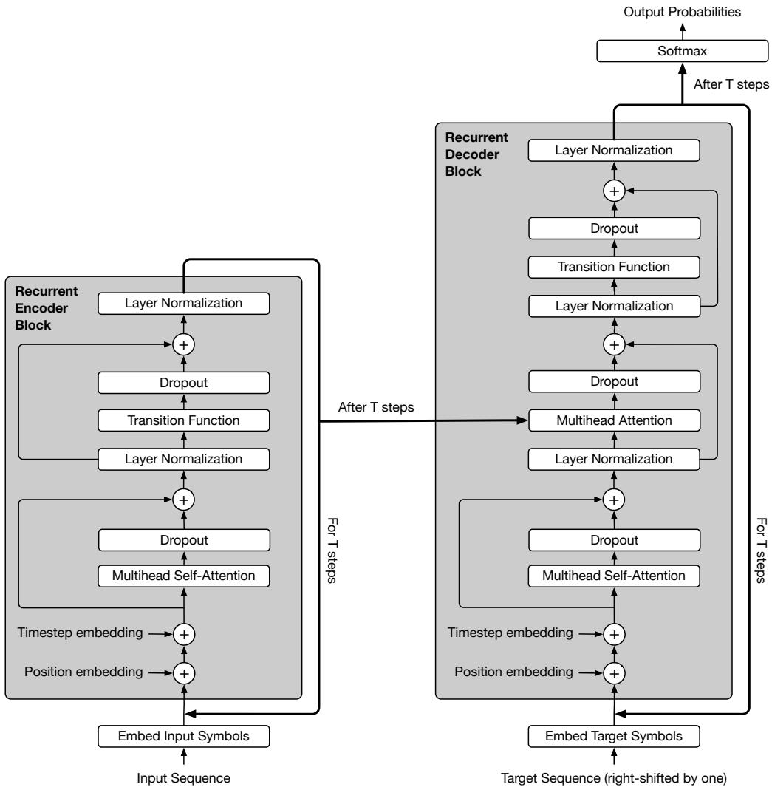  
Figure 4: 包含位置和步数嵌入（embedding）以及 dropout 和层归一化（layer normalization）的 Universal Transformer。

## 附录 B 关于 UT 与 TRANSFORMER 的计算能力

在计算能力方面，Transformer 与 Universal Transformer 之间的关键区别在于顺序计算步数（即深度）。虽然标准 Transformer 执行的操作总数会随输入规模缩放，但顺序操作的次数是恒定的，独立于输入大小，且完全由层数决定。在有限精度的假设下，这种性质意味着标准 Transformer 在计算上不具备通用性（computationally universal）。然而，当将步数选择为输入长度的函数时，Universal Transformer 则不受此限制。需要注意的是，无论是否采用自适应计算时间（adaptive computation time），这一结论都成立，但前提是步数是非常量的（即使可能是确定性的）。通过在 Universal Transformer 的各个顺序计算步骤之间共享权重，模型能够在训练后动态改变步数。

一个直观的例子是那些其执行过程需要按顺序逐个处理输入元素的函数。在这种情况下，对于任意给定的深度选择 T，都可以构造一个长度为 $N > T$ 的输入序列，使其无法被标准 Transformer 正确处理。然而，只要对顺序步数做出适当的、依赖于输入长度的选择，Universal Transformer、RNN 或 Neural GPU 都可以执行此类函数。

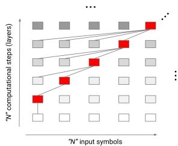

## 附录 C 具有动态停机机制的 UT

我们在 TensorFlow 中基于 ACT（Graves, 2016）实现动态停止机制，具体如下。在带有动态停止的 UT 的每个步骤中，我们给定停止概率、余数、截至该点的更新次数以及前一状态（均初始化为零），以及一个介于 0 和 1 之间的标量阈值（一个超参数）。然后，我们计算每个位置的新状态，并基于每个位置的状态计算新的逐位置停止概率。接着，UT 决定对某些超过阈值的位置停止更新，并更新其他位置的状态，直到模型对所有位置都停止或达到预定义的最大步骤数为止：

```python
# While-loop stops when this predicate is FALSE
# i.e. all ((probability < threshold) & (counter < max_steps)) are false
def should_continue(u0, u1, halting_probability, u2, n_updates, u3):
    return tf.reduce_any(
    tf.logical_and(
    tf.less(halting_probability, threshold),
    tf.less(n_updates, max_steps)))
# Do while loop iterations until predicate above is false
(_, _, _, remainder, n_updates, new_state) = tf.where_loop(
    should_continue, ut_with_dynamic_halting, (state,
    step, halting_probability, remainders, n_updates, previous_state))
Listing 1: UT with dynamic halting.
```

下面展示了每个步骤中的计算过程：

```python
def ut_with_dynamic_halting(state, step, halting_probability,
    remainders, n_updates, previous_state):
    # Calculate the probabilities based on the state
    p = common_layers.dense(state, 1, activation=tf.nn.sigmoid,
    use_bias=True)
    # Mask for inputs which have not halted yet
    still_running = tf.cast(
    tf.less(halting_probability, 1.0), tf.float32)
    # Mask of inputs which halted at this step
    new_halted = tf.cast(
    tf.greater(halting_probability + p * still_running, threshold),
    tf.float32) * still_running
    # Mask of inputs which haven't halted, and didn't halt this step
    still_running = tf.cast(
    tf.less_equal(halting_probability + p * still_running,
    threshold), tf.float32) * still_running
    # Add the halting probability for this step to the halting
    # probabilities for those inputs which haven't halted yet
    halting_probability += p * still_running
    # Compute remainders for the inputs which halted at this step
    remainders += new_halted * (1 - halting_probability)
    # Add the remainders to those inputs which halted at this step
    halting_probability += new_halted * remainders
    # Increment n_updates for all inputs which are still running
    n_updates += still_running + new_halted
    # Compute the weight to be applied to the new state and output:
    # 0 when the input has already halted,
    # p when the input hasn't halted yet,
    # the remainders when it halted this step.
    update_weights = tf.expand_dims(p * still_running +
    new_halted * remainders, -1)
    # Apply transformation to the state
    transformed_state = transition_function(self_attention(state))
    # Interpolate transformed and previous states for non-halted inputs
    new_state = ((transformed_state * update_weights) +
    (previous_state * (1 - update_weights)))
    step += 1
    return (transformed_state, step, halting_probability,
    remainders, n_updates, new_state)
```

Listing 2: 带有动态停机机制的 UT 在各步骤中的计算。

## APPENDIX D 部分任务/数据集的描述

在此，我们提供了关于 bAbI、主谓一致（subject-verb agreement）、LAMBADA 语言建模以及学习执行（learning to execute, LTE）任务的一些补充细节。

## D.1 BABI 问答

bAbi 问答数据集（Weston et al., 2015）由 20 个不同的合成任务组成<sup>7</sup>。其目标是让每个任务测试语言理解和推理的一个独特方面，包括以下能力：根据故事中的支持事实进行推理、回答是非类型问题、计数、理解否定和不确定知识、理解共指（coreference）、时间推理、位置和尺寸推理、寻路以及理解动机（有关这些任务中每一项的具体示例，请参阅 (Weston et al., 2015) 中的 Table 1）。

该数据集有两个版本，一个包含 1k 个训练样本，另一个包含 10k 个样本。对于模型而言，具备数据高效性以仅使用 1k 个训练样本就能取得良好结果是非常重要的。此外，最初的想法是在所有任务上评估单个模型（而不是针对每个任务进行微调），这正是 Table 1 以及 Appendix E 中给出的表格里的联合训练（train joint）设置。

## D.2 主谓一致（SUBJECT-VERB AGREEMENT）

主谓一致（Subject-verb agreement）是预测英语句子中主语和动词之间数一致性的任务。在该任务中取得成功有力地表明模型能够学会近似句法结构，因此 Linzen et al. (2016) 将其作为评估不同模型捕捉自然语言层级结构能力的代理任务。

Linzen et al. (2016) 提出了两种在该任务上训练模型的实验设置：1）使用语言建模目标进行训练，即下一个词预测；2）作为二分类任务，即在给定句子的前提下预测动词的数。在本文中，我们采用语言建模目标，这意味着我们为模型提供隐式监督，并根据动词正确形式相对于错误形式的排序准确率来进行评估。

在该任务中，为了设置不同的难度级别，使用了“一致性干扰项”（agreement attractors），即一个或多个与主语数相反的插入名词，其目的是混淆模型。在这种情况下，模型需要正确识别与给定动词相对应的句法主语中心词，并忽略插入的干扰项，以预测该动词的正确形式。以下是该任务的一些示例，其中主语和对应的动词以粗体显示，一致性干扰项以下划线标出：

```txt
No attractor: The boy smiles.
One attractor: The number of men is not clear.
Two attractors: The ratio of men to women is not clear.
Three attractors: The ratio of men to women and children is not clear.
```

## D.3 LAMBADA 语言建模（LAMBADA LANGUAGE MODELING）

LAMBADA 任务（Paperno et al., 2016）是一项宽上下文语言建模任务。在该任务中，给定一段叙述性段落，目标是预测段落中最后一句话（目标句子）的最后一个词（目标词）。这些段落是经过专门挑选的，人类受试者在接触长段落时能够轻松猜出其最后一个词，但如果仅看到目标词之前的目标句子则无法猜出<sup>8</sup>。以下是来自该数据集的一个样本：

```txt
Context:
"Yes, I thought I was going to lose the baby."
"I was scared too," he stated, sincerity flooding his eyes.
"You were?" "Yes, of course. Why do you even ask?"
"This baby wasn't exactly planned for."

Target sentence:
"Do you honestly think that I would want you to have a ____?"
Target word:
miscarriage
```

LAMBADA 任务包括在给定整篇段落（即上下文加上目标句子）的情况下预测目标词。此外还提供了一个“对照集”（control set），它是通过随机抽取与构建 LAMBADA 所用段落形状和大小相同、但未经过任何方式过滤的段落构建而成的。该对照集用于在 LAMBADA 任务上进行测试之前，评估模型在标准语言建模上的表现，从而确保后者上的较差性能不能仅仅归因于语言建模能力不足。

该任务在两种设置下进行评估：语言建模（标准设置）和阅读理解。在前者（更具挑战性）的情况下，模型仅在训练数据上针对下一个词预测进行训练，并在测试时对目标词进行评估（即模型被训练为预测所有词，而非专门针对具有挑战性的目标词）。在本文中，我们报告了 Universal Transformer 在这两种设置下的结果。

## D.4 学习执行 (LTE)

LTE 是一组体现模型学习执行计算机程序能力的任务，由 Zaremba & Sutskever (2015) 提出。这些任务包括两个子集：1) 程序评估任务（program、control 和 addition），旨在评估模型理解数值运算、if 语句、变量赋值、运算组合性等能力；以及 2) 记忆任务（copy、double 和 reverse）。

程序评估任务的难度由其长度（length）和嵌套（nesting）进行参数化。长度参数是程序中出现的整数的位数（因此整数是从 [1, length] 中均匀抽取的），而嵌套参数是允许我们将运算相互组合的次数。更高的嵌套值会生成具有更深解析树的程序。例如，下面是一个在 length = 4 且 nesting = 3 条件下生成的程序。

```python
Input:
j=8584
for x in range(8):
    j+=920
b=(1500+j)
print((b+7567))
Target:
25011
```

附录 E BABI 详细结果

<table><tr><td colspan="5">每个任务的最佳随机种子运行结果（共 10 次运行）</td></tr><tr><td rowspan="2">任务 ID</td><td colspan="2">10K</td><td colspan="2">1K</td></tr><tr><td>单任务训练</td><td>联合训练</td><td>单任务训练</td><td>联合训练</td></tr><tr><td>1</td><td>0.0</td><td>0.0</td><td>0.0</td><td>0.0</td></tr><tr><td>2</td><td>0.0</td><td>0.0</td><td>0.0</td><td>0.5</td></tr><tr><td>3</td><td>0.4</td><td>1.2</td><td>3.7</td><td>5.4</td></tr><tr><td>4</td><td>0.0</td><td>0.0</td><td>0.0</td><td>0.0</td></tr><tr><td>5</td><td>0.0</td><td>0.0</td><td>0.0</td><td>0.5</td></tr><tr><td>6</td><td>0.0</td><td>0.0</td><td>0.0</td><td>0.5</td></tr><tr><td>7</td><td>0.0</td><td>0.0</td><td>0.0</td><td>3.2</td></tr><tr><td>8</td><td>0.0</td><td>0.0</td><td>0.0</td><td>1.6</td></tr><tr><td>9</td><td>0.0</td><td>0.0</td><td>0.0</td><td>0.2</td></tr><tr><td>10</td><td>0.0</td><td>0.0</td><td>0.0</td><td>0.4</td></tr><tr><td>11</td><td>0.0</td><td>0.0</td><td>0.0</td><td>0.1</td></tr><tr><td>12</td><td>0.0</td><td>0.0</td><td>0.0</td><td>0.0</td></tr><tr><td>13</td><td>0.0</td><td>0.0</td><td>0.0</td><td>0.6</td></tr><tr><td>14</td><td>0.0</td><td>0.0</td><td>0.0</td><td>3.8</td></tr><tr><td>15</td><td>0.0</td><td>0.0</td><td>0.0</td><td>5.9</td></tr><tr><td>16</td><td>0.4</td><td>1.2</td><td>5.8</td><td>15.4</td></tr><tr><td>17</td><td>0.6</td><td>0.2</td><td>32.0</td><td>42.9</td></tr><tr><td>18</td><td>0.0</td><td>0.0</td><td>0.0</td><td>4.1</td></tr><tr><td>19</td><td>2.8</td><td>3.1</td><td>47.1</td><td>68.2</td></tr><tr><td>20</td><td>0.0</td><td>0.0</td><td>2.4</td><td>2.4</td></tr><tr><td>平均错误率</td><td>0.21</td><td>0.29</td><td>4.55</td><td>7.78</td></tr><tr><td>失败数</td><td>0</td><td>0</td><td>3</td><td>5</td></tr></table>

<table><tr><td colspan="5">所有随机种子的平均值（±方差）（共 10 次运行）</td></tr><tr><td rowspan="2">任务 ID</td><td colspan="2">10K</td><td colspan="2">1K</td></tr><tr><td>单独训练</td><td>联合训练</td><td>单独训练</td><td>联合训练</td></tr><tr><td>1</td><td>0.0 ±0.0</td><td>0.0 ±0.0</td><td>0.2 ±0.3</td><td>0.1 ±0.2</td></tr><tr><td>2</td><td>0.2 ±0.4</td><td>1.7 ±2.6</td><td>3.2 ±4.1</td><td>4.3 ±11.6</td></tr><tr><td>3</td><td>1.8 ±1.8</td><td>4.6 ±7.3</td><td>9.1 ±12.7</td><td>14.3 ±18.1</td></tr><tr><td>4</td><td>0.1 ±0.1</td><td>0.2 ±0.1</td><td>0.3 ±0.3</td><td>0.4 ±0.6</td></tr><tr><td>5</td><td>0.2 ±0.3</td><td>0.8 ±0.5</td><td>1.1 ±1.3</td><td>4.3 ±5.6</td></tr><tr><td>6</td><td>0.1 ±0.2</td><td>0.1 ±0.2</td><td>1.2 ±2.1</td><td>0.8 ±0.4</td></tr><tr><td>7</td><td>0.3 ±0.5</td><td>1.1 ±1.5</td><td>0.0 ±0.0</td><td>4.1 ±2.9</td></tr><tr><td>8</td><td>0.3 ±0.2</td><td>0.5 ±1.1</td><td>0.1 ±0.2</td><td>3.9 ±4.2</td></tr><tr><td>9</td><td>0.0 ±0.0</td><td>0.0 ±0.0</td><td>0.1 ±0.1</td><td>0.3 ±0.3</td></tr><tr><td>10</td><td>0.1 ±0.2</td><td>0.5 ±0.4</td><td>0.7 ±0.8</td><td>1.3 ±1.6</td></tr><tr><td>11</td><td>0.0 ±0.0</td><td>0.1 ±0.1</td><td>0.4 ±0.8</td><td>0.3 ±0.9</td></tr><tr><td>12</td><td>0.2 ±0.1</td><td>0.4 ±0.4</td><td>0.6 ±0.9</td><td>0.3 ±0.4</td></tr><tr><td>13</td><td>0.2 ±0.5</td><td>0.3 ±0.4</td><td>0.8 ±0.9</td><td>1.1 ±0.9</td></tr><tr><td>14</td><td>1.8 ±2.6</td><td>1.3 ±1.6</td><td>0.1 ±0.2</td><td>4.7 ±5.2</td></tr><tr><td>15</td><td>2.1 ±3.4</td><td>1.6 ±2.8</td><td>0.3 ±0.5</td><td>10.3 ±8.6</td></tr><tr><td>16</td><td>1.9 ±2.2</td><td>0.9 ±1.3</td><td>9.1 ±8.1</td><td>34.1 ±22.8</td></tr><tr><td>17</td><td>1.6 ±0.8</td><td>1.4 ±3.4</td><td>43.7 ±18.6</td><td>51.1 ±12.9</td></tr><tr><td>18</td><td>0.3 ±0.4</td><td>0.7 ±1.4</td><td>2.3 ±3.6</td><td>12.8 ±9.0</td></tr><tr><td>19</td><td>3.4 ±4.0</td><td>6.1 ±7.3</td><td>50.2 ±8.4</td><td>73.1 ±23.9</td></tr><tr><td>20</td><td>0.0 ±0.0</td><td>0.0 ±0.0</td><td>3.2 ±2.5</td><td>2.6 ±2.8</td></tr><tr><td>平均</td><td>0.73 ±0.89</td><td>1.12 ±1.62</td><td>6.34 ±3.32</td><td>11.21 ±6.65</td></tr></table>

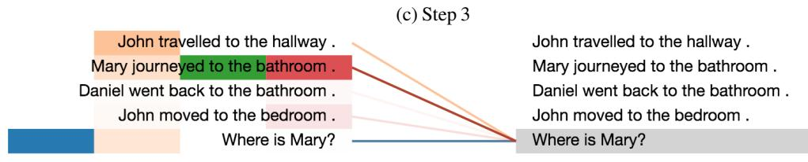

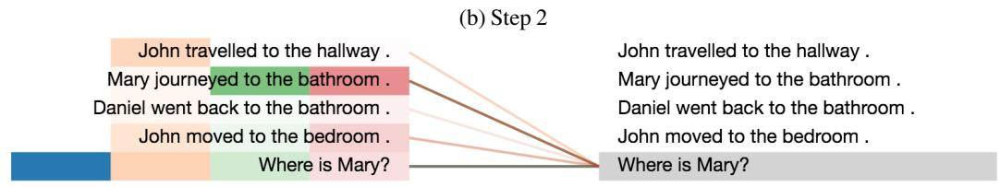

## 附录 F bAbI 注意力可视化

我们展示了几个示例在 bAbI 任务上的注意力分布可视化。注意力权重的可视化是跨不同时间步、基于不同注意力头对故事中的所有事实和一个问题进行的。左侧的不同颜色条表示基于不同注意力头（共 4 个头）的注意力权重。

来自任务 1 的一个示例：（需要一个支持性事实来解决）

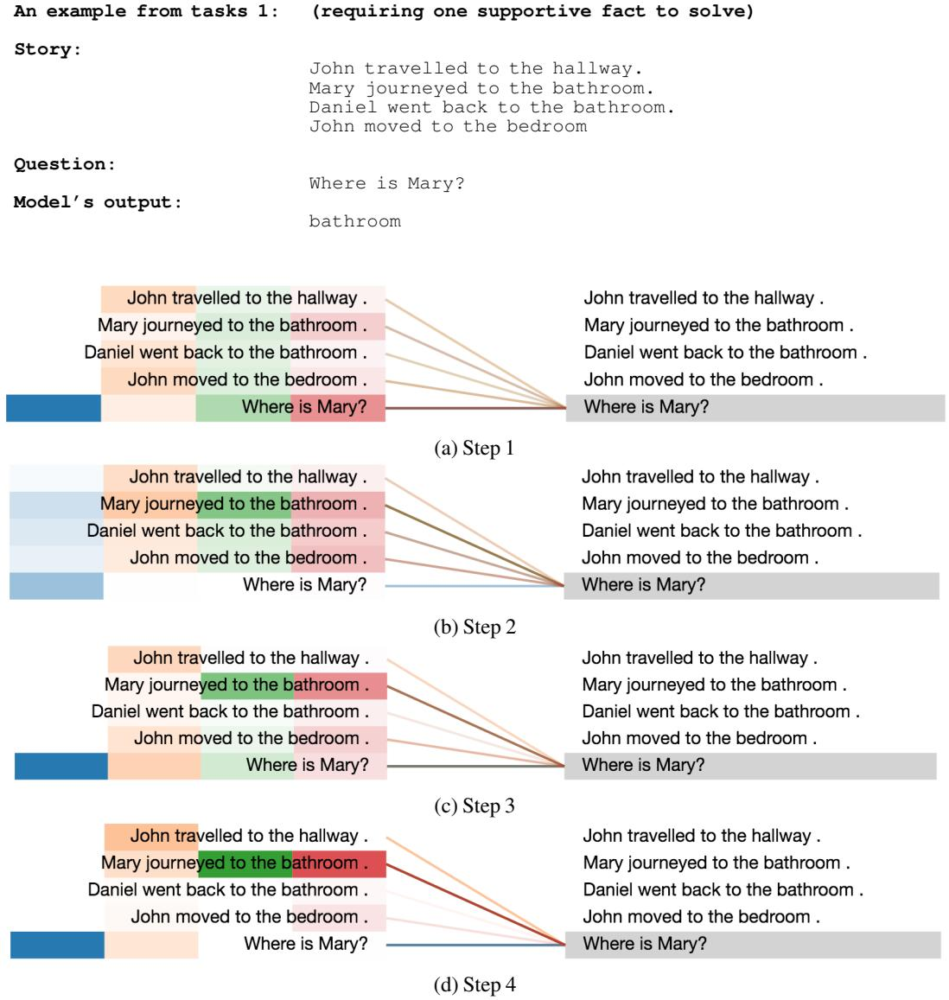

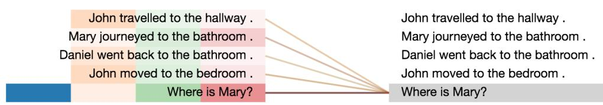

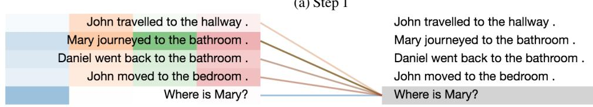  
Figure 5: 编码问题“Where is Mary?”时的注意力分布可视化。

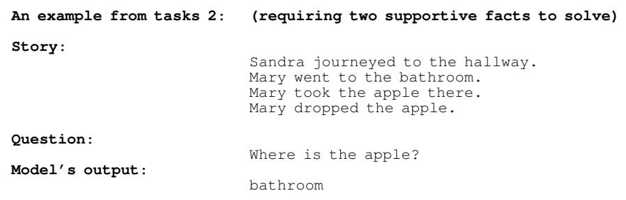

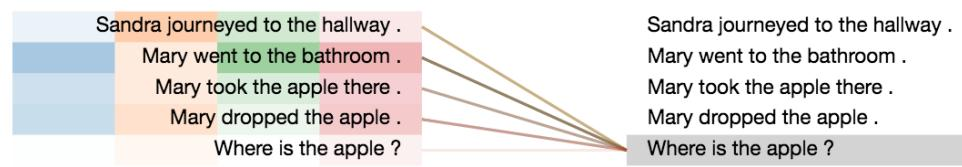

(a) 步骤 1  
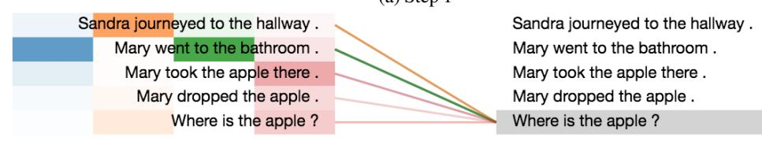

(b) 步骤 2  
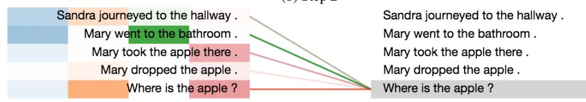

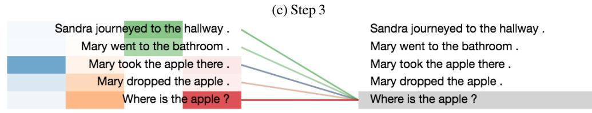  
(d) 步骤 4  
Figure 6: 编码问题“Where is the apple?”时的注意力分布可视化。

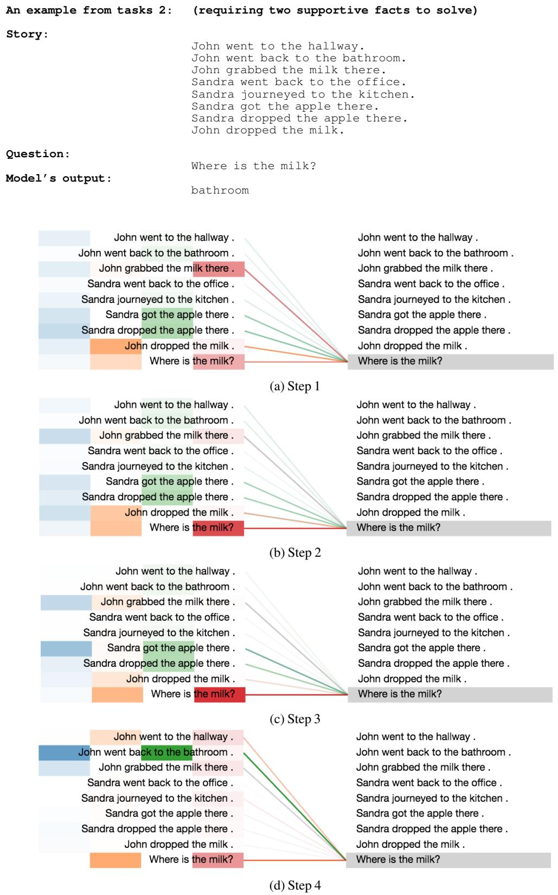  
Figure 7: 编码问题“Where is the milk?”时的注意力分布可视化。

## 任务 3 的一个示例：（需要三个支持性事实来解决）

John 去了卧室。Daniel 去了办公室。John 在那里拿了苹果。John 拿到了足球。John 去了花园。Mary 放下了牛奶。John 放下了足球。Daniel 去了花园。Daniel 拿起了足球。Mary 去了走廊。Mary 去了厨房。John 在那里放下了苹果。John 捡起了苹果。Sandra 去了走廊。Daniel 把足球放在了那里。Daniel 拿走了足球。John 去了厨房。Daniel 放下了足球。John 放下了苹果。John 拿起了苹果。John 去了办公室。Sandra 回到了卧室。Sandra 拿了牛奶。John 去了浴室。John 去了办公室。Sandra 放下了牛奶。Mary 去了卧室。Mary 去了办公室。John 去了走廊。Sandra 去了花园。Mary 去了厨房。Daniel 拿走了足球。Mary 去了卧室。Mary 在那里拿了牛奶。Mary 丢掉了牛奶。John 去了花园。John 在那里丢掉了苹果。

问题：在去浴室之前，苹果在哪里？ 模型输出：office

Mary 拿到了牛奶。Mary 拿到了牛奶。John 走向了卧室。John 走向了卧室。Daniel 前往了办公室。Daniel 前往了办公室。John 在那里拿了苹果。John 在那里拿了苹果。John 拿到了足球。John 拿到了足球。John 前往了花园。John 前往了花园。Mary 放下了牛奶。Mary 放下了牛奶。John 放下了足球。John 放下了足球。Daniel 走向了花园。Daniel 走向了花园。Daniel 拿了足球。Daniel 拿了足球。Mary 走向了走廊。Mary 走向了走廊。Mary 去了厨房。Mary 去了厨房。John 在那里放下了苹果。John 在那里放下了苹果。John 捡起了苹果。John 捡起了苹果。Sandra 走向了走廊。Sandra 走向了走廊。Daniel 在那里放下了足球。Daniel 在那里放下了足球。Daniel 拿了足球。Daniel 拿了足球。John 去往了厨房。John 去往了厨房。Daniel 扔下了足球。Daniel 扔下了足球。John 扔下了苹果。John 扔下了苹果。John 拿了苹果。John 拿了苹果。John 去了办公室。John 去了办公室。Sandra 回到了卧室。Sandra 回到了卧室。Sandra 拿了牛奶。Sandra 拿了牛奶。John 前往了浴室。John 前往了浴室。John 去往了办公室。John 去往了办公室。Sandra 放下了牛奶。Sandra 放下了牛奶。Mary 去了卧室。Mary 去了卧室。Mary 走向了办公室。Mary 走向了办公室。John 去往了走廊。John 去往了走廊。Sandra 走向了花园。Sandra 走向了花园。Mary 走向了厨房。Mary 走向了厨房。Daniel 拿了足球。Daniel 拿了足球。Mary 前往了卧室。Mary 前往了卧室。Mary 在那里拿了牛奶。Mary 在那里拿了牛奶。Mary 丢弃了牛奶。Mary 丢弃了牛奶。John 去了花园。John 去了花园。John 在那里丢弃了苹果。John 在那里丢弃了苹果。苹果在去浴室之前在哪里？苹果在去浴室之前在哪里？

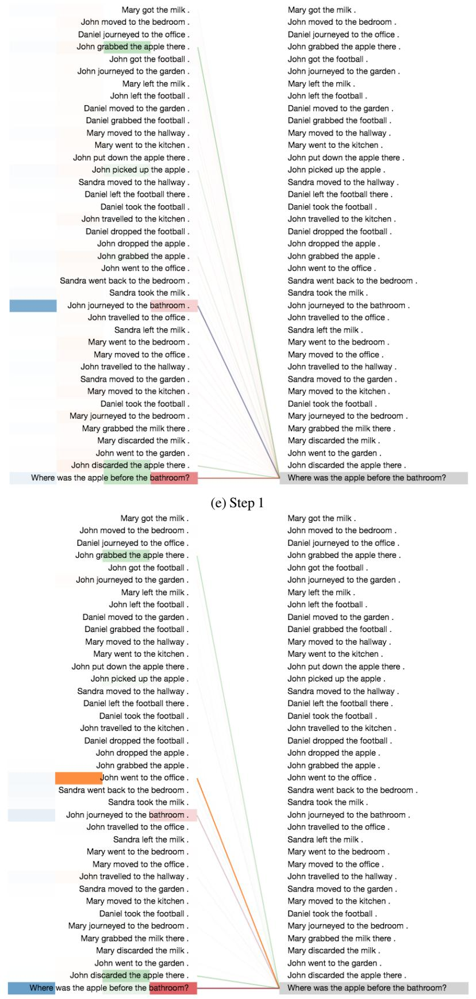  
(f) 步骤 2

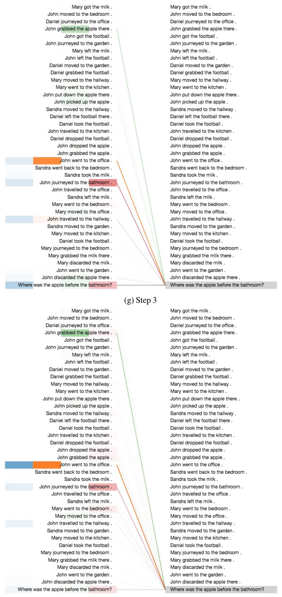  
(h) 步骤 4  
Figure 7: 编码问题“Where was the apple before the bathroom？”（苹果在去浴室之前在哪里？）时的注意力分布可视化。