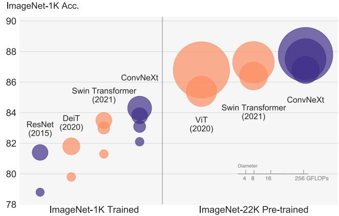
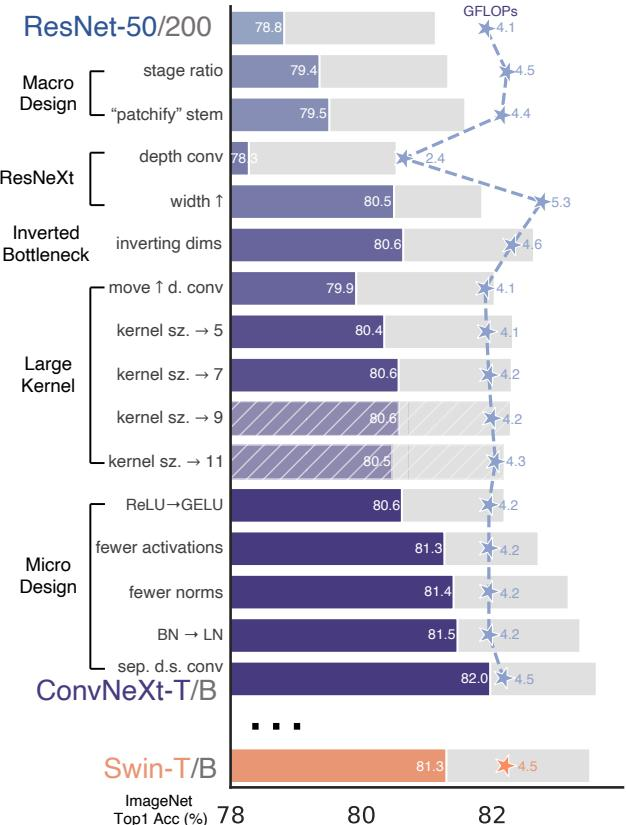
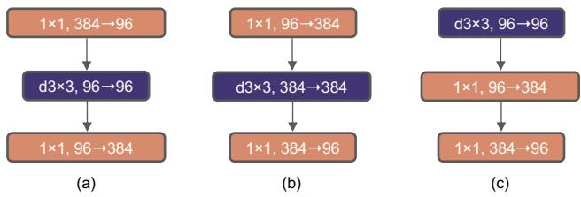
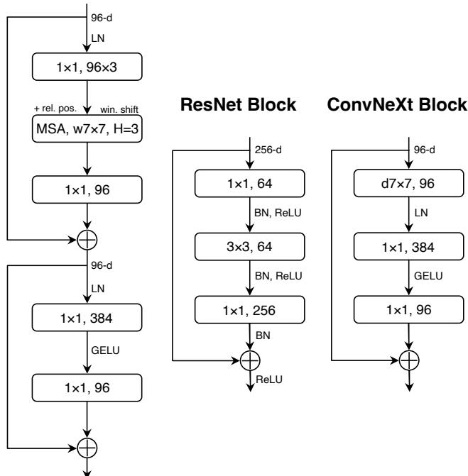

# 面向2020年代的卷积网络

Zhuang Liu1,2\* Hanzi Mao1 Chao-Yuan Wu1 Christoph Feichtenhofer1 Trevor Darrell2 Saining Xie1†

1Facebook AI Research (FAIR) 2UC Berkeley

Code: https://github.com/facebookresearch/ConvNeXt

## 摘要

视觉识别领域“风起云涌的20年代”始于视觉 Transformer（Vision Transformers，ViTs）的引入，它迅速取代了卷积神经网络（ConvNets），成为最先进的图像分类模型。然而，原生的 ViT 在应用于目标检测和语义分割等通用计算机视觉任务时面临困难。正是分层 Transformer（如 Swin Transformers）重新引入了若干 ConvNet 的先验知识，使得 Transformer 成为通用的视觉骨干网络在实际中变得可行，并在广泛的视觉任务中展现出卓越的性能。然而，这种混合方法的有效性在很大程度上仍被归功于 Transformer 的内在优势，而非卷积固有的归纳偏置（inductive biases）。在这项工作中，我们重新审视了设计空间，并测试了纯 ConvNet 所能达到的极限。我们逐步将标准 ResNet 向视觉 Transformer 的设计进行“现代化”改造，并在此过程中发现了导致性能差异的若干关键组件。这一探索的成果是一个名为 ConvNeXt 的纯 ConvNet 模型家族。ConvNeXt 完全由标准的 ConvNet 模块构建，在准确率和可扩展性方面与 Transformer 相比极具竞争力，取得了 87.8% 的 ImageNet top-1 准确率，在 COCO 检测和 ADE20K 分割任务上优于 Swin Transformers，同时保持了标准 ConvNet 的简洁性和高效性。

## 1. 引言

回望2010年代，那是一个以深度学习的划时代进展和深远影响为标志的十年。其主要驱动力是神经网络的复兴，特别是卷积神经网络（ConvNets）。在这十年中，视觉识别领域成功地从特征工程转向了（ConvNet）架构设计。尽管通过反向传播训练的 ConvNet 的发明可以一路追溯到1980年代 [42]，但直到2012年末，我们才看到了它在视觉特征学习方面的真正潜力。AlexNet [40] 的提出引发了“ImageNet 时刻” [59]，开创了计算机视觉的新纪元。自此，该领域以迅猛的速度发展。代表性的 ConvNet 如 VGGNet [64]、Inceptions [68]、ResNe(X)t [28, 87]、DenseNet [36]、MobileNet [34]、EfficientNet [71] 和 RegNet [54] 分别聚焦于准确率、效率和可扩展性的不同方面，并推广了许多实用的设计准则。

  
Figure 1. • ConvNets 和 ◦ vision Transformers 在 ImageNet-1K 上的分类结果。每个气泡的面积与模型家族中某一变体的 FLOPs 成正比。此处的 ImageNet-1K/22K 模型分别输入 2242/3842 图像。ResNet 和 ViT 的结果是通过相比原论文改进后的训练方案获得的。我们证明了标准 ConvNet 模型可以达到与分层 vision Transformers 相当的可扩展性水平，同时设计上更为简单。

ConvNets 在计算机视觉领域的全面主导地位绝非巧合：在许多应用场景中，“滑动窗口”策略是视觉处理所固有的，特别是在处理高分辨率图像时。ConvNets 具有多种内置的归纳偏置（inductive biases），使其非常适用于广泛的计算机视觉应用。其中最重要的是平移等变性（translation equivariance），这是目标检测等任务所期望的优良特性。ConvNets 本身也是高效的，因为当以滑动窗口方式使用时，计算是共享的 [62]。几十年来，这一直是 ConvNets 的默认使用方式，通常应用于有限的目标类别，如数字 [43]、人脸 [58, 76] 和行人 [19, 63]。进入 2010 年代后，基于区域的检测器 [23, 24, 27, 57] 进一步将 ConvNets 提升为视觉识别系统中最基础的构建模块。

大体在同一时期，自然语言处理（NLP）领域的神经网络设计历程走上了一条截然不同的道路，Transformers 取代了循环神经网络（recurrent neural networks），成为占据主导地位的骨干架构。尽管语言和视觉领域关注的任务存在差异，但这两股潮流在 2020 年出人意料地汇合了——Vision Transformers（ViT）的引入彻底改变了网络架构设计的格局。除了最初将图像分割为一系列 patch 的“patchify”层之外，ViT 没有引入任何图像特有的归纳偏置（inductive bias），并且对原始 NLP Transformers 的改动极小。ViT 的一个主要关注点在于缩放行为（scaling behavior）：在更大的模型和数据集规模的加持下，Transformers 能够显著超越标准的 ResNets。这些在图像分类任务上的成果令人鼓舞，但计算机视觉并不局限于图像分类。如前所述，过去十年中众多计算机视觉任务的解决方案都高度依赖于滑动窗口、全卷积范式。在缺乏 ConvNet 归纳偏置的情况下，原生 ViT 模型在被用作通用视觉骨干网络时面临诸多挑战。最大的挑战在于 ViT 的全局注意力机制设计，它对于输入尺寸具有二次方复杂度（quadratic complexity）。这对于 ImageNet 分类或许是可以接受的，但在处理更高分辨率的输入时很快就会变得难以承受。

分层 Transformer（Hierarchical Transformers）采用了一种混合方法来弥合这一差距。例如，“滑动窗口”策略（如局部窗口内的注意力机制）被重新引入到 Transformers 中，使其行为更类似于 ConvNets。Swin Transformer [45] 是该方向上的里程碑式工作，首次证明了 Transformers 可以被用作通用的视觉骨干网络，并在图像分类之外的一系列计算机视觉任务中均取得了最先进的（state-of-the-art）性能。Swin Transformer 的成功和迅速普及也揭示了一件事：卷积的本质并没有变得无关紧要；相反，它仍然备受青睐且历久弥新。

从这个角度来看，Transformers 在计算机视觉领域的许多进展都旨在重新引入卷积。然而，这些尝试也是有代价的：滑动窗口自注意力机制的朴素实现可能非常耗费计算资源 [55]；采用循环位移（cyclic shifting）[45] 等先进方法虽然可以优化速度，但系统设计会变得更加复杂。另一方面，令人感到有些讽刺的是，ConvNet 本身就已经满足了许多这些令人向往的特性，尽管是以一种简单直接、不加修饰的方式。ConvNets 似乎后劲不足的唯一原因，在于（分层）Transformers 在许多视觉任务中超越了它们，而这种性能差异通常归因于 Transformers 优越的缩放行为，其中多头自注意力机制（multi-head self-attention）是关键组件。

与过去十年中逐步改进的 ConvNets 不同，Vision Transformers 的引入是一次跨越式转变。在近期的文献中，两者之间的比较通常采用系统层面的对比（例如 Swin Transformer 与 ResNet）。ConvNets 与分层 Vision Transformers 变得既不同又相似：它们都具备相似的归纳偏置（inductive biases），但在训练流程以及宏观/微观层面的架构设计上存在显著差异。在这项工作中，我们研究了 ConvNets 与 Transformers 之间的架构差异，并试图找出在比较网络性能时的混杂变量。我们的研究旨在弥合 ConvNets 在前 ViT 时代与后 ViT 时代之间的差距，并测试纯 ConvNet 所能达到的极限。

为此，我们从一个采用改进流程训练的标准 ResNet（例如 ResNet-50）出发。我们逐步将该架构“现代化”（modernize）为分层 Vision Transformer（例如 Swin-T）的构建方式。我们的探索由一个关键问题所引导：Transformers 中的设计决策如何影响 ConvNets 的性能？在此过程中，我们发现了导致性能差异的若干关键组件。最终，我们提出了一系列纯 ConvNets 模型，命名为 ConvNeXt。我们在多种视觉任务上对 ConvNeXts 进行了评估，例如 ImageNet 分类 [17]、COCO [44] 上的目标检测/分割以及 ADE20K [92] 上的语义分割。令人惊讶的是，完全由标准 ConvNet 模块构建的 ConvNeXts 在所有主流基准测试中的准确率、可扩展性和鲁棒性方面均能与 Transformers 相媲美。ConvNeXt 保持了标准 ConvNets 的高效性，且在训练和测试阶段均具备全卷积特性，这使得其实现极其简单。

我们希望这些新的观察和讨论能够挑战一些普遍观点，并促使人们重新思考卷积在计算机视觉中的重要性。

## 2. 将 ConvNet 现代化：路线图

在本节中，我们提供了一条从 ResNet 演进到类似于 Transformers 的 ConvNet 的轨迹。从 FLOPs 角度，我们考虑了两种模型大小，一种是 FLOPs 约为 4. $5 \times 1 0 ^ { 9 }$ 的 ResNet-50 / Swin-T 规模，另一种是 FLOPs 约为 $1 5 . 0 \times 1 0 ^ { 9 }$ 的 ResNet-200 / Swin-B 规模。为简明起见，我们将展示 ResNet-50 / Swin-T 复杂度模型的结果。对于容量更高模型的结论是一致的，其结果可见于附录 C。

从宏观层面来看，我们的探索旨在研究并借鉴 Swin Transformer 的不同层次的设计，同时保持网络作为标准卷积网络（ConvNet）的简洁性。我们探索的路线图如下。我们的起点是一个 ResNet-50 模型。我们首先使用用于训练视觉 Transformer 的类似训练技巧来对其进行训练，与原始 ResNet-50 相比获得了大幅提升的结果。这将作为我们的基线（baseline）。随后，我们研究了一系列设计决策，将其总结为：1) 宏观设计（macro design），2) ResNeXt，3) 倒置瓶颈（inverted bottleneck），4) 大卷积核尺寸（large kernel size），以及 5) 各种逐层的微观设计（layer-wise micro designs）。在 Figure 2 中，我们展示了该过程以及在“网络现代化”（network modernization）的每一步中所能达到的结果。由于网络复杂度与最终性能密切相关，因此在整个探索过程中，FLOPs 大致受到控制，尽管在中间步骤中 FLOPs 可能会高于或低于参考模型。所有模型均在 ImageNet-1K 上进行训练和评估。

  
Figure 2. 我们在不引入任何基于注意力机制模块的情况下，将标准卷积网络（ResNet）向分层视觉 Transformer（Swin）的设计进行现代化改造。前景柱状条表示在 ResNet-50/Swin-T FLOP 规模下的模型准确率；灰色柱状条显示了 ResNet-200/Swin-B 规模下的结果。带有阴影线的柱状条表示该修改未被采用。两种规模的详细结果见附录。许多 Transformer 的架构选择都可以融入到 ConvNet 中，并带来逐步提升的性能。最终，我们名为 ConvNeXt 的纯 ConvNet 模型可以超越 Swin Transformer。

## 2.1. 训练技巧

除了网络架构的设计之外，训练过程也会影响最终的性能。视觉 Transformer（vision Transformer）不仅带来了一套新的模块和架构设计决策，还将不同的训练技术（例如 AdamW 优化器）引入到了视觉领域。这主要涉及优化策略及相关的超参数设置。因此，我们探索的第一步是用视觉 Transformer 的训练流程来训练基线模型，在这里即 ResNet-50/200。近期的研究 [7, 81] 表明，一套现代化的训练技术可以显著提升简单 ResNet-50 模型的性能。在我们的研究中，我们使用了一种与 DeiT [73] 和 Swin Transformer [45] 接近的训练配方。训练轮数从 ResNet 原本的 90 个 epoch 延长到了 300 个 epoch。我们使用了 AdamW 优化器 [46]，数据增强技术如 Mixup [90]、Cutmix [89]、RandAugment [14]、Random Erasing [91]，以及包括随机深度（Stochastic Depth）[36] 和标签平滑（Label Smoothing）[69] 在内的正则化方案。我们使用的完整超参数集可在附录 A.1 中找到。仅凭这一增强的训练配方，ResNet-50 模型的性能就从 76.1% [1] 提升到了 78.8%（+2.7%），这表明传统 ConvNet 与视觉 Transformer 之间相当一部分的性能差异可能源于训练技术。在整个“现代化”过程中，我们将使用这个带有相同超参数的固定训练配方。在 ResNet-50 机制下报告的每个准确率都是使用三个不同随机种子训练得到的平均值。

## 2.2. 宏观设计

我们现在分析 Swin Transformer 的宏观网络设计。Swin Transformer 沿用了 ConvNet [28, 65] 的多阶段设计，其中每个阶段具有不同的特征图分辨率。这里有两个有趣的设计考量：阶段计算比例，以及“stem cell”（主干初始层）结构。

改变阶段计算比例。ResNet 中各阶段计算量分布的原始设计主要是经验性的。计算密集的“res4”阶段旨在兼容下游任务（如下标检测），其中检测头在 14×14 的特征平面上运行。另一方面，Swin-T 遵循了相同的原则，但采用了略微不同的 1:1:3:1 阶段计算比例。对于更大的 Swin Transformer，该比例为 1:1:9:1。遵循这一设计，我们将 ResNet-50 中每个阶段的 block 数量从 (3, 4, 6, 3) 调整为 (3, 3, 9, 3)，这也使 FLOPs 与 Swin-T 保持一致。这使得模型准确率从 78.8% 提升到了 79.4%。值得注意的是，研究人员已经对计算量的分布进行了深入的研究 [53, 54]，并且可能存在更优的设计。

从现在起，我们将使用这一阶段计算比例。

将 stem 替换为“Patchify”。通常，stem 单元的设计关注于如何在网络起始阶段处理输入图像。由于自然图像中固有的冗余性，在标准 ConvNet 和 vision Transformer 中，常见的 stem 单元都会对输入图像进行激进的下采样，以获得合适的特征图尺寸。标准 ResNet 中的 stem 单元包含一个步长为 2 的 7×7 卷积层，后接一个最大池化层，从而对输入图像进行 4 倍下采样。在 vision Transformer 中，一种更为激进的“patchify”策略被用作 stem 单元，它对应于大卷积核尺寸（例如卷积核尺寸 = 14 或 16）以及不重叠卷积。Swin Transformer 使用了类似的“patchify”层，但具有较小的补丁尺寸（patch size）4，以适应其架构的多阶段设计。我们用一个由 4×4、步长为 4 的卷积层实现的 patchify 层替换了 ResNet 风格的 stem 单元。准确率从 79.4% 变为 79.5%。这表明 ResNet 中的 stem 单元可以替换为类似 ViT 的更简单的“patchify”层，并能获得相似的性能。

我们将在网络中使用“patchify stem”（4×4 不重叠卷积）。

## 2.3. ResNeXt 化

在这一部分中，我们尝试采用 ResNeXt [87] 的思想，与原始 ResNet 相比，它具有更好的 FLOPs/准确率权衡。其核心组件是分组卷积（grouped convolution），其中卷积滤波器被划分为不同的组。在高层面上，ResNeXt 的指导原则是“使用更多分组，扩展宽度”。更准确地说，ResNeXt 在瓶颈块（bottleneck block）的 3×3 卷积层中采用了分组卷积。由于这显著降低了 FLOPs，因此通过扩展网络宽度来弥补容量损失。

在我们的方案中，我们使用深度卷积（depthwise convolution），这是分组卷积的一种特例，其中分组数等于通道数。深度卷积已由 MobileNet [34] 和 Xception [11] 推广普及。我们注意到，深度卷积类似于自注意力（self-attention）中的加权求和操作，它在逐通道的基础上运行，即仅在空间维度上混合信息。深度卷积与 1 × 1 卷积的结合实现了空间和通道混合的分离，这是 vision Transformer 所共有的特性，其中每个操作要么跨空间维度混合信息，要么跨通道维度混合信息，但不会两者兼顾。深度卷积的使用有效地减少了网络的 FLOPs，正如预期的那样，准确率也有所下降。遵循 ResNeXt 中提出的策略，我们将网络宽度增加到与 Swin-T 相同的通道数（从 64 增加到 96）。这使得网络性能提升至 80.5%，同时 FLOPs 有所增加（5.3G）。

我们现在将采用 ResNeXt 设计。

## 2.4. 倒置瓶颈

每个 Transformer 块中的一个重要设计是它构建了一个倒置瓶颈（inverted bottleneck），即 MLP 块的隐藏维度是输入维度的四倍（见 Figure 4）。有趣的是，这种 Transformer 设计与 ConvNets 中采用的扩展比为 4 的倒置瓶颈设计相呼应。这一理念由 MobileNetV2 [61] 推广开来，并随后在数个先进的 ConvNet 架构中得到了广泛应用 [70, 71]。

  
Figure 3. 模块修改及所得规格说明。(a) 为 ResNeXt 块；在 (b) 中我们构建了倒置瓶颈块；在 (c) 中空间深度卷积层（depthwise conv layer）的位置被向上移动。

在此我们探索倒置瓶颈设计。Figure 3 (a) 到 (b) 展示了相应配置。尽管深度卷积层的 FLOPs 有所增加，但由于下采样残差块捷径（shortcut）1×1 卷积层的 FLOPs 大幅减少，该改动将整个网络的 FLOPs 降低至 4.6G。有趣的是，这带来了性能的微幅提升（从 80.5% 提高到 80.6%）。在 ResNet-200 / Swin-B 的体量下，这一步带来了更大的收益（从 81.9% 提升至 82.6%），且同样降低了 FLOPs。

接下来我们将采用倒置瓶颈结构。

## 2.5. Large Kernel Sizes

在这一部分的探索中，我们重点关注大卷积核的特性。视觉 Transformer（vision Transformers）最显著的特征之一是其非局部自注意力（non-local self-attention），这使得每一层都拥有全局感受野。虽然过去在 ConvNets 中也曾使用过大卷积核尺寸 [40, 68]，但（由 VGGNet [65] 推广的）黄金标准是堆叠小尺寸（3×3）卷积层，这些小卷积核在现代 GPU 上拥有高效的硬件实现 [41]。尽管 Swin Transformers 将局部窗口重新引入到自注意力块中，但其窗口大小至少为 7×7，显著大于 ResNe(X)t 的 3×3 卷积核尺寸。在此，我们重新审视在 ConvNets 中使用大卷积核尺寸的效果。

上移深度卷积层。为了探索大卷积核，一个前提条件是将深度卷积层的位置上移（Figure 3 (b) 到 (c)）。这也是在 Transformer 中非常明显的一项设计决策：MSA 块被放置在 MLP 层之前。由于我们采用了倒置瓶颈块，这是一个自然的设计选择——复杂/低效的模块（MSA、大核卷积）将拥有较少的通道数，而高效、密集的 1×1 层将承担繁重的计算工作。这一中间步骤将 FLOPs 降低到 4.1G，但导致性能暂时下降到 79.9%。

增大卷积核尺寸。在完成所有这些准备工作后，采用更大卷积核尺寸的卷积所带来的收益是显著的。我们实验了多种卷积核尺寸，包括 3、5、7、9 和 11。网络的性能从 79.9%（3×3）提升至 80.6%（7×7），而网络的 FLOPs 几乎保持不变。此外，我们观察到更大卷积核尺寸带来的收益在 7×7 时达到饱和点。我们在大容量模型中也验证了这一现象：当我们将卷积核尺寸增加到 7×7 以上时，ResNet-200 规模的模型并未表现出进一步的增益。

我们将在每个块中使用 7×7 深度卷积（depthwise conv）。

至此，我们完成了对宏观尺度网络架构的考察。有趣的是，视觉 Transformer（vision Transformer）中采用的很大一部分设计选择都可以映射到 ConvNet 的具体实现中。

## 2.6. 微观设计

在本节中，我们探讨微观尺度上的其他几种架构差异——这里的大多数探索都是在层级进行的，重点关注激活函数和归一化层的具体选择。

用 GELU 替代 ReLU。NLP 和视觉架构之间的一个差异在于具体使用哪种激活函数。随着时间的推移，虽然已经开发出了大量的激活函数，但由于其简单性和高效性，整流线性单元（Rectified Linear Unit, ReLU）[49] 在 ConvNets 中仍然被广泛使用。在最初的 Transformer 论文 [77] 中，ReLU 也被用作激活函数。高斯误差线性单元（Gaussian Error Linear Unit, GELU）[32] 可以被视为 ReLU 的更平滑变体，它被用于最先进的 Transformers 中，包括 Google 的 BERT [18]、OpenAI 的 GPT-2 [52] 以及最近的 ViTs。我们发现，在我们的 ConvNet 中也可以用 GELU 替代 ReLU，尽管准确率保持不变（80.6%）。

更少的激活函数。Transformer 和 ResNet 块之间的一个微小区别在于 Transformer 拥有的激活函数更少。考虑一个包含键/查询/值（key/query/value）线性嵌入层、投影层以及 MLP 块中两个线性层的 Transformer 块。MLP 块中只存在一个激活函数。相比之下，通常的做法是为每个卷积层（包括 1 × 1 卷积）都附加一个激活函数。在此，我们检验采用相同策略时性能会如何变化。如图 Figure 4 所示，除了两个 1 × 1 层之间保留的一个 GELU 之外，我们移除了残差块中的所有 GELU 层，复刻了 Transformer 块的风格。这一改动将结果提升了 0.7% 至 81.3%，基本达到了 Swin-T 的性能水平。

我们现在将在每个块中使用单个 GELU 激活函数。

更少的归一化层。Transformer 块通常也具有较少的归一化层。在此，我们移除了两个 BatchNorm (BN) 层，仅在 1 × 1 卷积层之前保留一个 BN 层。这进一步将性能提升至 81.4%，已经超越了 Swin-T 的结果。需要注意的是，我们每个块中的归一化层甚至比 Transformer 更少，因为经验表明在块的开头额外添加一个 BN 层并不能提升性能。

  
Figure 4. ResNet、Swin Transformer 和 ConvNeXt 的块设计。由于存在多个专用模块和两个残差连接，Swin Transformer 的块更为复杂。为简便起见，由于 Transformer MLP 块中的线性层与“1×1 卷积”等价，我们也将其记作“1×1 卷积”。

用 LN 替换 BN。BatchNorm [38] 是 ConvNets 中不可或缺的组件，因为它能改善收敛并减少过拟合。然而，BN 也存在许多复杂的微妙特性，可能对模型性能产生不利影响 [84]。尽管已有许多尝试去开发替代的归一化技术 [60, 75, 83]，但在大多数视觉任务中 BN 仍是首选。另一方面，更简单的 Layer Normalization [5] (LN) 已被应用于 Transformer 中，并在不同的应用场景下都取得了良好的性能。

在原始 ResNet 中直接用 LN 替换 BN 会导致性能不佳 [83]。在对网络架构和训练技术进行了所有上述修改之后，我们在此重新审视使用 LN 替代 BN 的影响。我们观察到我们的 ConvNet 模型在使用 LN 训练时没有任何困难；事实上，其性能略有提升，达到了 81.5% 的准确率。

从现在起，我们将在每个残差块中使用一个 LayerNorm 作为归一化的选择。

单独的下采样层。在 ResNet 中，空间下采样是通过每个 stage 起始处的残差块实现的，采用步长为 2 的 3×3 卷积（以及捷径连接处步长为 2 的 1×1 卷积）。在 Swin Transformer 中，stage 之间则添加了单独的下采样层。我们探索了一种类似的策略，即使用步长为 2 的 2×2 卷积层进行空间下采样。令人意外的是，这一修改导致了训练发散。进一步的研究表明，在任何改变空间分辨率的位置添加归一化层都有助于稳定训练。这些层包括 Swin Transformer 中同样使用的几个 LN 层：每个下采样层前一个、stem 之后一个、以及最终全局平均池化之后一个。我们可以将准确率提升至 82.0%，显著超过了 Swin-T 的 81.3%。

我们将采用单独的下采样层。至此，我们得到了最终的模型，并将其命名为 ConvNeXt。

ResNet、Swin 和 ConvNeXt 块结构的对比见 Figure 4。ResNet-50、Swin-T 和 ConvNeXt-T 的详细架构规格对比见 Table 9。

结语。我们完成了第一次“演练”，并发现了 ConvNeXt——一种纯卷积神经网络（ConvNet），在当前计算预算下，它在 ImageNet-1K 分类任务上的表现超越了 Swin Transformer。值得注意的是，迄今为止讨论的所有设计选择均借鉴自视觉 Transformer（vision Transformers）。此外，即使在 ConvNet 文献中，这些设计也并非全新——在过去的十年中，它们都曾被单独研究过，只是未曾被集合在一起。我们的 ConvNeXt 模型与 Swin Transformer 具有大致相同的 FLOPs、参数量（#params.）、吞吐量和内存占用，但不需要诸如移位窗口注意力（shifted window attention）或相对位置偏置（relative position biases）等专用模块。

这些发现令人鼓舞，但尚未完全具有说服力——我们迄今为止的探索仅限于较小规模，但视觉 Transformer 的扩展特性（scaling behavior）才是真正让它们脱颖而出的地方。此外，在目标检测和语义分割等下游任务上，ConvNet 能否与 Swin Transformer 竞争，是计算机视觉从业者关注的核心问题。在下一节中，我们将在数据量和模型大小两方面扩展我们的 ConvNeXt 模型，并在多样化的视觉识别任务上对它们进行评估。

## 3. ImageNet 上的实证评估

我们构建了不同的 ConvNeXt 变体 ConvNeXt-T/S/B/L，其复杂度与 Swin-T/S/B/L [45] 相似。ConvNeXt-T/B 分别是对 ResNet-50/200 规模进行“现代化”改造流程的最终产物。此外，我们构建了更大的 ConvNeXt-XL 以进一步测试 ConvNeXt 的可扩展性。这些变体仅在各阶段的通道数 $C$ 以及块数 $B$ 上有所不同。遵循 ResNet 和 Swin Transformer 的设计，通道数在每个新阶段翻倍。我们将具体配置总结如下：

$$
\bullet \text { ConvNeXt - T: } C = (9 6, 1 9 2, 3 8 4, 7 6 8), B = (3, 3, 9, 3)
$$

$$
\bullet \text { ConvNeXt - S: } C = (9 6, 1 9 2, 3 8 4, 7 6 8), B = (3, 3, 2 7, 3)
$$

$$
\bullet \text { ConvNeXt - B: } C = (1 2 8, 2 5 6, 5 1 2, 1 0 2 4), B = (3, 3, 2 7, 3)
$$

$$
\bullet \text { ConvNeXt - L: } C = (1 9 2, 3 8 4, 7 6 8, 1 5 3 6), B = (3, 3, 2 7, 3)
$$

$$
\bullet \text { ConvNeXt - XL: } C = (2 5 6, 5 1 2, 1 0 2 4, 2 0 4 8), B = (3, 3, 2 7, 3)
$$

## 3.1. 实验设置

ImageNet-1K 数据集包含 1000 个物体类别和 1.2M 张训练图像。我们在验证集上报告 ImageNet-1K top-1 准确率。我们还在 ImageNet-22K 上进行了预训练，该数据集规模更大，包含 21841 个类别（为 1000 个 ImageNet-1K 类别的超集）以及约 14M 张图像用于预训练，随后在 ImageNet-1K 上微调预训练模型以进行评估。我们在下方总结了训练设置。更多细节见附录 A（Appendix A）。

在 ImageNet-1K 上的训练。我们使用 AdamW [46] 对 ConvNeXt 进行 300 个 epoch 的训练，学习率为 4e-3。包含 20 个 epoch 的线性预热（warmup）以及随后的余弦衰减调度。我们使用的批大小（batch size）为 4096，权重衰减为 0.05。对于数据增强，我们采用了常见方案，包括 Mixup [90]、Cutmix [89]、RandAugment [14] 和 Random Erasing [91]。我们使用随机深度（Stochastic Depth）[37] 和标签平滑（Label Smoothing）[69] 对网络进行正则化。应用了初始值为 1e-6 的 Layer Scale [74]。我们使用了指数移动平均（EMA）[51]，因为我们发现它能缓解较大模型的过拟合问题。

在 ImageNet-22K 上的预训练。我们在 ImageNet-22K 上对 ConvNeXt 进行 90 个 epoch 的预训练，预热为 5 个 epoch。我们没有使用 EMA。其他设置与 ImageNet-1K 相同。

在 ImageNet-1K 上的微调。我们在 ImageNet-1K 上对 ImageNet-22K 预训练模型进行 30 个 epoch 的微调。我们使用 AdamW，学习率为 5e-5，采用余弦学习率调度、逐层学习率衰减（layer-wise learning rate decay）[6, 12]、无预热、批大小为 512，以及 1e-8 的权重衰减。默认的预训练、微调和测试分辨率为 2242。此外，对于 ImageNet-22K 和 ImageNet-1K 预训练模型，我们还在更大的 3842 分辨率下进行了微调。

与 ViT/Swin Transformer 相比，ConvNeXt 在不同分辨率下的微调更加简单，因为该网络是全卷积的，无需调整输入 patch 大小或对绝对/相对位置偏置进行插值。

## 3.2. 结果

ImageNet-1K。Table 1（上部分）展示了与两种近期的 Transformer 变体（DeiT [73] 和 Swin Transformer [45]）以及通过架构搜索得到的卷积神经网络（RegNet [54]、EfficientNet [71] 和 EfficientNetV2 [72]）的结果对比。在准确率与计算量的权衡以及推理吞吐量方面，ConvNeXt 相比两种强大的 ConvNet 基准（RegNet [54] 和 EfficientNet [71]）均表现优异。ConvNeXt 在整体上也全面超越了复杂度相近的 Swin Transformer，有时优势非常明显（例如 ConvNeXt-T 提升了 0.8%）。在没有移动窗口（shifted windows）或相对位置偏置等专门模块的情况下，与 Swin Transformer 相比，ConvNeXt 还具有更高的吞吐量。

<table><tr><td>模型</td><td>图像尺寸</td><td>参数量</td><td>FLOPs</td><td>吞吐量 (图像 / 秒)</td><td>IN-1K top-1 准确率</td></tr><tr><td colspan="6">在 ImageNet-1K 上训练的模型</td></tr><tr><td>RegNetY-16G [54]</td><td> $224^2$ </td><td>84M</td><td>16.0G</td><td>334.7</td><td>82.9</td></tr><tr><td>EffNet-B7 [71]</td><td> $600^2$ </td><td>66M</td><td>37.0G</td><td>55.1</td><td>84.3</td></tr><tr><td>EffNetV2-L [72]</td><td> $480^2$ </td><td>120M</td><td>53.0G</td><td>83.7</td><td>85.7</td></tr><tr><td>DeiT-S [73]</td><td> $224^2$ </td><td>22M</td><td>4.6G</td><td>978.5</td><td>79.8</td></tr><tr><td>DeiT-B [73]</td><td> $224^2$ </td><td>87M</td><td>17.6G</td><td>302.1</td><td>81.8</td></tr><tr><td>Swin-T</td><td> $224^2$ </td><td>28M</td><td>4.5G</td><td>757.9</td><td>81.3</td></tr><tr><td>ConvNeXt-T</td><td> $224^2$ </td><td>29M</td><td>4.5G</td><td>774.7</td><td>82.1</td></tr><tr><td>Swin-S</td><td> $224^2$ </td><td>50M</td><td>8.7G</td><td>436.7</td><td>83.0</td></tr><tr><td>ConvNeXt-S</td><td> $224^2$ </td><td>50M</td><td>8.7G</td><td>447.1</td><td>83.1</td></tr><tr><td>Swin-B</td><td> $224^2$ </td><td>88M</td><td>15.4G</td><td>286.6</td><td>83.5</td></tr><tr><td>ConvNeXt-B</td><td> $224^2$ </td><td>89M</td><td>15.4G</td><td>292.1</td><td>83.8</td></tr><tr><td>Swin-B</td><td> $384^2$ </td><td>88M</td><td>47.1G</td><td>85.1</td><td>84.5</td></tr><tr><td>ConvNeXt-B</td><td> $384^2$ </td><td>89M</td><td>45.0G</td><td>95.7</td><td>85.1</td></tr><tr><td>ConvNeXt-L</td><td> $224^2$ </td><td>198M</td><td>34.4G</td><td>146.8</td><td>84.3</td></tr><tr><td>ConvNeXt-L</td><td> $384^2$ </td><td>198M</td><td>101.0G</td><td>50.4</td><td>85.5</td></tr><tr><td colspan="6">在 ImageNet-22K 上预训练的模型</td></tr><tr><td>R-101x3 [39]</td><td> $384^2$ </td><td>388M</td><td>204.6G</td><td>-</td><td>84.4</td></tr><tr><td>R-152x4 [39]</td><td> $480^2$ </td><td>937M</td><td>840.5G</td><td>-</td><td>85.4</td></tr><tr><td>EffNetV2-L [72]</td><td> $480^2$ </td><td>120M</td><td>53.0G</td><td>83.7</td><td>86.8</td></tr><tr><td>EffNetV2-XL [72]</td><td> $480^2$ </td><td>208M</td><td>94.0G</td><td>56.5</td><td>87.3</td></tr><tr><td>ViT-B/16 (☎) [67]</td><td> $384^2$ </td><td>87M</td><td>55.5G</td><td>93.1</td><td>85.4</td></tr><tr><td>ViT-L/16 (☎) [67]</td><td> $384^2$ </td><td>305M</td><td>191.1G</td><td>28.5</td><td>86.8</td></tr><tr><td>ConvNeXt-T</td><td> $224^2$ </td><td>29M</td><td>4.5G</td><td>774.7</td><td>82.9</td></tr><tr><td>ConvNeXt-T</td><td> $384^2$ </td><td>29M</td><td>13.1G</td><td>282.8</td><td>84.1</td></tr><tr><td>ConvNeXt-S</td><td> $224^2$ </td><td>50M</td><td>8.7G</td><td>447.1</td><td>84.6</td></tr><tr><td>ConvNeXt-S</td><td> $384^2$ </td><td>50M</td><td>25.5G</td><td>163.5</td><td>85.8</td></tr><tr><td>Swin-B</td><td> $224^2$ </td><td>88M</td><td>15.4G</td><td>286.6</td><td>85.2</td></tr><tr><td>ConvNeXt-B</td><td> $224^2$ </td><td>89M</td><td>15.4G</td><td>292.1</td><td>85.8</td></tr><tr><td>Swin-B</td><td> $384^2$ </td><td>88M</td><td>47.0G</td><td>85.1</td><td>86.4</td></tr><tr><td>ConvNeXt-B</td><td> $384^2$ </td><td>89M</td><td>45.1G</td><td>95.7</td><td>86.8</td></tr><tr><td>Swin-L</td><td> $224^2$ </td><td>197M</td><td>34.5G</td><td>145.0</td><td>86.3</td></tr><tr><td>ConvNeXt-L</td><td> $224^2$ </td><td>198M</td><td>34.4G</td><td>146.8</td><td>86.6</td></tr><tr><td>Swin-L</td><td> $384^2$ </td><td>197M</td><td>103.9G</td><td>46.0</td><td>87.3</td></tr><tr><td>ConvNeXt-L</td><td> $384^2$ </td><td>198M</td><td>101.0G</td><td>50.4</td><td>87.5</td></tr><tr><td>ConvNeXt-XL</td><td> $224^2$ </td><td>350M</td><td>60.9G</td><td>89.3</td><td>87.0</td></tr><tr><td>ConvNeXt-XL</td><td> $384^2$ </td><td>350M</td><td>179.0G</td><td>30.2</td><td>87.8</td></tr></table>

Table 1. ImageNet-1K 上的分类准确率。与 Transformers 类似，ConvNeXt 在具有更高容量的模型和更大的（预训练）数据集时也表现出良好的扩展特性（scaling behavior）。遵循 [45]，推理吞吐量（throughput）在 V100 GPU 上进行测量。在 A100 GPU 上，ConvNeXt 的吞吐量可以显著高于 Swin Transformer。参见附录 E。(T) 采用 90 轮 AugReg [67] 训练的 ViT 结果，通过与作者的个人交流获取。

结果中的一个亮点是在 $3 8 4 ^ { 2 }$ 分辨率下的 ConvNeXt-B：它的性能比 Swin-B 高出 0.6%（85.1% 对比 84.5%），但推理吞吐量高出 12.5%（95.7 对比 85.1 image/s）。我们注意到，当分辨率从 $2 2 4 ^ { 2 }$ 增加到 $3 8 4 ^ { 2 }$ 时，ConvNeXt-B 相对于 Swin-B 的 FLOPs/吞吐量优势变得更加明显。此外，当进一步扩展到 ConvNeXt-L 时，我们观察到了提升至 85.5% 的结果。

ImageNet-22K。我们在 Table 1（下半部分）展示了从 ImageNet-22K 预训练微调的模型结果。这些实验非常重要，因为一种广泛持有的观点认为视觉 Transformers 的归纳偏置（inductive biases）较少，因此在更大规模上进行预训练时其性能优于 ConvNets。我们的结果表明，经过合理设计的 ConvNets 在使用大型数据集进行预训练时并不逊色于视觉 Transformers——ConvNeXt 的性能仍与同等规模的 Swin Transformers 相当或更好，且具有略高的吞吐量。此外，我们的 ConvNeXt-XL 模型在 $3 8 4 ^ { 2 }$ 下取得了 87.8% 的准确率——相比 ConvNeXt-L 有显著提升，这证明了 ConvNeXt 是一种可扩展的架构。

在 ImageNet-1K 上，EfficientNetV2-L 这一通过架构搜索得出且配备了先进模块（如 Squeeze-and-Excitation [35]）与渐进式训练流程的架构取得了最佳性能。然而，在 ImageNet-22K 预训练下，ConvNeXt 能够超越 EfficientNetV2，进一步证明了大规模训练的重要性。

在附录 B 中，我们讨论了 ConvNeXt 的鲁棒性和域外泛化（out-of-domain generalization）结果。

## 3.3. 各向同性 ConvNeXt 对比 ViT

在本次消融实验中，我们检验了我们的 ConvNeXt 块设计是否可推广到 ViT 风格 [20] 的各向同性（isotropic）架构中，该架构没有下采样层，并在所有深度上保持相同的特征分辨率（例如 14×14）。我们使用与 ViT-S/B/L 相同的特征维度（384/768/1024）构建了各向同性的 ConvNeXt-S/B/L。深度设置为 18/18/36，以匹配参数量和 FLOPs。块结构保持不变（Fig. 4）。对于 ViT-S/B，我们采用了来自 DeiT [73] 的有监督训练结果；对于 ${ \mathrm { V i T } } { \mathrm { - } } \mathrm { L } ,$，则采用了 MAE [26] 的结果，因为它们相比原始 ViT [20] 采用了改进的训练流程。ConvNeXt 模型使用与之前相同的设置进行训练，但增加了 warmup 轮数（epochs）。在 $2 2 4 ^ { 2 }$ 分辨率下的 ImageNet-1K 结果见 Table 2。我们观察到 ConvNeXt 的性能大体上与 ViT 相当，这表明我们的 ConvNeXt 块设计在用于非层级模型时同样具有竞争力。

<table><tr><td>模型</td><td>参数量</td><td>FLOPs</td><td>吞吐量(图像 / 秒)</td><td>训练显存 (GB)</td><td>IN-1K准确率</td></tr><tr><td>○ ViT-S</td><td>22M</td><td>4.6G</td><td>978.5</td><td>4.9</td><td>79.8</td></tr><tr><td>● ConvNeXt-S (iso.)</td><td>22M</td><td>4.3G</td><td>1038.7</td><td>4.2</td><td>79.7</td></tr><tr><td>○ ViT-B</td><td>87M</td><td>17.6G</td><td>302.1</td><td>9.1</td><td>81.8</td></tr><tr><td>● ConvNeXt-B (iso.)</td><td>87M</td><td>16.9G</td><td>320.1</td><td>7.7</td><td>82.0</td></tr><tr><td>○ ViT-L</td><td>304M</td><td>61.6G</td><td>93.1</td><td>22.5</td><td>82.6</td></tr><tr><td>● ConvNeXt-L (iso.)</td><td>306M</td><td>59.7G</td><td>94.4</td><td>20.4</td><td>82.6</td></tr></table>

Table 2. 各向同性 ConvNeXt 与 ViT 的比较。训练显存是在 V100 GPU 上以每 GPU 32 的批次大小测得的。

<table><tr><td>主干网络</td><td>FLOPs</td><td>FPS</td><td> $AP^{box}_{50}$ </td><td> $AP^{box}_{75}$ </td><td> $AP^{mask}_{50}$ </td><td> $AP^{mask}_{75}$ </td><td> $AP^{mask}_{75}$ </td></tr><tr><td colspan="8">Mask-RCNN 3× 训练方案</td></tr><tr><td>○ Swin-T</td><td>267G</td><td>23.1</td><td>46.0</td><td>68.1</td><td>50.3</td><td>41.6</td><td>65.1</td></tr><tr><td>● ConvNeXt-T</td><td>262G</td><td>25.6</td><td>46.2</td><td>67.9</td><td>50.8</td><td>41.7</td><td>65.0</td></tr><tr><td colspan="8">Cascade Mask-RCNN 3× 训练方案</td></tr><tr><td>● ResNet-50</td><td>739G</td><td>16.2</td><td>46.3</td><td>64.3</td><td>50.5</td><td>40.1</td><td>61.7</td></tr><tr><td>● X101-32</td><td>819G</td><td>13.8</td><td>48.1</td><td>66.5</td><td>52.4</td><td>41.6</td><td>63.9</td></tr><tr><td>● X101-64</td><td>972G</td><td>12.6</td><td>48.3</td><td>66.4</td><td>52.3</td><td>41.7</td><td>64.0</td></tr><tr><td>○ Swin-T</td><td>745G</td><td>12.2</td><td>50.4</td><td>69.2</td><td>54.7</td><td>43.7</td><td>66.6</td></tr><tr><td>● ConvNeXt-T</td><td>741G</td><td>13.5</td><td>50.4</td><td>69.1</td><td>54.8</td><td>43.7</td><td>66.5</td></tr><tr><td>○ Swin-S</td><td>838G</td><td>11.4</td><td>51.9</td><td>70.7</td><td>56.3</td><td>45.0</td><td>68.2</td></tr><tr><td>● ConvNeXt-S</td><td>827G</td><td>12.0</td><td>51.9</td><td>70.8</td><td>56.5</td><td>45.0</td><td>68.4</td></tr><tr><td>○ Swin-B</td><td>982G</td><td>10.7</td><td>51.9</td><td>70.5</td><td>56.4</td><td>45.0</td><td>68.1</td></tr><tr><td>● ConvNeXt-B</td><td>964G</td><td>11.4</td><td>52.7</td><td>71.3</td><td>57.2</td><td>45.6</td><td>68.9</td></tr><tr><td>○ Swin-B $^{\ddagger}$ </td><td>982G</td><td>10.7</td><td>53.0</td><td>71.8</td><td>57.5</td><td>45.8</td><td>69.4</td></tr><tr><td>● ConvNeXt-B $^{\ddagger}$ </td><td>964G</td><td>11.5</td><td>54.0</td><td>73.1</td><td>58.8</td><td>46.9</td><td>70.6</td></tr><tr><td>○ Swin-L $^{\ddagger}$ </td><td>1382G</td><td>9.2</td><td>53.9</td><td>72.4</td><td>58.8</td><td>46.7</td><td>70.1</td></tr><tr><td>● ConvNeXt-L $^{\ddagger}$ </td><td>1354G</td><td>10.0</td><td>54.8</td><td>73.8</td><td>59.8</td><td>47.6</td><td>71.3</td></tr><tr><td>● ConvNeXt-XL $^{\ddagger}$ </td><td>1898G</td><td>8.6</td><td>55.2</td><td>74.2</td><td>59.9</td><td>47.7</td><td>71.6</td></tr></table>

Table 3. 使用 Mask-RCNN 和 Cascade Mask-RCNN 在 COCO 上的目标检测和分割结果。‡ 表示该模型在 ImageNet-22K 上进行了预训练。在 ImageNet-1K 上预训练的 Swin 结果来自其 GitHub 仓库 [3]。ResNet-50 和 X101 模型的 AP 数值来自 [45]。我们在 A100 GPU 上测试 FPS。FLOPs 基于图像尺寸 (1280, 800) 计算。

## 4. 下游任务的实证评估

COCO 上的目标检测与分割。我们在 COCO 数据集上使用 ConvNeXt 骨干网络微调 Mask R-CNN [27] 和 Cascade Mask R-CNN [9]。遵循 Swin Transformer [45]，我们采用多尺度训练、AdamW 优化器以及 3× 训练周期（schedule）。更多细节和超参数设置见附录 A.3。

Table 3 展示了 Swin Transformer、ConvNeXt 以及传统 ConvNet（如 ResNeXt）在目标检测和实例分割上的对比结果。在不同的模型复杂度下，ConvNeXt 均取得了与 Swin Transformer 相当或更优的性能。当扩展到在 ImageNet-22K 上预训练的更大模型（ConvNeXt-B/L/XL）时，在许多情况下，ConvNeXt 在 box AP 和 mask AP 方面均显著优于 Swin Transformers（例如 +1.0 AP）。

ADE20K 上的语义分割。我们还在 ADE20K 语义分割任务上结合 UperNet [85] 评估了 ConvNeXt 骨干网络。所有模型变体均使用 16 的批大小（batch size）训练 160K 次迭代。其他实验设置遵循 [6]（详见附录 A.3）。在 Table 4 中，我们报告了采用多尺度测试的验证集 mIoU。ConvNeXt 模型在不同模型容量下均能取得具有竞争力的性能，进一步验证了我们架构设计的有效性。

关于模型效率的讨论。在相似的 FLOPs 下，采用深度可分离卷积（depthwise convolutions）的模型通常被认为比仅使用密集卷积的 ConvNet 更慢且占用更多内存。很自然地会产生疑问：ConvNeXt 的设计是否会导致其在实际应用中效率低下？正如通篇论文所展示的，ConvNeXt 的推理吞吐量（throughput）与 Swin Transformer 相当甚至更高。无论是分类任务还是需要更高分辨率输入的其他任务皆是如此（吞吐量/FPS 的对比见 Table 1、3）。此外，我们注意到训练 ConvNeXt 所需的显存少于训练 Swin Transformer。例如，在每张 GPU 批大小为 2 的情况下，使用 ConvNeXt-B 骨干网络训练 Cascade Mask-RCNN 消耗 17.4GB 的峰值显存，而 Swin-B 的参考数值为 18.5GB。与原生 ViT 相比，由于局部计算的特性，ConvNeXt 和 Swin Transformer 均表现出更具优势的精度-FLOPs 权衡（trade-off）。值得注意的是，这种效率的提升是 ConvNet 归纳偏置（inductive bias）带来的结果，与视觉 Transformer（vision Transformers）中的自注意力机制并无直接关联。

<table><tr><td>backbone</td><td>input crop.</td><td>mIoU</td><td>#param.</td><td>FLOPs</td></tr><tr><td colspan="5">ImageNet-1K pre-trained</td></tr><tr><td>○ Swin-T</td><td> $512^2$ </td><td>45.8</td><td>60M</td><td>945G</td></tr><tr><td>● ConvNeXt-T</td><td> $512^2$ </td><td>46.7</td><td>60M</td><td>939G</td></tr><tr><td>○ Swin-S</td><td> $512^2$ </td><td>49.5</td><td>81M</td><td>1038G</td></tr><tr><td>● ConvNeXt-S</td><td> $512^2$ </td><td>49.6</td><td>82M</td><td>1027G</td></tr><tr><td>○ Swin-B</td><td> $512^2$ </td><td>49.7</td><td>121M</td><td>1188G</td></tr><tr><td>● ConvNeXt-B</td><td> $512^2$ </td><td>49.9</td><td>122M</td><td>1170G</td></tr><tr><td colspan="5">ImageNet-22K pre-trained</td></tr><tr><td>○ Swin-B $^‡$ </td><td> $640^2$ </td><td>51.7</td><td>121M</td><td>1841G</td></tr><tr><td>● ConvNeXt-B $^‡$ </td><td> $640^2$ </td><td>53.1</td><td>122M</td><td>1828G</td></tr><tr><td>○ Swin-L $^‡$ </td><td> $640^2$ </td><td>53.5</td><td>234M</td><td>2468G</td></tr><tr><td>● ConvNeXt-L $^‡$ </td><td> $640^2$ </td><td>53.7</td><td>235M</td><td>2458G</td></tr><tr><td>● ConvNeXt-XL $^‡$ </td><td> $640^2$ </td><td>54.0</td><td>391M</td><td>3335G</td></tr></table>

Table 4. 使用 UperNet [85] 的 ADE20K 验证集结果。‡ 表示在 IN-22K 上进行了预训练。Swin 的结果来自其 GitHub 仓库 [2]。遵循 Swin 的做法，我们报告了采用多尺度测试的 mIoU 结果。对于在 IN-1K 和 IN-22K 上预训练的模型，FLOPs 分别基于 (2048, 512) 和 (2560, 640) 的输入尺寸计算。

## 5. 相关工作

**混合模型。** 在 ViT 之前和之后的时代，结合卷积与自注意力的混合模型都得到了广泛的研究。在 ViT 出现之前，研究重点在于通过自注意力/非局部（non-local）模块 [8, 55, 66, 79] 增强 ConvNet 以捕获长距离依赖关系。最初的 ViT [20] 首次研究了一种混合配置，随后的大量后续工作致力于以显式 [15, 16, 21, 82, 86, 88] 或隐式 [45] 的方式重新将卷积先验引入 ViT。

**近期基于卷积的方法。** Han 等人 [25] 表明局部 Transformer 注意力等价于非均匀动态深度卷积（inhomogeneous dynamic depthwise conv）。随后，Swin 中的 MSA 模块被替换为动态或常规的深度卷积，取得了与 Swin 相当的性能。一项同期工作 ConvMixer [4] 表明，在小规模设定下，深度卷积可以作为一种很有前景的混合策略。ConvMixer 使用较小的 patch 尺寸来获得最佳结果，导致其吞吐量远低于其他基线模型。GFNet [56] 采用快速傅里叶变换（FFT）进行 token 混合。FFT 也是一种卷积形式，但具有全局卷积核尺寸和循环填充（circular padding）。与许多近期的 Transformer 或 ConvNet 设计不同，本研究的一个主要目标是对现代化标准 ResNet 并实现最先进性能的过程进行深入剖析。

## 6. 结论

在 2020 年代，视觉 Transformer（vision Transformers），尤其是像 Swin Transformers 这样的分层 Transformer，开始取代卷积网络（ConvNets），成为通用视觉骨干网络的首选。人们普遍认为视觉 Transformer 比 ConvNets 更准确、更高效且更具可扩展性。我们提出了 ConvNeXts，这是一种纯 ConvNet 模型，它在多个计算机视觉基准测试中均能与最先进的分层视觉 Transformer 相媲美，同时保留了标准 ConvNets 的简单性和高效性。在某种程度上，我们的观察结果令人惊讶，尽管我们的 ConvNeXt 模型本身并不完全是全新的——许多设计选择在过去十年中都被单独检验过，但并未被综合考量。我们希望本研究报告的新结果能够挑战一些普遍存在的观点，并促使人们重新思考卷积在计算机视觉中的重要性。

致谢。我们感谢 Kaiming He、Eric Mintun、Xingyi Zhou、Ross Girshick 和 Yann LeCun 提供的宝贵讨论和反馈。

## 附录

在本附录中，我们提供了进一步的实验细节（§A）、鲁棒性评估结果（§B）、更多现代化实验结果（§C）以及详细的网络规范（§D）。我们还进一步在 A100 GPUs 上对模型吞吐量进行了基准测试（§E）。最后，我们讨论了本工作的局限性（§F）和社会影响（§G）。

## A. 实验设置

## A.1. ImageNet（预）训练

我们在 Table 5 中提供了 ConvNeXts 的 ImageNet-1K 训练和 ImageNet-22K 预训练设置。这些设置用于 Table 1（第 3.2 节）中的主要结果。所有 ConvNeXt 变体均使用相同的设置，唯有随机深度率（stochastic depth rate）针对不同模型变体进行了定制。

对于“现代化 ConvNet”（第 2 节）中的实验，我们同样对 ImageNet-1K 采用了 Table 5 的设置，但禁用了 EMA，因为我们发现使用 EMA 会严重损害具有 BatchNorm 层的模型。

对于各向同性（isotropic）ConvNeXts（第 3.3 节），同样采用了 Table A 中针对 ImageNet-1K 的设置，但预热（warmup）延长至 50 个 epoch，并且针对各向同性 ConvNeXt-S/B 禁用了 layer scale。各向同性 ConvNeXt-S/B/L 的随机深度率分别为 0.1/0.2/0.5。

<table><tr><td>（预）训练配置</td><td>ConvNeXt-T/S/B/LImageNet-1K224 $^{2}$ </td><td>ConvNeXt-T/S/B/L/XLImageNet-22K224 $^{2}$ </td></tr><tr><td>权重初始化</td><td>trunc. normal (0.2)</td><td>trunc. normal (0.2)</td></tr><tr><td>优化器</td><td>AdamW</td><td>AdamW</td></tr><tr><td>基础学习率</td><td>4e-3</td><td>4e-3</td></tr><tr><td>权重衰减</td><td>0.05</td><td>0.05</td></tr><tr><td>优化器动量</td><td> $\beta_{1},\beta_{2}=0.9,0.999$ </td><td> $\beta_{1},\beta_{2}=0.9,0.999$ </td></tr><tr><td>批大小</td><td>4096</td><td>4096</td></tr><tr><td>训练轮数</td><td>300</td><td>90</td></tr><tr><td>学习率调度策略</td><td>余弦衰减</td><td>余弦衰减</td></tr><tr><td>预热轮数</td><td>20</td><td>5</td></tr><tr><td>预热调度策略</td><td>线性</td><td>线性</td></tr><tr><td>分层学习率衰减 [6, 12]</td><td>无</td><td>无</td></tr><tr><td>randaugment [14]</td><td>(9, 0.5)</td><td>(9, 0.5)</td></tr><tr><td>mixup [90]</td><td>0.8</td><td>0.8</td></tr><tr><td>cutmix [89]</td><td>1.0</td><td>1.0</td></tr><tr><td>随机擦除 [91]</td><td>0.25</td><td>0.25</td></tr><tr><td>标签平滑 [69]</td><td>0.1</td><td>0.1</td></tr><tr><td>随机深度 [37]</td><td>0.1/0.4/0.5/0.5</td><td>0.0/0.0/0.1/0.1/0.2</td></tr><tr><td>层缩放 [74]</td><td>1e-6</td><td>1e-6</td></tr><tr><td>分类头初始化缩放 [74]</td><td>无</td><td>无</td></tr><tr><td>梯度裁剪</td><td>无</td><td>无</td></tr><tr><td>指数移动平均 (EMA) [51]</td><td>0.9999</td><td>无</td></tr></table>

Table 5. ImageNet-1K/22K （预）训练设置。多个随机深度比率（例如 0.1/0.4/0.5/0.5）分别对应各个模型（例如 ConvNeXt-T/S/B/L）。

## A.2. ImageNet 微调

我们在 Table 6 中列出了在 ImageNet-1K 上的微调设置。微调从预训练中获得的最终模型权重开始，而不使用 EMA 权重，即使在预训练中使用了 EMA 并报告了 EMA 准确率。这是因为我们发现使用 EMA 权重进行微调并未带来性能提升（与 [73] 中的观察一致）。唯一的例外是在 ImageNet-1K 上预训练的 ConvNeXt-L，由于过拟合，该模型的准确率显著低于 EMA 准确率，因此我们选择其在预训练期间的最佳 EMA 模型作为微调的起点。

在微调中，我们使用分层学习率衰减 [6, 12]，每 3 个连续的块（block）组成一组。当模型在 3842 分辨率下进行微调时，遵循 [2, 74, 80]，我们在测试期间使用 1.0 的裁剪比例（即不进行裁剪），而不是在 2242 下的 0.875。

<table><tr><td>预训练配置</td><td>ConvNeXt-B/LImageNet-1K $224^2$ </td><td>ConvNeXt-T/S/B/L/XLImageNet-22K $224^2$ </td></tr><tr><td>微调配置</td><td>ImageNet-1K $384^2$ </td><td>ImageNet-1K $224^2$  与  $384^2$ </td></tr><tr><td>优化器</td><td>AdamW</td><td>AdamW</td></tr><tr><td>基础学习率</td><td>5e-5</td><td>5e-5</td></tr><tr><td>权重衰减</td><td>1e-8</td><td>1e-8</td></tr><tr><td>优化器动量</td><td> $\beta_1, \beta_2=0.9, 0.999$ </td><td> $\beta_1, \beta_2=0.9, 0.999$ </td></tr><tr><td>批大小</td><td>512</td><td>512</td></tr><tr><td>训练轮数</td><td>30</td><td>30</td></tr><tr><td>学习率调度策略</td><td>余弦衰减</td><td>余弦衰减</td></tr><tr><td>逐层学习率衰减</td><td>0.7</td><td>0.8</td></tr><tr><td>预热轮数</td><td>None</td><td>None</td></tr><tr><td>预热调度策略</td><td>N/A</td><td>N/A</td></tr><tr><td>RandAugment</td><td>(9, 0.5)</td><td>(9, 0.5)</td></tr><tr><td>Mixup</td><td>None</td><td>None</td></tr><tr><td>CutMix</td><td>None</td><td>None</td></tr><tr><td>Random Erasing</td><td>0.25</td><td>0.25</td></tr><tr><td>标签平滑</td><td>0.1</td><td>0.1</td></tr><tr><td>随机深度</td><td>0.8/0.95</td><td>0.0/0.1/0.2/0.3/0.4</td></tr><tr><td>Layer Scale</td><td>预训练</td><td>预训练</td></tr><tr><td>分类头初始化缩放</td><td>0.001</td><td>0.001</td></tr><tr><td>梯度裁剪</td><td>None</td><td>None</td></tr><tr><td>指数移动平均 (EMA)</td><td>None</td><td>None(T-L)/0.9999(XL)</td></tr></table>

Table 6. ImageNet-1K 微调设置。多个数值（例如 0.8/0.95）分别对应各个模型（例如 ConvNeXt-B/L）。

## A.3. 下游任务

对于 ADE20K 和 COCO 实验，我们遵循 BEiT [6] 和 Swin [45] 中使用的训练设置。我们还使用了 MMDetection [10] 和 MMSegmentation [13] 工具箱。我们使用来自 ImageNet 预训练的最终模型权重（而非 EMA 权重）作为网络初始化。

我们对 COCO 实验进行了轻量级超参数搜索，包括学习率 {1e-4, 2e-4}、逐层学习率衰减 [6] {0.7, 0.8, 0.9, 0.95} 以及随机深度比率 {0.3, 0.4, 0.5, 0.6, 0.7, 0.8}。我们使用相同的搜索范围在 COCO 上微调了 ImageNet-22K 预训练的 Swin-B/L。我们使用了官方代码和预训练模型权重 [3]。

我们在 ADE20K 实验中搜索的超参数包括学习率 {8e-5, 1e-4}、逐层学习率衰减 {0.8, 0.9} 和随机深度比率 {0.3, 0.4, 0.5}。我们汇报了使用多尺度测试的验证集 mIoU 结果。额外的单尺度测试结果见 Table 7。

<table><tr><td>骨干网络</td><td>输入裁剪</td><td>mIoU</td></tr><tr><td colspan="3">ImageNet-1K 预训练</td></tr><tr><td>ConvNeXt-T</td><td> $512^{2}$ </td><td>46.0</td></tr><tr><td>ConvNeXt-S</td><td> $512^{2}$ </td><td>48.7</td></tr><tr><td>ConvNeXt-B</td><td> $512^{2}$ </td><td>49.1</td></tr><tr><td colspan="3">ImageNet-22K 预训练</td></tr><tr><td>ConvNeXt-B $^{\ddagger}$ </td><td> $640^{2}$ </td><td>52.6</td></tr><tr><td>ConvNeXt-L $^{\ddagger}$ </td><td> $640^{2}$ </td><td>53.2</td></tr><tr><td>ConvNeXt-XL $^{\ddagger}$ </td><td> $640^{2}$ </td><td>53.6</td></tr></table>

Table 7. 单尺度测试下的 ADE20K 验证结果。

## B. 鲁棒性评估

ConvNeXt 模型的额外鲁棒性评估结果如 Table 8 所示。我们直接在若干鲁棒性基准数据集上测试了在 ImageNet-1K 上训练/微调的分类模型，这些数据集包括 ImageNet-A [33]、ImageNet-R [30]、ImageNet-Sketch [78] 以及 ImageNet-C/C¯ [31, 48] 数据集。我们报告了 ImageNet-C 的平均损坏误差（mCE）、ImageNet-C¯ 的损坏误差，以及所有其他数据集的 top-1 准确率。

ConvNeXt（尤其是大规模模型变体）展现出了极具潜力的鲁棒性表现，在若干基准上超越了最先进的鲁棒 Transformer 模型 [47]。借助额外的 ImageNet-22K 数据，ConvNeXt-XL 展现出强大的领域泛化能力（例如，在 ImageNet-A/R/Sketch 基准上分别取得了 69.3%/68.2%/55.0% 的准确率）。我们注意到，这些鲁棒性评估结果是在没有使用任何专用模块或额外微调程序的情况下获得的。

<table><tr><td>Model</td><td>Data/Size</td><td>FLOPs / Params</td><td>Clean</td><td>C (↓)</td><td> $\bar{C}$  (↓)</td><td>A</td><td>R</td><td>SK</td></tr><tr><td>ResNet-50</td><td>1K/224 $^{2}$ </td><td>4.1 / 25.6</td><td>76.1</td><td>76.7</td><td>57.7</td><td>0.0</td><td>36.1</td><td>24.1</td></tr><tr><td>Swin-T [45]</td><td>1K/224 $^{2}$ </td><td>4.5 / 28.3</td><td>81.2</td><td>62.0</td><td>-</td><td>21.6</td><td>41.3</td><td>29.1</td></tr><tr><td>RVT-S* [47]</td><td>1K/224 $^{2}$ </td><td>4.7 / 23.3</td><td>81.9</td><td>49.4</td><td>37.5</td><td>25.7</td><td>47.7</td><td>34.7</td></tr><tr><td>ConvNeXt-T</td><td>1K/224 $^{2}$ </td><td>4.5 / 28.6</td><td>82.1</td><td>53.2</td><td>40.0</td><td>24.2</td><td>47.2</td><td>33.8</td></tr><tr><td>Swin-B [45]</td><td>1K/224 $^{2}$ </td><td>15.4 / 87.8</td><td>83.4</td><td>54.4</td><td>-</td><td>35.8</td><td>46.6</td><td>32.4</td></tr><tr><td>RVT-B* [47]</td><td>1K/224 $^{2}$ </td><td>17.7 / 91.8</td><td>82.6</td><td>46.8</td><td>30.8</td><td>28.5</td><td>48.7</td><td>36.0</td></tr><tr><td>ConvNeXt-B</td><td>1K/224 $^{2}$ </td><td>15.4 / 88.6</td><td>83.8</td><td>46.8</td><td>34.4</td><td>36.7</td><td>51.3</td><td>38.2</td></tr><tr><td>ConvNeXt-B</td><td>22K/384 $^{2}$ </td><td>45.1 / 88.6</td><td>86.8</td><td>43.1</td><td>30.7</td><td>62.3</td><td>64.9</td><td>51.6</td></tr><tr><td>ConvNeXt-L</td><td>22K/384 $^{2}$ </td><td>101.0 / 197.8</td><td>87.5</td><td>40.2</td><td>29.9</td><td>65.5</td><td>66.7</td><td>52.8</td></tr><tr><td>ConvNeXt-XL</td><td>22K/384 $^{2}$ </td><td>179.0 / 350.2</td><td>87.8</td><td>38.8</td><td>27.1</td><td>69.3</td><td>68.2</td><td>55.0</td></tr></table>

Table 8. ConvNeXt 的鲁棒性评估。我们没有使用任何专门的模块或额外的微调步骤。

## C. 现代化 ResNet：详细结果

在此，我们提供了在 ResNet-50 / Swin-T 和 ResNet-200 / Swin-B 两种规模下现代化实验的详细表格结果。每个步骤的 ImageNet-1K top-1 准确率和 FLOPs 如 Table 10 和 11 所示。ResNet-50 规模的实验使用 3 个随机种子运行。

对于 ResNet-200，各阶段的初始块数（block 数量）为 (3, 24, 36, 3)。在更改阶段比例（stage ratio）这一步中，我们将其更改为 Swin-B 的 (3, 3, 27, 3)。这大幅降低了 FLOPs，因此与此同时，我们还将通道宽度从 64 增加到 84，以使 FLOPs 保持在相近的水平。在采用深度可分离卷积（depthwise convolutions）这一步之后，我们作为一个单独的步骤进一步将通道宽度增加到 128（与 Swin-B 相同）。

在 ResNet-200 规模下的观察结果与正文中描述的 ResNet-50 上的观察结果基本一致。一个有趣的差异是，倒置维度设计在 ResNet-200 规模下带来的提升比在 ResNet-50 规模下更大（+0.79% 对比 +0.14%）。通过增大卷积核尺寸所获得的性能提升似乎在卷积核大小为 5 时就趋于饱和，而不是 7。与 ResNet-50 规模相比，使用更少的归一化层也带来了更大的提升（+0.46% 对比 +0.14%）。

<table><tr><td></td><td>输出尺寸</td><td>• ResNet-50</td><td>• ConvNeXt-T</td><td>○ Swin-T</td></tr><tr><td>stem</td><td>56×56</td><td>7×7, 64, stride 23×3 max pool, stride 2</td><td>4×4, 96, stride 4</td><td>4×4, 96, stride 4</td></tr><tr><td>res2</td><td>56×56</td><td> $\begin{bmatrix} 1 \times 1, 64 \\ 3 \times 3, 64 \\ 1 \times 1, 256 \end{bmatrix} \times 3$ </td><td> $\begin{bmatrix} d7 \times 7, 96 \\ 1 \times 1, 384 \\ 1 \times 1, 96 \end{bmatrix} \times 3$ </td><td> $\begin{bmatrix} 1 \times 1, 96 \times 3 \\ \text{MSA, w7} \times 7, \text{H=3, rel. pos.} \\ 1 \times 1, 96 \\ [1 \times 1, 384] \\ 1 \times 1, 96 \end{bmatrix} \times 2$ </td></tr><tr><td>res3</td><td>28×28</td><td> $\begin{bmatrix} 1 \times 1, 128 \\ 3 \times 3, 128 \\ 1 \times 1, 512 \end{bmatrix} \times 4$ </td><td> $\begin{bmatrix} d7 \times 7, 192 \\ 1 \times 1, 768 \\ 1 \times 1, 192 \end{bmatrix} \times 3$ </td><td> $\begin{bmatrix} 1 \times 1, 192 \times 3 \\ \text{MSA, w7} \times 7, \text{H=6, rel. pos.} \\ 1 \times 1, 192 \\ [1 \times 1, 768] \\ 1 \times 1, 192 \end{bmatrix} \times 2$ </td></tr><tr><td>res4</td><td>14×14</td><td> $\begin{bmatrix} 1 \times 1, 256 \\ 3 \times 3, 256 \\ 1 \times 1, 1024 \end{bmatrix} \times 6$ </td><td> $\begin{bmatrix} d7 \times 7, 384 \\ 1 \times 1, 1536 \\ 1 \times 1, 384 \end{bmatrix} \times 9$ </td><td> $\begin{bmatrix} 1 \times 1, 384 \times 3 \\ \text{MSA, w7} \times 7, \text{H=12, rel. pos.} \\ 1 \times 1, 384 \\ [1 \times 1, 1536] \\ 1 \times 1, 384 \end{bmatrix} \times 6$ </td></tr><tr><td>res5</td><td>7×7</td><td> $\begin{bmatrix} 1 \times 1, 512 \\ 3 \times 3, 512 \\ 1 \times 1, 2048 \end{bmatrix} \times 3$ </td><td> $\begin{bmatrix} d7 \times 7, 768 \\ 1 \times 1, 3072 \\ 1 \times 1, 768 \end{bmatrix} \times 3$ </td><td> $\begin{bmatrix} 1 \times 1, 768 \times 3 \\ \text{MSA, w7} \times 7, \text{H=24, rel. pos.} \\ 1 \times 1, 768 \\ [1 \times 1, 3072] \\ 1 \times 1, 768 \end{bmatrix} \times 2$ </td></tr><tr><td colspan="2">FLOPs</td><td> $4.1 \times 10^{9}$ </td><td> $4.5 \times 10^{9}$ </td><td> $4.5 \times 10^{9}$ </td></tr><tr><td colspan="2"># 参数量</td><td> $25.6 \times 10^{6}$ </td><td> $28.6 \times 10^{6}$ </td><td> $28.3 \times 10^{6}$ </td></tr></table>

Table 9. ResNet-50、ConvNeXt-T 和 Swin-T 的详细架构规范。

<table><tr><td>模型</td><td>IN-1K 准确率</td><td>GFLOPs</td></tr><tr><td>ResNet-50 (PyTorch [1])</td><td>76.13</td><td>4.09</td></tr><tr><td>ResNet-50（增强配方）</td><td> $78.82 \pm 0.07$ </td><td>4.09</td></tr><tr><td>阶段比例</td><td> $79.36 \pm 0.07$ </td><td>4.53</td></tr><tr><td>“patch 化” stem</td><td> $79.51 \pm 0.18$ </td><td>4.42</td></tr><tr><td>深度卷积</td><td> $78.28 \pm 0.08$ </td><td>2.35</td></tr><tr><td>增加宽度</td><td> $80.50 \pm 0.02$ </td><td>5.27</td></tr><tr><td>倒置维度</td><td> $80.64 \pm 0.03$ </td><td>4.64</td></tr><tr><td>上移深度卷积</td><td> $79.92 \pm 0.08$ </td><td>4.07</td></tr><tr><td>卷积核大小 → 5</td><td> $80.35 \pm 0.08$ </td><td>4.10</td></tr><tr><td>卷积核大小 → 7</td><td> $80.57 \pm 0.14$ </td><td>4.15</td></tr><tr><td>卷积核大小 → 9</td><td> $80.57 \pm 0.06$ </td><td>4.21</td></tr><tr><td>卷积核大小 → 11</td><td> $80.47 \pm 0.11$ </td><td>4.29</td></tr><tr><td>ReLU → GELU</td><td> $80.62 \pm 0.14$ </td><td>4.15</td></tr><tr><td>更少的激活层</td><td> $81.27 \pm 0.06$ </td><td>4.15</td></tr><tr><td>更少的归一化层</td><td> $81.41 \pm 0.09$ </td><td>4.15</td></tr><tr><td>BN → LN</td><td> $81.47 \pm 0.09$ </td><td>4.46</td></tr><tr><td>独立下采样卷积 (ConvNeXt-T)</td><td> $81.97 \pm 0.06$ </td><td>4.49</td></tr><tr><td>Swin-T [45]</td><td>81.30</td><td>4.50</td></tr></table>

Table 10. 现代化 ResNet-50 的详细结果。均值和标准差是通过使用三个不同的随机种子训练网络获得的。

<table><tr><td>模型</td><td>IN-1K 准确率</td><td>GFLOPs</td></tr><tr><td>ResNet-200 [29]</td><td>78.20</td><td>15.01</td></tr><tr><td>ResNet-200（增强配方）</td><td>81.14</td><td>15.01</td></tr><tr><td>阶段比例与增加宽度</td><td>81.33</td><td>14.52</td></tr><tr><td>“patch 化” stem</td><td>81.59</td><td>14.38</td></tr><tr><td>深度卷积</td><td>80.54</td><td>7.23</td></tr><tr><td>增加宽度</td><td>81.85</td><td>16.76</td></tr><tr><td>倒置维度</td><td>82.64</td><td>15.68</td></tr><tr><td>上移深度卷积</td><td>82.04</td><td>14.63</td></tr><tr><td>卷积核大小 → 5</td><td>82.32</td><td>14.70</td></tr><tr><td>卷积核大小 → 7</td><td>82.30</td><td>14.81</td></tr><tr><td>卷积核大小 → 9</td><td>82.27</td><td>14.95</td></tr><tr><td>卷积核大小 → 11</td><td>82.18</td><td>15.13</td></tr><tr><td>ReLU → GELU</td><td>82.19</td><td>14.81</td></tr><tr><td>更少的激活层</td><td>82.71</td><td>14.81</td></tr><tr><td>更少的归一化层</td><td>83.17</td><td>14.81</td></tr><tr><td>BN → LN</td><td>83.35</td><td>14.81</td></tr><tr><td>独立下采样卷积 (ConvNeXt-B)</td><td>83.60</td><td>15.35</td></tr><tr><td>Swin-B [45]</td><td>83.50</td><td>15.43</td></tr></table>

Table 11. 现代化 ResNet-200 的详细结果。

## D. 详细网络架构

我们在表 9 中给出了 ResNet-50、ConvNeXt-T 和 Swin-T 之间的详细架构对比。对于不同大小的 ConvNeXt，仅各阶段的 block 数量和通道数量与 ConvNeXt-T 有所不同（详见第 3 节）。ConvNeXt 兼具标准 ConvNet 的简洁性，但在视觉识别任务中相较于 Swin Transformer 极具竞争力。

## E. 在 A100 GPU 上的基准测试

参照 Swin Transformer [45]，表 1 中的 ImageNet 模型推理吞吐量是使用 V100 GPU 进行基准测试的，在参数量相近的情况下，ConvNeXt 的推理速度略快于 Swin Transformer。现在我们在更先进且支持 TensorFloat32 (TF32) 张量核心的 A100 GPU 上对其进行基准测试。我们采用 PyTorch [50] 1.10 版本，利用最新的“通道后置”（Channel Last）内存布局 [22] 来进一步加速。

我们在表 12 中展示了测试结果。Swin Transformer 和 ConvNeXt 的推理吞吐量均高于在 V100 GPU 上的表现，但 ConvNeXt 的优势显著扩大，有时速度提升高达 49%。这项初步研究表明了一个很有前景的迹象：采用标准 ConvNet 模块且设计简单的 ConvNeXt，在现代硬件上在实际应用中可能是更高效的模型。

<table><tr><td>模型</td><td>图像尺寸</td><td>FLOPs</td><td>吞吐量 (image / s)</td><td>IN-1K / 22K 训练, 1K 准确率</td></tr><tr><td>○ Swin-T</td><td> $224^2$ </td><td>4.5G</td><td>1325.6</td><td>81.3 / -</td></tr><tr><td>● ConvNeXt-T</td><td> $224^2$ </td><td>4.5G</td><td>1943.5 (+47%)</td><td>82.1 / -</td></tr><tr><td>○ Swin-S</td><td> $224^2$ </td><td>8.7G</td><td>857.3</td><td>83.0 / -</td></tr><tr><td>● ConvNeXt-S</td><td> $224^2$ </td><td>8.7G</td><td>1275.3 (+49%)</td><td>83.1 / -</td></tr><tr><td>○ Swin-B</td><td> $224^2$ </td><td>15.4G</td><td>662.8</td><td>83.5 / 85.2</td></tr><tr><td>● ConvNeXt-B</td><td> $224^2$ </td><td>15.4G</td><td>969.0 (+46%)</td><td>83.8 / 85.8</td></tr><tr><td>○ Swin-B</td><td> $384^2$ </td><td>47.1G</td><td>242.5</td><td>84.5 / 86.4</td></tr><tr><td>● ConvNeXt-B</td><td> $384^2$ </td><td>45.0G</td><td>336.6 (+39%)</td><td>85.1 / 86.8</td></tr><tr><td>○ Swin-L</td><td> $224^2$ </td><td>34.5G</td><td>435.9</td><td>- / 86.3</td></tr><tr><td>● ConvNeXt-L</td><td> $224^2$ </td><td>34.4G</td><td>611.5 (+40%)</td><td>84.3 / 86.6</td></tr><tr><td>○ Swin-L</td><td> $384^2$ </td><td>103.9G</td><td>157.9</td><td>- / 87.3</td></tr><tr><td>● ConvNeXt-L</td><td> $384^2$ </td><td>101.0G</td><td>211.4 (+34%)</td><td>85.5 / 87.5</td></tr><tr><td>● ConvNeXt-XL</td><td> $224^2$ </td><td>60.9G</td><td>424.4</td><td>- / 87.0</td></tr><tr><td>● ConvNeXt-XL</td><td> $384^2$ </td><td>179.0G</td><td>147.4</td><td>- / 87.8</td></tr></table>

Table 12. 在 A100 GPU 上的推理吞吐量对比。使用 TF32 数据格式和“通道后置”（channel last）内存布局，与具有相似 FLOPs 的 Swin Transformer 相比，ConvNeXt 的吞吐量最高可提升约 49%。

## F. 局限性

我们证明了纯卷积网络（ConvNet）模型 ConvNeXt 在图像分类、目标检测、实例分割和语义分割任务上能够取得与分层视觉 Transformer（hierarchical vision Transformer）相当的性能。尽管我们的目标是提供广泛的评估任务，但我们认识到计算机视觉的应用更加多样化。ConvNeXt 可能更适合某些任务，而 Transformer 在其他任务上可能更具灵活性。一个典型的例子是多模态学习，其中交叉注意力（cross-attention）模块可能更适合对多种模态之间的特征交互进行建模。此外，当用于需要离散化、稀疏或结构化输出的任务时，Transformer 可能会更加灵活。我们认为架构的选择应当在力求简洁的同时满足当前任务的需求。

## G. 社会影响 (Societal Impact)

在 2020 年代，视觉表征学习的研究开始对计算资源提出巨大的需求。尽管更大的模型和数据集全面提升了性能，但它们也带来了一系列挑战。ViT、Swin 和 ConvNeXt 均在其超大模型变体上表现最佳。研究这些模型设计不可避免地会导致碳排放的增加。一个重要的方向（也是我们论文的初衷）是力求简洁——随着模块变得更加复杂，网络的设计空间急剧扩大，从而掩盖了导致性能差异的关键组件。此外，大模型和大数据集在模型鲁棒性和公平性方面也带来了问题。进一步探究 ConvNeXt 与 Transformer 相比的鲁棒性表现将是一个有趣的研究方向。在数据方面，我们的研究结果表明 ConvNeXt 模型能够从大规模数据集的预训练中获益。尽管我们的方法使用了公开可用的 ImageNet-22K 数据集，但研究者可能会希望获取自己的数据来进行预训练。为了避免数据偏差带来的潜在问题，需要采取更加审慎和负责任的数据选择方法。

## 参考文献 (References)

[1] PyTorch Vision Models. https://pytorch.org/ vision/stable/models.html. Accessed: 2021-10- 01.

[2] GitHub repository: Swin transformer. https://github. com/microsoft/Swin-Transformer, 2021.

[3] GitHub repository: Swin transformer for object detection. https://github.com/SwinTransformer/Swin-Transformer-Object-Detection, 2021.

[4] Anonymous. Patches are all you need? Openreview, 2021.

[5] Jimmy Lei Ba, Jamie Ryan Kiros, and Geoffrey E Hinton. Layer normalization. arXiv:1607.06450, 2016.

[6] Hangbo Bao, Li Dong, and Furu Wei. BEiT: BERT pretraining of image transformers. arXiv:2106.08254, 2021.

[7] Irwan Bello, William Fedus, Xianzhi Du, Ekin Dogus Cubuk, Aravind Srinivas, Tsung-Yi Lin, Jonathon Shlens, and Barret Zoph. Revisiting resnets: Improved training and scaling strategies. NeurIPS, 2021.

[8] Irwan Bello, Barret Zoph, Ashish Vaswani, Jonathon Shlens, and Quoc V Le. Attention augmented convolutional networks. In ICCV, 2019.

[9] Zhaowei Cai and Nuno Vasconcelos. Cascade R-CNN: Delving into high quality object detection. In CVPR, 2018.

[10] Kai Chen, Jiaqi Wang, Jiangmiao Pang, Yuhang Cao, Yu Xiong, Xiaoxiao Li, Shuyang Sun, Wansen Feng, Ziwei Liu, Jiarui Xu, Zheng Zhang, Dazhi Cheng, Chenchen Zhu, Tianheng Cheng, Qijie Zhao, Buyu Li, Xin Lu, Rui Zhu, Yue Wu, Jifeng Dai, Jingdong Wang, Jianping Shi, Wanli Ouyang, Chen Change Loy, and Dahua Lin. MMDetection: Open mmlab detection toolbox and benchmark. arXiv:1906.07155, 2019.

[11] François Chollet. Xception: Deep learning with depthwise separable convolutions. In CVPR, 2017.

[12] Kevin Clark, Minh-Thang Luong, Quoc V Le, and Christopher D Manning. ELECTRA: Pre-training text encoders as discriminators rather than generators. In ICLR, 2020.

[13] MMSegmentation contributors. MMSegmentation: Openmmlab semantic segmentation toolbox and benchmark. https: / / github . com / open - mmlab / mmsegmentation, 2020.

[14] Ekin D Cubuk, Barret Zoph, Jonathon Shlens, and Quoc V Le. Randaugment: Practical automated data augmentation with a reduced search space. In CVPR Workshops, 2020.

[15] Zihang Dai, Hanxiao Liu, Quoc V Le, and Mingxing Tan. Coatnet: Marrying convolution and attention for all data sizes. NeurIPS, 2021.

[16] Stéphane d’Ascoli, Hugo Touvron, Matthew Leavitt, Ari Morcos, Giulio Biroli, and Levent Sagun. ConViT: Improving vision transformers with soft convolutional inductive biases. ICML, 2021.

[17] Jia Deng, Wei Dong, Richard Socher, Li-Jia Li, Kai Li, and Li Fei-Fei. ImageNet: A large-scale hierarchical image database. In CVPR, 2009.

[18] Jacob Devlin, Ming-Wei Chang, Kenton Lee, and Kristina Toutanova. BERT: Pre-training of deep bidirectional transformers for language understanding. In NAACL, 2019.

[19] Piotr Dollár, Serge Belongie, and Pietro Perona. The fastest pedestrian detector in the west. In BMVC, 2010.

[20] Alexey Dosovitskiy, Lucas Beyer, Alexander Kolesnikov, Dirk Weissenborn, Xiaohua Zhai, Thomas Unterthiner, Mostafa Dehghani, Matthias Minderer, Georg Heigold, Sylvain Gelly, Jakob Uszkoreit, and Neil Houlsby. An image is worth 16x16 words: Transformers for image recognition at scale. In ICLR, 2021.

[21] Haoqi Fan, Bo Xiong, Karttikeya Mangalam, Yanghao Li, Zhicheng Yan, Jitendra Malik, and Christoph Feichtenhofer. Multiscale vision transformers. ICCV, 2021.

[22] Vitaly Fedyunin. Tutorial: Channel last memory format in PyTorch. https://pytorch.org/tutorials/ intermediate/memory\_format\_tutorial.html, 2021. 访问日期: 2021-10-01.

[23] Ross Girshick. Fast R-CNN. In ICCV, 2015.

[24] Ross Girshick, Jeff Donahue, Trevor Darrell, and Jitendra Malik. Rich feature hierarchies for accurate object detection and semantic segmentation. In CVPR, 2014.

[25] Qi Han, Zejia Fan, Qi Dai, Lei Sun, Ming-Ming Cheng, Jiaying Liu, and Jingdong Wang. Demystifying local vision transformer: Sparse connectivity, weight sharing, and dynamic weight. arXiv:2106.04263, 2021.

[26] Kaiming He, Xinlei Chen, Saining Xie, Yanghao Li, Piotr Dollár, and Ross Girshick. Masked autoencoders are scalable vision learners. arXiv:2111.06377, 2021.

[27] Kaiming He, Georgia Gkioxari, Piotr Dollár, and Ross Girshick. Mask R-CNN. In ICCV, 2017.

[28] Kaiming He, Xiangyu Zhang, Shaoqing Ren, and Jian Sun. Deep residual learning for image recognition. In CVPR, 2016.

[29] Kaiming He, Xiangyu Zhang, Shaoqing Ren, and Jian Sun. Identity mappings in deep residual networks. In ECCV, 2016.

[30] Dan Hendrycks, Steven Basart, Norman Mu, Saurav Kadavath, Frank Wang, Evan Dorundo, Rahul Desai, Tyler Zhu, Samyak Parajuli, Mike Guo, et al. The many faces of robustness: A critical analysis of out-of-distribution generalization. In ICCV, 2021.

[31] Dan Hendrycks and Thomas Dietterich. Benchmarking neural network robustness to common corruptions and perturbations. In ICLR, 2018.

[32] Dan Hendrycks and Kevin Gimpel. Gaussian error linear units (gelus). arXiv:1606.08415, 2016.

[33] Dan Hendrycks, Kevin Zhao, Steven Basart, Jacob Steinhardt, and Dawn Song. Natural adversarial examples. In CVPR, 2021.

[34] Andrew G Howard, Menglong Zhu, Bo Chen, Dmitry Kalenichenko, Weijun Wang, Tobias Weyand, Marco Andreetto, and Hartwig Adam. MobileNets: Efficient convolutional neural networks for mobile vision applications. arXiv:1704.04861, 2017.

[35] Jie Hu, Li Shen, and Gang Sun. Squeeze-and-excitation networks. In CVPR, 2018.

[36] Gao Huang, Zhuang Liu, Laurens van der Maaten, and Kilian Q Weinberger. Densely connected convolutional networks. In CVPR, 2017.

[37] Gao Huang, Yu Sun, Zhuang Liu, Daniel Sedra, and Kilian Q Weinberger. Deep networks with stochastic depth. In ECCV, 2016.

[38] Sergey Ioffe. Batch renormalization: Towards reducing minibatch dependence in batch-normalized models. In NeurIPS, 2017.

[39] Alexander Kolesnikov, Lucas Beyer, Xiaohua Zhai, Joan Puigcerver, Jessica Yung, Sylvain Gelly, and Neil Houlsby. Big Transfer (BiT): General visual representation learning. In ECCV, 2020.

[40] Alex Krizhevsky, Ilya Sutskever, and Geoff Hinton. Imagenet classification with deep convolutional neural networks. In NeurIPS, 2012.

[41] Andrew Lavin and Scott Gray. Fast algorithms for convolutional neural networks. In CVPR, 2016.

[42] Yann LeCun, Bernhard Boser, John S Denker, Donnie Henderson, Richard E Howard, Wayne Hubbard, and Lawrence D Jackel. Backpropagation applied to handwritten zip code recognition. Neural computation, 1989.

[43] Yann LeCun, Léon Bottou, Yoshua Bengio, Patrick Haffner, et al. Gradient-based learning applied to document recognition. Proceedings of the IEEE, 1998.

[44] Tsung-Yi Lin, Michael Maire, Serge Belongie, James Hays, Pietro Perona, Deva Ramanan, Piotr Dollár, and C Lawrence Zitnick. Microsoft COCO: Common objects in context. In ECCV. 2014.

[45] Ze Liu, Yutong Lin, Yue Cao, Han Hu, Yixuan Wei, Zheng Zhang, Stephen Lin, and Baining Guo. Swin transformer: Hierarchical vision transformer using shifted windows. 2021.

[46] Ilya Loshchilov and Frank Hutter. Decoupled weight decay regularization. In ICLR, 2019.

[47] Xiaofeng Mao, Gege Qi, Yuefeng Chen, Xiaodan Li, Ranjie Duan, Shaokai Ye, Yuan He, and Hui Xue. Towards robust vision transformer. arXiv preprint arXiv:2105.07926, 2021.

[48] Eric Mintun, Alexander Kirillov, and Saining Xie. On interaction between augmentations and corruptions in natural corruption robustness. NeurIPS, 2021.

[49] Vinod Nair and Geoffrey E Hinton. Rectified linear units improve restricted boltzmann machines. In ICML, 2010.

[50] Adam Paszke, Sam Gross, Francisco Massa, Adam Lerer, James Bradbury, Gregory Chanan, Trevor Killeen, Zeming Lin, Natalia Gimelshein, Luca Antiga, et al. PyTorch: An imperative style, high-performance deep learning library. In NeurIPS, 2019.

[51] Boris T Polyak and Anatoli B Juditsky. Acceleration of stochastic approximation by averaging. SIAM Journal on Control and Optimization, 1992.

[52] Alec Radford, Jeffrey Wu, Rewon Child, David Luan, Dario Amodei, and Ilya Sutskever. Language models are unsupervised multitask learners. 2019.

[53] Ilija Radosavovic, Justin Johnson, Saining Xie, Wan-Yen Lo, and Piotr Dollár. On network design spaces for visual recognition. In ICCV, 2019.

[54] Ilija Radosavovic, Raj Prateek Kosaraju, Ross Girshick, Kaiming He, and Piotr Dollár. Designing network design spaces. In CVPR, 2020.

[55] Prajit Ramachandran, Niki Parmar, Ashish Vaswani, Irwan Bello, Anselm Levskaya, and Jonathon Shlens. Stand-alone self-attention in vision models. NeurIPS, 2019.

[56] Yongming Rao, Wenliang Zhao, Zheng Zhu, Jiwen Lu, and Jie Zhou. Global filter networks for image classification. NeurIPS, 2021.

[57] Shaoqing Ren, Kaiming He, Ross Girshick, and Jian Sun. Faster R-CNN: Towards real-time object detection with region proposal networks. In NeurIPS, 2015.

[58] Henry A Rowley, Shumeet Baluja, and Takeo Kanade. Neural network-based face detection. TPAMI, 1998.

[59] Olga Russakovsky, Jia Deng, Hao Su, Jonathan Krause, Sanjeev Satheesh, Sean Ma, Zhiheng Huang, Andrej Karpathy, Aditya Khosla, Michael Bernstein, Alexander C. Berg, and Li Fei-Fei. ImageNet Large Scale Visual Recognition Challenge. IJCV, 2015.

[60] Tim Salimans and Diederik P Kingma. Weight normalization: A simple reparameterization to accelerate training of deep neural networks. In NeurIPS, 2016.

[61] Mark Sandler, Andrew Howard, Menglong Zhu, Andrey Zhmoginov, and Liang-Chieh Chen. Mobilenetv2: Inverted residuals and linear bottlenecks. In CVPR, 2018.

[62] Pierre Sermanet, David Eigen, Xiang Zhang, Michael Mathieu, Rob Fergus, and Yann LeCun. Overfeat: Integrated recognition, localization and detection using convolutional networks. In ICLR, 2014.

[63] Pierre Sermanet, Koray Kavukcuoglu, Soumith Chintala, and Yann LeCun. Pedestrian detection with unsupervised multi stage feature learning. In CVPR, 2013.

[64] Karen Simonyan and Andrew Zisserman. Two-stream convolutional networks for action recognition in videos. In NeurIPS, 2014.

[65] Karen Simonyan and Andrew Zisserman. Very deep convolu tional networks for large-scale image recognition. In ICLR, 2015.

[66] Aravind Srinivas, Tsung-Yi Lin, Niki Parmar, Jonathon Shlens, Pieter Abbeel, and Ashish Vaswani. Bottleneck transformers for visual recognition. In CVPR, 2021.

[67] Andreas Steiner, Alexander Kolesnikov, Xiaohua Zhai, Ross Wightman, Jakob Uszkoreit, and Lucas Beyer. How to train your vit? data, augmentation, and regularization in vision transformers. arXiv preprint arXiv:2106.10270, 2021.

[68] Christian Szegedy, Wei Liu, Yangqing Jia, Pierre Sermanet, Scott Reed, Dragomir Anguelov, Dumitru Erhan, Vincent Vanhoucke, and Andrew Rabinovich. Going deeper with convolutions. In CVPR, 2015.

[69] Christian Szegedy, Vincent Vanhoucke, Sergey Ioffe, Jonathon Shlens, and Zbigniew Wojna. Rethinking the inception architecture for computer vision. In CVPR, 2016.

[70] Mingxing Tan, Bo Chen, Ruoming Pang, Vijay Vasudevan, Mark Sandler, Andrew Howard, and Quoc V Le. Mnasnet: Platform-aware neural architecture search for mobile. In CVPR, 2019.

[71] Mingxing Tan and Quoc Le. Efficientnet: Rethinking model scaling for convolutional neural networks. In ICML, 2019.

[72] Mingxing Tan and Quoc Le. Efficientnetv2: Smaller models and faster training. In ICML, 2021.

[73] Hugo Touvron, Matthieu Cord, Matthijs Douze, Francisco Massa, Alexandre Sablayrolles, and Hervé Jégou. Training data-efficient image transformers & distillation through atten tion. arXiv:2012.12877, 2020.

[74] Hugo Touvron, Matthieu Cord, Alexandre Sablayrolles, Gabriel Synnaeve, and Hervé Jégou. Going deeper with image transformers. ICCV, 2021.

[75] Dmitry Ulyanov, Andrea Vedaldi, and Victor Lempitsky. Instance normalization: The missing ingredient for fast stylization. arXiv:1607.08022, 2016.

[76] Régis Vaillant, Christophe Monrocq, and Yann Le Cun. Orig inal approach for the localisation of objects in images. Vision, Image and Signal Processing, 1994.

[77] Ashish Vaswani, Noam Shazeer, Niki Parmar, Jakob Uszkoreit, Llion Jones, Aidan N Gomez, Lukasz Kaiser, and Illia Polosukhin. Attention is all you need. In NeurIPS, 2017.

[78] Haohan Wang, Songwei Ge, Eric P Xing, and Zachary C Lipton. Learning robust global representations by penalizing local predictive power. NeurIPS, 2019.

[79] Xiaolong Wang, Ross Girshick, Abhinav Gupta, and Kaiming He. Non-local neural networks. In CVPR, 2018.

[80] Ross Wightman. GitHub 仓库: Pytorch image models. https://github.com/rwightman/pytorchimage-models, 2019.

[81] Ross Wightman, Hugo Touvron, and Hervé Jégou. Resnet strikes back: An improved training procedure in timm. arXiv:2110.00476, 2021.

[82] Haiping Wu, Bin Xiao, Noel Codella, Mengchen Liu, Xiyang Dai, Lu Yuan, and Lei Zhang. Cvt: Introducing convolutions to vision transformers. ICCV, 2021.

[83] Yuxin Wu and Kaiming He. Group normalization. In ECCV, 2018.

[84] Yuxin Wu and Justin Johnson. Rethinking "batch" in batchnorm. arXiv:2105.07576, 2021.

[85] Tete Xiao, Yingcheng Liu, Bolei Zhou, Yuning Jiang, and Jian Sun. Unified perceptual parsing for scene understanding. In ECCV, 2018.

[86] Tete Xiao, Mannat Singh, Eric Mintun, Trevor Darrell, Piotr Dollár, and Ross Girshick. Early convolutions help transformers see better. In NeurIPS, 2021.

[87] Saining Xie, Ross Girshick, Piotr Dollár, Zhuowen Tu, and Kaiming He. Aggregated residual transformations for deep neural networks. In CVPR, 2017.

[88] Weijian Xu, Yifan Xu, Tyler Chang, and Zhuowen Tu. Coscale conv-attentional image transformers. ICCV, 2021.

[89] Sangdoo Yun, Dongyoon Han, Seong Joon Oh, Sanghyuk Chun, Junsuk Choe, and Youngjoon Yoo. Cutmix: Regularization strategy to train strong classifiers with localizable features. In ICCV, 2019.

[90] Hongyi Zhang, Moustapha Cisse, Yann N Dauphin, and David Lopez-Paz. mixup: Beyond empirical risk minimization. In ICLR, 2018.

[91] Zhun Zhong, Liang Zheng, Guoliang Kang, Shaozi Li, and Yi Yang. Random erasing data augmentation. In AAAI, 2020.

[92] Bolei Zhou, Hang Zhao, Xavier Puig, Tete Xiao, Sanja Fidler, Adela Barriuso, and Antonio Torralba. Semantic understanding of scenes through the ADE20K dataset. IJCV, 2019.