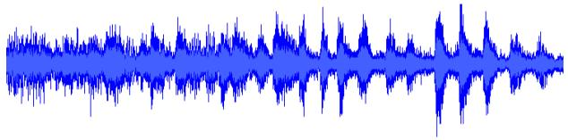
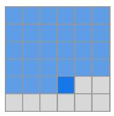
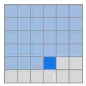
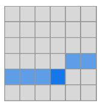
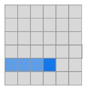
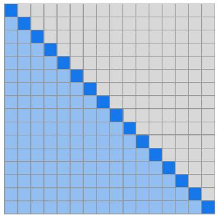
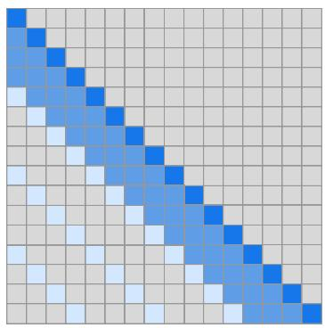
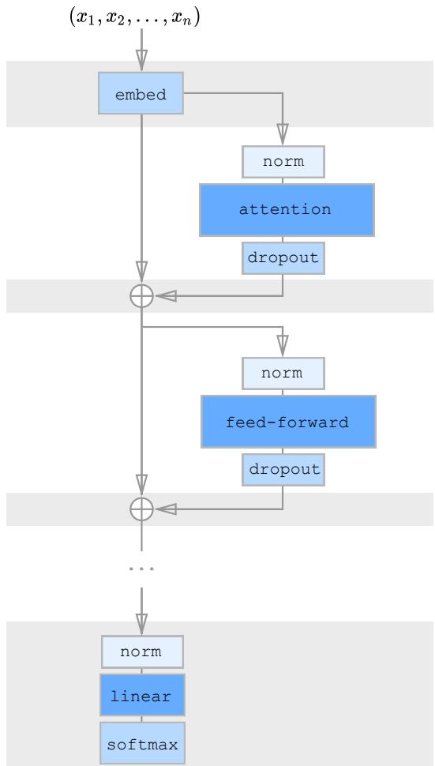

# 用稀疏 Transformers 生成长序列

Rewon Child 1 Scott Gray 1 Alec Radford 1 Ilya Sutskever 1

## Abstract

Transformers 是强大的序列模型，但所需的时间和内存随序列长度呈二次方增长。本文介绍注意力矩阵的稀疏分解方法，将复杂度降低到 $O ( n { \sqrt { n } } )$。我们还引入了 a) 一种用于训练更深网络的架构与初始化变体，b) 通过重新计算注意力矩阵来节省内存，以及 c) 用于训练的高速注意力核。我们将这些改动后的网络称为稀疏 Transformers（Sparse Transformers），并展示了它们能够使用数百层来建模包含数万个时间步长的序列。我们使用相同的架构从原始字节建模图像、音频和文本，在 Enwik8、CIFAR-10 和 ImageNet-64 的密度建模上设立了新的当前最优水平。我们生成了展示全局一致性和高度多样性的无条件样本，并展示了原则上可以用自注意力来建模长度为一百万或更长的序列。

## 1. Introduction

估计复杂高维数据分布是无监督学习中的核心问题，因为许多感兴趣的下游应用涉及文本、图像、音频以及其他数据的生成。此外，它被认为是无监督表示学习的关键组成部分。

最近，神经自回归模型在该领域取得了令人瞩目的成果，在自然语言建模（Jozefowicz 等，2016）（Radford 等，2018）（Dai 等，2018）、原始音频建模（Van Den Oord 等，2016）（Mehri 等，2016）和图像建模（Oord 等，2016）（Menick & Kalchbrenner，2018）（Salimans 等，2017）（Reed 等，2017）（Chen 等，2017）方面达到了当前最优水平。

这些方法将联合概率分布分解为条件分布的乘积。然而，建模这些条件分布极具挑战性，因为它们包含许多复杂的长程依赖关系，并需要具有足够表达能力的模型架构来学习它们。

基于 CNN 的架构（Oord 等，2016）已经在这方面取得了很大进展，但仍需要相当大的深度来扩展其感受野。为解决这一问题，WaveNet（Van Den Oord 等，2016）引入了扩张卷积（dilated convolutions），使网络能够在对数层数内建模长程依赖关系。

  

图 1. 我们的神经自回归模型在 ImageNet 64 和古典音乐数据集上的无条件采样结果。我们对音频、图像和文本采用了相同的基于自注意力（self-attention）的架构。上方的样本以 softmax 温度 1.0 生成，长度分别为 12,288 和 65,536。音频样本可在 https://openai.com/blog/sparse-transformer 收听。

另外，Transformer（Vaswani 等人，2017）已被证明在许多自然语言任务上表现卓越，这可能部分归功于其能够在恒定层数内建模任意依赖关系。由于每个自注意力层都具有全局感受野，网络可以将表征能力分配到最有用的输入区域。因此，与具有固定连接模式的网络相比，该架构在生成多样化数据类型方面可能更为灵活。

然而，此类网络的内存和计算需求随序列长度呈二次方增长，这使其无法用于长序列。

本工作的主要贡献是引入了注意力矩阵的若干稀疏分解，这些分解在不牺牲性能的前提下，与序列长度呈 $O(n\sqrt{n})$ 的复杂度。其做法是将完整的注意力计算分解为若干更快的注意力操作，当这些操作组合在一起时，可以近似稠密注意力操作。我们据此将自注意力应用于前所未有的长序列。

此外，我们还对 Transformer 进行了若干其他改进，包括：

• 重新构建的残差块和权重初始化方法，以改善极深网络的训练

• 一组稀疏注意力核，可高效计算注意力矩阵的子集

• 在反向传播过程中重新计算注意力权重以减少内存使用

我们通过实验验证，经过这些增强的模型在自然语言、原始音频和自然图像的压缩与生成上能够达到最先进的水平。该架构的简洁性使我们相信它可能在许多值得关注的问题中发挥作用。

## 2. 相关工作

最为相关的工作涉及扩展自回归生成模型的其他技术。对于图像，（Reed 等人，2017）对像素之间的条件独立性进行建模，以并行生成多个位置；而（Menick 和 Kalchbrenner，2018）强制一种顺序并采用多尺度上采样过程来生成高保真度样本。（Parmar 等人，2018）使用局部注意力块将 Transformer 应用于图像。对于文本，（Dai 等人，2018）引入了一种可重用状态的"记忆"机制来建模长期依赖。对于音频，除了（Van Den Oord 等人，2016），（Mehri 等人，2016）采用了层次化结构以及不同时钟速率的 RNN，以在推理时使用长上下文，类似于（Koutnik 等人，2014）。（Huang 等人，2018）将 Transformer 应用于 MIDI 生成，并采用了高效的相关注意力机制。

我们的工作比上述许多技术更简单，并且可以同样地应用于图像、文本和音频。此外，上述许多技术与我们的工作是正交的，可以与我们的方法结合使用。

在生成建模之外，有几项与通过分块（chunking）来提高注意力效率相关的工作（Chiu & Raffel, 2017），或使用固定长度表示（Britz 等, 2017）。其他工作研究了具有多次"跳跃"（hops）的注意力，例如（Sukhbaatar 等, 2015）和（Gehring 等, 2017）。

值得注意的是，门控像素 CNN（Gated Pixel CNN）（Oord 等, 2016）和 WaveNet（Van Den Oord 等, 2016）在其网络中使用乘法交互（multiplicative interactions），这与自注意力（self-attention）相关。

## 3. 背景

我们考虑自回归序列生成任务，其中序列 $\begin{array} { r l } { \mathbf { x } } & { { } = } \end{array}$ $\{ x _ { 1 } , x _ { 2 } , . . . , x _ { n } \}$ 的联合概率被建模为条件概率分布的乘积，并由网络 θ 参数化。

$$
p (\mathbf {x}) = \prod_ {i = 1} ^ {n} p (x _ {i} | x _ {1},..., x _ {i - 1}; \theta)\tag{1}
$$

我们将图像、文本和音频处理为离散标记的序列，通常是原始字节。网络 θ 输入标记序列，并使用 softmax 函数输出下一个标记在 v 个可能取值上的类别分布，其中 v 是词汇表的大小。训练目标是相对于 θ 最大化数据的对数概率。

模型 θ 的一个简单而强大的选择是仅以解码器模式运行的 Transformer（Vaswani 等人，2017），正如 Radford 等人（2018）和 Liu 等人（2018）所展示的那样。这些模型通过在整个序列上的多头自注意力块对输入序列进行变换，然后对每个序列元素进行密集变换。然而，自注意力部分的网络必须为 n 个元素中的每一个计算 n 个权重，但随着序列长度的增长，这很快就会变得难以处理。

在接下来的章节中，我们将描述对 Transformer 架构的修改，使其更适合对长序列进行建模。

## 4. 因式分解自注意力

稀疏 Transformer（Sparse Transformers）将完整的自注意力操作分摊到几个注意力步骤中，如图 3(b) 和 3(c) 所示。为了论证我们的方法，我们首先对标准 Transformer 在图像数据集上学到的注意力模式进行定性评估。

图 2. 在 CIFAR-10 上以全注意力训练得到的 128 层网络所学到的注意力模式。白色高亮表示在生成给定像素时某一注意力头的权重，黑色表示自回归掩码。各层能够学到多种专门化的稀疏结构，这或许能解释它们适应不同领域的能力。a) 网络中的许多早期层学到了局部连接模式，这与卷积相似。b) 在第 19 层和第 20 层中，网络学会了将注意力拆分为行注意力和列注意力，从而有效地将全局注意力计算分解开来。c) 若干注意力层呈现出全局的、数据相关的访问模式。d) 第 64–128 层中的典型层表现出高稀疏性，其位置很少被激活，且仅针对特定的输入模式才会激活。

  

(a) Transformer

  

(b) Sparse Transformer（步幅式）

  

(c) 稀疏 Transformer（固定，Sparse Transformer）

图 3. 我们评估的两种二维因式分解注意力方案，用于与标准 Transformer（a）的完整注意力进行比较。顶行以一个 6×6 图像为例，展示了两个注意力头在计算给定输出时所接收的输入位置。底行显示了所有此类输出（行）与输入（列）之间的连接矩阵（未按比例）。连接矩阵中的稀疏性可以显著加快计算速度。在 (b) 和 (c) 中，当两个头顺序计算时，元素之间的完整连接性得以保留。我们测试了此类因式分解能否在性能上匹配图 2 中丰富的连接模式。

## 4.1. 习得注意力模式的定性评估

我们在 CIFAR-10 上对一个 128 层自注意力网络所学习到的注意力模式进行了可视化，并在图 2 中展示了若干示例。直观检查表明，大多数层在大部分数据点上呈现出稀疏的注意力模式，这意味着可以在不显著影响表现的前提下引入某种形式的稀疏性。然而，也有若干层（图 2c）明显呈现出全局模式，另一些层则呈现出数据相关的稀疏性（图 2d）；若在所有注意力矩阵中强行引入预定义的稀疏模式，这两种情形都会受到影响。

在本文中，我们将研究范围限定于一类稀疏注意力模式，其在若干步注意力计算中能够保持所有位置之间的连通性。这类方法比全注意力更高效，同时仍能为任意给定位置提供全局上下文。鉴于这些分解模式（factorized patterns）无法学到与图 2 中完全一致的映射，我们旨在通过一系列任务对其性能进行经验性验证。下面给出分解式注意力（factorized attention）的公式描述。

## 4.2. 分解式自注意力

一个自注意力层将输入嵌入矩阵 X 映射到一个输出矩阵，并由一个连接模式 $S = \{ S _ { 1 } , . . . , S _ { n } \}$ 进行参数化，其中 $S _ { i }$ 表示第 i 个输出向量所关注的输入向量的索引集合。输出向量是输入向量经变换后的加权和：

$$
\operatorname{Attend} (X, S) = \left(a (\mathbf {x} _ {i}, S _ {i})\right) _ {i \in \{1, \dots , n \}}\tag{2}
$$

$$
a (\mathbf {x} _ {i}, S _ {i}) = \mathrm{softmax} \left(\frac {(W _ {q} \mathbf {x} _ {i}) K _ {S _ {i}} ^ {T}}{\sqrt {d}}\right) V _ {S _ {i}}\tag{3}
$$

$$
K _ {S _ {i}} = \left(W _ {k} \mathbf {x} _ {j}\right) _ {j \in S _ {i}} V _ {S _ {i}} = \left(W _ {v} \mathbf {x} _ {j}\right) _ {j \in S _ {i}}\tag{4}
$$

这里 $W _ { q } , W _ { k }$ , and $W _ { v }$ 代表将给定的 x 变换为查询（query）、键（key）或值（value）的权重矩阵，d 是查询与键的内部维度。每个位置上的输出，是按查询与键之间的缩放点积相似度（scaled dot-product similarity）对值进行加权求和所得到的结果。

用于自回归（autoregressive）模型的全自注意力（full self-attention）定义 $S _ { i } =$ $\{ j : j \leq i \}$ ，允许每个元素关注其所有先前的位置以及自身所在的位置。

分解自注意力（factorized self-attention）则具有 p 个独立的注意力头（attention head），其中第 m 个头定义索引的子集 $A _ { i } ^ { ( m ) } ~ \subset ~ \{ j ~ : ~ j ~ \leq ~ i \}$ ，并令 ${ \cal S } _ { i } ~ = ~ { \cal A } _ { i } ^ { ( m ) }$ 。我们主要关注子集 A 的高效选取方式，使得 $| A _ { i } ^ { ( m ) } | \propto \sqrt [ p ] { n }$ 。

此外，目前我们仅考虑 A 的合法（valid）选取方式，即在 p 步注意力之中，所有输入位置都能够连通到所有未来的输出位置。

对每一对满足 $j \le i$ 的位置对，我们设置 A 以使 i 能够通过一条长度至多为 $p + 1$ 的位置路径关注到 j。具体而言，若 $( j , a , b , c , . . . , i )$ 是该索引路径，则 $j \in A _ { a } ^ { ( 1 ) } , a \in A _ { b } ^ { ( 2 ) } , b \in A _ { c } ^ { ( 3 ) }$ ，依此类推。

这两个准则使我们能够在固定步数内保持 Transformer 把信号从任意输入位置传播到任意输出位置的能力，同时将总有效计算量降至 $O ( n \sqrt { n } )$ 。我们还注意到，放宽合法性（validity）准则（例如，采用一系列仅在局部相连的层）可能对某些领域是一种有用的归纳偏置（inductive bias）。

在本文中，我们针对 $p = 2$ 探索了两种分解方式，将在下一节中加以描述，同时我们也注意到，同样的技术可以方便地推广到更高维度。

## 4.3. 二维分解注意力（Two-dimensional factorized attention）

在二维下定义分解注意力模式的一种自然做法是，让一个头关注前 l 个位置，另一个头关注每隔 l 个位置的位置，其中 l 为步幅（stride），其取值接近 $\sqrt { n }$ ，我们称这种方法为跨步注意力（strided attention）。

形式上，当 $t = \operatorname* { m a x } ( 0 , i - l )$ 时，$A _ { i } ^ { ( 1 ) } = \{ t , t + 1 , . . . , i \}$ ，且 $A _ { i } ^ { ( 2 ) } = \{ j : ( i - j )$ mod $l = 0 \}$ 。该模式可在图 3(b) 中可视化展示。

如果数据本身天然具有与步幅相契合的结构（例如图像或某些类型的音乐），那么这种形式非常方便。然而，对于没有周期性结构的数据（例如文本），我们发现网络在使用跨步模式时可能无法正确地路由信息，因为元素的空间坐标并不一定与其在未来最相关的位置相关联。

在这些情况下，我们改用一种固定的注意力模式（Figure 3(c)），其中特定的单元会汇总先前位置的信息，并将其传播到所有后续单元。

形式上，$A_i^{(1)} = \{j : (\lfloor j/l \rfloor = \lfloor i/l \rfloor)\}$，其中方括号表示取整（向下取整）运算，$A_i^{(2)} = \{j : j \mod l \in \{t, t+1, ..., l\}\}$，其中 $t = l - c$，$c$ 是一个超参数。具体来说，如果步长为 128 且 $c = 8$，那么所有大于 128 的未来位置都可以关注 120-128 的位置，所有大于 256 的位置都可以关注 248-256，以此类推。

$c = 1$ 的固定注意力模式会显著限制网络的表达能力，因为网络中的许多表示只用于一个块，而只有少量位置被所有块使用。我们发现，对于典型的 $l \in \{128, 256\}$，选择 $c \in \{8, 16, 32\}$ 时性能良好，但需要指出的是，相较于步进式注意力，这会使该方法的计算成本增加 $c$ 倍。

此外，我们发现，当使用多个头时，让它们关注大小为 $l$ 的块内长度为 $c$ 的不同子块，优于让它们关注同一子块。

在下一节中，我们将描述如何将分解注意力融入到 Sparse Transformer 架构中。

## 5. Sparse Transformer

这里我们详细描述 Sparse Transformer 架构，它是 Transformer 的一个改进版本（Vaswan 等人，2017）。

## 5.1. 分解注意力头

标准密集注意力只是对方程 2 中定义的 attend 函数进行线性变换：

$$
\operatorname{attention} (X) = W _ {p} \cdot \operatorname{attend} (X, S)\tag{5}
$$

其中 $W_{p}$ 表示后注意力（post-attention）权重矩阵。整合分解自注意力（factorized self-attention）最简单的方法是，在每个残差块（residual block）中使用一种注意力类型，并按顺序交错使用它们，或按某个超参数确定的比例交错使用它们：

$$
\operatorname{attention} (X) = W _ {p} \cdot \operatorname{attend} (X, A ^ {(r \bmod p)})\tag{6}
$$

此处 r 是当前残差块的索引，$p$ 是分解注意力头（factorized attention head）的数量。

第二种方法是让单个注意力头同时关注两个分解头都会关注的像素位置，我们称之为合并头（merged head）：

$$
\operatorname{attention} (X) = W _ {p} \cdot \operatorname{attend} (X, \bigcup_ {m = 1} ^ {p} A ^ {(m)})\tag{7}
$$

这种方法在计算上略微更密集一些，但仅差一个常数因子。第三种方法是使用多头注意力（multi-head attention）(Vaswani et al., 2017)，其中 $n _ { h }$ 个注意力结果被并行计算，然后沿特征维度进行拼接：

$$
\operatorname{attention} (X) = W _ {p} \left(\operatorname{attend} (X, A) ^ {(i)}\right) _ {i \in \{1, \dots , n _ {h} \}}\tag{8}
$$

  

图4. 展示 Sparse Transformer（稀疏 Transformer）一个残差块的示意图。阴影背景表示被检查点化（checkpointed）（Chen 等人, 2016）并存储于 GPU 显存中的张量。其余张量（包括注意力权重和前馈网络激活值）在梯度计算过程中被重新计算，从而显著降低显存占用。

其中，A 可以是分离的注意力模式、合并后的模式，或者如公式 2 中那样交错排列。此外，attend 函数内部权重矩阵的维度按 $1 / n _ { h }$ 的比例缩减，从而使得参数数量在不同 $n _ { h }$ 取值下保持不变。

我们通常发现使用多头机制效果良好，不过对于注意力计算占主导地位的极长序列而言，更值得的做法是一次处理一个头并按顺序执行。

## 5.2. 扩展到数百层

我们发现 Transformer 在层数较多时难以训练，正如 (Al-Rfou et al., 2018) 所指出的那样。我们没有引入辅助损失，而是采用了以下架构上的改动。

首先，我们使用 (He et al., 2016) 中的预激活残差块，按如下方式定义一个由 N 层构成的网络：

$$
H _ {0} = \operatorname{embed} (X, W _ {e})\tag{9}
$$

$$
H _ {k} = H _ {k - 1} + \mathrm{resblock} (H _ {k - 1})\tag{10}
$$

$$
y = \mathrm{softmax} (\mathrm{norm} (H _ {N}) W _ {o u t})\tag{11}
$$

其中 embed 是我们将在下一节中描述的函数，$W_{out}$ 是一个权重矩阵，resblock(h) 以如下方式对注意力块的输入以及逐位置前馈网络（positionwise feedforward network）进行归一化：

$$
a (H) = \text { dropout } (\text { attention } (\text { norm } (H)))\tag{12}
$$

$$
b (H) = \text { dropout } (\text { ff } (\text { norm } (H + a (H))))\tag{13}
$$

$$
\operatorname{resblock} (H) = a (H) + b (H)\tag{14}
$$

norm 函数表示层归一化（Layer Normalization）（Ba 等，2016），且 $\mathrm { { f } } ( x ) = W _ { 2 } f ( W _ { 1 } x + b _ { 1 } ) + b _ { 2 }$。我们选取的 $f$ 为高斯误差线性单元（Gaussian Error Linear Unit）（Hendrycks 与 Gimpel，2016），f(X) = X · sigmoid(1.702 · X)，如（Radford 等，2018）中所用。除非另有说明，$W _ { 1 }$ 的输出维度为输入维度的 4.0 倍。

注意到 $H _ { N }$ 是函数 a 与 b 经 N 次应用所得输出之和，因此每个函数块可直接从输出层接收梯度。我们将式 5 中 $W _ { 2 }$ 和 $W _ { p }$ 的初始化按 $\frac { 1 } { \sqrt { 2 N } }$ 进行缩放，以使输入嵌入尺度与残差块尺度之比在不同 N 值下保持不变。

## 5.3. 建模多样化数据类型

除输入符号的嵌入外，位置嵌入通常用于 Transformer 及其他与位置无关的架构中，以编码数据的空间关系（Gehring 等，2017），（Parmar 等，2018）。

我们发现，使用能够编码数据结构或分解因子注意力模式的学习嵌入对模型性能而言至关重要。

我们对每个输入位置添加了 $n _ { e m b } = d _ { d a t a }$ 或 $n _ { e m b } = d _ { a t t n }$ 个嵌入，其中 $d _ { d a t a }$ 指数据的维度数，$d _ { a t t r }$ 为分解因子注意力的维度数。若 xi 为序列中第 i 个元素的 one-hot 编码，$\mathbf { \bar { o } } _ { i } ^ { ( j ) }$ 表示 $\mathbf { x } _ { i }$ 在第 j 维度中的 one-hot 编码位置 $( 1 \leq j \leq n _ { e m b } )$，则：

$$
\operatorname{embed} (X, W _ {e}) = \left(\mathbf {x} _ {i} W _ {e} + \sum_ {j = 1} ^ {n _ {\text { emb }}} \mathbf {o} _ {i} ^ {(j)} W _ {j}\right) _ {\mathbf {x} _ {i} \in X}\tag{15}
$$

对于图像，我们使用了数据嵌入（data embeddings），其中 $d_{data} = 3$，对应于每个输入字节的行、列和通道位置。对于文本和音频，我们使用两个维度上的注意力嵌入（two-dimensional attention embeddings），其中 $d_{attn} = 2$，索引对应于每个位置在宽度等于步长（stride）的矩阵中的行索引和列索引。

## 5.4. 通过重计算注意力权重来节省内存

梯度检查点（gradient checkpointing）已被证明在降低深度神经网络训练的内存需求方面是有效的（Chen et al., 2016），（Gruslys et al., 2016）。然而值得注意的是，当处理长序列时，这一技术对自注意力层特别有效，因为相对于其计算成本而言，这些层的内存占用很高。

仅使用重计算，我们就能够在序列长度为 16,384 的情况下训练具有数百层的密集注意力网络，否则在现代硬件上这是不可行的。

在我们的实验中，我们对注意力和前馈块在反向传播过程中进行重计算。为了简化实现，我们在注意力块内部不采用 dropout，正如（Vaswani et al., 2017）中所做的那样，而是仅在每个残差加法（residual addition）的末尾应用 dropout，如图 4 所示。

## 5.5. 高效的块稀疏注意力核函数

图 3(b) 和 3(c) 中的稀疏注意力掩码可以通过从查询（query）、键（key）和值（value）矩阵中切分子块并以块为单位计算乘积来高效地计算。局部窗口上的注意力可以直接计算；对于步长为 k 的注意力，可以通过转置矩阵并计算局部窗口来获得。固定的注意力位置可以被聚合并以块为单位计算。

为了便于实验，我们实现了一组 GPU 核函数来高效地执行这些操作。softmax 操作被融合到单个核函数中，并利用寄存器来避免对输入数据的重复加载，从而使其能够以与简单非线性运算相同的速度运行。此外，注意力矩阵的上三角部分永远不会被计算，这消除了（Vaswani et al., 2017）中负偏置项的需要，并将需要执行的操作数量减半。

## 5.6. 混合精度训练

我们以单精度浮点格式存储网络权重，但按如（Micikevicius et al., 2017）中所做的那样，以半精度计算网络激活与梯度。由于使用了 V100 GPU 上的 Tensor Core 操作，这加速了我们的训练。在梯度计算过程中，我们使用动态损失缩放（dynamic loss scaling）来降低数值依赖损失，并且当跨多个 GPU 取平均时，我们以半精度传递梯度。在采样时，我们将查询和键转换为单精度，因为查询-键乘积有时会超出半精度的最大值。

  

图 5. 来自 ImageNet 64×64 的无条件生成样本，采用未经修改的 softmax 温度 1.0 生成。我们能够直接从像素中学习长程依赖关系，而无需使用多尺度架构。

## 6. 训练

我们使用 Adam 优化器，线性 warmup 5000 次迭代，梯度裁剪为 1.0，我们发现这两项对模型稳定性都很重要。权重衰减惩罚设为 0.01。学习率按照（Radford et al., 2018）中的余弦衰减进行退火。除非另有说明，我们在 8 块 V100 GPU 上进行训练。

所有嵌入维度都是恒定的 $d$，通常取 $\{256, 512, 1024\}$ 之一。默认情况下，所有线性变换都变换到同一维度，前馈网络除外——它会将输入映射到 $4d$，除非我们使用"half-size"变换，此时为 $2d$。此外，有时我们会将 query 和 key 变换的维度减半。

我们将 token 嵌入 $W _ { e }$ 从 $\mathcal { N } ( 0 , \frac { 0 . 1 2 5 } { \sqrt { d } } )$ 初始化，将位置嵌入从 $\mathcal { N } ( 0 , \frac { 0 . 1 2 5 } { \sqrt { d n _ { e m b } } } )$ 初始化。在注意力和前馈组件内部，所有偏置都初始化为 0，所有权重都从 $\begin{array} { r } { \mathcal { N } ( 0 , \frac { 0 . 1 2 5 } { \sqrt { d _ { i n } } } ) } \end{array}$ 初始化，其中 $d _ { i n }$ 是 fan-in 维度。输出 logits 的权重矩阵初始化为 0。

## 7. 实验

我们在密度建模任务（包括自然图像、文本和原始音频）上对我们的架构进行了实证测试。表 1 给出了结果的汇总。我们发现，除了比全注意力运行速度显著更快之外，稀疏模式还收敛到了更低的误差，如表 2 所示。这可能表明我们引入的稀疏模式具有有用的归纳偏置，或者全注意力本身存在潜在的优化问题。

## 7.1. CIFAR-10

我们在以 3072 字节序列表示的 CIFAR-10 图像上训练步进式（strided）Sparse Transformer。模型有 2 个头、128 层，$d = 256$，使用 half-size 的前馈网络以及 query-key 投影，训练 120 个 epoch，学习率为 0.00035，dropout 率为 0.25，直到验证误差不再下降为止。

我们使用 48000 个样本进行训练，2000 个样本进行验证，并在测试集上评估我们最佳模型的性能。该模型达到了 2.80 bits per dim（在种子 1、2、3 上为 $2.798 \pm 0.004$），优于此前 2.85 的最佳水平（Chen et al., 2017）。我们还在表 2 中比较了不同注意力模式的性能。步进式注意力在最短的时间内达到了最低误差，超越了 dense attention 的 2.82 bits per dim。

表 1. 我们的密度建模任务发现汇总。结果以 bits per byte 报告，对于图像任务而言等价于 bits per dim。M 指的是百万级参数。

<table><tr><td>Model</td><td>Bits per byte</td></tr><tr><td colspan="2">CIFAR-10</td></tr><tr><td>PixelCNN (Oord et al., 2016)</td><td>3.03</td></tr><tr><td>PixelCNN++ (Salimans et al., 2017)</td><td>2.92</td></tr><tr><td>Image Transformer (Parmar et al., 2018)</td><td>2.90</td></tr><tr><td>PixelSNAIL (Chen et al., 2017)</td><td>2.85</td></tr><tr><td>Sparse Transformer 59M (strided)</td><td>2.80</td></tr><tr><td colspan="2">Enwik8</td></tr><tr><td>Deeper Self-Attention (Al-Rfou et al., 2018)</td><td>1.06</td></tr><tr><td>Transformer-XL 88M (Dai et al., 2018)</td><td>1.03</td></tr><tr><td>Transformer-XL 277M (Dai et al., 2018)</td><td>0.99</td></tr><tr><td>Sparse Transformer 95M (fixed)</td><td>0.99</td></tr><tr><td colspan="2">ImageNet 64x64</td></tr><tr><td>PixelCNN (Oord et al., 2016)</td><td>3.57</td></tr><tr><td>Parallel Multiscale (Reed et al., 2017)</td><td>3.7</td></tr><tr><td>Glow (Kingma &amp; Dhariwal, 2018)</td><td>3.81</td></tr><tr><td>SPN 150M (Menick &amp; Kalchbrenner, 2018)</td><td>3.52</td></tr><tr><td>Sparse Transformer 152M (strided)</td><td>3.44</td></tr><tr><td colspan="2">Classical music, 5 seconds at 12 kHz</td></tr><tr><td>Sparse Transformer 152M (strided)</td><td>1.97</td></tr></table>

## 7.2. 文本

为了在没有强二维结构的数据集上评估稀疏 Transformer（Sparse Transformers），我们在 EnWik8 数据集上训练了模型，该数据集代表维基百科的前 108 字节，并且在周期结构上具有很大的变异性。我们使用的上下文长度为 12,288，这比以往的方法更长。

我们在前 9000 万个 token 上进行训练，并将最后 1000 万个 token 留作验证和测试。我们使用了 30 层固定稀疏 Transformer（fixed Sparse Transformers），包含 8 个头，d = 512，dropout 率为 0.40。我们训练了 80 个 epoch，直到验证损失不再下降。我们使用的步幅（stride）为 128，c = 32，并合并了分解的注意力头（factorized attention heads）。

我们的最佳模型达到了 0.99 bits per dim（在随机种子 1、2、3 上为 0.992 ± 0.001），超过了同等规模的 Transformer-XL（Dai 等人，2018）的 1.03 当前最优水平，并匹配了一个参数量翻倍以上模型的 0.99。步幅注意力（strided attention）在该数据集上表现不佳，而固定模式（fixed patterns）能够恢复并超过密集注意力（dense attention）的性能，如表 2 所列。

表 2. 稀疏模式（sparse patterns）在我们能够同时比较两者的数据集上显示出了更快的速度和更好的损失，这可能表明我们所学到的模式中存在有用的归纳偏置，或全注意力（full attention）存在潜在的优化问题。

<table><tr><td>Model</td><td>Bits per byte</td><td>Time/Iter</td></tr><tr><td colspan="3">Enwik8 (12,288 context)</td></tr><tr><td>Dense Attention</td><td>1.00</td><td>1.31</td></tr><tr><td>Sparse Transformer (Fixed)</td><td>0.99</td><td>0.55</td></tr><tr><td>Sparse Transformer (Strided)</td><td>1.13</td><td>0.35</td></tr><tr><td colspan="3">CIFAR-10 (3,072 context)</td></tr><tr><td>Dense Attention</td><td>2.82</td><td>0.54</td></tr><tr><td>Sparse Transformer (Fixed)</td><td>2.85</td><td>0.47</td></tr><tr><td>Sparse Transformer (Strided)</td><td>2.80</td><td>0.38</td></tr></table>

Table 3. 我们观察到 Enwik8 在更长的上下文上压缩率有所提升，这表明 Sparse Transformer 能够有效地融合长期依赖关系。

<table><tr><td>Minimum context length during evaluation</td><td>Bits per byte</td></tr><tr><td>6,144 tokens</td><td>0.9952</td></tr><tr><td>9,216 tokens</td><td>0.9936</td></tr><tr><td>10,752 tokens</td><td>0.9932</td></tr><tr><td>11,904 tokens</td><td>0.9930</td></tr><tr><td>12,096 tokens</td><td>0.9922</td></tr><tr><td>12,160 tokens</td><td>0.9908</td></tr></table>

此外，在测试集的评估过程中，我们通过并行评估更少的 token 来修改网络可使用的最小上下文长度。我们观察到性能随着所用 token 数量的增加而单调提升，最多可用到训练时所用 12,288 个 token 中的 12,160 个（见表 3），这表明网络有效地利用了长期依赖关系。

## 7.3. ImageNet 64×64

为了测试模型学习长程依赖的能力以及扩展到大规模数据集的能力，我们在（Oord et al., 2016）发布的下采样版本的 ImageNet 上进行训练，并在验证集上进行评估。我们使用了一个 48 层带步长的 Sparse Transformer（稀疏 Transformer），具有 16 个注意力头，$d = 512$，共计 1.52 亿个参数。我们使用了 128 的步长，0.01 的 dropout，并训练了 70 个 epoch，这在 64 块 V100 GPU 上耗时 7 天。

我们的模型达到了 3.44 bits per dim（bits per dimension，每维比特数）的损失（1 次运行的平均为 3.437），而此前最佳成绩为 3.52（Menick & Kalchbrenner, 2018）。

此外，我们以未经修改的 softmax 温度 1.0 从模型以及一个层数翻倍（共计 3 亿参数）的模型生成无条件样本（Figure 5）。此处我们展示的是来自 3 亿参数模型的样本。通过视觉评估，我们未发现来自稀疏模式（sparsity patterns）的伪迹（artifacts），并且在大多数图像中观察到了长程结构。

## 7.4. 原始音频中的古典音乐

为了测试 Sparse Transformer 能够扩展到极长上下文的程度，我们在（Dieleman et al., 2018）发布的古典音乐数据集上训练了模型。由于无法获知数据集处理的具体细节，我们略去与其他工作的直接比较，转而研究在不同上下文大小下我们能够训练多大规模的 Sparse Transformer。对于每个序列长度，我们都尝试训练能够在不使用模型并行的情况下完全装入 16GB V100 加速器的最大模型。

总体而言，我们发现将序列长度增加 4 倍需要将模型容量减少大约 $4 { \sqrt { 4 } } = 8 .$ 倍。因此我们发现可以在超过 100 万时间步长的序列上使用分解的自注意力（factorized self-attention），尽管此时参数量极少（300 万）。

针对长度为 65,536 的序列可获得生成样本，这些样本对应于在 12kHz 采样率下约 5 秒的生成音频。这些样本清楚地展示了在采样时段内的全局一致性（global coherence），并呈现出多种演奏风格与音色，从节奏性演奏切换到强力演奏。要试听样本，请访问 https://openai.com/blog/ sparse-transformer。由于模型容量降低，对于更长的序列，样本质量会迅速下降。

Table 4. 带步长的 Sparse Transformer 在古典音频数据集（µ-law 编码，12 kHz）上的性能，作为序列长度和模型大小的函数。

<table><tr><td>Sequence length</td><td>Parameters</td><td>Bits per byte</td></tr><tr><td>65,536</td><td>152M</td><td>1.97</td></tr><tr><td>262,144</td><td>25M</td><td>2.17</td></tr><tr><td>1,048,576</td><td>3M</td><td>2.99</td></tr></table>

## 8. 结论

我们提出了稀疏 Transformer（Sparse Transformers），并证明其在长序列的密度建模上能够达到与标准 Transformer 相当或更好的性能，同时所需的运算量显著减少。该性能在图像和文本领域处于最优水平，并且能够轻松适配到原始音频。该模型展示了对长程上下文的使用能力，并生成了全局一致的样本。

## 9. 致谢

我们感谢 Ashish Vaswani 在项目起步阶段进行了富有洞察力的讨论。我们也感谢 Joshua Meier 和 Mark Chen 进行了有益的讨论，并感谢 Johannes Otterbach、Prafulla Dhariwal 和 David Luan 对本文草稿提出的反馈意见。

## 参考文献

Al-Rfou, R., Choe, D., Constant, N., Guo, M., and Jones, L. 字符级语言建模与更深层自注意力. arXiv 预印本 arXiv:1808.04444, 2018.

Ba, J. L., Kiros, J. R., and Hinton, G. E. 层归一化（Layer Normalization）. arXiv 预印本 arXiv:1607.06450, 2016.

Britz, D., Guan, M. Y., and Luong, M.-T. 使用固定大小记忆表示的高效注意力. arXiv 预印本 arXiv:1707.00110, 2017.

Chen, T., Xu, B., Zhang, C., and Guestrin, C. 以次线性内存开销训练深度网络. arXiv 预印本 arXiv:1604.06174, 2016.

Chen, X., Mishra, N., Rohaninejad, M., and Abbeel, P. Pixelsnail：一种改进的自回归生成模型. arXiv 预印本 arXiv:1712.09763, 2017.

Chiu, C.-C. and Raffel, C. 单调分块注意力（Monotonic Chunkwise Attention）. arXiv 预印本 arXiv:1712.05382, 2017.

Dai, Z., Yang, Z., Yang, Y., Cohen, W. W., Carbonell, J., Le, Q. V., and Salakhutdinov, R. Transformer-XL：具有更长距离依赖的语言建模. 2018.

Dieleman, S., van den Oord, A., and Simonyan, K. 真实音乐生成的挑战：大规模原始音频建模. 载于《神经信息处理系统进展》，第 8000–8010 页，2018.

Gehring, J., Auli, M., Grangier, D., Yarats, D., and Dauphin, Y. N. 卷积序列到序列学习. arXiv 预印本 arXiv:1705.03122, 2017.

Gruslys, A., Munos, R., Danihelka, I., Lanctot, M., and Graves, A. 节省内存的时序反向传播. 载于《神经信息处理系统进展》，第 4125–4133 页，2016.

He, K., Zhang, X., Ren, S., and Sun, J. 深度残差网络中的恒等映射. arXiv 预印本 arXiv:1603.05027, 2016.

Hendrycks, D. and Gimpel, K. 用高斯误差线性单元（Gaussian Error Linear Units）桥接非线性与随机正则化. arXiv 预印本 arXiv:1606.08415, 2016.

Huang, C.-Z. A., Vaswani, A., Uszkoreit, J., Shazeer, N., Hawthorne, C., Dai, A. M., Hoffman, M. D., and Eck, D. 改进的 Transformer 相对自注意力机制及其在音乐生成中的应用. arXiv 预印本 arXiv:1809.04281, 2018.

Jozefowicz, R., Vinyals, O., Schuster, M., Shazeer, N., and Wu, Y. 探索语言建模的极限. arXiv 预印本 arXiv:1602.02410, 2016.

Kingma, D. P. and Dhariwal, P. Glow：具有可逆 1×1 卷积的生成流。载于 Advances in Neural Information Processing Systems，2018，第 10236–10245 页。

Koutnik, J., Greff, K., Gomez, F., and Schmidhuber, J. 钟摆循环神经网络（Clockwork RNN）。arXiv 预印本 arXiv:1402.3511，2014。

Liu, P. J., Saleh, M., Pot, E., Goodrich, B., Sepassi, R., Kaiser, L., and Shazeer, N. 通过对长序列进行摘要来生成维基百科。arXiv 预印本 arXiv:1801.10198，2018。

Mehri, S., Kumar, K., Gulrajani, I., Kumar, R., Jain, S., Sotelo, J., Courville, A., and Bengio, Y. SampleRNN：一种无条件端到端的神经音频生成模型。arXiv 预印本 arXiv:1612.07837，2016。

Menick, J. and Kalchbrenner, N. 利用子尺度像素网络与多维上采样生成高保真图像。arXiv 预印本 arXiv:1812.01608，2018。

Oord, A. v. d., Kalchbrenner, N., and Kavukcuoglu, K. 像素循环神经网络（Pixel Recurrent Neural Networks）。arXiv 预印本 arXiv:1601.06759，2016。

Parmar, N., Vaswani, A., Uszkoreit, J., Kaiser, Ł., Shazeer, N., and Ku, A. 图像 Transformer（Image Transformer）。arXiv 预印本 arXiv:1802.05751，2018。

Radford, A., Narasimhan, K., Salimans, T., and Sutskever, I. 通过生成式预训练提升语言理解能力。URL https://s3-us-west-2. amazonaws. com/openai-assets/research-covers/languageunsupervised/language understanding paper. pdf，2018。

Reed, S., Oord, A. v. d., Kalchbrenner, N., Colmenarejo, S. G., Wang, Z., Belov, D., and de Freitas, N. 并行多尺度自回归密度估计。arXiv 预印本 arXiv:1703.03664，2017。

Salimans, T., Karpathy, A., Chen, X., and Kingma, D. P. PixelCNN++：使用离散化 Logistic 混合似然及其他改进提升 PixelCNN。arXiv 预印本 arXiv:1701.05517，2017。

Sukhbaatar, S., Weston, J., Fergus, R., 等. 端到端记忆网络。载于 Advances in Neural Information Processing Systems，2015，第 2440–2448 页。

Van Den Oord, A., Dieleman, S., Zen, H., Simonyan, K., Vinyals, O., Graves, A., Kalchbrenner, N., Senior, A., and Kavukcuoglu, K. WaveNet：一种面向原始音频的生成模型。CoRR abs/1609.03499，2016。

Vaswani, A., Shazeer, N., Parmar, N., Uszkoreit, J., Jones, L., Gomez, A. N., Kaiser, Ł., and Polosukhin, I. 注意力即所需（Attention Is All You Need）。载于 Advances in Neural Information Processing Systems，2017，第 5998–6008 页。