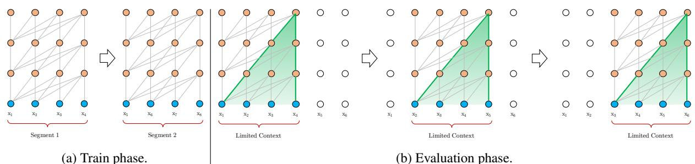
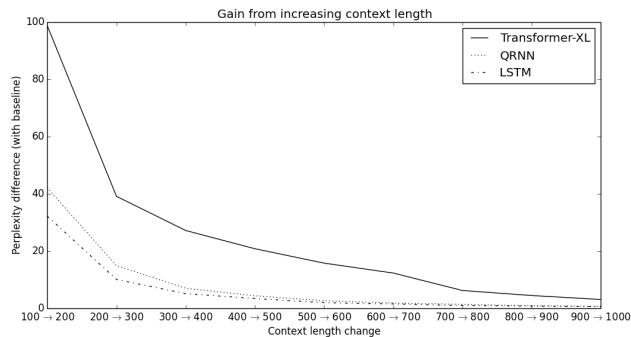
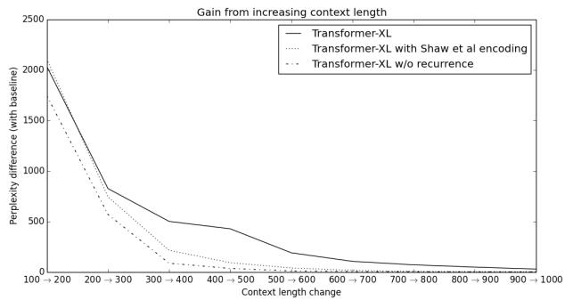
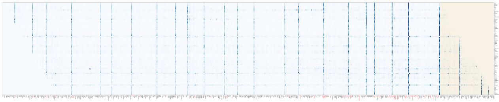
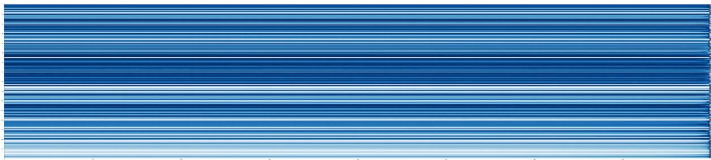
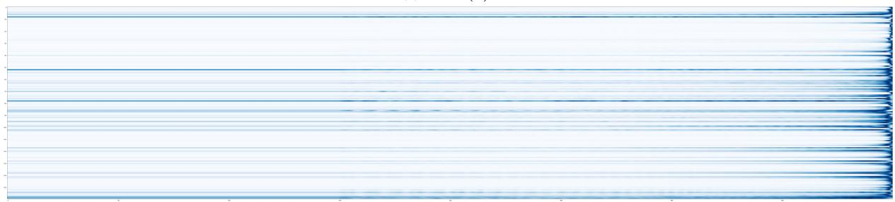
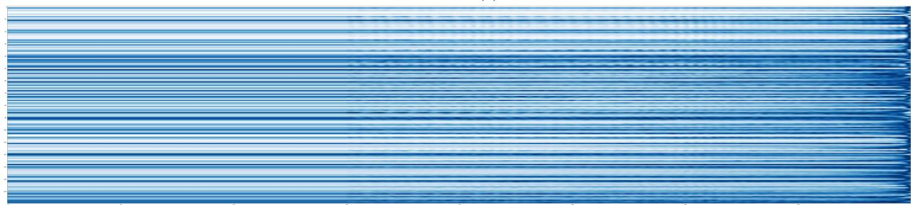
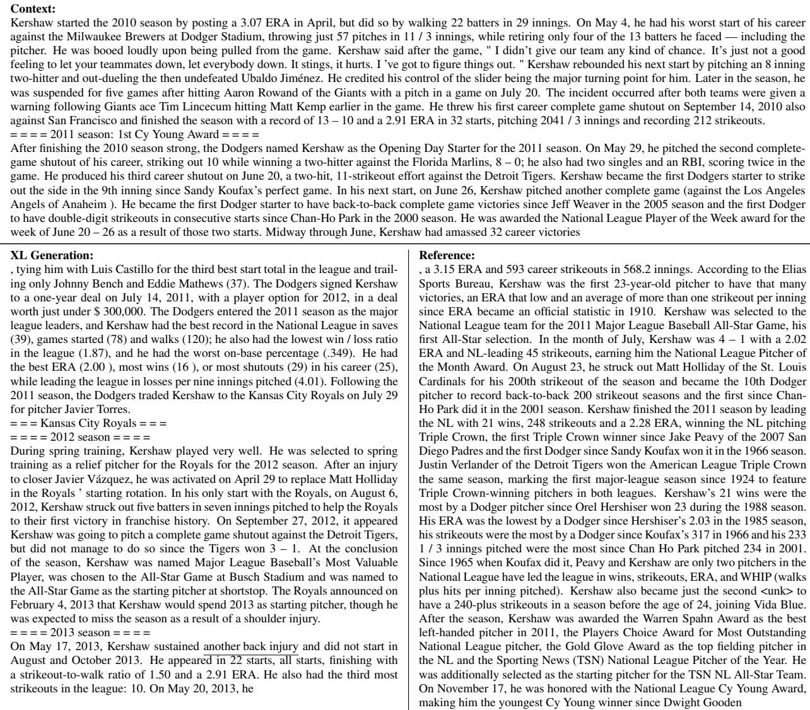
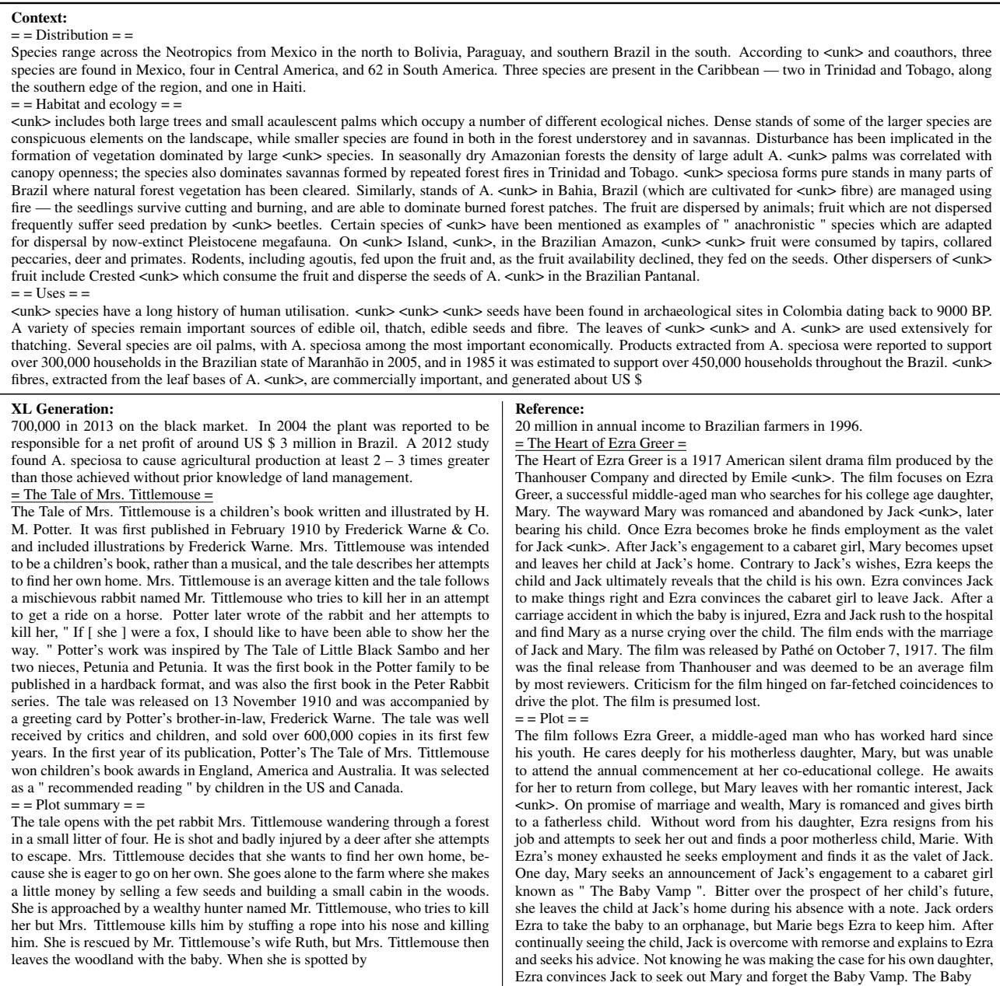

# Transformer-XL：超越固定长度上下文的注意力语言模型

Zihang Dai<sup>∗12</sup>, Zhilin Yang<sup>∗12</sup>, Yiming Yang<sup>1</sup>, Jaime Carbonell<sup>1</sup>,

Quoc V. Le<sup>2</sup>, Ruslan Salakhutdinov<sup>1</sup>

<sup>1</sup>Carnegie Mellon University（卡内基梅隆大学）, <sup>2</sup>Google Brain（谷歌大脑）

{dzihang,zhiliny,yiming,jgc,rsalakhu}@cs.cmu.edu, qvl@google.com

## 摘要

Transformer 具备学习更长距离依赖的潜力，但在语言建模任务中受限于固定长度的上下文。我们提出了一种新的神经架构 Transformer-XL，它能够在不破坏时间一致性的前提下学习超越固定长度的依赖关系。该架构包含一种分段级别的循环机制和一种新颖的位置编码方案。我们的方法不仅能捕获更长距离的依赖，还能解决上下文碎片化问题。因此，Transformer-XL 所学习的依赖长度比循环神经网络（RNN）长 80%，比 vanilla Transformer（原始 Transformer）长 450%，在短序列和长序列上均取得了更好的性能，并且在评估阶段比 vanilla Transformer 快 1,800 倍以上。值得注意的是，我们将 bpc/困惑度（perplexity）的当前最优结果提升至：在 enwiki8 上达到 0.99、text8 上达到 1.08、WikiText-103 上达到 18.3、One Billion Word 上达到 21.8、Penn Treebank 上达到 54.5（均未经过微调）。当仅在 WikiText-103 上进行训练时，Transformer-XL 也能生成具有数千个 token、连贯且新颖的文本文章。我们的代码、预训练模型以及超参数已在 Tensorflow 和 PyTorch¹ 中开源。

## 1 引言

语言建模是需要建模长距离依赖的重要问题之一，其成功的应用包括无监督预训练（Dai and Le, 2015; Peters et al., 2018; Radford et al., 2018; Devlin et al., 2018）。然而，如何使神经网络具备对序列数据中长距离依赖进行建模的能力一直是一个挑战。循环神经网络（RNN），尤其是长短期记忆（LSTM）网络（Hochreiter and Schmidhuber, 1997），长期以来一直是语言建模的标准解决方案，并在多个基准上取得了出色的结果。尽管 RNN 被广泛采用，但它由于梯度消失和梯度爆炸（Hochreiter et al., 2001）而难以优化，而在 LSTM 中引入门控机制以及梯度裁剪技术（Graves, 2013）可能仍不足以完全解决这一问题。经验上，先前的研究发现 LSTM 语言模型平均仅使用 200 个上下文词（Khandelwal et al., 2018），表明仍有进一步的提升空间。

另一方面，注意力机制（attention mechanisms）中内建的长距离词对之间的直接连接可能有助于优化并实现长期依赖（long-term dependency）的学习（Bahdanau 等人，2014；Vaswani 等人，2017）。最近，Al-Rfou 等人（2018）设计了一组辅助损失，用于在字符级语言建模上训练深度 Transformer 网络，其表现大幅优于 LSTM。尽管取得了成功，Al-Rfou 等人（2018）中的语言模型训练是在几百个字符的固定长度片段上分段进行的，片段之间没有任何信息流动。由于上下文长度固定，模型无法捕获超出预定义上下文长度的任何更长范围的依赖。此外，固定长度的片段是通过选择连续的符号块来创建的，没有尊重句子或任何其他语义边界。因此，模型缺乏良好预测最初几个符号所需的必要上下文信息，导致优化效率低下和性能较差。我们将这个问题称为上下文碎片化（context fragmentation）。

为了解决上述固定长度上下文的局限性，我们提出了一种称为 Transformer-XL（意为超长）的新架构。我们将循环（recurrence）的概念引入到我们的深度自注意力网络中。具体而言，我们不是为每个新片段从头计算隐藏状态，而是重用先前片段中获得的隐藏状态。重用的隐藏状态充当当前片段的内存，从而在片段之间建立起循环连接。因此，建模非常长期的依赖成为可能，因为信息可以通过循环连接进行传播。同时，从先前片段传递信息也可以解决上下文碎片化的问题。更重要的是，我们证明了使用相对位置编码（relative positional encodings）而非绝对位置编码（absolute ones）的必要性，以便在不引起时间混淆的情况下实现状态重用。因此，作为一项额外的技术贡献，我们引入了一种简单但更有效的相对位置编码公式，该公式可泛化到训练期间观察到的注意力长度之外的更长注意力长度。

Transformer-XL 在五个数据集上取得了强劲的结果，涵盖了从词级到字符级的语言建模。Transformer-XL 还能够生成相对连贯的长文本文章，包含数千个标记（token）（见附录 E），仅在 1 亿个标记上进行训练。

我们的主要技术贡献包括在纯自注意力模型中引入循环概念，并推导了一种新颖的位置编码方案。这两项技术形成了一套完整的解决方案，因为单独任何一项都不能解决固定长度上下文的问题。Transformer-XL 是第一个在字符级和词级语言建模上均显著优于 RNN 的自注意力模型。

## 2 相关工作（Related Work）

近年来，语言建模领域见证了许多重大进展，包括但不限于：设计新颖架构以更好地编码上下文（Bengio 等人，2003；Mikolov 等人，2010；Merity 等人，2016；Al-Rfou 等人，2018），改进正则化与优化算法（Gal 和 Ghahramani，2016），加速 Softmax 计算（Grave 等人，2016a），以及丰富输出分布族（Yang 等人，2017）。

为了在语言建模中捕捉长程上下文，有一类工作直接将更广泛上下文的表示作为附加输入送入网络。现有工作既有手工定义上下文表示的方法（Mikolov 和 Zweig，2012；Ji 等人，2015；Wang 和 Cho，2015），也有依赖从数据中学习得到的文档级主题的方法（Dieng 等人，2016；Wang 等人，2017）。

更广泛地说，在通用序列建模中，如何捕捉长期依赖一直是一个长期存在的研究问题。从这一视角出发，自从长短期记忆网络（LSTM）被广泛采用以来，研究者投入了大量精力来缓解梯度消失问题，包括更优的初始化方式（Le 等人，2015）、额外的损失信号（Trinh 等人，2018）、增强的记忆结构（Ke 等人，2018）以及其他修改循环神经网络（RNN）内部架构以降低优化难度的工作（Wu 等人，2016；Li 等人，2018）。与这些工作不同，我们的工作基于 Transformer 架构，并表明作为一种真实世界的任务，语言建模能够从学习更长程依赖的能力中受益。

## 3 模型

给定一个词元（token）语料库 $\mathbf { x } = ( x _ { 1 } , \dots , x _ { T } )$ ，语言建模的任务是估计联合概率 $P ( \mathbf { x } )$ ，该概率通常自回归地分解为 $\begin{array} { r } { P ( \mathbf { x } ) = \prod _ { t } P ( x _ { t } \mid \mathbf { x } _ { < t } ) } \end{array}$ 。通过这种分解，问题归结为估计每个条件因子。在本工作中，我们坚持采用标准的神经方法来建模条件概率。具体而言，使用一个可训练的神经网络将上下文 $\mathbf { x } _ { < t }$ 编码为一个固定大小的隐藏状态，再将其与词嵌入相乘以得到 logits。然后将这些 logits 送入 Softmax 函数，从而产生下一个词元上的类别概率分布。

## 3.1 标准 Transformer 语言模型

为了将 Transformer 或自注意力应用于语言建模，其核心问题在于如何训练 Transformer，使其能够有效地将任意长度的上下文编码为固定大小的表示。在拥有无限内存和算力的前提下，一种简单的解决方案是使用无条件的 Transformer 解码器来处理整个上下文序列，类似于前馈神经网络。然而，在实际资源受限的情况下，这种做法通常是不可行的。

一个可行但粗糙的近似方法是将整个语料库切分为长度可控的较短片段，并且只在每个片段内部训练模型，忽略所有来自先前片段的上下文信息。这就是 Al-Rfou 等人（2018）所采用的思想。我们将其称为 vanilla model（基线模型），并在图 1a 中对其进行了可视化。在这一训练范式下，信息无论在前向传播还是反向传播中都不会跨片段流动。使用固定长度上下文存在两个关键的局限性。首先，可能的最大依赖长度被片段长度所上界，而片段长度在字符级语言建模任务中只有几百（Al-Rfou 等人，2018）。因此，尽管自注意力机制相比 RNN 受梯度消失问题的影响较小，但 vanilla model 仍无法充分利用这一优化优势。其次，虽然可以通过 padding 来尊重句子或其他语义边界，但在实际中，为了提高效率，简单地将长文本切分为固定长度的片段已成为标准做法（Peters 等人，2018；Devlin 等人，2018；Al-Rfou 等人，2018）。然而，简单地将序列切分为固定长度的片段会导致如第 1 节所讨论的上下文碎片化问题。

  

(b) 评估阶段（Evaluation phase）。

(a) 训练阶段（Train phase）。

图 1：基线模型（vanilla model）示意图，段长为 4。

在评估阶段，每一步中，原始模型（vanilla model）同样会消费与训练时等长的一个片段，但只在最后一个位置进行一次预测。随后在下一步中，该片段仅向右移动一个位置，而新片段则需要从头开始重新处理。如图 1b 所示，这一流程确保每次预测都利用了训练时所暴露的最长可能上下文，同时也缓解了训练中出现的上下文碎片化问题。然而，该评估流程的计算开销极大。我们将展示，所提出的架构能够大幅提升评估速度。

## 3.2 带状态复用的片段级循环（Segment-Level Recurrence with State Reuse）

为克服使用固定长度上下文的局限性，我们提出在 Transformer 架构中引入一种循环机制。在训练过程中，针对前一片段计算得到的隐藏状态序列被固定并缓存起来，以便在模型处理下一个新片段时作为扩展上下文被复用，如图 2a 所示。尽管梯度仍然局限于单个片段内部，但这一额外的输入使网络能够利用历史中的信息，从而具备建模更长程依赖的能力，并避免上下文碎片化问题。

形式上，设长度为 L 的两个连续片段分别为 $\begin{array} { r l } { \mathbf { s } _ { \tau } } & { { } = } \end{array}$ $[ x _ { \tau , 1 } , \cdots , x _ { \tau , L } ]$ 和 $\mathbf { s } _ { \tau + 1 } = [ x _ { \tau + 1 , 1 } , \cdot \cdot \cdot , x _ { \tau + 1 , L } ]$。将针对第 τ 个片段 s<sub>τ</sub> 计算得到的第 n 层隐藏状态序列记为 $\mathbf { h } _ { \tau } ^ { n } ~ \in ~ \mathbb { R } ^ { L \times d }$，其中 d 为隐藏维度。随后，针对片段 s 的第 n 层隐藏状态（示意性地）按如下方式生成，

$$
\begin{array}{l} \widetilde {\mathbf {h}} _ {\tau + 1} ^ {n - 1} = \left[ \mathrm{SG} (\mathbf {h} _ {\tau} ^ {n - 1}) \circ \mathbf {h} _ {\tau + 1} ^ {n - 1} \right], \\ \mathbf {q} _ {\tau + 1} ^ {n}, \mathbf {k} _ {\tau + 1} ^ {n}, \mathbf {v} _ {\tau + 1} ^ {n} = \mathbf {h} _ {\tau + 1} ^ {n - 1} \mathbf {W} _ {q} ^ {\top}, \widetilde {\mathbf {h}} _ {\tau + 1} ^ {n - 1} \mathbf {W} _ {k} ^ {\top}, \widetilde {\mathbf {h}} _ {\tau + 1} ^ {n - 1} \mathbf {W} _ {v} ^ {\top}, \\ \mathbf {h} _ {\tau + 1} ^ {n} = \text {Transformer - Layer} (\mathbf {q} _ {\tau + 1} ^ {n}, \mathbf {k} _ {\tau + 1} ^ {n}, \mathbf {v} _ {\tau + 1} ^ {n}). \end{array}
$$

其中函数 SG(·) 表示停止梯度（stop-gradient），符号 $[\mathbf{h}_u \circ \mathbf{h}_v]$ 表示沿长度维度拼接两个隐藏序列，W_· 表示模型参数。与标准 Transformer 相比，关键区别在于键 $\mathbf{k}_{\tau+1}^n$ 和值 $\mathbf{v}_{\tau+1}^n$ 以扩展上下文 $\widetilde{\mathbf{h}}_{\tau+1}^{n-1}$（即从前一段缓存的 $\mathbf{h}_\tau^{n-1}$）为条件。我们在图 2a 中用绿色路径强调了这一特定设计。

当这种循环机制应用于语料库中每两个连续的片段时，它本质上在隐藏状态中创建了一个片段级别的循环。因此，所利用的有效上下文可以远远超过仅仅两个片段。然而，请注意 $\mathbf{h}_{\tau+1}^n$ 与 $\mathbf{h}_\tau^{n-1}$ 之间的循环依赖关系在每个片段间向下移动一层，这与传统 RNN-LM 中的同层循环不同。因此，最大可能的依赖长度相对于层数和片段长度都呈线性增长，即 $O(N \times L)$，如图 2b 中的阴影区域所示。这类似于为训练 RNN-LM 而开发的一种技术——截断 BPTT（truncated BPTT）（Mikolov 等人，2010）。然而，与截断 BPTT 不同，我们的方法缓存的是一系列隐藏状态，而非最后一个，并且应与第 3.3 节中描述的相对位置编码技术一起使用。

  

图 2：Transformer-XL 模型示意图，段长度为 4。

除了实现超长上下文和解决碎片化问题外，循环机制（recurrence scheme）带来的另一个好处是显著加快评估速度。具体而言，在评估过程中，可以复用之前片段的表示，而不必像原始模型那样从头计算。在我们在 enwiki8 上的实验中，Transformer-XL 在评估时比原始模型快达 1,800 倍以上（见第 4 节）。

最后，需要注意的是，循环机制并不需要仅限于前一个片段。理论上，我们可以根据 GPU 内存允许的大小缓存尽可能多的先前片段，并在处理当前片段时将它们全部复用为额外上下文。因此，我们可以缓存跨越（可能）多个片段的预定义长度 M 的旧隐藏状态，并将它们称为记忆 $\mathbf { m } _ { \tau } ^ { \bar { n } } \in \mathbb { R } ^ { \bar { M } } \times d$，因为这与记忆增强神经网络（memory augmented neural networks）有着明确的联系（Graves 等人, 2014; Weston 等人, 2014）。在我们的实验中，我们在训练期间将 M 设为等于片段长度，并在评估期间将其增加数倍。

## 3.3 相对位置编码

虽然我们发现上一小节中提出的想法非常吸引人，但为了复用隐藏状态，还有一个关键的技术挑战尚未解决。也就是说，在复用状态时，如何保持位置信息的一致性？回想一下，在标准 Transformer 中，序列顺序的信息由一组位置编码（positional encodings）提供，记为 $\textbf { U } \in \mathbb { R } ^ { L _ { \operatorname* { m a x } } \times d }$，其中第 i 行 $\mathbf { U } _ { i }$ 对应片段中第 i 个绝对位置，$L _ { \mathrm { m a x } }$ 规定了可建模的最大可能长度。然后，Transformer 的实际输入是词嵌入和位置编码的逐元素相加。如果我们简单地将这种位置编码适配到我们的循环机制中，隐藏状态序列将按以下示意方式计算

$$
\begin{array}{c} \mathbf {h} _ {\tau + 1} = f (\mathbf {h} _ {\tau}, \mathbf {E} _ {\mathbf {s} _ {\tau + 1}} + \mathbf {U} _ {1: L}) \\ \mathbf {h} _ {\tau} = f (\mathbf {h} _ {\tau - 1}, \mathbf {E} _ {\mathbf {s} _ {\tau}} + \mathbf {U} _ {1: L}), \end{array}
$$

其中 $\mathbf { E } _ { \mathbf { s } _ { \tau } } \in \mathbb { R } ^ { L \times d }$ 是 ${ \bf s } _ { \tau }$ 的词嵌入序列，$f$ 表示一个变换函数。注意，$\mathbf { E _ { s , \alpha } }$ 和 $\mathbf { E } _ { \mathbf { s } _ { \tau + 1 } }$ 都与相同的位置编码 $\mathbf { U } _ { 1 : L }$ 相关联。因此，模型没有任何信息来区分任意 $j = 1 , \dots , L$ 对应的 $x _ { \tau , j }$ 和 $x _ { \tau + 1 , j }$ 之间的位置差异，从而导致严重的性能损失。

为了避免这种失败模式，根本思想是仅在隐藏状态中编码相对位置信息。从概念上讲，位置编码为模型提供了一种时间线索或"偏置（bias）"，告诉模型应该如何收集信息，即应该关注何处。出于同样的目的，与其将偏置静态地融入初始嵌入，不如将相同的信息注入每一层的注意力分数中。更重要的是，以相对方式定义时间偏置更加直观且更具泛化能力。例如，当查询向量 $q _ { \tau , i }$ 对键向量 $\mathbf { k } _ { \tau , \leq i }$ 进行注意力计算时，它不需要知道每个键向量的绝对位置就能识别该片段的时间顺序。相反，只需知道每个键向量 $k _ { \tau , j }$ 与自身 $q _ { \tau , i }$ 之间的相对距离，即 $i - j$ ，便已足够。在实践中，可以构建一组相对位置编码 $\mathbf { R } \in \mathbb { R } ^ { L _ { \operatorname* { m a x } } \times d }$ ，其中第 $i$ 行 $\mathbf { R } _ { i }$ 表示两个位置之间的相对距离为 $i$。通过将相对距离动态地注入注意力分数中，查询向量可以轻松地根据距离的不同来区分 $x _ { \tau , j }$ 和 $x _ { \tau + 1 , j }$ 的表示，从而使状态复用机制变得可行。同时，由于绝对位置可以从相对距离递归地恢复，我们不会丢失任何时间信息。

此前，相对位置编码的思想已在机器翻译（Shaw 等，2018）和音乐生成（Huang 等，2018）的背景下被探索过。在此，我们给出一种不同的推导，得到一种新形式的相对位置编码，它不仅与其绝对位置编码版本具有一一对应关系，而且在经验上具有更好的泛化能力（见第 4 节）。首先，在标准 Transformer（Vaswani 等，2017）中，同一片段内查询 $q _ { i }$ 与键向量 $k _ { j }$ 之间的注意力分数可以分解为

$$
\begin{array}{c} \mathbf {A} _ {i, j} ^ {\mathrm{abs}} = \underbrace {\mathbf {E} _ {x _ {i}} ^ {\top} \mathbf {W} _ {q} ^ {\top} \mathbf {W} _ {k} \mathbf {E} _ {x _ {j}}} _ {(a)} + \underbrace {\mathbf {E} _ {x _ {i}} ^ {\top} \mathbf {W} _ {q} ^ {\top} \mathbf {W} _ {k} \mathbf {U} _ {j}} _ {(b)} \\ + \underbrace {\mathbf {U} _ {i} ^ {\top} \mathbf {W} _ {q} ^ {\top} \mathbf {W} _ {k} \mathbf {E} _ {x _ {j}}} _ {(c)} + \underbrace {\mathbf {U} _ {i} ^ {\top} \mathbf {W} _ {q} ^ {\top} \mathbf {W} _ {k} \mathbf {U} _ {j}} _ {(d)}. \end{array}
$$

遵循仅依赖相对位置信息的思路，我们提出将上述四项重新参数化如下

$$
\begin{array}{l} \mathbf {A} _ {i, j} ^ {\text {rel}} = \underbrace {\mathbf {E} _ {x _ {i}} ^ {\top} \mathbf {W} _ {q} ^ {\top} \mathbf {W} _ {k , E} \mathbf {E} _ {x _ {j}}} _ {(a)} + \underbrace {\mathbf {E} _ {x _ {i}} ^ {\top} \mathbf {W} _ {q} ^ {\top} \mathbf {W} _ {k , R} \mathbf {R} _ {i - j}} _ {(b)} \\ \quad + \underbrace {u ^ {\top} \mathbf {W} _ {k , E} \mathbf {E} _ {x _ {j}}} _ {(c)} + \underbrace {v ^ {\top} \mathbf {W} _ {k , R} \mathbf {R} _ {i - j}} _ {(d)}. \end{array}
$$

• 我们所做的第一个改动是，将项 (b) 和 (d) 中用于计算键向量的绝对位置嵌入 $\mathbf { U } _ { j }$ 全部替换为其相对位置版本 ${ \bf R } _ { i - j }$。这实质上体现了这样一个先验：即只有相对距离才影响注意力的指向。注意，R 是一个正弦位置编码矩阵（Vaswani et al., 2017），不含可学习参数。

• 其次，我们引入一个可训练参数 $u \in \mathbb { R } ^ { d }$，用以替换项 (c) 中的查询 $\mathbf { U } _ { i } ^ { \top } \mathbf { W } _ { q } ^ { \top }$。在这种情况下，由于查询向量对所有查询位置都相同，这表明对不同词的注意偏向应当与查询位置无关。出于类似的考虑，我们添加了一个可训练参数 $\boldsymbol { v } \in \mathbb { R } ^ { d }$，用以替换项 (d) 中的 $\mathbf { U } _ { i } ^ { \top } \mathbf { W } _ { q } ^ { \top }$。

• 最后，我们刻意将两个权重矩阵 $\mathbf { W } _ { k , E }$ 和 ${ \bf W } _ { k , R }$ 分开，分别用于生成基于内容的键向量和基于位置的键向量。

在新参数化下，每个项都具有直观的含义：项 (a) 表示基于内容的寻址（content-based addressing），项 (b) 捕捉一种内容依赖的位置偏置（content-dependent positional bias），项 (c) 控制一种全局内容偏置（global content bias），而项 (d) 编码一种全局位置偏置（global positional bias）。

相比之下，Shaw et al. (2018) 的公式仅包含项 (a) 和 (b)，省略了两个偏置项 (c) 和 (d)。此外，Shaw et al. (2018) 将乘法 $\mathbf { W } _ { k } \mathbf { R }$ 合并为一个单一的可训练矩阵 $\begin{array} { r } { \hat { \bf R } , } \end{array}$，这放弃了原始正弦位置编码（Vaswani et al., 2017）所内含的归纳偏置（inductive bias）。与此相反，我们的相对位置嵌入 R 沿用了正弦位置编码的公式。作为这种归纳偏置带来的一个好处，在某一固定记忆长度上训练的模型，可以在评估时自动泛化到数倍于此的记忆长度。

将循环机制与我们提出的相对位置嵌入相结合，我们最终得到了 Transformer-XL 架构。为完备起见，此处我们总结一个具有单注意力头（single attention head）的 N 层 Transformer-XL 的计算流程。对于 $n = 1 , \ldots , N ;$

$$
\begin{array}{c} \widetilde {\mathbf {h}} _ {\tau} ^ {n - 1} = \left[ \mathrm{SG} (\mathbf {m} _ {\tau} ^ {n - 1}) \circ \mathbf {h} _ {\tau} ^ {n - 1} \right] \\ \mathbf {q} _ {\tau} ^ {n}, \mathbf {k} _ {\tau} ^ {n}, \mathbf {v} _ {\tau} ^ {n} = \mathbf {h} _ {\tau} ^ {n - 1} \mathbf {W} _ {q} ^ {n \top}, \widetilde {\mathbf {h}} _ {\tau} ^ {n - 1} \mathbf {W} _ {k, E} ^ {n \top}, \widetilde {\mathbf {h}} _ {\tau} ^ {n - 1} \mathbf {W} _ {v} ^ {n \top} \\ \mathbf {A} _ {\tau , i, j} ^ {n} = \mathbf {q} _ {\tau , i} ^ {n \top} \mathbf {k} _ {\tau , j} ^ {n} + \mathbf {q} _ {\tau , i} ^ {n \top} \mathbf {W} _ {k, R} ^ {n} \mathbf {R} _ {i - j} \\ + u ^ {\top} \mathbf {k} _ {\tau , j} + v ^ {\top} \mathbf {W} _ {k, R} ^ {n} \mathbf {R} _ {i - j} \\ \mathbf {a} _ {\tau} ^ {n} = \text {Masked - Softmax} (\mathbf {A} _ {\tau} ^ {n}) \mathbf {v} _ {\tau} ^ {n} \\ \mathbf {o} _ {\tau} ^ {n} = \text {LayerNorm} (\text {Linear} (\mathbf {a} _ {\tau} ^ {n}) + \mathbf {h} _ {\tau} ^ {n - 1}) \\ \mathbf {h} _ {\tau} ^ {n} = \text {Positionwise - Feed - Forward} (\mathbf {o} _ {\tau} ^ {n}) \end{array}
$$

其中 $\mathbf { h } _ { \tau } ^ { 0 } : = \mathbf { \Delta E } _ { \mathbf { s } _ { \tau } }$ 被定义为词嵌入序列。此外值得一提的是，计算 A 的一种朴素方法需要对所有配对 $( i , j )$ 计算 ${ \bf W } _ { k , R } ^ { n } { \bf R } _ { i - j }$，其代价相对于序列长度是二次的。然而，注意到 $i - j$ 的值仅从零变化到序列长度，我们在附录 B 中展示了一种简单的计算流程，将代价降低到相对于序列长度为线性。

## 4 实验

## 4.1 主要结果

我们将 Transformer-XL 应用于多种数据集上的词级和字符级语言建模任务，并与最先进系统进行比较，包括 WikiText-103（Merity 等人，2016）、enwik8（LLC，2009）、text8（LLC，2009）、One Billion Word（Chelba 等人，2013）和 Penn Treebank（Mikolov 和 Zweig，2012）。

<table><tr><td>Model</td><td>#Param</td><td>PPL</td></tr><tr><td>Grave et al. (2016b) - LSTM</td><td>-</td><td>48.7</td></tr><tr><td>Bai et al. (2018) - TCN</td><td>-</td><td>45.2</td></tr><tr><td>Dauphin et al. (2016) - GCNN-8</td><td>-</td><td>44.9</td></tr><tr><td>Grave et al. (2016b) - LSTM + Neural cache</td><td>-</td><td>40.8</td></tr><tr><td>Dauphin et al. (2016) - GCNN-14</td><td>-</td><td>37.2</td></tr><tr><td>Merity et al. (2018) - QRNN</td><td>151M</td><td>33.0</td></tr><tr><td>Rae et al. (2018) - Hebbian + Cache</td><td>-</td><td>29.9</td></tr><tr><td>Ours - Transformer-XL Standard</td><td>151M</td><td>24.0</td></tr><tr><td>Baevski and Auli (2018) - Adaptive Input◇</td><td>247M</td><td>20.5</td></tr><tr><td>Ours - Transformer-XL Large</td><td>257M</td><td>18.3</td></tr></table>

表 1：与 WikiText-103 上最先进（state-of-the-art）结果的对比。<sup></sup> 表示同期工作。

<table><tr><td>Model</td><td>#Param</td><td>bpc</td></tr><tr><td>Ha et al. (2016) - LN HyperNetworks</td><td>27M</td><td>1.34</td></tr><tr><td>Chung et al. (2016) - LN HM-LSTM</td><td>35M</td><td>1.32</td></tr><tr><td>Zilly et al. (2016) - RHN</td><td>46M</td><td>1.27</td></tr><tr><td>Mujika et al. (2017) - FS-LSTM-4</td><td>47M</td><td>1.25</td></tr><tr><td>Krause et al. (2016) - Large mLSTM</td><td>46M</td><td>1.24</td></tr><tr><td>Knol (2017) - cmix v13</td><td>-</td><td>1.23</td></tr><tr><td>Al-Rfou et al. (2018) - 12L Transformer</td><td>44M</td><td>1.11</td></tr><tr><td>Ours - 12L Transformer-XL</td><td>41M</td><td>1.06</td></tr><tr><td>Al-Rfou et al. (2018) - 64L Transformer</td><td>235M</td><td>1.06</td></tr><tr><td>Ours - 18L Transformer-XL</td><td>88M</td><td>1.03</td></tr><tr><td>Ours - 24L Transformer-XL</td><td>277M</td><td>0.99</td></tr></table>

表 2：enwik8 上与最先进结果的比较。

WikiText-103 是目前规模最大的词级语言建模基准，具有长程依赖特征。它包含来自 28K 篇文章的 103M 训练词元，每篇文章平均长度为 3.6K 个词元，这使得测试长程依赖建模能力成为可能。训练时我们将注意力长度设置为 384，评估时设置为 1600。我们采用了自适应 softmax 和输入表示（Baevski and Auli, 2018; Grave et al., 2016a）。如表 1 所示，Transformer-XL 将此前最先进水平（state-of-the-art, SoTA）的困惑度从 20.5 降低到 18.3，这展示了 Transformer-XL 架构的优越性。

数据集 enwik8 包含 100M 字节的未处理维基百科文本。我们在表 2 中将我们的架构与此前结果进行比较。在模型大小约束条件下，12 层 Transformer-XL 取得了新的 SoTA 结果，比 Al-Rfou et al. (2018) 的 12 层原始 Transformer 提升了 0.05，同时这两种 Transformer 变体都大幅优于传统的基于 RNN 的模型。值得注意的是，我们的 12 层架构取得了与 Al-Rfou et al. (2018) 的 64 层网络相同的结果，但仅使用了 17% 的参数预算。为了考察是否可以通过增加模型大小来获得更好的性能，我们训练了具有更大模型规模的 18 层和 24 层 Transformer-XL。训练时注意力长度为 784，评估时为 3,800，我们取得了新的 SoTA 结果，并且我们的方法首次在广泛研究的字符级基准上突破了 1.0。与 Al-Rfou et al. (2018) 不同，Transformer-XL 不需要任何辅助损失，因此所有收益都归功于更好的架构。

<table><tr><td>Model</td><td>#Param</td><td>bpc</td></tr><tr><td>Cooijmans et al. (2016) - BN-LSTM</td><td>-</td><td>1.36</td></tr><tr><td>Chung et al. (2016) - LN HM-LSTM</td><td>35M</td><td>1.29</td></tr><tr><td>Zilly et al. (2016) - RHN</td><td>45M</td><td>1.27</td></tr><tr><td>Krause et al. (2016) - Large mLSTM</td><td>45M</td><td>1.27</td></tr><tr><td>Al-Rfou et al. (2018) - 12L Transformer</td><td>44M</td><td>1.18</td></tr><tr><td>Al-Rfou et al. (2018) - 64L Transformer</td><td>235M</td><td>1.13</td></tr><tr><td>Ours - 24L Transformer-XL</td><td>277M</td><td>1.08</td></tr></table>

表 3：在 text8 上与现有最佳方法的对比结果。

<table><tr><td>Model</td><td>#Param</td><td>PPL</td></tr><tr><td>Shazeer et al. (2014) - Sparse Non-Negative</td><td>33B</td><td>52.9</td></tr><tr><td>Chelba et al. (2013) - RNN-1024 + 9 Gram</td><td>20B</td><td>51.3</td></tr><tr><td>Kuchaiev and Ginsburg (2017) - G-LSTM-2</td><td>-</td><td>36.0</td></tr><tr><td>Dauphin et al. (2016) - GCNN-14 bottleneck</td><td>-</td><td>31.9</td></tr><tr><td>Jozefowicz et al. (2016) - LSTM</td><td>1.8B</td><td>30.6</td></tr><tr><td>Jozefowicz et al. (2016) - LSTM + CNN Input</td><td>1.04B</td><td>30.0</td></tr><tr><td>Shazeer et al. (2017) - Low-Budget MoE</td><td>~5B</td><td>34.1</td></tr><tr><td>Shazeer et al. (2017) - High-Budget MoE</td><td>~5B</td><td>28.0</td></tr><tr><td>Shazeer et al. (2018) - Mesh Tensorflow</td><td>4.9B</td><td>24.0</td></tr><tr><td>Baevski and Auli (2018) - Adaptive Input◇</td><td>0.46B</td><td>24.1</td></tr><tr><td>Baevski and Auli (2018) - Adaptive Input◇</td><td>1.0B</td><td>23.7</td></tr><tr><td>Ours - Transformer-XL Base</td><td>0.46B</td><td>23.5</td></tr><tr><td>Ours - Transformer-XL Large</td><td>0.8B</td><td>21.8</td></tr></table>

表 4：在 One Billion Word 上的最先进结果对比。<sup></sup> 表示同期工作。

与 enwik8 类似但有所不同，text8 包含 1 亿个经过处理的维基百科字符，其生成方式是将文本转换为小写，并去除 26 个英文字母 a 到 z 以及空格以外的所有字符。由于二者高度相似，我们直接将 enwik8 上的最佳模型和相同的超参数沿用到 text8 上，未做进一步调优。与之前方法的对比汇总于表 3。同样，Transformer-XL 以明显的优势取得了新的最先进（SoTA）结果。

<table><tr><td>Model</td><td>#Param</td><td>PPL</td></tr><tr><td>Inan et al. (2016) - Tied Variational LSTM</td><td>24M</td><td>73.2</td></tr><tr><td>Zilly et al. (2016) - Variational RHN</td><td>23M</td><td>65.4</td></tr><tr><td>Zoph and Le (2016) - NAS Cell</td><td>25M</td><td>64.0</td></tr><tr><td>Merity et al. (2017) - AWD-LSTM</td><td>24M</td><td>58.8</td></tr><tr><td>Pham et al. (2018) - Efficient NAS</td><td>24M</td><td>58.6</td></tr><tr><td>Liu et al. (2018) - Differentiable NAS</td><td>23M</td><td>56.1</td></tr><tr><td>Yang et al. (2017) - AWD-LSTM-MoS</td><td>22M</td><td>55.97</td></tr><tr><td>Melis et al. (2018) - Dropout tuning</td><td>24M</td><td>55.3</td></tr><tr><td>Ours - Transformer-XL</td><td>24M</td><td>54.52</td></tr><tr><td>Merity et al. (2017) - AWD-LSTM+Finetune $^{\dagger}$ </td><td>24M</td><td>57.3</td></tr><tr><td>Yang et al. (2017) - MoS+Finetune $^{\dagger}$ </td><td>22M</td><td>54.44</td></tr></table>

表 5：在 Penn Treebank 上与最先进结果的对比。† 表示使用了两阶段微调。

One Billion Word 数据集由于句子被打乱，因此不保留任何长期依赖关系。该数据集主要测试模型对短期依赖关系进行建模的能力。Transformer-XL 与其他方法的对比结果如表 4 所示。尽管 Transformer-XL 主要被设计用于更好地捕捉长期依赖关系，但它仍大幅将单模型 SoTA 从 23.7 提升至 21.8。具体而言，Transformer-XL 显著优于一个使用 vanilla Transformer 的同期方法（Baevski and Auli, 2018），这表明 Transformer-XL 的优势可以泛化到对短序列的建模。

我们还在表 5 中报告了在词级 Penn Treebank 上的结果。类似于 AWD-LSTM（Merity et al., 2017），我们对 Transformer-XL 施加了变分 dropout 和权重平均。通过适当的正则化，Transformer-XL 在不使用两阶段微调的模型中取得了新的 SoTA 结果。Penn Treebank 仅包含 1M 个训练 token，这意味着 Transformer-XL 即使在小数据集上也具有出色的泛化能力。

## 4.2 消融实验

我们进行两组消融实验，以考察 Transformer-XL 中所采用的两项关键技术的影响：循环机制和新的位置编码方案。

第一组实验在 WikiText-103 上进行，该数据集要求建模长期依赖关系。实验结果如表 6 所示。在所比较的编码方案中，Shaw et al. (2018) 采用的是相对位置编码，而 Vaswani et al. (2017) 和 Al-Rfou et al. (2018) 采用的是绝对位置编码。"Full" 与 "half" 损失分别指对片段中的全部位置或最近一半位置施加交叉熵损失。我们发现绝对位置编码仅在使用 half 损失时表现良好，因为在训练阶段 half 损失会排除注意力长度极短的位置，从而获得更好的泛化能力。表 6 表明，循环机制和我们的编码方案对于取得最佳性能以及在评估时泛化到更长的注意力序列都是不可或缺的。尽管训练阶段的反向传播长度仅为 128，但借助这两项技术，测试时的注意力长度可以扩展到 640。在 151M 参数的标准设置下，困惑度随着注意力长度的增加而下降。

由于循环机制会带来额外的显存开销，我们还在相同的 GPU 显存约束下将 Transformer-XL 与基线方法进行了对比。如附录 A 中的表 10 所示，尽管 Transformer-XL 使用的反向传播长度更短，但它仍然优于基线方法。

第二项研究旨在将「解决上下文碎片化问题」的效果与「捕捉更长上下文长度」所带来的收益分离开来。为了实现这一目标，我们特意选择一个不需要长期依赖性的数据集，从而使得通过建立循环机制所获得的任何提升都可以归因于上下文碎片化问题的解决。具体而言，我们在 One Billion Word 数据集上进行了这一受控实验，该数据集只能从消除上下文碎片化中获益。我们训练了一个约 0.3B 参数的 20 层 Transformer-XL，共训练 400K 步。如表 7 所示，即便在不需要长期依赖性的情况下，使用段级循环（segment-level recurrence）仍能显著提升模型性能，这与前文讨论一致，即循环机制解决了上下文碎片化问题。此外，在短序列上，我们的相对位置编码同样优于 Shaw 等人（2018）的方法。

## 4.3 相对有效上下文长度

Khandelwal 等人（2018）提出了一种评估序列模型有效上下文长度（Effective Context Length, ECL）的方法。ECL 是指增加上下文跨度仍能带来超过某一阈值的增益时所对应的最长长度。然而，ECL 忽略了一个事实：当模型仅使用较短的上下文就已经达到较低困惑度时，进一步改善的难度更大，因此它并不适合在多个模型之间进行公平比较。我们转而提出一个新指标

<table><tr><td>Remark</td><td>Recurrence</td><td>Encoding</td><td>Loss</td><td>PPL init</td><td>PPL best</td><td>Attn Len</td></tr><tr><td>Transformer-XL (128M)</td><td>✓</td><td>Ours</td><td>Full</td><td>27.02</td><td>26.77</td><td>500</td></tr><tr><td>-</td><td>✓</td><td>Shaw et al. (2018)</td><td>Full</td><td>27.94</td><td>27.94</td><td>256</td></tr><tr><td>-</td><td>✓</td><td>Ours</td><td>Half</td><td>28.69</td><td>28.33</td><td>460</td></tr><tr><td>-</td><td>✘</td><td>Ours</td><td>Full</td><td>29.59</td><td>29.02</td><td>260</td></tr><tr><td>-</td><td>✘</td><td>Ours</td><td>Half</td><td>30.10</td><td>30.10</td><td>120</td></tr><tr><td>-</td><td>✘</td><td>Shaw et al. (2018)</td><td>Full</td><td>29.75</td><td>29.75</td><td>120</td></tr><tr><td>-</td><td>✘</td><td>Shaw et al. (2018)</td><td>Half</td><td>30.50</td><td>30.50</td><td>120</td></tr><tr><td>-</td><td>✘</td><td>Vaswani et al. (2017)</td><td>Half</td><td>30.97</td><td>30.97</td><td>120</td></tr><tr><td> $Transformer (128M)^{\dagger}$ </td><td>✘</td><td>Al-Rfou et al. (2018)</td><td>Half</td><td>31.16</td><td>31.16</td><td>120</td></tr><tr><td></td><td></td><td></td><td></td><td></td><td>23.09</td><td>640</td></tr><tr><td>Transformer-XL (151M)</td><td>✓</td><td>Ours</td><td>Full</td><td>23.43</td><td>23.16</td><td>450</td></tr><tr><td></td><td></td><td></td><td></td><td></td><td>23.35</td><td>300</td></tr></table>

表 6：WikiText-103 上的消融研究。对于前两个部分，我们使用一个稍小的模型（128M 参数）。† 表示对应行被简化到与 (Al-Rfou et al., 2018) 中的 Transformer 网络相同的设置，只不过在我们的实验中未实现两个辅助损失。"PPL init" 指的是使用与训练时相同的长度。"PPL best" 表示通过使用最佳长度所获得的困惑度。"Attn Len" 是评估时为达到对应结果（PPL best）所需的最短可能注意力长度。仅当使用我们的位置编码时，在评估阶段增加注意力长度才能提升性能。"Transformer-XL (151M)" 设置采用了与先前工作 (Merity et al., 2018) 相同的标准参数规模，其中在评估时增加注意力长度，我们观察到了类似的效果。

<table><tr><td>Method</td><td>PPL</td></tr><tr><td>Ours</td><td>25.2</td></tr><tr><td>With Shaw et al. (2018) encodings</td><td>25.7</td></tr><tr><td>Without recurrence</td><td>27.1</td></tr></table>

表 7：在 One Billion Word 数据集（一个不具有长期依赖性的数据集）上的消融实验。

<table><tr><td>Model</td><td>r = 0.1</td><td>r = 0.5</td><td>r = 1.0</td></tr><tr><td>Transformer-XL 151M</td><td>900</td><td>800</td><td>700</td></tr><tr><td>QRNN</td><td>500</td><td>400</td><td>300</td></tr><tr><td>LSTM</td><td>400</td><td>300</td><td>200</td></tr><tr><td>Transformer-XL 128M</td><td>700</td><td>600</td><td>500</td></tr><tr><td>- use Shaw et al. (2018) encoding</td><td>400</td><td>400</td><td>300</td></tr><tr><td>- remove recurrence</td><td>300</td><td>300</td><td>300</td></tr><tr><td>Transformer</td><td>128</td><td>128</td><td>128</td></tr></table>

表 8：相对有效上下文长度（Relative Effective Context Length, RECL）对比。RECL 与 r 的定义见正文。在计算 RECL 时，前三个模型与后四个模型分别作为两组模型进行比较（RECL 基于一个模型组而非单个模型进行计算）。每组共享相同的参数量预算。

称为相对有效上下文长度（Relative Effective Context Length, RECL）。RECL 是基于模型组而非单个模型来定义的，长上下文的收益通过相对于最佳短上下文模型的相对改进来衡量。因此，模型组共享同一基线以实现公平比较。RECL 还包含一个参数 r，表示将比较限定在前 r 个困难样本上。有关 RECL 的更多细节见附录 C。如表 8 所示，在 r = 0.1 的设置下，Transformer-XL 平均能够建模长达 900 个词的依赖关系。Transformer-XL 的 RECL 分别比循环神经网络和 Transformer 长 80% 和 450%。循环机制以及我们所采用的位置编码都对更长的 RECL 作出了贡献。这进一步印证了我们的论点，即 Transformer-XL 能够建模更长距离的依赖关系。

<table><tr><td>Attn Len</td><td>How much Al-Rfou et al. (2018) is slower</td></tr><tr><td>3,800</td><td>1,874x</td></tr><tr><td>2,800</td><td>1,409x</td></tr><tr><td>1,800</td><td>773x</td></tr><tr><td>800</td><td>363x</td></tr></table>

Table 9: 评估过程中以运行时间衡量的减速。评估基于单个 GPU 上的逐 token 时间。

## 4.4 生成文本

尽管存在一些小瑕疵，仅在中等规模的 WikiText-103 上训练，Transformer-XL 已经能够在不进行人工挑选的情况下生成具有数千 token 的相对连贯文章。相关示例请参见附录 E。

## 4.5 评估速度

最后，我们将模型的评估速度与 vanilla Transformer 模型（Al-Rfou et al., 2018）进行了比较。如表 9 所示，得益于状态复用方案，Transformer-XL 在评估期间实现了高达 1,874 倍的加速。

## 5 结论

Transformer-XL 取得了优异的困惑度结果，能建模比 RNN 和 Transformer 更长期的依赖关系，在评估期间实现了显著的加速，并且能够生成连贯的文本文章。我们设想 Transformer-XL 在文本生成、无监督特征学习、图像和语音建模等领域具有有趣的应用前景。

## 致谢

ZD 和 YY 部分得到了国家科学基金会（NSF）资助 IIS-1546329 以及 DOE 科学与能源部资助 ASCR #KJ040201 的支持。ZY 和 RS 部分得到了海军研究办公室资助 N000141812861、NSF 资助 IIS1763562、英伟达奖学金（NVIDIA fellowship）以及 Siebel 奖学金（Siebel scholarship）的支持。

## 参考文献

Tim Cooijmans, Nicolas Ballas, César Laurent, Çağlar Gülçehre, and Aaron Courville. 2016. Recurrent batch normalization. arXiv preprint arXiv:1603.09025

Yann N Dauphin, Angela Fan, Michael Auli, and David Grangier. 2016. 用于语言建模的门控卷积网络（Language modeling with gated convolutional networks）. arXiv preprint arXiv:1612.08083.

Jacob Devlin, Ming-Wei Chang, Kenton Lee, and Kristina Toutanova. 2018. BERT：用于语言理解的深度双向 Transformer 预训练（BERT: Pre-training of deep bidirectional transformers for language understanding）. arXiv preprint arXiv:1810.04805.

Adji B Dieng, Chong Wang, Jianfeng Gao, and John Paisley. 2016. TopicRNN：一种具有长程语义依赖的循环神经网络（TopicRNN: A recurrent neural network with long-range semantic dependency）. arXiv preprint arXiv:1611.01702.

Yarin Gal and Zoubin Ghahramani. 2016. 循环神经网络中 Dropout 的理论依据应用（A theoretically grounded application of dropout in recurrent neural networks）. 载于：神经信息处理系统进展（Advances in Neural Information Processing Systems），第 1019–1027 页.

Edouard Grave, Armand Joulin, Moustapha Cissé, David Grangier, and Hervé Jégou. 2016a. GPU 上高效的 Softmax 近似（Efficient softmax approximation for gpus）. arXiv preprint arXiv:1609.04309.

Edouard Grave, Armand Joulin, and Nicolas Usunier. 2016b. 通过连续缓存改进神经语言模型（Improving neural language models with a continuous cache）. arXiv preprint arXiv:1612.04426.

Alex Graves. 2013. 使用循环神经网络生成序列（Generating sequences with recurrent neural networks）. arXiv preprint arXiv:1308.0850.

Alex Graves, Greg Wayne, and Ivo Danihelka. 2014. 神经图灵机（Neural turing machines）. arXiv preprint arXiv:1410.5401.

David Ha, Andrew Dai, and Quoc V Le. 2016. 超网络（Hypernetworks）. arXiv preprint arXiv:1609.09106.

Sepp Hochreiter, Yoshua Bengio, Paolo Frasconi, Jürgen Schmidhuber, et al. 2001. 循环网络中的梯度流：学习长期依赖的困难（Gradient flow in recurrent nets: the difficulty of learning long-term dependencies）.

Sepp Hochreiter and Jürgen Schmidhuber. 1997. 长短期记忆（Long short-term memory）. Neural Computation, 9(8):1735–1780.

Hakan Inan, Khashayar Khosravi, and Richard Socher. 2016. 词向量与词分类器的绑定：一种用于语言建模的损失框架（Tying word vectors and word classifiers: A loss framework for language modeling）. arXiv preprint arXiv:1611.01462.

Yangfeng Ji, Trevor Cohn, Lingpeng Kong, Chris Dyer, and Jacob Eisenstein. 2015. 文档上下文语言模型（Document context language models）. arXiv preprint arXiv:1511.03962.

Rafal Jozefowicz, Oriol Vinyals, Mike Schuster, Noam Shazeer, and Yonghui Wu. 2016. 探索语言建模的极限（Exploring the limits of language modeling）. arXiv preprint arXiv:1602.02410.

Nal Kalchbrenner, Lasse Espeholt, Karen Simonyan, Aaron van den Oord, Alex Graves, and Koray Kavukcuoglu. 2016. 线性时间的神经机器翻译（Neural machine translation in linear time）. arXiv preprint arXiv:1610.10099.

Sekitoshi Kanai, Yasuhiro Fujiwara, Yuki Yamanaka, and Shuichi Adachi. 2018. SigSoftmax：对 Softmax 瓶颈的再分析（SigSoftmax: Reanalysis of the softmax bottleneck）. arXiv preprint arXiv:1805.10829.

Nan Rosemary Ke, Anirudh Goyal ALIAS PARTH GOYAL, Olexa Bilaniuk, Jonathan Binas, Michael C Mozer, Chris Pal, and Yoshua Bengio. 2018. 稀疏注意力回溯：通过提醒进行时间信用分配（Sparse attentive backtracking: Temporal credit assignment through reminding）. 载于：神经信息处理系统进展（Advances in Neural Information Processing Systems），第 7650–7661 页.

Urvashi Khandelwal, He He, Peng Qi, 和 Dan Jurafsky. 2018. 邻近锐利，远处模糊：神经语言模型如何使用上下文. arXiv preprint arXiv:1805.04623

Bryon Knol. 2017. cmix v13. http://www.byronknoll.com/cmix.html.

Jan Koutnik, Klaus Greff, Faustino Gomez, 和 Juergen Schmidhuber. 2014. 一种钟表机制循环神经网络. arXiv preprint arXiv:1402.3511.

Ben Krause, Liang Lu, Iain Murray, 和 Steve Renals. 2016. 用于序列建模的乘法 LSTM. arXiv preprint arXiv:1609.07959.

Oleksii Kuchaiev 和 Boris Ginsburg. 2017. LSTM 网络的分解技巧. arXiv preprint arXiv:1703.10722.

Quoc V Le, Navdeep Jaitly, 和 Geoffrey E Hinton. 2015. 一种初始化修正线性单元循环网络的简单方法. arXiv preprint arXiv:1504.00941.

Shuai Li, Wanqing Li, Chris Cook, Ce Zhu, 和 Yanbo Gao. 2018. 独立循环神经网络（IndRNN）：构建更长更深的 RNN. 见：IEEE 计算机视觉与模式识别会议论文集，第 5457–5466 页.

Hanxiao Liu, Karen Simonyan, 和 Yiming Yang. 2018. DARTS：可微架构搜索. arXiv preprint arXiv:1806.09055.

MultiMedia LLC. 2009. 大规模文本压缩基准.

Gábor Melis, Charles Blundell, Tomáš Kociský, Karl Moritz Hermann, Chris Dyer, 和 Phil Blunsom. 2018. 突破 Dropout 的界限. arXiv preprint arXiv:1805.09208.

Stephen Merity, Nitish Shirish Keskar, 和 Richard Socher. 2017. LSTM 语言模型的正则化与优化. arXiv preprint arXiv:1708.02182.

Stephen Merity, Nitish Shirish Keskar, 和 Richard Socher. 2018. 多尺度神经语言建模分析. arXiv preprint arXiv:1803.08240.

Stephen Merity, Caiming Xiong, James Bradbury, 和 Richard Socher. 2016. 指针哨兵混合模型. arXiv preprint arXiv:1609.07843.

Tomas Mikolov, Armand Joulin, Sumit Chopra, Michael Mathieu, 和 Marc'Aurelio Ranzato. 2014. 在循环神经网络中学习更长记忆. arXiv preprint arXiv:1412.7753.

Tomáš Mikolov, Martin Karafiát, Lukáš Burget, Jan Cernocký, 和 Sanjeev Khudanpur. 2010. 基于循环神经网络的语言模型. 见：第十一届国际语音通信协会年会.

Tomas Mikolov 和 Geoffrey Zweig. 2012. 上下文相关的循环神经网络语言模型. SLT, 12(234-239):8.

Frederic Morin 和 Yoshua Bengio. 2005. 层次概率神经网络语言模型. 见：Aistats，第 5 卷，第 246–252 页. Citeseer.

Asier Mujika, Florian Meier, 和 Angelika Steger. 2017. 快慢循环神经网络. 见：神经信息处理系统进展，第 5915–5924 页.

Razvan Pascanu, Tomas Mikolov, 和 Yoshua Bengio. 2012. 理解梯度爆炸问题. CoRR, abs/1211.5063.

Matthew E Peters, Mark Neumann, Mohit Iyyer, Matt Gardner, Christopher Clark, Kenton Lee, 和 Luke Zettlemoyer. 2018. 深度语境化的词表示. arXiv preprint arXiv:1802.05365.

Hieu Pham, Melody Y Guan, Barret Zoph, Quoc V Le, and Jeff Dean. 2018. 参数共享的高效神经架构搜索（Efficient neural architecture search via parameter sharing）. arXiv 预印本 arXiv:1802.03268

Ofir Press and Lior Wolf. 2016. 利用输出嵌入改进语言模型（Using the output embedding to improve language models）. arXiv 预印本 arXiv:1608.05859.

Alec Radford, Karthik Narasimhan, Tim Salimans, and Ilya Sutskever. 2018. 通过生成式预训练改进语言理解（Improving language understanding by generative pre-training）. URL https://s3-us-west-2.amazonaws.com/openai-assets/researchcovers/languageunsupervised/language understanding paper.pdf.

Jack W Rae, Chris Dyer, Peter Dayan, and Timothy P Lillicrap. 2018. 利用激活记忆的快速参数化学习（Fast parametric learning with activation memorization）. arXiv 预印本 arXiv:1803.10049.

Peter Shaw, Jakob Uszkoreit, and Ashish Vaswani. 2018. 使用相对位置表示的自注意力（Self-attention with relative position representations）. arXiv 预印本 arXiv:1803.02155.

Noam Shazeer, Azalia Mirhoseini, Krzysztof Maziarz, Andy Davis, Quoc Le, Geoffrey Hinton, and Jeff Dean. 2017. 极大规模神经网络：稀疏门控的专家混合层（Outrageously large neural networks: The sparsely-gated mixture-of-experts layer）. arXiv 预印本 arXiv:1701.06538.

Noam Shazeer, Joris Pelemans, and Ciprian Chelba. 2014. 使用稀疏非负矩阵概率估计的跳元语言模型（Skip-gram language modeling using sparse non-negative matrix probability estimation）. arXiv 预印本 arXiv:1412.1454.

Trieu H Trinh, Andrew M Dai, Thang Luong, and Quoc V Le. 2018. 通过辅助损失学习循环神经网络中的更长程依赖（Learning longer-term dependencies in rnns with auxiliary losses）. arXiv 预印本 arXiv:1803.00144.

Tian Wang and Kyunghyun Cho. 2015. 更大上下文的语言建模（Larger-context language modelling）. arXiv 预印本 arXiv:1511.03729

Wenlin Wang, Zhe Gan, Wenqi Wang, Dinghan Shen, Jiaji Huang, Wei Ping, Sanjeev Satheesh, and Lawrence Carin. 2017. 主题组合神经语言模型（Topic compositional neural language model）. arXiv 预印本 arXiv:1712.09783.

Jason Weston, Sumit Chopra, and Antoine Bordes. 2014. 记忆网络（Memory networks）. arXiv 预印本 arXiv:1410.3916.

Yuhuai Wu, Saizheng Zhang, Ying Zhang, Yoshua Bengio, and Ruslan R Salakhutdinov. 2016. 关于循环神经网络中的乘法积分（On multiplicative integration with recurrent neural networks）. 发表于：Advances in Neural Information Processing Systems，第 2856–2864 页。

Zhilin Yang, Zihang Dai, Ruslan Salakhutdinov, and William W Cohen. 2017. 打破 Softmax 瓶颈：高秩循环神经网络语言模型（Breaking the softmax bottleneck: A high-rank rnn language model）. arXiv 预印本 arXiv:1711.03953.

Wojciech Zaremba, Ilya Sutskever, and Oriol Vinyals. 2014. 循环神经网络的正则化（Recurrent neural network regularization）. arXiv 预印本 arXiv:1409.2329.

## A 内存约束下的消融研究

Julian Georg Zilly, Rupesh Kumar Srivastava, Jan Koutník 和 Jürgen Schmidhuber. 2016. 循环高速公路网络（Recurrent Highway Networks）. arXiv 预印本，arXiv:1607.03474。

Barret Zoph 和 Quoc V Le. 2016. 基于强化学习的神经架构搜索（Neural Architecture Search with Reinforcement Learning）. arXiv 预印本，arXiv:1611.01578。

<table><tr><td>Backprop Len</td><td>Recurrence</td><td>Encoding</td><td>Loss</td><td>pplx best</td><td>pplx init</td><td>Attn Len</td></tr><tr><td>128</td><td>√</td><td>Ours</td><td>Full</td><td>26.77</td><td>27.02</td><td>500</td></tr><tr><td>128</td><td>√</td><td>Ours</td><td>Partial</td><td>28.33</td><td>28.69</td><td>460</td></tr><tr><td>176</td><td>✗</td><td>Ours</td><td>Full</td><td>27.98</td><td>28.43</td><td>400</td></tr><tr><td>172</td><td>✗</td><td>Ours</td><td>Partial</td><td>28.83</td><td>28.83</td><td>120</td></tr></table>

**Table 10: Ablation study on WikiText-103 with the same GPU memory constraints.**

表 10：在相同 GPU 内存约束下 WikiText-103 上的消融研究。

表 10 在相同内存预算下比较了 Transformer-XL 与基线方法（baseline）。即使使用较短的反向传播长度，Transformer-XL 仍然优于基线方法。

## B Efficient Computation of the Attention with Relative Positional Embedding

## B 基于相对位置嵌入的高效注意力计算

As we discussed in section 3.3, the naive way of computing the ${ \bf W } _ { k , R } { \bf R } _ { i - j }$ for all pairs $( i , j )$ is subject to a quadratic cost. Here, we present a simple method with only a linear cost. Firstly, notice that the relative distance $i - j$ can only be integer from 0 to $M + L - 1$ , where M and L are the memory length and segment length respectively. Hence, the rows of the matrix

正如我们在第 3.3 节所讨论的，对所有对 $( i , j )$ 计算 ${ \bf W } _ { k , R } { \bf R } _ { i - j }$ 的朴素方式具有二次成本。这里，我们提出一种仅具有线性成本的方法。首先，请注意相对距离 $i - j$ 只能是 0 到 $M + L - 1$ 之间的整数，其中 M 和 L 分别为记忆长度和片段长度。因此，矩阵的各行

$$
\mathbf {Q} := \left[ \begin{array}{c} \mathbf {R} _ {M + L - 1} ^ {\top} \\ \mathbf {R} _ {M + L - 2} ^ {\top} \\ \vdots \\ \mathbf {R} _ {1} ^ {\top} \\ \mathbf {R} _ {0} ^ {\top} \end{array} \right] \mathbf {W} _ {k, R} ^ {\top} = \left[ \begin{array}{c} \left[ \mathbf {W} _ {k, R} \mathbf {R} _ {M + L - 1} \right] ^ {\top} \\ \left[ \mathbf {W} _ {k, R} \mathbf {R} _ {M + L - 2} \right] ^ {\top} \\ \vdots \\ \left[ \mathbf {W} _ {k, R} \mathbf {R} _ {1} \right] ^ {\top} \\ \left[ \mathbf {W} _ {k, R} \mathbf {R} _ {0} \right] ^ {\top} \end{array} \right] \in \mathbb {R} ^ {(M + L) \times d}
$$

由 ${ \bf W } _ { k , R } { \bf R } _ { i - j }$ 在任意 $( i , j )$ 下所有可能的向量输出组成。注意，我们以相反的顺序定义了 $\mathrm { Q }$，即 $\mathbf { Q } _ { k } = \mathbf { W } _ { k , R } \mathbf { R } _ { M + L - 1 - k }$，以便后续讨论。

接下来，我们将所有可能的 $i , j$ 对应的项 (b) 收集成如下 $L \times ( M + L )$ 矩阵，

$$
\begin{array}{r l} \mathbf {B} & = \left[ \begin{array}{c c c c c c c} q _ {0} ^ {\top} \mathbf {W} _ {k, R} \mathbf {R} _ {M} & \dots & q _ {0} ^ {\top} \mathbf {W} _ {k, R} \mathbf {R} _ {0} & 0 & \dots & 0 \\ q _ {1} ^ {\top} \mathbf {W} _ {k, R} \mathbf {R} _ {M + 1} & \dots & q _ {1} ^ {\top} \mathbf {W} _ {k, R} \mathbf {R} _ {1} & q _ {1} ^ {\top} \mathbf {W} _ {k, R} \mathbf {R} _ {0} & \dots & 0 \\ \vdots & \vdots & \vdots & \vdots & \ddots & \vdots \\ q _ {L - 1} ^ {\top} \mathbf {W} _ {k, R} \mathbf {R} _ {M + L - 1} & \dots & q _ {L - 1} ^ {\top} \mathbf {W} _ {k, R} \mathbf {R} _ {M + L - 1} & q _ {L - 1} ^ {\top} \mathbf {W} _ {k, R} \mathbf {R} _ {L - 1} & \dots & q _ {L - 1} ^ {\top} \mathbf {W} _ {k, R} \mathbf {R} _ {0} \end{array} \right] \\ & = \left[ \begin{array}{c c c c c c c} q _ {0} ^ {\top} \mathbf {Q} _ {L - 1} & \dots & q _ {0} ^ {\top} \mathbf {Q} _ {M + L - 1} & 0 & \dots & 0 \\ q _ {1} ^ {\top} \mathbf {Q} _ {L - 2} & \dots & q _ {1} ^ {\top} \mathbf {Q} _ {M + L - 2} & q _ {1} ^ {\top} \mathbf {Q} _ {M + L - 1} & \dots & 0 \\ \vdots & \vdots & \ddots & \vdots & \ddots & \vdots \\ q _ {L - 1} ^ {\top} \mathbf {Q} _ {0} & \dots & q _ {L - 1} ^ {\top} \mathbf {Q} _ {M} & q _ {L - 1} ^ {\top} \mathbf {Q} _ {M + 1} & \dots & q _ {L - 1} ^ {\top} \mathbf {Q} _ {M + L - 1} \end{array} \right] \end{array}
$$

然后，我们进一步定义

$$
\widetilde {\mathbf {B}} = \mathbf {q} \mathbf {Q} ^ {\top} = \left[ \begin{array}{c c c c c c} q _ {0} ^ {\top} \mathbf {Q} _ {0} & \dots & q _ {0} ^ {\top} \mathbf {Q} _ {M} & q _ {0} ^ {\top} \mathbf {Q} _ {M + 1} & \dots & q _ {0} ^ {\top} \mathbf {Q} _ {M + L - 1} \\ q _ {1} ^ {\top} \mathbf {Q} _ {0} & \dots & q _ {1} ^ {\top} \mathbf {Q} _ {M} & q _ {1} ^ {\top} \mathbf {Q} _ {M + 1} & \dots & q _ {1} ^ {\top} \mathbf {Q} _ {M + L - 1} \\ \vdots & \vdots & \ddots & \vdots & \ddots & \vdots \\ q _ {L - 1} ^ {\top} \mathbf {Q} _ {0} & \dots & q _ {L - 1} ^ {\top} \mathbf {Q} _ {M} & q _ {L - 1} ^ {\top} \mathbf {Q} _ {M + 1} & \dots & q _ {L - 1} ^ {\top} \mathbf {Q} _ {M + L - 1} \end{array} \right].
$$

现在，可以很容易地看出 B 与 $\widetilde { \mathbf { B } }$ 之间存在一种直接关系，其中 B 的第 i 行仅仅是 $\widetilde { \mathbf { B } }$ 第 i 行的左移版本。因此，B 的计算仅需通过一次矩阵乘法 ${ \bf q } { \bf Q } ^ { \top }$ 计算出 $\widetilde { \mathbf { B } }$，随后再进行一组左移操作即可。

类似地，我们可以将所有可能的 $i , j$ 对应的项 (d) 收集到另一个 $L \times ( M + L )$ 矩阵 D 中，

$$
\mathbf {D} = \left[ \begin{array}{c c c c c c} v ^ {\top} \mathbf {Q} _ {L - 1} & \dots & v ^ {\top} \mathbf {Q} _ {M + L - 1} & 0 & \dots & 0 \\ v ^ {\top} \mathbf {Q} _ {L - 2} & \dots & v ^ {\top} \mathbf {Q} _ {M + L - 2} & v ^ {\top} \mathbf {Q} _ {M + L - 1} & \dots & 0 \\ \vdots & \vdots & \ddots & \vdots & \ddots & \vdots \\ v ^ {\top} \mathbf {Q} _ {0} & \dots & v ^ {\top} \mathbf {Q} _ {M} & v ^ {\top} \mathbf {Q} _ {M + 1} & \dots & v ^ {\top} \mathbf {Q} _ {M + L - 1} \end{array} \right].
$$

您提供的文本不完整，只有一句话片段：

> "Then, we can follow the same procedure to define"

缺少上下文、前后段落以及整篇论文内容。请将完整的英文论文 Markdown 粘贴过来，我会按照规则完整翻译成中文。

$$
\widetilde {\mathbf {d}} = [ \mathbf {Q} v ] ^ {\top} = \left[ \begin{array}{c c c c c} v ^ {\top} \mathbf {Q} _ {0} & \dots & v ^ {\top} \mathbf {Q} _ {M} & v ^ {\top} \mathbf {Q} _ {M + 1} & \dots & v ^ {\top} \mathbf {Q} _ {M + L - 1} \end{array} \right].
$$

同样，$\mathbf{D}$ 的每一行都只是 $\widetilde{\mathbf{d}}$ 的一个左移版本。因此，主要的计算开销来自矩阵-向量乘法 $\widetilde{\mathbf{d}} = [\mathbf{Q} v]^{\top}$，而这已经不再昂贵了。

## C 关于 RECL 的细节

  

(a) Transformer-XL 与 RNN 的对比

  

（b）Transformer-XL 与基线方法对比

  

图 3：使用 $r = 0 . 1$ 可视化未归一化的相对困惑度增益
(a) Transformer-XL 对比 RNN

  

(b) Transformer-XL 与基线（Baseline）的对比  
Figure 4: 困惑度（Perplexity）随上下文长度（context length）的变化。

在本节中，我们介绍指标 RECL 的细节。设 $\mathcal { M } = \{ m _ { 1 } , m _ { 2 } , \cdot \cdot \cdot , m _ { N } \}$ 为由 $N$ 个模型组成的模型组。设 $l _ { i } ( c , t )$ 表示模型 $m _ { i }$ 在上下文长度为 $c$ 的语料中第 $t$ 个 token 上的损失。具体而言，损失可以写为

$$
l _ {i} (c, t) = - \log P _ {m _ {i}} (x _ {t} | x _ {t - 1}, \dots , x _ {t - c})
$$

其中 $P_{m_i}$ 是由模型 $m_i$ 给出的概率分布，$x_t$ 是语料库中的第 $t$ 个词元。给定一个短上下文长度 $c$ 和一个长上下文长度 $c'$，使得 $c' \geq c$，我们可以进一步为每个位置 $t$ 定义一个基线，

$$
b (c, t) = \min _ {i = 1} ^ {N} l _ {i} (c, t)
$$

$m _ { i }$ 相对于模型组 M 的相对损失记为

$$
f _ {i} (c, c ^ {\prime}) = \frac {1}{| \mathcal {T} |} \sum_ {t \in \mathcal {T}} \min \left(b (c, t), l _ {i} (c ^ {\prime}, t)\right)
$$

上述方程将所有模型在短长度 $c$ 上的最小损失作为基线，只有小于该基线的损失才会被有效地计入相对损失。这使得多个模型之间的公平比较成为可能，因为所有具有长上下文长度 $c^{\prime}$ 的模型都需要相对于同一基线有所提升。有时我们只关心那些基线表现较差的位置（即上下文长度为 $c$ 的短期依赖关系并不充分），因此给定一个比例参数 $r$，我们将上述方程中的集合 $\tau$ 定义为

$$
\mathcal {T} = \text { top - } r \text {   positions   } t \text {   with   largest   } b (c, t)
$$

相对增益随后被定义为相对困惑度的下降幅度：

$$
g _ {i} (c, c ^ {\prime}) = \frac {\exp f _ {i} (c , c) - \exp f _ {i} (c , c ^ {\prime})}{\exp f _ {i} (c , c)}
$$

给定步长 $\Delta$，我们随后使用一个算法，通过对相对增益进行阈值化来寻找 RECL：

1. 设定初始短上下文长度 $c$ 和长上下文长度 $c' = c + \Delta$。

2. 计算 $g_i(c, c')$。若 $g_i(c, c') < 0.01$，则返回 RECL = $c$。若 $g_i(c, c') \geq 0.01$，则设定 $c = c'$、$c' = c + \Delta$，并返回第 1 步。

在图 3 中，我们在 $r = 0.1$ 时可视化了未归一化的相对困惑度增益（$\exp f_i(c, c) - \exp f_i(c, c')$），针对多组不同的 $(c, c')$ 对。可以看到，由于 Transformer-XL 的相对增益显著更大，因此其 RECL 比 RNN 和其他基线模型更长。

作为参考，我们在图 4 中绘制了在不同上下文长度下的困惑度。y 轴表示"常规"困惑度（未由基线模型校准）。

## D 注意力可视化

在本节中，我们给出由当前 SoTA（State of the Art）模型在 WikiText-103 验证集上学习到的注意力的一些可视化结果。回顾一下，该模型具有 16 个 10 头的 Transformer 层，并依赖长度为 640 的记忆缓存。

```txt
The image contains only a horizontal line, which is stylistic or background elements. According to Rule 2, such elements must be ignored by the OCR result. Therefore, the corrected OCR text is:

[Empty String]
```

图 5：前 640 个 token 上的平均注意力，其中每一行对应一个注意力头，每一列对应一个相对位置。共有 160 个注意力头，每 10 个头来自同一层。颜色越深表示值越大。

第一个可视化旨在揭示模型关注位置的整体趋势。具体来说，对于每一层的每个注意力头，我们对验证集中所有 token 的注意力分布取平均。这如图 5 所示。可以看出，整体趋势是更关注附近的 token，而非远处的 token。然而，同样非常清楚的是，一些注意力头在整个记忆跨度上具有更宽的注意力分布，特别是第 1 层的第 8 个头、第 8 层的第 78 个头以及第 16 层的第 158 个头。

由于我们专注于学习长程依赖关系，我们对那些具有更宽注意力跨度的头尤其感兴趣。因此，在第二组可视化中，我们选取了上述三个值得注意的头，并可视化它们在随机选择位置上的注意力行为，如图 6 所示。在这里，我们可以看到三种不同的更宽注意力模式：

- 对于第 1 层的第 8 个头，我们看到在整个记忆跨度上几乎均匀的注意力。这相当直观，因为较低层需要筛查整个记忆跨度，以决定为更高层聚焦于何处。




(a) 第 1 层的第 8 个注意力头。

  

(b) 第 8 层的 Head 78。  
(c) 第 16 层的 Head 158。  
图 6：三个具有广泛注意力范围的注意力头（attention head）的可视化。每一行对应一个目标位置/标记，每一列对应一个上下文位置/标记。记忆（memory）中注意力值排名前 20% 的标记以红色高亮显示。

• 对于第 8 层（一个中间层）中的第 78 个注意力头，我们观察到一种非常稀疏的注意力模式，散布在记忆的所有范围内。同样，这与我们的直觉相符：随着信息不断累积，网络可能会关注某些具有特殊兴趣的特定位置。

• 对于第 16 层（即最后一层）中的第 158 个注意力头，每个目标位置（对应于每一行）都有其自身独特的稀疏焦点，这与第 78 个头不同——在第 78 个头中，各目标位置在记忆中很大程度上共享相同的关注位置。同时，该模式也与第 8 个头的情况不同，在第 8 个头中，少数位置被显著地多于其他位置地关注。

最后，正如我们在第 3.3 节中所讨论的，注意力分数可以分解为四个直观的项。在此，我们希望进一步研究这四项如何贡献于图 5 中的整体注意力趋势。由于项 (c) 代表全局内容偏置（global content bias），即每个单词不考虑上下文的先验重要性，我们将忽略它，专注于项 (a)、(b) 和 (d)。因此，对于每一项，我们相对于记忆跨度（memory span）取 Softmax，并对验证集中所有标记的结果分布求平均。结果在图 7 中可视化：

• 由于项 (a) 是完全基于内容的寻址（content-based addressing），在对所有目标词取平均时，结果在整个上下文中基本是均匀的，只有少数非常接近的词例外，这些词可能在语义上与目标词相似。

• 项 (b) 的整体趋势与图 5 中整个注意力分布高度相似。这表明，关注附近上下文的全局趋势主要由这种依赖于内容的位置偏置（content-dependent positional bias）所贡献。

• 项 (d) 的整体趋势同样更关注附近的词。然而，与项 (b) 的趋势相比，它明显更平坦，并且偏向于更长的上下文。





(a) 术语（Term）。

  

(b) 项 (b)。  
(c) 项 (d)。  
图 7：计算注意力分数时三个项的可视化。每行对应一个注意力头，每列对应一个相对位置。

## E 生成文本（Generated Text）

在本节中，我们展示由在 Wikitext-103 数据集上训练的最佳模型所生成的一些文本。我们以从 Wikitext-103 测试集中随机采样的至多 512 个连续词元作为上下文，对 Transformer-XL 进行播种（seed）。然后，我们运行 Transformer-XL 来生成预定数量的词元（在我们的实验中为 500 或 1,000）。对于每一个生成步骤，我们首先找到下一步分布中概率最高的前 40 个，并依据重新归一化的分布从这前 40 个词元中进行采样。为了便于阅读，我们将上下文、生成的文本以及参考文本进行了反词元化（detokenize）。三个生成示例如表 11、表 12 和表 13 所示。请注意，我们没有进行任何择优挑选（cherry picking），而是展示了在论文中生成的最初三个示例。在文本中，$\mathrm { \mathrm { ' s } } } = \mathrm { t e x t } = \mathrm { " , ~ } \mathrm { \mathrm { ' s } } } = = \mathrm { t e x t } = = \mathrm { " } \mathrm { ~ a n d ~ } \mathrm { \mathrm { ~ } } } \mathrm { \mathrm { ' s } } } = = \mathrm { t e x t } = ==$ =” 分别表示维基百科页面的标题、章节标题以及子章节标题，这是由于 Wikitext-103（Merity et al., 2016）原始的数据预处理过程所导致的。

我们可以看到，尽管仅在 1 亿（100M）词元上进行了训练，Transformer-XL 仍然是一个在生成长篇文章方面表现强劲的模型，尤其体现在以下几个方面：

• Transformer-XL 能够在结构上保持维基百科的章节编排方式。

• Transformer-XL 能够在整个生成过程中语义上保持同一主题。

• 长距离引用（long-range reference）在生成的文本中十分常见。

• Transformer-XL 经常生成训练数据中并不存在的新颖内容。

关于每个示例中有趣观察的更详细解释，请参阅相应的图题。

尽管生成质量总体上非常出色，但模型只能感知到种子上下文，并基于其训练时所获得的有限知识（仅有 1 亿词元）来"幻觉"（hallucinate）出要生成的内容。因此，与人类作者相比，生成的文本有时看起来明显相关，但不够贴近主题或不够切中要点。尽管如此，我们认为这个问题主要是训练数据规模有限的问题，可以通过使用更大的训练集来缓解。

  

表 11：示例 1 – XL 使用来自 Wikitext-103 测试集的片段作为初始上下文生成的 500 个 token。该样本是随机生成的，未进行任何挑选。

从这个示例中可以观察到许多有趣的现象：

• 首先，Kershaw 在现实生活中从未效力过 Royals 队。尽管如此，Transformer-XL 始终停留在完全虚构的主题上，并在所生成文本里持续地幻觉化 Kershaw 在 Royals 队的经历。

  

表 12：示例 2 – XL 以 Wikitext-103 测试集中的一个片段作为初始上下文，生成了 500 个词元。该样本为随机生成，未进行任何挑选。

原始 Wikipedia 页面：https://en.wikipedia.org/wiki/The_Tale_of_Mrs._Tittlemouse。

本例展示了 Transformer-XL 一些额外的有趣特性：

• 在完成种子上下文（seed context）的最后一段之后，参考文本与生成文本都会开启一个新主题（即一个新的 Wikipedia 页面），这一点由单独一行「= title =」标记。这表明该模型具备识别主题/页面结束，并随机开启新主题的能力。

• 更有意思的是，新开启的页面是一本名为《The Tale of Mrs. Tittlemouse》的书。Transformer-XL 能够从训练集中复制相同的书名及部分相关信息，但会对书的内容进行虚构生成。这体现出模型具有一定程度的泛化能力，而非单纯的记忆。请参考 Wikipedia 页面上的原书内容。

## 上下文（Context）：

= Battle of Dürenstein =

杜伦斯坦战役（Battle of Dürenstein；亦称 <unk> 战役、<unk> 战役及 <unk> 战役；德语：<unk> bei <unk>），发生于 1805 年 11 月 11 日，是第三次反法同盟战争（War of the Third Coalition）期间拿破仑战争（Napoleonic Wars）中的一次交战。杜伦斯坦（Dürenstein；今 <unk>）位于 <unk> 河谷（<unk> Valley）中的多瑙河（River Danube）畔，在奥地利维也纳上游 73 公里（45 英里）处。该河在 <unk> 与附近的克雷姆斯（Krems an der Donau）之间形成一道新月形弯道，战斗发生在河流与山脉之间的泛滥平原上。在杜伦斯坦，一支俄奥联军部队包围了由 Théodore Maxime Gazan 指挥的法军一个师。该法军师隶属于新组建的第八军（VIII Corps），即所谓的莫尔蒂埃军（Corps Mortier），由 Édouard Mortier 指挥。在追击从巴伐利亚（Bavaria）撤退的奥军时，Mortier 过度展开其三个师沿多瑙河北岸的部署。联军总指挥米哈伊尔·<unk>·库图佐夫（Mikhail <unk> Kutuzov）诱使 Mortier 将 Gazan 的师送入陷阱，法军部队被困于两路俄军纵队之间的山谷之中。他们被及时赶到的另一师所解救，该师由 Pierre Dupont de l'Étang 指挥。战斗一直持续到深夜。双方均宣称获胜。法军伤亡超过其参战兵力的三分之一，Gazan 师更是损失逾 40%。奥军与俄军亦伤亡惨重，<unk> 达 16 <unk>；其中或许最具意义的是 Johann Heinrich von Schmitt 在战斗中阵亡——他是奥地利最有能力的参谋长之一。此战发生在乌尔姆（Ulm）奥军投降三周之后，及俄奥联军在奥斯特里茨战役（Battle of Austerlitz）战败三周之前。奥斯特里茨战役后，奥地利退出战争。法方索取巨额赔款，神圣罗马皇帝弗朗茨二世（Francis II）宣布退位，从而使德意志诸邦国摆脱了对神圣罗马帝国（Holy Roman Empire）的效忠义务。

= = Background = =

在1803至1815年间一系列被称为拿破仑战争（Napoleonic Wars）的冲突中，欧洲列强结成了五次同盟，对抗法兰西第一帝国（First French Empire）。正如法国大革命（French Revolution，1789年）所引发的战争一样，这些战争进一步革新了欧洲军队的组建、编制与训练方式，并由于大规模征兵而导致了前所未有的军事化。在拿破仑的领导下，随着大军团（Grande Armée）征服欧洲大部分地区，法国实力迅速崛起，却又急剧衰落。

## XL代：

在法国征服意大利之后。这一胜利标志着第二次同盟（Second Coalition）的开端。拿破仑的快速推进促使奥地利——俄国、英国和俄国进行和平谈判。由俄国驻瑞士的帝国陆军指挥官米哈伊尔·米哈伊洛维奇·米哈伊洛维奇·查菲（Prince Mikhail Mikhailovich Mikhailovich Chaffee）亲王所率的俄军，成功在1805年的斯托卡赫战役（Battle of Stockach）中击退奥军，并从奥军手中夺取普雷斯堡（Pressburg，今属奥地利Ö3）。早期阶段，奥匈舰队在马塔潘角（Cape Matapan）附近的风暴中受损；这使得同盟军得以在1805年2月对意大利发动全面入侵。奥斯特里茨战役（Battle of Austerlitz）是针对拿破仑的决定性法国胜利，也是历史上规模最大的海战，涉及多个当代欧洲海军。法国军事形势趋于恶化，因为拿破仑面临着与他新组建的欧洲军团（Army of Europe）相关的多重威胁，尤其是俄国本身已濒临崩溃。拿破仑的朋友、俄国将领亚历山大（Alexander）对奥军的所作所为感到不满；他仍与法兰西共和国国王拿破仑皇帝（Emperor Napoleon）存在冲突，后者曾在1804年夏季对奥地利宣战。战争结束后，拿破仑决定于1805年10月发动对意大利的第二次入侵。

= = 序幕 = =

1805年7月，法国第一军（French 1st Army）进入意大利南部。该部队在马尔蒙元帅（Marshal Marmont）的指挥下，于菲利普斯堡（Philippsburg）得到步兵数营的增援，并在贝卢诺（Belluno）得到另一营的加强。1805年9月17日，部队自贝卢诺向克雷姆斯（Krems）进发。至9月29日，他们已抵达贝卢诺，并对一支小型奥地利部队发起进攻。至9月31日，全军得到一支来自提洛尔军团（Army of Tyrol）下属旅的增援，该旅由皮埃尔·奥热罗（Pierre Augereau）指挥。此时，奥地利部队由茹尔丹湾与莫罗元帅（Marshal Jean Victor Marie Moreau）指挥，后者为督政府（Directory）成员。莫罗于1805年春季接掌奥地利入侵军的指挥权。其麾下部队包括由让·巴蒂斯特·德鲁埃·德·内伊（Jean Baptiste Drouet de Ney）指挥的第六军（VI Corps），以及由让·维克多·马里·莫罗（Jean Victor Marie Moreau）将军与约瑟夫·苏昂（Joseph Souham）将军共同指挥的第六军。内伊所辖军由第三军（III Corps）与第六军（VI Corps）组成，驻扎于奥属尼德兰（Austrian Netherlands），由弗里德里希·约瑟夫·德·巴耶·德·拉图尔伯爵（Friedrich Joseph, Count Baillet de Latour）指挥。莫罗的军队由六个师及若干独立旅组成。

= = 战后 = =

= = = 第一次反法同盟部队 = = =

1805年10月9日，多瑙河军团（Army of the Danube）在奥斯特里茨战役（Battle of Austerlitz）中遭到查理大公（Archduke Charles）所率奥军的攻击。虽然查理大公尚未有充裕时间重新集结，但于10月10日，他对弗里德里希·约瑟夫，伦堡伯爵（Friedrich Joseph, Count of Lauenburg）麾下的波兰部队发起了进攻。三日后，查理大公的军队俘获伦堡。法军追击奥军至西里西亚（Silesia）边境，并在那里遭遇奥军的顽强抵抗。这些冲突迫使奥军撤退至蒂罗尔（Tyrol），奥地利同意休战。由文策尔·安东·卡尔·梅尔费尔特伯爵（Wenzel Anton Karl Count of Merveldt）指挥的奥军兵力被削减至约10,000人。原本计划由查理大公在拿破仑（Napoleon）所期望的同一天对法军发起反击，但该计划未能付诸实施。

10月25日，梅尔费尔特离开施泰里亚（Styria）前往蒂罗尔。同日，奥地利在乌尔姆（Ulm）对法军发动了新的攻势。在奥地利将领费迪南德（Ferdinand）与于利希-克莱沃-贝格的弗里德里希·威廉（Friedrich Wilhelm of Jülich-Cleves-Berg）的总指挥下，查理大公在埃尔兴根战役（Battle of Elchingen）中第三次从该地区撤军。为阻止查理大公逃离战场，哈布斯堡军队统帅查理大公计划占领林茨（Linz）要塞；而他却决定迫使弗朗茨·冯·希佩尔（Franz von Hipper）投降该城。然而，当查理大公向南移动时，莫罗（Moreau）率增援部队——包括整个帝国近卫军（Imperial Guard）——抵达战场，并于10月28日在霍恩林登战役（Battle of Hohenlinden）中击败奥军。林茨的失守导致奥地利在霍恩林登遭到彻底失败。

与此同时，观察与战备军团（Army of Observation and Preparedness）被整编为多瑙河军团，由野战中将（Feldzeugmeister）弗里德里希·冯·霍策男爵（Friedrich Freiherr von Hotze）指挥。该军团由第I、IV、VI、VI、VII、VIII和IX兵团组成。借助来自意大利和法国的增援，它在奥军中组建了新的营、连与骑兵中队。

1804年11月17日，在耶拿-奥尔施泰特战役（Battle of Jena-Auerstadt）中，西里西亚军团与西里西亚军团会合。但当……

## 参考文献：

1812年对俄国的灾难性入侵之后。拿破仑帝国在1813—14年战役中最终遭受彻底的军事失败，导致波旁王朝在法国复辟。尽管拿破仑于1815年以"百日王朝"（Hundred Days）之名上演了惊人的复辟，但他在滑铁卢战役（Battle of Waterloo）中的失败、对他的军队及其本人的追击、他的退位以及被流放至圣赫勒拿岛（Island of Saint Helena），最终结束了拿破仑战争（Napoleonic Wars）。

## = = 多瑙河战役 = =

1803 年至 1806 年间，第三联盟与第一法兰西帝国及其附庸国交战（参见右侧表格）。尽管数场海战决定了制海权的归属，但战争的胜负在欧洲大陆上见分晓，主要发生在多瑙河谷地的两场重大陆上行动之中：上多瑙河的乌尔姆战役，以及中多瑙河谷地的维也纳战役。

维也纳的政治纷争使奥地利直到 1805 年才加入第三联盟。1801 年第二次联盟战争结束之后，卡尔大公（Archduke Charles）利用随后的和平岁月着手制定一项军事重组方案。他自 1803 至 1804 年起谨慎地推行该方案，但到 1805 年实施尚未完成，此时身为陆军中将兼军需总监的卡尔·麦克（Karl Mack）另行实施了自己的重组方案。

麦克绕过了卡尔大公的有条不紊的方案。麦克的方案在战场上出台，也破坏了整体指挥与组织架构。尽管如此，麦克仍向维也纳递交了一份关于军队战备状况的热情洋溢的报告。此外，在误判了拿破仑在符腾堡的机动之后，麦克又向维也纳报告了法军部署的薄弱之处。尽管卡尔大公提出反对意见，他的报告仍说服了向皇帝弗朗茨二世（Francis II）进言的主战派，使奥地利加入对法战争。

针对该报告以及维也纳蔓延的反法热潮，弗朗茨解除了卡尔大公的最高统帅职务，任命其 <unk> 姐夫（或妹夫）斐迪南大公（Archduke Ferdinand）为统帅。能力平平的斐迪南并不是替代能干的卡尔大公的合适人选，他既缺乏必要的成熟，也无相应的才干胜任此任。尽管斐迪南名义上仍保留指挥权，但日常决策权却落到了同样不适合担当如此重任的麦克手中。

战役初期麦克负伤后，他无法全面接管军队指挥。因此，指挥权进一步下移到陆军中将施瓦岑贝格亲王卡尔·菲利普（Karl Philipp, Prince of Schwarzenberg）手中，他虽是一位能干的骑兵军官，但在指挥如此庞大军队方面缺乏经验。

# 通往乌尔姆之路

上多瑙河谷的战役于10月打响，施瓦本（Swabia）地区发生了数次冲突。在巴伐利亚的韦尔廷根（Wertingen）——位于奥格斯堡（Augsburg）西北40公里（25英里）——10月8日，属于缪拉（Murat）预备骑兵军（Reserve Cavalry Corps）的第一龙骑兵团（1st Regiment of Dragoons）与拉纳（Lannes）第五军（V Corps）的掷弹兵突袭了一支兵力仅及其一半的奥军部队。奥军横列布阵，无法及时组成防御方阵以抵御4,000名龙骑兵与8,000名掷弹兵的冲击。近3,000名奥军被俘，400余人死伤。次日，在多瑙河（Danube）南岸的另一座小镇<unk>，法军第59战列团（59th Regiment of the Line）猛攻多瑙河上的一座桥梁，并颜面扫地地将两支庞大的奥军纵队追往乌尔姆（Ulm）方向。这场战役对维也纳（Vienna）而言并非全是坏消息。在哈斯拉赫（Haslach），约翰·冯·克瑙（Johann von Klenau）将麾下25,000名步兵与骑兵部署于极佳的防御阵位；10月11日，过于自信的师长皮埃尔·杜邦·德·勒唐（Pierre Dupont de l'Étang）以不足8,000人的兵力进攻克瑙所部。法军伤亡1,500人。除缴获第15与第17龙骑兵团（15th and 17th Dragoons）的帝国鹰旗（Imperial Eagles）等外，克瑙所部还俘获900人、11门火炮与18辆弹药车。克瑙的胜利可谓一次罕见的成功。10月14日，麦克（Mack）派出两路纵队自乌尔姆出发，准备向北突围：一路由约翰·西格蒙德·里施（Johann Sigismund Riesch）指挥，前往埃尔兴根（Elchingen）以确保该地桥梁的安全；另一路由弗朗茨·冯·韦尔内克（Franz von Werneck）指挥，携带大部分重炮北上。元帅米歇尔·内伊（Michel Ney）识破战机，急率第六军（VI Corps）余部向前推进，以恢复与仍位于多瑙河北岸的杜邦的联络。在一次钳形攻势中，内伊派出一师南下至多瑙河右岸的埃尔兴根以南。该师在埃尔兴根发起攻击。同时，另一师在东面渡河，向西进击里施的阵地。法军在清除桥梁上的奥军哨兵后，攻占了一座具有战略意义的修道院，地点位于

法军逼近维也纳时，普鲁士人已先行投降。由于奥方不愿让战事继续下去，遂决定放弃北部领土，将部队北调并西移，从而切断查理（Charles）与维也纳之间的联系。华沙战役发生于1805年11月23日，交战双方为多瑙河法军（French Army of the Danube）与施泰里希奥军（Austrian Army of Styria），战事发生在华沙（Warsaw）与普雷斯堡（Pressburg，今斯洛伐克的特尔纳瓦〔Trnava〕）一带。当时哈布斯堡（Habsburg）军

刺刀山（Bayonet Point）的山顶。奥地利骑兵试图击退法军，但未能成功，奥地利步兵溃败而逃。仅在这场交战中，奥军就损失了超过一半的后备炮兵装备，6,000 人（总参战 8,000 人）死、伤或被俘，并有四面军旗被夺。赖施（Reisch）纵队也未能摧毁多瑙河上的桥梁。拿破仑的闪电战暴露了奥军优柔寡断的指挥结构和糟糕的后勤补给体系。马克（Mack）

表 13：示例 3 – XL 以来自 Wikitext-103 测试集的一个片段作为初始上下文生成的 1,000 个词元。该样本为随机生成，未做任何挑选（cherry-picking）。

原始 Wikipedia 页面：https://en.wikipedia.org/wiki/Battle\_of\_D%C3%BCrenstein。

• 尽管这个示例明显更长，但我们仍可以看到 Transformer-XL 能够保持在同一主题上，并编造出关于拿破仑战争的不存在的故事。

• 值得注意的是，从第二段开始，生成的文本在月份和日期的细粒度时间顺序上正确地叙述了 1805 年的事件，仅在段落末尾出现了一处错误（写成了 1804 而非 1805）。为便于阅读，我们已用洋红色（magenta）标出生成文本中所有与日期相关的短语。