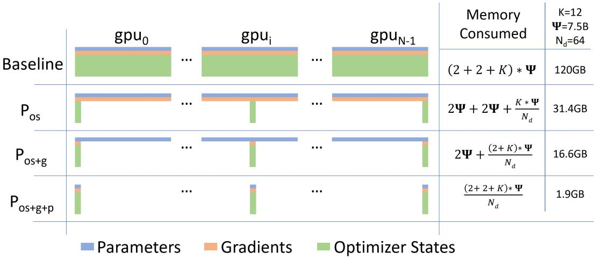
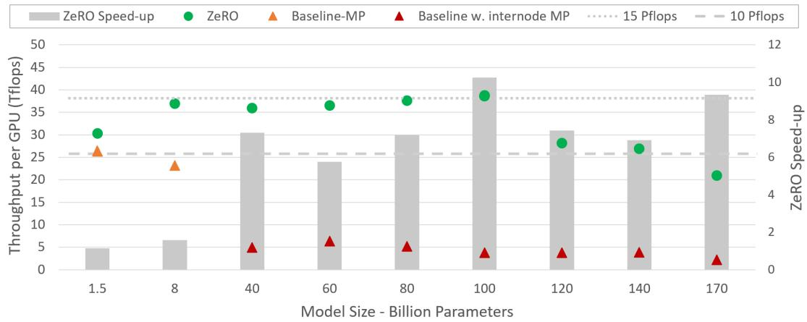
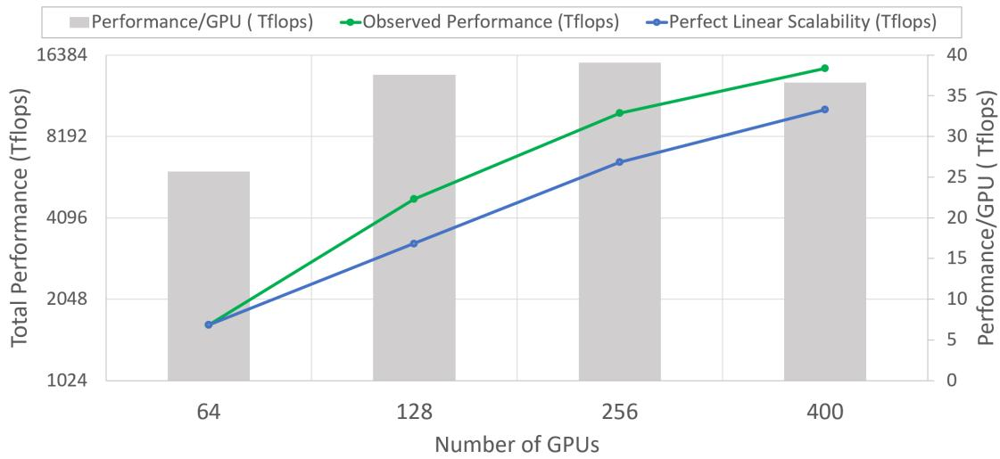
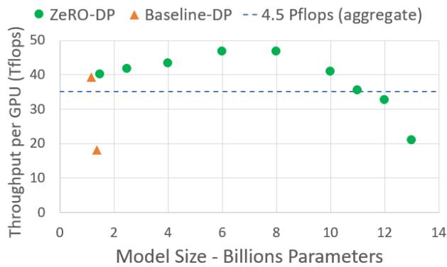
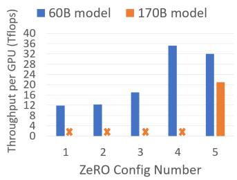

# ZeRO：迈向训练万亿参数模型的内存优化

## 摘要

大型深度学习模型带来了显著的精度提升，但训练数十亿乃至数万亿参数的模型极具挑战性。现有解决方案（如数据并行与模型并行）在使这些模型适配有限设备内存方面存在根本性局限，同时难以兼顾计算、通信与开发效率。我们提出了一种新颖的解决方案——零冗余优化器（Zero Redundancy Optimizer, ZeRO），用以优化内存，在大幅提升训练速度的同时显著增加了可高效训练的模型规模。ZeRO 在数据并行与模型并行训练中消除了内存冗余，同时保持了较低的通信量和较高的计算粒度，使我们能够以持续的高效率使模型规模与设备数量成正比扩展。我们对内存需求与通信量的分析表明：ZeRO 有潜力在当今硬件上将模型规模扩展到超过 1 万亿参数。

我们实现并评估了 ZeRO：它在 400 块图形处理器（GPU）上以超线性加速比训练超过 100B 参数的大型模型，实现了 15 Petaflops 的吞吐量。这相当于在模型规模上实现了 8 倍的提升，在可达性能上实现了 10 倍的提升，均为目前最优水平。在易用性方面，ZeRO 无需模型并行（这对科研人员而言更难应用），即可训练多达 13B 参数的大型模型（例如，规模超过 Megatron GPT 8.3B 和 T5 11B）。最后但同样重要的是，研究人员已利用 ZeRO 的系统突破创建了全球最大的语言模型（17B 参数），并取得了破纪录的精度。

## 1 扩展引言

深度学习（Deep Learning, DL）模型正变得越来越大，模型规模的增长带来了显著的精度提升。在自然语言处理（Natural Language Processing, NLP）领域，Transformer 为诸如 Bert-large（0.3B）[1]、GPT-2（1.5B）[2]、Megatron-LM（8.3B）[3]、T5（11B）[4] 等大型模型铺平了道路。为使模型规模能够从数百亿参数继续增长到万亿参数，我们面临着训练这些模型的严峻挑战——它们显然无法装入单个设备（例如 GPU 或 TPU）的内存中，而简单地增加更多设备也无法帮助扩展训练规模。

基础的数据并行（Data Parallelism, DP）并不能降低每设备的内存占用，在当前配备 32 GB 内存的 GPU 上，对于参数量超过 1.4B 的模型便会出现内存不足的问题。其他现有解决方案，如流水线并行（Pipeline Parallelism, PP）、模型并行（Model Parallelism, MP）、CPU 卸载（CPU-Ofloading）等，在功能、易用性以及内存与计算/通信效率之间进行权衡，而这些方面对于实现高速且大规模的训练都至关重要。

在现有的大模型训练方案中，模型并行（Model Parallelism, MP）或许是最具前景的方案之一。目前文献中最大的两个模型——110 亿参数的 T5 模型 [4] 和 Megatron-LM 8.3B [3]——都借助模型并行来驱动，前者基于 Mesh-TensorFlow [5] 实现，后者基于 Megatron-LM [3] 实现。然而，MP 难以在这些模型规模之上进一步扩展。MP 沿垂直方向切分模型，将每一层的计算和参数划分到多个设备上，因此要求每一层之间进行大量的通信。这一特性使得 MP 在单机节点内部能够良好工作（因为节点内 GPU 间的通信带宽较高），但一旦跨越单个节点，效率便会急剧下降 [3]。我们使用 Megatron-LM 在两台 DGX-2 节点上测试了一个 400 亿参数的模型，观察到每个 V100 GPU 仅能获得约 5 Tflops 的吞吐（不到硬件峰值算力的 5%）。

那么，我们如何才能克服现有方案的局限，并以更高的效率训练大模型？为了回答这一问题，我们首先分析了现有系统在模型训练中的完整内存消耗谱系，并将其划分为两部分：1) 对于大模型而言，内存的大部分被模型状态（model states）所占据，其中包括优化器状态（如 Adam [6] 中的动量与方差）、梯度以及参数；2) 其余内存由激活（activation）、临时缓冲区以及无法使用的碎片化内存共同占用，我们将它们统称为残余状态（residual states）。我们开发了 ZeRO——零冗余优化器（Zero Redundancy Optimizer）——在两方面同时优化内存效率，并获得高计算与通信效率。由于这两部分面临不同的挑战，我们也相应地分别提出并讨论了它们的解决方案。

优化模型状态内存 模型状态在训练过程中通常占据最大份额的内存，但数据并行（Data Parallelism, DP）和 MP 等现有方法并未提供令人满意的解决方案。DP 具有良好的计算/通信效率，但内存效率较差；而 MP 则可能具有较差的计算/通信效率。更具体地说，DP 在所有数据并行进程中复制完整的模型状态，导致冗余的内存消耗；而 MP 虽然通过划分状态获得了较高的内存效率，但往往导致过细粒度的计算以及代价昂贵的通信，难以良好地扩展。此外，所有这些方法在整个训练过程中都以静态方式维持所需的全部模型状态，即便在训练期间并非所有模型状态在所有时刻都被使用。基于这些观察，我们提出了 ZeRO-DP——ZeRO 驱动的数据并行（ZeRO-powered Data Parallelism），它在保持数据并行计算粒度与通信量的同时获得 MP 的内存效率。ZeRO-DP 通过对模型状态进行划分（而非复制）来消除跨数据并行进程的内存状态冗余，并通过在训练期间使用动态通信调度，保留了与 DP 相同的计算粒度和通信量，从而维持了原有的计算/通信效率。

ZeRO-DP 具有三个主要的优化阶段（如图 1 所示），分别对应于优化器状态（optimizer states）、梯度（gradients）和参数（parameters）的切分。依次启用时：

1) 优化器状态分区 $( P _ { o s } )$ ：内存节省 4 倍，通信量与 DP 相同；

2) 添加梯度分区 $( P _ { o s + g } )$ ：内存节省 8 倍，通信量与 DP 相同；

3) 添加参数分区 $\left( P _ { o s + g + p } \right)$ ：内存节省与 DP 并行度 $N _ { d }$ 成线性关系。例如，在 64 个 GPU 上进行切分 $( N _ { d } = 6 4 )$ 可实现 64 倍的内存节省。通信量会增加约 50%。

ZeRO-DP 消除了内存冗余，使整个集群的聚合内存容量都可被利用。启用全部三个阶段后，ZeRO 仅需 1024 块 NVIDIA GPU 即可训练一个万亿参数模型。一个使用 Adam [6] 这类优化器、参数精度为 16 位的万亿参数模型，存储优化器状态、梯度和参数大约需要 16 TB（terabytes）的内存。16 TB 除以 1024 等于 16 GB，完全处于单块 GPU 合理的内存范围之内（例如具备 32 GB 设备内存的 GPU）。

  

图 1：比较模型状态在 ZeRO-DP 三种优化阶段下的单设备内存消耗。Ψ 表示模型大小（参数量），K 表示优化器状态的内存乘数，$N _ { d }$ 表示数据并行度。在该示例中，我们假设模型大小为 $\Psi = 7 . 5 B$，数据并行度 $N _ { d } = 6 4$，基于使用 Adam 优化器的混合精度训练，$K = 1 2$。

ZeRO-DP 在提升模型状态的内存效率之后，由激活值（activations）、临时缓冲区（temporary buffers）以及不可用的内存碎片所消耗的其余内存，可能成为次要内存瓶颈。我们开发了 ZeRO-R 来分别优化这三种因素所消耗的残余内存。

1) 对于激活值（在前向传播过程中存储，以便执行反向传播），我们注意到检查点（checkpointing）[7] 有一定帮助，但对大模型而言并不足够。因此，ZeRO-R 通过识别并移除现有模型并行（Model Parallelism, MP）方法中存在的激活值复制来优化激活内存，具体方式是采用激活值分区（activation partitioning）。它还会在适当时机将激活值卸载到 CPU。

2) ZeRO-R 为临时缓冲区定义合适的尺寸，以在内存效率与计算效率之间寻求平衡。

3) 我们观察到，训练过程中由于不同张量生命周期的差异，会产生内存碎片。由于碎片化导致的连续内存不足，即便有足够可用内存，也可能引发内存分配失败。ZeRO-R 基于张量生命周期的差异主动管理内存，从而防止内存碎片化。

ZeRO-DP 与 ZeRO-R 相结合，形成了一套面向深度学习训练的强大内存优化系统，我们将其统称为 ZeRO。

ZeRO 与 MP：既然 ZeRO 消除了数据并行（Data Parallelism, DP）中的内存低效问题，自然会引出一个问题：我们是否仍需要 MP，何时需要？ZeRO 如何与 MP 协同工作？使用 ZeRO 后，仅就容纳大模型这一目标而言，MP 变得不那么具有吸引力。ZeRO-DP 在降低每设备内存占用方面至少与 MP 同样有效，在 MP 无法均匀切分模型的某些情况下甚至更有效；并且它具有相当或更优的扩展效率。此外，DP 易于使用，可广泛应用于各种工作负载，而

  

图 2：不同模型规模下 ZeRO 的训练吞吐量以及相对于当前最优基线（baseline）的加速比。对于 ZeRO，张量并行（MP）始终能容纳在单个节点内；而对于基线，规模超过 40B 的模型需要在节点间进行张量并行（MP）。

如今的模型并行（MP）方法通常需要模型开发者做一些工作来修改模型，系统开发者也要设计分布式算子，而现有的工作如 Megatron-LM 只能支持有限的一组算子和模型。

尽管如此，仍然存在一些需要利用 MP 的场景：i) 当与 ZeRO-R 配合使用时，MP 能够减少超大模型的激活内存占用。ii) 对于激活内存不是问题的较小模型，当仅使用数据并行（DP）的聚合批大小过大而无法获得良好收敛时，MP 也能带来收益。在这些情况下，可以将 ZeRO 与 MP 组合使用，以可接受的聚合批大小来拟合模型。

我们展示了 ZeRO 可以与 MP 组合，在每台设备上实现最大理论内存缩减 $N _ { d } \times N _ { m }$ 倍，其中 DP 度数为 $N _ { d }$，MP 度数为 $N _ { m }$。这使我们能够在 1024 个 GPU 上拟合万亿参数模型，在每个 DGX2 节点内采用 16 路模型并行，并在节点间采用 64 路数据并行，以适中的批大小高效运行！

实现与评估 完整的 ZeRO 优化集合使我们能够在当今的高端硬件集群（例如配备 1K V100 GPU）上运行万亿参数模型，但硬件计算能力仍然非常有限，训练时间可能长达不切实际的程度（超过 1 年）。因此，本实现重点是高效支持参数规模达到当前最先进水平（SOTA）10 倍的模型（约 1000 亿参数），同时仍在当前硬件计算能力的可达范围之内。我们实现并评估了 ZeRO 中被称为 $Z e R O _ { - } \mathrm { 1 0 0 B } \mathrm { ~ - ~ } P _ { o s + g }$ 的优化子集——即 ZeRO-DP 加上 ZeRO-R——使我们能够实现这一目标。结果表明：

模型规模 与 MP 相结合，ZeRO-100B 能够高效运行 1700 亿参数的模型，而单独使用 Megatron 等现有系统无法在超过 400 亿参数时高效扩展，如图 2 所示。相比 SOTA，模型规模增加了 8 倍以上。

速度 改进的内存效率带来了更高的吞吐量和更快的训练速度。如图 2 所示，ZeRO 在由 400 块 Nvidia V100 GPU 组成的集群上运行 1000 亿参数模型，速度超过

  

图 3：使用 ZeRO-100B 的 60B 参数模型的超线性可扩展性和每 GPU 训练吞吐量。

38 TFlops per GPU，聚合性能超过 15 Petaflops。相比相同模型大小的 SOTA，训练速度提升超过 10 倍。

可扩展性（Democratization of Large Model Training） 在 64–400 个 GPU 的范围内，我们观察到了超线性加速（super linear speedup）：当 GPU 数量翻倍时，性能提升超过两倍。这是 ZeRO-DP 的一个特性——随着 DP 度数的增加，ZeRO-DP 会降低模型状态的内存占用，从而允许我们在每个 GPU 上适配更大的批量大小，进而获得更好的性能。我们预计随着 GPU 数量超过 400，这一趋势仍将继续。

大型模型训练的普及化（Democratization of Large Model Training） ZeRO-100B 使数据科学家能够在不进行任何 MP 或 PP（这二者都需要对模型进行重构）的情况下训练最多 130 亿参数的模型，而 130 亿比文献中最大的模型（T5，110 亿参数）还要多。数据科学家因此可以自由地尝试大型模型，而不必担心并行化的问题。相比之下，现有的系统（例如 PyTorch Distributed Data Parallel）在 14 亿参数模型上就会耗尽内存。

新的 SOTA 模型（New SOTA Model） ZeRO 支持训练史上最大的语言模型——170 亿参数的 Turing-NLG [9]，并取得了破纪录的准确率。

我们已将 ZeRO 作为我们开源深度学习训练优化库 DeepSpeed 的一部分进行共享[^2]。我们计划在 2020 年 5 月底之前发布本文中描述的所有实现，并通过启用 ZeRO-DP 第三阶段对参数 $（P_{os+g+p}）$ 进行分区，将其进一步扩展以支持 1 万亿参数。我们计划让深度学习社区能够充分使用 ZeRO，以推动大规模大型模型训练的演进与普及。

## 2 相关工作

## 2.1 数据并行、模型并行与流水线并行

并行化是大规模训练大型模型的关键策略。对于能够在设备内存中容纳训练过程的模型，使用数据并行（Data Parallelism，DP）来将训练扩展到多个设备。在 DP 中，模型参数在每个设备上进行复制。在每一步中，一个小批量（mini-batch）被均匀地划分到所有数据并行进程中，因此每个进程在不同的数据样本子集上执行前向和反向传播，并使用跨进程的梯度平均值在本地更新模型。

当模型无法放入设备内存时，模型并行（Model Parallelism，MP）[5, 3] 和流水线并行（Pipeline Parallelism，PP）[10, 11] 分别以纵向和横向的方式将模型拆分到多个进程中。第 1 节讨论了 ZeRO 与 DP 和 MP 的关系。现在我们来讨论流水并行以及它与降低内存消耗之间的关系。

PP 沿层水平切分模型，每个分区运行在不同设备上，并使用微批次（micro-batching）来掩盖流水线气泡（pipeline bubble）[10, 11]。由于水平切分和微批次的存在，像权重绑定（tied-weights）和批归一化（batch-normalization）这类模型功能难以实现。流行的 PP 实现，例如 G-pipe [10]，同时切分模型参数和全部激活值，但需要与流水线分区数成比例的批量大小才能掩盖流水线气泡。较大的批量大小会影响收敛速度，同时还需要大量内存来存储激活值。PipeDream [12] 中的另一种 PP 实现通过保留多份陈旧参数（stale parameters）副本来掩盖流水线气泡，而不会显著增加批量大小，但内存效率较低。此外，该实现与标准的深度学习训练不等价，并且对训练收敛性有影响。相比之下，ZeRO 在不引入 PP 在功能、性能和收敛性方面的限制的前提下，获得了与 PP 相同或更好的内存效率。

## 2.2 非并行方法以降低内存

除了 MP 和 PP 之外，还有多条研究路线致力于降低深度学习训练的内存开销。

## 2.2.1 降低激活内存

多项研究致力于通过压缩 [13]、激活检查点（activation checkpointing）[7, 14] 或实时分析（live analysis）[15] 来降低激活的内存占用。这些工作与 ZeRO 互补，可以与 ZeRO 协同工作。事实上，ZeRO-R 中的激活内存缩减与激活检查点并行工作。

## 2.2.2 CPU 卸载

[16, 17] 利用了当代计算节点的异构特性，分别通过算法设计或虚拟化内存将模型状态卸载到 CPU 内存。多达 50% 的训练时间可能耗费在 GPU-CPU-GPU 之间的数据传输上 [16]。ZeRO 的不同之处在于，它显著降低了内存消耗，而无需将模型状态存储到 CPU 内存中——后者由于受到 PCI-E 的限制，带宽严重受限。在少数情况下，ZeRO-R 可能仅将激活检查点卸载出去，以提升超大模型的性能（详见第 6.1 节）。

## 2.2.3 内存高效的优化器

[18, 19] 致力于通过维护模型参数和梯度的粗粒度统计信息来降低自适应优化方法的内存消耗，但可能会影响模型收敛性保证。ZeRO 与这些工作是正交的，其优化方法不改变模型优化方法或影响模型收敛，但能有效降低每台设备上优化器状态和梯度的内存占用。

## 2.3 训练优化器

自适应优化方法 [20, 6, 21, 22] 对于实现大模型有效训练的最先进（SOTA）性能和精度至关重要。与 SGD 相比，这类方法通过为每个模型参数和梯度维护精细的一阶和二阶统计量，代价是显著的内存占用。ZeRO 可以将这些优化器的内存占用降低数个数量级，使这些精密的优化方法能够在设备内存适中的硬件上训练大模型变得切实可行。它还使得开发和使用更复杂、内存需求更大的优化器成为可能，这些优化器可能具有更好的收敛性。

## 3 内存都去哪了？

让我们退一步审视当前训练系统的内存消耗。例如，一个 1.5B 参数的 GPT-2 模型在 16 位精度下需要 3GB 内存来存储其权重（或参数），然而，使用 Tensorflow 或 PyTorch 时，它无法在具有 32GB 内存的单块 GPU 上进行训练。人们可能会好奇内存都去了哪里。在模型训练期间，大部分内存被模型状态消耗，即由优化器状态、梯度和参数组成的张量。除了这些模型状态外，其余内存由激活值、临时缓冲区（temporary buffers）和碎片化内存消耗，我们将它们称为残余状态（residual states）。我们从这两个方面详细审视内存消耗。

## 3.1 模型状态：优化器状态、梯度和参数

训练期间，设备内存的大部分被模型状态消耗。例如 Adam [6]，它是深度学习训练中最流行的优化器之一。Adam 需要存储两个优化器状态：i) 时间平均动量，以及 ii) 梯度方差，以计算更新量。因此，要使用 ADAM 训练模型，必须有足够的内存来同时存储梯度动量和方差的一份副本。此外，还需要有足够的内存来存储梯度和权重本身。在这三种与参数相关的张量中，优化器状态通常消耗最多的内存，尤其是在应用混合精度训练时。

**混合精度训练** 在当前一代 NVIDIA GPU 上训练大模型的最先进方法是通过混合精度（fp16/32）训练 [23]，其中参数和激活值以 fp16 存储，从而能够利用这些 GPU 上的高吞吐量张量核心单元（tensor core units）[24]。在混合精度训练期间，前向传播和反向传播均使用 fp16 权重和激活值执行。然而，为了在反向传播结束时有效地计算并应用更新，混合精度优化器会保留一份参数的 fp32 副本以及所有其他优化器状态的 fp32 副本。

让我们以 Adam 作为具体示例。使用 Adam 对一个具有 Ψ 个参数的模型进行混合精度训练，需要有足够的内存来保存参数的 fp16 副本和梯度，内存需求分别为 2Ψ 和 2Ψ 字节。此外，还需要保存优化器状态：参数的 fp32 副本、动量（momentum）和方差（variance），内存需求分别为 4Ψ、4Ψ 和 4Ψ 字节。我们用 K 表示优化器状态的内存乘数（memory multiplier），即存储它们所需的额外内存为 KΨ 字节。混合精度 Adam 的 K = 12。综上，总内存需求为 2Ψ + 2Ψ + KΨ = 16Ψ 字节。对于像 GPT-2 这样具有 15 亿参数的模型，这至少需要 24 GB 的内存，远高于单独保存 fp16 参数所需的 3 GB 内存。

## 3.2 剩余内存消耗

激活值（activations）在训练过程中会占用大量内存 [7]。作为具体示例，15 亿参数的 GPT-2 模型在序列长度为 1K、批量大小为 32 的设置下进行训练，需要约 60 GB 的内存3。激活检查点（activation checkpointing，也称为激活重计算）是一种常用方法，可将激活内存减少到约总激活值的平方根，代价是增加约 33% 的重计算开销 [7]。这将使该模型的激活内存消耗降至约 8 GB。

尽管有了显著减少，但对于更大的模型，即使使用激活检查点，激活内存仍然可能增长得相当大。例如，一个具有 1000 亿参数的类 GPT 模型，即使使用激活检查点，在批量大小为 32 时仍需要约 60 GB 的内存。

用于存储中间结果的临时缓冲区（temporary buffers）在大型模型中会占用不可忽略的内存。梯度全归约（gradient all-reduce）或梯度范数（gradient norm）计算等操作倾向于在执行前将所有梯度融合到单个扁平缓冲区中，以提高吞吐量。例如，跨设备 all-reduce 的带宽会随消息大小的增大而提升。梯度本身通常以 fp16 张量形式存储，但融合缓冲区可以是 fp32 张量，具体取决于操作。当模型规模较大时，这些临时缓冲区的大小不可忽略。例如，对于具有 15 亿参数的模型，一个扁平的 fp32 缓冲区将需要 6 GB 内存。

内存碎片化（Memory Fragmentation）：到目前为止，我们讨论的是训练过程中的实际内存消耗。此外，即使可用内存充足，也可能出现可用内存耗尽的情况。这可能由内存碎片化引起。当没有足够的连续内存来满足内存请求时，即使总可用内存大于请求量，该请求也会失败。我们观察到在训练超大模型时存在显著的内存碎片化问题，在某些极端情况下，即使仍有超过 30% 的内存可用，也会触发内存不足（out of memory）问题。

## 4 ZeRO：见解与概述

ZeRO 包含两组优化：i) ZeRO-DP，旨在减少模型状态的内存占用；ii) ZeRO-R，针对减少残余内存消耗。我们对各项优化及其背后的见解进行概述，这些见解使 ZeRO 在保持高效的同时降低内存占用。需要注意的是，高效性是这里的关鍵约束：若不考虑效率，像将所有参数状态移至 CPU 内存、或任意提高 MP（模型并行）程度这样的简单方案也能降低内存占用。

## 4.1 见解与概述：ZeRO-DP

ZeRO 驱动的 DP（数据并行）基于三个关键见解：

a) DP 在扩展效率上优于 MP，因为 MP 会降低计算的粒度（granularity），同时增加通信开销。当超过一定程度后，更低的计算粒度会降低每个 GPU 的效率，而通信开销的增加则会阻碍跨 GPU 的扩展性，尤其是在跨节点边界时。与此相反，DP 具有更高的计算粒度和更低的通信量，因此能够实现高得多的效率。

b) DP 在内存使用上效率低下，因为模型状态在所有数据并行进程中存在冗余存储。与此相反，MP 通过对模型状态进行切分来获得内存效率。

c) DP 和 MP 都保留了整个训练过程所需的全部模型状态，但并非所有内容在所有时刻都是必需的。例如，对应每一层的参数仅在该层的前向传播与反向传播过程中被需要。

基于这些见解，ZeRO-DP 在保留 DP 训练效率的同时，实现了 MP 的内存效率。ZeRO-DP 对模型状态进行切分而非复制（第 5 节），并采用动态通信调度策略，在最小化通信量的同时利用模型状态内在的时间局部性（第 7 节）。通过这种方式，ZeRO-DP 使每个设备的内存占用随 DP 程度的增加线性下降，同时保持通信量接近默认 DP 水平，从而兼顾了效率。

## 4.2 见解与概述：ZeRO-R

## 4.2.1 减少激活内存

两个关键见解如下：

a) MP 对模型状态进行了切分，但通常需要对激活内存进行复制。例如，若将一个线性层的参数按列切分，并在两块 GPU 上并行计算各自的分片，则每块 GPU 都需要完整的激活才能计算其分片。

b) 对于 GPT-2 或更大的模型，算术强度（每次迭代的计算量与激活检查点（activation checkpoints）量的比值）非常高（≥ 10K），且随隐藏维度线性增长，这使得即使在带宽较低的情况下，也能够隐藏激活检查点带来的数据移动开销。

ZeRO 通过在 GPU 之间划分激活检查点（activation checkpoints），消除了 MP（模型并行，Model Parallelism）中的内存冗余，并使用 all-gather 按需重建它们。激活内存占用按 MP 程度成比例减少。对于非常大的模型，ZeRO 甚至可以选择将激活分区移动到 CPU 内存，同时由于这些模型具有较大的算术强度（arithmetic intensity），仍能保持良好的效率。

## 4.2.2 管理临时缓冲区

ZeRO-R 使用恒定大小的缓冲区，以避免随着模型规模增大而临时缓冲区急剧膨胀，同时使其足够大以保持高效。

## 4.2.3 管理碎片化内存

内存碎片化是短生命周期与长生命周期内存对象交错分配的结果。在前向传播过程中，激活检查点是长生命周期的，而需要重计算的激活是短生命周期的。类似地，在反向计算中，激活梯度是短生命周期的，而参数梯度是长生命周期的。基于这一认识，ZeRO 通过将激活检查点和梯度移动到预分配的连续内存缓冲区来执行即时内存碎片整理。这不仅增加了内存可用性，还通过减少内存分配器寻找空闲连续内存所需的时间来提升效率。

## 5 深入剖析 ZeRO-DP

现有的 DP（数据并行，Data Parallelism）方法在每个设备上复制模型状态并引入显著的内存开销，而 ZeRO-DP 通过在数据并行进程之间对优化器状态、梯度和参数进行划分来消除这种内存冗余。图 1 量化并可视化了使用和不使用 ZeRO-DP 时的内存需求。该图展示了累积划分 (1) 优化器状态、(2) 梯度和 (3) 参数冗余后的内存占用情况。我们将它们称为 ZeRO-DP 的三个优化阶段：$P _ { o s } , P _ { g }$ 和 $P _ { p }$，下面将详细阐述。

## 5.1 $\mathbf { P } _ { o s }$：优化器状态划分

对于 DP 度数为 $N _ { d } .$，我们将优化器状态划分为 $N _ { d }$ 个相等的分区，使得第 $i ^ { t h }$ 个数据并行进程仅更新与第 $i$ 个分区相对应的优化器状态。因此，每个数据并行进程仅需存储和更新总优化器状态的 $\frac { 1 } { N _ { d } }$，然后仅更新 $\frac { 1 } { N _ { d } }$ 的参数。我们在每个训练步骤结束时跨数据并行进程执行 all-gather，以获得所有数据并行进程上完全更新后的参数。

内存节省（Memory Savings）：如图 1 所示，在对状态进行分片优化后，内存占用从 $4\Psi + K\Psi$ 降低到 $4\Psi + \frac{K\Psi}{N_d}$。如图 1 所示的具体例子中，一个 7.5B 参数的模型在使用 $P_{os}$ 与 64 路数据并行（Data Parallelism, DP，$N_d = 64$）时需要 31.4 GB 内存，而使用标准 DP 则需要 120 GB。此外，当 $N_d$ 较大时，模型状态所需的内存从 $4\Psi + 12\Psi = 16\Psi$ 字节降低到约 $4\Psi + \frac{12\Psi}{N_d} \approx 4\Psi$ 字节，实现了 4 倍的减少。

## 5.2 ${ \mathbf { P } } _ { g } \mathbf { : }$ 梯度分片（Gradient Partitioning）

由于每个数据并行进程仅更新其对应的参数分片，因此它仅需要相应参数的归约梯度。因此，在反向传播过程中，当每一层的梯度变得可用时，我们仅在负责更新相应参数的数据并行进程上对其进行归约。归约完成后，我们不再需要这些梯度，可以释放它们所占用的内存。这将保存梯度所需的内存占用从 $2\Psi$ 字节降低到 $\frac{2\Psi}{N_d}$。

实际上，这是一个归约-分散（Reduce-Scatter）操作，对应不同参数的梯度被归约到不同的进程。为了在实践中提高效率，我们使用了一种桶划分（bucketization）策略，即将所有对应特定分片的梯度放入同一个桶中，并对整个桶一次性执行归约操作。这在思想上类似于 NVIDIA 的 AMP [25] 优化器对 all-reduce 梯度计算进行桶划分以实现通信与计算的重叠。在我们的方案中，我们在分片边界执行归约而非 all-reduce，从而减少内存占用并实现计算与通信的重叠。

内存节省：通过同时消除梯度和优化器状态的冗余，我们将内存占用进一步降低到 $2\Psi + \frac{14\Psi}{N_d} \approx 2\Psi$。如图 1 所示的例子中，一个 7.5B 参数的模型在使用 $P_{os+g}$ 与 64 路数据并行（$N_d = 64$）时仅需要 16.6 GB 内存。

<table><tr><td rowspan="2">DP</td><td colspan="3">7.5B Model (GB)</td><td colspan="3">128B Model (GB)</td><td colspan="3">1T Model (GB)</td></tr><tr><td> $P_{os}$ </td><td> $P_{os+g}$ </td><td> $P_{os+g+p}$ </td><td> $P_{os}$ </td><td> $P_{os+g}$ </td><td> $P_{os+g+p}$ </td><td> $P_{os}$ </td><td> $P_{os+g}$ </td><td> $P_{os+g+p}$ </td></tr><tr><td>1</td><td>120</td><td>120</td><td>120</td><td>2048</td><td>2048</td><td>2048</td><td>16000</td><td>16000</td><td>16000</td></tr><tr><td>4</td><td>52.5</td><td>41.3</td><td>30</td><td>896</td><td>704</td><td>512</td><td>7000</td><td>5500</td><td>4000</td></tr><tr><td>16</td><td>35.6</td><td>21.6</td><td>7.5</td><td>608</td><td>368</td><td>128</td><td>4750</td><td>2875</td><td>1000</td></tr><tr><td>64</td><td>31.4</td><td>16.6</td><td>1.88</td><td>536</td><td>284</td><td>32</td><td>4187</td><td>2218</td><td>250</td></tr><tr><td>256</td><td>30.4</td><td>15.4</td><td>0.47</td><td>518</td><td>263</td><td>8</td><td>4046</td><td>2054</td><td>62.5</td></tr><tr><td>1024</td><td>30.1</td><td>15.1</td><td>0.12</td><td>513</td><td>257</td><td>2</td><td>4011</td><td>2013</td><td>15.6</td></tr></table>

表 1：$Z e R O { - } \mathrm { D P }$ 中不同优化方式在每个设备上的内存消耗随 DP 度的变化。粗体文本表示模型能够装入 32GB V100 GPU 集群的组合。

而标准 DP 则需要 120 GB。当 $N _ { d }$ 较大时，模型状态的内存需求从 $2 \Psi + 1 4 \Psi = 1 6 \Psi$ 字节降至 $\begin{array} { r } { 2 \Psi + \frac { 1 4 \Psi } { N _ { d } } \approx 2 \Psi } \end{array}$ 字节，从而实现 8 倍的缩减。

## 5.3 $\mathbf { P } _ { p } \mathbf { : }$ : 参数分区（Parameter Partitioning）

与优化器状态和梯度一样，每个进程只存储其分区所对应的参数。当前向和反向传播需要其分区之外的参数时，这些参数通过广播从相应的数据并行进程接收。虽然乍看之下这似乎会带来显著的通信开销，但我们表明这种方法仅将基线 DP 系统的总通信量增加到 1.5 倍，同时实现与 $N _ { d }$ 成正比的内存缩减。

内存节省：通过参数分区，我们将 Ψ 参数模型的内存消耗从 16Ψ 降至 $\frac { 1 6 \bar { \Psi } } { N _ { d } }$。如图 1 中的例子所示，一个 7.5 B 参数模型在使用 64 路 DP $( N _ { d } = 6 4 )$ 的 $P _ { o s + p + g }$ 时仅需 1.9 GB 的模型状态内存，而标准 DP 则需要 120 GB。这具有深远的意义：只要有足够数量的设备来共享模型状态，ZeRO 就能使 DP 适配任意规模的模型。

## 5.4 对模型规模的影响

分区 $P _ { o s } , \ P _ { o s + g } ,$ 和 $P _ { o s + g + p }$ 的三个阶段分别将每个数据并行进程在模型状态上的内存消耗缩减最多 4 倍、8 倍和 $N _ { d }$ 倍。表 1 分析了若干示例模型在 $Z e R O { - } \mathrm { D P }$ 三阶段优化下、随 DP 度变化的模型状态内存消耗。在不使用 $Z e R O$ 的情况下，无论 DP 度如何，内存消耗都与表中的第一行相同。注意，当 $N _ { d } = 6 4$ 时，$Z e R O$ 可以分别使用 $P _ { o s } , \ P _ { o s + g } ,$ 和 $P _ { o s + g + p }$ 训练最多 7.5B、14B 和 128B 参数的模型。当 $N _ { d } = 1 0 2 4$ 时，启用所有优化的 ZeRO $\left( P _ { o s + g + p } \right)$ 能够训练具有 1 万亿参数的模型！甚至可能是任意规模的模型！没有 ZeRO，仅靠 DP 能运行的最大模型参数少于 15 亿。

## 6 深入剖析 ZeRO-R

## 6.1 $P _ { a }$ : 分区激活检查点（Partitioned Activation Checkpointing）

如 4.2 节所述，MP（模型并行）在设计上要求对激活进行复制，从而在模型并行 GPU 上产生冗余的激活副本。ZeRO 通过对激活进行分片来消除这种冗余，并一次只在一个激活层上、在激活即将被用于计算之前将其以复制形式实例化。更具体地说，一旦模型某一层的前向传播计算完成，输入激活就会被分片到所有模型并行进程上，直到在反向传播过程中再次需要为止。此时，ZeRO 使用一次 all-gather 操作重新实例化一份复制形式的激活。我们将此优化称为 $P_a$。它与激活检查点（activation checkpointing）[7] 协同工作，只存储分片后的激活检查点，而不存储复制副本。此外，在模型非常大而设备内存非常有限的情况下，这些分片后的激活检查点还可以卸载到 CPU，将激活内存开销降至接近零，但这会带来额外的通信成本，我们将在第 7 节讨论这一点。我们将此方案称为 $P_{a+cpu}$。

**内存节省** 采用分片激活检查点后，ZeRO 将激活占用空间按 MP 度的比例进行缩减。考虑训练表 4 中所示的 100B 模型，批次大小为 32，序列长度为 1024，MP 度为 16。如果我们对每个 Transformer 层检查一个激活，仅存储激活检查点就需要每张 GPU 约 33 GB 的内存。但在 ZeRO 中采用 $\mathrm{P}_a$，可以将其减少到每张 GPU 约 2 GB。此外，这 2 GB 还可以卸载到 CPU，将激活的内存占用降至接近零。

## 6.2 $C_B$：固定大小缓冲区

ZeRO 仔细选择时序数据缓冲区的大小，以平衡内存与计算效率。在训练过程中，某些操作的计算效率高度依赖于输入大小，较大的输入能达到更高的效率。例如，较大规模的 all-reduce 操作能够实现远高于小型操作的带宽。因此，为了获得更高的效率，NVIDIA Apex 或 Megatron 等高性能库会在执行这些操作之前将所有参数融合到单个缓冲区中。然而，融合缓冲区的内存开销与模型大小成正比，可能成为限制因素。例如，对于一个 3B 参数的模型，32 位融合缓冲区将占用 12 GB 内存。为了解决这一问题，我们仅在模型过大时使用性能高效且大小固定的融合缓冲区。通过这样做，缓冲区的大小不再取决于模型大小，并且只要保持缓冲区足够大，我们仍能实现良好的效率。

## 6.3 $M_D$：内存碎片整理

内存碎片化在模型训练中由激活检查点（activation checkpointing）和梯度计算产生。在使用激活检查点的前向传播过程中，仅有部分选定的激活值会被存储以供反向传播使用，而大部分激活值会被丢弃，因为它们可以在反向传播过程中重新计算。这种方式形成了短期内存（被丢弃的激活值）与长期内存（被检查点保存的激活值）相互交错的现象，进而导致内存碎片化。类似地，在反向传播过程中，参数梯度是长期存在的，而激活梯度及计算参数梯度所需的任何其他临时缓冲区（buffers）则是短期的。这种短期与长期内存的再次交错同样会造成内存碎片化。

<table><tr><td rowspan="2">MP</td><td rowspan="2">GPUs</td><td colspan="4">Max Theoretical Model Size</td><td colspan="2">Measured Model Size</td></tr><tr><td>Baseline</td><td> $P_{os}$ </td><td> $P_{os+g}$ </td><td> $P_{os+g+p}$ </td><td>Baseline</td><td>ZeRO-DP ( $P_{os}$ )</td></tr><tr><td>1</td><td>64</td><td>2B</td><td>7.6B</td><td>14.4B</td><td>128B</td><td>1.3B</td><td>6.2B</td></tr><tr><td>2</td><td>128</td><td>4B</td><td>15.2B</td><td>28.8B</td><td>256B</td><td>2.5B</td><td>12.5B</td></tr><tr><td>4</td><td>256</td><td>8B</td><td>30.4B</td><td>57.6B</td><td>0.5T</td><td>5B</td><td>25B</td></tr><tr><td>8</td><td>512</td><td>16B</td><td>60.8B</td><td>115.2B</td><td>1T</td><td>10B</td><td>50B</td></tr><tr><td>16</td><td>1024</td><td>32B</td><td>121.6B</td><td>230.4B</td><td>2T</td><td>20B</td><td>100B</td></tr></table>

表 2：通过内存分析得出的最大模型规模（左），以及使用 ZeRO-OS 运行时的实测模型规模（右）。使用 $P _ { o s }$ 时的实测模型规模与理论最大值吻合，表明我们的内存分析为模型规模给出了现实可达的上界。

内存碎片化（memory fragmentation）在有充足空闲内存时通常不构成问题，但对于在有限内存下运行的大模型训练而言，内存碎片化会带来两个问题：i) 即使总可用内存充足，也会因缺少连续内存而触发 OOM（内存溢出，Out of Memory）；ii) 内存分配器需要耗费大量时间搜索一块连续的内存来满足内存请求，导致效率低下。

ZeRO 通过为激活检查点（activation checkpoint）和梯度预分配连续的内存块，并在它们产生时将其复制到预分配的内存中，从而实现内存的实时碎片整理。$\mathrm { M } _ { D }$ 不仅使 ZeRO 能够以更大的批量规模训练更大的模型，还在有限内存下训练时提升了效率。

## 7 ZeRO-DP 的通信分析

由于 ZeRO 通过消除内存冗余来提升模型规模，一个自然的问题随之浮现：我们是否在以通信量换取内存效率？换言之，相比于基线 DP（数据并行，Data Parallel）方法，ZeRO 驱动的 DP 方法的通信量是多少？答案分为两部分：i) 使用 $P _ { o s }$ 和 $P _ { g }$ 时，ZeRO-DP 不会产生额外通信，同时实现高达 8 倍的内存缩减；ii) 在 $P _ { o s }$ 和 $P _ { g }$ 之外再使用 $P _ { p }$ 时，ZeRO-DP 的通信量最多增加 1.5 倍，同时使内存占用进一步降低 $N _ { d }$ 倍。本节给出相应分析。我们首先简要概述标准 DP 的通信量。

## 7.1 数据并行的通信量

在数据并行训练中，所有数据并行进程上的梯度会在反向传播结束、计算下一步更新之前进行平均。该平均操作通过 all-reduce（全归约）通信集合实现。对于大模型而言，all-reduce 通信完全受通信带宽限制，因此我们将分析限定于每个数据并行进程发送和接收的总通信量。

当前最优的 all-reduce 实现采用两步方法：第一步是 reduce-scatter（归约分散）操作，将数据不同部分的归约分布到不同进程上；第二步是 all-gather（全收集）操作，每个进程收集所有进程上的归约数据。这两步的结果等价于一次 all-reduce。reduce-scatter 和 all-gather 均采用流水线方式实现，每次产生的数据移动量均为 Ψ 个元素（对于大小为 Ψ 的数据而言）。因此，标准 DP 在每个训练步骤中会产生 2Ψ 的数据移动量。

## 7.2 ZeRO-DP 的通信量

## 7.2.1 与 $P_{os+g}$ 相关的通信量

通过梯度分片（gradient partitioning），每个进程仅存储更新其对应参数分片所需的梯度部分。因此，ZeRO 只需对梯度执行一次 scatter-reduce 操作，而非 all-reduce，产生 Ψ 的通信量。在每个进程更新其负责的参数分片之后，会执行一次 all-gather 以从所有数据并行进程收集全部更新后的参数。该操作同样产生 Ψ 的通信量。因此，每个训练步骤的总通信量为 $\Psi + \Psi = 2\Psi$，与基线 DP 完全相同。

## 7.2.2 与 $P_{os+g+p}$ 相关的通信量

在进行参数分片之后，每个数据并行进程仅存储其负责更新的参数。因此，在前向传播过程中，它需要接收其他所有分片的参数。然而，这一过程可通过流水线方式执行以避免内存开销。在对模型中与某一特定分片对应的部分进行前向传播计算之前，负责该分片的数据并行进程可将权重广播给所有数据并行进程。一旦该分片的前向传播完成，即可丢弃相应的参数。因此，总通信量为 $\frac{\Psi \times N_d}{N_d} = \Psi$。

换言之，我们通过对参数 all-gather 进行重新调度，将其分散到整个前向传播过程中，并在参数使用完毕后将其丢弃。

但需注意，该 all-gather 在反向传播过程中还需按相反顺序再次执行一次。

因此，总通信量等于这些 all-gather 所产生的通信量与梯度 reduce-scatter 所产生的通信量之和。故总通信量为 $3\Psi$，相比基线增加了 1.5 倍。

梯度分片与参数分片均利用了如下洞察——并非所有梯度状态与参数状态在任何时刻都是必需的——通过对状态进行审慎通信来优化内存。

## 8 ZeRO-R 的通信分析

我们对 ZeRO-R 中分片式激活检查点（partitioned activation checkpointing，$P_a$）与基线 MP 的通信量进行了对比，结果表明 $P_a$ 所带来的通信量增加通常不到基线 MP 的十分之一。此外，我们还分析了 $P_a$ 相对于 DP 通信量的开销，以识别 $P_a$ 通过支持更大批量规模并降低 DP 通信量来提升效率的场景。我们借助上述分析来判断是否以及何时应用 $P_a$ 以及 $P_{a+cpu}$。

In Megatron-LM with activation checkpointing, each transformer block performs two allreduce operations of size batch $\times ~ s e q \_ l e n g t h \times h i d d e n \_ d i m$ in the forward propagation, two all-reduce for forward re-computation and two more in the backward propagation. The total communication per block is $1 2 \times s e q \_ l e n g t h \times h i d d e n \_ d i m$ since communication volume of an all-reduce is $2 \times$ message size.

When ${ Z e R O - \mathrm { R } }$ partitions activation checkpoints, it requires an additional all-gather operation before the forward recomputation of the back-propagation on each activation checkpoint. In general, we checkpoint the input activation for each transformer block, requiring one all-gather per transformer block. The communication overhead $P _ { a }$ is therefore seq length ∗ hidden dim, since the communication volume of an all-gather is message size. Therefore, the total communication overhead of $P _ { a }$ is less than 10% of the original communication volume for model parallelism.

When MP is used in conjunction with DP, $P _ { a }$ can be used to reduce the data-parallel communication volume by an order of magnitude at the expense of a 10% increase in model-parallel communication volume, and significantly boost eficiency when data-parallel communication is a performance bottleneck. Notice that $P _ { a }$ reduces the activation memory consumption by the MP degree allowing for a proportional increase in batch size. For large models, MP can be as large as 16 (#GPUs on a DGX-2 node), allowing for up to 16x increase in the batch size. The communication volume of a data-parallel training is inversely proportional to the batch size. Therefore, an order of magnitude increase in batch size due to $P _ { a }$ could result in an order-of-magnitude decrease in data-parallel communication volume.

Finally if $P _ { a + c p u }$ is applied, partitioned activation checkpoints are ofloaded to CPU, reducing the activation memory requirement to nearly zero at the expense of 2x added data movement to and from CPU memory compared to $P _ { a }$ . In extreme cases where DP communication volume is the major bottleneck due to a small batch size even with $P _ { a } , P _ { a + c p u }$ can improve eficiency by increasing the batch size as long as the CPU data transfer overhead is less than the DP communication volume overhead, which is generally true for small batch sizes.

Given model and hardware characteristics, we leverage the above analysis to decide if and when to apply $P _ { a }$ and $P _ { a + c p u }$

## 9 Step Towards 1 Trillion Parameters

激活检查点分区（partitioning activation checkpoints）的通信量权衡取决于模型规模、检查点策略以及模型并行（MP）策略。为了给出具体的洞见，我们基于采用当前最优（SOTA）模型并行方法 Megatron-LM 实现的基于 Transformer 的模型展开分析。

在开启激活检查点的 Megatron-LM 中，每个 Transformer 块在前向传播阶段执行两次规模为 batch $\times ~ s e q \_ l e n g t h \times h i d d e n \_ d i m$ 的 all-reduce 操作，在前向重计算阶段执行两次 all-reduce，并在反向传播阶段再执行两次 all-reduce。由于一次 all-reduce 的通信量为消息大小的 $2 \times$，因此每个块的总通信量为 $1 2 \times s e q \_ l e n g t h \times h i d d e n \_ d i m$。

当 ${ Z e R O - \mathrm { R } }$ 对激活检查点进行分区时，需要在每个激活检查点的反向传播前向重计算之前额外执行一次 all-gather 操作。一般而言，我们对每个 Transformer 块的输入激活进行检查点保存，因此每个 Transformer 块需要一次 all-gather。由于一次 all-gather 的通信量等于消息大小，因此通信开销 $P _ { a }$ 为 seq length ∗ hidden dim。所以 $P _ { a }$ 的总通信开销不足模型并行原有通信量的 10%。

当 MP 与 DP 结合使用时，$P _ { a }$ 可在模型并行通信量增加 10% 的代价下，将数据并行的通信量降低一个数量级，并在数据并行通信成为性能瓶颈时显著提升效率。需要注意的是，$P _ { a }$ 按 MP 程度成比例地降低激活内存消耗，从而允许按比例增大 batch size。对于大型模型，MP 最大可为 16（一个 DGX-2 节点上的 GPU 数量），从而允许 batch size 最多增加 16 倍。数据并行训练的通信量与 batch size 成反比。因此，由于 $P _ { a }$ 带来的 batch size 一个数量级的提升，可能使数据并行通信量降低一个数量级。

最后，若应用 $P _ { a + c p u }$，分区后的激活检查点将被卸载（offload）到 CPU，从而几乎将激活内存需求降至零，但代价是相较于 $P _ { a }$ 增加 2 倍 CPU 内存的来回数据搬移。在一些极端情况下，即便采用了 $P _ { a }$，由于 batch size 过小，DP 通信量仍是主要瓶颈；此时，只要 CPU 数据传输开销小于 DP 通信量开销（在小 batch size 下通常成立），$P _ { a + c p u }$ 即可通过增大 batch size 来提升效率。

基于模型与硬件特性，我们利用上述分析来决定是否以及在何时应用 $P _ { a }$ 与 $P _ { a + c p u }$。

## 9 迈向万亿参数

当前已发表的最大模型规模在 100 亿参数量级，这已经颇具训练难度。迈向万亿参数——即再增加 3 个数量级——是必然会发生的事情，但这条道路上将充满障碍、惊喜与创新。尽管我们并不声称了解并解决所有这些问题，但 ZeRO 从系统视角解决了其中一项最基本的挑战：在现有硬件上容纳此规模的模型，并使其能够以良好的系统可扩展性进行训练。

## 跨越式飞跃

目前最先进框架 Megatron 在 DGX-2 系统上能够以可接受的吞吐量训练的最大模型，是 160–200 亿参数的模型。通过在多个 DGX 节点之间采用模型并行来进一步扩展时，由于节点间带宽有限，效率会显著下降。

ZeRO 大幅提升了可高效运行的模型规模。它使当前一代硬件能够在无需跨节点进行细粒度模型并行的情况下，运行显著更大的模型。如表 1 所示，ZeRO 在开启所有优化（$\textstyle ( \mathrm { P } _ { o s + g + p } )$）的情况下，仅使用数据并行（DP）即可在 1024 个 GPU 上容纳超过 1 万亿参数。或者，当与模型并行相结合时（如表 2 所示），ZeRO 可以在 1024 个 GPU 上容纳超过 1 万亿参数，其中在每个 DGX2 节点内采用 16 路模型并行，节点间采用 64 路数据并行。高效运行一个万亿参数模型已不再是天方夜谭！

## 算力差距

然而，在可接受的时间范围内端到端地训练一个万亿参数模型，仍然需要大量的算力，而当今的 AI 集群正缺乏这种算力。

为了理解资源需求，我们与 Bert-Large 进行一个简要的对比。Bert-Large 可以在由 1024 个 GPU 组成的 DGX-2H 集群上于 67 分钟内训练完成 [26]。一个 1 万亿参数的模型在单个数据样本上的计算量很容易比 Bert-Large 模型多 3000 倍（1 万亿 / 3.3 亿）。即使我们假设序列长度以及训练该模型所需的总样本数保持不变，在相同的硬件和相近的计算效率下，训练一个 1T 模型也需要 140 天。在实际中，样本数和序列长度都可能随着模型规模的增加而增加，这就需要超过一年的时间才能完成训练。要在合理的时间内训练一个 1T 参数模型，将需要一台 exa-flop 级别的系统。但当这种算力成为现实时，我们希望 ZeRO 能够提供高效运行 1T 模型的系统技术。

  

图 4：使用 ZeRO-DP 时的最大模型吞吐量。

  

图 5：由 ZeRO 驱动的当前最优（SOTA）模型 Turing-NLG

  

图 6：最大模型规模

  

图 7：最大已分配缓存。

  

图 8：每个 GPU 的吞吐量。

## 10 实现与评估

我们将实现聚焦于支持约 1000 亿参数（∼100B）模型的高效训练，这些模型比目前已发布的最大模型（例如 T5-11B [4]）大一个数量级，同时能够在当前硬件上（例如使用 1K 块 V100 GPU）在合理的时间范围内完成训练。我们在 ZeRO-DP 加上 ZeRO-R 中实现并评估了 $Z e R O - P _ { o s + g }$ 的一个子集优化——它使我们能够达成这一目标。我们将这一实现称为 ZeRO-100B。我们的结果表明，ZeRO-100B 可以高效训练参数规模高达 1700 亿（170B）的模型，比当前最先进水平（SOTA）大 8 倍，速度最高提升 10 倍，并且可用性也有所改善。ZeRO-100B 为 Turing-NLG 提供算力支持，Turing-NLG 是全球已发布的最大模型，并取得了新的 SOTA 精度。

### 10.1 实现与方法

**实现** 我们在 PyTorch 中实现了 ZeRO-100B，包含 $P _ { o s + g }$ 与 ZeRO-R 的全部优化集合。其接口与任何实现为 torch.nn.module 的模型兼容。用户只需使用此接口包装其模型，即可像使用经典 DP 一样使用由 ZeRO 驱动的 DP。用户无需修改其模型。由 ZeRO 驱动的 DP 可以与任何形式的 MP（包括 Megatron-LM）结合使用。

**硬件** 我们在一个由 400 张 V100 GPU（25 个 DGX-2 节点）组成的集群上开展实验，节点间通信带宽为 800 Gbps。

**基线** 对于不含 MP 的实验，我们使用 PyTorch 的分布式数据并行（DDP）作为基线。对于包含 MP 的实验，我们使用 Megatron-LM，因为它是我们所知的当前最先进技术。我们采用 NVIDIA 开源版本的 Megatron-LM4，版本日期为 2019 年 9 月。最近的 Megatron-LM 结果报告了使用 32 个 DGX-2 节点（共 512 张 32 GB V100 GPU）将模型扩展到 160 亿参数规模的能力 [3]。

**ZeRO** 不含 MP 的实验使用 ZeRO-100B 中由 ZeRO 驱动的 DP 实现。包含 MP 的实验将由 ZeRO 驱动的 DP 与 Megatron-LM 的 MP 相结合。

**模型配置** 本节所展示的模型是类 GPT-2 [2] 的基于 Transformer 的模型。我们改变隐藏维度（hidden dimension）和层数，以获得不同参数数量的模型。表 4 展示了我们实验中使用的配置参数，附录中有更多细节。

### 10.2 速度与模型规模

ZeRO-100B 能在 400 个 GPU 上高效运行参数量高达 170B 的模型，规模比 Megatron-LM 大 8 倍以上。图 2 展示了在不同模型规模下，使用 ZeRO-100B 配合 MP 与单独使用 Megatron MP 时每个 GPU 的吞吐量。对于参数量在 8B 到 100B 之间的模型，ZeRO-100B 平均实现了 15 PetaFlops 的持续吞吐量（峰值性能的 30% 以上）。相比之下，基线 MP 的性能随模型规模的增大会快速下降：MP 在 GPU 之间产生大量通信，而为了容纳更大的模型而跨节点扩展时，通信带宽会从每链路 300 GB/秒（NVSwitch）降至每链路 12.5 GB/秒（Infiniband EDR），从而导致显著的性能下降。ZeRO-100B 相比基线实现了高达 10 倍的加速比，在大模型上表现显著优于基线。

对于 ZeRO-100B，在 100B 以上参数规模性能略有下降，原因是缺乏足够的显存来运行更大的批量大小。我们预计随着 GPU 数量的增加，性能会进一步提升，这是因为 ZeRO-100B 呈现出超线性加速特性，我们将在下文中讨论这一点。

## 10.3 超线性可扩展性（Super-Linear Scalability）

ZeRO-100B 在超大规模模型上展现出超线性可扩展性。图 3 展示了 60B 参数模型从 64 个 GPU 扩展到 400 个 GPU 时的可扩展性结果，我们预计这一趋势会在更多 GPU 上继续。$P_{os+g}$ 降低了每个 GPU 的显存占用

<table><tr><td></td><td>ZeRO-DP</td><td>ZeRO-R</td></tr><tr><td>1</td><td> $P_{os}$ </td><td> $C_B + M_D$ </td></tr><tr><td>2</td><td> $P_{os}$ </td><td> $C_B + M_D + P_a$ </td></tr><tr><td>3</td><td> $P_{os+g}$ </td><td> $C_B + M_D$ </td></tr><tr><td>4</td><td> $P_{os+g}$ </td><td> $C_B + M_D + P_a$ </td></tr><tr><td>5</td><td> $P_{os+g}$ </td><td> $C_B + M_D + P_{a+cpu}$ </td></tr></table>

表 3：ZeRO 配置

ZeRO-100B 随着 DP 度数的增加而扩展，允许 ZeRO-100B 在每个 GPU 上适配更大的批量大小5，进而由于算术强度的提高而提升吞吐量。

## 10.4 大模型训练的民主化

对许多数据科学家而言，使用 MP 和 PP 颇具挑战性，这是训练大模型时众所周知的障碍。ZeRO 不需要对模型本身做任何修改，它可以像基线 DP 一样简单使用，同时显著提升模型规模和速度。图 4 显示，ZeRO-100B 能够在 128 个 GPU 上训练多达 13B 参数的模型，平均每个 GPU 的吞吐量超过 40 TFlops。相比之下，不使用 ZeRO、仅采用 DP 时可训练的最大模型具有 1.4B 参数，每个 GPU 的吞吐量低于 20 TFlops。此外，由于不存在 MP 的通信开销，这些模型可以在较低端的计算节点上进行训练，而无需 NVLINK 或 NVSwitch 等非常快的节点内部互连（而 MP 要达到良好效率则需要这种互连）。

## 10.5 内存与性能分析

我们将研究不同优化对最大模型规模、内存消耗和性能的影响与收益。这些优化在表 3 中被称为 Config 1 至 Config 5（C1-C5）。

最大模型规模 图 6 显示了在固定批量大小和 MP 为 16 的情况下，通过启用不同的 ZeRO 优化所能训练的最大模型。使用 C1 与 C2 进行训练时，模型规模从 40B 增加到 60B，这是因为使用 $P_{a}$ 时激活内存减少了 16 倍（MP 度数）；而使用 C4 时跳升至 140B，则是启用了 $P_{os+g}$，它将模型状态的内存需求相比 C2 中的 $P_{os}$ 减半。使用 C5 时增加到 150B 完全得益于将分区的激活检查点卸载到 CPU 内存所带来的激活内存进一步减少。

最大缓存内存 图 7 显示了 PyTorch 在每次训练迭代中针对 40B 和 100B 参数模型所缓存的最大内存。从 C1 到 C2，缓存内存大小的下降符合预期。C2 和 C3 之间内存消耗的差异取决于模型状态相对于激活内存的大小，当激活内存较大时可能增加，而当模型状态较大时则可能减少。值得注意的是，对于 40B 模型，从 C4 到 C5 的缓存内存并未减少，但对于 100B 模型则有所减少。这仅仅是因为 100B 模型的激活内存要大得多，因此这种减少才会显现出来。这使得 $P_{a+cpu}$ 成为在模型规模非常大时适配更大批量大小的宝贵工具。在图 8 中，170B 模型需要使用 $P_{a+cpu}$ 才能执行而不出现内存不足。

<table><tr><td colspan="3">Figure 2</td><td colspan="3">Figures 3, 4</td></tr><tr><td></td><td>Layers</td><td>HD</td><td></td><td>Layers</td><td>HD</td></tr><tr><td>1.5B</td><td>48</td><td>1600</td><td>1.16B-2.5B</td><td>24,34,54</td><td>1920</td></tr><tr><td>8B</td><td>72</td><td>3072</td><td>4B</td><td>64</td><td>2304</td></tr><tr><td>40B-60B</td><td>88,132</td><td>4096</td><td>6B-8B</td><td>52,72</td><td>3072</td></tr><tr><td>80B-170B</td><td>100,125,150</td><td>8192</td><td>10B-13B</td><td>50,54,58,62</td><td>4096</td></tr><tr><td>140B-170B</td><td>175,212</td><td>8192</td><td>60B</td><td>75</td><td>8192</td></tr></table>

表 4：图 2、3、4 中不同模型大小、层数和隐藏维度（HD）的配置。

最大可达性能 图 8 展示了不同优化集合所能达到的最佳性能。注意，性能提升对应于优化之间内存消耗的下降。如前所述，更低的内存消耗允许更大的批大小，从而提升性能。唯一的注意点是在 60B 参数模型上 C4 和 C5 之间的性能下降。尽管内存消耗更低，C5 会引发激活在 CPU 与 GPU 之间的来回移动，这在大多数情况下会导致性能下降，除非在某些情况下模型太大而没有 C5 根本无法运行，或者不使用 C5 时可运行的批大小非常小（例如图 8 中 170B 参数的模型）。在训练过程中，$P_{a+cpu}$ 仅在有益时才被开启。

## 10.6 Turing-NLG——具有 17B 参数的最先进语言模型

截至 2020 年 5 月 12 日，Turing-NLG 是世界上最大的模型，拥有超过 17B 个参数。它以 Webtext-103 困惑度 10.21 创造了语言模型的新 SOTA。Turing-NLG 使用 ZeRO-100B 进行端到端训练，图 5 展示了在 300K 次迭代中的验证困惑度，并与此前的 SOTA 模型——具有 8.3B 参数的 Megatron-LM 进行比较。ZeRO-100B 在该模型上实现了每个 GPU 41.4 TFlops 的持续吞吐量。

## 11 总结

从 HPC 和系统的视角来看，我们认为 ZeRO 代表了大型模型训练领域的革命性变革。虽然我们的实现 ZeRO-100B 已经实现了模型规模 8 倍的增长、超过 10 倍的吞吐量提升、在现代 GPU 集群上获得了超线性加速，并训练出了世界上最大的模型，但这仍只是冰山一角。ZeRO 整体上还具有将模型规模再提升一个数量级的潜力，从而支撑未来万亿参数模型的训练。

或许，我们对 ZeRO 最为乐观的一点是：它不会给数据科学家带来任何障碍。与现有的 MP 和 PP 等方法不同，ZeRO 不需要对模型进行重构，使用起来与标准 DP 一样简单，这使 ZeRO 成为大型模型训练未来研究的首选方案。我们计划通过开源和社区反馈，让 ZeRO 完全对深度学习社区开放，以推动大规模模型训练的演进与民主化。

## 致谢

我们感谢 Junhua Wang 的宝贵支持与建议。我们感谢 Minjia Zhang、Elton Zheng、Shaden Smith、Reza Yazdani Aminabadi、Arash Ashari 和 Niranjan Uma Naresh 在工作评估中提供的出色反馈与帮助。我们感谢 Brandon Norick、Corby Rossett、Gopi Kumar、Jack Zhang、Jing Zhao、Payal Bajaj、Rangan Majumder、Saksham Singhal、Saurabh Tiwary 和 Xia Song 进行的许多有益讨论与建议。

## 参考文献

[1] Jacob Devlin, Ming-Wei Chang, Kenton Lee, and Kristina Toutanova. BERT：用于语言理解的深度双向 Transformer 预训练. CoRR, abs/1810.04805, 2018.

[2] Alec Radford, Jef Wu, Rewon Child, David Luan, Dario Amodei, and Ilya Sutskever. 语言模型是无监督多任务学习者. 2019.

[3] Mohammad Shoeybi, Mostofa Patwary, Raul Puri, Patrick LeGresley, Jared Casper, and Bryan Catanzaro. Megatron-LM：使用模型并行训练数十亿参数语言模型, 2019.

[4] Colin Rafel, Noam Shazeer, Adam Roberts, Katherine Lee, Sharan Narang, Michael Matena, Yanqi Zhou, Wei Li, and Peter J. Liu. 探索统一文本到文本 Transformer 的迁移学习极限, 2019.

[6] Diederik P. Kingma and Jimmy Ba. Adam：一种随机优化方法. 载于 Yoshua Bengio 和 Yann LeCun 编, 第三届国际学习表征会议, ICLR 2015, 美国加利福尼亚州圣迭戈, 2015 年 5 月 7-9 日, 会议论文集, 2015.

[7] Tianqi Chen, Bing Xu, Chiyuan Zhang, and Carlos Guestrin. 以次线性内存开销训练深度网络. CoRR, abs/1604.06174, 2016.

[8] Sam McCandlish, Jared Kaplan, Dario Amodei, and OpenAI Dota Team. 大批量训练的一个经验模型. CoRR, abs/1812.06162, 2018.

[9] Microsoft. Turing-NLG：微软的 170 亿参数语言模型. https://www.microsoft.com/en-us/research/blog/ turing-nlg-a-17-billion-parameter-language-model-by-microsoft/, 2020.

[10] Yanping Huang, Yonglong Cheng, Dehao Chen, HyoukJoong Lee, Jiquan Ngiam, Quoc V. Le, and Zhifeng Chen. GPipe：使用流水线并行高效训练巨型神经网络. ArXiv, abs/1811.06965, 2018.

[12] Deepak Narayanan, Aaron Harlap, Amar Phanishayee, Vivek Seshadri, Nikhil Devanur, Greg Granger, Phil Gibbons, and Matei Zaharia. PipeDream：面向 DNN 训练的通用流水线并行. 载于 ACM 操作系统原理研讨会（SOSP 2019）, 2019 年 10 月.

[13] Animesh Jain, Amar Phanishayee, Jason Mars, Lingjia Tang, and Gennady Pekhimenko. Gist：用于深度神经网络训练的高效数据编码. 载于 国际计算机体系结构研讨会（ISCA 2018）, 2018.

[14] Paras Jain, Ajay Jain, Aniruddha Nrusimha, Amir Gholami, Pieter Abbeel, Kurt Keutzer, Ion Stoica, and Joseph E. Gonzalez. Checkmate：通过最优张量重算打破内存墙. ArXiv, abs/1910.02653, 2019.

[15] Linnan Wang, Jinmian Ye, Yiyang Zhao, Wei Wu, Ang Li, Shuaiwen Leon Song, Zenglin Xu, and Tim Kraska. 超级神经元（Superneurons）：面向深度神经网络训练的动态 GPU 内存管理. CoRR, abs/1801.04380, 2018.

[16] Bharadwaj Pudipeddi, Maral Mesmakhosroshahi, Jinwen Xi, and Sujeeth Bharadwaj. 使用新型执行算法以恒定内存训练大型神经网络. ArXiv, abs/2002.05645, 2020.

[17] M. Rhu, N. Gimelshein, J. Clemons, A. Zulfiqar, and S. W. Keckler. vdnn：面向可扩展、内存高效神经网络设计的虚拟化深度神经网络. 发表于 2016 年第 49 届年度 IEEE/ACM 国际微架构研讨会（MICRO），第 1–13 页，2016.

[18] Noam Shazeer and Mitchell Stern. Adafactor：具有次线性内存开销的自适应学习率. CoRR, abs/1804.04235, 2018.

[19] Rohan Anil, Vineet Gupta, Tomer Koren, and Yoram Singer. 大规模学习中内存高效的自适应优化. ArXiv, abs/1901.11150, 2019.

[20] John Duchi, Elad Hazan, and Yoram Singer. 面向在线学习与随机优化的自适应次梯度方法. 机器学习研究杂志（J. Mach. Learn. Res.），第 12 卷（null）：第 21212159 页，2011 年 7 月.

[21] Yang You, Igor Gitman, and Boris Ginsburg. 将 SGD 批量大小扩展至 32k 用于 ImageNet 训练. CoRR, abs/1708.03888, 2017.

[22] Yang You, Jing Li, Jonathan Hseu, Xiaodan Song, James Demmel, and Cho-Jui Hsieh. 将 BERT 预训练时间从 3 天缩短至 76 分钟. CoRR, abs/1904.00962, 2019.

[24] NVIDIA Tesla V100 GPU 架构. http://images.nvidia.com/content/ volta-architecture/pdf/volta-architecture-whitepaper.pdf, 2017. [在线资源，访问日期：2020 年 4 月 22 日].

[25] NVIDIA. Automatic mixed-precision. https://developer.nvidia.com/ automatic-mixed-precision, 2019.

[25] NVIDIA. 自动混合精度（Automatic Mixed-Precision）. https://developer.nvidia.com/ automatic-mixed-precision, 2019.

[26] Shar Narasimhan. NVIDIA 创下全球最快的 BERT 训练时间纪录…… https: //devblogs.nvidia.com/training-bert-with-gpus/, 2019. [在线资源；访问日期：2019 年 9 月 25 日].

Figure 2

图 2

<table><tr><td colspan="9">Figure 2</td></tr><tr><td>Model size</td><td>ZeRO/Baseline</td><td>Number of GPUs</td><td>MP</td><td>Layers</td><td>Hidden size</td><td>Attention head</td><td>Batch size</td><td>Total batch size</td></tr><tr><td>1.5B</td><td>ZeRO</td><td>400</td><td>1</td><td>48</td><td>1600</td><td>16</td><td>24</td><td>9600</td></tr><tr><td>1.5B</td><td>Baseline</td><td>400</td><td>2</td><td>48</td><td>1600</td><td>16</td><td>16</td><td>3200</td></tr><tr><td>8B</td><td>ZeRO</td><td>400</td><td>4</td><td>72</td><td>3072</td><td>24</td><td>64</td><td>6400</td></tr><tr><td>8B</td><td>Baseline</td><td>400</td><td>8</td><td>72</td><td>3072</td><td>24</td><td>8</td><td>400</td></tr><tr><td>40B</td><td>ZeRO</td><td>400</td><td>4</td><td>88</td><td>6144</td><td>32</td><td>12</td><td>1200</td></tr><tr><td>40B</td><td>Baseline</td><td>384</td><td>32</td><td>88</td><td>6144</td><td>64</td><td>4</td><td>48</td></tr><tr><td>60B</td><td>ZeRO</td><td>400</td><td>16</td><td>132</td><td>6144</td><td>32</td><td>64</td><td>1600</td></tr><tr><td>60B</td><td>Baseline</td><td>384</td><td>64</td><td>132</td><td>6144</td><td>64</td><td>4</td><td>24</td></tr><tr><td>80B</td><td>ZeRO</td><td>400</td><td>16</td><td>100</td><td>8192</td><td>64</td><td>32</td><td>800</td></tr><tr><td>80B</td><td>Baseline</td><td>384</td><td>128</td><td>100</td><td>8192</td><td>128</td><td>4</td><td>12</td></tr><tr><td>100B</td><td>ZeRO</td><td>400</td><td>16</td><td>125</td><td>8192</td><td>64</td><td>32</td><td>800</td></tr><tr><td>100B</td><td>Baseline</td><td>384</td><td>128</td><td>125</td><td>8192</td><td>128</td><td>2</td><td>6</td></tr><tr><td>120B</td><td>ZeRO</td><td>400</td><td>16</td><td>150</td><td>8192</td><td>64</td><td>24</td><td>600</td></tr><tr><td>120B</td><td>Baseline</td><td>384</td><td>128</td><td>150</td><td>8192</td><td>128</td><td>2</td><td>6</td></tr><tr><td>140B</td><td>ZeRO</td><td>400</td><td>16</td><td>175</td><td>8192</td><td>64</td><td>16</td><td>400</td></tr><tr><td>140B</td><td>Baseline</td><td>384</td><td>128</td><td>175</td><td>8192</td><td>128</td><td>2</td><td>6</td></tr><tr><td>170B</td><td>ZeRO</td><td>400</td><td>16</td><td>212</td><td>8192</td><td>64</td><td>12</td><td>300</td></tr><tr><td>170B</td><td>Baseline</td><td>256</td><td>256</td><td>212</td><td>8192</td><td>256</td><td>2</td><td>2</td></tr></table>

表 5：图 2 中 ZeRO 吞吐量与基线对比所用的模型配置。

<table><tr><td colspan="9">Figure 3</td></tr><tr><td>Model size</td><td>ZeRO/Baseline</td><td>Number of GPUs</td><td>MP</td><td>Layers</td><td>Hidden size</td><td>Attention head</td><td>Batch size</td><td>Total batch size</td></tr><tr><td>60B</td><td>ZeRO</td><td>64</td><td>16</td><td>75</td><td>8192</td><td>32</td><td>16</td><td>64</td></tr><tr><td>60B</td><td>ZeRO</td><td>128</td><td>16</td><td>75</td><td>8192</td><td>32</td><td>48</td><td>384</td></tr><tr><td>60B</td><td>ZeRO</td><td>256</td><td>16</td><td>75</td><td>8192</td><td>32</td><td>48</td><td>768</td></tr><tr><td>60B</td><td>ZeRO</td><td>400</td><td>16</td><td>75</td><td>8192</td><td>32</td><td>64</td><td>1600</td></tr></table>

表 6：图 3 中关于超线性可扩展性的模型配置

<table><tr><td colspan="9">Figure 4</td></tr><tr><td>Model size</td><td>ZeRO/Baseline</td><td>Number of GPUs</td><td>MP</td><td>Layers</td><td>Hidden size</td><td>Attention head</td><td>Batch size</td><td>Total batch size</td></tr><tr><td>40B</td><td>ZeRO</td><td>400</td><td>16</td><td>50</td><td>8192</td><td>32</td><td>16</td><td>400</td></tr><tr><td>60B</td><td>ZeRO</td><td>400</td><td>16</td><td>132</td><td>6144</td><td>64</td><td>16</td><td>400</td></tr><tr><td>140B</td><td>ZeRO</td><td>400</td><td>16</td><td>175</td><td>8192</td><td>64</td><td>16</td><td>400</td></tr><tr><td>150B</td><td>ZeRO</td><td>400</td><td>16</td><td>187</td><td>8192</td><td>64</td><td>16</td><td>400</td></tr><tr><td>50B</td><td>ZeRO</td><td>400</td><td>16</td><td>62</td><td>8192</td><td>32</td><td>16</td><td>400</td></tr></table>

表 7：图 4 中不同 ZeRO 配置下最大模型规模对应的模型配置。

<table><tr><td colspan="9">Figure 5</td></tr><tr><td>Model size</td><td>ZeRO/Baseline</td><td>Number of GPUs</td><td>MP</td><td>Layers</td><td>Hidden size</td><td>Attention head</td><td>Batch size</td><td>Total batch size</td></tr><tr><td>40B</td><td>ZeRO</td><td>400</td><td>16</td><td>50</td><td>8192</td><td>32</td><td>16</td><td>400</td></tr><tr><td>40B</td><td>ZeRO</td><td>400</td><td>16</td><td>50</td><td>8192</td><td>32</td><td>16</td><td>400</td></tr><tr><td>40B</td><td>ZeRO</td><td>400</td><td>16</td><td>50</td><td>8192</td><td>32</td><td>16</td><td>400</td></tr><tr><td>40B</td><td>ZeRO</td><td>400</td><td>16</td><td>50</td><td>8192</td><td>32</td><td>16</td><td>16</td></tr><tr><td>40B</td><td>ZeRO</td><td>400</td><td>16</td><td>50</td><td>8192</td><td>32</td><td>16</td><td>400</td></tr><tr><td>100B</td><td>ZeRO</td><td>400</td><td>16</td><td>125</td><td>8192</td><td>64</td><td>32</td><td>800</td></tr><tr><td>100B</td><td>ZeRO</td><td>400</td><td>16</td><td>125</td><td>8192</td><td>64</td><td>32</td><td>800</td></tr><tr><td colspan="9">Figure 6</td></tr><tr><td>Model size</td><td>ZeRO/Baseline</td><td>Number of GPUs</td><td>MP</td><td>Layers</td><td>Hidden size</td><td>Attention head</td><td>Batch size</td><td>Total batch size</td></tr><tr><td>60B</td><td>ZeRO</td><td>128</td><td>16</td><td>75</td><td>8192</td><td>64</td><td>2</td><td>16</td></tr><tr><td>60B</td><td>ZeRO</td><td>128</td><td>16</td><td>75</td><td>8192</td><td>64</td><td>4</td><td>32</td></tr><tr><td>60B</td><td>ZeRO</td><td>128</td><td>16</td><td>75</td><td>8192</td><td>64</td><td>32</td><td>256</td></tr><tr><td>60B</td><td>ZeRO</td><td>128</td><td>16</td><td>75</td><td>8192</td><td>64</td><td>32</td><td>256</td></tr><tr><td>60B</td><td>ZeRO</td><td>128</td><td>16</td><td>75</td><td>8192</td><td>64</td><td>8</td><td>64</td></tr><tr><td>170B</td><td>ZeRO</td><td>400</td><td>16</td><td>212</td><td>8192</td><td>64</td><td>12</td><td>300</td></tr></table>

表 8：图 5 所涉及的模型配置，对应不同 ZeRO 配置下的内存分配情况。

表 9：图 6 所涉及的模型配置，对应不同 ZeRO 配置下的吞吐量情况。

<table><tr><td colspan="9">Figure 7</td></tr><tr><td>Model size</td><td>ZeRO/Baseline</td><td>Number of GPUs</td><td>MP</td><td>Layers</td><td>Hidden size</td><td>Attention head</td><td>Batch size</td><td>Total batch size</td></tr><tr><td>1.5B</td><td>ZeRO</td><td>128</td><td>1</td><td>34</td><td>1920</td><td>16</td><td>24</td><td>3072</td></tr><tr><td>2.5B</td><td>ZeRO</td><td>128</td><td>1</td><td>54</td><td>1920</td><td>16</td><td>24</td><td>3072</td></tr><tr><td>4B</td><td>ZeRO</td><td>128</td><td>1</td><td>64</td><td>2304</td><td>24</td><td>16</td><td>2048</td></tr><tr><td>6B</td><td>ZeRO</td><td>128</td><td>1</td><td>52</td><td>3072</td><td>24</td><td>12</td><td>1536</td></tr><tr><td>8B</td><td>ZeRO</td><td>128</td><td>1</td><td>72</td><td>3072</td><td>24</td><td>8</td><td>1024</td></tr><tr><td>10B</td><td>ZeRO</td><td>128</td><td>1</td><td>50</td><td>4096</td><td>32</td><td>6</td><td>768</td></tr><tr><td>11B</td><td>ZeRO</td><td>128</td><td>1</td><td>54</td><td>4096</td><td>32</td><td>4</td><td>512</td></tr><tr><td>12B</td><td>ZeRO</td><td>128</td><td>1</td><td>58</td><td>4096</td><td>32</td><td>4</td><td>512</td></tr><tr><td>13B</td><td>ZeRO</td><td>128</td><td>1</td><td>62</td><td>4096</td><td>32</td><td>2</td><td>256</td></tr><tr><td>1p16B</td><td>Baseline</td><td>128</td><td>1</td><td>24</td><td>1920</td><td>16</td><td>8</td><td>1024</td></tr><tr><td>1p38B</td><td>Baseline</td><td>128</td><td>1</td><td>40</td><td>1536</td><td>16</td><td>1</td><td>128</td></tr></table>

表 10：与图 7 相关的模型配置，用于在仅使用数据并行（data-parallelism）的情况下评估最大模型规模与吞吐量之间的关系。

这些表格包含了论文中所展示实验所使用的全部模型配置与批大小（batch size）。在图 2 中可以注意到，对于某些基线实验，GPU 总数为 384 或 256，而 ZeRO 则为 400。这是因为 GPU 总数必须是模型并行度（MP）数量的整数倍，而我们总共只能使用 400 块 GPU。模型配置参数值还存在若干额外的约束条件，例如隐藏维度（hidden size）必须能被注意力头（attention heads）数量整除、隐藏维度必须能被 MP 整除，以及注意力头数量必须能被 MP 整除。对于基线，我们选用了在不超出模型容量限制的前提下能够容纳该模型的最小 2 的幂次方数量的 GPU。例如，对于 170B 参数模型，基线使用了 256 块 GPU。由于我们仅有 400 块 GPU，因此基线只能以 256 块 GPU 运行。

我们确实需要指出，这种设置使基线相对于 ZeRO 具有优势，因为更少的 GPU 数量意味着基线具有更高的通信吞吐量。例如，对于 170B 参数模型，基线的数据并行度（DP）为 1，因此实际上不会产生任何 DP 相关的通信开销。尽管基线存在这一优势，论文中所展示的结果仍然成立。

此外，我们还想指出，我们比较的是单卡性能（performance per GPU），而非所有 GPU 的总体聚合性能，因此结果在本质上仍是公平对比（apples-to-apples），并且这一比较方式还略微对基线有利。