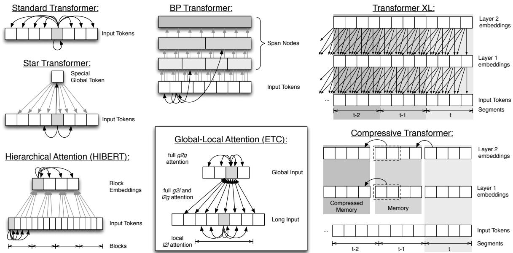
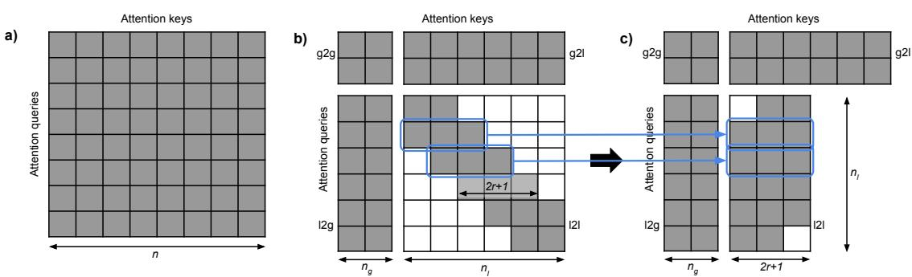
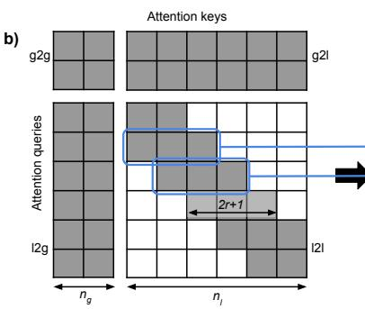
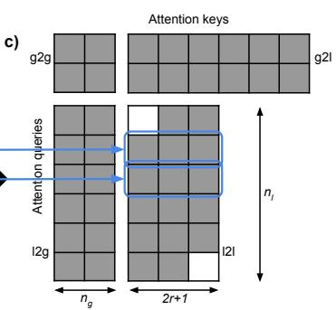
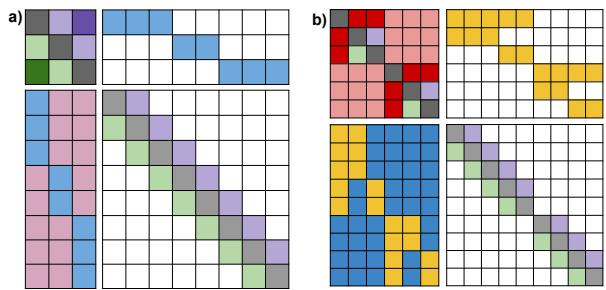
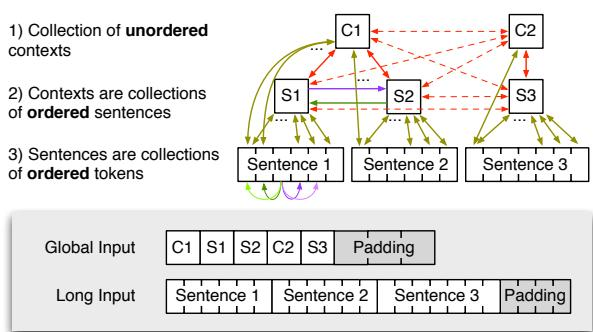

ETC: 在 Transformer 中编码长且结构化的输入

Joshua Ainslie, Santiago Ontañón, Chris Alberti, Vaclav Cvicek, Zachary Fisher, Philip Pham, Anirudh Ravula, Sumit Sanghai, Qifan Wang, Li Yang
Google Research

## 摘要

基于 Transformer（Vaswani 等人，2017）的模型，例如 BERT（Devlin 等人，2018）以及其他变体（Yang 等人，2019；Lan 等人，2019；Raffel 等人，2019），已在许多自然语言处理（Natural Language Processing, NLP）任务中取得了当前最优的结果，例如语言建模（Child 等人，2019；Sukhbaatar 等人，2019；Rae 等人，2019；Kitaev 等人，2020）、问答（Lan 等人，2019；Beltagy 等人，2020）以及摘要生成（Zhang 等人，2019）。本文提出了扩展 Transformer 构造（Extended Transformer Construction, ETC）架构，针对原始模型的两个局限：(1) 扩展输入长度；(2) 编码结构化输入。

原始 Transformer 中注意力机制的计算和内存复杂度随输入长度呈二次方增长，通常将输入长度限制在大约 512 个 token。尽管 512 对某些任务（例如指代消解似乎在更短的输入长度下也能受益（Joshi 等人，2019））可能已经足够，但在其他任务中这会带来问题。考虑需要在多个文档间进行推理的问答（question answering, QA）任务（例如 HotpotQA 数据集（Yang 等人，2018）），所有这些文档都必须同时放入模型输入中。其他例子还包括摘要生成，或对长文档进行问答。已有许多方法被提出以解决此问题，例如层次化处理（Zhang 等人，2019）、稀疏注意力（Child 等人，2019）以及段级循环（Dai 等人，2019）。

第二个局限性在于，很少有模型聚焦于结构化输入——我们所说的结构化输入是指输入标记之间存在的任何底层图结构或层次结构。虽然 ETC（Extended Transformer Constructor）能够编码更一般的图结构，但在本工作中，我们聚焦于在自然语言处理任务中表示层次结构，而这通常不是 Transformer 模型所建模的内容。例如，文本被组织成句子和段落，虽然它们具有顺序关系，但不同的输入文档之间可能不存在任何顺序（例如 HotpotQA 数据集）。此外，网页文本包含标记语言，并使用 DOM 树进行布局，从而提供了额外的结构。我们展示了 ETC 能够表示这些以及其他类型的结构，例如链接不同的实体提及。

为了应对这些挑战，我们提出了一种称为全局-局部注意力（global-local attention）的新型注意力机制，它将输入划分为两个序列（我们称为全局输入和长输入）。该机制引入了局部稀疏性以降低注意力机制的二次方复杂度。当它与相对位置编码（Shaw et al., 2018）相结合时，能够以自然的方式处理结构化输入。此外，与以往的 Transformer 扩展不同，ETC 可以从现有预训练的标准 BERT 模型进行初始化（这与 GPU/TPU 友好的实现一起，使得模型训练更为高效）2。我们的结果表明，从 RoBERTa（Liu et al., 2019）进行初始化能够显著提升性能。最后，我们展示了通过添加预训练的对比预测编码（Contrastive Predictive Coding, CPC）任务（Oord et al., 2018），在结构重要的任务上性能进一步提升，因为 CPC 在句子粒度层面扮演了掩码语言模型（masked language model, MLM）任务的角色。

我们在四个数据集上报告了实验结果：Natural Questions（NQ）（Kwiatkowski et al., 2019）、HotpotQA（Yang et al., 2018）、WikiHop（Welbl et al., 2018）和 OpenKP（MS MARCO 的一部分）（Xiong et al., 2019），这些数据集都具有长输入和/或结构化输入。我们在所有这些数据集上都达到了新的最先进水平。

此外，尽管在本文中我们严格聚焦于 ETC，在一个称为 BigBird（Zaheer et al., 2020）的相关模型中，我们实验了一组用于处理长输入以及其向用于文本生成的解码器扩展的替代思路。BigBird 的重点在于向全局-局部注意力中添加随机稀疏注意力模式的思想，以及展示 BigBird/ETC 这类模型在何种条件下是序列函数的通用逼近器并且是图灵完备的。虽然实现上述问答任务最先进结果所需的关键思想和技术是本文的重点，但读者可参阅 BigBird 的工作以了解 ETC（在 BigBird 的工作中称为 BigBird-ETC）与随机稀疏注意力模式思想的联合评估。

## 2 背景

原始 Transformer 模型（Vaswani et al., 2017）已有许多变体被提出，分别用于扩大训练规模（RoBERTa，Liu et al., 2019）、改进内部表示（ALBERT，Lan et al., 2019），或两者兼具（T5，Raffel et al., 2019），并在 GLUE（Wang et al., 2018）、SQuAD（Rajpurkar et al., 2016）或 RACE（Lai et al., 2017）等任务上优于 BERT（Devlin et al., 2018）。然而，由于注意力机制 $O ( n ^ { 2 } )$ 的成本，这些模型通常将输入限制在 $n = 5 1 2$ 个标记以内。我们将先前用于扩展注意力的方法归为四类：稀疏注意力（sparse attention）、循环机制（recurrence）、层次化机制（hierarchical mechanisms）和压缩注意力（compressed attention）。

稀疏注意力（Sparse Attention）是指限制每个标记仅能关注其他标记的一个子集。例如，Sparse Transformer（Child et al., 2019）在文本和图像生成任务中采用了预定义的注意力模式。他们证明，仅关注同一行或同一列中先前的像素即可生成高质量图像，同时将注意力成本保持在 $O ( n { \sqrt { n } } )$ 。在 Adaptive Attention Span Transformer（Sukhbaatar et al., 2019）中，每个注意力头关联一个可学习的衰减掩码函数，用以限制其可关注的标记数量。他们发现，较低层学会使用较短的注意力跨度，只有较高层才具有较长的注意力跨度。稀疏注意力还被用于提升注意力头的可解释性，允许注意力对某些输入标记赋予恰好为零的权重（Correia et al., 2019）。Reformer（Kitaev et al., 2020）模型使用局部敏感哈希（locality sensing hashing，Andoni et al., 2015）来寻找注意力查询的最近邻（即那些会产生最高注意力权重的输入标记），并仅对这些标记进行注意力计算，从而将注意力成本降低到 $O ( n l o g ( n ) )$ 。Routing Transformer（Roy et al., 2020）使用在线 k-means 学习动态稀疏注意力模式，将复杂度降低到 $O ( n ^ { 1 . 5 } )$ 。最后，与本文工作最为相关的方法是 Longformer（Beltagy et al., 2020），它与 ETC 并行开发，具有与 ETC 非常相似的全局-局部注意力机制，但并未直接对图结构或层次化结构进行编码（更详细的比较见第 3 节）。

循环机制（Recurrence）将循环神经网络的元素引入 Transformer 模型，以延长其注意力跨度。Transformer-XL（Dai et al., 2019）采用了这种方法，将输入序列划分为若干段，然后一次处理一段。在每一层，模型对紧邻其下方一层中当前输入段与前一段输入段的表示进行注意力计算。其效果是，第 k 层会受到当前段以及前 k − 1 个段的影响，如图 1 右上角所示。

在层次化机制（Hierarchical Mechanisms）中，输入序列被切分为若干块（block），各块被独立地送入模型以生成能够表征整块内容的概要嵌入（summary embeddings）。随后，独立层对这些嵌入的拼接结果进行处理。例如，HIBERT（Zhang et al., 2019）在句子级别将这一思路应用于抽取式摘要（extractive summarization）任务（如图 1 左下角所示）。Transformer 中的层次化注意力机制也已被应用于其他自然语言处理（NLP）任务，例如神经机器翻译（neural machine translation）（Maruf et al., 2019）。此外，值得注意的是，对输入进行层次化处理这一思路并非 Transformer 模型所独有；它也已被应用于循环神经网络（RNN）模型，分别在句子级别（Yang et al., 2016; Miculicich et al., 2018）和块级别（Shen et al., 2018）有所应用。

  

图 1：将注意力机制扩展到长输入的若干方法示意图，包括我们提出的 ETC 模型。

压缩注意力（Compressed Attention）在层级注意力的基础上更进一步，选择性地压缩输入的某些部分。BP-Transformer（Ye 等人，2019）在输入上构建一棵二叉划分树，只允许模型对附近的 token 关注其叶子节点（即原始 token），而对更远的 token 则关注树中更高的节点（即若干 token 的摘要）（见图 1 中上）。其他思路还包括记忆压缩注意力（memory compressed attention，Liu 等人，2018），其中每组 k 个 token 在被关注之前通过卷积滤波器进行压缩；以及星形 Transformer（Star Transformer，Guo 等人，2019），其中每个 token 只能关注其紧邻的左右邻居，以及一个代表整个输入摘要的特殊辅助 token（见图 1 左）。压缩 Transformer（Compressive Transformer，Rae 等人，2019）将这一思路整合到 Transformer-XL 中，对输入中较远的 token 进行压缩。该模型既能从对附近 token 的细粒度注意力中获益，又能为更远的 token 使用摘要化的信息（见图 1 右下）。

## 3 扩展 Transformer 构造

我们的模型沿用了原始 Transformer 架构（Vaswani 等人，2017），并针对长且结构化的输入进行了若干关键改进：相对位置编码、全局-局部注意力，以及一个 CPC 预训练任务，下文将逐一介绍。在本文中，我们只考虑 Transformer 的编码器部分，解码器留作未来工作。

### 3.1 相对位置编码

受 Shaw 等人（2018）工作的启发，ETC 用相对位置编码取代了绝对位置编码，相对位置编码提供的是输入序列中各个 token 之间相对位置的信息。给定输入序列 $x = ( x _ { 1 } , . . . , x _ { n } )$，我们可以将其视为一个带标签的完全有向图，其中 $l _ { i j }$ 是连接 $x _ { i }$ 与 $x _ { j }$ 的边的标签。给定最大截断距离 $k ,$，Shaw 等人定义了 2k + 1 个相对位置标签：$l _ { - k } , . . . , l _ { k }$。两个输入 token 之间边的标签仅取决于它们的相对位置 $j - i .$。对于满足 $j - i \geq k$ 的输入对，赋予标签 $l _ { k }$；对于满足 $j - i \le - k$ 的输入对，赋予标签 $l _ { - k }$。每个标签随后成为一个可学习的向量 $a _ { l } ^ { K }$，用于修改注意力机制（公式见下一节）3。

相对位置编码与输入长度无关，因此可以很容易地将模型适配到比预训练时更长的输入长度。与其他近期工作（Shaw 等人，2019）类似，ETC 的注意力机制不仅将相对位置标签用于序列中的相对位置，还用以表达对结构化输入有用的任意成对 token 关系，具体细节将在下文介绍。

  

图 2：稀疏性示意图，展示了哪些注意力查询（行）可以关注哪些注意力键（列）。a) 对于输入规模为 $n$ 的标准 Transformer 注意力；b) 对于输入规模为 $n _ { g } , n _ { l }$、半径为 $r$ 的全局-局部注意力；c) l2l 注意力部分如何被重塑为一个更小的、受局部半径限制的注意力矩阵。

## 3.2 全局-局部注意力（Global-Local Attention）

全局-局部注意力是上文所介绍的几个模型的推广。ETC 接收两个独立的输入序列：全局输入 $x ^ { g } = ( x _ { 1 } ^ { g } , . . . , x _ { n _ { g } } ^ { g } )$ 和长输入 $\boldsymbol { x } ^ { l } = ( x _ { 1 } ^ { l } , . . . , x _ { n _ { l } } ^ { l } )$。通常，长输入包含标准 Transformer 所接收的输入，而全局输入包含数量远少于长输入的辅助 token（$n _ { g } \ll n _ { l }$）。注意力随后被划分为四个独立部分：全局到全局（global-to-global，g2g）、全局到长输入（global-to-long，g2l）、长输入到全局（long-to-global，l2g）以及长输入到长输入（long-to-long，l2l）。l2l 部分（计算量最大的部分）的注意力被限制在固定半径 $r \ll n _ { l }$ 之内。为了弥补这一受限的注意力跨度，全局输入中的 token 拥有不受限制的注意力，因此长输入中的 token 可以通过全局输入的 token 彼此传递信息。相应地，g2g、g2l 和 l2g 部分的注意力都是不受限制的。

该概念在图 2 中得到了说明，其中每个单元格（第 i 行、第 j 列）在 token $x _ { i }$ 可以关注 token $x _ { j }$ 时被填充为灰色。如我们所见，在常规 Transformer 中，注意力是不受限制的（完全的 $n \times n$ 注意力）。然而，如图 2b 所示，ETC 将 l2l 部分限制在局部半径内，从而显著降低了超长输入的计算和内存复杂度。从概念上讲，l2l 注意力部分被重塑为一个 $n _ { l } \times ( 2 r + 1 )$ 矩阵，如图 $2 \mathrm { c }$ 所示。$ ^{4} $

若 $r = 1$ 且 $n _ { g } = 1$，我们恰好恢复出 Star Transformer（第 2 节）。类似地，将所有 token 放入全局输入并令 $n _ { l } = 0$，即可得到标准 Transformer 的注意力。ETC 中的注意力复杂度为 $O ( n _ { g } ( n _ { g } + n _ { l } ) + n _ { l } ( n _ { g } + 2 r + 1 ) )$。如果我们假设 $n _ { g } = O ( 2 r + 1 )$，则可以看到注意力相对于长输入规模呈线性关系：$O ( n _ { g } ^ { 2 } + n _ { g } n _ { l } )$。

为了提供灵活的注意力并辅助处理结构化输入，每个实例都存在布尔类型的注意力矩阵 $M ^ { g 2 g } , M ^ { \bar { g } 2 l } , M ^ { l 2 g }$ 和 $M ^ { l 2 l }$，对于那些不应相互关注的 token 对，其对应位置取零。每个 g2g 注意力头的工作方式如下。给定全局输入 $x ^ { g } = ( x _ { 1 } ^ { g } , . . . , x _ { n _ { g } } ^ { g } )$，这是一个 token 表示序列 $x _ { i } ^ { g } \in \mathbb { R } ^ { d _ { x } }$，其注意力输出为 $\boldsymbol { z ^ { g } } = ( z _ { 1 } ^ { g } , . . . , z _ { n _ { g } } ^ { \bar { g } } )$，其中每个 $\bar { z _ { i } ^ { g } } \in \mathbb { R } ^ { d _ { z } }$ 按如下方式计算：

$$
z _ {i} ^ {g} = \sum_ {j = 1} ^ {n _ {g}} \alpha_ {i j} ^ {g 2 g} x _ {j} ^ {g} W ^ {V}
$$

$$
\begin{array}{r} \alpha_ {i j} ^ {g 2 g} = \frac {\exp (e _ {i j} ^ {g 2 g})}{\sum_ {\ell = 1} ^ {n} \exp (e _ {i \ell} ^ {g 2 g})} \\ e _ {i j} ^ {g 2 g} = \frac {x _ {i} ^ {g} W ^ {Q} (x _ {j} ^ {g} W ^ {K} + a _ {i j} ^ {K}) ^ {T}}{\sqrt {d _ {z}}} - (1 - M _ {i j} ^ {g 2 g}) C \end{array}
$$

其中：$M^{g2g}$ 是一个二值注意力掩码（binary attention mask），$W^Q$、$W^K$ 和 $W^V$ 是可学习的权重矩阵，$a_{ij}^K$ 是表示相对位置标签的可学习向量，$C$ 是一个较大的常数（在我们的实验中取 $C=10000$，沿用 BERT 的相同惯例）。其余三种注意力的计算方式类似。我们实验了在四种注意力之间使用各自独立的 $W^K$ 和 $W^V$，或共享它们。对于 $W^Q$，我们实验了两种方案：一种是为 g2g 和 $\mathbf{g}2\mathbf{l}$ 分配一个 $W^Q$，为 l2g 和 l2l 分配另一个 $W^Q$；另一种是全部共享 $W^Q$。当 $r$ 足够大以消除稀疏性时，可以将 BERT 恢复为一种特殊情况：注意力实际上只在内部被分成 2 块而不是 4 块，因为 g2g + g2l 可以联合计算（图 2c 的上半部分），l2g + l2l 也可以联合计算（图 2c 的下半部分）。使用单个 softmax 来联合计算 $\alpha_{ij}^{g2g}$ 和 $\alpha_{ij}^{g2l}$，再使用另一个 softmax 联合计算 $\alpha_{ij}^{l2g}$ 和 $\alpha_{ij}^{l2l}$。

  

图 3：（a）长输入和（b）结构化输入的注意力模式示例。白色背景表示通过 M 对注意力进行掩码处理，其他颜色表示不同的相对位置标签。

因此，全局-局部注意力（global-local attention）的输出是一段长度为 $n _ { g }$ 的序列和一段长度为 $n _ { l }$ 的序列。这些序列经过层归一化（layer normalization）和前馈层（feed forward layer）处理，处理方式与标准 Transformer 中相同。

## 3.3 长输入与全局-局部注意力

下面举例说明如何使用 ETC 来编码长输入。处理长输入的一般方法是：将整个输入标记（例如词片段（word pieces））序列放入长输入中，然后假设某种分段方式（例如按句子分段），为长输入中的每个段落在全局输入中放置一个辅助标记。然后，我们使用一个相对位置标签将全局段落标记与属于它们的词片段标记相链接，并使用另一个不同的标签对应不属于它们的标记。此外，如下方实验所示，我们发现使用 $M ^ { g 2 l }$ 注意力掩码在一个方向（g2l）执行硬掩码（hard masking）可以在某些数据集上带来性能提升。这种不对称的硬掩码如图 3a 所示，图中我们用不同颜色表示不同的相对位置标签。这样一来，虽然长输入中的标记只能关注由半径 $k$ 定义的局部邻域，但它们可以通过全局标记间接关注输入序列中的所有其他标记。

## 3.4 结构化输入

标准 Transformer 类似于在全连接图 $g$ 上运行的图神经网络（graph neural network）（Scarselli 等人，2008）；参见 Ye 等人（2019）。得益于全局-局部注意力与相对b)位置标签的结合，ETC 利用这一关系来编码结构化输入。给定输入 $x = ( x _ { 1 } , . . . , x _ { n } )$，我们用"结构"（structure）一词指代 $x$ 中各标记之间存在的关系。当 $x$ 是普通的有序序列时，唯一的关系就是标记的顺序，这也是 BERT 所捕获的唯一结构（由绝对位置编码（absolute position encodings）实现，用于修改注意力）。我们将结构化输入定义为那些标记之间除了顺序之外还存在其他额外关系的输入。原则上，我们可以考虑具有任意图结构的输入（例如化学分子图），但这里我们专注于自然语言处理（NLP）任务中的结构。

ETC 特别适合通过三种机制来捕捉层次结构。首先，如最初所设想的，相对位置标签的词汇表被用来表示词元的相对位置。然而，若将 Transformer 视为图 $g$ 上的图神经网络（每个词元对应 $x$ 中的一个顶点，边表示它们之间的关系），我们就可以扩展该词汇表，用诸如 is-a（属于）、part-of（部分-整体）或其他关系类型的标签来标记某些边。其次，长输入与全局输入的划分构成了一种天然的结构，其中全局输入包含 $x$ 中若干词元集合的摘要词元（构成二级层次结构）。不过，我们也可以让词元对摘要词元的集合再做摘要（由此构建三级乃至更深的层次结构）。第三，如果某些词元对之间不应连边，可以通过 $\bar{M}^{g2g}, M^{g2l}, M^{l2g}, M^{l2l}$ 等掩码来体现这一约束。图 3b 展示了上述所有概念的一个示例，它借助掩码和相对位置标签来表示一种上下文-句子-词元的层次结构：其中上下文内的句子存在顺序，而上下文彼此之间则没有顺序。另一个例子是社交社区图结构：我们可以将图划分为若干分量，使用 $M^{l2l}$ 将注意力限制在各分量内部，并为每个分量添加全局词元，再通过适当的连接使信息能够以层次化的方式从一个分量传递到另一个分量。

## 3.5 预训练任务

我们采用两项预训练任务：(1) 掩码语言模型（MLM）任务，并使用全词掩码（如果某个子词词元被掩码，则同一词的其他所有词元也会一并被掩码）；(2) 不再使用 BERT 的下一句预测（NSP），而是为 ETC 适配了对比预测编码（CPC）（Oord et al., 2018）。

CPC 的目标是在潜空间中预测后续输入，即预测若干词元块的内部隐藏表示。我们在 ETC 中通过使用全局输入的句子摘要词元来适配这一思想：给定一个包含 $n$ 个句子的输入序列，我们将对应于某个句子子集的所有词元掩码掉（但保留全局输入中相应的句子摘要词元）。随后训练模型，最小化被掩码句子的全局句子摘要词元隐藏表示与某个全局摘要词元隐藏表示之间的差异——该全局摘要词元能够看到未掩码的句子，且除此之外看不到任何其他内容。我们采用 Oord et al. (2018) 中使用的噪声对比估计（NCE）损失（细节见附录）。

在介绍了 ETC 之后，我们现在可以将其与 Longformer（Beltagy et al., 2020）进行比较。Longformer 采用了类似的注意力机制，区别在于 Longformer 使用单一输入序列，并将部分标记标记为全局标记（只有这些标记使用全局注意力）。关键的差异在于：（1）ETC 将全局-局部注意力与相对位置编码及灵活的掩码相结合，使其能够以类似图神经网络的方式对结构化输入进行编码；（2）Longformer 中的全局标记从未使用类似我们 CPC 损失的方式进行预训练，因此其使用方式必须在微调过程中学习。

## 3.6 从现有模型中迁移权重（Lifting Weights from Existing Models）

ETC 与 BERT 存在足够多的相似之处，因此 BERT 的参数可被用于热启动（warm start）。这些参数是兼容的，因为如果输入足够小，或局部半径大到足以消除稀疏性，那么全局-局部注意力机制将包含 BERT 作为其特例。此外，当把 BERT 的权重迁移到具有独立的 $W^{Q}$、$W^{K}$ 和 $W^{V}$ 投影矩阵的 ETC 模型中时，BERT 的参数只需直接复制到 ETC 的不同矩阵中即可。

尽管仍然需要进行预训练以使权重适应全局标记和相对位置编码的使用，但我们表明，与从零开始预训练相比，从 RoBERTa 进行初始化能够带来显著的性能提升。具体而言，我们从 Rothe 等人（Rothe et al., 2020）工作中报告的 RoBERTa 检查点进行了初始化。

<table><tr><td rowspan="2">Dataset</td><td colspan="2">Instances</td><td colspan="3">Instance length</td></tr><tr><td>Training</td><td>Dev</td><td>Median</td><td>95%</td><td>Max</td></tr><tr><td>NQ</td><td>307373</td><td>7830</td><td>4004</td><td>17137</td><td>156551</td></tr><tr><td>HotpotQA</td><td>90447</td><td>7405</td><td>1227</td><td>1810</td><td>3560</td></tr><tr><td>WikiHop</td><td>43738</td><td>5129</td><td>1541</td><td>3994</td><td>20337</td></tr><tr><td>OpenKP</td><td>133724</td><td>6610</td><td>761</td><td>4546</td><td>89183</td></tr></table>

表 1：数据集统计信息（长度以词片段 token 为单位）。

## 4 实证评估

本节聚焦于评估我们的两项主要贡献：（1）长输入，以及（2）文本输入中的结构，以及从现有 BERT 模型的初始化。我们选择了四个数据集（表 1），它们具有长输入或有趣的输入结构。

NQ（Kwiatkowski 等人，2019）：在 Google 的 Natural Questions（NQ）数据集中，输入由一个问题和一篇完整的维基百科文章组成。任务是同时识别一个短答案（文章中的几个词）和一个长答案（例如，整段文字），如果它们存在于文章中（否则返回空答案）。性能基于模型预测相对于人工生成答案的 F1 分数进行衡量。

HotpotQA（Yang 等人，2018）是一个问答数据集，目标是综合多个上下文中的证据。我们使用干扰项（distractor）设置，其中提供 10 个段落：其中两个包含回答问题的有用信息，其余为干扰项。任务既要回答问题，也要识别与回答问题相关的事实（以句子粒度为单位）。

WikiHop（Welbl 等人，2018）在结构上与 HotpotQA 类似。上下文对应于维基百科文章的各个部分，目标是回答关于某实体属性的问题，而该问题的答案无法在该实体的文章中找到。每个实例包含一个查询、一组候选答案，以及一组用于从候选答案中进行选择的上下文。

OpenKP（Xiong 等人，2019）是一个关键词抽取数据集。每篇文档包含最多 3 个待识别的短关键词。我们选择该数据集是因为其输入不是扁平的文本序列，而是网页，包括网页上不同 DOM 元素之间的层次和空间关系，以及其他视觉属性。

## 4.1 训练配置

我们使用两种基本配置：base 和 large。Base 使用 12 层、768 隐藏维度、12 个注意力头，局部注意力半径 $r = 8 4 .$ ，以及相对位置最大距离 k = 12。Large 使用 24 层、1024 隐藏维度、16 个头，$r = 1 6 9 .$ 和 $k = 2 4$ 。在 NQ 中，我们分别对输入长度为 512、4096 和 8192 的模型使用了 128、230 和 460 个全局 token，在 HotpotQA 中使用了 256 个全局 token，在 WikiHop 中使用了 430 个，在 OpenKP 中使用了 512 个。

<table><tr><td>Model</td><td>Input length</td><td>Configuration</td><td>#Params</td><td>Long answer F1</td><td>Short answer F1</td></tr><tr><td>BERT-base</td><td>512</td><td></td><td>110M</td><td>0.634</td><td>0.475</td></tr><tr><td>BERT-large</td><td>512</td><td></td><td>340M</td><td>0.647</td><td>0.527</td></tr><tr><td>RikiNet</td><td>512</td><td>lifting from RoBERTalarge</td><td>-</td><td>0.753</td><td>0.593</td></tr><tr><td>ETC</td><td>512</td><td>shared, no CPC, no hard g2l</td><td>109M</td><td>0.645</td><td>0.478</td></tr><tr><td>ETC</td><td>4096</td><td>shared, no CPC, no hard g2l</td><td>109M</td><td>0.692</td><td>0.497</td></tr><tr><td>ETC</td><td>4096</td><td>fixed blocks, shared, no CPC, no hard g2l</td><td>109M</td><td>0.697</td><td>0.508</td></tr><tr><td>ETC</td><td>4096</td><td>shared, no hard g2l</td><td>109M</td><td>0.717</td><td>0.524</td></tr><tr><td>ETC</td><td>4096</td><td>shared</td><td>109M</td><td>0.721</td><td>0.514</td></tr><tr><td>ETC</td><td>4096</td><td>-</td><td>166M</td><td>0.725</td><td>0.522</td></tr><tr><td>ETC</td><td>8192</td><td></td><td>166M</td><td>0.740</td><td>0.542</td></tr><tr><td>ETC</td><td>4096</td><td>2x local radius</td><td>166M</td><td>0.737</td><td>0.530</td></tr><tr><td>ETC</td><td>4096</td><td>2x relative vocab</td><td>166M*</td><td>0.733</td><td>0.532</td></tr><tr><td>ETC</td><td>4096</td><td>2x pre-training</td><td>166M</td><td>0.746</td><td>0.558</td></tr><tr><td>ETC-large</td><td>4096</td><td></td><td>539M</td><td>0.761</td><td>0.565</td></tr><tr><td>ETC-large</td><td>4096</td><td>lifting from RoBERTa</td><td>558M</td><td>0.782</td><td>0.585</td></tr></table>

表 2：自然问题（Natural Questions, NQ）数据集开发集（dev set）上的实验结果。基础版（base）和大型版（large）模型中的最佳结果已加粗标出。BERT-large 的结果取自 Alberti 等人（2019）。∗虽然由于四舍五入到最近的百万位而无法直观显示，但将相对位置编码词表翻倍大约增加了 60 万个参数。

预训练（Pre-training）：我们将所有 word piece 词元放入长输入（long input）中，并为每个句子在全局输入（global input）中添加一个辅助词元。我们默认采用 BERT 的 3 万词条英文不区分大小写 word piece 词表。除过滤掉少于 7 个句子的文档外，模型使用 BERT 原始数据集进行预训练。除非另有说明，基础版模型预训练所用的总词元数与原始 BERT 相同，而大型版模型则为其两倍。我们使用 LAMB 优化器（You 等人，2019），学习率设为 ${ \sqrt { 8 } } \times 1 0 ^ { - 3 }$。

微调（Fine-tuning）：我们将所有输入词元放入长输入（对于问答（QA）数据集，包含 CLS、问题以及上下文词元），并使用相对位置标签来编码结构（见第 3.4 节）。全局输入包含一个 CLS 词元、与长输入中问题词元相对应的词元，以及每个段落/句子（或 OpenKP 中的 VDOM 块）一个摘要词元。OpenKP 既没有 CLS 词元也没有问题词元。对于 WikiHop，我们还为每个候选答案添加一个全局词元，并使用一种不同的相对位置标签将这些词元链接到文本中与之字符串匹配的提及处（更多细节见附录）。

## 4.2 开发集上的结果

NQ：我们使用 NQ 通过消融实验来研究 ETC 的各个组成部分。结果如表 2 所示。前三行展示了基线模型：BERT-base、BERT-large 以及 RikiNet（Liu 等人，2020）（NQ 排行榜上表现最好的模型之一）。BERT 的性能与使用 512 输入长度的 ETC 相当。ETC 较小的局部半径（84）使 ETC 在与 BERT 比较时处于劣势，但 ETC 的其他改进（例如动态全词掩码）似乎弥补了这一不足。

表 2 的其余部分展示了在不同消融条件下的性能。我们在配置列中以"-"标记的默认配置为：ETC-base，长输入长度为 4096 个 tokens，使用 CPC、硬 g2l 掩码，并对长输入/全局输入使用独立的 WQ、$W ^ { K }$ 和 $W ^ { V }$ 矩阵。我们测试了以下消融：shared（在全局输入与长输入之间共享所有注意力模型参数）、no CPC（去除 CPC 预训练任务）、no hard g2l（不使用硬 g2l 掩码）以及 fixed blocks（将全局输入配置为每 97 个长输入 tokens 仅对应一个全局 token，以保持与不使用 fixed blocks 时相同的比例，忽略句子边界，且在预训练或微调时全局输入中不包含任何其他 token）。共享 $W ^ { Q }$、$W ^ { K }$ 和 $W ^ { V }$ 以及去除 CPC 都会显著损害 ETC 在 $\mathrm { N Q } ^ { 7 }$ 上的性能。令人惊讶的是，使用 fixed blocks 在没有 CPC 时似乎略有帮助。

将长输入从 512 增加到 4096 显著提升了性能，进一步增加至 8192 将性能提升至 0.740 / 0.542，凸显了更长输入的重要性。增加局部半径、相对位置词表大小或预训练量都提升了性能（尤其是后者，达到了 0.746 / 0.558）。转向大模型也有所帮助，特别是在基于 RoBERTa 进行迁移时（两个大模型均使用了 RoBERTa 词表）。基于 RoBERTa 迁移取得了我们的最佳分数：0.782 / 0.585，超过了文献中长答案的最佳开发集分数（与 RikiNet 的 0.754 / 0.593 相比）。对于短答案，我们仍然落后于 RikiNet。

<table><tr><td rowspan="2">Model</td><td rowspan="2">Input length</td><td rowspan="2">Configuration</td><td rowspan="2">#Params</td><td>HotpotQA</td><td>WikiHop</td></tr><tr><td>Ans. F1 / Sup. F1</td><td>Acc.</td></tr><tr><td>Longformer</td><td>4096</td><td></td><td>149M*</td><td>0.743 / 0.844</td><td>75.0</td></tr><tr><td>Longformer-large</td><td>4096</td><td></td><td>435M*</td><td>0.788 / 0.860 $^{6}$ </td><td>77.6</td></tr><tr><td>ETC</td><td>4096</td><td>flat structure, no CPC, no hard g2l</td><td>166M</td><td>0.722 / 0.857</td><td>70.0</td></tr><tr><td>ETC</td><td>4096</td><td>flat structure</td><td>166M</td><td>0.748 / 0.870</td><td>70.7</td></tr><tr><td>ETC</td><td>4096</td><td>no CPC</td><td>166M</td><td>0.747 / 0.866</td><td>73.0</td></tr><tr><td>ETC</td><td>4096</td><td>no hard g2l</td><td>166M</td><td>0.743 / 0.864</td><td>75.9</td></tr><tr><td>ETC</td><td>4096</td><td>shared</td><td>109M</td><td>0.733 / 0.866</td><td>73.7</td></tr><tr><td>ETC</td><td>4096</td><td>-</td><td>166M</td><td>0.751 / 0.869</td><td>73.2</td></tr><tr><td>ETC-large</td><td>4096</td><td></td><td>539M</td><td>0.798 / 0.890</td><td>77.0</td></tr><tr><td>ETC-large</td><td>4096</td><td>lifting from RoBERTa</td><td>558M</td><td>0.813 / 0.894</td><td>79.8</td></tr></table>

表 3：HotpotQA 和 WikiHop 上的实验结果（开发集结果）。∗Longformer 的参数量由作者通过个人通信提供。

<table><tr><td>Model</td><td>Input length</td><td>Configuration</td><td>#Params</td><td>OpenKP F1@3</td></tr><tr><td>RoBERTa-JointKPE</td><td>512</td><td></td><td>-</td><td>0.398</td></tr><tr><td>ETC</td><td>512</td><td>fixed blocks, no CPC, no hard g2l, no visual features</td><td>166M</td><td>0.399</td></tr><tr><td>ETC</td><td>4096</td><td>fixed blocks, no CPC, no hard g2l, no visual features</td><td>166M</td><td>0.400</td></tr><tr><td>ETC</td><td>4096</td><td>no CPC, no hard g2l, no visual features</td><td>166M</td><td>0.400</td></tr><tr><td>ETC</td><td>4096</td><td>no hard g2l, no visual features</td><td>166M</td><td>0.400</td></tr><tr><td>ETC</td><td>4096</td><td>no visual features</td><td>166M</td><td>0.402</td></tr><tr><td>ETC</td><td>4096</td><td>-</td><td>166M</td><td>0.409</td></tr><tr><td>ETC</td><td>4096</td><td>shared</td><td>109M</td><td>0.409</td></tr><tr><td>ETC</td><td>4096</td><td>max loss</td><td>166M</td><td>0.416</td></tr><tr><td>ETC-large</td><td>4096</td><td>max loss</td><td>539M</td><td>0.419</td></tr><tr><td>ETC-large</td><td>4096</td><td>max loss, lifting from RoBERTa</td><td>558M</td><td>0.423</td></tr></table>

表 4：在 OpenKP 上的实验结果（开发集 F1@3 结果）。

<table><tr><td>Leaderboard</td><td>Result</td><td>Position</td></tr><tr><td>NQ long answer</td><td>0.7778</td><td>1st</td></tr><tr><td>NQ short answer</td><td>0.5786</td><td>18th</td></tr><tr><td>HotpotQA Sup. F1</td><td>0.8909</td><td>1st</td></tr><tr><td>HotpotQA Overall</td><td>0.7362</td><td>3rd</td></tr><tr><td>WikiHop</td><td>0.8225</td><td>1st</td></tr><tr><td>OpenKP</td><td>0.4205</td><td>1st</td></tr></table>

Table 5: 提交时 ETC 在官方排行榜上的结果。

HotpotQA、WikiHop：Table 3 展示了我们在 HotpotQA 与 WikiHop 上的结果。我们以两个 Longformer 模型作为基线（Longformer 目前是 WikiHop 上 state-of-the-art 的模型），并通过消融实验来研究结构对结果的影响。具体而言，我们采用一个扁平结构（flat structure）的消融版本，其中：(1) 我们不按上下文边界打断长输入的注意力，(2) 我们将全局 token 与长 token 之间的相对位置标签限定为仅表示句子级关系（这会移除 WikiHop 中候选答案与其提及之间的特殊注意力）。

我们的结果表明，无论 base 还是 large 模型，在 HotpotQA 与 WikiHop 上都优于其对应的 Longformer 模型。除了参数数量的差异之外，解释这一性能差距的主要因素是 ETC 与 Longformer 采用了不同的预训练策略以及对结构的不同处理方式。移除 CPC 预训练任务以及不使用硬 g2l 掩码会显著损害模型在 HotpotQA 上的性能，基线模型从 0.751 / 0.869 下降到不使用上述任何特性时的 0.722 / 0.857。使用扁平结构（但保留 CPC 和硬 g2l）在 HotpotQA 上似乎并不会造成损害。WikiHop 呈现出略有不同的图景：硬 g2l 掩码、尤其是扁平结构似乎会损害该数据集上的性能。我们表现最好的模型是不带硬 g2l 掩码的 base 配置，其准确率达到 75.9。有趣的是，共享 $W ^ { Q } , W ^ { K }$ 和 $W ^ { \dot { V } }$ 似乎对 WikiHop 的性能有帮助。该数据集规模最小，不共享参数所带来的额外模型容量或导致其倾向于倾向于过拟合。

OpenKP：Table 4 展示了我们使用 RoBERTa-JointKPE（Sun 等，2020）作为基线，在 OpenKP 数据集上的结果；该基线目前在排行榜上位居第 1。这是一个有趣的含结构信息的数据集，因此我们进行了额外的消融实验以考察移除此类结构信息的影响。我们的结果显示，即便受限最严重的 ETC 模型也已取得非常好的性能（0.399），且扩展到 4096 长度似乎带来轻微提升。使用硬 g2l 同样有帮助，叠加视觉特征则带来最大收益。最后，我们观察到，使用 large 模型，尤其是从 RoBERTa 迁移（lifting）权重，能够显著改善结果。与 WikiHop 中的情况一致，共享 $W^Q$、$W^K$ 和 $W ^ { \dot { V } }$ 并不会损害性能。我们的默认模型使用关键词的首次出现位置，但我们发现使用所有出现位置中的最大 logit（max loss）能够提升结果。

## 4.3 官方排行榜结果

最后，表 5 展示了在每个数据集排行榜上的官方结果。提交到排行榜的模型是在开发集上取得最佳结果的模型（如各自结果表的底部所示，从 RoBERTa 提升权重）。我们在 WikiHop 和 OpenKP、NQ 长答案（long answer）以及 HotpotQA 支持句 F1（Support F1）上刷新了当时的最佳水平。值得注意的是，我们提交的全部都是单模型，其表现优于排行榜上的集成模型。

## 5 结论

本文介绍了扩展 Transformer 构造（Extended Transformer Construction, ETC），这是一种旨在实现以下两个目标的架构：(1) 扩展输入长度（与输入呈线性关系），以及 (2) 对结构化输入进行编码。ETC 允许从现有 BERT 模型提升权重，从而显著改善结果。其核心思想是一种新的全局-局部（global-local）注意力机制，配合相对位置编码以及 CPC 预训练任务。

我们展示了由于输入序列长度的增加，可以获得显著的提升。ETC 中表示数据集结构的能力进一步改善了模型质量。我们推测 CPC 有助于模型训练对高层级全局输入摘要标记的使用，因为 CPC 所扮演的角色类似于 MLM，但是是在全局输入层面。请注意，尽管我们的数据集仅包含有限的结构（与图数据集相比），我们的实验表明 ETC 能够利用这些已有的结构。

作为未来的工作，我们希望研究 Reformer（Kitaev 等人，2020）或 Routing Transformer（Roy 等人，2020）等互补的注意力机制，借助 RevNet（Gomez 等人，2017）等思想推进可扩展性，并研究 ETC 在具有更丰富结构的数据集上的表现。

## 致谢

我们要感谢 Anna Goldie、Bhargav Kanagal、Ilya Eckstein、Manan Shah、Nich Kwon、Vikram Rao Sudarshan、Joshua Maynez、Manzil Zaheer、Kelvin Guu、Tom Kwiatkowski、Kristina Toutanova 以及 D. Sivakumar 在本文早期版本中提供的有益讨论、支持、意见和反馈。我们也要感谢 Longformer 的作者们（Iz Beltagy、Matthew E. Peters、Arman Cohan）在本文早期版本中给出的有益反馈，以及他们分享的参数数量。

## 参考文献

Chris Alberti、Kenton Lee 和 Michael Collins。2019。A bert baseline for the natural questions（《自然问题（Natural Questions）的 BERT 基线》）。arXiv 预印本 arXiv:1901.08634。

Alexandr Andoni、Piotr Indyk、Thijs Laarhoven、Ilya Razenshteyn 和 Ludwig Schmidt。2015。Practical and optimal lsh for angular distance（《面向角度距离的实用且最优的局部敏感哈希（LSH）》）。载于：神经信息处理系统进展（Advances in Neural Information Processing Systems），第 1225–1233 页。

Iz Beltagy、Matthew E. Peters 和 Arman Cohan。2020。Longformer: The long-document transformer（《Longformer：长文档 Transformer》）。arXiv 预印本 arXiv:2004.05150v1。

Rewon Child、Scott Gray、Alec Radford 和 Ilya Sutskever。2019。Generating long sequences with sparse transformers（《使用稀疏 Transformer 生成长序列》）。arXiv 预印本 arXiv:1904.10509。

Gonçalo M Correia、Vlad Niculae 和 Andre FT Martins。2019。Adaptively sparse transformers（《自适应稀疏 Transformer》）。arXiv 预印本 arXiv:1909.00015。

Zihang Dai, Zhilin Yang, Yiming Yang, Jaime Carbonell, Quoc V Le, and Ruslan Salakhutdinov. 2019. Transformer-XL：超越固定长度上下文的注意力语言模型. arXiv 预印本 arXiv·1901 02860.

Jacob Devlin, Ming-Wei Chang, Kenton Lee, and Kristina Toutanova. 2018. BERT：用于语言理解的深度双向 Transformer 预训练. arXiv 预印本 arXiv:1810.04805.

Aidan N Gomez, Mengye Ren, Raquel Urtasun, and Roger B Grosse. 2017. 可逆残差网络：不存储激活的反向传播. 发表于 Advances in Neural Information Processing Systems，第 2214–2224 页.

Qipeng Guo, Xipeng Qiu, Pengfei Liu, Yunfan Shao, Xiangyang Xue, and Zheng Zhang. 2019. Star Transformer. arXiv 预印本 arXiv:1902.09113.

Mandar Joshi, Omer Levy, Daniel S Weld, and Luke Zettlemoyer. 2019. 用于指代消解的 BERT：基线与分析. arXiv 预印本 arXiv:1908.09091.

Nikita Kitaev, Łukasz Kaiser, and Anselm Levskaya. 2020. Reformer：高效的 Transformer. arXiv 预印本 arXiv:2001.04451.

Guokun Lai, Qizhe Xie, Hanxiao Liu, Yiming Yang, and Eduard Hovy. 2017. RACE：来自考试的大规模阅读理解数据集. arXiv 预印本 arXiv:1704.04683.

Zhenzhong Lan, Mingda Chen, Sebastian Goodman, Kevin Gimpel, Piyush Sharma, and Radu Soricut. 2019. ALBERT：用于语言表示自监督学习的轻量级 BERT. arXiv 预印本 arXiv:1909.11942.

Dayiheng Liu, Yeyun Gong, Jie Fu, Yu Yan, Jiusheng Chen, Daxin Jiang, Jiancheng Lv, and Nan Duan. 2020. RikiNet：通过阅读维基百科页面进行自然问答. arXiv 预印本 arXiv:2004.14560.

Peter J Liu, Mohammad Saleh, Etienne Pot, Ben Goodrich, Ryan Sepassi, Lukasz Kaiser, and Noam Shazeer. 2018. 通过摘要长序列生成维基百科. arXiv 预印本 arXiv:1801.10198.

Yinhan Liu, Myle Ott, Naman Goyal, Jingfei Du, Mandar Joshi, Danqi Chen, Omer Levy, Mike Lewis, Luke Zettlemoyer, and Veselin Stoyanov. 2019. RoBERTa：一种鲁棒优化的 BERT 预训练方法. arXiv 预印本 arXiv:1907.11692.

Sameen Maruf, Andre FT Martins, and Gholamreza Haffari. 2019. 上下文感知神经机器翻译的选择性注意力. arXiv 预印本 arXiv:1903.08788.

Lesly Miculicich、Dhananjay Ram、Nikolaos Pappas 和 James Henderson。2018。文档级神经机器翻译与分层注意力网络。arXiv 预印本 arXiv:1809.01576。

Aaron van den Oord、Yazhe Li 和 Oriol Vinyals。2018。基于对比预测编码的表示学习。arXiv 预印本 arXiv:1807.03748。

Jack W Rae、Anna Potapenko、Siddhant M Jayakumar 和 Timothy P Lillicrap。2019。用于长程序列建模的压缩 Transformer。arXiv 预印本 arXiv:1911.05507。

Colin Raffel、Noam Shazeer、Adam Roberts、Katherine Lee、Sharan Narang、Michael Matena、Yanqi Zhou、Wei Li 和 Peter J Liu。2019。通过统一的文本到文本 Transformer 探索迁移学习的极限。arXiv 预印本 arXiv:1910.10683。

Pranav Rajpurkar、Jian Zhang、Konstantin Lopyrev 和 Percy Liang。2016。SQuAD：用于文本机器理解的 100,000+ 问题。arXiv 预印本 arXiv:1606.05250。

Sascha Rothe、Shashi Narayan 和 Aliaksei Severyn。2020。利用预训练检查点处理序列生成任务。Transactions of the Association for Computational Linguistics，8: 264–280。

Aurko Roy、Mohammad Saffar、Ashish Vaswani 和 David Grangier。2020。使用路由 Transformer 实现高效基于内容的稀疏注意力。arXiv 预印本 arXiv:2003.05997。

Franco Scarselli、Marco Gori、Ah Chung Tsoi、Markus Hagenbuchner 和 Gabriele Monfardini。2008。图神经网络模型。IEEE Transactions on Neural Networks，20(1): 61–80。

Peter Shaw、Philip Massey、Angelica Chen、Francesco Piccinno 和 Yasemin Altun。2019。从文本和实体的图表示生成逻辑形式。arXiv 预印本 arXiv:1905.08407。

Peter Shaw、Jakob Uszkoreit 和 Ashish Vaswani。2018。带相对位置表示的自注意力。arXiv 预印本 arXiv:1803.02155。

Noam Shazeer 和 Mitchell Stern。2018。Adafactor：具有次线性内存成本的自适应学习率。arXiv 预印本 arXiv:1804.04235。

Tao Shen、Tianyi Zhou、Guodong Long、Jing Jiang 和 Chengqi Zhang。2018。用于快速且内存高效序列建模的双向块自注意力。arXiv 预印本 arXiv:1804.00857。

Sainbayar Sukhbaatar、Edouard Grave、Piotr Bojanowski 和 Armand Joulin。2019。Transformer 中的自适应注意力跨度。arXiv 预印本 arXiv:1905.07799。

Si Sun、Chenyan Xiong、Zhenghao Liu、Zhiyuan Liu 和 Jie Bao。2020。使用 BERT 进行联合关键短语分块与显著性排序。arXiv 预印本 arXiv:2004.13639。

Ashish Vaswani、Noam Shazeer、Niki Parmar、Jakob Uszkoreit、Llion Jones、Aidan N Gomez、Łukasz Kaiser 和 Illia Polosukhin。2017。Attention Is All You Need（注意力即是一切）。收录于 Advances in Neural Information Processing Systems，第 5998–6008 页。

Alex Wang、Amanpreet Singh、Julian Michael、Felix Hill、Omer Levy 和 Samuel R Bowman。2018。GLUE：自然语言理解的多任务基准与分析平台。arXiv 预印本 arXiv:1804.07461。

Johannes Welbl, Pontus Stenetorp, and Sebastian Riedel. 2018. 构建跨文档多跳阅读理解的数据集. Transactions of the Association for Computational Linguistics, 6:287–302.

Lee Xiong, Chuan Hu, Chenyan Xiong, Daniel Campos, and Arnold Overwijk. 2019. 超越语言建模的开放域网页关键词提取. arXiv preprint arXiv:1911.02671.

Zhilin Yang, Zihang Dai, Yiming Yang, Jaime Carbonell, Russ R Salakhutdinov, and Quoc V Le. 2019. XLNet：用于语言理解的通用自回归预训练. 发表于：Advances in Neural Information Processing Systems，第 5754–5764 页.

Zhilin Yang, Peng Qi, Saizheng Zhang, Yoshua Bengio, William W Cohen, Ruslan Salakhutdinov, and Christopher D Manning. 2018. HotpotQA：用于多样化、可解释多跳问答的数据集. arXiv preprint arXiv:1809.09600.

Zichao Yang, Diyi Yang, Chris Dyer, Xiaodong He, Alex Smola, and Eduard Hovy. 2016. 用于文档分类的分层注意力网络. 发表于：Proceedings of the 2016 Conference of the North American Chapter of the Association for Computational Linguistics: Human Language Technologies，第 1480–1489 页.

Zihao Ye, Qipeng Guo, Quan Gan, Xipeng Qiu, and Zheng Zhang. 2019. BP-Transformer：通过二分划分建模长程上下文. arXiv preprint arXiv:1911.04070.

Manzil Zaheer, Guru Guruganesh, Avinava Dubey, Joshua Ainslie, Chris Alberti, Santiago Ontañón, Philip Pham, Anirudh Ravula, Qifan Wang, Li Yang, et al. 2020. Big Bird：用于更长序列的 Transformer. arXiv preprint arXiv:2007.14062.

Xingxing Zhang, Furu Wei, and Ming Zhou. 2019. HiBERT：用于文档摘要的分层双向 Transformer 的文档级预训练. arXiv preprint arXiv:1905.06566.

## 附录 A：实现细节

## 全局-局部注意力实现

本附录详细介绍了对 TPU/GPU 友好的全局-局部注意力实现细节。我们的滑动窗口局部注意力实现与 Ten-$\mathrm { s o r } 2 \mathrm { T e n s o r } ^ { 8 }$ 中 local attention 1d 层的方法类似，但增加了灵活的掩码、相对位置编码以及作为辅助键/值的全局标记。我们用一个简单的示例来说明内部分块逻辑。假设输入对应于以下词片段（word piece）的嵌入，每个词片段用一个字母表示：ABCDEFG。

像通常一样，我们将这些嵌入投影为查询、键和值，得到如下结果（针对每个注意力头）：

$$
\begin{array}{l l} \text {Queries:} & \mathbb {A} _ {q} \mathbb {B} _ {q} \mathbb {C} _ {q} \mathbb {D} _ {q} \mathbb {E} _ {q} \mathbb {F} _ {q} \mathbb {G} _ {q} \\ \text {Keys:} & \mathbb {A} _ {k} \mathbb {B} _ {k} \mathbb {C} _ {k} \mathbb {D} _ {k} \mathbb {E} _ {k} \mathbb {F} _ {k} \mathbb {G} _ {k} \\ \text {Values:} & \mathbb {A} _ {v} \mathbb {B} _ {v} \mathbb {C} _ {v} \mathbb {D} _ {v} \mathbb {E} _ {v} \mathbb {F} _ {v} \mathbb {G} _ {v} \end{array}
$$

假设我们想要执行局部半径 $r = 2$ 的滑动窗口局部注意力。在内部，我们将输入分割成长度为 $r + 1$（在我们的例子中为 3）的块，并在左右两侧添加填充块，从而为查询生成以下五个块（键和值类似），其中 0 表示填充：

$$
\begin{array}{l} 0 0 0 \mathrm {\texttt {A}} _ {q} \mathrm {\texttt {B}} _ {q} \mathrm {\texttt {C}} _ {q} \mathrm {\texttt {D}} _ {q} \mathrm {\texttt {E}} _ {q} \mathrm {\texttt {F}} _ {q} \mathrm {\texttt {G}} _ {q} 0 0 \mathrm {\texttt {000}} \end{array}
$$

从概念上讲，我们希望将每个查询与其周围的 $2 r + 1 \ : ( 5$（在我们的示例中）个键进行比较，如下所示：

<table><tr><td>Queries</td><td>Keys</td></tr><tr><td> $\mathbb{A}_q$ </td><td> $0\,0\mathbb{A}_k\mathbb{B}_k\mathbb{C}_k$ </td></tr><tr><td> $\mathbb{B}_q$ </td><td> $0\,\mathbb{A}_k\mathbb{B}_k\mathbb{C}_k\mathbb{D}_k$ </td></tr><tr><td> $\mathbb{C}_q$ </td><td> $\mathbb{A}_k\mathbb{B}_k\mathbb{C}_k\mathbb{D}_k\mathbb{E}_k$ </td></tr><tr><td> $\mathbb{D}_q$ </td><td> $\mathbb{B}_k\mathbb{C}_k\mathbb{D}_k\mathbb{E}_k\mathbb{F}_k$ </td></tr><tr><td> $\mathbb{E}_q$ </td><td> $\mathbb{C}_k\mathbb{D}_k\mathbb{E}_k\mathbb{F}_k\mathbb{G}_k$ </td></tr><tr><td> $\mathbb{F}_q$ </td><td> $\mathbb{D}_k\mathbb{E}_k\mathbb{F}_k\mathbb{G}_k\,0$ </td></tr><tr><td> $\mathbb{G}_q$ </td><td> $\mathbb{E}_k\mathbb{F}_k\mathbb{G}_k\,0\,0$ </td></tr></table>

但是，将每个键的窗口具体化会非常消耗内存。相反，我们允许每个查询块关注 3 个键块（即同一个块，以及紧邻其左右两侧的块），结果如下：

$$
\begin{array}{c c} \text {Queries} & \text {Keys} \\ \hline \mathsf {A} _ {q} \mathsf {B} _ {q} \mathsf {C} _ {q} & 0 0 0 \quad \mathsf {A} _ {k} \mathsf {B} _ {k} \mathsf {C} _ {k} \quad \mathsf {D} _ {k} \mathsf {E} _ {k} \mathsf {F} _ {k} \\ \mathsf {D} _ {q} \mathsf {E} _ {q} \mathsf {F} _ {q} & \mathsf {A} _ {k} \mathsf {B} _ {k} \mathsf {C} _ {k} \quad \mathsf {D} _ {k} \mathsf {E} _ {k} \mathsf {F} _ {k} \quad \mathsf {G} _ {k} 0 0 \\ \mathsf {G} _ {q} 0 0 & \mathsf {D} _ {k} \mathsf {E} _ {k} \mathsf {F} _ {k} \quad \mathsf {G} _ {k} 0 0 \quad 0 0 0 \end{array}
$$

现在每个查询可能实际看到的 token 数会比它严格按局部半径 $r$ 所允许的略多一些。例如，$\mathtt{A}_q$ 会与 $\mathrm{D}_k$、$\mathrm{E}_k$ 和 $\mathtt{F}_k$ 都做点积，但只需简单地掩码掉这些额外位置，就能得到与滑动窗口局部注意力相同的结果。通过这种方式，分块机制以牺牲一些额外计算为代价节省了显存。

值也被划分成与键相同的块（每次拼接 3 个），然后对下表中每一行独立地施加标准的缩放点积注意力，其中键为了简洁起见已作截断：

<table><tr><td>Queries</td><td>Keys</td><td>Values</td></tr><tr><td> $A_{q}B_{q}C_{q}$ </td><td>...</td><td>000  $A_{v}B_{v}C_{v}$   $D_{v}E_{v}F_{v}$ </td></tr><tr><td> $D_{q}E_{q}F_{q}$ </td><td>...</td><td> $A_{v}B_{v}C_{v}$   $D_{v}E_{v}F_{v}$   $G_{v}00$ </td></tr><tr><td> $G_{q}00$ </td><td>...</td><td> $D_{v}E_{v}F_{v}$   $G_{v}00$  000</td></tr></table>

## Efficient Relative Attention Implementation

为了高效实现相对位置编码（也称为相对注意力，relative attention），我们采用了与 Music Transformer（Huang 等，2018）中优化方法类似的做法，但将其推广以允许任意成对标签，而不仅限于遵循相对位置模式。我们简要描述在全局注意力（full attention）情况下（单个序列长度为 n）的实现，但该方法自然地推广到 ETC 中所使用的四种注意力分块的情况。原始的相对注意力工作（Shaw 等，2018）通过为每个查询-键对物化（materialize）$a _ { i j } ^ { K }$ 并在所有注意力头之间共享 $a _ { i j } ^ { K }$，报告了 $O ( n ^ { 2 } d _ { z } )$ 的内存开销（第 3.3 节）（若不在头之间共享则为 $O ( h n ^ { 2 } d _ { z } )$），其中 $d _ { z }$ 是每个注意力头的维度，h 是注意力头的数量。我们改为在每个查询向量与相对注意力词汇表中所有唯一的 $a _ { i j } ^ { K }$ 向量之间计算点积。然后我们为每个查询-键对收集这些标量结果。这避免了 $O ( n ^ { 2 } d _ { z } )$ ) 的内存开销，并允许我们在每个注意力头使用不同的 $a _ { i j } ^ { K }$ 而不产生额外的激活内存开销。请注意，我们的相对注意力词汇表大小明显小于 n，因此我们的实现同时也减少了相对注意力所需的点积数量。

## Appendix B: CPC Loss in ETC

我们通过将 CPC 的原始公式建模为双编码器（dual encoder）问题来适配 ETC。我们有同一 ETC 模型的两个实例 $g _ { 1 }$ 和 $g _ { 2 }$（使用相同的权重）。$g _ { 1 }$ 是我们正在训练的主编码器，我们将其长输入划分为多个段（例如句子），并为每个段在全局输入中设置一个全局标记。我们在长输入中屏蔽（mask）一些段，并使用 g2 独立地对这些段进行编码（将仅该段的标记作为长输入，并在全局输入中设置单个全局标记）。然后，我们训练 g1 和 g2，使得与被屏蔽段对应的全局标记的编码应尽可能与通过 g2 获得的全局段标记的编码相似。我们在此过程中也使用批次内随机负样本（within-batch random negatives），并使用噪声对比估计（NCE, Noise Contrastive Estimation）损失，与原始 CPC 工作（Oord 等，2018）中的方式相同。

## Appendix C: Training Details

我们默认的预训练流程使用了与 BERT 相同的维基百科和 Books 训练语料库，但我们进行了过滤，移除那些句子数少于 7 的文档。模型预训练了 33 个轮次（epoch），以匹配原始 BERT 模型的预训练量——原始 BERT 模型使用每批 256 个序列、每个序列 512 个 token 的批次，预训练了 1,000,000 次迭代。而我们采用了每批 512 个序列、每个序列 4096 个 token 的批次，预训练了 63,000 次迭代。ETC-large 模型则通过使用 1024 的批次大小，预训练了 66 个轮次。当从 RoBERTa 继承权重时，我们发现将学习率降低到 $2 \times 10^{-3}$ 可以提升模型质量。

在预训练模型时，我们会将任何超过长输入长度（long input length）的输入文档进行切分。为了提升效率，我们还会将尽可能多的较短文档拼接起来以填满 512/4096/8192 的窗口，并通过掩码注意力（mask attention）机制防止它们相互影响。这使得 4096-token 模型的预训练时间加快了约 3 倍，再次凸显了灵活掩码（flexible masking）的优势。

在使用 CPC 进行预训练时，我们随机选择 10% 的句子进行掩码以用于 CPC 任务。随后，在剩余 token 中对 15% 进行掩码以用于 MLM。

在同时使用 MLM 和 CPC 的模型中，我们使用 0.8 的权重用于 MLM，0.2 的权重用于 CPC，将它们合并为单一损失。

## NQ

Data Download Link: https://ai.google.com/research/NaturalQuestions/download

数据预处理（Data Pre-processing）：遵循 Alberti 等人（2019）的 BERT 实现，NQ 中的长输入包含一个 CLS token，后跟问题的词片段（word piece），然后是一个分隔符，后跟长文档、一个最终的分隔符以及填充（padding）。全局输入包含一个 CLS token、问题中每个 token 对应一个特殊的"问题"token，以及长输入中每个段落（长答案候选）对应一个特殊的"段落"token。此外，由于该数据集中的真实索引是词索引（word index），为了能够将 token 与词对齐，首先按词对句子进行分词，然后将每个词交给 BERT/RoBERTa 分词器处理。

微调（Fine-Tuning）：预训练之后，所有模型在 NQ 训练集上使用 Adam 优化器进行微调，批次大小为 64，超参数搜索包括学习率 $\{ 3 \times 1 0 ^ { - 5 } , 5 \times 1 0 ^ { - 5 } \}$ 和训练轮次 {3, 5}（大模型为 {2, 3}）。模型被训练以预测来自长输入 token 的四个 logit：长答案起始位置、长答案结束位置、短答案起始位置、短答案结束位置。最终的预测（从长输入 CLS token 嵌入预测得出）是答案类型（null、yes、no、short、long）。对于超过长输入大小的 NQ 实例，采用滑动窗口方法（输入长度为 512 时步幅为 128，输入长度为 4096 时步幅为 2048，输入长度为 8192 时步幅为 4096）。

模型选择：我们对每个模型进行了单次超参数扫描（即每个参数配置测试一个随机种子）。最佳模型以微调结束后在开发集上的最高平均 F1 分数为准。我们最好的模型（large，从 RoBERTa 加载）在学习率 $3 \times 10^{-5}$ 下训练了 2 个 epoch。

推理：最终预测按 Alberti 等人（2019）工作中的方式聚合，但有两点改进：首先，我们不再分别预测短/长答案的起始和结束位置，而是先选择最佳起始位置，然后再选择出现在起始位置之后的最佳结束位置。对于短答案，我们还会过滤掉所有距离起始位置超过 38 个词的结束位置。其次，当 yes/no 答案的 logit 高于 short、long 或 null 答案的 logit 时，我们用相应的 yes/no 替换 short 答案。

## HotpotQA

数据下载链接：https://hotpotqa.github.io/

数据预处理：训练集共 90,447 个实例，由于我们将任务建模为抽取式问答（extractive QA），因此过滤掉了答案无法在上下文中找到的 16 个实例，最终只使用了 90,431 个实例进行训练。HotpotQA 中的长输入（Long input）组织方式如下：CLS token 后接问题 tokens，再接所有上下文 tokens。每个上下文由其标题与所有句子拼接而成。全局输入（Global input）包含一个 CLS token，然后是每个问题对应的一个 token（与 NQ 中相同），接着是表示上下文的全局 tokens。对于每个上下文，在全局输入中，我们用一个 token 表示整个上下文，然后用每个句子对应的一个 token 表示其各个句子。对于较长的实例，我们未使用任何滑动窗口方法，而是尽可能将 tokens 容纳进 4096 长度的输入中。全局输入长度设为 256。

微调：预训练之后，所有 base 模型在训练集上进行了超参数扫描，学习率取 $\{ 3 \times 1 0 ^ { - 5 } , 5 \times 1 0 ^ { - 5 } \}$，训练 epoch 数取 {3, 5, 7, 9}，batch size 取 {32, 64}，支持事实阈值（supporting fact threshold）取 linspace(0, 1, 11)，使用 Adam 优化器进行训练。Large 模型测试的学习率取 $\{ 1 \times 1 0 ^ { - 5 } , 2 \times 1 0 ^ { - 5 } , 3 \times 1 0 ^ { - 5 } , 5 \times 1 0 ^ { - 5 } , 7 \times 1 0 ^ { - 5 } \}$，训练 epoch 数取 {2, 5, 9, 13}，batch size 取 {32, 64, 128}。

模型选择：我们进行了单次超参数扫描以确定每个模型的最佳参数配置，然后对最佳配置尝试了 3 个不同的随机种子。最佳模型以在开发集上联合 F1 分数（joint F1 score）最高的模型为准。我们最好的模型（large，从 RoBERTa 加载）训练了 5 个 epoch，学习率为 $3 \times 1 0 ^ { - 5 }$，batch size 为 32，支持事实阈值为 0.4。

Inference：为了做出预测，使用一个以全局输入嵌入作为输入的全连接层，并在其输出 logits 上设置阈值来预测支持事实。输出类型由全局 CLS 标记经一个全连接层预测得到。答案跨度（span）同样由全连接层预测，但使用的是长输入嵌入，并遵循如下准则：起始/结束位置必须位于句子或标题中，起始与结束必须位于同一个句子/标题中，跨度必须属于一个支持事实，起始位置必须在结束位置之前，且跨度长度不超过 30 个 token 的最大答案长度。在满足这些准则的跨度中，选择起始概率乘以结束概率最大的单个跨度作为答案。

## WikiHop

数据下载链接：https://qangaroo.cs.ucl.ac.uk/

数据预处理：全局输入与长输入的设置与 HotpotQA 类似，但全局输入长度设为 430；此外，WikiHop 不使用全局 CLS 标记，而是为每个候选答案设置一个 token（WikiHop 提供一个候选答案列表，模型需要从中进行选择）。我们采用了一种相对位置标签（与将句子摘要 token 与其对应 token 链接所使用的标签相同），将候选答案链接到其在文本中的提及，而提及仅由字符串匹配确定。同样地，与 HotpotQA 一样，不使用滑动窗口，实例直接被截断到 4096 的长度。为确保在上下文被截断时从包含句子数较多的上下文开始截断，我们使用了一个最大堆（MaxHeap）。

微调：预训练之后，所有基础模型在训练集上以批量大小 64 使用 Adam 优化器进行微调，超参数搜索包括学习率 $\{ 1 \times 1 0 ^ { - 5 } , 2 \times$ $1 0 ^ { - 5 } , 3 \times 1 0 ^ { - 5 } , 4 \times 1 0 ^ { - 5 } , 5 \times 1 0 ^ { - 5 } \}$ ，以及 epoch 数在 {5, 10, 15} 中选取。对于大型模型，我们将超参数搜索范围缩小为 $\{ 2 \times 1 0 ^ { - 5 } , 3 \times$ $1 0 ^ { - 5 } , 4 \times 1 0 ^ { - 5 } , 5 \times 1 0 ^ { - 5 } \}$ ，epoch 数在 {5, 10} 中选取。对于该数据集，我们还尝试了 LAMB 优化器（除 Adam 之外），并将其用于我们的排行榜提交。

模型选择：我们执行了一次超参数搜索以确定每个模型的最佳参数配置（即每种参数配置使用单一随机种子）。最佳模型选择为在开发集上准确率最高的模型。我们表现最好的模型（基于 RoBERTa 提升得到的大型模型）训练了 10 个 epoch，学习率为 $5 \times 1 0 ^ { - 5 }$ 。最后，对于最终的排行榜提交，我们选择了在开发集上准确率最高的模型检查点。

推理（Inference）：对于最终预测，我们使用了从全局输入嵌入出发的全连接层，之后，将具有最高 logit 的候选作为最终预测结果。

## OpenKP

数据下载链接：https://microsoft.github.io/msmarco/

数据预处理：OpenKP 中的长输入包含输入的所有词片段。每个 VDOM 节点添加一个全局标记到全局输入中（注意这与预训练设置类似，只是用 VDOM 节点替代句子作为更高层级的单元）。没有使用滑动窗口，而是简单地将实例截断到长输入中的最大标记数与全局输入中的最大 VDOM 标记数中更受限的那个。该数据集中，长输入长度默认设置为 4096，全局输入长度默认设置为 512。在对 URL 去重并跳过截断后文档中没有关键短语的样本后，共有 133,374 个有效的训练样本。关于视觉特征，我们基于 24 个分桶范围嵌入字体大小，并为输入数据中"block"、"heading"和"bolded"布尔特征的交叉构建嵌入。所有其他视觉特征被视为稠密特征，将浮点特征裁剪到合理范围并重新缩放到 [−1, 1] 区间。然后将这些稠密特征变换到与其他嵌入相同的嵌入空间，所有视觉特征嵌入都被加到相关的长输入和全局输入标记上。

微调：在预训练之后，所有模型都在 OpenKP 训练集上使用 Adam 优化器进行了超参数扫描微调，学习率为 $\{ 3 \times 1 0 ^ { - 5 } , 5 \times 1 0 ^ { - 5 } \}$，训练轮数为 {2, 3}，批大小为 64。为了生成预测，我们首先将长输入中每个词的所有词片段嵌入相加，形成词嵌入。然后使用核大小为 1、2、3、4 和 5 的卷积分别形成相应的 n-gram 嵌入。最后，使用一个稠密线性层为所有 n-gram 形成 logits，并将它们拼接在一起进行一次统一的 softmax。损失函数为交叉熵，其中真值概率在关键短语标签之间（最多 3 个）等分。默认情况下，我们使用每个关键短语的首次出现作为标签。我们改进的"最大损失"（max loss）方法在文本中同一关键短语的所有出现位置中取 logits 的最大值，而不是仅取首次出现位置的 logits。

模型选择：我们执行了一次超参数扫描以确定每个模型的最佳参数配置（即每个参数配置使用单个随机种子）。最佳模型根据开发集上最高的 F1@3 选出。我们最佳模型（large，最大损失，从 RoBERTa 迁移）训练了 2 轮，学习率为 $3 \times 1 0 ^ { - 5 }$

<table><tr><td>Model</td><td>Time</td><td>Hardware</td></tr><tr><td>ETC (share)</td><td>11h 13m</td><td>256 core TPU v3</td></tr><tr><td>ETC</td><td>11h 46m</td><td>256 core TPU v3</td></tr><tr><td>ETC-large</td><td>63h 41m</td><td>512 core TPU v3</td></tr></table>

表 6：在我们实验中预训练不同类型模型所花费的时间，以及所使用的硬件配置（2 核 = 1 芯片）。这对应于 63k 次预训练迭代，其中基础模型的批大小为 512（33 个 epoch），大型模型的批大小为 1024（66 个 epoch）。

<table><tr><td>Dataset</td><td>Epochs</td><td>Time</td><td>Hardware</td></tr><tr><td>NQ</td><td>5</td><td>10h 47m</td><td>32 core TPU v3</td></tr><tr><td>HotpotQA</td><td>9</td><td>2h 59m</td><td>32 core TPU v3</td></tr><tr><td>WikiHop</td><td>15</td><td>5h 55m</td><td>32 core TPU v3</td></tr><tr><td>OpenKP</td><td>3</td><td>2h 5m</td><td>32 core TPU v3</td></tr></table>

表 7：在不同数据集上对基线 ETC（base）模型进行微调所需的时间，以及所使用的硬件配置（2 个核心 = 1 个芯片）。由于我们对不同的 epoch（训练轮数）数量进行了超参数搜索（hyper-parameter sweep），此处报告的是我们所尝试的最大 epoch 数所对应的时间。

推理（Inference）：在推理阶段，我们按照 logits（未归一化分数）排序选取前 5 个关键短语（keyphrase），并去除任何重复项。在去重过程中，所有关键短语均视为不区分大小写（uncased）。

## 附录 D：从 BERT/RoBERTa 中迁移（lift）权重

在从 BERT 或 RoBERTa 迁移权重时，可迁移的权重包括（针对每一个 Transformer 层）：前馈层（feed forward layer）、WQ、WK、WV（由于 BERT/RoBERTa 仅有一份此类矩阵，在我们为全局输入和长输入使用不同矩阵的模型中，我们将这两套矩阵都初始化为相同的 BERT/RoBERTa 权重）、注意力输出投影（attention output projection），以及层归一化（layer normalization）。此外，我们还可以迁移词嵌入（token embedding）矩阵。BERT 中的绝对位置编码（absolute position embedding）和下一句预测（next sentence prediction）权重将被丢弃。此后，CPC 损失所需的各层权重，以及与相对位置编码（relative position encoding）相关的权重均进行随机初始化。

要使迁移成为可能，BERT/RoBERTa 模型的层数（number of layers）、隐藏维度（hidden size）、注意力头数（number of attention heads）以及前馈中间层的规模（size of the feed forward intermediate layers）必须与 ETC 模型相匹配。

  

图 4：BERT 与 ETC 在其基础（base）配置下，不同输入长度对应的每步钟（wall time）。对于 ETC，其全局输入长度设置为长输入长度的 1/16，直到在长长度为 8192 时达到 512 的全局长度上限；序列长度（Sequence Length）为长长度与全局长度之和。  
图 5：ETC 结构编码示意图（使用与图 3b 相同的示例）。上：每个方框代表一个输入词元（token），箭头代表注意力（attention）连接；箭头中不同的颜色与虚线样式对应不同的相对位置（relative position）标签。下：每个词元在 ETC 输入中出现位置的示意。

## 附录 E：模型计算需求

内存：为了评估将输入长度扩展到本文所用范围之外的余量，我们在 TPU v3 硬件上使用梯度检查点（gradient checkpointing）并去除 Adam 和 LAMB 等优化器所需的额外梯度矩，进行了一些额外的实验。将全局输入长度固定为 512 个 token，我们能够在单个 TPU v3 核心耗尽内存之前，将 base 模型的最大输入长度推至 22664，将 large 模型的最大输入长度推至 8448。我们将使用 Adafactor（Shazeer and Stern, 2018）等更节省内存的优化器以及 ETC 中的模型并行（model-parallelism）技术的实验留待未来工作。

计算：如上所述，ETC 中注意力机制的计算复杂度为 $O ( n _ { g } ( n _ { g } + n _ { l } ) +$ $n _ { l } ( n _ { g } + 2 r + 1 ) )$，若假设 $n _ { g } = O ( 2 r + 1 )$，则可得到复杂度 $O ( n _ { g } ^ { 2 } + n _ { g } n _ { l } )$，其相对于长输入的长度是线性的。表 6 展示了实验中各实验的预训练时间以及所使用的硬件。表 7 展示了基线 ETC 模型在不同数据集上的微调时间。需要注意的是，预训练是计算量最大的部分，因此我们使用了显著更多的硬件。为了进一步洞察使用 GPU 运行模型的常见用例，图 4 比较了当输入长度增加时，使用单块 NVIDIA Tesla V100 GPU 时每个步骤所用的实际运行时间，对象是 base 配置下的 BERT 与 ETC。如图所示，ETC 起初较慢，但在输入长度超过约 1500 后变得比 BERT 更快。此外，由于内存限制，BERT 的曲线更早终止。最后需要注意的是，该图中 ETC 的实际运行时间并非线性，因为我们同时增大了全局输入与长输入的规模。

<table><tr><td>Model</td><td>Parameters</td></tr><tr><td>ETC base (shared)</td><td>109M</td></tr><tr><td>ETC base</td><td>166M</td></tr><tr><td>ETC large (RoBERTa vocab)</td><td>558M</td></tr><tr><td>BERT base</td><td>110M</td></tr><tr><td>BERT large (RoBERTa vocab)</td><td>355M</td></tr></table>

表 8：本文所评估的不同模型的可训练参数数量。

参数：最后，表 8 展示了在不同配置下 ETC 模型在实验中所使用的总参数数量。最重要的考量是可训练参数的数量并不依赖于输入长度。事实上，它仅取决于：嵌入维度（d）、层数（l）以及相对位置标签的数量（取决于 k）。参数数量也取决于全连接前馈层的中间维度，但根据惯例以及本文所有 ETC 模型的情况，该维度均为 4d。我们的基线模型为全局输入和长输入分别使用了独立的 $W^{Q}, W^{K}, W^{V}$ 以及输出投影矩阵，因此参数量约为 BERT 的 50% 之多。但采用共享的 $W^{Q}, W^{K}, W^{V}$ 以及输出投影矩阵的配置，其参数量与 BERT 相当。BERT base 的参数数量来自原始论文（Devlin et al.,

2018），BERT large（RoBERTa 词表）的参数数量来自原始 RoBERTa 论文（Liu et al., 2019）。

## 附录 F：结构化输入示例

图 3b 展示了对 WikiHop 这类数据集的可能的注意力模式示意图，其输入由若干上下文组成，每个上下文又由若干句子构成。上下文之间没有顺序关系，但同一上下文内的句子之间存在顺序关系。图 5 展示了如何在 ETC 中对这种结构进行编码：将所有词片段（word piece）标记放入长输入中，并使用全局输入来表示特殊的"上下文"（context）和"句子"（sentence）标记。不同的相对位置标签用于表示不同的关系（标记属于某个句子、句子属于某个上下文、句子之间的顺序、标记之间的顺序等）。