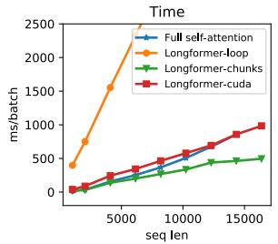
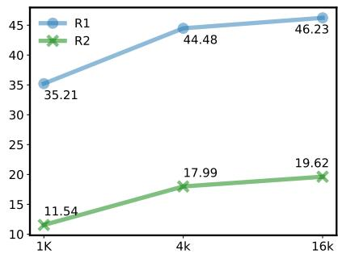

# Longformer：长文档 Transformer

## 摘要

基于 Transformer（自注意力） 的模型无法处理长序列，这是因为其自注意力操作的计算量随序列长度呈二次方增长。为解决这一局限，我们提出了 Longformer（长文档 Transformer），其注意力机制随序列长度呈线性扩展，因而能够轻松处理包含数千甚至更多 token（词元） 的文档。Longformer 的注意力机制是标准自注意力的直接替代品（drop-in replacement），它将局部窗口注意力（local windowed attention）与由任务驱动的全局注意力（global attention）相结合。沿袭先前在长序列 Transformer 上的工作，我们在字符级语言建模上评估了 Longformer，并在 text8 与 enwik8 上取得了当前最优结果。与多数先前工作不同，我们还对 Longformer 进行了预训练（pretrain），并在多种下游任务上进行了微调（finetune）。我们的预训练 Longformer 在长文档任务上持续优于 RoBERTa，并在 WikiHop 与 TriviaQA 上刷新了当前最优结果。最后，我们提出了 Longformer-Encoder-Decoder（LED），即 Longformer 的一种变体，用于支持长文档生成式的序列到序列（seq2seq）任务，并在 arXiv 摘要数据集（arXiv summarization dataset）上验证了其效果。<sup>1</sup>

## 1 引言

Transformer（Vaswani et al., 2017）在多种自然语言任务上取得了当前最优结果，包括生成式语言建模（Dai et al., 2019; Radford et al., 2019）以及判别式语言理解（Devlin et al., 2019）。这一成功部分得益于自注意力组件，它使网络能够捕获来自整个序列的上下文信息。虽然功能强大，但自注意力对内存和计算资源的需求随序列长度呈二次方增长，这使得处理长序列变得不可行（或代价高昂）。



  

图 1：完整自注意力（full self-attention）与 Longformer 自注意力的不同实现方式在运行时间和显存占用上的对比；Longformer-loop 是非向量化的，Longformer-chunk 是向量化的，Longformer-cuda 则是基于自定义 CUDA 内核的实现。Longformer 的显存占用随序列长度呈线性增长，这与完整自注意力机制不同——后者在当前 GPU 上处理长序列时会耗尽显存。不同实现之间的速度存在差异，其中向量化的 Longformer-chunk 是最快的。更多细节见第 3.2 节。

为了解决这一局限，我们提出 Longformer——一种改进的 Transformer 架构，其自注意力操作的计算复杂度随序列长度线性增长，从而能够灵活处理长文档（图 1）。这一特性对长文档分类、问答（QA）和指代消解等自然语言任务具有优势，因为现有方法通常将长上下文切分或截断为较短的序列，以适配 BERT 类预训练模型典型的 512 token 长度限制。这种切分可能导致跨段重要信息的丢失，为缓解该问题，现有方法往往依赖复杂的架构来建模段间交互。相比之下，我们提出的 Longformer 能够通过多层注意力构建整段上下文的上下文表示，从而减少对任务特定架构的需求。

近期已有工作致力于解决 Transformer 在长序列上的计算效率问题（见表 1）。然而，这些工作主要聚焦于自回归语言建模（LM），而长文档 Transformer 在迁移学习（Dai and Le, 2015；Peters et al., 2018；Howard and Ruder, 2018；Devlin et al., 2019）设定下应用于文档级 NLP 任务的研究仍基本处于空白。我们填补了这一空白，并证明 Longformer 的注意力机制可作为预训练 Transformer 中自注意力机制的即插即用替代方案，在一系列文档 NLP 任务上均带来性能提升。

Longformer 的注意力机制结合了窗口化的局部上下文自注意力与由任务驱动的全局注意力，后者编码了关于任务的归纳偏置。通过消融实验与受控对比实验，我们证明这两种注意力都不可或缺——局部注意力主要用于构建上下文表示，而全局注意力使 Longformer 能够构建用于预测的完整序列表示。

我们首先在自回归字符级语言建模任务上评估 Longformer，采用窗口化与一种新的扩张注意力（dilated attention）模式的组合，使模型能够在现代 GPU 上处理长达 32K 字符的序列。我们在 text8 和 enwik8 基准数据集上取得了最先进的结果，证明了 Longformer 在长文档建模中的有效性。

随后，为了评估 Longformer 替换现有预训练模型完整自注意力操作的能力，我们以遮蔽语言建模（MLM）目标对其进行预训练，并在 RoBERTa（Liu et al., 2019）发布的检查点基础上继续训练。预训练完成后，我们通过微调将其应用于下游语言任务，结果表明 Longformer 在文本分类、QA 和指代消解等一系列文档级自然语言任务上始终优于 RoBERTa，并在其中两个数据集上达到了最先进的结果。

我们最后引入 Longformer 的一个变体，它不再使用仅编码器（encoder-only）的 Transformer 架构，而是采用与原始 Transformer 模型（Vaswani et al., 2017）相似的编码器-解码器（encoder-decoder）架构，旨在用于序列到序列（seq2seq）学习（Sutskever et al., 2014）。我们将该模型称为 Longformer-Encoder-Decoder（LED），它使用

<table><tr><td>Model</td><td colspan="2">attention char-LM matrix</td><td>other tasks</td><td>pretrain</td></tr><tr><td>Transformer-XL (2019)</td><td>ltr</td><td>yes</td><td>no</td><td>no</td></tr><tr><td>Adaptive Span (2019)</td><td>ltr</td><td>yes</td><td>no</td><td>no</td></tr><tr><td>Compressive (2020)</td><td>ltr</td><td>yes</td><td>no</td><td>no</td></tr><tr><td>Reformer (2020)</td><td>sparse</td><td>yes</td><td>no</td><td>no</td></tr><tr><td>Sparse (2019)</td><td>sparse</td><td>yes</td><td>no</td><td>no</td></tr><tr><td>Routing (2020)</td><td>sparse</td><td>yes</td><td>no</td><td>no</td></tr><tr><td>BP-Transformer (2019)</td><td>sparse</td><td>yes</td><td>MT</td><td>no</td></tr><tr><td>Blockwise (2019)</td><td>sparse</td><td>no</td><td>QA</td><td>yes</td></tr><tr><td>Our Longformer</td><td>sparse</td><td>yes</td><td>multiple</td><td>yes</td></tr></table>

Table 1: 面向长文档的 Transformer 改进工作综述。ltr：left-to-right（左到右）。

Longformer 的高效注意力模式应用于编码器网络，使其能够处理长文档 seq2seq 任务，例如摘要生成。我们在 arXiv 摘要数据集（Cohan 等，2018）上验证了 LED 的有效性。

## 2 相关工作

长文档 Transformer 表 1 综述了近期关于长文档的研究工作。目前已探索了两类自注意力方法。第一种是 left-to-right（ltr，左到右）方法，它按从左到右的方向以块（chunk）方式处理文档。尽管这类模型在自回归语言建模中取得了成功，但它们不适用于需要双向上下文的任务的迁移学习。

我们的工作属于另一种总体思路，即定义某种形式的稀疏注意力模式，避免计算完整的二次复杂度注意力矩阵乘法。与我们注意力模式最相似的模型是 Sparse Transformer（Child 等，2019），它使用由 BlockSparse（Gray 等，2017）提供的块大小为 8x8 的扩张滑动窗口。我们的实现（第 3 节）也包含一个自定义 CUDA 内核，但它比用 C++ 实现并针对特定 TensorFlow 版本设计的 BlockSparse 更具灵活性且更易于维护。我们还引入了额外的、由任务驱动的全局注意力模式，适用于常见的 NLP 任务（第 3 节），并证明它们对于迁移学习场景下的良好性能至关重要。

少数模型尝试了自回归语言建模以外的任务，这是一大进步，因为可以认为将语言建模作为主要评估指标导致了模型适用性受限的问题。BP-Transformer（Ye 等，2019）在机器

  

（a）完全 n² 注意力

  

(b) 滑动窗口注意力（Sliding window attention）

  

（c）膨胀滑动窗口（Dilated sliding Window）

  

(d) 全局+滑动窗口

图 2：完整自注意力模式与 Longformer 中注意力模式配置的比较。

translation（机器翻译，MT），但未探索预训练-微调设置。Blockwise attention（Qiu 等人，2019）对其模型进行了预训练，并在问答（QA）任务上进行了评估。然而，该评估存在局限性，因为它不包括语言建模，而且所采用的问答数据集文档相对较短，<sup>2</sup>因此该模型在长文档任务上的有效性仍有待探索。

面向长文档的任务特定模型 已有许多任务特定的方法被开发出来，以绕过 BERT 等预训练 Transformer 模型的 512 长度限制。最简单的方法是直接截断文档，这在分类任务中很常用（Xie 等人，2019）。另一种方法将文档切分为长度为 512 的块（块之间可以重叠），分别处理每个块，然后使用任务特定模型合并激活值（Joshi 等人，2019）。第三种方法在多跳和开放域问答任务中较为流行，它采用两阶段模型：第一阶段检索相关文档，第二阶段从这些文档中抽取答案（Clark 和 Gardner，2017；Chen 等人，2017）。所有这些方法都因截断造成信息损失，或因两阶段方法产生级联错误。相比之下，Longformer 能够在不截断或分块的情况下处理长序列，使我们能够采用一种更简单的方法，将可用上下文拼接起来，在单次前向传播中完成处理。

一些同期工作<sup>3</sup>也探索了与 Longformer 类似的想法，即在 Transformer 中使用局部+全局注意力，并针对长文档自然语言任务进行预训练。其中，ETC（Ainslie 等人，2020）采用类似的局部+全局注意力替代完整自注意力，将 Transformer 扩展到长文档。与 Longformer 不同的是，ETC 使用相对位置嵌入（我们仅在自回归语言模型设置中使用了相对位置嵌入），并引入了额外的训练目标（CPC 损失）用于预训练，且其全局注意力的配置方式也略有不同。ETC 在阅读理解和分类等多个任务上展示了强劲的结果。GMAT（Gupta 和 Berant，2020）采用了类似思路，使用输入中少数全局位置作为全局记忆。BigBird（Zaheer 等人，2020）是 ETC 的扩展，在更多任务上进行了评估，包括摘要生成。重要的是，通过理论分析，BigBird 证明了稀疏 Transformer 是序列函数的通用逼近器，并保留了完整自注意力的相关性质。

## 3 Longformer

原版 Transformer 模型中的自注意力组件的时间与显存复杂度均为 $O ( n ^ { 2 } )$，其中 $n$ 为输入序列长度。为应对这一挑战，我们依据一种「注意力模式（attention pattern）」来稀疏化完整的自注意力矩阵，该模式指定了彼此之间进行注意力计算的输入位置对。与全自注意力不同，我们所提出的注意力模式随输入序列长度线性扩展，因此对较长序列具备良好的效率。本节讨论该注意力模式的设计与实现。

## 3.1 注意力模式（Attention Pattern）

**滑动窗口（Sliding Window）** 鉴于局部上下文的重要性（Kovaleva 等人，2019），我们的注意力模式采用围绕每个 token 的固定大小窗口注意力。通过堆叠多层此类窗口注意力，可以得到较大的感受野：顶层能够访问所有输入位置，并具备构建整合整个输入信息的表征的能力，这与 CNN 类似（Wu 等人，2019）。给定固定窗口大小 $w$，每个 token 关注其两侧各 ${ \scriptstyle { \frac { 1 } { 2 } } } w$ 个 token（图 2b）。该模式的计算复杂度为 $O ( n \times w )$，随输入序列长度 $n$ 线性扩展。在具有 $\ell$ 层的 Transformer 中，顶层的感受野大小为 $\ell \times w$（假设所有层的 $w$ 均固定）。根据具体应用，可以为每一层使用不同的 $w$ 值，以在效率与模型表征能力之间取得平衡（§4.1）。

**空洞滑动窗口（Dilated Sliding Window）** 为了在不增加计算量的前提下进一步扩大感受野，可以对滑动窗口进行「空洞化（dilated）」处理。这与空洞 CNN（van den Oord 等人，2016）类似，其中窗口带有大小为空洞率 $d$ 的间隔（图 2c）。假设所有层的 $d$ 和 $w$ 均固定，则感受野为 $\ell \times d \times w$，即便 $d$ 取值很小，该感受野也可达到数万个 token。在多头注意力中，每个注意力头计算不同的注意力分数。我们发现，对每个头采用不同空洞配置的设置能够提升性能：一些头不采用空洞，专注于局部上下文；另一些头采用空洞，专注于更长范围的上下文。

**全局注意力（Global Attention）** 在用于自然语言任务的、最先进的 BERT 类模型中，最优输入表征不同于语言模型，并且因任务而异。对于掩码语言建模（MLM），模型利用局部上下文来预测被掩码的词；而对于分类任务，模型将整个序列的表征聚合到一个特殊 token 中（在 BERT 中为 [CLS]）。对于问答（QA）任务，问题和文档会被拼接在一起，从而使模型能够通过自注意力比较问题与文档。

在我们的案例中，窗口化和膨胀化的注意力机制不够灵活，无法学习任务特定的表示。因此，我们在少数预先选定的输入位置添加"全局注意力"。重要的是，我们将这种注意力操作设计为对称的：也就是说，具有全局注意力的 token 会关注序列中的所有 token，而序列中的所有 token 也会关注它。图 2d 展示了一个在自定义位置的少数 token 上添加全局注意力的滑动窗口注意力示例。例如在分类任务中，全局注意力用于 [CLS] token，而在问答（QA）任务中，全局注意力应用于所有问题 token。由于此类 token 的数量相对于 n 而言较少且独立，因此局部与全局注意力组合的复杂度仍为 $O ( n )$。虽然指定全局注意力是任务特定的，但它是一种向模型注意力添加归纳偏置（inductive bias）的简便方式，并且比现有那些使用复杂架构跨较小输入块组合信息的任务特定方法要简单得多。

全局注意力的线性投影 回顾一下，给定线性投影 Q、K、V，Transformer 模型（Vaswani 等人，2017）按如下方式计算注意力分数：

$$
\operatorname{Attention} (Q, K, V) = \operatorname{softmax} \left(\frac {Q K ^ {T}}{\sqrt {d _ {k}}}\right) V\tag{1}
$$

我们使用两组投影 $Q _ { s } , K _ { s } , V _ { s }$ 来计算滑动窗口注意力（sliding window attention）的注意力分数，使用 $Q _ { g } , K _ { g } , V _ { g }$ 来计算全局注意力（global attention）的注意力分数。这些额外的投影为建模不同类型的注意力提供了灵活性，我们证明这对于下游任务的最佳性能至关重要。$Q _ { g } , K _ { g } , V _ { g }$ 全部使用与 $Q _ { s } , K _ { s } , V _ { s }$ 匹配的值进行初始化。

## 3.2 实现（Implementation）

在常规 Transformer 中，注意力分数按公式 1 计算。其中开销最大的运算是矩阵乘法 $Q \bar { K } ^ { T }$，因为 Q 和 K 都具有 n（序列长度）个投影。对于 Longformer，扩张滑动窗口注意力仅计算 $Q K ^ { \hat { T } }$ 中固定数量的对角线元素。如图 1 所示，相比于完整自注意力的二次方增长，这带来了内存使用量的线性增长。然而，实现该方案需要一种带状矩阵乘法（banded matrix multiplication），而现有的深度学习库（如 PyTorch/Tensorflow）并不直接支持该运算。图 1 比较了实现它的三种不同方式的性能：loop 是一种内存高效的 PyTorch 实现，支持扩张但速度慢到无法使用，仅用于测试；chunks 仅支持非扩张情形，用于预训练/微调设置；cuda 是我们使用 TVM（Chen 等，2018）实现的功能完备、高度优化的自定义 CUDA 内核，用于语言建模实验（更多细节见附录 A）。

## 4 自回归语言建模（Autoregressive Language Modeling）

自回归（autoregressive）或从左到右（left-to-right）的语言建模可以粗略地定义为：给定输入序列中已有 token/字符之前的 token/字符，估计该 token/字符的概率分布。该任务被认为是自然语言中的基础任务之一，并且近期关于使用 Transformer 建模长序列的研究都依赖于该任务作为其主要评估方法（Dai 等，2019；Rae 等，2020；Sukhbaatar 等，2019）。类似地，我们在自回归语言建模任务上开发并评估我们的模型。

## 4.1 注意力模式（Attention Pattern）

对于自回归语言建模任务，我们使用扩张滑动窗口注意力。遵循 Sukhbaatar 等（2019）的方法，我们在各层之间使用不同的窗口大小。具体而言，我们在较低层使用较小的窗口大小，并在向较高层移动时增大窗口大小。这使得最上层能够学习整个序列的更高层表示，同时让较低层捕获局部信息。此外，它还在效率（较小的窗口大小由于非零值更少而计算开销更低）和性能（较大的窗口大小具有更丰富的表示能力，且通常带来性能提升）之间提供了平衡。

在较低的层中我们不使用空洞滑动窗口（dilated sliding windows），以最大化其学习并利用紧邻局部上下文（local context）的能力。对于较高的层，我们仅在 2 个注意力头（head）上使用少量且递增的空洞率（dilation）。这使模型能够直接关注远处的标记（token），同时不牺牲对局部上下文的利用。

## 4.2 实验设置（Experiment Setup）

为便于与先前工作进行比较，我们聚焦于字符级语言模型（character-level LM），即 text8 与 enwik8 数据集（Mahoney, 2009）。

训练 在理想情况下，我们希望在单块现代 GPU 显存所能容纳的最大窗口大小（window size）和序列长度（sequence length）上训练模型。然而，我们发现模型需要大量的梯度更新（gradient update）来首先学会局部上下文，然后才能学会利用更长的上下文。为应对这一挑战，我们采用一种分阶段训练（staged training）流程，在多个训练阶段中逐步增大注意力窗口大小与序列长度。具体而言，在第一阶段，我们从一个较短的序列长度与窗口大小起步；随后在每一个后续阶段，将窗口大小与序列长度同时加倍，并将学习率（learning rate）减半。这使得训练在前阶段快速推进，而将较耗时的部分（最长的序列与最大的窗口大小）保留到训练末尾。我们在共计 5 个阶段上训练模型，起始序列长度为 2,048，最后一阶段的序列长度为 23,040（各阶段的详细配置及所有其他超参数详见附录 B）。

<table><tr><td>Model</td><td>#Param</td><td>Dev</td><td>Test</td></tr><tr><td colspan="4">Dataset text8</td></tr><tr><td>T12 (Al-Rfou et al., 2018)</td><td>44M</td><td>-</td><td>1.18</td></tr><tr><td>Adaptive (Sukhbaatar et al., 2019)</td><td>38M</td><td>1.05</td><td>1.11</td></tr><tr><td>BP-Transformer (Ye et al., 2019)</td><td>39M</td><td>-</td><td>1.11</td></tr><tr><td>Our Longformer</td><td>41M</td><td>1.04</td><td>1.10</td></tr><tr><td colspan="4">Dataset enwik8</td></tr><tr><td>T12 (Al-Rfou et al., 2018)</td><td>44M</td><td>-</td><td>1.11</td></tr><tr><td>Transformer-XL (Dai et al., 2019)</td><td>41M</td><td>-</td><td>1.06</td></tr><tr><td>Reformer (Kitaev et al., 2020)</td><td>-</td><td>-</td><td>1.05</td></tr><tr><td>Adaptive (Sukhbaatar et al., 2019)</td><td>39M</td><td>1.04</td><td>1.02</td></tr><tr><td>BP-Transformer (Ye et al., 2019)</td><td>38M</td><td>-</td><td>1.02</td></tr><tr><td>Our Longformer</td><td>41M</td><td>1.02</td><td>1.00</td></tr></table>

表 2：小型模型在 text8 与 enwik8 上的 BPC（Bits Per Character）

<table><tr><td>Model</td><td>#Param</td><td>Test BPC</td></tr><tr><td>Transformer-XL (18 layers)</td><td>88M</td><td>1.03</td></tr><tr><td>Sparse (Child et al., 2019)</td><td>≈100M</td><td>0.99</td></tr><tr><td>Transformer-XL (24 layers)</td><td>277M</td><td>0.99</td></tr><tr><td>Adaptive (Sukhbaatar et al., 2019)</td><td>209M</td><td>0.98</td></tr><tr><td>Compressive (Rae et al., 2020)</td><td>277M</td><td>0.97</td></tr><tr><td>Routing (Roy et al., 2020)</td><td>≈223M</td><td>0.99</td></tr><tr><td>Our Longformer</td><td>102M</td><td>0.99</td></tr></table>

表 3：大型模型在 enwik8 上的性能

**评估** 我们使用长度为 32,256 的序列进行评估。遵循 Dai et al. (2019) 的方法，我们将数据集划分为大小为 32,256、步长为 512 的重叠序列，并报告序列最后 512 个 token 上的性能。

## 4.2.1 结果

表 2 和表 3 汇总了在 text8 和 enwik8 数据集上的评估结果。我们使用小型模型分别在 text8 和 enwik8 上取得了 BPC 为 1.10 和 1.00 的新最优结果，证明了模型的有效性。

对于大型模型，鉴于这些实验成本高昂，且遵循近期工作（Kitaev et al., 2020; Rae et al., 2020），我们仅在 enwik8 上进行评估。表 3 显示 Longformer 优于可比的 Transformer-XL 模型，性能与可比的 Sparse Transformer（Child et al., 2019）相当，并与参数量超过其两倍的近期模型相当或略有不及。值得注意的是，Adaptive Span（Sukhbaatar et al., 2019）和 Compressive Transformer（Rae et al., 2020）并不适合 §2 中讨论的预训练-微调范式。

<table><tr><td>Model</td><td>Dev BPC</td></tr><tr><td>Decreasing w (from 512 to 32)</td><td>1.24</td></tr><tr><td>Fixed w (= 230)</td><td>1.23</td></tr><tr><td>Increasing w (from 32 to 512)</td><td>1.21</td></tr><tr><td>No Dilation</td><td>1.21</td></tr><tr><td>Dilation on 2 heads</td><td>1.20</td></tr></table>

表 4：上：跨层改变窗口大小。下：有无空洞（dilation）（在 phase1 上训练 150K 步时）

## 4.2.2 消融研究

为了展示我们注意力模式设计选择的重要性，我们尝试了不同的变体并报告其受控实验结果。为了使消融研究更易管理，我们在 text8 上使用 phase 1 配置对一个小模型训练每种配置 150K 步<sup>4</sup>，然后报告在开发集上的 BPC 性能。

表 4 的上半部分展示了逐层配置窗口大小的不同方式的影响。我们观察到，从底层到顶层增加窗口大小会带来最佳性能；以相反方式排列窗口大小则导致更差的性能；使用固定的窗口大小（其他配置窗口大小的平均值）得到的性能介于两者之间。表 4 的下半部分展示了加入空洞的影响。与完全没有空洞相比，给两个头加入一定的空洞会带来一些性能提升。

## 5 预训练与微调

当前许多自然语言处理（Natural Language Processing, NLP）任务的最优系统会对一个预训练模型进行任务监督下的微调（例如 BERT）。我们的主要动机之一就是开发一个适用于长文档任务的此类模型。为此，我们在文档语料库上对 Longformer 进行预训练，然后将其微调以用于六个任务，包括分类、问答（QA）和指代消解（coreference resolution）。得到的模型可以处理长达 4,096 个 token 的序列（比 BERT 长 8 倍）<sup>5</sup>。

我们使用掩码语言建模（masked language modeling, MLM）对 Longformer 进行预训练，其目标是恢复序列中随机被掩码的 token。由于 MLM 预训练开销很大，我们从 RoBERTa（Liu et al., 2019）发布的检查点继续预训练，只做支持 Longformer 注意力机制所需的最少改动。需要注意的是，我们的注意力模式可以插入到任何预训练的 Transformer 模型中，无需改变模型架构。

<table><tr><td>Model</td><td>base</td><td>large</td></tr><tr><td>RoBERTa (seqlen: 512)</td><td>1.846</td><td>1.496</td></tr><tr><td>Longformer (seqlen: 4,096)</td><td>10.299</td><td>8.738</td></tr><tr><td>+ copy position embeddings</td><td>1.957</td><td>1.597</td></tr><tr><td>+ 2K gradient updates</td><td>1.753</td><td>1.414</td></tr><tr><td>+ 65K gradient updates</td><td>1.705</td><td>1.358</td></tr><tr><td>Longformer (train extra pos. embed. only)</td><td>1.850</td><td>1.504</td></tr></table>

表 5：RoBERTa 与各种预训练 Longformer 配置的 MLM BPC。

**注意力模式（Attention Pattern）** 我们使用窗口大小为 512 的滑动窗口注意力（sliding window attention），因此计算量与 RoBERTa 相同。<sup>6</sup>

**位置嵌入（Position Embeddings）** RoBERTa 使用学习到的绝对位置嵌入，最大位置为 512。为了支持更长的文档，我们添加额外的位置嵌入以支持最大位置 4,096。为了利用 RoBERTa 的预训练权重，我们不随机初始化新的位置嵌入，而是通过多次复制 RoBERTa 的 512 个位置嵌入来进行初始化，因为对 BERT 注意力头的分析表明其学到了强烈的局部上下文注意力偏向，包括前一个或后一个词元（Clark et al., 2019）。使用复制初始化可在除分块边界外的所有位置保持这种局部结构。尽管该方法很简单，但我们发现它非常有效（见表 5），使得 Longformer 预训练能够以少量梯度更新快速收敛。

**继续 MLM 预训练（Continued MLM Pretraining）** 我们使用 fairseq（Ott et al., 2019）在我们整理的长文档语料库上对 Longformer 进行预训练（语料库详细信息见附录 C）。我们训练两种模型规模：基座模型（base model）和大型模型（large model）。两个模型均训练 65K 步梯度更新，序列长度 4,096，批大小 64（2<sup>18</sup> 个词元），最大学习率 3e-5，先线性预热 500 步，然后采用 3 次幂多项式衰减。其余超参数与 RoBERTa 相同。

表 5 显示了在我们训练语料库开发集上的 BPC。第一行显示为 1.846

<table><tr><td>Wordpieces</td><td>WH</td><td>TQA</td><td>HQA</td><td>ON</td><td>IMDB</td><td>HY</td></tr><tr><td>avg.</td><td>1,535</td><td>6,589</td><td>1,316</td><td>506</td><td>300</td><td>705</td></tr><tr><td>95th pctl.</td><td>3,627</td><td>17,126</td><td>1,889</td><td>1,147</td><td>705</td><td>1,975</td></tr></table>

表 6：数据集上下文长度（以 wordpieces 为单位）的平均值与第 95 百分位数。WH: WikiHop, TQA: TriviaQA, HQA: HotpotQA, ON: OntoNotes, HY: Hyperpartisan news

使用 RoBERTa-base 得到的 BPC，与 RoBERTa 论文中在其语料上报告的 1.880 BPC 相当。这表明我们的训练语料与训练 RoBERTa 所使用的语料来自相近的分布。接下来的两行展示了 Longformer 在预训练之前的性能，分别为采用随机初始化的位置嵌入与采用复制的位置嵌入。两者之间的显著差异表明了复制初始化的重要性，而 RoBERTa 的 BPC 与初始化后 BPC 之间相对较小的差异，则表明我们的滑动窗口注意力与 RoBERTa 权重能够很好地配合工作。接下来的两行展示了继续预训练的影响。训练 2K 步可将 BPC 从 1.957 降至 1.753，再训练至 65K 步后进一步降至 1.705，表明模型正在学习更好地利用滑动窗口注意力和更长的上下文。在 RoBERTa-large 和 Longformer-large 上也观察到了类似的模式。

**冻结 RoBERTa 权重** 我们还在冻结所有 RoBERTa 权重、仅训练新位置嵌入的情况下对 Longformer 进行了预训练。该设置的动机在于完美保留 RoBERTa 在短文档上的性能。该设置的 BPC 为 1.850（从初始化时的 1.957 下降），但仍高于所有权重都可训练时的 1.705。

## 6 任务

我们将 Longformer 应用于多个长文档任务，包括问答、共指消解与分类。表 6 显示评估数据集的上下文长度显著超过 512 个 wordpieces。我们的主要目标是评估我们的注意力机制能否作为 BERT 风格模型中标准自注意力机制的替代方案，并针对强基线进行受控实验。我们也关注能否用简单的模型（即将所有可用上下文拼接为单个序列）来替代那些由于 BERT 有限上下文而不得不采用的复杂任务特定模型。

我们的基线是一个基于 RoBERTa 的模型，它将上下文切分为尽可能长的片段，分别通过 RoBERTa 处理每个片段，然后拼接激活值以进行进一步处理。对于问答任务，我们还将问题拼接到每个片段中，以便 RoBERTa 在生成上下文的上下文表示时能以问题为条件。Longformer 变体将 RoBERTa 的自注意力机制替换为预训练中使用的窗口化注意力，外加任务驱动的全局注意力。全局注意力使用额外的线性投影（§3.1）。

## 6.1 问答

我们使用了三个数据集：WikiHop（Welbl 等人，2018）、TriviaQA（Joshi 等人，2017，Wikipedia setting）和 HotpotQA,（Yang 等人，2018，distractor setting）。<sup>7</sup>

对于 WikiHop 和 TriviaQA，我们沿用 BERT（Devlin et al., 2019）的简单问答模型，将问题和文档拼接成一个长序列，输入 Longformer，再采用数据集特定的预测层。WikiHop 对候选答案使用分类层，TriviaQA 则采用 Clark and Gardner (2017) 的损失函数来预测答案片段。我们在 WikiHop 上对问题标记（token）和候选答案引入全局注意力，在 TriviaQA 上对问题标记引入全局注意力。

HotpotQA 是一个多跳问答数据集，需要从 10 个维基百科段落中提取答案片段和证据句子，其中 2 个段落相关，其余为干扰项。我们采用两阶段模型，先选择最相关的段落，再送入第二阶段进行答案抽取。两个阶段都将问题和上下文拼接为一个序列，输入 Longformer，再使用任务特定的预测层。我们以多任务方式联合训练模型，同时预测相关段落、证据句子、答案片段和问题类型（是/否/片段）。需要指出的是，本模型比近期引入复杂任务特定架构的最先进模型更为简洁（例如 (Tu et al., 2019; Chen et al., 2019; Tu et al., 2020; Groeneveld et al., 2020)）。关于模型和超参数的更多细节见附录 D。

## 6.2 指代消解（Coreference Resolution）

我们使用 OntoNotes（Pradhan et al., 2012），并采用 Joshi 等人（2019）的模型——该模型是对 Lee 等人（2018）系统的改造，将 ELMo 替换为 BERT。Longformer 系统则是通过对基线模型进行直接改造得到，将 RoBERTa 替换为 Longformer，并扩展序列长度。在该任务上我们未使用全局注意力。

<table><tr><td rowspan="2">Model</td><td colspan="3">QA</td><td>Coref.</td><td colspan="2">Classification</td></tr><tr><td>WikiHop</td><td>TriviaQA</td><td>HotpotQA</td><td>OntoNotes</td><td>IMDB</td><td>Hyperpartisan</td></tr><tr><td>RoBERTa-base</td><td>72.4</td><td>74.3</td><td>63.5</td><td>78.4</td><td>95.3</td><td>87.4</td></tr><tr><td>Longformer-base</td><td>75.0</td><td>75.2</td><td>64.4</td><td>78.6</td><td>95.7</td><td>94.8</td></tr></table>

表 7：问答、共指消解和文档分类微调结果汇总。结果在开发集上比较了我们的 Longformer-base 与 RoBERTa-base。TriviaQA、Hyperpartisan 的指标为 F1，WikiHop 和 IMDB 使用准确率，HotpotQA 为联合 F1，OntoNotes 为平均 F1。

## 6.3 文档分类

我们在 IMDB（Maas 等人，2011）和 Hyperpartisan 新闻检测（Kiesel 等人，2019）数据集上进行评估。<sup>8</sup> IMDB 是一个由影评组成的标准情感分类数据集。虽然该数据集中的大多数文档都很短，但其中约 13.6% 的文档超过 512 个 wordpiece（表 6）。Hyperpartisan 中的文档相对较长，且该数据集规模很小，仅有 645 篇文档，是检验 Longformer 适应有限数据能力的一个良好测试。我们在 [CLS] token 上使用全局注意力。

## 6.4 结果

主要结果 表 7 汇总了我们所有微调实验的结果。我们观察到 Longformer 在所有任务上都一致地优于 RoBERTa 基线。在 WikiHop 和 Hyperpartisan 等需要长上下文的任务上，其性能提升尤为显著。对于 TriviaQA，由于局部上下文通常就足以回答问题，性能提升较为有限。在 HotpotQA 任务中，支持事实的辅助监督使模型能够轻松找到相关上下文，从而将注意力集中在局部上下文上，因此带来的增益较小。这与 WikiHop 形成对比：WikiHop 仅包含对中间推理链的远程监督，而我们的方法通过在整个上下文上进行推理而表现优异。在 IMDB 和 OntoNotes 数据集上，性能提升较小。对于 IMDB，由于该数据集主要由短文档组成，因此性能提升较小是符合预期的。对于 OntoNotes，我们发现任意两个指代之间的距离通常都非常小，因此分别处理较小文本块的基线方法能够将指代拼接成共指链，而无需考虑跨文本块的交互。

<table><tr><td>Model</td><td>WikiHop</td><td>TriviaQA</td><td>HotpotQA</td></tr><tr><td>Current* SOTA</td><td>78.3</td><td>73.3</td><td>74.2</td></tr><tr><td>Longformer-large</td><td>81.9</td><td>77.3</td><td>73.2</td></tr></table>

表 8：提交时（2020 年 5 月）Longformer-large 的排行榜结果。所有数字均为 F1 分数。

Longformer-large 在问答任务上的表现 我们还评估了 Longformer-large 在长文本问答任务上的表现。表 8 显示，我们的 Longformer-large 在 WikiHop 和 TriviaQA 上以大幅领先的优势（分别为 3.6 和 4 分）取得了新的最先进结果<sup>9</sup>；而在 HotpotQA 上，其表现略逊于当前最先进水平（Fang et al., 2020），相差 1 分。表 9 显示了 HotpotQA 与已发表和未发表的同期模型相比的详细结果。Longformer 在已发表的排行榜上位列第二，超越了除 HGN（Fang et al., 2020）之外的所有其他已发表结果。该任务中所有已发表的顶尖模型（Tu et al., 2019; Fang et al., 2020; Shao et al., 2020）都使用了 GNN（Kipf and Welling, 2017）或实体图网络，这似乎编码了该任务的一个重要归纳偏置，并有可能进一步提升我们的结果。尽管如此，Longformer 仍表现强劲，超越了所有其他方法，包括最近的非 GNN 方法（Glaß et al., 2019; Shao et al., 2020; Groeneveld et al., 2020）。

<table><tr><td>Model</td><td>ans.</td><td>supp.</td><td>joint</td></tr><tr><td>TAP 2 (ensemble) (Glaß et al., 2019)</td><td>79.8</td><td>86.7</td><td>70.7</td></tr><tr><td>SAE (Tu et al., 2019)</td><td>79.6</td><td>86.7</td><td>71.4</td></tr><tr><td>Quark (dev) (Groeneveld et al., 2020)</td><td>81.2</td><td>87.0</td><td>72.3</td></tr><tr><td>C2F Reader (Shao et al., 2020)</td><td>81.2</td><td>87.6</td><td>72.8</td></tr><tr><td>Longformer-large</td><td>81.3</td><td>88.3</td><td>73.2</td></tr><tr><td>ETC-large $^{\dagger}$  (Ainslie et al., 2020)</td><td>81.2</td><td>89.1</td><td>73.6</td></tr><tr><td>GSAN-large $^{\dagger}$ </td><td>81.6</td><td>88.7</td><td>73.9</td></tr><tr><td>HGN-large (Fang et al., 2020)</td><td>82.2</td><td>88.5</td><td>74.2</td></tr></table>

表 9：HotpotQA 在干扰项设置测试集上的结果。Quark 的测试结果不可用。所有数字均为 F1 分数。<sup>†</sup> 表示同期排行榜提交结果。

<table><tr><td>Model</td><td>Accuracy / Δ</td></tr><tr><td>Longformer (seqlen: 4,096)</td><td>73.8</td></tr><tr><td>RoBERTa-base (seqlen: 512)</td><td>72.4 / -1.4</td></tr><tr><td>Longformer (seqlen: 4,096, 15 epochs)</td><td>75.0 / +1.2</td></tr><tr><td>Longformer (seqlen: 512, attention:  $n^{2}$ )</td><td>71.7 / -2.1</td></tr><tr><td>Longformer (seqlen: 2,048)</td><td>73.1 / -0.7</td></tr><tr><td>Longformer (no MLM pretraining)</td><td>73.2 / -0.6</td></tr><tr><td>Longformer (no linear proj.)</td><td>72.2 / -1.6</td></tr><tr><td>Longformer (no linear proj. no global atten.)</td><td>65.5 / -8.3</td></tr><tr><td>Longformer (pretrain extra position embed. only)</td><td>73.5 / -0.3</td></tr></table>

Table 10: WikiHop 开发集消融实验

## 6.5 WikiHop 上的消融实验

Tab. 10 展示了在 WikiHop 开发集上的消融实验结果。除非另有说明，所有结果均使用 Longformer-base，经过五轮微调，使用相同的超参数。Longformer 受益于更长的序列长度、全局注意力、为全局注意力设置的独立投影矩阵、掩码语言模型（MLM）预训练以及更充分的训练。此外，当按照 RoBERTa-base 的配置（序列长度：512，以及 $n ^ { 2 }$ 注意力）进行设置时，Longformer 的表现略逊于 RoBERTa-base，这证实了性能提升并非源于额外的预训练。当使用仅解冻额外位置嵌入的方式预训练的 RoBERTa 模型时，性能略有下降，表明 Longformer 能够在像 WikiHop 这样的大规模训练数据集上进行任务特定的微调，从而学会利用长距离上下文信息。

## 7 Longformer 编码器-解码器（LED）

原始的 Transformer（Vaswani et al., 2017）由编码器-解码器架构组成，面向序列到序列（Sutskever et al., 2014）任务设计，例如摘要生成和翻译。尽管纯编码器 Transformer 在多种自然语言处理任务上表现高效，但预训练的编码器-解码器 Transformer 模型（例如 BART（Lewis et al., 2020）和 T5（Raffel et al., 2020））在摘要生成等任务上取得了优异的结果。然而，这类模型无法高效地扩展到具有较长输入的 seq2seq 任务。

为便于在 seq2seq 学习中对长序列进行建模，我们提出了一种 Longformer 变体，它同时包含编码器和解码器两个 Transformer 堆栈，但在编码器中不使用完整的自注意力机制，而是采用 Longformer 高效的局部+全局注意力模式。解码器对所有已编码的标记以及先前已解码的位置使用完整的自注意力机制。我们将这一模型称为 Longformer 编码器-解码器（Longformer-Encoder-Decoder, LED），其计算量随输入长度线性扩展。由于预训练 LED 的成本高昂，我们使用 BART 的参数来初始化 LED，并在层数和隐藏维度等方面严格遵循 BART 的架构。唯一的区别在于，为了处理更长的输入，我们将位置嵌入扩展到 16K 个标记（BART 原始为 1K 个标记），并按第 5 节中针对 RoBERTa 所述的方法，将 BART 的 1K 位置嵌入重复复制 16 次以初始化新的位置嵌入矩阵。沿用 BART 的做法，我们发布了两个规模的模型，即 LED-base 和 LED-large，其编码器和解码器堆栈分别包含 6 层和 12 层。

我们在摘要任务上评估 LED，使用 arXiv 摘要数据集（Cohan 等，2018），该数据集专注于科学领域的长文档摘要。文档长度的第 90 百分位为 14.5K 个 token，使其成为评估 LED 的合适测试平台。LED 的编码器读取文档，其解码器生成输出摘要。编码器使用窗口大小为 1,024 个 token 的局部注意力，以及对第一个 <s> token 的全局注意力。解码器对整个编码器以及先前已解码位置使用完全注意力。作为 seq2seq 模型中的标准做法，LED 使用教师强制在真实训练摘要上进行训练，并在推理时使用束搜索。

表 11 展示了 LED-large 16K 在 arXiv 摘要任务上的结果。该模型仅从 BART 初始化，没有进行额外的预训练。我们观察到 LED 在 arXiv 上取得了最先进的结果，略优于 BigBird（Zaheer 等，2020）。值得注意的是，BigBird 摘要模型支持 4K token 的序列长度，但它从 Pegasus（Zhang 等，2020）开始并继续进行预训练，而 Pegasus 是一个专门为摘要设计并进行预训练的模型。在没有预训练或任务特定初始化的情况下，仅凭借处理更长输入的能力，LED 就能略微超过 BigBird。通过对 LED 进行预训练，进一步的提升应该是可能的。图 3 进一步说明了序列长度的重要性，表明处理更长输入的能力显著改善了结果。

<table><tr><td></td><td>R-1</td><td>R-2</td><td>R-L</td></tr><tr><td>Discourse-aware (2018)</td><td>35.80</td><td>11.05</td><td>31.80</td></tr><tr><td>Extr-Abst-TLM (2020)</td><td>41.62</td><td>14.69</td><td>38.03</td></tr><tr><td>Dancer (2020)</td><td>42.70</td><td>16.54</td><td>38.44</td></tr><tr><td>Pegasus (2020)</td><td>44.21</td><td>16.95</td><td>38.83</td></tr><tr><td>LED-large (seqlen: 4,096) (ours)</td><td>44.40</td><td>17.94</td><td>39.76</td></tr><tr><td>BigBird (seqlen: 4,096) (2020)</td><td>46.63</td><td>19.02</td><td>41.77</td></tr><tr><td>LED-large (seqlen: 16,384) (ours)</td><td>46.63</td><td>19.62</td><td>41.83</td></tr></table>

表 11：Longformer-Encoder-Decoder（LED）在 arXiv 数据集上的摘要生成结果。从左到右的指标分别为 ROUGE-1、ROUGE-2 和 ROUGE-L。

  

图3：LED 在不同输入大小下的 ROUGE-1 和 ROUGE-2（arXiv 验证集）。

## 8 结论与未来工作

我们提出了 Longformer，这是一个基于 Transformer 的模型，可扩展用于处理长文档，并且能够方便地执行广泛的文档级 NLP 任务，无需对长输入进行分块（chunking）/截断，也无需复杂架构来跨分块组合信息。Longformer 采用一种结合局部与全局信息的注意力模式，同时随序列长度呈线性扩展。Longformer 在字符级语言建模任务 text8 和 enwik8 上取得了当时最优的结果（state-of-the-art）。经过预训练后，Longformer 在长文档任务上始终优于 RoBERTa，并在 WikiHop 和 TriviaQA 上刷新了当时的最优结果。我们进一步提出了 LED，它是 Longformer 的编码器—解码器变体，用于建模序列到序列任务，并在 arXiv 长文档摘要任务上取得了当时最优的结果。未来的工作方面，我们希望研究其他预训练目标（特别是针对 LED 的）、增大序列长度，并探索其他可能受益于我们模型的任务。

## 致谢

我们感谢 Noah Smith、Dan Weld、Dirk Groeneveld、Kyle Lo、Daniel King 和 Doug Downey 的有益讨论和反馈，以及 AI2 基础设施团队的技术支持。

## 参考文献

Joshua Ainslie、Santiago Ontanon、Chris Alberti、Vaclav Cvicek、Zachary Fisher、Philip Pham、Anirudh Ravula、Sumit Sanghai、Qifan Wang 和 Li Yang。2020。ETC：在 Transformer 中编码长且结构化的输入。载于：Proceedings of the 2020 Conference on Empirical Methods in Natural Language Processing (EMNLP)，第 268–284 页，在线会议。计算语言学协会（Association for Computational Linguistics）。

Rami Al-Rfou、Dokook Choe、Noah Constant、Mandy Guo 和 Llion Jones。2018。使用更深层自注意力进行字符级语言建模。载于：AAAI。

Danqi Chen、Adam Fisch、Jason Weston 和 Antoine Bordes。2017。阅读维基百科以回答开放领域问题。载于：ACL。

Jifan Chen、Shih-Ting Lin 和 Greg Durrett。2019。通过推理链进行多跳问答。arXiv 预印本，abs/1910.02610。

Tianqi Chen、Thierry Moreau、Ziheng Jiang、Lianmin Zheng、Eddie Yan、Haichen Shen、Meghan Cowan、Leyuan Wang、Yuwei Hu、Luis Ceze 等。2018。TVM：用于深度学习的自动化端到端优化编译器。载于：OSDI。

Tianqi Chen、Bing Xu、Chiyuan Zhang 和 Carlos Guestrin。2016。使用次线性内存开销训练深度网络。arXiv 预印本，abs/1604.06174。

Rewon Child、Scott Gray、Alec Radford 和 Ilya Sutskever。2019。使用稀疏 Transformer 生成长序列。arXiv 预印本，abs/1904.10509。

Christopher Clark 和 Matt Gardner。2017。简单有效的多段落阅读理解。载于：ACL。

Kevin Clark、Urvashi Khandelwal、Omer Levy 和 Christopher D. Manning。2019。BERT 关注什么？BERT 注意力分析。arXiv 预印本，abs/1906.04341。

Arman Cohan, Franck Dernoncourt, Doo Soon Kim, Trung Bui, Seokhwan Kim, Walter Chang, and Nazli Goharian. 2018. 长文档抽象摘要生成的篇章感知注意力模型. 载于 NAACL-HLT 2018.

Andrew M Dai and Quoc V Le. 2015. 半监督序列学习. 载于 NeurIPS.

Zihang Dai, Zhilin Yang, Yiming Yang, Jaime G. Carbonell, Quoc V Le, and Ruslan Salakhutdinov. 2019. Transformer-XL：超越固定长度上下文的注意力语言模型. 载于 ACL.

Jacob Devlin, Ming-Wei Chang, Kenton Lee, and Kristina Toutanova. 2019. BERT：用于语言理解的深度双向 Transformer 预训练. 载于 NAACL-HLT.

Yuwei Fang, Siqi Sun, Zhe Gan, Rohit Pillai, Shuohang Wang, and Jingjing Liu. 2020. 用于多跳问答的分层图网络. 载于 2020 年自然语言处理实证方法会议（EMNLP）论文集，第 8823–8838 页，在线会议. 计算语言学协会.

Adam Fisch, Alon Talmor, Robin Jia, Minjoon Seo, Eunsol Choi, and Danqi Chen. 2019. MRQA 2019 共享任务：阅读理解中的泛化能力评估. 载于 EMNLP 上的 MRQA 研讨会.

Alexios Gidiotis and Grigorios Tsoumakas. 2020. 一种用于学术文章摘要的分而治之方法. ArXiv，编号 abs/2004.06190.

Michael Glaß, Alfio Massimiliano Gliozzo, Rishav Chakravarti, Anthony Ferritto, Lin Pan, Gaudani Bhargav, Dinesh Garg, and Avirup Sil. 2019. 用于问答的片段选择预训练. arXiv 预印本，编号 abs/1909.04120.

Scott Gray, Alec Radford, and Diederik P. Kingma. 2017. 块稀疏权重的 GPU 核函数.

Dirk Groeneveld, Tushar Khot, Mausam, and Ashish Sabhwaral. 2020. 一个简单而强大的 HotpotQA 处理流水线. arXiv 预印本，编号 abs/2004.06753.

Ankit Gupta and Jonathan Berant. 2020. GMAT：用于 Transformer 的全局记忆增强. ArXiv，编号 abs/2006.03274.

Jeremy Howard and Sebastian Ruder. 2018. 用于文本分类的通用语言模型微调. 载于 ACL.

Mandar Joshi, Eunsol Choi, Daniel S. Weld, and Luke Zettlemoyer. 2017. TriviaQA：一个大规模远程监督的阅读理解挑战数据集. 载于 ACL.

Mandar Joshi, Omer Levy, Luke Zettlemoyer, and Daniel Weld. 2019. 用于指代消解的 BERT：基线与分析. 载于 EMNLP-IJCNLP.

Johannes Kiesel, Maria Mestre, Rishabh Shukla, Emmanuel Vincent, Payam Adineh, David Corney, Benno Stein, and Martin Potthast. 2019. SemEval-2019 任务 4：极端党派新闻检测. 载于 第 13 届国际语义评估研讨会论文集，第 829–839 页，美国明尼苏达州明尼阿波利斯. 计算语言学协会.

Thomas N Kipf and Max Welling. 2017. 基于图卷积网络的半监督分类. ICLR.

Nikita Kitaev, Lukasz Kaiser, and Anselm Levskaya. 2020. Reformer：高效的 Transformer. 载于 ICLR.

Olga V. Kovaleva, Alexey Romanov, Anna Rogers, and Anna Rumshisky. 2019. 揭示 BERT 的隐秘之处. 载于 EMNLP/IJCNLP.

Kenton Lee, Luheng He, and Luke Zettlemoyer. 2018. 从粗到精推理的高阶指代消解（Higher-order coreference resolution with coarse-to-fine inference）。载于：北美计算语言学协会（NAACL）。

Mike Lewis, Yinhan Liu, Naman Goyal, Marjan Ghazvininejad, Abdelrahman Mohamed, Omer Levy, Veselin Stoyanov, and Luke Zettlemoyer. 2020. BART：用于自然语言生成、翻译和理解的去噪序列到序列预训练（BART: Denoising sequence-to-sequence pretraining for natural language generation, translation, and comprehension）。载于：第 58 届计算语言学协会年度会议论文集，第 7871–7880 页，在线。计算语言学协会（Association for Computational Linguistics）。

Andrew L. Maas, Raymond E. Daly, Peter T. Pham, Dan Huang, Andrew Y. Ng, and Christopher Potts. 2011. 学习用于情感分析的词向量（Learning word vectors for sentiment analysis）。载于：第 49 届计算语言学协会年度会议：人类语言技术论文集，第 142–150 页，美国俄勒冈州波特兰。计算语言学协会（Association for Computational Linguistics）。

Matt Mahoney. 2009. 大文本压缩基准（Large text compression benchmark）。

Myle Ott, Sergey Edunov, Alexei Baevski, Angela Fan, Sam Gross, Nathan Ng, David Grangier, and Michael Auli. 2019. fairseq：一个快速、可扩展的序列建模工具包（fairseq: A fast, extensible toolkit for sequence modeling）。载于：NAACL-HLT 2019 会议展示论文集。

Matthew E. Peters, Mark Neumann, Mohit Iyyer, Matt Gardner, Christopher Clark, Kenton Lee, and Luke Zettlemoyer. 2018. 深度上下文词表示（Deep contextualized word representations）。载于：NAACL。

Sameer Pradhan, Alessandro Moschitti, Nianwen Xue, Olga Uryupina, and Yuchen Zhang. 2012. CoNLL-2012 共享任务：在 OntoNotes 中建模多语言无限制指代（CoNLL-2012 shared task: Modeling multilingual unrestricted coreference in OntoNotes）。载于：EMNLP 与 CoNLL 联合会议——共享任务，第 1–40 页，韩国济州岛。计算语言学协会（Association for Computational Linguistics）。

Jiezhong Qiu, Hao Ma, Omer Levy, Scott Yih, Sinong Wang, and Jie Tang. 2019. 用于长文档理解的块状自注意力（Blockwise self-attention for long document understanding）。arXiv 预印本，编号 abs/1911.02972。

Alec Radford, Jeffrey Wu, Rewon Child, David Luan, Dario Amodei, and Ilya Sutskever. 2019. 语言模型是无监督的多任务学习器（Language models are unsupervised multitask learners）。

Jack W. Rae, Anna Potapenko, Siddhant M. Jayakumar, and Timothy P. Lillicrap. 2020. 用于长程序列建模的压缩 Transformer（Compressive transformers for long-range sequence modelling）。载于：ICLR。

Colin Raffel, Noam Shazeer, Adam Roberts, Katherine Lee, Sharan Narang, Michael Matena, Yanqi Zhou, W. Li, and Peter J. Liu. 2020. 使用统一文本到文本 Transformer 探索迁移学习的极限（Exploring the limits of transfer learning with a unified text-to-text transformer）。机器学习研究杂志（J. Mach. Learn. Res.），第 21 卷，第 140:1–140:67 页。

Aurko Roy, Mohammad Saffar, Ashish Vaswani, and David Grangier. 2020. 使用路由 Transformer 实现高效的内容稀疏注意力（Efficient content-based sparse attention with routing transformers）。arXiv 预印本，编号 abs/2003.05997。

Nan Shao, Yiming Cui, Ting Liu, Shijin Wang, and Guoping Hu. 2020. 图结构对多跳推理是必需的吗？arXiv 预印本，abs/2004.03096.

Sandeep Subramanian, Raymond Li, Jonathan Pilault, and C. Pal. 2020. 基于 Transformer 语言模型的抽取式与生成式神经文档摘要。发表于 EMNLP。

Sainbayar Sukhbaatar, Edouard Grave, Piotr Bojanowski, and Armand Joulin. 2019. Transformer 中的自适应注意力跨度。发表于 ACL。

Ilya Sutskever, Oriol Vinyals, and Quoc V. Le. 2014. 基于神经网络的序列到序列学习。发表于 NIPS。

Trieu H. Trinh and Quoc V. Le. 2018. 一种简单的常识推理方法。arXiv 预印本，abs/1806.02847。

Ming Tu, Jinke Huang, Xiaodong He, and Bowen Zhou. 2020. 用于序列推理的图序列网络。发表于 NeurIPS 图表示学习研讨会。

Ming Tu, Kevin Huang, Guangtao Wang, Jing Huang, Xiaodong He, and Bufang Zhou. 2019. 选择、回答与解释：跨多文档的可解释多跳阅读理解。arXiv 预印本，abs/1911.00484。

Johannes Welbl, Pontus Stenetorp, and Sebastian Riedel. 2018. 构建跨文档多跳阅读理解数据集。TACL, 6:287–302.

Felix Wu, Angela Fan, Alexei Baevski, Yann Dauphin, and Michael Auli. 2019. 以轻量级和动态卷积减少注意力开销。arXiv 预印本，abs/1901.10430。

Qizhe Xie, Zihang Dai, Eduard H. Hovy, Minh-Thang Luong, and Quoc V. Le. 2019. 用于一致性训练的无监督数据增强。arXiv 预印本，abs/1904.12848。

Ruibin Xiong, Yunchang Yang, Di He, Kai Zheng, Shu xin Zheng, Chen Xing, Huishuai Zhang, Yanyan Lan, Li-Wei Wang, and Tie-Yan Liu. 2020. 关于 Transformer 架构中的层归一化。arXiv 预印本，abs/2002.04745。

Zhilin Yang, Peng Qi, Saizheng Zhang, Yoshua Bengio, William W. Cohen, Ruslan Salakhutdinov, and Christopher D. Manning. 2018. HotpotQA：用于多样化、可解释多跳问答的数据集。发表于 EMNLP。

Zihao Ye, Qipeng Guo, Quan Gan, Xipeng Qiu, and Zheng Zhang. 2019. BP-Transformer：通过二分划分建模长距离上下文。arXiv 预印本，abs/1911.04070。

Manzil Zaheer, Guru Guruganesh, Kumar Avinava Dubey, Joshua Ainslie, C. Alberti, S. Ontañón, Philip Pham, Anirudh Ravula, Qifan Wang, L. Yang, and A. Ahmed. 2020. Big Bird：用于更长序列的 Transformer。ArXiv, abs/2007.14062。

Rowan Zellers, Ari Holtzman, Hannah Rashkin, Yonatan Bisk, Ali Farhadi, Franziska Roesner, and Yejin Choi. 2019. 防御神经假新闻。发表于 NeurIPS。

Jingqing Zhang, Yao Zhao, Mohammad Saleh, and Peter J Liu. 2020. Pegasus：通过提取间隙句预训练生成式摘要。ICML。

Yukun Zhu, Ryan Kiros, Richard S. Zemel, Ruslan Salakhutdinov, Raquel Urtasun, Antonio Torralba, and Sanja Fidler. 2015. 对齐书籍与电影：通过观看电影和阅读书籍实现类故事的视觉解释（Aligning Books and Movies: Towards Story-like Visual Explanations by Watching Movies and Reading Books）. ICCV, 第 19–27 页.

## A 实现细节

实现 Longformer 的膨胀滑动窗口注意力需要一种带状矩阵乘法（banded matrix multiplication，即除某些对角线外输出全为零的矩阵乘法），而现有的深度学习库（如 PyTorch/Tensorflow）并未直接支持该操作。图 1 比较了实现该操作的三种不同方法的运行时间和内存占用。

Longformer-loop 是一种朴素实现，它在循环中分别计算每条对角线。由于只计算非零值，它的内存效率很高，但速度慢得无法使用。它易于实现，因此我们仅将其用于测试，而不用它来运行实验。

Longformer-chunks 仅支持非膨胀情况。它将 Q 和 K 切分为大小为 w、重叠大小为 <sup>1</sup><sub>2</sub> w 的块，然后对这些块做乘法运算，再将对角线部分掩码掉。由于使用了 PyTorch 的单一矩阵乘法运算，它的计算效率非常高，但由于会计算部分零值，其内存占用是理想优化实现的两倍。得益于较高的计算效率，该实现最适用于预训练/微调场景。在这种设定下，我们发现内存的增加并未带来问题。

Longformer-cuda 是我们使用 TVM（Tensor Virtual Machine，Chen et al., 2018）实现的自定义 CUDA 内核。它是我们注意力的完整功能实现（不像 Longformer-chunks 那样受限），具有最高的内存效率，且速度与高度优化的全自注意力相当。<sup>10</sup> 由于其内存效率（允许最长的序列）以及支持膨胀（字符级 LM 实验所需），我们主要在自回归语言建模实验中使用该实现。

Tensor Virtual Machine（TVM） 我们使用 TVM（Chen et al., 2018）构建自定义 CUDA 内核，TVM 是一个深度学习编译栈，能够将函数的高级描述编译为针对特定设备优化的代码。使用 TVM，我们可以使用高级 Python 结构来描述我们的带状矩阵乘法，然后 TVM 生成相应的 CUDA 代码并针对 GPU 进行编译。

## B 字符级 LM 超参数

我们在 text8 和 enwik8 上进行评测，两者均包含来自维基百科的 1 亿字符，并按 9000 万、500 万、500 万划分训练、验证和测试集。我们的模型仅规定了自注意力组件的工作方式，而对 Transformer 模型的其他设计选择保持不可知。我们的实现基于 Transformer-XL（Dai 等人，2019）的代码<sup>11</sup>，但禁用了记忆机制。我们使用相对位置嵌入，其权重为正弦形式，如 Dai 等人（2019）所述。我们采用了两种不同的模型规模：小型模型（12 层，隐藏维度 512）与 Dai 等人（2019）相同；大型模型（30 层，隐藏维度 512）与 Child 等人（2019）相同。我们采用混合精度训练（16 位与 32 位浮点数）并使用 apex<sup>12</sup> 以降低显存占用并加速训练。然而，我们保持注意力计算使用 fp32，以避免数值不稳定问题。<sup>13</sup> 我们使用梯度检查点（gradient checkpointing）（Chen 等人，2016）来降低显存占用，并在 48GB 的 RTX8000 GPU 上运行实验。所有超参数与各阶段设置列于表 12 中。我们的 CUDA 内核支持自回归模式，在该模式下每个词元仅关注其前一个窗口内的词元。我们的实现还包含一种与我们的空洞滑动窗口注意力相兼容的相对位置嵌入版本。

小型模型实验我们在 4 块 RTX8000 GPU 上运行了 16 天。大型模型实验我们在 8 块 RTX8000 GPU 上运行了 13 天。我们的大多数超参数搜索与表 4 中的消融实验类似，在 text8 上将每组配置运行 15 万步。我们尝试了绝对位置嵌入与可学习位置嵌入，dropout 值取 [0.1, 0.2]（小型模型）和 [0.1, 0.4]（大型模型），前置层归一化（prelayernorm）与后置层归一化（post-layernorm）（Xiong 等人，2020），第一阶段学习率 [2.5e-5, 5e-4, 1e-4] 的常数及余弦学习率调度，以及不同的空洞配置（所有头均使用空洞、2 个头使用空洞、不使用空洞）。表 12 中报告的每阶段梯度更新次数通过对每个阶段持续运行直至验证集 BPC 不再下降来确定。

## C 预训练数据

为了让模型在预训练中学习长距离依赖关系，我们整理了一个由长文档组成的语料库。其中部分数据来源也被包含在原始 RoBERTa 预训练中，包括 Books 语料库（Zhu 等人，2015）以及英文维基百科。我们额外加入了 Realnews 数据集（Zellers 等人，2019）中三分之一长度超过 1200 个词元的子样本，以及三分之一 Stories（Trinh 和 Le，2018）语料库。我们的目标是同时包含长文档与短文档，使模型既能学习更长距离的依赖，又不会遗忘原始 RoBERTa 预训练中获得的信息。预训练数据的统计信息如表 13 所示。

## D 任务特定模型细节

所有的 QA 和分类模型均使用 PyTorch-Lightning<sup>14</sup> 实现。除了 Hyperpartisan 新闻数据集被随机划分为 80/10/10 的训练/验证/测试集外，其他所有数据集均使用官方提供的训练/验证/测试划分。

WikiHop WikiHop 数据集中的每个实例包含：一个问题、若干答案候选（从两个到 79 个不等）、若干支撑上下文（从三段到 63 段不等）以及正确答案。该数据集没有为多跳推理链提供任何中间标注，要求模型必须从间接的答案监督中自行推断出这些推理链。

为了将数据输入 Longformer 和 RoBERTa，我们首先使用 RoBERTa 的 wordpiece 分词器对问题、答案候选和支撑上下文进行分词。然后使用特殊标记将问题和答案候选拼接为 [q] question [/q] [ent] candidate1 [/ent] ... [ent] candidateN [/ent]。上下文也使用 RoBERTa 的文档分隔标记进行拼接：</s> context1 </s> ... </s> contextM </s>。特殊标记 [q]、[/q]、[ent]、[/ent] 被加入 RoBERTa 的词表，并在任务微调之前进行随机初始化。

在准备好输入数据之后，我们从每个模型的顶层计算激活值，过程如下。我们将问题和答案候选与尽可能多的上下文拼接，直到达到模型的序列长度上限（RoBERTa 为 512，Longformer 为 4,096），将序列输入模型运行，收集输出激活值，然后重复此过程直到所有上下文都被处理完毕（Longformer-large 除外，由于显存限制，我们仅取首个长度为 4,096 的序列）。然后将所有分块的激活值拼接成一个长序列。对于 Longformer，我们对整个问题和答案候选序列使用全局注意力。

在预测阶段，我们在每个 [ent] 标记上附加一个线性层，输出单个 logit 值，对每个候选在所有分块上的 logit 取平均，应用 softmax 函数，并使用正确答案候选计算交叉熵损失。

训练过程使用 Adam 优化器，在前 200 次梯度更新中进行线性 warmup 直到最大学习率，剩余训练过程中线性衰减。我们使用梯度累积使有效批量大小达到 32 个实例，每 250 次梯度更新在验证集上检查一次准确率，并报告最高的验证准确率。其他超参数（dropout、weight decay）与 RoBERTa 预训练保持一致。

总体而言，我们运行了最少的超参数试验，但为了在 Longformer 和 RoBERTa 之间进行公平的比较，使用 Longformer-base 和 RoBERTa-base 进行了相同的超参数搜索。该搜索包括对学习率（LR）在 [2e-5, 3e-5, 5e-5] 区间内和训练轮数（epochs）在 [5, 10, 15] 区间内的网格搜索。表现最佳的 Longformer-base 配置采用了 lr=3e-5 和 15 个训练轮数。我们为 Longformer-large 运行了两组超参数试验，lr=3e-5，训练轮数为 [5, 15]（其中 5 轮模型在开发集上的准确率更高，为 77.6，并且是提交到公共排行榜进行测试集评估的单一模型）。所有模型均在单块 RTX8000 GPU 上进行训练，Longformer-base 训练 5 轮大约需要一天时间。

TriviaQA TriviaQA 拥有超过 100K 个用于训练的问题、答案、文档三元组。文档是维基百科文章，答案是在文章中提及的命名实体。回答问题的文本片段（span）并未被标注，而是通过简单的文本匹配来找到。

与 WikiHop 类似，我们使用 RoBERTa 的分词器对问题和文档进行分词，然后将输入构造为 [s] question [/s] document [/s] 的形式。我们将文档截断到 4,096 个 wordpiece，以避免运行速度过慢。之后，我们以与 WikiHop（上文讨论）类似的方式从 RoBERTa 和 Longformer 获取激活值。我们对所有问题 token 使用全局注意力（global attention）。

```csv
Param Value
Position Embeddings Relative and Sinusoidal as in Dai et al. (2019)
Small model config 12 layers, 8 heads, 512 hidden size as in Dai et al. (2019)
Large model config 30 layers, 8 heads, 512 hidden size as in Child et al. (2019)
Optimizer AdamW
Dropout 0.2 (small model), 0.4 (large model)
Gradient clipping 0.25
Weight Decay 0.01
Layernorm Location pre-layernorm (Xiong et al., 2020)
Activation GeLU
Number of phases 5
Phase 1 window sizes 32 (bottom layer) - 8,192 (top layer)
Phase 5 window sizes 512 (bottom layer) - (top layer)
Phase 1 sequence length 2,048
Phase 5 sequence length 23,040 (gpu memory limit)
Phase 1 LR 0.00025
Phase 5 LR 000015625
Batch size per phase 32, 32, 16, 16, 16
#Steps per phase (small) 430K, 50k, 50k, 35k, 5k
#Steps per phase (large) 350K, 25k, 10k, 5k, 5k
Warmup 10% of the phase steps with maximum 10K steps
LR scheduler constant throughout each phase
Dilation (small model) 0 (layers 0-5), 1 (layers 6-7), 2 (layers 8-9), 3 (layers 10-11)
Dilation (large model) 0 (layers 0-14), 1 (layers 15-19), 2 (layers 20-24), 3 (layers 25-29)
Dilation heads 2 heads only
```

表 12：用于字符级语言建模的表现最佳模型的超参数

<table><tr><td>Source</td><td>Tokens</td><td>Avg doc len</td></tr><tr><td>Books (Zhu et al., 2015)</td><td>0.5B</td><td>95.9K</td></tr><tr><td>English Wikipedia</td><td>2.1B</td><td>506</td></tr><tr><td>Realnews (Zellers et al., 2019)</td><td>1.8B</td><td>1.7K</td></tr><tr><td>Stories (Trinh and Le, 2018)</td><td>2.1B</td><td>7.8K</td></tr></table>

表 13：预训练数据

对于预测，我们添加一层来预测答案片段的起止位置。由于训练数据的远程监督特性（没有标准答案片段），我们采用了 Clark and Gardner（2017）提出的损失函数，其工作方式类似于「或」逻辑——模型只需正确预测出一个答案片段，而无需全部预测正确。

最佳配置的超参数列于表 14。其余超参数与 RoBERTa 的设置相似。在超参数搜索中，我们仅对 RoBERTa 基线模型调节了学习率（LR），尝试了 [3e-5, 5e-5, 1e-4] 三个取值，然后选取了最优值 3e-5，并将其应用于后续所有实验，未作进一步调参。我们使用最佳配置对 Longformer-large 模型训练了一次，并将输出提交至排行榜。实验在 32GB V100 GPU 上运行：小模型在 4 块 GPU 上训练耗时 1 天，大模型在 8 块 GPU 上训练耗时 1 天。

HotpotQA　HotpotQA 数据集要求模型从 10 篇不同 Wikipedia 文章中的 10 个段落里回答问题，其中 2 个段落与问题相关，其余为干扰项。该数据集包含两项任务：答案片段提取与证据句识别。我们用于 HotpotQA 的模型将答案片段提取与证据提取合并为一个联合模型。我们发现，采用结构相似的两阶段 Longformer 模型（先识别相关段落，再定位最终答案片段与证据）能够取得更高性能。<sup>15</sup>这主要是因为先去除干扰段落能够降低最终证据与片段检测环节的噪声，这在最近的该数据集最先进方法中也已被证明是重要的（Fang 等，2020）。与 Wikihop 和 TriviaQA 类似，为了将数据输入到 Longformer，我们将问题与全部 10 个段落拼接为一个长上下文。我们特别采用以下带特殊标记的输入格式："[CLS] [q] question [/q] hti title h/ti sent [s] sent [s] ...

"...hti title<sub>2</sub> h/ti sent<sub>2,1</sub> [s] sent<sub>2,2</sub> [s] ..."，其中 [q]、[/q]、hti、h/ti、[s]、[p] 是分别表示问题开始与结束、段落标题开始与结束以及句子的特殊标记。这些特殊标记被加入到 Longformer 词表中，并在任务微调之前进行随机初始化。对于 Longformer，我们对问题标记、段落标题起始标记以及句子标记使用全局注意力机制。模型在段落标题起始标记之上额外加入前馈层以预测相关段落；在句子标记之上也加入前馈层以预测证据句子。在训练完第一阶段模型后，我们对训练集和开发集预测相关段落得分。然后保留原始得分高于预设阈值（-3.0）的最多 5 个段落，并将其他段落从上下文中移除。接着我们在缩短后的上下文上训练第二阶段模型。对于答案片段抽取，我们使用 BERT 的问答模型（Devlin et al., 2019），并在首个特殊标记（[CLS]）之上增加一个问题类型（yes/no/span）分类头。对于证据抽取，我们在句子和段落标记对应的表示之上应用两层前馈网络以得到相应的证据预测得分，并使用二元交叉熵损失训练模型。在证据抽取的推理阶段，我们采用类似 Groeneveld 等人（2020）的受限解码策略，确保证据句子恰好来自两个段落，这也是本数据集的设定。我们将片段、问题分类、句子以及段落损失相加，通过损失的线性组合以多任务方式训练模型。实验在 RTX8000 GPU 上进行，每一轮在 4 块 GPU 上训练大约需要半天。我们使用 Adam 优化器结合线性预热（1000 步）与线性衰减训练模型。我们进行了极简的超参数搜索，学习率（LR）取 3e-5 和 5e-5，训练轮数取 3 到 7，最终发现学习率为 3e-5、训练 5 轮的模型效果最好。我们对 RoBERTa 基线也进行了同样的超参数搜索。其余超参数详见表 14。

指代模型细节 该指代模型是对 Joshi 等人（2019）基于 BERT 的由粗到细（coarse-to-fine）模型的一个直接改编。在使用 RoBERTa 的 wordpiece 分词器对每个文档进行预处理之后，它将每个文档切分为不重叠的片段（segment），每个片段长度不超过最大序列长度，然后拼接各片段的激活值，用于构成指代簇的由粗到细聚类阶段。对于 RoBERTa-base，最大序列长度设为 384，是在原始实现的默认超参数下，从 [256, 384, 512] 中进行三次试验后选定的。<sup>16</sup> 对于 Longformer-base，序列长度设为 4,096。与原始实现类似，预训练的 RoBERTa 参数与随机初始化的任务参数采用了不同的学习率。在任务参数上使用更大的学习率，能够让优化器将它们从随机初始化值调整得更远，同时不会破坏预训练 RoBERTa 参数中所蕴含的信息。

<table><tr><td>Param</td><td>WikiHop</td><td>TriviaQA</td><td>HotpotQA</td></tr><tr><td>Epochs</td><td>15</td><td>5</td><td>5</td></tr><tr><td>LR</td><td>3e-5</td><td>3e-5</td><td>5e-5</td></tr><tr><td>Warmup steps</td><td>200</td><td>1000</td><td>1000</td></tr><tr><td>Batch size</td><td>32</td><td>32</td><td>32</td></tr><tr><td>Optimizer</td><td>Adam</td><td>Adam</td><td>Adam</td></tr></table>

表 14：问答（QA）模型的超参数。所有模型均使用类似的调度器，包含线性预热（warmup）与衰减。

超参数搜索的工作量很小，为公平比较起见，对 RoBERTa 和 Longformer 均进行了网格搜索，搜索范围为 RoBERTa 学习率 ∈ [1e-5, 2e-5, 3e-5]，任务学习率 ∈ [1e-4, 2e-4, 3e-4]。Longformer-base 的最佳配置为 RoBERTa 学习率=1e-5，任务学习率=1e-4。其余超参数与原实现保持一致。在单块 GPU 上训练大约需要 10 小时。

我们的实现是一种"超级 hack"（superhack），涉及 PyTorch 与 Tensorflow 共享同一进程和 GPU。为避免在 PyTorch 中重写 Tensorflow 中复杂的由粗到精（coarse-to-fine）逻辑（该逻辑最初由 Lee 等人 (2018) 发布，使用了一个高度优化的自定义 GPU 内核），我们设计了一套系统：模型底部的 transformer 部分在 PyTorch 与 Tensorflow 之间来回传递激活值和梯度。输入张量首先在 PyTorch 中通过 transformer 运行，从顶层收集激活值，再从 GPU 传输到 CPU，然后从 CPU 转到 Tensorflow 并送回 GPU，以运行由粗到精聚类并计算损失。随后，梯度在 Tensorflow 中反向传播至 transformer 顶层，并将上述过程反向执行，把梯度传回 PyTorch，以便对模型其余部分进行反向传播。优化器分别维护，但采用相同的学习率调度进行参数更新。与运行该模型的整体开销相比，这种方式的额外开销很小。

文本分类

对于分类任务，我们遵循 BERT 的做法，在首个 [CLS] token 之上使用简单的二元交叉熵损失，并对 [CLS] 加入全局注意力。我们使用 Adam 优化器，batch 大小为 32，采用线性预热与衰减，预热步数等于总训练步数的 0.1。在 IMDB 和 Hyperpartisan news 数据集上，我们对学习率 [3e-5, 5e-5] 和 epoch 数 [10, 15, 20] 进行了网格搜索，发现学习率为 [3e-5]、训练 15 个 epoch 的模型效果最佳。实验在单块 RTX8000 GPU 上完成。