# 用 Performers 重新思考注意力机制

Krzysztof Choromanski∗1, Valerii Likhosherstov∗2, David Dohan∗1, Xingyou Song∗1 Andreea Gane∗1, Tamas Sarlos∗1, Peter Hawkins∗1, Jared Davis∗3, Afroz Mohiuddin1 Lukasz Kaiser1, David Belanger1, Lucy Colwell1,2, Adrian Weller2,4 1Google 2University of Cambridge 3DeepMind 4Alan Turing Institute

## 摘要

我们提出了 Performers，这是一种 Transformer 架构，能够以可证明的精度估计常规（softmax）全秩注意力 Transformer，但仅使用线性（而非二次）的空间和时间复杂度，且不依赖于稀疏性或低秩性等任何先验假设。为了近似 softmax 注意力核，Performers 使用了一种新颖的基于正交随机正特征的快速注意力方法（Fast Attention Via positive Orthogonal Random features, FAVOR+），该方法对于可扩展核方法可能具有独立的研究价值。FAVOR+ 还可以用于高效建模 softmax 之外的可核化注意力机制。这种表示能力对于首次在大规模任务（常规 Transformer 无法企及）上准确比较 softmax 与其他核，以及研究最优注意力核至关重要。Performers 是与常规 Transformer 完全兼容的线性架构，并具有强有力的理论保证：注意力矩阵的无偏或近乎无偏估计、一致收敛和低估计方差。我们在从像素预测到文本模型再到蛋白质序列建模的一系列丰富任务上对 Performers 进行了测试。结果表明，Performers 与其他被考察的高效稀疏和稠密注意力方法相比取得了有竞争力的结果，展示了 Performers 所利用的新颖注意力学习范式的有效性。

## 1 引言与相关工作

Transformer（Vaswani et al., 2017; Dehghani et al., 2019）是强大的神经网络架构，已在机器学习的多个领域达到了最先进水平，包括自然语言处理（Natural Language Processing, NLP）（例如语音识别（Luo et al., 2020））、神经机器翻译（Neural Machine Translation, NMT）（Chen et al., 2018）、文档生成/摘要、时序预测、生成建模（例如图像生成（Parmar et al., 2018））、音乐生成（Huang et al., 2019）以及生物信息学（Rives et al., 2019; Madani et al., 2020; Ingraham et al., 2019; Elnaggar et al., 2019; Du et al., 2020）。

Transformer 依赖于一种可训练的注意力机制，用于识别每个输入序列中各元素之间的复杂依赖关系。不幸的是，标准 Transformer 的计算复杂度随输入序列中 token 数量 $L$ 呈二次方增长，对于较大的 $L$ 而言代价过高，即便在 $L$ 取中等大小时，也使其无法在计算资源受限的场景中使用。针对这一问题已提出了若干解决方案（Beltagy 等, 2020; Gulati 等, 2020; Chan 等, 2020; Child 等, 2019; Bello 等, 2019）。大多数方法将注意力机制限制在局部邻域内（Parmar 等, 2018），或在注意力机制中引入结构性先验，例如稀疏性（Child 等, 2019）、基于池化的压缩（Rae 等, 2020）、聚类/分箱/卷积技术（例如（Roy 等, 2020）使用 k-means 聚类来学习动态稀疏注意力区域；又如（Kitaev 等, 2020）使用局部敏感哈希将具有相似 embedding 的 token 分组）、滑动窗口（Beltagy 等, 2020）或截断式目标（Chelba 等, 2020）。还有一条长期研究路线致力于使用稠密注意力矩阵，但用低秩核函数替代 softmax（Katharopoulos 等, 2020; Shen 等, 2018）。这些方法的关键在于，核函数须能被显式表示为有限维正特征向量的点积形式。

作为回应，我们提出了首批 Transformer 架构——Performers，它能够以可证明的准确性与实用性来估计常规（softmax）全秩注意力，但仅具有线性空间与时间复杂度，并且不依赖于稀疏性或低秩性等任何先验。Performers 使用基于正交随机特征的快速注意力（Fast Attention Via positive Orthogonal Random features, FAVOR+）机制，利用我们提出的近似 softmax 与高斯核的新方法。我们相信这些方法具有独立的意义，可为优化可扩展核方法的理论做出贡献。因此，Performers 成为首批与常规 Transformer 完全兼容（只需少量微调）的线性架构，并提供了强有力的理论保证：注意力矩阵的无偏或近似无偏估计、近似的一致收敛性以及更低的方差。

FAVOR+ 还可应用于高效建模 softmax 之外的其他可核化注意力机制。这种表示能力对于首次在超出常规 Transformer 处理能力的大型任务上准确比较 softmax 与其他核，以及为它们找到最优的注意力核至关重要。FAVOR+ 也可超越 Transformer 的范畴，作为常规注意力的一种更具可扩展性的替代方案，而常规注意力本身在计算机视觉（Fu et al., 2019）、强化学习（Zambaldi et al., 2019）、softmax 交叉熵损失训练乃至组合优化（Vinyals et al., 2015）等领域都有广泛的用途。

我们在从像素预测、文本模型到蛋白质序列建模等一系列丰富的任务上对 Performer 进行了测试。我们展示了与所考察的其他高效稀疏与稠密注意力方法相比具有竞争力的结果，体现了 Performers 所利用的新型注意力学习范式的有效性。我们强调，其本质上 Performers 在原则上还可以与其他技术结合使用，例如可逆层（Kitaev et al., 2020）或基于聚类的注意力（Roy et al., 2020）。

## 2 FAVOR+ 机制与正交随机特征

下面我们将详细描述 FAVOR+ 机制——Performer0s 架构的基石。我们提出了一种利用正交随机特征估计 softmax（以及高斯）核的新方法，FAVOR+ 利用该方法实现对常规（softmax）注意力的稳健且无偏估计，并展示 FAVOR+ 如何应用于其他注意力核。

## 2.1 预备知识——常规注意力机制

设 L 为输入 token 序列的长度。则常规点积注意力（Vaswani et al., 2017）是一种映射，它接受矩阵 $\mathbf { Q } , \mathbf { K } , \mathbf { V } \in \mathbb { R } ^ { L \times d }$ 作为输入，其中 d 是隐藏维度（潜在表示的维度）。矩阵 Q、K、V 是输入的中间表示，其行可分别解释为查询（query）、键（key）和值（value），对应于连续字典数据结构。双向（或非方向性（Devlin et al., 2018））的点积注意力具有如下形式，其中 $\mathbf { A } \in \mathbb { R } ^ { L \times L }$ 即所谓的注意力矩阵：

$$
\operatorname{Att} _ {\leftrightarrow} (\mathbf {Q}, \mathbf {K}, \mathbf {V}) = \mathbf {D} ^ {- 1} \mathbf {A V}, \quad \mathbf {A} = \exp (\mathbf {Q K} ^ {\top} / \sqrt {d}), \quad \mathbf {D} = \operatorname{diag} (\mathbf {A 1} _ {L}).\tag{1}
$$

这里 exp(·) 按元素方式应用，$\mathbf { 1 } _ { L }$ 是长度为 $L$ 的全一向量，diag(·) 是以输入向量为对角元素的对角矩阵。计算式 (1) 的时间和空间复杂度分别为 ${ \cal { O } } \bar { ( } L ^ { 2 } d )$ 和 $O ( L ^ { 2 } + L d )$，因为 A 必须被显式存储。因此，从原理上讲，类型 (1) 的点积注意力与长序列的端到端处理是不相容的。双向注意力应用于 Seq2Seq 架构中的编码器自注意力（encoder self-attention）和编码器-解码器注意力（encoder-decoder attention）。

另一类重要的注意力是单向点积注意力（unidirectional dot-product attention），其形式为：

$$
\operatorname{Att} _ {\rightarrow} (\mathbf {Q}, \mathbf {K}, \mathbf {V}) = \widetilde {\mathbf {D}} ^ {- 1} \widetilde {\mathbf {A}} \mathbf {V}, \quad \widetilde {\mathbf {A}} = \operatorname{tril} (\mathbf {A}), \quad \widetilde {\mathbf {D}} = \operatorname{diag} (\widetilde {\mathbf {A}} \mathbf {1} _ {L}),\tag{2}
$$

其中 tril(·) 返回参数矩阵的下三角部分（含对角线）。如 (Vaswani 等, 2017) 所讨论的，单向注意力用于自回归生成建模，$\mathrm{例如}$，作为生成 Transformer 中的自注意力以及 Seq2Seq Transformer 的解码器部分。

我们将证明，注意力矩阵 A 可以在 $O ( L d ^ { 2 } \log ( d ) )$ 时间内以任意精度近似。作为对比，利用局部敏感哈希（LSH）技术实现稀疏化的流行方法 (Kitaev 等, 2020) 具有 $O ( L d ^ { 2 } \log { \overline { { L } } } )$ 的时间复杂度。在论文主体部分中，我们将描述用于双向注意力的 FAVOR+。通过前缀和机制，可以为单向变体获得完全类似的结果（所有细节见附录 B.1）。

## 2.2 广义可核化注意力

FAVOR+ 适用于使用形如 $\mathbf { A } ( i , j ) = \mathrm { K } ( \mathbf { q } _ { i } ^ { \top } , \mathbf { k } _ { i } ^ { \top } )$ 的矩阵 $\mathbf { A } \in \mathbb { R } ^ { L \times L }$ 的注意力块，其中 $\mathbf { q } _ { i } / \mathbf { k } _ { j }$ 代表 $\mathbf { Q } / \mathbf { K }$ 中第 $i ^ { t h } / j ^ { t h }$ 个查询/键行向量，核函数 $\mathrm { K } : \mathbb { R } ^ { d } \times \mathbb { R } ^ { d }  \mathbb { R } _ { + }$ 1 由（通常是随机化的）映射 $\phi : \mathbb { R } ^ { d }  \mathbb { R } _ { + } ^ { r }$（对于某些 $r > 0$）定义为：

$$
\mathrm{K} (\mathbf {x}, \mathbf {y}) = \mathbb {E} [ \phi (\mathbf {x}) ^ {\top} \phi (\mathbf {y}) ].\tag{3}
$$

我们称 $\phi ( \mathbf { u } )$ 为 $\mathbf { u } \in \mathbb { R } ^ { d }$ 的随机特征映射（random feature map）。对于 $\mathbf { Q } ^ { \prime } , \mathbf { K } ^ { \prime } \in \mathbb { R } ^ { L \times r }$，其行分别由 $\phi ( \mathbf { q } _ { i } ^ { \top } ) ^ { \top }$ 和 $\phi ( \mathbf { k } _ { i } ^ { \top } ) ^ { \top }$ 给出，由式 3 可直接导出如下形式的高效注意力机制：

$$
\widehat {\mathrm{Att} _ {\leftrightarrow}} (\mathbf {Q}, \mathbf {K}, \mathbf {V}) = \widehat {\mathbf {D}} ^ {- 1} (\mathbf {Q} ^ {\prime} ((\mathbf {K} ^ {\prime}) ^ {\top} \mathbf {V})), \qquad \widehat {\mathbf {D}} = \operatorname{diag} (\mathbf {Q} ^ {\prime} ((\mathbf {K} ^ {\prime}) ^ {\top} \mathbf {1} _ {L})).\tag{4}
$$

这里 $\widehat{\mathrm{Att}}$ 表示近似注意力，括号表示计算顺序。容易看出，这种机制的空间复杂度为 $O(Lr + Ld + rd)$，时间复杂度为 $O(Lrd)$，而常规注意力的空间复杂度为 $O(L^2 + Ld)$，时间复杂度为 $O(L^2 d)$（另见图 1）。

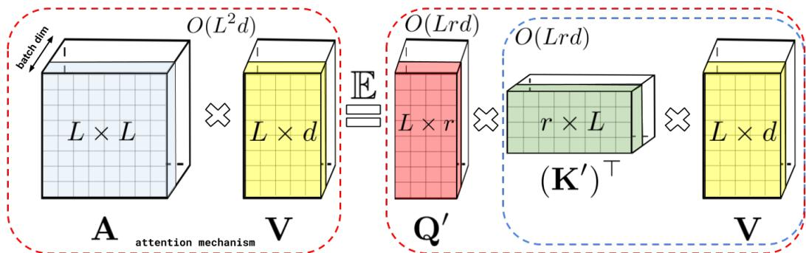  

图 1：通过（随机）特征映射近似常规注意力机制 AV（在 $\bar { \bf D } ^ { - 1 }$ 重归一化之前）。虚线框表示计算顺序，并附有相应的时间复杂度。

上述方案构成了 FAVOR+ 机制中的 FA 部分。剩余的 OR+ 部分回答以下问题：(1) 由公式 $^ { 3 , }$ 所定义的注意力模型的表达能力如何，特别是，我们原则上能否用其近似常规的 softmax 注意力？(2) 我们如何在实践中稳健地实现它，特别是，对于 $L \gg d$，我们能否选择 $r \ll L$ 以获得期望的时空复杂度增益？我们将在后续章节中回答这些问题。

## 2.3 如何以及如何不近似用于注意力的 SOFTMAX 核

结果表明，对于函数 $f _ { 1 } , . . . , f _ { l } : \mathbb { R } $ R、函数 $g : \mathbb { R } ^ { d } $ R 以及确定性向量 $\omega _ { i }$，或者对于分布 $\mathcal { D } \in \mathcal { P } ( \mathbb { R } ^ { d } )$ 的独立同分布向量 $\omega _ { 1 } , . . . , \omega _ { m } \stackrel { \mathrm { i i d } } { \sim } \mathcal { D }$，取如下形式的 $\phi$：

$$
\phi (\mathbf {x}) = \frac {h (\mathbf {x})}{\sqrt {m}} (f _ {1} (\omega_ {1} ^ {\top} \mathbf {x}),..., f _ {1} (\omega_ {m} ^ {\top} \mathbf {x}),..., f _ {l} (\omega_ {1} ^ {\top} \mathbf {x}),..., f _ {l} (\omega_ {m} ^ {\top} \mathbf {x})),\tag{5}
$$

我们可以建模实践中大多数常用的核函数。此外，在大多数情况下，𝒟 是各向同性的（即概率密度函数在球面上为常数），通常为高斯分布。例如，通过取 $h ( \mathbf { x } ) = 1 , l = 1$ 与 $\mathbf { \bar { \mathcal { D } } } = \mathcal { N } ( 0 , \mathbf { I } _ { d } )$，我们可以获得所谓 PNG-核（Choromanski et al., 2017）的估计器：（例如 $f _ { 1 } = \mathrm { s g n }$ 对应角度核）。配置：$h ( \mathbf { x } ) = 1 , l = 2 , f _ { 1 } = \sin , f _ { 2 } = \cos$ 对应平移不变核，特别地，$\mathscr { D } \equiv \mathcal { N } ( 0 , \mathbf { I } _ { d } )$ 给出高斯核 $\mathrm { K _ { g a u s s } }$（Rahimi & Recht, 2007）。定义常规注意力矩阵 A 的 softmax-核给出如下：

$$
\operatorname{SM} (\mathbf {x}, \mathbf {y}) \stackrel {{\text { def }}} {{=}} \exp (\mathbf {x} ^ {\top} \mathbf {y}).\tag{6}
$$

上述推导中，不失一般性，我们省略 d 维重归一化（d-renormalization），因为我们可以等价地对输入的键和查询进行重归一化。由于：$\begin{array} { r } { \mathrm { S M } ( \mathbf { x } , \mathbf { y } ) = \exp ( \frac { \| \mathbf { x } \| ^ { 2 } } { 2 } ) \mathrm { K } _ { \mathrm { g a u s s } } ( \mathbf { x } , \mathbf { y } ) \exp ( \frac { \| \mathbf { y } \| ^ { 2 } } { 2 } ) } \end{array}$ ，基于前面所述，我们可以使用三角函数得到对 $\operatorname { S M } ( { \mathbf { \bar { x } } } , \mathbf { y } )$ 的随机特征映射无偏近似，其中：$\begin{array} { r } { h ( \mathbf { x } ) = \exp ( \frac { \| \mathbf { x } \| ^ { 2 } } { 2 } ) , l = 2 , f _ { 1 } = \sin , f _ { 2 } = \cos } \end{array}$ 。我们将其记为 $\widehat { \mathrm { S M } } _ { m } ^ { \mathrm { t r i g } } ( \mathbf { x } , \mathbf { y } )$

然而这里存在一个注意事项。由 (1) 式定义的注意力模块为每个标记（token）构建一个关于值向量（value-vectors）的凸组合，其系数由相应的重归一化核得分给出。这就是为什么需要使用产生非负得分的核。对可能具有负维度值 $(\sin / \cos)$ 的随机特征映射的应用会导致不稳定的行为，特别是当核得分接近 0 时（对应于许多与低相关性标记相关的矩阵 A 元素就是如此），在这些区域被具有大方差的估计器所近似。这会导致异常行为，例如出现对角线值为负的重归一化因子 $\mathbf { D } ^ { - 1 }$，从而要么完全阻碍训练，要么导致次优模型。我们通过实验证明 $\widehat { \mathrm { S M } } _ { m } ^ { \mathrm { t r i g } }$ 确实会出现这种情况，并提供详细的理论解释，表明当被近似值趋向于 0 时，$\widehat { \mathrm { S M } } _ { m } ^ { \mathrm { t r i g } }$ 的方差较大（参见：第 3 节）。这正是为什么针对规则 softmax 注意力近似的鲁棒随机特征映射机制从未被提出的主要原因之一。

本文中我们提出了一种鲁棒机制。此外，我们新的无偏正随机特征映射估计器的方差在被近似值趋向于 0 时也趋向于 0（参见：第 3 节）。

引理 1（Softmax 的正随机特征（Positive Random Features, PRFs））。对于 $\mathbf { x } , \mathbf { y } \in \mathbb { R } ^ { d } , \mathbf { z } = \mathbf { x } + \mathbf { y }$，我们有：

$$
\operatorname{SM} (\mathbf {x}, \mathbf {y}) = \mathbb {E} _ {\omega \sim \mathcal {N} (0, \mathbf {I} _ {d})} \left[ \exp \left(\omega^ {\top} \mathbf {x} - \frac {\| \mathbf {x} \| ^ {2}}{2}\right) \exp \left(\omega^ {\top} \mathbf {y} - \frac {\| \mathbf {y} \| ^ {2}}{2}\right) \right] = \Lambda \mathbb {E} _ {\omega \sim \mathcal {N} (0, \mathbf {I} _ {d})} \cosh (\omega^ {\top} \mathbf {z}),\tag{7}
$$

其中 $\begin{array}{r} \Lambda = \exp(-\frac{\|\mathbf{x}\|^2 + \|\mathbf{y}\|^2}{2}) \end{array}$，cosh 表示双曲余弦。因此，softmax 核允许如下正随机特征映射的无偏近似：$h(\mathbf{x}) = \exp(-\frac{\|\mathbf{x}\|^2}{2})$，$l=1$，$f_1 = \exp$ 且 $\begin{array}{r} \mathcal{D} = \mathcal{N}(0, \mathbf{I}_d) \end{array}$；或：$h(\mathbf{x}) = \frac{1}{\sqrt{2}} \exp(-\frac{\|\mathbf{x}\|^2}{2})$，$l=2$，$f_1(u) = \exp(u)$，$f_2(u) = \exp(-u)$，并采用相同的 $\mathcal{D}$（后者用于进一步降低方差）。我们将相关的估计量分别记为 $\widehat{SM}_m^+$ 和 $\widehat{SM}_m^{hyp+}$，

  

图 2：左图：关于原点对称化（symmetrized around origin）的效用函数 $r$（定义为基于三角随机特征（trigonometric random features）和正随机特征（positive random features）所构建的估计量的均方误差（MSE）之比）随输入特征向量之间的夹角 $\phi$（以弧度为单位）及其长度 $l$ 的变化关系。较大的值对应着正随机特征（positive random features）表现更好的 $(\phi, l)$ 空间区域。我们可以看到，在 $\phi$ 足够大（即 softmax 核值足够小）的关键区域，本方法相较于三角随机特征（trigonometric random features）具有任意高的精度。绘图域为 $[-\pi, \pi] \times [-2, 2]$。右图：固定 $l = 1$、角度 $\phi$ 变化时函数 $r$ 的切片。右上角：两个估计量在 softmax 核值较小区域的 MSE 比较。

在图 2 中，我们可视化了正随机特征相对于标准三角随机特征的优势。在临界区域（即核值较小且需要仔细近似的区域），我们的方法优于其对应方法。在第 4 节中，我们使用正特征来高效训练基于 softmax 的线性 Transformer，进一步通过实验证实了我们方法的优势。将 $( 7 ) \omega$ 替换为 ${ \sqrt { d } } { \frac { \omega } { \| \omega \| } }$，我们就得到了所谓的正则化 softmax 核 SMREG，它可以以类似的方式进行近似，只需将 $\mathcal { D } = \mathcal { N } ( 0 , \mathbf { I } _ { d } ) \tan \mathcal { D } = \operatorname { U n i f } ( \sqrt { d } S ^ { d - 1 } )$，即对应于 ${ \sqrt { d } } \sin \mathbb { R } ^ { d }$ 球面上 Haar 测度的分布，从而得到估计量 $\widehat { \mathrm { S M R E G } _ { m } ^ { + } }$。正如我们在第 3 节中所展示的，这样的随机特征也可用于精确近似常规的 softmax 核。

## 2.4 正交随机特征（ORFS）

以上构成了 FAVOR+ 方法中的 R+ 部分。还需要解释 O 部分。为了进一步降低估计量的方差（从而可以使用更少数量的随机特征 r），我们将不同的随机样本 $\omega _ { 1 } , . . . , \omega _ { m }$ 纠缠在一起使之恰好正交。只要使用各向同性分布 D（即特别是我们目前考虑的所有核），就可以通过标准的 Gram-Schmidt 正交化过程来实现这一点，同时保持无偏性（详见 (Choromanski et al., 2017)）。ORF 是一种众所周知的方法，但事实证明它与我们为 softmax 引入的 PRF 配合得特别好。这带来了首批理论结果，表明 ORF 可应用于降低 softmax/高斯核估计量的方差，适用于任意维度 d，而不仅仅是对于足够大的 d 渐近有效（正如之前方法的情况，见下节），并且带来了首批关于大偏差概率的指数级小上界，这些上界严格小于非正交方法的上界。随机特征的正性在这些界中起着关键作用。ORF 机制要求 $m \leq d$，但在我们所有的实验中都是这种情况。整个 FAVOR+ 算法的伪代码见附录 B。

我们的理论结果与实验结果高度吻合。我们在第 4 节中展示了 PRF+ORF 大幅提高了注意力矩阵近似的准确性，并使得我们能够减小 r，从而产生了一种既准确又节省空间和时间的机制，我们称之为 FAVOR+。

## 3 理论结果

我们在此给出针对 softmax 核估计的正（值）正交随机特征理论。如前一节所述，通过重正化可以由其中一种核得到另一种核（见第 2.3 节），因此上述所有结论同样适用于高斯核。所有证明以及更具一般性的理论结果与相关讨论见附录。

引理 2（正（值）（双曲）随机特征与三角随机特征对比）。如下命题成立：

$$
\begin{array}{r l r} & & {\mathrm{MSE} (\widehat {\mathrm{SM}} _ {m} ^ {\mathrm{trig}} (\mathbf {x}, \mathbf {y})) = \frac {1}{2 m} \exp (\| \mathbf {x} + \mathbf {y} \| ^ {2}) \mathrm{SM} ^ {- 2} (\mathbf {x}, \mathbf {y}) (1 - \exp (- \| \mathbf {x} - \mathbf {y} \| ^ {2})) ^ {2},} \\ & & {\mathrm{MSE} (\widehat {\mathrm{SM}} _ {m} ^ {+} (\mathbf {x}, \mathbf {y})) = \frac {1}{m} \exp (\| \mathbf {x} + \mathbf {y} \| ^ {2}) \mathrm{SM} ^ {2} (\mathbf {x}, \mathbf {y}) (1 - \exp (- \| \mathbf {x} + \mathbf {y} \| ^ {2})),} \\ & & {\mathrm{MSE} (\widehat {\mathrm{SM}} _ {m} ^ {\mathrm{hyp+}} (\mathbf {x}, \mathbf {y})) = \frac {1}{2} (1 - \exp (- \| \mathbf {x} + \mathbf {y} \| ^ {2})) \mathrm{MSE} (\widehat {\mathrm{SM}} _ {m} ^ {+} (\mathbf {x}, \mathbf {y})),} \end{array}\tag{8}
$$

对于独立随机样本 $\omega _ { i }$，其中 MSE 代表均方误差。

因此，对于 $\operatorname { S M } ( \mathbf { x } , \mathbf { y } )  0$，我们有：$\mathrm { M S E } ( { \widehat { \mathrm { S M } } } _ { m } ^ { \mathrm { t r i g } } ( { \bf x } , { \bf y } ) ) \to \infty$ 而 $\mathrm { M S E } ( { \widehat { \mathrm { S M } } } _ { m } ^ { + } ( \mathbf { x } , \mathbf { y } ) ) \to 0$。此外，双曲估计器提供了额外的精度提升，严格优于使用两倍数量随机特征的 $\widehat { \mathrm { S M } } _ { 2 m } ^ { + } ( \mathbf { x } , \mathbf { y } )$。下一结果表明，正则化 softmax 核在实际中是注意力中 softmax 核的一个精确近似。

**定理 1（正则化与 softmax 核的对比）。** 假设 softmax 核的注意力矩阵的 $L _ { \infty }$ -范数满足：对于某个常数 $C \geq 1$，$\| \mathbf { A } \| _ { \infty } ~ \leq ~ C$。记 $\mathbf { A } ^ { \mathrm { r e g } }$ 为正则化 softmax 核对应的注意力矩阵。则以下结论成立：

$$
\inf _ {i, j} \frac {\mathbf {A} ^ {\text { reg }} (i , j)}{\mathbf {A} (i , j)} \geq 1 - \frac {2}{d ^ {\frac {1}{3}}} + o \left(\frac {1}{d ^ {\frac {1}{3}}}\right), a n d \sup _ {i, j} \frac {\mathbf {A} ^ {\text { reg }} (i , j)}{\mathbf {A} (i , j)} \leq 1.\tag{9}
$$

此外，后者在 $d \geq 2$ 时即使不满足 $L _ { \infty }$ 范数条件也成立，即正则化 softmax 核（regularized softmax-kernel）是 softmax 核（softmax-kernel）的一个通用下界。

因此，SMREG 的正随机特征可用于逼近 softmax 核。我们的下一个结果表明，正交性可证地在任意维度 d $> 0$ 下降低了使用正随机特征进行估计的均方误差，并显式地给出了差距。

定理 2. 若 $\widehat { \mathrm { S M } } _ { m } ^ { \mathrm { o r t + } } ( \mathbf { x } , \mathbf { y } )$ 表示使用正交随机特征对 $\widehat { \mathrm { S M } } _ { m } ^ { \mathrm { + } } (  { \mathbf { x } } ,  { \mathbf { y } } )$ 进行的修正（因此 $f o r m \leq d$），则对任意 d $> 0$ 以下结论成立。

$$
\operatorname{MSE} \left(\widehat {\mathrm{SM}} _ {m} ^ {\text {ort+}} (\mathbf {x}, \mathbf {y})\right) \leq \operatorname{MSE} \left(\widehat {\mathrm{SM}} _ {m} ^ {+} (\mathbf {x}, \mathbf {y})\right) - \frac {2 (m - 1)}{m (d + 2)} \left(\operatorname{SM} (\mathbf {x}, \mathbf {y}) - \exp \left(- \frac {\| \mathbf {x} \| ^ {2} + \| \mathbf {y} \| ^ {2}}{2}\right)\right) ^ {2}.\tag{10}
$$

此外，正则化 softmax 核 SMREG 也具有完全类似的结果。

对于正则化 softmax 核，正交特征提供了额外的集中性结果——这是首个对估计量尾部概率呈指数级小的界，对于所有 $d > 0$ ，其严格优于非正交变体。我们的下一个结果使我们能够显式地估计该差距。

定理 3. 设 $\mathbf { x } , \mathbf { y } \in \mathbb { R } ^ { d } .$。则对于任意 $a > \mathrm { S M R E G } ( \mathbf { x } , \mathbf { y } ) , \theta > 0$ 以及 m $\leq d \colon$，如下结论成立：

$$
\begin{array}{l} \mathbb {P} [ \widehat {\mathrm{SMREG}} _ {m} ^ {+} (\mathbf {x}, \mathbf {y}) > a ] \leq \exp (- \theta m a) M _ {Z} (\theta) ^ {m}, \quad \mathbb {P} [ \widehat {\mathrm{SMREG}} _ {m} ^ {\mathrm{ort+}} (\mathbf {x}, \mathbf {y}) > a ] \\ \leq \exp (- \theta m a) \bigg (M _ {Z} (\theta) ^ {m} - \exp \left(- \frac {m}{2} (\| \mathbf {x} \| ^ {2} + \| \mathbf {y} \| ^ {2})\right) \frac {\theta^ {4} m (m - 1)}{4 (d + 2)} \| \mathbf {x} + \mathbf {y} \| ^ {4} \bigg) \end{array}
$$

其中 $\widehat { \mathrm { S M R E G } } _ { m } ^ { \mathrm { o r t + } } ( \mathbf { x } , \mathbf { y } )$ 表示用 ORFs 对 $\widehat { \mathrm { S M R E G } } _ { m } ^ { + } ( \mathbf { x } , \mathbf { y } )$ 进行的修改，$X = \begin{array} { r } { \Lambda \exp ( \sqrt { d } \frac { \omega ^ { \top } } { \| \omega \| _ { 2 } } ( \mathbf x + \mathbf y ) ) , \omega \sim \mathcal { N } ( 0 , \mathbf { I } _ { d } ) } \end{array}$，其中 $\Lambda$ 与引理 1 中相同，$M _ { Z }$ 是 $Z$ 的矩母函数。

我们看到，ORFs 在 softmax 核较小的临界区域提供了指数级更小且更紧的界。下面我们证明，即使对于带 ORFs 的 $\mathrm { S M } ^ { \mathrm { t r i g } }$ 机制，也只需取 $m = \Theta ( d \log ( d ) )$ 个随机投影即可精确近似注意力矩阵（因此，若不进行注意力重归一化，则不需要 PRFs）。一般而言，$m$ 依赖于嵌入的维度 $d$、所有查询/键所在球的半径 $R$ 以及精度参数 $\varepsilon$（详见附录 F.6 的进一步讨论），但不依赖于输入序列长度 $L$。

**定理 4（注意力近似的均匀收敛）**。假设查询/键的 $L _ { 2 }$ 范数的上界为 $R > 0$。定义 $l = R d ^ { - { \frac { 1 } { 4 } } }$，并取 $\begin{array} { r } { h ^ { \ast } = \exp ( \frac { l ^ { 2 } } { 2 } ) } \end{array}$。则对任意 $\begin{array} { r } { \epsilon > 0 , \delta = \frac { \epsilon } { ( h ^ { * } ) ^ { 2 } } } \end{array}$ 以及随机投影数 $\begin{array} { r } { m = \Theta ( \frac { d } { \delta ^ { 2 } } \log ( \frac { 4 d ^ { \frac { 3 } { 4 } } R } { \delta } ) ) } \end{array}$，对于使用带 ORFs 的估计器 $\widehat { \mathrm { S M } } ^ { \mathrm { t r i g } }$ 的注意力近似机制，以任意常数概率成立 $\| \widehat { \mathbf { A } } - \mathbf { A } \| _ { \infty } \leq \epsilon$，其中 $\widehat{\mathbf{A}}$ 近似注意力矩阵 $\mathbf{A}$。

## 4 实验

我们在现有的 Jax (Frostig et al., 2018) Transformer 训练代码之上实现了我们的设置，并采用即时编译 (jax.jit) 优化；同时我们以经验证据补充我们的理论，以证明 FAVOR+ 在多种设置下的实用性。除非明确说明，Performer 仅将注意力组件替换为我们的方法，而所有其他组件与常规 Transformer 完全相同。为简化记号，我们将单向/因果建模记为 (U)，将双向/掩码语言建模记为 (B)。

在基线方面，我们使用其他 Transformer 模型进行比较，尽管其中一些仅限于单一场景——例如 Reformer（Kitaev 等人，2020）仅适用于（U），而 Linformer（Wang 等人，2020）仅适用于（B）。此外，我们使用 PG-19（Rae 等人，2020）作为另一种（B）预训练基准，因为它是专为长序列训练而设计的，相比之下，BERT（Devlin 等人，2018）和 Linformer 所使用的 BookCorpus（Zhu 等人，2015）+ Wikipedia 数据集目前已无法公开获取。所有模型和分词超参数见附录 A。

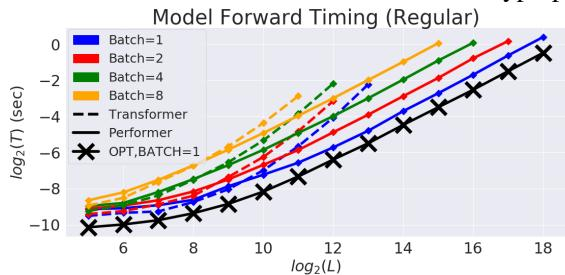

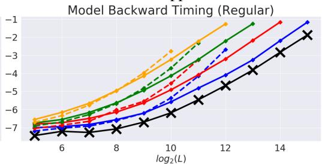  

图 3：Transformer 与 Performer 在前向与反向传播速度及所允许的最大 L 方面的比较。$" \mathrm { X } " \left( \mathrm { O P T } \right)$ 表示当注意力机制直接返回 V 矩阵时所能够达到的最大加速比。曲线绘制至模型在 16GB 显存的 V100 GPU 上出现显存不足错误为止。所使用的词表大小为 256。彩色显示效果最佳。

## 4.1 计算开销

我们从速度维度比较了 Transformer 与 Performer 在 (B) 设置下的反向传播过程，因为在常规默认尺寸 $( n _ { h e a d s } , n _ { l a y e r s } , d _ { f f } , d ) = ( 8 , 6 , 2 0 4 8 , 5 1 2 )$ 下，它是训练阶段最主要的计算瓶颈之一，其中 $d _ { f f }$ 表示 MLP 层的宽度。

我们观察到（图 3），就 L 而言，Performer 达到了近乎线性的时间复杂度与次二次方的内存消耗（因为显式的 $O ( L ^ { 2 } )$ 注意力矩阵并未被存储）。事实上，Performer 实现了所能达到的近乎最优的加速比与内存效率——当注意力被替换为简单地返回 V 矩阵的"恒等函数"时，便对应于 "X" 线所标示的理想上界。对较大的 L 而言，内存效率与反向传播效率的结合分别支持了大批量训练以及更低的每次梯度更新的墙上时钟时间。附录 E 中通过改变层数、原始注意力以及架构规模，展示了大量额外的实验结果。

## 4.2 SOFTMAX 注意力近似误差

我们在图 4 中进一步考察了经由 FAVOR+ 得到的近似误差。

我们证明了：1. 正交特征相比非结构化（IID）特征能够产生更低的误差；2. 正特征相比三角 sin/cos 特征能够产生更低的误差。这两点从经验上验证了 PORF 机制。

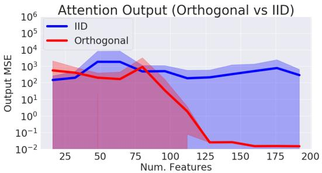

  

图 4：在比较正交（Orthogonal）特征与独立同分布（IID）特征，以及三角函数 sin/cos 特征与正（positive）特征时近似输出的均方误差（MSE）。我们取 $L = 4 0 9 6 , d = 1 6$，并改变随机样本数 m。标准差在 15 个经适当归一化的随机矩阵输入数据样本上计算得到。

为了进一步改善注意力块在多次迭代中的整体近似质量，从而进一步提升训练效果，应定期重新抽取随机样本（图 5，右）。这是一项开销很低的操作，但还可以进一步优化（附录 B.2）。

## 4.3 Transformer 上的 Softmax 近似

即使对注意力机制的近似已经相当紧密，小的误差仍可能轻易地在多个 Transformer 层（例如 MLP、多头）中扩散，如图 14（附录）所示。换言之，模型的 Lipschitz 常数很容易将较小的注意力近似误差放大，这意味着有时需要非常紧密的近似。

因此，在 Transformer 模型上应用 FAVOR(+) 的 softmax 近似（即"Performer-X-SOFTMAX"）时，我们证明：

1. 通过少量微调（由于误差传播所必需），即使是三角特征，也能在 LM1B 数据集（Chelba et al., 2014）上获得 softmax 近似所带来的后向兼容预训练模型的好处（图 5，左）。然而，在更大的 PG-19 数据集上，
2. 正向（POS）softmax 特征（配合重新抽样）对于实现与常规 Transformer 相当的性能变得至关重要（图 5，右）。

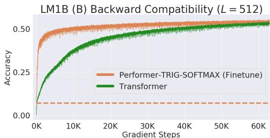

  

图 5：我们将原始预训练 Transformer 的权重迁移到 Performer 中，这产生了一个初始非零的 0.07 准确率（橙色虚线），但在原始梯度步数的一小部分内就迅速恢复了准确率。然而在 PG-19 上，三角函数（Trigonometric, TRIG）softmax 近似变得高度不稳定（完整曲线见附录 D.2），而正特征（Positive Features, POS）（不进行重绘）和 Linformer（同样对 softmax 进行近似）即使采用重绘投影，也停留在相同的困惑度上。需要使用带特征重绘的正 softmax 才能匹配 Transformer，SMREG（第 3 节中的正则化）则可加快收敛速度。针对多种注意力核的额外消融研究在附录 D.3 中给出，研究还表明三角函数随机特征甚至会导致训练中出现 NaN 值。

## 4.4 蛋白质的多层训练

我们进一步在 (U) 和 (B) 两种情形下对 Performer 进行基准测试，使用来自 2019 年 1 月发布的 TrEMBL（Consortium, 2019）的蛋白质序列训练一个 36 层模型，方法类似于 (Madani et al., 2020)。在图 6 中，Reformer 和 Linformer 在蛋白质数据集上的准确率出现显著下降。此外，Performer-RELU（在公式 5 中取 $f = \mathrm { R e L U }$）在 (U) 和 (B) 两种情形下均达到了最高准确率，这证明了广义注意力的有效性。我们所提出的 softmax 近似也被证明是紧致的，其准确率与采用精确 softmax 的 Transformer 相当，从而验证了我们在第 3 节中的理论主张。

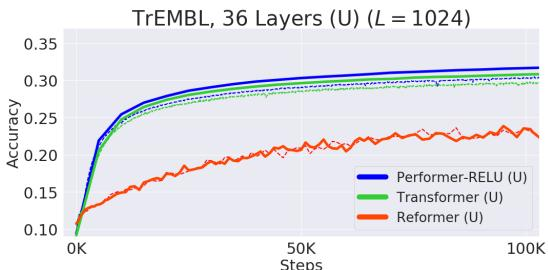

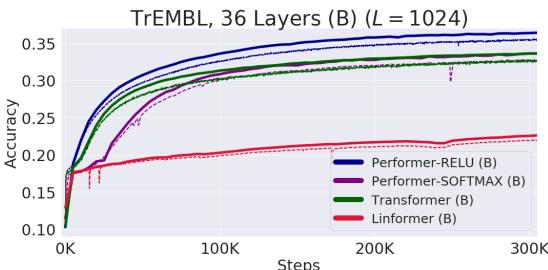  

图 6：训练 = 虚线，验证 = 实线。对于 TrEMBL，我们在所有运行中均采用了来自 (Madani et al., 2020) 的完全相同的模型参数 $( n _ { h e a d s } , n _ { l a y e r s } , d _ { f f } , d ) = ( 8 , 3 6 , 1 0 2 4 , 5 1 2 )$。为了公平起见，所有 TrEMBL 实验均使用了 16x16 TPU-v2。在给定计算约束的前提下，每个独立运行都尽可能使用了最大的批大小。超参数详见附录 A。包含数据集统计、分布外评估以及可视化在内的扩展结果可在附录 C 中找到。

## 4.5 大长度训练 - 通用数据集

在 (Parmar et al., 2018) 给出的标准 (U) ImageNet64 基准上，$L = 1 2 2 8 8$ 对于常规 Transformer 来说不可行，我们将所有模型设置为使用相同的 $( n _ { h e a d s } , d _ { f f } , d )$，但变化 $n _ { l a y e r s }$。Performer/6-layers 与 Reformer/12-layers 相匹配，而 Performer/12-layers 与 Reformer/24-layers 相匹配（图 7：左侧）。根据硬件（TPU 或 GPU）的不同，我们还发现 Performer 通过 Jax 优化在 (U) 设置下可以比 Reformer 快 2 倍。

作为原理验证研究，我们还创建了一个初步的蛋白质基准，通过连接 TrEMBL 中的蛋白质序列到长度 $L = 8 1 9 2$，用于预测蛋白质组之间的相互作用，该长度足以建模蛋白质相互作用网络而无需现有方法所需的大型序列比对（Cong et al., 2019）。在这种情况下，常规 Transformer 即使在每个芯片 batch size 为 1 时也会大幅超出内存限制。因此，作为基线，我们被迫使用显著更小的变体，将参数缩减为 $( n _ { h e a d s } , n _ { l a y e r s } , d _ { f f } , d ) = ( 8 , \{ 1 , 2 , 3 \} , 2 5 6 , 2 5 6 )$。同时，Performer 使用标准 (8, 6, 2048, 512) 架构在每个芯片 batch size 为 8 的情况下高效训练。我们从图 7（右子图）中可以看到，较小的 Transformer $( n _ { l a y e r } = 3 )$ 很快就被限制在 ≈ 19%，而 Performer 能够持续训练到 ≈ 24%。

  

图 7：训练 = 虚线，验证 = 实线。对于 ImageNet64，所有模型均使用了标准的 $( n _ { h e a d s } , d _ { f f } , d ) =$ (8, 2048, 512)。我们在附录 D.2 中进一步证明了我们的正 softmax 近似能够达到与 ReLU 相同的性能。对于拼接的 TrEMBL，我们对较小的 Transformer 变化了 $n _ { l a y e r s } \in \{ 1 , 2 , 3 \}$。超参数可在附录 A 中找到。

## 5 结论

我们提出了 Performer，一种新型 Transformer，依赖于我们提出的基于正交随机特征的快速注意力（Fast Attention Via positive Orthogonal Random features, FAVOR+）机制，显著改善了常规 Transformer 的空间和时间复杂度。据我们所知，我们的机制提供了对原始基于 softmax 的 Transformer 的首个有效无偏估计，并具有线性空间和时间复杂度，为 Transformer 研究及非稀疏化注意力机制的作用开辟了新方向。

## 6 更广泛的影响

我们相信所提出的算法能在多个方面产生重要影响：

生物学与医学：我们的方法有潜力直接影响生物序列分析研究，使 Transformer 能够应用于更长的序列，且不受注意力矩阵结构的限制。我们考虑的初步应用是预测蛋白质组规模下蛋白质之间的相互作用。最近发表的方法需要大规模的进化序列比对，这是其应用于哺乳动物基因组的瓶颈（Cong 等，2019）。将这些方法应用于生物序列的潜在广泛转化影响是本研究的主要动机之一。我们相信现代生物信息学能够极大地受益于新的机器学习技术，而 Transformer 是其中最有前景的技术之一。将这些方法扩展以训练更快、更精确的语言模型，为设计具有预设相互作用特性的分子集合打开了大门。这些方法可用于增强现有的基于物理学的设计策略，这些策略在例如新型纳米颗粒疫苗的开发中至关重要（Marcandalli 等，2019）。

环境：正如我们所展示的，使用 FAVOR+ 的 Performer 具有低得多的计算成本和显著降低的空间复杂度，这可以直接转化为 CO2 排放的减少（Strubell 等，2019）和更低的能耗（You 等，2020），因为常规 Transformer 需要非常大的计算资源。

Transformer 研究：我们相信我们的成果可以影响高效 Transformer 架构的研究方向，引导该领域走向具有坚实数学基础的方法。我们的研究也有望将 Transformer 扩展到其标准范围之外（例如通过考虑广义注意力机制及其与核方法的联系）。探索可处理 L 数量级为数千甚至更大的可扩展 Transformer 架构，同时保持基线精度，是生物信息学中新突破的入口，例如蛋白质语言建模，正如我们在本文中所解释的。我们提出的方法可能是迈出的第一步。

向后兼容性（Backward Compatibility）：我们的 Performer 可以叠加在常规的预训练 Transformer 之上使用，这与其他的 Transformer 变体不同。即便不进行向上训练（up-training），FAVOR+ 仍可被用于快速推理，且不损失精度。我们将这种向后兼容性视为所提出技术的一个非常重要的附加特性，对实践者而言可能尤其具有吸引力。

超越 Transformer 的注意力（Attention Beyond Transformers）：最后，FAVOR+ 还可以被用于近似精确的注意力机制，其应用范围并不局限于 Transformer。这开启了大量新的潜在应用，包括：分层注意力网络（HANS）（Yang et al., 2016）、图注意力网络（graph attention networks）（Velickovic et al., 2018）、图像处理（Fu et al., 2019）、以及强化学习/机器人学（reinforcement learning / robotics）（Tang et al., 2020）。

## 7 致谢

我们要感谢 Nikita Kitaev 和 Wojciech Gajewski 关于 Reformer 的多次讨论，也要感谢 Aurko Roy 和 Ashish Vaswani 关于 Routing Transformer 的多次讨论。我们进一步感谢 Joshua Meier、John Platt 和 Tom Weingarten 关于生物数据的有益讨论以及对本稿的宝贵意见。最后感谢 Yi Tay 和 Mostafa Dehghani 关于基线比较的讨论。

Valerii Likhosherstov 感谢 Cambridge Trust 和 DeepMind 的支持。Lucy Colwell 感谢 Simons Foundation 的支持。Adrian Weller 感谢 EP/V025379/1 资助下的 Turing AI Fellowship、EPSRC 资助 EP/N510129/1 和 U/B/000074 下的 Alan Turing Institute，以及 Leverhulme Trust 通过 CFI 提供的支持。

## 参考文献

Irwan Bello、Barret Zoph、Ashish Vaswani、Jonathon Shlens 和 Quoc V. Le。注意力增强卷积网络。CoRR，abs/1904.09925，2019。URL http://arxiv.org/abs/1904.09925。

Iz Beltagy、Matthew E. Peters 和 Arman Cohan。Longformer：面向长文档的 Transformer。CoRR，abs/2004.05150，2020。URL https://arxiv.org/abs/2004.05150。

William Chan、Chitwan Saharia、Geoffrey E. Hinton、Mohammad Norouzi 和 Navdeep Jaitly。Imputer：通过插补和动态规划进行序列建模。CoRR，abs/2002.08926，2020。URL https://arxiv.org/abs/2002.08926。

Ciprian Chelba、Tomas Mikolov、Mike Schuster、Qi Ge、Thorsten Brants、Phillipp Koehn 和 Tony Robinson。衡量统计语言建模进展的十亿词基准。收录于：INTERSPEECH 2014，第 15 届国际语音通信协会年度会议，新加坡，2014 年 9 月 14–18 日，第 2635–2639 页，2014 年。

Ciprian Chelba、Mia Xu Chen、Ankur Bapna 和 Noam Shazeer。更快的 Transformer 解码：N 元掩码自注意力。CoRR，abs/2001.04589，2020。URL https://arxiv.org/abs/2001.04589。

Mia Xu Chen, Orhan Firat, Ankur Bapna, Melvin Johnson, Wolfgang Macherey, George F. Foster, Llion Jones, Mike Schuster, Noam Shazeer, Niki Parmar, Ashish Vaswani, Jakob Uszkoreit, Lukasz Kaiser, Zhifeng Chen, Yonghui Wu, and Macduff Hughes. 兼采两家之长：结合神经机器翻译的最新进展（The best of both worlds: Combining recent advances in neural machine translation）。载于：第 56 届计算语言学协会年度大会论文集，ACL 2018，澳大利亚墨尔本，2018 年 7 月 15–20 日，第一卷：长文，第 76–86 页。计算语言学协会（Association for Computational Linguistics），2018。doi：10.18653/v1/P18-1008。网址：https://www.aclweb.org/anthology/P18-1008/。

Rewon Child, Scott Gray, Alec Radford, and Ilya Sutskever. 用稀疏 Transformer 生成长序列（Generating long sequences with sparse transformers）。CoRR，abs/1904.10509，2019。网址：http://arxiv.org/abs/1904.10509。

Krzysztof Choromanski, Carlton Downey, and Byron Boots. 初始化至关重要：正交预测状态循环神经网络（Initialization matters: Orthogonal predictive state recurrent neural networks）。载于：第六届国际学习表征会议，ICLR 2018，加拿大不列颠哥伦比亚省温哥华，2018 年 4 月 30 日至 5 月 3 日，会场论文集。OpenReview.net，2018a。网址：https://openreview.net/forum?id=HJJ23bW0b。

Krzysztof Choromanski, Mark Rowland, Tamás Sarlós, Vikas Sindhwani, Richard E. Turner, and Adrian Weller. 随机特征的几何性质（The geometry of random features）。载于：人工智能与统计国际会议，AISTATS 2018，2018 年 4 月 9–11 日，西班牙加那利群岛兰萨罗特岛普拉亚布兰卡，机器学习研究论文集第 84 卷，第 1–9 页。PMLR，2018b。网址：http://proceedings.mlr.press/v84/choromanski18a.html。

Krzysztof Choromanski, Aldo Pacchiano, Jeffrey Pennington, and Yunhao Tang. KAMA-NNs：基于低维旋转的神经网络（KAMA-NNs: Low-dimensional rotation based neural networks）。载于：第 22 届人工智能与统计国际会议，AISTATS 2019，2019 年 4 月 16–18 日，日本冲绳那霸，机器学习研究论文集第 89 卷，第 236–245 页。PMLR，2019a。网址：http://proceedings.mlr.press/v89/choromanski19a.html。

Krzysztof Choromanski, Mark Rowland, Wenyu Chen, and Adrian Weller. 统一正交蒙特卡洛方法（Unifying orthogonal Monte Carlo methods）。载于：第 36 届国际机器学习大会论文集，ICML 2019，2019 年 6 月 9–15 日，美国加利福尼亚州长滩，机器学习研究论文集第 97 卷，第 1203–1212 页。PMLR，2019b。网址：http://proceedings.mlr.press/v97/choromanski19a.html。

Krzysztof Marcin Choromanski, Mark Rowland, and Adrian Weller. 结构化随机正交嵌入的不可思议的有效性（The unreasonable effectiveness of structured random orthogonal embeddings）。载于：神经信息处理系统进展 30：2017 年神经信息处理系统年度大会，2017 年 12 月 4–9 日，美国加利福尼亚州长滩，第 219–228 页，2017。

Djork-Arné Clevert, Thomas Unterthiner, and Sepp Hochreiter. Fast and accurate deep network learning by exponential linear units (elus). 发表于第四届国际学习表征会议（ICLR 2016）会议论文集，2016年5月2-4日，波多黎各圣胡安。网址：http://arxiv.org/abs/1511.07289.

UniProt Consortium. Uniprot: a worldwide hub of protein knowledge. *Nucleic Acids Research*, 47(D1):D506–D515, 2019.

Thomas H. Cormen, Charles E. Leiserson, Ronald L. Rivest, and Clifford Stein. *算法导论（第三版）*. MIT Press, 2009. ISBN 978-0-262-03384-8. 网址：http://mitpress.mit.edu/books/introduction-algorithms.

Mostafa Dehghani, Stephan Gouws, Oriol Vinyals, Jakob Uszkoreit, and Lukasz Kaiser. Universal transformers. 发表于第七届国际学习表征会议（ICLR 2019），2019年5月6-9日，美国路易斯安那州新奥尔良。OpenReview.net, 2019. 网址：https://openreview.net/forum?id=HyzdRiR9Y7.

Roy Frostig, Matthew Johnson, and Chris Leary. Compiling machine learning programs via highlevel tracing. 发表于2018年机器学习与系统会议, 2018. 网址：http://www.sysml.cc/doc/2018/146.pdf.

Jun Fu, Jing Liu, Haijie Tian, Yong Li, Yongjun Bao, Zhiwei Fang, and Hanqing Lu. Dual attention network for scene segmentation. 发表于2019年IEEE计算机视觉与模式识别会议（CVPR 2019），2019年6月16-20日，美国加利福尼亚州长滩，pp. 3146–3154.

John Ingraham, Vikas Garg, Regina Barzilay, 和 Tommi Jaakkola. 用于基于图的蛋白质设计的生成模型. In Advances in Neural Information Processing Systems, pp. 15794–15805, 2019.

Angelos Katharopoulos, Apoorv Vyas, Nikolaos Pappas, 和 François Fleuret. Transformer 即 RNN：使用线性注意力的快速自回归 Transformer. CoRR, abs/2006.16236, 2020. URL https://arxiv.org/abs/2006.16236.

Nikita Kitaev, Lukasz Kaiser, 和 Anselm Levskaya. Reformer：高效的 Transformer. In 8th International Conference on Learning Representations, ICLR 2020, Addis Ababa, Ethiopia, April 26-30, 2020. OpenReview.net, 2020. URL https://openreview.net/forum?id= rkgNKkHtvB.

Olga Kovaleva, Alexey Romanov, Anna Rogers, 和 Anna Rumshisky. 揭示 BERT 的隐藏秘密. arXiv preprint arXiv:1908.08593, 2019.

Taku Kudo 和 John Richardson. SentencePiece：用于神经文本处理的简单且与语言无关的子词分词器与反分词器. CoRR, abs/1808.06226, 2018. URL http: //arxiv.org/abs/1808.06226.

Richard E. Ladner 和 Michael J. Fischer. 并行前缀计算. J. ACM, 27(4):831–838, October 1980. ISSN 0004-5411. doi: 10.1145/322217.322232. URL https://doi.org/10. 1145/322217.322232.

Han Lin, Haoxian Chen, Tianyi Zhang, Clément Laroche, 和 Krzysztof Choromanski. 正交蒙特卡洛及以上的去神秘化. CoRR, abs/2005.13590, 2020.

Haoneng Luo, Shiliang Zhang, Ming Lei, 和 Lei Xie. 简化的自注意力用于基于 Transformer 的端到端语音识别. CoRR, abs/2005.10463, 2020. URL https://arxiv.org/ abs/2005.10463.

Ali Madani, Bryan McCann, Nikhil Naik, Nitish Shirish Keskar, Namrata Anand, Raphael R. Eguchi, Po-Ssu Huang, 和 Richard Socher. ProGen：用于蛋白质生成的语言建模. CoRR, abs/2004.03497, 2020. URL https://arxiv.org/abs/2004.03497.

Jessica Marcandalli, Brooke Fiala, Sebastian Ols, Michela Perotti, Willem de van der Schueren, Joost Snijder, Edgar Hodge, Mark Benhaim, Rashmi Ravichandran, Lauren Carter, 等. 由针对呼吸道合胞病毒的设计蛋白纳米颗粒疫苗诱导产生强效中和抗体反应. Cell, 176(6):1420–1431, 2019.

Nikita Nangia 和 Samuel R. Bowman. ListOps：用于潜在树学习的诊断数据集. In Proceedings of the 2018 Conference of the North American Chapter of the Association for Computational Linguistics, NAACL-HLT 2018, New Orleans, Louisiana, USA, June 2-4, 2018, Student Research Workshop, pp. 92–99, 2018. doi: 10.18653/v1/n18-4013. URL https: //doi.org/10.18653/v1/n18-4013.

参考文献

Niki Parmar, Ashish Vaswani, Jakob Uszkoreit, Lukasz Kaiser, Noam Shazeer, Alexander Ku, and Dustin Tran. 图像 Transformer（Image Transformer）. 载于第 35 届国际机器学习大会（ICML 2018）论文集，瑞典斯德哥尔摩 Stockholmsmässan，2018 年 7 月 10–15 日，《机器学习研究论文集》第 80 卷，第 4052–4061 页。PMLR，2018。网址 http://proceedings.mlr.press/v80/parmar18a.html。

Jack W. Rae, Anna Potapenko, Siddhant M. Jayakumar, Chloe Hillier, and Timothy P. Lillicrap. 用于长程序列建模的压缩 Transformer（Compressive Transformers for Long-Range Sequence Modelling）. 载于国际学习表征会议（International Conference on Learning Representations），2020。网址 https://openreview.net/forum?id=SylKikSYDH。

Ali Rahimi and Benjamin Recht. 大规模核机的随机特征（Random Features for Large-Scale Kernel Machines）. 载于《神经信息处理系统进展 20》，第 21 届年度神经信息处理系统大会论文集，加拿大不列颠哥伦比亚省温哥华，2007 年 12 月 3–6 日，第 1177–1184 页。Curran Associates, Inc.，2007。网址 http://papers.nips.cc/paper/3182-random-features-for-large-scale-kernel-machines。

Alexander Rives, Siddharth Goyal, Joshua Meier, Demi Guo, Myle Ott, C. Zitnick, Jerry Ma, and Rob Fergus. 将无监督学习扩展到 2.5 亿蛋白质序列所涌现的生物结构与功能（Biological Structure and Function Emerge from Scaling Unsupervised Learning to 250 Million Protein Sequences）. bioArxiv，2019 年 4 月。doi: 10.1101/622803。

Mark Rowland, Jiri Hron, Yunhao Tang, Krzysztof Choromanski, Tamás Sarlós, and Adrian Weller. Wasserstein 距离的正交估计（Orthogonal Estimation of Wasserstein Distances）. 载于第 22 届人工智能与统计国际会议（AISTATS 2019），2019 年 4 月 16–18 日，日本冲绳那霸，《机器学习研究论文集》第 89 卷，第 186–195 页。PMLR，2019。网址 http://proceedings.mlr.press/v89/rowland19a.html。

Aurko Roy, Mohammad Saffar, Ashish Vaswani, and David Grangier. 基于路由 Transformer 的高效基于内容的稀疏注意力（Efficient Content-Based Sparse Attention with Routing Transformers）. CoRR，abs/2003.05997，2020。网址 https://arxiv.org/abs/2003.05997。

Zhuoran Shen, Mingyuan Zhang, Shuai Yi, Junjie Yan, and Haiyu Zhao. 因子化注意力：具有线性复杂度的自注意力（Factorized Attention: Self-Attention with Linear Complexities）. CoRR，abs/1812.01243，2018。网址 http://arxiv.org/abs/1812.01243。

Emma Strubell, Ananya Ganesh, and Andrew McCallum. 自然语言处理中深度学习的能源与政策考量（Energy and Policy Considerations for Deep Learning in NLP）. CoRR，abs/1906.02243，2019。网址 http://arxiv.org/abs/1906.02243。

Yujin Tang, Duong Nguyen, and David Ha. 自可解释智能体的神经进化（Neuroevolution of Self-Interpretable Agents）. CoRR，abs/2003.08165，2020。网址 https://arxiv.org/abs/2003.08165。

Yao-Hung Hubert Tsai, Shaojie Bai, Makoto Yamada, Louis-Philippe Morency, and Ruslan Salakhutdinov. Transformer 解构：通过核的视角对 Transformer 注意力的统一理解。发表于 2019 年自然语言处理经验方法会议与第九届国际联合自然语言处理会议（EMNLP-IJCNLP）论文集，第 4335–4344 页，2019。

Ashish Vaswani, Noam Shazeer, Niki Parmar, Jakob Uszkoreit, Llion Jones, Aidan N Gomez, Łukasz Kaiser, and Illia Polosukhin. Attention is all you need（注意力机制即你所需要的一切）。发表于《神经信息处理系统进展》第 30 卷，第 5998–6008 页。Curran Associates, Inc.，2017。URL http://papers.nips.cc/paper/7181-attention-is-all-you-need.pdf。

Petar Velickovic, Guillem Cucurull, Arantxa Casanova, Adriana Romero, Pietro Liò, and Yoshua Bengio. 图注意力网络。发表于第六届国际学习表征会议，ICLR 2018，加拿大不列颠哥伦比亚省温哥华，2018 年 4 月 30 日至 5 月 3 日，会议论文集。OpenReview.net，2018。URL https://openreview.net/forum?id=rJXMpikCZ。

Jesse Vig. Transformer 模型中注意力的多尺度可视化。arXiv 预印本 arXiv:1906.05714，2019。

Jesse Vig and Yonatan Belinkov. 分析 Transformer 语言模型中注意力的结构。CoRR, abs/1906.04284，2019。URL http://arxiv.org/abs/1906.04284。

Jesse Vig, Ali Madani, Lav R. Varshney, Caiming Xiong, Richard Socher, and Nazneen Fatema Rajani. Bertology 遇见生物学：解读蛋白质语言模型中的注意力。CoRR, abs/2006.15222，2020。URL https://arxiv.org/abs/2006.15222。

Oriol Vinyals, Meire Fortunato, and Navdeep Jaitly. 指针网络。发表于《神经信息处理系统进展》第 28 卷：2015 年神经信息处理系统年度会议，2015 年 12 月 7-12 日，加拿大魁北克省蒙特利尔，第 2692–2700 页，2015。

Sinong Wang, Belinda Z. Li, Madian Khabsa, Han Fang, and Hao Ma. Linformer：具有线性复杂度的自注意力。CoRR, abs/2006.04768，2020。URL https://arxiv.org/abs/2006.04768。

Tong Xiao, Yinqiao Li, Jingbo Zhu, Zhengtao Yu, and Tongran Liu. 共享注意力权重以加速 Transformer。发表于第二十八届国际人工智能联合会议论文集，IJCAI 2019，中国澳门，2019 年 8 月 10-16 日，第 5292–5298 页。ijcai.org，2019。doi: 10.24963/ijcai.2019/735。URL https://doi.org/10.24963/ijcai.2019/735。

Zichao Yang, Diyi Yang, Chris Dyer, Xiaodong He, Alexander J. Smola, and Eduard H. Hovy. 用于文档分类的分层注意力网络。发表于 NAACL HLT 2016，2016 年计算语言学协会北美分会会议：人类语言技术，美国加利福尼亚州圣迭戈，2016 年 6 月 12-17 日，第 1480–1489 页。计算语言学协会，2016。doi: 10.18653/v1/n16-1174。URL https://doi.org/10.18653/v1/n16-1174。

Haoran You、Chaojian Li、Pengfei Xu、Yonggan Fu、Yue Wang、Xiaohan Chen、Richard G. Baraniuk、Zhangyang Wang、Yingyan Lin. 绘制早鸟彩票：迈向更高效的深度网络训练. 载于：国际学习表征会议（International Conference on Learning Representations），2020. 网址：https://openreview.net/forum?id=BJxsrgStvr.

Felix X. Yu、Ananda Theertha Suresh、Krzysztof Marcin Choromanski、Daniel N. Holtmann-Rice、Sanjiv Kumar. 正交随机特征. 载于：神经信息处理系统进展第 29 届会议（Advances in Neural Information Processing Systems 29: Annual Conference on Neural Information Processing Systems 2016），2016 年 12 月 5–10 日，西班牙巴塞罗那，第 1975–1983 页，2016.

Vinícius Flores Zambaldi、David Raposo、Adam Santoro、Victor Bapst、Yujia Li、Igor Babuschkin、Karl Tuyls、David P. Reichert、Timothy P. Lillicrap、Edward Lockhart、Murray Shanahan、Victoria Langston、Razvan Pascanu、Matthew Botvinick、Oriol Vinyals、Peter W. Battaglia. 具有关系归纳偏置的深度强化学习. 载于：第 7 届国际学习表征会议（International Conference on Learning Representations, ICLR 2019），2019 年 5 月 6–9 日，美国路易斯安那州新奥尔良，2019.

Yukun Zhu、Ryan Kiros、Richard S. Zemel、Ruslan Salakhutdinov、Raquel Urtasun、Antonio Torralba、Sanja Fidler. 对齐书籍与电影：通过观看电影和阅读书籍实现类故事视觉解释. 载于：2015 年 IEEE 国际计算机视觉会议（IEEE International Conference on Computer Vision, ICCV 2015），2015 年 12 月 7–13 日，智利圣地亚哥，第 19–27 页，2015. DOI：10.1109/ICCV.2015.11. 网址：https://doi.org/10.1109/ICCV.2015.11.

## 附录：用 Performers 重新思考注意力机制

## A 实验超参数

Performer 所采用的这一最佳设置（包括与近似 softmax 的对比）详见广义注意力（Generalized Attention，第 A.4 节）；除非特别说明（例如使用名称 "Performer-SOFTMAX"），否则 "Performer" 即指采用此广义注意力设置。

## A.1 评估指标

我们报告以下评估指标：

1. 准确率（Accuracy）：对于单向模型，我们测量数据集中所有序列位置上的下一词元（token）预测准确率。对于双向模型，我们以 15% 的概率对每个词元进行掩码（与 Devlin 等人 (2018) 相同），并测量被掩码位置上的准确率。

2. 困惑度（Perplexity）：对于单向模型，我们测量数据集中所有序列位置上的困惑度。对于双向模型，与准确率类似，我们测量被掩码位置上的困惑度。

3. 每维度/每字符比特数（Bits Per Dimension/Character，BPD/BPC）：由损失值除以 ln(2) 计算得到。

我们在正文部分的图表中针对 TrEMBL 使用了完整的评估数据集，而对于 ImageNet64 和 PG-19 等评估数据集规模较大的其他数据集，则使用随机批次（>2048 个样本）来绘制曲线。

## A.1.1 PG-19 数据预处理

PG-19 数据集（Rae et al., 2020）被提出作为一个具有挑战性的长程文本建模任务。它由 1919 年以前出版的、不受版权保护的 Project Gutenberg 电子书组成。它没有固定的词表大小，而是选用任何可以对任意文本字符串建模的分词方式。我们使用了一个 unigram SentencePiece 词表（Kudo & Richardson, 2018），包含 32768 个 token，它能保持空白信息并可完全还原为原始书籍文本。困惑度按每个 token 的平均对数似然计算，再乘以 sentencepiece 分词数与原始数据集中 token 数之比。原始数据集每个划分的 token 数为：train=1973136207，validation=3007061，test=6966499。我们的 sentencepiece 分词在每个划分上得到的 token 数为：train=3084760726，valid=4656945，test=10699704。这给出计算困惑度前每个划分对应的对数似然乘数为 train=1.5634，valid=1.5487，test=1.5359，即等于 exp(log likelihood multiplier ∗ loss)。

TrEMBL 的预处理过程在附录 C 中有详细说明。

## A.2 训练超参数

除非特别说明，所有 Performer + Transformer 的运行默认使用 0.5 的梯度裁剪、0.1 的权重衰减、0.1 的 dropout、$1 0 ^ { - 3 }$ 的固定学习率以及 Adam 超参数 $( \beta _ { 1 } = 0 . 9 , \beta _ { 2 } = 0 . 9 8 , \epsilon =$ $1 0 ^ { - 9 } )$，其中批大小针对特定模型尽可能取大（直至 TPU 显存溢出）。

所有 36 层蛋白质实验使用了相同的算力（即 16x16 TPU-v2，每片 8GB）。对于拼接实验，Performer 也使用 16x16 TPU-v2，而 1-3 层（d = 256）的 Transformer 模型使用 8x8（使用 16x16 在精度上没有差别）。

请注意，Performer 使用了与 Transformer 相同的训练超参数，却仍取得了具有竞争力的结果——这表明 FAVOR 可以作为一个即插即用的模块，而无需过多调参。

## A.3 近似 Softmax Attention 的默认值

作为默认参数1的最优值为：renormalize_attention = True，numerical stabilizer $= 1 0 ^ { ^ { \bullet } 6 }$，number of features = 256，ortho_features = True，ortho_scaling = 0.0。

## A.4 广义 Attention 的默认值

作为默认参数2的最优值为：renormalize_attention = True，numerical stabilizer $= 0 . 0 ,$，number of features = 256，kernel = ReLU，kernel $\mathrm { \underline { { \ e p s i l o n } } = 1 0 ^ { - 3 } }$

## A.5 Reformer 的默认值

对于 Reformer，我们使用了与蛋白质实验中提到的相同超参数，不使用梯度裁剪，而在 ImageNet-64 上使用默认值3（该默认值采用学习率衰减）。在两种情况下，Reformer 都使用相同的默认 LSH Attention 参数。

## A.6 Linformer 的默认值

使用我们上述提到的标准流程，我们通过 Jax 将其替换为 Linformer 变体的注意力函数，其中 $\delta = 1 0 ^ { - 6 } , k = 6 0 0$（与论文 (Wang et al., 2020) 中使用的记号相同），其中 δ 是使用 $e^{-(以) \delta}$ 作为乘子以近似 softmax 的重整化过程中的指数，而 k 是 Q 和 K 矩阵投影的维度。作为合理性检查（sanity check），我们发现我们的 Jax 中的 Linformer 实现能够正确地在所有条目上以不超过 0.02 的误差近似精确 softmax 的输出。

请注意，为了进行严格的比较，我们的 Linformer 超参数甚至比 (Wang et al., 2020) 中的默认设置更强，因为：

• 我们使用 $k = 6 0 0$，这是论文中默认 $k = 2 5 6$ 的两倍多，也是我们默认特征数量 $m = 2 5 6$ 的两倍。

• 我们还使用了重采样（redrawing），以避免 Q 和 K 上的"不幸"投影。

## B 主算法：FAVOR+

我们正式概述 FAVOR+ 的主算法：

算法 1：FAVOR+（双向或单向）。

Input: Q, K, V ∈ R^{L×d}, isBidirectional - 二值标志。

Result: 若 isBidirectional，则 $\widehat{\text{Att}}_{\leftrightarrow}(\mathbf{Q}, \mathbf{K}, \mathbf{V}) \in \mathbb{R}^{L×L}$；否则 $\widehat{\text{Att}}_{\rightarrow}(\mathbf{Q}, \mathbf{K}, \mathbf{V}) \in \mathbb{R}^{L×L}$。如第 2.2 节和第 2.3 节所述计算 Q' 和 K'，并令 C := [V 1_L]；若 isBidirectional 则

| Buf₁ := (K')^T C ∈ R^{M×(d+1)}, Buf₂ := Q'Buf₁ ∈ R^{L×(d+1)};

否则

| 根据式 (11) 计算 G 及其前缀和张量 G^PS；

Buf₂ := [G^{PS}_{1,:,:}Q'_1 ... G^{PS}_{L,:,:}Q'_L]^T ∈ R^{L×(d+1)};

end

[Buf₃ buf₄] := Buf₂, Buf₃ ∈ R^{L×d}, buf₄ ∈ R^L;

return diag(buf₄)^{-1}Buf₃;

## B.1 单向情况与前缀和

我们在本节中解释如何将第 2.2 节的分析扩展到单向机制。注意，这一次注意力矩阵 A 是被掩模的，即其不在下三角部分（含对角线）中的所有元素均被置零（另见 Fig. 8）。

  

图 8：单向注意力前缀和算法的可视化表示。为清晰起见，本可视化中省略了注意力归一化。该算法维护一个前缀和，这是一个通过对与键对应的随机特征与值向量之间的外积进行求和而得到的矩阵。在前缀和算法的每一次迭代中，与查询对应的随机特征向量会与最新的前缀和（通过对所有与先前 token 对应的外积求和得到）相乘，从而获得注意力机制所输出的矩阵 AV 中的一行。

对于单向情形，我们的分析与双向情形类似，但这次我们的目标是计算 tri(Q'(K')^T)C，而无需显式地构造和存储大小为 L×L 的矩阵 tril(Q'(Ǩ')^T)，其中 C = ζ[V 1_L] ∈ R^{L×(d+1)}。为此，观察到 ∀ 1 ≤ i ≤ L

$$
[ \mathrm{tril} (\mathbf {Q} ^ {\prime} (\mathbf {K} ^ {\prime}) ^ {\top}) \mathbf {C} ] _ {i} = \mathbf {G} _ {i,:,:} ^ {\mathrm{PS}} \times \mathbf {Q} _ {i} ^ {\prime}, \quad \mathbf {G} _ {i,:,:} ^ {\mathrm{PS}} = \sum_ {j = 1} ^ {i} \mathbf {G} _ {j,:,:}, \quad \mathbf {G} _ {j,:,:} = \mathbf {K} _ {j} ^ {\prime} \mathbf {C} _ {j} ^ {\top} \in \mathbb {R} ^ {M \times (d + 1)}\tag{11}
$$

其中 $\mathbf { G } , \mathbf { G } ^ { \mathrm { P S } } \in \mathbb { R } ^ { L \times M \times ( d + 1 ) }$ 是三维张量。每个切片 $\mathbf { G } _ { : , l , p } ^ { \mathrm { P S } }$ 是对 $\begin{array} { r } { \mathbf { G } _ { : , l , p } \colon \mathbf { G } _ { i , l , p } ^ { \mathrm { P S } } = \sum _ { j = 1 } ^ { i } \mathbf { G } _ { i , l , p } . } \end{array}$ 施加前缀和（prefix-sum，又称累积和 cumulative-sum）运算的结果。计算 L 个元素前缀和的高效算法需要 $O ( L )$ 总步数，并在并行计算时耗时 $O ( \log L )$（Ladner & Fischer, 1980; Cormen et al., 2009）。完整方法见算法 1。

## B.2 正交随机特征——扩展

如正文所述，对于各向同性的 Ω（大多数实际应用，包括常规注意力（regular attention），均满足此条件），我们可以使用正交随机特征（orthogonal random features, ORF）来替代独立采样 $\omega_i$（Yu et al., 2016; Choromanski et al., 2017; 2018b）：它在保持样本 $\omega_i$ 边际分布的同时，强制不同样本之间彼此正交。若需要 $m > d$，ORF 仍可在 W 的每个 $d \times d$ 局部块内使用（Yu et al., 2016）。

ORF 最初被提出用于降低蒙特卡洛（Monte Carlo）估计量的方差（Yu et al., 2016; Choromanski et al., 2017; 2018b; 2019a; Rowland et al., 2019; Choromanski et al., 2018a; 2019b），我们在正文的理论与实验部分中已证明，它们确实能够带来更精确的近似以及显著更优的下游结果。ORF 机制存在多种变体，正文中我们仅讨论了基础版本（此处称为常规版本）。下文将基于其优势与代价，简要回顾最高效的 ORF 机制，以呈现最为完整的图景。

（1）常规 ORF [R-ORFs]：采用高斯正交矩阵（Yu et al., 2016）。用 $O ( m d )$ 空间对 ω 样本构成的矩阵 W（不同行对应不同样本）进行编码。可在 $O ( m d )$ 时间内对任意 $\mathbf { x } \in \mathbb { R } ^ { d }$ 计算 Wx。给出无偏估计。需要一次性 $O ( m d ^ { 2 } )$ 的预处理（Gram-Schmidt 正交化）。

（2）Hadamard/Givens ORF [H/G-ORFs]：采用随机 Hadamard（Choromanski et al., 2017）或 Givens 矩阵（Choromanski et al., 2019b）。用 $O ( m )$ 或 $O ( m \log ( d ) )$ 空间编码矩阵 W。可在 $O ( m \log ( d ) )$ 时间内对任意 $\mathbf { x } \in \mathbb { R } ^ { d }$ 计算 Wx。带来较小偏差（当 $d \to \infty$ 时趋于 0）。

## B.3 时间与空间复杂度——详细分析

我们可以看到，使用独立同分布（iid）样本或 R-ORF 的双向 FAVOR+ 变体具有 $O(md + Ld + mL)$ 的空间复杂度，而基线方法的空间复杂度为 $\Theta(L^2 + Ld)$。使用并行快速前缀和预计算（Ladner & Fischer, 1980; Cormen et al., 2009）的单向 FAVOR+ 具有 $O(mLd)$ 的空间复杂度来存储 $\mathbf{G}^{\mathrm{PS}}$，通过运行一次简单的（虽然在 $L$ 上不并行的）对 $\mathbf{G}_{i,:}^{\mathrm{PS}}$ 的聚合运算，而无需将整个张量 $\mathbf{G}^{\mathrm{PS}}$ 存储在内存中，可将该复杂度降低至 $O(md + Ld + mL)$。从 B.2 小节可知，如果改用 G-ORF，则空间复杂度可降低至 $\dot{O}(m\log(d) + Ld + mL)$；如果使用 H-ORF 机制，则空间复杂度进一步降低至 $O(m + L\bar{d} + mL) = O(Ld + mL)$。因此，对于 $m, d \ll L$ 的情况，我们所有变体都提供了显著的空间复杂度改进，因为它们不需要显式地存储注意力矩阵。

算法 1 的时间复杂度为 $O(Lmd)$（注意，构造 $\mathbf{Q}'$ 和 $\mathbf{K}'$ 可以在 $O(Lmd)$ 时间内完成）。注意，对于 $L \gg m$ 的情况，我们方法的时间复杂度远低于基线的 $O(L^2d)$。

如 B.2 小节所述，R-ORF 机制会产生额外的 $O(md^2)$ 一次性开销（对于 $L \gg d$ 的情况，相对于 $O(Lmd)$ 项可忽略不计）。H-ORF 或 G-ORF 没有这一开销，当 FAVOR+ 使用它们时，计算 $\mathbf{Q}'$ 和 $\mathbf{K}'$ 可以在 $O(L\log(m)d)$ 时间内完成，而非 $O(Lmd)$（参见：B.2 小节）。因此，尽管 H/G-ORF 并未改变渐近时间复杂度，但它们改善了主导项的常数因子。这可能在训练超大模型时发挥重要作用。

随机特征数 $m$ 允许在计算复杂度和近似精度之间进行权衡：较大的 $m$ 会导致更高的计算成本，但也会使 $\mathbf{A}$ 估计的方差更低。在正文理论部分，我们展示了在实际中可以取 $M = \Theta(d\log(d))$。

值得注意的是，FAVOR+ 算法具有高度可并行性，并且受益于快速矩阵乘法以及 GPU 或 TPU 上的广播操作。

## C 蛋白质建模任务的实验细节

### C.1 TREMBL 数据集

<table><tr><td rowspan="2">Dataset</td><td rowspan="2">Set Name</td><td rowspan="2">Count</td><td colspan="5">Length Statistics</td></tr><tr><td>Min</td><td>Max</td><td>Mean</td><td>STD</td><td>Median</td></tr><tr><td rowspan="4">TrEMBL</td><td>Train</td><td>104,863,744</td><td>2</td><td>74,488</td><td>353.09</td><td>311.16</td><td>289.00</td></tr><tr><td>Valid</td><td>102,400</td><td>7</td><td>11,274</td><td>353.62</td><td>307.42</td><td>289.00</td></tr><tr><td>Test</td><td>1,033,216</td><td>8</td><td>32,278</td><td>353.96</td><td>312.23</td><td>289.00</td></tr><tr><td>OOD</td><td>29,696</td><td>24</td><td>4,208</td><td>330.96</td><td>269.86</td><td>200.00</td></tr><tr><td rowspan="2">TrEMBL (concat)</td><td>Train</td><td>4,532,224</td><td>8,192</td><td>8,192</td><td>8,192</td><td>0</td><td>8,192</td></tr><tr><td>Valid</td><td>4,096</td><td></td><td></td><td></td><td></td><td></td></tr></table>

表 1：TrEMBL 单序列与长序列任务的统计数据。

我们使用了 TrEMBL 数据集4，其中包含 139,394,261 条序列，其中 106,030,080 条是唯一的。虽然训练数据集看起来比 Madani 等人 (Madani et al., 2020) 所使用的数据集要小，但我们认为它包含了大多数相关序列。具体而言，TrEMBL 数据集由 UniProtKB 序列中经过计算分析但尚未经过人工审阅的子集组成，占 UniProtKB 数据集5中序列总数的约 99.5%。

按照 Madani 等人 (Madani et al., 2020) 所描述的方法，我们同时使用了一个 OOD 测试集（其中一部分选定的 Pfam 家族被留出用于评估）和一个 IID 划分（其中剩余的蛋白质序列被随机划分为训练、验证和测试集）。我们留出了以下蛋白质家族（PF18369、PF04680、PF17988、PF12325、PF03272、PF03938、PF17724、PF10696、PF11968、PF04153、PF06173、PF12378、PF04420、PF10841、PF06917、PF03492、PF06905、PF15340、PF17055、PF05318），共得到 29,696 条 OOD 序列。我们注意到，由于去重和潜在的 TrEMBL 版本不匹配，我们的 OOD 测试集与 Madani 等人 (Madani et al., 2020) 中的并不完全一致。我们还注意到，此 OOD 测试选择方法并不能保证评估序列与训练期间使用的序列之间保持最小距离。在未来的工作中，我们将引入严格的基于距离的划分。

所得数据集划分的统计数据报告于表 1。在标准序列建模任务中，鉴于报告的序列长度统计信息，我们将单序列裁剪至最大长度 L = 1024，这导致只有少数序列被显著截断。

在长序列任务中，训练集和验证集通过以下方式获得：将序列用序列结束标记（end-of-sequence token）分隔后进行拼接，并将所得链分组成长度为 L = 8192 的非重叠序列。

## C.2 经验基线（EMPIRICAL BASELINE）

  

图 9：20 种标准氨基酸经验分布估计的可视化，按其类别着色。注意其与 TrEMBL 网页统计数据的吻合情况。

在每个位置上对所有词汇表标记采用均匀概率的随机基线，其准确率为 5%（仅包含 20 种标准氨基酸时）和 4%（同时包含 5 种异常氨基酸时 (Consortium, 2019)）。然而，我们数据集中各种氨基酸的经验频率可能远非均匀分布，因此我们还考虑了一个经验基线，其中氨基酸的概率与其在训练集中的经验频率成正比。

图 9 展示了估计的经验分布。我们同时使用标准氨基酸和异常氨基酸，并将序列裁剪至长度 1024，以匹配为 Transformer 模型所执行的数据处理。该图仅显示 20 种标准氨基酸，并按其类别着色，以便与 TrEMBL 网页上的可视化进行对比6。

## C.3 表格结果

表 2 包含单蛋白质序列建模任务（L = 1024）的结果。我们报告附录 A 中定义的准确率和困惑度：

<table><tr><td>Model Type</td><td>Set Name</td><td>Model</td><td>Accuracy</td><td>Perplexity</td></tr><tr><td rowspan="6">UNI</td><td rowspan="3">Test</td><td>Empirical Baseline</td><td>9.92</td><td>17.80</td></tr><tr><td>Transformer</td><td>30.80</td><td>9.37</td></tr><tr><td>Performer (generalized)</td><td>31.58</td><td>9.17</td></tr><tr><td rowspan="3">OOD</td><td>Empirical Baseline</td><td>9.07</td><td>17.93</td></tr><tr><td>Transformer</td><td>19.70</td><td>13.20</td></tr><tr><td>Performer (generalized)</td><td>18.44</td><td>13.63</td></tr><tr><td rowspan="6">BID</td><td rowspan="3">Test</td><td>Transformer</td><td>33.32</td><td>9.22</td></tr><tr><td>Performer (generalized)</td><td>36.09</td><td>8.36</td></tr><tr><td>Performer (softmax)</td><td>33.00</td><td>9.24</td></tr><tr><td rowspan="3">OOD</td><td>Transformer</td><td>25.07</td><td>12.09</td></tr><tr><td>Performer (generalized)</td><td>24.10</td><td>12.26</td></tr><tr><td>Performer (softmax)</td><td>23.48</td><td>12.41</td></tr></table>

表格 2：单蛋白质序列建模结果（L = 1024）。我们注意到，经验基线结果同时适用于单向（UNI）和双向（BID）模型。

## C.4 注意力矩阵可视化

在本节中，我们展示了 Performer 模型所产生的注意力矩阵。我们聚焦于双向情形，并选取了一个在标准单序列 TrEMBL 任务上训练超过 500K 步的 Performer 模型。同样的分析也可应用于单向 Performer。

我们注意到，Transformer 模型通过实例化注意力矩阵来计算融合（查询 Q、键 K、值 V）三元组的注意力输出（见正文中的公式 1），而 FAVOR 机制则直接返回注意力输出（见算法 1）。为处理这一差异，我们通过两次应用每种注意力机制来提取注意力矩阵：一次作用于原始 (Q, K, V) 三元组以获得注意力输出，另一次作用于修改后的 $( Q , K , V ^ { \circ } )$ 三元组（其中 V◦ 包含每个位置索引的 one-hot 指示向量）以获得注意力矩阵。对 V◦ 的这一选择使得注意力输出的维度等于序列长度，并且第 i 个维度上的非零输出只能来源于对第 ith 个序列位置的非零注意力权重。事实上，在 Transformer 情形下，将此过程的输出与实例化的注意力矩阵进行比较时，两者完全一致。

注意力矩阵示例。我们首先可视化单个蛋白质序列的注意力矩阵。我们使用 BPT1\_BOVIN 蛋白质序列7，这是被研究最为深入的球状蛋白质之一，包含 100 个氨基酸。在图 10 中，我们展示了前 4 层的注意力矩阵。注意，许多注意力头呈现对角模式，即每个节点关注其相邻节点；而某些注意力头则呈现垂直模式，即每个头关注相同的固定位置。这些模式与在自然语言上训练的 Transformer 模型中所观察到的模式一致（Kovaleva et al., 2019）。在图 12 中，我们聚焦于前 25 个 token 来突出这些注意力模式；在图 11 中，我们更详细地展示两个注意力头。

氨基酸相似性。此外，我们按照 Vig et al.（Vig et al., 2020）所述方法，根据 Performer 模型产生的注意力矩阵来估计氨基酸相似性矩阵。我们在 800 条序列上对注意力矩阵进行聚合。所得的相似性矩阵如图 13 所示。注意，Performer 能识别出高度相似的氨基酸对，例如 (D, E) 和 (F, Y)。

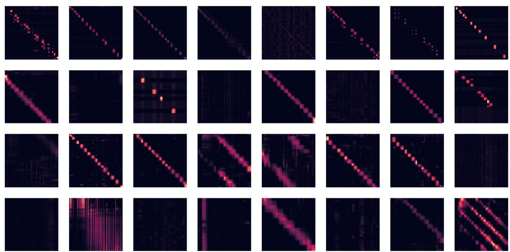

图 10：我们展示了前 4 层和全部 8 个头的注意力矩阵（每一行代表一层，每一列代表头索引，每个单元格包含整个 BPT1_BOVIN 蛋白质序列上的注意力矩阵）。注意，许多头呈现出对角线模式，其中每个节点关注其邻居节点，还有一些头呈现出垂直模式，其中每个头关注相同的固定位置。

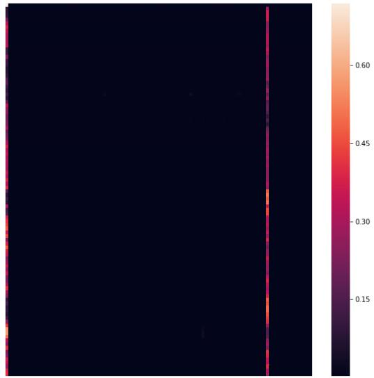  

图 11：我们更详细地展示两个注意力头。子图分别对应：(1) Head 1-2（第二层，第三个注意力头），(2) Head 4-1（第五层，第二个注意力头）。注意 Head 1-2 中的块状注意力，以及 Head 4-1 中的纵向注意力（指向起始标记（'M'）和第 85 个标记（'C'））。

图 12：我们通过将注意力限制在前 25 个 token 上来突出注意力模式（请注意，我们没有对这些 token 的注意力进行重新归一化）。该插图基于 Vig 等人的工作（Vig, 2019; Vig & Belinkov, 2019）。请注意，与之前关于蛋白质 Transformer 的工作类似（Madani et al., 2020），注意力矩阵同时包含局部和全局模式。

  

图 13：氨基酸相似度矩阵，通过在一小部分序列上聚合注意力矩阵估计得到，如 Vig 等人（Vig et al., 2020）所述。各子图分别对应：（1）归一化的 BLOSUM 矩阵；（2）通过训练后的 Performer 模型估计得到的氨基酸相似度。注意，Performer 能识别出高度相似的氨基酸对，例如（D, E）和（F, Y）。

## D 扩展近似与比较结果

## D.1 向后兼容性——误差传播

虽然前面（第 4.2 节）已提及，经过额外微调的 Performer 与 Transformer 向后兼容，但我们在下面的图 14 中展示：由于 Transformer 中非注意力组件所导致的误差传播，是预训练 Transformer 权重无法直接在对应的 Performer 上用于推理的主要原因之一。

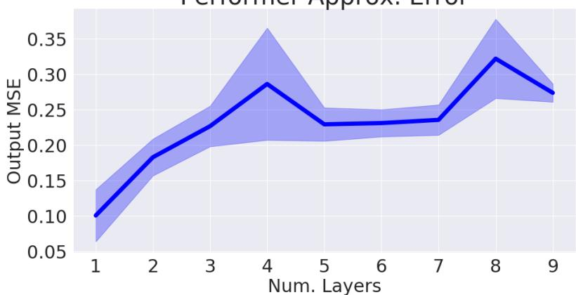  

Performer 近似误差  
图 14：标准 Transformer 与 Performer（使用正交特征）在不同层数下的输出近似误差。

## D.2 近似 Softmax —— 扩展性质

我们在图 15 中展示了近似 softmax 的如下性质：

重绘（Redrawing）：虽然在正文第 4.3 节中已经展示了重绘特征带来的益处，我们进一步在具有大规 模（16×16 TPU-v2）训练的多层场景下验证其效果。

单向性（Unidirectional）：虽然我们已经在 TrEMBL 上表明 Performer 结合广义 ReLU 注意力的表现优于 softmax，但我们也展示了近似 softmax 注意力仍然是一个可靠的选择，例如在 ImageNet64（U）上。经过 100K 步训练后，Performer-ReLU、Performer-Softmax 与 Performer-Softmax（SMREG）三种变体分别达到 3.67、3.69、3.67 BPD。

三角特征的不稳定性（Instability of Trigonometric Features）：我们可以看到使用三角 softmax 时训练曲线不稳定的完整形态。

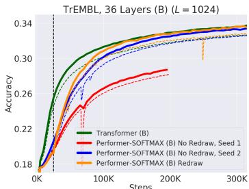

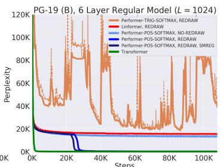  

图 15：建议放大查看。左：特征重绘的重要性。如果不使用重绘，一组"不幸"的随机特征可能导致训练退化，如 Seed 1 的早停曲线所示；而一组"幸运"的随机特征则不会引起问题，如 Seed 2 的曲线所示。重绘允许训练自行修正，如黑色竖线处所示。中：使用相同的 8x8 TPU-v2 计算资源和相同的 6 层标准模型，使用正特征的近似 softmax 与广义 ReLU 注意力（generalized ReLU attention）达到了相同的结果。右：图 5 右子图的缩小视图，表明三角 softmax（Trigonometric softmax）导致非常不稳定的训练行为。

## D.3 广义注意力（GENERALIZED ATTENTION）

我们在 TrEMBL 数据集上、L = 512 的条件下，针对多种核函数研究了广义注意力机制（在第 2.2 节中提及）。这与 (Tsai et al., 2019) 类似，该工作同样针对自然语言任务实验了多种注意力核函数。通过在 FAVOR 的多个变量上进行超参数扫描，我们比较了若干核函数以及归一化（Renormalize）的开启/关闭情况（图 16 和图 17），其中 Renormalize 对应于在注意力中施加 $\mathbf { D } ^ { - 1 }$ 算子（与标准机制一致；不过我们注意到，禁用它并不一定会损害准确率），从而产出 Performer 的最佳训练配置。我们注意到，有效批大小会略微影响排序（从 2x2 与 4x4 TPU 运行之间的差异可以看出）—— 我们默认采用广义 ReLU 核以及附录 A 中展示的其他默认超参数，因为我们观察到它们在大批大小（即 8x8 或 16x16 TPU）运行下经验上是最优的。

  

图 16：为了突出展示精度最高的训练运行，同时呈现某些 kernel 出现的 NaN 问题（这些问题导致训练提前终止），我们将 x 轴和 y 轴均设置为对数刻度。我们针对由不同函数 f 定义的 kernel 进行了测试（参见第 2.2 节）：sigmoid、exponential、ReLU、absolute、gelu、cosine（原始 softmax 近似）、tanh，以及 identity。所有训练运行均在 2x2 TPU-v2 上进行，每个设备的 batch size 为 128。

  

图 17：我们还为 4x4 TPU-v2 进行了与图 16 相似的设置。

## D.4 与线性 Transformer（Linear Transformer）的比较

我们使用来自（Katharopoulos 等，2020）的线性 Transformer（Linear Transformer）注意力实现，其主要做法是将我们的特征映射（feature map）设为 $\phi ( x ) = \mathtt { e l u } ( x ) + 1$，其中 elu(x) 是来自（Clevert 等，2016）的偏移 eLU 函数（shifted-eLU function）。

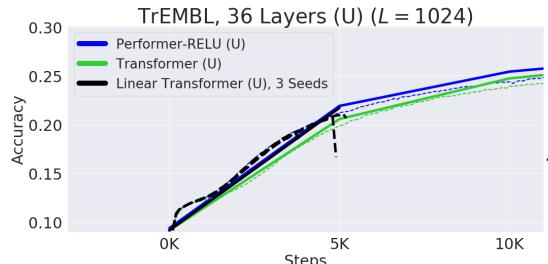

  

图 18：左：在单向 36-ProGen 设置中，我们运行了 Linear Transformer 的 3 个随机种子，发现这 3 个种子在训练非常早期就都产生了梯度爆炸，导致训练运行终止。右：在双向设置下的 Linear Transformer 也在训练中途（接近 125K 步时）产生了梯度爆炸。梯度爆炸可以通过 NaN 错误出现之前训练准确率的急剧下降得到印证。

为了公平起见并避免结果混淆，尽管（Katharopoulos et al., 2020）在线性 Transformer（Linear Transformer）的 MLP 中也使用了 GeLU 非线性，但我们在实验中改用原始的 ReLU 非线性。我们在图 6 中 ProGen 设置完全相同的条件下，使用了与 Performer-ReLU 完全一致的训练超参数。最终，我们通过实验发现线性 Transformer 在训练过程中存在数值不稳定性，表现为训练曲线不稳定，最终因梯度爆炸（NaN）而停止训练（见图 18）。

## D.5 长程竞技场（LONG RANGE ARENA）

在长程竞技场（Tay et al., 2021）的长程上下文挑战任务中，Performer 与本文未涉及的多种额外方法（可扩展与不可扩展的）进行了比较，这些方法包括：局部注意力（Local Attention）、稀疏注意力（Sparse Attention）、Longformer、Sinkhorn Transformer、Synthesizer、Big Bird 以及前文提到的线性 Transformer，其中图 19 展示了原始论文的结果。在所有测试的可扩展 Transformer 方法中，Performer 获得了最高的 LRA（Long Range Arena，长程竞技场）评分（我们将可扩展方法定义为速度大于 100 个样本/秒的方法）。

用于比较的任务包括：（1）（Nangia & Bowman, 2018）提出的标准 ListOps 任务的更长变体；（2）使用真实世界数据的字节级文本分类；（3）字节级文档检索；（4）基于像素序列的图像分类；（5）Pathfinder 任务（长程空间依赖问题）。在长程竞技场论文中，作者发现所有模型在 Path-X 任务上都学不到任何东西（标记为 FAIL），与 Pathfinder 任务的结果形成鲜明对比，这表明增加序列长度会给模型训练带来严重困难。

<table><tr><td>Model</td><td>ListOps</td><td>Text</td><td>Retrieval</td><td>Image</td><td>Pathfinder</td><td>Path-X</td><td>Avg</td></tr><tr><td>Transformer</td><td>36.37</td><td>64.27</td><td>57.46</td><td>42.44</td><td>71.40</td><td>FAIL</td><td>54.39</td></tr><tr><td>Local Attention</td><td>15.82</td><td>52.98</td><td>53.39</td><td>41.46</td><td>66.63</td><td>FAIL</td><td>46.06</td></tr><tr><td>Sparse Trans.</td><td>17.07</td><td>63.58</td><td>59.59</td><td>44.24</td><td>71.71</td><td>FAIL</td><td>51.24</td></tr><tr><td>Longformer</td><td>35.63</td><td>62.85</td><td>56.89</td><td>42.22</td><td>69.71</td><td>FAIL</td><td>53.46</td></tr><tr><td>Linformer</td><td>35.70</td><td>53.94</td><td>52.27</td><td>38.56</td><td>76.34</td><td>FAIL</td><td>51.36</td></tr><tr><td>Reformer</td><td>37.27</td><td>56.10</td><td>53.40</td><td>38.07</td><td>68.50</td><td>FAIL</td><td>50.67</td></tr><tr><td>Sinkhorn Trans.</td><td>33.67</td><td>61.20</td><td>53.83</td><td>41.23</td><td>67.45</td><td>FAIL</td><td>51.39</td></tr><tr><td>Synthesizer</td><td>36.99</td><td>61.68</td><td>54.67</td><td>41.61</td><td>69.45</td><td>FAIL</td><td>52.88</td></tr><tr><td>BigBird</td><td>36.05</td><td>64.02</td><td>59.29</td><td>40.83</td><td>74.87</td><td>FAIL</td><td>55.01</td></tr><tr><td>Linear Trans.</td><td>16.13</td><td>65.90</td><td>53.09</td><td>42.34</td><td>75.30</td><td>FAIL</td><td>50.55</td></tr><tr><td>Performer</td><td>18.01</td><td>65.40</td><td>53.82</td><td>42.77</td><td>77.05</td><td>FAIL</td><td>51.41</td></tr><tr><td>Task Avg (Std)</td><td>29 (9.7)</td><td>61 (4.6)</td><td>55 (2.6)</td><td>41 (1.8)</td><td>72 (3.7)</td><td>FAIL</td><td>52 (2.4)</td></tr><tr><td colspan="8"></td></tr><tr><td rowspan="2">Model</td><td colspan="4">Steps per second</td><td colspan="3">Peak Memory Usage (GB)</td></tr><tr><td>1K</td><td>2K</td><td>3K</td><td>4K</td><td>1K</td><td>2K</td><td>3K</td></tr><tr><td>Transformer</td><td>8.1</td><td>4.9</td><td>2.3</td><td>1.4</td><td>0.85</td><td>2.65</td><td>5.51</td></tr><tr><td>Local Attention</td><td>9.2 (1.1x)</td><td>8.4 (1.7x)</td><td>7.4 (3.2x)</td><td>7.4 (5.3x)</td><td>0.42</td><td>0.76</td><td>1.06</td></tr><tr><td>Linformer</td><td>9.3 (1.2x)</td><td>9.1 (1.9x)</td><td>8.5 (3.7x)</td><td>7.7 (5.5x)</td><td>0.37</td><td>0.55</td><td>0.99</td></tr><tr><td>Reformer</td><td>4.4 (0.5x)</td><td>2.2 (0.4x)</td><td>1.5 (0.7x)</td><td>1.1 (0.8x)</td><td>0.48</td><td>0.99</td><td>1.53</td></tr><tr><td>Sinkhorn Trans</td><td>9.1 (1.1x)</td><td>7.9 (1.6x)</td><td>6.6 (2.9x)</td><td>5.3 (3.8x)</td><td>0.47</td><td>0.83</td><td>1.13</td></tr><tr><td>Synthesizer</td><td>8.7 (1.1x)</td><td>5.7 (1.2x)</td><td>6.6 (2.9x)</td><td>1.9 (1.4x)</td><td>0.65</td><td>1.98</td><td>4.09</td></tr><tr><td>BigBird</td><td>7.4 (0.9x)</td><td>3.9 (0.8x)</td><td>2.7 (1.2x)</td><td>1.5 (1.1x)</td><td>0.77</td><td>1.49</td><td>2.18</td></tr><tr><td>Linear Trans.</td><td>9.1 (1.1x)</td><td>9.3 (1.9x)</td><td>8.6 (3.7x)</td><td>7.8 (5.6x)</td><td>0.37</td><td>0.57</td><td>0.80</td></tr><tr><td>Performer</td><td>9.5 (1.2x)</td><td>9.4 (1.9x)</td><td>8.7 (3.8x)</td><td>8.0 (5.7x)</td><td>0.37</td><td>0.59</td><td>0.82</td></tr></table>

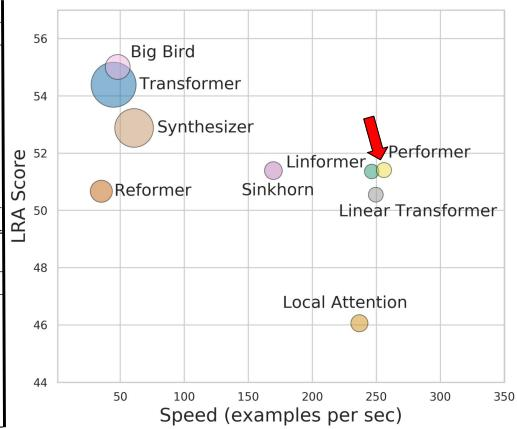  

图 19：上表：Long-Range Arena 基准测试上的结果。最佳模型以粗体显示，次佳模型加下划线。下表：所有 X-former 模型在统一批量大小为 32 下的基准测试结果。作者在「每秒步数」旁边的方括号中报告了相对于 vanilla Transformer 的相对速度提升或下降。内存使用量指的是每个 TPU 设备上的单设备内存占用。基准测试在 4×4 TPU-v3 芯片上运行。右图：不同模型的性能（y 轴）、速度（x 轴）以及内存占用（size of the circles）。

## E 计算开销——扩展结果

在本小节中，我们从正向与反向传播的实际运行时间角度，对图 20 中三种场景下的计算开销进行实证测量：

1. Performer，采用不同数量的层数。我们将展示我们的方法可以扩展到（但不一定仅限于）多达 20 层。

2. 标准注意力（来自 Transformer）与 FAVOR（来自 Performer）的注意力时间复杂度对比。注意，这里所示的最大内存大小并不能反映实际模型中的最大内存大小（如下所示），因为此基准测试需要在 Jax 中计算显式张量（导致内存增加），而模型本身并不会。

3. Transformer 模型与 Performer 模型的时间复杂度对比。"X"（OPT）表示当注意力直接返回 V 向量时可达到的最大可能加速比，表明 Performer 接近最优。我们看到，在 V100 GPU（16GB）上使用常规维度时，所允许的最大 2 的幂次序列长度为 $2^{15}=32768$。

由于 Transformer 中部分计算瓶颈可能源于额外的前馈层（Kitaev et al., 2020），我们也额外对 "Small" 版本进行了基准测试，即 $(n_{heads}, n_{layers}, d_{ff}, d) = (1, 6, 64, 64)$，在该配置下注意力组件是计算与内存的主要来源。我们提醒读者，"Regular" 版本由 $(n_{heads}, n_{layers}, d_{ff}, d) = (8, 6, 2048, 512)$ 构成

注意力反向计时（常规）

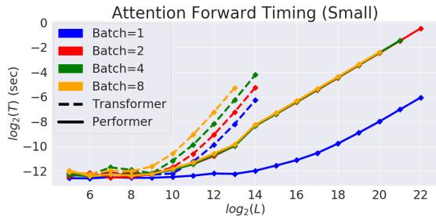

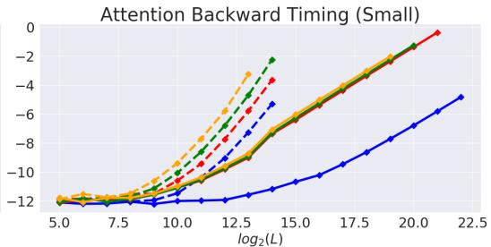

  

图 20：上述每个 2×2 子图的标题（1）和（2）。

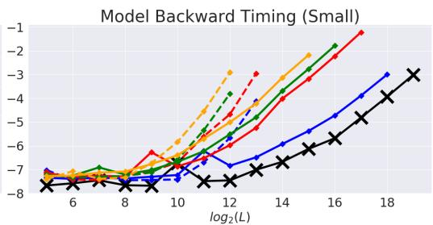  

模型反向传播计时（常规）

  

图21：上述 2×2 子图的说明文字（3）。

## F 理论结果

本节给出论文中所有理论结果的证明。

### F.1 引理 1 的证明

**证明。** 我们首先推导，对任意 $a , b \in \mathbb { R } ^ { d }$

$$
\operatorname{SM} (\mathbf {x}, \mathbf {y}) = \exp (\boldsymbol {x} ^ {\top} \boldsymbol {y}) = \exp (- \| \boldsymbol {x} \| ^ {2} / 2) \cdot \exp (\| \boldsymbol {x} + \boldsymbol {y} \| ^ {2} / 2) \cdot \exp (- \| \boldsymbol {y} \| ^ {2} / 2).
$$

接下来，令 $\pmb { w } \in \mathbb { R } ^ { d }$ 。我们利用如下事实：

$$
(2 \pi) ^ {- d / 2} \int \exp (- \| \boldsymbol {w} - \boldsymbol {c} \| _ {2} ^ {2} / 2) d \boldsymbol {w} = 1
$$

您提供的片段过短，仅包含一行残句：

> for any $\boldsymbol{c} \in \mathbb{R}^{d}$ and derive:

这是一篇完整 Markdown 论文中的局部片段，无法独立成篇翻译。请将整篇论文（标题、摘要、正文、公式、参考文献等）的完整 Markdown 文本粘贴给我，我再按规则逐段译为中文。

$$
\begin{array}{l} \exp (\| \boldsymbol {x} + \boldsymbol {y} \| ^ {2} / 2) = (2 \pi) ^ {- d / 2} \exp (\| \boldsymbol {x} + \boldsymbol {y} \| ^ {2} / 2) \int \exp (- \| \boldsymbol {w} - (\boldsymbol {x} + \boldsymbol {y}) \| ^ {2} / 2) d \boldsymbol {w} \\ \qquad = (2 \pi) ^ {- d / 2} \int \exp (- \| \boldsymbol {w} \| ^ {2} / 2 + \boldsymbol {w} ^ {\top} (\boldsymbol {x} + \boldsymbol {y}) - \| \boldsymbol {x} + \boldsymbol {y} \| ^ {2} / 2 + \| \boldsymbol {x} + \boldsymbol {y} \| ^ {2} / 2) d \boldsymbol {w} \\ \qquad = (2 \pi) ^ {- d / 2} \int \exp (- \| \boldsymbol {w} \| ^ {2} / 2 + \boldsymbol {w} ^ {\top} (\boldsymbol {x} + \boldsymbol {y})) d \boldsymbol {w} \\ \qquad = (2 \pi) ^ {- d / 2} \int \exp (- \| \boldsymbol {w} \| ^ {2} / 2) \cdot \exp (\boldsymbol {w} ^ {\top} \boldsymbol {x}) \cdot \exp (\boldsymbol {w} ^ {\top} \boldsymbol {y}) d \boldsymbol {w} \\ \qquad = \mathbb {E} _ {\omega \sim \mathcal {N} (\mathbf {0} _ {d}, \mathbf {I} _ {d})} [ \exp (\omega^ {\top} \boldsymbol {x}) \cdot \exp (\omega^ {\top} \boldsymbol {y}) ]. \end{array}
$$

这就完成了引理第一部分的证明。由以下事实可得出一个涉及双曲余弦函数的恒等式：对每个 $u \in \mathbb { R } ^ { d }$ 以及 $\omega \sim \mathcal { N } ( 0 , \dot { \mathbf { I } _ { d } } )$，下式成立：

$$
\mathbb {E} [ \exp (\omega^ {\top} \mathbf {u}) ] = \sum_ {i = 0} ^ {\infty} \frac {\mathbb {E} [ (\omega^ {\top} \mathbf {u}) ^ {2 i} ]}{(2 i) !} = \frac {1}{2} \sum_ {i = 0} ^ {\infty} \frac {\mathbb {E} [ (\omega^ {\top} \mathbf {u}) ^ {2 i} ] + \mathbb {E} [ (- \omega^ {\top} \mathbf {u}) ^ {2 i} ]}{(2 i) !}.\tag{12}
$$

奇数矩 $\mathbb { E } [ ( \omega ^ { \top } \mathbf { u } ) ^ { 2 i + 1 } ]$ 的消去直接源于以下事实：$\omega$ 取自各向同性分布（即概率密度函数在每个球面上为常数的分布）。这便完成了证明。$\square$

## F.2 引理 2 的证明

**证明。** 记：$\mathbf { z } = \mathbf { x } + \mathbf { y }$，$\Delta = \mathbf { x } - \mathbf { y }$。注意，通过使用标准三角恒等式（以及独立随机变量之和的方差等于各随机变量方差之和这一事实），对于 $\omega \sim \mathcal { N } ( 0 , \mathbf { I } _ { d } )$ 我们可以得到下式

$$
\mathrm{MSE} (\widehat {\mathrm{SM}} _ {m} ^ {\mathrm{trig}} (\mathbf {x}, \mathbf {y})) = \frac {1}{m} \exp (\| \mathbf {x} \| ^ {2} + \| \mathbf {y} \| ^ {2}) \mathrm{Var} (\cos (\omega^ {\top} \Delta)).\tag{13}
$$

利用以下事实（参见：(Yu et al., 2016) 中的引理 1；注意在该引理中，他们使用的记号 $z$ 对应我们记作 $\| \Delta \|$ 的量）：

$$
\mathrm{Var} (\cos (\omega^ {\top} \Delta)) = \frac {1}{2} (1 - \exp (- \| \Delta \| ^ {2})) ^ {2},\tag{14}
$$

我们得到：

$$
\begin{array}{c} \widehat {\mathrm{MSE} (\mathrm{SM} _ {m} ^ {\mathrm{trig}} (\mathbf {x} , \mathbf {y}))} = \frac {1}{2 m} \exp (\| \mathbf {x} \| ^ {2} + \| \mathbf {y} \| ^ {2}) (1 - \exp (- \| \Delta \| ^ {2})) ^ {2} = \\ \frac {1}{2 m} \exp (\| \mathbf {z} \| ^ {2}) \mathrm{SM} ^ {- 2} (\mathbf {x}, \mathbf {y}) (1 - \exp (- \| \Delta \| ^ {2})) ^ {2}, \end{array}\tag{15}
$$

由此完成了证明的第一部分。为了推得 $\operatorname { M S E } ( { \widehat { \mathrm { S M } } } _ { m } ^ { + } ( \mathbf { x } , \mathbf { y } ) )$ 的公式，首先注意：

（注：所提供的文本似乎在 "notice first that:" 处被截断，后续内容缺失。如需继续翻译，请补全剩余段落。）

$$
\mathbb {E} _ {\omega \sim \mathcal {N} (0, \mathbf {I} _ {d})} [ \exp (\boldsymbol {\omega} ^ {\top} \mathbf {z}) ] = \exp (\frac {\| \mathbf {z} \| ^ {2}}{2}).\tag{16}
$$

上述结论可直接由以下事实推出：正随机特征映射（positive random feature maps）可对 softmax 核进行无偏估计，因此下式成立：

$$
\mathrm{SM} (\mathbf {x}, \mathbf {y}) = \exp (- \frac {\| \mathbf {x} \| ^ {2} + \| \mathbf {y} \| ^ {2}}{2}) \mathbb {E} _ {\omega \sim \mathcal {N} (0, \mathbf {I} _ {d})} [ \exp (\boldsymbol {\omega} ^ {\top} \mathbf {z}) ].\tag{17}
$$

因此我们得到：

$$
\begin{array}{r l} & {\mathrm{MSE} (\widehat {\mathrm{SM}} _ {m} ^ {+} (\mathbf {x}, \mathbf {y})) = \frac {1}{m} \exp (- (\| \mathbf {x} \| ^ {2} + \| \mathbf {y} \| ^ {2})) \mathrm{Var} (\exp (\omega^ {\top} \mathbf {z})) =} \\ & {\quad \frac {1}{m} \exp (- (\| \mathbf {x} \| ^ {2} + \| \mathbf {y} \| ^ {2})) \left(\mathbb {E} [ \exp (2 \omega^ {\top} \mathbf {z}) ] - (\mathbb {E} [ \exp (\omega^ {\top} \mathbf {z}) ]) ^ {2}\right) =} \\ & {\qquad \frac {1}{m} \exp (- (\| \mathbf {x} \| ^ {2} + \| \mathbf {y} \| ^ {2})) (\exp (2 \| \mathbf {z} \| ^ {2}) - \exp (\| \mathbf {z} \| ^ {2})),} \end{array}\tag{18}
$$

其中最后一个等式由公式 16 得出。因此我们有：

$$
\begin{array}{r} \widehat {\mathrm{MSE} (\mathrm{SM} _ {m} ^ {+} (\mathbf {x} , \mathbf {y}))} = \frac {1}{m} \exp (- (\| \mathbf {x} \| ^ {2} + \| \mathbf {y} \| ^ {2})) \exp (\| \mathbf {z} \| ^ {2}) (\exp (\| \mathbf {z} \| ^ {2}) - 1) = \\ \frac {1}{m} \exp (\| \mathbf {z} \| ^ {2}) \mathrm{SM} ^ {2} (\mathbf {x}, \mathbf {y}) (1 - \exp (- \| \mathbf {z} \| ^ {2})). \end{array}\tag{19}
$$

最后，

$$
\begin{array}{r l r} & & {\mathrm{MSE} (\widehat {\mathrm{SM}} _ {m} ^ {\mathrm{hyp+}} (\mathbf {x}, \mathbf {y})) = \frac {1}{4 m} \exp (- \frac {\| \mathbf {x} \| ^ {2} + \| \mathbf {y} \| ^ {2}}{2}) ^ {2} (\mathrm{Var} (\exp (\omega^ {\top} \mathbf {z})) + \mathrm{Var} (\exp (- \omega^ {\top} \mathbf {z})) +} \\ & & {2 \mathrm{Cov} (\exp (\omega^ {\top} \mathbf {z})), \exp (- \omega^ {\top} \mathbf {z})))) = \frac {1}{4 m} \exp (- \frac {\| \mathbf {x} \| ^ {2} + \| \mathbf {y} \| ^ {2}}{2}) ^ {2} (2 \mathrm{Var} (\exp (\omega^ {\top} \mathbf {z})) +} \\ & & {2 \mathrm{Cov} (\exp (\omega^ {\top} \mathbf {z})), \exp (- \omega^ {\top} \mathbf {z}))))) = \frac {1}{2 m} \exp (- (\| \mathbf {x} \| ^ {2} + \| \mathbf {y} \| ^ {2}))} \\ & & {(\mathrm{Var} (\exp (\omega^ {\top} \mathbf {z})) + 1 - (\mathbb {E} [ \exp (\omega^ {\top} \mathbf {z}) ])) ^ {2}) = \frac {1}{2 m} \exp (- (\| \mathbf {x} \| ^ {2} + \| \mathbf {y} \| ^ {2}))} \\ & & {(\exp (2 \| \mathbf {z} \| ^ {2}) - \exp (\| \mathbf {z} \| ^ {2}) + 1 - \exp (\| \mathbf {z} \| ^ {2})) = \frac {1}{2 m} \exp (- (\| \mathbf {x} \| ^ {2} + \| \mathbf {y} \| ^ {2})) (\exp (\| \mathbf {z} \| ^ {2}) - 1) ^ {2}} \\ & & {\quad = \frac {1}{2} (1 - \exp (- \| \mathbf {z} \| ^ {2})) \mathrm{MSE} (\widehat {\mathrm{SM}} _ {m} ^ {+} (\mathbf {x}, \mathbf {y})).} \end{array}\tag{20}
$$

在上述等式链中，我们用到了随机变量 $\exp(\omega^{\top}\mathbf{z})$ 和 $\exp(-\omega^{\top}\mathbf{z})$ 具有相同分布这一事实。这是因为 $\omega$ 和 $-\omega$ 具有相同分布（$\omega$ 是高斯分布的）。这完成了证明。 □

## F.3 定理 1 的证明

**证明。** 设 $\mathbf{x}, \mathbf{y} \in \mathbb{R}^d$ 分别为 query/key。注意，根据 $\mathrm{SMREG}(\mathbf{x}, \mathbf{y})$ 的定义，对于 $\mathbf{z} = \mathbf{x} + \mathbf{y}$，我们有

$$
\mathrm{SMREG} (\mathbf {x}, \mathbf {y}) = \exp (- \frac {\| \mathbf {x} \| ^ {2} + \| \mathbf {y} \| ^ {2}}{2}) \sum_ {k = 0} ^ {\infty} \frac {1}{(2 k) !} \| \mathbf {z} \| ^ {2 k} d ^ {k} \mathbb {E} _ {\omega \sim \mathcal {N} (0, \mathbf {I} _ {d})} [ (\frac {\omega}{\| \omega \| _ {2}} \mathbf {e} _ {1}) ^ {2 k} ],\tag{21}
$$

其中 $\mathbf{e}_1 \overset{\mathrm{def}}{=} (1,0,...,0)^\top \in \mathbb{R}^d$。为了得到上述结果，我们使用了 $\mathcal{N}(0, \mathbf{I}_d)$ 具有各向同性（isotropic）这一事实（这尤其意味着泰勒展开中的偶数次项为零）。

我们记：$A(k,d) \overset{\mathrm{def}}{=} \mathbb{E}_{\omega \sim \mathcal{N}(0, \mathbf{I}_d)}[(\frac{\omega}{\|\omega\|_2} \mathbf{e}_1)^{2k}]$。可以证明：

$$
A (2 k, d) = \frac {(2 k - 1) ! !}{(d + 2 k - 2) (d + 2 k - 4) \cdot \ldots \cdot d}.\tag{22}
$$

该事实的证明可在 (Choromanski et al., 2018b) 的补充材料中找到，但为完整起见并便于读者参考，我们在此给出：

引理 3. 表达式 $A ( 2 k , d )$ 对 $k \in \mathbb N$ 满足以下条件

$$
A (2 k, d) = \frac {(2 k - 1) ! !}{(d + 2 k - 2) (d + 2 k - 4) \cdot \ldots \cdot d}.\tag{23}
$$

证明。首先注意，对于 $d \geq 2$，从单位球面上均匀随机选取的向量 $\mathbf { r } \in \mathbb { R } ^ { d }$ 与 $\mathbf { e } _ { 1 }$ 之间夹角的概率密度函数 $p _ { d } ( \theta )$ 由下式给出：

$$
p _ {d} (\theta) = \frac {\sin^ {d - 2} (\theta)}{\int_ {0} ^ {\pi} \sin^ {d - 2 (\theta)} d \theta}.\tag{24}
$$

设：$\begin{array} { r } { F ( k , d ) \ { \stackrel { \mathrm { d e f } } { = } } \ \int _ { 0 } ^ { \pi } \cos ^ { k } ( \theta ) \sin ^ { d } ( \theta ) d \theta } \end{array}$。通过分部积分，我们得到：0

$$
\begin{array}{c} \int_ {0} ^ {\pi} \cos^ {k} (\theta) \sin^ {d} (\theta) d \theta = \int_ {0} ^ {\pi} \cos^ {k - 1} (\theta) \sin^ {d} (\theta) (\sin (\theta)) ^ {\prime} d \theta = \\ \cos^ {k - 1} (\theta) \sin^ {d + 1} (\theta) | _ {0} ^ {\pi} - \int_ {0} ^ {\pi} \sin (\theta) ((k - 1) \cos^ {k - 2} (\theta) (- \sin (\theta)) \sin^ {d} (\theta) + \\ d \cos^ {k} (\theta) \sin^ {d - 1} (\theta)) d \theta . \end{array}\tag{25}
$$

由此我们得出：$\begin{array} { r } { F ( k , d ) = \frac { k - 1 } { d + 1 } F ( k - 2 , d + 2 ) } \end{array}$。因此我们有：

$$
F (2 k, d) = \frac {(2 k - 1) ! !}{(d + 1) (d + 3) \cdot \ldots \cdot (d + 2 k - 1)} \int_ {0} ^ {\pi} \sin^ {d + 2 k} (\theta) d \theta .\tag{26}
$$

我们再次进行分部积分，得到：

$$
\begin{array}{c} \int_ {0} ^ {\pi} \sin^ {d} (\theta) d \theta = - \frac {1}{d} \sin^ {d - 1} (\theta) \cos (\theta) | _ {0} ^ {\pi} + \\ \frac {d - 1}{d} \int_ {0} ^ {\pi} \sin^ {d - 2} (\theta) d \theta = \frac {d - 1}{d} \int_ {0} ^ {\pi} \sin^ {d - 2} (\theta) d \theta . \end{array}\tag{27}
$$

因此我们得出结论：

$$
\begin{array}{c} A (2 k, d) = \frac {1}{\frac {d - 3}{d - 2} \frac {d - 5}{d - 4} \cdot \ldots} \frac {(2 k - 1) ! !}{(d - 1) (d + 1) \cdot \ldots \cdot (d + 2 k - 3)} \frac {d + 2 k - 3}{d + 2 k - 2} \frac {d + 2 k - 5}{d + 2 k - 4} \cdot \ldots . = \\ \frac {(2 k - 1) ! !}{(d + 2 k - 2) (d + 2 k - 4) \cdot \ldots \cdot d}, \end{array}\tag{28}
$$

至此证明完毕。

应用上述引理，我们得到：

$$
\begin{array}{c} \text {SMREG} (\mathbf {x}, \mathbf {y}) = \exp (- \frac {\| \mathbf {x} \| ^ {2} + \| \mathbf {y} \| ^ {2}}{2}) \sum_ {k = 0} ^ {\infty} \frac {1}{(2 k) !} \| \mathbf {z} \| ^ {2 k} d ^ {k} \frac {(2 k - 1) ! !}{(d + 2 k - 2) (d + 2 k - 4) \cdot \ldots \cdot d} \\ = \exp (- \frac {\| \mathbf {x} \| ^ {2} + \| \mathbf {y} \| ^ {2}}{2}) \sum_ {k = 0} ^ {\infty} \frac {w ^ {k}}{k !} f (k, d), \end{array}\tag{29}
$$

其中 $\begin{array} { r } { w = \frac { \| \mathbf { z } \| ^ { 2 } } { 2 } \mathrm { ~ a n d ~ } f ( k , d ) = \frac { d ^ { k } } { ( d + 2 k - 2 ) ( d + 2 k - 4 ) \cdot \ldots \cdot d } . } \end{array}$

由此得到：

$$
\frac {\operatorname{SMREG} (\mathbf {x} , \mathbf {y})}{\operatorname{SM} (\mathbf {x} , \mathbf {y})} = e ^ {- w} \sum_ {k = 0} ^ {\infty} \frac {w ^ {k}}{k !} f (k, d).\tag{30}
$$

首先注意，对于 $k \geq 1$，我们有：$f ( k , d ) \leq 1$，因此：

$$
\operatorname{SMREG} (\mathbf {x}, \mathbf {y}) \leq \operatorname{SM} (\mathbf {x}, \mathbf {y}).
$$

(31)

我们还有 $l = d ^ { \frac { 1 } { 3 } }$

$$
\begin{array}{c} \frac {\text {SMREG} (\mathbf {x} , \mathbf {y})}{\text {SM} (\mathbf {x} , \mathbf {y})} = e ^ {- w} \sum_ {k = 0} ^ {l} \frac {w ^ {k}}{k !} f (k, d) + e ^ {- w} \sum_ {k = l + 1} ^ {\infty} \frac {w ^ {k}}{k !} f (k, d) \geq \\ f (l, d) e ^ {- w} \sum_ {k = 0} ^ {l} \frac {w ^ {k}}{k !} + e ^ {- w} \sum_ {k = l + 1} ^ {\infty} \frac {w ^ {k}}{k !} f (k, d) \geq f (l, d) (1 - e ^ {- w} \sum_ {k = l + 1} ^ {\infty} \frac {w ^ {k}}{k !}) = \\ f (l, d) (1 - \mathbb {P} [ \mathrm{Po} (w) > l ]), \end{array}\tag{32}
$$

其中 $\mathrm{Po}(w)$ 表示参数为 $w$ 的泊松分布的随机变量。因此，对于 $t = \ln\left(\frac{l}{w}\right)$，我们得到：

$$
\begin{array}{r l r} & & {\frac {\mathrm{SMREG} (\mathbf {x} , \mathbf {y})}{\mathrm{SM} (\mathbf {x} , \mathbf {y})} \geq (1 - \frac {2 l - 2}{d}) ^ {l} (1 - \mathbb {P} [ \mathrm{Po} (w) > l ]) \geq} \\ & & {\exp (l \ln (1 - \frac {2 l - 2}{d})) (1 - \mathbb {P} [ t \mathrm{Po} (w) \geq t l ]) =} \\ & & {\exp \left(l \sum_ {i = 1} ^ {\infty} (- 1) ^ {i} \frac {\left(\frac {2 l - 2}{d}\right) ^ {i}}{i}\right) (1 - \mathbb {P} [ \exp (t \mathrm{Po} (w) - t l) \geq 1 ]) \geq} \\ & & {\exp (- \frac {2}{d ^ {\frac {1}{3}}} + o (\frac {1}{d ^ {\frac {1}{3}}})) (1 - \exp (- t l) \mathbb {E} [ \exp (t \mathrm{Po} (w)) ]) =} \\ & & {\exp (- \frac {2}{d ^ {\frac {1}{3}}} + o (\frac {1}{d ^ {\frac {1}{3}}})) (1 - \exp (- w - l (t - 1))),} \end{array}\tag{33}
$$

其中最后一个等式由泊松随机变量的拉普拉斯变换公式给出：

$$
\mathbb {E} [ \exp (t \mathrm{Po} (w)) ] = \exp (w (\exp (t) - 1)).\tag{34}
$$

注意到：$w = \frac{\|\mathbf{z}\|^2}{2} = \frac{\ln(\mathrm{SM}(\mathbf{x},\mathbf{x})) + \ln(\mathrm{SM}(\mathbf{y},\mathbf{y})) + 2\ln(\mathrm{SM}(\mathbf{x},\mathbf{y}))}{2} \leq 2\ln(C)$。我们得出结论：

$$
\frac {\mathrm{SMREG} (\mathbf {x} , \mathbf {y})}{\mathrm{SM} (\mathbf {x} , \mathbf {y})} \geq (1 - \frac {2}{d ^ {\frac {1}{3}}} + o (\frac {1}{d ^ {\frac {1}{3}}})) (1 - C ^ {- 2} (\frac {d ^ {\frac {1}{3}}}{2 e \cdot \ln (C)}) ^ {- d ^ {\frac {1}{3}}}) = 1 - \frac {2}{d ^ {\frac {1}{3}}} + o (\frac {1}{d ^ {\frac {1}{3}}}).\tag{35}
$$

至此证明完成。

## F.4 定理 2、定理 3 及「漂亮函数」的证明

本节给出更为一般的理论结果，这些结果将蕴含定理 3 与定理 2。我们需要以下定义：

定义 1. 若函数 $F : \mathbb { R } ^ { n } \rightarrow \mathbb { R }$ 能够表示为下列形式，则称其为「漂亮的（beautiful）」：

$$
F _ {\Omega , g} (\mathbf {z}) = \mathbb {E} _ {\omega \sim \Omega} [ g (\boldsymbol {\omega} ^ {\top} \mathbf {z}) ],\tag{36}
$$

对于一个概率各向同性分布 $\Omega$，并且其中 $g : \mathbb { R } R$ 是一个具有非负幂级数系数的整函数（即 $\begin{array}{r} { g ( x ) = \sum _ { i = 0 } ^ { \infty } \overset { \textstyle - } { a _ { i } } x ^ { i } } \end{array}$ 对每个 $x \in \mathbb { R }$ 成立，并且 $a _ { i } \geq 0 f o r$ $i = 0 , 1 , \ldots$）。在上述公式中，我们假定右端的期望是存在的。

有趣的是，beautiful functions 可被用于定义 softmax，并进而用于定义高斯核（标准形式与正则化形式），由此引出我们在论文主体部分所给出的 PRF 机制，下文将加以解释。

注 1。若取 $\Omega = \mathcal { N } ( 0 , \mathbf { I } _ { d } )$（注意 $\mathcal { N } ( 0 , \mathbf { I } _ { d } )$ 是各向同性的）以及 $g : x \mapsto \exp ( x )$（这样的 $g$ 显然是一个具有非负幂级数系数的整函数），则对 $\mathbf { z } = \mathbf { x } + \mathbf { y }$，下式成立。

$$
\mathrm{SM} (\mathbf {x}, \mathbf {y}) = \exp (- \frac {\| \mathbf {x} \| ^ {2} + \| \mathbf {y} \| ^ {2}}{2}) F _ {\Omega , g} (\mathbf {z}).\tag{37}
$$

类似地：$\begin{array} { r } { \mathrm { S M R E G } ( \mathbf { x } , \mathbf { y } ) = \exp ( - \frac { \| \mathbf { x } \| ^ { 2 } + \| \mathbf { y } \| ^ { 2 } } { 2 } ) F _ { \Omega _ { \mathrm { r e g } } , g } ( \mathbf { z } ) } \end{array}$，其中 $\Omega _ { \mathrm { r e g } }$ 代表对应于半径为 $\sqrt { d }$ 的球面上 Haar 测度的分布（显然满足各向同性）。因此，关于美函数（beautiful functions）的蒙特卡洛估计器的一般集中性结论，会立即蕴含（标准及正则化的）softmax 核（从而也包括高斯核）的相应结论。

我们将考虑 Definition 1 中美函数的两个估计器，它们（通过 Remark 1）可直接导出：基于 PRF 的 softmax 核近似，以及其采用正交特征的增强版本。标准蒙特卡洛估计器独立采样 $\omega _ { 1 } ^ { \mathrm { i i d } } , . . . , \omega _ { m } ^ { \mathrm { i i d } } \stackrel { \mathrm { i i d } } { \sim } \Omega$，其中 m 表示样本数量，然后计算：

$$
\widehat {F} _ {m} ^ {\mathrm{iid}} (\mathbf {z}) \stackrel {{\text { def }}} {{=}} \frac {1}{m} \sum_ {i = 1} ^ {m} g ((\omega_ {i} ^ {\mathrm{iid}}) ^ {\top} \mathbf {z}).\tag{38}
$$

正交蒙特卡洛估计器采样 $\omega _ { 1 } ^ { \mathrm { o r t } } , . . . , \omega _ { m } ^ { \mathrm { o r t } } ( m \leq d )$ 的方式如下：从边缘分布上看，$\bar { \omega } _ { i } ^ { \mathrm { o r t } } \sim \Omega$，但对 $i \neq j$，$( \omega _ { i } ^ { \mathrm { o r t } } ) ^ { \top } \omega _ { i } ^ { \mathrm { o r t } } = 0$（若 $\Omega$ 是各向同性的，这样的正交系综总可以构造出来，正如我们在论文正文中已经提到的）。我们定义：

$$
\widehat {F} _ {m} ^ {\mathrm{ort}} (\mathbf {z}) \stackrel {{\mathrm{def}}} {{=}} \frac {1}{m} \sum_ {i = 1} ^ {m} g ((\omega_ {i} ^ {\mathrm{ort}}) ^ {\top} \mathbf {z}).\tag{39}
$$

## F.4.1 正交性普遍改善集中性

记 $M_{Z}(\theta) = \mathbb{E}[e^{\theta Z}]$ 为随机变量 $Z$ 的矩母函数（moment generating function）。首先需要指出，基于标准蒙特卡洛过程、使用独立向量 $\omega_{i}^{\mathrm{iid}}$ 构造的关于漂亮函数（beautiful function）的估计量能够保证强集中性（strong concentration）界，因为独立的 $\omega_{i}$ 提供了一种途径，可通过矩母函数给出指数级小的失败概率上界。我们将这一经典观察——它是 Markov 不等式的标准应用——总结如下。

**引理 4.** 考虑对漂亮函数 $F$ 在 $z$ 点处的取值所构造的估计量 $\widehat{F}_{m}^{\mathrm{iid}}(\mathbf{z})$。则对任意 $a > F(\mathbf{z})$，$\theta > 0$，下式成立：

$$
\mathbb {P} [ \widehat {F} _ {m} ^ {\mathrm{iid}} (\mathbf {z}) > a ] \leq \exp (\theta m a) M _ {X} (\theta) ^ {m},\tag{40}
$$

$$X = g(\mathbf{w}^\top \mathbf{z}), \quad \mathbf{w} \sim \mathcal{D}$$

上述结果为标准估计量的尾概率提供了（在 Legendre 变换下）指数级小的上界。下面给出我们的两个主要理论结果。

**定理 5（正交性带来更小的尾部）。** 若 $F_{\Omega,g}$ 是一个 beautiful 函数，则对于 $m \leq d$、引理 4 中的 $X$ 以及任意 $a > F(\mathbf{z}), \theta > 0$，下列结论成立。

$$
\mathbb {P} [ \widehat {F} _ {m} ^ {\mathrm{ort}} (\mathbf {z})) > a ] \leq \exp (- \theta m a) \left(M _ {X} (\theta) ^ {m} - \frac {\theta^ {4} m (m - 1)}{4 d ^ {2} (d + 2)} a _ {0} ^ {M - 2} a _ {1} ^ {2} \| \mathbf {z} \| ^ {4} (\mathbb {E} \| \omega \| ^ {2}) ^ {2}\right).\tag{41}
$$

该结果表明，由两两正交随机向量集合所获得的特征对尾部概率提供了指数级小的界，并且这些界严格优于使用非结构化特征的估计器。此外，该结果是普适的，即对任意维度 $d$ 都成立，而不仅仅是对足够大的 $d$ 渐近成立。

我们还针对所考虑估计器的均方误差（MSE）得到了类似的结果：

**定理 6.** 若 $F_{\Omega, g}$ 为 beautiful 函数，则对 $m \leq d$ 有如下结论：

$$
\mathrm{MSE} (\widehat {F} _ {m} ^ {\mathrm{ort}} (\mathbf {z})) \leq \mathrm{MSE} (\widehat {F} _ {m} ^ {\mathrm{iid}} (\mathbf {z})) - (1 - \frac {1}{m}) \frac {2}{d + 2} \left(F _ {\Omega , g} (\mathbf {z}) - a _ {0}\right) ^ {2}.\tag{42}
$$

如前所述，正交估计量能带来更好的集中性结果；同样地，这对任意 $d > 0 ,$ 都成立，而不仅仅是在足够大的 $d$ 时才渐近成立。

注意，根据以上所述，定理 2 和定理 3 可分别由定理 6 和定理 5 立即得到。

因此，在本节余下部分，我们将证明定理 6 和定理 5。

## F.4.2 定理 5 的证明

证明。注意，如同引理 4 中那样对 Markov 不等式进行类似应用，我们得到：

$$
\mathbb {P} [ \widehat {F} _ {m} ^ {\mathrm{ort}} (\mathbf {z})) > a ] \leq \frac {\mathbb {E} [ e ^ {\theta (X _ {1} ^ {\mathrm{ort}} + . . . + X _ {m} ^ {\mathrm{ort}})} ]}{e ^ {\theta m a}},\tag{43}
$$

其中：$X _ { i } ^ { \mathrm { o r t } } = g ( ( \boldsymbol { \omega } _ { i } ^ { \mathrm { o r t } } ) ^ { \top } \mathbf { z } )$。我们看到，只需证明对任意 $\theta > 0$，下列不等式成立即可：$\mathbb { E } \bigl [ e ^ { \theta ( X _ { 1 } ^ { \mathrm { o r t } } + \ldots + X _ { m } ^ { \mathrm { o r t } } ) } \bigr ] < \mathbb { E } \bigl [ e ^ { \theta ( X _ { 1 } ^ { \mathrm { i i d } } + \ldots + X _ { m } ^ { \mathrm { i i d } } ) } \bigr ]$。我们得到：

$$
\mathbb {E} [ e ^ {\theta (X _ {1} ^ {\mathrm{ort}} + \ldots + X _ {m} ^ {\mathrm{ort}})} ] = \mathbb {E} [ \sum_ {j = 0} ^ {\infty} \frac {(\theta \sum_ {i = 1} ^ {m} X _ {i} ^ {\mathrm{ort}}) ^ {j}}{j !} ] = \mathbb {E} [ \sum_ {j = 0} ^ {\infty} \frac {\theta^ {j}}{j !} (\sum_ {i = 1} ^ {m} X _ {i} ^ {\mathrm{ort}}) ^ {j} ] =\tag{44}
$$

$$
\sum_ {j = 0} ^ {\infty} \frac {\theta^ {j}}{j !} \mathbb {E} [ (\sum_ {i = 1} ^ {m} X _ {i} ^ {\text {ort}}) ^ {j} ] = \sum_ {j = 0} ^ {\infty} \frac {\theta^ {j}}{j !} \mathbb {E} [ \sum_ {(j _ {1}, \ldots , j _ {m}) \in \mathcal {S} _ {j}} \binom {j} {j _ {1}, \ldots , j _ {m}} (X _ {1} ^ {\text {ort}}) ^ {j _ {1}} \cdot \ldots \cdot (X _ {m} ^ {\text {ort}}) ^ {j _ {m}} ],
$$

其中 $S _ { j } = \{ ( j _ { 1 } , . . . , j _ { m } ) \in \mathbb { N } \times . . . \times \mathbb { N } : j _ { 1 } , . . . , j _ { m } \geq 0 , j _ { 1 } + . . . + j _ { m } = j \}$

因此我们有：

$$
\mathbb {E} [ e ^ {\theta (X _ {1} ^ {\mathrm{ort}} + \ldots + X _ {m} ^ {\mathrm{ort}})} ] = \sum_ {j = 0} ^ {\infty} \frac {\theta^ {j}}{j !} \sum_ {(j _ {1}, \ldots , j _ {m}) \in \mathcal {S} _ {j}} \binom {j} {j _ {1}, \ldots , j _ {m}} \mathbb {E} [ (X _ {1} ^ {\mathrm{ort}}) ^ {j _ {1}} \cdot \ldots \cdot (X _ {m} ^ {\mathrm{ort}}) ^ {j _ {m}} ].\tag{45}
$$

类似地，我们得到：

$$
\mathbb {E} [ e ^ {\theta (X _ {1} ^ {\text {iid}} + \ldots + X _ {m} ^ {\text {iid}})} ] = \sum_ {j = 0} ^ {\infty} \frac {\theta^ {j}}{j !} \sum_ {(j _ {1}, \ldots , j _ {m}) \in \mathcal {S} _ {j}} \binom {j} {j _ {1}, \ldots , j _ {m}} \mathbb {E} [ (X _ {1} ^ {\text {iid}}) ^ {j _ {1}} \cdot \ldots \cdot (X _ {m} ^ {\text {iid}}) ^ {j _ {m}} ].\tag{46}
$$

因此我们得到：

$$
\begin{array}{c} \Delta = \mathbb {E} [ e ^ {\theta (X _ {1} ^ {\mathrm{iid}} + \ldots + X _ {m} ^ {\mathrm{iid}})} ] - \mathbb {E} [ e ^ {\theta (X _ {1} ^ {\mathrm{ort}} + \ldots + X _ {m} ^ {\mathrm{ort}})} ] \\ = \sum_ {j = 0} ^ {\infty} \frac {\theta^ {j}}{j !} \sum_ {(j _ {1}, \ldots , j _ {m}) \in \mathcal {S} _ {j}} \binom {j} {j _ {1}, \ldots , j _ {m}} \left(\mathbb {E} [ (X _ {1} ^ {\mathrm{iid}}) ^ {j _ {1}} \cdot \ldots \cdot (X _ {m} ^ {\mathrm{iid}}) ^ {j _ {m}} ] - \mathbb {E} [ (X _ {1} ^ {\mathrm{ort}}) ^ {j _ {1}} \cdot \ldots \cdot (X _ {m} ^ {\mathrm{ort}}) ^ {j _ {m}} ]\right) \end{array}\tag{47}
$$

首先注意，利用 $f$ 是整函数（entire）这一事实，我们可以将每个 $X_i^{\mathrm{ort}}$ 重写为：

$$
X _ {i} ^ {\mathrm{ort}} = \sum_ {s = 0} ^ {\infty} a _ {s} ((\omega_ {i} ^ {\mathrm{ort}}) ^ {\top} \mathbf {z}) ^ {s},\tag{48}
$$

其中 $f(x) = \sum_{s=0}^{\infty} a_s x^s$ 且 $a_0, a_1, \dots \geq 0$。类似地，

$$
X _ {i} ^ {\mathrm{iid}} = \sum_ {s = 0} ^ {\infty} a _ {s} ((\omega_ {i} ^ {\mathrm{iid}}) ^ {\top} \mathbf {z}) ^ {s}.\tag{49}
$$

将上述关于 $X_i^{\mathrm{ort}}$ 和 $X_i^{\mathrm{iid}}$ 的公式代入 $\Delta$ 的公式中，并展开幂次表达式，可得：

$$
\Delta = \sum_ {j = 0} ^ {\infty} \frac {\theta^ {j}}{j !} \sum_ {(j _ {1}, \ldots , j _ {m}) \in \mathcal {S} _ {j}} \binom {j} {j _ {1}, \ldots , j _ {m}} \sum_ {(d _ {1}, \ldots , d _ {m}) \in \mathcal {D} (j _ {1}, \ldots , j _ {m})} \widehat {c} _ {j _ {1}, \ldots , j _ {m}} (d _ {1}, \ldots , d _ {m}) \widehat {\Delta} (d _ {1}, \ldots , d _ {m}),\tag{50}
$$

对于某些有序的下标子集（可能含有重复项）$\mathcal{D}(j_1, ..., j_m)$ 以及某些非负的 $\widehat{c}_{j_1, \dots, j_m}(d_1, \dots, d_m)$（可以给出其精确公式，但完成证明并不需要它，且由于该公式技术性较强，会不必要地使证明复杂化，因此我们略去）以及 $\widehat{\Delta}(d_1, ..., d_m)$ 定义为：

$$
\widehat {\Delta} (d _ {1},..., d _ {m}) = \mathbb {E} [ ((\omega_ {1} ^ {\mathrm{iid}}) ^ {\top} \mathbf {z}) ^ {d _ {1}} \cdot ... \cdot ((\omega_ {m} ^ {\mathrm{iid}}) ^ {\top} \mathbf {z}) ^ {d _ {m}} ] - \mathbb {E} [ ((\omega_ {1} ^ {\mathrm{ort}}) ^ {\top} \mathbf {z}) ^ {d _ {1}} \cdot ... \cdot ((\omega_ {m} ^ {\mathrm{ort}}) ^ {\top} \mathbf {z}) ^ {d _ {m}} ].\tag{51}
$$

我们的下一个目标是改写 $\widehat { \Delta } ( d _ { 1 } , . . . , d _ { m } )$ 的公式。记：

$$
Y = ((\omega_ {1} ^ {\mathrm{ort}}) ^ {\top} \mathbf {z}) ^ {d _ {1}} \cdot \ldots \cdot ((\omega_ {m} ^ {\mathrm{ort}}) ^ {\top} \mathbf {z}) ^ {d _ {m}}.\tag{52}
$$

注意到 $Y$ 与按如下方式定义的 $Y ^ { \prime }$ 具有相同的分布：

$$
Y ^ {\prime} = (\mathbf {e} _ {1} ^ {\top} \frac {\mathbf {g}}{\| \mathbf {g} \| _ {2}} \| \mathbf {z} \| _ {2}) ^ {d _ {1}} \cdot \ldots \cdot (\mathbf {e} _ {m} ^ {\top} \frac {\mathbf {g}}{\| \mathbf {g} \| _ {2}} \| \mathbf {z} \| _ {2}) ^ {d _ {m}} \cdot (\| \omega_ {1} ^ {\mathrm{ort}} \| _ {2}) ^ {d _ {1}} \cdot \ldots \cdot (\| \omega_ {m} ^ {\mathrm{ort}} \| _ {2}) ^ {d _ {m}},\tag{53}
$$

其中 g 是取自 $\mathcal { N } ( 0 , \mathbf { I } _ { d } )$ 分布的高斯向量，且与 $\| \omega _ { 1 } ^ { \mathrm { o r t } } \| _ { 2 } , . . . , \| \omega _ { m } ^ { \mathrm { o r t } } \| _ { 2 }$ 相互独立。

这一结论源于以下事实：对于固定的 z，可以将集合 $\frac { \omega _ { 1 } ^ { \mathrm { o r t } } } { \| \omega _ { 1 } ^ { \mathrm { o r t } } \| _ { 2 } } , . . . , \frac { \omega _ { m } ^ { \mathrm { o r t } } } { \| \omega _ { m } ^ { \mathrm { o r t } } \| _ { 2 } }$ 视为由 m 个标准基向量 $\mathbf { e } _ { 1 } , . . . , \mathbf { e } _ { m }$ 所构成系统的一次随机旋转。因此，与对 $\mathbf { e } _ { 1 } , . . . , \mathbf { e } _ { m }$ 施加随机旋转等价的做法是，对向量 z 进行随机旋转。随机旋转后的向量 z 与 $\frac { \mathbf { g } } { \| \mathbf { g } \| _ { 2 } } \| \mathbf { \bar { z } } \| _ { 2 }$ 具有相同的分布。

还需注意，向量 $\omega _ { 1 } ^ { \mathrm { o r t } } , . . . , \omega _ { m } ^ { \mathrm { o r t } }$ 的长度是独立选取的。

由此可得：

$$
\begin{array}{r l r} & & {\mathbb {E} [ ((\omega_ {1} ^ {\mathrm{ort}}) ^ {\top} \mathbf {z}) ^ {d _ {1}} \cdot \ldots \cdot ((\omega_ {m} ^ {\mathrm{ort}}) ^ {\top} \mathbf {z}) ^ {d _ {m}} ] =} \\ & & {\mathbb {E} [ (\| \omega_ {1} ^ {\mathrm{ort}} \| _ {2}) ^ {d _ {1}} ] \cdot \ldots \cdot \mathbb {E} [ (\| \omega_ {m} ^ {\mathrm{ort}} \| _ {2}) ^ {d _ {m}} ] \cdot \mathbb {E} [ (\mathbf {e} _ {1} ^ {\top} \mathbf {v}) ^ {d _ {1}} \cdot \ldots \cdot (\mathbf {e} _ {m} ^ {\top} \mathbf {v}) ^ {d _ {m}} ] \| \mathbf {z} \| _ {2} ^ {d _ {1} + \ldots + d _ {m}},} \end{array}\tag{54}
$$

其中 $\mathbf { v } \sim { \frac { \mathbf { g } } { \| \mathbf { g } \| _ { 2 } } }$

记 $\mathbf { g } = ( g _ { 1 } , . . . , g _ { d } ) ^ { \intercal }$ 。于是得到：

$$
\begin{array}{c} \mathbb {E} [ ((\omega_ {1} ^ {\mathrm{ort}}) ^ {\top} \mathbf {z}) ^ {d _ {1}} \cdot \ldots \cdot ((\omega_ {m} ^ {\mathrm{ort}}) ^ {\top} \mathbf {z}) ^ {d _ {m}} ] = \\ \mathbb {E} [ (\| \omega_ {1} ^ {\mathrm{ort}} \| _ {2}) ^ {d _ {1}} ] \cdot \ldots \cdot \mathbb {E} [ (\| \omega_ {m} ^ {\mathrm{ort}} \| _ {2}) ^ {d _ {m}} ] \cdot \| \mathbf {z} \| _ {2} ^ {d _ {1} + \ldots + d _ {m}} \mathbb {E} [ \frac {g _ {1} ^ {d _ {1} \ldots \cdot} g _ {m} ^ {d _ {m}}}{\sqrt {g _ {1} ^ {2} + \ldots + g _ {d} ^ {2}} ^ {d _ {1} + \ldots + d _ {m}}} ] \end{array}\tag{55}
$$

现在让我们关注公式中关于 $\widehat { \Delta } ( d _ { 1 } , . . . , d _ { m } )$ 的第二个表达式。我们有：

$$
\begin{array}{c} \mathbb {E} [ ((\omega_ {1} ^ {\mathrm{iid}}) ^ {\top} \mathbf {z}) ^ {d _ {1}} \cdot \ldots \cdot ((\omega_ {m} ^ {\mathrm{iid}}) ^ {\top} \mathbf {z}) ^ {d _ {m}} ] = \prod_ {i = 1} ^ {m} \mathbb {E} [ ((\omega_ {i} ^ {\mathrm{iid}}) ^ {\top} \mathbf {z}) ^ {d _ {i}} ] = \\ \mathbb {E} [ (\| \omega_ {1} ^ {\mathrm{iid}} \| _ {2}) ^ {d _ {1}} ] \cdot \ldots \cdot \mathbb {E} [ (\| \omega_ {m} ^ {\mathrm{iid}} \| _ {2}) ^ {d _ {m}} ] \cdot \| \mathbf {z} \| _ {2} ^ {d _ {1} + \ldots + d _ {m}} \cdot \prod_ {i = 1} ^ {m} \mathbb {E} [ \frac {g _ {i} ^ {d _ {i}}}{\sqrt {g _ {1} ^ {2} + \ldots + g _ {d} ^ {2}} ^ {d _ {i}}} ], \end{array}\tag{56}
$$

其中第一个等号成立是因为不同的 $\omega _ { i } ^ { \mathrm { i i d } } { \it \Omega } _ { i }$ 相互独立，第二个等号由前述类似的分析过程可得。

我们将需要以下引理：

引理 5. 对每个满足 $s \leq n$ 的 $s \in { \mathbb { N } } _ { + }$ 以及每个 $k _ { 1 } , . . . , k _ { s } \in \mathbb { N } _ { + }$，以下命题成立：

$$
\mathbb {E} [ \frac {g _ {1} ^ {k _ {1}} \cdot \ldots \cdot g _ {s} ^ {k _ {s}}}{\sqrt {g _ {1} ^ {2} + \ldots + g _ {d} ^ {2}} ^ {k _ {1} + \ldots + k _ {s}}} ] = \frac {\prod_ {i = 1} ^ {s} \mathbb {E} [ g _ {i} ^ {k _ {i}} ]}{\mathbb {E} [ \sqrt {g _ {1} ^ {2} + \ldots + g _ {d} ^ {2}} ^ {k _ {1} + \ldots + k _ {s}} ]}.\tag{57}
$$

证明。取 $\begin{array} { r } { \mathbf { r } = \frac { \mathbf { g } } { \| \mathbf { g } \| _ { 2 } } \| \tilde { \mathbf { g } } \| _ { 2 } } \end{array}$，其中 $\tilde { \bf g }$ 是 g 的一个独立副本。注意 $\mathbf { r } \sim \mathbf { g }$。我们有：

$$
\mathbb {E} [ r _ {1} ^ {k _ {1}} ] \cdot \ldots \cdot \mathbb {E} [ r _ {s} ^ {k _ {s}} ] = \mathbb {E} [ r _ {1} ^ {k _ {1}} \cdot \ldots \cdot r _ {s} ^ {k _ {s}} ] = \mathbb {E} [ \frac {g _ {1} ^ {k _ {1}} \cdot \ldots \cdot g _ {s} ^ {k _ {s}}}{\sqrt {g _ {1} ^ {2} + \ldots + g _ {d} ^ {2 k _ {1} + \ldots + k _ {s}}}} ] \cdot \mathbb {E} [ \| \widetilde {\mathbf {g}} \| _ {2} ^ {k _ {1} + \ldots + k _ {s}} ],\tag{58}
$$

其中第一个等式源于 $\mathbf { z } = ( z _ { 1 } , . . . , z _ { n } ) ^ { \top }$ 各元素之间的相互独立，第二个等式则由 g̃ 与 g 相互独立这一事实所蕴含。

因此我们得到：

$$
\mathbb {E} [ \frac {g _ {1} ^ {k _ {1}} \cdot \ldots \cdot g _ {s} ^ {k _ {s}}}{\sqrt {g _ {1} ^ {2} + \ldots + g _ {d} ^ {2}} ^ {k _ {1} + \ldots + k _ {s}}} ] = \frac {\mathbb {E} [ r _ {1} ^ {k _ {1}} ] \cdot \ldots \cdot \mathbb {E} [ r _ {s} ^ {k _ {s}} ]}{\mathbb {E} [ \| \tilde {\mathbf {g}} \| _ {2} ^ {k _ {1} + \ldots + k _ {s}} ]}.\tag{59}
$$

由于 $\mathbf{z} \sim \mathbf{g}$ 且 $\tilde{\mathbf{g}} \sim \mathbf{g}$，故证明完毕。

注意，根据引理 5，我们可以将 $\widehat{\Delta}(d_1, \ldots, d_m)$ 公式右边的表达式改写为：

$$
\mathbb {E} \big [ (\| \omega_ {1} ^ {\mathrm{ort}} \| _ {2}) ^ {d _ {1}} \big ] \cdot \ldots \cdot \mathbb {E} \big [ (\| \omega_ {m} ^ {\mathrm{ort}} \| _ {2}) ^ {d _ {m}} \big ] \cdot \| \mathbf {z} \| _ {2} ^ {d _ {1} + \ldots + d _ {m}} \frac {\prod_ {i = 1} ^ {m} \mathbb {E} [ g _ {i} ^ {d _ {i}} ]}{\mathbb {E} [ \sqrt {g _ {1} ^ {2} + \ldots + g _ {d} ^ {2}} ^ {d _ {1} + \ldots + d _ {m}} ]}.\tag{60}
$$

$\widehat { \Delta } ( d _ { 1 } , . . . , d _ { m } )$ 公式中的左侧表达式可以改写为：

$$
\begin{array}{r l r} & & {L (d _ {1}, \dots , d _ {m}) = \mathbb {E} [ (\| \omega_ {1} ^ {\mathrm{iid}} \| _ {2}) ^ {d _ {1}} ] \cdot \dots \cdot \mathbb {E} [ (\| \omega_ {m} ^ {\mathrm{iid}} \| _ {2}) ^ {d _ {m}} ] \cdot \| \mathbf {z} \| _ {2} ^ {d _ {1} + \dots + d _ {m}}} \\ & & {\frac {\prod_ {i = 1} ^ {m} \mathbb {E} [ g _ {i} ^ {d _ {i}} ]}{\mathbb {E} [ \sqrt {g _ {1} ^ {2} + \dots + g _ {d} ^ {2}} ^ {d _ {1}} ] \cdot \dots \cdot \mathbb {E} [ \sqrt {g _ {1} ^ {2} + \dots + g _ {d} ^ {2}} ^ {d _ {m}} ]}.} \end{array}\tag{61}
$$

由于 $\omega _ { i } ^ { \mathrm { { o r t } } }$ 和 $\omega _ { i } ^ { \mathrm { i i d } }$ 的边际分布相同，我们可以将 $\widehat { \Delta } ( d _ { 1 } , . . . , d _ { n } )$ 重写为：

$$
\widehat {\Delta} (d _ {1}, \dots , d _ {m}) = L (d _ {1}, \dots , d _ {m}) (1 - \tau (d _ {1}, \dots , d _ {m})),\tag{62}
$$

其中 $\tau ( d _ { 1 } , . . . , d _ { m } )$ 定义为：

$$
\tau (d _ {1}, \dots , d _ {m}) = \frac {\mathbb {E} [ \sqrt {g _ {1} ^ {2} + \dots + g _ {d} ^ {2}} ^ {d _ {1}} ] \cdot \dots \cdot \mathbb {E} [ \sqrt {g _ {1} ^ {2} + \dots + g _ {d} ^ {2}} ^ {d _ {m}} ]}{\mathbb {E} [ \sqrt {g _ {1} ^ {2} + \dots + g _ {d} ^ {2}} ^ {d _ {1} + \dots + d _ {m}} ]}\tag{63}
$$

我们现在需要对 $\widehat { \Delta } ( d _ { 1 } , . . . , d _ { m } )$ 进行若干观察。首先注意，由于高斯标量分布 $\mathcal { N } ( 0 , 1 )$ 的奇数阶矩为零，因此若 $d _ { i }$ 中至少有一个是奇数，则 $\widehat { \Delta } ( d _ { 1 } , . . . , d _ { m } )$ 为零。此外，若除至多一个 $d _ { i }$ 外其余 $d _ { i }$ 均为零，则 $\Delta ( \widehat { d _ { 1 } , . . . , } d _ { m } )$ 显然为零。

借助我们的新记号，$\Delta$ 可重写为：

$$
\begin{array}{l} \Delta = \sum_ {j = 0} ^ {\infty} \frac {\theta^ {j}}{j !} \sum_ {(j _ {1}, \ldots , j _ {m}) \in \mathcal {S} _ {j}} \binom {j} {j _ {1}, \ldots , j _ {m}} \sum_ {(d _ {1}, \ldots , d _ {m}) \in \mathcal {D} (j _ {1}, \ldots , j _ {m})} \widehat {c} _ {j _ {1}, \ldots , j _ {m}} (d _ {1}, \ldots , d _ {m}) \\ \qquad \times L (d _ {1}, \ldots , d _ {m}) (1 - \tau (d _ {1}, \ldots , d _ {m})), \end{array}
$$

另请注意，我们有：

$$
e ^ {\theta (X _ {1} ^ {\text {iid}} + \ldots + X _ {m} ^ {\text {iid}})} = \sum_ {j = 0} ^ {\infty} \frac {\theta^ {j}}{j !} \sum_ {(j _ {1}, \ldots , j _ {m}) \in \mathcal {S} _ {j}} \binom {j} {j _ {1}, \ldots , j _ {m}} \sum_ {(d _ {1}, \ldots , d _ {m}) \in \mathcal {D} (j _ {1}, \ldots , j _ {m})} \widehat {c} _ {j _ {1}, \ldots , j _ {m}} (d _ {1}, \ldots , d _ {m})   \times L (d _ {1}, \ldots , d _ {m}).
$$

因此（参见：我们对 $\widehat { \Delta } ( d _ { 1 } , . . . , d _ { m } )$ 的观察）要完成证明，只需证：$\begin{array} { r } { \tau ( d _ { 1 } , . . . , d _ { m } ) \leq \frac { d } { d + 2 } } \end{array}$，其中至少有两个 $d _ { i } , d _ { j }$（$i \neq j$）非零，且所有 $d _ { i }$ 均为偶数。

引理 6. 若存在某 $i \neq j$ 使得 $d _ { i } , d _ { j } > 0$ 且所有 $d _ { i }$ 均为偶数，则下式成立：

$$
\tau (d _ {1}, \dots , d _ {m}) \leq \frac {d}{d + 2}.\tag{64}
$$

证明。注意 $\tau ( d _ { 1 } , . . . , d _ { m } )$ 可以改写为：

$$
\tau (d _ {1}, \dots , d _ {m}) = \frac {\prod_ {i = 1} ^ {m} \mu_ {d} (d _ {i})}{\mu_ {d} (\sum_ {i = 1} ^ {m} d _ {i})},\tag{65}
$$

其中 $\mu _ { d } ( j )$ 表示具有 d 个自由度的 χ 分布的第 j 阶矩。注意 $\begin{array} { r } { \mu _ { d } ( j ) = 2 ^ { \frac { j } { 2 } } \frac { \Gamma ( \frac { d + j } { 2 } ) } { \Gamma ( \frac { d } { 2 } ) } } \end{array}$，其中 Γ 即所谓的 Gamma 函数。

利用下列事实：$\Gamma ( n ) = ( n - 1 ) !$ 以及 $\begin{array} { r } { \Gamma ( n + \frac { 1 } { 2 } ) = \frac { ( 2 n - 1 ) ! ! } { 2 ^ { n } } \sqrt { \pi } } \end{array}$，其中 $n \in \mathbb { N } _ { + }$，易见对于固定的 d，等式 65 的右端在 $d _ { i } = d _ { j } = 2$ 且 $d _ { k } = 0$（对于某个 $i \neq j$ 以及 $k \not \in \{ i , j \}$）时取到最大值。此外，直接计算表明，此时等式 65 右端的值为 $\frac { d } { d { + 2 } }$。至此完成了引理的证明。□

用 $\mathcal { D } ^ { \prime } ( j _ { 1 } , \ldots , j _ { m } )$ 表示 $\mathcal { D } ( j _ { 1 } , \ldots , j _ { m } )$ 的一个子集，该子集仅保留满足以下条件的 $d _ { 1 } , \ldots , d _ { m }$：对于某个 $i \neq j$，有 $d _ { i } , d _ { j } > 0$，且所有 $d _ { i }$ 均为偶数。如上所示，当 $( d _ { 1 } , \ldots , d _ { m } ) \not \in \mathcal { D } ^ { \prime } ( j _ { 1 } , \ldots , j _ { m } )$ 时，$\widehat { \Delta } ( d _ { 1 } , \ldots , d _ { m } ) = 0$。否则，

$$
\widehat {\Delta} (d _ {1}, \dots , d _ {m}) \geq \frac {2}{d + 2} \Lambda (d _ {1}, \dots , d _ {m}) \geq 0.
$$

因此，由于求和中的所有项

$$
\Delta = \sum_ {j = 0} ^ {\infty} \frac {\theta^ {j}}{j !} \sum_ {(j _ {1}, \dots , j _ {m}) \in \mathcal {S} _ {j}} \binom {j} {j _ {1}, \dots , j _ {m}} \sum_ {(d _ {1}, \dots , d _ {m}) \in \mathcal {D} (j _ {1}, \dots , j _ {m})} \widehat {c} _ {j _ {1}, \dots , j _ {m}} (d _ {1}, \dots , d _ {m})\tag{66}
$$

$$
\times \widehat {\Delta} (d _ {1}, \dots , d _ {m}).\tag{67}
$$

是非负的，我们仅通过取这些项的一个子集，就能得到 $\Delta$ 的一个下界。对于这个子集，我们取 $j = 4$，即 $S_4$ 的一个子集，其中仅有两个非零项 $j_{k_1} = j_{k_2} = 2$，对应于某个 $k_1 \neq k_2$（这样的 $j_1, \ldots, j_m$ 共有 $\binom{m}{2}$ 种组合）。然后，我们从 $\mathcal{D}(j_1, \ldots, j_m)$ 中只取那些满足：在 (49) 中对 $k_1, k_2$ 有 $s = 1$，而对所有其他 $k$ 有 $s = 0$ 的 $d_1, \ldots, d_m$。于是 $d_{k_1} = d_{k_2} = 2$，所有其他 $d_k$'s 都为零，且 (67) 中第二个求和所对应的权重为 $a_1^2 a_0^{m-2}$。对于该集合中的 $d_1, \ldots, d_m$，由引理 6 可得 $\begin{array} { r } { \tau ( d _ { 1 } , \dots , d _ { m } ) \leq \frac { d } { d + 2 } } \end{array}$，从而 $\widehat { \Delta } ( d _ { 1 } , \ldots , d _ { m } ) \geq \frac { 2 } { d + 2 } \Lambda ( d _ { 1 } , \ldots , d _ { m } )$。由此，我们得到 $\Delta$ 的如下下界：

$$
\begin{array}{l} \Delta \geq \frac {2 \theta^ {4}}{4 ! (d + 2)} \binom {m} {2} \binom {4} {2, 2, 0, \ldots , 0} a _ {1} ^ {2} a _ {0} ^ {m - 2} \Lambda (2, 2, 0, \ldots , 0) \\ = \frac {\theta^ {4} m (m - 1)}{4 (d + 2)} a _ {1} ^ {2} a _ {0} ^ {m - 2} \Lambda (2, 2, 0, \ldots , 0) \\ = \frac {\theta^ {4} m (m - 1)}{4 (d + 2)} a _ {1} ^ {2} a _ {0} ^ {m - 2} \| \mathbf {z} \| ^ {4} \left(\mathbb {E} \| \boldsymbol {\omega} \| ^ {2}\right) ^ {2} \frac {(\mathbb {E} (\mathbf {g} _ {1} ^ {2})) ^ {2}}{(\mathbb {E} \| \mathbf {g} \| ^ {2}) ^ {2}}. \end{array}
$$

由于 $\mathbf { g } \sim \mathcal { N } ( 0 , 1 ) ^ { d } , \mathbb { E } \mathbf { g } _ { 1 } ^ { 2 } = 1$，且 $\begin{array} { r } { \mathbb { E } \| \mathbf { g } \| ^ { 2 } = d \mathbb { E } \mathbf { g } _ { 1 } ^ { 2 } = d . } \end{array}$ 由此可得

$$
\Delta \geq \frac {\theta^ {4} m (m - 1)}{4 d ^ {2} (d + 2)} a _ {1} ^ {2} a _ {0} ^ {m - 2} \| \mathbf {z} \| ^ {4} \left(\mathbb {E} \| \omega \| ^ {2}\right) ^ {2}\tag{68}
$$

至此证明结束。

## F.4.3 定理6的证明

**证明。** 我们将沿用定理5证明中的记号。由于两个估计量 $\widehat { F } _ { m } ^ { \mathrm { o r t } } ( \mathbf { z } )$ 与 $\widehat { F } _ { m } ^ { \mathrm { i i d } } ( \mathbf { z } )$ 均为无偏估计，故有：MSE $( \widehat { F } _ { m } ^ { \mathrm { o r t } } ( \mathbf { z } ) ) = \operatorname { V a r } ( \widehat { F } _ { m } ^ { \mathrm { o r t } } ( \mathbf { z } ) )$ 且 MSE $( \widehat { F } _ { m } ^ { \mathrm { i i d } } ( \mathbf { z } ) ) = \operatorname { V a r } ( \widehat { F } _ { m } ^ { \mathrm { i i d } } ( \mathbf { z } ) )$。我们得到：

$$
\mathrm{Var} (\widehat {F} _ {m} ^ {\mathrm{iid}} (\mathbf {z})) = \mathbb {E} [ (\widehat {F} _ {m} ^ {\mathrm{iid}} (\mathbf {z}) - \mathbb {E} [ \widehat {F} _ {m} ^ {\mathrm{iid}} (\mathbf {z}) ]) ^ {2} ] = \mathbb {E} [ (\widehat {F} _ {m} ^ {\mathrm{iid}} (\mathbf {z})) ^ {2} ] - F ^ {2} (\mathbf {z}).\tag{69}
$$

同样地，

$$
\mathrm{Var} (\widehat {F} _ {m} ^ {\mathrm{ort}} (\mathbf {z})) = \mathbb {E} [ (\widehat {F} _ {m} ^ {\mathrm{ort}} (\mathbf {z})) ^ {2} ] - F ^ {2} (\mathbf {z}).\tag{70}
$$

我们得到：

$$
\mathbb {E} [ (\widehat {F} _ {m} ^ {\mathrm{iid}} (\mathbf {z})) ^ {2} ] = \frac {1}{m ^ {2}} \sum_ {i = 1} ^ {m} \mathbb {E} [ (X _ {i} ^ {\mathrm{iid}}) ^ {2} ] + \frac {1}{m ^ {2}} \sum_ {i \neq j} \mathbb {E} [ X _ {i} ^ {\mathrm{iid}} X _ {j} ^ {\mathrm{iid}} ].\tag{71}
$$

类似地，我们得到：

$$
\mathbb {E} [ (\widehat {F} _ {m} ^ {\mathrm{ort}} (\mathbf {z})) ^ {2} ] = \frac {1}{m ^ {2}} \sum_ {i = 1} ^ {m} \mathbb {E} [ (X _ {i} ^ {\mathrm{ort}}) ^ {2} ] + \frac {1}{m ^ {2}} \sum_ {i \neq j} \mathbb {E} [ X _ {i} ^ {\mathrm{ort}} X _ {j} ^ {\mathrm{ort}} ].\tag{72}
$$

因此，由于 $X_{i}^{\mathrm{iid}}$ 和 $X_{i}^{\mathrm{ort}}$ 的边际分布相同，我们有：

$$
\begin{array}{r} \mathrm{MSE} (\widehat {F} _ {m} ^ {\mathrm{iid}} (\mathbf {z})) - \mathrm{MSE} (\widehat {F} _ {m} ^ {\mathrm{ort}} (\mathbf {z})) = \binom {m} {2} \cdot 2 \cdot \frac {1}{m ^ {2}} (\mathbb {E} [ X _ {1} ^ {\mathrm{iid}} X _ {2} ^ {\mathrm{iid}} ] - \mathbb {E} [ X _ {1} ^ {\mathrm{ort}} X _ {2} ^ {\mathrm{ort}} ]) \\ = (1 - \frac {1}{m}) (\mathbb {E} [ X _ {1} ^ {\mathrm{iid}} X _ {2} ^ {\mathrm{iid}} ] - \mathbb {E} [ X _ {1} ^ {\mathrm{ort}} X _ {2} ^ {\mathrm{ort}} ]) \end{array}\tag{73}
$$

将 $X_i^{\mathrm{ort}}$ 与 $X_i^{\mathrm{iid}}$ 的表达式（分别见公式 48 与公式 49）代入，并结合我们在定理 3 证明中所做的分析，可得：

$$
\begin{array}{c} \mathrm{MSE} (\widehat {F} _ {m} ^ {\mathrm{iid}} (\mathbf {z})) - \mathrm{MSE} (\widehat {F} _ {m} ^ {\mathrm{ort}} (\mathbf {z})) = (1 - \frac {1}{m}) \sum_ {t, u = 0} ^ {\infty} a _ {t} a _ {u} \| \mathbf {z} \| _ {2} ^ {t + u} \mathbb {E} [ \| \omega \| _ {2} ^ {t} ] \mathbb {E} [ \| \omega \| _ {2} ^ {u} ]. \\ \frac {\mathbb {E} [ r ^ {t} ] \mathbb {E} [ r ^ {u} ]}{\mathbb {E} [ \sqrt {g _ {1} ^ {2} + \ldots + g _ {d} ^ {2}} ] \mathbb {E} [ \sqrt {g _ {1} ^ {2} + \ldots + g _ {d} ^ {2}} ]} (1 - \tau (t, u)). \end{array}\tag{74}
$$

对于 $\omega \sim \Omega$ 且 $r \sim \mathcal { N } ( 0 , 1 )$ 。

根据 $\tau ( 6 3 )$ 的定义，如果 $t = 0$ 或 $u = 0$，则 $\tau ( t , u ) = 1$，求和式 (74) 中对应的整项为零。此外，若 $t$ 为奇数，则 $\mathbb { E } ( r ^ { t } ) = 0$，求和式 (74) 中对应的项同样为零。对于求和式 (74) 中的 $u$ 也同理。基于定理 $5$ 证明中的分析以及 $F _ { \Omega , g } ( \mathbf { z } ) \colon$ 的定义，我们有：

$$
F _ {\Omega , g} (\mathbf {z}) = \sum_ {t = 0} ^ {\infty} a _ {t} \| \mathbf {z} \| _ {2} ^ {t} \mathbb {E} [ \| \omega \| _ {2} ^ {t} ] \cdot \frac {\mathbb {E} [ r ^ {t} ]}{\mathbb {E} [ \sqrt {g _ {1} ^ {2} + \ldots + g _ {d} ^ {2}} ^ {t} ]} = \sum_ {t = 0} ^ {\infty} a _ {2 t} \| \mathbf {z} \| _ {2} ^ {2 t} \mathbb {E} [ \| \omega \| _ {2} ^ {2 t} ] \cdot \frac {\mathbb {E} [ r ^ {2 t} ]}{\mathbb {E} [ \sqrt {g _ {1} ^ {2} + \ldots + g _ {d} ^ {2}} ^ {2 t} ]}
$$

其中在第二个过渡步骤中，我们利用了对于奇数 $t$ 有 $\mathbb { E } [ r ^ { t } ] = 0$ 这一事实。

因此，我们可以通过排除确定为零的项并利用引理 6 来重写 (74)：

$$
\begin{array}{r l r} & & {\mathrm{MSE} (\widehat {F} _ {m} ^ {\mathrm{iid}} (\mathbf {z})) - \mathrm{MSE} (\widehat {F} _ {m} ^ {\mathrm{ort}} (\mathbf {z})) \geq (1 - \frac {1}{m}) \frac {2}{d + 2} \sum_ {t, u = 1} ^ {\infty} a _ {2 t} a _ {2 u} \| \mathbf {z} \| _ {2} ^ {2 t + 2 u} \mathbb {E} [ \| \omega \| _ {2} ^ {2 t} ] \mathbb {E} [ \| \omega \| _ {2} ^ {2 u} ].} \\ & & {\frac {\mathbb {E} [ r ^ {2 t} ] \mathbb {E} [ r ^ {2 u} ]}{\mathbb {E} [ \sqrt {g _ {1} ^ {2} + \ldots + g _ {d} ^ {2}} ^ {2 t} ] \mathbb {E} [ \sqrt {g _ {1} ^ {2} + \ldots + g _ {d} ^ {2}} ^ {2 u} ]}} \\ & & {= (1 - \frac {1}{m}) \frac {2}{d + 2} \left(\sum_ {t = 1} ^ {\infty} a _ {2 t} \| \mathbf {z} \| _ {2} ^ {2 t} \mathbb {E} [ \| \omega \| _ {2} ^ {2 t} ] \cdot \frac {\mathbb {E} [ r ^ {2 t} ]}{\mathbb {E} [ \sqrt {g _ {1} ^ {2} + \ldots + g _ {d} ^ {2}} ^ {2 t} ]}\right) ^ {2}} \\ & & {= (1 - \frac {1}{m}) \frac {2}{d + 2} (F _ {\Omega , g} (\mathbf {z}) - a _ {0}) ^ {2}.} \end{array}\tag{75}
$$

That completes the proof.

## F.5 定理 4 的证明

我们在论文主体中已表明，与近似注意力矩阵 A 的其他方法不同，我们的算法提供了强有力的集中性保证。对三角随机特征也是如此，然而正如论文主体中所讨论的，由于注意力重归一化以及注意力矩阵中小元素估计的方差更高，三角机制是次优的。我们在此证明，对于三角正交机制，用于精确估计注意力矩阵的最优随机投影数量 $m _ { \mathrm { o p t } }$ 不依赖于 L，而仅依赖于 d。事实上，我们证明，若取 $m _ { \mathrm { o p t } } = \Theta ( d \log ( d ) )$，则可在 $O ( L d ^ { 2 } \log ( d ) )$ 时间内将 A 近似到任意精度，而与 token 数量 $L$ 无关。为了给出这些保证，我们利用了关于正交随机特征（ORFs）负依赖理论的最新研究（Lin et al., 2020）。

我们证明论文主体中定理 4 的更一般版本：

Theorem 7 (Uniform convergence for the trigonometric mechanism). 将注意力矩阵 A 的元素定义如下：$\begin{array} { r } { \mathbf { A } _ { i , j } = g ( \mathbf { q } _ { i } ^ { \top } ) \mathrm { K } ( \frac { 1 } { d ^ { \frac { 1 } { 4 } } } \mathbf { q } _ { i } ^ { \top } , \frac { 1 } { d ^ { \frac { 1 } { 4 } } } \mathbf { k } _ { j } ^ { \top } ) h ( \mathbf { k } _ { j } ^ { \top } ) } \end{array}$，其中 $g , h : \mathbb { R } ^ { d } \to \mathbb { R }$，且 K 为径向基函数（RBF，Radial Basis Function）核（Choromanski et al., 2018b），其对应的谱分布为 $\Omega$（例如，对于高斯核，有 $\Omega = \mathcal { N } ( 0 , \mathbf { I } _ { d } )$）。假设矩阵 Q 和 K 的行取自以原点为中心、半径为 R 的球 $B ( R )$（即查询（queries）和键（keys）的范数上界为 R）。定义 $l = R d ^ { - \frac { 1 } { 4 } }$，并取 $g ^ { * } = \mathrm { m a x } _ { \mathbf { x } \in B ( l ) } | g ( \mathbf { x } ) |$ 以及 $h ^ { * } = \operatorname* { m a x } _ { \mathbf { x } \in B ( l ) } | h ( \mathbf { x } ) |$。则对任意 $\begin{array} { r } { \epsilon > 0 , \delta = \frac { \epsilon } { g ^ { * } h ^ { * } } } \end{array}$，以及随机投影数量 $\begin{array} { r } { m = \Omega ( \frac { d } { \delta ^ { 2 } } \log ( \frac { 4 \bar { \sigma } R } { \delta d ^ { \frac { 1 } { 4 } } } ) ) f o r } \end{array}$ $\sigma = \mathbb { E } _ { \omega \sim \Omega } [ \omega ^ { \top } \omega ]$，以下结论以任意常数概率成立：$\| \widehat { \mathbf { A } } - \mathbf { A } \| _ { \infty } \leq \epsilon$，其中 $\widehat { \mathbf A }$ 通过正交三角随机特征近似广义注意力矩阵。

该结论特别适用于常规软最大化注意力（softmax-attention），其中 $K$ 为高斯核，且 $\begin{array} { r } { g ( \mathbf { x } ) = h ( \mathbf { x } ) = \exp ( \frac { \| \mathbf { x } \| ^ { 2 } } { 2 } ) } \end{array}$。在这种情况下 $\begin{array} { r } { m _ { \mathrm { o p t } } = \Omega ( \frac { d } { \delta ^ { 2 } } \log ( \frac { 4 d ^ { \frac { 3 } { 4 } } R } { \delta } ) ) } \end{array}$，因为 $\sigma = d$。

**证明（Proof）**。令 $\mathbf { D _ { Q } }$ 为对角矩阵，其对角元素形如 $g ( \mathbf { q } _ { i } ^ { \intercal } )$；令 $\mathbf{D_K}$ 为对角矩阵，其对角元素形如 $h ( \mathbf { k } _ { i } ^ { \top } )$。记 $\begin{array} { r } { { \bf B } = [ \mathrm { K } ( \frac { 1 } { d ^ { \frac { 1 } { 4 } } } { \bf q } _ { i } ^ { \top } , \frac { 1 } { d ^ { \frac { 1 } { 4 } } } { \bf k } _ { j } ^ { \top } ) ] _ { i , j } \in \mathbb { R } ^ { L \times L } } \end{array}$。记 $\widehat { \mathbf A }$ 为由三角正交随机特征得到的注意力矩阵的逼近，记 $\widehat { \bf B }$ 为这些随机特征对矩阵 $B$ 所提供的逼近。我们依赖 Lin 等人（2020）中的定理 3。注意在我们的情形中可以使用该定理，因为对于 RBF 核，相应的函数 $f _ { i }$ 满足 $f _ { 1 } ( x ) = \sin ( x )$，$f _ { 2 } ( x ) = \cos ( x )$（因而特别满足有界性）。此外，不难观察到（例如参见 Rahimi 与 Recht（2007）中命题 1 的分析）我们可以令 $L _ { f } = 1$（这里的 $L_f$ 同 Lin 等人（2020）定理 3 中的定义）。利用 Lin 等人（2020）中的定理 3，

$$
\| \widehat {\mathbf {B}} - \mathbf {B} \| _ {\infty} \leq \delta\tag{76}
$$

以任意常数概率，只要 $\begin{array} { r } { m = \Omega ( \frac { d } { \delta ^ { 2 } } ) \log ( \frac { \sigma \cdot \mathrm { d i a m } ( \mathcal { M } ) } { \delta } ) } \end{array}$，其中 $\sigma = \mathbb { E } [ \omega ^ { \top } \omega ]$，而 diam($\mathcal{M}$) 是包含所有形如 $\begin{array} { r } { \mathbf { z } = \frac { \mathbf { Q } _ { i } } { d ^ { \frac { 1 } { 4 } } } - \frac { \mathbf { K } _ { j } } { d ^ { \frac { 1 } { 4 } } } } \end{array}$ 的向量的最小球 $\mathcal{M}$ 的直径。由于 $\| \mathbf { Q } _ { i } \| _ { 2 } , \| \mathbf { K } _ { j } \| _ { 2 } \leq R$，我们得到 $\begin{array} { r } { \| \mathbf { z } \| _ { 2 } \leq \frac { 2 R } { d ^ { \frac { 1 } { 4 } } } } \end{array}$，因此可以取 diam$\begin{array} { r } { \left( \mathcal { M } \right) = \frac { 4 R } { d ^ { \frac { 1 } { 4 } } } } \end{array}$。我们有：

$$
\| \widehat {\mathbf {A}} - \mathbf {A} \| _ {\infty} = \| \mathbf {D _ {Q}} (\widehat {\mathbf {B}} - \mathbf {B}) \mathbf {D _ {K}} \| _ {\infty} \leq \| \mathbf {D _ {Q}} \| _ {\infty} \| \widehat {\mathbf {B}} - \mathbf {B} \| _ {\infty} \| \mathbf {D _ {K}} \| _ {\infty} \leq \delta g ^ {*} h ^ {*}\tag{77}
$$

取 $\begin{array}{r} \delta = \frac{\epsilon}{g^* h^*} \end{array}$ 即完成证明。

## F.6 定理 4 的讨论

作为定理 4 的推论，将注意力矩阵在 $\epsilon$ 误差内近似所需的随机投影数量 $m$ 是数据维度 $d$、参数 $\epsilon$ 以及查询和键所在球的半径 $R$ 的函数：

$$
m = \Psi (\epsilon , d, R).
$$

对 d 和 ε 的依赖关系相当容易理解：维度 d 越大，我们就需要更多的随机投影（量级为 $d \log ( d ))$ 才能在 ε 误差范围内获得近似。对 R 的依赖意味着，如果我们希望保持近似的质量，查询（query）和键（key）的长度就不能以固定的 m 增长。具体来说，这意味着 FAVOR 无法在固定 m 的情况下对无限长度的序列进行硬注意力（hard attention）近似。当序列长度增加时，即使标准注意力也需要越来越长的向量，才能使 softmax 足够集中以选取单个元素。然而，正如我们的实验所示，在我们实验所采用的长度范围内，这一限制在实际中并未显现出来。