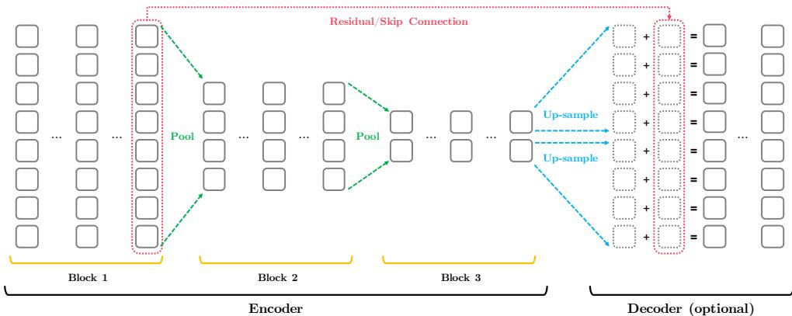

# Funnel-Transformer：滤除序列冗余以实现高效语言处理

Zihang Dai∗12, Guokun Lai∗1, Yiming Yang1, Quoc V. Le2 1Carnegie Mellon University（卡内基梅隆大学）, 2Google AI Brain Team（谷歌 AI Brain 团队） {dzihang,guokun,yiming}@cs.cmu.edu, qvl@google.com

## 摘要

随着语言预训练（language pretraining）的成功，开发具有良好可扩展性且能以更低成本利用大量无标注数据的更高效架构变得十分迫切。为了提升效率，我们审视了维护全长度 token 级表示中被严重忽视的冗余，尤其是对于那些仅需要序列的单向量表示的任务。基于这一直觉，我们提出了 Funnel-Transformer，它逐步将隐藏状态序列压缩为更短的序列，从而降低计算开销。更重要的是，通过将长度缩减所节省的 FLOPs 重新投入到构建更深或更宽的模型中，我们进一步提升了模型容量。此外，为了执行常见预训练目标所需的 token 级预测，Funnel-Transformer 能够通过解码器从压缩后的隐藏序列中恢复每个 token 的深层表示。经验上，在 FLOPs 相当或更少的情况下，Funnel-Transformer 在广泛的序列级预测任务上均优于标准 Transformer，包括文本分类、语言理解和阅读理解。

## 1 引言

随着近期无监督语言预训练（unsupervised language pretraining）[1, 2, 3, 4, 5, 6, 7, 8, 9, 10, 11, 12] 的成功，神经自注意力模型（即 Transformer）[13] 的能力被推到了一个新的高度，并带来了机器学习和自然语言处理（Natural Language Processing, NLP）领域的显著进步。更重要的是，研究观察到将更多 FLOPs 投入到更长的预训练和/或更大的模型中，预训练 Transformer 模型的性能会持续提升。然而，预训练甚至仅仅微调当前最先进的自注意力模型都极其昂贵，因为与传统 NLP 模型相比，它们需要多得多的 FLOPs 和内存资源。这在很大程度上限制了它们在更多领域的应用与成功。

面对这一挑战，越来越多的研究工作致力于降低自注意力模型预训练与微调的成本。从预训练后处理的角度出发，典型的方法包括各种形式的蒸馏（distillation）、剪枝（pruning）与量化（quantization），它们试图利用更大模型中更丰富的信号，或学习移除不那么重要的操作，从而从一个良好预训练的模型中派生出一个更轻量的模型。另一类研究方向旨在设计一种架构，使其不仅具有更低的资源-性能比（即更高效），而且至少在某些领域内能够像 Transformer 一样良好地扩展。这些方法大多建立在 Transformer 主干网络之上，并着重重新设计其构建模块。具有代表性的解决方案包括：搜索更好的微观操作或宏观模块设计 [14, 15]；用诸如卷积（convolution）[16] 与动态卷积（dynamic convolution）[17] 等局部操作替代全配对注意力；以及针对现有模块优化隐藏层大小的组合 [18]。

在上述各种各样想法之中，一种常见的策略是识别冗余的操作或表征，并用更高效的操作或表征加以替代。受这一思路的启发，本文将聚焦于 Transformer 在所有层中始终维持全长度隐藏表征序列所引发的潜在冗余。直观上，对于诸如文本分类与排序等许多序列级自然语言处理（NLP）任务，最常见的使用场景是从整个序列中提取一个单一向量，而这并不需要保留到词元（token）级别粒度的全部信息。因此，对于这类任务而言，全长度的隐藏状态序列可能包含显著的冗余。这与图像识别的情况类似：在图像识别中，卷积神经网络会随着网络层数加深而逐渐降低特征图的空间分辨率/尺寸。此外，语言学先验也鼓励将邻近的词元（单词）逐步合并为更大的语义单元（短语），这自然会形成更短的表征序列。

具体而言，我们提出在自注意力模型中逐步降低隐藏表示的序列分辨率（即长度）。序列长度的缩减能够直接带来 FLOPs 和内存的显著节省。更重要的是，所节省的计算资源可以直接重新投入到构建更深（或更宽）的模型中，从而在不增加额外计算负担的前提下提升模型容量。此外，为了应对像掩码语言建模（MLM）[2] 这类常见预训练目标需要对每个 token 分别保留表示的挑战，我们设计了一种简单策略，从缩减长度的隐藏状态中解码出完整长度的深层表示序列。因此，所提出的模型可以直接训练而无需修改预训练目标，并且能够应用于需要 token 级表示的下游任务。

经验上，在 FLOPs 相当甚至更少的情况下，通过以序列分辨率换取深度，我们提出的模型在多种序列级预测任务（包括文本分类、语言理解和阅读理解）上相较标准 Transformer 取得了更优的性能。

## 2 方法

## 2.1 背景

Transformer 架构 [13] 是一种高度模块化的神经网络，其中每个 Transformer 层由两个子模块组成，即多头自注意力（S-Attn）和逐位置前馈网络（P-FFN）。两个子模块均由残差连接和层归一化包裹。形式上，给定长度为 T 的隐藏状态序列 $\mathbf { h } = [ h _ { 1 } , \ldots , h _ { T } ]$，单个 Transformer 层的计算可表示为

$$
\mathbf {h} \leftarrow \text { LayerNorm } (\mathbf {h} + \text { S - Attn } (Q = \mathbf {h}, \text { KV } = \mathbf {h})),\tag{1}
$$

$$
h _ {i} \leftarrow \operatorname{LayerNorm} (h _ {i} + \mathrm{P-FFN} (h _ {i})), \quad \forall i = 1, \dots , T.\tag{2}
$$

预训练目标 最常用的预训练目标是由 BERT [2] 提出的掩码语言建模 (Masked Language Modeling, MLM)。对于从大型无标签集合 $\mathcal{D}$ 中采样的长度为 $T$ 的自然语言序列 $x$，MLM 目标首先通过将 $x$ 中 15% 的词元随机替换为特殊词元 [mask] 来构造一个被损坏的序列 $\hat{x}$，然后训练一个 Transformer 模型 [2] 基于 $\hat{x}$ 来重建原始的 $x$，即

$$
\max _ {\boldsymbol {\theta}} \mathcal {J} _ {\mathrm{MLM}} (\boldsymbol {\theta}) = \mathbb {E} _ {\mathbf {x} \sim \mathcal {D}} \mathbb {E} _ {\mathcal {I}} \sum_ {i \in \mathcal {I}} \log P _ {\boldsymbol {\theta}} (x _ {i} \mid \hat {\mathbf {x}} _ {\mathcal {I}}) = \mathbb {E} _ {\mathbf {x} \sim \mathcal {D}} \mathbb {E} _ {\mathcal {I}} \sum_ {i \in \mathcal {I}} \log \frac {\exp (e (x _ {i}) ^ {\top} h _ {i} (\hat {\mathbf {x}} _ {\mathcal {I}}))}{\sum_ {x ^ {\prime}} \exp (e (x ^ {\prime}) ^ {\top} h _ {i} (\hat {\mathbf {x}} _ {\mathcal {I}}))},
$$

其中 $I$ 是被掩码标记的位置集合，$\hat{\mathbf{x}}_{\mathcal{T}}$ 的下标强调其对 $\tau$ 的依赖关系，$e(x)$ 表示标记 $x$ 的嵌入，$h_i(\hat{\mathbf{x}}_{\mathcal{T}})$ 是 Transformer 模型在位置 $i$ 产生的最后一层隐藏状态。在预训练之后，整个模型在下游任务上进行微调。

为了展示我们所提出模型的通用性，我们还实验了另一种预训练目标 ELECTRA [5]。与 MLM 不同，ELECTRA 依赖一对联合训练的生成器和判别器。具体而言，生成器通常具有较小的规模（约为判别器规模的 1/4），并直接通过 MLM 目标进行训练，即 $\max_{\theta_G} \mathcal{I}_{\mathrm{MLM}}(\theta_G)$。然后，对于每个被掩码的位置，从生成器的重建分布中采样一个标记来替换 [mask] 标记，从而形成新序列 $\tilde{\mathbf{x}}$，即如果 $i \in \mathcal{T}$，则 $\tilde{x}_i \sim P_{\theta_G}(x_i \mid \hat{\mathbf{x}}_{\mathcal{T}})$；否则 $\tilde{x}_i = x_i$。给定新序列 $\tilde{\mathbf{x}}$，判别器随后通过二分类任务进行训练，以区分 $\tilde{\mathbf{x}}$ 中的每个标记是真实的（与 $x$ 相同）还是伪造的（与 $x$ 不同）。在预训练之后，仅判别器会用于微调过程，而生成器则直接被丢弃。

**讨论** 注意，上述介绍的两种预训练目标都需要具备为每个输入标记生成隐藏状态的能力，即 $h_i(\hat{\mathbf{x}}_{\mathcal{T}})$ 和 $h_i(\tilde{\mathbf{x}})$。由于这一需求，保持完整的隐藏状态序列似乎是很自然的选择。然而，与此相反，许多序列级别的下游任务（如分类或排序）仅需要整个序列的单个向量表示。从根本上讲，这表明在微调过程中通常需要进行某种形式的压缩，以去除不必要的冗余信息。这一观察立即引出了以下两个问题：

• 我们能否设计一个表达能力相当但更高效的通用模型，将完整的隐藏状态序列压缩为更紧凑的形式？

• 在使用压缩表示的情况下，模型如何在预训练过程中保留生成标记级别表示的能力？

为了回答这两个问题，我们接下来介绍我们所提出的架构。

## 2.2 所提架构

  

图 1：所提出的 Funnel-Transformer 的高层可视化示意图。

为继承 Transformer 架构的高容量与优化优势，所提出的模型保留了由残差连接与层归一化包裹的、自注意力（Self-Attention, S-Attn）与位置前馈网络（Position-wise Feed-Forward Network, P-FFN）子模块交错排列的相同整体骨架。但不同的是，为了实现表示压缩与计算量削减，本模型采用了一种编码器，它会随着层数加深而逐步缩减隐藏状态的序列长度。此外，对于像预训练这类涉及逐 token 预测的任务，会使用一个简单的解码器从压缩后的编码器输出中重建出完整的 token 级表示序列。

编码器 如图 1 左侧所示，编码器由若干个由连续 Transformer 层组成的块（block）构成。在每个块内部，隐藏状态的序列长度始终保持不变。但当从较低层的块进入较高层的块时，会通过沿序列维度执行某种池化操作来缩减隐藏序列的长度，即

$$
\mathbf {h} ^ {\prime} \leftarrow \operatorname{Pooling} (\mathbf {h}),\tag{3}
$$

其中 $h \in \mathbb { R } ^ { T \times D }$ 且 $\mathbf { h } ^ { \prime } \in \mathbb { R } ^ { T ^ { \prime } \times D }$ ，其中 $T ^ { \prime } < T$ 。重要的是，我们并未将池化后的序列直接馈入新模块的首层 S-Attn，而是仅利用池化序列 $\mathbf { \bar { h } } ^ { \prime }$ 来构建自注意力的查询向量（以及残差信号），而未池化的序列 $h$ 则承担键向量与值向量的角色，即

$$
\mathbf {h} \leftarrow \text { LayerNorm } \big (\mathbf {h} ^ {\prime} + \text { S - Attn } \big (Q = \mathbf {h} ^ {\prime}, \text { KV } = \mathbf {h} \big) \big).\tag{4}
$$

值得注意的是，这个特殊的 S-Attn 模块的输出序列长度与池化后的序列 $\mathbf{h}^0$ 相同。为了理解这种特定设计的优势，比较所提出的"pool-query-only"变体与使用 $\mathbf{h}'$ 同时作为查询（query）和键-值（key-value）向量的朴素替代方案是很有帮助的，即 $\mathbf{S\text{-}Attn}\!\left(Q=\mathbf{h}',\,KV=\mathbf{h}'\right)$

• 在朴素方法下，压缩完全由池化操作控制，而池化操作在注意力模块之前完成。因此，像平均池化/均值池化（average/mean pooling）这样相对简单的池化方法无法实现良好的压缩。

• 在 pool-query-only 变体下，压缩不仅取决于池化的执行方式，还取决于自注意力（self-attention）如何对未池化的序列进行加权求和以形成每个池化向量。此处这种特定的注意力实际上可以看作是一种线性压缩，它将 $T$ 个基（bases）组合成数量更少的 $T'$ 个"压缩基（compressed bases）"。因此，该变体以最小的计算开销使压缩操作更具表达能力。

采用这种特定的 pool-query-only 设计后，我们发现对序列的每个滑动窗口应用最简单的跨步均值池化（strided mean pooling）在实践中效果很好。为简单起见，本工作中仅试验步幅为 2、窗口大小为 2 的情况。因此，池化操作会将序列长度减半，并且每个池化后的隐藏状态对应于 2 个未池化隐藏向量的一个窗口。直观上，这种池化方式大致遵循这样的语言学先验：相邻的词元（tokens）可以逐步合并（或压缩）成一个更大的语义成分。在池化和 pool-query-only 注意力之后序列长度减半，编码器其余的计算则简单地遵循公式 (2) 和 (1) 中的标准更新。

最后，作为一项额外的实现细节，回忆一下语言预训练中一种特定的设计：在原始输入序列的开头添加一个特殊词元（special token）[cls]，并使用最后一层与 [cls] 对应的隐藏状态（即 $h_1$）作为该序列的表示。为了防止池化破坏这种特殊结构，我们首先将 [cls] 对应的隐藏状态与其余隐藏状态分开，并仅对其余隐藏状态应用池化。对于一些实际实现问题和一种高效的解决方案，我们请读者参阅附录 A.1。

解码器（Decoder）　为了从长度缩减后的编码器输出中恢复完整的隐状态序列，一个自然而然的想法是执行某种上采样（up-sampling）。例如，在图像生成或超分辨率任务中，经常使用反卷积（转置卷积，deconvolution / transposed convolution）或无参数的双线性插值调整来提升特征图的空间分辨率。因此，我们可以简单地将这些从二维处理中借鉴的思想适配到我们的一维情形，并对编码器输出施加适当的上采样。

然而，与图像领域中通常采用多次小扩展率的上采样（例如每次将序列长度增加 $2 \mathbf { x }$）不同，我们在这里选择在单次上采样中使用一个大的扩展率，如图 1 右侧所示。具体而言，给定来自 M 个模块编码器的长度为 $T _ { M } = T / 2 ^ { M - 1 }$ 的输出序列 $\mathbf { \bar { h } } ^ { \mathbf { M } }$，我们通过将每个隐向量重复 $2 ^ { M - 1 }$ 次的方式，将其直接上采样为完整长度的序列 $\mathbf { \bar { h } } ^ { \mathsf { u p } } = \left\lceil h _ { 1 } ^ { \mathsf { u p } } , \cdot \cdot \cdot , h _ { T } ^ { \mathsf { u p } } \right\rceil$：

$$
\forall i = 1, \dots , T, h _ {i} ^ {\mathrm{up}} = h _ {i / / 2 ^ {M - 1}} ^ {M},\tag{5}
$$

其中 $\cdot / / \cdot$ 表示整除（floor division）。然而，请注意 $\mathbf{h}^{\mathrm{up}}$ 中每 $2^{M-1}$ 个连续向量恰好完全相同，因此并不包含细致的 token 级信息。因此，我们进一步从编码器（encoder）第一个块提取最后一层的隐藏状态 $\mathbf{h}^{1}$，它仍然保持完整长度 $T$，并包含未经压缩的 token 级信息。然后，将低层表示 $\mathbf{h}^{1}$ 与上采样后的高层表示 $\mathbf{h}^{\mathrm{up}}$ 相加，形成深度 token 级表示 $\mathbf{g} = \mathbf{h}^{1} + \mathbf{h}^{\mathrm{up}}$。实际上，这构成了一条残差/跳跃连接（residual/skip connection），既能保留细致的 token 信息，又有望带来更轻松的优化过程。此外，我们在 $\mathbf{g}$ 之上再堆叠若干 Transformer 层，以实现低层与高层特征更为充分的深度融合。在本文中，译码器（decoder）始终使用 2 层 Transformer。

需要特别强调的是，只有当任务需要 token 级预测时（例如标准预训练或序列标注任务），才会使用译码器。对于仅需序列的单一向量表示的任务（如分类），译码器在预训练完成后将被丢弃，仅对编码器进行微调。最后，为了突出编码器的过滤/压缩特性及其形状，我们将所提模型命名为 Funnel-Transformer（F-TFM，漏斗式 Transformer）。

## 2.3 复杂度与容量分析

在明确架构设计之后，我们接下来分析序列压缩如何影响所提模型的复杂度与容量，特别是与标准 Transformer 的对比。首先，对于包含 S-Attn 模块和隐藏维度为 $D$ 的 P-FFN 模块的一个 Transformer 层，处理长度为 $T$ 的序列所需复杂度为 $O(T^{2}D + TD^{2})$。2 因此，每当编码器中的序列长度减半时，复杂度便会获得超过线性的下降幅度（即节省超过一半的复杂度）。实际上，由于 $O(TD^{2})$ 项具有较大的常数项，通常观察到的是近似线性的加速。当序列长度相对较长时（例如在预训练中），这种超线性效应更加明显。

因此，在相同 FLOPs 的条件下，我们至少可以用第 $m$ 个块中的 $2^{m-1}$ 层来换取第 1 个块中的一整层，从而以更经济的方式增加网络深度。

另一方面，压缩长度层的容量显然以常规全长层的容量为上界。在大多数压缩为有损的情况下，缩短序列长度不可避免地会导致容量下降。好消息是，单层的容量下降可以重新投入所节省的 FLOPs，通过堆叠更多更便宜的缩短长度层或增大模型宽度来得到充分的补偿。

作为一个具体例子，对于 $\mathbf { B E R T _ { B a s e } }$ 规模的 Transformer，即 12 层、隐藏大小为 768（L12H768），我们可以构建一个 3 块的 Funnel-Transformer，其中每个块包含 6 层、隐藏大小为 768（B6-6-6H768）。尽管总共有 18 层，但在对分类任务进行微调时，B6-6-6H768 架构的 FLOPs 仅相当于最多 $6 + 6 / 2 + 6 / 4 = 1 0 . 5$ 个全长层，显然少于 L12H768。更重要的是，正如我们将在实验中展示的，B6-6-6H768 显著优于 L12H768。虽然这很直观，但在这种深度-长度权衡下如何构建最优的块布局仍是一个开放性的挑战。在本文中，我们只考虑相对规则的布局，将更系统的研究留作未来工作。

最后，请注意，用序列分辨率换取深度或宽度的一个副作用是参数总数的增加。例如，与 L12H768 相比，B6-6-6H768 具有 1.5 倍的 Transformer 参数。在实践中，更多的参数可能会增加分布式训练中的通信成本，以及内存消耗和内存访问时间。一个简单的补救方法是执行某些参数共享，如 ALBERT 中所用的那样，以恢复相同的参数数量。以 B6-6-6H768 为例，可以将第 2 块和第 3 块中每两层共享参数，记为 B6-3x2-3x2H768，这使得参数数量与 L12H768 相同。然而，参数共享可能导致性能损失。从根本上讲，这给我们带来了另一个权衡——使用更多参数所带来的收益（容量）与成本（内存和通信成本），这高度依赖于具体设备。

## 3 相关工作

据我们所知，之前没有工作通过在语言预训练中压缩隐藏状态的序列长度来获得性能提升。同时，我们提出的模型与一个同期工作 [19] 中针对因果语言建模所提出的自底向上模型非常相似。关键区别包括用于下采样的仅查询池化（pool-query-only）设计、上采样的执行方式，以及我们的相对注意力参数化。另一个密切相关的思路是 Power-BERT [20]，它在微调期间学习软消除（soft-eliminate）不那么 "significant" 的词向量。因此，对于微调后的推理，可以通过减少序列长度来加速。更一般地说，我们的工作也与之前关于层次化循环神经网络 [21] 和 Transformer 模型 [22, 23] 的研究相关。与这些方法不同，我们的模型不依赖于任何预定义的语义层次结构或边界，并且始终通过注意力捕捉全长依赖输入。

与之形成对比的是，我们的工作从计算机视觉领域汲取了大量灵感。带残差连接的收缩式编码器与扩张式解码器框架在概念上类似于用于图像分割的 ResUNet [24]。步进式池化（strided pooling）同样被广泛用于构建现代图像识别网络 [25]。尽管存在上述相似之处，但除了数据域与计算模块上的明显差异之外，我们的编码器采用了一种特殊的仅池化查询（pool-query-only）设计以提升压缩效果，而我们的解码器仅需单次大扩张率的上采样操作。

此外，图神经网络领域的一系列研究工作尝试以不同方式逐步减少节点数量，并获取一个用于有监督分类的单一向量表示。[26, 27, 28] 虽然这些方法原则上可以作为替代的压缩操作嵌入到我们的模型中，但用于有监督图分类的压缩技术能否被扩展应用于大规模语言预训练，这仍是一个悬而未决的问题。

## 4 实验

在本节中，我们通过先预训练再在下游任务上进行微调的方式，对所提出的 F-TFM 进行经验性评估。沿用先前工作的做法，在预训练阶段，我们考虑以下两种常见设定：

• 基础规模（Base scale）：在 Wikipedia + Book Corpus 上，以批量大小 256 预训练模型 1M 步。这正是原始 BERT [2] 所使用的设定。我们将基于该设定在 F-TFM 与标准 Transformer 之间进行公平对比，并开展若干消融实验。

• 大规模（Large scale）：在 XLNet [3] 与 ELECTRA [5] 所使用的五个数据集（Wikipedia + Book Corpus + ClueWeb + Gigaword + Common Crawl）上，以批量大小 8K 预训练模型 500K 步。我们将在该规模下将 F-TFM 与此前的最先进方法进行比较。

在微调阶段，由于 F-TFM 的设计初衷就是获取输入序列的单一向量表示，因此我们主要关注仅需这种表示的序列级任务。具体而言，这些任务包括用于语言理解的 GLUE 基准 [29]、7 项广泛使用的文本（情感 / 主题）分类任务（IMDB、AD、DBpedia、Yelp-2、Yelp-5、Amazon-2、Amazon-5）[30]，以及 RACE 阅读理解数据集 [31]。此外，为了考察 F-TFM 在需要逐 token 预测任务上的表现，我们还考虑了 SQuAD 问答任务，该任务要求模型从上下文段落中选取一个 token 片段作为答案。关于实验设定的更多细节，请读者参阅附录 B。

最后，对于本文实现的所有模型（包括 4.1 节基础规模对比中的 Transformer 基线），我们一律采用 Transformer-XL [32] 所提出的相对位置注意力参数化方式（关于 Transformer-XL 的一些实现细节，请参见附录 A.2）。

## 4.1 基础规模结果

首先，我们评估 F-TFM 在相近计算量（即 FLOPs）下相较于标准 Transformer 的表现。为此，我们考虑标准 Transformer 三种常用的模型规模，即 large（L24H1024）、base（L12H768）和 small（L6H768）。然后，对于每个 Transformer 基线模型，我们构建具有不同块布局和参数的 F-TFM，同时确保 F-TFM 的 FLOPs 始终更少或相近。基于 MLM（掩码语言建模，Masked Language Modeling）预训练目标，GLUE 基准和文本分类上的结果列于表 1，其中我们也列出了相对 FLOPs 和参数数量（#Params）。基于此，我们可以得出几个关键观察：

<table><tr><td>Model size</td><td>CoLA</td><td>SST-2</td><td>MRPC</td><td>STS-B</td><td>QQP</td><td>MNLI</td><td>QNLI</td><td>RTE</td><td>GLUE-AVG</td></tr><tr><td>L24H1024</td><td>63.2</td><td>94.8</td><td>91.8/88.5</td><td>91.1</td><td>88.7/91.7</td><td>88.7</td><td>94.0</td><td>80.5</td><td>86.6</td></tr><tr><td>B10-10-10</td><td>64.8</td><td>95.0</td><td>92.5/89.5</td><td>90.7</td><td>88.6/91.5</td><td>88.9</td><td>94.0</td><td>81.5</td><td>87.0</td></tr><tr><td>B8-8-8</td><td>63.5</td><td>94.7</td><td>92.2/89.0</td><td>90.7</td><td>88.9/91.7</td><td>88.8</td><td>93.6</td><td>81.2</td><td>86.7</td></tr><tr><td>L12H768</td><td>60.5</td><td>93.0</td><td>92.2/89.0</td><td>89.4</td><td>88.1/91.2</td><td>86.0</td><td>92.2</td><td>73.6</td><td>84.4</td></tr><tr><td>B6-6-6</td><td>62.5</td><td>94.0</td><td>92.2/89.0</td><td>89.5</td><td>88.4/91.4</td><td>87.0</td><td>92.7</td><td>76.5</td><td>85.3</td></tr><tr><td>B6-3x2-3x2</td><td>60.5</td><td>93.6</td><td>92.4/89.2</td><td>89.4</td><td>88.2/91.3</td><td>86.4</td><td>92.5</td><td>75.0</td><td>84.7</td></tr><tr><td>B4-4-4</td><td>59.1</td><td>92.7</td><td>91.8/88.7</td><td>89.1</td><td>88.2/91.3</td><td>85.5</td><td>92.0</td><td>73.2</td><td>83.9</td></tr><tr><td>L6H768</td><td>55.2</td><td>91.5</td><td>91.1/87.8</td><td>88.1</td><td>87.2/90.6</td><td>82.7</td><td>90.0</td><td>64.6</td><td>81.3</td></tr><tr><td>B3-4-4</td><td>59.0</td><td>92.8</td><td>91.8/88.5</td><td>88.5</td><td>87.8/90.9</td><td>84.8</td><td>91.8</td><td>73.2</td><td>83.7</td></tr><tr><td>Model size</td><td>IMDB</td><td>AG</td><td>DBpedia</td><td>Yelp2</td><td>Yelp5</td><td>Amazon2</td><td>Amazon5</td><td>FLOPs</td><td>#Params</td></tr><tr><td>L24H1024</td><td>4.440</td><td>4.987</td><td>0.646</td><td>1.758</td><td>28.73</td><td>2.409</td><td>32.78</td><td>1.00x</td><td>1.00x</td></tr><tr><td>B10-10-10</td><td>4.404</td><td>5.026</td><td>0.617</td><td>1.734</td><td>28.52</td><td>2.400</td><td>32.65</td><td>0.73x</td><td>1.22x</td></tr><tr><td>B8-8-8</td><td>4.552</td><td>5.079</td><td>0.664</td><td>1.713</td><td>28.84</td><td>2.438</td><td>32.87</td><td>0.58x</td><td>1.00x</td></tr><tr><td>L12H768</td><td>5.328</td><td>5.184</td><td>0.663</td><td>2.013</td><td>29.35</td><td>2.571</td><td>33.14</td><td>1.00x</td><td>1.00x</td></tr><tr><td>B6-6-6</td><td>4.908</td><td>5.079</td><td>0.654</td><td>1.939</td><td>29.03</td><td>2.518</td><td>32.91</td><td>0.88x</td><td>1.39x</td></tr><tr><td>B6-3x2-3x2</td><td>5.144</td><td>5.342</td><td>0.649</td><td>1.892</td><td>29.03</td><td>2.570</td><td>33.01</td><td>0.88x</td><td>1.00x</td></tr><tr><td>B4-4-4</td><td>5.348</td><td>5.250</td><td>0.670</td><td>1.979</td><td>29.37</td><td>2.596</td><td>33.16</td><td>0.58x</td><td>1.00x</td></tr><tr><td>L6H768</td><td>6.252</td><td>5.421</td><td>0.697</td><td>2.203</td><td>30.33</td><td>2.801</td><td>33.69</td><td>1.00x</td><td>1.00x</td></tr><tr><td>B3-4-4</td><td>5.520</td><td>5.342</td><td>0.670</td><td>2.042</td><td>29.51</td><td>2.603</td><td>33.16</td><td>1.00x</td><td>1.53x</td></tr></table>

表 1：基础规模（base scale）下的 MLM 预训练结果：上面板为 GLUE 开发集性能（越高越好），下面板为文本分类错误率（越低越好）。FLOPs 与 #Params 均指仅含编码器（encoder）的微调设置。含解码器（decoder）的对应数据见附录 C.2。FLOPs 是假设相对于（w.r.t.）序列长度呈线性复杂度的粗略估计。#Params 为精确值，且包含嵌入矩阵。

- 在相近或更少的 FLOPs 条件下，F-TFM 通过以序列分辨率换取更多层数，在除 STS-B 之外的大多数任务上均优于标准 Transformer（Transformer），且对于较小的模型优势尤为明显。
- 当仅压缩序列长度而不增加深度（即 #Params 保持不变）时，F-TFM 在 GLUE 数据集的某些设置下可能出现一定的性能下降。然而，随着模型规模的增大，此类性能差距会逐渐缩小甚至消失。
- 此外，我们发现部分参数共享（partial parameter-sharing）往往会损害性能。因此，实际的权衡取舍应根据具体任务和计算设备而定。

为了进一步检验 F-TFM 的泛化能力，我们额外考虑将 ELECTRA 用于预训练。相关结果汇总于表 2。总体而言，我们观察到了类似的趋势，尽管在 GLUE 基准上的提升幅度略小。这可能归因于我们在训练 F-TFM 时，完全复用了针对 Transformer 调优好的两个关键超参数——判别器损失系数（discriminator loss coefficient）与生成器尺寸倍数（generator size multiplier）——而未做任何调整。

<table><tr><td>Model size</td><td>CoLA</td><td>SST-2</td><td>MRPC</td><td>STS-B</td><td>QQP</td><td>MNLI</td><td>QNLI</td><td>RTE</td><td>GLUE-AVG</td></tr><tr><td>L24H1024</td><td>66.5</td><td>94.3</td><td>92.8/90.0</td><td>91.5</td><td>89.6/92.2</td><td>89.4</td><td>94.1</td><td>84.5</td><td>87.8</td></tr><tr><td>B10-10-10</td><td>68.6</td><td>95.0</td><td>93.0/90.0</td><td>91.0</td><td>88.9/91.7</td><td>89.1</td><td>93.6</td><td>84.5</td><td>87.9</td></tr><tr><td>B8-8-8</td><td>66.6</td><td>94.8</td><td>92.6/89.7</td><td>90.7</td><td>88.8/91.7</td><td>89.0</td><td>93.6</td><td>82.1</td><td>87.3</td></tr><tr><td>L12H768</td><td>64.3</td><td>93.1</td><td>92.1/89.2</td><td>90.8</td><td>88.7/91.7</td><td>86.4</td><td>92.1</td><td>75.4</td><td>85.4</td></tr><tr><td>B6-6-6</td><td>64.3</td><td>94.2</td><td>92.8/89.7</td><td>90.1</td><td>88.7/91.6</td><td>87.4</td><td>92.5</td><td>78.3</td><td>86.0</td></tr><tr><td>B6-3x2-3x2</td><td>63.9</td><td>94.2</td><td>93.0/90.2</td><td>89.5</td><td>88.4/91.4</td><td>87.0</td><td>92.2</td><td>77.6</td><td>85.7</td></tr><tr><td>B4-4-4</td><td>62.8</td><td>93.6</td><td>92.5/89.2</td><td>89.2</td><td>88.4/91.3</td><td>86.0</td><td>91.6</td><td>74.3</td><td>84.8</td></tr><tr><td>L6H768</td><td>62.1</td><td>91.1</td><td>90.8/86.8</td><td>88.9</td><td>88.2/91.3</td><td>83.9</td><td>89.7</td><td>66.7</td><td>82.6</td></tr><tr><td>B3-4-4</td><td>59.0</td><td>93.1</td><td>90.8/87.5</td><td>88.7</td><td>88.1/91.0</td><td>85.8</td><td>91.1</td><td>72.5</td><td>83.6</td></tr><tr><td>Model size</td><td>IMDB</td><td>AG</td><td>DBpedia</td><td>Yelp2</td><td>Yelp5</td><td>Amazon2</td><td>Amazon5</td><td>FLOPs</td><td>#Params</td></tr><tr><td>L24H1024</td><td>4.724</td><td>5.053</td><td>0.653</td><td>1.874</td><td>28.84</td><td>2.425</td><td>32.85</td><td>1.00x</td><td>1.00x</td></tr><tr><td>B10-10-10</td><td>4.324</td><td>5.250</td><td>0.639</td><td>1.789</td><td>28.68</td><td>2.419</td><td>32.72</td><td>0.73x</td><td>1.22x</td></tr><tr><td>B8-8-8</td><td>4.364</td><td>5.408</td><td>0.651</td><td>1.729</td><td>28.76</td><td>2.447</td><td>32.85</td><td>0.58x</td><td>1.00x</td></tr><tr><td>L12H768</td><td>5.248</td><td>5.355</td><td>0.657</td><td>1.953</td><td>29.24</td><td>2.596</td><td>33.04</td><td>1.00x</td><td>1.00x</td></tr><tr><td>B6-6-6</td><td>4.792</td><td>5.237</td><td>0.650</td><td>1.850</td><td>28.73</td><td>2.499</td><td>32.79</td><td>0.88x</td><td>1.39x</td></tr><tr><td>B6-3x2-3x2</td><td>4.924</td><td>5.342</td><td>0.671</td><td>1.913</td><td>29.00</td><td>2.523</td><td>32.85</td><td>0.88x</td><td>1.00x</td></tr><tr><td>B4-4-4</td><td>5.152</td><td>5.382</td><td>0.659</td><td>2.032</td><td>29.33</td><td>2.566</td><td>33.03</td><td>0.58x</td><td>1.00x</td></tr><tr><td>L6H768</td><td>6.220</td><td>5.395</td><td>0.674</td><td>2.287</td><td>30.16</td><td>2.759</td><td>33.57</td><td>1.00x</td><td>1.00x</td></tr><tr><td>B3-4-4</td><td>5.396</td><td>5.342</td><td>0.653</td><td>2.000</td><td>29.60</td><td>2.591</td><td>33.09</td><td>1.00x</td><td>1.53x</td></tr></table>

表 2：基座规模下的 ELECTRA 预训练结果。

运行时间对比 虽然浮点运算量（FLOPs）能给出模型速度的大致概念，但它与实际运行时间仍存在差异，尤其是在存在其他开销的情况下。因此，为了完整性，我们在附录 C.2 中展示了 F-TFM 在实际运行时间上所带来的加速比。我们还在附录 C.2 中对比了 F-TFM 与 TFM 的实际显存占用。

## 4.2 大规模结果

鉴于 F-TFM 在基座规模下取得了令人鼓舞的结果，我们接下来在大规模设置下训练 F-TFM，并将其与在类似设置下预训练的前人模型进行比较。由于 ELECTRA 相对于 MLM 表现略优，我们将在所有大规模实验中使用 ELECTRA 目标。对于不同规模的预训练 F-TFM，我们首先在表 3 中对比其在 GLUE 基准上的微调性能。与基座规模的结果类似，在 FLOPs 更少或相当的情况下，F-TFM 在大多数任务上优于相应的基线模型，表明 F-TFM 具有良好的可扩展性。我们还在 7 个文本分类任务上测试了这些模型。但由于篇幅限制，我们请读者参阅附录 C.1。

接下来，我们考虑 RACE 数据集，它与 GLUE 基准差异较大。RACE 的核心是一项需要复杂推理的多项选择阅读理解任务，虽然如此，它可以被形式化为对正确选项的分类。此外，RACE 中的段落要长得多。对于 F-TFM 而言，这既是一个挑战（因为它需要细致的推理），也是一个压缩长段落的机会。正如我们在表 4 中所看到的，F-TFM 相对于所有前人模型都取得了更好的性能。特别地，在基座模型组中，性能提升非常显著。这表明 F-TFM 在涉及长文本与推理的序列级任务上也能够表现出色。

最后，虽然 F-TFM 主要为仅需要序列级表示的任务而设计，但通过额外微调解码器，也可以将 F-TFM 应用于词元级任务。为了测试这一能力，我们在 SQuAD 数据集上微调 F-TFM，并在表 5 中将其与前人模型进行比较。虽然 F-TFM 在基座组中以较大优势超过了前人模型，但在大型模型组中，使用约 83% FLOPs 的 F-TFM（B10-10-10）仍落后于始终保持完整长度词元级表示的标准 Transformer。这表明，当细致的词元级信息至关重要时，逐级压缩可能会损害性能。另一方面，与 SQuAD1.1 上的结果相比，F-TFM 在 SQuAD2.0 上的表现相对更好，

<table><tr><td>Model</td><td>CoLA</td><td>SST-2</td><td>MRPC</td><td>STS-B</td><td>QQP</td><td>MNLI</td><td>QNLI</td><td>RTE</td><td>WNLI</td><td>AVG</td></tr><tr><td colspan="11">Dev set results (single model)</td></tr><tr><td> $ROBERTA_{Large}$  [4]</td><td>68.0</td><td>96.4</td><td>-/90.9</td><td>92.4</td><td>-/92.2</td><td>90.2</td><td>94.7</td><td>86.6</td><td>-</td><td>88.9</td></tr><tr><td>XLNetLarge [3]</td><td>69.0</td><td>97.0</td><td>-/90.8</td><td>92.5</td><td>-/92.3</td><td>90.8</td><td>94.9</td><td>85.9</td><td>-</td><td>89.2</td></tr><tr><td> $ELECTRA_{Large}$  [5]</td><td>69.1</td><td>96.9</td><td>-/90.8</td><td>92.6</td><td>-/92.4</td><td>90.9</td><td>95.0</td><td>88.0</td><td>-</td><td>89.5</td></tr><tr><td>B10-10-10H1024</td><td>72.4</td><td>96.8</td><td>93.5/90.9</td><td>92.1</td><td>89.8/92.4</td><td>91.1/-</td><td>95.1</td><td>89.5</td><td>-</td><td>90.0</td></tr><tr><td>B8-8-8H1024</td><td>71.3</td><td>96.8</td><td>93.1/90.7</td><td>91.7</td><td>89.8/92.4</td><td>90.8/-</td><td>94.7</td><td>89.2</td><td>-</td><td>89.7</td></tr><tr><td> $ROBERTA_{Base}$  [4]</td><td>63.6</td><td>94.8</td><td>-/90.2</td><td>91.2</td><td>-/91.9</td><td>87.6/-</td><td>92.8</td><td>78.7</td><td>-</td><td>86.4</td></tr><tr><td>MPNetBase [12]</td><td>65.0</td><td>95.4</td><td>-/91.5</td><td>90.9</td><td>-/91.9</td><td>88.5/-</td><td>93.3</td><td>85.2</td><td>-</td><td>87.7</td></tr><tr><td>B6-6-6H768</td><td>70.1</td><td>96.3</td><td>93.2/90.4</td><td>91.1</td><td>89.2/92.0</td><td>89.7/-</td><td>93.7</td><td>83.4</td><td>-</td><td>88.3</td></tr><tr><td>B6-3x2-3x2H768</td><td>68.5</td><td>95.6</td><td>92.5/89.5</td><td>91.0</td><td>89.3/92.0</td><td>89.1/-</td><td>93.0</td><td>83.4</td><td>-</td><td>87.8</td></tr><tr><td>B4-4-4H768</td><td>68.2</td><td>95.0</td><td>92.8/90.2</td><td>90.3</td><td>89.0/91.8</td><td>88.6/-</td><td>92.6</td><td>79.1</td><td>-</td><td>87.0</td></tr><tr><td colspan="11">Leaderboard test set results (single task &amp; single model)</td></tr><tr><td> $ELECTRA_{Large}$  [5]</td><td>68.1</td><td>96.7</td><td>89.2/92.0</td><td>92.1/91.7</td><td>74.8/90.4</td><td>90.7/90.2</td><td>95.5</td><td>86.1</td><td>65.1</td><td>85.2</td></tr><tr><td>B10-10-10H1024</td><td>68.9</td><td>97.2</td><td>89.4/92.1</td><td>91.6/91.3</td><td>74.3/90.2</td><td>90.9/90.9</td><td>95.5</td><td>86.5</td><td>65.1</td><td>85.4</td></tr><tr><td>B8-8-8H1024</td><td>68.3</td><td>96.9</td><td>89.2/92.0</td><td>91.5/91.1</td><td>73.8/90.1</td><td>90.7/90.7</td><td>95.1</td><td>85.3</td><td>65.1</td><td>85.0</td></tr><tr><td> $ELECTRA_{Base}$  [5]</td><td>64.6</td><td>96.0</td><td>88.1/91.2</td><td>91.0/90.2</td><td>73.2/89.5</td><td>88.5/88.0</td><td>93.1</td><td>75.2</td><td>65.1</td><td>82.7</td></tr><tr><td>B6-6-6H768</td><td>68.3</td><td>96.5</td><td>89.1/91.9</td><td>90.6/89.9</td><td>73.3/89.9</td><td>89.7/89.4</td><td>94.0</td><td>80.4</td><td>65.1</td><td>84.0</td></tr><tr><td>B6-3x2-3x2H768</td><td>65.9</td><td>96.0</td><td>87.8/91.0</td><td>90.0/89.6</td><td>73.3/89.8</td><td>88.9/88.7</td><td>93.8</td><td>79.9</td><td>65.1</td><td>83.4</td></tr><tr><td colspan="11">Leaderboard test set results (multi-task &amp; ensemble)</td></tr><tr><td> $ROBERTA_{Large}$  [4]</td><td>67.8</td><td>96.7</td><td>89.8/92.3</td><td>92.2/91.9</td><td>74.3/90.2</td><td>90.8/90.2</td><td>95.4</td><td>88.2</td><td>89.0</td><td>88.1</td></tr><tr><td> $ELECTRA_{Large}$  [5]</td><td>71.7</td><td>97.1</td><td>90.7/93.1</td><td>92.9/92.5</td><td>75.6/90.8</td><td>91.3/90.8</td><td>95.8</td><td>89.8</td><td>91.8</td><td>89.4</td></tr><tr><td>B10-10-10H1024</td><td>70.5</td><td>97.5</td><td>91.2/93.4</td><td>92.6/92.3</td><td>75.4/90.7</td><td>91.4/91.1</td><td>95.8</td><td>90.0</td><td>94.5</td><td>89.7</td></tr></table>

表 3：在大规模预训练下，与先前方法在 GLUE 基准上的比较。

<table><tr><td rowspan="2">Model</td><td colspan="3">RACE</td></tr><tr><td>Total</td><td>High</td><td>Middle</td></tr><tr><td> $ROBERTA_{Large}$  [4]</td><td>83.2</td><td>81.3</td><td>86.5</td></tr><tr><td>XLNetLarge [3]</td><td>85.4</td><td>84.0</td><td>88.6</td></tr><tr><td>B10-10-10</td><td>85.7</td><td>84.4</td><td>88.8</td></tr><tr><td>B8-8-8</td><td>85.2</td><td>83.9</td><td>88.4</td></tr><tr><td> $ALBERT_{Base}$  [6]</td><td>66.0</td><td>-</td><td>-</td></tr><tr><td>MPNetBase [12]</td><td>72.0</td><td>76.3</td><td>70.3</td></tr><tr><td>B6-6-6</td><td>79.7</td><td>78.2</td><td>83.4</td></tr><tr><td>B6-3x2-3x2</td><td>78.8</td><td>77.5</td><td>82.0</td></tr><tr><td>B4-4-4</td><td>76.2</td><td>74.6</td><td>80.0</td></tr></table>

表 4：RACE 测试性能对比。

<table><tr><td rowspan="2">Model</td><td colspan="2">SQuAD2.0</td><td colspan="2">SQuAD1.1</td></tr><tr><td>EM</td><td>F1</td><td>EM</td><td>F1</td></tr><tr><td> $ROBERTA_{Large}$  [4]</td><td>86.5</td><td>89.4</td><td>88.9</td><td>94.6</td></tr><tr><td> $ELECTRA_{Large}$  [5]</td><td>88.0</td><td>90.6</td><td>89.7</td><td>94.9</td></tr><tr><td>B10-10-10</td><td>87.6</td><td>90.4</td><td>89.0</td><td>94.7</td></tr><tr><td>B8-8-8</td><td>87.1</td><td>89.8</td><td>88.7</td><td>94.4</td></tr><tr><td> $ROBERTA_{Base}$  [4]</td><td>80.5</td><td>83.7</td><td>84.6</td><td>91.5</td></tr><tr><td> $MPNet_{Base}$  [21]</td><td>80.5</td><td>83.3</td><td>86.8</td><td>92.5</td></tr><tr><td>B6-6-6</td><td>85.1</td><td>87.7</td><td>87.4</td><td>93.3</td></tr><tr><td>B6-3x2-3x2</td><td>84.2</td><td>87.0</td><td>87.0</td><td>93.0</td></tr><tr><td>B4-4-4</td><td>82.6</td><td>85.5</td><td>85.9</td><td>92.2</td></tr></table>

表 5：SQuAD 开发集性能对比。  
which additionally requires the model to make a sequence-level prediction on whether the question is answerable. This again shows the general effectiveness of the F-TFM in sequence-level tasks.

此外还要求模型在序列层面对问题是否可回答进行预测。这再次表明 F-TFM 在序列层面任务上具有普遍的有效性。

## 4.3 消融研究（Ablation Study）

<table><tr><td>ID</td><td>Layout</td><td>(FLOPs / Params)</td><td>Pool-Op</td><td>Pool-query-only</td><td>Sep [cls]</td><td>Rel-Attn</td><td>GLUE-AVG</td></tr><tr><td>(1)</td><td>B6-6-6</td><td>(1.00x / 1.00x)</td><td>Mean</td><td>√</td><td>√</td><td>√</td><td>83.5</td></tr><tr><td>(2)</td><td></td><td></td><td>Mean</td><td>√</td><td></td><td>√</td><td>82.9</td></tr><tr><td>(3)</td><td></td><td></td><td>Mean</td><td></td><td>√</td><td>√</td><td>83.0</td></tr><tr><td>(4)</td><td></td><td></td><td>Mean</td><td>√</td><td>√</td><td></td><td>81.4</td></tr><tr><td>(5)</td><td></td><td></td><td>Max</td><td>√</td><td>√</td><td>√</td><td>83.4</td></tr><tr><td>(6)</td><td></td><td></td><td>Top-Attn</td><td>√</td><td>√</td><td>√</td><td>75.8</td></tr><tr><td>(7)</td><td>B8-8</td><td>(1.14x / 0.91x)</td><td>Mean</td><td>√</td><td>√</td><td>√</td><td>83.4</td></tr><tr><td>(8)</td><td>B5-5-5-5</td><td>(0.89x / 1.08x)</td><td>Mean</td><td>√</td><td>√</td><td>√</td><td>82.9</td></tr></table>

Table 6: F-TFMs 在不同设计下的消融研究。

最后，基于 GLUE 基准，我们在 F-TFM 中对各项设计的重要性开展了一系列消融研究，包括分块布局设计、池化操作的类型、pool-query-only（仅对查询进行池化）技术、保持独立的 [cls] 向量，以及 Transformer-XL 参数化的使用。

• 池化操作（Pooling operation）：除我们最终在 F-TFM 中采用的均值池化外，我们实际测试了两种池化操作。

(1) 第一种即为第 2 节中介绍的步幅式均值/最大池化。

(2) The second type aims to select a subset of "hub" states, which refer to those hidden vectors that are attended most in the previous S-Attn layer and hence likely to carry most critical information about the sequence. Concretely, given the attention map from the previous S-Attn layer, we reduce sum the scores along the number of head and query length dimensions to a score for each position. Then, we simply choose the top 50% of states to achieve the same compression rate. Note that, this type of pooling operation is essentially the same as the important states selection procedure in Power-BERT [20].

(2) 第二种则旨在选取一部分「枢纽（hub）」状态子集，这些状态指的是在前一层 S-Attn 中被关注最多的隐藏向量，因此很可能承载了序列中最关键的信息。具体而言，给定前一层 S-Attn 的注意力图，我们沿着头部和查询长度两个维度对得分进行求和归约，得到每个位置的得分。然后，我们简单地选择得分最高的前 50% 个状态以达到相同的压缩率。需要指出的是，这种池化操作本质上与 Power-BERT [20] 中的重要状态选取流程相同。

• Pool-query-only design

• pool-query-only 设计

• Separating [cls] in the pooling operation

• 在池化操作中分离 [cls]

• 分块布局设计（Block layout design）：在我们的实验中，所有模型实际上均采用 3-block 的设计。这里，我们将 3-block 设计与 2-block 和 4-block 设计进行比较。

• Transformer-XL [32] 中提出的相对注意力参数化。我们将该参数化与 BERT [2] 中使用的可学习绝对位置嵌入进行了对比。

消融结果如表 6 所示。为节省计算资源，表 6 中模型隐藏状态的维度大小被设置为 512。从消融结果中，我们可以得出以下观察：

• 比较不同的池化操作（(1)、(5) 和 (6)），我们发现均值池化和最大池化的性能相近。但二者均显著优于利用注意力得分（Top-Attn pooling，即按注意力得分排序的池化）来选取「枢纽」状态的方案。

• Comparing (1) with (2) and (3) respectively, we see that the two special designs, i.e. "pool-queryonly" and maintaining a separate non-pooled [cls] , can both bring a clear improvement to the proposed model.

• 将 (1) 与 (2) 和 (3) 分别进行对比，我们可以发现，这两项特殊设计，即「pool-query-only」和「保持一个独立的不参与池化的 [cls]」，均能为所提模型带来明显的提升。

• 对比 (1) 和 (4) 可知，相对位置参数化是所提 F-TFM 取得性能的关键。我们推测池化操作可能会破坏绝对位置编码所携带的位置信息，而该信息仅在输入嵌入层注入模型。因此，较高的块可能没有足够的位置信息来学习足够好的注意力模式。相比之下，在相对位置注意力方案下，位置信息会被注入到每一层。因此，为了在使用基于绝对位置嵌入的 F-TFM 时取得良好结果，可以将绝对位置嵌入注入到每个注意力层中。事实上，Transformer 在计算机视觉目标检测问题中的一项同期应用也表明，将位置嵌入注入到每一层是非常重要的 [33]。

• 最后，我们研究框架中块布局设计的影响。以 B6-6-6 作为 3 块基准，我们考虑了另外两种 FLOPs 与参数量相近的布局设计。具体而言，我们考虑 2 块设计的 B8-8 以及 4 块设计的 B5-5-5-5。对比 (1)、(7) 和 (8) 的结果，我们发现 3 块（B6-6-6）设计的性能最佳，显著优于 4 块设计，并略优于 2 块设计。然而，如果进一步将 FLOPs/#Params 纳入考量，则 3 块设计的优越性更为明显。因此，在正文中，我们始终使用 3 块设计。

## 5 结论与讨论

本文在预训练-微调范式下，研究了语言处理中一个被很大程度上忽视的复杂度维度。通过所提出的 Funnel-Transformer，我们展示了如何以简单的形式压缩序列分辨率以节省计算，以及如何将节省下来的 FLOPs 再投资于提升模型容量从而改善性能。未来研究的开放挑战包括：改进压缩方案的更好方法、优化块布局设计，以及更好地再投资所节省的 FLOPs。此外，将 Funnel-Transformer 与知识蒸馏、量化等模型压缩技术相结合，将是增强其实用价值的重要方向。

## 参考文献

[1] Matthew E Peters, Mark Neumann, Mohit Iyyer, Matt Gardner, Christopher Clark, Kenton Lee, and Luke Zettlemoyer. 深度上下文化词表示（Deep contextualized word representations）. arXiv preprint arXiv:1802.05365, 2018.

[2] Jacob Devlin, Ming-Wei Chang, Kenton Lee, and Kristina Toutanova. BERT：面向语言理解的深度双向 Transformer 预训练（BERT: Pre-training of deep bidirectional transformers for language understanding）. arXiv preprint arXiv:1810.04805, 2018.

[3] Zhilin Yang, Zihang Dai, Yiming Yang, Jaime Carbonell, Russ R Salakhutdinov, and Quoc V Le. XLNet：用于语言理解的广义自回归预训练. 刊于《Advances in Neural Information Processing Systems》，第 5754–5764 页，2019。

[5] Kevin Clark, Minh-Thang Luong, Quoc V Le, and Christopher D Manning. ELECTRA：将文本编码器预训练为判别器而非生成器. arXiv preprint arXiv:2003.10555, 2020.

[6] Zhenzhong Lan, Mingda Chen, Sebastian Goodman, Kevin Gimpel, Piyush Sharma, and Radu Soricut. ALBERT：用于语言表示自监督学习的轻量级 BERT. arXiv preprint arXiv:1909.11942, 2019.

[8] Colin Raffel, Noam Shazeer, Adam Roberts, Katherine Lee, Sharan Narang, Michael Matena, Yanqi Zhou, Wei Li, and Peter J Liu. 用统一的文本到文本 Transformer 探索迁移学习的极限. arXiv preprint arXiv:1910.10683, 2019.

[9] Mike Lewis, Yinhan Liu, Naman Goyal, Marjan Ghazvininejad, Abdelrahman Mohamed, Omer Levy, Ves Stoyanov, and Luke Zettlemoyer. BART：用于自然语言生成、翻译和理解的去噪序列到序列预训练. arXiv preprint arXiv:1910.13461, 2019.

[10] Kaitao Song, Xu Tan, Tao Qin, Jianfeng Lu, and Tie-Yan Liu. MASS：用于语言生成的掩码序列到序列预训练. arXiv preprint arXiv:1905.02450, 2019.

[11] Xiaodong Liu, Pengcheng He, Weizhu Chen, and Jianfeng Gao. 用于自然语言理解的多任务深度神经网络. arXiv preprint arXiv:1901.11504, 2019.

[12] Kaitao Song, Xu Tan, Tao Qin, Jianfeng Lu, and Tie-Yan Liu. MPNet：用于语言理解的掩码与置换预训练. arXiv preprint arXiv:2004.09297, 2020.

[14] David R So, Chen Liang, and Quoc V Le. 进化 Transformer. arXiv preprint arXiv:1901.11117, 2019.

[15] Daoyuan Chen, Yaliang Li, Minghui Qiu, Zhen Wang, Bofang Li, Bolin Ding, Hongbo Deng, Jun Huang, Wei Lin, and Jingren Zhou. AdaBERT：基于可微神经架构搜索的任务自适应 BERT 压缩. arXiv preprint arXiv:2001.04246, 2020.

[16] Zhanghao Wu, Zhijian Liu, Ji Lin, Yujun Lin, and Song Han. 带有长-短距离注意力的轻量级 Transformer. arXiv preprint arXiv:2004.11886, 2020.

[17] Felix Wu, Angela Fan, Alexei Baevski, Yann N Dauphin, Michael Auli. 用轻量级和动态卷积减少注意力（Pay less attention with lightweight and dynamic convolutions）. arXiv 预印本 arXiv:1901.10430, 2019.

[18] Zhiqing Sun, Hongkun Yu, Xiaodan Song, Renjie Liu, Yiming Yang, Denny Zhou. MobileBERT：面向资源受限设备的紧凑型任务无关 BERT（MobileBERT: a compact task-agnostic bert for resource-limited devices）. arXiv 预印本 arXiv:2004.02984, 2020.

[19] Sandeep Subramanian, Ronan Collobert, Marc'Aurelio Ranzato, Y-Lan Boureau. 多尺度 Transformer 语言模型（Multiscale transformer language models）. arXiv 预印本 arXiv:2005.00581, 2020.

[20] Saurabh Goyal, Anamitra Roy Choudhary, Venkatesan Chakaravarthy, Saurabh ManishRaje, Yogish Sabharwal, Ashish Verma. Power-BERT：加速 BERT 分类任务推理（Power-BERT: Accelerating bert inference for classification tasks）. arXiv 预印本 arXiv:2001.08950, 2020.

[21] Rui Lin, Shujie Liu, Muyun Yang, Mu Li, Ming Zhou, Sheng Li. 用于文档建模的分层循环神经网络（Hierarchical recurrent neural network for document modeling）. 载于：Proceedings of the 2015 Conference on Empirical Methods in Natural Language Processing, 第 899–907 页, 2015.

[22] Xingxing Zhang, Furu Wei, Ming Zhou. HiBERT：用于文档摘要的分层双向 Transformer 的文档级预训练（HiBERT: Document level pre-training of hierarchical bidirectional transformers for document summarization）. arXiv 预印本 arXiv:1905.06566, 2019.

[23] Vikas K Garg, Inderjit S Dhillon, Hsiang-Fu Yu. 多分辨率 Transformer 网络：循环结构对建模层次结构并非必需（Multiresolution transformer networks: Recurrence is not essential for modeling hierarchical structure）. arXiv 预印本 arXiv:1908.10408, 2019.

[24] Olaf Ronneberger, Philipp Fischer, Thomas Brox. U-Net：用于生物医学图像分割的卷积网络（U-Net: Convolutional networks for biomedical image segmentation）. 载于：International Conference on Medical Image Computing and Computer-Assisted Intervention, 第 234–241 页. Springer, 2015.

[25] Dominik Scherer, Andreas Müller, Sven Behnke. 面向对象识别的卷积架构中池化操作的评估（Evaluation of pooling operations in convolutional architectures for object recognition）. 载于：International Conference on Artificial Neural Networks, 第 92–101 页. Springer, 2010.

[26] Zhitao Ying, Jiaxuan You, Christopher Morris, Xiang Ren, Will Hamilton, Jure Leskovec. 基于可微池化的分层图表示学习（Hierarchical graph representation learning with differentiable pooling）. 载于：Advances in Neural Information Processing Systems, 第 4800–4810 页, 2018.

[27] Hongyang Gao, Shuiwang Ji. 图 U-Net（Graph U-Nets）. arXiv 预印本 arXiv:1905.05178, 2019.

[28] Junhyun Lee, Inyeop Lee, Jaewoo Kang. 自注意力图池化（Self-attention graph pooling）. arXiv 预印本 arXiv:1904.08082, 2019.

[29] Alex Wang, Amanpreet Singh, Julian Michael, Felix Hill, Omer Levy, Samuel R Bowman. GLUE：自然语言理解的多任务基准与分析平台（GLUE: A multi-task benchmark and analysis platform for natural language understanding）. arXiv 预印本 arXiv:1804.07461, 2018.

[30] Xiang Zhang, Junbo Zhao, Yann LeCun. 用于文本分类的字符级卷积网络（Character-level convolutional networks for text classification）. 载于：Advances in Neural Information Processing Systems, 第 649–657 页, 2015.

[31] Guokun Lai, Qizhe Xie, Hanxiao Liu, Yiming Yang, Eduard Hovy. RACE：来自考试的大规模阅读理解数据集（RACE: Large-scale reading comprehension dataset from examinations）. arXiv 预印本 arXiv:1704.04683, 2017.

[32] Zihang Dai, Zhilin Yang, Yiming Yang, Jaime Carbonell, Quoc V Le, and Ruslan Salakhutdinov. Transformer-xl: 超越固定长度上下文的注意力语言模型. arXiv preprint arXiv:1901.02860, 2019.

[33] Nicolas Carion, F. Massa, Gabriel Synnaeve, Nicolas Usunier, Alexander M Kirillov, and Sergey Zagoruyko. 基于Transformer的端到端目标检测. ArXiv, abs/2005.12872, 2020.

[34] Qizhe Xie, Zihang Dai, Eduard Hovy, Minh-Thang Luong, and Quoc V Le. 用于一致性训练的无监督数据增强. 2019.

## A 实现优化

## A.1 用于分离 [cls] 技巧的序列截断

如第 2.2 节所讨论的，为了避免破坏预训练中常用的 [cls] 结构，我们不对 [cls] 应用池化操作，并保持对应于 [cls] 的隐藏状态完整。虽然概念上很简单，但由于该操作导致的"不规则"序列长度，朴素的实现可能会使计算速度降低 15%。具体而言，假设输入样本的序列长度为 2 的幂，即 $\mathrm { t w o } , \mathrm { i } . \mathrm { e } . , 2 ^ { p }$，这在预训练阶段通常为 512。在保留 [cls] 的情况下完成一次池化操作后，池化序列的长度变为 $2 ^ { p - 1 } + 1$，不再是 2 的幂。因此，它可能导致内存未对齐以及加速器中并行计算能力的浪费，从而造成显著的速度损失。

为解决此问题，我们采用一种简单策略，在池化后截断最后一个标记。形式上，将池化后的隐藏状态记为 $\mathbf { h } = \left\{ h _ { [ \mathsf { c 1 s } ] } \ , h _ { 1 } , \cdot \cdot \cdot \ , h _ { 2 ^ { p - 1 } } \right\}$ ，截断操作可表示为

$$
\hat {\mathbf {h}} = \operatorname{truncate} (\mathbf {h}) = \left[ h _ {[ \mathrm{cls} ]}, h _ {1}, \dots , h _ {2 ^ {p - 1} - 1} \right]\tag{6}
$$

通过这个简单的技巧，我们总能保持序列长度为 2 的幂次，从而避免因维护一个独立的 [cls] 隐藏状态而导致的运行速度下降。

## A.2 相对位置注意力实现

在本工作中，我们使用 Transformer-XL [32] 中提出的相对位置注意力参数化方法。为了便于进一步讨论，我们首先回顾该参数化的细节。以单头注意力为例，设 $T$ 为序列长度，$D$ 为隐藏维度。则位置 $i$ 和位置 $j$ 之间的 softmax 前注意力分数 $A_{ij}$ 由两项组成：

$$
A _ {i j} = \underbrace {(W _ {Q} h _ {i} + v) ^ {\top} (W _ {K} h _ {j})} _ {\text {content term}} + \underbrace {(W _ {Q} h _ {i} + u) ^ {\top} (W _ {R} r _ {i - j})} _ {\text {position term}}.\tag{7}
$$

其中 $v , u \in \mathbb { R } ^ { D }$ 是两个可训练的偏置向量，$W _ { Q } , W _ { K } , W _ { R } \in \mathbb { R } ^ { D \times D }$ 是三个可训练的投影矩阵，而 $r _ { i - j } \in \mathbb { R } ^ { D }$ 是表示两个位置之间相对距离 $i - j$ 的正弦位置编码。

为了计算整个注意力分数矩阵 A，内容项可以容易地通过两次头投影和一个外积获得，该外积的复杂度为 $O ( T D ^ { 2 } + T ^ { 2 } D )$

$$
\mathbf {A} ^ {\text { content }} = (\mathbf {H} W _ {Q} + v) (\mathbf {H} W _ {K}) ^ {\top},
$$

其中 $\mathbf { H } = [ h _ { 1 } , \cdots , h _ { T } ] \in \mathbb { R } ^ { T \times D }$ 将所有隐藏状态收集到一个矩阵中。然而，我们无法以相同的方式计算位置项，因为每个 $A _ { i j } ^ { \mathsf { p o s i t i o n } }$ 对应于一个不同的 $r _ { i - j }$。因此，一种朴素的解决方案是将 $T ^ { 2 }$ 对位置编码堆叠为一个张量 $\hat { \mathbf { R } } \in \mathbb { R } ^ { T \times T \times D }$，其中 $\hat { \bf R } _ { i j } = r _ { i - j }$，然后执行以下张量积：

$$
\mathbf {A} ^ {\text { position }} = \operatorname{einsum} \left(" \mathrm{id}, \mathrm{ijd} - > \mathrm{ij}", \mathbf {H} W _ {Q} + u, \hat {\mathbf {R}} W _ {R}\right).
$$

注意，头部投影 $\mathbf { R } W _ { K }$ 目前的计算复杂度为 $O ( T ^ { 2 } D ^ { 2 } )$，内存占用为 $O ( T ^ { 2 } D )$，在所有计算中占主导地位。

## A.2.1 标准方案：Gather / Shift

为了解决上述计算负担，一种常见的技术是改为收集一个矩阵 $\mathbf { R } \in$ $\mathbb { R } ^ { 2 T - 1 \times D }$，其中

$$
\mathbf {R} = [ r _ {T - 1}, \ldots , r _ {0}, \dots , r _ {1 - T} ]
$$

其包含从最大可能距离值 $T - 1$ 到最小可能距离值 $1 - T$ 排列的所有可能位置编码。注意，完整的 $\bar { \hat { \mathbf { R } } }$ 可以通过使用形状为 $[ T \times T ]$ 的索引矩阵 I 从 R 中收集特定元素来形成，即，

$$
\hat {\mathbf {R}} = \operatorname{gather} (\mathbf {R}, \mathbf {I}), \quad I _ {i j} = T + i - j.
$$

从数学上讲，这等价于使用一个置换张量 $\mathbf{P} \in \mathbb{R}^{T \times T \times 2T-1}$ 来与 $\mathbf{R}$ 相乘，即 $\hat{\mathbf{R}} = \mathbf{P}\mathbf{R}$，其中 $\mathbf{P}_{ij} \in \mathbb{R}^{2T-1}$ 是一个独热（one-hot）向量，用于从 $\mathbf{R}$ 中选择/收集单个位置。由于注意力分数的计算只涉及线性运算，我们可以将位置项的计算重新整理如下

$$
\begin{array}{l} \mathbf {A} ^ {\text {position}} = \operatorname{einsum} \bigl (" \mathrm{id}, \mathrm{ijd-} > \mathrm{ij}", \mathbf {H} W _ {Q} + u, (\mathbf {P R}) W _ {R} \bigr) \\ \qquad = \operatorname{einsum} \Bigl (" \mathrm{ijk}, \mathrm{jk-} > \mathrm{ij}", \mathbf {P}, \bigl [ (\mathbf {H} W _ {Q} + v) (\mathbf {R} W _ {R}) ^ {\top} \bigr ] \Bigr) \\ \qquad = \operatorname{gather} \Bigl ((\mathbf {H} W _ {Q} + v) (\mathbf {R} W _ {R}) ^ {\top}, \mathbf {I} \Bigr) \end{array}
$$

注意，假设收集 $T ^ { 2 }$ 个元素的复杂度仅为 $O ( T ^ { 2 } )$，这在 CPU/GPU 上成立，该技巧可将计算复杂度重新降低到 $\dot { O } ( 2 T D ^ { 2 } + 2 T ^ { 2 } D )$)。在实际应用中，收集操作可以通过一种巧妙的 reshape 操作来实现，其成本甚至更低。

## A.2.2 针对 TPU 的优化：分解的相对位置注意力

然而，在 $\mathrm{TPUs}$ 上，收集 $T ^ { 2 }$ 个元素的复杂度仅为 $O ( T ^ { 2 } )$ 这一假设并不成立。相反，我们发现此类收集操作在 TPU 上要慢得多。因此，我们在此考虑另一种在 TPU 上显著更快的实现方式。

首先，我们可将位置项重写如下

$$
\begin{array}{r l} A _ {i j} ^ {\text {position}} & = (W _ {Q} h _ {i} + u) ^ {\top} (W _ {R} r _ {i - j}) \\ & = \Big [ \underbrace {W _ {R} ^ {\top} (W _ {Q} h _ {i} + u)} _ {q _ {i}} \Big ] ^ {\top} r _ {i - j} \\ & = q _ {i} ^ {\top} r _ {i - j}. \end{array}\tag{8}
$$

为了便于推导，我们引入了 $q_i$ 的记号。然后，回顾一下，$r_{i-j}$ 是由正弦和余弦分量组成的正弦编码 $\begin{array}{r} r _ { i - j } = { \tt c a t } ( \sin _ { i - j } , \cos _ { i - j } ) \end{array}$，其中

$$
\begin{array}{l} \sin_ {t} = \Big [ \sin \Big (t / 1 0 0 0 0 ^ {2 / D} \Big), \sin \Big (t / 1 0 0 0 0 ^ {4 / D} \Big), \dots , \sin \Big (t / 1 0 0 0 0 ^ {D / D} \Big) \Big ] \in \mathbb {R} ^ {D / 2}, \\ \cos_ {t} = \Big [ \cos \Big (t / 1 0 0 0 0 ^ {2 / D} \Big), \cos \Big (t / 1 0 0 0 0 ^ {4 / D} \Big), \dots , \cos \Big (t / 1 0 0 0 0 ^ {D / D} \Big) \Big ] \in \mathbb {R} ^ {D / 2}. \end{array}
$$

因此，我们类似地将上文定义的 $q _ { i }$ 分为两部分，即

$$
q _ {i} = \mathsf {c a t} (q _ {i} ^ {\sin}, q _ {i} ^ {\cos}).
$$

根据上述定义，我们可以进一步将公式（8）拆分为两项：

$$
A _ {i j} ^ {\text { position }} = q _ {i} ^ {\top} r _ {i - j} = q _ {i} ^ {\sin^ {\top}} \sin_ {i - j} + q _ {i} ^ {\cos^ {\top}} \cos_ {i - j}.
$$

现在，利用三角恒等式 $\sin ( a - b ) = \sin ( a ) \cos ( b ) - \cos ( a ) \sin ( b )$ 与 $\cos ( a - b ) =$ cos $( a ) \cos ( b ) + \sin ( a ) \sin ( b )$，这两项可以分别被改写为

$$
\begin{array}{r l} & {q _ {i} ^ {\sin^ {\top}} \sin_ {i - j} = q _ {i} ^ {\sin^ {\top}} [ \sin_ {i} \odot \cos_ {j} - \cos_ {i} \odot \sin_ {j} ]} \\ & {\quad = q _ {i} ^ {\sin^ {\top}} (\sin_ {i} \odot \cos_ {j}) - q _ {i} ^ {\sin^ {\top}} (\cos_ {i} \odot \sin_ {j})} \\ & {\quad = [ q _ {i} ^ {\sin} \odot \sin_ {i} ] ^ {\top} \cos_ {j} + [ q _ {i} ^ {\sin} \odot (- \cos_ {i}) ] ^ {\top} \sin_ {j}} \end{array}
$$

和

$$
\begin{array}{r l} & {q _ {i} ^ {\cos^ {\top}} \cos_ {i - j} = q _ {i} ^ {\cos^ {\top}} [ \cos_ {i} \odot \cos_ {j} + \sin_ {i} \odot \sin_ {j} ]} \\ & {\quad = q _ {i} ^ {\cos^ {\top}} (\cos_ {i} \odot \cos_ {j}) + q _ {i} ^ {\cos^ {\top}} (\sin_ {i} \odot \sin_ {j})} \\ & {\quad = [ q _ {i} ^ {\cos} \odot \cos_ {i} ] ^ {\top} \cos_ {j} + [ q _ {i} ^ {\cos} \odot \sin_ {i} ] ^ {\top} \sin_ {j}} \end{array}
$$

因此，将这两部分结合起来，可以得出

$$
\begin{array}{r l} & q _ {i} ^ {\top} r _ {i - j} = q _ {i} ^ {\sin^ {\top}} \sin_ {i - j} + q _ {i} ^ {\cos^ {\top}} \cos_ {i - j} \\ & \quad = \left[ q _ {i} ^ {\sin} \odot \sin_ {i} \right] ^ {\top} \cos_ {j} + \left[ q _ {i} ^ {\sin} \odot (- \cos_ {i}) \right] ^ {\top} \sin_ {j} + [ q _ {i} ^ {\cos} \odot \cos_ {i} ] ^ {\top} \cos_ {j} + [ q _ {i} ^ {\cos} \odot \sin_ {i} ] ^ {\top} \sin_ {j} \\ & \quad = \left\{\left[ q _ {i} ^ {\sin} \odot \sin_ {i} \right] ^ {\top} \cos_ {j} + [ q _ {i} ^ {\cos} \odot \cos_ {i} ] ^ {\top} \cos_ {j} \right\} + \left\{\left[ q _ {i} ^ {\sin} \odot (- \cos_ {i}) \right] ^ {\top} \sin_ {j} + [ q _ {i} ^ {\cos} \odot \sin_ {i} ] ^ {\top} \sin_ {j} \right\} \\ & \quad = \left[ \underbrace {\mathsf {c a t} (q _ {i} ^ {\sin} , q _ {i} ^ {\cos})} _ {= q _ {i}} \odot \underbrace {\mathsf {c a t} (\sin_ {i} , \cos_ {i})} _ {:= \phi_ {i}} \right] ^ {\top} \underbrace {\mathsf {c a t} (\cos_ {j} , \cos_ {j})} _ {:= \psi_ {j}} \\ & \quad + \left[ \underbrace {\mathsf {c a t} (q _ {i} ^ {\sin} , q _ {i} ^ {\cos})} _ {= q _ {i}} \odot \underbrace {\mathsf {c a t} (- \cos_ {i} , \sin_ {i})} _ {:= \pi_ {i}} \right] ^ {\top} \underbrace {\mathsf {c a t} (\sin_ {j} , \sin_ {j})} _ {:= \omega_ {j}} \\ & \quad = [ q _ {i} \odot \phi_ {i} ] ^ {\top} \psi_ {j} + [ q _ {i} \odot \pi_ {i} ] ^ {\top} \omega_ {j}, \end{array}
$$

其中 $\phi _ { i } , \psi _ { j } , \pi _ { i } , \omega _ { j }$ 仅仅是 4 个位置编码，它们通过以不同方式拼接对应下标 $i$ 和 $j$ 的余弦与正弦向量而构成。注意，最后一行中的每一项都具有可因式分解的形式，可像标准的内容项那样通过外积计算。因此，将所有位置（即 $i = 1 , \dots , T$ 和 $j = 1 , \dots , T$）的 $\phi _ { i } , \psi _ { j } , \pi _ { i } , \omega _ { j }$ 分别堆叠成对应的 $\Phi , \Psi , \Pi , \pmb { \Omega } \in \mathbb { R } ^ { T \times D }$，整个位置项可表示为一个简洁的形式

$$
\mathbf {A} ^ {\text { position }} = \left\{\left[ (\mathbf {H} W _ {Q} + u) W _ {R} ^ {\top} \right] \odot \boldsymbol {\Phi} \right\} \boldsymbol {\Psi} ^ {\top} + \left\{\left[ (\mathbf {H} W _ {Q} + u) W _ {R} ^ {\top} \right] \odot \boldsymbol {\Pi} \right\} \boldsymbol {\Omega} ^ {\top}
$$

这导致复杂度为 $O ( 2 T D ^ { 2 } + 4 T ^ { 2 } D )$，与内容项的复杂度相当。

## A.3 潜在的模型扩展

在本节中，我们讨论 Funnel-Transformer 的一些潜在模型扩展。如第 2 节所述，Funnel-Transformer 可以划分为具有压缩功能的编码器（encoder）和恢复全长度词元级表示的解码器（decoder）。为了进一步扩展所提出的模型，首先注意编码器-解码器框架可以表述为更一般化的形式：

$$
\begin{array}{l} \mathbf {h} _ {\text {enc}} = \text {Encoder} (\mathbf {x} _ {\text {enc}}), \\ \mathbf {h} _ {\text {dec}} = \text {Decoder} (\mathbf {h} _ {\text {enc}}, \mathbf {x} _ {\text {dec}}), \end{array}
$$

其中 $\mathbf{x}_{\mathrm{enc}}$ 和 $\mathbf{x}_{\mathrm{dec}}$ 分别是编码器输入序列以及可选的、针对具体问题的解码器输入。编码器的目标是将输入序列 $\mathbf{x}_{\mathrm{enc}}$ 压缩成长度缩减的隐藏表示 $\mathbf{h}_{\mathrm{enc}}$。然后，在解码器输入 $\mathbf{h}_{\mathrm{enc}}$（若有）的条件下，解码器将从 $\mathbf{h}_{\mathrm{enc}}$ 中提取相关信息/表示，以解决当前具体的自然语言处理问题。接下来，我们将展示 Funnel-Transformer 的一般形式如何被实例化为具体形式，以解决相应的自然语言处理问题。

**序列级预测**　这基本上是我们大多数实验中所考虑的情况，即我们希望获得输入序列的向量化表示，例如文本分类。在这种情况下，我们实际上并不需要解码器 $\mathbf{x}_{\mathrm{dec}}$（即 $\mathbf{x}_{\mathrm{dec}} = \emptyset$），解码器只需从 $\mathbf{h}_{\mathrm{enc}}$ 中提取与 [cls] 标记对应的隐藏表示，并将其送入任务特定的结构（例如分类器）中。

**标记级预测**　在诸如 MLM 预训练、SQuAD 和序列标注等标记级预测任务中，我们需要一个解码器来从压缩序列 $\mathbf{h}_{\mathrm{enc}}$ 中恢复标记级的表示。在许多情况下，$\mathbf{x}_{\mathrm{dec}}$ 可以简单地是原始序列或其标记级隐藏表示，以提供每个标记的细粒度底层信息，从而缓解优化难度。在本文中，我们使用第 1 个块（第一次池化操作之前）的最后一层隐藏状态作为额外的解码器输入。

但对于那些利用额外输入信号的问题，例如 XLNet [3] 中用于置换语言建模的置换顺序。这些额外信息可以通过解码器输入 $\mathbf{x}_{\mathrm{dec}}$ 注入到 Funnel-Transformer 中，以（近似地）恢复对注意力机制的一些更复杂的控制。

**序列到序列问题**　另一类重要的自然语言处理任务是序列到序列问题，包括机器翻译、文本摘要和对话生成，其当前最优解决方案是传统的编码器-解码器框架。因此，Funnel-Transformer 自然契合这些任务，其中解码器输入 $\mathbf{X}_{\mathrm{dec}}$ 对应于目标文本序列，编码器输入 $\mathbf{X}_{\mathrm{enc}}$ 对应于源文本序列。这样，与传统模型相比，关键差异在于 Funnel-Transformer 所提供的源端压缩。

总体而言，我们总结了将 2.2 节中介绍的 Funnel-Transformer 扩展到 NLP 问题的一些潜在方向。最后，尽管本文主要讨论 NLP 任务，但 Funnel-Transformer 可以应用于任何处理序列数据的任务，例如时间序列和视频流分析。

## B 实验设置与超参数

## B.1 预处理与分词

对于本文中开展的所有实验，我们直接采用了 BERT [2] 原本使用的「uncased」word piece 模型，其词汇量约为 30K。除了小写转换和 word piece 分词器中包含的默认预处理之外，我们唯一额外进行的预处理是在 7 个文本分类任务中去除一些 http 符号（例如 <b>）。

## B.2 预训练

<table><tr><td>Hparam</td><td>Base Scale</td><td>Large Scale</td></tr><tr><td>Hidden dropout</td><td>0.1</td><td></td></tr><tr><td>GeLU dropout</td><td>0.0</td><td></td></tr><tr><td>Attention dropout</td><td>0.1</td><td></td></tr><tr><td>Max sequence length</td><td>512</td><td></td></tr><tr><td>Batch size</td><td>256</td><td>8192</td></tr><tr><td>Learning rate</td><td>1e-4</td><td>2e-4</td></tr><tr><td>Number of steps</td><td>1M</td><td>500K</td></tr><tr><td>Warmup steps</td><td>10K</td><td>30K</td></tr><tr><td>Optimizer</td><td colspan="2">Adam Weight Decay</td></tr><tr><td>Learning rate decay</td><td colspan="2">Linear</td></tr><tr><td>Adam epsilon</td><td colspan="2">1e-6</td></tr><tr><td>Weight decay</td><td colspan="2">0.01</td></tr></table>

表 7：预训练超参数。

两种不同预训练设置所使用的超参数总结于表 7。其中一个例外是 B10-10-10H1024 在基础尺度（base scale）下使用的学习率。具体而言，我们发现当深度超过 24 层时（对应 B10-10-10H1024 的情况），在基础尺度下训练会变得不稳定，尤其是 MLM 目标。因此，我们在基础尺度预训练期间将 B10-10-10H1024 的 F-TFM 的学习率降低至 8e-5。这一调整的副作用是训练节奏变慢，并可能导致微调性能略有下降。然而，当批量大小增大时（例如在大尺度设置中），我们并未观察到这种不稳定现象。

对于 ELECTRA，存在两个额外的关键超参数，即判别器损失系数（discriminator loss coefficient）和生成器的相对大小乘数（relative size multiplier）。在本工作中，我们完全没有对这两个超参数进行调参，而是直接采用原始论文中的数值，即对所有采用 ELECTRA 训练的架构，判别器损失系数设为 50，大小乘数设为 1/4。此外，在 ELECTRA 训练中，只要 F-TFM 被用作判别器，生成器也使用 F-TFM。

另外，在所有实验中，我们仅标注隐藏状态的维度，其余模型尺寸均可由此推导得出：

• 嵌入大小（embedding size）= 隐藏大小（hidden size）

• P-FFN 内部状态的大小为「4 × hidden size」。

• 注意力头维度（attention head dimension）始终为 64。

• 注意力头数量为「hidden size/64」。

最后，预训练中另一个重要因素是掩码采样策略。对于 MLM 训练，遵循先前工作的做法，我们始终采用完整词片段（word span，至多 5 个完整词）采样。然而，对于 ELECTRA 训练，我们注意到一个反常现象：在基础尺度设置下，若使用词片段采样（word span sampling）而非单标记采样（single-token sampling），Transformer 与 F-TFM 的性能均会显著下降。另一方面，在大尺度设置下，使用词片段采样则一切正常。因此，我们在基础尺度 ELECTRA 训练中使用单标记采样，在大尺度 ELECTRA 训练中使用词片段采样。

## B.3 微调

<table><tr><td>Hparam</td><td>RTE</td><td>MRPC</td><td>STS-B</td><td>CoLA</td><td>SST-2</td><td>QNLI</td><td>MNLI</td><td>QQP</td></tr><tr><td>Hidden dropout</td><td></td><td></td><td></td><td>0.1</td><td></td><td></td><td></td><td></td></tr><tr><td>GeLU dropout</td><td></td><td></td><td></td><td>0.0</td><td></td><td></td><td></td><td></td></tr><tr><td>Attention dropout</td><td></td><td></td><td></td><td>0.1</td><td></td><td></td><td></td><td></td></tr><tr><td>Max sequence length</td><td></td><td></td><td></td><td>128</td><td></td><td></td><td></td><td></td></tr><tr><td>Batch size</td><td>16</td><td>16</td><td>16</td><td>16</td><td>32</td><td>32</td><td>64</td><td>64</td></tr><tr><td>Number of epochs</td><td>10</td><td>10</td><td>10</td><td>10</td><td>5</td><td>3</td><td>3</td><td>5</td></tr><tr><td>Learning rate decay</td><td></td><td></td><td></td><td>Linear</td><td></td><td></td><td></td><td></td></tr><tr><td>Weight decay</td><td></td><td></td><td></td><td>0.01</td><td></td><td></td><td></td><td></td></tr><tr><td>Warmup proportion</td><td></td><td></td><td></td><td>0.1</td><td></td><td></td><td></td><td></td></tr><tr><td>Adam epsilon</td><td></td><td></td><td></td><td>1e-6</td><td></td><td></td><td></td><td></td></tr><tr><td>Hparam</td><td>IMDB</td><td>AG</td><td>DBpedia</td><td>Yelp-2</td><td>Yelp-5</td><td colspan="2">Amazon-2</td><td>Amazon-5</td></tr><tr><td>Hidden dropout</td><td></td><td></td><td></td><td>0.1</td><td></td><td></td><td></td><td></td></tr><tr><td>GeLU dropout</td><td></td><td></td><td></td><td>0.0</td><td></td><td></td><td></td><td></td></tr><tr><td>Attention dropout</td><td></td><td></td><td></td><td>0.1</td><td></td><td></td><td></td><td></td></tr><tr><td>Max sequence length</td><td>512</td><td>128</td><td>128</td><td>512</td><td>512</td><td colspan="2">512</td><td>512</td></tr><tr><td>Batch size</td><td>32</td><td>32</td><td>64</td><td>128</td><td>128</td><td colspan="2">128</td><td>128</td></tr><tr><td>Number of epochs</td><td>5</td><td>3</td><td>3</td><td>3</td><td>3</td><td colspan="2">3</td><td>3</td></tr><tr><td>Learning rate decay</td><td></td><td></td><td></td><td>Linear</td><td></td><td></td><td></td><td></td></tr><tr><td>Weight decay</td><td></td><td></td><td></td><td>0.01</td><td></td><td></td><td></td><td></td></tr><tr><td>Warmup proportion</td><td></td><td></td><td></td><td>0.1</td><td></td><td></td><td></td><td></td></tr><tr><td>Adam epsilon</td><td></td><td></td><td></td><td>1e-6</td><td></td><td></td><td></td><td></td></tr></table>

表 8：在 GLUE 基准和 7 个文本分类数据集上进行微调的超参数时使用表格。

对于所有微调实验，我们基本沿用了 XLNet [3] 所使用的超参数。所有性能结果均在配备 TensorFlow 2.2 的 TPU 上获得。

## B.3.1 GLUE 与文本分类

对于 GLUE 和文本分类数据集，我们首先固定表 8 中所示的大部分超参数取值。然后，我们仅从集合 [1e-5, 2e-5, 3e-5] 中搜索学习率，并根据验证集选择最优的学习率。

遵循先前工作 [3, 4, 5]，所有 GLUE 性能分别对应于基础设置下 5 次不同随机种子运行的中位结果，以及大规模设置下 15 次运行的中位结果。

对于文本分类，基础规模的结果为 5 次不同随机种子运行中的中位性能。然而，对于大规模实验，为了与先前工作 [34, 3] 保持一致，结果为 5 次随机运行中的最佳性能。

## B.3.2 阅读理解

同样，遵循 XLNet [3]，在 RACE 和 SQuAD 数据集上进行微调所使用的超参数汇总于表 9。"逐层衰减（Layer-wise decay）" 指的是以自顶向下的方式对各层的学习率进行指数衰减。例如，假设第 24 层使用学习率 $l$，逐层衰减率为 $\alpha$，则第 $m$ 层的学习率为 $l \alpha ^ { \dot { 2 } 4 - m }$。此外，对于两个版本的 SQuAD，在 SQuAD v1.1 上评估时，我们直接复用已在 SQuAD v2.0 上训练好的模型。

<table><tr><td>Hparam</td><td>RACE</td><td>SQuAD</td></tr><tr><td>Dropout</td><td>0.1</td><td></td></tr><tr><td>Attention dropout</td><td>0.1</td><td></td></tr><tr><td>Max sequence length</td><td>512</td><td>512</td></tr><tr><td>Training epochs/steps</td><td>5 epochs</td><td>8000 steps</td></tr><tr><td>Warmup proportion/steps</td><td>0.1</td><td>1000 steps</td></tr><tr><td>Batch size</td><td>[16, 32]</td><td>48</td></tr><tr><td>Learning rate</td><td>[1e-5, 2e-5]</td><td>3e-5</td></tr><tr><td>Learning rate decay</td><td colspan="2">linear</td></tr><tr><td>Weight decay</td><td colspan="2">0.01</td></tr><tr><td>Adam epsilon</td><td colspan="2">1e-6</td></tr><tr><td>Layer-wise lr decay</td><td>1.0</td><td>0.75</td></tr></table>

表 9：RACE 和 SQuAD 的超参数。

## C 附加实验结果

## C.1 大规模文本分类

<table><tr><td>Model</td><td>IMDB</td><td>AG</td><td>DBpedia</td><td>Yelp-2</td><td>Yelp-5</td><td>Amazon-2</td><td>Amazon-5</td></tr><tr><td>BERT-Large</td><td>4.51</td><td>-</td><td>0.64</td><td>1.89</td><td>29.32</td><td>2.63</td><td>34.17</td></tr><tr><td>ROBERTA-Large</td><td>3.50</td><td>-</td><td>-</td><td>-</td><td>-</td><td>-</td><td>-</td></tr><tr><td>XLNet-Large</td><td>3.20</td><td>4.45</td><td>0.64</td><td>1.37</td><td>27.05</td><td>2.11</td><td>31.67</td></tr><tr><td>B10-10-10H1024</td><td>3.36</td><td>4.66</td><td>0.60</td><td>1.33</td><td>27.14</td><td>2.10</td><td>31.64</td></tr><tr><td>B8-8-8H1024</td><td>3.42</td><td>4.96</td><td>0.63</td><td>1.39</td><td>27.20</td><td>2.14</td><td>31.74</td></tr><tr><td>MPNet</td><td>4.40</td><td>-</td><td>-</td><td>-</td><td>-</td><td>-</td><td>-</td></tr><tr><td>B6-6-6H768</td><td>3.72</td><td>5.00</td><td>0.64</td><td>1.50</td><td>27.73</td><td>2.27</td><td>32.11</td></tr><tr><td>B6-3x2-3x2H768</td><td>3.82</td><td>5.12</td><td>0.64</td><td>1.58</td><td>27.96</td><td>2.32</td><td>32.23</td></tr><tr><td>B4-4-4H768</td><td>4.12</td><td>5.09</td><td>0.67</td><td>1.70</td><td>28.40</td><td>2.35</td><td>32.46</td></tr></table>

表 10：大规模预训练下的文本分类性能对比。

表 10 给出了在 7 个文本分类任务上、基于大规模训练设置的性能对比结果。与 GLUE 基准上的结果类似，相较于此前基于标准 Transformer 的结果，所提出的 F-TFM 在更少 FLOPs 的条件下取得了具有可比性的结果。

## C.2 训练成本对比

本节中，我们对 F-TFM 与标准 Transformer 在 TPU 和 GPU 平台上的预训练和微调速度进行了测试。在预训练速度评估中，我们使用 TensorFlow 在 TPU v3-16（16 核 × 16 GB）上对 F-TFM 进行测试。在微调速度评估中，我们使用 TensorFlow 在 TPU v2-8（8 核 × 8 GB）上以及使用 PyTorch 在 Nvidia-V100（16 GB）GPU 上对 F-TFM 进行测试。TensorFlow 版本为 2.2.0，PyTorch 版本为 1.5.0。对于 GPU 实验，我们使用 Google Cloud Platform 上的一个 8-GPU 节点。所有运行速度均使用 FP16 优化器报告。在 PyTorch 实现中，我们使用 apex3 包中 AMP 管理器的 "O2" 选项来处理 FP16 优化。对于微调，我们考虑三种不同的序列长度，分别为 128、256 和 512。对于预训练，我们仅考虑序列长度 512。在每种情况下，我们都选择设备内存所允许的最大可行批量大小（batch size）。我们通过对固定长度的随机输入序列执行 1000 步梯度下降来测量实际的模型运行时间。

首先，我们在微调阶段对比模型速度。注意，在此设置下不使用解码器。表 11 和表 12 分别总结了 GPU 和 TPU 上的微调运行时间对比。

- 在基础模型（L12H768）组中，我们观察到 B6-6-6H768 的速度与基础 Transformer 模型相当或更快，尽管 B6-6-6 更深、参数更多。

<table><tr><td>Sequence length</td><td colspan="3">128</td><td colspan="3">256</td><td colspan="2">512</td><td></td></tr><tr><td rowspan="2">Metrics</td><td colspan="2">Run time</td><td rowspan="2">Mem</td><td colspan="2">Run time</td><td rowspan="2">Mem</td><td colspan="2">Run time</td><td rowspan="2">GLUE</td></tr><tr><td>1 GPU</td><td>8 GPUs</td><td>1 GPU</td><td>8 GPUs</td><td>8 GPUs</td><td>Mem</td></tr><tr><td>Batch size / GPU</td><td colspan="3">64</td><td colspan="3">32</td><td colspan="2">16</td><td></td></tr><tr><td>L12H768</td><td>1.00x</td><td>1.00x</td><td>9.2G</td><td>1.00x</td><td>1.00x</td><td>11.0G</td><td>1.00x</td><td>14.3G</td><td>84.40</td></tr><tr><td>B6-6-6</td><td>0.97x</td><td>0.99x</td><td>9.1G</td><td>0.95x</td><td>0.97x</td><td>10.3G</td><td>0.94x</td><td>12.5G</td><td>85.37</td></tr><tr><td>B6-3x2-3x2</td><td>0.93x</td><td>0.93x</td><td>8.4G</td><td>0.91x</td><td>0.92x</td><td>9.5G</td><td>0.90x</td><td>11.8G</td><td>84.78</td></tr><tr><td>B4-4-4</td><td>0.67x</td><td>0.67x</td><td>6.6G</td><td>0.65x</td><td>0.66x</td><td>7.5G</td><td>0.64x</td><td>9.0G</td><td>83.99</td></tr><tr><td>Batch size / GPU</td><td colspan="3">32</td><td colspan="3">12</td><td colspan="2">4</td><td></td></tr><tr><td>L24H1024</td><td>1.00x</td><td>1.00x</td><td>14.8G</td><td>1.00x</td><td>1.00x</td><td>14.4G</td><td>1.00x</td><td>13.9G</td><td>86.62</td></tr><tr><td>B10-10-10</td><td>0.87x</td><td>0.92x</td><td>14.0G</td><td>0.90x</td><td>0.93x</td><td>13.0G</td><td>0.96x</td><td>12.7G</td><td>87.03</td></tr><tr><td>B8-8-8</td><td>0.70x</td><td>0.73x</td><td>11.6G</td><td>0.73x</td><td>0.75x</td><td>10.8G</td><td>0.78x</td><td>10.5G</td><td>86.70</td></tr></table>

表 11：F-TFM 与标准 Transformer 在 GPU 上的运行时间和显存占用对比。在每个模型组中，以标准 Transformer（第一个模型）作为其余 F-TFM 模型的基准。需要注意的是，在每个 GPU 批次大小相同的情况下，1 块 GPU 和 8 块 GPU 的显存占用大致相同。

<table><tr><td>Sequence length</td><td>128</td><td>256</td><td>512</td><td></td></tr><tr><td>Metrics</td><td colspan="3">Run time on 8 TPU cores (TPUv2-8)</td><td>GLUE</td></tr><tr><td>Batch size / TPU core</td><td>64</td><td>32</td><td>16</td><td></td></tr><tr><td>L12H768</td><td>1.00x</td><td>1.00x</td><td>1.00x</td><td>84.40</td></tr><tr><td>B6-6-6</td><td>0.99x</td><td>0.88x</td><td>0.81x</td><td>85.37</td></tr><tr><td>B6-3x2-3x2</td><td>0.97x</td><td>0.87x</td><td>0.77x</td><td>84.78</td></tr><tr><td>B4-4-4</td><td>0.69x</td><td>0.62x</td><td>0.55x</td><td>83.99</td></tr><tr><td>Batch size / TPU core</td><td>16</td><td>8</td><td>4</td><td></td></tr><tr><td>L24H1024</td><td>1.00x</td><td>1.00x</td><td>1.00x</td><td>86.62</td></tr><tr><td>B10-10-10</td><td>0.89x</td><td>0.81x</td><td>0.73x</td><td>87.03</td></tr><tr><td>B8-8-8</td><td>0.66x</td><td>0.60x</td><td>0.56x</td><td>86.70</td></tr></table>

表 12：F-TFM 与标准 Transformer 在 TPU v2-8 上的运行时间对比。在每个模型组中，标准 Transformer（首个模型）被用作其余 F-TFM 模型的基准。

此外，与基础 Transformer 模型相比，B6-6-6H768 取得了更好的结果。类似的结论也适用于 B6-3x2-3x2 模型，该模型与基础模型具有相同数量的参数。B4-4-4 模型与基础模型具有相同的深度和模型参数，能够在不损失太多性能的情况下提供 30%-50% 的加速。

- 在大模型（L24H1024）组中，结论类似。更大模型 B10-10-10 的速度与大模型几乎相同，而 B8-8-8 的速度则明显快于大模型。此外，当序列长度等于 512 时，F-TFM 在 TPU 上的加速效果比 GPU 上更为明显。

- 在两组中，所有测试的 F-TFM 变体相比标准 TFM 模型都具有更小的内存占用，体现出 F-TFM 的内存效率。

接下来，我们在表 13 中比较了在 MLM 目标下预训练阶段的模型速度，该阶段因解码器而产生额外开销。结果表明，与标准 Transformer 相比，所提出的方法仍能显著提升预训练速度，尽管速度增益略小于微调阶段。综上所述，本研究表明，所提出的方法在现代并行计算平台的微调和预训练阶段都更加高效。

<table><tr><td>Sequence Length</td><td colspan="2">512</td></tr><tr><td></td><td>Running Time</td><td>FLOPs</td></tr><tr><td>#TPU cores / Total bsz</td><td colspan="2">16 / 512</td></tr><tr><td>L12H768</td><td>1.00x</td><td>1.00x</td></tr><tr><td>B6-6-6H768D2</td><td>0.99x</td><td>1.04x</td></tr><tr><td>B6-3x2-3x2H768D2</td><td>0.97x</td><td>1.04x</td></tr><tr><td>B4-4-4H768D2</td><td>0.79x</td><td>0.75x</td></tr><tr><td>#TPU cores / Total bsz</td><td colspan="2">16 / 128</td></tr><tr><td>L24H1024</td><td>1.00x</td><td>1.00x</td></tr><tr><td>B10-10-10H1024D2</td><td>0.83x</td><td>0.81x</td></tr><tr><td>B8-8-8H1024D2</td><td>0.71x</td><td>0.66x</td></tr></table>

表 13：TPU 预训练速度比较。后缀 "D2" 表示 F-TFM 模型具有 2 个解码器层。