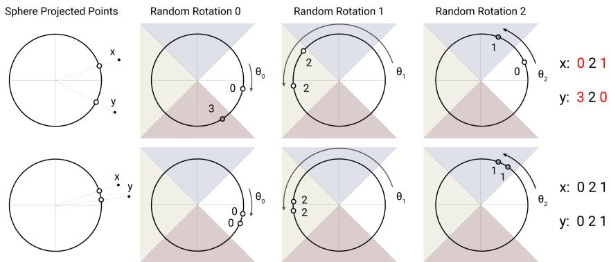
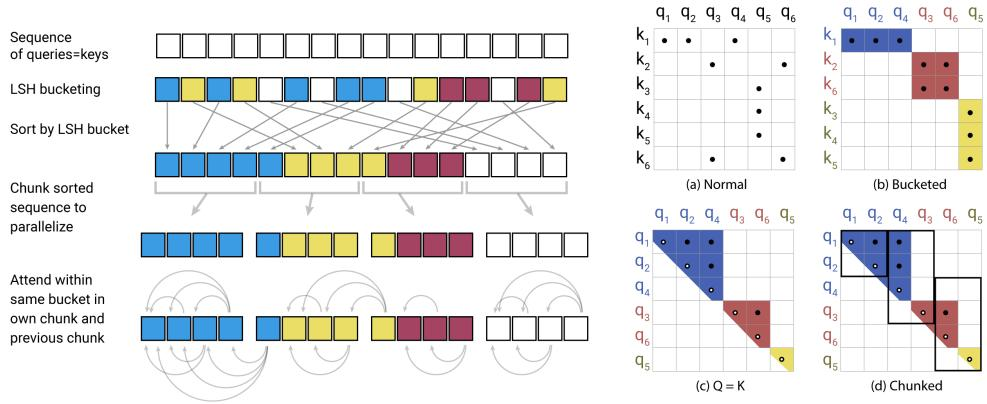
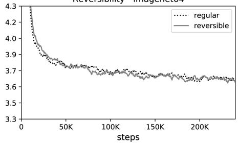
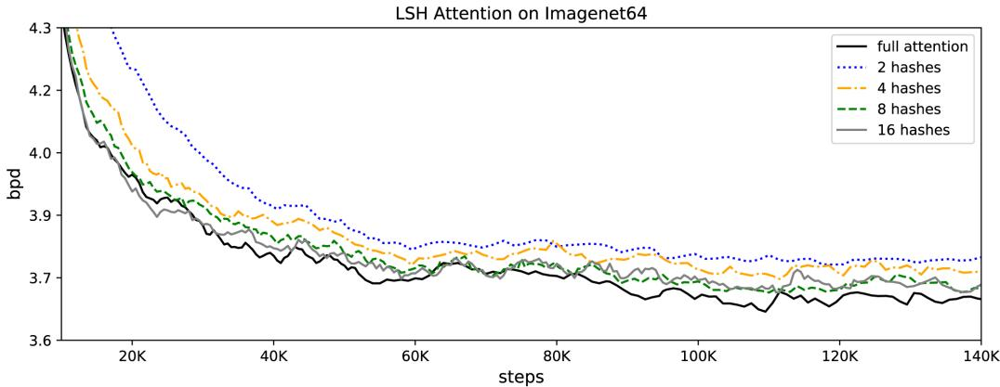
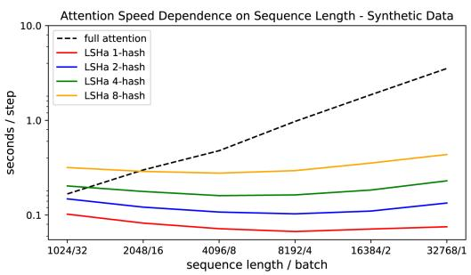

# REFORMER：高效的 Transformer

Nikita Kitaev∗ U.C. Berkeley & Google Research kitaev@cs.berkeley.edu

## 摘要

大型 Transformer 模型经常在许多任务上取得最先进的结果，但训练这些模型的成本可能极其高昂，尤其是在长序列上。我们引入两项技术来提升 Transformer 的效率。一方面，我们用基于局部敏感哈希（locality-sensitive hashing）的注意力取代点积注意力（dot-product attention），将其复杂度从 O(L2) 降至 O(L log L)，其中 L 是序列长度。另一方面，我们使用可逆残差层（reversible residual layers）代替标准残差层（standard residuals），使得训练过程中激活值只需存储一次而非 N 次，其中 N 是层数。最终得到的模型——Reformer——在性能上与 Transformer 模型相当，同时在内存效率上显著优于后者，且在长序列上速度显著更快。

## 1 引言

Transformer 架构（Vaswani 等，2017）广泛应用于自然语言处理领域，并在许多任务上取得最先进的结果。为获得这些结果，研究者已转向训练越来越大的 Transformer 模型。在（Shazeer 等，2018）所报告的最大配置中，每层参数量超过 0.5B，层数在（Al-Rfou 等，2018）中多达 64 层。Transformer 模型也被应用于越来越长的序列。（Liu 等，2018）在单个样本中处理了多达 11 千个文本 token，而当处理其他模态，例如音乐（Huang 等，2018）和图像（Parmar 等，2018）时，更长的序列更为常见。这些大规模长序列模型取得了优异的结果，但对资源的消耗也到了如此程度，以至于有人认为这种趋势正在扼杀自然语言处理研究1。许多大型 Transformer 模型实际上只能在大型工业研究实验室中训练，并且这些使用模型并行（model parallelism）训练的模型甚至无法在单个 GPU 上进行微调，因为其内存需求即便在单个训练步骤中也需要多加速器（multi-accelerator）的硬件配置。

大型 Transformer 模型从根本上是需要如此庞大的资源，还是仅仅是低效的？考虑如下计算：最大报告的 Transformer 层所使用的 0.5B 参数占用 2GB 内存。对于 64K token、嵌入维度 1024、批大小 8 的情形，激活值占 64K × 1K × 8 = 0.5B 个浮点数，需要额外 2GB 内存。如果我们的内存使用只是逐层的，那么我们理应能轻松地在单个加速器上容纳大型 Transformer，即使在长度为 64K 的序列上也是如此。此外，用于训练 BERT 的整个语料库仅需 17GB 即可存储。那么，为什么我们甚至无法在单机上对这些模型进行微调呢？

上述估算仅包含每层的内存和输入激活值开销，未考虑 Transformer 中以下几大内存使用来源：

• 含有 N 层的模型，其内存开销是单层模型的 N 倍，因为需要存储激活值以供反向传播使用。

• 由于中间前馈层的维度 $d_{ff}$ 通常远大于注意力激活的维度 $d_{model}$，因此前馈层在内存使用中占据了很大比例。

• 长度为 L 的序列上的注意力机制在计算和内存复杂度上均为 O($L^2$)，因此即使是单条长度为 64K token 的序列也可能耗尽加速器的内存。

我们提出 Reformer 模型，通过以下技术解决这些问题：

• 可逆层（reversible layers），最早由 Gomez et al. (2017) 提出，能够在整个模型中只存储单份激活值，从而使 N 倍因子消失。

• 在前馈层内部对激活值进行切分（splitting activations）并以块（chunk）方式进行处理，消除了 $d_{ff}$ 因子，从而节省前馈层的内存。

• 基于局部敏感哈希（locality-sensitive hashing）的近似注意力计算，将注意力层中的 $\mathrm{O}(L^2)$ 因子替换为 O(L log L)，从而支持在长序列上运行。

我们研究了这些技术，并表明它们对训练过程的影响相较于标准 Transformer 是可以忽略不计的。激活值切分实际上只影响实现方式，它在数值上与 Transformer 中使用的层完全相同。将标准的残差连接替换为可逆残差确实会改变模型，但在我们实验的所有配置中，它对训练的影响可以忽略。最后，注意力中的局部敏感哈希是一个更为重大的改动，可能会影响训练动态，具体取决于所使用的并发哈希数量。我们研究了此参数，找到了一个既高效又能产生与全量注意力非常接近的结果的取值。

我们在合成任务、文本任务（enwik8，使用长度为 64K 的序列）和图像生成任务（imagenet-64 生成，使用长度为 12K 的序列）上进行了实验。在这两种情况下，我们都表明 Reformer 能够达到与全量 Transformer 相当的结果，但运行速度更快（尤其是在文本任务上），并且内存效率高出多个数量级。

## 2 局部敏感哈希注意力（LOCALITY-SENSITIVE HASHING ATTENTION）

点积注意力（Dot-product Attention）。Transformer 中使用的标准注意力是缩放点积注意力（Scaled Dot-product Attention）（Vaswani 等人，2017）。输入由维度为 $d _ { k }$ 的查询（Query）和键（Key），以及维度为 $d _ { v }$ 的值（Value）组成。具体做法是：先计算查询与所有键的点积，再除以 $\sqrt { d _ { k }}$ 进行缩放，然后施加 softmax 函数以得到作用于值上的权重。实际应用中，针对一组查询的注意力函数是同时计算的，它们被打包成一个矩阵 $Q$。类似地，假设键和值也分别被打包成矩阵 $K$ 和 $\breve { V }$，则输出矩阵定义为：

$$
\operatorname{Attention} (Q, K, V) = \operatorname{softmax} (\frac {Q K ^ {T}}{\sqrt {d _ {k}}}) V\tag{1}
$$

**多头注意力（Multi-head attention）.** 在 Transformer 中，我们并不使用 $d _ { m o d e l }$ 维的键、值和查询来执行单一的注意力函数，而是用不同的、可学习的线性投影将查询、键和值分别投影 h 次，分别投影到 $d _ { k }$、$d _ { k }$ 和 $d _ { v }$ 维。注意力被并行地应用到这些投影后的查询、键和值上，产生 $d _ { v } .$ 维的输出值。这些输出值被拼接起来并再次进行投影，得到最终的输出值。该机制被称为多头注意力。

**内存高效的注意力（Memory-efficient attention）.** 为了计算注意力机制的内存使用，我们关注等式 1 中的注意力计算。假设 Q、K 和 V 的形状均为 $\left[ b a t c h \_ s i z e , l e n g t h , d _ { m o d e l } \right]$。主要的问题是 $Q K ^ { T }$ 这一项，其形状为 $[ b a t c h \_ s i z e , l e n g t h , l e n g t h ]$。在实验部分中，我们在长度为 64K $K \gets$ 的序列上训练模型——在这种情况下，即使批量大小为 1，这也是一个 $6 4 K \times 6 4 K$ 的矩阵，在 32 位浮点数下需要 16GB 的内存。这是不切实际的，并且阻碍了 Transformer 在长序列上的使用。但需要注意的是，$Q K ^ { T }$ 矩阵并不需要完全物化在内存中。实际上，注意力可以针对每个查询 $q _ { i }$ 分别计算，只在内存中计算 softmax $\textstyle { \big ( } { \frac { q _ { i } K ^ { T } } { \sqrt { d _ { k } } } } { \big ) } V$ 一次，然后在反向传播过程中需要梯度时重新计算它。这种计算注意力的方式效率可能较低，但它只使用与长度成正比的内存。我们使用这种内存高效的注意力实现来运行实验部分中呈现的全注意力基线。

**Q、K、V 来自哪里？（Where do Q, K, V come from?）** 上面描述的多头注意力作用于键、查询和值上，但通常我们只给出一个形状为 $[ { \bar { b } } a t c h _ { - } s i z e , l e n g t h , d _ { m o d e l } ] - \mathbf { \bar { e } } . \mathbf { g }$ . 的激活张量 A，来自将句子中的词元嵌入为向量。

  

图 1：角度局部敏感哈希通过对球面投影点进行随机旋转，并通过在带符号坐标轴投影上取 argmax 来建立哈希桶。在这个经过高度简化的二维示意中，对于这三种不同的角度哈希，两个点 x 和 y 除非其球面投影彼此接近，否则不太可能共享相同的哈希桶（上半部分所示）；而当球面投影彼此接近时，它们则能够共享同一哈希桶（下半部分所示）。

要从 A 构建 Q、K 和 V，Transformer 使用三个不同的线性层将 A 分别投影为 Q、K 和 V，各层使用不同参数。对于采用局部敏感哈希（LSH）注意力的模型，我们希望查询（query）和键（key）Q 与 K 完全相同。这一点很容易实现：让从 A 到 Q 和 K 的投影共用同一个线性层，再单独使用一个层生成 V。我们将具有这种行为的模型称为共享 QK 的 Transformer（shared-QK Transformer）。事实证明，即便我们额外地对键 K 的长度做归一化，共享 QK 也不会影响 Transformer 的性能，这一点我们将在第 5 节的实验中展示。

哈希注意力（Hashing attention）。对于 LSH 注意力，我们从两个张量 Q = K 和 V 出发，其形状为 [batch size, length, $d _ { m o d e l} ]$。我们保留多头（multi-head）机制不变，专注于式（1）所示的注意力计算。如前所述，主要问题在于 $Q K ^ { T }$ 这一项，其形状为 [batch size, length, length]。但请注意，我们真正关心的只是 softmax $( Q K ^ { T } )$。由于 softmax 由其中最大的元素所主导，对每个查询 $q _ { i }$，我们只需关注 K 中与 $q _ { i }$ 最近的若干键。例如，若 K 的长度为 64K，对于每个 $q _ { i }$，我们可以仅考察其一个小子集——比如最近的 32 个或 64 个键——即可。这会大幅提升效率，但关键问题在于：如何在键中找到最近邻？

局部敏感哈希（Locality-sensitive hashing, LSH）。在高维空间中快速寻找最近邻的问题可通过局部敏感哈希（locality-sensitive hashing, LSH）来解决。一个哈希方案将每个向量 x 映射为一个哈希值 h(x)；若附近的向量以高概率被分到相同的哈希，而较远的向量不会，则称该方案具有局部敏感性。在我们的场景中，实际只需要满足：附近的向量以高概率获得相同哈希，且各哈希桶的大小以高概率相近。

我们通过如下随机投影（random projections）方法来实现上述目标（参见图 1）。为得到 b 个哈希值，我们首先固定一个大小为 $[ d _ { k } , \dot { b } / 2 ]$ 的随机矩阵 $\dot { R }$。然后定义 h(x) = arg max $( [ x \bar { R } ; - x R ] )$，其中 [u; v] 表示两个向量的拼接。该方法是一种已知的 LSH 方案（Andoni et al., 2015），易于实现并可直接应用于成批的向量。

LSH 注意力。了解了 LSH 方案及哈希注意力的整体思路后，下面我们将本文使用的 LSH 注意力形式化。我们首先将标准注意力的式（1）按单个查询位置 i 重写为：

$$
o _ {i} = \sum_ {j \in \mathcal {P} _ {i}} \exp \left(q _ {i} \cdot k _ {j} - z (i, \mathcal {P} _ {i})\right) v _ {j}
$$

$$
\text { where } \mathcal {P} _ {i} = \{j: i \geq j \}\tag{2}
$$

我们引入记号 $\mathcal { P } _ { i }$ 来表示位置 i 处的查询所关注的集合，用 z 表示配分函数（即 softmax 中的归一化项）。为了表述清晰，我们还省略了按 $\sqrt { d _ { k } }$ 的缩放。

出于批处理的需要，我们通常在一个更大的集合 $\widetilde { \mathcal { P } } _ { i } = \{ 0 , 1 , \ldots , l \} \supseteq \mathcal { P } _ { i }$ 上执行注意力计算，同时将不属于 $\mathcal { P } _ { i }$ 的元素掩蔽掉：

$$
o _ {i} = \sum_ {j \in \widetilde {\mathcal {P}} _ {i}} \exp \left(q _ {i} \cdot k _ {j} - m (j, \mathcal {P} _ {i}) - z (i, \mathcal {P} _ {i})\right) v _ {j} \quad \text { where } m (j, \mathcal {P} _ {i}) = \left\{ \begin{array}{l l} \infty & \text { if } j \notin \mathcal {P} _ {i} \\ 0 & \text { otherwise } \end{array} \right.\tag{3}
$$

  

图 2：LSH Attention 的简化示意图，展示哈希分桶、排序和分块步骤以及由此得到的因果注意力。（a-d）这些变体注意力对应的注意力矩阵。

现在我们转向 LSH 注意力，我们可以从以下角度来理解它：通过只允许在单个哈希桶内进行注意力计算，来限制查询位置 $i$ 可以关注的目标项的集合 $\mathcal{P}_i$。

$$
\mathcal {P} _ {i} = \{j: h (q _ {i}) = h (k _ {j}) \}\tag{4}
$$

图2(a-b) 展示了完整注意力（full-attention）与哈希变体的示意性对比。部分(a)描绘了完整注意力的注意力矩阵通常是稀疏的，但计算过程并未利用这种稀疏性。在(b)中，查询和键已根据其哈希桶进行了排序。由于相似项以高概率落入同一桶，因此可以通过仅允许每个桶内的注意力来近似完整注意力模式。

在这种表述中，哈希桶的大小往往不均匀，这使得跨桶进行批处理变得困难。此外，桶内查询的数量和键的数量可能不相等——事实上，一个桶可能包含许多查询但不包含键。

为了缓解这些问题，我们首先通过设置 $k _ { j } = \mathbf { \dot { \phi } } _ { \parallel q _ { j } \parallel } ^ { q _ { j } }$ 来确保 $h ( k _ { j } ) = h ( q _ { j } )$。接下来，我们按桶号对查询进行排序，在每个桶内按序列位置排序；这定义了一个排序后的置换 $i \mapsto s _ { i }$。

在排序后的注意力矩阵中，来自同一桶的配对将聚集在对角线附近（如 图2c 所示）。我们可以采用一种批处理方法，其中 m 个连续查询（排序后）的块相互注意，并加上前一个块（图2d）。

按照我们之前的符号表示，这对应于设置：

$$
\widetilde {\mathcal {P}} _ {i} = \left\{j: \left\lfloor \frac {s _ {i}}{m} \right\rfloor - 1 \leq \left\lfloor \frac {s _ {j}}{m} \right\rfloor \leq \left\lfloor \frac {s _ {i}}{m} \right\rfloor \right\}\tag{5}
$$

如果 max$_i$ $| { \mathcal { P } } _ { i } | < m$，那么 $\mathcal { P } _ { i } \subseteq \widetilde { \mathcal { P } } _ { i}$。在实践中我们设 $\begin{array} { r } { m = \frac { 2 l } { n _ { b u c k e t s } } } \end{array}$（其中 $l$ 是序列长度）。平均桶大小为 $\frac { l } { n _ { b u c k e t s } }$，我们假设一个桶增长到两倍大小的概率足够低。LSH 注意力（LSH attention）的整个过程总结在图 2 中。

多轮 LSH 注意力（Multi-round LSH attention）。在使用哈希时，总会有一个小的概率使相似的项仍然落入不同的桶中。这个概率可以通过使用 $n _ { r o u n d s }$ 个不同的哈希函数 $\{ h ^ { ( 1 ) } , h ^ { \bar { ( 2 ) } } , \ldots \}$ 进行多轮哈希来降低，使得：

$$
\mathcal {P} _ {i} = \bigcup_ {r = 1} ^ {n _ {\text {rounds}}} \mathcal {P} _ {i} ^ {(r)}
$$

$$
\text { where } \mathcal {P} _ {i} ^ {(r)} = \left\{j: h ^ {(r)} (q _ {i}) = h ^ {(r)} (q _ {j}) \right\}\tag{6}
$$

多轮情形本质上涉及并行执行 LSH attention $n _ { r o u n d s }$ 次；该过程的详细描述见附录 A。

针对共享查询键（shared-QK）attention 的因果掩码。在 Transformer 解码器中，掩码（在公式 3 中记为 $m ( j , \mathcal { P } _ { i } )$）用于阻止位置关注未来。为了在 LSH attention 中实现掩码，我们将每个 query/key 向量关联到一个位置索引，使用与对 query/key 向量排序相同的排列来重排位置索引，然后使用比较操作来计算掩码。

表 1：attention 变体的内存与时间复杂度。我们用 $l$ 表示长度，$b$ 表示批大小，$n _ { h }$ 表示 head 数量，$n _ { c }$ 表示 LSH chunk 数量，$n _ { r }$ 表示哈希重复次数。

<table><tr><td>Attention Type</td><td>Memory Complexity</td><td>Time Complexity</td></tr><tr><td>Scaled Dot-Product</td><td> $\max(bn_h l d_k, bn_h l^2)$ </td><td> $\max(bn_h l d_k, bn_h l^2)$ </td></tr><tr><td>Memory-Efficient</td><td> $\max(bn_h l d_k, bn_h l^2)$ </td><td> $\max(bn_h l d_k, bn_h l^2)$ </td></tr><tr><td>LSH Attention</td><td> $\max(bn_h l d_k, bn_h l n_r (4l/n_c)^2)$ </td><td> $\max(bn_h l d_k, bn_h n_r l (4l/n_c)^2)$ </td></tr></table>

表 2：1 层 Transformer 模型在复制任务上的准确率对比，分别采用全注意力机制以及采用不同并行哈希数量的局部敏感哈希注意力机制。

<table><tr><td>Eval Train</td><td>Full Attention</td><td>LSH-8</td><td>LSH-4</td><td>LSH-2</td><td>LSH-1</td></tr><tr><td>Full Attention</td><td>100%</td><td>94.8%</td><td>92.5%</td><td>76.9%</td><td>52.5%</td></tr><tr><td>LSH-4</td><td>0.8%</td><td>100%</td><td>99.9%</td><td>99.4%</td><td>91.9%</td></tr><tr><td>LSH-2</td><td>0.8%</td><td>100%</td><td>99.9%</td><td>98.1%</td><td>86.8%</td></tr><tr><td>LSH-1</td><td>0.8%</td><td>99.9%</td><td>99.6%</td><td>94.8%</td><td>77.9%</td></tr></table>

虽然不允许关注未来位置（attention to the future），但典型的 Transformer 实现确实允许一个位置关注自身。这种行为在共享 QK（shared-QK）的公式中是不可取的，因为查询向量与自身的点积几乎总是大于查询向量与另一位置向量的点积。因此，我们修改掩码机制以禁止 token 关注自身，除非该 token 没有其他有效的注意力目标（例如序列中的第一个 token）。

## 2.1 合成任务上的分析

为了验证局部敏感哈希注意力（Locality-Sensitive Hashing attention，LSH attention）的性能并研究其行为，我们从以下合成任务开始：复制一个符号序列。在该任务中，每个训练和测试样本的形式为 0w0w，其中 $w \in \mathfrak { \backslash } 1 , \dotsc , N \} ^ { * }$ 是一个取值范围为 1 到 N 的符号序列（我们在实验中使用 N = 127）。下面给出一个词 w 长度为 3 的示例。

<table><tr><td>Example:</td><td>0</td><td>19</td><td>113</td><td>72</td><td>0</td><td>19</td><td>113</td><td>72</td></tr></table>

为了研究 LSH attention，我们用上述形式的样本训练一个语言模型，其中每个 w 长度为 511（因此整个输入 0w0w 长度为 1024）。由于这是一个语言建模任务，我们总是基于前面所有符号预测下一个符号，但只对输入后半部分的位置计算损失和准确率，因为这些位置才是真正可以被预测的。

上述任务可以被一个 1 层 Transformer 模型完美解决（达到 100% 准确率和 0 损失）。但需要注意的是，该任务需要非局部的注意力查找，因此无法被任何依赖有限跨度稀疏注意力的模型解决。为了便于快速训练，同时又与 NLP 中使用的模型相似，我们使用 $d _ { m o d e l } = d _ { f f } = 2 5 6$ 且 4 个头的 1 层 Transformer。我们在该模型上以 4 种不同设置各训练 150K 步：完整注意力、$n _ { r o u n d s } = 1$ 的 LSH attention、$n _ { r o u n d s } = 2$ 以及 $n _ { r o u n d s } = 4$。

从表 2 总结的结果可以看出，使用完整注意力训练的模型可以直接用 LSH attention 进行推理，但会有一定的准确率损失。当使用 LSH attention 从头训练时，使用 4 个哈希训练的模型也能达到几乎完美的准确率。有趣的是，当用 8 个哈希评估时，准确率达到完美。但用 2 个或 1 个哈希评估时，准确率会下降。哈希数较少的模型表现较差，但即使是只用 1 个哈希训练的模型，在用 8 个哈希评估时也几乎完美。

## 3 可逆 Transformer（Reversible Transformer）

如上节所示，注意力复杂度可以从长度的二次方降低到线性，但前提是可以接受近似。从表 1 可以清楚地看到，每一项都以 $b \cdot n _ { h } \cdot l$ 开头：$b \cdot n _ { h } \cdot l \cdot d _ { k }$，或者等价的 $b \cdot l \cdot d _ { m o d e l }$ 成本无法避免。事实上，每个层之前的激活值大小已经是 $b \cdot l \cdot d _ { m o d e l } .$，因此具有 $n _ { l }$ 层的整个模型的内存使用至少为 $b \cdot l \cdot d _ { m o d e l} \cdot n _ { l }$。更糟糕的是：在 Transformer 的前馈层中，这一开销会上升到 $\boldsymbol { b } \cdot \boldsymbol { l } \cdot d _ { f f } \cdot n _ { l }$。在一个大型 Transformer 中，通常设置 $d _ { f f } = 4 K$ 且 $n _ { l } = 1 6$，因此当 $l = 6 4 K$ 时，这将再次占用不切实际的 16GB 内存。

在本节中，我们展示了如何降低这一成本：首先使用可逆层（reversible layers）处理该项中的 $n _ { l }$ 部分，然后展示分块（chunking）如何让我们处理 $d _ { f f }$ 的问题。这些方法对内存和时间复杂度的影响总结在表 3 中。

RevNets。可逆残差网络（Reversible Residual Networks）由 Gomez 等人（2017）提出，文中展示了它们可以替代 ResNets 用于图像分类。其核心思想是，仅利用模型参数即可从下一层的激活值恢复出任意给定层的激活值。在反向传播过程中，无需为反向传递检查点保存中间值，而是随着反向传播从网络输出端向输入端逐层回溯时，层可以逐层被逆转。普通的残差层执行的是函数 $x \mapsto$ y，对单一输入进行运算并产生单一输出，其形式为 $y = x + F ( x )$；而可逆层则作用于成对的输入/输出：$( x _ { 1 } , x _ { 2 } ) \mapsto ( y _ { 1 } , y _ { 2 } )$ )，并遵循如下方程：

$$
y _ {1} = x _ {1} + F (x _ {2})
$$

$$
y _ {2} = x _ {2} + G (y _ {1})\tag{7}
$$

层可以通过减去（而不是加上）残差来逆转：

$$
x _ {2} = y _ {2} - G (y _ {1})
$$

$$
x _ {1} = y _ {1} - F (x _ {2})\tag{8}
$$

可逆 Transformer（Reversible Transformer）。我们将 RevNet 的思想应用于 Transformer，通过在 revnet 块内部组合注意力层和前馈层。在上述记号中，F 成为注意力层，而 G 成为前馈层。注意，层归一化（Layer Normalization）（Ba 等，2016）被移至残差块内部。

$$
Y _ {1} = X _ {1} + \mathrm{Attention} (X _ {2})
$$

$$
Y _ {2} = X _ {2} + \text { FeedForward } (Y _ {1})\tag{9}
$$

可逆 Transformer 不需要在每一层存储激活值，因此去掉了 $n_{l}$ 项。在第 5 节中，我们将展示在使用相同参数量的条件下，它的性能与标准 Transformer 相同；我们通过让 $x_{1}$ 和 $x_{2}$ 的维度均为 $d_{model}$ 来实现这一点。

Chunking。虽然可逆性解决了 $n_{l}$ 项，但更厚的层仍会占用大量内存。尤其是前馈层，会使用维度为 $d_{ff} = 4K$ 甚至更高的中间向量。然而，前馈层中的计算在序列的各个位置上完全独立，因此可以将计算拆分为 $c$ 个分块：

$$
Y _ {2} = \left[ Y _ {2} ^ {(1)}; \dots ; Y _ {2} ^ {(c)} \right] = \left[ X _ {2} ^ {(1)} + \text { FeedForward } (Y _ {1} ^ {(1)}); \dots ; X _ {2} ^ {(c)} + \text { FeedForward } (Y _ {1} ^ {(c)}) \right]\tag{10}
$$

这一层通常通过对所有位置并行执行操作来实现批处理，但一次只对一个分块进行操作可以减少内存。(8) 式中的反向计算以及反向传播过程也采用分块方式。除了前馈层（feed-forward layers）以外，对于具有大词表（超过 $d_{model}$ 种词类型）的模型，我们还会对输出处的对数概率（log-probabilities）进行分块，并一次计算一段序列的损失（loss）。

分块、大批量与参数复用（Chunking, large batches and parameter reuse）。通过分块和可逆层，整个网络中激活所占用的内存与层数无关。然而参数并不具备这一特性，因为参数数量随层数增长。这一问题可通过参数换出（swap）得到缓解——当某一层不进行计算时，可将其参数换出到 CPU 内存。在标准 Transformer 中这种做法效率很低，因为与 CPU 之间的内存传输较慢。但 Reformer 中批次大小乘以序列长度要大得多，因此用这些参数完成的计算量能够摊销（amortize）其传输开销。

Table 3: Transformer 变体的内存与时间复杂度。我们用 $d_{model}$ 和 $d_{ff}$ 表示模型深度，并假设 $d_{ff} \geq d_{model}$；$b$ 表示批次大小，$l$ 表示序列长度，$n_l$ 表示层数。我们假设 $n _ { c } = l / 3 2 \mathrm { s o } 4 l / n _ { c } = 1 2 8$，并记 $c = 1 2 8 ^ { 2 }$

<table><tr><td>Model Type</td><td>Memory Complexity</td><td>Time Complexity</td></tr><tr><td>Transformer</td><td> $\max(bld_{ff}, bn_h l^2) n_l$ </td><td> $(bld_{ff} + bn_h l^2) n_l$ </td></tr><tr><td>Reversible Transformer</td><td> $\max(bld_{ff}, bn_h l^2)$ </td><td> $(bn_h ld_{ff} + bn_h l^2) n_l$ </td></tr><tr><td>Chunked Reversible Transformer</td><td> $\max(bld_{model}, bn_h l^2)$ </td><td> $(bn_h ld_{ff} + bn_h l^2) n_l$ </td></tr><tr><td>LSH Transformer</td><td> $\max(bld_{ff}, bn_h ln_r c) n_l$ </td><td> $(bld_{ff} + bn_h n_r lc) n_l$ </td></tr><tr><td>Reformer</td><td> $\max(bld_{model}, bn_h ln_r c)$ </td><td> $(bld_{ff} + bn_h n_r lc) n_l$ </td></tr></table>

## 4 相关工作（RELATED WORK）

由（Vaswani 等人，2017）提出的 Transformer 模型已广泛用于自然语言任务，并进一步被扩展用于建模多种数据，例如乐谱（Huang 等人，2018）和图像（Parmar 等人，2018；Ramachandran 等人，2019）。最值得注意的是，该模型类已成功应用于极大语言模型的自监督训练（Devlin 等人，2018；Radford 等人，2019）。

鉴于最先进序列模型的巨大计算需求，寻找降低 Transformer 模型内存占用和计算需求的方法正受到越来越多的关注。除了精度降低和梯度检查点（Sohoni 等人，2019）等标准方法外，Transformer 模型自注意力机制（self-attention mechanism）的高效版本（Sukhbaatar 等人，2019a;b）最近也得到了探索。

特别是，利用注意力层中的稀疏性已被证明是富有成效的。OpenAI 提出了稀疏 Transformer（Child 等人，2019），它利用了注意力的分解稀疏表示。使用乘积键注意力（product-key attention）来扩大键空间也被用于在前馈层（feed-forward layers）中降低内存需求且不损失性能（Lample 等人，2019）。

据我们所知，局部敏感哈希（Locality-Sensitive Hashing, LSH）此前尚未被直接应用于 Transformer 注意力层。但先前使用外部记忆（external memory）的神经网络工作中已涉及大规模记忆。记忆网络（memory networks）的原始实现（Weston 等人，2014）以及后来对其进行扩展的工作（Bordes 等人，2015；Chandar 等人，2016）使用了规模达数百万的记忆。这样做的代价是，记忆必须在训练前固定。此外，由于训练初期模型不太可能正确查询记忆，因此采用强监督来鼓励模型查询有用的记忆位置。这些提示要么由任务作为额外的监督信息给出，要么像 Hill 等人（2015）中那样通过启发式方法确定。记忆必须预先固定的要求在 Santoro 等人（2016）中被去除，但代价是记忆容量减小，后来由 Rae 等人（2016）加以缓解。后一篇论文考虑了使用近似最近邻的记忆查找，包括 LSH 和随机 kd 树，但仅用于外部记忆的查找。

## 5 实验（EXPERIMENTS）

在本节中，我们展示证明上述技术的实验结果。我们逐个分析这些技术，以明确哪些组合对性能有影响。我们首先证明可逆层（reversible layers）和共享查询-键空间（shared query-key spaces）不影响性能，然后继续分析哈希注意力（hashing attention），最后分析完整的 Reformer 模型。

我们在 imagenet64 和 enwik8-64K 任务上进行了实验，其中后者是 enwik8 的一种变体，将数据切分为长度为 $2 ^ { 1 6 } : = 6 4 K$ 个 token 的子序列。为了便于与常规 Transformer 进行对比（后者显存占用较高且执行完整的 $O ( l ^ { 2 } )$ 注意力），我们在消融实验中使用 3 层模型。所有实验均设置 $d _ { m o d e l } = 1 0 2 4$，$d _ { f f } = 4 0 \bar { 9 6 }$，$n _ { h e a d s } = 8$，以及总 batch size 为 8 个序列。我们采用 Adafactor 优化器（Shazeer & Stern, 2018）来训练这些模型。我们还按照 Vaswani 等人（2017）的超参数设置，在 WMT 2014 英译德（English-to-German）翻译任务上进行了评估。所有实验的训练均在 8 个设备（8 块 GPU 或 8 个 TPU v3 核心）上进行并行化。训练模型的代码已公开发布。2

  

图3：共享查询-键空间（shared query-key space，左侧）以及可逆性（reversibility，右侧）对 enwik8 和 imagenet64 训练性能的影响。曲线展示了在留出数据（held-out data）上的每维度比特数（bits per dim）。

表 4：WMT 英德（EnDe）翻译任务在 newstest2014 上的 BLEU 得分。此外，我们还报告了由 sacreBLEU (Post, 2018) 计算得到的去标记化（detokenized）BLEU 得分。

<table><tr><td rowspan="2">Model</td><td rowspan="2">BLEU</td><td colspan="2">sacreBLEU</td></tr><tr><td>Uncased3</td><td>Cased4</td></tr><tr><td>Vaswani et al. (2017), base model</td><td>27.3</td><td></td><td></td></tr><tr><td>Vaswani et al. (2017), big</td><td>28.4</td><td></td><td></td></tr><tr><td>Ott et al. (2018), big</td><td>29.3</td><td></td><td></td></tr><tr><td>Reversible Transformer (base, 100K steps)</td><td>27.6</td><td>27.4</td><td>26.9</td></tr><tr><td>Reversible Transformer (base, 500K steps, no weight sharing)</td><td>28.0</td><td>27.9</td><td>27.4</td></tr><tr><td>Reversible Transformer (big, 300K steps, no weight sharing)</td><td>29.1</td><td>28.9</td><td>28.4</td></tr></table>

共享 QK 的效果。我们首先考察共享 QK（Shared-QK）注意力对常规 Transformer 模型的影响。共享 QK 注意力将 $\begin{array} { r } { k _ { j } ~ = ~ \frac { q _ { j } } { \parallel q _ { j } \parallel } } \end{array}$ 设定，并阻止词元（token）将自身作为注意力目标（除非没有其他上下文可用）。在图 3 的左侧部分，我们绘制了常规注意力与共享 QK 注意力的困惑度（perplexity）曲线。共享的 query-key 空间表现并不逊于常规注意力；事实上，在 enwik8 上其训练速度似乎略快。换言之，通过切换到共享 QK 注意力，我们并未牺牲准确率。

可逆层的效果。在图 3 右侧的两幅图中，我们将 Vaswani 等人（2017）提出的常规 Transformer 与第 3 节中描述的可逆 Transformer 进行对比。两个模型的参数量相同，学习曲线也近乎一致。这些结果表明，可逆 Transformer 所节省的内存并非以牺牲准确率为代价。

机器翻译中的可逆层。我们还在英德机器翻译的编码器-解码器 Transformer 模型情境下评估了可逆层。我们首先在 Transformer-base 架构中使编码器和解码器都完全可逆，并观察到所得模型在训练 100K 步后，性能与 Vaswani 等人（2017）的模型相当。我们还评估了更多训练步数和更大模型的训练效果。由于 Reformer 模型非常节省内存，因此在后两项实验中我们无需通过在整个模型中共享嵌入（embedding）与输出投影（output projection）权重矩阵来节省内存。结果如表 4 所示。在此设置中我们不使用 LSH 注意力，因为样本为单个句子，而句子通常相对较短。我们典型的 LSH 注意力配置在哈希与排序后使用 128 个词元为一个分块（chunk），而 WMT14 测试集中的样本长度均短于 128 个词元。

  

图4：LSH attention 在 imagenet64 上随哈希轮数（hashing rounds）变化的性能。

  

图 5：左图：enwik8 上 LSH attention 性能随层数的变化。右图：full attention 与 LSH attention 的评估速度随输入长度的变化。

LSH attention in Transformer. LSH attention 是对 full attention 的一种近似，从图 4 中可以看出，随着哈希数量的增加，其近似精度不断提高。在 $\begin{array} { r } { n _ { r o u n d s } = 8 , } \end{array}$ 时，它已经几乎与 full attention 相匹配。模型的计算成本随哈希数量的增加而增长，因此可以根据可用的计算预算来调整这一超参数。此外，如表 2 所示，可以在评估阶段增加哈希数量以产生更精确的结果。在图 5 的右半部分，我们绘制了不同 attention 类型相对于序列长度的速度曲线，同时保持 token 总数固定。我们可以看到，虽然 regular attention 在更长的序列长度下变得更慢，但 LSH attention 的速度保持平稳。

Large Reformer models. 为了验证 Reformer 确实能够将大型模型放入单个核心中并能在长序列上快速训练，我们在 enwik8 和 imagenet64 上训练了多达 20 层的大型 Reformer 模型。从图 5 中可以看出，这些模型能够放入内存并进行训练。在这种情况下我们无法训练 Transformer baseline，因为它们太慢且占用内存过多，但我们观察到随着层数的增加，模型性能有明显的提升。在 enwik8 上使用 0.1 的 dropout 率训练 20K 步的 12 层模型在测试集上达到了 1.19 bits/dim。我们还对 12 层 Reformer 模型进行了更长时间的训练，并进一步进行了调优和改进，在 enwiki8 测试集上达到了 1.05 bits/dim。

## 6 结论（CONCLUSION）

Reformer 将 Transformer 的建模能力与一种即使在大量层数下也能在长序列上高效执行且占用内存较小的架构相结合。我们相信这将有助于大型、参数丰富的 Transformer 模型变得更加普及和易于使用。此外，处理长序列的能力为将 Reformer 应用于许多生成任务开辟了道路。除了生成非常长的连贯文本外，Reformer 还可以将 Transformer 模型的能力带到其他领域，如时间序列预测、音乐、图像和视频生成。

## 参考文献（REFERENCES）

Sarath Chandar, Sungjin Ahn, Hugo Larochelle, Pascal Vincent, Gerald Tesauro, and Yoshua Bengio. 分层记忆网络. arXiv 预印本 arXiv:1605.07427, 2016.

Rewon Child, Scott Gray, Alec Radford, and Ilya Sutskever. 使用稀疏 Transformer 生成长序列. 网址 https://openai.com/blog/sparse-transformers, 2019.

Jacob Devlin, Ming-Wei Chang, Kenton Lee, and Kristina Toutanova. BERT：用于语言理解的深度双向 Transformer 预训练. CoRR, abs/1810.04805, 2018. 网址 http://arxiv.org/abs/1810.04805.

Aidan N Gomez, Mengye Ren, Raquel Urtasun, and Roger B Grosse. 可逆残差网络：无需存储激活的反向传播. 载于：神经信息处理系统进展，第 2214–2224 页, 2017.

Felix Hill, Antoine Bordes, Sumit Chopra, and Jason Weston. 金发姑娘原理：使用显式记忆表征阅读儿童书籍. CoRR, abs/1511.02301, 2015. 网址 http://arxiv.org/abs/1511.02301.

Guillaume Lample, Alexandre Sablayrolles, Marc'Aurelio Ranzato, Ludovic Denoyer, and Hervé Jégou. 使用乘积键的大记忆层. CoRR, abs/1907.05242, 2019. 网址 http://arxiv.org/abs/1907.05242.

Peter J. Liu, Mohammad Saleh, Etienne Pot, Ben Goodrich, Ryan Sepassi, Lukasz Kaiser, and Noam Shazeer. 通过长序列摘要生成维基百科. CoRR, abs/1801.10198, 2018. 网址 http://arxiv.org/abs/1801.10198.

Myle Ott, Sergey Edunov, David Grangier, and Michael Auli. 神经机器翻译的规模化. 载于：第三届机器翻译会议论文集：研究论文，第 1–9 页, 比利时布鲁塞尔, 2018 年 10 月. 计算语言学协会. doi: 10.18653/v1/W18-6301. 网址 https://www.aclweb.org/anthology/W18-6301.

Niki Parmar, Ashish Vaswani, Jakob Uszkoreit, Lukasz Kaiser, Noam Shazeer, and Alexander Ku. 图像 Transformer. CoRR, abs/1802.05751, 2018. 网址 http://arxiv.org/abs/1802.05751.

Matt Post. 呼吁明确报告 BLEU 分数. 载于：第三届机器翻译会议论文集：研究论文，第 186–191 页, 比利时布鲁塞尔, 2018 年 10 月. 计算语言学协会. 网址 https://www.aclweb.org/anthology/W18-6319.

Alec Radford, Jeff Wu, Rewon Child, David Luan, Dario Amodei, and Ilya Sutskever. 语言模型是无监督多任务学习器. 2019.

Jack W Rae, Jonathan J Hunt, Tim Harley, Ivo Danihelka, Andrew Senior, Greg Wayne, Alex Graves, and Timothy P Lillicrap. 通过稀疏读写扩展记忆增强神经网络. 载于：神经信息处理系统进展 (NIPS), 2016.

Prajit Ramachandran, Niki Parmar, Ashish Vaswani, Irwan Bello, Anselm Levskaya, and Jonathon Shlens. 视觉模型中的独立自注意力（Stand-alone self-attention in vision models）. CoRR, abs/1906.05909, 2019. URL http://arxiv.org/abs/1906.05909.

Adam Santoro, Sergey Bartunov, Matthew Botvinick, Daan Wierstra, and Timothy P. Lillicrap. 使用记忆增强神经网络的一次性学习（One-shot learning with memory-augmented neural networks）. CoRR, abs/1605.06065, 2016. URL http://arxiv.org/abs/1605.06065.

Noam Shazeer and Mitchell Stern. Adafactor：具有次线性内存成本的自适应学习率（Adafactor: Adaptive learning rates with sublinear memory cost）. CoRR, abs/1804.04235, 2018. URL http://arxiv.org/abs/1804.04235.

Nimit Sharad Sohoni, Christopher Richard Aberger, Megan Leszczynski, Jian Zhang, and Christopher Re. 低内存神经网络训练：一份技术报告（Low-memory neural network training: A technical report）. CoRR, abs/1904.10631, 2019. URL http://arxiv.org/abs/1904.10631.

Sainbayar Sukhbaatar, Edouard Grave, Piotr Bojanowski, and Armand Joulin. Transformer 中的自适应注意力跨度（Adaptive attention span in transformers）. CoRR, abs/1905.07799, 2019a. URL http://arxiv.org/abs/1905.07799.

Sainbayar Sukhbaatar, Edouard Grave, Guillaume Lample, Hervé Jégou, and Armand Joulin. 用持久记忆增强自注意力（Augmenting self-attention with persistent memory）. CoRR, abs/1907.01470, 2019b. URL http://arxiv.org/abs/1907.01470.

Jason Weston, Sumit Chopra, and Antoine Bordes. 记忆网络（Memory networks）. CoRR, abs/1410.3916, 2014. URL http://arxiv.org/abs/1410.3916.

## A 多轮 LSH 注意力

在本节中，我们将更详细地描述 LSH 注意力机制的多哈希版本。我们首先重述正文中的公式 (3)，它描述了带稀疏性的注意力的一般形式：

$$
o _ {i} = \sum_ {j \in \widetilde {\mathcal {P}} _ {i}} \exp \left(q _ {i} \cdot k _ {j} - m (j, \mathcal {P} _ {i}) - z (i, \mathcal {P} _ {i})\right) v _ {j} \quad \text { where } m (j, \mathcal {P} _ {i}) = \left\{ \begin{array}{l l} \infty & \text { if } j \notin \mathcal {P} _ {i} \\ 0 & \text { otherwise } \end{array} \right.\tag{3}
$$

在多轮情况下，查询位置 i 可以关注键位置 $\mathcal { P } _ { i }$，如公式 (6) 所定义，我们在此处再次给出：

$$
\mathcal {P} _ {i} = \bigcup_ {r = 1} ^ {n _ {\text { rounds }}} \mathcal {P} _ {i} ^ {(r)} \quad \text { where } \mathcal {P} _ {i} ^ {(r)} = \left\{j: h ^ {(r)} (q _ {i}) = h ^ {(r)} (q _ {j}) \right\}\tag{6}
$$

为了支持批处理，注意力计算在已排序的查询/键的分块（chunk）上进行：

$$
\widetilde {\mathcal {P}} _ {i} ^ {(r)} = \left\{j: \left\lfloor \frac {s _ {i} ^ {(r)}}{m} \right\rfloor - 1 \leq \left\lfloor \frac {s _ {j} ^ {(r)}}{m} \right\rfloor \leq \left\lfloor \frac {s _ {i} ^ {(r)}}{m} \right\rfloor \right\}\tag{11}
$$

联立 (3) 和 (6) 可得：

$$
o _ {i} = \sum_ {j \in \widetilde {\mathcal {P}} _ {i}} \exp \left(q _ {i} \cdot k _ {j} - m (j, \mathcal {P} _ {i}) - z (i, \mathcal {P} _ {i})\right) v _ {j}\tag{12}
$$

$$
= \sum_ {r = 1} ^ {n _ {r o u n d s}} \exp \left(z (i, \mathcal {P} _ {i} ^ {(r)}) - z (i, \mathcal {P} _ {i})\right) \sum_ {j \in \widetilde {\mathcal {P}} _ {i} ^ {(r)}} \frac {1}{N _ {i , j}} \exp \left(q _ {i} \cdot k _ {j} - m (j, \mathcal {P} _ {i} ^ {(r)}) - z (i, \mathcal {P} _ {i} ^ {(r)})\right)\tag{\(v_{j}\}
$$

(13)

$$
= \sum_ {r = 1} ^ {n _ {r o u n d s}} \exp \left(z (i, \mathcal {P} _ {i} ^ {(r)}) - z (i, \mathcal {P} _ {i})\right) o _ {i} ^ {(r)}\tag{14}
$$

$$
o _ {i} ^ {(r)} = \sum_ {j \in \widetilde {\mathcal {P}} _ {i} ^ {(r)}} \exp \left(q _ {i} \cdot k _ {j} - m _ {i, j} ^ {(r)} - z (i, \mathcal {P} _ {i} ^ {(r)})\right) v _ {j}\tag{15}
$$

$$
\text { where } N _ {i, j} = \left| \left\{r ^ {\prime}: j \in \mathcal {P} _ {i} ^ {(r ^ {\prime})} \right\} \right| \text { and } m _ {i, j} ^ {(r)} = \left\{ \begin{array}{l l} \infty & \text { if } j \notin \mathcal {P} _ {i} ^ {(r)} \\ 1 0 ^ {5} & \text { if } i = j \\ \log N _ {i, j} & \text { otherwise } \end{array} \right.\tag{16}
$$

LSH 注意力的每一轮都会产生一个向量 $o_{i}^{(r)}$，该向量可以独立于其他轮次计算，唯一例外是需要引入一个 $N_{i,j}$ 项，以避免在构造 $\mathcal{P}_{i}^{(r)}$ 集合的并集时对元素重复计数。在我们的实现中，我们将 $N_{i,j}$ 因子折叠到掩码项 $m_{i,j}^{(r)}$ 中。

我们还对 $m_{i,j}^{(r)}$ 进行了调整，为 $i = j$ 的情形引入了一个特殊情况。加入这种情况是因为在标准 Transformer 中的因果掩码允许位置 $i$ 关注自身，这在共享 QK 公式中是不理想的。我们将掩码设为一个较大但有限的值，以禁止原位注意力，除非出现某个词元没有其他有效关注目标的情况。例如，序列中的第一个词元只能关注自身，因为没有可用的先前上下文。