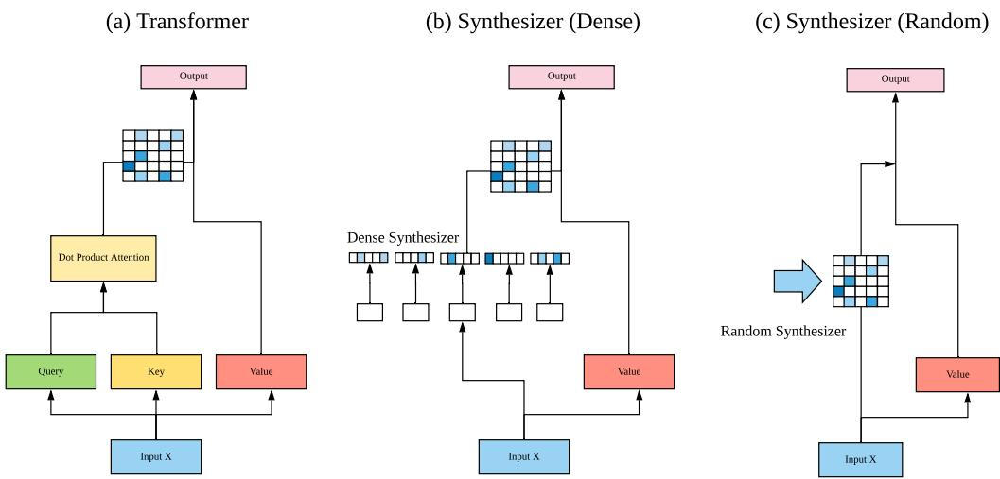
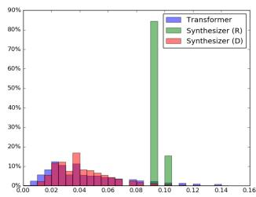
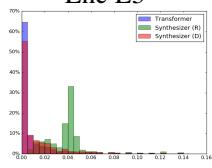
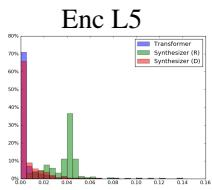
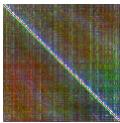
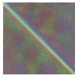
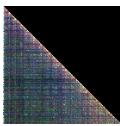
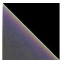
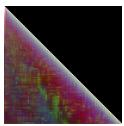
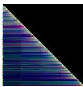

# 合成器（Synthesizer）：重新思考 Transformer 模型中的自注意力机制

Yi Tay 1 Dara Bahri 1 Donald Metzler 1 Da-Cheng Juan 1 Zhe Zhao 1 Che Zheng 1

## 摘要

众所周知，点积自注意力是当前最优 Transformer 模型的核心且不可或缺的部分。但它真的是必需的吗？本文研究了基于点积的自注意力机制对 Transformer 模型性能的真正重要性和贡献。通过大量实验，我们发现：（1）随机对齐矩阵的表现出奇地具有竞争力；（2）从 token-token（query-key）交互中学习注意力权重虽然有用，但终究并非那么重要。为此，我们提出了 **SYNTHESIZER**（合成器），这是一种无需 token-token 交互即可学习合成注意力权重的模型。在我们的实验中，我们首先表明，在包括机器翻译、语言建模、文本生成以及 GLUE/SuperGLUE 基准测试在内的一系列任务上，简单的 Synthesizer 与普通 Transformer 模型相比取得了极具竞争力的性能。当与点积注意力组合使用时，我们发现 Synthesizer 一致地优于 Transformer。此外，我们将 Synthesizer 与动态卷积（Dynamic Convolutions）进行了额外比较，结果表明简单的 Random Synthesizer 不仅速度快 60%，而且将困惑度相对改善了 3.5%。最后，我们表明，简单的因式分解 Synthesizer 在仅编码任务上能够优于 Linformer。

## 1. 引言

Transformer 模型（Vaswani 等，2017）已在广泛的任务中取得了成功。这使得 Transformer 在近年来大幅取代了曾经流行的自回归模型和循环模型。Transformer 模型的核心在于 query-key-value 点积注意力。Transformer 模型的成功通常被归因于这种自注意力机制，因为能够对长程依赖建模的全连接 token 图提供了一种稳健的归纳偏置。

但是，点积自注意力真的如此重要吗？我们真的需要它吗？是否必须通过逐对的点积来学习注意力权重？本文旨在更深入地理解点积自注意力机制在 Transformer 模型中所扮演的角色。

点积自注意力的根本作用是学习自对齐（self-alignment），即确定单个 token 相对于序列中所有其他 token 的相对重要性。为此，已有诸多记忆隐喻和类比被构建出来以支持这一观点。事实上，query、keys 和 values 这些术语本身就暗示，自注意力模拟了一种基于内容的检索过程，而这一过程在其最核心处利用了逐对交互。

本文一反传统观点，提出一个假设：我们不仅可以在没有点积自注意力（dot product self-attention）的情况下工作，甚至可以完全摒弃基于内容的类记忆自注意力（content-based memory-like self-attention）。传统上，注意力权重是在实例（instance）或样本（sample）层面学习的，权重由实例级的成对交互（pairwise interactions）产生。因此，这些实例特定的交互常常在不同实例间自由波动，因为它们缺乏一致的全局上下文。

本文提出了 SYNTHESIZER，这是一种学习合成自对齐矩阵（self-alignment matrix）而非手动计算成对点积的新模型。我们提出了一套多样化的合成函数（synthesizing functions）并对其进行了广泛的评估。我们刻画了这些合成函数所接收的源信息，即它们是否接收来自单个 token、token 间交互和/或全局任务的信息。直观上，合成函数的不同源输入应当捕捉多样的视角，在组合使用时可能会有所助益。

除了对标准 Transformer 模型进行推广外，我们表明完全使用不考虑 token 间交互或任何实例级（局部）信息的全局注意力权重，也可以取得有竞争力的结果。更具体地说，随机矩阵 SYNTHESIZER 模型在 WMT 2014 英德（English-German）翻译任务1上取得了 27.27 的 BLEU 分数。通过一系列严谨的实验，我们观察到，在某些情况下，流行且成熟的点积基于内容的注意力可以用更简单的变体（如随机矩阵或全连接层）来近似，而不会牺牲太多性能。

在我们的实验中，我们还表明，相对简单的 Synthesizer 模型也能超越动态卷积（Dynamic Convolutions, Wu et al., 2019），困惑度（perplexity）相对提升 +3.5%，同时速度提升 60%。在编码任务上，我们分解式的（factorized）Synthesizer 模型能够超越其他低秩高效 Transformer 模型，例如 Linformers（Wang et al., 2020）。

虽然简单的 Synthesizer 模型能够取得有竞争力的表现，但我们的实验表明，成对点积最终仍然是有益的。当我们将合成函数与点积组合使用时，我们发现它们持续地提升了 Transformer 的性能。总体而言，我们相信我们的发现将激发关于自注意力机制在 Transformer 模型中真正作用与用途的进一步研究与讨论。

我们的贡献 我们的主要贡献如下所述：

• 我们提出了合成注意力（Synthetic Attention），这是一种无需显式执行注意力（即无需点积注意力或基于内容的注意力）即可学习关注的新方法。我们独立于 token 间依赖关系生成对齐矩阵（alignment matrix），并探索了用于合成注意力矩阵的多种参数化函数。

• 我们提出了 SYNTHESIZER，一个利用合成注意力（Synthetic Attention）的新模型。该模型在包括机器翻译和语言建模在内的广泛语言任务上，与最先进的 Transformer 模型具有竞争力。

• 此外，我们表明（1）随机的可学习对齐矩阵具有竞争力，（2）tokentoken 依赖关系对于 Transformer 模型在某些任务上取得良好性能并非必需。

• 在 C4 数据集（Raffel et al., 2019）上的大规模掩码语言建模以及在 SuperGLUE 和 GLUE 基准上的微调中，我们表明简单的随机 Synthesizer 能够优于/匹配 Lightweight Dynamic Convolutions（Wu et al., 2019），同时优于 Transformer 和 Universal Transformers（Dehghani et al., 2018）。在两项编码任务上，因式分解的随机 Synthesizer 优于低秩 Linformer（Wang et al., 2020）。

## 2. 相关工作

基于注意力的模型被广泛应用于各类问题领域。由于其有效性，这类模型在语言和视觉领域尤为流行。注意力模型可以追溯到（Bahdanau et al., 2014）和（Luong et al., 2015）的机器翻译模型，其中注意力被用于学习语言对之间的软词对齐（soft word alignment）。注意力机制背后的直觉深深根植于基于记忆的检索（memory-based retrieval）这一概念（Graves et al., 2014; Weston et al., 2014），其中最初提出了对记忆的软可微寻址。

学习自对齐（self-alignment）的范式，也被称为自注意力（self-attention），主要由 Transformer 模型（Vaswani et al., 2017）大力推广。这一技术路线也被许多其他近期研究探索，包括关于内部注意力（intra-attention）（Parikh et al., 2016）、自匹配网络（self-matching networks）（Wang et al., 2017）以及 LSTMN（Cheng et al., 2016）的研究。至此，主要基于自注意力和前馈层运作的 Transformer 模型通常可以作为自回归循环模型的可靠替代品。

自注意力层本身一直是许多近期技术创新研究的主题。例如，最近的研究致力于通过稀疏化以及降低对齐矩阵的计算复杂度来提升该层的整体效率（Child 等人，2019；Kitaev 等人，2020；Huang 等人，2018；Tay 等人，2020；Beltagy 等人，2020）。这些方法与查询-键-值范式紧密耦合，采用一种基于记忆的内容检索形式作为注意力机制。在另一端，也有研究主张用卷积（Wu 等人，2019）来取代自注意力。最近简化注意力机制的研究兴趣激增，引发了关于成对点积（pairwise dot products）作用与效用的若干重要疑问，而成对点积正是自注意力模型的标志性特征之一。与此同时，在图像领域，（Cordonnier 等人，2019）展示了 Transformer 与 CNN 之间的联系。

我们的工作是对 Transformer 模型中自注意力机制的一种全新探索。我们更深入地展开，首先用我们称为综合函数（synthesizing functions）的模块来取代成对点积，这些函数学习可能依赖于、也可能不依赖于输入标记的注意力矩阵。最密切相关的工作是（Raganato 等人，2020），其中作者提出在 Transformer 编码器中使用固定的（即不学习的）注意力模式。然而，他们工作的范围仅限于编码器，并且依赖于手工定义的、看起来效果良好的模式。我们的工作进一步推进了这一直觉，并扩展了这一论述。

### MLP-Mixers are Random Synthesizers

这是一次 up-$\mathrm { d a t e } ^ { 2 }$，讨论 Random Synthesizers 与近期 MLP-Mixers（Tolstikhin 等人，2021）之间的关系。近期（2021 年 4 月）的一些工作提出了用于视觉任务的全 MLP 架构。尽管该工作最早于 2020 年 5 月出现，比 MLP-Mixer 的提出早一年，但我们展示了 Random Synthesizers 是 MLP-Mixer 的一种形式。Random Synthesizers 在长度维度上施加一个权重矩阵 R。R 是一个 $L \times L$ 矩阵，可以视为一种跨长度维度的投影。这等价于在 MLP-Mixer 模型的 token-mixer 中进行线性投影之前对坐标轴进行转置。这里的关键区别在于：（1）我们对核（即权重）使用了 softmax 归一化；（2）Random Synthesizers 是一种多头 MLP-Mixer 的形式。

## 3. 所提方法

本节介绍我们提出的 SYNTHESIZER 模型。其核心本质上是一个 Transformer 模型，其中自注意力模块被替换为我们提出的 Synthetic Attention 模块。图 3.1 阐述了以下关键思想：（a）Transformer；（b）Dense Synthesizers；（c）Random Synthesizers。

## 3.1. Synthesizer 模型

本节介绍我们提出的自注意力模块——合成注意力（Synthetic Attention）。我们的模型去除了自注意力模块中查询-键-值（query-key-values）的概念，转而直接合成对齐矩阵。为简便起见，我们针对的是每个头（per head）和每层（per layer）的计算，它们在多数情况下分别用 h 和 ` 表示。

**稠密合成器（**Dense Synthesizer**）** 让我们考虑 SYNTHESIZER 模型最简单的变体，它以每个输入词元（token）为条件。总体而言，我们的方法接受输入 $X _ { h , \ell } \in \mathbf { \mathbb { R } } ^ { N \times d }$，并产生输出 $\bar { Y _ { h , \ell } } \in \mathbb { R } ^ { \bar { N } } \times d$。这里，` 表示序列长度，d 表示模型的维度。我们首先采用参数化函数 $F _ { h , \ell } ( . )$，将输入 $X _ { i }$ 从 d 维投影到 N 维。

$$
B _ {i, h, \ell} = F _ {h, \ell} (X _ {i, h, \ell})\tag{1}
$$

其中 $F_{h,\ell}(.)$ 是一个参数化函数，将 $\mathbb{R}^d$ 映射到 $\mathbb{R}^\ell$，i 是 $X_{h,\ell}$ 的第 i 个 token，并且以逐位置的方式应用（作用于长度为 N 的序列中的每一个向量）。直观上，这可以解释为学习一个到序列长度 N 的逐 token 投影。本质上，在该模型下，每个 token 为输入序列中的每一个 token 预测权重。在实践中，我们对 $F_{h,\ell}(.)$ 采用了带有 ReLU 激活函数的简单两层前馈网络。

$$
F _ {h, \ell} (X _ {i, h, \ell}) = W _ {2, h, \ell} (\sigma_ {R} (W _ {1, h, \ell} (X _ {i, h, \ell}))\tag{2}
$$

其中 $\sigma _ { R }$ 是 ReLU 激活函数，$W _ { 1 , h , \ell } \in$ Rd×d，$W _ { 2 , h , \ell } \in \mathbb { R } ^ { d \times \ell }$。因此，$B _ { i , h , \ell }$ 现在属于 $R ^ { \ell }$。给定 $B _ { i , h , \ell } \in R ^ { N \times N }$，我们现在计算：

$$
Y _ {h, \ell} = \mathrm{softmax} (B _ {h, \ell}) G _ {h, \ell} (X _ {h, \ell})\tag{3}
$$

其中 $G_{h,\ell}(.)$ 是 X 的另一个参数化函数，类似于标准 Transformer 模型中的 $V_{h,\ell}$（value）。该方法通过使用合成函数 $F_{h,\ell}(.)$ 替代标准 Transformer 中的 $Q_{h,\ell} K_{h,\ell}^\top$，从而彻底消除点积注意力 $Y = \text{softmax}(Q_{h,\ell} K_{h,\ell}^\top) V_{h,\ell}$。

**随机合成器（Random Synthesizer）** 前一个变体通过以 X 的每个输入为条件并投影到 N 维来学习合成注意力。因此，密集合成器（Dense Synthesizer）以每个 token 独立为条件，这与 vanilla Transformer 模型中的 token 两两交互不同。我们考虑 SYNTHESIZER 的另一种变体，其中注意力权重不以任何输入 token 为条件。相反，注意力权重被初始化为随机值。这些值可以是可训练的，也可以保持固定（记为 Fixed）。

设 $R_{h,\ell}$ 为随机初始化的矩阵。随机合成器定义如下：

$$
Y _ {h, \ell} = \operatorname{softmax} (R _ {h, \ell}) G _ {h, \ell} (X _ {h, \ell}).\tag{4}
$$

其中 $R_{h,\ell} \in \mathbb{R}^{N \times N}$。值得注意的是，每个注意力头都会向网络添加 $N^{2}$ 个参数。随机合成器（Random Synthesizer）的基本思想3是不依赖于成对的 token 交互或来自单个 token 的任何信息，而是学习一种在全局范围内对许多样本都有效的任务特定对齐方式。这是对最近提出的固定自注意力模式（Raganato et al., 2020）的直接推广。

分解模型（Factorized Models）密集合成器（Dense Synthesizer）向网络添加 $d \times N$ 个参数。另一方面，随机合成器（Random Synthesizer）则添加 $N \times N$ 个参数。这里需要注意的是，我们在标准 Transformer 中省略了 Q、K 投影，从而进一步节省了参数。尽管有这些节省，但当 $N$ 较大时，合成模型的训练仍然可能较为繁琐。因此，我们提出了 SYNTHESIZER 模型的分解变体，并表明这些变体在实践中表现相当。

分解密集合成器（Factorized Dense Synthesizer）分解输出不仅略微降低了 SYNTHE-SIZER 的参数成本，还有助于防止过拟合。密集合成器的分解变体可以表示如下：

  

图 1. 我们提出的 SYNTHESIZER 模型架构。

$$
A _ {h, \ell}, B _ {h, \ell} = F _ {A, h, \ell} (X _ {i, h, \ell}), F _ {B, h, \ell} (X _ {i, h, \ell})\tag{5}
$$

其中 $F _ { A , h , \ell } ( . )$ 将输入 $X _ { i , h , \ell }$ 投影到 $a$ 维，$F _ { B , h , \ell } ( . )$ 将 $X _ { i , h , \ell }$ 投影到 $b$ 维，且 $a \times b = N$。分解模块（factorized module）的输出现在写为：

$$
Y _ {h, \ell} = \operatorname{softmax} (C _ {h, \ell}) G _ {h, \ell} (X _ {h, \ell}).\tag{6}
$$

其中 $C _ { h , \ell } = H _ { A } ( A _ { h , \ell } ) * H _ { B } ( B _ { h , \ell } )$，其中 $H _ { A } , H _ { B }$ 为平铺函数（tiling functions），且 $C _ { h , \ell } \in \mathbb { R } ^ { N \times N }$。平铺函数简单地将向量复制 k 次，即 $\mathbb { R } ^ { N } \mathbf { \bar { \mathbb { R } } } ^ { N \times k }$。在这种情况下，$H _ { A } ( \cdot )$ 是从 $\mathbb { R } ^ { a }$ 到 $\mathbb { R } ^ { a \times b }$ 的投影，$H _ { B } ( \cdot )$ 是从 $\mathbb { R } ^ { b }$ 到 $\mathbb { R } ^ { b \times a }$ 的投影。为避免同一块内出现相似值，我们将 $H _ { A }$ 和 $H _ { B }$ 的输出进行组合。

**因子化随机合成器（Factorized Random Synthesizer）** 与因子化合成器（Factorized Synthesizers）类似，我们同样可以将 $R _ { h , \ell }$ 分解为低秩矩阵 $R _ { 1 , h , \ell } , R _ { 2 , h , \ell } \in \mathbb { R } ^ { N \times k }$。

$$
Y _ {h, \ell} = \mathrm{softmax} (R _ {1, h, \ell} R _ {2, h, \ell} ^ {\top}) G _ {h, \ell} (X _ {h, \ell}).\tag{7}
$$

因此，很容易看出，对于每个头（head），这可以将参数开销从 $N^2$ 降低到 $2(Nk)$，其中 $k << N$，因此有助于防止过拟合。在实践中，我们使用一个较小的值 $k = 8$。

**综合合成器（Mixture of Synthesizers）** 最后，我们注意到，所有提出的合成注意力变体都可以以加性方式混合。这可以表示为：

$$
\begin{array}{l} Y _ {h, \ell} = \text {softmax} (\alpha_ {1, h, \ell} S _ {1, h, \ell} (X _ {h, \ell}) + \\ \dots \alpha_ {N, h, \ell} S _ {N, h, e l l} (X _ {h, \ell})) G _ {h, \ell} (X _ {h, \ell}). \end{array}
$$

其中 $S ( . )$ 是一个参数化的合成函数，α（其中 $\textstyle \sum \alpha = 1$）是可学习的权重。在将 Random Factorized 与标准 Dense Synthesizer 混合的情况下，这可以表示为：

$$
\begin{array}{r} Y _ {h, \ell} = \mathrm{softmax} (\alpha_ {1, h, \ell} R _ {1, h, \ell} R _ {2, h, \ell} ^ {\top} + \\ \alpha_ {2, h, \ell} F _ {h, \ell} (X _ {h, \ell})) G _ {h, \ell} (X). \end{array}
$$

我们在实验中研究了多种 Synthesizer 混合（Mixture of Synthesizers）变体。

### 关于依赖序列长度的参数

随机 Synthesizer 和稠密 Synthesizer 都依赖随长度变化的参数 `。一般而言，我们定义一个最大长度，并动态截断到每个批次的实际长度。我们注意到，这可训练位置编码（trainable positional encodings）做法在精神上类似，而后者已成为 Transformer 模型中的常见实践。因此，我们并不认为这里会存在什么问题。如果这确实成为问题，那么一种可能的解决办法是先投影到一个较小的值 b，再将 b 平铺至最大序列长度。我们将此探索留作未来的工作。

## 3.2. 讨论

本文就注意力矩阵 A 提出了一些基本问题，并探讨是否可以通过除 pairwise attention 之外的其他方式来合成 A。值得注意的是，常规的点积注意力（dot product attention）也可以被纳入我们的 SYNTHESIZER 框架，也就是说，SYNTHESIZER 是 Transformer 模型的一个推广。对于 Transformer 而言，相应的合成函数为 $S ( X ) = F _ { Q } ( X ) F _ { K } ( \bar { X ( X ) } ^ { \top }$ 。表 1 列出了我们在 SYNTHESIZER 框架内所探索的不同模型变体。「condition on」一列表示合成输出是作为 $X _ { i }$ 的函数生成，还是作为每一对 $X _ { i } , X _ { j }$ 的函数生成。「sample」一列则表示给定变体是利用局部上下文还是全局上下文。随机 Synthesizer（Random Synthesizers）属于全局类型，因为它们在所有样本间共享相同的全局对齐模式。稠密 Synthesizer（Dense Synthesizers）则被视为局部类型，因为它们以 $X _ { i }$ 为条件，使得对齐模式依赖于每个单独的样本。为此，合成模型必须具备多个头才能有效。

Synthesizer：重新思考 Transformer 模型中的自注意力

<table><tr><td>Model</td><td> $S(X)$ </td><td>Condition On</td><td>Sample</td><td>Interact</td><td> $|\theta|$ </td></tr><tr><td>Dot Product</td><td> $F_Q(X)F_K(X_i)^{\top}$ </td><td> $X_j \forall j$ </td><td>Local</td><td>Yes</td><td> $2d^2$ </td></tr><tr><td>Random</td><td> $R$ </td><td>N/A</td><td>Global</td><td>No</td><td> $N^2$ </td></tr><tr><td>Fac. Random</td><td> $R_1R_2^\top$ </td><td>N/A</td><td>Global</td><td>No</td><td> $2Nk$ </td></tr><tr><td>Dense</td><td> $F_1\sigma(F_2(X_i))$ </td><td> $X_i$ </td><td>Local</td><td>No</td><td> $d^2 + dN$ </td></tr><tr><td>Fac. Dense</td><td> $H_A(F_A(X_i))) * H_B(F_B(X_i)))$ </td><td> $X_i$ </td><td>Local</td><td>No</td><td> $d^2 + d(k_1 + k_2)$ </td></tr></table>

表 1. 所有合成函数（Synthesizing Functions）的概览。

## 4. 实验

本节概述我们的实验设置与结果。我们首先在五项任务上进行实验，以评估不同 Synthesizer 变体的有效性4，并考察它们与原始 Transformer 的对比情况。具体地，我们在以下任务上进行实验：(1) 机器翻译（EnDe、EnFr）；(2) 自回归语言建模（LM1B）；(3) 文本生成（摘要与对话建模）；(4) 多任务自然语言处理（GLUE/SuperGLUE）。每个实验的细节可在附录中找到。

**变体记号约定** 我们使用 R 表示 Random（随机），D 表示 Dense（密集），V 表示原始的点积注意力。Fix 表示 Fixed Random（固定随机），FR 表示 Factorized Random（因式分解随机），FD 表示 Factorized random（因式分解随机）。对于 Mixture Synthesizer（混合合成器），我们使用 + 表示两种方法进行混合。

## 4.1. 比较 Synthesizer 变体与 Transformer 模型

本节对多种 Synthesizer 变体与基础 Transformer 模型进行深入研究。

**机器翻译与语言建模上的实验结果** 首先，我们观察到 Random Synthesizer 基线在 EnDe 上达到 27.27，在 EnFr 上达到 41.12。不可训练的（即固定的）变体表现明显更差，但仍以固定随机注意力权重取得令人惊讶的强劲性能，约 24 BLEU。大多数其他 SYNTHESIZER 变体取得了具有竞争力的性能，尽管相较于 Transformer 略有性能下降。一个有趣的发现是，Random + Dense 合成器的混合模型在 EnDe 上与原始 Transformer 表现相当。当混合标准点积注意力时，性能进一步提升 +0.8 BLEU（EnDe）。总体而言，SYNTHESIZER 变体在该任务上的性能与 Transformer 具有竞争力。在 LM1B 上，我们发现 Random Synthesizer 的性能与原始 Transformer 模型相差在 1-2 PPL 之间。表现最好的模型是 Synthesizer (D+V)，它取得了该设置下的最佳性能。

**文本生成上的结果** 在摘要任务上，我们发现 (R) 与 (D) 变体并未优于 Transformer。(D) 模型的性能比 Transformer 低约 2 个 Rouge-L 点。因此，我们假设局部的、按样本的两两交互对摘要任务而言是重要的。另一方面，合成注意力的有效性也可以观察到，即 (R+V) 与 (R+D) 模型均优于 Transformer。在对话任务上，Synthesizer (R) 与 (D) 在大多数/所有指标上都以合理的幅度（约 1-3 点）优于原始 Transformer。此处表现最好的模型是 (D) 变体。令人惊讶的是，与大多数其他任务不同，(+V) 变体表现不佳，这表明点积自注意力实际上可能对该任务有害。

<table><tr><td rowspan="2">Model</td><td colspan="2">Sum.</td><td colspan="2">Dialogue</td><td rowspan="2">CIDr</td></tr><tr><td>RL</td><td> $B_4$ </td><td>RL</td><td>Met.</td></tr><tr><td>Trans.</td><td>35.77</td><td>3.20</td><td>13.38</td><td>5.89</td><td>18.94</td></tr><tr><td colspan="6">Synthesizer Models</td></tr><tr><td>R</td><td>33.10</td><td>2.25</td><td>15.00</td><td>6.42</td><td>19.57</td></tr><tr><td>D</td><td>33.70</td><td>4.02</td><td>15.22</td><td>6.61</td><td>20.54</td></tr><tr><td>D+V</td><td>36.02</td><td>3.57</td><td>14.22</td><td>6.32</td><td>18.87</td></tr><tr><td>R+V</td><td>35.95</td><td>2.28</td><td>14.79</td><td>6.39</td><td>19.09</td></tr></table>

表3. 在抽象摘要（CNN/Dailymail）和对话生成（PersonaChat）上的实验结果。我们报告了 RL（Rouge-L）、B4（Bleu-4）、Met.（Meteor）和 CIDr。

将 Synthesizer 与动态卷积进行比较 为了确定 Synthesizer（合成器）的竞争力，我们还将它们与动态卷积（Dynamic convolutions）（Wu et al., 2019）进行了比较。

<table><tr><td rowspan="2">Model</td><td colspan="3">NMT (BLEU)</td><td colspan="2">LM (PPL)</td></tr><tr><td> $|\theta|$ </td><td>EnDe</td><td>EnFr</td><td> $|\theta|$ </td><td>LM</td></tr><tr><td>Transformer $^{\dagger}$ </td><td>67M</td><td>27.30</td><td>38.10</td><td>-</td><td>-</td></tr><tr><td>Transformer</td><td>67M</td><td>27.67</td><td>41.57</td><td>70M</td><td>38.21</td></tr><tr><td>Synthesizer (Fixed Random)</td><td>61M</td><td>23.89</td><td>38.31</td><td>53M</td><td>50.52</td></tr><tr><td>Synthesizer (Random)</td><td>67M</td><td>27.27</td><td>41.12</td><td>58M</td><td>40.60</td></tr><tr><td>Synthesizer (Factorized Random)</td><td>61M</td><td>27.30</td><td>41.12</td><td>53M</td><td>42.40</td></tr><tr><td>Synthesizer (Dense)</td><td>62M</td><td>27.43</td><td>41.39</td><td>53M</td><td>40.88</td></tr><tr><td>Synthesizer (Factorized Dense)</td><td>61M</td><td>27.32</td><td>41.57</td><td>53M</td><td>41.20</td></tr><tr><td>Synthesizer (Random + Dense)</td><td>67M</td><td>27.68</td><td>41.21</td><td>58M</td><td>42.35</td></tr><tr><td>Synthesizer (Dense + Vanilla)</td><td>74M</td><td>27.57</td><td>41.38</td><td>70M</td><td>37.27</td></tr><tr><td>Synthesizer (Random + Vanilla)</td><td>73M</td><td>28.47</td><td>41.85</td><td>70M</td><td>40.05</td></tr></table>

表 2. 在 WMT'14 英语-德语、WMT'14 英语-法语机器翻译任务以及语言建模 One Billion（LM1B）上的实验结果。† 表示（Vaswani et al., 2017）中报告的原始结果。

<table><tr><td>Model</td><td>Log PPL</td><td>Steps/Sec</td><td>Params</td><td>TFLOPS</td></tr><tr><td>Trans.</td><td>1.865</td><td>3.90</td><td>223M</td><td>3.70</td></tr><tr><td>DyConv</td><td>2.040</td><td>2.65</td><td>257M</td><td>3.93</td></tr><tr><td>LightConv</td><td>1.972</td><td>4.05</td><td>224M</td><td>3.50</td></tr><tr><td>Syn (D)</td><td>1.965</td><td>3.61</td><td>224M</td><td>3.80</td></tr><tr><td>Syn (R)</td><td>1.972</td><td>4.26</td><td>254M</td><td>3.36</td></tr><tr><td>Syn (R+V)</td><td>1.849</td><td>3.79</td><td>292M</td><td>4.03</td></tr><tr><td>Syn (D+V)</td><td>1.832</td><td>3.34</td><td>243M</td><td>4.20</td></tr></table>

表 4. 在 C4 数据集（Raffel et al., 2019）上的验证困惑度分数。所有模型参数化规模大致相当。

我们在以下两方面进行比较：(1) 使用 C4 上的掩码语言建模目标进行预训练的困惑度；(2) 在 GLUE 和 SuperGLUE 上的下游微调结果。

掩码语言建模结果 我们还对这些模型的速度进行了基准测试。为此，我们在 C4 数据集（Raffel et al., 2019）上针对 T5 适配的掩码语言建模进行了额外实验，将其与轻量级动态卷积（Wu et al., 2019）在掩码语言建模任务上的表现进行了比较。我们也借此机会对 Synthesizer 相对于 Transformer 的速度进行了基准测试。实验在 Mesh Tensorflow（Shazeer et al., 2018）上进行，在 2x2 TPU V3 芯片上运行了约 524K 步。

MLM 实验结果 表 4 报告了在掩码语言建模5上的验证集对数困惑度。我们观察到 Synthesizer (R) 可相对超越动态卷积 +3.5%，同时速度提升 +60%。相比轻量级动态卷积，我们在性能相当的同时，速度提升 +5%。鉴于这只是一个简单的随机 Synthesizer 基线，我们觉得它能够超越相对复杂的动态卷积模型是非常有趣的。与两种卷积模型相比，随机 Synthesizer 的 FLOPS 也更少。另一方面，使用点积注意力的 Mixture Synthesizer 模型在模型速度大致相当的情况下提升了基础 Transformer 模型的性能。最后，与之前的结果类似，我们看到 Synthesizer (D+V) 和 Synthesizer (R+V) 一致地优于基础 Transformer 模型。

GLUE 和 SuperGLUE 上的结果 表 5 和表 6 报告了在 GLUE 和 SuperGLUE 基准上的结果。我们注意到 SYNTHESIZER 的 (R) 和 (D) 变体未取得令人满意的性能。这主要可归因于在 T5 设定中，编码器自注意力同时也起到跨句注意力的作用。例如，在蕴含或阅读理解任务中，前提与假设被拼接在一起，自注意力实际上起到跨句注意力的作用6。在像 SST 这样直观的情感分类任务上，这种跨句注意力并非必需，因此 Syn (R) 和 Syn (D) 都表现出了有竞争力的性能。为此，动态卷积（Wu et al., 2019）同样不具备这种编码器"跨注意力"，因此在许多此类配对匹配任务中也表现不佳。值得注意的是，在这种"无跨注意力"设定下，随机 Synthesizer 在 GLUE/SuperGLUE 分数上比动态卷积高出 4 到 5 个百分点。

我们乐观地观察到，混合模型 Syn (R+V) 以显著优势超越了 T5 模型（在 SuperGLUE 上高出 +1.9 分，在 GLUE 上高出 +0.6 分）。自然而然，混合模型也以非常显著的优势超越了动态卷积（Dynamic Convolution）。最后，为确保 Syn (+V) 变体并非仅仅因参数更多而胜过 Transformer，我们还与 T5 (Base+) 进行了比较，后者的参数量与 Syn (+V) 变体相当（大约多 ≈ 10M 参数）。我们的结果表明，Synthesizer (+V) 仍优于 T5 (Base+)。

Synthesizer：重新审视 Transformer 模型中的自注意力

<table><tr><td>Model</td><td>Glue</td><td>CoLA</td><td>SST</td><td>MRPC</td><td>STSB</td><td>QQP</td><td>MNLI</td><td>QNLI</td><td>RTE</td></tr><tr><td>T5 (Base)</td><td>83.5</td><td>53.1</td><td>92.2</td><td>92.0/88.7</td><td>89.1/88.9</td><td>88.2/91.2</td><td>84.7/85.0</td><td>91.7</td><td>76.9</td></tr><tr><td>T5 (Base+)</td><td>82.8</td><td>54.3</td><td>92.9</td><td>88.0/83.8</td><td>85.2/85.4</td><td>88.3/91.2</td><td>84.2/84.3</td><td>91.4</td><td>79.1</td></tr><tr><td>DyConv</td><td>69.4</td><td>33.9</td><td>90.6</td><td>82.6/72.5</td><td>60.7/63.1</td><td>84.2/88.2</td><td>73.8/75.1</td><td>84.4</td><td>58.1</td></tr><tr><td>Syn (R)</td><td>75.1</td><td>41.2</td><td>91.2</td><td>85.9/79.4</td><td>74.0/74.3</td><td>85.5/89.0</td><td>77.6/78.1</td><td>87.6</td><td>59.2</td></tr><tr><td>Syn (D)</td><td>72.0</td><td>18.9</td><td>89.9</td><td>86.4/79.4</td><td>75.3/75.5</td><td>85.2/88.3</td><td>77.4/78.1</td><td>86.9</td><td>57.4</td></tr><tr><td>Syn (D+V)</td><td>82.6</td><td>48.6</td><td>92.4</td><td>91.2/87.7</td><td>88.9/89.0</td><td>88.6/91.5</td><td>84.3/84.8</td><td>91.7</td><td>75.1</td></tr><tr><td>Syn (R+V)</td><td>84.1</td><td>53.3</td><td>92.2</td><td>91.2/87.7</td><td>89.3/88.9</td><td>88.6/91.4</td><td>85.0/84.6</td><td>92.3</td><td>81.2</td></tr></table>

表 5. 小模型与 en-mix 混合数据在多任务语言理解（GLUE 基准）上的实验结果（开发集分数）。注：此任务已与 SuperGLUE 联合训练。

<table><tr><td>Model</td><td>SGlue</td><td>BoolQ</td><td>CB</td><td>CoPA</td><td>MultiRC</td><td>ReCoRD</td><td>RTE</td><td>WiC</td><td>WSC</td></tr><tr><td>T5 (Base)</td><td>70.3</td><td>78.2</td><td>72.1/83.9</td><td>59.0</td><td>73.1/32.1</td><td>71.1/70.3</td><td>77.3</td><td>65.8</td><td>80.8</td></tr><tr><td>T5 (Base+)</td><td>70.7</td><td>79.3</td><td>81.1/87.5</td><td>60.0</td><td>75.1/34.4</td><td>71.7/70.7</td><td>80.5</td><td>64.6</td><td>71.2</td></tr><tr><td>DyConv</td><td>57.8</td><td>66.7</td><td>65.9/73.2</td><td>58.0</td><td>57.9/8.71</td><td>58.4/57.4</td><td>69.0</td><td>58.6</td><td>73.1</td></tr><tr><td>Syn (R)</td><td>61.1</td><td>69.5</td><td>54.6/73.2</td><td>60.0</td><td>63.0/15.7</td><td>58.4/57.4</td><td>67.5</td><td>64.4</td><td>66.3</td></tr><tr><td>Syn (D)</td><td>58.5</td><td>69.5</td><td>51.7/71.4</td><td>51.0</td><td>66.0/15.8</td><td>54.1/53.0</td><td>67.5</td><td>65.2</td><td>58.7</td></tr><tr><td>Syn (D+V)</td><td>69.7</td><td>79.3</td><td>74.3/85.7</td><td>64.0</td><td>73.8/33.7</td><td>69.9/69.2</td><td>78.7</td><td>64.3</td><td>68.3</td></tr><tr><td>Syn (R+V)</td><td>72.2</td><td>79.3</td><td>82.7/91.1</td><td>64.0</td><td>74.3/34.9</td><td>70.8/69.9</td><td>82.7</td><td>64.6</td><td>75.0</td></tr></table>

表 6. 小模型和 en-mix 混合在多任务语言理解（SuperGLUE 基准）上的实验结果（开发集得分）。注：此任务已与 GLUE 共同训练。

## 4.2. 将 Synthesizer 与 Linformer 进行比较

我们进行了更多实验，将因子化随机 Synthesizer 与 Linformer 进行比较。由于 Linformer 无法用于解码，我们在来自 TensorFlow 数据集（AGnews（Zhang 等人，2015）和电影评论（Maas 等人，2011））的两个编码任务上对它们进行比较。两个因子化模型均使用 k=32。我们还在此任务上对 Transformer 进行了基准测试。请注意，我们未使用上下文嵌入，因此结果与其他工作不具有可比性。

<table><tr><td>Model</td><td>News</td><td>Reviews</td><td>Steps/Sec</td></tr><tr><td>Transformer</td><td>88.83</td><td>81.34</td><td>1.09</td></tr><tr><td>Linformer</td><td>86.50</td><td>82.86</td><td>1.09</td></tr><tr><td>Syn (FR)</td><td>86.53</td><td>83.39</td><td>1.10</td></tr><tr><td>Syn (FR+V)</td><td>89.13</td><td>84.61</td><td>0.80</td></tr></table>

表 7. 仅编码任务上的结果（准确率）。

结果 我们注意到，分解型 Synthesizers（FR）在此任务上与 Linformers 和 Transformers 具有竞争力。Syn（FR）的准确率与 Linformers 相当，而 Syn（FR+V）的表现则优于 Transformers 和 Linformers。

  

图 2. 初始化解码器权重（参考）

## 5. 定性分析

**权重分布**　我们感兴趣的是研究合成生成的注意力权重与点积注意力权重的差异。图 3 展示了训练后 Transformer 和 SYNTHESIZER 模型上的注意力直方图。我们在 50K 步时报告了 6 层（Transformer 或 SYNTHESIZER）模型中第 1、3、5 层的直方图。我们发现此后的权重分布基本保持一致。图 2 展示了初始化状态。我们观察到 SYNTHESIZER 和 Transformer 模型的权重分布存在明显差异。SYNTHESIZER 权重的方差往往更大。另一方面，Transformer 模型上的权重倾向于聚集在 0 附近，且方差更小。（R）和（D）SYNTHESIZER 变体之间也存在显著差异。具体而言，（D）模型通常具有更大的最大值，且更多值落在 0.1–0.2 范围内，而（R）模型的值则倾向于更接近 0。

图 6. LM1B 上的 Synthesizer 权重。 图 7. LM1B 上的 Transformer 权重。

  

你好，我这边收到的内容只有 "Enc L1"，没有看到需要翻译的英文论文 Markdown。请把论文内容（或完整 Markdown 文本）发给我，我会按规则逐段翻译成中文。

  

分解 L1

  

Enc L3 → 编码器 L3
Dec L3 → 解码器 L3

  

Dec L5  
图 3. 机器翻译（WMT En-De）上编码器与解码器注意力权重的直方图。L 表示层编号，Enc/Dec 表示编码器或解码器。

5.1. Synthesizer 学到了什么模式？

本节中，我们对 Synthesizer 模型进行更深入的分析。

  

Vanilla

  

Random

  

Fr

  

密集的

  

FD  
图 4. WMT 英德（EnDe）任务上合成注意力（编码器）的可视化分析。

  

原始

在机器学习语境中，"vanilla" 通常指未经任何改进或特殊设计的**标准/基础版本**，例如 vanilla GAN（原始生成对抗网络）、vanilla Transformer（标准 Transformer）。

  

Random

  

FR

  

密集的

  

FD  
图 5. Synthetic Attention（合成注意力）（解码器）在 WMT EnDe 上的可视化分析。

分析 最后，我们有兴趣去理解这些 Synthesizer 模型究竟学到了什么。我们检视了 LM1B 语言建模任务上的随机合成注意力权重，并将之与 vanilla 注意力进行可视化对比。我们发现，对于 LM 任务而言，尽管从完全随机的状态出发，Synthesizer 仍能习得一个局部窗口，与 vanilla Transformer 拟合得相当紧密。然而，这些权重相比 Transformer 显得更加平滑、颗粒感更弱。这与我们所预期的相符：Synthesizer 并不受益于词元特异化的信息。我们在补充材料中给出了机器翻译任务权重的进一步分析与可视化。

## 5.2. 定量结果总体小结

本节总结我们的总体发现。

**合成注意力在无点积注意力时仍具竞争力** 在所有评测任务上，我们都表明合成注意力函数具有竞争力，即其性能与点积自注意力相当接近。在其中一项任务（对话生成）上，我们发现点积自注意力实际上会损害性能。在其余任务中，受 vanilla 点积被移除影响最小的是机器翻译。这些发现促使我们反思：自注意力是否真的需要逐对比较。在多任务语言理解基准上，自注意力通过拼接句对起到了跨注意力（cross-attention）的作用。因此，合成注意力的性能明显差于 vanilla Transformer。

**合成注意力与点积注意力高度互补** 总体而言，我们也观察到点积注意力非常有益。由此出发，合成注意力与逐对点积注意力之间呈现出高度的互补性。虽然合成注意力单独使用时通常就能达到具有竞争力且高效的性能，但它还能带来进一步的提升——将多个合成注意力（以及点积注意力）组合在一起，在我们考察的几乎所有任务上都获得了增益。因此，我们认为这是一个稳健的发现。

**最简单的 Synthesizer（如随机 Synthesizer）是高效且具有竞争力的基线** 最后，我们注意到，简单的随机 Synthesizer 与近期提出的动态卷积（dynamic convolutions）及 Linformer 相比仍具竞争力。在两项编码任务和一项大规模掩码语言建模任务上，我们表明随机（或分解式随机）Synthesizer 与其他高效或快速的 Transformer 模型相比仍保持竞争力。

## 6. 结论

本文提出了 SYNTHESIZER，这是一种采用合成注意力（Synthetic Attention）的新型 Transformer 模型。

我们进行了一项有原则的研究，以更好地理解和评估自注意力中全局对齐以及局部、实例级对齐（例如基于独立 token 和 token-token 对齐）的效用。

我们证明，在机器翻译、语言建模、对话生成、掩码语言建模和文档分类等多个任务上，合成注意力与 vanilla self-attention 相比表现出具有竞争力的性能。

此外，对于对话生成任务而言，两两交互实际上会损害性能。

值得注意的是，我们再次强调，本研究针对的是自注意力。

我们发现，在大多数情况下无法用更简单的变体来替代交叉注意力。

通过一系列额外的大规模实验，我们还发现 Synthesizers 能够优于或匹配动态卷积（Dynamic Convolutions），并且 Factorized Synthesizers 能够优于其他低秩 Linformer 模型。

## 参考文献

Bahdanau, D., Cho, K., and Bengio, Y. 通过联合学习对齐和翻译的神经机器翻译（Neural machine translation by jointly learning to align and translate）。arXiv preprint arXiv:1409.0473, 2014。

Beltagy, I., Peters, M. E., and Cohan, A. Longformer：长文档 Transformer（The long-document transformer）。arXiv:2004.05150, 2020。

Cheng, J., Dong, L., and Lapata, M. 用于机器阅读的长短期记忆网络（Long short-term memory-networks for machine reading）。arXiv preprint arXiv:1601.06733, 2016。

Child, R., Gray, S., Radford, A., and Sutskever, I. 使用稀疏 Transformer 生成长序列（Generating long sequences with sparse transformers）。arXiv preprint arXiv:1904.10509, 2019。

Cordonnier, J.-B., Loukas, A., and Jaggi, M. 关于自注意力与卷积层之间关系的研究（On the relationship between self-attention and convolutional layers）。arXiv preprint arXiv:1911.03584, 2019。

Dehghani, M., Gouws, S., Vinyals, O., Uszkoreit, J., and Kaiser, Ł. 通用 Transformer（Universal transformers）。arXiv preprint arXiv:1807.03819, 2018。

Graves, A., Wayne, G., and Danihelka, I. 神经图灵机（Neural turing machines）。arXiv preprint arXiv:1410.5401, 2014。

Kitaev, N., Kaiser, Ł., and Levskaya, A. Reformer：高效 Transformer（The efficient transformer）。arXiv preprint arXiv:2001.04451, 2020。

Luong, M.-T., Pham, H., and Manning, C. D. 基于注意力的神经机器翻译的有效方法（Effective approaches to attention-based neural machine translation）。arXiv preprint arXiv:1508.04025, 2015。

Maas, A. L., Daly, R. E., Pham, P. T., Huang, D., Ng, A. Y., and Potts, C. 学习用于情感分析的词向量（Learning word vectors for sentiment analysis）。发表于第 49 届计算语言学协会年会论文集：人类语言技术（Proceedings of the 49th Annual Meeting of the Association for Computational Linguistics: Human Language Technologies），pp. 142–150，美国俄勒冈州波特兰，2011 年 6 月。Association for Computational Linguistics。URL http://www.aclweb. org/anthology/P11-1015。

Parikh, A. P., Tackstr¨ om, O., Das, D., and Uszkoreit, J.¨ 用于自然语言推理的可分解注意力模型（A decomposable attention model for natural language inference）。arXiv preprint arXiv:1606.01933, 2016。

Raffel, C., Shazeer, N., Roberts, A., Lee, K., Narang, S., Matena, M., Zhou, Y., Li, W., 和 Liu, P. J. 探索基于统一文本到文本 Transformer 的迁移学习极限. arXiv 预印本 arXiv:1910.10683, 2019.

Raganato, A., Scherrer, Y., 和 Tiedemann, J. 基于 Transformer 的机器翻译中的固定编码器自注意力模式. arXiv 预印本 arXiv:2002.10260, 2020.

Seo, M., Kwiatkowski, T., Parikh, A. P., Farhadi, A., 和 Hajishirzi, H. 短语索引问答：可扩展文档理解的新挑战. arXiv 预印本 arXiv:1804.07726, 2018.

Shazeer, N., Cheng, Y., Parmar, N., Tran, D., Vaswani, A., Koanantakool, P., Hawkins, P., Lee, H., Hong, M., Young, C., 等. Mesh-TensorFlow：面向超级计算机的深度学习. 载于：神经信息处理系统进展，第 10414–10423 页，2018.

Tay, Y., Bahri, D., Yang, L., Metzler, D., 和 Juan, D.-C. 稀疏 Sinkhorn 注意力. arXiv 预印本 arXiv:2002.11296, 2020.

Tolstikhin, I., Houlsby, N., Kolesnikov, A., Beyer, L., Zhai, X., Unterthiner, T., Yung, J., Keysers, D., Uszkoreit, J., Lucic, M., 等. MLP-Mixer：一种全 MLP 的视觉架构. arXiv 预印本 arXiv:2105.01601, 2021.

Vaswani, A., Shazeer, N., Parmar, N., Uszkoreit, J., Jones, L., Gomez, A. N., Kaiser, Ł., 和 Polosukhin, I. 注意力机制就是你需要的一切. 载于：神经信息处理系统进展，第 5998–6008 页，2017.

Wang, S., Li, B., Khabsa, M., Fang, H., 和 Ma, H. Linformer：具有线性复杂度的自注意力. arXiv 预印本 arXiv:2006.04768, 2020.

Wang, W., Yang, N., Wei, F., Chang, B., 和 Zhou, M. 用于阅读理解和问答的门控自匹配网络. 载于：第 55 届计算语言学协会年会论文集（第 1 卷：长文），第 189–198 页，2017.

Weston, J., Chopra, S., 和 Bordes, A. 记忆网络. arXiv 预印本 arXiv:1410.3916, 2014.

Wu, F., Fan, A., Baevski, A., Dauphin, Y. N., 和 Auli, M. 以轻量级和动态卷积减少注意力. arXiv 预印本 arXiv:1901.10430, 2019.

Zhang, X., Zhao, J., 和 LeCun, Y. 用于文本分类的字符级卷积网络. 载于：神经信息处理系统进展，第 649–657 页，2015.