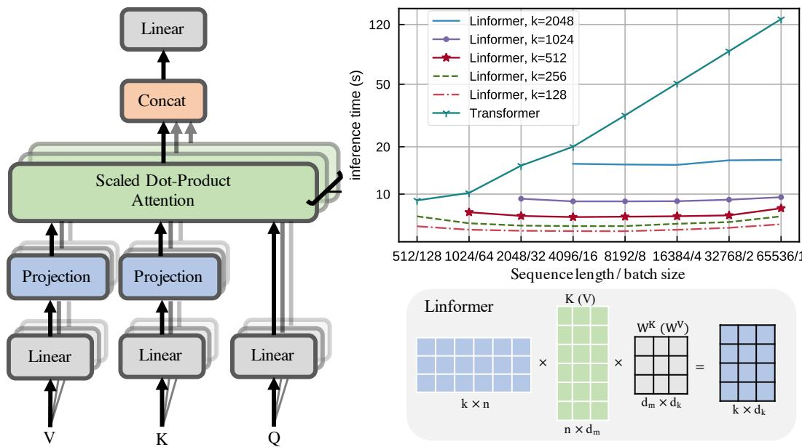
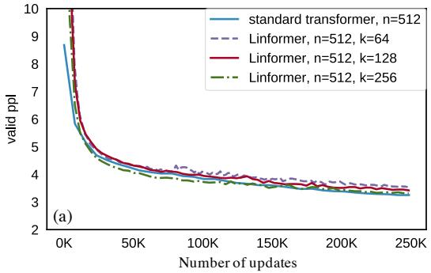
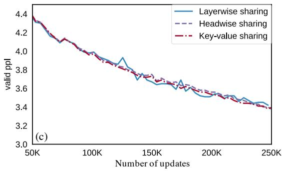
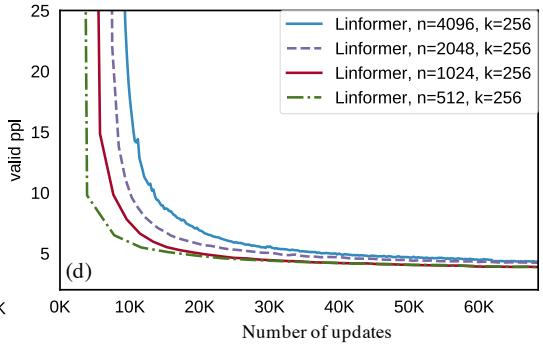

# Linformer：具有线性复杂度的自注意力

Sinong Wang, Belinda Z. Li, Madian Khabsa, Han Fang, Hao Ma

Facebook AI, Seattle, WA

{sinongwang, belindali, hanfang, mkhabsa, haom}@fb.com

## Abstract

大型 Transformer 模型在众多自然语言处理应用中取得了令人瞩目的成功，达到了最先进的结果。然而，对于长序列而言，训练和部署这些模型可能代价极高，因为 Transformer 的标准自注意力机制在时间和空间上相对于序列长度具有 $\check{O}(n^2)$ 的复杂度。本文证明，自注意力机制可以由一个低秩矩阵近似。我们进一步利用这一发现提出了一种新的自注意力机制，将自注意力的整体复杂度从 $O(n^2)$ 降低到 $O(n)$，无论时间还是空间均如此。所得到的线性 Transformer——Linformer——在性能上与标准 Transformer 模型相当，同时在内存和时间效率方面显著更优。

## 1 引言

Transformer 模型（Vaswani 等，2017）已广泛应用于自然语言处理（Natural Language Processing，NLP）中的众多问题，包括翻译（Ott 等，2018）、文本分类、问答以及其他任务（Raffel 等，2019；Mohamed 等，2019）。

过去几年间，最先进的 NLP Transformer 的参数量急剧增长，从 BERT-Large 最初引入的 3.4 亿增长到 GPT-3 中的 1750 亿（Brown 等，2020）。尽管这些大规模模型在众多任务上取得了令人印象深刻的结果，但实际中训练和部署此类模型的速度较慢。例如，原始的 BERT-Large 模型（Devlin 等，2019）在 16 块 Cloud TPU 上训练需要四天，而最近的 GPT-3（Brown 等，2020）相比其前身 GPT-2（Radford 等，2019），训练所消耗的每日 petaflops 数高出了数个数量级。除训练之外，将 Transformer 模型部署到实际应用中同样代价不菲，通常需要大量的蒸馏（Hinton 等，2015）或压缩。

Transformer 模型的主要效率瓶颈在于其自注意力机制。其中，每个词元（token）的表示通过对上一层中所有其他词元的注意力来更新。该操作对于保留长期信息至关重要，使 Transformer 在长序列上相较于循环模型具有优势。然而，在每一层对所有词元进行注意力计算会带来相对于序列长度 $O(n^2)$ 的复杂度。因此，本文试图回答以下问题：Transformer 模型能否被优化以避免这种二次运算，或者该运算对于保持强劲性能是必需的？

先前的工作提出了若干用于提升自注意力效率的技术。其中一种流行技术是通过让每个 token 仅关注整个序列中的部分 token（Child 等人, 2019; Qiu 等人, 2019; Beltagy 等人, 2020），从而在注意力层中引入稀疏性。这将注意力机制的整体复杂度降低至 $O ( n { \sqrt { n } } )$（Child 等人, 2019）。然而，如 Qiu 等人 (2019) 所示，该方法存在显著的性能下降但效率提升有限的问题，即性能下降 2% 却仅有 20% 的加速。近期，Reformer（Kitaev 等人, 2020）采用局部敏感哈希（locally-sensitive hashing, LSH）将自注意力复杂度降低至 O(n log(n))。但在实际应用中，Reformer 的效率收益仅出现在序列长度大于 2048 时（见 Kitaev 等人 (2020) 的图 5）。此外，Reformer 的多轮哈希方法实际上增加了串行操作的次数，进一步削弱了其最终的效率收益。

在这项工作中，我们提出了一种解决 Transformer 中自注意力瓶颈问题的新方法。我们的方法受以下核心观察启发：自注意力具有低秩性质。更具体地，我们从理论和实验两方面表明，由自注意力形成的随机矩阵可由一个低秩矩阵近似。基于这一观察，我们提出了一种新的机制，将自注意力在空间复杂度和时间复杂度上均降低至 $O ( n )$：我们通过线性投影将原始的缩放点积注意力（scaled dot-product attention）分解为多个较小的注意力，使得这些操作的组合构成原始注意力的低秩分解。多种 Transformer 架构（包括我们的架构）的运行时间总结见表 1。

Transformer 最具显著收益的主流应用之一是将其用作预训练语言模型，即先在大规模语料上以语言建模目标进行预训练，然后使用监督数据在目标任务上进行微调（Devlin 等人, 2019; Liu 等人, 2019; Lewis 等人, 2019）。遵循 Devlin 等人 (2019)，我们在 BookCorpus（Zhu 等人, 2015）和英文维基百科上采用掩码语言建模（masked-language-modeling）目标对我们的模型进行预训练。我们观察到与标准 Transformer 模型相当的预训练性能。随后，我们在 GLUE（Wang 等人, 2018）的三个任务和一项情感分析任务——IMDB reviews（Maas 等人, 2011）——上对我们的预训练模型进行微调。在这些任务上，我们发现我们的模型与标准预训练 Transformer 表现相当，甚至略优，并且获得了显著的训练和推理加速。

<table><tr><td>Model Architecture</td><td>Complexity per Layer</td><td>Sequential Operation</td></tr><tr><td>Recurrent</td><td> $O(n)$ </td><td> $O(n)$ </td></tr><tr><td>Transformer, (Vaswani et al., 2017)</td><td> $O(n^{2})$ </td><td> $O(1)$ </td></tr><tr><td>Sparse Tansformer, (Child et al., 2019)</td><td> $O(n\sqrt{n})$ </td><td> $O(1)$ </td></tr><tr><td>Reformer, (Kitaev et al., 2020)</td><td> $O(n\log(n))$ </td><td> $O(\log(n))$ </td></tr><tr><td>Linformer</td><td> $O(n)$ </td><td> $O(1)$ </td></tr></table>

表 1：不同架构各层的时间复杂度以及关于序列长度（n）的最小顺序操作数。

## 2 背景与相关工作（Backgrounds and Related Works）

## 2.1 Transformer 与自注意力（Self-Attention）

Transformer 建立在多头自注意力（Multi-Head Self-Attention, MHA）的思想之上，它允许模型联合关注来自不同表示子空间的不同位置的信息。MHA 定义为

$$
\operatorname{MultiHead} (Q, K, V) = \operatorname{Concat} \left(\operatorname{head} _ {1}, \operatorname{head} _ {2}, \dots , \operatorname{head} _ {h}\right) W ^ {O},\tag{1}
$$

其中 $Q , K , V \in \mathbb { R } ^ { n \times d _ { m } }$ 为输入嵌入矩阵，$n$ 为序列长度，$d _ { m }$ 为嵌入维度，$h$ 为注意力头的数量。每个注意力头定义如下：

$$
\text {head} _ {i} = \text {Attention} (Q W _ {i} ^ {Q}, K W _ {i} ^ {K}, V W _ {i} ^ {V}) = \underbrace {\text {softmax} \left[ \frac {Q W _ {i} ^ {Q} (K W _ {i} ^ {K}) ^ {T}}{\sqrt {d _ {k}}} \right]} _ {P} V W _ {i} ^ {V},\tag{2}
$$

其中 $W_{i}^{Q}, W_{i}^{K} \in \mathbb{R}^{d_{m} \times d_{k}}, W_{i}^{V} \in \mathbb{R}^{d_{m} \times d_{v}}, W^{O} \in \mathbb{R}^{hd_{v} \times d_{m}}$ 为可学习的矩阵，$d_{k}, d_{v}$ 为投影子空间的隐藏维度。在本文余下部分中，我们将不再区分 $d_{k}$ 与 $d_{v}$，统一用 $d$ 表示。

式 (2) 中定义的自注意力涉及一个上下文映射矩阵 $P \in \mathbb{R}^{n \times n}$。Transformer 利用 $P$ 来捕获序列中所有词元（token）的组合信息，从而为给定的词元建立输入上下文。然而，计算 $P$ 的代价较高。它需要将两个 $n \times d$ 的矩阵相乘，时间和空间复杂度均为 $O(n^{2})$。这种对序列长度的二次依赖已成为 Transformer 的瓶颈。

## 2.2 相关工作（Related works）

已有大量文献致力于提升 Transformer 的效率，特别是其自注意力瓶颈。可应用于 Transformer 的最常见模型效率技术包括（其中一些专为 Transformer 设计，另一些则更为通用）：

混合精度（Mixed Precision，Micikevicius 等人，2017）：使用半精度或混合精度的浮点表示在深度学习中十分流行，在 Transformer 的训练中也被广泛使用（Ott 等人，2019）。该技术可通过量化感知训练（Quantization Aware Training，Jacob 等人，2018；Fan 等人，2020）进一步改进，即在训练过程中对权重进行量化，并使用直通估计器（Straight-Through Estimator）来近似梯度。这条研究路线与我们的方法正交，我们默认采用混合精度训练。

知识蒸馏（Knowledge Distillation，Hinton 等人，2015）：知识蒸馏旨在将"知识"从大型教师模型迁移到轻量级的学生模型，随后在推理阶段使用学生模型。然而，这种方法存在缺陷：它无法加快教师模型在训练阶段的速度，并且学生模型相比教师模型通常会出现性能下降。例如，将 12 层的 BERT 蒸馏为 6 层的 BERT 时，学生模型在若干基准任务上平均出现 2.5% 的性能下降（Sanh 等人，2019）。

稀疏注意力（Sparse Attention，Child 等人，2019）：该技术通过在上下文映射矩阵 $P$ 中引入稀疏性来提升自注意力的效率。例如，稀疏 Transformer（Sparse Transformer，Child 等人，2019）仅计算矩阵 $P$ 中对角线附近的 $P_{ij}$（而非全部的 $P_{ij}$）。同时，分块自注意力（blockwise self-attention，Qiu 等人，2019）将 $P$ 划分为多个块，并仅计算选定块内的 $P_{ij}$。然而，这些技术同样存在较大的性能下降，而带来的加速却十分有限，即 20% 的加速对应 2% 的性能下降。

LSH Attention (Kitaev et al., 2020)：局部敏感哈希（LSH）注意力在计算点积注意力时采用多轮哈希方案，理论上能将自注意力复杂度降至 $O ( n \log ( n ) )$ 。然而，在实践中，其复杂度项有一个很大的常数 $1 2 8 ^ { 2 }$ ，并且只有在序列长度极长时才比标准 Transformer 更高效。

提升优化器效率：微批处理（Microbatching）(Huang et al., 2019) 将一个批次拆分成可以放入内存的小微批次（microbatch），然后分别对它们执行前向和反向传播，并通过梯度累加。梯度检查点（Gradient checkpointing）(Chen et al., 2016) 通过仅缓存部分层的激活值来节省内存。未缓存的激活值在反向传播过程中从最近的检查点重新计算。这两种技术都以时间换取内存，并且都不能加速推理。

正如我们已指出的，大多数常见技术在同时降低训练和推理的时间/内存消耗方面都存在局限，因此我们研究如何优化自注意力层，并在下一节介绍我们的方法。

## 3 自注意力是低秩的

在本节中，我们证明自注意力机制，即上下文映射矩阵 $P$ ，是低秩的。

我们首先对上下文映射矩阵 $P$ 进行谱分析。我们在两个任务上使用两个预训练 Transformer 模型——RoBERTa-base（12 层堆叠 Transformer）和 RoBERTa-large（24 层堆叠 Transformer）(Liu et al., 2019)：在 Wiki103 (Merity et al., 2016) 上的掩码语言建模任务，以及在 IMDB (Maas et al., 2011) 上的分类任务。在图 1（左）中，我们对模型不同层和不同头的 $P$ 进行奇异值分解，并绘制了在 10k 句子上平均的归一化累积奇异值。结果显示，在每一层、每个头和每个任务上都呈现出明显的长尾谱分布。这意味着矩阵 $P$ 的大部分信息可以从最大的几个奇异值中恢复。在图 1（右）中，我们绘制了第 128 大奇异值（共 512 个奇异值）处的归一化累积奇异值的热力图。我们观察到，高层中的谱分布比低层更加偏斜，这意味着在高层中，更多的信息集中在最大的奇异值上，$P$ 的秩更低。

下面，我们对上述谱结果给出理论分析。

**定理 1.**（自注意力是低秩的）对任意 $Q , K , V \in \mathbb { R } ^ { n \times d }$ 和 $\boldsymbol { W } _ { i } ^ { Q } , \boldsymbol { W } _ { i } ^ { K } , \boldsymbol { W } _ { i } ^ { V } \in \mathbb { R } ^ { d \times d } ,$ ，对矩阵 $V W _ { i } ^ { V }$ 的任意列向量 $w \in \mathbb { R } ^ { n }$ ，存在低秩矩阵 $\tilde { P } \in \mathbb { R } ^ { n \times n }$ 使得

$$
\operatorname * {P r} \left(\| \tilde {P} w ^ {T} - P w ^ {T} \| <   \epsilon \| P w ^ {T} \|\right) > 1 - o (1) a n d r a n k (\tilde {P}) = \Theta (\log (n)),\tag{3}
$$

其中，上下文映射矩阵 $P$ 在公式 (2) 中定义。

  

图 1：左侧两幅图是预训练 Transformer 模型（Liu et al., 2019）中自注意力矩阵在 $n = 5 1 2 .$ 下的谱分析。Y 轴为上下文映射矩阵 $P ,$ 的归一化累积奇异值，X 轴为最大特征值的索引。结果基于 RoBERTa-base 和 large 模型在两个公开数据集 Wiki103 与 IMDB 上的实验。右侧图绘制了 Wiki103 数据中第 128 大特征值处的归一化累积特征值在不同层和头之间的热力图。

证明。基于上下文映射矩阵 $P ,$ 的定义，我们可以写出

$$
P = \text { softmax } \underbrace {\left[ \frac {Q W _ {i} ^ {Q} (K W _ {i} ^ {K}) ^ {T}}{\sqrt {d}} \right]} _ {A} = \exp {(A)} \cdot D _ {A} ^ {- 1},\tag{4}
$$

其中 $D_A$ 是一个 $n \times n$ 的对角矩阵。该证明的核心思想基于分布型 Johnson–Lindenstrauss 引理（distributional Johnson–Lindenstrauss lemma）(Lindenstrauss, 1984)（简称 JL）。我们构造近似低秩矩阵为 $\tilde{P} = \exp(A) \cdot D_A^{-1} R^T R$，其中 $R \in \mathbb{R}^{k \times n}$，其各元素独立同分布于 $N(0, 1/k)$。随后利用 JL 引理可以证明，对于矩阵 $VW_i^V$ 的任意列向量 $w \in \mathbb{R}^n$，当 $k = 5\log(n)/(\epsilon^2 - \epsilon^3)$ 时，有

$$
\operatorname * {P r} \left(\| P R ^ {T} R w ^ {T} - P w ^ {T} \| \leq \epsilon \| P w ^ {T} \|\right) > 1 - o (1).\tag{5}
$$

更多细节请参考补充材料。

鉴于上下文映射矩阵 $P$ 具有低秩特性，一个直观的想法是利用奇异值分解（Singular Value Decomposition, SVD）将 $P$ 近似为一个低秩矩阵 $P_{\mathrm{low}}$，如下所示

$$
P \approx P _ {\text {low}} = \sum_ {i = 1} ^ {k} \sigma_ {i} u _ {i} v _ {i} ^ {T} = \underbrace {\left[ u _ {1} , \cdots , u _ {k} \right]} _ {k} \operatorname{diag} \{\sigma_ {1}, \dots , \sigma_ {k} \} \left[ \begin{array}{c c c} & v _ {1} \\ & \vdots \\ & v _ {k} \end{array} \right] \Bigg \} k\tag{6}
$$

其中 $\sigma_i$、$u_i$ 和 $v_i$ 是第 $i$ 大的奇异值及其对应的奇异向量。基于定理 1 的结果以及 Eckart–Young–Mirsky 定理（Eckart & Young, 1936），可以使用 $P_{\mathrm{low}}$ 以 $\epsilon$ 的误差和 $O(nk)$ 的时间与空间复杂度来近似自注意力（公式 2）。然而，该方法需要对每个自注意力矩阵执行 SVD 分解，这增加了额外的复杂度。因此，我们提出另一种低秩近似方法以避免这一额外复杂度。

## 4 模型

在本节中，我们提出一种新的自注意力机制，使我们能够以相对于序列长度的线性时间与空间复杂度来计算上下文映射 $P \cdot V W _ { i } ^ { \dot { V } }$。

我们提出的线性自注意力（图 2）的主要思想是在计算键（key）和值（value）时引入两个线性投影矩阵 $E_i, F_i \in \mathbb{R}^{n \times k}$。我们首先将原始的 $(n \times d)$ 维键层和值层 $KW_i^K$ 和 $VW_i^V$ 投影到 $(k \times d)$ 维的投影键层与值层。然后，我们使用缩放点积注意力（scaled dot-product attention）计算一个 $(n \times k)$ 维的上下文映射矩阵 $\bar{P}$。

  

图 2：左侧与右下角分别展示了我们所提出的多头线性自注意力（multihead linear self-attention）的架构与示例；右上角展示了不同 Linformer 模型的推理时间随序列长度的变化。

$$
\begin{array}{c} \overline {{\text {head} _ {i}}} = \text {Attention} (Q W _ {i} ^ {Q}, E _ {i} K W _ {i} ^ {K}, F _ {i} V W _ {i} ^ {V}) \\ = \underbrace {\text {softmax} \left(\frac {Q W _ {i} ^ {Q} (E _ {i} K W _ {i} ^ {K}) ^ {T}}{\sqrt {d _ {k}}}\right)} _ {\bar {P}: n \times k} \cdot \underbrace {F _ {i} V W _ {i} ^ {V}} _ {k \times d}, \end{array}\tag{7}
$$

最后，我们使用 $\bar { P } \cdot ( F _ { i } V W _ { i } ^ { V } )$ 来计算每个 headi 的上下文嵌入。注意，上述操作仅需要 $O ( n k )$ 的时间复杂度和空间复杂度。因此，如果我们能够选择一个非常小的投影维度 $k$，使得 $k \ll n$，那么就能显著降低内存和空间消耗。下述定理表明，当 $\bar { k } = { \cal O } ( d / \bar { \epsilon } ^ { 2 } )$（与 n 无关）时，可以通过线性自注意力（式 7）以 $\epsilon$ 误差近似 $P \cdot V W _ { i } ^ { V }$。

定理 2.（线性自注意力）对于任意 $Q _ { i } , K _ { i } , V _ { i } \in \mathbb { R } ^ { n \times d }$ 以及 ${ W _ { i } ^ { Q } , W _ { i } ^ { K } , W _ { i } ^ { V } \in \mathbb { R } ^ { d \times d } ; }$ ，若 $k = \operatorname* { m i n } \{ \Theta ( 9 d \log ( d ) / \epsilon ^ { 2 } ) , 5 \Theta ( \log ( n ) / \epsilon ^ { 2 } ) \}$ ，则存在矩阵 $E _ { i } , F _ { i } \in \mathbb { R } ^ { n \times k }$ ，使得对于矩阵 $Q W _ { i } ^ { Q } ( K W _ { i } ^ { K } ) ^ { T } / \sqrt { d } ,$ 的任意行向量 $w$，有

$$
\operatorname * {P r} \left(\| \text { softmax } (w E _ {i} ^ {T}) F _ {i} V W _ {i} ^ {V} - \text { softmax } (w) V W _ {i} ^ {V} \| \leq \epsilon \| \text { softmax } (w) \| \| V W _ {i} ^ {V} \|\right) > 1 - o (1)\tag{8}
$$

证明。本证明的主要思路基于分布式的 Johnson–Lindenstrauss 引理（Lindenstrauss, 1984）。我们首先证明，对于矩阵 $Q W _ { i } ^ { Q } ( K W _ { i } ^ { K } ) ^ { T } / \sqrt { d _ { k } }$ 的任意行向量 $x \in \mathbb { R } ^ { n }$ 以及矩阵 $V W _ { i } ^ { V }$ 的列向量 $y \in \mathbb { R } ^ { n }$

$$
\operatorname * {P r} \left(\| \exp (x E _ {i} ^ {T}) F _ {i} y ^ {T} - \exp (x) y ^ {T} \| \leq \epsilon \| \exp (x) y ^ {T} \|\right) > 1 - 2 e ^ {- (\epsilon^ {2} - \epsilon^ {3}) k / 4},\tag{9}
$$

其中 $E_i = \delta R$ 且 $F_i = e^{-\delta} R$，其中 $R \in \mathbb{R}^{k \times n}$，其元素独立同分布于 $N(0, 1/k)$，δ 是一个小的常数。对矩阵 A 的每个行向量和矩阵 V 的每个列向量应用 (9) 中的结果，可以直接证明，对于矩阵 A 的任意行向量 $A_i$，

$$
\operatorname * {P r} \left(\| \exp (A _ {i} E _ {i} ^ {T}) F _ {i} V - \exp (A _ {i}) V \| \leq \epsilon \| \exp (A _ {i}) V \|\right) > 1 - o (1),\tag{10}
$$

通过设定 $k = 5 \log ( n d ) / ( \epsilon ^ { 2 } - \epsilon ^ { 3 } )$。该结果并未利用矩阵 $A$ 的低秩性质（$\operatorname { r a n k } ( A ) { = } d$），且所得的 $k$ 依赖于序列长度 $n$。我们将进一步利用 $\operatorname{rank}(A)=d$ 这一事实，证明 $k$ 的取值可以是常数，且与序列长度 $n$ 无关。更多细节请参考补充材料。□

在图 2（右上）中，我们在固定 token 总数的前提下，绘制了 Linformer 与标准 Transformer 的推理速度随序列长度变化的曲线。可以看到，标准 Transformer 在序列变长时变得更慢，而 Linformer 的速度则基本保持平稳，在长序列场景下显著更快。

### 其他效率优化技术

在 Linformer 之上还可以引入若干额外的优化技术，以进一步提升性能与效率：

**投影间的参数共享（Parameter sharing between projections）：** 可以在各层和各头之间共享线性投影矩阵 $E _ { i } , F _ { i }$ 的参数。具体而言，我们实验了 3 个层级的共享方式：

- **头内共享（Headwise sharing）：** 对每一层，共享两个投影矩阵 $E$ 和 $F$，使得在所有头 $i$ 上 $E _ { i } = E$、$F _ { i } = F$。

- **键值共享（Key-value sharing）：** 在头内共享的基础上，进一步约束键（key）与值（value）投影的共享。对每一层，仅创建一个投影矩阵 $E$，使得对所有头 $i$ 的键和值投影矩阵均满足 $\dot { E _ { i } } = F _ { i } = E$。

- **层间共享（Layerwise sharing）：** 在所有层、所有头，以及键和值之间，仅使用一个投影矩阵 $E$。

例如，在一个 12 层、12 头的堆叠 Transformer 模型中，头内共享、键值共享和层间共享将分别引入 24、12 和 1 个不同的线性投影矩阵。

**非均匀投影维度（Nonuniform projected dimension）：** 可以为不同的头和层选择不同的投影维度 $k$。如图 1（右）所示，不同头和层中的上下文映射矩阵具有不同的谱分布，且更高层中的头倾向于呈现更为偏斜的谱分布（即秩更低）。这意味着可以为更高的层选择更小的投影维度 $k$。

**一般化投影（General projections）：** 还可以选择不同类型的低维投影方法，而不仅限于简单的线性投影。例如，可以选择均值/最大池化（mean/max pooling），或卷积（其中卷积核与步长均设为 $n / k$）。卷积函数包含需要训练的参数。

## 5 实验

本节给出针对上述各技术所开展的实验结果。我们逐一分析各项技术，并探讨它们对性能的影响。

## 5.1 预训练困惑度

我们首先将所提架构的预训练性能与基于 Transformer 的 RoBERTa（Liu 等人，2019）进行比较。参照 Devlin 等人（2019）的做法，我们采用 BookCorpus（Zhu 等人，2015）加上英文维基百科（English Wikipedia）作为预训练语料（共 3300M 词）。所有模型均使用掩码语言建模（Masked Language Modeling，MLM）目标进行预训练，所有实验均通过 64 块 Tesla V100 GPU 并行训练，共进行 250k 次更新。

**投影维度的影响**：我们对投影维度 k 试验了多种取值。（我们在 Linformer 的所有层与所有头之间共用同一个 k。）在图 3(a) 与 (b) 中，我们分别针对最大序列长度 $n = 5 1 2$ 与 $n = 1 0 2 4$ 绘制了标准 Transformer 与 Linformer 在不同 k 下的验证困惑度曲线。正如预期，Linformer 的性能随投影维度 k 的增大而提升。然而，即便在 $n = 5 1 2$ 取 $k = 1 2 8$、$n = 1 0 2 4$ 取 $k = 2 5 6$ 时，Linformer 的性能也已几乎与原始 Transformer 持平。

**参数共享的影响**：在图 3(c) 中，我们绘制了在 $n = 5 1 2$ 条件下三种参数共享策略（头共享、键值共享与层共享）的验证困惑度曲线。值得注意的是，当仅使用单一投影矩阵（即采用层共享）时，所得到的 Linformer 模型的验证困惑度几乎与非共享模型一致。这表明我们能够在不明显牺牲性能的前提下减少模型中的额外参数量，进而降低其内存开销。

**更长序列的影响**：我们考察了预训练过程中序列长度对 Linformer 的影响。在图 3(d) 中，我们固定投影维度 k = 256，绘制了 Linformer 在 $n \in \{ 5 1 2 , 1024, 2048, 4096\}$ 下的验证困惑度曲线。可以看到，即便投影维度固定，随着序列长度的增加，模型收敛后的最终困惑度仍基本保持不变。这进一步从经验上支持了 Linformer 具有线性复杂度的论断。

  

图 3：预训练验证困惑度（validation perplexity）随更新步数的变化关系。

<table><tr><td>n</td><td>Model</td><td>SST-2</td><td>IMDB</td><td>QNLI</td><td>QQP</td><td>Average</td></tr><tr><td rowspan="7">512</td><td>Liu et al. (2019), RoBERTa-base</td><td>93.1</td><td>94.1</td><td>90.9</td><td>90.9</td><td>92.25</td></tr><tr><td>Linformer, 128</td><td>92.4</td><td>94.0</td><td>90.4</td><td>90.2</td><td>91.75</td></tr><tr><td>Linformer, 128, shared kv</td><td>93.4</td><td>93.4</td><td>90.3</td><td>90.3</td><td>91.85</td></tr><tr><td>Linformer, 128, shared kv, layer</td><td>93.2</td><td>93.8</td><td>90.1</td><td>90.2</td><td>91.83</td></tr><tr><td>Linformer, 256</td><td>93.2</td><td>94.0</td><td>90.6</td><td>90.5</td><td>92.08</td></tr><tr><td>Linformer, 256, shared kv</td><td>93.3</td><td>93.6</td><td>90.6</td><td>90.6</td><td>92.03</td></tr><tr><td>Linformer, 256, shared kv, layer</td><td>93.1</td><td>94.1</td><td>91.2</td><td>90.8</td><td>92.30</td></tr><tr><td rowspan="2">512</td><td>Devlin et al. (2019), BERT-base</td><td>92.7</td><td>93.5</td><td>91.8</td><td>89.6</td><td>91.90</td></tr><tr><td>Sanh et al. (2019), Distilled BERT</td><td>91.3</td><td>92.8</td><td>89.2</td><td>88.5</td><td>90.45</td></tr><tr><td rowspan="3">1024</td><td>Linformer, 256</td><td>93.0</td><td>93.8</td><td>90.4</td><td>90.4</td><td>91.90</td></tr><tr><td>Linformer, 256, shared kv</td><td>93.0</td><td>93.6</td><td>90.3</td><td>90.4</td><td>91.83</td></tr><tr><td>Linformer, 256, shared kv, layer</td><td>93.2</td><td>94.2</td><td>90.8</td><td>90.5</td><td>92.18</td></tr></table>

Table 2: 基准自然语言理解任务上的开发集结果。此处的 RoBERTa-base 模型使用与 BERT 相同的语料库进行预训练。

## 5.2 下游任务结果

到目前为止，我们仅考察了模型的预训练困惑度。然而，我们希望证明在下游任务上进行微调后，我们的结论依然成立。我们在 IMDB（Maas et al., 2011）和 SST-2（Socher et al., 2013）（情感分类）以及 QNLI（自然语言推理）（Rajpurkar et al., 2016）和 QQP（文本相似度）（Chen et al., 2018）上对 Linformer 进行微调。我们对 RoBERTa、12 层 BERT-base 以及 6 层蒸馏 BERT 也采用相同的操作。我们所有的模型（包括 Transformer 基线）均使用相同的目标函数、预训练语料库训练至多 250k 步更新（尽管我们的 Linformer 达到 250k 步更新所需的实际运行时间要少得多，因此总训练时间也更短）。结果列于表 2 中。

我们观察到，Linformer 模型 $( n = 5 1 2 , k = 1 2 8 )$ 的下游任务性能与 RoBERTa 模型相当，并且在 $k = 2 5 6$ 时甚至略优于 RoBERTa。此外，我们注意到，尽管 Linformer 的逐层共享策略在整个模型中共享单一的投影矩阵，但它实际上在所有三种参数共享策略中取得了最佳的准确率结果。此外，使用更长序列长度 $( n = 1 0 2 4 , k = 2 5 6 )$ 预训练的 Linformer 与使用较短长度 $( n \bar { = } 5 1 2 , k = 2 5 \dot { 6 } )$ 预训练的 Linformer 具有相似的结果，这从经验上支持了如下观点：Linformer 模型的性能主要由投影维度 $k$ 决定，而不是 $n/k$ 的比值。

## 5.3 推理效率结果

在表 3 中，我们报告了 Linformer（采用逐层共享）与标准 Transformer 的推理效率。我们在 16GB 的 Tesla V100 GPU 上对两个模型的推理速度和内存进行了基准测试。我们随机生成长度不超过某序列长度 $n$ 的数据，并在多个批次上执行完整的前向传播。我们还根据可容纳的最大批次大小来选择批次大小，内存节省量也是基于该数值计算得出的。

<table><tr><td rowspan="2">length n</td><td colspan="5">projected dimensions k</td></tr><tr><td>128</td><td>256</td><td>512</td><td>1024</td><td>2048</td></tr><tr><td>512</td><td>1.5x</td><td>1.3x</td><td>-</td><td>-</td><td>-</td></tr><tr><td>1024</td><td>1.7x</td><td>1.6x</td><td>1.3x</td><td>-</td><td>-</td></tr><tr><td>2048</td><td>2.6x</td><td>2.4x</td><td>2.1x</td><td>1.3x</td><td>-</td></tr><tr><td>4096</td><td>3.4x</td><td>3.2x</td><td>2.8x</td><td>2.2x</td><td>1.3x</td></tr><tr><td>8192</td><td>5.5x</td><td>5.0x</td><td>4.4x</td><td>3.5x</td><td>2.1x</td></tr><tr><td>16384</td><td>8.6x</td><td>7.8x</td><td>7.0x</td><td>5.6x</td><td>3.3x</td></tr><tr><td>32768</td><td>13x</td><td>12x</td><td>11x</td><td>8.8x</td><td>5.0x</td></tr><tr><td>65536</td><td>20x</td><td>18x</td><td>16x</td><td>14x</td><td>7.9x</td></tr></table>

<table><tr><td rowspan="2">length n</td><td colspan="5">projected dimensions k</td></tr><tr><td>128</td><td>256</td><td>512</td><td>1024</td><td>2048</td></tr><tr><td>512</td><td>1.7x</td><td>1.5x</td><td>-</td><td>-</td><td>-</td></tr><tr><td>1024</td><td>3.0x</td><td>2.9x</td><td>1.8x</td><td>-</td><td>-</td></tr><tr><td>2048</td><td>6.1x</td><td>5.6x</td><td>3.6x</td><td>2.0x</td><td>-</td></tr><tr><td>4096</td><td>14x</td><td>13x</td><td>8.3x</td><td>4.3x</td><td>2.3x</td></tr><tr><td>8192</td><td>28x</td><td>26x</td><td>17x</td><td>8.5x</td><td>4.5x</td></tr><tr><td>16384</td><td>56x</td><td>48x</td><td>32x</td><td>16x</td><td>8x</td></tr><tr><td>32768</td><td>56x</td><td>48x</td><td>36x</td><td>18x</td><td>16x</td></tr><tr><td>65536</td><td>60x</td><td>52x</td><td>40x</td><td>20x</td><td>18x</td></tr></table>

表 3：在不同投影维度 k 和序列长度 n 下，Linformer 相较于 Transformer 在推理时的效率提升情况。左表显示节省的时间，右表显示节省的内存。

从表 3 可以看出，即使在 $n = 5 1 2$ 且 $k = 1 2 8 .$ 的设置下，Linformer 的推理速度仍比 Transformer 快 1.5 倍，并且最大批处理规模（maximum batch size）可达到 Transformer 的 1.7 倍。随着序列长度的增加，推理时间的加速比与内存节省效果更为显著。我们还在图 2 右上方绘制了 Linformer 和 Transformer 在 100 个数据样本上的推理时间。

## 6 结论（Conclusion）

Transformer 模型在实践中以训练和部署缓慢而著称，因为其自注意力操作在序列长度 n 上具有 $O ( n ^ { 2 } )$ 的时间与空间复杂度。在本文中，我们从理论和实验两方面证明了由自注意力机制所形成的随机矩阵是低秩的。我们进一步利用这一观察，提出了一种全新的、高效的自注意力机制。通过理论与实验分析的结合，我们证明所提出的方法在序列长度上具有 $O ( n )$ 的复杂度。

## 更广泛的影响（Broader Impact）

我们的工作聚焦于通过引入一种将自注意力降至线性时间复杂度的机制，使 Transformer 更加高效。高效 Transformer 的潜在积极影响包括提升模型的可访问性，既体现在设备端部署方面，也体现在研究阶段的训练方面。由于我们能够支持极长的序列，这一方法对图像 Transformer 的训练也具有潜在影响。此外，降低模型功耗还会带来积极的环境效益。因此，除了与深度学习其他核心构件相关的影响之外，我们的工作不存在任何直接的负面伦理或社会影响。

## 参考文献（References）

Rosa I Arriaga and Santosh Vempala. 学习的算法理论：鲁棒概念与随机投影. Machine Learning, 63(2):161–182, 2006.

Iz Beltagy, Matthew E Peters, and Arman Cohan. Longformer：面向长文档的 Transformer. arXiv preprint arXiv:2004.05150, 2020.

Tianqi Chen, Bing Xu, Chiyuan Zhang, and Carlos Guestrin. 以亚线性内存成本训练深度网络. arXiv preprint arXiv:1604.06174, 2016.

Zihan Chen, Hongbo Zhang, Xiaoji Zhang, and Leqi Zhao. Quora 问题对, 2018.

Rewon Child, Scott Gray, Alec Radford, and Ilya Sutskever. 使用稀疏 Transformer 生成长序列. arXiv preprint arXiv:1904.10509, 2019.

Jacob Devlin, Ming-Wei Chang, Kenton Lee, and Kristina Toutanova. 面向语言理解的深度双向Transformer预训练. 发表于2019年北美计算语言学协会人类语言技术会议论文集第1卷（长文与短文），第4171–4186页，2019年.

Carl Eckart and Gale Young. 用低秩矩阵逼近另一矩阵. *Psychometrika*, 1(3):211–218, 1936.

Angela Fan, Pierre Stock, Benjamin Graham, Edouard Grave, Remi Gribonval, Herve Jegou, and Armand Joulin. 利用量化噪声进行极致定点压缩训练. arXiv预印本 arXiv:2004.07320, 2020.

Geoffrey Hinton, Oriol Vinyals, and Jeff Dean. 神经网络中的知识蒸馏. arXiv预印本 arXiv:1503.02531, 2015.

Yanping Huang, Youlong Cheng, Ankur Bapna, Orhan Firat, Dehao Chen, Mia Chen, HyoukJoong Lee, Jiquan Ngiam, Quoc V Le, Yonghui Wu, 等. GPipe：使用流水线并行高效训练巨型神经网络. 发表于《神经信息处理系统进展》，第103–112页，2019年.

Benoit Jacob, Skirmantas Kligys, Bo Chen, Menglong Zhu, Matthew Tang, Andrew Howard, Hartwig Adam, and Dmitry Kalenichenko. 面向高效纯整数运算推理的神经网络量化与训练. 发表于2018年IEEE计算机视觉与模式识别会议论文集，第2704–2713页.

Nikita Kitaev, Lukasz Kaiser, and Anselm Levskaya. Reformer：高效Transformer. 发表于国际学习表征会议，2020年.

Mike Lewis, Yinhan Liu, Naman Goyal, Marjan Ghazvininejad, Abdelrahman Mohamed, Omer Levy, Ves Stoyanov, and Luke Zettlemoyer. BART：面向自然语言生成、翻译与理解的去噪序列到序列预训练. 计算语言学协会（ACL），2019年.

W Johnson J Lindenstrauss. Lipschitz映射到Hilbert空间的扩张. *Contemp. Math*, 26: 189–206, 1984.

Yinhan Liu, Myle Ott, Naman Goyal, Jingfei Du, Mandar Joshi, Danqi Chen, Omer Levy, Mike Lewis, Luke Zettlemoyer, and Veselin Stoyanov. RoBERTa：一种鲁棒优化的BERT预训练方法. arXiv预印本 arXiv:1907.11692, 2019.

Andrew L Maas, Raymond E Daly, Peter T Pham, Dan Huang, Andrew Y Ng, and Christopher Potts. 面向情感分析的词向量学习. 发表于第49届计算语言学协会年度大会人类语言技术论文集第1卷，第142–150页，计算语言学协会，2011年.

Stephen Merity, Caiming Xiong, James Bradbury, and Richard Socher. 指针哨兵混合模型. arXiv预印本 arXiv:1609.07843, 2016.

Abdelrahman Mohamed、Dmytro Okhonko、Luke Zettlemoyer。具有卷积上下文的 Transformer 用于语音识别。arXiv 预印本 arXiv:1904.11660，2019。

Myle Ott、Sergey Edunov、David Grangier、Michael Auli。扩展神经机器翻译。载于：第三届机器翻译大会论文集：研究篇，第 1–9 页，2018。

Myle Ott、Sergey Edunov、Alexei Baevski、Angela Fan、Sam Gross、Nathan Ng、David Grangier、Michael Auli。fairseq：一个快速、可扩展的序列建模工具包。载于：2019 年北美计算语言学协会会议论文集（演示），第 48–53 页，2019。

Jiezhong Qiu、Hao Ma、Omer Levy、Scott Wen-tau Yih、Sinong Wang、Jie Tang。用于长文档理解的块状自注意力。arXiv 预印本 arXiv:1911.02972，2019。

Alec Radford、Jeffrey Wu、Rewon Child、David Luan、Dario Amodei、Ilya Sutskever。语言模型是无监督多任务学习器。OpenAI Blog，1(8)：9，2019。

Colin Raffel、Noam Shazeer、Adam Roberts、Katherine Lee、Sharan Narang、Michael Matena、Yanqi Zhou、Wei Li、Peter J Liu。利用统一的文本到文本 Transformer 探索迁移学习的极限。arXiv 预印本 arXiv:1910.10683，2019。

Pranav Rajpurkar、Jian Zhang、Konstantin Lopyrev、Percy Liang。Squad：用于机器文本理解的 100,000+ 问题。载于：2016 年自然语言处理经验方法会议论文集，第 2383–2392 页，2016。

Victor Sanh、Lysandre Debut、Julien Chaumond、Thomas Wolf。Distilbert，BERT 的蒸馏版本：更小、更快、更廉价、更轻量。arXiv 预印本 arXiv:1910.01108，2019。

Richard Socher、Alex Perelygin、Jean Wu、Jason Chuang、Christopher D Manning、Andrew Y Ng、Christopher Potts。情感树库上语义组合性的递归深度模型。载于：2013 年自然语言处理经验方法会议论文集，第 1631–1642 页，2013。

Ashish Vaswani、Noam Shazeer、Niki Parmar、Jakob Uszkoreit、Llion Jones、Aidan N Gomez、Łukasz Kaiser、Illia Polosukhin。注意力即所需。载于：神经信息处理系统进展，第 5998–6008 页，2017。

Alex Wang、Amanpreet Singh、Julian Michael、Felix Hill、Omer Levy、Samuel R. Bowman。GLUE：自然语言理解的多任务基准与分析平台。CoRR，abs/1804.07461，2018。URL http://arxiv.org/abs/1804.07461。

Yukun Zhu、Ryan Kiros、Rich Zemel、Ruslan Salakhutdinov、Raquel Urtasun、Antonio Torralba、Sanja Fidler。对齐书籍与电影：通过观看电影和阅读书籍实现类故事式视觉解释。载于：IEEE 国际计算机视觉会议论文集，第 19–27 页，2015。

## A 定理 1 的证明

证明。主要证明思路基于分布式的 Johnson–Lindenstrauss 引理（Lindenstrauss，1984）（简称 JL），以下版本出自（Arriaga & Vempala，2006）。

引理 1. 设 R 为 $k \times n$ 矩阵，$1 \leq k \leq n$，其元素独立同分布于 $N(0, 1/k)$。对任意 $x, y \in \mathbb{R}^n$，我们有

$$
\operatorname * {P r} \left(\| R x \| \leq (1 + \epsilon) \| x \|\right) > 1 - e ^ {- (\epsilon^ {2} - \epsilon^ {3}) k / 4},\tag{11}
$$

$$
\operatorname * {P r} \left(\| x R ^ {T} R y ^ {T} - x y ^ {T} \| \leq \epsilon \| x y \|\right) > 1 - 2 e ^ {- (\epsilon^ {2} - \epsilon^ {3}) k / 4}.\tag{12}
$$

为简便起见，我们将省略矩阵 $W _ { i } ^ { K } , W _ { i } ^ { Q } , W _ { i } ^ { V } , E _ { i }$ 和 $F _ { i }$ 的下标 $i$。我们将 $Q$ 视为 $Q W ^ { Q }$，将 $K$ 视为 $K W ^ { K }$，将 $V$ 视为 $V W ^ { V }$。定义

$$
A = \frac {Q W _ {i} ^ {Q} (K W _ {i} ^ {K}) ^ {T}}{\sqrt {d}}\tag{13}
$$

根据上下文映射矩阵 $P$ 的定义，我们有

$$
\begin{array}{l} P = \text {softmax} \left[ \frac {Q W _ {i} ^ {Q} (K W _ {i} ^ {K}) ^ {T}}{\sqrt {d}} \right] \\ = \exp {(A)} \cdot D _ {A} ^ {- 1}, \end{array}\tag{14}
$$

其中 $D _ { A }$ 是一个 $n \times n$ 对角矩阵，使得

$$
(D _ {A}) _ {i i} = \sum_ {j = 1} ^ {n} \exp (A _ {j i})\tag{15}
$$

此处我们提供一个构造性证明。给定任意近似误差 $\epsilon > 0$，定义如下矩阵。

$$
\tilde {P} = \exp (A) \cdot D _ {A} ^ {- 1} R ^ {T} R,\tag{16}
$$

其中 $R$ 是一个 $k \times n$ 矩阵，$1 \leq k \leq n$，其元素独立同分布，服从 $N(0, 1/k)$。显然矩阵 $\tilde{P}$ 的秩满足

$$
\operatorname{rank} (\tilde {P}) \leq \operatorname{rank} (R) = k.\tag{17}
$$

我们进一步证明，当 $k = \log ( n )$ 时，对于任意列向量 $w \in \mathbb { R } ^ { n }$

$$
\operatorname * {P r} \left(\| \tilde {P} h - P h \| \leq \epsilon \| P h \|\right) > 1 - o (1).\tag{18}
$$

定理得证。对于矩阵 $P$ 的任意行向量 $u \in \mathbb { R } ^ { n }$ 以及矩阵 $V W ^ { V }$ 的任意列向量 $w \in \mathbb { R } ^ { n }$，应用 JL 引理，我们可以得到

$$
\operatorname * {P r} \left(\| u R ^ {t} R w ^ {T} - u w ^ {T} \| \leq \epsilon \| u w ^ {T} \|\right) > 1 - 2 e ^ {- (\epsilon^ {2} - \epsilon^ {3}) k / 4}.\tag{19}
$$

因此，我们得到

$$
\begin{array}{l} \operatorname * {P r} \left(\| \tilde {P} w ^ {T} - P w ^ {T} \| \leq \epsilon \| P w ^ {T} \|\right) = \operatorname * {P r} \left(\| P R ^ {T} R w ^ {T} - P w ^ {T} \| \leq \epsilon \| P w ^ {T} \|\right) \\ \stackrel {(a)} {\geq} 1 - \sum_ {x \in P} \operatorname * {P r} \left(\| x R ^ {T} R w ^ {T} - x w ^ {T} \| > \epsilon \| x w ^ {T} \|\right) \\ \stackrel {(b)} {>} 1 - 2 n e ^ {- (\epsilon^ {2} - \epsilon^ {3}) k / 4}. \end{array}\tag{20}
$$

上述步骤 (a) 基于联合界（union bound）。步骤 (b) 利用了 JL 引理的结果。令 $k = 5 \log ( n ) \dot { / ( \epsilon ^ { 2 } - \epsilon ^ { 3 } ) }$ ，则定理得证。$□$

## B 定理 2 的证明

证明。定义 $E = \delta R$ 和 $F = e ^ { - \delta } R$ ，其中 $\boldsymbol { R } \in \mathbb { R } ^ { n \times k }$ ，其独立同分布的条目服从 $N ( 0 , 1 / k ) $ ， $\delta$ 为常数，满足 $\delta = 1 / 2 ^ { n }$ 。我们将首先证明，对于矩阵 $2 \dot { K } ^ { T }$ 的任意行向量 $x \in \mathbb { R } ^ { n }$ 以及矩阵 $V _ { ; }$ 的任意列向量 $y \in \mathbb { R } ^ { n }$

$$
\operatorname * {P r} \left(\| \exp (x E ^ {T}) F y ^ {T} - \exp (x) y ^ {T} \| \leq \epsilon \| \exp (x) y ^ {T} \|\right) > 1 - 2 e ^ {- (\epsilon^ {2} - \epsilon^ {3}) k / 4}.\tag{21}
$$

基于三角不等式，我们有

$$
\begin{array}{l} \| \exp (x E ^ {T}) F y \exp (x) y ^ {T} \| \leq \| \exp (x E ^ {T}) F y - \exp (x) R ^ {T} R y \| + \| \exp (x) R ^ {T} R y - \exp (x) y ^ {T} \| \\ \stackrel {(a)} {\leq} (1 + \epsilon) \| y \| \| \exp (x E ^ {T}) - \exp (x) R ^ {T} \| + \| \exp (x) R ^ {T} R y - \exp (x) y ^ {T} \| \\ \stackrel {(b)} {\leq} \| \exp (x) R ^ {T} R y - \exp (x) y ^ {T} \| + o (\| \exp (x) \| \| y \|) \\ \stackrel {(c)} {\leq} \epsilon \| \exp (x) \| \| y \| + o (\| \exp (x) \| \| y \|) \end{array} \tag {22}
$$

上述步骤 (a) 基于柯西不等式和 (11) 中的 JL 引理。步骤 (b) 利用了指数函数在紧致区域上是 Lipchitz 连续的事实。然后我们可以选择一个足够小的 δ，即 $\delta = \theta ( 1 / n )$，使得

$$
\| \exp (\delta x R) - \exp (\delta x) R \| = o (\| \exp (x) \|)\tag{23}
$$

步骤 (c) 基于 (12) 中定义的 JL 引理。

将 (21) 中的结果应用于矩阵 A 的每个行向量和矩阵 $V$ 的每个列向量，可以直接证明，对于矩阵 A 的任意行向量 $A_i$，

$$
\operatorname * {P r} \left(\| \exp (A _ {i} E ^ {T}) F V - \exp (A _ {i}) V \| \leq \epsilon \| \exp (A _ {i}) \| \| V \|\right) > 1 - o (1),\tag{24}
$$

通过令 $k = 5 \log ( n d ) / ( \epsilon ^ { 2 } - \epsilon ^ { 3 } )$。该结果未利用矩阵 A 的低秩性质（$\operatorname{rank}(A) = d$），且所得的 k 依赖于序列长度 n。我们将进一步证明，k 的选取可以是常数，且与序列长度 $n$ 无关。

基于 $\operatorname{rank}(A) = d$ 这一事实，我们可以找到矩阵 $\exp(AE^T)FH$ 的一个行子矩阵 $A_s \in \mathbb{R}^{2d \times d}$，使得 $\operatorname{rank}(A_s) = d$。将 (21) 中的结果应用于矩阵 $A_\varepsilon$ 的每个行向量和矩阵 V 的每个列向量，并令 $\dot{k} = 9 \log(d) / (\epsilon^2 - \epsilon^3)$，我们即可得到，对矩阵 $A^s$ 的任意行向量 $A_i^s$

$$
\operatorname * {P r} \left(\| \exp (A _ {i} ^ {s} E ^ {T}) F V - \exp (A _ {i} ^ {s}) V \| \leq \epsilon \| \exp (A _ {i} ^ {s}) \| \| V \|\right) > 1 - o (1),\tag{25}
$$

您提供的内容不完整——只有一句未完成的话「Furthermore, define the matrix $\Gamma \in \mathbb{R}^{n \times 2d}$ as」，后面没有跟随任何可翻译的正文、段落或整篇论文。

请把需要翻译的英文论文 Markdown 完整粘贴过来，我会按照规则逐段翻译。

$$
\Gamma = \left[ \begin{array}{c} \exp (A E ^ {T}) F V \\ \exp (A) V \end{array} \right] \cdot \left[ \begin{array}{c} \exp (A _ {s} E ^ {T}) F V \\ \exp (A _ {s}) V \end{array} \right] ^ {- 1}
$$

我们有，对于矩阵 $A$ 的任意行向量 $A_i$，$1 \leq i \leq n$

$$
\begin{array}{l} \| \exp (A _ {i} E ^ {T}) F V - \exp (A _ {i}) V \| = \| \Gamma_ {i} \exp (A ^ {s} E ^ {T}) F V - \Gamma_ {i} \exp (A ^ {s}) V \| \\ \stackrel {{(a)}} {{\leq}} \left\| [ \exp (A ^ {s} E ^ {T}) F V - \exp (A ^ {s}) V ] ^ {T} \right\| _ {2} \| \Gamma_ {i} \| \\ \stackrel {{(b)}} {{\leq}} \Theta (d) \| \exp (A ^ {s} E ^ {T}) F V - \exp (A ^ {s}) V \| _ {F} \\ = \Theta (d) \sum_ {i = 1} ^ {2 d} \| \exp (A _ {i} ^ {s} E ^ {T}) F V - \exp (A _ {i} ^ {s}) V \| \\ \stackrel {{(c)}} {{\leq}} \epsilon \Theta (d) \sum_ {i = 1} ^ {2 d} \| \exp (A _ {i} ^ {s}) \| \| V \| \\ \leq \epsilon \Theta (d) \| \exp (A ^ {s}) \| \| V \| \end{array}
$$

上述步骤 (a) 利用了不等式 $\| A x \| \leq \| A \| _ { 2 } \cdot \| x \|$，其中 $\| A \| _ { 2 } = \sqrt { \lambda _ { \operatorname* { m a x } } ( A ^ { T } A ) }$（$\lambda _ { \operatorname* { m a x } } ( \cdot )$ 为最大特征值）是矩阵 $A$ 的谱范数。步骤 (b) 基于矩阵范数不等式 $\| A \| _ { 2 } \leq \| A \| _ { F }$，其中 $\begin{array} { r } { \| \bar { \boldsymbol { A } } \| _ { F } = ( \sum _ { 1 \leq i , j \leq n } A _ { i j } ^ { 2 } ) ^ { 1 / 2 } } \end{array}$ 是矩阵 $A$ 的 Frobenius 范数。步骤 (c) 基于 (24) 的结果。□