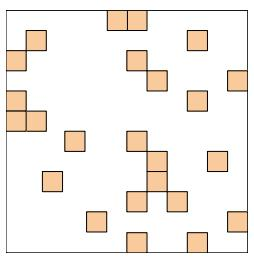
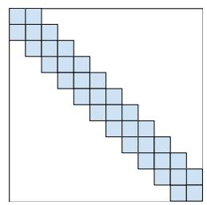
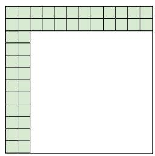
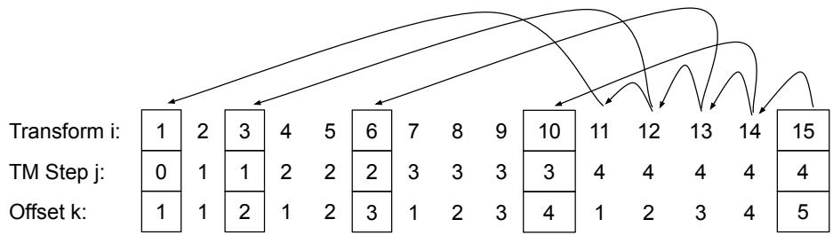
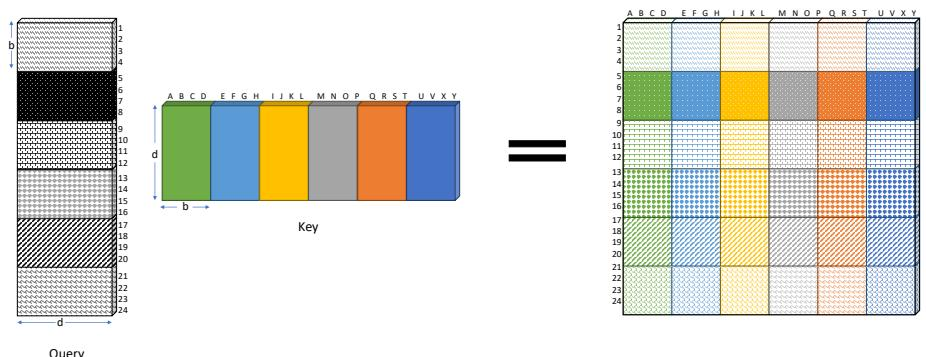
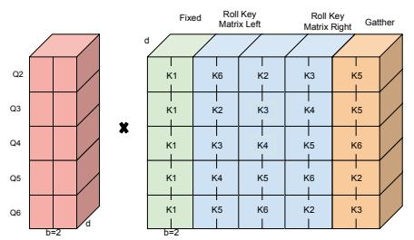
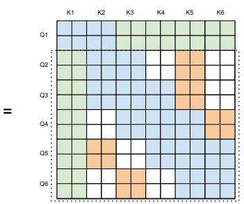
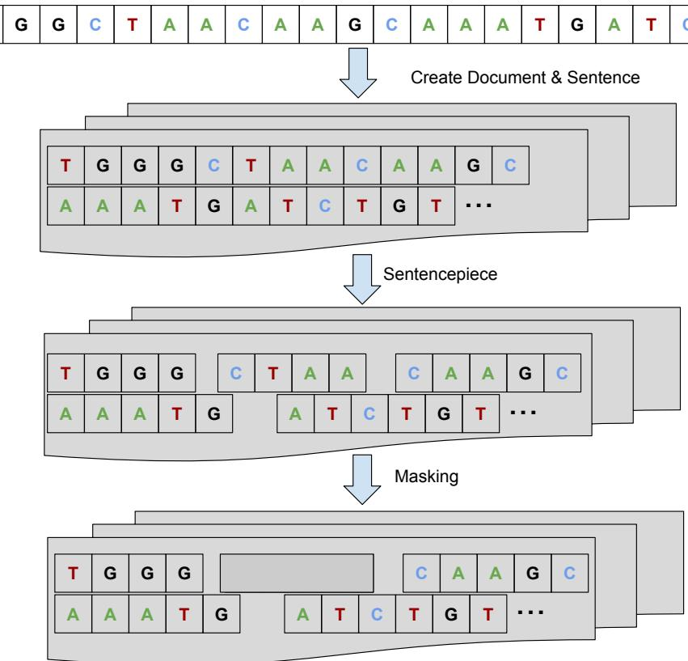
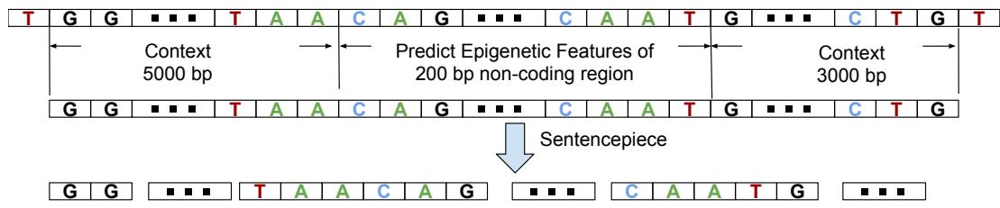

Big Bird: 用于更长序列的 Transformer

## 摘要

基于 Transformer 的模型，如 BERT，已成为自然语言处理（Natural Language Processing, NLP）中最成功的深度学习模型之一。不幸的是，由于其全注意力机制，它们的一个核心限制是对序列长度的二次依赖（主要体现在内存方面）。为解决此问题，我们提出了 BIGBIRD，一种稀疏注意力机制，可将这种二次依赖降低为线性依赖。我们证明 BIGBIRD 是序列函数的通用逼近器，并且是图灵完备的，从而保留了二次全注意力模型的这些性质。在此过程中，我们的理论分析揭示了在稀疏注意力机制中拥有 O(1) 全局 token（例如 CLS）所带来的若干优势，这些全局 token 会关注整个序列。所提出的稀疏注意力机制可以处理比之前在类似硬件上所能处理的序列长 8 倍的序列。由于能够处理更长上下文，BIGBIRD 显著提升了多种 NLP 任务的性能，例如问答和摘要生成。我们还提出了在基因组数据上的新应用。

## 1 引言

基于 Transformer [91] 的模型，如 BERT [22, 63]，在广泛的自然语言处理（Natural Language Processing, NLP）任务中取得了巨大成功，因而成为现代 NLP 研究的主流。Transformer 的多功能性和鲁棒性是其被广泛采用的主要推动力。该模型易于适配各种基于序列的任务——作为用于翻译 [91]、摘要生成 [66]、文本生成 [15] 等任务的 seq2seq 模型，或作为独立的编码器用于情感分析 [83]、词性标注（POS tagging）[65]、机器阅读理解 [93] 等任务——并且已知其大幅优于以往的序列模型，如 LSTM [37]。Transformer 的关键创新在于引入了自注意力机制，该机制可以对输入序列中的每个 token 并行计算，消除了循环神经网络（如 LSTM）中的顺序依赖。这种并行性使 Transformer 能够充分利用现代 SIMD 硬件加速器（如 GPU/TPU）的全部能力，从而促进了 NLP 模型在空前规模的数据集上的训练。这种在大型数据上训练的能力催生了 BERT [22] 和 T5 [75] 等模型，它们在大型通用语料库上预训练 Transformer，并将所学知识迁移到下游任务。预训练在低数据场景下的下游任务 [51] 以及具有充足数据的任务 [101] 中都带来了显著提升，因而成为 Transformer 在当代 NLP 中无处不在的主要推动力。

自注意力机制通过允许输入序列中的每个 token 独立地关注序列中的其他所有 token，克服了循环神经网络（RNN）的局限性（即 RNN 的顺序处理特性）。这一设计选择带来了若干有趣的后果。特别地，全自注意力在计算和内存方面的需求与序列长度呈二次方关系。我们注意到，虽然语料库可能很大，但在许多应用中提供上下文信息的序列长度却非常有限。使用当前常见的硬件和模型规模，这一需求大致只能处理长度为 512 个 token 的输入序列。这降低了它对需要更长上下文的任务（如问答（QA）[60]、文档分类等）的直接适用性。

然而，尽管我们知道自注意力和 Transformer 是有用的，但我们的理论理解仍然十分初步。自注意力模型的哪些方面是其性能所必需的？我们能对 Transformer 及类似模型的表达能力说些什么？先验地（a priori），从设计上甚至并不清楚所提出的自注意力机制是否与 RNN 一样有效。例如，自注意力甚至是置换等变的（permutation equivariant），因此并不遵循序列顺序。这一担忧已部分得到解决，因为 Yun 等人 [104] 表明 Transformer 足够具有表达能力，能够捕捉紧致域上所有连续的序列到序列函数。同时，Pérez 等人 [72] 表明完整的 Transformer 是图灵完备的（Turing Complete），即能够模拟完整的图灵机。两个自然的问题随之产生：我们能否使用更少的内积来获得完全二次方自注意力方案的经验性优势？这些稀疏注意力机制是否保留了原始网络的表达能力和灵活性？

在本文中，我们针对上述两个问题，提出了一种稀疏注意力机制，可提升在众多需要长上下文的任务上的性能。我们系统性地提出了 BIGBIRD——一种在 token 数量上具有线性复杂度的注意力机制（第 2 节）。我们从图稀疏化（graph sparsification）方法中获得灵感，并理解了当全注意力被放宽以形成所提出的注意力模式时，Transformer 表达能力证明会在何处失效。这一理解帮助我们开发了 BIGBIRD，它在理论上同样具有表达能力，并且在经验上也很有用。具体而言，我们的 BIGBIRD 由三个主要部分组成：

• 一组 g 个全局 token，关注序列的所有部分。

• 所有 token 关注一组 w 个局部相邻 token。

• 所有 token 关注一组 r 个随机 token。

这产生了一种高性能的注意力机制，可扩展到长得多的序列长度（8 倍）。总结一下，我们的主要贡献是：

1. BIGBIRD 满足完整 Transformer（full transformer）的所有已知理论性质（第 3 节）。特别是，我们证明了加入额外的 token 可以仅用 O(n) 次内积（inner product）来表示所有连续序列到序列（sequence to sequence）函数。此外，我们证明在关于精度的标准假设下，BIGBIRD 是图灵完备的（Turing complete）。

2. 在实验上，我们证明 BIGBIRD 所建模的扩展上下文有益于多种 NLP 任务。我们在多个不同数据集上的问答（question answering）和文档摘要（document summarization）任务中取得了当前最优（state of the art）结果。这些结果的总结在第 4 节中给出。

3. 最后，我们提出了一种基于注意力的模型（attention based models）的新应用，其中长上下文是有益的：提取基因组序列（如 DNA）的上下文表示。通过更长时间掩码语言模型（masked LM）预训练，BIGBIRD 提升了在下游任务（如启动子区域（promoter region）和染色质谱（chromatin profile）预测）上的表现（第 5 节）。

## 1.1 相关工作（Related Work）

已经有很多有趣的尝试，旨在缓解 Transformer 的二次依赖，这些尝试大致可分为两个方向。第一类工作接受长度限制并围绕它开发方法。这一类中最简单的方法只使用滑动窗口 [93]，但总的来说，大部分工作符合以下通用范式：使用某种其他机制选择一个较小的相关上下文子集输入到 Transformer 中，并可选地进行迭代，即每次以不同的上下文多次调用 Transformer 块。最突出的是，SpanBERT [42]、ORQA [54]、REALM [34]、RAG [57] 在不同任务上都取得了强大的性能。然而，值得注意的是，这些方法往往需要大量的工程工作（如通过大规模最近邻搜索的反向传播）并且难以训练。

第二类工作质疑完整注意力（full attention）是否必要，并尝试提出不需要完整注意力的方法，从而降低内存和计算需求。最突出的是，Dai 等人 [21]、Sukhbaatar 等人 [82]、Rae 等人 [74] 提出了自回归（auto-regressive）模型，这些模型在从左到右的语言建模中表现良好，但在需要双向上下文的任务中表现不佳。Child 等人 [16] 提出了一种稀疏模型，将复杂度降低到 $O ( n { \sqrt { n } } )$；Kitaev 等人 [49] 通过使用 LSH 计算最近邻，进一步将复杂度降低到 $O ( n \log ( n ) )$。

  

(a) 随机注意力（Random attention）

  

(b) 窗口注意力（Window Attention）

  

(c) 全局注意力（Global Attention）

  

图 1：BIGBIRD 中所使用的注意力机制的组成模块。白色表示不存在注意力。(a) 随机注意力（r = 2），(b) 滑动窗口注意力（w = 3），(c) 全局注意力（g = 2）。(d) 组合后的 BIGBIRD 模型。

Ye 等人 [103] 提出了数据的二值划分，而 Qiu 等人 [73] 则通过块稀疏性（block sparsity）来降低复杂度。最近，Longformer [8] 引入了基于局部滑动窗口的掩码，并辅以少量全局掩码以降低计算量，将 BERT 扩展到基于更长序列的任务。最后，我们的工作与扩展 Transformer 构建（Extended Transformers Construction）[4] 的工作密切相关并建立在该工作之上。该工作旨在为 Transformer 编码文本中的结构信息。他们广泛使用了全局 token 的概念以实现其目标。我们的理论研究也可以视为对这些模型成功提供了理论解释。需要指出的是，上述大多数方法都是基于启发式的，从经验上看，它们并不像原始 Transformer 那样通用和稳健，即同一架构无法在多个标准基准上达到 SoTA。（Longformer 是一个例外，我们在所有比较中都包含了它，更详细的比较见附录 E.3）。此外，这些近似方法并不具备理论保证。

## 2 BIGBIRD 架构

在本节中，我们描述 BIGBIRD 模型，使用的是在输入序列 $\pmb { X } = ( \pmb { x } _ { 1 } , . . . , \pmb { x } _ { n } ) \in \mathbb { R } ^ { n \times d }$ 上运行的 Transformer 每一层所用的广义注意力机制。广义注意力机制由一个有向图 $D$ 描述，其顶点集为 $[ n ] =$ $\{ 1 , \ldots , n \}$ 。弧（有向边）的集合表示注意力机制将考虑的内积集合。设 $N ( i )$ 表示节点 $i$ 在 $D$ 中的出邻居集合，则广义注意力机制的第 $i ^ { \mathrm { t h }}$ 个输出向量定义为

$$
\operatorname{ATTN} _ {D} (\boldsymbol {X}) _ {i} = \boldsymbol {x} _ {i} + \sum_ {h = 1} ^ {H} \sigma \left(Q _ {h} (\boldsymbol {x} _ {i}) K _ {h} (\boldsymbol {X} _ {N (i)}) ^ {T}\right) \cdot V _ {h} (\boldsymbol {X} _ {N (i)})\tag{AT}
$$

其中 $Q_h, K_h: \mathbb{R}^d \to \mathbb{R}^m$ 分别是查询函数和键函数，$V_h: \mathbb{R}^d \to \mathbb{R}^d$ 是值函数，$\sigma$ 是评分函数（例如 softmax 或 hardmax），$H$ 表示注意力头的数量。还要注意 $X_{N(i)}$ 对应的是仅由 $\{ \pmb{x}_j : j \in N(i) \}$ 堆叠而成的矩阵，并非所有输入。当 $D$ 是完全有向图时，我们恢复 Vaswani 等人 [91] 的全二次型注意力机制。为简化表述，我们将基于图 $D$ 的邻接矩阵 $\check{A}$ 进行讨论，即使底层图可能是稀疏的。具体而言，$\check{A} \in [0, 1]^{n \times n}$，若查询 $i$ 关注键 $j$ 则 $A(i,j) = 1$，否则为零。例如，当 $A$ 是全 1 矩阵时（如 BERT 中），将导致二次复杂度，因为所有 token 彼此相互关注。将自注意力视为全连接图这一视角，使我们能够利用现有图论知识来降低其复杂度。降低自注意力二次复杂度的问题现在可被视为一个图稀疏化问题。众所周知，随机图是扩展图（expander），能够在多种不同情境下（包括谱性质方面）近似完全图 [80, 38]。我们认为注意力机制中的稀疏随机图应满足两个期望特性：节点间较小的平均路径长度以及一种局部性概念，下面将分别讨论这两个特性。

让我们考虑最简单的随机图构造，即 Erdős-Rényi 模型，其中每条边以固定概率独立选取。在这样一个仅有 $\tilde{\Theta}(n)$ 条边的随机图中，任意两个节点之间的最短路径长度关于节点数取对数 [17, 43]。因此，这样的随机图在谱意义上近似完全图，且其邻接矩阵的第二特征值与第一特征值相距较远 [9, 10, 6]。此性质导致随机游走在图中具有快速的混合时间，非形式化地说明了信息能够在任意一对节点之间快速流动。因此，我们提出一种稀疏注意力机制，其中每个查询关注随机数量的 $r$ 个键，即对随机选取的 $r$ 个键满足 $A(i, \cdot) = 1$（参见图 1a）。

启发 BIGBIRD 诞生的第二个观点是，NLP 和计算生物学中的大多数上下文都呈现出大量引用局部性（locality of reference）的数据。在这种现象中，关于某个标记的大量信息可以从其相邻标记中推导出来。最相关的是，Clark 等人 [19] 研究了 NLP 任务中的自注意力模型，并得出结论：相邻的内积极为重要。局部性这一概念，即语言结构中标记的邻近性，也构成了各种语言学理论的基础，例如转换生成语法（transformational-generative grammar）。在图论术语中，聚类系数（clustering coefficient）是连通性局部性的一个度量，当图中包含许多团或近似团（几乎完全连通的子图）时，该度量值较高。简单的 Erdős-Rényi 随机图并不具有较高的聚类系数 [84]，但一类称为小世界图（small world graphs）的随机图则表现出较高的聚类系数 [94]。Watts 和 Strogatz [94] 引入的一个特定模型与我们高度相关，因为它在平均最短路径和局部性概念之间取得了良好的平衡。其模型的生成过程如下：构建一个规则环状格子（regular ring lattice），即一个具有 n 个节点的图，每个节点连接到 w 个邻居，每侧 w/2 个。

换言之，我们从节点上的一个滑动窗口开始。然后，所有连接中的一个随机子集（k%）被替换为随机连接。其余 (100 - k)% 的局部连接被保留。然而，在现代硬件上删除这样的随机边可能效率低下，因此我们将其保留，这不会影响其性质。

总之，为了捕捉上下文中的这些局部结构，在 BIGBIRD 中，我们定义了一种滑动窗口注意力，使得在

<table><tr><td>Model</td><td>MLM</td><td>SQuAD</td><td>MNLI</td></tr><tr><td>BERT-base</td><td>64.2</td><td>88.5</td><td>83.4</td></tr><tr><td>Random (R)</td><td>60.1</td><td>83.0</td><td>80.2</td></tr><tr><td>Window (W)</td><td>58.3</td><td>76.4</td><td>73.1</td></tr><tr><td>R + W</td><td>62.7</td><td>85.1</td><td>80.5</td></tr></table>

表 1：构建模块对比 @512

宽度为 w 的自注意力机制，位于位置 i 的查询从 $i - w / 2$ 到 $i + w / 2$ 的键进行注意力计算。在我们的记号中，$A ( i , i - w / 2 : i + w / 2 ) = 1$（参见图 1b）。作为初步的合理性检查，我们进行了基础实验，以测试这些直觉是否足以在使注意力关于词元数量保持线性的同时，获得接近 BERT 类模型的性能。我们发现随机块和局部窗口不足以捕获与 BERT 性能竞争所需的全部上下文。

BIGBIRD 的最后一块构件灵感来自我们的理论分析（第 3 节），该分析对经验性能至关重要。更具体地说，我们的理论利用了「全局词元」（global tokens）的重要性——这些词元对序列中的所有词元进行注意力计算，并且所有词元都对它们进行注意力计算（参见图 1c）。这些全局词元可以以两种方式定义：

• BIGBIRD-ITC：在内部 Transformer 构造（internal transformer construction，ITC）中，我们将一些已有的词元设为「全局」的，使其对整个序列进行注意力计算。具体而言，我们选择索引的一个子集 G（其中 $g : = | G |$），使得对于所有 $i \in G$，$A ( i , : ) = 1$ 且 $A ( : , i ) = 1$。

• BIGBIRD-ETC：在扩展 Transformer 构造（extended transformer construction，ETC）中，我们加入额外的「全局」词元，例如 CLS。具体而言，我们添加 g 个全局词元，这些词元对所有已有词元进行注意力计算。在我们的记号中，这对应于通过向矩阵 A 添加 g 行来创建一个新矩阵 $B \in [ 0 , 1 ] ^ { ( N + g ) \times ( N + g ) ^ { \circ } }$，使得对于所有 $i \in \{ 1 , 2 , . . . g \}$，$B ( i , : ) \ = \ 1$ 且 $B ( : , i ) = 1$，并且对于所有 $i , j \in \{ 1 , \ldots , N \}$，$B ( g + i , g + j ) = A ( i , j )$。这增加了额外的位置来存储上下文，正如我们将在实验部分看到的，这提升了性能。

BIGBIRD 的最终注意力机制（图 1d）同时具备以上三种性质：查询对 r 个随机键进行注意力计算，每个查询对其位置左侧的 $w / 2$ 个词元和右侧的 $w / 2$ 个词元进行注意力计算，并且它们包含 g 个全局词元（全局词元可以来自已有词元或额外添加的词元）。我们在附录 D 中提供实现细节。

## 3 关于稀疏注意力机制的理论结果

在本节中，我们将从两个方面证明稀疏注意力机制与全注意力机制一样强大且具有表达能力。首先，我们证明当稀疏注意力机制用于独立的编码器（如 BERT）时，它们以 Yun 等（2013）[104] 的风格成为序列到序列函数的通用逼近器。我们注意到这一性质也在 Yun 等（2020）[105] 的同期理论工作中得到了探讨。其次，与 [105] 不同，我们进一步证明稀疏的编码器-解码器 Transformer 是图灵完备的（Turing Complete）（假设与 [72] 中定义的相同条件）。作为上述正面结果的补充，我们还表明转向稀疏注意力机制会带来代价，即没有免费的午餐。在第 3.4 节中，我们通过展示一个自然任务来给出下界，在该任务中，任何足够稀疏的机制都将需要多项式层级数。

## 3.1 符号说明

完整的 Transformer 编码器栈不过是对单层编码器（具有独立参数）的重复应用。我们用 $\mathcal { T } _ { D } ^ { H , m , q }$ 表示此类 Transformer 编码器栈的类，该类使用广义编码器（第 2 节）定义，其中包含 $H$ 个头，每个头的维度为 $m$，$q$ 为输出网络的隐藏层维度，注意力层由有向图 $D$ 定义。

我们提出的注意力机制与 Vaswani 等（2017）[91]、Yun 等（2013）[104] 中的注意力机制之间的关键区别在于，我们在每个序列的开头添加一个特殊标记，并为其分配一个特殊向量。我们将其记为 $\scriptstyle { \mathbf { { \mathit { x } } } } _ { 0 }$。因此我们的图 $D$ 的顶点集为 $\{ 0 \} \cup [ \bar { n } ] = \{ 0 , 1 , 2 , \dotsc , , n \}$。我们将假设该额外节点及其对应向量在 Transformer 的最终输出层被丢弃。为避免繁琐的符号表示，我们仍将 Transformer 视为将序列 $\pmb { X } \in \mathbb { R } ^ { n \times d }$ 映射到 $\mathbb { R } ^ { n \times d }$ 的函数。我们也允许 Transformer 在输入层将位置嵌入 $E \doteq \mathbb { R } ^ { d \times n }$ 附加到矩阵 $X$ 上。

最后，我们需要定义用于证明通用逼近性质的函数类和距离度量。设 ${ \mathcal { F } } _ { C D }$ 表示连续函数的集合 $f : [ 0 , 1 ] ^ { n \times \dot { d } }  \mathbb { R } ^ { \Breve { n } \times d }$，这些函数关于由 $\ell _ { p }$ 范数定义的拓扑是连续的。回顾一下，对于任意 $p \geq 1$，$\ell _ { p }$ 距离为 $d _ { p } ( f _ { 1 } , f _ { 2 } ) =$ $\left( \int \| f _ { 1 } ( X ) - f _ { 2 } ( X ) \| _ { p } ^ { p } d X \right) ^ { 1 / p }$

## 3.2 通用逼近器

定义 1. 以 0 为中心的星图（star-graph）$S$ 是定义在 $\{ 0 , \ldots , n \}$ 上的图。所有顶点 $i$ 的邻域为 $N(i) = \{0, i\}$，其中 $i \in \{1, \ldots, n\}$，且 $N(0) = \{1, \ldots, n\}$。

我们的主要定理是：由包含星图 $S$ 的任意图所定义的稀疏注意力机制是一个通用逼近器：

定理 1. 给定 $1 < p < \infty$ 与 $\epsilon > 0$，对任意 $f \in \mathcal{F}_{CD}$，存在一个具有稀疏注意力的 transformer $g \in \mathcal{T}_D^{H, m, q}$，使得 $d_p(f, g) \leq \epsilon$，其中 $D$ 是任意包含星图 $S$ 的图。

为了证明该定理，我们将遵循 [104] 中概述的标准证明结构。

步骤 1：用分段常值函数逼近 $\mathcal{F}_{CD}$。由于 $f$ 是一个具有有界定义域 $[0, 1)^{n \times \bar{d}}$ 的连续函数，我们将用一个合适的分段常值函数来逼近它。这一步通过将区域 $[0, 1)$ 作一个粒度为 $\delta$ 的合适划分，得到离散集合 $\mathbb{G}_\delta$ 来实现。因此，我们可以假设所处理的函数为 $\bar{f} : \mathbb{G}_\delta \to \mathbb{R}^{n \times d}$，并且 $d_p(f, \bar{f}) \leq \frac{\epsilon}{3}$。

步骤 2：用改进的 transformer 逼近分段常值函数。这是证明的关键步骤，其中自注意力机制用于生成输入的上下文映射（contextual mapping）。非形式地说，上下文映射是对由矩阵 $(X, x_i)$ 与一列所组成的二元组生成的一个唯一编码。其唯一性使得前馈层能够使用每个编码将其映射到唯一的输出列。

主要的技术挑战在于仅使用稀疏注意力机制来计算上下文映射。这在 [104] 中通过一个"选择性"移位算子来实现，该算子会将位于特定区间内的条目向上移位。其证明的关键在于：移位量恰好等于从最大条目到最小条目的范围。

使用稀疏注意力机制创建上下文映射是一项相当大的挑战。特别是，由于每个查询仅关注少数键，目前尚不清楚是否能汇聚足够的信息来为整个矩阵建立上下文嵌入。为了解决此问题，我们开发了一种稀疏移位算子（sparse shift operator），当矩阵的条目落在某个范围内时，该算子会对其进行移位。移位的精确量由有向稀疏注意力图（directed sparse attention graph）$D$ 控制。第二个关键要素是使用额外的全局标记（global token）。通过仔细地将该算子应用于一组选定的范围，我们将证明每列都将包含完整映射的唯一表示。因此，我们可以通过使用多层结构和一个辅助全局标记来增强自注意力机制中的内积损失。

步骤 3：用原始 Transformer 近似修改后的 Transformer：最后一步是使用采用 ReLU 和 softmax 的原始 Transformer 来近似修改后的 Transformer。

我们在附录 A 中提供了完整的细节。

## 3.3 图灵完备性（Turing Completeness）

Transformer 是一个非常通用的类别。在 Vaswani 等人 [91] 的原始论文中，它们既被用作编码器也被用作解码器。虽然上一节概述了仅编码器的强大之处，但另一个自然的问题是，解码器与编码器共同使用时的额外能力是什么？Pérez 等人 [72] 证明了基于二次注意力机制的完整 Transformer 具有图灵完备性。该结论基于一个不切实际的假设，即模型以任意精度运行。当然，这一假设是必要的，否则 Transformer 就是有界有限状态机，无法实现图灵完备。

很自然会问，全注意力机制是否必需？或者，稀疏注意力机制是否也可以用于模拟任意图灵机（Turing Machine）？我们证明情况确实如此：我们可以使用稀疏编码器和稀疏解码器来模拟任意图灵机。

要在 Transformer 架构中使用稀疏注意力机制，我们需要定义一种合适的修改方式，使每个标记仅对前面的标记做出反应。与 BERT 的情况不同（BERT 中整个注意力机制只应用一次），在完整 Transformer 中，解码器端的稀疏注意力机制是逐标记使用的。其次，Pérez 等人 [72] 的工作将每个标记用作磁带历史的表示，并使用全注意力来移动和检索正确的磁带符号。Pérez 等人 [72] 的大部分构造对稀疏注意力仍然适用，除了他们用于回溯历史的寻址方案（[72] 中的引理 B.4）。我们展示了如何使用稀疏注意力机制来模拟这一过程，并将详细推导推迟到附录 B。

## 3.4 局限性

我们展示了一个自然任务，可以被 $O(1)$ 层的完整注意力机制解决。然而，在标准的复杂性理论假设下，这个问题对于任何具有 $\tilde{O}(n)$ 条边（即不仅仅是 BIGBIRD）的稀疏注意力层都需要 $\tilde{\Omega}(n)$ 层。（此处 $\tilde{O}$ 隐藏了多对数因子）。考虑在长度为 $n$ 的给定序列中，为每个向量寻找对应最远向量的简单问题。形式上，

任务 1. 给定 $n$ 个单位向量 $\{u_1, \ldots, u_n\}$，求 $f(u_1, \dots, u_n) \to (u_{1^*}, \dots, u_{n^*})$，其中对于固定的 $j \in [n]$，我们定义 $j^* = \arg\max_k \|u_k - u_j\|_2^2$。

寻找相隔最远的向量在单位向量的情况下可归结为最小化内积搜索。对于具有适当查询和键的完整注意力机制，这个任务非常容易，因为我们可以评估所有成对的内积。

稀疏注意力的不可能性来自正交向量猜想（Orthogonal Vector Conjecture, OVC）[1, 2, 7, 96] 所衍生的硬度结果。OVC 是细粒度复杂性中广泛使用的假设。非正式地说，它表明人们不能在亚二次时间内判定 $n$ 个布尔向量的最小内积是否为 $0$。在附录 C 中，我们展示了使用 OVC 的归约证明，表明如果一个 transformer $g \in \mathcal{T}_D^{H=1, m=2d, q=0}$ 对于任何稀疏有向图 $D$ 能评估任务 1，那么它就能解决正交向量问题。

命题 1. 存在一个单层完整自注意力 $g \in \mathcal{T}^{H=1, m=2d, q=0}$ 能够评估任务 1，即 $g(u_1, ..., u_n) = [u_{1^*}, ..., u_{n^*}]$，但对于任何具有 $\tilde{O}(n)$ 条边（即内积评估）的稀疏注意力图 $D$，将需要 $\tilde{\Omega}(n^{1-o(1)})$ 层。我们将在附录 C 中给出这一事实的正式证明。

## 4 实验：自然语言处理

在本节中，我们的目标是展示对 NLP 任务建模更长输入序列的好处，为此我们选择了三个代表性任务。我们首先进行基本的掩码语言建模（MLM; Devlin 等人 [22]）以检查是否可以通过利用更长的连续序列来学习更好的上下文表示。接下来，我们考虑带有支持证据的问答（QA）任务，对于该任务，处理更长序列的能力将允许我们使用诸如 TF-IDF/BM25 之类的粗略系统检索更多证据。

<table><tr><td rowspan="2">Model</td><td colspan="3">HotpotQA</td><td colspan="2">NaturalQ</td><td>TriviaQA</td><td>WikiHop</td></tr><tr><td>Ans</td><td>Sup</td><td>Joint</td><td>LA</td><td>SA</td><td>Full</td><td>MCQ</td></tr><tr><td>RoBERTa</td><td>73.5</td><td>83.4</td><td>63.5</td><td>-</td><td>-</td><td>74.3</td><td>72.4</td></tr><tr><td>Longformer</td><td>74.3</td><td>84.4</td><td>64.4</td><td>-</td><td>-</td><td>75.2</td><td>75.0</td></tr><tr><td>BIGBIRD-ITC</td><td>75.7</td><td>86.8</td><td>67.7</td><td>70.8</td><td>53.3</td><td>79.5</td><td>75.9</td></tr><tr><td>BIGBIRD-ETC</td><td>75.5</td><td>87.1</td><td>67.8</td><td>73.9</td><td>54.9</td><td>78.7</td><td>75.9</td></tr></table>

表 2：使用 Base 规模模型的问答开发集结果。我们报告 WikiHop 的准确率，以及 HotpotQA、Natural Questions 和 TriviaQA 的 F1 值。

<table><tr><td rowspan="2">Model</td><td colspan="3">HotpotQA</td><td colspan="2">NaturalQ</td><td colspan="2">TriviaQA</td><td>WikiHop</td></tr><tr><td>Ans</td><td>Sup</td><td>Joint</td><td>LA</td><td>SA</td><td>Full</td><td>Verified</td><td>MCQ</td></tr><tr><td>HGN [26]</td><td>82.2</td><td>88.5</td><td>74.2</td><td>-</td><td>-</td><td>-</td><td>-</td><td>-</td></tr><tr><td>GSAN</td><td>81.6</td><td>88.7</td><td>73.9</td><td>-</td><td>-</td><td>-</td><td>-</td><td>-</td></tr><tr><td>ReflectionNet [32]</td><td>-</td><td>-</td><td>-</td><td>77.1</td><td>64.1</td><td>-</td><td>-</td><td>-</td></tr><tr><td>RikiNet-v2 [61]</td><td>-</td><td>-</td><td>-</td><td>76.1</td><td>61.3</td><td>-</td><td>-</td><td>-</td></tr><tr><td>Fusion-in-Decoder [39]</td><td>-</td><td>-</td><td>-</td><td>-</td><td>-</td><td>84.4</td><td>90.3</td><td>-</td></tr><tr><td>SpanBERT [42]</td><td>-</td><td>-</td><td>-</td><td>-</td><td>-</td><td>79.1</td><td>86.6</td><td>-</td></tr><tr><td>MRC-GCN [87]</td><td>-</td><td>-</td><td>-</td><td>-</td><td>-</td><td>-</td><td>-</td><td>78.3</td></tr><tr><td>MultiHop [14]</td><td>-</td><td>-</td><td>-</td><td>-</td><td>-</td><td>-</td><td>-</td><td>76.5</td></tr><tr><td>Longformer [8]</td><td>81.2</td><td>88.3</td><td>73.2</td><td>-</td><td>-</td><td>77.3</td><td>85.3</td><td>81.9</td></tr><tr><td>BIGBIRD-ETC</td><td>81.2</td><td>89.1</td><td>73.6</td><td>77.8</td><td>57.9</td><td>84.5</td><td>92.4</td><td>82.3</td></tr></table>

Table 3: 在 QA 任务的测试集上的微调结果。测试结果（HotpotQA、Natural Questions、TriviaQA 采用 F1；TriviaQA、WikiHop 采用准确率）取自各自对应的排行榜。对于每个任务，我们选取了排行榜上前 3 名（不包括 BIGBIRD-ETC）。在 Natural Questions 长答案（LA）、TriviaQA 和 WikiHop 上，BIGBIRD-ETC 是新的最先进水平（State-of-the-Art）。在 HotpotQA 上，按 F1 我们位列排行榜第三，按精确匹配（EM）位列第二。

最后，我们处理长文档分类任务，其中判别性信息可能并不位于前 512 个词元内。下面我们总结了使用序列长度 40961 的 BIGBIRD 的结果，其他设置细节（包括计算资源、批大小、步长）我们推迟到附录 E 中讨论。

**Pretraining and MLM** We follow [22, 63] to create base and large versions of BIGBIRD and pretrain it using MLM objective. This task involves predicting a random subset of tokens which have been masked out. We use four standard data-sets for pretraining (listed in App. E.1, Tab. 9), warm-starting from the public RoBERTa checkpoint2. We compare performance in predicting the masked out tokens in terms of bits per character, following [8]. As seen in App. E.1, Tab. 10, both BIGBIRD and Longformer perform better than limited length RoBERTa, with BIGBIRD-ETC performing the best. We note that we trained our models on a reasonable 16GB memory/chip with batch size of 32-64. Our memory efficiency is due to efficient blocking and sparsity structure of the sparse attention mechanism described in Sec. 2.

**预训练与掩码语言建模（MLM）** 我们遵循 [22, 63] 构建 BIGBIRD 的 base（宽）和 large（大）两个版本，并使用 MLM（掩码语言建模）目标对其进行预训练。该任务涉及预测一组被掩码掉的随机词元。我们使用四个标准数据集进行预训练（列于附录 E.1 表 9），并以公开的 RoBERTa 检查点2 进行热启动。我们按照 [8] 的方法，以字符位数（bits per character）来比较在预测被掩码词元方面的性能。如附录 E.1 表 10 所示，BIGBIRD 和 Longformer 都优于有限长度的 RoBERTa，其中 BIGBIRD-ETC 表现最佳。需要说明的是，我们在每芯片合理的 16GB 内存下训练模型，批大小为 32–64。我们的内存效率得益于第 2 节中所描述的稀疏注意力机制的高效分块和稀疏性结构。

## Question Answering (QA) We considered following four challenging datasets:

## 问答任务（QA）我们考虑了以下四个具有挑战性的数据集：

1. **Natural Questions [52]**: For the given question, find a short span of answer (SA) from the given evidences as well highlight the paragraph from the given evidences containing information about the correct answer (LA).

1. **Natural Questions（自然问题）[52]**：针对所给问题，从给定证据中找出答案的短跨度（SA），以及从给定证据中高亮出包含正确答案信息的段落（LA）。

2. **HotpotQA-distractor [100]**: Similar to natural questions, it requires finding the answer (Ans) as well as the supporting facts (Sup) over different documents needed for multi-hop reasoning from the given evidences.

2. **HotpotQA-distractor（含干扰项的 HotpotQA）[100]**：与自然问题类似，它要求从给定证据中找出答案（Ans）以及跨多个文档的支持事实（Sup），以便进行多跳推理。

3. **TriviaQA-wiki [41]**: We need to provide an answer for the given question using provided Wikipedia evidence, however, the answer might not be present in the given evidence. On a smaller verified subset of question, the given evidence is guaranteed to contain the answer. Nevertheless, we model the answer as span selection problem in this case as well.

3. **TriviaQA-wiki（基于维基百科的 TriviaQA）[41]**：我们需要使用所提供的维基百科证据为给定问题提供答案，然而答案可能并不出现在给定证据中。在一个较小的经过验证的问题子集上，证据保证包含答案。尽管如此，在该场景下我们同样把答案视为跨度选择问题来建模。

4. **WikiHop [95]**: Chose correct option from multiple-choice questions (MCQ), by aggregating information spread across multiple documents given in the evidences.

4. **WikiHop [95]**：通过聚合给定证据中分散在多个文档里的信息，从多项选择题（MCQ）中选出正确选项。

由于这些任务竞争非常激烈，已经针对每个数据集设计了多个高度工程化的系统，以符合各自的输出格式。为了公平比较，我们在训练 BIGBIRD 时不得不使用一些额外的正则化，相关的细节以及精确的架构描述见附录 E.2。我们在基础尺寸（base sized）模型上进行实验，并为每个数据集在开发集上选择最佳配置（如表 2 所示）。我们可以看到，采用了扩展全局令牌（expanded global tokens）的 BIGBIRD-ETC 始终优于所有其他模型。因此，我们选择该配置来训练一个大尺寸（large sized）模型，用于在隐藏测试集上进行评估。

在表 3 中，我们将 BIGBIRD-ETC 模型与排行榜上除 BIGBIRD 之外的前三名系统进行了比较。可以清楚地看到，使用更长上下文的重要性，因为 Longformer 和 BIGBIRD 都优于上下文较小的模型。此外，值得注意的是，BIGBIRD 的提交结果是单个模型，而 Natural Questions 的其他前三名系统都是集成模型，这可能解释了其在精确答案短语选择上准确率略低的原因。

分类任务 我们在不同长度和内容的分类任务数据集上进行了实验，具体包括多种文档分类任务和 GLUE 任务。沿用 BERT 的做法，我们在第一个 [CLS] 令牌之上使用了一层带交叉熵损失的全连接层。我们观察到，当我们拥有更长文档和更少训练样本时，使用 BIGBIRD 带来的提升更为显著。例如，使用基础尺寸模型时，BIGBIRD 将 Arxiv 数据集上的当前最优性能提升了约 5 个百分点。在 Patents 数据集上，相较于简单地使用 BERT/RoBERTa 有所改进，但由于训练数据量庞大，相较于当前最优方法（该方法并非基于 BERT）的提升并不显著。需要注意的是，在规模小得多的 IMDb 数据集上并未出现这种性能提升。除了实验设置细节外，我们还在附录 E.4 中给出了详细的结果，这些结果表明 BIGBIRD 具有具有竞争力的表现。

## 4.1 编码器-解码器任务

对于编码器-解码器（encoder-decoder）的设置，可以很容易看出，由于完整的自注意力机制，编码器和解码器都存在二次复杂度的问题。我们专注于仅在编码器端引入 BIGBIRD 的稀疏注意力机制。这是因为，在实际生成任务中，输出序列的长度通常远小于输入序列的长度。例如，在文本摘要任务中，我们在现实的场景中（参见附录 E.5 表 18）看到输出序列长度的中位数约为 200，而输入序列长度的中位数大于 3000。对于此类应用，在编码器端使用稀疏注意力机制、而在解码器端使用完整的自注意力机制是更为高效的做法。

<table><tr><td rowspan="2" colspan="2">Model</td><td colspan="3">Arxiv</td><td colspan="3">PubMed</td><td colspan="3">BigPatent</td></tr><tr><td>R-1</td><td>R-2</td><td>R-L</td><td>R-1</td><td>R-2</td><td>R-L</td><td>R-1</td><td>R-2</td><td>R-L</td></tr><tr><td rowspan="10">Prior Art</td><td>SumBasic [68]</td><td>29.47</td><td>6.95</td><td>26.30</td><td>37.15</td><td>11.36</td><td>33.43</td><td>27.44</td><td>7.08</td><td>23.66</td></tr><tr><td>LexRank [25]</td><td>33.85</td><td>10.73</td><td>28.99</td><td>39.19</td><td>13.89</td><td>34.59</td><td>35.57</td><td>10.47</td><td>29.03</td></tr><tr><td>LSA [97]</td><td>29.91</td><td>7.42</td><td>25.67</td><td>33.89</td><td>9.93</td><td>29.70</td><td>-</td><td>-</td><td>-</td></tr><tr><td>Attn-Seq2Seq [85]</td><td>29.30</td><td>6.00</td><td>25.56</td><td>31.55</td><td>8.52</td><td>27.38</td><td>28.74</td><td>7.87</td><td>24.66</td></tr><tr><td>Pntr-Gen-Seq2Seq [77]</td><td>32.06</td><td>9.04</td><td>25.16</td><td>35.86</td><td>10.22</td><td>29.69</td><td>33.14</td><td>11.63</td><td>28.55</td></tr><tr><td>Long-Doc-Seq2Seq [20]</td><td>35.80</td><td>11.05</td><td>31.80</td><td>38.93</td><td>15.37</td><td>35.21</td><td>-</td><td>-</td><td>-</td></tr><tr><td>Sent-CLF [81]</td><td>34.01</td><td>8.71</td><td>30.41</td><td>45.01</td><td>19.91</td><td>41.16</td><td>36.20</td><td>10.99</td><td>31.83</td></tr><tr><td>Sent-PTR [81]</td><td>42.32</td><td>15.63</td><td>38.06</td><td>43.30</td><td>17.92</td><td>39.47</td><td>34.21</td><td>10.78</td><td>30.07</td></tr><tr><td>Extr-Abst-TLM [81]</td><td>41.62</td><td>14.69</td><td>38.03</td><td>42.13</td><td>16.27</td><td>39.21</td><td>38.65</td><td>12.31</td><td>34.09</td></tr><tr><td>Dancer [31]</td><td>42.70</td><td>16.54</td><td>38.44</td><td>44.09</td><td>17.69</td><td>40.27</td><td>-</td><td>-</td><td>-</td></tr><tr><td rowspan="4">Base</td><td>Transformer</td><td>28.52</td><td>6.70</td><td>25.58</td><td>31.71</td><td>8.32</td><td>29.42</td><td>39.66</td><td>20.94</td><td>31.20</td></tr><tr><td>+ RoBERTa [76]</td><td>31.98</td><td>8.13</td><td>29.53</td><td>35.77</td><td>13.85</td><td>33.32</td><td>41.11</td><td>22.10</td><td>32.58</td></tr><tr><td>+ Pegasus [107]</td><td>34.81</td><td>10.16</td><td>30.14</td><td>39.98</td><td>15.15</td><td>35.89</td><td>43.55</td><td>20.43</td><td>31.80</td></tr><tr><td>BIGBIRD-RoBERTa</td><td>41.22</td><td>16.43</td><td>36.96</td><td>43.70</td><td>19.32</td><td>39.99</td><td>55.69</td><td>37.27</td><td>45.56</td></tr><tr><td rowspan="3">Large</td><td>Pegasus (Reported) [107]</td><td>44.21</td><td>16.95</td><td>38.83</td><td>45.97</td><td>20.15</td><td>41.34</td><td>52.29</td><td>33.08</td><td>41.75</td></tr><tr><td>Pegasus (Re-eval)</td><td>43.85</td><td>16.83</td><td>39.17</td><td>44.53</td><td>19.30</td><td>40.70</td><td>52.25</td><td>33.04</td><td>41.80</td></tr><tr><td>BIGBIRD-Pegasus</td><td>46.63</td><td>19.02</td><td>41.77</td><td>46.32</td><td>20.65</td><td>42.33</td><td>60.64</td><td>42.46</td><td>50.01</td></tr></table>

表 4：长文档摘要的 ROUGE 分数。

摘要（Summarization） 文档摘要（Document summarization）是一项为文本文档生成简短而准确摘要的任务。我们使用了三个长文档数据集来测试我们的模型，其详细信息见表 18。在本文中，我们专注于长文档的生成式摘要（abstractive summarization），其中使用更长的上下文编码器应能提升性能。原因有二：首先，重要内容可以在长文档中均匀分布，而不仅出现在前 512 个词元中，这在 BigPatents 数据集 [78] 中是设计如此。其次，更长的文档展现出更丰富的篇章结构，且摘要明显更具抽象性，因此观察更多上下文会有所助益。正如最近 [76, 107] 所指出的，预训练有助于生成式任务，我们从面向基础规模（base-sized）模型的通用 MLM（Masked Language Modeling，掩码语言模型）预训练进行热启动，并在大型规模（large-sized）模型上利用 Pegasus [107] 中面向摘要任务的当前最优预训练。BIGBIRD 稀疏编码器与完整解码器在这些长文档数据集上联合训练的结果呈现在表 4 中。我们可以清楚地看到，建模更长上下文带来了显著的改进。除超参数外，我们还在附录 E.5 中展示了在更短但更广泛应用的数据集上的结果，表明使用稀疏注意力同样不会损害性能。

## 5 实验：基因组学（Genomics）

近期在基因组数据上应用深度学习出现了热潮 [86, 106, 13]，已在一系列具有重要生物学意义的任务上带来性能提升，例如启动子位点预测 [71]、甲基化分析 [55]、预测非编码变异的功能效应 [109] 等。这些方法以 DNA 序列片段作为输入，因此我们认为 BIGBIRD 处理更长输入序列的能力将十分有益，因为 DNA 中的许多功能效应是高度非局部的 [12]。此外，受自然语言处理（Natural Language Processing, NLP）的启发，我们通过 MLM 预训练，利用大量未标注数据（例如人类参考基因组、Saccharomyces Genome Database）学习 DNA 片段的强大上下文表示。接下来，我们将展示，具备长输入能力的 BIGBIRD 配合所提出的预训练方法，能够在两个下游任务中显著提升性能。这两个任务的详细实验设置见附录 F。

预训练与MLM 正如Liang [58]中所探讨的，我们提出不再以碱基对（base pairs）为操作单位，而是首先将DNA分割为词元（tokens），以进一步增加上下文长度（见附录F，图7）。具体而言，我们为DNA序列构建了一个大小为32K的字节对编码（byte-pair encoding, BPE）[50]词表，其中每个词元平均代表8.78个碱基对。我们使用MLM目标在人类参考基因组（GRCh37）3上学习这些词元的上下文表示。随后，我们在表5中报告了在保留集（held-out set）上的每字符比特数（bits per character, BPC）。我们发现，基于注意力的DNA上下文表示确实能够改善BPC，而通过使用基于注意力的DNA上下文表示则进一步改善了BPC，

<table><tr><td>Model</td><td>BPC</td></tr><tr><td>SRILM [58]</td><td>1.57</td></tr><tr><td>BERT (sqln. 512)</td><td>1.23</td></tr><tr><td>BIGBIRD (sqln. 4096)</td><td>1.12</td></tr></table>

表 5：MLM BPC 更长上下文。

**启动子区域预测** 启动子是通常位于基因上游的 DNA 区域，是转录起始的位点。由于识别启动子是理解基因调控的重要第一步，研究者已提出多种方法来识别给定 DNA 序列中的启动子区域 [99, 59, 11, 98, 71]。相应的机器学习任务是将给定的 DNA 片段分类为启动子序列或非启动子序列。我们使用了 Oubounyt 等人 [71] 编纂的数据集，该数据集基于真核启动子数据库（Eukaryotic Promoter Database, EPDnew）[24] 4 构建。我们使用上述训练数据对预训练的 BIGBIRD 模型进行了微调，并在测试数据集上报告 F1 值。我们在表 6 中将我们的结果与之前报道的最佳方法进行比较。我们可以看到，BIGBIRD 取得了近乎完美的准确率，比之前报道的最佳准确率提升了 5 个百分点。

<table><tr><td>Model</td><td>F1</td></tr><tr><td>CNNProm [90]</td><td>69.7</td></tr><tr><td>DeePromoter [71]</td><td>95.6</td></tr><tr><td>BIGBIRD</td><td>99.9</td></tr></table>

表 6：对比。

染色质谱预测（Chromatin-Profile Prediction）

DNA 的非编码区（non-coding region）不编码蛋白质。大多数疾病以及其他性状相关的单核苷酸多态性（single-nucleotide polymorphism）与非编码基因组变异相关 [109, 46]。因此，理解 DNA 非编码区的功能效应是一项非常重要的任务。正如 Zhou 和 Troyanskaya [109] 所定义的那样，这一过程中的一个重要步骤是从

<table><tr><td>Model</td><td>TF</td><td>HM</td><td>DHS</td></tr><tr><td>gkm-SVM [30]</td><td>89.6</td><td>-</td><td>-</td></tr><tr><td>DeepSea [109]</td><td>95.8</td><td>85.6</td><td>92.3</td></tr><tr><td>BIGBIRD</td><td>96.1</td><td>88.7</td><td>92.1</td></tr></table>

表 7：染色质谱预测

非编码基因组序列。为此，DeepSea [109] 从 DNA 元素百科全书（ENCODE）5 和 Roadmap 表观基因组项目6 中编纂了 2.4M 个非编码变异的 919 项染色质谱。对应的机器学习任务是：给定一段 DNA 非编码区域，预测这 919 项染色质谱，其中包括 160 种不同转录因子（TF）的 690 个转录因子结合谱、125 个 DNase I 敏感性（DHS）谱以及 104 个组蛋白修饰（HM）谱。我们联合训练 919 个二分类器，从 DNA 片段序列中预测这些功能性效应。在保留染色体（held-out chromosomes）上，我们将 AUC 与表 7 中的基线方法进行比较，发现我们在较困难的任务 HM 上显著提升了性能；已知 HM 谱具有比其他谱更长程的相关性 [27]。

## 6 结论

我们提出了 BIGBIRD：一种关于词符数量呈线性的稀疏注意力机制。BIGBIRD 满足若干理论性质：它是序列到序列函数的通用逼近器，并且也是图灵完备的。理论上，我们利用额外的全局词符的力量来保持模型的表达能力。我们通过对结果的分析表明，转向稀疏注意力机制确实需要付出一定的代价。经验上，BIGBIRD 在多个自然语言处理任务（如问答和长文档分类）上取得了当前最优的性能。我们进一步提出了基于注意力的 DNA 上下文语言模型，并将其微调应用于下游任务，例如启动子区域预测以及非编码变异效应预测。

## 参考文献

[1] A. Abboud, V. V. Williams, and O. Weimann. 序列比对加速的后果. 收录于：自动机、语言与编程国际讨论会文集，第 39–51 页. Springer, 2014.

[2] A. Abboud, A. Backurs, and V. V. Williams. 关于 LCS 及其他序列相似性度量的紧致 hardness 结果. 收录于：2015 年 IEEE 第 56 届计算机科学基础年度研讨会论文集，第 59–78 页. IEEE, 2015.

[3] J. Abreu, L. Fred, D. Macêdo, and C. Zanchettin. 用于文档分类的分层注意力混合神经网络. 收录于：人工神经网络国际会议论文集，第 396–402 页. Springer, 2019.

[4] J. Ainslie, S. Ontanon, C. Alberti, P. Pham, A. Ravula, and S. Sanghai. ETC：在 Transformer 中对长且结构化数据的编码. arXiv 预印本 arXiv:2004.08483, 2020.

[5] C. Alberti, K. Lee, and M. Collins. 用于自然问题（Natural Questions）的 BERT 基线. arXiv 预印本 arXiv:1901.08634, 2019.

[6] J. Alt, R. Ducatez, and A. Knowles. 临界 Erdős–Rényi 图的极端特征值. arXiv 预印本 arXiv:1905.03243, 2019.

[7] A. Backurs and P. Indyk. 在强次二次时间内无法计算编辑距离（除非 SETH 假设不成立）. 收录于：第 47 届 ACM 计算理论年度研讨会论文集，第 51–58 页, 2015.

[8] I. Beltagy, M. E. Peters, and A. Cohan. Longformer：长文档 Transformer。arXiv 预印本 arXiv:2004.05150，2020。

[9] F. Benaych-Georges, C. Bordenave, A. Knowles, et al. 稀疏非齐次 Erdős–Rényi 图的最大特征值。《概率论年刊》，47(3):1653–1676，2019。

[10] F. Benaych-Georges, C. Bordenave, A. Knowles, et al. 稀疏随机矩阵的谱半径。载于《亨利·庞加莱研究所纪要·概率论与统计学》第 56 卷，第 2141–2161 页。亨利·庞加莱研究所，2020。

[11] R. Bharanikumar, K. A. R. Premkumar, and A. Palaniappan. PromoterPredict：基于序列的大肠杆菌 σ70 启动子强度建模揭示启动子强度与序列之间的对数依赖关系。《PeerJ》，6:e5862，2018。

[12] S. Buldyrev, A. Goldberger, S. Havlin, R. Mantegna, M. Matsa, C.-K. Peng, M. Simons, and H. Stanley. 编码与非编码 DNA 序列的长程相关性质：GenBank 分析。《物理评论 E 辑》，51(5):5084，1995。

[13] A. Busia, G. E. Dahl, C. Fannjiang, D. H. Alexander, E. Dorfman, R. Poplin, C. Y. McLean, P.-C. Chang, and M. DePristo. 面向短 DNA 序列模式识别的深度学习方法。bioRxiv，第 353474 页，2019。

[14] J. Chen, S.-t. Lin, and G. Durrett. 基于推理链的多跳问答。arXiv 预印本 arXiv:1910.02610，2019。

[15] Y.-C. Chen, Z. Gan, Y. Cheng, J. Liu, and J. Liu. 蒸馏 BERT 知识用于文本生成。arXiv 预印本 arXiv:1911.03829，2019。

[16] R. Child, S. Gray, A. Radford, and I. Sutskever. 使用稀疏 Transformer 生成长序列。arXiv 预印本 arXiv:1904.10509，2019。

[17] F. Chung and L. Lu. 具有给定期望度的随机图中的平均距离。《美国国家科学院院刊》，99(25):15879–15882，2002。

[18] C. Clark and M. Gardner. 简洁有效的多段落阅读理解。arXiv 预印本 arXiv:1710.10723，2017。

[19] K. Clark, U. Khandelwal, O. Levy, and C. D. Manning. BERT 在关注什么？BERT 注意力分析。arXiv 预印本 arXiv:1906.04341，2019。

[20] A. Cohan, F. Dernoncourt, D. S. Kim, T. Bui, S. Kim, W. Chang, and N. Goharian. 面向长文档生成式摘要的篇章感知注意力模型。arXiv 预印本 arXiv:1804.05685，2018。

[21] Z. Dai, Z. Yang, Y. Yang, J. Carbonell, Q. V. Le, and R. Salakhutdinov. Transformer-XL：超越固定长度上下文的注意力语言模型。arXiv:1901.02860，2019。

[22] J. Devlin, M.-W. Chang, K. Lee, and K. Toutanova. BERT：用于语言理解的深度双向 Transformer 预训练。arXiv 预印本 arXiv:1810.04805，2018。

[23] L. Dong, N. Yang, W. Wang, F. Wei, X. Liu, Y. Wang, J. Gao, M. Zhou, and H.-W. Hon. 面向自然语言理解与生成的统一语言模型预训练。载于《神经信息处理系统进展》，第 13042–13054 页，2019。

[24] R. Dreos, G. Ambrosini, R. Cavin Périer, and P. Bucher. EPD 与 EPDnew：下一代测序时代的高质量启动子资源. *Nucleic acids research*, 41(D1): D157–D164, 2013.

[25] G. Erkan and D. R. Radev. LexRank：基于图的词汇中心性作为文本摘要中的显著性. *Journal of artificial intelligence research*, 22:457–479, 2004.

[26] Y. Fang, S. Sun, Z. Gan, R. Pillai, S. Wang, and J. Liu. 用于多跳问答的分层图网络. *arXiv preprint arXiv:1911.03631*, 2019.

[27] L. A. Gates, C. E. Foulds, and B. W. O'Malley. 组蛋白标记稳坐"驾驶位"：在引导转录循环中的功能角色. *Trends in biochemical sciences*, 42(12):977–989, 2017.

[28] J. Gehring, M. Auli, D. Grangier, D. Yarats, and Y. N. Dauphin. 卷积序列到序列学习. 载于：第 34 届国际机器学习大会论文集第 70 卷，第 1243–1252 页. JMLR. org, 2017.

[29] S. Gehrmann, Y. Deng, and A. M. Rush. 自底向上的生成式摘要. *arXiv preprint arXiv:1808.10792*, 2018.

[30] M. Ghandi, D. Lee, M. Mohammad-Noori, and M. A. Beer. 使用间隔 k-mer 特征增强调控序列预测. *PLoS computational biology*, 10(7), 2014.

[31] A. Gidiotis and G. Tsoumakas. 一种用于学术文章摘要的分治方法. *arXiv preprint arXiv:2004.06190*, 2020.

[32] M. Gong. ReflectionNet，2020（访问日期：2020 年 6 月 3 日）. 网址 https://www.microsoft.com/en-us/research/people/migon/。

[33] S. Gray, A. Radford, and D. P. Kingma. 用于块稀疏权重的 GPU 内核. *arXiv preprint arXiv:1711.09224*, 3, 2017.

[34] K. Guu, K. Lee, Z. Tung, P. Pasupat, and M.-W. Chang. REALM：检索增强语言模型预训练. *arXiv preprint arXiv:2002.08909*, 2020.

[35] J. He, L. Wang, L. Liu, J. Feng, and H. Wu. 通过循环注意力学习从局部词瞥见进行长文档分类. *IEEE Access*, 7:40707–40718, 2019.

[36] K. M. Hermann, T. Kocisky, E. Grefenstette, L. Espeholt, W. Kay, M. Suleyman, and P. Blunsom. 教机器阅读与理解. 载于：神经信息处理系统进展，第 1693–1701 页, 2015.

[37] S. Hochreiter and J. Schmidhuber. 长短期记忆网络. *Neural computation*, 9(8): 1735–1780, 1997.

[38] S. Hoory, N. Linial, and A. Wigderson. 扩展图及其应用. *Bulletin ofthe American Mathematical Society*, 43(4):439–561, 2006.

[39] G. Izacard and E. Grave. 利用生成模型结合段落检索进行开放领域问答. *arXiv preprint arXiv:2007.01282*, 2020.

[40] Y. Jiang, J. Petrak, X. Song, K. Bontcheva, and D. Maynard. Bertha von Suttner 团队参加 SemEval-2019 任务 4：使用 ELMo 句向量卷积网络进行极端党派新闻检测. 载于：第 13 届国际语义评估研讨会论文集，第 840–844 页, 2019.

[41] M. Joshi, E. Choi, D. S. Weld, and L. Zettlemoyer. TriviaQA：一个用于阅读理解的大规模远程监督挑战数据集。载于第 55 届计算语言学协会年会论文集，加拿大温哥华，2017 年 7 月。计算语言学协会。

[42] M. Joshi, D. Chen, Y. Liu, D. S. Weld, L. Zettlemoyer, and O. Levy. SpanBERT：通过表示和预测片段来改进预训练。《计算语言学协会会刊》，8:64–77，2020。

[43] E. Katzav, O. Biham, and A. K. Hartmann. 亚临界 Erdős–Rényi 网络中最短路径长度的分布。《物理评论 E》，98(1):012301，2018。

[44] W. J. Kent, C. W. Sugnet, T. S. Furey, K. M. Roskin, T. H. Pringle, A. M. Zahler, and D. Haussler. 加州大学圣克鲁兹分校人类基因组浏览器。《基因组研究》，12(6):996–1006，2002。

[45] U. Khandelwal, K. Clark, D. Jurafsky, and L. Kaiser. 使用单个预训练 Transformer 进行样本高效的文本摘要。arXiv 预印本 arXiv:1905.08836，2019。

[46] E. Khurana, Y. Fu, D. Chakravarty, F. Demichelis, M. A. Rubin, and M. Gerstein. 非编码序列变异在癌症中的作用。《自然评论遗传学》，17(2):93，2016。

[47] J. Kiesel, M. Mestre, R. Shukla, E. Vincent, P. Adineh, D. Corney, B. Stein, and M. Potthast. SemEval-2019 任务 4：极端党派新闻检测。载于第 13 届语义评估国际研讨会论文集，第 829–839 页，2019。

[48] B. Kim, H. Kim, and G. Kim. 使用多层记忆网络对 Reddit 帖子进行抽象式摘要。arXiv 预印本 arXiv:1811.00783，2018。

[49] N. Kitaev, L. Kaiser, and A. Levskaya. Reformer：高效 Transformer。载于国际学习表征会议，2019。

[50] T. Kudo and J. Richardson. SentencePiece：一种简单且与语言无关的子词分词器与反分词器，用于神经文本处理。arXiv 预印本 arXiv:1808.06226，2018。

[51] V. Kumar, A. Choudhary, and E. Cho. 使用预训练 Transformer 模型进行数据增强。arXiv 预印本 arXiv:2003.02245，2020。

[52] T. Kwiatkowski, J. Palomaki, O. Redfield, M. Collins, A. Parikh, C. Alberti, D. Epstein, I. Polosukhin, J. Devlin, K. Lee, 等. Natural Questions：问答研究的一个基准。《计算语言学协会会刊》，7:453–466，2019。

[53] J.-S. Lee and J. Hsiang. 通过微调 BERT 语言模型进行专利分类。《世界专利信息》，61:101965，2020。

[54] K. Lee, M.-W. Chang, and K. Toutanova. 弱监督开放域问答的潜在检索。arXiv 预印本 arXiv:1906.00300，2019。

[55] J. J. Levy, A. J. Titus, C. L. Petersen, Y. Chen, L. A. Salas, and B. C. Christensen. MethylNet：一种自动化、模块化的 DNA 甲基化分析深度学习方法。《BMC 生物信息学》，21(1):1–15，2020。

[56] M. Lewis, Y. Liu, N. Goyal, M. Ghazvininejad, A. Mohamed, O. Levy, V. Stoyanov, 和 L. Zettlemoyer. BART：面向自然语言生成、翻译和理解的去噪序列到序列预训练. arXiv 预印本 arXiv:1910.13461, 2019.

[57] P. Lewis, E. Perez, A. Piktus, F. Petroni, V. Karpukhin, N. Goyal, H. Küttler, M. Lewis, W.-t. Yih, T. Rocktäschel, 等人. 面向知识密集型 NLP 任务的检索增强生成. arXiv 预印本 arXiv:2005.11401, 2020.

[58] W. Liang. 基于统计语言模型将 DNA 序列分割为词语. Nature Precedings, 第 1–1 页, 2012.

[59] H. Lin, Z.-Y. Liang, H. Tang, 和 W. Chen. 利用新型伪核苷酸组分识别 sigma70 启动子. IEEE/ACM 计算生物学与生物信息学汇刊, 2017.

[60] J. Lin, D. Quan, V. Sinha, K. Bakshi, D. Huynh, B. Katz, 和 D. R. Karger. 什么是好答案？问答中上下文的作用. 载于：第九届 IFIP TC13 人机交互国际会议论文集（INTERACT 2003）, 第 25–32 页, 2003.

[61] D. Liu, Y. Gong, J. Fu, Y. Yan, J. Chen, D. Jiang, J. Lv, 和 N. Duan. RikiNet：阅读维基百科页面进行自然问答. arXiv 预印本 arXiv:2004.14560, 2020.

[62] Y. Liu 和 M. Lapata. 使用预训练编码器进行文本摘要. arXiv 预印本 arXiv:1908.08345, 2019.

[63] Y. Liu, M. Ott, N. Goyal, J. Du, M. Joshi, D. Chen, O. Levy, M. Lewis, L. Zettlemoyer, 和 V. Stoyanov. RoBERTa：一种稳健优化的 BERT 预训练方法. arXiv 预印本 arXiv:1907.11692, 2019.

[64] A. Maas, R. E. Daly, P. T. Pham, D. Huang, A. Y. Ng, 和 C. Potts. 为情感分析学习词向量. 载于：第 49 届计算语言学协会年度会议论文集：自然语言技术, 第 142–150 页, 2011.

[65] L. Martin, B. Muller, P. J. O. Suárez, Y. Dupont, L. Romary, É. V. de la Clergerie, D. Seddah, 和 B. Sagot. CamemBERT：美味的法语语言模型. arXiv 预印本 arXiv:1911.03894, 2019.

[66] D. Miller. 利用 BERT 进行讲座文本的抽取式摘要. arXiv 预印本 arXiv:1906.04165, 2019.

[67] S. Narayan, S. B. Cohen, 和 M. Lapata. 不要给我细节，只要摘要！面向极端摘要的主题感知卷积神经网络. arXiv 预印本 arXiv:1808.08745, 2018.

[68] A. Nenkova 和 L. Vanderwende. 频率对摘要的影响. 微软研究院, 雷德蒙德, 华盛顿州, 技术报告 MSR-TR-2005, 101, 2005.

[69] M. L. Olson, L. Zhang, 和 C.-N. Yu. 适配预训练语言模型用于长文档分类. OpenReview, 2019.

[70] A. v. d. Oord, Y. Li, 和 O. Vinyals. 基于对比预测编码的表示学习. arXiv 预印本 arXiv:1807.03748, 2018.

[71] M. Oubounyt, Z. Louadi, H. Tayara, 和 K. T. Chong. DeepROMoter：使用深度学习的稳健启动子预测器. 遗传学前沿, 10, 2019.

[72] J. Pérez, J. Marinkovic, and P. Barceló. 关于现代神经网络架构的图灵完备性. arXiv preprint arXiv:1901.03429, 2019.

[73] J. Qiu, H. Ma, O. Levy, S. W.-t. Yih, S. Wang, and J. Tang. 用于长文档理解的块状自注意力机制. arXiv preprint arXiv:1911.02972, 2019.

[74] J. W. Rae, A. Potapenko, S. M. Jayakumar, and T. P. Lillicrap. 用于长程序列建模的压缩 Transformer. arXiv preprint arXiv:1911.05507, 2019.

[75] C. Raffel, N. Shazeer, A. Roberts, K. Lee, S. Narang, M. Matena, Y. Zhou, W. Li, and P. J. Liu. 利用统一的文本到文本 Transformer 探索迁移学习的极限. arXiv preprint arXiv:1910.10683, 2019.

[76] S. Rothe, S. Narayan, and A. Severyn. 在序列生成任务中利用预训练检查点. arXiv preprint arXiv:1907.12461, 2019.

[77] A. See, P. J. Liu, and C. D. Manning. 抓住要点：使用指针-生成网络进行摘要. arXiv preprint arXiv:1704.04368, 2017.

[78] E. Sharma, C. Li, and L. Wang. BigPatent：用于抽象式和连贯性摘要的大规模数据集. arXiv preprint arXiv:1906.03741, 2019.

[79] P. Shaw, J. Uszkoreit, and A. Vaswani. 使用相对位置表示的自注意力机制. arXiv preprint arXiv:1803.02155, 2018.

[80] D. A. Spielman and S.-H. Teng. 图的谱稀疏化. SIAM Journal on Computing, 40(4):981–1025, 2011.

[81] S. Subramanian, R. Li, J. Pilault, and C. Pal. 基于 Transformer 语言模型的抽取式和生成式神经文档摘要. arXiv preprint arXiv:1909.03186, 2019.

[82] S. Sukhbaatar, E. Grave, P. Bojanowski, and A. Joulin. Transformer 中的自适应注意力跨度. arXiv preprint arXiv:1905.07799, 2019.

[83] C. Sun, L. Huang, and X. Qiu. 通过构造辅助句子利用 BERT 进行基于方面的情感分析. arXiv preprint arXiv:1903.09588, 2019.

[84] D. Sussman. 波士顿大学 MA 882 课程 2017 年春季讲义, 2017（访问日期：2020 年 6 月 3 日）. URL http://math.bu.edu/people/sussman/MA882_2017/ 2017-01-26-Lecture-2.html.

[85] I. Sutskever, O. Vinyals, and Q. V. Le. 基于神经网络的序列到序列学习. In: 神经信息处理系统进展, 第 3104–3112 页, 2014.

[86] A. Tampuu, Z. Bzhalava, J. Dillner, and R. Vicente. ViraMiner：在原始 DNA 序列上进行深度学习以识别人类样本中的病毒基因组. PloS one, 14(9), 2019.

[87] Z. Tang, Y. Shen, X. Ma, W. Xu, J. Yu, and W. Lu. 基于路径图卷积网络的跨文档多跳阅读理解. arXiv:2006.06478, 2020.

[88] T. Thongtan and T. Phienthrakul. 使用基于余弦相似度训练的文档嵌入进行情感分类. In: 第 57 届计算语言学协会年度会议学生研究研讨会论文集, 第 407–414 页, 2019.

[89] T. H. Trinh and Q. V. Le. 一种简单的常识推理方法. arXiv preprint arXiv:1806.02847, 2018.

[90] R. K. Umarov and V. V. Solovyev. 使用卷积深度学习神经网络识别原核和真核启动子（Recognition of prokaryotic and eukaryotic promoters using convolutional deep learning neural networks）. PloS one, 12(2), 2017.

[91] A. Vaswani, N. Shazeer, N. Parmar, J. Uszkoreit, L. Jones, A. N. Gomez, Ł. Kaiser, and I. Polosukhin. 注意力就是你所需要的一切（Attention is all you need）. 发表于《神经信息处理系统进展》（Advances in Neural Information Processing Systems），第 5998–6008 页，2017。

[92] A. Wang, A. Singh, J. Michael, F. Hill, O. Levy, and S. R. Bowman. GLUE：一个用于自然语言理解的多任务基准和分析平台（GLUE: A multitask benchmark and analysis platform for natural language understanding）. arXiv 预印本 arXiv:1804.07461，2018。

[93] Z. Wang, P. Ng, X. Ma, R. Nallapati, and B. Xiang. Multi-passage BERT：一种用于开放域问答的全局归一化 BERT 模型（Multi-passage BERT: A globally normalized BERT model for open-domain question answering）. arXiv 预印本 arXiv:1908.08167，2019。

[94] D. J. Watts and S. H. Strogatz. "小世界"网络的集体动力学（Collective dynamics of 'small-world' networks）. Nature, 393(6684):440–442, 1998.

[95] J. Welbl, P. Stenetorp, and S. Riedel. 构建跨文档多跳阅读理解数据集（Constructing datasets for multi-hop reading comprehension across documents）. Transactions of the Association for Computational Linguistics, 6:287–302, 2018.

[96] R. Williams. 一种用于最优 2-约束满足的新算法及其影响（A new algorithm for optimal 2-constraint satisfaction and its implications）. Theoretical Computer Science, 348(2-3):357–365, 2005.

[97] S. Wiseman, S. M. Shieber, and A. M. Rush. 数据到文档生成中的挑战（Challenges in data-to-document generation）. arXiv 预印本 arXiv:1707.08052，2017。

[98] X. Xiao, Z.-C. Xu, W.-R. Qiu, P. Wang, H.-T. Ge, and K.-C. Chou. iPSW (2L)-PseKNC：通过伪 k 元组核苷酸组成的混合特征识别启动子及其强度的两层预测器（iPSW (2L)-PseKNC: A two-layer predictor for identifying promoters and their strength by hybrid features via pseudo k-tuple nucleotide composition）. Genomics, 111(6):1785–1793, 2019.

[99] Y. Yang, R. Zhang, S. Singh, and J. Ma. 利用基于序列的特征预测增强子–启动子相互作用（Exploiting sequence-based features for predicting enhancer–promoter interactions）. Bioinformatics, 33(14):i252–i260, 2017.

[100] Z. Yang, P. Qi, S. Zhang, Y. Bengio, W. W. Cohen, R. Salakhutdinov, and C. D. Manning. HotpotQA：一个用于多样化、可解释多跳问答的数据集（HotpotQA: A dataset for diverse, explainable multi-hop question answering）. arXiv 预印本 arXiv:1809.09600，2018。

[101] Z. Yang, Z. Dai, Y. Yang, J. Carbonell, R. R. Salakhutdinov, and Q. V. Le. XLNet：用于语言理解的广义自回归预训练（XLNet: Generalized autoregressive pretraining for language understanding）. 发表于《神经信息处理系统进展》（Advances in Neural Information Processing Systems），第 5754–5764 页，2019。

[102] Z. Yao, S. Cao, W. Xiao, C. Zhang, and L. Nie. 用于 GPU 上高效 DNN 推理的平衡稀疏化（Balanced sparsity for efficient DNN inference on GPU）. 发表于 AAAI 人工智能会议论文集（Proceedings of the AAAI Conference on Artificial Intelligence），第 33 卷，第 5676–5683 页，2019。

[103] Z. Ye, Q. Guo, Q. Gan, X. Qiu, and Z. Zhang. BP-Transformer：通过二分法建模长距离上下文（BP-Transformer: Modelling long-range context via binary partitioning）. arXiv 预印本 arXiv:1911.04070，2019。

[104] C. Yun, S. Bhojanapalli, A. S. Rawat, S. J. Reddi, and S. Kumar. Transformer 是序列到序列函数的通用逼近器吗？（Are transformers universal approximators of sequence-to-sequence functions?）. arXiv 预印本 arXiv:1912.10077，2019。

[105] C. Yun, Y.-W. Chang, S. Bhojanapalli, A. S. Rawat, S. J. Reddi 和 S. Kumar. o(n) connections are expressive enough: Universal approximability of sparse transformers. 收录于 Advances in Neural Information Processing Systems, 2020.

[106] H. Zhang, C.-L. Hung, M. Liu, X. Hu 和 Y.-Y. Lin. Ncnet: Deep learning network models for predicting function of non-coding dna（非编码 DNA 功能预测的深度学习网络模型）. Frontiers in genetics, 10, 2019.

[107] J. Zhang, Y. Zhao, M. Saleh 和 P. J. Liu. Pegasus: Pre-training with extracted gap-sentences for abstractive summarization（使用抽取式间隙句子进行预训练以实现生成式摘要）. arXiv preprint arXiv:1912.08777, 2019.

[108] X. Zhang, J. Zhao 和 Y. LeCun. Character-level convolutional networks for text classification（用于文本分类的字符级卷积网络）. 收录于 Advances in neural information processing systems, 第 649–657 页, 2015.

[109] J. Zhou 和 O. G. Troyanskaya. Predicting effects of noncoding variants with deep learning–based sequence model（基于深度学习序列模型预测非编码变异的影响）. Nature methods, 12(10):931–934, 2015.

[110] Y. Zhu, R. Kiros, R. Zemel, R. Salakhutdinov, R. Urtasun, A. Torralba 和 S. Fidler. Aligning books and movies: Towards story-like visual explanations by watching movies and reading books（对齐书籍与电影：通过观看电影和阅读书籍获得类故事的视觉解释）. 收录于 IEEE international conference on computer vision, 第 19–27 页, 2015.

# Big Bird: Transformers for Longer Sequences – 附录

## A 通用逼近器

## A.1 符号说明

我们首先按照 Pérez 等人 [72] 的方法建立一些符号体系，以形式化地描述 Transformer 的完整架构。Transformer 编码器的单层是一个参数化函数 Enc，它接收一个由 $\mathbb { R } ^ { d }$ 中的向量组成的序列 $\pmb { X } = ( \pmb { x } _ { 1 } , . . . , \pmb { x } _ { n } )$，并返回一个等长的序列 $\pmb { Z } = ( z _ { 1 } , . . . , z _ { n } )$。每个 $z _ { i }$ 也是一个 d 维向量。我们将序列 X 等价地视为 $\mathbb { R } ^ { n \times d }$ 中的一个矩阵。Enc 有两个组成部分：

1. 一个注意力机制 ATTN，它接收序列 X 并返回等长且同维度的序列 $( \pmb { a } _ { 1 } , . . . , \pmb { a } _ { n } )$；以及

2. 一个两层全连接网络 O，它接收 $\mathbb { R } ^ { d }$ 中的一个向量，并返回 $\mathbb { R } ^ { d }$ 中的一个向量。

然后 Enc(X) 的第 i 个输出向量按如下方式计算：

$$
\boldsymbol {z} _ {i} = O (\boldsymbol {a} _ {i}) + \boldsymbol {a} _ {i} \quad \text { where } \quad \boldsymbol {a} _ {i} = \operatorname{ATTN} (\boldsymbol {X}) _ {i} + \boldsymbol {x} _ {i}\tag{1}
$$

接下来我们需要定义 ATTN 和 O，我们将在下文给出。如第 2 节所述，注意力机制由三个函数 $Q , K , V : \mathbb { R } ^ { d } \to \mathbb { R } ^ { m }$ 参数化。在本文中，我们假设它们仅为矩阵乘积：$Q ( \pmb { x } ) = \pmb { x } W _ { Q }$，$K ( \pmb { x } ) = \Delta _ { \mathit { x } } W _ { K }$，以及 $V ( { \pmb x } ) = { \pmb x } W _ { V }$，其中 $W _ { Q } , W _ { K } , W _ { V } \in \mathbb { R } ^ { d \times m }$，$W _ { V } \in \mathbb { R } ^ { d \times d }$。实际上使用的是多头注意力，即我们并非只有一组，而是有 $H$ 组查询（Query）/键（Key）/值（Value）权重矩阵 $W _ { Q } ^ { h } , W _ { V } ^ { h } , W _ { K } ^ { h }$（$h = 1 , . . . , H$）。因此，对于 $[ n ]$ 上的有向图 $D$，广义注意力机制的第 $i$ 个输出向量为

$$
\mathrm{ATTN} _ {D} (\boldsymbol {X}) _ {i} = \sum_ {h = 1} ^ {H} \sigma \left((\boldsymbol {x} _ {i} W _ {Q} ^ {h}) (\boldsymbol {X} _ {N (i)} W _ {K} ^ {h}) ^ {T}\right) \cdot (\boldsymbol {X} _ {N (i)} W _ {V} ^ {h})\tag{AT}
$$

其中 $N(i)$ 表示节点 $i$ 在 $D$ 中的出邻居集合（out-neighbors set）。换言之，$D$ 中的弧（有向边，directed edges）集合代表了我们的注意力机制（attention mechanism）将要考虑的内积集合。另请注意，$\sigma$ 是一个评分函数（scoring function），例如 softmax 或 hardmax。

最后，我们将输出全连接网络（fully connected network）定义如下：

$$
O (\boldsymbol {a} _ {i}) = \operatorname{ReLU} \left(\boldsymbol {a} _ {i} W _ {1} + b _ {1}\right) W _ {2} \cdot + b _ {2}\tag{FF}
$$

这里 $W _ { 1 } \in \mathbb { R } ^ { d \times q } , W _ { 2 } \in \mathbb { R } ^ { q \times d } , b _ { 1 } \in \mathbb { R } ^ { p }$ ，以及 $b _ { 2 } \in \mathbb { R } ^ { d }$ 是输出网络 O 的参数。

附加记号 我们引入一些附加记号，这些记号将会很有用。令 $\begin{array} { r } { [ a , b ) _ { \delta } = \{ a , a + \delta , \dotsc , a + \lfloor \frac { b - a } { \delta } \rfloor \cdot \delta \} } \end{array}$ 。因此，$[ 0 , 1 ) _ { \delta } = \{ 0 , \delta , 2 \delta , \dots , ( 1 - \delta ) \}$ 。我们用 $\mathbf { 1 } [ \mathcal { E } ]$ 表示指示变量；若事件 $\mathcal { E }$ 发生则其值为 1，否则为 0。

## A.2 证明

在本节中，我们将给出定理 1 的完整证明。证明包含三个部分。第一部分和第三部分大体上沿用标准技巧。主要创新点在于第二部分。

## A.2.1 用分段常数函数逼近 ${ \mathcal { F } } _ { C D }$

首先，我们考虑将区域 (0, 1) 划分为粒度为 $\delta$ 的网格，我们将该网格记作 $G _ { \delta }$ 。我们使用 Yun 等人 [104] 中的引理 8 来实现这一划分，为了完整性我们将其重述如下：

引理 1（引理 8 [104]）。对于任意给定的 $f \in \mathcal { F } _ { C D }$ 和 $1 \le p \le \infty$ ，存在 $\delta > 0$ 使得存在一个分段常数函数 $\bar{f}$ 满足 $\begin{array} { r } { d _ { p } ( f , \bar { f } ) \leq \frac { \epsilon } { 3 } } \end{array}$ 。具体而言，$\bar{f}$ 定义如下

$$
\bar {f} (X) = \sum_ {P \in \mathbb {G} _ {\delta}} f (P) \cdot \mathbf {1} [ \| \operatorname{ReLU} (X - P) \| _ {\infty} \leq \delta ]
$$

由于 Transformer 能够学习位置嵌入 $E$，不失一般性，我们可以考虑平移后的函数。具体而言，定义

$$
E = \left[ \begin{array}{c c c c c} 0 & 0 & 0 & \ldots & 0 \\ \delta^ {- d} & \delta^ {- d} & \delta^ {- d} & \ldots & \delta^ {- d} \\ \delta^ {- 2 d} & \delta^ {- 2 d} & \delta^ {- 2 d} & \ldots & \delta^ {- 2 d} \\ \vdots & & & & \\ \delta^ {- (n - 1) d} & \delta^ {- (n - 1) d} & \delta^ {- (n - 1) d} & \ldots & \delta^ {- (n - 1) d} \end{array} \right]
$$

我们将尝试近似 $g ( X ) = f ( X - E )$，其中 $g$ 定义在域 $[ 0 , 1 ] ^ { d } \times [ \delta ^ { - d } , \delta ^ { - d } + 1 ] ^ { d } \times \cdots \times [ \delta ^ { - ( n - 1 ) d } , \delta ^ { - ( n - 1 ) d } + 1 ] ^ { d }$ 上。为此，我们将对引理 1 作一个适当的修改，该修改将考虑离散化网格

$$
\mathbf {G} _ {\delta} ^ {E} := [ 0, 1 ] _ {\delta} ^ {d} \times [ \delta^ {- d}, \delta^ {- d} + 1 ] _ {\delta} ^ {d} \times \dots \times [ \delta^ {- (n - 1) d}, \delta^ {- (n - 1) d} + 1 ] _ {\delta} ^ {d}.
$$

因此，只需近似一个函数 $\bar { f } : \mathbf { G } _ { \delta } ^ { E }  \mathbb { R } ^ { n \times d }$，其定义为

$$
\bar {f} (X) = \sum_ {P \in \mathbf {G} _ {\delta} ^ {E}} f (P - E) \cdot \mathbf {1} [ \| \operatorname{ReLU} (X - P) \| _ {\infty} \leq \delta ].
$$

## A.2.2 上下文映射与稀疏注意力机制

在本节中，我们假设给定一个函数，该函数在索引 0 处拥有一个额外的全局标记（global token），并且所有向量都附加了一个额外的维度。后一个假设不失一般性，因为我们可以使用前馈网络来附加稀疏维度。具体地，我们将关联 $X \in \mathbb { R } ^ { ( n + 1 ) \times ( d + 1 ) }$，并将其写为 $X = ( x _ { 0 } , x _ { 1 } , \ldots , x _ { n } )$。尽管我们的函数仅对 $\mathbf { G } _ { \delta } ^ { E } \subset \mathbb { R } ^ { n \times d }$ 有定义，但我们可以通过让函数忽略第一列来自然地对其进行修改。为避免过多的符号堆砌，我们将假设函数值是在最后 $n$ 列上计算的。

本节的主要思想在于使用上下文映射（contextual mapping）来使 Transformer 能够计算任何离散化函数。上下文映射是对每个元组 $( X , x _ { i } )$ 的唯一编码，其中 $X \in \mathbf { G } _ { \delta } ^ { E }$，且每一列 $x _ { i } \in [ \delta ^ { - ( i - 1 ) \bar { d } } , \delta ^ { - ( i - 1 ) d } + 1 ) _ { \delta } ^ { \bar { d } }$ 对所有 $i \in [ n ]$ 成立。我们在下面重述适用于我们设定下的定义。

定义 2（定义 3.1 [104]）。（上下文映射）上下文映射是一个函数映射 $q : { \bf G } _ { \delta } ^ { E }  \mathbb { R } ^ { n } \ i f i$，如果它满足以下条件：

1. 对于任意 $P \in { \bf G } _ { \delta } ^ { E }$，$q ( P )$ 包含互不相同的元素。

2. 对于任意两个 $P , P ^ { \prime } \in { \bf G } _ { \delta } ^ { E }$ 满足 $P \neq P ^ { \prime }$，$q ( P )$ 和 $q ( P ^ { \prime } )$ 的所有元素互不相同。

证明的关键技术新颖之处在于仅使用稀疏注意力机制来计算上下文映射。我们构造一个"选择性移位"（selective shift）算子，它只对向量中落在某个特定范围内的元素进行移位。我们将策略性地使用该移位算子，以确保在过程结束时获得一个上下文映射。下面的引理基于 Mitchell 定理（Lemma 6 of [104]）的证明部分，表明我们可以使用稀疏注意力机制实现一个合适的"选择性"移位算子。

引理 2。给定一个函数 $\psi : \mathbb { R } ^ { ( n + 1 ) \times ( d + 1 ) } \times \mathbb { R } ^ { 2 } \to \mathbb { R } ^ { ( n + 1 ) \times 1 }$，以及一个向量 $u \in \mathbb { R } ^ { d + 1 }$ 和基于有向图 $D$ 的稀疏注意力机制，我们可以实现一个选择性移位算子，该算子接收一个矩阵 $X \in \mathbb { R } ^ { ( n + 1 ) \times ( \Breve { d } + \hat { 1 } ) }$ 作为输入，并输出 $X + \rho \cdot \psi _ { u } ( X , b _ { 1 } , b _ { 2 } )$，其中

$$
\psi_ {u} (Z; b _ {1}, b _ {2}) _ {i} = \left\{ \begin{array}{l l} (\max _ {j \in N (i)} u ^ {T} Z _ {j} - \min _ {j \in N (i)} u ^ {T} Z _ {j}) e _ {1} & \text { if } b _ {1} \leq u ^ {T} Z _ {j} \leq b _ {2} \\ 0 & \text { else. } \end{array} \right.
$$

注意 $e _ { 1 } \in R ^ { d + 1 }$ 表示 $( 1 , 0 , \ldots , 0 )$。

**证明。** 考虑函数 ，它可由稀疏注意力机制实现：

$$
\tilde {\psi} (X, b) _ {i} = \sigma_ {H} \left[ \left(u ^ {T} \cdot X _ {i}\right) ^ {T} \cdot \left(u ^ {T} X _ {N (i)} - b 1 _ {N (i)} ^ {T}\right) e ^ {(1)} \left(u ^ {T} X _ {N (i)}\right) \right]
$$

这是因为 Key、Query 和 Value 函数仅仅是 $X$ 的仿射变换。

对于任意图 D，上述函数的求值结果如下：

$$
\tilde {\psi} (Z; b) _ {i} = \left\{ \begin{array}{l l} (\max _ {j \in N (i)} u ^ {T} Z _ {j}) e _ {1} & \text { if } u ^ {T} Z _ {j} > b \\ (\min _ {j \in N (i)} u ^ {T} Z _ {j}) e _ {1} & \text { if } u ^ {T} Z _ {j} <   b \end{array} \right.
$$

因此我们可以说 $\tilde { \psi } ( Z ; b _ { Q } ) - \tilde { \psi } ( Z ; b _ { Q ^ { \prime } } )$ 满足

$$
\psi (Z; b _ {1}, b _ {2}) _ {i} = \left\{ \begin{array}{l l} (\max _ {j \in N (i)} u ^ {T} Z _ {j} - \min _ {j \in N (i)} u ^ {T} Z _ {j}) e _ {1} & \text { if } b _ {1} \leq u ^ {T} Z _ {j} \leq b _ {2} \\ 0 & \text { else } \end{array} \right.
$$

**引理 3.** 存在一个函数 $g_{c}:\mathbb{R}^{(n+1)\times(d+1)}\to\mathbb{R}^{(n+1)}$ 和一个唯一向量 $u$，使得对于所有 $P\in\mathbf{G}_{\delta}^{E}$，$g_{c}(P):=\langle u,g(\bar{P})\rangle$ 满足 $g_{c}$ 是 $P$ 的上下文映射的性质。此外，只要 $D$ 包含星形图（star graph），$g_{c}$ 就属于 $\mathcal{T}_{D}^{2,1,1}$，并可由稀疏注意力层（sparse attention layers）的复合来实现。

**证明.** 定义 $u\in\mathbb{R}^{d+1}=[1,\delta^{-1},\delta^{-2},\dots,\delta^{-d+1},\delta^{-nd}]$，并令 $X_{0}=(0,\ldots,0,1)$。我们假设 $\langle x_{i},x_{0}\rangle=0$，具体做法是将所有列 $x_{1},\ldots,x_{n}$ 都附加 0。

为了在每个标记（token）中成功编码完整的上下文，我们将交错使用移位算子来分别作用于原始列 $1,\ldots,n$ 和全局列 0。在列 $i$ 被作用后，它与 $u$ 的内积将编码前 $i$ 列的完整上下文。接下来，我们将移位全局标记以将该上下文纳入考虑。该结果随后可被剩余列使用。

对于 $i\in\{0,1,\ldots,n\}$，我们用 $l_{i}$ 表示初始时刻的内积 $\langle u,x_{i}\rangle$。对于 $i\in\{1,\ldots,n\}$，用 $f_{i}=\langle u,x_{i}\rangle$ 表示第 $i$ 列变化之后的内积，并用 $f_{0}^{k}$ 表示第 $k$ 阶段之后的 $\langle u,x_{0}\rangle$。我们需要进一步区分全局标记，因为它的内积在每个阶段都会变化。最初，给定 $X\in\mathbf{G}_{\delta}^{\breve{E}}$，以下各式成立：

$$
\begin{array}{l} \delta^ {- (i - 1) d} \leq \langle u, X _ {i} \rangle \leq \delta^ {- i d} - \delta \qquad \text { for   all } i \in [ n ] \\ \delta^ {- (n + 1) d} = \langle u, X _ {0} \rangle \end{array}
$$

注意，所有 $l_i$ 被排序到不同的桶中 $l_1 < l_2 < \cdots < l_n < l_0$。

我们按阶段进行操作，阶段由 $i \in \{1, \ldots, n\}$ 索引。每个阶段包含两个不同的部分：低位平移操作（low shift operation）：这些操作的形式为

$$
X \leftarrow X + \delta^ {- d} \psi (X, v - \delta / 2, v + \delta / 2)
$$

对于 $v \in [ \delta ^ { - i d } ) , \delta ^ { - ( i + 1 ) d } ) _ { \delta }$ 中的取值。该范围经过精心选取，使得只有 $l _ { i }$ 会落在该区间内，而其他 $l _ { j } ~ j \neq \ i$ 均不在区间内。这将恰好移动第 $i$ 列 $x _ { i }$，使得新的内积 $f _ { i } = \langle \overset { \vartriangle } { \boldsymbol { u } } , \boldsymbol { x } _ { i } \rangle$ 显著大于 $l _ { i }$。此外，X 的其他列均不会受到影响。

高移位操作（The high shift operation）：这些操作的形式为

$$
X \leftarrow X + \delta^ {- n d} \cdot \psi (X, v - \delta / 2, v + \delta / 2)
$$

对应于取值 $v \in [S_i, T_i)_\delta$。区间 $[S_i, T_i)_\delta$ 的选取使得仅影响列 $x_0$（对应于全局 token）而不影响其他任何列。具体而言，这将使全局 token 再平移 $\delta^{-nd}$。设 $\tilde{f}_0^i$ 表示第 $i$ 次高操作结束时 $\tilde{f}_0^i = \langle u, x_0 \rangle$ 的值。

每个阶段都将作用于第 $i$ 列的平移操作与全局 token 的更新交错进行。在每个阶段之后，更新后的第 $i$ 列 $f_i = \langle u, x_i \rangle$ 将包含一个唯一的 token，对所有 $l_1, \ldots, l_i$ 的值进行编码。在高更新之后，$\tilde{f}_0^i = \langle u, x_0 \rangle$ 将包含关于前 $i$ 个 token 的信息。

最后，我们对所有 $k \in \{0, 1, \ldots, n\}$ 定义如下常数

$$
\begin{array}{c} T _ {k} = (\delta^ {- (n + 1) d} + 1) ^ {k} \cdot \delta^ {- n d} - \sum_ {t = 2} ^ {k} (\delta^ {- (n + 1) d} + 1) ^ {k - t} (2 \delta^ {- n d - d} + \delta^ {- n d} + 1) \delta^ {- t d} \\ - (\delta^ {- (n + 1) d} + 1) ^ {k - 1} (\delta^ {- n d - d} + \delta^ {- n d}) \delta^ {- d} - \delta^ {- (k + 1) d} \end{array}\tag{UP}
$$

$$
\begin{array}{l} S _ {k} = (\delta^ {- (n + 1) d} + 1) ^ {k} \cdot \delta^ {- n d} - \sum_ {t = 2} ^ {k} (\delta^ {- (n + 1) d} + 1) ^ {k - t} (2 \delta^ {- n d - d} + \delta^ {- n d} + 1) \delta^ {- (t - 1) d} \\ \qquad - (\delta^ {- (n + 1) d} + 1) ^ {k - 1} (\delta^ {- n d - d} + \delta^ {- n d}) - \delta^ {- k d} \end{array}\tag{LP}
$$

在每 $k$ 个阶段之后，我们将保持以下不变量：

1. 对所有 $k \in \{0, 1, \ldots, n\}$，有 $S_k < \tilde{f}_0^k < T_k$。

2. $T_{k-1} \leq f_k < S_k$。

3. 第 $k^{\text{th}}$ 阶段之后内积的顺序为

$$
l _ {k + 1} <   l _ {k + 2} \dots <   l _ {n} <   f _ {1} <   f _ {2} <   \dots <   f _ {k} <   \tilde {f} _ {0} ^ {k}.
$$

**基础情形** $k=0$ 的情形是平凡的，因为我们只需令 $S_0 = \delta^{-(n+1)d}$，$T_0 = \delta^{-(n+1)\cdot d} + \delta$。第一个非平凡情形是 $k=1$。

**归纳步骤** 首先，在区间 $[\delta^{-(k-1)d}, \delta^{-kd})_\delta$ 内执行低位平移操作。由不变量可知，存在唯一一列 $x_k$ 受此平移影响。特别地，对于第 $k$ 列，我们有 $m \mathfrak{u}_{j \in N(k)} \left. \bar{u}, x_j \right. = \left. u, x_0 \right. = \tilde{f}_0^{k-1}$。最小值为 $l_k$。因此更新为 $f_k = \delta^{-d}(\tilde{f}_0^{k-1} - l_k) + l_k$。注意，对于足够小的 $\delta$，$f_k \ge \tilde{f}_0^{k-1}$。因此在此操作之后，全序为

$$
l _ {k} + 1 <   l _ {k + 2} \dots <   l _ {n} <   f _ {1} <   f _ {2} <   \dots <   \tilde {f} _ {0} ^ {k - 1} <   f _ {k}\tag{2}
$$

现在当我们在范围 $[ S _ { k - 1 } , T _ { k - 1 } ) _ { \delta }$ 内作用一个更高阶的选择性移位算子时。由于只有全局 token 的内积 $\tilde { f } _ { 0 } ^ { k - 1 }$ 落在此范围内，因此它将成为受该移位算子作用的唯一一列。全局 token 在整个范围内进行作用，由公式 (2) 我们可知，$f _ { k } = \operatorname* { m a x } _ { i \in [ n ] } \left. u , x _ { i } \right.$，以及 $l _ { k + 1 } = \operatorname* { m i n } _ { i \in [ n ] } \left. u , x _ { i } \right.$。新值 $\tilde { f } _ { 0 } ^ { k } = \delta ^ { - n d } \cdot ( f _ { k } - l _ { k + 1 } ) + \tilde { f } _ { 0 } ^ { k - 1 }$。将其展开并化简可得，

$$
\begin{array}{r l} & {\tilde {f} _ {0} ^ {k} = \delta^ {- n d} \cdot (f _ {k} - l _ {k + 1}) + \tilde {f} _ {0} ^ {k - 1}} \\ & {\quad = \delta^ {- n d} \cdot (\delta^ {- d} (\tilde {f} _ {0} ^ {k - 1} - l _ {k}) + l _ {k} - l _ {k + 1}) + \tilde {f} _ {0} ^ {k - 1}} \\ & {\quad = \delta^ {- (n + 1) d} \cdot (\tilde {f} _ {0} ^ {k - 1} - l _ {k}) + \delta^ {- n d} (l _ {k} - l _ {k + 1}) + \tilde {f} _ {0} ^ {k - 1}} \\ & {\quad = (\delta^ {- (n + 1) d} + 1) \tilde {f} _ {0} ^ {k - 1} - (\delta^ {- n d - d} + \delta^ {- n d}) l _ {k} - l _ {k + 1}} \end{array}
$$

对上述内容进行递归展开，我们得到

$$
\begin{array}{c} = (\delta^ {- (n + 1) d} + 1) ^ {k} \cdot \tilde {f} _ {0} ^ {0} - \sum_ {t = 2} ^ {k} (\delta^ {- (n + 1) d} + 1) ^ {k - t} (2 \delta^ {- n d - d} + \delta^ {- n d} + 1) l _ {t} \\ - (\delta^ {- (n + 1) d} + 1) ^ {k - 1} (\delta^ {- n d - d} + \delta^ {- n d}) l _ {1} - l _ {k + 1} \end{array}
$$

由于我们知道 $\tilde { f } _ { 0 } ^ { 0 } = \delta ^ { - n d }$ 并且每个 $l _ { i } < \delta ^ { - i d }$，我们可以将其代入得到等式 (UP)，并且通过使用 $l _ { i } \geq \delta ^ { - ( i - 1 ) d }$ 可以得到下界等式 (LP)。

根据构造，我们知道 $S _ { k } \le \tilde { f } _ { 0 } ^ { k } < T _ { k }$。对于充分小的 $\delta$，注意到 $S _ { k } \le \tilde { f } _ { 0 } ^ { k } < T _ { k }$ 都本质上是主导项 ≈ $\supset ( \delta ^ { - n ( k + 1 ) d - k d } )$，并且所有低阶项都不重要。因此可以直接看出 $f _ { k } > \delta ^ { - d } \left( \tilde { f } _ { 0 } ^ { k - 1 } - l _ { k } \right) > T _ { k - 1 }$，从而我们可以看到不变量 2 也得到了满足。由于只有第 k 列和全局标记受到影响，我们可以看到不变量 3 也得到了满足。

经过 n 次迭代后，$\tilde { f } _ { 0 } ^ { n }$ 包含对任意 $P \in \mathbf { G } _ { \delta } ^ { E }$ 的唯一编码。为了确保所有标记都是不同的，我们将对所有 $v \in [ S _ { 1 } , T _ { n } ) _ { \delta }$ 添加一个额外的层 $X = X + \delta ^ { - n ^ { 2 } d } \psi ( X , v - \delta / 2 , v + \delta / 2 )$。这确保了对于所有 $P , P ^ { \prime } \in { \bf G } _ { \delta } ^ { \dot { E } }$，$q ( P )$ 和 $q ( P ^ { \prime } )$ 的每个条目都是不同的。□

前面的引理表明我们可以仅使用稀疏变换来计算上下文映射。现在我们使用下面的引理来说明我们可以使用上下文映射和前馈层来精确地映射到函数 $f$ 的目标输出。

引理 4（引理 7 [104]）。设 $g _ { c }$ 为引理 3 中的函数，我们可以构造一个函数 $g _ { v } : \mathbb { R } ^ { ( n + 1 ) \times ( d + 1 ) }  \mathbb { R } ^ { ( n + 1 ) \times d }$，它由 $O ( n \delta ^ { - n d } )$ 个前馈层组成（隐藏维度 $q = 1$，激活函数在 Φ 中），使得 $g _ { v }$ 定义为 $g _ { v } ( Z ) = [ g _ { v } ^ { t k n } ( Z _ { 1 } ) , \ldots , g _ { v } ^ { t k n } ( Z _ { n } ) ]$]，其中对于所有 $j \in \{ 1 , \ldots , n \}$，

$$
g _ {v} ^ {t k n} (g _ {c} (L) _ {j}) = f (L) _ {j}
$$

## A.2.3 用 Transformer 近似修正 Transformer

上一节假设我们使用了采用 hardmax 算子 $\sigma _ { H }$ 且激活函数属于集合 $\Phi$ 的 Transformer。由以下引理可知，这一假设不失一般性。

引理 5（引理 9 [104]）。对每个 $g \in \hat { \mathcal { T } } ^ { 2 , 1 , 1 }$ 和 $1 \leq p \leq \infty$，存在 $\bar { g } \in \mathcal { T } ^ { 2 , 1 , 4 }$ 使得 $d _ { p } ( g , \bar { g } ) \leq \epsilon / 3$

将上述引理与引理 3 相结合，我们得到主要结果：

定理 2。设 $1 \leq p \leq \infty$ 且 $\epsilon > 0$，则存在一个 Transformer 网络 $g \in \mathcal { T } _ { D } ^ { 2 , 1 , 4 }$，其满足 $d _ { p } ( f , g ) \leq \epsilon$ 的比值，其中 $D$ 是稀疏图。

由于与 BIGBIRD 关联的稀疏图包含一个星形网络，我们知道它能够表达紧致（compact）定义域上的任意连续函数。

关于稀疏 Transformer 通用近似性的同期工作 我们想指出，Yun 等人 [105] 的同期工作也平行地探索了带有线性连接的稀疏 Transformer 在紧致定义域上捕获序列到序列函数的能力。

## B 图灵完备性

在本节中，我们将把结果扩展到 Pérez 等人 [72] 的设定中。我们的阐述将主要沿用他们的证明结构，但会做一些修改。我们重复部分引理并加以修订，以使阐述自洽。

## B.1 符号说明

Transformer 解码器 为了模拟图灵机，Transformer 中既需要编码器也需要解码器。我们对编码器使用与附录 A.1 相同的符号。解码器与编码器类似，但对外部的一对键-值向量 $( K ^ { \mathbf { e } } \in \mathbb { R } ^ { n \times m } , V ^ { \mathbf { e } } \in \mathbb { R } ^ { n \times d } )$ 附加了注意力机制，这些向量通常来自编码器栈。单层 Transformer 解码器是一个参数化函数 Dec，它接收一个由 $\mathbb { R } ^ { d }$ 中向量组成的序列 $Y _ { j } = ( { \pmb y } _ { 1 } , \dots , { \pmb y } _ { j } )$ 以及外部的 $( K ^ { \mathrm { \bf { e } } } , V ^ { \mathrm { \bf { e } } } )$，并返回长度相同的向量序列 $\pmb { Z _ { j } } = ( z _ { 1 } , \dots , z _ { j } )$。每个 $z _ { i }$ 也是一个 $d$ 维向量。Dec 有三个组件，比 Enc 多一个：

1. 注意力机制 ATTN，接收序列 $Y _ { j }$ 并返回长度相同且维度相同的序列 $( p _ { 1 } , . . . , p _ { j } )$；

2. 交叉注意力机制 CROSSATTN，接收序列 $( p _ { 1 } , . . . , p _ { j } )$ 以及外部的 $( K ^ { \mathbf { e } } , V ^ { \mathbf { e } } )$，并返回序列 $( \pmb { a } _ { 1 } , . . . , \pmb { a } _ { j } )$，其中每个 $\mathbf { \pmb { a } } _ { i } \in \mathbb { R } ^ { d }$；以及

3. 一个两层的全连接网络 $O$，它接收 $\mathbb{R}^d$ 中的一个向量作为输入，并返回一个属于 $\mathbb{R}^d$ 的向量。$\mathrm{Dec}(Y_j; K^{\mathrm{e}}, V^{\mathrm{e}})$ 的第 $i$ 个输出向量按如下方式计算：

$$
\pmb {z} _ {i} = O (\pmb {a} _ {i}) + \pmb {a} _ {i}\tag{3}
$$

其中

$$
\boldsymbol {a} _ {i} = \text { CROSSATTN } (\boldsymbol {p} _ {i}, \boldsymbol {K} ^ {\mathbf {e}}, \boldsymbol {V} ^ {\mathbf {e}}) + \boldsymbol {p} _ {i}\tag{4}
$$

和

$$
\boldsymbol {p} _ {i} = \mathrm{ATTN} _ {D} (\boldsymbol {Y} _ {j}) _ {i} + \boldsymbol {y} _ {i}\tag{5}
$$

$\mathrm{ATTN}_D$ 和 $O$ 的定义见附录 A.1，接下来需要定义 CROSSATTN。多头交叉注意力（multi-head cross-attention）的第 $i^{\mathrm{th}}$ 个输出向量由下式给出

$$
\operatorname{CROSSATTN} \left(\boldsymbol {Y} _ {j}\right) _ {i} = \sum_ {h = 1} ^ {H} \sigma \left(\left(\boldsymbol {y} _ {i} W _ {Q} ^ {h}\right) \left(\boldsymbol {K} ^ {(e)} W _ {K} ^ {h}\right) ^ {T}\right) \cdot \left(\boldsymbol {V} ^ {(e)} W _ {V} ^ {h}\right)\tag{6}
$$

其中 $W_Q^h, W_K^h, W_V^h \in \mathbb{R}^{d \times m}, W_V^h \in \mathbb{R}^{d \times d}$，对所有 $h = 1, \ldots H$ 个头成立。

图灵机 我们将使用 Pérez 等人 [72] 所采用的相同的图灵机（Turning Machine）设置（参见附录 B.4）。给定一台图灵机 $M = (Q, \Sigma, \delta, q_{init}, F)$，我们使用如下记号：

$q^{(j)}$：时刻 $j$ 时图灵机 M 的状态。

$s^{(j)}$：时刻 $j$ 时 M 磁头下的符号。

$v^{(j)}$：时刻 $j$ 时 M 写下的符号。

$m^{(j)}$：时刻 $j$ 时 M 在转移过程中磁头的移动方向。

向量表示 对于符号 $s \in \Sigma$，$[[s]]$ 表示其在 $\mathbb{Q}^{|\Sigma|}$ 中的独热（one-hot）向量表示。我们在仿真中使用的所有 Transformer 中间向量的维度为 $d = 2|Q| + 4|\Sigma| + 16$。注意，相较于 Pérez 等人 [72]，我们多用了 5 个维度。我们沿用 Pérez 等人 [72] 的约定，将向量 $v \in \mathbb{Q}^d$ 按四组值排列如下。

$$
\begin{array}{r c l} \boldsymbol {v} & = & [ \quad \boldsymbol {q} _ {1}, \boldsymbol {s} _ {1}, x _ {1}, \\ & & \boldsymbol {q} _ {2}, \boldsymbol {s} _ {2}, x _ {2}, x _ {3}, x _ {4}, x _ {5}, x _ {6}, \\ & & \boldsymbol {s} _ {3}, x _ {7}, \boldsymbol {s} _ {4}, \\ & & x _ {8}, x _ {9}, x _ {1 0}, x _ {1 1}, x _ {1 2}, x _ {1 3}, x _ {1 4}, x _ {1 5}, x _ {1 6} \quad ] \end{array}
$$

其中 $\pmb { q } _ { i } \in \mathbb { Q } ^ { | Q | } , s _ { i } \in \mathbb { Q } ^ { | \Sigma | }$ ，且 $x _ { i } \in \mathbb { Q }$

## B.2 仿真细节

在本节中，我们给出实现我们仿真策略所需的编码器和解码器架构的更多细节。

高层概览：给定图灵机 $M$，我们将证明带有合适编码器和解码器的 transformer $\mathcal { T } _ { D }$ 能够模拟 $M$ 执行的每一步。我们的仿真策略主要遵循 Pérez 等人 [72] 的思路，但我们将使用稀疏注意力机制。其核心思想是将当前图灵机状态 $q ^ { ( j ) }$ 和读写头下方的符号 $s ^ { ( j ) }$ 作为解码器序列 $Y$ 的一部分在所有时间步 $j$ 上进行维护，从而我们始终可以模拟对应的图灵机转移 $\delta ( q ^ { ( j ) } , s ^ { ( j ) } ) = ( \dot { q ^ { ( j ) } } , v ^ { ( j ) } , m ^ { ( j ) } )$。关键的差异将出现在 Pérez 等人 [72] 的引理 B.4 中，在那里使用全注意力（full attention）在一步内从磁带历史中选择合适的符号。为了使用稀疏注意力完成同样的任务，我们将利用 max 的结合性，并将符号选择过程分解到多个步骤中。因此，与 Pérez 等人 [72] 不同，我们的稀疏 transformer $\mathcal { T } _ { D }$ 的一步解码并不对应于图灵机 $M$ 的一步。具体而言，我们将有两种类型的步骤：计算步骤对应于更新 $M$ 的状态，以及中间步骤对应于聚合 max（这反过来又用于符号选择）。令 $i$ 表示 $\mathcal { T } _ { D }$ 的步数，$g ( i )$ 表示在解码器第 $i$ 步正在被模拟的 $M$ 的步数。在每一步解码中，我们希望在 $\mathbf { \nabla } _ { \mathbf { \boldsymbol { y } } _ { i } }$ 中维护当前图灵机状态 $q ^ { g ( i ) }$ 和读写头下方的符号 $s ^ { g ( i ) }$。在大约 $O ( { \sqrt { i } } )$ 个中间步骤中，状态保持不变，而我们通过稀疏注意力聚合关于相关过去输出符号的信息。为了在中间步骤中保持状态不变，我们引入了一个额外的切换层（switching layer）（附录 B.2.3）。最后，在下一个计算步骤中，我们将转移到新状态 $q ^ { g ( i ) + 1 }$、新的读写头移动 $m ^ { g ( i ) }$，以及待写入的新输出符号 $v ^ { g ( i ) }$。由此我们就能够完整地模拟给定的图灵机 $M$。因此，我们可以证明以下主要定理：

**定理 3.** 存在一种使用 $O ( n )$ 次内积的稀疏注意力机制，使得使用该稀疏注意力机制的 Transformer 网络类具有图灵完备性。

## 编码器

与 [72] 一样，我们使用相同的平凡单层编码器，其中得到的 $\pmb { K } ^ { ( e ) }$ 包含位置嵌入（position embedding），$V ^ { ( e ) }$ 包含独热（one-hot）符号表示。

## 解码器

解码器的稀疏自注意力机制

在本节中，我们将考虑解码器处稀疏图 $\mathcal{D}$ 的一个特定实例。我们将其边定义为由以下关系给出：$\forall j \in \mathbb { N } _ { + } , 1 \le \bar { k } \le j + 1$

$$
\left(\frac {j (j + 1)}{2} + k, \frac {k (k + 1)}{2}\right) \text {   and   }
$$

$$
\left(\frac {j (j + 1)}{2} + k, \frac {j (j + 1)}{2} + k\right) \text {   if   } k > 1 \text {   else   } \left(\frac {j (j + 1)}{2} + 1, \frac {j (j + 1)}{2}\right).
$$

该图可以视为 BIGBIRD（Big Bird）的一个特例，其中第一类边是随机性的实现，第二类边对应于局部性。此外还需注意，该图满足解码器（decoder）的从左到右（left-to-right）约束，即任何节点都不会关注位于其未来的节点。

  

图 2：Transformer 步骤与原始图灵机（Turing machine）步骤之间的映射。

嵌入与位置编码 我们的构造需要一个不同的位置编码 $\mathrm { p o s } _ { \mathrm { D e c } } : \mathbb { N } \to \mathbb { Q } ^ { d }$ 用于解码器：

$$
\begin{array}{r c l} \mathrm{pos} _ {\mathrm{Dec}} (i) & = & [ \quad 0, \ldots , 0, \\ & & 0, \ldots , 0, \\ & & 0, \ldots , 0, \\ & & 1, g (i) + 1, \frac {1}{g (i) + 1}, \frac {1}{(g (i) + 1) ^ {2}}, h (i), 0, 0, 0, 0 ] \end{array}
$$

其中 $\begin{array}{r}{g(i)=\Big|\frac{-1+\sqrt{1+8i}}{2}\Big|}\end{array}$，$h(i)=g(i+1)-g(i)$。注意 $h(i)$ 可化简为一个二值指示变量 $\begin{array}{r}{\mathbf{1}\left\{\frac{\mathbf{\bar{\Phi}}-\mathbf{\bar{1}}+\sqrt{1+8i}}{2}=\left.\frac{\mathbf{\bar{1}}+\mathbf{\bar{\sqrt{1+8i}}}}{2}\right.\right\}}\end{array}$。

## 归纳设置

我们接下来展示如何构造解码器层，以生成输出序列 $y_1, y_2, \dotsc$，其中 $\mathbf{\nabla}_{\mathbf{y}_i}$ 由下式给出：

$$
\begin{array}{r c l} \boldsymbol {y} _ {i} & = & [ \quad [   [ q ^ {g (i)}   ], [   [ s ^ {g (i)}   ], c ^ {g (i)}, \\ & & 0, \ldots , 0, \\ & & \boldsymbol {0} _ {s}, 0, [   [ w ^ {(i)}   ], \\ & & 0, 0, 0, 0, 0, u _ {1} ^ {(i)}, u _ {2} ^ {(i)}, u _ {3} ^ {(i)}, u _ {4} ^ {(i)} ] \end{array}
$$

也就是说，在我们的稀疏解码器 $^ { y _ { i } }$ 的第 $i$ 步，它将包含图灵机 $M$ 在时间 $g(i)$ 的状态信息、$M$ 的读写头在时间 $g(i)$ 下的符号，以及 $M$ 的读写头在时间 $g(i)$ 的当前位置。我们还有一个占位符符号 $w$ 和占位符标量 $u_1, u_2, u_3$，它们的作用将在我们的构造中变得清晰。

我们考虑作为解码器起始向量的向量

$$
\begin{array}{r c l} \boldsymbol {y} _ {1} & = & [ \quad [   [ q _ {\text {init}} ] ], [   [ \# ] ], 0, \\ & & 0, \ldots , 0, \\ & & 0, \ldots , 0, \\ & & 0, \ldots , 0 \end{array}
$$

我们假设起始读写头位于 $c ^ { ( 0 ) } = 0$，初始状态为 $q ^ { ( 0 ) } = q _ { \mathrm { i n i t } }$ t，且 $s ^ { ( 0 ) } = \#$，因为我们从空白纸带开始初始化。我们通过归纳论证展示所构造方案的正确性：我们将逐部分地描述架构，同时对每个 $r \geq 0$ 证明我们的架构从先前的向量 $\left( { \pmb y } _ { 0 } , \ldots , { \pmb y } _ { r } \right)$ 中构造出 ${ \mathbf { \pmb { y } } } _ { r + 1 }$。

因此，假设 $y _ { 1 } , \ldots , y _ { r }$ 满足上述性质。由于我们使用位置编码，解码器第一层的实际输入是序列

$$
\boldsymbol {y} _ {1} + \mathrm{pos} _ {\mathrm{Dec}} (1), \boldsymbol {y} _ {2} + \mathrm{pos} _ {\mathrm{Dec}} (2), \dots , \boldsymbol {y} _ {r} + \mathrm{pos} _ {\mathrm{Dec}} (r).
$$

我们将 $\overline { { { \bf y } } } _ { i }$ 记作向量 $\mathbf { \nabla } _ { \mathbf { \boldsymbol { y } } _ { i } }$ 加上其位置编码。因此对于 $\forall 1 \leq i \leq r$，有

$$
\begin{array}{r c l} \overline {{\boldsymbol {y}}} _ {i} & = & [ \quad [   [ q ^ {g (i)}   ], [   [ s ^ {g (i)}   ], c ^ {g (i)}, \\ & & 0, \ldots , 0, \\ & & \mathbf {0} _ {s}, 0, [   [ w ^ {(i)}   ], \\ & & 1, g (i) + 1, \frac {1}{g (i) + 1}, \frac {1}{(g (i) + 1) ^ {2}}, h (i), u _ {1} ^ {(i)}, u _ {2} ^ {(i)}, u _ {3} ^ {(i)}, u _ {4} ^ {(i)} ] \end{array}
$$

## B.2.1 第 1 层：模拟转移函数

在这一层中，我们利用编码器与解码器之间的交叉注意力来访问输入字符串，并使用一个前馈网络来模拟 $M$ 的转移函数。式 (5) 中的第一个自注意力在该层未被使用，我们仅生成恒等映射。这一恒等函数是通过将所有查询、键、值在各处均设为 0 并加上残差连接来实现的。因此，我们有 $\pmb { p } _ { i } ^ { 1 } = \overline { { \pmb { y } } } _ { i }$

由于 $\mathbf { \Delta } _ { p _ { i } ^ { 1 } }$ 具有如下形式 $[ \_ , \cdot \cdot \cdot , \_ , 1 , g ( i ) + 1 , \_ , \cdot \cdot \cdot , \_ ]$ ，根据 Pérez 等人 [72] 的引理 B.1 可知，若我们用 $\mathbf { \Delta } _ { \mathbf { \mathcal { p } } _ { i } ^ { 1 } }$ 对编码器进行注意力计算，则可得到

$$
\begin{array}{r c l} \text {CROSSATTN} (\boldsymbol {p} _ {i} ^ {1}, \boldsymbol {K} ^ {\mathbf {e}}, \boldsymbol {V} ^ {\mathbf {e}}) & = & [ \quad 0, \ldots , 0, \\ & & 0, \ldots , 0, \\ & & [   [ \alpha^ {g (i) + 1} ], \beta^ {g (i) + 1}, \mathbf {0} _ {s}, \\ & & 0, \ldots , 0 \quad ] \end{array}
$$

其中 α 和 β 如文献 [72] 的式 (21) 所定义。因此在式 (4) 中，我们最终得到由下式给出的向量 $\pmb { a } _ { i } ^ { 1 }$

$$
\begin{array}{r c l} \boldsymbol {a} _ {i} ^ {1} & = & \texttt {C R O S S A T T N} (\boldsymbol {p} _ {i} ^ {1}, \boldsymbol {K} ^ {\mathbf {e}}, \boldsymbol {V} ^ {\mathbf {e}}) + \boldsymbol {p} _ {i} ^ {1} \\ & = & [ \quad [   [ q ^ {g (i)}   ] ], [   [ s ^ {g (i)}   ] ], c ^ {g (i)}, \\ & & 0, \ldots , 0, \\ & & [   [ \alpha^ {g (i) + 1}   ] ], \beta^ {g (i) + 1}, [   [ w ^ {(i)}   ] ], \\ & & 1, g (i) + 1, \frac {1}{g (i) + 1}, \frac {1}{(g (i) + 1) ^ {2}}, h (i), u _ {1} ^ {(i)}, u _ {2} ^ {(i)}, u _ {3} ^ {(i)}, u _ {4} ^ {(i)} \quad ] \end{array}\tag{7}
$$

作为第一解码器层（decoder layer）的最后一部分，我们使用一个满足以下引理的函数 $O _ { 1 } ( \cdot )$（式 (3)）。

**引理 6（引理 B.2 [72]）**. 存在一个两层前馈网络 $O _ { 1 } : \mathbb { Q } ^ { d }  \mathbb { Q } ^ { d }$，使得当输入向量为 $a _ { i } ^ { 1 }$（式 (7)）时，输出为

$$
\begin{array}{r c l} O _ {1} (\boldsymbol {a} _ {i} ^ {1}) & = & [ \quad 0, \ldots , 0, \\ & & [   [ q ^ {g (i) + 1} ], [   [ v ^ {g (i)} ], m ^ {g (i)}, 0, 0, 0, 0 \\ & & 0, \ldots , 0, \\ & & 0, \ldots , 0 \end{array}
$$

也就是说，函数 $O _ { 1 } ( \cdot )$ 模拟转移 $\delta \big ( q ^ { g ( i ) } , s ^ { g ( i ) } \big )$，以构造 $\mathbb { [ } \boldsymbol { q } ^ { g ( i ) + 1 } \mathbb { ] }$ 、$\mathbb { [ } \boldsymbol { v } ^ { g ( i ) } \mathbb { ] }$ 和 $m ^ { g ( i ) }$，以及一些其他线性变换。

因此，最终第一解码器层的输出为

$$
\begin{array}{r c l} \boldsymbol {z} _ {i} ^ {1} = O _ {1} (\boldsymbol {a} _ {i} ^ {1}) + \boldsymbol {a} _ {i} ^ {1} & = & [ \quad [   [ q ^ {g (i)}   ], [   [ s ^ {g (i)}   ], c ^ {g (i)}, \\ & & [   [ q ^ {g (i) + 1}   ], [   [ v ^ {g (i)}   ], m ^ {g (i)}, 0, 0, 0, 0, \\ & & [   [ \alpha^ {g (i) + 1}   ], \beta^ {g (i) + 1}, [   [ w ^ {(i)}   ], \\ & & 1, g (i) + 1, \frac {1}{g (i) + 1}, \frac {1}{(g (i) + 1) ^ {2}}, h (i), u _ {1} ^ {(i)}, u _ {2} ^ {(i)}, u _ {3} ^ {(i)}, u _ {4} ^ {(i)} ] \end{array}
$$

## B.2.2 第二层：寻找头节点

在这一层中，我们仅使用前馈网络来评估头的下一个位置。自注意力与交叉注意力被设为恒等函数，因此 $\pmb { a } _ { i } ^ { 2 } = \pmb { p } _ { i } ^ { 2 } = \pmb { z } _ { i } ^ { 1 }$。回顾可知，$c ^ { g ( i ) }$ 是 M 在时刻 $g ( i )$ 所指向的格子，并且满足如下递推关系 $c ^ { g ( i ) + 1 } = c ^ { g ( i ) } + m ^ { g ( i ) }$，将其展开可得 $c ^ { g ( i ) + 1 } = m ^ { ( 0 ) } + m ^ { ( 1 ) } + \bar { \cdot } \cdot \cdot + m ^ { g ( i ) }$。不难看出，利用关系式 $c ^ { g ( i ) + 1 } = c ^ { g ( i ) } + m ^ { g ( i ) }$，一个带有非线性的两层网络能够由 $c ^ { g ( i ) }$、$m ^ { g ( i ) }$ 以及 $1 / ( g ( i ) + 1 )$ 计算得到 $c ^ { g ( i ) + 1 } / ( g ( i ) + 1 )$ 与 $c ^ { g ( i ) } / ( g ( i ) + 1 )$。在第二层结束时，我们得到

$$
\begin{array}{r c l} \boldsymbol {z} _ {i} ^ {2} = O _ {2} (\boldsymbol {a} _ {i} ^ {2}) + \boldsymbol {a} _ {i} ^ {2} & = & [ \llbracket q ^ {g (i)} \rrbracket , \llbracket s ^ {g (i)} \rrbracket , c ^ {g (i)}, \\ & & [ \llbracket q ^ {g (i) + 1} \rrbracket , \llbracket v ^ {g (i)} \rrbracket , c ^ {g (i) + 1}, \frac {1}{g (i) + 1}, \frac {1}{(g (i) + 1) ^ {2}}, \frac {c ^ {g (i) + 1}}{g (i) + 1}, \frac {c ^ {g (i)}}{g (i) + 1}, \\ & & [ \llbracket \alpha^ {g (i) + 1} \rrbracket , \beta^ {g (i) + 1}, \llbracket w ^ {(i)} \rrbracket , \\ & & 1, g (i) + 1, \frac {1}{g (i) + 1}, \frac {1}{(g (i) + 1) ^ {2}}, h (i), u _ {1} ^ {(i)}, u _ {2} ^ {(i)}, u _ {3} ^ {(i)}, u _ {4} ^ {(i)} \end{array}
$$

## B.2.3 第三层：区分节点类型

这是一个额外的层（在 [72] 的工作中并未出现），我们在该层上于稀疏图中传播计算。具体而言，我们将借助此层在中间节点中"计算"或累积状态。这一点我们在下文中加以说明。自注意力与交叉注意力均设置为恒等函数，因此 $\pmb { a } _ { i } ^ { 3 } = \pmb { p } _ { i } ^ { 3 } = z _ { i } ^ { 2 }$。在本层中，我们仅使用稠密注意力层来选取新计算出的状态，或继续沿用此前的状态。借助与 [72] 中引理 B.6 类似的思想，我们可以构造一个稠密网络，使得

$$
O ([ \boldsymbol {x}, \boldsymbol {y}, \boldsymbol {z}, b ])) = \left\{ \begin{array}{l l} [ \boldsymbol {0}, \boldsymbol {0}, \boldsymbol {0}, 0 ] & \text { if } b = 1, \\ [ \boldsymbol {0}, \boldsymbol {z} - \boldsymbol {y}, - \boldsymbol {z}, 0 ] & \text { if } b = 0. \end{array} \right.
$$

负样本被生成以抵消来自跳跃连接（skip connection）的结果。我们利用这样的网络，将中间步骤的图灵机状态和位置嵌入切换为从前一时间步接收到的值，而对计算节点不做任何处理。我们使用 $h(i)$ 作为翻转比特 $b$。因此，在第 3 层结束时，我们得到

$$
\begin{array}{r l r} \boldsymbol {z} _ {i} ^ {3} = O _ {3} (\boldsymbol {a} _ {i} ^ {3}) + \boldsymbol {a} _ {i} ^ {3} & = [ 0, \ldots , 0, \\ & & [ [ \hat {q} ^ {(i)} ], [ [ \hat {v} ^ {(i)} ], \hat {c} ^ {(i)}, \frac {1}{g (i) + 1}, \frac {1}{(g (i) + 1) ^ {2}}, \frac {c ^ {g (i) + 1}}{g (i) + 1}, \hat {u} _ {4} ^ {(i)}, \\ & & [ [ \hat {\alpha} ^ {(i)} ], \hat {\beta} ^ {(i)}, \mathbf {0} _ {s}, \\ & & 1, \hat {u} _ {1} ^ {(i)}, \hat {u} _ {2} ^ {(i)}, \hat {u} _ {3} ^ {(i)}, h (i), 0, 0, 0, 0 ] \end{array}
$$

其中我们使用 $h(i)$ 来选择旧状态。具体而言，

• 我们将输入状态和磁头位置原样复制到中间节点。在这些节点中，我们无需转换到下一个图灵机状态。

$$
\hat {q} ^ {(i)} = \left\{ \begin{array}{l l} q ^ {g (i) + 1} & \text {if} h (i) = 1 \\ q ^ {g (i)} & \text {if} h (i) = 0 \end{array} \right., \quad \hat {v} ^ {(i)} = \left\{ \begin{array}{l l} v ^ {g (i)} & \text {if} h (i) = 1 \\ w ^ {(i)} & \text {if} h (i) = 0 \end{array} \right., \quad \hat {c} ^ {(i)} = \left\{ \begin{array}{l l} c ^ {g (i) + 1} & \text {if} h (i) = 1 \\ c ^ {g (i)} & \text {if} h (i) = 0 \end{array} \right..
$$

• 为了保留读写头下中间节点的符号，我们将前一个符号复制到 α 位置，并设置 $\beta = g ( i ) + 1$，因为当 $\beta = g ( i ) + 1$ 时，最终变换层会把 α 位置的符号复制为下一步 transformer 中读写头下的符号。因此，我们正确地保留了读写头下的前一个符号，因为图灵机不会使这些节点发生状态转移。对于计算节点，则一切照常进行。

$$
\hat {\alpha} ^ {(i)} = \left\{ \begin{array}{l l} \alpha^ {g (i) + 1} & \text {if h(i) = 1} \\ s ^ {g (i)} & \text {if h(i) = 0} \end{array} \right., \qquad \hat {\beta} ^ {(i)} = \left\{ \begin{array}{l l} \beta^ {g (i) + 1} & \text {if h(i) = 1} \\ g (i) + 1 & \text {if h(i) = 0} \end{array} \right..
$$

• 最后，对于中间节点，我们复制与当前最佳符号 $w$ 对应的位置嵌入，该嵌入存储在 $u _ { 1 } , u _ { 2 } , u _ { 3 }$ 中。对于计算节点，我们使位置嵌入对应于当前的图灵机步。

$$
\hat {u} _ {1} ^ {(i)} = \left\{ \begin{array}{l l} g (i) + 1 & \text {if} h (i) = 1 \\ u _ {1} ^ {(i)} & \text {if} h (i) = 0 \end{array} \right., \qquad \hat {u} _ {2} ^ {(i)} = \left\{ \begin{array}{l l} \frac {1}{(g (i) + 1)} & \text {if} h (i) = 1 \\ u _ {2} ^ {(i)} & \text {if} h (i) = 0 \end{array} \right.,
$$

$$
\hat {u} _ {3} ^ {(i)} = \left\{ \begin{array}{l l} \frac {1}{(g (i) + 1) ^ {2}} & \text {if} h (i) = 1 \\ u _ {3} ^ {(i)} & \text {if} h (i) = 0 \end{array} \right., \qquad \hat {u} _ {4} ^ {(i)} = \left\{ \begin{array}{l l} \frac {c ^ {g (i)}}{g (i) + 1} & \text {if} h (i) = 1 \\ u _ {4} ^ {(i)} & \text {if} h (i) = 0 \end{array} \right..
$$

为了进一步简化，注意到当 $h ( i ) = 0$ 时 $g ( i + 1 ) = g ( i )$，而当 $h ( i ) = 1$ 时 $g ( i + 1 ) = g ( i ) + 1$。根据这一事实，我们可以得出 $\hat { q } ^ { ( i ) } = \stackrel { \cdot } { q } ^ { g ( i + 1 ) }$ 以及 $\hat { c } ^ { ( i ) } = \stackrel { \textstyle } { c } ^ { g ( i + 1 ) }$。因此，我们可以写出，

$$
\begin{array}{r c l} \boldsymbol {z} _ {i} ^ {3} & = & [ 0, \ldots , 0, \\ & & [   [ q ^ {g (i + 1)} ], [   [ \hat {v} ^ {(i)} ], c ^ {g (i + 1)}, \frac {1}{g (i) + 1}, \frac {1}{(g (i) + 1) ^ {2}}, \frac {c ^ {g (i) + 1}}{g (i) + 1}, \hat {u} _ {4} ^ {(i)}, \\ & & [   [ \hat {\alpha} ^ {(i)} ], \hat {\beta} ^ {(i)}, \mathbf {0} _ {s}, \\ & & 1, \hat {u} _ {1} ^ {(i)}, \hat {u} _ {2} ^ {(i)}, \hat {u} _ {3} ^ {(i)}, h (i), 0, 0, 0, 0 ] \end{array}
$$

B.2.4 第 4 层：在磁带上查找下一个符号

为了查找下一个磁头位置 $c^{g(i)+1}$ 处磁带上的符号，我们尝试找出在位置 $c^{g(i)+1}$ 处最后一次被写入的内容。为便于处理，沿用参考文献 [72]，我们定义 $\ell(j)$ 为 M 指向位置 $c^{(j)}$ 的最近一次时刻（早于 $j$）；若这是 M 第一次指向 $c^{(j)}$，则令其为 $j - 1$。回顾一下，$j$ 是图灵机的步骤计数器，它不同于稀疏 Transformer 步骤 $i$。[72] 可以利用完整注意力机制一次性找到 $v^{\ell(j+1)}$，但由于我们采用稀疏注意力机制，必须分多个步骤来完成。

我们使用与 [72] 中完整注意力机制所用的类似的查询、键、值函数，$\forall i$

$$
\begin{array}{r c l} Q _ {4} (z _ {i} ^ {3}) & = & [ \quad 0, \ldots , 0 \\ & & 0, \ldots , 0, \\ & & 0, \ldots , 0, \\ & & 0, \frac {c ^ {g (i) + 1}}{g (i) + 1}, \frac {1}{g (i) + 1}, \frac {1}{3 (g (i) + 1) ^ {2}}, 0, 0, 0, 0, 0 ] \end{array}
$$

$$
\begin{array}{r c l} K _ {4} (\boldsymbol {z} _ {i} ^ {3}) & = & [ \begin{array}{l} 0, \ldots , 0 \\ 0, \ldots , 0, \\ 0, \ldots , 0, \\ 0, \hat {u} _ {2} ^ {(i)}, \hat {u} _ {4} ^ {(i)}, \hat {u} _ {3} ^ {(i)}, 0, 0, 0, 0, 0 \end{array} ] \\ V _ {4} (\boldsymbol {z} _ {i} ^ {3}) & = & [ \begin{array}{l} 0, \ldots , 0, \\ 0, \ldots , 0, \\ \mathbf {0} _ {s}, 0, [   [ \hat {v} ^ {(i)} ], \\ 0, 0, 0, 0, 0, \hat {u} _ {1} ^ {(i)}, \hat {u} _ {2} ^ {(i)}, \hat {u} _ {3} ^ {(i)}, \hat {u} _ {4} ^ {(i)} \end{array} ] \end{array}
$$

显然，这三个函数都是线性变换，因此它们可以用前馈网络来定义。注意，查询向量总是使用当前时间步的位置嵌入来构成，而键向量和值向量则对中间节点使用复制过来的条目，仅对计算节点使用当前条目。

Pérez 等人 [72] 使用全注意力机制将所需的 $v^{l(j+1)}$ 求得为 $v^{m(j)}$，其中

$$
m (t) = \underset {m \in \{0, \dots , t \}} {\arg \min} \chi_ {t} ^ {j} = \underset {m \in \{0, \dots , t \}} {\arg \min} | \langle Q _ {4} (\boldsymbol {z} _ {j} ^ {3}), K _ {4} (\boldsymbol {z} _ {m} ^ {3}) \rangle |
$$

注意，最小化仅针对图灵机步数，即在我们这种情况下针对计算节点。我们将在下文中展示，可以利用稀疏注意力机制按部分估计 $m(j)$。核心思想仅在于注意到，最小化问题 mi $\boldsymbol { 1 } _ { m \in \{ 0 , \ldots , t \} } \chi _ { t } ^ { j }$ 可依据结合性表达为 $\min\{\cdots \min\{\min\{\chi_0^j, \chi_1^j\}, \chi_2^j\}, \ldots, \chi_t^j\}$。

根据我们图 D 的定义，在每个形如 $j(j+1)/2 + k$ 的中间节点 $i$ 处，即当 $\begin{array}{r} k > 0, g(i) = j \end{array}$ 且 $\bar{h}(i) = 0$ 时，我们会对节点 $k(k+1)/2$ 以及迄今为止从 $i-1$ 复制而来的最优值施加注意力。节点 $k(k+1)/2$ 从不是中间节点，因为对所有 $k$，$h(k(k+1)/2) = 1$，且实际上对应于图灵机的第 $k$ 步。这有助于我们选择对应于节点 $k(k+1)/2$ 与 $i-1$ 之间最小值的键与值。换言之，在形如 $j(j+1)/2 + k$ 的节点 $i$ 处，我们已经求值了 $m(k)$ 并选择了相应的值：

$$
w ^ {(j (j + 1) / 2 + k + 1)} = \hat {v} ^ {m (k - 1)}
$$

类似地，对 u 也是如此。因此，在遍历完所有中间节点之后，最终在下一个计算节点处，即当 $k = j + 1$ 时，我们将获得 $0 , 1 , . . . , j$ 上所有值中的最小值。这意味着在一个计算节点处能够恢复 $\ell ( g ( i ) + 1 )$ 及其对应的值，如 [72] 中引理 B.4 所示。于是 $\mathbf { \Delta } _ { p _ { i } ^ { 4 } } ^ { 4 }$ 由下式给出

$$
\begin{array}{r l r} \pmb {p} _ {i} ^ {4} & = & \mathrm{ATTN} _ {D} (\pmb {Z} _ {i} ^ {3}) + \pmb {z} _ {i} ^ {3} \\ & = & [ 0, \dots , 0, \\ & & [ [ q ^ {g (i + 1)} ], [ [ \hat {v} ^ {(i)} ], c ^ {g (i + 1)}, 0, \frac {c ^ {g (i) + 1}}{g (i) + 1}, \hat {u} _ {4} ^ {(i)}, \\ & & [ [ \hat {\alpha} ^ {(i)} ], \hat {\beta} ^ {(i)}, [ [ w ^ {(i + 1)} ], \\ & & 1, \hat {u} _ {1} ^ {(i)}, \hat {u} _ {2} ^ {(i)}, \hat {u} _ {3} ^ {(i)}, h (i), u _ {1} ^ {(i + 1)}, u _ {2} ^ {(i + 1)}, u _ {3} ^ {(i + 1)}, u _ {4} ^ {(i + 1)} ] \end{array}\tag{8}
$$

交叉注意力（cross-attention）和前馈网络（feed-forward network）被设置为恒等映射（identity），因此 $\pmb{z}_i^4 = \pmb{a}_i^4 = \pmb{p}_i^4$。

## B.2.5 最终变换（Final transformation）

我们通过使用 Pérez 等人 [72] 相应引理中的最终变换函数 $F(\cdot)$ 来完成构造，并做了一点轻微的修改。

**引理 7**（引理 B.5 [72]）。存在一个由前馈网络定义的函数 $F : \mathbb{Q}^d \to \mathbb{Q}^d$，使得

$$
\begin{array}{r c l} F (\boldsymbol {z} _ {r} ^ {4}) & = & [ \quad [   [ q ^ {g (r + 1)} ], [   [ s ^ {g (r + 1))} ], c ^ {g (r + 1)}, \\ & & 0, \ldots , 0, \\ & & \mathbf {0} _ {s}, 0, [   [ w ^ {(r + 1)} ], \\ & & 0, 0, 0, 0, 0, u _ {1} ^ {(r + 1)}, u _ {2} ^ {(r + 1)}, u _ {3} ^ {(r + 1)}, u _ {4} ^ {(r + 1)} ] \\ & = & \boldsymbol {y} _ {r + 1} \end{array}
$$

修改是让 $w , u _ { 1 } , u _ { 2 } , u _ { 3 }$ 通过。这为中间节点和计算节点在下一时间步产生所需的 transformer 输入，从而完成我们的归纳证明。

## C 局限性

最后，我们证明稀疏注意力机制不能普遍替代密集注意力机制，即没有免费的午餐。我们展示了一个自然任务，该任务可以通过完整的注意力机制在 $O ( 1 ) \mathrm { - l a y e r s }$ 中解决。然而，在标准的复杂性理论假设下，我们表明对于任何具有 $\tilde { O } ( n )$ 条边的稀疏注意力层（不仅仅是 BIGBIRD），此问题将需要 $\tilde { \Omega } ( n )$ 层。（我们使用标准记号 $\tilde { \Omega } ( n )$ 来隐藏对多对数因子的依赖。）

我们考虑在长度为 n、维度为 $d \in \Omega ( \log ^ { 2 } n )$ 的给定序列中，为每个向量寻找最远向量的简单问题。对维度的假设是温和的，因为在许多情况下，维度 $d = 7 6 8$ 实际上与 n 的数量相当。

任务 1。给定 n 个单位向量 $\{ u _ { 1 } , \ldots , u _ { n } \}$，每个都在 $\mathbb { R } ^ { d }$ 中，其中 $\begin{array} { l } { d \ \mathbf { \Sigma } = \ \Theta ( \log ^ { 2 } n ) } \end{array}$，计算 $f ( u _ { 1 } , \dots , u _ { n } ) \to ( u _ { 1 ^ { * } } , \dots , u _ { n ^ { * } } )$，其中对于固定的 $j \in [ n ]$，我们定义 $j ^ { * } = \arg \operatorname* { m a x } _ { k } \| u _ { k } - u _ { j } \| _ { 2 } ^ { 2 }$。

寻找相隔最远的向量在单位向量的情况下可归结为最小化内积搜索。对于具有适当 query 和 key 的完整注意力机制，这个任务非常容易，因为我们可以评估所有成对内积。

稀疏注意力的不可能性来自正交向量猜想（Orthogonal Vector Conjecture, OVC）[2, 1, 96, 7] 的硬度结果，这是细粒度复杂度中被广泛使用的假设。直观地说，它表明人们不能在次二次时间内确定 n 个布尔向量中的最小内积是否为 0。

猜想 1（正交向量猜想）。对于每个 $\epsilon > 0$，存在一个 $\iota c \geq 1$，使得给定 d 维中的 n 个布尔向量，不能在 ${ \check { O } } ( n ^ { 2 - \epsilon } )$ 时间内确定是否存在一对正交向量，其中 $d \geq c \log n$。

使用猜想 1，我们展示了一个归约，表明对于任何完成任务 1 的稀疏有向图 D 的 transformer $g \in { \mathcal { T } } _ { D } ^ { H = O ( d ) , m = O ( d ) , q = O ( d ) }$ 必须需要超线性数量的层。

命题 2. 存在一个单层全注意力网络 $g \in \mathcal { T } ^ { H = 1 , m = 2 d , q = 0 }$ 能够计算任务 1，即 $g ( u _ { 1 } , . . . , u _ { n } ) \ = \ [ u _ { 1 ^ { * } } , . . . , u _ { n ^ { * } } ] ,$，但对于 $\scriptstyle { \mathcal { T } } _ { D } ^ { H = O ( d ) , m = O ( d ) , q = O ( \tilde { d } ) }$ 中的任何稀疏注意力网络，若其图 D 具有 ${ \tilde { O } } ( n )$ 条边（即内积计算次数），则需要 $\tilde { \Omega } ( n ^ { 1 - o ( 1 ) } )$ 层。

证明. 我们将此证明分为两部分：

第一部分：全注意力机制可以在 $O ( 1 )$ 层内解决问题。我们首先给出一个能够计算任务 1 的单层全自注意力的显式构造。

步骤 1 我们将输入中的每个 $u _ { i }$ 嵌入到 $\mathbb { R } ^ { 2 d }$，方式如下：

$$
x _ {i} := E (u _ {i}) = [ u _ {i}; 0 ]\tag{9}
$$

步骤 2 如下构造查询（query）、键（key）、值（value）函数：

$$
\begin{array}{l} Q ([ a; b ]) = - a \\ K ([ a; b ]) = a \\ V ([ a; b ]) = [ 0; a ] \end{array}\tag{10}
$$

然后 $\operatorname { A t t n } ( Q ( x _ { i } ) , K ( X ) , V ( X ) = [ 0 ; u _ { \operatorname { a r g m a x } _ { j } \langle - u _ { i } , u _ { j } \rangle } ]$。然后，

$$
a _ {i} = \mathrm{Attn} (Q (x _ {i}), K (X), V (X)) + x _ {i} = [ u _ {i}; u _ {\arg \max _ {j} \langle - u _ {i}, u _ {j} \rangle} ] = [ u _ {i}; u _ {i ^ {*}} ]\tag{11}
$$

步骤 3 令 $O(a_i)=0$，则输出 $z_i = [u_i; u_{i^*}]$ 如所期望的那样。

为完成论证，请注意现在只需 $O(n)$ 次内积即可检查是否存在一对正交向量，因为我们只需比较 $u_i, u_{i^*}$。

## 第二部分：每个稀疏注意力机制都需要 $\tilde{\Omega}(n^{1-\epsilon})$ 层

我们用反证法证明：不可能通过任何稀疏注意力图 $D$（具有 ${ \tilde { O } } ( n )$ 条边，且 $g \in \mathcal { T } _ { D } ^ { H = O \left( d \right) , m = O \left( d \right) , \bar { q } = O \left( d \right) }$）来解决任务 1。

假设我们可以使用一个具有 $l$ 层的网络 $g \in { \mathcal { T } } _ { D } ^ { H = O ( d ) , m = O ( d ) , q = O ( d ) }$ 来解决任务 1。回顾一下，我们在单层中所做的所有计算是：

$$
\begin{array}{l} a _ {i} = \mathrm{ATTN} _ {D} (Q (x _ {i}), K (X _ {N (i)}), V (X _ {N (i)}) + x _ {i} \\ x _ {i} = O (a _ {i}) + a _ {i} \end{array}\tag{12}
$$

where $\mathrm{Attn}_D$ is defined in eq. (AT)

其中 $\mathrm{Attn}_D$ 在公式 (AT) 中定义。

Thus, total computation per layer is $\tilde{O}(nd^3)$ and consequently $\tilde{O}(nld^3)$ for the whole network consisting of l layers.

因此，每一层的总计算量为 $\tilde{O}(nd^3)$，对于由 $l$ 层组成的整个网络，相应的总计算量为 $\tilde{O}(nld^3)$。

We can use the result of Task 1 to solve the orthogonal vector (OV) problem (defined in Conjecture 1) in linear time. So in total, we will be able to solve any instance of OV in $\tilde{O}(nld^3)$ time.

我们可以利用任务 1（Task 1）的结论在线性时间内求解正交向量（Orthogonal Vector, OV）问题（在猜想 1 中定义）。因此，总体而言，我们能够在 $\tilde{O}(nld^3)$ 时间内求解 OV 问题的任意实例。

Now if $l = O(n^{1-\epsilon})$ for any $\epsilon > 0$ and $d = \Theta(\log^2 n)$, then it appears that we are able to solve OV in $\tilde{O}(n^{2-\epsilon})$ which contradicts Conjecture 1. Therefore, we need at least $\tilde{\Omega}(n^{1-o(1)})$ layers.

若对任意 $\epsilon > 0$ 均有 $l = O(n^{1-\epsilon})$，且 $d = \Theta(\log^2 n)$，则我们似乎能够在 $\tilde{O}(n^{2-\epsilon})$ 时间内求解 OV，这与猜想 1 相矛盾。因此，所需的层数至少为 $\tilde{\Omega}(n^{1-o(1)})$。

## D Implementation details

## D 实现细节

We optimize the code for modern hardware.

我们针对现代硬件对代码进行了优化。

硬件加速器（如图形处理单元 GPU 和张量处理单元 TPU）在合并内存访问（coalesced memory operations）上表现尤为出色，这类操作能够一次性加载连续的字节块。

因此，由滑动窗口或随机元素查询所引发的小规模零散查找效率很低。

We alleviate this by "blockifying" the lookups.

我们通过将查找操作"分块化（blockify）"来缓解这一问题。

GPU/TPU and Sparsity

GPU/TPU 与稀疏性

理想情况下，若第 2 节中所描述的邻接矩阵 $A$ 是稀疏的，人们或许会认为这足以加速实现。

然而，众所周知 [33, 102]，这类稀疏乘法无法在 GPU 上得到高效实现。

GPUs have thousands of cores performing operations in parallel.

GPU 拥有成千上万个核以并行方式执行运算。

因此，我们无法高效地执行第 2 节中所提及的稀疏矩阵乘法运算。

为此，我们建议首先对注意力模式进行分块化处理，即将若干查询（query）和键（key）打包在一起，然后基于这些块来定义注意力。

通过图 3 中所示的例子可以更清晰地说明这一过程。

Suppose, there are 12 query and 12 key vectors to attend to.

假设有 12 个查询向量和 12 个键向量需要参与注意力计算。

Using a block size of 2, we split the query matrix into $12/2 = 6$ blocks and similarly the key matrix into $12/2 = 6$ blocks.

采用块大小为 2，我们将查询矩阵划分为 $12/2 = 6$ 个块，类似地将键矩阵也划分为 $12/2 = 6$ 个块。

接着，BIGBIRD 的三个不同构建组件便定义于该块矩阵之上。

In particular the three different components are:

具体而言，这三个不同的组件分别为：

1. Random attention: Each query block attends to r random key blocks.

1. 随机注意力（Random Attention）：每个查询块关注 $r$ 个随机键块。

In Fig. 3a, r = 1 with block size 2.

在图 3a 中，$r = 1$，块大小为 2。

这意味着每个大小为 2 的查询块随机关注一个大小为 2 的键块。

2. 窗口局部注意力（Window Local Attention）：在创建块时，我们确保查询块的数量与键块的数量相同。

This helps us in defining the block window attention.

This helps us in defining the block window attention.

Every query block with index j attends to key block with index $j - (w-1)/2$ to $j + (w-1)/2$ including key block j.

索引为 $j$ 的每个查询块关注索引从 $j - (w-1)/2$ 到 $j + (w-1)/2$ 的键块，其中包含键块 $j$ 本身。

In Fig. 3b, w = 3 with block size 2.

在图 3b 中，$w = 3$，块大小为 2。

It means that each query block j (size 2 queries) attends to key block $j - 1, j, j + 1$

这意味着查询块 $j$（包含 2 个查询）关注键块 $j-1$、$j$、$j+1$。

3. 全局注意力（Global attention）：全局注意力与第 2 节中所定义的形式保持一致，但我们以块（block）的形式来计算它。在图 3c 中，g = 1，块大小为 2。对于 BIGBIRD-ITC，这意味着一个查询块和一个键块会关注所有位置。

由此得到的整体注意力矩阵如图 3d 所示。不幸的是，如果只是简单地将任意成对的查询向量和键向量相乘来计算该注意力分数，就需要使用 gather 操作，而这是低效的。经过对窗口注意力和全局注意力的仔细考察，我们发现可以在不使用 gather 操作的情况下计算出这些注意力分数。

回顾一下，全稠密（full dense）注意力分数可以通过查询矩阵与键矩阵的简单矩阵乘积得到，其计算成本为 $O ( n ^ { 2 } d )$，如图 4a 所示。现在请注意，如果我们把查询矩阵和键矩阵进行分块后再相乘，那么仅需 $O(nbd)$ 的成本即可获得注意力分数的块对角（block diagonal）部分，如图 4b 所示。为了具体说明，假设 $Q , K \in \mathbb { R } ^ { n \times d }$ 是对应 n 个 token 的查询矩阵和键矩阵，并满足 $Q _ { i . } = x _ { i } W _ { Q }$ 和 $K _ { i . } = x _ { i } W _ { K }$。我们将 n × d 的查询矩阵 $Q ,$ 和键矩阵 $K ,$ 沿序列长度维度进行 reshape（重塑），分别得到大小为 $\lceil n / b \rceil \times b \times d$ 的张量 $Q ^ { \prime }$ 和 $K ^ { \prime }$。现在我们将这两个张量相乘，得到

  

(a) 随机注意力

  

(b) 窗口注意力（Window Attention）
(c) 全局注意力（Global Attention）

  

图 3：BIGBIRD 中使用的块注意力机制的构建模块，块大小 = 2。这意味着注意力矩阵被分割为大小为 $2 \times 2$ 的块。所有先前的 BIGBIRD 参数都以每个块作为单元进行操作。白色表示不存在注意力。(a) 随机注意力，$r = 1$。(b) 滑动窗口注意力，$w = 3$。(c) 全局注意力，$g = 1$。(d) 组合的 BIGBIRD 模型。

  

(a) 全配对注意力（Full all pair attention）可以通过查询矩阵与键矩阵的直接矩阵乘法获得。图中所展示的分组仅为示意。

(b) 块对角注意力（Block diagonal attention）可以通过将查询矩阵与键矩阵「分块化（blockifying）」来计算。

  

(c) 窗口局部注意力，通过对查询/键矩阵进行"分块化"、复制键矩阵并滚动生成的键张量获得（滚动键块张量的获取过程详见图 5）。这确保了每个查询在每一侧至少关注一个、至多关注两个大小为 b 的键块。

  

(d) 窗口 + 随机注意力（Window + Random attention）：按上述流程获得，同时采集若干随机键块（key block）。  
图 4：BIGBIRD 中快速稀疏注意力计算的核心思想。

  

图 5：滚动键块张量的构造。制作键矩阵的 w 份副本。以 $-(w-1)/2 \leq j \leq (w-1)/2$ 为索引对这些副本进行编号。将第 j 份副本滚动 j 个块。正向滚动表示将条目向左循环移位，相应地，负向滚动对应于向右移位。最后，通过沿新轴对块进行分组并重塑，得到键块化张量。为便于说明，此处选取 w = 3。

$$
A _ {j s t} = \sum_ {u} Q _ {j s u} ^ {\prime} K _ {j t u} ^ {\prime}, \qquad j = 0, 1,..., \lceil n / b \rceil\tag{13}
$$

得到的 A 张量大小为 $\lceil n / b \rfloor \times b \times b$，可以重新调整形状以对应完整注意力模式中的块对角部分。现在要将注意力从块对角扩展到窗口，即让索引为 j 的查询块关注键块索引为 $j - ( w - 1 ) / 2 \mathsf { \bar { t } o } j + ( w - 1 ) / 2 ,$ 的块，我们对重新调整形状后的键张量 $K ^ { \check { \prime } }$ 制作 w 份副本。我们沿着长度为 $\lceil n / b \rceil$ 的第一轴逐步"滚动"每份键块张量副本，如图 5 所示。将这 w 份滚动后的键块张量与查询块张量相乘，即可得到所需的窗口注意力分数（图 4c）。类似地，对于全局分量，我们总是可以从键张量中纳入对应全局标记的前 $g$ 个块。最后，对于随机注意力（在我们所有的实验中都非常小，$r = 3$），我们采用 gather 操作（图 4d）。还要注意，按设计，每个查询块恰好关注 r 个随机块。

因此，这三个分量的结果本质上构成一个紧凑的密集张量 $K ^ { \prime \prime }$，大小为 $\lceil n / b \rceil \times$ $( g + w + r ) b \times d$，如图 6 所示。计算最终的注意力分数随后便归结为一次密集张量乘法，这是 TPU/GPU 非常擅长的操作。具体而言，我们需要将 $Q ^ { \prime }$（大小：$\lceil n / b \rceil \times \dot { b } \times d$）与 $K ^ { \prime \prime }$（大小：$\lceil n / b \rceil \times ( g + w \dot { + } r ) b \times d$）相乘，计算量为 $O ( n ( g + w + r ) \bar { b } \bar { d } )$，从而得到所需的大小为 $\left\lceil n / b \right\rceil \times \dot { b } \times ( g + w + r ) b .$ 的注意力分数张量，它可以重新调整形状以获得符合 BigBird 模式的所有注意力分数。

  

图 6：BIGBIRD 注意力计算概览。结构化块稀疏（block sparsity）有助于将稀疏注意力的运算紧密封装，从而使我们的方法在 GPU/TPU 上高效运行。左侧展示了变换后的稠密查询（query）张量和键（key）张量。查询张量通过简单的分块（blocking）和重塑（reshaping）即可获得，而最终的键张量则通过拼接三种变换得到：最左侧的绿色列对应全局注意力（global attention），是固定的；中间的蓝色列对应窗口局部注意力（window local attention），可通过如图 5 所示的适当滚动（rolling）操作获得；对于最右侧的橙色列，对应随机注意力（random attention），则需要使用计算效率较低的 gather（收集）操作。查询张量与键张量之间的稠密矩阵乘法能够高效地计算出稀疏注意力模式（除第一个行块（row-block）通过直接乘法计算外），其思路如图 4 所示。右侧得到的矩阵与图 3d 中所示的矩阵相同。

## E NLP 实验细节

## E.1 MLM 预训练

我们使用四个公开可用的数据集 Books [110]、CC-News [34]、Stories [89] 和 Wikipedia 来预训练 BIGBIRD。我们借用 RoBERTa 的 sentencepiece 词表（RoBERTa 的词表本身又是借自 GPT2）。我们将任何超过 4096 的文档拆分为多个文档，并将远小于 4096 的文档进行拼接。遵循原始的 BERT 训练方式，我们在这四个数据集中遮蔽 15% 的 token，并训练模型预测被遮蔽的 token。我们从 RoBERTa 的检查点进行热启动。我们训练了两个不同的模型：BIGBIRD-ITC-base 和 BIGBIRD-ETC-base。这两个模型的超参数在表 8 中给出。在所有实验中，我们对学习率进行前 10,000 步的预热，并采用学习率的线性衰减。

与常规做法类似，我们也训练了一个大版本的模型，它具有 24 层、16 个注意力头和 1024 的隐藏维度。遵循 RoBERTa 的观察，对于该规模我们以更大的批量大小 2048 进行预训练。对于 BIGBIRD-ITC，块长度与基础版本保持一致，但对于 BIGBIRD-ETC，块长度几乎翻倍至 169。其余所有参数均相同。

<table><tr><td>Parameter</td><td>BIGBIRD-ITC</td><td>BIGBIRD-ETC</td></tr><tr><td>Block length, b</td><td>64</td><td>84</td></tr><tr><td># of global token, g</td><td>2 × b</td><td>256</td></tr><tr><td>Window length, w</td><td>3 × b</td><td>3 × b</td></tr><tr><td># of random token, r</td><td>3 × b</td><td>0</td></tr><tr><td>Max. sequence length</td><td>4096</td><td>4096</td></tr><tr><td># of heads</td><td>12</td><td>12</td></tr><tr><td># of hidden layers</td><td>12</td><td>12</td></tr><tr><td>Hidden layer size</td><td>768</td><td>768</td></tr><tr><td>Batch size</td><td>256</td><td>256</td></tr><tr><td>Loss</td><td>MLM</td><td>MLM</td></tr><tr><td>Activation layer</td><td>gelu</td><td>gelu</td></tr><tr><td>Dropout prob</td><td>0.1</td><td>0.1</td></tr><tr><td>Attention dropout prob</td><td>0.1</td><td>0.1</td></tr><tr><td>Optimizer</td><td>Adam</td><td>Adam</td></tr><tr><td>Learning rate</td><td> $10^{-4}$ </td><td> $10^{-4}$ </td></tr><tr><td>Compute resources</td><td>8 × 8 TPUv3</td><td>8 × 8 TPUv3</td></tr></table>

表 8：两个 BIGBIRD 基础模型用于 MLM 的超参数。

## E.2 问题回答（Question Answering）

所用四个数据集的详细统计数据见表 11。用于生成 表 2 的 BIGBIRD 全部超参数见表 12，用于获得 表 3 的超参数见表 13。我们在训练中使用两种正则化方法：

- 我们使用对比预测编码（contrastive predictive coding）[70] 的一种变体作为双编码器模型。

- 我们对 ITC 使用位置嵌入（position embedding），对 ETC 使用相对位置编码（relative position encoding）[79]。

接下来，我们将介绍模型中数据集/任务特定的部分。

<table><tr><td>Dataset</td><td># tokens</td><td>Avg. doc len.</td></tr><tr><td>Books [110]</td><td>1.0B</td><td>37K</td></tr><tr><td>CC-News [34]</td><td>7.4B</td><td>561</td></tr><tr><td>Stories [89]</td><td>7.7B</td><td>8.2K</td></tr><tr><td>Wikipedia</td><td>3.1B</td><td>592</td></tr></table>

表 9：用于预训练的数据集。

<table><tr><td>Model</td><td>Base</td><td>Large</td></tr><tr><td>RoBERTa (sqln: 512)</td><td>1.846</td><td>1.496</td></tr><tr><td>Longformer (sqln: 4096)</td><td>1.705</td><td>1.358</td></tr><tr><td>BIGBIRD-ITC (sqln: 4096)</td><td>1.678</td><td>1.456</td></tr><tr><td>BIGBIRD-ETC (sqln: 4096)</td><td>1.611</td><td>1.274</td></tr></table>

表 10：在保留集上的 MLM 性能。

<table><tr><td rowspan="2">Dataset</td><td colspan="2">Instances</td><td colspan="2">Instance Length</td></tr><tr><td>Training</td><td>Dev</td><td>Median</td><td>Max</td></tr><tr><td>HotpotQA-distractor [100]</td><td>90447</td><td>7405</td><td>1227</td><td>3560</td></tr><tr><td>Natural Questions [52]</td><td>307373</td><td>7830</td><td>3258</td><td>77962</td></tr><tr><td>TriviaQA [41]</td><td>61888</td><td>7993</td><td>4900</td><td>32755</td></tr><tr><td>WikiHop [95]</td><td>43738</td><td>5129</td><td>1541</td><td>20337</td></tr></table>

表 11：问答数据集（Question Answering Datasets）

<table><tr><td>Parameter</td><td colspan="2">HotpotQA</td><td colspan="2">NaturalQ</td><td colspan="2">TriviaQA</td><td colspan="2">WikiHop</td></tr><tr><td>Global token location</td><td>ITC</td><td>ETC</td><td>ITC</td><td>ETC</td><td>ITC</td><td>ETC</td><td>ITC</td><td>ETC</td></tr><tr><td># of global token, g</td><td>128</td><td>256</td><td>128</td><td>230</td><td>128</td><td>320</td><td>128</td><td>430</td></tr><tr><td>Window length, w</td><td>192</td><td>252</td><td>192</td><td>252</td><td>192</td><td>252</td><td>192</td><td>252</td></tr><tr><td># of random token, r</td><td>192</td><td>0</td><td>192</td><td>0</td><td>192</td><td>0</td><td>192</td><td>0</td></tr><tr><td>Max. sequence length</td><td>4096</td><td>4096</td><td>4096</td><td>4096</td><td>4096</td><td>4096</td><td>4096</td><td>4096</td></tr><tr><td># of heads</td><td>12</td><td>12</td><td>12</td><td>12</td><td>12</td><td>12</td><td>12</td><td>12</td></tr><tr><td># of hidden layers</td><td>12</td><td>12</td><td>12</td><td>12</td><td>12</td><td>12</td><td>12</td><td>12</td></tr><tr><td>Hidden layer size</td><td>768</td><td>768</td><td>768</td><td>768</td><td>768</td><td>768</td><td>768</td><td>768</td></tr><tr><td>Batch size</td><td>32</td><td>32</td><td>128</td><td>128</td><td>32</td><td>32</td><td>64</td><td>64</td></tr><tr><td>Loss</td><td colspan="2">cross-entropy golden spans</td><td colspan="2">cross-entropy golden spans</td><td colspan="2">cross-entropy noisy spans [18]</td><td colspan="2">cross-entropy ans choices</td></tr><tr><td>Compute resources</td><td colspan="2">4 × 2 TPUv3</td><td colspan="2">4 × 8 TPUv3</td><td colspan="2">4 × 2 TPUv3</td><td colspan="2">4 × 4 TPUv3</td></tr></table>

表 12：用于问答（Question Answering）的基础 BIGBIRD 模型的超参数，即表 2 中报告的数值。

HotpotQA 该数据由每个问题及其多条证据段落组成。我们过滤掉了 16 个答案不在给定证据中的问答。对于 BIGBIRD-ITC，我们使用前 128 个全局（global）token。对于 BIGBIRD-ETC，我们为每个问题 token 设置一个全局 token，为每条证据段落设置一个，并为段落内的每个句子设置一个，全局 token 最多为 256 个。我们使用一个全连接层作用于证据段落全局 token 对应的输出上，以预测其是否为支持性事实（supporting fact），并对输出 logit 设定阈值。答案类型（yes/no/span）通过作用于全局 CLS token 的单个全连接层进行预测。对于基于片段（span）的答案，起止位置的预测由作用于序列上的全连接层完成，且起始与结束位置之间的距离不超过 30 个词。片段的排序依据起始与结束 logit 之和。

Natural Questions 此处数据同样由问题及其支持证据组成，但形式是一份可能较长的文档，而非多个段落。我们基本遵循文献 [5] 的设置。对于长度超过 4096 的文档，采用滑动窗口方法，步长（stride）为 2048。输入由 CLS token 开头，后接问题，再接一个分隔符 token，最后接文档。对于 BIGBIRD-ITC，我们将前 128 个 token 设为全局 token。对于 BIGBIRD-ETC，我们为 CLS、问题以及文档中的每个段落各设置一个全局 token。我们在最终层训练四个预测器，分别用于预测长答案（long answer）的起始、长答案的结束、短答案（short answer）的起始和短答案的结束。我们并非独立地预测答案的起始与结束位置，而是先预测起始位置，再在起始位置之后预测最佳的结束位置。对于短答案，起始与结束位置之间的距离限制为不超过 38 个词。答案类型（null、yes、no、short、long）由 CLS token 的输出嵌入（embedding）预测得出。当 yes/no 答案的 logit 高于 short、long 或 null 答案的 logit 时，我们用相应的 yes/no 文本替换短答案。

TriviaQA 数据由问答对组成，其中以维基百科文章作为"含噪声的（noisy）"支撑证据。我们将其称为含噪声，是因为给定的维基百科文章中可能包含、也可能不包含答案。此外，答案实体并未在文章中被标注到相应的文本片段（span）上，而是列出通过模糊字符串匹配找到的所有出现位置。我们将 CLS 词元置于开头，其后是问题，再其后是分隔符词元，最后是文档，以此作为输入。对于 BIGBIRD-ITC，我们将前 128 个词元设为全局（global）词元。对于 BIGBIRD-ETC，我们将 CLS 和问题各设为一个全局词元，并对每个句子设一个全局词元，全局词元总数最多为 320 个。鉴于答案片段的噪声特性，我们遵循 Clark 和 Gardner [18] 的方法进行训练。我们在序列上使用一个全连接层，对每篇文章独立地预测答案片段，起始位置与结束位置之间的距离不超过 16 个词。对每篇文章，选取起始 logit 与结束 logit 之和最大的片段。随后，我们在与该问题相关的所有文档之间进行归一化。

<table><tr><td>Parameter</td><td>HotpotQA</td><td>NaturalQ</td><td>TriviaQA</td><td>WikiHop</td></tr><tr><td>Global token location</td><td>ETC</td><td>ETC</td><td>ETC</td><td>ETC</td></tr><tr><td># of global token, g</td><td>256</td><td>230</td><td>320</td><td>430</td></tr><tr><td>Window length, w</td><td>507</td><td>507</td><td>507</td><td>507</td></tr><tr><td># of random token, r</td><td>0</td><td>0</td><td>0</td><td>0</td></tr><tr><td>Max. sequence length</td><td>4096</td><td>4096</td><td>4096</td><td>4096</td></tr><tr><td># of heads</td><td>16</td><td>16</td><td>16</td><td>16</td></tr><tr><td># of hidden layers</td><td>24</td><td>24</td><td>24</td><td>24</td></tr><tr><td>Hidden layer size</td><td>1024</td><td>1024</td><td>1024</td><td>1024</td></tr><tr><td>Batch size</td><td>32</td><td>64</td><td>32</td><td>64</td></tr><tr><td>Loss</td><td>cross-entropy</td><td>cross-entropy</td><td>cross-entropy</td><td>cross-entropy</td></tr><tr><td>Num epochs</td><td>{5, 9}</td><td>{3, 5}</td><td>{3, 5}</td><td>{5, 10}</td></tr><tr><td>Optimizer</td><td>Adam</td><td>Adam</td><td>Adam</td><td>LAMB</td></tr><tr><td>Learning rate</td><td> $3 \times 10^{-5}$ </td><td> $\{5, 10\} \times 10^{-5}$ </td><td> $\{3, 5\} \times 10^{-5}$ </td><td> $\{2, 5\} \times 10^{-5}$ </td></tr><tr><td>Compute resources</td><td> $4 \times 4$  TPUv3</td><td> $4 \times 8$  TPUv3</td><td> $4 \times 4$  TPUv3</td><td> $4 \times 8$  TPUv3</td></tr></table>

表 13：用于问答任务的、提交用于测试（即表 3 中所报告的数值）的大型 BIGBIRD 模型的超参数。

WikiHop 对于 WikiHop 中的每个问题，我们最多会获得 79 个候选答案以及 63 个支持段落。在我们的 BIGBIRD-ITC 模型中，遵循 Beltagy 等人 [8] 的做法，我们将答案和问题用特殊标记拼接起来，即 [q] 问题 [/q] [ans] 答案1 [/ans] … [ans] 答案N [/ans]，并与上下文一同输入。由于文本的开头总是包含问题并紧跟答案，我们将前 128 个标记设置为全局注意力。在 BIGBIRD-ETC 模型中，由于我们对全局标记进行了恰当的设计，因此无需插入特殊的 [ans]、[/ans] 等标记。除了用于问题的全局标记外，我们还为每个候选答案设置一个全局标记，最多可达 430 个。此外，我们使用相对位置标签将答案标记与其在文本中的提及相链接。最后，我们使用一个全连接层，接收与候选答案对应的输出向量，并为当前候选是否为正确答案预测一个得分。我们将该全连接层独立地应用于每个候选，并选取得分最高的候选作为最终答案。

值得注意的是，ETC 中显式设计的注意力连接略优于随机连接的 ITC，但 ITC 仍具有相当的竞争力。

## E.3 与同期工作的关系

Longformer Child 等人 [16] 引入了局部滑动窗口（localized sliding window）以降低计算量。一个更新的版本——同时包含局部滑动窗口和全局标记——由 Longformer [8] 独立提出。尽管 BIGBIRD 包含额外的随机标记，但在全局标记和局部标记的实现方式上仍存在差异。具体而言，即便在不使用随机标记的情况下（这正是我们在问答任务中取得最先进性能所用的方式），Longformer 与 BIGBIRD-ETC 之间仍存在两个关键差异（参见 [4]）：

1. 我们使用结合相对位置编码的全局-局部注意力，使其能够更好地处理结构化输入。

2. 与 Longformer 不同，我们使用 CPC 损失对全局标记进行训练，并在微调过程中学习其用法。

## E.4 分类

我们尝试了两种类型的分类任务。

文档分类 我们在长度和内容不同的数据集上进行了实验，如表 15 所示。具体而言，我们考察了情感分析任务（IMDb [64] 和 Yelp-5 [108]）以及主题分类任务（Arxiv [35]、Patents [53] 和 Hyperpartisan [47]）。沿用 BERT 的做法，我们在 BIGBIRD 编码器输出的第一个 [CLS] token 之上接入一层结构，使用交叉熵损失（cross entropy loss），编码器消费 4096 个 token。我们在表 15 中汇报文档分类实验的结果，针对每个数据集与当前最优方法（state-of-the-art, SoTA）以及仅做 512 token 截断的普通 RoBERTa 模型进行比较。在所有实验中，我们在前 10% 的步数内进行学习率预热（learning rate warmup），并对学习率采用线性衰减，其余超参数的详细列表见表 14。为了更好地进行定量评估，我们计算了数据集中超过 512 token 的样本占比，即文档经常被截断的长度。我们观察到，在文档较长且训练样本较少时，使用 BIGBIRD 带来的提升更为显著。例如，使用 base 规模的模型时，BIGBIRD 在 Arxiv 数据集上较当前最优方法提升约 5 个百分点。在 Patents 数据集上，相比简单的 BERT/RoBERTa 有所提升，但由于训练数据规模很大，相较于当前最优方法（非基于 BERT）提升并不显著。注意，在规模小得多的 IMDb 数据集上并未观察到这种性能提升。除实验设置细节外，我们在附录 E.4 中给出了详细结果，展现了具有竞争力的性能。

<table><tr><td>Parameter</td><td>IMDb</td><td>Arxiv</td><td>Patents</td><td>Hyperpartisan</td><td>Yelp-5</td></tr><tr><td>Batch size</td><td>64</td><td>64</td><td>64</td><td>32</td><td>32</td></tr><tr><td>Learning rate</td><td> $1 \times 10^{-5}$ </td><td> $3 \times 10^{-5}$ </td><td> $5 \times 10^{-5}$ </td><td> $5 \times 10^{-6}$ </td><td> $2 \times 10^{-5}$ </td></tr><tr><td>Num epochs</td><td>40</td><td>10</td><td>3</td><td>15</td><td>2</td></tr><tr><td>TPUv3 slice</td><td> $4 \times 4$ </td><td> $4 \times 4$ </td><td> $4 \times 4$ </td><td> $4 \times 2$ </td><td> $4 \times 8$ </td></tr><tr><td># of heads</td><td></td><td></td><td>12</td><td></td><td>16</td></tr><tr><td># of hidden layers</td><td></td><td></td><td>12</td><td></td><td>24</td></tr><tr><td>Hidden layer size</td><td></td><td></td><td>768</td><td></td><td>1024</td></tr><tr><td>Block length, b</td><td></td><td></td><td>64</td><td></td><td></td></tr><tr><td>Global token location</td><td></td><td></td><td>ITC</td><td></td><td></td></tr><tr><td># of global token, g</td><td></td><td></td><td> $2 \times b$ </td><td></td><td></td></tr><tr><td>Window length, w</td><td></td><td></td><td> $3 \times b$ </td><td></td><td></td></tr><tr><td># of random token, r</td><td></td><td></td><td> $3 \times b$ </td><td></td><td></td></tr><tr><td>Max. sequence length</td><td></td><td></td><td>4096</td><td></td><td></td></tr><tr><td>Vocab size</td><td></td><td></td><td>50358</td><td></td><td></td></tr><tr><td>Activation layer</td><td></td><td></td><td>gelu</td><td></td><td></td></tr><tr><td>Dropout prob</td><td></td><td></td><td>0.1</td><td></td><td></td></tr><tr><td>Attention dropout prob</td><td></td><td></td><td>0.1</td><td></td><td></td></tr><tr><td>Loss</td><td></td><td></td><td>cross-entropy</td><td></td><td></td></tr><tr><td>Optimizer</td><td></td><td></td><td>Adam</td><td></td><td></td></tr></table>

表 14：文档分类的超参数（Hyperparameters）。

<table><tr><td>Model</td><td>IMDb [64]</td><td>Yelp-5 [108]</td><td>Arxiv [35]</td><td>Patents [53]</td><td>Hyperpartisan [47]</td></tr><tr><td># Examples</td><td>25000</td><td>650000</td><td>30043</td><td>1890093</td><td>645</td></tr><tr><td># Classes</td><td>2</td><td>5</td><td>11</td><td>663</td><td>2</td></tr><tr><td>Excess fraction</td><td>0.14</td><td>0.04</td><td>1.00</td><td>0.90</td><td>0.53</td></tr><tr><td>SoTA</td><td>[88] 97.4</td><td>[3] 73.28</td><td>[69] 87.96</td><td>[69] 69.01</td><td>[40] 90.6</td></tr><tr><td>RoBERTa</td><td> $95.0 \pm 0.2$ </td><td>71.75</td><td>87.42</td><td>67.07</td><td> $87.8 \pm 0.8$ </td></tr><tr><td>BIGBIRD</td><td> $95.2 \pm 0.2$ </td><td>72.16</td><td>92.31</td><td>69.30</td><td> $92.2 \pm 1.7$ </td></tr></table>

表 15：分类结果。我们报告所有数据集上的 F1 微平均（micro-averaged）分数。在较小的 IMDb 和 Hyperpartisan 数据集上的实验重复进行 5 次，并给出平均性能及对应的标准差。

<table><tr><td>System</td><td>MNLI-(m/mm)392k</td><td>QQP363k</td><td>QNLI108k</td><td>SST-267k</td><td>CoLA8.5k</td><td>STS-B5.7k</td><td>MRPC3.5k</td><td>RTE2.5k</td></tr><tr><td>BERT</td><td>84.6/83.4</td><td>71.2</td><td>90.5</td><td>93.5</td><td>52.1</td><td>85.8</td><td>88.9</td><td>66.4</td></tr><tr><td>XLNet</td><td>86.8/-</td><td>91.4</td><td>91.7</td><td>94.7</td><td>60.2</td><td>89.5</td><td>88.2</td><td>74.0</td></tr><tr><td>RoBERTa</td><td>87.6/-</td><td>91.9</td><td>92.8</td><td>94.8</td><td>63.6</td><td>91.2</td><td>90.2</td><td>78.7</td></tr><tr><td>BIGBIRD</td><td>87.5/87.3</td><td>88.6</td><td>92.2</td><td>94.6</td><td>58.5</td><td>87.8</td><td>91.5</td><td>75.0</td></tr></table>

表 16：基础尺寸模型在 GLUE 开发集上的结果。每个任务下方标注了训练样本数量。CoLA 报告 MCC 分数，MRPC 报告 F1 分数，STS-B 报告 Spearman 相关系数，其余任务报告准确率。

GLUE 通用语言理解评估（General Language Understanding Evaluation，GLUE）基准 [92] 在 8 个不同的自然语言理解任务上对模型进行测试。我们使用与 https://github.com/pytorch/fairseq/blob/master/examples/roberta/README.glue.md 中相同的训练参数。我们的模型参数为 $b = 64, g = 2 \times b, w = 3 \times b, r = 3 \times b$（我们使用了在 MLM 任务上预训练的 BIGBIRD-ITC 基础模型）。我们在表 16 中将 BIGBIRD 与 BERT、XLNet [101] 和 RoBERTa 的性能进行了比较。我们发现，即使在上下文远小于窗口大小的任务上，我们的性能仍可与全注意力模型相媲美。

## E.5 摘要生成

如第 4.1 节所述，鉴于输出序列长度较短，我们仅对编码器使用稀疏 BIGBIRD 注意力，而解码器仍保持全注意力。编码器和解码器的隐藏层数、注意力头数以及隐藏维度相同。超参数详见表 17。我们在表 20 中汇总了结果。在所有实验中，我们在前 10,000 步使用学习率预热，并对学习率采用平方根衰减。

<table><tr><td>Parameter</td><td colspan="2">Base: BIGBIRD-RoBERTa</td><td>Large: BIGBIRD-Pegasus</td></tr><tr><td>Block length, b</td><td></td><td>64</td><td>64</td></tr><tr><td>Global token location</td><td></td><td>ITC</td><td>ITC</td></tr><tr><td># of global token, g</td><td></td><td>2 × b</td><td>2 × b</td></tr><tr><td>Window length, w</td><td></td><td>3 × b</td><td>3 × b</td></tr><tr><td># of random token, r</td><td></td><td>3 × b</td><td>3 × b</td></tr><tr><td></td><td>BBC-XSUM:</td><td>1024</td><td>1024</td></tr><tr><td>Max. encoder sequence length</td><td>CNN/DM:</td><td>2048</td><td>2048</td></tr><tr><td></td><td>Others:</td><td>3072</td><td>3072</td></tr><tr><td></td><td>BBC-XSUM:</td><td>64</td><td>64</td></tr><tr><td>Max. decoder sequence length</td><td>CNN/DM:</td><td>128</td><td>128</td></tr><tr><td></td><td>Others:</td><td>256</td><td>256</td></tr><tr><td>Beam size</td><td></td><td>5</td><td>5</td></tr><tr><td>Length penalty</td><td>BBC-XSUM:</td><td>0.7</td><td>0.7</td></tr><tr><td></td><td>Others:</td><td>0.8</td><td>0.8</td></tr><tr><td># of heads</td><td></td><td>12</td><td>16</td></tr><tr><td># of hidden layers</td><td></td><td>12</td><td>16</td></tr><tr><td>Hidden layer size</td><td></td><td>768</td><td>1024</td></tr><tr><td>Batch size</td><td></td><td>128</td><td>128</td></tr><tr><td>Loss</td><td colspan="2">teacher forced cross-entropy</td><td>teacher forced cross-entropy</td></tr><tr><td>Activation layer</td><td colspan="2">gelu</td><td>gelu</td></tr><tr><td>Dropout prob</td><td colspan="2">0.1</td><td>0.1</td></tr><tr><td>Attention dropout prob</td><td colspan="2">0.1</td><td>0.1</td></tr><tr><td>Optimizer</td><td colspan="2">Adam</td><td>Adafactor</td></tr><tr><td>Learning rate</td><td colspan="2"> $1 \times 10^{-5}$ </td><td> $1 \times 10^{-4}$ </td></tr><tr><td>Compute resources</td><td colspan="2">4 × 4 TPUv3</td><td>4 × 8 TPUv3</td></tr></table>

表 17：摘要任务的编码器超参数。解码器使用全注意力机制。

<table><tr><td rowspan="2">Dataset</td><td colspan="3">Instances</td><td colspan="2">Input Length</td><td colspan="2">Output Length</td></tr><tr><td>Training</td><td>Dev</td><td>Test</td><td>Median</td><td>90%-ile</td><td>Median</td><td>90%-ile</td></tr><tr><td>Arxiv [20]</td><td>203037</td><td>6436</td><td>6440</td><td>6151</td><td>14405</td><td>171</td><td>352</td></tr><tr><td>PubMed [20]</td><td>119924</td><td>6633</td><td>6658</td><td>2715</td><td>6101</td><td>212</td><td>318</td></tr><tr><td>BigPatent [78]</td><td>1207222</td><td>67068</td><td>67072</td><td>3082</td><td>7693</td><td>123</td><td>197</td></tr><tr><td>BBC XSum [67]</td><td>204044</td><td>11332</td><td>11334</td><td>359</td><td>920</td><td>25</td><td>32</td></tr><tr><td>CNN/DailyMail [36]</td><td>287113</td><td>13368</td><td>11490</td><td>777</td><td>1439</td><td>59</td><td>93</td></tr></table>

表 18：用于摘要任务的数据集统计信息。

表 19：较短摘要任务的数据集统计信息。

<table><tr><td rowspan="2" colspan="2">Model</td><td colspan="3">BBC XSum</td><td colspan="3">CNN/DailyMail</td></tr><tr><td>R-1</td><td>R-2</td><td>R-L</td><td>R1</td><td>R2</td><td>R-L</td></tr><tr><td rowspan="9">Prior Art</td><td>Lead</td><td>16.30</td><td>1.61</td><td>11.95</td><td>39.60</td><td>17.70</td><td>36.20</td></tr><tr><td>PtGen [77]</td><td>29.70</td><td>9.21</td><td>23.24</td><td>39.53</td><td>17.28</td><td>36.38</td></tr><tr><td>ConvS2S [28]</td><td>31.89</td><td>11.54</td><td>25.75</td><td>-</td><td>-</td><td>-</td></tr><tr><td>MMN [48]</td><td>32.00</td><td>12.10</td><td>26.00</td><td>-</td><td>-</td><td>-</td></tr><tr><td>Bottom-Up [29]</td><td>-</td><td>-</td><td>-</td><td>41.22</td><td>18.68</td><td>38.34</td></tr><tr><td>TransLM [45]</td><td>-</td><td>-</td><td>-</td><td>39.65</td><td>17.74</td><td>36.85</td></tr><tr><td>UniLM [23]</td><td>-</td><td>-</td><td>-</td><td>43.47</td><td>20.30</td><td>40.63</td></tr><tr><td>Extr-Abst-BERT [62]</td><td>38.81</td><td>16.50</td><td>31.27</td><td>42.13</td><td>19.60</td><td>39.18</td></tr><tr><td>BART [56]</td><td>45.14</td><td>22.27</td><td>37.25</td><td>44.16</td><td>21.28</td><td>40.90</td></tr><tr><td rowspan="4">Base</td><td>Transformer [91]</td><td>29.61</td><td>9.47</td><td>23.17</td><td>34.89</td><td>13.13</td><td>32.12</td></tr><tr><td>+ RoBERTa [76]</td><td>39.92</td><td>17.33</td><td>32.63</td><td>39.44</td><td>18.69</td><td>36.80</td></tr><tr><td>+ Pegasus [107]</td><td>39.79</td><td>16.58</td><td>31.70</td><td>41.79</td><td>18.81</td><td>38.93</td></tr><tr><td>BIGBIRD-RoBERTa</td><td>39.52</td><td>17.22</td><td>32.30</td><td>39.25</td><td>18.46</td><td>36.61</td></tr><tr><td rowspan="3">Large</td><td>Pegasus (Reported) [107]</td><td>47.60</td><td>24.83</td><td>39.64</td><td>44.16</td><td>21.56</td><td>41.30</td></tr><tr><td>Pegasus (Re-eval)</td><td>47.37</td><td>24.31</td><td>39.23</td><td>44.15</td><td>21.56</td><td>41.05</td></tr><tr><td>BIGBIRD-Pegasus</td><td>47.12</td><td>24.05</td><td>38.80</td><td>43.84</td><td>21.11</td><td>40.74</td></tr></table>

表 20：较短文档的摘要 ROUGE 分数。

遵循近期若干工作 [76, 63] 的成功经验，我们用预训练权重对编码器-解码器 BIGBIRD transformer 模型进行热启动，并且编码器与解码器之间的权重是共享的。具体而言，自注意力的 query/key/value 矩阵以及所有前馈层都在编码器和解码器之间共享。唯一随机初始化的变量是编码器-解码器注意力。对于 base 规模的模型，我们使用 App. E.1 中在 4096 序列长度上得到的 MLM 预训练模型，而后者又由公开的 RoBERTa 检查点初始化。对于 large 规模的模型，我们采用当前最优的 Pegasus 模型 [107] 的权重，该模型使用为摘要任务设计的预训练目标进行预训练。

为了检验稀疏注意力相较于全注意力是否会造成显著的性能下降，我们进一步在两个较短但常用的数据集上进行实验，在这些数据集上可以使用全注意力而无需显著截断文档。这两个数据集的统计信息见表 19。我们看到我们的性能具有竞争力，这表明稀疏注意力能够达到与全注意力模型相当的性能。

## F 基因组学实验细节

在本节中，我们给出 BIGBIRD 在基因组数据上的实验设置细节。

## F.1 预训练

我们尽量使实验设置接近典型的 NLP 流程。为此，我们取人类参考基因组 GRCh377，并将其转换为文档 $D$。每个文档 $d \in \mathcal { D }$ 是一个句子序列，其中每个句子是一个 DNA 片段序列。我们按如下方式构建文档：

1. 从空文档集 $D = \varnothing$ 开始。

2. 对于每条染色体 $C$，重复以下过程 10 次。

   (a) 从 $_ 5 '$ 端在碱基对 0 到 5000 之间均匀随机地选取一个起始点 $q$。

   (b) 重复以下步骤直到 $q > | C |$

   i. 均匀随机地选取一个介于 50 到 100 之间的数 $s$，表示每个文档的句子数。

   ii. 使用连续的碱基对（base pairs, bps）构建一个包含 $s$ 个句子的文档 $d$。每个句子的长度均匀随机地在 500–1000 之间选取。因此，生成的文档具有 25,000–100,000 bps。

   iii. $D = D \cup d$

   iv. $q = q + | d |$

通过该过程，我们最终得到约 450K 个文档。

接下来，我们在得到的文档上运行 sentencepiece [50] 分词。具体而言，使用 5 个字符作为构建基块（其中四个为碱基 A、T、C、G，一个为缺失符号 N），我们构建了一个大小为 32k 的字节对编码（byte pair encoding, BPE）表，每个标记平均表示 8.78 个碱基对。

使用上述构建的文档，我们按照 Devlin et al. [22] 的方法为两个预训练任务构建数据集：

• 掩码语言模型（Masked Language Model, MLM）：为了训练深度双向表示，BERT 训练引入了 MLM 任务，其中我们随机遮蔽 15% 的输入词元（token），然后预测这些被遮蔽的词元。我们可以直接用 [MASK] 占位符替换这些被选中的词元，但这会导致下游任务出现分布失配问题，因为下游任务中不会出现这样的占位符。为了缓解这一问题，在被选中用于遮蔽的 15% 词元中：

– 80% 的词元实际被替换为 [MASK] 词元。

– 10% 的情况下，词元被替换为一个随机词元。

– 10% 的情况下，词元保持不变，但在输出端仍然对其进行预测。

我们将整个序列送入 BIGBIRD transformer 编码器，然后根据序列中其他未被遮蔽的词元所提供的上下文，对应遮蔽位置进行预测。

• 下一句预测（Next Sentence Prediction, NSP）：为了理解两个序列之间的关系，BERT 训练引入了 NSP 任务，其中我们预测给定的两个序列是否相邻。在训练过程中，模型接收以 [SEP] 词元分隔的成对序列作为输入，并在开头添加一个 [CLS] 词元。整体的输入模式为：[CLS] 序列 A [SEP] 序列 B [SEP]。其中 50% 的情况下，第二个序列来自第一个序列之后的真实延续序列；其余 50% 的情况下，第二个序列是从整个数据集中随机抽取的序列。然后模型需要使用与 [CLS] 词元对应的输出（该输出被送入一个简单的二分类层）来预测这种关系。

  

图 7：从原始 DNA 数据集生成掩码语言建模数据的可视化描述。GRCh37 的原始 DNA 序列在随机位置进行切分，以创建含有 50–100 个句子的文档，其中每个句子长度为 500–1000 个碱基对（bps）。因此每个文档包含一段连续的 25,000–100,000 bps 的 DNA 链。此过程重复 10 次，为 GRCh37 的每条染色体生成 10 套文档。生成的文档集随后通过 Sentencepiece 处理，得到平均长度为 8 bp 的词元（token）。在预训练中，我们使用了掩码语言模型（masked language model），将 10% 的词元进行掩码，并训练模型预测被掩码的词元。

步骤序列在图 9 中有直观展示。模型同时使用 MLM 和 NSP 进行联合训练。训练超参数在表 21 的第二列中给出。在所有实验中，我们对前 10,000 步使用学习率预热，并对学习率进行线性衰减。

我们额外进行了一项简单的消融研究，以验证如下假设：与 NLP 类似，更大的上下文有助于提升性能。我们使用上文描述的 MLM 任务来测试 BIG-BIRD 在不同长度序列上的表现。不同序列长度下 MLM 任务的准确率如图 8 所示。更长的上下文不仅能提升最终准确率，还能加快学习速度，因为此时我们拥有更多的掩码机会。

  

图 8：BIGBIRD 准确率随上下文长度的变化。

## F.2 启动子区域预测

启动子区域在转录起始过程中发挥重要作用，因此其识别是生物信息学领域中一项重要的研究方向。沿用 Oubounyt 等人 [71] 的方法，我们使用来自真核启动子数据库（Eukaryotic Promoter Database, EPDnew）[24] 的数据集，其中包含人类基因组中的 29,597 个启动子区域。围绕转录起始位点（transcription start site, TSS），我们从人类参考基因组 GRCh37 中提取一段长度为 8000 bp（-5000 到 +3000 bp）的序列。由于 EPDnew 使用的是较新的 GRCh38，我们使用 LiftOver [44] 将坐标转换为 GRCh37 坐标。

  

图 9：对用于预测染色质谱（chromatin profile）的 DNA 片段的可视化描述，所预测的是 GRCh37 原始 DNA 序列中给定非编码区域的染色质谱。我们以给定非编码区域前后各 8000 个碱基对（bps）的 DNA 作为上下文。包含两侧上下文的完整 DNA 片段随后被分词（tokenized），以构成我们的输入分词序列。该任务需要预测 919 个染色质谱，包括 160 种不同转录因子（transcription factor, TF）的 690 个转录因子结合谱、125 个 DNase I 敏感性（DHS）谱以及 104 个组蛋白标记（histone mark, HM）谱。

遵循 Oubounyt 等人 [71] 的方法，对每个启动子区域正例，构造一个与之长度相同的负例（非启动子序列），具体步骤如下：将正序列划分为 20 个子序列，然后随机选取其中 12 个子序列进行随机替换，其余 8 个子序列保持不变。该过程如图 1 [71] 所示。对正例集应用此过程可生成新的非启动子序列，其中保留了启动子序列的部分保守片段（即未发生变化的 8 个子序列）。上述参数使得所生成的负例集中分别有 32% 和 40% 的序列保留了启动子序列的保守片段。

我们在每个样本的开头和结尾分别添加 [CLS] 和 [SEP] 标记。BIGBIRD Transformer 编码器中对应 [CLS] 标记的输出被送入一个简单的二分类层。我们使用附表 21 中描述的超参数对附录 F.1 中预训练的 BIGBIRD 进行微调。需要指出的是，由于负例生成方式与 MLM 预训练存在天然重叠，取得较高性能并不令人意外。

## F.3 染色质谱预测（Chromatin-Profile Prediction）

基于序列的算法框架用于预测非编码效应的首要步骤是构建一个大规模染色质谱预测模型 [109]。本文中，我们使用所提供的数据集

<table><tr><td>Parameter</td><td>Pretraining</td><td>Promoter Region</td><td>Chromatin-Profile</td></tr><tr><td>Block length, b</td><td>64</td><td>64</td><td>64</td></tr><tr><td>Global token location</td><td>ITC</td><td>ITC</td><td>ITC</td></tr><tr><td># of global token, g</td><td>2 × b</td><td>2 × b</td><td>2 × b</td></tr><tr><td>Window length, w</td><td>3 × b</td><td>3 × b</td><td>3 × b</td></tr><tr><td># of random token, r</td><td>3 × b</td><td>3 × b</td><td>3 × b</td></tr><tr><td>Max. Sequence Length</td><td>4096</td><td>4096</td><td>4096</td></tr><tr><td># of heads</td><td>12</td><td>12</td><td>12</td></tr><tr><td># of hidden layers</td><td>12</td><td>12</td><td>12</td></tr><tr><td>Hidden layer size</td><td>768</td><td>768</td><td>768</td></tr><tr><td>Batch Size</td><td>256</td><td>256</td><td>256</td></tr><tr><td>Vocab Size</td><td>32000</td><td>32000</td><td>32000</td></tr><tr><td>Loss</td><td>MLM+NSP</td><td>BCE</td><td>919 x +ve upweighted BCE</td></tr><tr><td>Dropout prob</td><td>0.1</td><td>0.1</td><td>0.1</td></tr><tr><td>Optimizer</td><td>Adam</td><td>Adam</td><td>Adam</td></tr><tr><td>Learning rate</td><td>0.0001</td><td>0.0001</td><td>0.0001</td></tr><tr><td># of steps</td><td>1000000</td><td>711</td><td>500000</td></tr><tr><td>Compute Resources</td><td>8 × 8 TPUv3</td><td>8 × 8 TPUv3</td><td>8 × 8 TPUv3</td></tr></table>

表 21：计算生物学超参数表。

我们遵循 Zhou 和 Troyanskaya [109]⁸ 的方法来训练 BIGBIRD 以预测染色质图谱。

每个训练样本由来自人类 GRCh37 参考基因组、以每个 200-bp 区间为中心的一段 8,000-bp 序列组成，并与一个包含 919 个染色质特征的标签向量配对。如前所述，我们在每个样本的开头和结尾分别添加 [CLS] 和 [SEP] token。BIGBIRD 变换器编码器中 [CLS] token 对应的输出被送入一个具有 919 个头的线性层。因此，我们联合预测这 919 个独立的二分类问题。我们使用附录 F.1 中预训练的 BIGBIRD，按照表 21 中所述的超参数进行微调。由于数据高度不平衡（负例远多于正例），我们将正例的损失函数权重上调 8 倍。

我们采用 Zhou 和 Troyanskaya [109] 提供的训练集和测试集划分方式，按染色体进行划分且严格不重叠。染色体 8 和 9 被排除在训练集之外以测试染色质特征预测性能，其余常染色体用于训练和验证。染色体 7 上跨越基因组坐标 30,508,751–35,296,850 的 4,000 个样本被用作验证集。

由于 DeepSea（Zhou 和 Troyanskaya [109]）中每个序列的预测概率是前向和互补序列对的概率预测的集成平均值，我们也采用两个独立训练的 BIGBIRD 模型的集成进行预测。