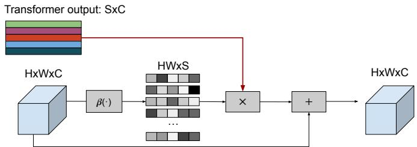
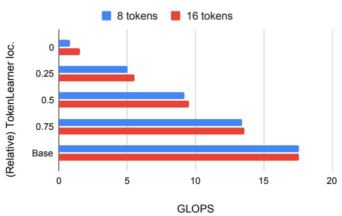
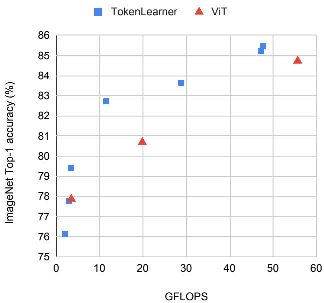
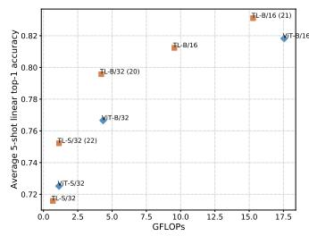
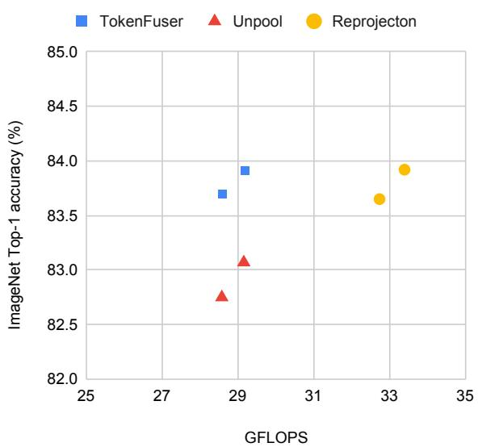
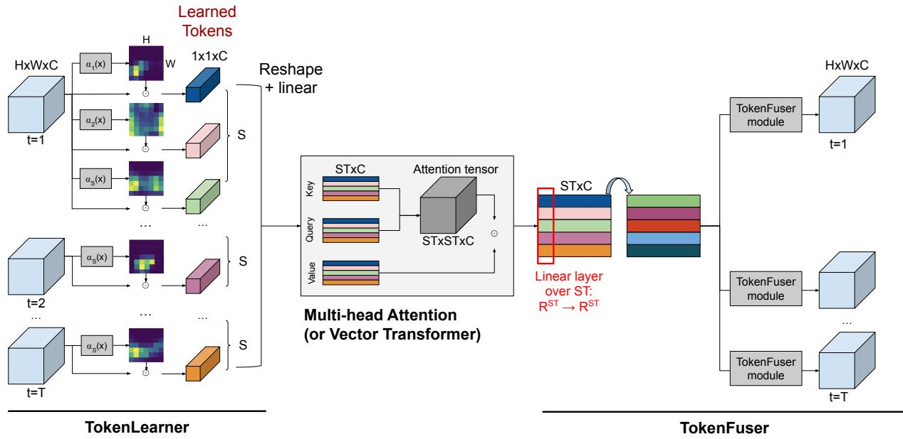
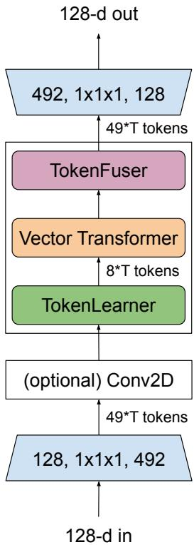
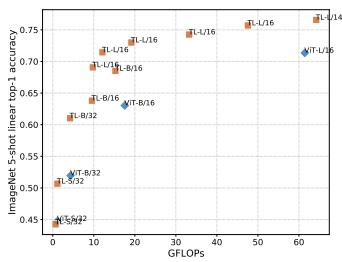
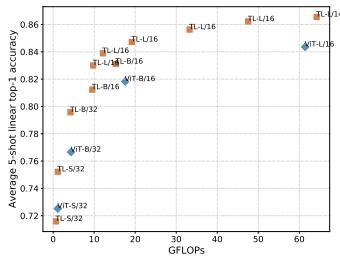

TokenLearner：8 个学习到的令牌能为图像和视频做什么？

Michael S. Ryoo, AJ Piergiovanni, Anurag Arnab, Mostafa Dehghani, Anelia Angelova

摘要——在本文中，我们提出了一种新颖的视觉表示学习方法，它依赖于少量自适应学习到的令牌，并且可应用于图像和视频理解任务。我们的方法不依赖手工设计的分割策略来获取视觉令牌，也不处理大量密集采样的块来进行注意力计算，而是学习挖掘视觉数据中重要的令牌。这使得我们能够高效且有效地找到少量重要的视觉令牌，并能够对这些令牌之间的成对注意力进行建模，从而在视频中覆盖更长的时间范围，或在图像中覆盖空间内容。我们的实验表明，在图像和视频识别任务的多个具有挑战性的基准上，该方法都表现出强大的性能。重要的是，由于我们的令牌是自适应的，我们以显著减少的计算量取得了有竞争力的结果。我们在 ImageNet 上获得了与最先进方法相当的结果，同时计算效率更高。我们还在多个视频数据集上验证了该方法的有效性，包括 Kinetics-400、Kinetics-600、Charades 和 AViD。代码开源于：https://github.com/google-research/scenic/tree/main/scenic/projects/token_learner

关键词——计算机视觉，行为识别

✦

## 1 引言

图像和视频提供了丰富的视觉信息。图像理解是计算机视觉中一个长期存在的研究问题，尽管已经取得了令人难以置信的进展，但对于各种图像理解任务获得最佳视觉表示仍是一个活跃的研究领域。除了处理类似的图像理解任务外，视频还需要对 RGB 流和时间流进行有效的时空处理，以捕捉长程交互 [1]、[2]、[3]、[4]、[5]、[6]、[7]、[8]、[9]、[10]。这种理解的一个重要方面是如何快速学习输入视频流中哪些部分在空间和时间上是重要的，并将计算资源集中在它们上面。但是，什么样的基本处理机制能够成功地对图像和视频都做到这一点呢？

使用多头自注意力 [11] 的 Transformer 模型在图像和视频识别方面都已经非常成功。Vision Transformers（ViT）[12] 通过将图像视为块令牌序列（例如 16x16 的块），扩展了其最初在文本中的用法，从而利用了 Transformer 的优势。在每一层中，ViT 模型根据令牌之间的成对关系重新组合和处理块令牌，构建整个图像的全局表示。Transformer 的有效性也在许多计算机视觉任务中得到证明，例如目标检测 [13] 和视频分类 [14]。

许多视觉 Transformer 架构面临的主要挑战在于，它们通常需要过多的 token 才能获得合理的结果。即便采用 16x16 的块（patch）切分方式，一张 512x512 的图像也会对应 1024 个 token。在处理包含多帧的视频时，由于每个视频"管状块"（tubelet，例如 16x16x2 的视频片段）都会成为一个 token，token 的数量会达到数万之多。此外，如此大量的 token 需要在每一层都进行处理，因为前一层的输出会作为下一层的输入 token。考虑到 Transformer 的计算量（以及显存占用）随 token 数量呈平方增长，这往往使得 Transformer 难以应用于更大的图像和更长的视频。由此引发一个问题：在每一层真的有必要处理如此多的 token 吗？

在本文中，我们证明，自适应地生成数量更少的一组 token，而非始终依赖均匀切分得到的 token，能够使视觉 Transformer 运行得更快且表现更优。TokenLearner 是一个可学习的模块，它接受一个类图像的张量（即输入）并生成一小组 token。该模块可以放置在目标模型中的多个不同位置，从而显著减少后续所有层需要处理的 token 数量。实验表明，引入 TokenLearner 能够在不损害分类性能的前提下节省一半甚至更多的显存和计算量。此外，由于其能够自适应输入的特性，它常常能够在减少计算量的同时提升识别准确率。

我们使用一种直接的空间注意力机制来形式化 TokenLearner。其核心思想是学习自适应地计算输入图像/视频中的重要区域，并从这些区域生成 token。我们计算空间注意力图以突出重要区域（采用卷积层或多层感知机），并将其作用于输入本身，从而对每个区域进行不同的加权（并丢弃不必要的区域）。结果经过空间池化以生成最终的学习到的 token。这与以往对图像或视频进行密集采样（例如 16x16 或 32x32）的方法形成鲜明对比 [12], [15]。

在我们的研究中，我们发现极少的 token 或许就足以完成视觉理解任务。具体而言，对于图像，我们证明在将 8–16 个 token 作为中间表示进行学习时（而非保留 200∼500 个），可以显著降低视觉 Transformer 的计算开销。我们通过实验验证，TokenLearner 能够减少总的浮点运算次数，同时保持甚至提升分类准确率。类似地，在视频识别任务中，我们在三个具有挑战性的数据集上超越了当前最优方法，而每帧仅使用 8–16 个 token。

该方法简单高效，并且如结果所示，在包括卷积方法和之前不带 TokenLearner 的时空 Transformer 基线在内的多种方法上均表现更优。我们证明，带 TokenLearner 的模型在 ImageNet（及 ImageNet ReaL）上与之前的 Transformer 模型表现相当，同时显著降低了计算量。在视频理解任务中，TokenLearner 在多个具有挑战性的视频数据集上刷新了当前最优结果。

本文扩展了早期发表于会议上的版本 [16]，将 TokenLearner 推广应用于图像和视频表征学习。与仅聚焦于视频的会议版本不同，在本文中，我们加入了大量新的实验，进一步确认了 TokenLearner 在图像和视频分类上的优势。同时，本文还包含了多种详细的消融实验及进一步的分析。

## 2 用于自适应分词的 TokenLearner 模块

在诸如 ViT [12] 这类视觉 Transformer 架构中，输入图像首先通过切分成小的（例如 16×16）空间块来进行分词，这些块作为模型的输入。类似地，在最近的视频 Transformer 架构中，如 ViViT [14] 和 TimeSformer [15]，视频通过在规则网格上切分成二维空间块或三维时空块来进行分词。

我们不再处理固定的、已分词化的输入，而是让注意力模块学习应当用于识别任务的标记词元（tokens）。这样做带来了若干重要特性：(1) 我们实现了自适应分词，使标记词元能够根据输入进行动态选择。(2) 这也有效减少了 Transformer 所处理的标记词元总数，考虑到视频中存在大量标记词元且计算量随标记词元数量呈二次增长，这一点尤为有益。(3) 最后，我们使每一个后续层都能够学习依赖不同的时空分词方式，从而潜在地允许不同层捕获视频的不同方面。这些动态且自适应生成的标记词元可用于标准的 Transformer 架构（如用于图像的 ViT 和用于视频的 ViViT），也可用于我们在第 4 节进一步讨论的专用视频架构中。

## 2.1 TokenLearner

设 $X$ 为一个具有时空形状的输入张量：$X \in \mathbb { R } ^ { T \times H \times W \times C }$，其中 $H \times W$ 对应输入的空间维度，$T$ 为时间维度（即帧数），$C$ 为通道数。设 $X _ { t }$ 为对应于帧 $t$ 的时间切片：$X _ { t } \in \mathbb { R } ^ { H \times W \times C }$。在图像输入的情况下，$T = 1$ 且 $X = X _ { t }$。注意，$X$ 也可以是网络内部的中间表示，此时 $X _ { t }$ 即为该表示对应的时间切片。

对于每一个时间帧 $t$，我们学习从输入帧 $X_t$ 生成一系列 $S$ 个 token，$Z_t \doteq [z_i]_{i=1}^{S}$。具体而言，我们设计了一个 tokenizer 函数 $\bar{z}_i = A_i(X_t)$，将输入帧 $X^t$ 映射到一个 token 向量 $z_i \colon \mathbb{R}^{H \times W \times C} \mapsto \mathbb{R}^{\bar{C}}$。其核心思想是学习我们的 tokenizer 函数 $A_i$ 自适应地选择输入帧 $X_t$ 中具有信息量的像素（或空间位置）组合，并且我们共有 $S$ 个这样的函数。通过这种方式，我们的 token 不会是对输入张量的固定划分，而是一组自适应变化的空间选择集合。每个帧会挖掘出不同的 token，使我们能够建模它们在视频中的时空关系/交互。我们还将 $S$ 设置为小于 $H \times W$（例如 $S = 8$，$H \times W = 32 \times 32$），从而使模型能够显著减少该模块后续层所需的计算量。

这里，我们的 tokenizer $z_i = A_i(X_t)$ 通过空间注意力机制来实现：即模型学习计算一个以输入 $X_t$ 为条件的权重图（大小为 $H \times W$），并将其与 $X_t$ 自身相乘。更具体地说，令 $\dot{\alpha}_i(X_t)$ 为一个生成空间 $H \times W \times 1$ 权重图的函数。每个 token $z_i$ 由下式生成

$$
z _ {i} = A _ {i} (X _ {t}) = \rho (X _ {t} \odot A _ {i w}) = \rho (X _ {t} \odot \gamma (\alpha_ {i} (X _ {t}))),\tag{1}
$$

其中 $\odot$ 表示哈达玛积（Hadamard product），即逐元素相乘，而 $A _ { i w } \in \mathbb { R } ^ { H \times W \times C }$ 是由函数 $\alpha _ { i } ( X _ { t } )$ 与广播函数 $\gamma ( \cdot )$ 计算得到的中间权重张量。最后，在其上施加空间全局平均池化 $\rho ( \cdot )$，将维度降至 $\mathbb { R } ^ { C }$ 。将得到的标记收集起来以构成输出张量：$Z _ { t } = [ z _ { i } ] _ { i = 1 } ^ { S } \in \mathbb R ^ { S \times C }$

整体过程呈现为逐元素空间自注意力的形式。在初始版本中，$\{ \alpha _ { i } ( \cdot ) \} _ { i = 1 } ^ { S }$ 由一个或一系列卷积层（通道数为 $S$ ）后接一个 sigmoid 函数共同实现。在 1.1 版本中，它由单个 MLP 层（即两个全连接层，中间使用 gelu 激活函数）实现。对于图像而言，$Z = Z _ { t }$ 。对于视频而言，将所有帧的标记 $Z _ { t }$ 收集起来，构成最终的输出标记张量 $Z \in \mathbb { R } ^ { S T \times C }$

我们特别将上述标记学习模块命名为"TokenLearner"。图 1 直观地总结了 TokenLearner 模块。

## 2.1.1 Transformer 中的计算量削减：

所学得的标记（即 TokenLearner 的输出 $Z$ ）被送入后续层进行视觉表征学习，例如 Vision Transformer 与 ViViT 中所使用的多头自注意力（MHSA）。借助 TokenLearner，这些后续层只需处理少量标记（例如 8 个而非 1024 个），由于计算量与标记数量的平方成正比，因此显著降低了计算量。图 3(a) 展示了在 ViT 中插入 TokenLearner 模块的基本架构。它可以添加到网络的任意位置，由于标记数量差异巨大，TokenLearner 之后的 Transformer 层的相对计算量几乎可以忽略不计。

  

图1: TokenLearner 模块应用于单张图像的可视化示意图。TokenLearner 学习对张量像素的一个子集（即来自中间空间表示）进行空间注意力加权，并生成一组随输入自适应变化的令牌（token）向量。

## 2.2 TokenFuser

在 TokenLearner 生成 token 并由其后的 Transformer 层（例如 MHSA）对其进行处理之后，可以使用 "TokenFuser" 来进一步（1）跨 token 融合信息，以及（2）将表示重新映射回其原始空间分辨率。这使得模型能够捕获由 token 所构成的空间（或时空）"模式"（pattern），并在必要时恢复原始输入张量的形状。

首先，对于来自 Transformer 层的 token 张量 $Y \in \mathbb { R } ^ { S T \times C }$，我们在 token（而非通道）维度上应用一个线性层（即一个全连接 MLP 层）。也就是说，我们学习一个线性函数 $\mathbb { R } ^ { S T } \mapsto \dot { \mathbb { R } } ^ { S T }$，其中 $S$ 是每帧所挖掘的 token 数量，$T$ 是输入张量的时间维度大小，并将该线性函数独立地应用于每个通道。即我们更新 $\dot { Y } = ( Y ^ { T } M ) ^ { T }$，其中 $M$ 是一个大小为 $S T \times S T$ 的可学习权重矩阵。该操作的结果保持张量大小仍为 $S T \times C$。我们认为这与同期工作 MLPMixer [17] 的观察也有关联——即由 token 维度的线性层来捕获由 token 所形成的模式是有益的。

接下来，TokenFuser 单独处理每个时间切片 $Y _ { t } \in$ $\mathbb { R } ^ { S \times C }$，并通过学习以不同方式组合 $H \times W$ 中每个空间位置所对应的 token，将大小为 $S { \times } C$ 的 token 张量重新映射为 $H \times W \times { \dot { C } } ,$。

$$
X _ {t} ^ {j + 1} = B (Y _ {t}, X _ {t} ^ {j}) = B _ {w} Y _ {t} + X _ {t} ^ {j} = \beta_ {i} (X _ {t} ^ {j}) Y _ {t} + X _ {t} ^ {j}\tag{2}
$$

其中$X _ { t } ^ { j }$是前一个TokenLearner（令牌学习器）模块的残差输入，Yt是TokenFuser（令牌融合器）模块中处理后的令牌，$X _ { t } ^ { j + 1 }$是输出。$B _ { w } \in \mathbb { R } ^ { H W \times S }$是由函数$\beta _ { i } ( X _ { t } )$计算的中间权重张量。函数$\beta _ { i } ( X _ { t } )$由一个简单的线性层后接sigmoid函数实现。

图2展示了TokenFuser（令牌融合器）的整体流程（省略了令牌级线性层）。

  

图 2：TokenFuser 模块的视觉示意，对每一帧图像单独应用。

## 3 基于图像的实验

为了验证 TokenLearner 模块的能力，我们首先在图像表示学习任务上尝试 TokenLearner。我们评估了两种不同的架构：(a) 仅在标准 Transformer 模型中插入 TokenLearner；(b) 在 Transformer 中的多个位置同时使用 TokenFuser 与 TokenLearner。

## 3.1 网络架构实现

我们采用 Vision Transformer 架构 [12]，并遵循其详细设置与实现方式 [18]。我们以 ViT-B/16 与 ViT-L/16 作为骨干网络，同时也把 TokenLearner 应用于 ViT-B/32（即同一模型但初始 patch 尺寸为 32×32）、ViT-S/32（通道数为 384 的较小版本）等模型。ViT-S 与 ViT-B 骨干模型具有 12 层 Transformer 层，而 ViT-L 具有 24 层。严格遵循 [12] 的设置，我们根据数据集与模型的不同，分别采用 224×224、384×384 或 512×512 的输入分辨率（即 196、576 或 1024 个 token）。位置编码与 ViT 完全一致。

图 3 (a) 与 (b) 展示了两种融合了 TokenLearner 的不同架构。(a) 通过在网络中间（例如 12 层 Transformer 中的第 6 层之后）插入 TokenLearner 来构成，而 (b) 则同时使用 TokenLearner 与 TokenFuser。具体而言，我们的模型 (b) 是通过用一系列 TokenLearner-Transformer-TokenFuser 来替换常规 Transformer 层而构成的。与 (a) 类似，这种替换仅针对某一层之后的层进行。例如，我们保留网络开头的六个标准 Transformer MHSA 层，并将剩余的六层替换为重复六次的 TokenLearner-Transformer-TokenFuser 模块。我们还对部分模型进行了修改，使其具有更多的 Transformer 层（例如由 12 层增至 21 层），并在相应情况下予以说明。需要注意的是，TokenLearner 模块之后增加的 Transformer 层所带来的计算量增长非常小，因为这些层中的 token 数量很少：仅为 8 或 16。

我们尝试了多种 token 数量，包括 $S \ =$ 8、16、32，并将 $S \ = \ 8$ 和 16 作为默认设置。也就是说，TokenLearner 旨在学习将图像抽象为 8（或 16）个 token。TokenLearner 中的空间注意力函数 (α) 由四个 3×3 卷积层实现（层间使用 gelu 激活），其通道数与 token 数量 $( \mathbf { e . g . } , S = 8 )$ 保持一致。

我们采用了 [12] 的训练设置（如学习率、训练轮数等）。

  

图 3：我们的模型采用 ViT 架构。(a) 使用 TokenLearner；(b) 同时使用 TokenLearner 和 Token-Fuser。

## 3.2 图像分类数据集

ImageNet：我们使用流行的图像基准数据集 ImageNet [19]。在我们的实验中，我们使用标准的 ImageNet 版本，它包含 1000 个类别和 1.1M 张图像。对于 S/16 和 B/16 模型，我们使用 384x384 的图像分辨率；对于 L/16 模型，我们使用 512x512 的分辨率。ImageNet ReaL [20] 是对 ImageNet 标签进行重新评估（Re-Assessed, ReaL）后的数据集，也被用于评估。

JFT-300M。JFT-300M 数据集是一个用于训练图像分类模型的内部数据集，最早由 [21] 提出。图像从网络上收集，并经过过滤以最大化标签精度。它包含 3 亿张图像，已被证明适合用于学习高容量模型，例如 transformer。

在这项工作中，我们仅将 JFT-300M 数据集用于预训练目的，遵循先前为 ViT [12] 所建立的评估协议。我们在此使用 224x224 的图像分辨率。

## 3.3 消融实验：TokenLearner 应该放在哪里？

我们首先进行了一项消融实验，以确定 TokenLearner 在模型中的最佳放置位置。图 4 显示了结果。该实验使用我们的模型（a）进行，不包含 TokenFuser。它展示了在 JFT 预训练下 ImageNet 上的小样本分类准确率，遵循 ViT [12] 的协议。此外，我们还展示了每个 TokenLearner 位置计算量（FLOPS）的变化情况。基本上，由于使用和不使用 TokenLearner 的 token 数量之间存在很大差异（例如，使用 TokenLearner 时为 8 个，而不使用时为 196 个），因此 TokenLearner 模块之后的 transformer 计算量与 TokenLearner 位置之前的 transformer 计算量相比几乎可以忽略不计。

TABLE 1：ImageNet 微调的 Top1 准确率与 FLOPS。括号中的数字是 transformer 层数。16-TokenLearner 使用 16 个 token 而非 8 个。

<table><tr><td>Method</td><td>GFLOPS</td><td>Accuracy</td></tr><tr><td>ViT S/32</td><td>3.4</td><td>77.87</td></tr><tr><td>ViT B/32</td><td>19.8</td><td>80.69</td></tr><tr><td>ViT B/16</td><td>55.6</td><td>84.73</td></tr><tr><td>TokenLearner S/32</td><td>1.9</td><td>76.13</td></tr><tr><td>TokenLearner B/16</td><td>28.7</td><td>83.65</td></tr><tr><td>TokenLearner S/32 (22)</td><td>3.3</td><td>79.42</td></tr><tr><td>TokenLearner B/32 (20)</td><td>11.5</td><td>82.74</td></tr><tr><td>TokenLearner B/16 (21)</td><td>47.1</td><td>85.21</td></tr><tr><td>16-TokenLearner B/16 (21)</td><td>47.7</td><td>85.45</td></tr></table>

我们发现，在网络中间（即 1/2 处）插入 TokenLearner 能够取得几乎相同的精度，同时将计算量削减（几乎）一半。此外，将 TokenLearner 置于更靠后的层（网络 3/4 之后）能够获得比不使用 TokenLearner 更好的性能，同时由于其自适应性而运行得更快。

## 3.4 结果

遵循 ViT [12] 中确立的协议，我们从（i）微调精度和（ii）少样本精度两方面对带与不带 TokenLearner 的模型进行了评估。对于微调精度，我们使用 JFT 对模型进行预训练，然后使用原始 ImageNet 数据集以 384×384 的图像分辨率（针对 ViT-S 和 ViT-B 模型）或 512×512 的图像分辨率（针对 ViT-L 模型）对模型进行微调，方法与先前的工作一致。对于少样本精度，我们同样遵循 ViT [12] 的协议，即执行一个正则化最小二乘回归，将（冻结的）训练图像子集的表征映射到 $\{-1, 1\}^K$ 目标向量。我们报告了在 ImageNet 上的 5-shot Top-1 精度，以及在多个数据集上的平均 5-shot 精度：Caltech101、Caltech-UCSD Birds 2011、Cars196、CIFAR100、colorectal_histology、DTD、ImageNet、Oxford-IIIT Pet 和 UC Merced Land Use Dataset。少样本精度尤为值得关注，因为它能够体现所学表征本身的泛化能力。我们注意到，5-shot 精度也曾被用于评估 ViT [12] 所学到的表征。在本小节的实验中，我们使用图 4 中的模型 (a)，即不带 TokenFuser 的版本。除非另有说明，我们将 TokenLearner 模块精确插入到网络的中间位置。默认的 token 数量为 8，我们同时也使用了 16，因为它们在精度与速度之间展现出最佳的平衡。

图 5 和表 1 给出了 ImageNet 上的微调评估结果，使用的是较小的 ViT-S 和 ViT-B 模型。我们展示了 ViT 的多个版本及其对应 TokenLearner 版本的精度，如第 3.1 节所定义。我们可以观察到，在效率-精度的权衡上存在显著的改进。

当直接应用于 ViT（例如 B/16）时，TokenLearner 在保持 ViT 精度的同时，将计算量削减了几乎一半。当将更多层与 TokenLearner 一起使用时，我们能够利用 TokenLearner 所节省的计算量来增加额外的层数，

ImageNet 5-shot accuracy

  

图 4：模型中不同 TokenLearner 位置对应的 ImageNet 5-shot 准确率（左）和 FLOPS（右）。'0' 表示 TokenLearner 位于模型的最开始（在任何 Transformer 之前），'0.5' 表示位于模型中间，而 'Base' 表示不使用 token learning。

  

图 5：基线 ViT 模型与 TokenLearner 在 ImageNet 微调准确率上的可视化对比。横轴为 GFLOPs，用于衡量所需的计算量。

并且它在FLOPS更少的情况下仍能实现更优的性能。基线 ViT B/16 处理的标记（token）数量为 576，而 TokenLearner 则学习得到 S = 8 个标记。因此，如上一小节所述，TokenLearner 模块之后的 Transformer 计算量，相对于 TokenLearner 位置之前的 Transformer 而言，几乎可以忽略不计。

图 6 展示了少样本（few-shot）实验的结果。这些实验采用 224×224 的图像分辨率，遵循文献 [12]。因此基线 ViT 使用 196 个标记（而非 ImageNet 微调实验中使用的 576 个）。这使得 TokenLearner 与 ViT 所使用的标记数量差距变小（相对于微调设置而言），从而提升了 TokenLearner 的相对准确率。值得注意的是，尽管标记数量存在差异，TokenLearner 的准确率并未下降（例如 TokenLearner-B/16 与 ViT-B/16 的对比）。

  

图 6：少样本分类实验。它展示了在 ImageNet（左）和第 3.4 节中列出的多个数据集的平均值（右）上的 5-shot 分类准确率。'TL' 代表 TokenLearner。更多模型的实验结果请参见附录。

## 3.4.1 更大模型上的 TokenLearner

我们还在更大的模型上评估了 TokenLearner，即 ViT-L。除了将场景划分为 16×16 patch 的标准 L/16 模型之外，我们还使用了相同模型但 token 更细粒度的版本，包括 L/14、L/10 和 L/8。需要注意的是，这些模型的参数量保持不变，均为 4.64 亿，仅输入有所不同。如上所述，无论具体模型如何，经过 TokenLearner 层之后 token 数量变为 8 或 16。对于这些大型模型，在 ImageNet 上使用了 512×512 的图像分辨率。

表 2 给出了结果。它说明了每个模型使用的 token 数量以及 TokenLearner 层的位置。「16-TL at $1 2 ^ { \prime \prime }$」表示 token 数量为 16，TokenLearner 被插入到第 12 个 Transformer 层之后（即位于中间位置）。部分模型设置为使用额外的层（例如「+11」），但由于 TokenLearner 层之后的 token 数量较少，FLOPs 的增加可以忽略不计。

我们可以观察到，与 ViT-S 和 ViT-B 上的实验类似，TokenLearner 在插入到中间位置时能够将计算量减半。此外，由于 token 生成具有自适应性，它能够在不牺牲精度的前提下做到这一点。当节省下来的算力以其他形式被利用（例如使用 L/14 替代 L/16）时，结果显示其性能能够显著超越基础模型。基础 ViT L/16 与 L/16 + TokenLearner 的实际运行速度分别为每秒 1400 与 2000 张图像。由于数据加载等其他瓶颈的存在，该速度与 FLOPs 并不完全成线性关系。

表 2：ViT L/16 与 L/14 上的 TokenLearner。使用了 512×512 的输入图像。

<table><tr><td>Base</td><td># layers</td><td>TokenLearner</td><td>GFLOPS</td><td>ImageNet Top1</td></tr><tr><td>ViT L/16</td><td>24</td><td>-</td><td>363.1</td><td>87.35</td></tr><tr><td>ViT L/16</td><td>24</td><td>16-TL at 12</td><td>178.1</td><td>87.68</td></tr><tr><td>ViT L/16</td><td>24+11</td><td>16-TL at 12</td><td>186.8</td><td>87.47</td></tr><tr><td>ViT L/16</td><td>24+6</td><td>8-TL at 18</td><td>274.2</td><td>88.11</td></tr><tr><td>ViT L/14</td><td>24+11</td><td>16-TL at 18</td><td>361.6</td><td>88.37</td></tr></table>

表 3：与当前最优 Vision Transformer (ViT) 模型的对比

<table><tr><td>Method</td><td># params.</td><td>ImageNet</td><td>ImageNet Real</td></tr><tr><td>BiT-L</td><td>928M</td><td>87.54</td><td>90.54</td></tr><tr><td>ViT-H/14</td><td>654M</td><td>88.55</td><td>90.72</td></tr><tr><td>ViT-G/14</td><td>1843M</td><td>90.45</td><td>90.81</td></tr><tr><td>TL L/10 (24+11)</td><td>460M</td><td>88.5</td><td>90.75</td></tr><tr><td>TL L/8 (24+11)</td><td>460M</td><td>88.87</td><td>91.05</td></tr></table>

表 3 将我们的 TokenLearner 模型与文献 [12] 和 [22] 中更大的 ViT 模型进行了比较。尽管参数量远少于那些模型，我们的 TokenLearner 模型表现与庞大（huge）和巨型（giant）ViT 模型相当。

## 3.4.2 使更大的模型更加高效

我们还验证了在网络中更早位置使用 TokenLearner 的策略，例如在第 2 或第 3 个注意力层之后。这使得整体模型比更小的基础 ViT 模型（B/16）计算效率更高，同时性能更优。表 4 给出了实验结果。我们可以观察到，例如在第 3 个注意力层插入 TokenLearner 的 L/16 模型，其准确率优于 ViT B/16，而运行时间约为 B/16 的一半。

## 3.5 消融实验与对比

## 3.5.1 TokenFuser

首先，我们对比使用和不使用 TokenFuser 模块的 TokenLearner 模型。更具体地说，我们比较了图 4 中的模型 (a) 和模型 (b)，以验证 TokenFuser 的有效性。表 5 给出了实验结果。

## 3.5.2 TokenLearner 与池化

TokenLearner 模块的一种直接替代方案是使用空间池化来减少 token 数量。具体做法是对 token 进行空间重排，使其具有高度和宽度维度，然后施加常规的空间池化。这与文献 [23] 中基于池化的 MHSA 模块类似。

表 4：在 ViT L/16 中更早地插入 TokenLearner。使用 384x384 输入图像。

<table><tr><td>Base</td><td># layers</td><td>TokenLearner</td><td>GFLOPS</td><td>ImageNet Top1</td></tr><tr><td>ViT B/16</td><td>12</td><td>-</td><td>55.63</td><td>84.73</td></tr><tr><td>ViT L/16</td><td>24</td><td>16-TL at 2</td><td>20.91</td><td>83.89</td></tr><tr><td>ViT L/16</td><td>24</td><td>16-TL at 3</td><td>28.66</td><td>85.40</td></tr><tr><td>ViT L/16</td><td>24</td><td>16-TL at 6</td><td>51.92</td><td>86.44</td></tr></table>

  

图 7：使用 TokenFuser 替代方案的消融实验。

表 6 将 TokenLearner 与空间池化（spatial pooling）进行了对比。在所有这些实验中，使用的是 ViT L/16 模型。我们能够观察到，token 的"学习"（learning）是有收益的。基于池化的 token 缩减虽然计算量与 TokenLearner 相当，但与基线模型相比其精度有所下降。另一方面，TokenLearner 尽管计算量较低，却表现得比基线模型略好。

## 3.5.3 TokenFuser 替代方案

在本节中，我们通过实验将所提出的 TokenFuser 模块与其替代方案进行比较。TokenFuser 的作用是将 Transformer 层的输出 token 进行混合，并将其映射回 token 缩减之前的原始形状。

最直接的替代方案是：(1) 使用来自 TokenLearner 模块的掩码来对输出 token 进行"反池化"（unpool）。其思路是将每个输出 token 与前一个 TokenLearner 模块中所计算得到的对应空间图相乘，并将它们全部相加以恢复原始输入张量的形状。另一种方案是 (2) 再使用一个 Transformer 层将 token 的数量增加回原始数量，类似于文献 [24] 中所使用的"重投影"（re-projection）方法。

图 7 展示了在 B/16 上的实验结果。反池化策略的表现较差。重投影策略的表现与 TokenFuser 相当，但需要更多的 FLOPS。

## 4 用于视频的 TOKENLEARNER

在本节中，我们说明 TokenLearner 如何用于视频表征。第 2 节中所介绍的 TokenLearner 和 TokenFuser 模块可直接应用于视频表征学习。用于图像的 TokenLearner 与用于视频的 TokenLearner 之间的唯一区别在于：用于视频时，TokenLearner 会生成多个 $Z_t$，并需要将它们堆叠起来以构成 Z。一旦 Z 生成，便可使用任何标准的 Transformer 层来对其联合解析。

表 5：使用 TokenLearner 的模型，含与不含 TokenFuser 的对比。不含 TokenFuser 的模型如图 4 (a) 所示。含 TokenFuser 的模型采用图 4 (b) 所示的架构。

<table><tr><td>Base</td><td># layers</td><td>TokenLearner</td><td>TokenFuser</td><td>ImageNet Top1</td><td>ImageNet Real</td><td>GFLOPS</td></tr><tr><td>B/16</td><td>12</td><td>8-TL at 6</td><td>N</td><td>83.2</td><td>88.1</td><td>28.3</td></tr><tr><td>B/16</td><td>12</td><td>8-TL at 6</td><td>Y</td><td>83.7</td><td>88.4</td><td>28.5</td></tr><tr><td>B/16</td><td>12</td><td>16-TL at 6</td><td>N</td><td>83.2</td><td>88.0</td><td>28.7</td></tr><tr><td>B/16</td><td>12</td><td>16-TL at 6</td><td>Y</td><td>83.9</td><td>88.7</td><td>29.1</td></tr><tr><td>L/16</td><td>24</td><td>16-TL at 12</td><td>N</td><td>87.6</td><td>90.4</td><td>184.6</td></tr><tr><td>L/16</td><td>24</td><td>16-TL at 12</td><td>Y</td><td>87.6</td><td>90.5</td><td>187.1</td></tr><tr><td>L/16</td><td>24</td><td>8-TL at 18</td><td>N</td><td>87.9</td><td>90.8</td><td>273.2</td></tr><tr><td>L/16</td><td>24</td><td>8-TL at 18</td><td>Y</td><td>88.2</td><td>90.9</td><td>273.8</td></tr><tr><td>L/10</td><td>24+11</td><td>16-TL at 18</td><td>N</td><td>88.5</td><td>90.7</td><td>849.0</td></tr><tr><td>L/10</td><td>24+11</td><td>16-TL at 18</td><td>Y</td><td>88.5</td><td>90.9</td><td>856.9</td></tr></table>

  

图 8：用于视频表征学习的 TokenLearner、Transformer 与 TokenFuser 组合示意图。TokenLearner 首先学习生成一组 token 向量，Transformer（例如 MHSA）对它们的时空关系进行建模，TokenFuser 将其组合起来。S 是我们每帧学习的 token 数量，T 是帧数。C 是通道数，为了效率起见在各模块间保持相同。请注意，这一组合本身可以作为一个"模块"使用，并可在网络内堆叠多次。根据架构的不同，TokenFuser 可以省略。

表 6：TokenLearner 与基于池化的 token 缩减方法的对比。

<table><tr><td>Details</td><td>ImageNet</td><td>GFLOPS</td></tr><tr><td>Base ViT L/16</td><td>87.35</td><td>363.1</td></tr><tr><td>2x2 pool at 9 and 18</td><td>85.63</td><td>144.3</td></tr><tr><td>2x2 pool at 12 and 18</td><td>86.41</td><td>187.2</td></tr><tr><td>4x4 pool at 12</td><td>83.93</td><td>184.4</td></tr><tr><td>16-TL at 12</td><td>87.68</td><td>184.6</td></tr></table>

图 8 概述了针对视频的组合框架。TokenLearner 首先在每帧中提取 S 个 token，从而共得到 ST 个 token，其中 T 为帧数。一旦 TokenLearner 生成了这些自适应学习的 token，它们将被送入后续的 Transformer 层以捕获全局的时空模式。最后（根据架构可选地），TokenFuser 对 token 维度应用一个线性层，然后将张量形状映射回去，如第 2.2 节所讨论的那样。根据公式 2，TokenFuser 被用于得到逐帧表示 Y。这产生了一种轻量化方法，通过捕获长程视觉模式来形成高效的视频表示。

我们在视频表示学习中展示的是 TokenLearner、Transformer 和 TokenFuser 模块重复多次的组合，如图 3 (b) 所示。如果我们使用架构 (a)，则会省略 TokenFuser 部分，仅在 TokenLearner 模块之后重复多次堆叠 Transformer 层。

表 7：Kinetics-400 上使用与不使用 TokenLearner 的 ViViT 模型对比。GLOPS 为每个视角的计算量。使用 TokenLearner 的模型（来自表 2 和表 5）之间的参数量差异源于 TokenLearner 模块之后所使用的层数不同。

<table><tr><td>Method</td><td>Top-1 accuracy</td><td>Top-5 accuracy</td><td># params.</td><td>GFLOPS</td></tr><tr><td>ViViT-L/16 [14]</td><td>82.8</td><td>95.5</td><td>308M</td><td>1446</td></tr><tr><td>ViViT-L/16 320 [14]</td><td>83.5</td><td>95.5</td><td>308M</td><td>3992</td></tr><tr><td>ViViT-H/14 [14]</td><td>84.8</td><td>95.8</td><td>654M</td><td>3981</td></tr><tr><td>ViViT-L/16 (our run)</td><td>83.4</td><td>95.6</td><td>308M</td><td>1446</td></tr><tr><td>TokenLearner 16at12 + L/16</td><td>83.5</td><td>95.6</td><td>308M</td><td>766</td></tr><tr><td>TokenLearner 8at18 + L/16</td><td>84.5</td><td>96.1</td><td>383M</td><td>1105</td></tr><tr><td>TokenLearner 16at18+ L/14</td><td>84.7</td><td>96.1</td><td>447M</td><td>1621</td></tr><tr><td>TokenLearner 16at18+ L/10</td><td>85.4</td><td>96.3</td><td>450M</td><td>4076</td></tr></table>

## 5 视频实验：TokenLearner 与视频视觉 Transformer

## 5.1 网络架构实现

ViViT [14] 是 ViT 在视频上的直接扩展，它使用视频中的时空块（spatio-temporal patches）作为其 token。时空块的大小通常为 16x16x2，被送入与 ViT 相似的 Transformer 层。ViViT 与 ViT 共享架构。在我们的实验中，我们将 TokenLearner 模块插入到 ViViT 架构中，与图 3 中将其插入 ViT 的方式完全相同。ViViT 一直是 Kinetics 数据集 [1] 上最先进的方法之一，其想法是确认 TokenLearner 是否可以直接添加到此类通用视频表示模型中并超越它们。

## 5.2 数据集与训练

在本节的实验中，我们使用 Kinetics 数据集，这是视频分类数据集，包含相对较短的视频片段（约 10 秒）。我们在 Kinetics-400 和 Kinetics-600 数据集上进行训练和评估，它们分别约有 24 万和 39 万个训练样本。我们遵循先前论文中使用的标准设置，并报告在验证集上的准确率 [1], [6]。

遵循 ViViT [14]，我们首先在 JFT 上预训练模型以获得初始权重。我们直接使用第 3 节中的模型。用于处理图像块（例如 16x16）的初始卷积层的权重通过遵循 ViViT 的 3D 初始化策略被处理以应对 16x16x2 视频块，而 Transformer 和 TokenLearner 层的权重则被直接采用用于初始化。接下来，模型在 Kinetics 数据上进行微调。

与 ViViT 类似，我们使用基学习率 0.05 和 Momentum 优化器训练模型 30 个 epoch。基本上，我们 Kinetics 实验中的所有设置均遵循 ViViT 的设置。

## 5.3 结果

我们评估了融合 TokenLearner 模块的 ViT-L 模型的各种版本。如上所述，所有模型都在 JFT 上进行了预训练，并在 Kinetics 上进行了微调。除了标准的 L/16 模型 + TokenLearner 之外，我们还使用了表 2 和表 3 中介绍的 L/14 和 L/10 模型。与标准 ViT $\mathrm { L } / 1 6$ 相比，这些模型使用了更多的层，但正如前面几节所描述的，由于在添加层中 token 数量要少得多（8 或 16），由它们带来的计算量增加是最小的。我们报告了它们的分类准确率以及以 FLOPS 计的计算量。

TABLE 8: ViViT + TokenLearner 在 Kinetics-400 上的结果，与先前模型的对比。不同方法依赖于不同的预训练数据集，例如 ImageNet-21K（用于 TimeSformer 和 Swin）和 JFT（用于 ViViT 和 TokenLearner）。GFLOPS 中的乘法对应于推理时使用的视图数量，例如 4x3 = 12。

<table><tr><td>Method</td><td>Top-1 accuracy</td><td>total GFLOPS</td></tr><tr><td>R(2+1)D [25]</td><td>73.9</td><td>304 × 115</td></tr><tr><td>SlowFast 16x8, R101+NL [6]</td><td>79.8</td><td>234 × 30</td></tr><tr><td>TimeSformer-L [15]</td><td>80.7</td><td>2380 × 3</td></tr><tr><td>ViViT-L/16 [14]</td><td>82.8</td><td>1446 × 12</td></tr><tr><td>Swin-L [26]</td><td>83.1</td><td>604 × 12</td></tr><tr><td>Swin-L (384) [26]</td><td>84.6</td><td>2107 × 12</td></tr><tr><td>Swin-L (384) [26]</td><td>84.9</td><td>2107 × 50</td></tr><tr><td>TokenLearner 16at12 (L/16)</td><td>82.1</td><td>766 × 6</td></tr><tr><td>TokenLearner 8at18 (L/16)</td><td>83.2</td><td>1105 × 6</td></tr><tr><td>TokenLearner 16at12 (L/16)</td><td>83.5</td><td>766 × 12</td></tr><tr><td>TokenLearner 8at18 (L/16)</td><td>84.5</td><td>1105 × 12</td></tr><tr><td>TokenLearner 16at18 (L/14)</td><td>84.7</td><td>1621 × 12</td></tr><tr><td>TokenLearner 16at18 (L/10)</td><td>85.4</td><td>4076 × 12</td></tr></table>

表 7 比较了在 Kinetics-400 上基础 ViViT 模型与我们的 ViViT + TokenLearner 模型的精度。这些模型可直接比较，因为它们遵循完全相同的设置和预训练数据集。"TokenLearner 16at12" 表示 TokenLearner 层在第 12 层 Transformer 之后学习 16 个 token。我们可以观察到，使用 TokenLearner 不仅能够取得更高的分类精度，同时还减少了计算开销。表 8 将 TokenLearner 的精度与先前模型进行了比较。需要注意的是，这些方法遵循略有不同的设置和预训练数据集（例如使用 ImageNet-21K 而非我们使用的 JFT）。我们认为 85.4 的精度是目前所报告的最高值，并且我们认为这一结果是具有重要意义的。

表 9 比较了在 Kinetics-600 上的结果。与我们在 Kinetics-400 上的结果类似，TokenLearner 在首次发布时便扩展了当时的最先进水平，同时保持了计算的高效性。

**表 9：ViViT + TokenLearner 在 Kinetics-600 上的结果。** GFLOPS 中的乘法表示推理时所使用的视图数量，例如 $4 \times 3 \times = 12 \times$ 。TL 代表 TokenLearner。

<table><tr><td>Method</td><td>Top-1</td><td>Top-5</td><td>total GFLOPS</td></tr><tr><td>SlowFast 16x8, R101+NL [6]</td><td>81.8</td><td>95.1</td><td>234 × 30</td></tr><tr><td>X3D-XL [27]</td><td>81.9</td><td>95.5</td><td>48 × 30</td></tr><tr><td>TimeSformer-HR [15]</td><td>82.4</td><td>96.0</td><td>1703 × 3</td></tr><tr><td>ViViT-L/16 [14]</td><td>84.3</td><td>96.2</td><td>1446 × 12</td></tr><tr><td>Swin-B [26]</td><td>84.0</td><td>96.5</td><td>282 × 12</td></tr><tr><td>Swin-L (384) [26]</td><td>85.9</td><td>97.1</td><td>2107 × 12</td></tr><tr><td>Swin-L (384) [26]</td><td>86.1</td><td>97.3</td><td>2107 × 50</td></tr><tr><td>TL 16at12 (L/16)</td><td>84.4</td><td>96.0</td><td>766 × 12</td></tr><tr><td>TL 8at18 (L/16)</td><td>86.0</td><td>97.0</td><td>1105 × 12</td></tr><tr><td>TL 16at18 (L/10)</td><td>86.1</td><td>97.0</td><td>4076 × 12</td></tr><tr><td>TL 16at18 w. Fuser (L/10)</td><td>86.3</td><td>97.0</td><td>4100 × 12</td></tr></table>

## 6 视频实验：使用瓶颈变换器的 TokenLearner

## 6.1 网络架构实现

在这项实验中，我们遵循瓶颈变换器（Bottleneck Transformer）[28] 的网络风格，同时利用 X3D [27] 作为骨干网络。这受到了 X3D 在 Charades 上成功应用的启发。Charades 数据集中的视频时长较长（平均 30 秒），且动作持续时间也较长（平均动作长度为 15 秒）。这要求模型通过考虑多个时间标记来理解更长的时间信息，而 TokenLearner 能够在多帧上高效地计算它们。

具体而言，我们对 X3D 进行了修改以提高其计算效率，具体做法为：（1）将其 3D XYT 卷积层替换为一对 2D 卷积层和 1D 卷积层；（2）移除压缩感知（Squeeze-and-Excitation）层 [29] 和 swish 激活函数。我们的骨干网络可以看作是 X(2+1)D。我们使用的通道数和层数与 X3D-M 完全一致，X3D-M 本身即为一个高效模型。

基于上述 X(2+1)D 架构，并遵循瓶颈变换器的设计思路，我们将最后一个块中的时空卷积层替换为我们的变换器。图 9 展示了残差模块的架构，该架构在该块中重复多次。我们尝试了不同的版本，最终的模型是通过在 X(2+1)D 模块中保留 2D 3×3 卷积层的同时，将 1D 时间卷积替换为我们的 TokenLearner 来构建的。TokenLearner 中的空间注意力函数（即 $( \mathrm { i } . \mathbf { e } . , \alpha ( \cdot ) )$）由单个 conv2d 层实现。

这里，我们使用向量变换器（Vector Transformer）替代多头自注意力（MHSA）作为变换器层，它也可以被视为头数与通道数相同的多头自注意力。更多细节我们在附录中给出。

我们使用 224×224×64 的视频进行训练，使用 256×256×64 的视频进行测试。经过第 3 个残差块后，输入张量的形状为 $8 \times 8 \times 6 4$，并将其作为 TokenLearner 的输入。为了高效实现，TokenLearner 的中间通道数被设置为与输出通道数相同，即 $d = 4 3 2$。需要注意的是，使用 64 帧是为了更好地捕捉长期的时间信息。使用的标记数量为 $S = 8$。

  

图 9：我们的网络模块，采用瓶颈 Transformer 结构，主干网络为 X(2+1)D。这是一个倒置瓶颈结构。

## 6.1.1 数据集

Charades 数据集：Charades 数据集 [30] 是一个通过分配活动任务来收集的数据集，让人们在各种环境中执行动作，例如执行涉及与物体交互的一系列动作。例如，坐在沙发上读书、合上书、站起来打电话。它包含 8000 个训练视频和 1686 个验证视频，平均时长为 30 秒。它包含 157 个活动类别。该数据集非常具有挑战性，因为它是一个多类别、多标签的视频数据集，也就是说，多个活动可以同时发生，并且它包含真实世界环境中与小物体的细粒度动作或交互。我们遵循标准的评估协议，报告平均精度均值（mean Average Precision, mAP）%（数据集的 v1 分类设置）。我们使用 6 fps 和 12 fps 的帧率来获取训练/测试视频（12 fps 效果更好）。该数据集具有非商业用途许可证。

AViD 数据集：来自不同国家的匿名视频（Anonymized Videos from Diverse countries, AViD）数据集 [31] 是一个独特的数据集，代表了世界人口视频内容的生成。它是从六大洲多个国家上传的视频中收集的，在概念、动作和视觉表示方面展示了比 Kinetics 等其他视频数据集更高的多样性。例如，在某些国家"打招呼"涉及握手，在一些国家是亲吻，而在其他国家则是轻微的鞠躬。该数据集被明确设计为包含更少的偏见、鼓励多样性，同时尊重隐私和许可证。AViD 数据集包含 887 个类别和 45 万个视频（41 万训练、4 万测试），其规模与分别具有 400 和 600 个类别的 Kinetics-400 和 Kinetics-600 数据集相当，也包含时长可变的视频 $3 - 1 5 s . .$ 。我们报告 887 个类别上的分类准确率。

表 10：Charades 多标签分类任务上的性能。12 fps 设置。由于可能有多个真实动作，因此使用平均精度均值（mAP）来衡量性能。列出了使用 RGB 和光流输入模态的方法。

<table><tr><td>Method</td><td>Input</td><td>Pre-train</td><td>mAP</td></tr><tr><td>I3D [1]</td><td>RGB</td><td>Kinetics</td><td>32.9</td></tr><tr><td>I3D from [32]</td><td>RGB</td><td>Kinetics</td><td>35.5</td></tr><tr><td>I3D + Non-local [32]</td><td>RGB</td><td>Kinetics</td><td>37.5</td></tr><tr><td>EvaNet [33]</td><td>RGB</td><td>Kinetics</td><td>38.1</td></tr><tr><td>STRG [34]</td><td>RGB</td><td>Kinetics</td><td>39.7</td></tr><tr><td>LFB-101 [35]</td><td>RGB</td><td>Kinetics</td><td>42.5</td></tr><tr><td>SGFB-101 [36]</td><td>RGB</td><td>Kinetics</td><td>44.3</td></tr><tr><td>SlowFast-101 [6]</td><td>RGB+RGB</td><td>Kinetics</td><td>45.2</td></tr><tr><td>AssembleNet-50 [37]</td><td>RGB+Flow</td><td>None</td><td>47.0</td></tr><tr><td>Multiscale ViT [23]</td><td>RGB</td><td>Kinetics</td><td>47.7</td></tr><tr><td>AssembleNet-101 [37]</td><td>RGB+Flow</td><td>Kinetics</td><td>58.6</td></tr><tr><td>AssembleNet++ [38] (w/o obj.)</td><td>RGB+Flow</td><td>None</td><td>55.0</td></tr><tr><td>MoViNets [39]</td><td>RGB</td><td>None</td><td>63.2</td></tr><tr><td>Backbone (X(2+1)D-M)</td><td>RGB</td><td>None</td><td>62.7</td></tr><tr><td>Ours</td><td>RGB</td><td>None</td><td>66.3</td></tr></table>

TABLE 11: 在 Anonymized Videos from Diverse countries（AViD）数据集上的性能。以平均准确率（%）衡量的性能在 887 个类别上取平均。先前方法的结果报告自 [31]，均基于使用仅 RGB 输入从头训练。X(2+1)D-M 基线采用分离的空间+时间 Transformer（如 [15] 中所述）。

<table><tr><td>Method</td><td>Accuracy</td><td>Total GFLOPS</td></tr><tr><td>I3D [1]</td><td>46.5</td><td> $108 \times N/A$ </td></tr><tr><td>(2+1)D ResNet-50</td><td>46.7</td><td> $152 \times 115$ </td></tr><tr><td>3D ResNet-50</td><td>47.9</td><td>N/A</td></tr><tr><td>SlowFast-50 8x8 [6]</td><td>50.2</td><td> $65.7 \times 30$ </td></tr><tr><td>SlowFast-101 16x4 [6]</td><td>50.8</td><td> $213 \times 30$ </td></tr><tr><td>Backbone (X(2+1)D-M)</td><td>48.6</td><td> $532 \times 1$ </td></tr><tr><td>X(2+1)D-M</td><td>50.6</td><td> $493 \times 1$ </td></tr><tr><td>Ours</td><td>53.8</td><td> $487 \times 1$ </td></tr></table>

本数据集中的所有视频均采用 Creative Commons 许可协议。

## 6.2 结果

Charades 数据集结果：在表 10 中，我们将所提出的 TokenLearner 与现有最先进方法进行了对比。我们的方法优于这些方法，包括与我们工作最为接近的近期工作。在 Charades 分类任务上达到 66.3% 的 mAP，刷新了该任务的最先进水平。

Anonymized Videos from Diverse countries（AViD）数据集结果：表 11 展示了在 AViD 数据集上的结果。可以看到，我们的方法同样在该具有挑战性的数据集上超越了以往的工作。我们还将我们的方法与 TimeSformer 模块 [15] 在相同骨干网络下的重新实现进行了对比。该实现采用了空间与时间 Transformer 模块分离的设计，这一点同样在文献 [14] 中得到了验证。我们可以观察到，我们的方法在该数据集上建立了新的最先进水平，同时具有更高的计算效率。

## 6.3 消融实验

## 6.3.1 与不同 token 化方式的对比

在此，我们将带有 TokenLearner 的模型与不同的时空 Transformer token 化策略进行对比。更确切地说，我们将「TokenLearner + Vector Transformer + TokenFuser」与全联合时空 Transformer 模块（[14] 中所倡导、并在 [15] 中同样提及）中的 token 化方式进行对比。全联合时空 Transformer 模块是在时空 token 上运行的 Transformer 层，与我们的方法类似，但其完全依赖于手工设计的 token 化方式。与生成 $S \times T$ 个 token 的 TokenLearner 相比，全联合时空 Transformer 使用了 $H \times W \times T$ 个 token。在我们的瓶颈实现中，它使用的 token 数量多出 $\sim 8$ 倍（即 $8 \times 64$ 对比 $\tilde{8 \times 8 \times 64}$）。对于联合时空 Transformer 模块，使用的是具有 8 个头的标准多头自注意力（MHSA）。

表 12 展示了相应结果。有趣的是，尽管全联合时空 Transformer 的计算量更大，其表现仍略逊于 TokenLearner 模块。我们认为这体现了 TokenLearner 中 token「自适应性」的优势，并表明标准 Transformer 可能正受到与动作无关的 token 的影响，这些 token 充当了噪声或干扰源。

我们同时报告了各模块的计算量与参数量。这两者取决于输入大小与超参数设置，我们的测量基于输入大小（即 $T \times H \times W \times C$）为 $8 \times 8 \times 64 \times 492$ 时的情况。需要注意的是，这是针对模块的测量，而非整个网络的测量。

## 6.3.2 多种时空层组合之间的对比

如先前文献所建议，将关注空间信息的层与关注时间信息的层配对，是视频表示中的一种常见策略 $( \mathbf { e . g . } , \mathrm { R } ( 2 \substack { + 1 } ) \mathrm { D }$ [25] 与 TimeSformer [15])。表 13 展示了这个消融实验的结果。对于空间和时间 Transformer 的实现，采用了标准的多头自注意力机制，正如文献 [14]、[15] 中所做的那样。结果表明，所提出的 TokenLearner 比其他流行的组合更准确。基于 TokenLearner 的模块也有效地只使用了每帧一小部分 Token（即 8 个），而其他方法则使用 $\bar { 1 6 } \times 1 6$ 或 $3 2 \times 3 2$ 个 Token。

TokenLearner 的一个主要优势（除了对输入的自适应分词以及我们显式地融合 Token 以捕获其时空模式之外）在于，与本消融研究中使用的分离式空间/时间 Transformer 不同，它是一个联合的时空 Transformer。同时，它仍能将其计算量控制在更易处理的范围内（如表 13 所示）：在我们这种情况下，朴素的完整版本时空 Transformer 需要考虑 $8 \times \bar { 8 } \times 6 4 = 4 0 9 6$ 个 Token，并构建并相乘大小为 $4 0 9 6 \times 4 0 9 6$ 的注意力张量。另一方面，TokenLearner 学习联合地考虑 $8 \times 6 4 = 5 1 2$ 个 Token。

## 6.3.3 更多 TokenLearner 替代方案

我们还将基于空间注意力的 Token 学习与以下替代方法进行了比较：(1) 使用固定网格将每帧分割为相同数量的 Token（即 8 个 Token），(2) 使用全连接层直接生成 Token 的方法，(3) 对整帧像素进行空间平均池化并使用全连接层为每帧生成多个 Token 的方法。在第二种方法中，我们将 $z _ { i } = A _ { i } ( x )$ 直接建模为一个稠密层，基于 $T \times H \times W \times C$ 输入产生 $T \times S \times { \dot { C } }$ 张量。第三种方法类似，不同之处在于我们对每帧应用空间全局平均池化，然后使用 MLP 生成 Token。

表 12：TokenLearner 与应用于我们骨干网络的联合时空 Transformer 模块（类似于 [14]）之间的比较。它们使用 X(2+1)D 骨干网络，分别在 Charades 6 fps 设置、Charades 12 fps 设置以及 AViD 数据集上进行测试。GFLOPs 和 # params 是针对每个模块的（使用 64 帧输入时），而非整个网络的。

<table><tr><td>Module</td><td>Charades-6fps</td><td>Charades-12fps</td><td>AViD</td><td>GFLOPs</td><td># params</td></tr><tr><td>Joint space-time MHSA</td><td>57.9</td><td>64.0</td><td>53.3</td><td>22.0</td><td>0.30M</td></tr><tr><td>Conv2D + Joint space-time MHSA</td><td>58.6</td><td>62.5</td><td>52.5</td><td>35.8</td><td>1.98M</td></tr><tr><td>Ours (TokenLearner)</td><td>58.8</td><td>63.4</td><td>53.8</td><td>3.4</td><td>0.81M</td></tr><tr><td>Ours (Conv2D + TokenLearner)</td><td>59.6</td><td>66.3</td><td>53.7</td><td>17.2</td><td>2.49M</td></tr></table>

表 13：不同时空 Transformer 模块的对比。它们都被应用于相同的骨干网络架构（即采用 X(2+1)D 的瓶颈 Transformer 风格）。本实验使用 Charades-6fps。FLOPS 在 64 帧设置下按每个模块进行估算。

<table><tr><td>Module</td><td>Acc. (%)</td><td>GFLOPs</td><td># params</td></tr><tr><td>Conv2D + Conv1D</td><td>56.6</td><td>18.3</td><td>2.24M</td></tr><tr><td>Conv2D + MLPMixer [17]</td><td>57.0</td><td>13.8</td><td>2.06M</td></tr><tr><td>Conv2D + Temporal transformer</td><td>58.4</td><td>16.5</td><td>1.98M</td></tr><tr><td>Spatial + Temporal transformer</td><td>58.8</td><td>5.5</td><td>0.59M</td></tr><tr><td>Conv2D + Spatial + Temporal</td><td>58.0</td><td>19.2</td><td>2.27M</td></tr><tr><td>Ours (TokenLearner)</td><td>58.8</td><td>3.4</td><td>0.81M</td></tr><tr><td>Ours (SpatialT + TokenLearner)</td><td>58.9</td><td>6.2</td><td>1.11M</td></tr><tr><td>Ours (Conv2D + TokenLearner)</td><td>59.6</td><td>17.2</td><td>2.49M</td></tr></table>

固定切分标记化方法 (1) 在 Charades 上取得了 58.8 的准确率，而我们的方法则为 59.6。直接标记生成方法 (2) 在 Charades 上的准确率为 56.6，未能获得更好的标记。池化与生成方法 (3) 给出了 58.6 的准确率。这些结果表明了空间注意力对于标记学习（即我们的 TokenLearner）的重要性。本消融实验中使用了相同的向量 Transformer 与 TokenFuser（来自第 2 节）。

## 6.4 可视化

图 10 展示了使用我们方法所学标记的可视化结果。我们展示了来自第一个 TokenLearner 模块的空间注意力图（即 $\alpha _ { i } ( x )$），因为输入到更高级 TokenLearner 的内容在空间和时间上变得更加混合。我们能够观察到，这些注意力倾向于更多地聚焦于人体区域，并且会随时间变化以响应视觉输入的变化。在我们学习的每帧 $S = 8$ 个标记中，我们可视化了其中 4 个。

## 7 相关工作

视觉理解是计算机视觉中长期存在的问题。包括目标分类与检测在内的图像识别任务已在许多不同方向上得到了广泛研究。当今大多数方法都聚焦于学习图像中空间外观的表示。这是一项跨越多年计算机视觉研究的具有挑战性的任务 [40]。

视频理解则更具挑战，需要同时提取视频中的空间与时间信息 [1]、[15]、[25]、[41]、[42]、[43]、[44]、[45]、[46]。为了充分捕捉视频中的运动与外观信息，已使用全 3D 时空卷积层以及 (2+1)D 卷积层 [1]、[2]、[25]、[47]。更先进的网络设计在视频卷积神经网络中也极为流行，尤其是双流网络 [6]、[43]、[48]、[49]、[50]、[51]；近年来，架构搜索型网络也层出不穷 [27]、[33]、[37]、[38]、[52]、[53]。

基于注意力的架构（例如 Transformer [11]）在自然语言处理与计算机视觉领域均取得了显著成功。Vision Transformer [12] 展示了为 NLP 设计的 Transformer 架构如何能够优雅地适用于图像及图像识别任务。其做法是将输入图像按规则网格划分为互不重叠的图块，并将它们作为标记嵌入馈送给 Transformer，其中使用了 $O ( N ^ { 2 } )$ 个标记，数量级为 256 或 1024。已有大量方法沿用了这一策略 [22]、[23]、[54]、[55]、[56]，其中一些方法提出了多尺度视觉 Transformer 版本 [23]、[55]、[57]。部分方法聚焦于对这些模型与层进行优化，并同样取得了成功 [58]、[59]、[60]、[61]。

将基于注意力的架构应用于视频提出了明确的挑战，因为模型需要学习跨空间和时间域的依赖关系。[62] 依赖区域提议网络（region proposal network），将检测到的候选人体和候选物体用作令牌（token），表明其可以与卷积神经网络（CNN）相结合。受 Vision Transformer 启发，最近的一些工作 [14]、[15] 将视频划分为三维网格（3D grid）中的令牌，以捕获视频输入。这导致学习所需的令牌数量增加 $O ( N ^ { 3 } )$ 倍（对于 96 帧模型通常约为 25k 个令牌）。基于注意力的架构也被用于视频生成 [63]。若干架构已经展示了用于处理多种模态的多种输入的基于注意力的架构 [64]、[65]。

我们的工作与图像和视频识别中的相关工作形成对比，从数据中学习令牌，这产生了显著更少的令牌和更高效的方法。我们看到，即使令牌数量少 8 倍（例如 512 对 4096），在经过学习后也能成功捕获视频表示学习所需的信息。重要的是，我们提出的 TokenLearner 既适用于视频识别任务也适用于图像识别任务，并取得更好的

  

图 10：分词（tokenization）的空间注意力图可视化。图中展示了总共八个学习到的词元（token）中四个的注意力图。

在两个领域均带来了提升。

## 8 结论

我们提出了 TokenLearner（令牌学习器），一种用于视觉表征学习的新颖方法，它能够对输入进行自适应分词。其目标是学习从图像和视频帧中提取对当前识别任务重要的令牌。通过寻找少量重要的时空令牌来建模图像和视频的视觉表征，我们的方法比已有工作更加高效。我们在图像分类和具有挑战性的视频理解任务上都观察到了准确率的提升，并在多个数据集上超越了以往方法。仍存在的挑战之一是如何学习完整的时空令牌。当前的 TokenLearner 侧重于在帧序列上寻找空间令牌，未来可以扩展到在时空体中挖掘令牌。

## 致谢

我们感谢 Dmitry Kalashnikov、Andy Zeng 以及 Robotics at Google NYC 团队成员就注意力机制展开的有益讨论。

## 附录 A

## 向量 Transformer：逐对向量注意力（Vector Attention）

下面，我们总结在瓶颈 Transformer（Bottleneck Transformer）实验中所用向量 Transformer（Vector Transformer）的细节。

一旦 TokenLearner 生成了自适应学习得到的令牌，就可以计算键–查询对之间的向量注意力。这可以看作是多头自注意力的一种变体，其头数与通道数相同，从而允许我们对每个通道学习不同的注意力矩阵。它以高效的方式捕捉每个通道上的逐对时空关系，对通道信息丰富的令牌尤其有益。

给定 $Z$，即一组反映视频不同时空方面的令牌，Transformer 对它们之间的时空交互进行建模。具体而言，我们遵循文献 [59] 的形式化方法，它实现了 Transformer 的一种向量版本，尽管也可以融合其他注意力机制。

对于每个令牌 $z _ { i }$，Transformer 的输出 $y _ { i }$ 通过考虑所有可能的 $z _ { j }$ 计算如下：

$$
y _ {i} = \sum_ {z _ {j} \in Z} \gamma (f _ {q} (z _ {i}) \odot f _ {k} (z _ {j})) \odot f _ {v} (z _ {j})\tag{3}
$$

其中 $i$ 和 $j$ 是 $Z$ 中词的索引，其大小为 $|Z| = ST$。$\dot{f}_q$、$f_k$ 和 $f_v$ 是对词进行线性投影的层。$\gamma$ 是一个额外的投影层，用于匹配通道维度，随后对 $j$ 进行 softmax 运算。当投影的通道大小相同时，$\gamma$ 简化为一个与标准 Transformer 相同的单一 softmax 层。

在原始 Transformer 的记号中，查询矩阵 $Q$ 对应于我们的 $\{f_q(z_i)\}_i$，键矩阵 $K$ 对应于我们的 $\{f_k(z_j)\}_j$。与通过计算 $Q$ 与 $K$ 的点积 $QK^T$ 来生成注意力"矩阵"不同，这种向量形式计算的是一个注意力"张量" $\{ \gamma(f_q(z_i) \odot f_k(z_j)) \}_{(i,j)}$，从而保留了通道信息。其形状为 $ST \times ST \times d$，其中 $d$ 是中间通道大小。计算得到的注意力张量与值矩阵 $\{f_v(z_j)\}_j$ 相乘，以得到最终的 Transformer 输出。

需要注意的是，这种向量 Transformer 是一种全局表示，其能够捕获的信息的时间范围完全取决于我们向其提供的词。借助我们可学习的自适应词（learnable adaptive tokens），我们能够覆盖更大范围的帧，并聚焦于时间结构。

## 附录 B

## 图像与视频分类训练细节

## B.1 图像分类

对于我们的图像分类实验，我们遵循 [12] 的精确训练协议与超参数设置。

## B.2 视频分类 —— ViViT

我们遵循 [14] 的精确训练协议与超参数设置。我们使用相同的代码（Scenic 库 [18]）以及相同的硬件来进行训练与评估。

我们在 Kinetics 数据集上以 0.05 的基础学习率配合 Momentum 优化器训练 30 个 epoch。基本上，我们 Kinetics 实验中的所有设置均遵循 ViViT 的设置。

## B.3 视频分类 —— Bottleneck Transformer

我们提供的训练细节如下。对于数据集的训练/测试划分，我们遵循其标准设置。

我们使用余弦衰减学习率（cosine-decay learning rate），该策略在众多视频 CNN 模型训练中被广泛采用。Charades 数据集（多标签动作分类）使用每 TPU 核（即等价于单张 GPU）基础学习率 0.8，AViD 数据集（视频分类）使用每 TPU 核基础学习率 0.025。Charades 实验中训练进行 100k 次迭代，每 TPU 核批量大小为 4（即批量大小为 4\*64=256）。AViD 使用每 TPU 核批量大小为 8。100k 次迭代在 AViD 上大致相当于 125 个 epoch。AViD 训练使用了标签平滑（label smoothing）0.2，Charades 则未使用标签平滑。在 Charades 中，训练过程将较长的 Charades 视频（例如 30 秒）按时间裁剪为 64 帧片段。评估过程类似，通过合并各 64 帧片段的输出响应来完成。

单个模型的训练时间约为 ∼16 小时，使用 32 块 TPU v3。训练瓶颈在于数据流水线（data pipeline），实际计算量小于此。

## 附录 C

## 在小样本学习（few-shot learning）上对比更多模型

在此，我们汇报了更多带 TokenLearner 模型的小样本学习准确率，作为对图 6 的扩展。具体来说，我们额外展示了在网络不同位置插入 TokenLearner 的 L/16（以及 L/14）模型，包括插入到第 2、3、6 和 12 个注意力层处。我们可以观察到，在网络早期加入 TokenLearner 的策略既能节省计算，又能获得优于基线模型的图像分类准确率。

  

图 11：少样本分类实验。该图展示了 ImageNet 上的 5-shot 分类准确率（左），以及第 3.4 节中列出的多个数据集上的平均值（右）。'TL' 代表 TokenLearner。

表 14：在 Charades 数据集（6fps）上对我们 Token-Learner 的不同组件进行比较。

<table><tr><td>Module</td><td>Accuracy (%)</td></tr><tr><td>Standard transformer (MHSA)</td><td>58.4</td></tr><tr><td>Vector transformer (VectT)</td><td>58.1</td></tr><tr><td>Prior-only-attention + broadcasting</td><td>58.6</td></tr><tr><td>Vector transformer (VectT) + broadcasting</td><td>58.9</td></tr><tr><td>Vector transformer (VectT) + TokenFuser</td><td>59.0</td></tr><tr><td>TokenLearner + MHSA + TokenFuser</td><td>59.0</td></tr><tr><td>TokenLearner + VectT + TokenFuser</td><td>59.6</td></tr></table>

## 附录 D

## 额外的消融实验

## D.1 不同组件

使用瓶颈 Transformer（Bottleneck Transformer）实验的设定，我们进行了一项消融实验来评估我们方法中的各个组件及其组合。我们进行了消融实验，移除/添加模型中的不同组件。除了上一小节中描述的 Vector Transformer 之外，我们还尝试了一种将其替换为多头自注意力（multi-head self-attention）的消融实验。表 14 展示了实验结果，证明了每个元素为该方法带来的益处。对于本实验，我们使用了由 Conv2D + transformer（在瓶颈内）构成的模块，我们发现它在其他消融实验中表现最佳。

## 参考文献

[1] J. Carreira and A. Zisserman, "Quo vadis, action recognition? a new model and the kinetics dataset," in Proceedings of the IEEE Conference on Computer Vision and Pattern Recognition (CVPR), 2017.（《动作识别路在何方？一种新模型与 Kinetics 数据集》，发表于 IEEE 计算机视觉与模式识别会议（CVPR）论文集，2017 年。）

[2] D. Tran, L. D. Bourdev, R. Fergus, L. Torresani, and M. Paluri, "C3d: generic features for video analysis," CoRR, abs/1412.0767, vol. 2, no. 7, p. 8, 2014.（《C3D：用于视频分析的通用特征》，arXiv 预印本 abs/1412.0767，第 2 卷，第 7 期，第 8 页，2014 年。）

[4] K. Hara, H. Kataoka, and Y. Satoh, "Learning spatio-temporal features with 3d residual networks for action recognition," in Proceedings of the ICCV Workshop on Action, Gesture, and Emotion Recognition, 2017.（《利用三维残差网络学习时空特征进行动作识别》，发表于 ICCV 动作、手势与情感识别研讨会论文集，2017 年。）

[5] M. Monfort, A. Andonian, B. Zhou, K. Ramakrishnan, S. A. Bargal, T. Yan, L. Brown, Q. Fan, D. Gutfruend, C. Vondrick et al., "Moments in time dataset: one million videos for event understanding," arXiv preprint arXiv:1801.03150, 2018.（《时间中的瞬间数据集：用于事件理解的一百万段视频》，arXiv 预印本 arXiv:1801.03150，2018 年。）

[6] C. Feichtenhofer, H. Fan, J. Malik, and K. He, "Slowfast networks for video recognition," in Proceedings of the IEEE International Conference on Computer Vision (ICCV), 2019.（《用于视频识别的 SlowFast 网络》，发表于 IEEE 国际计算机视觉会议（ICCV）论文集，2019 年。）

[7] J. C. Stroud, D. A. Ross, C. Sun, J. Deng, and R. Sukthankar, "D3D: Distilled 3d networks for video action recognition," arXiv preprint arXiv:1812.08249, 2018.（《D3D：用于视频动作识别的蒸馏三维网络》，arXiv 预印本 arXiv:1812.08249，2018 年。）

[8] S. Ji, W. Xu, M. Yang, and K. Yu, "3d convolutional neural networks for human action recognition," IEEE Transactions on Pattern Analysis and Machine Intelligence, vol. 35, no. 1, pp. 221–231, 2013.（《用于人体动作识别的三维卷积神经网络》，IEEE 模式分析与机器智能汇刊，第 35 卷，第 1 期，第 221–231 页，2013 年。）

[9] A. Piergiovanni, A. Angelova, and M. S. Ryoo, "Evolving losses for unsupervised video representation learning," in Proceedings of the IEEE Conference on Computer Vision and Pattern Recognition (CVPR), 2020.（《面向无监督视频表征学习的演化损失函数》，发表于 IEEE 计算机视觉与模式识别会议（CVPR）论文集，2020 年。）

[10] J.-B. Alayrac, A. Recasens, R. Schneider, R. Arandjelović, J. Ramapuram, J. D. Fauw, L. Smaira, S. Dieleman, and A. Zisserman, "Self-supervised multimodal versatile networks," in Advances in Neural Information Processing Systems (NeurIPS), 2020.（《自监督多模态通用网络》，发表于神经信息处理系统大会（NeurIPS）论文集，2020 年。）

[11] A. Vaswani, N. Shazeer, N. Parmar, J. Uszkoreit, L. Jones, A. N. Gomez, L. Kaiser, and I. Polosukhin, "Attention is all you need," in Advances in Neural Information Processing Systems (NeurIPS), 2017.（《注意力即你所需》，发表于神经信息处理系统大会（NeurIPS）论文集，2017 年。）

[13] Z. Liu, Y. Lin, Y. Cao, H. Hu, Y. Wei, Z. Zhang, S. Lin, and B. Guo，"Swin Transformer：使用移位窗口的分层视觉 Transformer（Swin transformer: Hierarchical vision transformer using shifted windows）"，发表于 IEEE 国际计算机视觉会议 (ICCV)，2021。

[14] A. Arnab, M. Dehghani, G. Heigold, C. Sun, M. Lučić, and C. Schmid，"ViViT：一种视频视觉 Transformer（ViViT: A video vision transformer）"，发表于 IEEE 国际计算机视觉会议 (ICCV)，2021。

[15] G. Bertasius, H. Wang, and L. Torresani，"时空注意力是理解视频所需的一切吗？（Is space-time attention all you need for video understanding?）"，发表于 国际机器学习大会 (ICML)，2021。

[16] M. S. Ryoo, A. Piergiovanni, A. Arnab, M. Dehghani, and A. Angelova，"TokenLearner：面向视频的自适应时空令牌化（Tokenlearner: Adaptive space-time tokenization for videos）"，发表于 神经信息处理系统大会 (NeurIPS)，2021。

[18] M. Dehghani, A. Gritsenko, A. Arnab, M. Minderer, and Y. Tay，"Scenic：一个用于计算机视觉研究及更广泛领域的 JAX 库（Scenic: A JAX library for computer vision research and beyond）"，arXiv 预印本 arXiv:2110.11403，2021。

[19] J. Deng, W. Dong, R. Socher, L.-J. Li, K. Li, and L. Fei-Fei，"ImageNet：一个大规模层次化图像数据库（Imagenet: A large-scale hierarchical image database）"，发表于 IEEE 计算机视觉与模式识别会议 (CVPR)，2009。

[20] L. Beyer, O. J. Hénaff, A. Kolesnikov, X. Zhai, and A. van den Oord，"我们已经完成 ImageNet 了吗？（Are we done with imagenet?）"，arXiv 预印本 arXiv:2006.07159，2020。

[21] C. Sun, A. Shrivastava, S. Singh, and A. Gupta，"重新审视深度学习时代数据的不合理有效性（Revisiting unreasonable effectiveness of data in deep learning era）"，发表于 IEEE 国际计算机视觉会议 (ICCV)，2017。

[22] X. Zhai, A. Kolesnikov, N. Houlsby, and L. Beyer，"视觉 Transformer 的规模化（Scaling vision transformers）"，arXiv 预印本 arXiv:2106.04560，2021。

[23] H. Fan, B. Xiong, K. Mangalam, Y. Li, Z. Yan, J. Malik, and C. Feichtenhofer，"多尺度视觉 Transformer（Multiscale vision transformers）"，arXiv 预印本 arXiv:2104.11227，2021。

[24] B. Wu, C. Xu, X. Dai, A. Wan, P. Zhang, Z. Yan, M. Tomizuka, J. Gonzalez, K. Keutzer, and P. Vajda，"视觉 Transformer：基于令牌的图像表示与处理用于计算机视觉（Visual transformers: Tokenbased image representation and processing for computer vision）"，arXiv 预印本 arXiv:2006.03677，2020。

[25] D. Tran, H. Wang, L. Torresani, J. Ray, Y. LeCun, and M. Paluri，"深入审视用于动作识别的时空卷积（A closer look at spatiotemporal convolutions for action recognition）"，发表于 IEEE 计算机视觉与模式识别会议 (CVPR)，2018，第 6450–6459 页。

[26] Z. Liu, J. Ning, Y. Cao, Y. Wei, Z. Zhang, S. Lin, and H. Hu，"Video Swin Transformer（Video swin transformer）"，arXiv 预印本 arXiv:2106.13230，2021。

[27] C. Feichtenhofer, "X3D：扩展架构以实现高效视频识别," 发表于 IEEE Conference on Computer Vision and Pattern Recognition (CVPR), 2020 年 6 月。

[28] A. Srinivas, T. Lin, N. Parmar, J. Shlens, P. Abbeel, 和 A. Vaswani, "用于视觉识别的瓶颈 Transformer," arXiv 预印本 arXiv:2101.11605, 2021。

[29] J. Hu, L. Shen, S. Albanie, G. Sun, 和 E. Wu, "挤压与激励网络," 发表于 IEEE Conference on Computer Vision and Pattern Recognition (CVPR), 2018。

[30] G. A. Sigurdsson, G. Varol, X. Wang, A. Farhadi, I. Laptev, 和 A. Gupta, "居家好莱坞：通过众包开展活动理解的数据采集," 发表于 European Conference on Computer Vision (ECCV), 2016。

[31] A. Piergiovanni 和 M. S. Ryoo, "AViD 数据集：来自不同国家的匿名视频," 发表于 Advances in Neural Information Processing Systems (NeurIPS), 2020。

[32] X. Wang, R. Girshick, A. Gupta, 和 K. He, "非局部神经网络," 发表于 IEEE Conference on Computer Vision and Pattern Recognition (CVPR), 2018, 第 7794–7803 页。

[33] A. Piergiovanni, A. Angelova, A. Toshev, 和 M. S. Ryoo, "面向视频的时空神经架构演进," Proceedings of the IEEE International Conference on Computer Vision (ICCV), 2019。

[34] X. Wang 和 A. Gupta, "作为时空区域图的视频," 发表于 European Conference on Computer Vision (ECCV), 2018, 第 399–417 页。

[35] C.-Y. Wu, C. Feichtenhofer, H. Fan, K. He, P. Krähenbühl, 和 R. Girshick, "用于详细视频理解的长期特征库," arXiv 预印本 arXiv:1812.05038, 2018。

[36] J. Ji, R. Krishna, L. Fei-Fei, 和 J. C. Niebles, "动作基因组：作为时空场景图组合的动作," 发表于 IEEE Conference on Computer Vision and Pattern Recognition (CVPR), 2020。

[37] M. S. Ryoo, A. Piergiovanni, M. Tan, 和 A. Angelova, "AssembleNet：搜索视频架构中的多流神经连接," 发表于 International Conference on Learning Representations (ICLR), 2020。

[38] M. S. Ryoo, A. Piergiovanni, J. Kangaspunta, 和 A. Angelova, "AssembleNet++：通过注意力连接组装模态表示," 发表于 European Conference on Computer Vision (ECCV), 2020。

[39] D. Kondratyuk, L. Yuan, Y. Li, L. Zhang, M. Tan, M. Brown, 和 B. Gong, "MoviNets：用于高效视频识别的移动视频网络," 发表于 IEEE Conference on Computer Vision and Pattern Recognition (CVPR), 2021。

[40] W. Rawat 和 Z. Wang, "用于图像分类的深度卷积神经网络：综合综述," Neural Computation, 第 29 卷, 第 9 期, 第 2352–2449 页, 2017。

[41] B. Zhou, A. Andonian, A. Oliva, 和 A. Torralba, "视频中的时序关系推理," 发表于 European Conference on Computer Vision (ECCV), 2018, 第 803–818 页。

[42] C.-Y. Wu 和 P. Krahenbuhl，"Towards long-form video understanding"（面向长视频理解），发表于 IEEE Conference on Computer Vision and Pattern Recognition (CVPR)，2021 年。

[43] C. Feichtenhofer、A. Pinz 和 A. Zisserman，"Convolutional two-stream network fusion for video action recognition"（用于视频动作识别的卷积双流网络融合），发表于 IEEE Conference on Computer Vision and Pattern Recognition (CVPR)，2016 年，第 1933–1941 页。

[44] N. Hussein、E. Gavves 和 A. W. Smeulders，"Timeception for complex action recognition"（用于复杂动作识别的 Timeception），发表于 IEEE Conference on Computer Vision and Pattern Recognition (CVPR)，2019 年。

[45] B. Korbar、D. Tran 和 L. Torresani，"Scsampler: Sampling salient clips from video for efficient action recognition"（Scsampler：从视频中采样显著片段以实现高效动作识别），发表于 IEEE International Conference on Computer Vision (ICCV)，2019 年。

[46] M. Zolfaghari、K. Singh 和 T. Brox，"Eco: Efficient convolutional network for online video understanding"（Eco：用于在线视频理解的高效卷积网络），发表于 European Conference on Computer Vision (ECCV)，2018 年。

[47] S. Xie、C. Sun、J. Huang、Z. Tu 和 K. Murphy，"Rethinking spatiotemporal feature learning: Speed-accuracy trade-offs in video classification"（重新思考时空特征学习：视频分类中的速度-精度权衡），发表于 European Conference on Computer Vision (ECCV)，2018 年，第 305–321 页。

[48] K. Simonyan 和 A. Zisserman，"Two-stream convolutional networks for action recognition in videos"（用于视频动作识别的双流卷积网络），发表于 Advances in Neural Information Processing Systems (NeurIPS)，2014 年，第 568–576 页。

[49] C. Feichtenhofer、A. Pinz 和 R. Wildes，"Spatiotemporal residual networks for video action recognition"（用于视频动作识别的时空残差网络），发表于 Advances in Neural Information Processing Systems (NeurIPS)，2016 年，第 3468–3476 页。

[50] C. Feichtenhofer、A. Pinz 和 R. P. Wildes，"Spatiotemporal multiplier networks for video action recognition"（用于视频动作识别的时空乘法网络），发表于 IEEE Conference on Computer Vision and Pattern Recognition (CVPR)，2017 年，第 4768–4777 页。

[51] A. Diba、M. Fayyaz、V. Sharma、M. Paluri、J. Gall、R. Stiefelhagen 和 L. V. Gool，"Holistic large scale video understanding"（整体大规模视频理解），arXiv 预印本 arXiv:1904.114511，2019 年。

[52] A. Piergiovanni、A. Angelova 和 M. S. Ryoo，"Tiny video networks"（轻量化视频网络），发表于 Applied AI Letters Journal，2021 年。

[53] L. Xu、Y. Guan、S. Jin、W. Liu、C. Qian、P. Luo、W. Ouyang 和 X. Wang，"Vipnas: Efficient video pose estimation via neural architecture search"（Vipnas：通过神经架构搜索实现高效视频姿态估计），发表于 IEEE Conference on Computer Vision and Pattern Recognition (CVPR)，2021 年。

[54] H. Touvron、M. Cord、A. Sablayrolles、G. Synnaev 和 H. Jegou，"Going deeper with image transformers"（深入探索图像 Transformer），发表于 IEEE International Conference on Computer Vision (ICCV)，2021 年。

[55] B. Graham、A. El-Nouby、H. Touvron、P. Stock、A. Joulin、H. Jegou 和 M. Douze，"Levit: A vision transformer in convnet's clothing for faster inference"（Levit：披着 ConvNet 外衣的视觉 Transformer 以实现更快推理），发表于 IEEE International Conference on Computer Vision (ICCV)，2021 年。

[56] L. Yuan, Y. Chen, T. Wang, W. Yu, Y. Shi, F. E. Tay, J. Feng, and S. Yan，"Tokens-to-Token ViT：在 ImageNet 上从头训练视觉 Transformer"，发表于 IEEE 国际计算机视觉会议 (ICCV) 论文集，2021 年。

[57] W. Wang, E. Xie, X. Li, D.-P. Fan, K. Song, D. Liang, T. Lu, P. Luo, and L. Shao，"Pyramid Vision Transformer：一种无需卷积的稠密预测通用骨干网络"，发表于 IEEE 国际计算机视觉会议 (ICCV) 论文集，2021 年。

[58] N. Carion, F. Massa, G. Synnaeve, N. Usunier, A. Kirillov, and S. Zagoruyko，"基于 Transformer 的端到端目标检测"，发表于欧洲计算机视觉会议 (ECCV) 论文集，2020 年。

[59] H. Zhao, J. Jia, and V. Koltun，"探索自注意力机制在图像识别中的应用"，发表于 IEEE 计算机视觉与模式识别会议 (CVPR) 论文集，2020 年 6 月。

[60] J. Cordonnier, A. Loukas, and M. Jaggi，"论自注意力机制与卷积层之间的关系"，发表于国际学习表征会议 (ICLR)，2020 年。

[61] P. Ramachandran, N. Parmar, A. Vaswani, I. Bello, A. Levskaya, and J. Shlens，"视觉模型中的独立自注意力"，发表于神经信息处理系统进展 (NeurIPS)，2019 年。

[62] R. Girdhar, J. Carreira, C. Doersch, and A. Zisserman，"视频动作 Transformer 网络"，发表于 IEEE 计算机视觉与模式识别会议 (CVPR) 论文集，2019 年。

[63] D. Weissenborn, O. Täckström, and J. Uszkoreit，"自回归视频模型的规模化"，发表于国际学习表征会议 (ICLR)，2020 年。

[64] A. Jaegle, F. Gimeno, A. Brock, A. Zisserman, O. Vinyals, and J. Carreira，"Perceiver：基于迭代注意力的通用感知"，发表于 ICML，2021 年。

[65] J. Lee, Y. Lee, J. Kim, A. R. Kosiorek, S. Choi, and Y. W. Teh，"Set Transformer：一种基于注意力的置换不变神经网络框架"，发表于 ICML，2021 年。

---

Michael S. Ryoo 是石溪大学（Stony Brook University）计算机科学系的 SUNY Empire Innovation 副教授，同时在 Google Robotics 担任专职研究科学家。此前，他曾在印第安纳大学布鲁明顿分校（Indiana University Bloomington）担任助理教授，并在美国国家航空航天局（NASA）喷气推进实验室（JPL）的机器人部门担任专职研究员。Ryoo 博士于德克萨斯大学奥斯汀分校（University of Texas at Austin）获得博士学位，并于韩国科学技术院（KAIST）获得学士学位。

AJ Piergiovanni 是 Google 的研究科学家。他拥有印第安纳大学（Indiana University）计算机科学博士学位和罗斯-霍曼理工学院（Rose-Hulman Institute of Technology）理学学士学位。他的研究兴趣包括视频理解、高效模型构建以及从视觉与语言中学习。

Anurag Arnab 是 Google 的研究科学家。此前，他在牛津大学（University of Oxford）完成了博士学位。

Mostafa Dehghani 是 Google Brain 的研究科学家。此前，他在阿姆斯特丹大学（University of Amsterdam）完成了博士学位。

Anelia Angelova 是计算机视觉领域的研究科学家。她在 Google 的 Brain Research 部门领导 Vision and Language 团队，此前曾在 Google 的 Robotics 部门领导 Robot Vision 团队。她的研究兴趣涵盖计算机视觉中的许多课题：目标识别与检测、三维场景理解、自监督学习、视频理解、多模态学习、机器人感知、实时算法等。她已将研究成果集成到生产系统中，包括 X Robotics、Google Maps、Google Cloud，以及 Google 的自动驾驶汽车（Waymo）。Anelia 在 California Institute of Technology 获得了计算机科学硕士与博士学位。