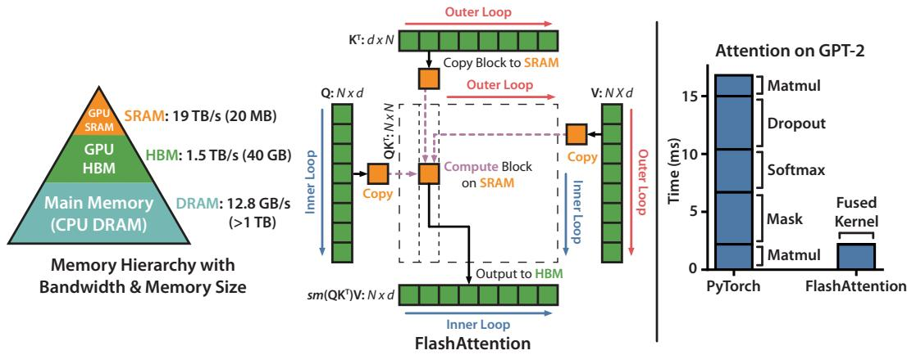
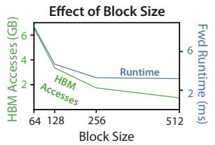
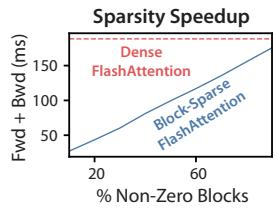
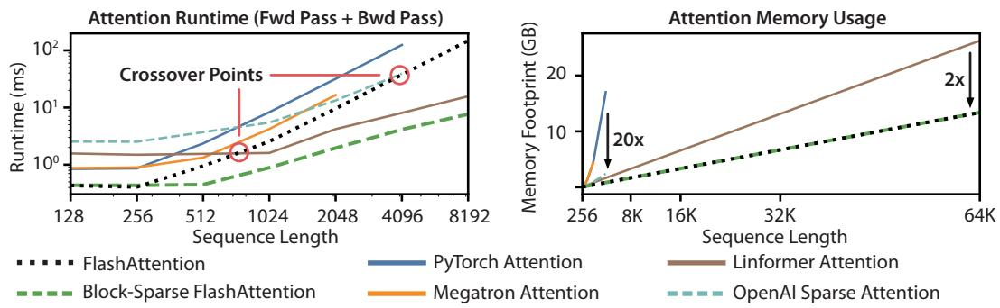
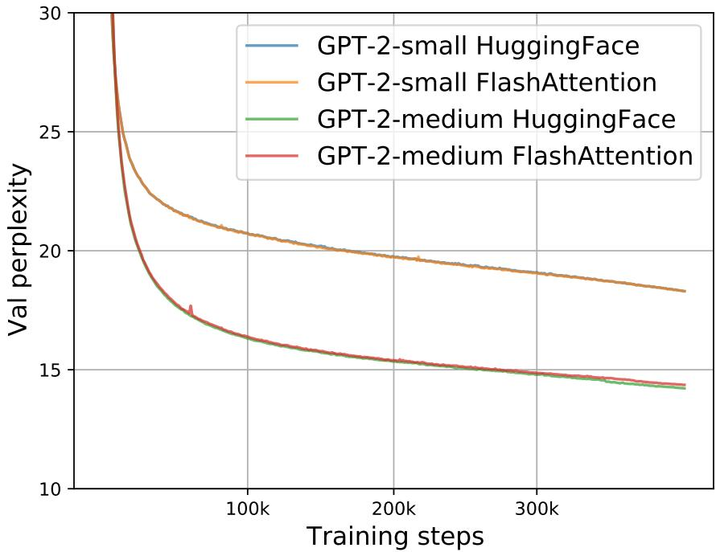
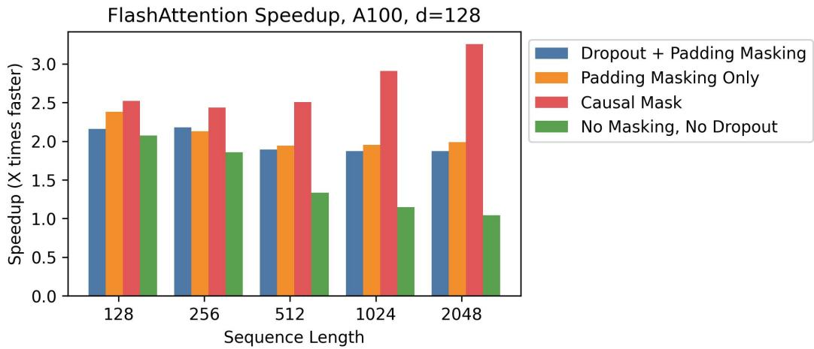
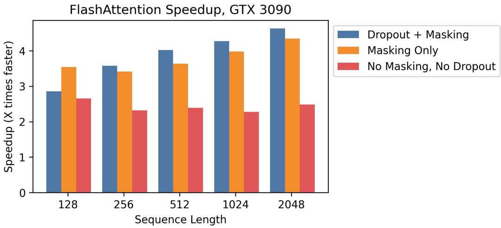
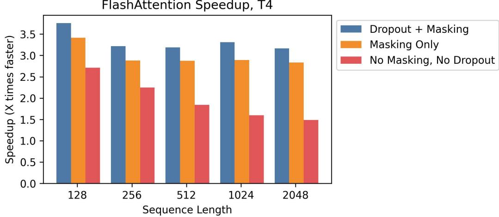
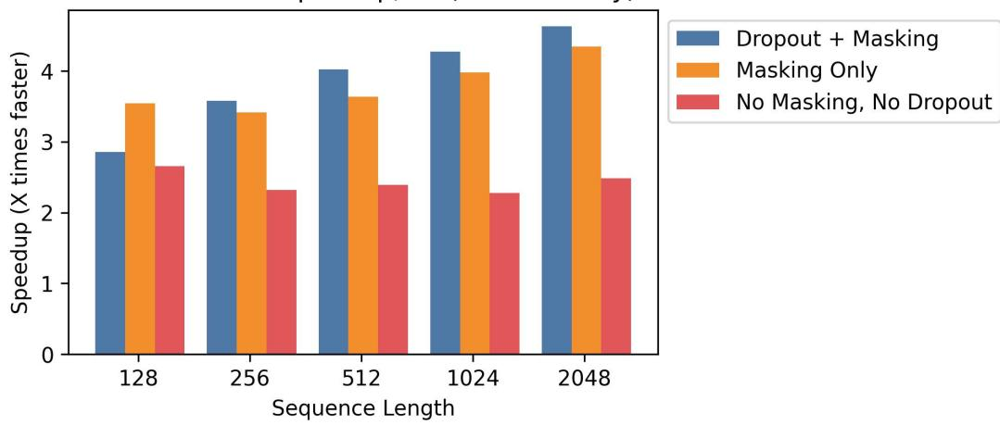

# FlashAttention：具有 IO 感知能力的快速且内存高效的精确注意力

Tri Dao<sup>†</sup>, Daniel Y. Fu<sup>†</sup>, Stefano Ermon<sup>†</sup>, Atri Rudra<sup>‡</sup>, and Christopher Ré<sup>†</sup>

<sup>†</sup>斯坦福大学计算机科学系 <sup>‡</sup>纽约州立大学布法罗分校计算机科学与工程系 {trid,danfu}@cs.stanford.edu, ermon@stanford.edu, atri@buffalo.edu, chrismre@cs.stanford.edu

2022 年 6 月 24 日

## 摘要

Transformer 在长序列上运行缓慢且占用大量内存，因为自注意力机制的时间和内存复杂度随序列长度呈二次方增长。近似注意力方法试图通过牺牲模型质量来降低计算复杂度，但通常无法实现 wall-clock 加速。我们认为一个缺失的原则是让注意力算法具备 IO 感知能力——即考虑 GPU 各级内存之间的读写操作。我们提出了 FlashAttention，一种具有 IO 感知能力的精确注意力算法，它通过分块（tiling）来减少 GPU 高带宽内存（HBM）与 GPU 片上 SRAM 之间的内存读写次数。我们分析了 FlashAttention 的 IO 复杂度，结果表明它比标准注意力需要更少的 HBM 访问，并且在一系列 SRAM 大小下达到最优。我们还将 FlashAttention 扩展到块稀疏注意力（block-sparse attention），得到一种比任何现有近似注意力方法都更快的近似注意力算法。FlashAttention 比现有基线更快地训练 Transformer：在 BERT-large（序列长度 512）上相比 MLPerf 1.1 训练速度纪录实现端到端 15% 的 wall-clock 加速，在 GPT-2（序列长度 1K）上加速 3×，在长距离竞技场（long-range arena，序列长度 1K–4K）上加速 2.4×。FlashAttention 和块稀疏 FlashAttention 使 Transformer 能够使用更长的上下文，从而产生更高质量的模型（在 GPT-2 上困惑度提升 0.7，在长文档分类上提升 6.4 个点），并带来全新的能力：首次让 Transformer 在 Path-X 挑战（序列长度 16K，61.4% 准确率）和 Path-256（序列长度 64K，63.1% 准确率）上取得优于随机水平的表现。

## 1 引言

Transformer 模型 [82] 已成为自然语言处理和图像分类等应用中使用最广泛的架构。Transformer 已经变得更大 [5]、更深 [83]，但为其配备更长的上下文仍然困难 [80]，因为其核心的自注意力模块的时间和内存复杂度随序列长度呈二次方增长。一个重要的问题是：让注意力更快、更节省内存是否能帮助 Transformer 模型应对长序列带来的运行时间和内存挑战。

许多近似注意力方法旨在降低注意力的计算和内存需求。这些方法涵盖稀疏近似 [51, 74]、低秩近似 [12, 50, 84]，以及它们的组合 [3, 9, 92]。尽管这些方法将计算需求降至序列长度的线性或近线性，但其中许多方法并未相对于标准注意力显示出实际运行时间加速，也未获得广泛采用。一个主要原因是它们侧重于 FLOP 缩减（这可能与实际运行时间加速并不相关），并且倾向于忽略内存访问（IO）带来的开销。

在本文中，我们认为一个被忽视的原则是让注意力算法具备 IO 感知（IO-aware）[1]——即仔细计算对不同层级快慢内存的读写操作（例如，在快速的 GPU 片上 SRAM 与相对较慢的 GPU 高带宽内存（即 HBM [45]，图 1 左）之间）。在现代

  

图 1：左：FlashAttention 使用分块（tiling）策略，以避免在（相对）较慢的 GPU HBM 上实例化大小为 $N \times N$ 的注意力矩阵（虚线框所示）。在外层循环中（红色箭头），FlashAttention 遍历 K 矩阵和 V 矩阵的分块，并将其加载到快速的片上 SRAM。在每个分块内部，FlashAttention 遍历 Q 矩阵的分块（蓝色箭头），将其加载到 SRAM，并将注意力计算的输出写回 HBM。右：相较于 PyTorch 在 GPT-2 上实现的注意力计算的加速比。由于 FlashAttention 无需将大小为 $N \times N$ 的注意力矩阵读写到 HBM，因此在注意力计算上获得了 7.6× 的加速。

在 GPU 上，算力的增长速度已超过显存带宽的增长速度[61, 62, 63]，而 Transformer 中的大多数运算都受限于内存访问[43]。对于类似的内存受限（memory-bound）运算，当数据的读写可能占用运行时的大部分时间时——例如数据库连接（database join）[71]、图像处理[70]、数值线性代数[4]以及其他众多场景[40, 85]——IO 感知算法（IO-aware algorithm）一直至关重要。然而，深度学习中常用的 Python 接口，如 PyTorch 和 TensorFlow，并不允许对内存访问进行细粒度的控制。

我们提出了 FlashAttention，一种新的注意力（attention）算法，它以远少于标准注意力（standard attention）的内存访问次数来计算精确注意力（exact attention）。我们的核心目标是避免将注意力矩阵在 HBM（高带宽显存，High Bandwidth Memory）与片上存储之间来回读写。这要求：（i）在无法访问整个输入的情况下完成 softmax 归约（reduction）；（ii）不存储用于反向传播（backward pass）的庞大中间注意力矩阵。为应对这些挑战，我们采用了两种成熟的技术。（i）我们重构了注意力计算过程，将输入切分为多个块，并对输入块进行多轮遍历，从而以增量方式执行 softmax 归约（这一做法也称为分块，tiling）。（ii）我们保存前向传播（forward pass）中的 softmax 归一化因子，以便在反向传播时能够在片上快速重算注意力，这比从 HBM 读取中间注意力矩阵的标准做法更快。我们在 CUDA 中实现了 FlashAttention，以对内存访问进行细粒度控制，并将所有注意力操作融合进单个 GPU kernel（内核）中。尽管由于重算导致 FLOPs（浮点运算次数）有所增加，但得益于 HBM 访问量的大幅减少，我们的算法相比标准注意力运行得更快（在 GPT-2 [67] 上最高可达 7.6 倍加速，如图 1 右所示），并且使用的内存更少——与序列长度呈线性关系。

我们分析了 FlashAttention 的 IO 复杂度[1]，证明其 HBM 访问次数为 $O ( N ^ { 2 } d ^ { 2 } M ^ { - 1 } )$，其中 $d$ 为头维度（head dimension），$M$ 为 SRAM 的大小；而标准注意力则为 $\Omega ( N d + N ^ { 2 } )$。对于典型的 $d$ 与 $M$ 取值，FlashAttention 相比标准注意力所需的 HBM 访问次数要少得多（最多可减少 9 倍，如图 2 所示）。此外，我们还给出了下界（lower bound），证明对所有 SRAM 大小而言，没有任何精确注意力（exact attention）算法能在渐近意义上进一步减少 HBM 访问次数。

我们还展示了 FlashAttention 可以作为实现近似注意力算法潜力的有用原语，克服它们在内存访问开销方面的问题。作为概念验证，我们实现了 block-sparse FlashAttention，这是一种稀疏注意力算法，比 FlashAttention 还要快 2-4 倍，可扩展到 64k 的序列长度。我们证明了 block-sparse FlashAttention 的 IO 复杂度比 FlashAttention 好一个与稀疏比成比例的因子。我们在第 5 节讨论了到其他操作的进一步扩展（多 GPU 上的注意力、核回归、block-sparse 矩阵乘法）。我们开源了 FlashAttention，以便更容易在此原语上进行构建。<sup>1</sup>

我们通过经验验证了 FlashAttention 加速模型训练并通过建模更长上下文来提升模型质量。我们还基准测试了 FlashAttention 和 block-sparse FlashAttention 相比此前注意力实现的运行时和内存占用。

• 更快的模型训练。FlashAttention 在挂钟时间上更快地训练 Transformer 模型。我们在 BERT-large（序列长度 512）上比 MLPerf 1.1 [58] 中的训练速度记录快 15%，在 GPT2（序列长度 1K）上比 HuggingFace [87] 和 Megatron-LM [77] 的基线实现快 3 倍，在 long-range arena（序列长度 1K-4K）上比基线快 2.4 倍。

• 更高质量的模型。FlashAttention 将 Transformer 扩展到更长序列，这提升了它们的质量并带来新能力。我们观察到 GPT-2 上的 perplexity 提升了 0.7，以及在长文档分类 [13] 上通过建模更长序列获得了 6.4 点的提升。FlashAttention 使得首个仅通过使用更长序列长度（16K）就能在 Path-X [80] 挑战上取得优于随机性能的 Transformer 成为可能。block-sparse FlashAttention 使得 Transformer 能够扩展到更长的序列（64K），从而产生了首个能在 Path-256 上取得优于随机性能的模型。

• 注意力基准测试。FlashAttention 在从 128 到 2K 的常见序列长度上比标准注意力实现快达 3 倍，并可扩展到 64K。在序列长度达 512 时，FlashAttention 在速度和内存效率上都优于任何现有的注意力方法；而对于超过 1K 的序列长度，一些近似注意力方法（如 Linformer）开始变得更快。另一方面，block-sparse FlashAttention 优于我们已知的所有现有近似注意力方法。

## 2 背景

我们提供一些关于在现代硬件（GPU）上常见深度学习操作的性能特征背景。我们还描述了注意力的标准实现。

## 2.1 硬件性能

我们这里聚焦于 GPU。其他硬件加速器上的性能类似 [46, 48]。

GPU 内存层级结构（GPU Memory Hierarchy）。GPU 内存层级结构（图 1 左）包含多种大小与速度各异的内存形式，其中更小的内存速度更快。举例而言，A100 GPU 配备 40–80 GB 的高带宽内存（HBM），带宽为 1.5–2.0 TB/s，并在 108 个流式多处理器中的每一个上拥有 192 KB 的片上 SRAM，带宽估计约为 19 TB/s [44, 45]。片上 SRAM 比 HBM 快一个数量级，但容量则小了多个数量级。由于计算能力相对于内存速度变得更快 [61, 62, 63]，操作越来越多地受到内存（HBM）访问的瓶颈制约。因此，充分利用快速的 SRAM 变得愈发重要。

执行模型（Execution Model）。GPU 拥有海量线程来执行一项操作（称为 kernel）。每个 kernel 从 HBM 加载输入到寄存器和 SRAM 中，进行计算，然后将结果写回 HBM。

性能特征（Performance characteristics）。根据计算与内存访问之间的平衡，操作可分为计算受限（compute-bound）或内存受限（memory-bound）。这通常通过算术强度（arithmetic intensity）[85] 来衡量，即每字节内存访问所对应的算术运算数量。

1. 计算受限（Compute-bound）：操作的耗时由算术运算的数量决定，而访问 HBM 的时间则要小得多。典型例子包括具有较大内积维度的矩阵乘法，以及具有较多通道数的卷积。

2. 内存受限（Memory-bound）：操作的耗时由内存访问次数决定，而计算所花费的时间则要小得多。其他大多数操作都属于此类：逐元素操作（例如激活、Dropout），以及归约操作（例如求和、Softmax、批归一化（Batch Norm）、层归一化（Layer Norm））。

Kernel 融合（Kernel fusion）。加速内存受限操作的最常见方法是 kernel 融合：如果有多个操作作用于同一输入，则该输入只需从 HBM 加载一次，而不必为每个操作分别加载。编译器可以自动融合许多逐元素操作 [53, 65, 75]。

然而，在模型训练的语境下，中间值仍需写回 HBM 以保存用于反向传播（backward pass），这削弱了朴素 kernel 融合的效果。

## 2.2 标准注意力实现（Standard Attention Implementation）

给定输入序列 ${\bf Q}, {\bf K}, {\bf V} \in \mathbb{R}^{N \times d}$，其中 N 为序列长度，d 为头维度，我们希望计算注意力输出 $\mathbf{0} \in \mathbb{R}^{N \times d}$：

$$
\mathbf {S} = \mathbf {Q} \mathbf {K} ^ {\top} \in \mathbb {R} ^ {N \times N}, \quad \mathbf {P} = \mathrm{softmax} (\mathbf {S}) \in \mathbb {R} ^ {N \times N}, \quad \mathbf {O} = \mathbf {P} \mathbf {V} \in \mathbb {R} ^ {N \times d},
$$

其中 softmax 按行应用。

标准注意力实现将矩阵 S 和 P 物化到 HBM 中，这需要 $O ( N ^ { 2 } )$ 内存。通常 $N \gg d \ ( \mathrm { e . g . }$ , for GPT2, $N = 1 0 2 4$ and $d = 6 4 )$ 。我们在算法 0 中描述标准注意力实现。由于部分或大多数操作是内存受限的（例如 softmax），大量的内存访问会转化为较慢的实际运行时间。

这个问题因施加在注意力矩阵上的其他逐元素操作而加剧，例如对 S 施加的掩码（masking）或对 P 施加的 dropout。因此，已有大量尝试将多个逐元素操作融合在一起，例如将掩码与 softmax 融合 [77]。

在第 3.2 节中，我们将展示标准注意力实现执行的 HBM 访问次数随序列长度 N 呈二次增长。我们还将比较标准注意力与我们的方法（FlashAttention）的 FLOPs 数量和 HBM 访问次数。

```txt
Algorithm 0 Standard Attention Implementation
Require: Matrices Q, K, V ∈ R^{N×d} in HBM.
1: Load Q, K by blocks from HBM, compute S = QK^T, write S to HBM.
2: Read S from HBM, compute P = softmax(S), write P to HBM.
3: Load P and V by blocks from HBM, compute O = PV, write O to HBM.
4: Return O.
```

## 3 FlashAttention：算法、分析与扩展

我们展示如何在更少的 HBM 读写次数下计算精确注意力，并且无需为反向传播存储大型中间矩阵。这产生了一种既内存高效又在墙钟时间（wall-clock time）上更快的注意力算法。我们分析了其 IO 复杂度，证明相比标准注意力，我们的方法需要的 HBM 访问次数显著更少。我们进一步展示了 FlashAttention 可作为一种有用的基元，通过将其扩展以处理块稀疏注意力。

为了便于叙述，我们在此仅关注前向传播；反向传播的细节见附录 B。

### 3.1 基于分块与重计算的高效注意力算法

给定 HBM 中的输入 ${ \bf Q } , { \bf K } , { \bf V } \in \mathbb { R } ^ { N \times d }$，我们旨在计算注意力输出 $\mathbf { 0 } \in \mathbb { R } ^ { N \times d }$ 并将其写入 HBM。我们的目标是减少 HBM 访问次数（使其相对 $N$ 为次二次的）。

我们应用两种已有的技术（分块、重计算）来克服在次二次 HBM 访问下计算精确注意力的技术难题。我们在算法 1 中对此进行了描述。其核心思想是：将输入 Q、K、V 分割为若干块，从慢速 HBM 加载到快速 SRAM，然后针对这些块计算注意力输出。通过在累加之前用正确的归一化因子对每个块的输出进行缩放，我们最终即可得到正确的结果。

**分块（Tiling）。** 我们按块来计算注意力。Softmax 会耦合 K 的各列，因此我们借助缩放来分解大 softmax [51, 60, 66]。出于数值稳定性考虑，向量 $\boldsymbol { x } \in \mathbb { R } ^ { B }$ 的 softmax 按如下方式计算：

$$
m (x) := \max _ {i} x _ {i}, f (x) := \left[ e ^ {x _ {1} - m (x)} \dots e ^ {x _ {B} - m (x)} \right], \ell (x) := \sum_ {i} f (x) _ {i}, \mathrm{softmax} (x) := \frac {f (x)}{\ell (x)}.
$$

对于向量 $\boldsymbol{x}^{(1)}, \boldsymbol{x}^{(2)} \in \mathbb{R}^B$，我们可以将拼接向量 $x = \left[x^{(1)} ~ x^{(2)}\right] \in \mathbb{R}^{2B}$ 的 softmax 分解为：

$$
\begin{array}{l} m (x) = m (\left[ x ^ {(1)} x ^ {(2)} \right]) = \max (m (x ^ {(1)}), m (x ^ {(2)})), \quad f (x) = \left[ e ^ {m (x ^ {(1)}) - m (x)} f (x ^ {(1)}) \quad e ^ {m (x ^ {(2)}) - m (x)} f (x ^ {(2)}) \right], \\ \ell (x) = \ell (\left[ x ^ {(1)} x ^ {(2)} \right]) = e ^ {m (x ^ {(1)}) - m (x)} \ell (x ^ {(1)}) + e ^ {m (x ^ {(2)}) - m (x)} \ell (x ^ {(2)}), \quad \mathrm{softmax} (x) = \frac {f (x)}{\ell (x)}. \end{array}
$$

因此，如果我们追踪一些额外的统计量 $( m ( x ) , \ell ( x ) )$，就可以一次一块地计算 softmax。后续部分公式需保留原始 LaTeX 形式。$O ( N ^ { 2 } )$ 级，其中 $N$ 为序列长度。$j$ 从 $1$ 到 $N$，$i$ 从 $1$ 到 $N$。我们因此将输入 Q、K、V 分成若干块（算法 1 第 3 行），在计算 softmax 值的同时计算额外的统计量（算法 1 第 10 行），并将结果合并（算法 1 第 12 行）。

**重计算。** 我们的目标之一是不存储反向传播所需的 $O ( N ^ { 2 } )$ 个中间结果。反向传播通常需要矩阵 ${ \bf S } , { \bf P } \in \mathbb { R } ^ { N \times N }$ 来计算关于 $\mathbf{Q} , \mathbf{K} , \mathbf{V}$ 的梯度。然而，通过存储输出 O 以及 softmax 归一化统计量 $( m , \ell )$，我们可以在反向传播时从 SRAM 中的 Q、K、V 块轻松地重新计算注意力矩阵 S 和 P。这可以视为一种选择性梯度检查点（selective gradient checkpointing）[10, 34]。虽然梯度检查点已被提出用于降低所需的最大内存 [66]，但所有（我们已知的）实现都不得不在速度和内存之间进行权衡。相比之下，即使增加了 FLOPs，由于减少了 HBM 访问次数，我们的重计算反而加速了反向传播（图 2）。完整的反向传播描述见附录 B。

**实现细节：内核融合。** 分块使我们能够在单个 CUDA 内核中实现我们的算法：从 HBM 加载数据，执行所有计算步骤（矩阵乘法、softmax、（可选的）掩码和 dropout、矩阵乘法），然后将结果写回 HBM（掩码和 dropout 见附录 B）。这样可以避免反复从 HBM 读写输入和输出。

```txt
Algorithm 1 FLASHATTENTION
Require: Matrices Q, K, V ∈ R^{N×d} in HBM, on-chip SRAM of size M.
1: Set block sizes B_c = ∫{M/4d}, B_r = min(∑{M/4d}, d).
2: Initialize O = (0)_{N×d} ∈ R^{N×d}, ℓ = (0)_N ∈ R^N, m = (-∞)_N ∈ R^N in HBM.
3: Divide Q into T_r = ∫{N/B_r} blocks Q_1, ..., Q_{T_r} of size B_r × d each, and divide K, V in to T_c = ∫{N/B_c} blocks K_1, ..., K_{T_c} and V_1, ..., V_{T_c}, of size B_c × d each.
4: Divide O into T_r blocks O_i, ..., O_{T_r} of size B_r × d each, divide ℓ into T_r blocks ℓ_i, ..., ℓ_{T_r} of size B_r each, divide m into T_r blocks m_1, ..., m_{T_r} of size B_r each.
5: for 1 ≤ j ≤ T_c do
6:    Load K_j, V_j from HBM to on-chip SRAM.
7:    for 1 ≤ i ≤ T_r do
8:    Load Q_i, O_i, ℓ_i, m_i from HBM to on-chip SRAM.
9:    On chip, compute S_ij = Q_i K_j^T ∈ R^{B_r × B_c}.
10:    On chip, compute \(\tilde{m}_{ij}\) = rowmax(S_ij) ∈ R^{B_r}, \(\tilde{\mathbf{P}}_{ij}\) = exp(S_ij - \(\tilde{m}_{ij}\)) ∈ R^{B_r × B_c} (pointwise), \(\tilde{\ell}_{ij}\) = rowsum(\(\tilde{\mathbf{P}}_{ij}\)) ∈ R^{B_r}.
11:    On chip, compute \(m_i^{\text{new}}\) = max(\(m_i\), \(\tilde{m}_{ij}\)) ∈ R^{B_r}, \(\ell_i^{\text{new}}\) = e^{m_i - m_i^{\text{new}}} \(\ell_i\) + e^{\(\tilde{m}_{ij}\)-m_i^{\text{new}}} \(\tilde{\ell}_{ij}\) ∈ R^{B_r}.
12:    Write O_i ← diag(\(\ell_i^{\text{new}}\))^{-1}(diag(\(\ell_i\))e^{m_i - m_i^{\text{new}}} O_i + e^{\tilde{m}_{ij}\)-m_i^{\text{new}}} \(\tilde{\mathbf{P}}_{ij} \mathbf{V}_j\)) to HBM.
13:    Write \(\ell_i\) ← \(\ell_i^{\text{new}}\), \(m_i\) ← m_i^{\text{new}} to HBM.
14:    end for
15: end for
16: Return O.
```

我们展示 FlashAttention 的正确性、运行时和内存需求（证明见附录 C）。

定理 1. 算法 1 返回 ${\bf 0} = \mathrm{softmax}({\bf Q}{\bf K}^{\top}){\bf V}$，需要 $O(N^2 d)$ 次浮点运算，且除输入和输出外仅需 $O(N)$ 的额外内存。

## 3.2 分析：FlashAttention 的 IO 复杂度

我们分析了 FlashAttention 的 IO 复杂度，表明其相比标准注意力机制大幅减少了 HBM 访问次数。我们还给出了一个下界，证明对于任意 SRAM 大小，没有任何精确注意力算法能在 HBM 访问次数上取得渐近改进。证明见附录 C。



  

图 2：左：在 A100 GPU 上，针对 GPT-2 medium（序列长度 1024，头维度 64，16 个注意力头，批大小 64）的标准注意力（standard attention）与 FlashAttention 的前向 + 反向运行时间。HBM 访问是影响运行时间的主要因素。中：在 A100 GPU 上，FlashAttention（序列长度 1024，头维度 64，16 个注意力头，批大小 64）的前向运行时间。HBM 访问次数越少，运行时间越快，但存在一个上限。右：对于序列长度 4K 的情况，块稀疏 FlashAttention（block-sparse FlashAttention）的运行时间比 FlashAttention 快一个与稀疏度成正比的比例因子。

定理 2. 设 $N$ 为序列长度，$d$ 为头维度，$M$ 为 SRAM 大小，且满足 $d \leq M \leq N d$。标准注意力（算法 0）需要 $\Theta ( N d + N ^ { 2 } )$ 次 HBM 访问，而 FlashAttention（算法 1）需要 $\Theta ( N ^ { 2 } d ^ { 2 } M ^ { - \mathrm { i } } )$ 次 HBM 访问。

对于 $d$ 的典型值（64–128）以及 $M$ 的取值（约 100 KB），$d^2$ 比 $M$ 小许多倍，因此 FlashAttention 比标准实现所需的 HBM 访问次数要少许多倍。这带来了更快的执行速度和更低的内存占用，我们在第 4.3 节进行了验证。

证明的主要思路是：给定大小为 $M$ 的 SRAM，我们可以分别加载大小为 $\Theta ( M )$ 的 K 块和 V 块（算法 1 第 6 行）。对于 K 和 V 的每一块，我们迭代 Q 的所有块（算法 1 第 8 行）以计算中间值，导致对 Q 进行 $\Theta ( N d M ^ { - 1 } )$ 次遍历。每次遍历加载 $\Theta ( d )$ 个元素，共计 $\Theta ( N ^ { 2 } d ^ { 2 } M ^ { - 1 } )$ 次 HBM 访问。我们类似地证明了标准注意力的反向传播需要 $\Theta ( N d + N ^ { 2 } )$ 次 HBM 访问，而 FlashAttention 的反向传播需要 $\Theta ( N ^ { 2 } d ^ { 2 } M ^ { - 1 } )$ 次 HBM 访问（附录 B）。

我们证明了一个下界：对于所有 SRAM 大小 $M$ 的取值，在计算精确注意力时无法在 HBM 访问次数上获得渐近改进。

命题 3. 设 $N$ 为序列长度，$d$ 为头维度，$M$ 为 SRAM 大小，且满足 $d \leq M \leq N d$。在 $M$ 属于区间 $[d, N d]$ 的所有取值下，不存在以 $o ( N ^ { 2 } d ^ { 2 } M ^ { - 1 } )$ 次 HBM 访问计算精确注意力的算法。

证明依赖于以下事实：当 $M = \Theta ( N d )$ 时，任何算法都必须执行 $\Omega ( N ^ { 2 } d ^ { 2 } M ^ { - 1 } ) = \Omega ( N d )$ 次 HBM 访问。这种针对 $M$ 子范围的下界在流式算法文献 [88] 中较为常见。我们将证明关于 $d$ 的参数化复杂度 [27] 下界留作激动人心的未来工作。

我们验证了 HBM 访问次数是注意力运行时间的主要决定因素。在图 2（左）中，我们可以看到，尽管 FlashAttention 的 FLOP 计数高于标准注意力（由于反向传播中的重计算），其 HBM 访问次数却远少于标准注意力，从而带来显著更快的运行时间。在图 2（中）中，我们改变 FlashAttention 的块大小 $B _ { c }$，这会导致不同数量的 HBM 访问，并测量前向传播的运行时间。随着块大小增大，HBM 访问次数减少（因为我们对输入的遍历次数减少），运行时间也随之下降。对于足够大的块大小（超过 256），运行时间便会受到其他因素（例如算术运算）的瓶颈限制。此外，更大的块大小将无法装入较小的 SRAM 中。

## 3.3 扩展：块稀疏 FlashAttention

我们将 FlashAttention 扩展到近似注意力：我们提出了块稀疏 FlashAttention（block-sparse FlashAttention），其 IO 复杂度比 FlashAttention 小一个与稀疏度成正比的因子。

给定输入 ${\bf Q}, {\bf K}, {\bf V} \in \mathbb{R}^{N \times d}$ 和掩码矩阵 $\tilde{\mathbf{M}} \in \{0, 1\}^{N \times N}$，我们希望计算：

$$
\mathbf {S} = \mathbf {Q} \mathbf {K} ^ {\top} \in \mathbb {R} ^ {N \times N}, \quad \mathbf {P} = \operatorname{softmax} (\mathbf {S} \odot \mathbb {1} _ {\tilde {\mathbf {M}}}) \in \mathbb {R} ^ {N \times N}, \quad \mathbf {O} = \mathbf {P V} \in \mathbb {R} ^ {N \times d},
$$

其中 $(\mathbf{S} \odot \mathbb{1}_{\tilde{\mathbf{M}}})_{kl} = \mathbf{S}_{kl}$（当 $\tilde{\mathbf{M}}_{kl} = 1$ 时）以及 $-\infty$（当 $\mathbf{M}_{kl} = 0$ 时）。我们要求 $\tilde{\mathbf{M}}$ 具有块结构：对于某些块大小 $B_r, B_c$，对所有 $k, l$，$\tilde{\mathbf{M}}_{k,l} = \mathbf{M}_{ij}$，其中 $i = \lfloor k / B_r \rfloor$，$j = \lfloor l / B_c \rfloor$，$\mathbf{M} \in \{0, 1\}^{N/B_r \times N/B_c}$。

给定一个预定义的块稀疏掩码 $\mathbf{M} \in \{0, 1\}^{N/B_r \times N/B_c}$，我们可以轻松地调整算法 1，使其仅计算注意力矩阵的非零块。该算法与算法 1 完全相同，只是我们跳过了零块。我们在附录 B 的算法 5 中复现了该算法描述。

我们还分析了块稀疏 FlashAttention 的 IO 复杂度。

**命题 4.** 设 $N$ 为序列长度，$d$ 为头维度，$M$ 为 SRAM 大小，且满足 $d \leq M \leq Nd$。块稀疏 FlashAttention（算法 5）需要 $\Theta(Nd + N^2 d^2 M^{-1} s)$ 次 HBM 访问，其中 $s$ 是块稀疏掩码中非零块的比例。

我们可以看到，应用块稀疏性会通过稀疏度直接改善 IO 复杂度中的较大项。对于大序列长度 $N$，$s$ 通常设置为 $N^{-1/2}$ [11] 或 $N^{-1} \log N$ [3, 17, 92]，从而产生 $\Theta(Nd)$ 或 $\Theta(N \log N)$ 的 IO 复杂度。在下游实验中，我们使用了固定的 butterfly 稀疏模式 [17]，该模式已被证明能够逼近任意稀疏性 [16]。

在图 2（右）中，我们验证了随着稀疏度的增加，块稀疏 FlashAttention 的运行时间按比例改善。在 LRA 基准上，块稀疏 FlashAttention 实现了 2.8× 的加速，同时性能与标准注意力相当（第 4 节）。

## 4 实验

我们评估了使用 FlashAttention 训练 Transformer 模型的影响。我们验证了关于训练时间和模型准确性的两个声明，并报告了注意力运行时间和内存基准测试结果。

- **训练速度。** FlashAttention 比 BERT 的 MLPerf 1.1 [58] 速度记录快 15%，相较于 HuggingFace [87] 将 GPT-2 加速最高达 3×，相较于 Megatron [77] 加速 1.8×，均优于标准 Transformer。FlashAttention 将长距离竞技场（Long-Range Arena，LRA）基准测试加速了 2.4×。

• 质量。FlashAttention将Transformer扩展到更长的序列，从而获得更高的质量。FlashAttention训练上下文长度为4K的GPT-2比Megatron训练上下文长度为1K的GPT-2更快，同时困惑度降低0.7。在两个长文档分类任务上，对更长序列的建模带来了6.4个百分点的提升。最后，FlashAttention带来了第一个能够在具有挑战性的Path-X任务（序列长度16K）上实现优于随机性能的Transformer，而block-sparse FlashAttention带来了我们所知的第一个能够在Path-256（序列长度64K）上实现优于随机性能的序列模型。

• 注意力基准测试。我们基于序列长度测量了FlashAttention和block-sparse FlashAttention的运行时间和内存性能。我们确认FlashAttention的内存占用随序列长度线性扩展，并且在常见序列长度（最高达2K）下比标准注意力快达3倍。我们确认block-sparse FlashAttention的运行时间随序列长度线性扩展，并且比所有现有的近似注意力基线方法更快。

更多实验细节见附录E。

## 4.1 使用FlashAttention获得更快的模型

BERT。FlashAttention带来了我们所知的最快单节点BERT训练速度。我们在Wikipedia上使用FlashAttention训练了一个BERT-large [22]模型。表1将我们的训练时间与Nvidia在MLPerf 1.1 [58]中创下训练速度记录的实现进行了比较。我们的实现快15%。

表1：BERT-large的训练时间，从MLPerf基准测试提供的相同初始化开始，达到掩码语言建模目标精度72.0%。在8×A100 GPU上运行10次取平均值。

<table><tr><td>BERT Implementation</td><td>Training time (minutes)</td></tr><tr><td>Nvidia MLPerf 1.1 [58]</td><td>20.0 ± 1.5</td></tr><tr><td>FLASHATTENTION (ours)</td><td>17.4 ± 1.4</td></tr></table>

GPT-2。FlashAttention 在大型 OpenWebtext 数据集（OpenWebtext dataset）[32] 上对 GPT-2 [67] 的训练速度比广泛使用的 HuggingFace [87] 和 Megatron-LM [77] 实现更快。表 2 显示，相较于 HuggingFace 实现了最高 3 倍的端到端加速，相较于 Megatron-LM 实现了 1.7 倍的加速。FlashAttention 与其他两种实现取得了相同的困惑度（perplexity），因为我们没有更改模型定义。附录 E 包含了训练过程中验证困惑度的曲线图，证实 FlashAttention 与基线方法在数值上同样稳定，并产生相同的训练/验证曲线。

表 2：使用 FlashAttention 的 GPT-2 small 和 medium 相比 HuggingFace 实现获得了最高 3 倍的加速，相比 Megatron-LM 获得了最高 1.7 倍的加速。训练时间在 8×A100s GPU 上报告。

<table><tr><td>Model implementations</td><td>OpenWebText (ppl)</td><td>Training time (speedup)</td></tr><tr><td>GPT-2 small - Huggingface [87]</td><td>18.2</td><td>9.5 days (1.0×)</td></tr><tr><td>GPT-2 small - Megatron-LM [77]</td><td>18.2</td><td>4.7 days (2.0×)</td></tr><tr><td>GPT-2 small - FLASHATTENTION</td><td>18.2</td><td>2.7 days (3.5×)</td></tr><tr><td>GPT-2 medium - Huggingface [87]</td><td>14.2</td><td>21.0 days (1.0×)</td></tr><tr><td>GPT-2 medium - Megatron-LM [77]</td><td>14.3</td><td>11.5 days (1.8×)</td></tr><tr><td>GPT-2 medium - FLASHATTENTION</td><td>14.3</td><td>6.9 days (3.0×)</td></tr></table>

长程竞技场（Long-range Arena）。我们在长程竞技场（LRA [80]）基准上对比了 vanilla Transformer（采用标准实现或 FlashAttention）。我们测量了所有模型的准确率、吞吐量以及训练时间。每个任务的序列长度不同，介于 1024 到 4096 之间。我们遵循 Tay 等人 [80] 和 Xiong 等人 [90] 的实现与实验设置。<sup>3</sup> 表 3 显示，与标准注意力相比，FlashAttention 实现了高达 2.4× 的加速。块稀疏 FlashAttention（Block-sparse FlashAttention）比我们测试过的所有近似注意力方法都要快。

表 3：标准注意力、FlashAttention、块稀疏 FlashAttention 以及近似注意力基线方法在 Long-Range-Arena 基准上的性能。

<table><tr><td>Models</td><td>ListOps</td><td>Text</td><td>Retrieval</td><td>Image</td><td>Pathfinder</td><td>Avg</td><td>Speedup</td></tr><tr><td>Transformer</td><td>36.0</td><td>63.6</td><td>81.6</td><td>42.3</td><td>72.7</td><td>59.3</td><td>-</td></tr><tr><td>FLASHATTENTION</td><td>37.6</td><td>63.9</td><td>81.4</td><td>43.5</td><td>72.7</td><td>59.8</td><td>2.4×</td></tr><tr><td>Block-sparse FLASHATTENTION</td><td>37.0</td><td>63.0</td><td>81.3</td><td>43.6</td><td>73.3</td><td>59.6</td><td>2.8×</td></tr><tr><td>Linformer [84]</td><td>35.6</td><td>55.9</td><td>77.7</td><td>37.8</td><td>67.6</td><td>54.9</td><td>2.5×</td></tr><tr><td>Linear Attention [50]</td><td>38.8</td><td>63.2</td><td>80.7</td><td>42.6</td><td>72.5</td><td>59.6</td><td>2.3×</td></tr><tr><td>Performer [12]</td><td>36.8</td><td>63.6</td><td>82.2</td><td>42.1</td><td>69.9</td><td>58.9</td><td>1.8×</td></tr><tr><td>Local Attention [80]</td><td>36.1</td><td>60.2</td><td>76.7</td><td>40.6</td><td>66.6</td><td>56.0</td><td>1.7×</td></tr><tr><td>Reformer [51]</td><td>36.5</td><td>63.8</td><td>78.5</td><td>39.6</td><td>69.4</td><td>57.6</td><td>1.3×</td></tr><tr><td>Smyrf [19]</td><td>36.1</td><td>64.1</td><td>79.0</td><td>39.6</td><td>70.5</td><td>57.9</td><td>1.7×</td></tr></table>

## 4.2 更长序列带来更好的模型

**长上下文语言建模。** FlashAttention 的运行时和内存效率使我们能够将 GPT-2 的上下文长度扩大 4 倍，同时运行速度仍然快于 Megatron-LM 的优化实现。表 4 表明，使用 FlashAttention 且上下文长度为 4K 的 GPT-2 仍然比 Megatron 中上下文长度为 1K 的 GPT-2 快 30%，同时困惑度（perplexity）提升了 0.7。

**表 4：** 配备 FlashAttention 的 GPT-2 small，相比 Megatron-LM 上下文长度扩大了 4 倍，速度仍然快 30%，同时困惑度（perplexity）提升了 0.7。表中报告了在 8 块 A100 GPU 上的训练时间。

<table><tr><td>Model implementations</td><td>Context length</td><td>OpenWebText (ppl)</td><td>Training time (speedup)</td></tr><tr><td>GPT-2 small - Megatron-LM</td><td>1k</td><td>18.2</td><td>4.7 days (1.0×)</td></tr><tr><td>GPT-2 small - FLASHATTENTION</td><td>1k</td><td>18.2</td><td>2.7 days (1.7×)</td></tr><tr><td>GPT-2 small - FLASHATTENTION</td><td>2k</td><td>17.6</td><td>3.0 days (1.6×)</td></tr><tr><td>GPT-2 small - FLASHATTENTION</td><td>4k</td><td>17.5</td><td>3.6 days (1.3×)</td></tr></table>

长文档分类。使用 FlashAttention 训练具有更长序列的 Transformer，能够提升在 MIMIC-III [47] 和 ECtHR [6, 7] 数据集上的表现。MIMIC-III 包含重症监护病房的患者出院小结，每份都标注了多个标签。ECtHR 包含来自

  

图 3：左侧：前向传播（forward pass）与反向传播（backward pass）的运行时间。右侧：注意力机制（attention）的内存占用。

欧洲人权法院（European Court of Human Rights），其中每个案例都被映射到据称遭到违反的《人权公约》（Convention of Human Rights）相关条款。这两个数据集都包含非常长的文本文档；MIMIC 数据集中 token 的平均数为 2,395，最长文档包含 14,562 个 token；而 ECtHR 数据集中 token 的平均数和最长文档 token 数分别为 2,197 和 49,392。我们评估了增加预训练 RoBERTa 模型 [56] 序列长度所带来的提升（与 Beltagy 等人 [3] 一样，我们对位置嵌入进行重复使用）。

表 5 显示，序列长度 16K 比序列长度 512 在 MIMIC 上高出 4.3 分，序列长度 8K 比序列长度 512 在 ECtHR 上高出 8.5 分。这些差异可能源于细微的分布偏移：MIMIC-III 包含专业医学文本，因此可能更容易受到文档长度分布偏移的影响，而 ECtHR 则包含通用语言。

表 5：使用 FlashAttention 时不同序列长度下的长文档表现（micro F<sub>1</sub>）。

<table><tr><td></td><td>512</td><td>1024</td><td>2048</td><td>4096</td><td>8192</td><td>16384</td></tr><tr><td>MIMIC-III [47]</td><td>52.8</td><td>50.7</td><td>51.7</td><td>54.6</td><td>56.4</td><td>57.1</td></tr><tr><td>ECtHR [6]</td><td>72.2</td><td>74.3</td><td>77.1</td><td>78.6</td><td>80.7</td><td>79.2</td></tr></table>

Table 6: 我们报告了首个能够在 Path-X 和 Path-256 上取得超越随机水平性能的 Transformer 模型。

<table><tr><td>Model</td><td>Path-X</td><td>Path-256</td></tr><tr><td>Transformer</td><td> $\times$ </td><td> $\times$ </td></tr><tr><td>Linformer [84]</td><td> $\times$ </td><td> $\times$ </td></tr><tr><td>Linear Attention [50]</td><td> $\times$ </td><td> $\times$ </td></tr><tr><td>Performer [12]</td><td> $\times$ </td><td> $\times$ </td></tr><tr><td>Local Attention [80]</td><td> $\times$ </td><td> $\times$ </td></tr><tr><td>Reformer [51]</td><td> $\times$ </td><td> $\times$ </td></tr><tr><td>SMYRF [19]</td><td> $\times$ </td><td> $\times$ </td></tr><tr><td>FLASHATTENTION</td><td>61.4</td><td> $\times$ </td></tr><tr><td>Block-sparse FLASHATTENTION</td><td>56.0</td><td>63.1</td></tr></table>

Path-X 与 Path-256。Path-X 和 Path-256 是长程竞技场（long-range arena）基准中设计的挑战性任务，用于测试长上下文能力。该任务要求判断一张 128×128（或 256×256）的黑白图像中两个点之间是否存在连通路径，图像以一次一个像素的方式输入给 Transformer。在先前工作中，所有 Transformer 模型要么显存耗尽，要么仅达到随机猜测水平 [80]。人们一直在寻找能够建模此类长上下文的替代架构 [37]。我们在本文中首次给出 Transformer 模型能够求解 Path-X 和 Path-256 的结果（表 6）。我们在 Path-64 上对 Transformer 进行预训练，然后通过对位置嵌入进行空间插值迁移到 Path-X。FlashAttention 在 Path-X 上达到了 61.4 的准确率。此外，块稀疏 FlashAttention 使 Transformer 能够扩展到 64K 的序列长度，在 Path-256 上达到了 63.1 的准确率<sup>4</sup>。

## 4.3 注意力机制基准测试

我们在一块配备 40 GB HBM 的 A100 GPU 上，在带 dropout 和填充掩码的条件下，改变序列长度，测量 FlashAttention 与块稀疏 FlashAttention 相对于多种注意力基线方法的运行时间和显存占用。我们在精确注意力、近似注意力和稀疏注意力方面分别与对应的参考实现进行了比较。我们在正文中报告部分基线结果；更多基线和完整细节见附录 E。

运行时间。图 3（左）报告了 FlashAttention 与块稀疏 FlashAttention 相较于精确、近似和稀疏注意力基线方法在前向 + 反向传播中的运行时间（以毫秒计）（具体数值见附录 E）。运行时间随序列长度呈二次增长，但 FlashAttention 比精确注意力基线显著更快，相比 PyTorch 实现最高可达 3 倍加速。许多近似/稀疏注意力机制的运行时间随序列长度线性增长，但由于访存次数更少，FlashAttention 在短序列上仍然比近似和稀疏注意力更快。近似注意力的运行时间在序列长度介于 512 到 1024 之间时开始与 FlashAttention 产生交叉。另一方面，在我们已知的所有实现中，块稀疏 FlashAttention 在所有序列长度上均快于任何精确、稀疏和近似注意力实现。

显存占用。图 3（右）展示了 FlashAttention 与块稀疏 FlashAttention 相较于多种精确、近似和稀疏注意力基线方法的显存占用。FlashAttention 与块稀疏 FlashAttention 具有相同的显存占用，均随序列长度线性增长。FlashAttention 比精确注意力基线最高节省 20 倍显存，并且比近似注意力基线也更加节省显存。除了 Linformer 之外，所有其他算法在 A100 GPU 上达到 64K 序列长度之前就已耗尽显存，而 FlashAttention 仍比 Linformer 节省 2 倍显存。

## 5 局限性与未来方向

我们讨论方法的局限性与未来方向。相关工作见附录 A。

编译到 CUDA（Compiling to CUDA）。我们当前构建 IO 感知（IO-aware）注意力实现的方法，要求每新增一种注意力实现都要编写一个新的 CUDA kernel。这要求用远低于 PyTorch 抽象层次的底层语言编写注意力算法，并且需要大量的工程投入。实现也可能无法在不同 GPU 架构之间移植。这些局限性表明，需要一种方法支持使用高层语言（例如 PyTorch）编写注意力算法，并编译为针对 IO 优化的 CUDA 实现——类似于图像处理中的 Halide 等工作 [70]。

面向深度学习的 IO 感知方法（IO-Aware Deep Learning）。我们相信 IO 感知方法可以扩展到注意力之外。注意力是 Transformer 中内存开销最大的计算，但深度网络中的每一层都会访问 GPU HBM。我们希望本工作能推动更多模块的 IO 感知实现。我们将在附录 D 中讨论这些潜在的扩展。

多 GPU 的 IO 感知方法（Multi-GPU IO-Aware Methods）。我们的 IO 感知注意力实现在单 GPU 上以常数因子内最优。然而，注意力计算可以跨多 GPU 并行化 [72]。使用多 GPU 为 IO 分析增加了一层——需要考虑 GPU 之间的数据传输。我们希望本工作能启发未来在该方向上的进一步研究。

## 致谢

我们的实现以 Apex 的 FMHA 代码（https://github.com/NVIDIA/apex/tree/master/apex/contrib/csrc/fmha）作为起点。我们感谢 Young-Jun Ko 对其 FMHA 实现的深入讲解，以及对我们关于 CUDA 问题的细致解答。我们感谢 Sabri Eyuboglu、Megan Leszczynski、Laurel Orr、Yuhuai Wu、Beidi Chen 和 Xun Huang 对论文初稿的建设性反馈与建议。我们感谢 Markus Rabe 和 Charles Staats 就其注意力算法进行的富有启发性的讨论。

我们衷心感谢以下资助：美国国立卫生研究院（NIH）编号 U54EB020405（Mobilize）；美国国家科学基金会（NSF）编号 CCF1763315（Beyond Sparsity）、CCF1563078（Volume to Velocity）以及 1937301（RTML）；美国陆军研究实验室（ARL）编号 W911NF-21-2-0251（Interactive Human-AI Teaming）；美国海军研究办公室（ONR）编号 N000141712266（Unifying Weak Supervision）；ONR N00014-20-1-2480：在机器学习中理解并应用非欧几何；N000142012275（NEPTUNE）；NXP、Xilinx、LETI-CEA、Intel、IBM、Microsoft、NEC、Toshiba、TSMC、ARM、Hitachi、BASF、Accenture、Ericsson、Qualcomm、Analog Devices、Google Cloud、Salesforce、Total；HAI-GCP 与 HAI-Azure 云端研究资助计划；斯坦福数据科学计划（SDSI）；美国国防部（DoD）通过国家国防科学与工程研究生奖学金（NDSEG）计划；以及 Stanford DAWN 项目的成员：Facebook、Google 与 VMWare。尽管本文带有任何版权标识，美国政府仍被授权为政府目的复制并分发其重印本。本文所表达的任何观点、发现、结论或建议均为作者本人意见，并不必然反映 NIH、ONR 或美国政府的观点、政策或背书（无论明示或暗示）。Atri Rudra 的研究受 NSF 资助 CCF-1763481 支持。

## 参考文献

[1] Alok Aggarwal and S Vitter, Jefrey. The input/output complexity of sorting and related problems. *Communications of the ACM*, 31(9):1116–1127, 1988.

[2] Irwan Bello. LambdaNetworks: Modeling long-range interactions without attention. *arXiv preprint arXiv:2102.08602*, 2021.

[3] Iz Beltagy, Matthew E Peters, and Arman Cohan. Longformer: The long-document transformer. *arXiv preprint arXiv:2004.05150*, 2020.

[6] Ilias Chalkidis, Ion Androutsopoulos, and Nikolaos Aletras. Neural legal judgment prediction in English. *In: 第 57 届计算语言学协会年会论文集，第 4317–4323 页，意大利佛罗伦萨，2019 年。计算语言学协会*。doi: 10.18653/v1/P19-1424. URL https://www.aclweb.org/anthology/P19-1424.

[7] Ilias Chalkidis, Manos Fergadiotis, Dimitrios Tsarapatsanis, Nikolaos Aletras, Ion Androutsopoulos, and Prodromos Malakasiotis. 通过正则化进行段落级理由抽取：欧洲人权法院案件案例研究. 载于：计算语言学协会北美分会年度会议论文集，墨西哥城，墨西哥，2021 年. 计算语言学协会.

[8] Benjamin Charlier, Jean Feydy, Joan Alexis Glaunès, François-David Collin, and Ghislain Durif. 在 GPU 上执行核操作：使用 autodiff，无内存溢出. 机器学习研究期刊，22(74)：1–6，2021 年. URL http://jmlr.org/papers/v22/20-275.html.

[9] Beidi Chen, Tri Dao, Eric Winsor, Zhao Song, Atri Rudra, and Christopher Ré. Scatterbrain：统一稀疏与低秩注意力机制. 载于：神经信息处理系统进展大会（NeurIPS），2021 年.

[10] Tianqi Chen, Bing Xu, Chiyuan Zhang, and Carlos Guestrin. 以次线性内存开销训练深度网络. arXiv 预印本 arXiv:1604.06174，2016 年.

[11] Rewon Child, Scott Gray, Alec Radford, and Ilya Sutskever. 使用稀疏 Transformer 生成长序列. arXiv 预印本 arXiv:1904.10509，2019 年.

[12] Krzysztof Marcin Choromanski, Valerii Likhosherstov, David Dohan, Xingyou Song, Andreea Gane, Tamas Sarlos, Peter Hawkins, Jared Quincy Davis, Afroz Mohiuddin, Lukasz Kaiser, et al. 使用 Performers 重新思考注意力机制. 载于：国际学习表征会议（ICLR），2020 年.

[13] Xiang Dai, Ilias Chalkidis, Sune Darkner, and Desmond Elliott. 重新审视基于 Transformer 的长文档分类模型. arXiv 预印本 arXiv:2204.06683，2022 年.

[14] Zihang Dai, Zhilin Yang, Yiming Yang, Jaime G Carbonell, Quoc Le, and Ruslan Salakhutdinov. Transformer-XL：超越固定长度上下文的注意力语言模型. 载于：第 57 届计算语言学协会年度会议论文集，第 2978–2988 页，2019 年.

[15] Tri Dao, Albert Gu, Matthew Eichhorn, Atri Rudra, and Christopher Ré. 使用蝴蝶分解学习线性变换的快速算法. 载于：国际机器学习会议（ICML），2019 年.

[16] Tri Dao, Nimit Sohoni, Albert Gu, Matthew Eichhorn, Amit Blonder, Megan Leszczynski, Atri Rudra, and Christopher Ré. Kaleidoscope：一种高效、可学习的所有结构化线性映射表示. 载于：国际学习表征会议（ICLR），2020 年.

[17] Tri Dao, Beidi Chen, Kaizhao Liang, Jiaming Yang, Zhao Song, Atri Rudra, and Christopher Ré. Pixelated butterfly：简单高效的神经网络模型稀疏训练. 载于：国际学习表征会议（ICLR），2022 年.

[19] Giannis Daras, Nikita Kitaev, Augustus Odena, 和 Alexandros G Dimakis. Smyrf：使用非对称聚类的高效注意力机制（Smyrf - Efficient Attention Using Asymmetric Clustering）. Advances in Neural Information Processing Systems, 33:6476–6489, 2020.

[20] Christopher De Sa, Albert Gu, Rohan Puttagunta, Christopher Ré, 和 Atri Rudra. 结构化稠密矩阵向量乘法的双重进展（A Two-Pronged Progress in Structured Dense Matrix Vector Multiplication）. 发表于：Proceedings of the Twenty-Ninth Annual ACM-SIAM Symposium on Discrete Algorithms，第 1060–1079 页. SIAM, 2018.

[21] Peter J Denning. 程序行为的工作集模型（The Working Set Model for Program Behavior）. Communications of the ACM, 11(5): 323–333, 1968.

[22] Jacob Devlin, Ming-Wei Chang, Kenton Lee, 和 Kristina Toutanova. BERT：用于语言理解的深度双向变换器预训练（BERT: Pre-training of Deep Bidirectional Transformers for Language Understanding）. 2019.

[23] Xin Dong, Shangyu Chen, 和 Sinno Jialin Pan. 通过逐层最优脑外科手术学习剪枝深度神经网络（Learning to Prune Deep Neural Networks via Layer-wise Optimal Brain Surgeon）. arXiv 预印本 arXiv:1705.07565, 2017.

[25] Y Eidelman 和 I Gohberg. 关于一类新的结构化矩阵（On a New Class of Structured Matrices）. Integral Equations and Operator Theory, 34(3):293–324, 1999.

[26] Jean Feydy, Joan Glaunès, Benjamin Charlier, 和 Michael Bronstein. 使用符号矩阵的快速几何学习（Fast Geometric Learning with Symbolic Matrices）. Advances in Neural Information Processing Systems, 33, 2020.

[27] Jörg Flum 和 Martin Grohe. 参数化复杂性理论（Parameterized Complexity Theory）. Springer, 2006.

[28] Jonathan Frankle 和 Michael Carbin. 彩票假设：寻找稀疏可训练的神经网络（The Lottery Ticket Hypothesis: Finding Sparse, Trainable Neural Networks）. 发表于：International Conference on Learning Representations, 2018.

[29] Jonathan Frankle, Gintare Karolina Dziugaite, Daniel M Roy, 和 Michael Carbin. 稳定彩票假设（Stabilizing the Lottery Ticket Hypothesis）. arXiv 预印本 arXiv:1903.01611, 2019.

[30] Jonathan Frankle, Gintare Karolina Dziugaite, Daniel Roy, 和 Michael Carbin. 线性模式连通性与彩票假设（Linear Mode Connectivity and the Lottery Ticket Hypothesis）. 发表于：International Conference on Machine Learning，第 3259–3269 页. PMLR, 2020.

[31] Karan Goel, Albert Gu, Chris Donahue, 和 Christopher Ré. 原汁原味！使用状态空间模型的音频生成（It's Raw! Audio Generation with State-Space Models）. 发表于：International Conference on Machine Learning (ICML), 2022.

[32] Aaron Gokaslan, Vanya Cohen, Pavlick Ellie, 和 Stefanie Tellex. Openwebtext 语料库（Openwebtext Corpus）, 2019.

[33] Jim Gray, Surajit Chaudhuri, Adam Bosworth, Andrew Layman, Don Reichart, Murali Venkatrao, Frank Pellow, and Hamid Pirahesh. 数据立方体：一种泛化分组、交叉表和小计的关系聚合算子。《数据挖掘与知识发现》，1(1):29–53，1997。

[34] Andreas Griewank and Andrea Walther. 求导：算法微分原理与技术。SIAM，2008。

[35] Albert Gu, Tri Dao, Stefano Ermon, Atri Rudra, and Christopher Ré. Hippo：基于最优多项式投影的循环记忆。发表于《神经信息处理系统进展》（NeurIPS），2020。

[36] Albert Gu, Isys Johnson, Karan Goel, Khaled Saab, Tri Dao, Atri Rudra, and Christopher Ré. 融合循环、卷积与连续时间模型的线性状态空间层。《神经信息处理系统进展》，34，2021。

[37] Albert Gu, Karan Goel, and Christopher Ré. 利用结构化状态空间高效建模长序列。发表于国际学习表征会议（ICLR），2022。

[38] Song Han, Jef Pool, John Tran, and William J Dally. 学习高效神经网络的权重与连接。arXiv预印本 arXiv:1506.02626，2015。

[39] Song Han, Huizi Mao, and William J Dally. 深度压缩：通过剪枝、训练后量化与霍夫曼编码压缩深度神经网络。发表于国际学习表征会议，2016。

[40] John Hennessy and David Patterson. 存储器层次结构设计。《计算机体系结构：一种量化方法》，第390–525页，2003。

[41] Sara Hooker. 硬件彩票。arXiv预印本 arXiv:2009.06489，2020。

[42] Weizhe Hua, Zihang Dai, Hanxiao Liu, and Quoc V Le. 线性时间下的Transformer质量。arXiv预印本 arXiv:2202.10447，2022。

[43] Andrei Ivanov, Nikoli Dryden, Tal Ben-Nun, Shigang Li, and Torsten Hoefler. 数据移动就是一切所需：优化Transformer的案例研究。《机器学习与系统论文集》，3: 711–732，2021。

[44] Zhe Jia and Peter Van Sandt. 通过微基准测试剖析Ampere GPU架构。GPU技术大会，2021。

[45] Zhe Jia, Marco Maggioni, Benjamin Staiger, and Daniele P Scarpazza. 通过微基准测试剖析NVIDIA Volta GPU架构。arXiv预印本 arXiv:1804.06826，2018。

[46] Zhe Jia, Blake Tillman, Marco Maggioni, and Daniele Paolo Scarpazza. 通过微基准测试剖析Graphcore IPU架构。arXiv预印本 arXiv:1912.03413，2019。

[47] Alistair EW Johnson, Tom J Pollard, Lu Shen, Li-wei H Lehman, Mengling Feng, Mohammad Ghassemi, Benjamin Moody, Peter Szolovits, Leo Anthony Celi, and Roger G Mark. Mimic-iii：一个自由访问的重症监护数据库。《科学数据》，3(1):1–9，2016。

[48] Norman P Jouppi, Clif Young, Nishant Patil, David Patterson, Gaurav Agrawal, Raminder Bajwa, Sarah Bates, Suresh Bhatia, Nan Boden, Al Borchers, 等. 数据中心内张量处理单元的性能分析。载于：第44届国际计算机体系结构年度研讨会论文集，第1–12页，2017年。

[49] Thomas Kailath, Sun-Yuan Kung, and Martin Morf. 矩阵与线性方程组的位移秩。《数学分析与应用杂志》，第68卷第2期，第395–407页，1979年。

[50] Angelos Katharopoulos, Apooorv Vyas, Nikolaos Pappas, and François Fleuret. Transformer就是RNN：基于线性注意力的快速自回归Transformer。载于：国际机器学习大会，第5156–5165页。PMLR，2020年。

[51] Nikita Kitaev, Łukasz Kaiser, and Anselm Levskaya. Reformer：高效的Transformer。载于：国际机器学习大会（ICML），2020年。

[52] Zhenzhong Lan, Mingda Chen, Sebastian Goodman, Kevin Gimpel, Piyush Sharma, and Radu Soricut. ALBERT：用于语言表示自监督学习的轻量级BERT。载于：国际学习表征大会（ICLR），2020年。

[53] Mingzhen Li, Yi Liu, Xiaoyan Liu, Qingxiao Sun, Xin You, Hailong Yang, Zhongzhi Luan, Lin Gan, Guangwen Yang, and Depei Qian. 深度学习编译器：一项综合性综述。《IEEE并行与分布式系统汇刊》，第32卷第3期，第708–727页，2020年。

[54] Valerii Likhosherstov, Krzysztof Choromanski, Jared Davis, Xingyou Song, and Adrian Weller. 亚线性内存：如何让Performer模型瘦身。arXiv预印本arXiv:2012.11346，2020年。

[55] Ji Lin, Yongming Rao, Jiwen Lu, and Jie Zhou. 运行时神经剪枝。载于：I. Guyon、U. V. Luxburg、S. Bengio、H. Wallach、R. Fergus、S. Vishwanathan与R. Garnett编，《神经信息处理系统进展》，第30卷。Curran Associates, Inc.，2017年。

[56] Yinhan Liu, Myle Ott, Naman Goyal, Jingfei Du, Mandar Joshi, Danqi Chen, Omer Levy, Mike Lewis, Luke Zettlemoyer, and Veselin Stoyanov. RoBERTa：一种鲁棒优化的BERT预训练方法。arXiv预印本arXiv:1907.11692，2019年。

[57] Xuezhe Ma, Xiang Kong, Sinong Wang, Chunting Zhou, Jonathan May, Hao Ma, and Luke Zettlemoyer. Luna：线性统一嵌套注意力。《神经信息处理系统进展》，第34卷，2021年。

[58] Peter Mattson, Christine Cheng, Gregory Diamos, Cody Coleman, Paulius Micikevicius, David Patterson, Hanlin Tang, Gu-Yeon Wei, Peter Bailis, Victor Bittorf, 等. MLPerf训练基准。《机器学习与系统论文集》，第2卷，第336–349页，2020年。

[59] Frank McSherry, Michael Isard, and Derek G Murray. 可扩展性！但代价几何？载于：第15届操作系统热点研讨会（HotOS XV），2015年。

[60] Maxim Milakov and Natalia Gimelshein. Softmax的在线归一化因子计算。arXiv预印本arXiv:1805.02867，2018年。

[61] NVIDIA. NVIDIA Tesla V100 GPU架构，2017年。

[62] NVIDIA. NVIDIA A100 Tensor Core GPU架构，2020年。

[63] NVIDIA. Nvidia H100 张量核心 GPU 架构, 2022.

[64] D Stott Parker. 计算线性代数中的随机蝶形变换及其应用. 1995.

[66] Markus N Rabe 与 Charles Staats. 自注意力不需要 O(n^2) 内存. arXiv preprint arXiv:2112.05682, 2021.

[67] Alec Radford, Jefrey Wu, Rewon Child, David Luan, Dario Amodei, Ilya Sutskever, 等. 语言模型是无监督多任务学习器. OpenAI blog, 1(8):9, 2019.

[68] Jack Rae 与 Ali Razavi. Transformer 是否需要深度的长程记忆? 载于 Proceedings of the 58th Annual Meeting of the Association for Computational Linguistics, 在线, 2020年7月. Association for Computational Linguistics. URL https://www.aclweb.org/anthology/2020.acl-main.672.

[69] Jack W Rae, Anna Potapenko, Siddhant M Jayakumar, Timothy P Lillicrap. 用于长程序列建模的压缩 Transformer. 载于 The International Conference on Learning Representations (ICLR), 2020.

[70] Jonathan Ragan-Kelley, Connelly Barnes, Andrew Adams, Sylvain Paris, Frédo Durand, Saman Amarasinghe. Halide：一种用于优化图像处理流水线中并行性、局部性与重计算的语言和编译器. Acm Sigplan Notices, 48(6):519–530, 2013.

[71] Raghu Ramakrishnan, Johannes Gehrke, Johannes Gehrke. 数据库管理系统, 第3卷. McGraw-Hill New York, 2003.

[72] Benjamin Recht 与 Christopher Ré. 大规模矩阵补全的并行随机梯度算法. Mathematical Programming Computation, 5(2):201–226, 2013.

[73] Hongyu Ren, Hanjun Dai, Zihang Dai, Mengjiao Yang, Jure Leskovec, Dale Schuurmans, Bo Dai. Combiner：具有稀疏计算成本的完整注意力 Transformer. Advances in Neural Information Processing Systems, 34, 2021.

[74] Aurko Roy, Mohammad Safar, Ashish Vaswani, David Grangier. 基于路由 Transformer 的高效内容稀疏注意力. Transactions of the Association for Computational Linguistics, 9: 53–68, 2021.

[75] Amit Sabne. XLA：为峰值性能编译机器学习. 2020.

[76] Victor Sanh, Thomas Wolf, Alexander M Rush. 运动剪枝：通过微调实现自适应稀疏性. arXiv preprint arXiv:2005.07683, 2020.

[77] Mohammad Shoeybi, Mostofa Patwary, Raul Puri, Patrick LeGresley, Jared Casper, Bryan Catanzaro. Megatron-LM：使用模型并行训练数十亿参数的语言模型. arXiv preprint arXiv:1909.08053, 2019.

[78] Vikas Sindhwani, Tara Sainath, Sanjiv Kumar. 面向小足迹深度学习的结构化变换. 载于 Advances in Neural Information Processing Systems, 第3088–3096页, 2015.

[79] Sainbayar Sukhbaatar, Edouard Grave, Piotr Bojanowski, and Armand Joulin. Transformer中自适应注意力跨度（Adaptive attention span in transformers）。载于：计算语言学协会年会论文集（Proceedings of the Annual Meeting of the Association for Computational Linguistics），2019年。

[81] Yi Tay, Mostafa Dehghani, Dara Bahri, and Donald Metzler. 高效Transformer综述（Eficient transformers: A survey）。arXiv预印本 arXiv:2009.06732，2020年。

[82] Ashish Vaswani, Noam Shazeer, Niki Parmar, Jakob Uszkoreit, Llion Jones, Aidan N Gomez, Łukasz Kaiser, and Illia Polosukhin. 注意力就是你所需要的一切（Attention is all you need）。《神经信息处理系统进展》，第30卷，2017年。

[83] Hongyu Wang, Shuming Ma, Li Dong, Shaohan Huang, Dongdong Zhang, and Furu Wei. DeepNet：将Transformer扩展到1,000层（Deepnet: Scaling transformers to 1,000 layers）。arXiv预印本 arXiv:2203.00555，2022年。

[84] Sinong Wang, Belinda Z Li, Madian Khabsa, Han Fang, and Hao Ma. Linformer：具有线性复杂度的自注意力（Linformer: Self-attention with linear complexity）。arXiv预印本 arXiv:2006.04768，2020年。

[85] Samuel Williams, Andrew Waterman, and David Patterson. Roofline：一种富有洞察力的多核架构可视化性能模型（Roofline: an insightful visual performance model for multicore architectures）。《ACM通讯》，第52卷第4期，第65–76页，2009年。

[86] Michael E Wolf and Monica S Lam. 一种数据局部性优化算法（A data locality optimizing algorithm）。载于：1991年ACM SIGPLAN程序语言设计与实现会议论文集，第30–44页，1991年。

[87] Thomas Wolf, Lysandre Debut, Victor Sanh, Julien Chaumond, Clement Delangue, Anthony Moi, Pierric Cistac, Tim Rault, Rémi Louf, Morgan Funtowicz, Joe Davison, Sam Shleifer, Patrick von Platen, Clara Ma, Yacine Jernite, Julien Plu, Canwen Xu, Teven Le Scao, Sylvain Gugger, Mariama Drame, Quentin Lhoest, and Alexander M. Rush. Transformers：最先进的自然语言处理（Transformers: State-of-the-art natural language processing）。载于：2020年自然语言处理经验方法会议系统演示论文集，第38–45页，线上会议，2020年10月。计算语言学协会（Association for Computational Linguistics）。网址：https://www.aclweb.org/anthology/2020.emnlp-demos.6。

[88] David P Woodruf. 所有频率矩的最优空间下界（Optimal space lower bounds for all frequency moments）。载于：SODA，第4卷，第167–175页。Citeseer，2004年。

[89] Felix Wu, Angela Fan, Alexei Baevski, Yann N Dauphin, and Michael Auli. 用轻量级和动态卷积减少注意力（Pay less attention with lightweight and dynamic convolutions）。载于：国际学习表征会议（ICLR），2019年。

[90] Yunyang Xiong, Zhanpeng Zeng, Rudrasis Chakraborty, Mingxing Tan, Glenn Fung, Yin Li, and Vikas Singh. Nyströmformer：基于Nyström的近似自注意力算法（Nyströmformer: A nystöm-based algorithm for approximating self-attention）。载于：AAAI人工智能会议论文集，AAAI人工智能会议，第35卷，第14138页，2021年。

[91] Li Yuan, Yunpeng Chen, Tao Wang, Weihao Yu, Yujun Shi, Zi-Hang Jiang, Francis EH Tay, Jiashi Feng, Shuicheng Yan. Tokens-to-token vit：从 ImageNet 上从零开始训练视觉 Transformer。载于：IEEE/CVF 国际计算机视觉大会论文集，2021 年，第 558–567 页。

[92] Manzil Zaheer, Guru Guruganesh, Kumar Avinava Dubey, Joshua Ainslie, Chris Alberti, Santiago Ontanon, Philip Pham, Anirudh Ravula, Qifan Wang, Li Yang, 等. Big Bird：面向更长序列的 Transformer。神经信息处理系统进展（Advances in Neural Information Processing Systems），第 33 卷，2020 年。

[93] Shuangfei Zhai, Walter Talbott, Nitish Srivastava, Chen Huang, Hanlin Goh, Ruixiang Zhang, Josh Susskind. 无注意力 Transformer（An Attention Free Transformer）。arXiv 预印本 arXiv:2105.14103，2021 年。

[94] Chen Zhu, Wei Ping, Chaowei Xiao, Mohammad Shoeybi, Tom Goldstein, Anima Anandkumar, Bryan Catanzaro. 长短 Transformer：面向语言与视觉的高效 Transformer。神经信息处理系统进展（Advances in Neural Information Processing Systems），第 34 卷，2021 年。

## A 相关工作

I/O 感知运行时优化（IO-Aware Runtime Optimization）。针对快速/慢速存储器的读写优化这一广义概念在计算机科学中由来已久，曾以多种名称为人所知。在本文中，我们与 I/O 复杂度分析方面的文献建立了最直接的关联 [1]，但存储器层次结构的概念是基础性的，并已以多种形式出现：从工作集模型（working set model）[21]，到数据局部性（data locality）[86]，到算术强度的 Roofline 模型（Roofline model）[85]，到可扩展性分析 [59]，再到计算机体系结构的教科书式标准讨论 [40]。我们希望本文能够鼓励社区在深度学习栈的更多环节中采纳这些思想。

高效 ML 模型与结构化矩阵。矩阵乘法是大多数机器学习模型的核心计算瓶颈。为了降低计算复杂度，已有大量方法尝试学习一种更高效矩阵集合上的运算。这些矩阵被称为结构化矩阵，其参数数量和运行时间均具有次二次复杂度（$\left(o(n^2)\right.$，对应维度 $n \times n$）。结构化矩阵最常见的例子是稀疏矩阵和低秩矩阵，以及信号处理中常见的快速变换（Fourier、Chebyshev、正弦/余弦、正交多项式）。在机器学习中，还提出了若干更一般的结构化矩阵类：Toeplitz-like [78]、low-displacement rank [49]、quasi-separable [25]。我们用于块稀疏注意力（block-sparse attention）的 butterfly 模式，源于这样一个事实：butterfly 矩阵 [15, 64] 及其乘积已被证明能够以近乎最优的运行时间和参数数量表达任意结构化矩阵 [16, 20]。然而，尽管结构化矩阵在理论上是高效的，但它们并未被广泛采用，因为很难将理论上的高效转化为实际墙钟时间（wall-clock）上的加速——这是因为稠密无约束矩阵乘法具有高度优化的实现，这一现象被称为硬件彩票（hardware lottery）[41]。Butterfly 矩阵的扩展工作 [17, 18] 旨在使 butterfly 矩阵更加对硬件友好。

稀疏训练。我们的块稀疏 FlashAttention 可以被视为在提升稀疏模型训练效率方向上的一次探索。稀疏模型已通过将权重矩阵稀疏化在压缩用于推理的模型（剪枝）方面取得了成功 [23, 38, 39, 55, 76]。在模型训练方面，彩票假设（lottery tickets hypothesis）[28, 29, 30] 表明，存在一组从更大的稠密网络中导出的小型子网络，其性能与原始稠密网络相当。在注意力的语境下，我们的块稀疏 FlashAttention 也可以被视为一种固定的彩票（fixed lottery ticket）：我们将稀疏模式固定为贯穿训练过程的 butterfly 模式，并观察到其在 Long-range Arena 任务上的表现几乎与（稠密的）FlashAttention 相当。

高效 Transformer（Efficient Transformer）。基于 Transformer 的模型已成为自然语言处理 [22] 和计算机视觉 [24, 91] 中使用最广泛的架构。然而，它们的一个计算瓶颈是时间和内存随序列长度呈二次方增长。有许多方法可以克服这一瓶颈，包括使用哈希（即稀疏）进行近似的方法，如 Reformer [51] 和 Smyrf [19]，以及使用低秩近似的方法，如 Performer [12, 54]。人们甚至可以将稀疏和低秩近似相结合以获得更好的精度（例如 Longformer [3]、BigBird [92]、Scatterbrain [9]、Long-short Transformer [94]、Combiner [73]）。其他方法包括沿序列维度进行压缩以一次性关注多个 token [52, 57, 79, 89]。人们还可以关注先前序列中的状态以帮助延长上下文（例如 Transformer-XL [14] 和 Compressive Transformer [69]）。我们建议读者参阅综述 [81] 以了解更多细节。

有几条研究路线致力于开发注意力之外的其他模块以建模更长的上下文。HiPPO [35] 及其扩展（其中最显著的是 S4 [31, 36, 37]）将历史投影到多项式基上，允许通过状态空间模型准确重建历史。它们结合了 CNN（高效训练）、RNN（高效推理）和连续模型（对采样率变化具有鲁棒性）的优点。LambdaNetworks [2]、AFT [93] 和 FLASH [42] 是在图像分类和语言建模背景下替换注意力的其他尝试。

## B 算法细节

我们首先推导注意力的前向和反向传播过程，并表明它们可以以内存高效的方式进行计算（所需的额外内存相对于序列长度是线性的，而非二次方的）。尽管这些方法减少了所需的额外内存量，但天真地实现它们仍然会产生二次方的高带宽内存（HBM）访问次数，从而导致执行速度较慢。我们描述了 FlashAttention 算法，用于在 GPU 上实现前向和反向传播过程，该算法减少了 HBM 访问次数，从而同时实现更快的运行时间和更小的内存占用。

## B.1 内存高效的前向传播

使注意力计算内存高效的主要挑战在于 softmax 将 K 的列（以及 V 的列）耦合在一起。我们的方法是单独计算 softmax 的归一化常数，从而解耦各列。该技术 [60] 已在文献 [51, 66] 中被用于证明注意力计算不需要二次方的额外内存（尽管 HBM 访问次数仍然是二次方的，导致运行时间较慢）。

为简单起见，我们在此省略 softmax 过程中的最大值移位（max-shifting）步骤。附录 B.3 中的完整算法包含了所有步骤。

回想一下，给定输入序列 ${ \bf Q } , { \bf K } , { \bf V } \in \mathbb { R } ^ { N \times d }$，我们希望计算注意力输出 $\mathbf { 0 } \in \mathbb { R } ^ { N \times d }$

$$
\mathbf {S} = \mathbf {Q} \mathbf {K} ^ {\top} \in \mathbb {R} ^ {N \times N}, \quad \mathbf {P} = \operatorname{softmax} (\mathbf {S}) \in \mathbb {R} ^ {N \times N}, \quad \mathbf {O} = \mathbf {P V} \in \mathbb {R} ^ {N \times d}.
$$

我们有 $S_{ij} = q_i^T k_j$，其中 $q_i$ 和 $k_j$ 分别是 $\mathbf{Q}$ 和 $\mathbf{K}$ 的第 $i$ 列和第 $j$ 列。定义 softmax 的归一化常数：

$$
L _ {i} = \sum_ {j} e ^ {q _ {i} ^ {T} k _ {j}}.\tag{1}
$$

设 $\nu _ { j }$ 为 V 的第 $j$ 列，则输出的第 $j$ 列为

$$
o _ {i} = P _ {i:} \mathbf {V} = \sum_ {j} P _ {i j} v _ {j} = \sum_ {j} \frac {e ^ {q _ {i} ^ {T} k _ {j}}}{L _ {i}} v _ {j}.\tag{2}
$$

我们可以看到，一旦 $L_i$ 被计算出来，我们就可以通过反复对 $\frac{e^{q_i^T k_j}}{L_i} v_j$ 求和来计算 $o_i$，而不需要额外的内存。因此，前向传播可以用 $O(n)$ 的额外内存来计算：

1. 根据公式 (1) 计算所有 i 的 $L_i$，这需要 $O(n)$ 的额外内存。

2. 根据公式 (2) 计算所有 i 的 $o_i$，这需要 $O(d)$ 的额外内存。

## B.2 内存高效的反向传播

我们推导了注意力机制的反向传播，并证明它也可以用线性内存来计算。Rabe 和 Staats [66] 指出，可以通过将梯度检查点（gradient checkpointing）应用于内存高效的前向传播，从而实现无需二次方额外内存的反向传播。我们则显式地推导反向传播，并展示如何以内存高效的方式进行计算。

假设存在一个标量损失函数 $\phi$，令输出梯度为 $\mathbf{dO} \in \mathbb{R}^{n \times d}$（其中 dO 表示 $\frac{\partial \phi}{\partial \mathbf{O}}$）。我们想要计算输入梯度 dQ、dK、$\mathbf{dV} \in \mathbb{R}^{n \times d}$（其中 dQ、dK、dV 分别表示 $\frac{\partial \phi}{\partial \mathbf{Q}}$、$\frac{\partial \phi}{\partial \mathbf{K}}$、$\frac{\partial \phi}{\partial \mathbf{V}}$）。

dV 的梯度很容易看出。通过手动应用反向模式自动微分（也就是链式法则），我们得到（以矩阵形式）$\mathbf{dV} = \mathbf{\dot{P}}^T \mathbf{dO}$。因此：

$$
d v _ {j} = \sum_ {i} P _ {i j} d o _ {i} = \sum_ {i} \frac {e ^ {q _ {i} ^ {T} k _ {j}}}{L _ {i}} d o _ {i}.\tag{3}
$$

由于我们已经计算得到 $L_{i}$，$d\nu_{j}$ 可以通过反复累加计算出来，无需额外内存。

梯度 $dQ$ 和 $dK$ 的计算要复杂一些。我们先来看梯度 $dP$ 和 $dS$。由公式 (2) 可得 $\mathbf{dP} = \mathbf{dOV}^{T}$，因此：

$$
d P _ {i j} = d o _ {i} ^ {T} v _ {j}.
$$

回顾 $P_i = \mathrm{softmax}(S_i)$ 的定义。利用 $y = \mathrm{softmax}(x)$ 的雅可比矩阵为 $\mathrm{diag}(y) - yy^T$ 这一事实，可得

$$
d S _ {i:} = (\mathrm{diag} (P _ {i:}) - P _ {i:} P _ {i:} ^ {T}) d P _ {i:} = P _ {i:} \circ d P _ {i:} - (P _ {i:} ^ {T} d P _ {i:}) P _ {i:},
$$

其中 ◦ 表示逐元素乘法（pointwise multiplication）。

定义

$$
D _ {i} = P _ {i:} ^ {T} d P _ {i:} = \sum_ {j} \frac {e ^ {q _ {i} ^ {T} k _ {j}}}{L _ {i}} d o _ {i} ^ {T} v _ {j} = d o _ {i} ^ {T} \sum_ {j} \frac {e ^ {q _ {i} ^ {\top} k _ {j}}}{L _ {i}} v _ {j} = d o _ {i} ^ {T} o _ {i},\tag{4}
$$

然后

$$
d S _ {i:} = P _ {i:} \circ d P _ {i:} - D _ {i} P _ {i:}.
$$

因此

$$
d S _ {i j} = P _ {i j} d P _ {i j} - D _ {i} P _ {i j} = P _ {i j} (d P _ {i j} - D _ {i}).
$$

现在我们可以得到梯度 dQ 和 dK。回顾一下 $S_{ij} = q_i^T k_j$，所以

$$
d q _ {i} = \sum_ {j} d S _ {i j} k _ {j} = \sum_ {j} P _ {i j} (d P _ {i j} - D _ {i}) k _ {j} = \sum_ {j} \frac {e ^ {q _ {i} ^ {T} k _ {j}}}{L _ {i}} (d o _ {i} ^ {T} v _ {j} - D _ {i}) k _ {j}.\tag{5}
$$

类似地，

$$
d k _ {j} = \sum_ {i} d S _ {i j} q _ {i} = \sum_ {i} P _ {i j} (d P _ {i j} - D _ {i}) q _ {i} = \sum_ {i} \frac {e ^ {q _ {i} ^ {T} k _ {j}}}{L _ {i}} (d o _ {i} ^ {T} v _ {j} - D _ {i}) q _ {i}.\tag{6}
$$

因此反向传播也可以使用 $O(n)$ 的额外内存来计算：

1. 根据公式 (3) 计算所有 $j$ 的 $d\nu_j$，需要 $O(n)$ 的额外内存。

2. 根据公式 (4) 计算所有 $i$ 的 $D_i$，需要 $O(n)$ 的额外内存。

3. 根据公式 (5) 计算所有 $i$ 的 $dq_i$，需要 $O(n)$ 的额外内存。

4. 根据公式 (6) 计算所有 $j$ 的 $dk_j$，需要 $O(d)$ 的额外内存。

## B.3 FlashAttention：前向传播

我们描述 FlashAttention 前向传播的完整细节。给定输入序列 Q、K、$\mathbf{V} \in \mathbb{R}^{N \times d}$，我们希望计算注意力输出 $\mathbf{O} \in \mathbb{R}^{N \times d}$：

$$
\begin{array}{r l} & {\mathbf {S} = \tau \mathbf {Q} \mathbf {K} ^ {\top} \in \mathbb {R} ^ {N \times N}, \quad \mathbf {S} ^ {\mathrm{masked}} = \mathrm{MASK} (S) \in \mathbb {R} ^ {N \times N}, \quad \mathbf {P} = \mathrm{softmax} (\mathbf {S} ^ {\mathrm{masked}}) \in \mathbb {R} ^ {N \times N},} \\ & {\mathbf {P} ^ {\mathrm{dropped}} = \mathrm{dropout} (\mathbf {P}, p _ {\mathrm{drop}}), \quad \mathbf {O} = \mathbf {P} ^ {\mathrm{dropped}} \mathbf {V} \in \mathbb {R} ^ {N \times d},} \end{array}
$$

其中 $\tau \in \mathbb { R }$ 是某个 softmax 缩放参数（通常为 $\scriptstyle { \frac { 1 } { \sqrt { d } } } \rangle$），mask 是某种掩码函数，将输入中的某些条目置为 −∞，而其他条目保持不变（例如，当批处理中的序列长度不一致并进行填充时所使用的键填充掩码（key padding mask）），dropout $( x , p )$ 对 � 逐元素地施加 dropout（即对每个元素 �，以概率 $1 - p$ 输出 $\scriptstyle { \frac { x } { 1 - p } }$，以概率 $p$ 输出 0）。

完整算法见算法 2（Algorithm 2）。我们在反向传播过程中保存输出 O、softmax 统计量 ℓ 与 $m$，以及伪随机数生成器（pseudo-random number generator）的状态 R。

```txt
Algorithm 2 FLASHATTENTION Forward Pass

Require: Matrices Q, K, V ∈ R^{N×d} in HBM, on-chip SRAM of size M, softmax scaling constant τ ∈ R, masking function MASK, dropout probability p_{drop}

1: Initialize the pseudo-random number generator state R and save to HBM.

2: Set block sizes B_c = [M/4d], B_r = min(ΓM/4d), d).

3: Initialize O = (0)_{N×d} ∈ R^{N×d}, ξ = (0)_N ∈ R^N, m = (-∞)_N ∈ R^N in HBM.

4: Divide Q into T_r = [N/B_r] blocks Q_1, ..., Q_T_r of size B_r × d each, and divide K, V in to T_c = [N/B_c] blocks K_1, ..., K_T_c and V_1, ..., V_T_c, of size B_c × d each.

5: Divide O into T_r blocks O_i, ..., O_T_r of size B_r × d each, divide ξ into T_r blocks ξ_i, ..., ξ_T_r of size B_r each, divide m into T_r blocks m_1, ..., m_T_r of size B_r each.

6: for 1 ≤ j ≤ T_c do

7: Load K_j, V_j from HBM to on-chip SRAM.

8: for 1 ≤ i ≤ T_r do

9: Load Q_i, O_i, ξ_i, m_i from HBM to on-chip SRAM.

10: On chip, compute S_ij = τQ_iK_j^T ∈ R^{B_r×B_c}

11: On chip, compute S_ij^{masked} = MASK(S_ij).

12: On chip, compute $\tilde{m}_{ij}$ = rowmax(S$_{ij}^{masked}$) ∈ R^{B_r}$, $\tilde{\mathbf{P}}_{ij}$ = exp(S$_{ij}^{masked}$ - $\tilde{m}_{ij}$) ∈ R^{B_r×B_c}$ (pointwise), $\tilde{\ell}_{ij}$ = rowsum(\(\tilde{\mathbf{P}}_{ij}\)) ∈ R^{B_r}$.

13: On chip, compute $m_i^{\text{new}}$ = max($m_i$, $\tilde{m}_{ij}$) ∈ R^{B_r}$, $\ell_i^{\text{new}}$ = e^{m_i - m_i^{\text{new}}} \ell_i + e^{\tilde{m}_{ij} - m_i^{\text{new}}} \tilde{\ell}_{ij}$ ∈ R^{B_r}$.

14: On chip, compute $\tilde{\mathbf{P}}_{ij}^{\text{dropped}}$ = dropout(\(\tilde{\mathbf{P}}_{ij}\), p_{drop}).

15: Write O_i ← diag(\(\ell_i^{\text{new}}\))^{-1}(diag(\(\ell_i\))e^{m_i - m_i^{\text{new}}} O_i + e^{\tilde{m}_{ij} - m_i^{\text{new}}} \tilde{\mathbf{P}}_{ij}^{\text{dropped}}\) V_j) to HBM.

16: Write $\ell_i$ ← $\ell_i^{\text{new}}$, $m_i$ ← $m_i^{\text{new}}$ to HBM.

17: end for

18: end for

19: Return O, $\ell$, m, R.
```

## B.4 FlashAttention：反向传播

我们详细描述 FlashAttention 的反向传播过程。给定输入序列 Q、K、$\mathbf { V } \in \mathbb { R } ^ { N \times d }$，输出 $\mathbf { 0 } \in \mathbb { R } ^ { N \times d }$，以及输出梯度 dO，我们希望计算输入梯度 $\mathbf { d Q } , \mathbf { d K } , \mathbf { d V } \in \mathbb { R } ^ { N \times d }$。为完整起见，我们首先在算法 3 中描述标准注意力的反向传播过程。

```txt
Algorithm 3 Standard Attention Backward Pass

Require: Matrices Q, K, V, dO ∈ R^{N×d}, P ∈ R^{N×N} in HBM.

1: Load P, dO by blocks from HBM, compute dV = P^T dO ∈ R^{N×d}, write dV to HBM.

2: Load dO, V by blocks from HBM, compute dP = dOV^T ∈ R^{N×N}, write dP to HBM.

3: Read P, dP from HBM, compute dS ∈ R^{N×N} where dS_{ij} = P_{ij}(dP_{ij} - \sum_{l} P_{il} dP_{il}), write dS to HBM.

4: Load dS and K by blocks from HBM, compute dQ = dSK, write dQ to HBM.

5: Load dS and Q by blocks from HBM, compute dK = dS^T Q, write dK to HBM.

6: Return dQ, dK, dV.
```

现在我们对 FlashAttention 的反向传播做出两点观察：

1. 我们不需要在前向传播中存储规模为 $O(N^2)$ 的 dropout 掩码。相反，我们可以在前向传播中保存伪随机数生成器的状态，并在反向传播中重新生成 dropout 掩码。这使得我们仅需使用 $O(N)$ 的额外内存。

2. 在计算 softmax 梯度时，我们使用公式 (4) 来计算 $D_i = P_{i:}^\top dP_{i:}$，而无需对规模为 $N$ 的 $P_{i:}$ 和 $dP_{i:}$ 进行归约（它们可能无法装入 SRAM）。我们可以将 $D_i$ 改写为 $do_i^\top o_i$，并对规模为 $d$ 的向量计算点积。

FlashAttention 反向传播的完整算法见算法 4。从概念上讲，它只是附录 B.2 中推导过程的分块版本。

算法 4 FLASHATTENTION 反向传播

输入：HBM 中的矩阵 Q, K, V, O, dO ∈ R^{N×d}，HBM 中的向量 ℓ, m ∈ R^N，片上 SRAM 规模为 M，softmax 缩放常数 τ ∈ R，掩码函数 MASK，dropout 概率 p_drop，前向传播中的伪随机数生成器状态 R。

1: 将伪随机数生成器状态设置为 R。

2: 设置块大小 B_c = ⌈M/(4d)⌉，B_r = min(⌈M/(4d)⌉, d)。

3: 将 Q 划分为 T_r = ⌈N/B_r⌉ 个块 Q_1, ..., Q_{T_r}，每个块大小为 B_r × d，并将 K, V 划分为 T_c = ⌈N/B_c⌉ 个块 K_1, ..., K_{T_c} 和 V_1, ..., V_{T_c}，每个块大小为 B_c × d。

4: 将 O 划分为 T_r 个块 O_1, ..., O_{T_r}，每个块大小为 B_r × d；将 dO 划分为 T_r 个块 dO_1, ..., dO_{T_r}，每个块大小为 B_r × d；将 ℓ 划分为 T_r 个块 ℓ_1, ..., ℓ_{T_r}，每个块大小为 B_r；将 m 划分为 T_r 个块 m_1, ..., m_{T_r}，每个块大小为 B_r。

5: 在 HBM 中初始化 dQ = (0)_{N×d}，并将其划分为 T_r 个块 dQ_1, ..., dQ_{T_r}，每个块大小为 B_r × d。在 HBM 中初始化 dK = (0)_{N×d}，dV = (0)_{N×d}，并将 dK, dV 划分为 T_c 个块 dK_1, ..., dK_{T_c} 和 dV_1, ..., dV_{T_c}，每个块大小为 B_c × d。

6: for 1 ≤ j ≤ T_c do

7:   将 K_j, V_j 从 HBM 加载到片上 SRAM。

8:   在 SRAM 上初始化 dK_j = (0)_{B_c×d}，dV_j = (0)_{B_c×d}。

9:   for 1 ≤ i ≤ T_r do

10:     将 Q_i, O_i, dO_i, dQ_i, ℓ_i, m_i 从 HBM 加载到片上 SRAM。

11:     在片上计算 S_ij = τQ_i K_j^T ∈ R^{B_r×B_c}。

12:     在片上计算 S^{\text{masked}}_{ij} = MASK(S_{ij})。

13:     在片上计算 P_ij = diag(l_i)^{-1} exp(S^{\text{masked}}_{ij} - m_i) ∈ R^{B_r×B_c}。

14:     在片上计算 dropout 掩码 Z_ij ∈ R^{B_r×B_c}，其中每个元素以概率 1 - p_drop 取值 1/p_drop，以概率 p_drop 取值 0。

</div>

15: 在芯片上，计算 P$^{\text{dropped}}_{ij}$ = P$_{ij}$ ∘ Z$_{ij}$（逐元素相乘）。

16: 在芯片上，计算 dV$_{j}$ ← dV$_{j}$ + (P$^{\text{dropped}}_{ij}$)ᵀdO$_{i}$ ∈ R$^{B_{c}\times d}$。

17: 在芯片上，计算 dP$^{\text{dropped}}_{ij}$ = dO$_{i}$V$^{\top}_{j}$ ∈ R$^{B_{r}\times B_{c}}$。

18: 在芯片上，计算 dP$_{ij}$ = dP$^{\text{dropped}}_{ij}$ ∘ Z$_{ij}$（逐元素相乘）。

19: 在芯片上，计算 D$_{i}$ = rowsum(dO$_{i}$ ∘ O$_{i}$) ∈ R$^{B_{r}}$。

20: 在芯片上，计算 dS$_{ij}$ = P$_{ij}$ ∘ (dP$_{ij}$ - D$_{i}) ∈ R$^{B_{r}\times B_{c}}$。

21: 将 dQ$_{i}$ ← dQ$_{i}$ + τdS$_{ij}$K$_{j}$ ∈ R$^{B_{r}\times d}$ 写入 HBM。

22: 在芯片上，计算 dK$_{j}$ ← dK$_{j}$ + τdS$^{\top}_{ij}$Q$_{i}$ ∈ R$^{B_{c}\times d}$。

23: end for

24: 将 dK$_{j}$ ← dK$_{j}$, dV$_{j}$ ← dV$_{j}$ 写入 HBM。

25: end for

26: 返回 dQ, dK, dV。
</div>

我们看到，与前向过程类似，反向过程执行 $O ( N ^ { 2 } )$ FLOPs，并且在输入、输出、输出梯度和输入梯度之外仅需要 $O(N)$ 的额外内存。

我们分析反向过程的 IO 复杂度，类似于前向过程（定理 2）。

**定理 5.** 设 $N$ 为序列长度，$d$ 为头维度，$M$ 为 SRAM 大小，且 $d \leq M \leq N d$。标准注意力（算法 0）的反向过程需要 $\Theta ( N d + N ^ { 2 } )$ 次 HBM 访问，而 FlashAttention 的反向过程（算法 4）需要 $\Theta ( N ^ { 2 } d ^ { 2 } M ^ { - 1 } )$ 次 HBM 访问。

证明见附录 C。

## B.5 与 Rabe and Staats [66] 的比较

我们在此描述我们的 FlashAttention 算法与 Rabe and Staats [66] 算法之间的一些相似之处与差异。

从概念上讲，FlashAttention 与 Rabe and Staats [66] 都使用成熟的分块（或 softmax 缩放）技术 [51, 60] 对注意力矩阵的块进行操作。为了减少内存占用，两种方法都避免在前向过程中存储大的注意力矩阵，并在反向过程中重新计算它。

第一个主要差异在于，Rabe and Staats [66] 专注于减少总内存占用（所需的 GPU 最大内存量），而 FlashAttention 专注于减少内存访问次数（内存读写次数）。如第 2 节所述，内存访问量是运行时的主要决定因素。减少内存访问次数也必然减少所需的总内存量（例如，如果某个操作产生 $S$ 次内存访问，那么其总内存需求最多为 $S$）。因此，FlashAttention 比标准注意力更快（2-4 倍），而 Rabe and Staats [66] 与标准注意力速度大致相同或略慢。在所需总内存方面，两种方法都提供了显著的内存节省。

两种方法之间的第二个区别在于从每个块向下一个块汇总信息的方式。Rabe and Staats [66] 使用每个块的临时输出以及 softmax 归一化统计量来汇总该块。在前向传播结束时，所有块的临时输出会利用这些统计量合并得到最终输出。FlashAttention 则在处理完每个块之后增量更新输出（Algorithm 1 第 12 行），因此只需要保存一份输出（而不是 $n$ 个块对应的 $n$ 份输出）。这意味着，与 Rabe and Staats [66] 相比，FlashAttention 的总内存需求更小。

最后一个主要区别在于反向传播的计算方式。Rabe and Staats [66] 使用梯度检查点（gradient checkpointing）来重算每个块的注意力矩阵和临时输出。而 FlashAttention 通过解析方式简化了反向传播（Appendix B.2 和 B.4）。它只重算注意力矩阵，而不重算每个块的临时输出。这降低了反向传播的内存需求，并带来了加速。

## C 证明

定理 1 的证明。我们首先统计所需的 FLOPs 数量和额外内存。

主要的 FLOPs 来自矩阵乘法。在内层循环中（Algorithm 1 第 9 行），我们计算 $\mathbf { Q } _ { i } \mathbf { K } _ { i } ^ { \top } \in \mathbb { R } ^ { \breve { B } _ { r } \times B _ { c } }$，其中 $\mathbf { Q } _ { i } \in \mathbb { R } ^ { B _ { r } \times d }$，$\mathbf { K } _ { j } \in \mathbb { R } ^ { \mathbf { \tilde { B } } _ { c } \times d }$，这一计算需要 $O ( B _ { r } B _ { c } d )$ FLOPs。我们还会计算（Algorithm 1 第 12 行）$\tilde { \mathbf { P } } _ { i j } \mathbf { V } _ { j } \in \mathbb { R } ^ { B _ { r } \times d }$，其中 $\tilde { \bf P } _ { i j } \in \mathbb { R } ^ { B _ { r } \times B _ { c } }$，$\mathbf { V } _ { j } \in \mathbb { R } ^ { B _ { c } \times d }$，这一计算需要 $O ( B _ { r } B _ { c } d )$ FLOPs。内层循环总共执行 $\begin{array} { r } { T _ { c } T _ { r } = \left\lceil \frac { N } { B _ { c } } \right\rceil \left\lceil \frac { N } { B _ { r } } \right\rceil } \end{array}$ 次。因此，FLOPs 的总数为

$$
O \left(\frac {N ^ {2}}{B _ {c} B _ {r}} B _ {r} B _ {c} d\right) = O (N ^ {2} d).
$$

就额外所需的内存而言，我们看到存储统计量 $(\ell, m)$ 需要 $O(N)$ 的内存。

我们现在通过对 $j$ 进行归纳来证明算法的正确性，其中 $0 \le j \le T_c$。令 $\mathbf{K}_{:j} \in \mathbb{R}^{jB_c \times d}$ 为 $\mathbf{K}$ 的前 $jB_c$ 行，类似地令 $\mathbf{V}_{:j} \in \mathbb{R}^{jB_c \times d}$ 为 $\mathbf{V}$ 的前 $jB_c$ 行。令 $\mathbf{S}_{:, :j} = \mathbf{Q}\bar{\mathbf{K}}_{:j}^\top \in \mathbb{R}^{N \times jB_c}$，以及 $\mathbf{P}_{:, :j} = \mathrm{softmax}(\mathbf{S}_{:, :j}) \in \mathbb{R}^{N \times jB_c}$（逐行应用 softmax）。令 $m^{(j)}, \ell^{(j)}, \mathbf{o}^{(j)}$ 为 $m, \ell, \mathbf{o}$ 在外层循环第 $j$ 次迭代后（即算法 1 第 5 行）存于 HBM 中的值。（注意，$m, \ell, \mathbf{o}$ 的这些值会在外层循环每次迭代后被更新。）我们想要证明，在外层循环第 $j$ 次迭代后，我们已在 HBM 中计算出：

$$
m ^ {(j)} = \operatorname{rowmax} (\mathbf {S} _ {:,: j}) \in \mathbb {R} ^ {N}, \quad \ell^ {(j)} = \operatorname{rowsum} (\exp (\mathbf {S} _ {:,: j} - m ^ {(j)})) \in \mathbb {R} ^ {N}, \quad \mathbf {O} ^ {(j)} = \mathbf {P} _ {:,: j} \mathbf {V} _ {: j} \in \mathbb {R} ^ {N \times d}.
$$

基于我们的初始化（Algorithm 1 第 2 行），该命题对 $j = 0 \ ( \mathrm { i . e . }$，即在外层循环的任何迭代执行之前）成立。假设该命题对某个 $j = 0 , \ldots , T _ { c } - 1$ 成立。我们想要证明该命题对 $j + 1$ 也成立。事实上，在内层循环（Algorithm 1 第 10 行）中更新统计量时，在第 $( j + 1 )  \mathrm { t h }$ 次外层循环迭代时，我们更新 $m ^ { ( j + 1 ) } = \operatorname* { m a x } ( m ^ { ( j ) } , \tilde { m } )$，其中 $\tilde { m } \in \mathbb { R } ^ { N }$ 是 $\mathbf { S } _ { : , j : j + 1 }$ 的行最大值，$\mathbf { S } _ { : , j : j + 1 }$ 是 S 从第 $j B _ { c }$ 列到第 $( j + 1 ) B _ { c } - 1$ 列的切片。这意味着

$$
m ^ {(j + 1)} = \mathrm{rowmax} (\mathbf {S} _ {:,: j + 1}) \in \mathbb {R} ^ {N}.
$$

类似地，我们更新

$$
\ell^ {(j + 1)} = e ^ {m ^ {(j)} - m ^ {(j + 1)}} \ell^ {(j)} + e ^ {\tilde {m} - m ^ {(j + 1)}} \tilde {\ell},
$$

其中 $\tilde{\ell} = \mathrm{rowsum}(\exp(\mathbf{S}_{:,j:j+1} - \tilde{m})) \in \mathbb{R}^N$。通过与第 3.1 节相同的代数变换，我们得到：

$$
\ell^ {(j + 1)} = \operatorname{rowsum} (\exp (\mathbf {S} _ {:,: j + 1} - m ^ {(j + 1)})) \in \mathbb {R} ^ {N}.
$$

设 $\mathbf { V } _ { j : j + 1 }$ 为 V 从第 $j B _ { c }$ 列到第 $( j + 1 ) B _ { c } - 1$ 列的切片，我们同样进行如下更新：

$$
\begin{array}{r l} & {\mathbf {O} ^ {(j + 1)} = \mathrm{diag} (\ell^ {(j + 1)}) ^ {- 1} (\mathrm{diag} (\ell^ {(j)}) e ^ {m ^ {(j)} - m ^ {(j + 1)}} \mathbf {O} ^ {(j)} + e ^ {\tilde {m} - m ^ {(j + 1)}} \exp (\mathbf {S} _ {j: j + 1} - \tilde {m}) \mathbf {V} _ {j: j + 1})} \\ & {\quad = \mathrm{diag} (\ell^ {(j + 1)}) ^ {- 1} (\mathrm{diag} (\ell^ {(j)}) e ^ {m ^ {(j)} - m ^ {(j + 1)}} \mathbf {P} _ {:,: j} \mathbf {V} _ {: j} + e ^ {- m ^ {(j + 1)}} \exp (\mathbf {S} _ {j: j + 1}) \mathbf {V} _ {j: j + 1})} \\ & {\quad = \mathrm{diag} (\ell^ {(j + 1)}) ^ {- 1} (\mathrm{diag} (\ell^ {(j)}) e ^ {m ^ {(j)} - m ^ {(j + 1)}} \mathrm{diag} (\ell^ {(j)}) \exp (\mathbf {S} _ {:,: j} - m ^ {(j)}) \mathbf {V} _ {: j} + e ^ {- m ^ {(j + 1)}} \exp (\mathbf {S} _ {j: j + 1}) \mathbf {V} _ {j: j + 1})} \\ & {\quad = \mathrm{diag} (\ell^ {(j + 1)}) ^ {- 1} (e ^ {- m ^ {(j + 1)}} \exp (\mathbf {S} _ {:,: j}) \mathbf {V} _ {: j} + e ^ {- m ^ {(j + 1)}} \exp (\mathbf {S} _ {j: j + 1}) \mathbf {V} _ {j: j + 1})} \\ & {\quad = \mathrm{diag} (\ell^ {(j + 1)}) ^ {- 1} (\exp (\mathbf {S} _ {:,: j} - m ^ {(j + 1)}) \mathbf {V} _ {: j} + \exp (\mathbf {S} _ {j: j + 1} - m ^ {(j + 1)}) \mathbf {V} _ {j: j + 1})} \\ & {\quad = \mathrm{diag} (\ell^ {(j + 1)}) ^ {- 1} \left(\exp \left([ \mathbf {S} _ {:,: j} - \mathbf {S} _ {j: j + 1} ] - m ^ {(j + 1)}\right)\right) [ \begin{array}{c} \mathbf {V} _ {: j} \\ \mathbf {V} _ {j: j + 1} \end{array} ]} \\ & {\quad = \mathrm{softmax} (\mathbf {S} _ {: j + 1}) \mathbf {V} _ {: j + 1}.} \end{array}
$$

我们随后可以看到该论断对 $j+1$ 也成立。由归纳法可知，该论断对所有 $j=0,\dots,T_c$ 均成立。

当 $j=T_c$ 时，我们得出 HBM 中 $\mathbf{O}$ 的最终值为 $\text{softmax}(\mathbf{S})\mathbf{V} = \text{softmax}(\mathbf{Q}\mathbf{K}^{\top})\mathbf{V}$。

**定理 2 的证明。** 我们首先分析标准注意力实现的 IO 复杂度。输入 $\mathbf{Q},\mathbf{K},\mathbf{V}\in\mathbb{R}^{N\times d}$ 存放在 HBM 中，算法结束时输出 $\mathbf{O}\in\mathbb{R}^{N\times d}$ 被写回 HBM。在计算矩阵乘法 $\mathbf{S}=\mathbf{Q}\mathbf{K}^{\top}$ 的第一步中，输入 $\mathbf{Q}$、$\mathbf{K}$ 从 HBM 中读出，输出 $\mathbf{S}\in\mathbb{R}^{N\times N}$ 被写入 HBM（算法 0 第 1 行）。这产生 $\Theta(Nd+N^2)$ 次 HBM 访问。

在计算 $\mathbf{P}=\text{softmax}(\mathbf{S})$ 的第二步中，输入 $\mathbf{S}$ 从 HBM 中读出，输出 $\mathbf{P}$ 被写入 HBM（算法 0 第 2 行）。这产生 $\Theta(N^2)$ 次 HBM 访问。

在计算 $\mathbf{O}=\mathbf{P}\mathbf{V}$ 的最后一步中，输入 $\mathbf{P}$、$\mathbf{V}$ 从全局内存中读出，输出 $\mathbf{O}$ 被写入 HBM（算法 0 第 3 行）。这产生 $\Theta(Nd+N^2)$ 次 HBM 访问。

总体而言，标准注意力实现需要 $\Theta(Nd+N^2)$ 次全局内存访问。

我们现在分析流式注意力（streaming attention）的 IO 复杂度。

由算法 1 可知，$\mathbf{K}$ 和 $\mathbf{V}$ 的每个元素从 HBM 中加载一次（算法 1 第 6 行）。我们对 $\mathbf{Q}$ 和 $\mathbf{O}$ 进行 $T_c$ 轮遍历，每一轮都将 $\mathbf{Q}$ 和 $\mathbf{O}$ 的全部数据加载到 HBM（算法 1 第 8 行）。因此 HBM 访问次数为 $\Theta(Nd+NdT_c)=\Theta(NdT_c)$。

我们推导分块大小 $B_c$ 和 $B_r$ 的约束条件。我们需要大小为 $B_c\times d$ 的分块 $\mathbf{K}_j$ 和 $\mathbf{V}_j$ 能放入片上内存（on-chip memory），即要求：

$$
B _ {c} d = O (M) \Leftrightarrow B _ {c} = O \left(\frac {M}{d}\right).
$$

类似地，我们需要大小为 $B _ { r } \times d$ 的块 $\mathbf { Q } _ { i } , \mathbf { O } _ { i}$ 能够放入片上内存，这可以转化为：

$$
B _ {r} d = O (M) \Leftrightarrow B _ {r} = O \left(\frac {M}{d}\right).
$$

最后，我们需要大小为 $B _ { r } \times B _ { c }$ 的块 $\mathbf { S } _ { i j }$ 能够放入片上内存，这转化为：

$$
B _ {r} B _ {c} = O (M).
$$

因此，我们设定：

$$
B _ {c} = \Theta \left(\frac {M}{d}\right), \qquad B _ {r} = \Theta \left(\min \left(\frac {M}{d}, \frac {M}{B _ {c}}\right)\right) = \Theta \left(\min \left(\frac {M}{d}, d\right)\right).
$$

于是我们得到：

$$
T _ {c} = \frac {N}{B _ {c}} = \Theta \left(\frac {N d}{M}\right).
$$

因此，HBM 访问次数为：

$$
\Theta (N d T _ {c}) = \Theta \left(\frac {N ^ {2} d ^ {2}}{M}\right).
$$

命题 3 的证明。为了导出矛盾，假设存在一种算法可以计算精确注意力（exact attention），且该算法对所有 $M \in [ d , N d ]$ 的 HBM 访问次数为

$$
o \left(\frac {N ^ {2} d ^ {2}}{M}\right).
$$

在 $M = \Theta ( N d )$ 的情形下，这导致高带宽内存（High Bandwidth Memory, HBM）的访问次数为：

$$
o \left(\frac {N ^ {2} d ^ {2}}{N d}\right) = o (N d).
$$

然而，注意力机制的输入（矩阵 Q、K、V）和输出 O 的尺寸为 ��，并且它们最初都存放在 HBM 中，因此如果算法计算精确注意力，则至少需要 Ω(Nd) 次 HBM 访问。这构成了矛盾。

定理 5 的证明。注意力反向传播的 IO 复杂度与注意力前向传播的 IO 复杂度非常相似（定理 2）。此处我们给出证明的概要。

我们首先分析标准注意力反向传播的 IO 复杂度。输入 Q、K、V、dO ∈ ℝ^(N×d) 存放在 HBM 中，并且在算法结束时，输出 dQ、dK、dV ∈ ℝ^(N×d) 被写入 HBM。

在标准注意力反向传播的每一步中，需要从 HBM 加载尺寸为 �� 或 N² 的输入，并将尺寸为 N² 或 �� 的输出写入 HBM。这会产生 Θ(Nd + N²) 次 HBM 访问。

我们现在分析 FlashAttention 反向传播的 IO 复杂度。

类似于定理 2，我们看到 K 和 V 的每个元素从 HBM 加载一次。dK 和 dV 的每个元素仅写入 HBM 一次。我们对 Q、O、dO 进行 T_c 轮遍历，每一轮将 Q、O、dO 的全部加载到 HBM。我们还对 dQ 进行 T_c 轮遍历，每一轮从 HBM 读/写 dQ 的全部。因此 HBM 访问次数为 Θ(Nd + NdTc) = Θ(NdTc)。

如同定理 2 的证明，分块大小的约束条件为：

$$
B _ {c} = \Theta \left(\frac {M}{d}\right), \qquad B _ {r} = \Theta \left(\min \left(\frac {M}{d}, d\right)\right).
$$

我们于是有：

$$
T _ {c} = \frac {N}{B _ {c}} = \Theta \left(\frac {N d}{M}\right).
$$

因此，HBM 访问次数为：

$$
\Theta (N d T _ {c}) = \Theta \left(\frac {N ^ {2} d ^ {2}}{M}\right).
$$

```txt
Algorithm 5 Block-Sparse FLASHATTENTION Forward Pass

Require: Matrices Q, K, V ∈ R^{N×d} in HBM, on-chip SRAM of size M, softmax scaling constant τ ∈ R, masking function MASK, dropout probability p_drop, block sizes B_c = [M/4d], B_r = min(Γ(M/4d), d), block sparsity mask M ∈ {0,1}^{N/B_r×N/B_c}..
1: Initialize the pseudo-random number generator state R and save to HBM.
2: Initialize O = (0)_{N×d} ∈ R^{N×d}, ℓ = (0)_N ∈ R^N, m = (-∞)_N ∈ R^N in HBM.
3: Divide Q into T_r = [N/Br] blocks Q_1, ..., Q_T_r of size Br × d each, and divide K, V in to T_c = [N/B_c] blocks K_1, ..., K_T_c and V_1, ..., V_T_c, of size Br × d each.
4: Divide O into T_r blocks O_i, ..., O_T_r of size Br × d each, divide ℓ into T_r blocks ℓ_i, ..., ℓ_T_r of size Br each, divide m into T_r blocks m_1, ..., m_T_r of size Br each.
5: for 1 ≤ j ≤ T_c do
6:    Load K_j, V_j from HBM to on-chip SRAM.
7:    for 1 ≤ i ≤ T_r do
8:    if M_ij ≠ 0 then
9:    Load Q_i, O_i, ℓ_i, m_i from HBM to on-chip SRAM.
10:    On chip, compute S_ij = τQ_iK_j^T ∈ R^{B_r×B_c}.
11:    On chip, compute S_ij^{masked} = MASK(S_ij).
12:    On chip, compute \(\tilde{m}_{ij}\) = rowmax(S_{ij}^{masked}) ∈ R^{B_r}, \(\tilde{\mathbf{P}}_{ij}\) = exp(S_{ij}^{masked} - \(\tilde{m}_{ij}\)) ∈ R^{B_r×B_c} (pointwise), \(\tilde{\ell}_{ij}\) = rowsum(\(\tilde{\mathbf{P}}_{ij}\)) ∈ R^{B_r}.
13:    On chip, compute \(m_i^{\text{new}}\) = max(\(m_i\), \(\tilde{m}_{ij}\)) ∈ R^{B_r}, \(\ell_i^{\text{new}}\) = e^{m_i - m_i^{\text{new}}} \(\ell_i\) + e^{\(\tilde{m}_{ij}\) - m_i^{\text{new}}} \(\tilde{\ell}_{ij}\) ∈ R^{B_r}.
14:    On chip, compute \(\tilde{\mathbf{P}}_{ij}^{\text{dropped}}\) = dropout(\(\tilde{\mathbf{P}}_{ij}\), p_drop).
15:    Write O_i ← diag(\(\ell_i^{\text{new}}\))^{-1}(diag(\ell_i)e^{m_i - m_i^{\text{new}}} \mathbf{O}_i\) + e^{\(\tilde{m}_{ij}\) - m_i^{\text{new}}} \(\tilde{\mathbf{P}}_{ij}^{\text{dropped}} \mathbf{V}_j\)) to HBM.
16:    Write \(\ell_i\) ← \(\ell_i^{\text{new}}\), \(m_i\) ← \(m_i^{\text{new}}\) to HBM.
17:    end if
18:    end for
19: end for
20: Return O, ℓ, m, R.
```

## D 扩展细节

## D.1 块稀疏 FlashAttention

我们在算法 5 中描述了完整的块稀疏 FlashAttention 算法。该算法与算法 2 相同，只是跳过了零块。

我们证明块稀疏 FlashAttention 的 IO 复杂度。

命题 4 的证明。该证明与定理 2 的证明非常相似。对于块稀疏情况，注意我们只需要加载与非零块对应的块。因此，HBM 访问次数按 �（块稀疏掩码中非零块的比例）进行缩放。然而，对于较小的 � 值，我们仍然需要写入结果 $\mathbf { 0 } \in \mathbb { R } ^ { N \times d }$ 。因此，HBM 访问次数为

$$
\Theta \left(N d + \frac {N ^ {2} d ^ {2}}{M} s\right).
$$

## D.2 潜在扩展方向

我们在此讨论几种可用于加速深度学习训练的、IO 感知（IO-aware）方法的潜在扩展方向。

多 GPU 注意力（Multi-GPU Attention）。大语言模型通常在上百甚至上千块 GPU 上进行训练，并且一般会在同一节点的 4–8 块 GPU 之间划分注意力计算 [77]。这引入了另一层内存层次结构：除了 GPU SRAM 和 GPU HBM 之外，我们还有其他

GPU 上的 HBM。对于非常长的序列，同一节点上的不同 GPU 可以协同计算注意力，并利用不同内存层级之间的非对称性。

稀疏 MLP 层（Sparse MLP layers）。典型的稠密 MLP 层是计算受限（compute-bound）的，而非内存受限（memory-bound）。为提升其效率，可以采用权重矩阵稀疏化的 MLP 层 [17]。然而，许多稀疏 MLP 层反而是内存受限的，其加速比通常与稀疏度并不成正比。我们相信，IO 感知的实现方式能够缓解这一问题，并真正发挥出稀疏化的优势。我们对未来在这一方向上的工作充满期待，它有望降低大模型的计算需求并缩短其端到端运行时间（wall-clock runtime）。

核机器学习（Kernel machine learning）。我们在 FlashAttention 中所采用的方法依赖于这样一个事实：$N \times N$ 的注意力矩阵是低秩矩阵 $QK^\top$（秩为 $d \ll N$）的函数。因此，我们可以反复加载输入 Q 和 K，并重新计算所需的注意力矩阵分块，从而显著减少 HBM 访问。核机器学习中也存在类似的情形：$N \times N$ 核矩阵 K 的每个元素 $K_{ij}$ 都是两个大小为 $d$ 的向量的函数，因为它度量的是两个数据点 $x_i$ 和 $x_j$ 之间的相似性。KeOps 库 [8, 26] 就是一个通过减少内存读写来加速核运算的成功范例。我们希望这能够推动核方法的研究更多地聚焦于减少 IO，而非仅仅关注 FLOPs。

## E 完整实验结果

## E.1 BERT

我们按照 MLPerf 1.1 参考实现的训练流程和超参数训练 BERT-large。具体而言，我们使用 LAMB 优化器，学习率为 3.75e-3，batch size 为 448，最多训练 7100 步。一旦验证集（用于掩码语言建模）准确率达到目标值 72.0%，即停止训练，并测量其墙钟运行时间（wall-clock runtime）。我们使用 Apex AMP（O2 优化级别）以 FP16 精度进行训练。

我们将我们的结果与 Nvidia 提交至 MLPerf 1.1 的训练速度进行比较（表 1）。

我们使用 MLPerf 1.1 参考实现所提供的相同训练/验证集划分。具体而言，我们在与 Nvidia 基线相同的 10000 条验证样本上进行评估。

我们在 8×A100-80GB GPU 上训练模型。每次训练运行耗时 16 至 19 分钟，我们取 10 次运行的平均结果。

## E.2 GPT-2

我们使用 Hugging Face transformers 库和 NVIDIA Megatron-LM 代码库中 GPT-2 [67] 的标准实现，并遵循 Megatron-LM 代码库的训练方案。

我们采用有效批量大小（effective batch size）为 512，并通过梯度累积（gradient accumulation）来适配可用的 GPU 显存。优化器使用 AdamW，其中 GPT-2 small 的学习率为 6e-4，GPT-2 medium 的学习率为 1.5e-4，权重衰减为 0.1。所有模型均使用相同超参数训练 400K 步。所有实现均采用混合精度训练（PyTorch AMP）。

我们使用 Openwebtext 数据集，并配合 GPT-2 的 BPE 分词器。随机选取 0.5% 的数据作为验证集，其余部分作为训练集。该验证集的随机划分仅执行一次，所有模型均在相同的验证集上进行评估。

我们在 8 块 A100-40GB GPU 上训练模型，并测量挂钟时间（wall-clock time）的训练时长。GPT-2 small 的训练时长介于 2.7 至 9.5 天之间，GPT-2 medium 的训练时长介于 6.9 至 21.0 天之间（表 2）。

在图 4 中，我们绘制了 GPT-2 small/medium 在使用 Hugging Face 实现或我们的 FlashAttention 实现时训练过程中的验证困惑度（validation perplexity）。可以看到，FlashAttention 的行为与基线实现一致，两种实现的验证困惑度曲线几乎完全重合。

长文档分类。对于 MIMIC-III 和 ECtHR，我们沿用 Dai 等人 [13] 的超参数设置。

  

图 4：使用两种实现方式的 GPT-2 small/medium 模型的验证困惑度（validation perplexity）。我们确认 FlashAttention 与 HuggingFace 的基线实现产生了相同的验证曲线。

## E.3 LRA 细节

我们遵循 Long-range arena 论文 [80]、Long-range arena 代码仓库（https: //github.com/google-research/long-range-arena）以及 Nyströmformer 复现 [90] 中的超参数。为了对基线方法公平起见，如果在五个任务中我们无法复现任何基线方法的性能，我们就报告 Tay 等人 [80] 或 Xiong 等人 [90] 在该基线对应任务上所给出的更好结果。

经过超参数调优后，几乎所有注意力方法在全部五个 LRA 任务上都达到了相近的准确率。

我们对所有方法都采用混合精度训练，但 Performer（在混合精度下不稳定）和 Local Attention（实现不支持 FP16）除外。

为了计算整体的实际运行时间加速比，我们取五个任务各自实际运行时间加速比的几何平均值。

Path-X 对于 Path-X 和 Path-256，我们遵循 Long-range arena 论文 [80] 中 PathFinder-32 实验的超参数设置。两者都是先在 Path-64 上预训练一个模型。我们取训练 200 个 epoch 后的检查点，对其位置编码进行上采样（我们在空间维度上逐网格复制位置编码），然后在下游任务上以一个 epoch 的线性预热（linear warmup）和学习率余弦衰减策略微调 200 个 epoch。对于 Path-X，我们取在验证集准确率上表现最好的检查点，再以相同的预热和学习率额外微调 200 个 epoch（这使 FlashAttention 在 Path-X 上的准确率额外提升约 4 个百分点，但模型之后开始过拟合）。

## E.4 与 Apex FMHA 的对比

我们将我们的方法/实现与 Apex FMHA（https://github.com/NVIDIA/apex/tree/ master/apex/contrib/csrc/fmha）进行比较。

在我们启动本项目时，Apex FMHA 是（我们所知的）最快的注意力实现，专为长度不超过 512 的短序列定制。事实上，截至 MLPerf 1.1 [58]，几乎所有运行在 Nvidia GPU 上的 BERT 训练基准的 MLPerf 提交在其模型代码中都使用了 FMHA。由于

表 7：在 A100-SXM4-40GB GPU 上测量的 FlashAttention 与 FMHA 在不同序列长度下、带有掩码（masking）和 dropout 时的运行时间（毫秒）。批量大小为 64，16 个注意力头，头维度为 64（即 BERT-large 规模）。

<table><tr><td>Attention Method</td><td>128</td><td>256</td><td>512</td></tr><tr><td>Apex FMHA forward</td><td>0.10</td><td>0.29</td><td>1.14</td></tr><tr><td>FLASHATTENTION forward</td><td>0.08</td><td>0.22</td><td>0.81</td></tr><tr><td>Apex FMHA backward</td><td>0.17</td><td>0.52</td><td>1.81</td></tr><tr><td>FLASHATTENTION backward</td><td>0.20</td><td>0.53</td><td>2.00</td></tr><tr><td>Apex FMHA forward + backward</td><td>0.27</td><td>0.81</td><td>2.95</td></tr><tr><td>FLASHATTENTION forward + backward</td><td>0.28</td><td>0.75</td><td>2.81</td></tr></table>

FMHA 针对 BERT 模型设计，它仅支持 64 的头维度，并且只能在 A100 GPU 上运行。FMHA 将注意力计算 $\text{dropout}(\text{softmax}(\text{mask}(QK^{\top})))V$ 融合到单个 CUDA 内核中。在前向传播过程中，它将注意力矩阵 $\text{softmax}(\text{mask}(QK^{\top}))$ 存储到 HBM 中以供梯度计算使用。因此，它并不能带来显著的内存节省（尽管对于较短的序列，内存占用通常不是主要关注点）。

我们以 FMHA 代码作为起点，并应用两种成熟的技术（分块 tiling 与重计算 recomputation）来处理长序列并节省内存，如第 3 节所述。因此，我们可以支持长得多的序列（例如最长 64K）。我们还支持更多的头维度（16、32、64、128）以及更广泛的 GPU 类型（在撰写本文时，所有 Turing 和 Ampere 架构的 GPU）。

在表 7 中，我们比较了 FlashAttention 与 Apex FMHA 在短序列上的性能（因为 FMHA 最多只支持长度为 512 的序列）。总体而言，FlashAttention 在前向传播中略快于 FMHA，在反向传播中略慢于 FMHA。这是因为我们在前向传播中不存储注意力矩阵，而是在反向传播中重新计算它。与 FMHA 相比，FlashAttention 的总体运行时间在序列长度 128 时慢约 4%，在序列长度 256 时快 8%，在序列长度 512 时快 5%。

## E.5 不同硬件与配置下的加速

不同类型和代次的 GPU 之间的加速效果有所不同，这取决于 HBM 带宽和 SRAM 大小。在本节中，我们对 FlashAttention 在不同 GPU 和配置下的加速效果进行性能剖析。

  

图5：在 A100 上，不同序列长度下相对于标准 PyTorch 注意力机制的加速比。

A100 图 5 展示了在 A100 GPU 上，当批次大小为 8、头维度为 64、注意力头数为 12 时，不同序列长度下的加速情况。我们通常观察到 2-4× 的加速比，并且在使用暂退法（dropout）和掩码（masking）时，由于内核融合（kernel fusion），加速效果更为显著。

  

图 6：在 A100 上，不同序列长度下相对于标准 PyTorch attention 的加速比，头维度为 128。

## A100，头维度 128

加速比也会随着头维度的增大而发生变化。每个块需要更多显存，因此我们需要使用更小的块大小以适配 SRAM。图 6 展示了在 A100 上头维度为 128 时的加速比（batch size 16，12 个头）。总体加速比有所降低——但在带因果掩码（causal mask）的情况下仍可观察到显著加速比（最高 3×），此时有一半的块被掩码掉。

  

图 7：在 RTX 3090 上，不同序列长度下相对于标准 PyTorch 注意力机制的加速比。

RTX 3090 图 7 展示了在 RTX 3090 GPU 上的加速比。这里，我们使用批大小（batch size）为 12，注意力头（attention head）数为 12。我们在 RTX 3090 上观察到略高的加速比（介于 2.5-4.5× 之间），因为 RTX 3090 的内存带宽（memory bandwidth）低于 A100（大约 900 GB/s 对比 1.5 TB/s）。

T4 图 8 展示了在 T4 GPU 上的加速比。T4 的 SRAM 小于 A100，因此我们需要将 FlashAttention 中的块大小（block size）调小。因此，我们在 T4 上观察到的加速比较小，这与第 3.2 节中的 IO 复杂度分析一致。T4 GPU 常用于推理（inference），因此我们还报告了仅前向传播（forward pass）的加速比。



FlashAttention 加速效果，T4

  

FlashAttention 加速比，T4（仅前向传播）
Figure 8: 在 T4 上不同序列长度下，相对于标准 PyTorch attention 的加速比。上图：前向传播 + 反向传播合并。下图：仅前向传播。

## E.6 完整基准测试结果

我们在 A100 上报告了完整的基准测试结果和实验细节。

**基线方法** 我们与来自 PyTorch/HuggingFace 和 Megatron 的精确注意力的参考实现，以及近似注意力和稀疏注意力的参考实现进行比较。对于近似注意力，我们与 Reformer [51]、Local Attention [68]、Linformer Attention [84]、Smyrf [19] 和 LongShortFormer (LSFormer) [94] 的参考实现进行比较。对于稀疏注意力，我们与来自 OpenAI [11] 的 Block-Sparse Attention、Longformer [3] 和 BigBird Attention [92] 的参考实现进行比较。对于近似注意力和稀疏注意力，我们使用 1/8 的压缩比，或压缩后的序列长度 256，取两者中的较小值。

**实验设置** 我们在一台配备 40 GB GPU HBM 的单个 A100 GPU 的机器上，使用 8 个维度为 64 的注意力头和批大小 16 来测量注意力计算的运行时间和内存使用。我们在实验中改变序列长度。我们对 Q、K 和 V 的随机向量计算注意力（不测量从隐藏层的投影）。对于 dropout，我们使用 dropout 0.1；对于掩码，我们使用填充掩码，其掩码长度在总序列长度到总序列长度减 20 之间均匀随机分布。为了测量运行时间，我们对注意力调用进行 100 次测量并取平均值。我们只测量一次内存占用，因为它在运行之间没有变化。

Table 8: Pointers to results tables.

<table><tr><td>Dropout</td><td>Masking</td><td>Pass</td><td>Table</td></tr><tr><td>Yes</td><td>Yes</td><td>Forward</td><td>Table 9</td></tr><tr><td>Yes</td><td>Yes</td><td>Backward</td><td>Table 10</td></tr><tr><td>Yes</td><td>Yes</td><td>Combined</td><td>Table 11</td></tr><tr><td>No</td><td>Yes</td><td>Forward</td><td>Table 12</td></tr><tr><td>No</td><td>Yes</td><td>Backward</td><td>Table 13</td></tr><tr><td>No</td><td>Yes</td><td>Combined</td><td>Table 14</td></tr><tr><td>Yes</td><td>No</td><td>Forward</td><td>Table 15</td></tr><tr><td>Yes</td><td>No</td><td>Backward</td><td>Table 16</td></tr><tr><td>Yes</td><td>No</td><td>Combined</td><td>Table 17</td></tr><tr><td>No</td><td>No</td><td>Forward</td><td>Table 18</td></tr><tr><td>No</td><td>No</td><td>Backward</td><td>Table 19</td></tr><tr><td>No</td><td>No</td><td>Combined</td><td>Table 20</td></tr><tr><td>No</td><td>No</td><td>Memory Usage (Combined)</td><td>Table 21</td></tr></table>

表 9：在不同序列长度下，启用 dropout 与掩码（masking）时，各种精确/近似/稀疏注意力机制的前向传播运行时间（毫秒）。最佳结果加粗，次佳结果加下划线。

<table><tr><td>Attention Method</td><td>128</td><td>256</td><td>512</td><td>1024</td><td>2048</td><td>4096</td><td>8192</td><td>16384</td><td>32768</td><td>65536</td></tr><tr><td>PyTorch Attention</td><td>0.36</td><td>0.34</td><td>0.78</td><td>2.54</td><td>9.33</td><td>36.33</td><td>-</td><td>-</td><td>-</td><td>-</td></tr><tr><td>Megatron</td><td>0.40</td><td>0.40</td><td>1.10</td><td>3.65</td><td>16.19</td><td>-</td><td>-</td><td>-</td><td>-</td><td>-</td></tr><tr><td>Reformer</td><td>2.03</td><td>3.15</td><td>5.67</td><td>11.02</td><td>22.59</td><td>46.14</td><td>97.38</td><td>212.13</td><td>-</td><td>-</td></tr><tr><td>Local Attention</td><td>0.83</td><td>0.86</td><td>1.01</td><td>2.20</td><td>7.13</td><td>14.32</td><td>28.60</td><td>57.79</td><td>117.67</td><td>-</td></tr><tr><td>Linformer</td><td>0.67</td><td>0.52</td><td>0.69</td><td>0.71</td><td>1.65</td><td>3.18</td><td>6.15</td><td>12.16</td><td>24.17</td><td>52.39</td></tr><tr><td>Smyrf</td><td>2.27</td><td>2.34</td><td>3.91</td><td>7.44</td><td>14.71</td><td>29.22</td><td>58.27</td><td>116.41</td><td>-</td><td>-</td></tr><tr><td>LSformer</td><td>1.18</td><td>1.27</td><td>1.34</td><td>3.38</td><td>11.40</td><td>22.55</td><td>44.95</td><td>89.76</td><td>179.66</td><td>-</td></tr><tr><td>Block Sparse</td><td>1.12</td><td>1.11</td><td>2.13</td><td>2.77</td><td>6.95</td><td>20.91</td><td>-</td><td>-</td><td>-</td><td>-</td></tr><tr><td>Longformer</td><td>1.22</td><td>1.14</td><td>1.08</td><td>1.95</td><td>5.72</td><td>12.98</td><td>-</td><td>-</td><td>-</td><td>-</td></tr><tr><td>BigBird</td><td>1.13</td><td>1.12</td><td>1.12</td><td>1.77</td><td>6.03</td><td>13.68</td><td>-</td><td>-</td><td>-</td><td>-</td></tr><tr><td>FLASHATTENTION</td><td>0.04</td><td>0.06</td><td>0.21</td><td>0.82</td><td>2.85</td><td>10.41</td><td>41.74</td><td>167.19</td><td>670.76</td><td>2682.35</td></tr><tr><td>Block-Sparse FLASHATTENTION</td><td>0.06</td><td>0.06</td><td>0.06</td><td>0.12</td><td>0.44</td><td>0.86</td><td>1.70</td><td>3.29</td><td>6.55</td><td>13.34</td></tr></table>

我们报告前向传播、反向传播以及前向+反向传播组合的计时结果。我们在有和没有 dropout（随机失活）、masking（掩码）或两者兼备的情况下对每种方法进行测量——但 Block Sparse、Longformer 和 BigBird 例外。由于外部库中的一个 bug（缺陷），这些方法未能成功运行带掩码的反向传播，因此为了给出较宽松的对比，我们在不带掩码的条件下对它们进行测量。除 Local Attention 外，所有测量均使用 FP16；Local Attention 的实现仅支持 FP32。

对于每个基线方法，我们不断增加序列长度，直到它在 GPU 上耗尽内存，但有以下例外：Megatron 实现不支持超过 2048 的序列长度。Block-Sparse（OpenAI）不支持超过 4096 的序列长度。Longformer 和 BigBird 不支持超过 8092 的序列长度。

我们在前向+反向传播组合（不带 dropout 和 masking）下测量显存占用。

Results Table 8（结果表 8）总结了所有实验配置，并给出了指向各结果表的索引。

表 10：按序列长度列出的各种精确/近似/稀疏注意力机制在带 dropout 和 masking 条件下的反向传播运行时间（毫秒）。最优者加粗，次优者加下划线。

<table><tr><td>Attention Method</td><td>128</td><td>256</td><td>512</td><td>1024</td><td>2048</td><td>4096</td><td>8192</td><td>16384</td><td>32768</td><td>65536</td></tr><tr><td>PyTorch Attention</td><td>0.37</td><td>0.49</td><td>1.66</td><td>5.81</td><td>22.32</td><td>87.67</td><td>-</td><td>-</td><td>-</td><td>-</td></tr><tr><td>Megatron</td><td>0.35</td><td>0.32</td><td>0.77</td><td>2.42</td><td>8.43</td><td>-</td><td>-</td><td>-</td><td>-</td><td>-</td></tr><tr><td>Reformer</td><td>2.37</td><td>4.59</td><td>8.91</td><td>17.68</td><td>35.13</td><td>70.05</td><td>140.01</td><td>-</td><td>-</td><td>-</td></tr><tr><td>Local Attention</td><td>0.55</td><td>0.62</td><td>1.49</td><td>4.03</td><td>13.78</td><td>27.61</td><td>55.20</td><td>110.27</td><td>221.40</td><td>-</td></tr><tr><td>Linformer</td><td>0.89</td><td>0.80</td><td>0.81</td><td>0.93</td><td>2.48</td><td>4.75</td><td>9.29</td><td>18.27</td><td>36.53</td><td>-</td></tr><tr><td>Smyrf</td><td>1.41</td><td>2.83</td><td>5.43</td><td>10.72</td><td>21.25</td><td>42.31</td><td>84.48</td><td>168.95</td><td>-</td><td>-</td></tr><tr><td>LSformer</td><td>1.75</td><td>1.76</td><td>3.01</td><td>7.50</td><td>20.07</td><td>39.08</td><td>76.39</td><td>150.82</td><td>-</td><td>-</td></tr><tr><td>Block Sparse</td><td>1.29</td><td>1.28</td><td>2.18</td><td>3.04</td><td>7.27</td><td>21.16</td><td>-</td><td>-</td><td>-</td><td>-</td></tr><tr><td>Longformer</td><td>1.27</td><td>1.31</td><td>1.29</td><td>2.04</td><td>5.24</td><td>10.74</td><td>25.95</td><td>-</td><td>-</td><td>-</td></tr><tr><td>BigBird</td><td>1.33</td><td>1.28</td><td>1.32</td><td>1.81</td><td>5.55</td><td>11.44</td><td>27.45</td><td>-</td><td>-</td><td>-</td></tr><tr><td>FLASHATTENTION</td><td>0.30</td><td>0.26</td><td>0.68</td><td>2.02</td><td>6.84</td><td>26.89</td><td>105.70</td><td>418.96</td><td>1666.89</td><td>6660.44</td></tr><tr><td>Block-Sparse FLASHATTENTION</td><td>0.30</td><td>0.27</td><td>0.29</td><td>0.59</td><td>1.50</td><td>2.94</td><td>5.82</td><td>11.85</td><td>23.98</td><td>47.61</td></tr></table>

表 11：按序列长度列出的各种精确/近似/稀疏注意力机制的前向传播 + 反向传播运行时间（毫秒），使用 dropout 和掩码。最佳结果加粗，次佳结果加下划线。

<table><tr><td>Attention Method</td><td>128</td><td>256</td><td>512</td><td>1024</td><td>2048</td><td>4096</td><td>8192</td><td>16384</td><td>32768</td><td>65536</td></tr><tr><td>PyTorch Attention</td><td>0.84</td><td>0.86</td><td>2.35</td><td>8.29</td><td>31.75</td><td>124.19</td><td>-</td><td>-</td><td>-</td><td>-</td></tr><tr><td>Megatron</td><td>0.87</td><td>0.89</td><td>1.33</td><td>4.21</td><td>16.50</td><td>-</td><td>-</td><td>-</td><td>-</td><td>-</td></tr><tr><td>Reformer</td><td>4.30</td><td>7.76</td><td>14.60</td><td>28.74</td><td>57.79</td><td>116.34</td><td>237.57</td><td>-</td><td>-</td><td>-</td></tr><tr><td>Local Attention</td><td>1.40</td><td>1.60</td><td>2.06</td><td>6.06</td><td>20.94</td><td>42.01</td><td>84.08</td><td>168.48</td><td>339.45</td><td>-</td></tr><tr><td>Linformer</td><td>1.57</td><td>1.49</td><td>1.55</td><td>1.60</td><td>4.19</td><td>8.04</td><td>15.71</td><td>30.92</td><td>61.47</td><td>-</td></tr><tr><td>Smyrf</td><td>3.41</td><td>5.08</td><td>9.35</td><td>18.18</td><td>36.03</td><td>71.68</td><td>143.04</td><td>285.87</td><td>-</td><td>-</td></tr><tr><td>LSformer</td><td>3.08</td><td>3.10</td><td>4.26</td><td>10.90</td><td>31.59</td><td>61.72</td><td>121.51</td><td>241.18</td><td>-</td><td>-</td></tr><tr><td>Block Sparse</td><td>2.54</td><td>2.52</td><td>3.71</td><td>5.44</td><td>13.29</td><td>39.19</td><td>-</td><td>-</td><td>-</td><td>-</td></tr><tr><td>Longformer</td><td>2.47</td><td>2.49</td><td>2.51</td><td>3.10</td><td>10.39</td><td>22.49</td><td>60.44</td><td>-</td><td>-</td><td>-</td></tr><tr><td>BigBird</td><td>2.51</td><td>2.49</td><td>2.52</td><td>3.40</td><td>10.97</td><td>23.89</td><td>63.28</td><td>-</td><td>-</td><td>-</td></tr><tr><td>FLASHATTENTION</td><td>0.43</td><td>0.41</td><td>0.95</td><td>2.55</td><td>9.56</td><td>37.49</td><td>147.75</td><td>586.61</td><td>2339.11</td><td>9341.30</td></tr><tr><td>Block-Sparse FLASHATTENTION</td><td>0.44</td><td>0.44</td><td>0.45</td><td>0.89</td><td>1.95</td><td>4.12</td><td>7.64</td><td>16.60</td><td>32.73</td><td>64.11</td></tr></table>

表 12：不同精确/近似/稀疏注意力机制在带掩码（masking）情况下，按序列长度划分的前向传播运行时间（毫秒）。最佳结果以加粗表示，次佳结果以加下划线表示。

<table><tr><td>Attention Method</td><td>128</td><td>256</td><td>512</td><td>1024</td><td>2048</td><td>4096</td><td>8192</td><td>16384</td><td>32768</td><td>65536</td></tr><tr><td>PyTorch Attention</td><td>0.30</td><td>0.30</td><td>0.63</td><td>1.93</td><td>7.08</td><td>27.45</td><td>112.90</td><td>-</td><td>-</td><td>-</td></tr><tr><td>Megatron</td><td>0.45</td><td>0.41</td><td>0.43</td><td>1.52</td><td>5.80</td><td>-</td><td>-</td><td>-</td><td>-</td><td>-</td></tr><tr><td>Reformer</td><td>1.87</td><td>3.00</td><td>5.37</td><td>10.43</td><td>21.40</td><td>43.83</td><td>92.80</td><td>203.24</td><td>-</td><td>-</td></tr><tr><td>Local Attention</td><td>0.70</td><td>0.81</td><td>1.02</td><td>2.09</td><td>6.64</td><td>13.34</td><td>26.77</td><td>54.02</td><td>110.11</td><td>-</td></tr><tr><td>Linformer</td><td>0.63</td><td>0.50</td><td>0.67</td><td>0.65</td><td>1.36</td><td>2.60</td><td>5.04</td><td>9.92</td><td>19.69</td><td>43.47</td></tr><tr><td>Smyrf</td><td>2.38</td><td>2.32</td><td>3.76</td><td>7.16</td><td>14.14</td><td>28.09</td><td>55.98</td><td>111.73</td><td>-</td><td>-</td></tr><tr><td>LSformer</td><td>1.22</td><td>1.29</td><td>1.44</td><td>3.28</td><td>10.99</td><td>21.72</td><td>43.29</td><td>86.32</td><td>172.76</td><td>-</td></tr><tr><td>Block Sparse</td><td>0.96</td><td>1.04</td><td>1.66</td><td>2.16</td><td>5.41</td><td>16.15</td><td>-</td><td>-</td><td>-</td><td>-</td></tr><tr><td>Longformer</td><td>0.99</td><td>0.98</td><td>0.99</td><td>1.56</td><td>4.79</td><td>11.07</td><td>32.98</td><td>-</td><td>-</td><td>-</td></tr><tr><td>BigBird</td><td>0.96</td><td>1.02</td><td>1.02</td><td>1.48</td><td>5.05</td><td>11.59</td><td>34.16</td><td>-</td><td>-</td><td>-</td></tr><tr><td>FLASHATTENTION</td><td>0.03</td><td>0.04</td><td>0.17</td><td>0.68</td><td>2.28</td><td>8.40</td><td>33.55</td><td>134.14</td><td>537.50</td><td>2150.88</td></tr><tr><td>Block-Sparse FLASHATTENTION</td><td>0.05</td><td>0.04</td><td>0.05</td><td>0.11</td><td>0.35</td><td>0.68</td><td>1.33</td><td>2.54</td><td>5.34</td><td>10.73</td></tr></table>

表 13：不同精确/近似/稀疏注意力机制在带掩码（masking）条件下，按序列长度划分的反向传播运行时间（毫秒）。最佳结果加粗，次佳结果加下划线。

<table><tr><td>Attention Method</td><td>128</td><td>256</td><td>512</td><td>1024</td><td>2048</td><td>4096</td><td>8192</td><td>16384</td><td>32768</td><td>65536</td></tr><tr><td>PyTorch Attention</td><td>0.44</td><td>0.46</td><td>1.53</td><td>5.33</td><td>20.34</td><td>79.87</td><td>-</td><td>-</td><td>-</td><td>-</td></tr><tr><td>Megatron</td><td>0.29</td><td>0.31</td><td>0.65</td><td>1.95</td><td>6.49</td><td>-</td><td>-</td><td>-</td><td>-</td><td>-</td></tr><tr><td>Reformer</td><td>2.31</td><td>4.47</td><td>8.68</td><td>17.20</td><td>34.14</td><td>68.09</td><td>136.02</td><td>-</td><td>-</td><td>-</td></tr><tr><td>Local Attention</td><td>0.51</td><td>0.62</td><td>1.30</td><td>3.81</td><td>13.33</td><td>26.72</td><td>53.41</td><td>106.82</td><td>214.15</td><td>-</td></tr><tr><td>Linformer</td><td>0.76</td><td>0.81</td><td>0.94</td><td>0.87</td><td>2.24</td><td>4.25</td><td>8.35</td><td>16.38</td><td>32.67</td><td>72.11</td></tr><tr><td>Smyrf</td><td>1.34</td><td>2.77</td><td>5.30</td><td>10.46</td><td>20.73</td><td>41.27</td><td>82.41</td><td>164.86</td><td>-</td><td>-</td></tr><tr><td>LSformer</td><td>1.66</td><td>1.61</td><td>3.09</td><td>7.42</td><td>19.68</td><td>38.35</td><td>74.92</td><td>147.86</td><td>-</td><td>-</td></tr><tr><td>Block Sparse</td><td>1.24</td><td>1.25</td><td>2.04</td><td>2.91</td><td>6.78</td><td>19.67</td><td>-</td><td>-</td><td>-</td><td>-</td></tr><tr><td>Longformer</td><td>1.27</td><td>1.23</td><td>1.24</td><td>1.85</td><td>4.99</td><td>10.21</td><td>24.89</td><td>-</td><td>-</td><td>-</td></tr><tr><td>BigBird</td><td>1.43</td><td>1.50</td><td>1.44</td><td>1.69</td><td>5.25</td><td>10.86</td><td>26.26</td><td>-</td><td>-</td><td>-</td></tr><tr><td>FLASHATTENTION</td><td>0.21</td><td>0.22</td><td>0.62</td><td>1.84</td><td>5.77</td><td>22.25</td><td>86.21</td><td>338.91</td><td>1343.91</td><td>5361.09</td></tr><tr><td>Block-Sparse FLASHATTENTION</td><td>0.22</td><td>0.22</td><td>0.26</td><td>0.57</td><td>1.55</td><td>3.13</td><td>5.98</td><td>12.21</td><td>23.49</td><td>47.85</td></tr></table>

表 14：不同精确/近似/稀疏注意力机制在带掩码（masking）情况下，按序列长度划分的前向传播（forward pass）+ 反向传播（backward pass）运行时间（毫秒）。最佳结果以加粗显示，次佳结果加下划线。

<table><tr><td>Attention Method</td><td>128</td><td>256</td><td>512</td><td>1024</td><td>2048</td><td>4096</td><td>8192</td><td>16384</td><td>32768</td><td>65536</td></tr><tr><td>PyTorch Attention</td><td>0.80</td><td>0.81</td><td>2.08</td><td>7.23</td><td>27.51</td><td>107.58</td><td>-</td><td>-</td><td>-</td><td>-</td></tr><tr><td>Megatron</td><td>0.81</td><td>0.83</td><td>1.09</td><td>3.36</td><td>12.39</td><td>-</td><td>-</td><td>-</td><td>-</td><td>-</td></tr><tr><td>Reformer</td><td>4.16</td><td>7.46</td><td>14.06</td><td>27.68</td><td>55.66</td><td>112.15</td><td>229.37</td><td>-</td><td>-</td><td>-</td></tr><tr><td>Local Attention</td><td>1.39</td><td>1.68</td><td>2.08</td><td>5.83</td><td>20.04</td><td>40.16</td><td>80.44</td><td>161.35</td><td>325.11</td><td>-</td></tr><tr><td>Linformer</td><td>1.51</td><td>1.42</td><td>1.56</td><td>1.67</td><td>3.67</td><td>6.99</td><td>13.63</td><td>26.77</td><td>53.36</td><td>117.56</td></tr><tr><td>Smyrf</td><td>3.38</td><td>4.93</td><td>9.07</td><td>17.66</td><td>34.94</td><td>69.55</td><td>138.72</td><td>277.41</td><td>-</td><td>-</td></tr><tr><td>LSformer</td><td>3.08</td><td>3.10</td><td>4.26</td><td>10.90</td><td>31.59</td><td>61.72</td><td>121.51</td><td>241.18</td><td>-</td><td>-</td></tr><tr><td>Block Sparse</td><td>2.39</td><td>2.40</td><td>3.31</td><td>5.02</td><td>12.25</td><td>35.94</td><td>-</td><td>-</td><td>-</td><td>-</td></tr><tr><td>Longformer</td><td>2.36</td><td>2.34</td><td>2.38</td><td>2.94</td><td>9.83</td><td>21.35</td><td>58.12</td><td>-</td><td>-</td><td>-</td></tr><tr><td>BigBird</td><td>2.35</td><td>2.35</td><td>2.37</td><td>3.25</td><td>10.36</td><td>22.57</td><td>60.63</td><td>-</td><td>-</td><td>-</td></tr><tr><td>FLASHATTENTION</td><td>0.32</td><td>0.30</td><td>0.83</td><td>2.37</td><td>7.95</td><td>30.77</td><td>119.98</td><td>473.65</td><td>1883.43</td><td>7513.01</td></tr><tr><td>Block-Sparse FLASHATTENTION</td><td>0.34</td><td>0.34</td><td>0.36</td><td>0.69</td><td>1.85</td><td>3.89</td><td>7.16</td><td>14.85</td><td>30.46</td><td>60.03</td></tr></table>

表 15：按序列长度划分的各种精确/近似/稀疏注意力机制在前向传播中（使用 dropout）的运行时间（毫秒）。最佳值加粗，次佳值加下划线。

<table><tr><td>Attention Method</td><td>128</td><td>256</td><td>512</td><td>1024</td><td>2048</td><td>4096</td><td>8192</td><td>16384</td><td>32768</td><td>65536</td></tr><tr><td>PyTorch Attention</td><td> $\underline{0.26}$ </td><td> $\underline{0.24}$ </td><td>0.57</td><td>1.80</td><td>6.56</td><td>25.34</td><td>-</td><td>-</td><td>-</td><td>-</td></tr><tr><td>Megatron</td><td>0.27</td><td>0.27</td><td>0.56</td><td>1.88</td><td>6.56</td><td>-</td><td>-</td><td>-</td><td>-</td><td>-</td></tr><tr><td>Reformer</td><td>1.83</td><td>2.96</td><td>5.31</td><td>10.33</td><td>21.19</td><td>43.42</td><td>91.96</td><td>201.34</td><td>-</td><td>-</td></tr><tr><td>Local Attention</td><td>0.51</td><td>0.60</td><td>0.78</td><td>2.01</td><td>6.23</td><td>12.52</td><td>25.07</td><td>50.50</td><td>102.18</td><td>-</td></tr><tr><td>Linformer</td><td>0.47</td><td>0.37</td><td> $\underline{0.49}$ </td><td> $\underline{0.52}$ </td><td>1.37</td><td>2.65</td><td> $\underline{5.12}$ </td><td> $\underline{10.13}$ </td><td> $\underline{20.25}$ </td><td> $\underline{44.16}$ </td></tr><tr><td>Smyrf</td><td>2.12</td><td>2.01</td><td> $\underline{3.15}$ </td><td>5.97</td><td>11.83</td><td>23.36</td><td>46.48</td><td>92.72</td><td>-</td><td>-</td></tr><tr><td>LSformer</td><td>1.28</td><td>1.33</td><td>1.51</td><td>3.39</td><td>11.40</td><td>22.54</td><td>44.96</td><td>89.85</td><td>179.73</td><td>-</td></tr><tr><td>Block Sparse</td><td>1.03</td><td>1.00</td><td>1.72</td><td>2.39</td><td>5.96</td><td>17.88</td><td>-</td><td>-</td><td>-</td><td>-</td></tr><tr><td>Longformer</td><td>1.02</td><td>1.03</td><td>1.03</td><td>1.73</td><td>5.10</td><td>11.63</td><td>34.22</td><td>-</td><td>-</td><td>-</td></tr><tr><td>BigBird</td><td>0.99</td><td>1.03</td><td>1.01</td><td>1.58</td><td>5.36</td><td>12.27</td><td>35.56</td><td>-</td><td>-</td><td>-</td></tr><tr><td>FLASHATTENTION</td><td>0.10</td><td>0.10</td><td>0.22</td><td>0.83</td><td>2.81</td><td>10.38</td><td>41.63</td><td>167.01</td><td>668.74</td><td>2678.11</td></tr><tr><td>Block-Sparse FLASHATTENTION</td><td>0.54</td><td>0.51</td><td>0.68</td><td> $\underline{0.61}$ </td><td>0.67</td><td>1.10</td><td>1.89</td><td>3.71</td><td>7.18</td><td>14.41</td></tr></table>

表 16：按序列长度划分的各种精确/近似/稀疏注意力机制在带 dropout 情况下的反向传播运行时间（毫秒）。最优值加粗，次优值加下划线。

<table><tr><td>Attention Method</td><td>128</td><td>256</td><td>512</td><td>1024</td><td>2048</td><td>4096</td><td>8192</td><td>16384</td><td>32768</td><td>65536</td></tr><tr><td>PyTorch Attention</td><td>0.44</td><td>0.35</td><td>0.90</td><td>2.94</td><td>10.77</td><td>41.67</td><td>-</td><td>-</td><td>-</td><td>-</td></tr><tr><td>Megatron</td><td>0.28</td><td>0.33</td><td>0.92</td><td>2.94</td><td>10.80</td><td>-</td><td>-</td><td>-</td><td>-</td><td>-</td></tr><tr><td>Reformer</td><td>2.24</td><td>4.34</td><td>8.39</td><td>16.62</td><td>33.02</td><td>65.77</td><td>131.52</td><td>-</td><td>-</td><td>-</td></tr><tr><td>Local Attention</td><td>0.51</td><td>0.58</td><td>1.41</td><td>3.71</td><td>12.96</td><td>25.98</td><td>51.94</td><td>103.72</td><td>207.78</td><td>-</td></tr><tr><td>Linformer</td><td>0.84</td><td>0.74</td><td>0.79</td><td> $\underline{0.85}$ </td><td> $\underline{2.28}$ </td><td> $\underline{4.37}$ </td><td> $\underline{8.66}$ </td><td> $\underline{17.02}$ </td><td> $\underline{33.78}$ </td><td>-</td></tr><tr><td>Smyrf</td><td>1.27</td><td>2.56</td><td>4.90</td><td> $\underline{9.66}$ </td><td> $\underline{19.16}$ </td><td>38.13</td><td> $\underline{76.17}$ </td><td>152.39</td><td>-</td><td>-</td></tr><tr><td>LSformer</td><td>1.67</td><td>1.77</td><td>3.03</td><td>7.52</td><td>20.10</td><td>39.13</td><td>76.35</td><td>150.83</td><td>-</td><td>-</td></tr><tr><td>Block Sparse</td><td>1.27</td><td>1.36</td><td>2.15</td><td>3.04</td><td>7.27</td><td>21.18</td><td>-</td><td>-</td><td>-</td><td>-</td></tr><tr><td>Longformer</td><td>1.28</td><td>1.34</td><td>1.38</td><td>1.98</td><td>5.24</td><td>10.74</td><td>25.95</td><td>-</td><td>-</td><td>-</td></tr><tr><td>BigBird</td><td>1.48</td><td>1.47</td><td>1.50</td><td>1.81</td><td>5.57</td><td>11.38</td><td>27.43</td><td>-</td><td>-</td><td>-</td></tr><tr><td>FLASHATTENTION</td><td> $\underline{0.15}$ </td><td> $\underline{0.18}$ </td><td> $\underline{0.58}$ </td><td>1.86</td><td>6.50</td><td>26.21</td><td>104.27</td><td>416.10</td><td>1661.92</td><td> $\underline{6643.01}$ </td></tr><tr><td>Block-Sparse FLASHATTENTION</td><td> $\underline{0.17}$ </td><td> $\underline{0.17}$ </td><td> $\underline{0.17}$ </td><td>0.40</td><td>1.10</td><td>2.04</td><td>4.43</td><td>9.33</td><td>18.28</td><td> $\underline{37.31}$ </td></tr></table>

表 17：不同精确/近似/稀疏注意力机制按序列长度统计的、含 dropout 的前向传播 + 反向传播运行时间（毫秒）。最佳结果加粗，次佳结果加下划线。

<table><tr><td>Attention Method</td><td>128</td><td>256</td><td>512</td><td>1024</td><td>2048</td><td>4096</td><td>8192</td><td>16384</td><td>32768</td><td>65536</td></tr><tr><td>PyTorch Attention</td><td> $\underline{0.66}$ </td><td> $\underline{0.67}$ </td><td>1.43</td><td>4.82</td><td>17.47</td><td>67.29</td><td>-</td><td>-</td><td>-</td><td>-</td></tr><tr><td>Megatron</td><td>0.88</td><td>0.90</td><td>1.49</td><td>4.73</td><td>17.41</td><td>-</td><td>-</td><td>-</td><td>-</td><td>-</td></tr><tr><td>Reformer</td><td>4.06</td><td>7.28</td><td>13.68</td><td>26.98</td><td>54.27</td><td>109.39</td><td>223.80</td><td>-</td><td>-</td><td>-</td></tr><tr><td>Local Attention</td><td>1.09</td><td>1.40</td><td>1.99</td><td>5.61</td><td>19.23</td><td>38.62</td><td>77.30</td><td>154.63</td><td>311.12</td><td>-</td></tr><tr><td>Linformer</td><td>1.31</td><td>1.21</td><td>1.30</td><td>1.39</td><td>3.73</td><td>7.15</td><td>14.05</td><td>27.69</td><td>55.00</td><td>-</td></tr><tr><td>Smyrf</td><td>3.00</td><td>4.37</td><td>8.05</td><td>15.66</td><td>31.04</td><td>61.64</td><td>123.04</td><td>245.65</td><td>-</td><td>-</td></tr><tr><td>LSformer</td><td>3.07</td><td>3.17</td><td>4.31</td><td>10.89</td><td>31.54</td><td>61.78</td><td>121.56</td><td>240.94</td><td>-</td><td>-</td></tr><tr><td>Block Sparse</td><td>2.54</td><td>2.52</td><td>3.71</td><td>5.44</td><td>13.29</td><td>39.19</td><td>-</td><td>-</td><td>-</td><td>-</td></tr><tr><td>Longformer</td><td>2.47</td><td>2.49</td><td>2.51</td><td>3.10</td><td>10.39</td><td>22.49</td><td>60.44</td><td>-</td><td>-</td><td>-</td></tr><tr><td>BigBird</td><td>2.51</td><td>2.49</td><td>2.52</td><td>3.40</td><td>10.97</td><td>23.89</td><td>63.28</td><td>-</td><td>-</td><td>-</td></tr><tr><td>FLASHATTENTION</td><td>0.35</td><td>0.36</td><td>0.80</td><td>2.52</td><td>9.16</td><td>36.70</td><td>146.13</td><td>583.45</td><td>2332.01</td><td>9323.63</td></tr><tr><td>Block-Sparse FLASHATTENTION</td><td>0.91</td><td>0.83</td><td> $\underline{0.94}$ </td><td>0.92</td><td>1.83</td><td>3.50</td><td>7.02</td><td>13.56</td><td>26.71</td><td>53.92</td></tr></table>

表 18：不同精确/近似/稀疏注意力机制在不同序列长度下的前向传播运行时间（毫秒）。最优结果加粗，次优结果加下划线。

<table><tr><td>Attention Method</td><td>128</td><td>256</td><td>512</td><td>1024</td><td>2048</td><td>4096</td><td>8192</td><td>16384</td><td>32768</td><td>65536</td></tr><tr><td>PyTorch Attention</td><td>0.21</td><td>0.22</td><td>0.43</td><td>1.27</td><td>4.32</td><td>16.47</td><td>67.77</td><td>-</td><td>-</td><td>-</td></tr><tr><td>Megatron</td><td>0.24</td><td>0.26</td><td>0.42</td><td>1.33</td><td>4.28</td><td>-</td><td>-</td><td>-</td><td>-</td><td>-</td></tr><tr><td>Reformer</td><td>1.77</td><td>2.82</td><td>5.01</td><td>9.74</td><td>20.03</td><td>41.11</td><td>87.39</td><td>192.40</td><td>-</td><td>-</td></tr><tr><td>Local Attention</td><td>0.48</td><td>0.57</td><td>0.80</td><td>1.90</td><td>5.76</td><td>11.56</td><td>23.13</td><td>46.65</td><td>94.74</td><td>-</td></tr><tr><td>Linformer</td><td>0.46</td><td>0.36</td><td>0.45</td><td>0.50</td><td>1.09</td><td>2.09</td><td>4.01</td><td>7.90</td><td>15.70</td><td>35.40</td></tr><tr><td>Smyrf</td><td>1.94</td><td>1.96</td><td>3.01</td><td>5.69</td><td>11.26</td><td>22.23</td><td>44.21</td><td>88.22</td><td>-</td><td>-</td></tr><tr><td>LSformer</td><td>1.21</td><td>1.34</td><td>1.34</td><td>3.31</td><td>11.01</td><td>21.71</td><td>43.27</td><td>86.32</td><td>172.85</td><td>-</td></tr><tr><td>Block Sparse</td><td>0.96</td><td>1.04</td><td>1.66</td><td>2.16</td><td>5.41</td><td>16.15</td><td>-</td><td>-</td><td>-</td><td>-</td></tr><tr><td>Longformer</td><td>0.99</td><td>0.98</td><td>0.99</td><td>1.56</td><td>4.79</td><td>11.07</td><td>32.98</td><td>-</td><td>-</td><td>-</td></tr><tr><td>BigBird</td><td>0.96</td><td>1.02</td><td>1.02</td><td>1.48</td><td>5.05</td><td>11.59</td><td>34.16</td><td>-</td><td>-</td><td>-</td></tr><tr><td>FLASHATTENTION</td><td>0.08</td><td>0.09</td><td>0.18</td><td>0.68</td><td>2.40</td><td>8.42</td><td>33.54</td><td>134.03</td><td>535.95</td><td>2147.05</td></tr><tr><td>Block-Sparse FLASHATTENTION</td><td>0.56</td><td>0.52</td><td>0.63</td><td>0.65</td><td>0.61</td><td>0.96</td><td>1.69</td><td>3.02</td><td>5.69</td><td>11.77</td></tr></table>

表 19：不同精确/近似/稀疏注意力机制按序列长度统计的反向传播运行时间（毫秒）。最佳结果以粗体标示，次优结果用下划线标示。

<table><tr><td>Attention Method</td><td>128</td><td>256</td><td>512</td><td>1024</td><td>2048</td><td>4096</td><td>8192</td><td>16384</td><td>32768</td><td>65536</td></tr><tr><td>PyTorch Attention</td><td>0.26</td><td>0.29</td><td>0.78</td><td>2.44</td><td>8.82</td><td>33.87</td><td>-</td><td>-</td><td>-</td><td>-</td></tr><tr><td>Megatron</td><td>0.29</td><td>0.30</td><td>0.80</td><td>2.59</td><td>8.86</td><td>-</td><td>-</td><td>-</td><td>-</td><td>-</td></tr><tr><td>Reformer</td><td>2.18</td><td>4.21</td><td>8.14</td><td>16.12</td><td>32.02</td><td>63.84</td><td>127.60</td><td>-</td><td>-</td><td>-</td></tr><tr><td>Local Attention</td><td>0.51</td><td>0.64</td><td>1.28</td><td>3.60</td><td>12.52</td><td>25.08</td><td>50.22</td><td>100.23</td><td>200.66</td><td>-</td></tr><tr><td>Linformer</td><td>0.69</td><td>0.76</td><td>0.69</td><td>0.80</td><td>2.04</td><td>3.88</td><td>7.67</td><td>15.04</td><td>30.11</td><td>63.15</td></tr><tr><td>Smyrf</td><td>1.24</td><td>2.49</td><td>4.77</td><td>9.42</td><td>18.65</td><td>37.12</td><td>74.15</td><td>148.35</td><td>-</td><td>-</td></tr><tr><td>LSformer</td><td>1.68</td><td>1.61</td><td>3.02</td><td>7.40</td><td>19.72</td><td>38.27</td><td>74.89</td><td>147.99</td><td>-</td><td>-</td></tr><tr><td>Block Sparse</td><td>1.24</td><td>1.25</td><td>2.04</td><td>2.91</td><td>6.78</td><td>19.67</td><td>-</td><td>-</td><td>-</td><td>-</td></tr><tr><td>Longformer</td><td>1.27</td><td>1.23</td><td>1.24</td><td>1.85</td><td>4.99</td><td>10.21</td><td>24.89</td><td>-</td><td>-</td><td>-</td></tr><tr><td>BigBird</td><td>1.43</td><td>1.50</td><td>1.44</td><td>1.69</td><td>5.25</td><td>10.86</td><td>26.26</td><td>-</td><td>-</td><td>-</td></tr><tr><td>FLASHATTENTION</td><td>0.11</td><td>0.16</td><td>0.52</td><td>1.62</td><td>5.45</td><td>21.57</td><td>84.75</td><td>336.00</td><td>1338.56</td><td>5343.19</td></tr><tr><td>Block-Sparse FLASHATTENTION</td><td>0.11</td><td>0.12</td><td>0.16</td><td>0.38</td><td>1.20</td><td>2.34</td><td>4.69</td><td>9.10</td><td>18.74</td><td>37.04</td></tr></table>

表 20：不同精确/近似/稀疏注意力机制按序列长度划分的前向传播 + 反向传播运行时间（毫秒）。最佳结果以粗体标示，次佳结果加下划线。

<table><tr><td>Attention Method</td><td>128</td><td>256</td><td>512</td><td>1024</td><td>2048</td><td>4096</td><td>8192</td><td>16384</td><td>32768</td><td>65536</td></tr><tr><td>PyTorch Attention</td><td>0.67</td><td>0.70</td><td>1.18</td><td>3.67</td><td>13.22</td><td>50.44</td><td>-</td><td>-</td><td>-</td><td>-</td></tr><tr><td>Megatron</td><td>0.74</td><td>0.65</td><td>1.23</td><td>3.80</td><td>13.21</td><td>-</td><td>-</td><td>-</td><td>-</td><td>-</td></tr><tr><td>Reformer</td><td>3.93</td><td>7.01</td><td>13.15</td><td>25.89</td><td>52.09</td><td>105.00</td><td>215.13</td><td>-</td><td>-</td><td>-</td></tr><tr><td>Local Attention</td><td>1.09</td><td>1.27</td><td>1.99</td><td>5.38</td><td>18.32</td><td>36.77</td><td>73.67</td><td>147.29</td><td>296.35</td><td>-</td></tr><tr><td>Linformer</td><td>1.31</td><td>1.25</td><td>1.30</td><td>1.29</td><td>3.20</td><td>6.10</td><td>11.93</td><td>23.39</td><td>46.72</td><td>100.52</td></tr><tr><td>Smyrf</td><td>2.98</td><td>4.23</td><td>7.78</td><td>15.12</td><td>29.96</td><td>59.45</td><td>118.60</td><td>237.02</td><td>-</td><td>-</td></tr><tr><td>LSformer</td><td>3.03</td><td>3.05</td><td>4.26</td><td>10.70</td><td>30.77</td><td>60.15</td><td>118.33</td><td>234.94</td><td>-</td><td>-</td></tr><tr><td>Block Sparse</td><td>2.39</td><td>2.40</td><td>3.31</td><td>5.02</td><td>12.25</td><td>35.94</td><td>-</td><td>-</td><td>-</td><td>-</td></tr><tr><td>Longformer</td><td>2.36</td><td>2.34</td><td>2.38</td><td>2.94</td><td>9.83</td><td>21.35</td><td>58.12</td><td>-</td><td>-</td><td>-</td></tr><tr><td>BigBird</td><td>2.35</td><td>2.35</td><td>2.37</td><td>3.25</td><td>10.36</td><td>22.57</td><td>60.63</td><td>-</td><td>-</td><td>-</td></tr><tr><td>FLASHATTENTION</td><td>0.31</td><td>0.31</td><td>0.73</td><td>2.29</td><td>7.64</td><td>30.09</td><td>118.50</td><td>470.51</td><td>1876.08</td><td>7492.85</td></tr><tr><td>Block-Sparse FLASHATTENTION</td><td>0.74</td><td>0.77</td><td>0.82</td><td>0.88</td><td>1.71</td><td>3.21</td><td>6.56</td><td>12.60</td><td>24.93</td><td>50.39</td></tr></table>

表 21：不同精确/近似/稀疏注意力机制按序列长度的内存使用（MB）。最佳值加粗，次佳值加下划线。

<table><tr><td>Attention Method</td><td>128</td><td>256</td><td>512</td><td>1024</td><td>2048</td><td>4096</td><td>8192</td><td>16384</td><td>32768</td><td>65536</td></tr><tr><td>PyTorch Attention</td><td>36</td><td>104</td><td>336</td><td>1184</td><td>4416</td><td>17024</td><td>-</td><td>-</td><td>-</td><td>-</td></tr><tr><td>Megatron</td><td>36</td><td>104</td><td>336</td><td>1184</td><td>4416</td><td>-</td><td>-</td><td>-</td><td>-</td><td>-</td></tr><tr><td>Reformer</td><td>377</td><td>754</td><td>1508</td><td>3016</td><td>6033</td><td>12067</td><td>24134</td><td>-</td><td>-</td><td>-</td></tr><tr><td>Local Attention</td><td>53</td><td>110</td><td>232</td><td>592</td><td>1696</td><td>3392</td><td>6784</td><td>13568</td><td>27136</td><td>-</td></tr><tr><td>Linformer</td><td>25</td><td>52</td><td>114</td><td>287</td><td>832</td><td>1652</td><td>3292</td><td>6572</td><td>13132</td><td>26252</td></tr><tr><td>Smyrf</td><td>217</td><td>434</td><td>868</td><td>1737</td><td>3474</td><td>6947</td><td>13894</td><td>27788</td><td>-</td><td>-</td></tr><tr><td>LSformer</td><td>72</td><td>152</td><td>333</td><td>796</td><td>2540</td><td>5068</td><td>10125</td><td>20240</td><td>-</td><td>-</td></tr><tr><td>Block Sparse</td><td>33</td><td>82</td><td>228</td><td>408</td><td>910</td><td>2401</td><td>-</td><td>-</td><td>-</td><td>-</td></tr><tr><td>Longformer</td><td>30</td><td>61</td><td>124</td><td>277</td><td>681</td><td>1370</td><td>2748</td><td>-</td><td>-</td><td>-</td></tr><tr><td>BigBird</td><td>33</td><td>66</td><td>131</td><td>294</td><td>708</td><td>1431</td><td>2872</td><td>-</td><td>-</td><td>-</td></tr><tr><td>FLASHATTENTION</td><td>22</td><td>44</td><td>104</td><td>209</td><td>418</td><td>836</td><td>1672</td><td>3344</td><td>6688</td><td>13376</td></tr><tr><td>Block-Sparse FLASHATTENTION</td><td>22</td><td>44</td><td>104</td><td>209</td><td>418</td><td>836</td><td>1672</td><td>3344</td><td>6690</td><td>13384</td></tr></table>