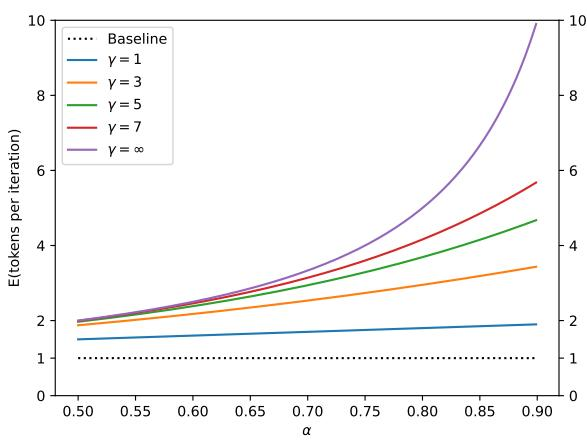
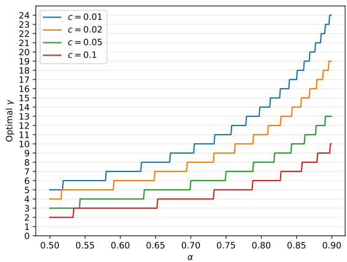

# 通过推测解码从 Transformer 进行快速推理

Yaniv Leviathan <sup>\*</sup> <sup>1</sup> Matan Kalman <sup>\*</sup> <sup>1</sup> Yossi Matias <sup>1</sup>

## 摘要

从大型自回归模型（如 Transformer）进行推理速度很慢——解码 K 个 token 需要对模型进行 K 次串行运行。在本工作中，我们提出了推测解码（speculative decoding）——一种在不改变输出的前提下从自回归模型更快采样的算法，其核心思想是并行计算多个 token。我们方法的根基在于以下两点观察：（1）困难的语言建模任务往往包含一些较容易的子任务，这些子任务可以被更高效的模型很好地近似；（2）借助推测执行和一种新颖的采样方法，我们可以在近似模型的输出上并行运行大模型进行精确解码，从而有望并发地生成多个 token，且不改变输出分布。我们的方法无需重新训练或改动架构，即可加速现有的即用模型。我们在 T5-XXL 上进行了验证，相较于标准的 T5X 实现取得了 2 到 3 倍的加速效果，且输出完全一致。

## 1. 引言

大型自回归模型，尤其是大型 Transformer（Vaswani et al., 2017），其能力远超较小的模型，这一点在近年来已得到反复验证，例如在文本或图像领域，诸如 GPT-3（Brown et al., 2020）、LaMDA（Thoppilan et al., 2022）、Parti（Yu et al., 2022）以及 PaLM（Chowdhery et al., 2022）。然而，从这些较大的模型中进行单步解码显著慢于其较小的对应模型；更糟糕的是，这些解码步骤是串行执行的——解码 K 个 token 需要对模型进行 K 次串行运行。

鉴于大型自回归模型，尤其是大型 Transformer 的重要性，研究者已开发出多种方法来加速其推理过程。一类方法旨在等比例地降低所有输入的推理成本（例如 Hinton et al., 2015; Jaszczur et al., 2021; Hubara et al., 2016; So et al., 2021; Shazeer, 2019）。另一类方法则源于这样一个观察：并非所有推理步骤都同等困难——有些步骤需要非常大的模型，而另一些则可以被更高效的模型很好地近似。这些自适应计算方法（例如 Han et al., 2021; Sukhbaatar et al., 2019; Schuster et al., 2021; Scardapane et al., 2020; Bapna et al., 2020; Elbayad et al., 2019; Schwartz et al., 2020）旨在为较容易的推理步骤使用更少的计算资源。尽管这些解决方案中有许多在实践中已被证明极为有效，但它们通常需要改变模型架构、调整训练流程并重新训练模型，并且无法保持完全一致的输出。

上述关键观察——即某些推理步骤更"难"、某些更"易"——也是本研究的关键动机。此外，我们还观察到，大型模型的推理瓶颈往往并不在于算术运算，而在于内存带宽和通信，因此可能仍有可用的额外计算资源。因此，我们建议将提高并发性作为使用自适应计算量的补充方法。具体而言，我们能够在不改变模型架构、不改变训练流程或重新训练模型、不改变模型输出分布的前提下加速推理。这一目标通过推测执行（speculative execution）实现。

推测执行（Burton, 1985; Hennessy & Patterson, 2012）是一种在处理器中常见的优化技术，其在验证某个任务是否真正需要执行的同时并行执行该任务——收益在于提高并发性。推测执行的一个著名例子是分支预测。为了使推测执行有效，我们需要一种高效的机制来建议可能被需要执行的任务。在本工作中，我们将推测执行推广到随机性场景——即任务可能以某一概率被需要的情况。将其应用于 Transformer 等自回归模型的解码，我们从更高效的近似模型中对生成内容进行采样，作为较慢目标模型的推测前缀。通过一种新颖的采样方法——推测采样（speculative sampling）——我们在保证系统输出与单独使用目标模型的输出分布完全一致的前提下，最大化这些推测任务被接受的概率。例如，图 1 中由 38 个 token 组成的句子，仅通过 9 次对较大目标模型（97M 参数）的串行运行，由我们的方法生成——得益于一个更小且更高效的近似模型（6M 参数）——而生成该句的概率并未改变。

```ini
[START] japan 's benchmark bond n
[START] japan 's benchmark nikkei 22 5
[START] japan 's benchmark nikkei 225 index rose 22 6
[START] japan 's benchmark nikkei 225 index rose 226 . 69 points
[START] japan 's benchmark nikkei 225 index rose 226 . 69 points , or 0 1
[START] japan 's benchmark nikkei 225 index rose 226 . 69 points , or 1 . 5 percent , to 10 , 9859
[START] japan 's benchmark nikkei 225 index rose 226 . 69 points , or 1 . 5 percent , to 10 , 989 . 79 in
[START] japan 's benchmark nikkei 225 index rose 226 . 69 points , or 1 . 5 percent , to 10 , 989 . 79 in tekyo late
[START] japan 's benchmark nikkei 225 index rose 226 . 69 points , or 1 . 5 percent , to 10 , 989 . 79 in late morning trading : [END]
```

**图 1.** 我们的技术在无条件语言建模（unconditional language modeling）场景中的示例展示。每一行代表算法的一次迭代。绿色标记是近似模型（approximation model，此处为一个在 lm1b 上以 8k tokens 训练的、参数量为 6M 的类 GPT Transformer 解码器）提出并被目标模型（target model，此处为一个在相同设置下参数量为 97M 的类 GPT Transformer 解码器）接受的建议；而红色和蓝色标记分别表示被拒绝的建议及其修正后的结果。例如，在第一行中，目标模型仅运行了一次，便生成了 5 个 token。

我们在多种任务和模型规模下分析本方法：在 lm1b 上训练的参数量为 97M 的类 GPT 模型的无条件生成、参数量为 11B 的 T5-XXL 模型的英德翻译与新闻文章摘要，以及参数量为 137B 的 LaMDA 模型的对话任务。我们实现了本方法，并将 T5-XXL 的实际运行时间与稳健的 T5X 实现（Roberts et al., 2022）进行了比较，结果表明在不改变任何输出的情况下，开箱即用即可获得 2X–3X 的延迟改进（第 4 章）。

我们的方法易于在实际生产环境中部署，无需训练新模型，也不会改变输出。因此，在内存带宽是瓶颈而计算资源可用的常见场景中，它可作为加速 Transformer 等自回归模型采样的一个良好默认方案。

总结而言，我们的主要贡献包括：(1) 将推测执行（speculative execution）推广到随机性（stochastic）设定，并提出了一种新颖的采样方法，我们称之为推测采样（speculative sampling）；(2) 提出了一种称为推测解码（speculative decoding）的解码机制，可在不改变模型架构、训练方式及输出分布的前提下，加速自回归模型的解码。

## 2. 推测解码（Speculative Decoding）

## 2.1. 概述

设 $M _ { p }$ 为目标模型（target model），我们要加速的是从该模型进行的推理；令 $p ( x _ { t } | \boldsymbol { x } _ { < t } )$ 为给定前缀 $x _ { < t }$ 时从该模型得到的分布。设 $M _ { q }$ 为针对同一任务的更高效的近似模型（approximation model），并用 $q ( x _ { t } | \boldsymbol { x } _ { < t } )$ 表示给定前缀 $\boldsymbol { x } _ { < t } ^ { 1 }$ 时从该模型得到的分布。其核心思想是：（1）使用更高效的模型 $M _ { q }$ 来生成 $\gamma \in \mathbb { Z } ^ { + }$ 个补全（关于如何最优地选取该参数，见第 3.5 节）；然后（2）使用目标模型 $M _ { p }$ 并行地评估所有这些猜测以及它们由 $M _ { q }$ 给出的相应概率，接受其中所有能够导致相同分布的项；（3）从调整后的分布中对一个额外的 token 进行采样，以修正第一个被拒绝的项，或者在全部被接受时再额外添加一项。如此一来，目标模型 $M _ { p }$ 的每一次并行运行都会至少产生一个新的 token（因此，即使在最坏情况下，目标模型的串行运行次数也绝不会超过简单的自回归方法），但根据 $M _ { q }$ 对 $M _ { p }$ 近似程度的好坏，它潜在地可以生成多达 $\gamma + 1$ 个新 token。

## 2.2. 标准化采样（Standardized Sampling）

首先需要指出的是，虽然存在许多采样方法和采样参数，例如 argmax、top-k、nucleus 以及设置温度参数等，并且流行的实现方式通常在 logits 层面以不同的方式处理它们，但它们都可以很容易地转化为从某个调整后的概率分布进行标准采样。例如，argmax 采样等价于将分布中非最大元素置零并重新归一化。因此，我们只需处理从概率分布进行标准采样的情形，并将所有其他类型的采样纳入这一框架。在后续讨论中，我们将假设 $p ( x )$ 和 $q ( x )$ 分别为 $M _ { p }$ 和 $M _ { q }$ 经过采样方法调整后的分布。

## 2.3. 推测采样（Speculative Sampling）

为了从 $p ( x )$ 采样 $x$，我们改为从 $q ( x )$ 采样 $x$：若 $q ( x ) \leq p ( x )$ 则保留该样本；若 $q ( x ) > p ( x )$，则以概率 $1 - { \frac { p ( x ) } { q ( x ) } }$ 拒绝该样本，并改为从调整后的分布 $p ^ { \prime } ( x ) \stackrel { } { = } n o r m ( m a x ( 0 , p ( x ) - q ( x ) ) )$ 重新采样 $x$。容易证明（见附录 $\mathbf { A . } 1$），对于任意分布 $p ( x )$ 与 $q ( x )$，按此方式采样的 $x$ 确实满足 $x \sim p ( x )$

给定在条件 $prefix$ 上运行 $M_q$ 所得到的分布 $q(x)$，我们可以采样一个 token $x_1 \sim q(x)$。然后我们通过在 $prefix$ 上运行 $M_p$ 来计算分布 $p(x)$，同时并行地通过在 $prefix + [x_1]$ 上运行 $M_p$ 来推测性地计算下一个 token $x_2$ 的分布。当两个计算都完成之后，我们按上述方式继续：如果 $x_1$ 被拒绝，我们丢弃 $x_2$ 的计算，并从一个调整后的分布中重新采样 $x_1$；如果 $x_1$ 被接受，则保留这两个 token。算法 1 将这一思想推广为一次采样 1 到 $\gamma + 1$ 个 token。

<div class="mineru-algorithm" style="white-space: pre-wrap; font-family:monospace;">
Algorithm 1 SpeculativeDecodingStep
Inputs: $M_p, M_q, prefix$.
▷ 以自回归方式从 $M_q$ 采样 $\gamma$ 个猜测 $x_1, \ldots, \gamma$。
for $i = 1$ to $\gamma$ do
    $q_i(x) \leftarrow M_q(prefix + [x_1, \ldots, x_{i-1}])$ $x_i \sim q_i(x)$
end for
▷ 并行运行 $M_p$。
$p_1(x), \ldots, p_{\gamma+1}(x) \leftarrow$ $M_p(prefix), \ldots, M_p(prefix + [x_1, \ldots, x_\gamma])$
▷ 确定被接受的猜测数量 $n$。
$r_1 \sim U(0,1), \ldots, r_\gamma \sim U(0,1)$ $n \leftarrow \min(\{i-1 \mid 1 \leq i \leq \gamma, r_i > \frac{p_i(x)}{q_i(x)}\} \cup \{\gamma\})$
▷ 如有需要，调整来自 $M_p$ 的分布。
$p'(x) \leftarrow p_{n+1}(x)$
if $n < \gamma$ then
    $p'(x) \leftarrow \text{norm}(\max(0, p_{n+1}(x) - q_{n+1}(x)))$
end if
▷ 从 $M_p$ 返回一个 token，从 $M_q$ 返回 $n$ 个 token。
$t \sim p'(x)$
return $prefix + [x_1, \ldots, x_n, t]$
</div>

## 3. 分析

## 3.1. 生成 token 的数量

让我们分析一下目标模型串行调用次数的减少因子，等价地，即算法 1 单次运行所生成 token 的期望数量。

定义 3.1. 在推测采样中，给定前缀 $x_{<t}$ 时的接受率 $\beta_{x_{<t}}$ 是指接受 $x_t \sim q(x_t | \boldsymbol{x}_{<t})$ 的概率，如第 $2.3$ 节所述。

$E(\beta)$ 因此是衡量 $M_q$ 近似 $M_p$ 程度的一个自然指标。如果我们作出简化假设，假设各 $\beta$ 独立同分布（i.i.d.），并记 $\alpha = E(\beta)$，那么算法 1 单次运行所生成的 token 数量就是一个封顶几何分布变量，其成功概率为 $1 - \alpha$，上限为 $\gamma + 1$，且算法 1 生成的 token 期望数满足方程 (1)。参见图 2。

$$
E (\# \text {generated tokens}) = \frac {1 - \alpha^ {\gamma + 1}}{1 - \alpha}\tag{1}
$$

  

图 2. 由算法 1 生成的 tokens 的期望数量随 α 变化的函数关系，对应不同的 γ 值。

## 3.2. 计算 α

我们现在将推导一个简单的公式，用于在给定前缀以及两个模型 $M_p$ 和 $M_q$ 的情况下计算 α。我们首先定义一个自然散度 $D_{LK}$。

定义 3.2. $\begin{array}{rcl} {D_{LK}(p,q)} & = & { \sum_x |p(x) - M(x)| = } \end{array}$ $\begin{array}{r} \sum_x |q(x) - M(x)| \end{array}$，其中 $\begin{array}{r} M(x) = \frac{p(x) + q(x)}{2} \end{array}$

引理 3.3. $D_{LK}(p,q) = 1 - \sum_x \min(p(x), q(x))$

$$
\begin{array}{l} \text {Proof.} D _ {L K} (p, q) = \sum_ {x} | p (x) - M (x) | = \sum_ {x} \frac {| p - q |}{2} = \\ 1 - \sum_ {x} \frac {p + q - | p - q |}{2} = 1 - \sum_ {x} \min (p (x), q (x)) \end{array}
$$

由引理 3.3 我们直接得到以下结果：

推论 3.4. $D _ { L K } ( p , q )$ 是 [0, 1] 上的对称散度（symmetric divergence）。$D _ { L K } ( p , q ) = 0 \iff p = q .$ $D _ { L K } ( p , q ) = 1 \iff p$ 与 q 的支撑集不相交。

定理 3.5. $\beta = 1 - D _ { L K } ( p , q )$

$$
\begin{array}{l} \text {Proof.} \beta = E _ {x \sim q (x)} \left\{ \begin{array}{l l} 1 & q (x) \leq p (x) \\ \frac {p (x)}{q (x)} & q (x) > p (x) \end{array} \right. = \\ E _ {x \sim q (x)} \min (1, \frac {p (x)}{q (x)}) = \sum_ {x} \min (p (x), q (x)) \quad \square \end{array}
$$

最终我们得到：

推论 3.6. $\alpha = 1 - E ( D _ { L K } ( p , q ) ) = E ( \operatorname* { m i n } ( p , q ) )$

我们在实验中经验观测到的 α 值见表 3。

## 3.3. 墙钟时间改进

我们已经证明，在 i.i.d. 假设下，我们的算法将目标模型的调用次数减少了 $\frac { 1 - \alpha ^ { \gamma + 1 } } { 1 - \alpha }$ 倍。需要注意的是，一般的推测执行以及我们的算法都假设我们有足够的计算资源来支持增加的并发度（第 3.4 节）。对于墙钟时间分析，我们假设能够并行运行 $\gamma + 1$ 次 $M _ { p }$ 的并发评估而不增加墙钟时间。为了得到总墙钟时间的改进，我们现在考虑运行近似模型 $M _ { q }$ 的代价。

定义 3.7. 设 $c ,$ 为代价系数，定义为运行单次 $M _ { q }$ 的时间与运行单次 $M _ { p }$ 的时间之比。

与 α 是模型和任务的内在属性不同，c 的值取决于硬件配置和软件实现细节。在我们的实验中，$M _ { q }$ 通常比 $M _ { p }$ 小几个数量级，c 始终小于 0.05，且常常可以忽略不计地接近于 0。

定理 3.8. 算法 1 在总墙钟时间上的期望改进因子为 ${ \frac { 1 - \alpha ^ { \gamma + 1 } } { ( 1 - \alpha ) ( \gamma c + 1 ) } }$。

证明. 设运行单步 $M _ { p }$ 的代价为 $T$。现在，每次运行算法 1 的代价为 $T c \gamma + T$（用于运行 $\gamma$ 次近似模型 $M _ { q }$ 和一次 $M _ { p }$），且根据等式 (1)，平均产生 $\frac { 1 - \alpha ^ { \gamma + 1 } } { 1 - \alpha }$ 个 tokens。因此，使用算法 1 产生一个 token 的总体期望代价为 $\frac { ( c \gamma + \mathbf { \bar { 1 } } ) ( 1 - \alpha ) } { 1 - \alpha ^ { \gamma + 1 } } T$。由于使用标准解码算法产生单个 token 的代价为 T，我们得到所需结果。□

注意，定理 3.8 假设生成长度足够长（例如，由于我们至少运行 $M _ { p }$ 一次，改进因子受生成 tokens 数量的限制）。

推论 3.9. 若 $\alpha > c$，则存在 γ 使得我们将获得改进，且改进因子至少为 $\frac { 1 + \alpha } { 1 + c }$。

证明. 如果我们对 γ 能获得改进，那么对任意 $0 < \gamma ^ { * } < \gamma ,$ 也能获得改进。因此，为了使我们的方法产生改进，我们可以对 γ = 1 评估定理 3.8，得到 $\textstyle { \frac { 1 - \alpha ^ { 2 } } { ( 1 - \alpha ) ( c + 1 ) } } = { \frac { 1 + \alpha } { 1 + c } }$ □

## 3.4. 算术运算次数

算法 1 以并行的方式执行 $\gamma + 1$ 次 $M _ { p }$ 运行，因此并发算术运算的数量增长了 $\gamma + 1$ 倍。现在，由于算法 1 每次运行最多产生 $\gamma + 1$ 个 token，算术运算的总数可能高于标准解码算法。当我们接受来自 $M _ { q }$ 的样本时，增加的并发是「免费」的，运算总数并不会增加<sup>3</sup>。然而，当我们拒绝某个猜测时，计算就被浪费了。下面我们分析我们的方法对算术运算总数的影响。

定义 3.10. 设 $\hat{c}$ 为近似模型 $M _ { q }$ 每个 token 的算术运算量与目标模型 $M _ { p }$ 每个 token 的算术运算量之比。

定理 3.11. 算法总运算次数的期望增长因子为 $\begin{array} { r } { \dot { I } \ i s \ \frac { ( 1 - \alpha ) ( \gamma \hat { c } + \gamma + 1 ) } { 1 - \alpha ^ { \gamma + 1 } } } \end{array}$。

证明。记 $\hat { T }$ 为标准解码基线每个 token 所做的算术运算次数，即单次运行 $M _ { p }$ 的运算次数。那么算法 1 的一次迭代消耗 $\hat { T } \hat { c } \gamma + \hat { T } ( \gamma + 1 )$ 次运算（对应 $\gamma$ 次运行 $M _ { q }$ 和 $\gamma + 1$ 次并行运行 $M _ { p }$）。将其除以算法 1 产生的 token 的期望数（即公式 (1)）以及除以 $\hat { T }$，即得所需结果。

若 $\alpha$ 较小，则算术运算次数的增长较大，反之亦然。注意，对于 Transformer 解码器，算法 1 所做算术运算的总数（不计 $M _ { q }$ 的运行）可由同规模 Transformer 编码器（Transformer encoder）的单次运行从上方界定。

与算术运算总数不同，内存访问（memory accesses）的总数在我们的方法下可以下降。具体而言，目标模型的权重和 KV 缓存可在算法 1 的每次执行中读取一次，因此读取它们的内存访问次数根据公式 (1) 缩小了 $\frac { 1 - \alpha ^ { \gamma + 1 } } { 1 - \alpha }$ 倍。

## 3.5. 选择 $\gamma$

给定 $c$ 和 $\alpha$，并假设计算资源充足（见第 3.4 节），最优的 $\gamma$ 是使 walltime（墙钟时间）改进公式（定理 3.8）最大化的那个：$\begin{array} { r } { \frac { 1 - \alpha ^ { \gamma + 1 } } { ( 1 - \alpha ) ( \gamma c + 1 ) } . } \end{array}$ 由于 $\gamma$ 是整数，可通过数值方法容易地找到，参见图 3。

  

Figure 3. 最优 γ 关于 α 的函数关系（c 取不同值时）。

表 1 和图 4 展示了在 $c = { \hat { c } } = 0$ 假设下，不同 $\alpha$ 与 $\gamma$ 取值对应的推理速度与算术运算总数之间的关系。图 5 给出了一个简化的追踪示意图。

Table 1. 在 $c = { \hat { c } } = 0$ 假设下，不同 $\gamma$ 与 $\alpha$ 取值对应的算术运算总数及其相对于基线方法的推理速度

<table><tr><td>α</td><td>γ</td><td>OPERATIONS</td><td>SPEED</td></tr><tr><td>0.6</td><td>2</td><td>1.53X</td><td>1.96X</td></tr><tr><td>0.7</td><td>3</td><td>1.58X</td><td>2.53X</td></tr><tr><td>0.8</td><td>2</td><td>1.23X</td><td>2.44X</td></tr><tr><td>0.8</td><td>5</td><td>1.63X</td><td>3.69X</td></tr><tr><td>0.9</td><td>2</td><td>1.11X</td><td>2.71X</td></tr><tr><td>0.9</td><td>10</td><td>1.60X</td><td>6.86X</td></tr></table>

由于 β 值并非恒定，与其在基于 α 选取一个固定的 γ 值，不如通过预测 β 的取值并在算法 1 运行过程中相应地调整 γ 的取值，从而获得进一步的性能提升。为了获得这一额外提升因子的上界，假设我们拥有一个关于 γ 的预言机（oracle）。此时将有 E(# 生成词元数) $\begin{array}{r} = \frac{1}{1-\alpha} \end{array}$。在典型的 c 与 α 取值下，并假设算力资源无上限，增强后的挂钟时间（walltime）提升因子相比采用固定 γ 时的提升因子最多可高出约 60%。我们将这一方向的探索留作未来工作⁴。

  

图 4. 加速因子与算术运算次数的增加作为 $\alpha$ 的函数（对应不同的 $\gamma$ 值）

## 3.6. 近似模型（Approximation Models）

推测采样（speculative sampling），进而推测解码（speculative decoding），保证了对任何近似模型 $M _ { q }$ 的选择都能得到相同的输出分布，且没有任何限制（见附录 A.1）。在我们的实验中，我们主要测试了现有的即用型较小 Transformer 作为近似模型。此外，我们仅测试了与目标模型 $M _ { p }$ 架构相同、并使用相同概率标准化方法的近似模型。在此设置下，选择比 $M _ { p }$ 小约两个数量级的 $M _ { q }$ 通常表现最佳，在 α 与 c 之间取得平衡（定理 3.8）。

另一类近似模型是可忽略成本模型（negligible-cost models），即满足 $c \approx 0 .$ 的模型，亦即相对于目标模型而言成本可忽略不计的近似模型。在这种情况下，我们得到的期望实际运行时间改善为 $\frac { 1 - \alpha ^ { \gamma + 1 } } { 1 - \alpha }$，其上界为 $\frac { 1 } { 1 - \alpha }$（当 $\operatorname { i f } \gamma$ 较大时，我们趋近于等号成立）。一类有趣的可忽略成本近似模型是 n-gram 模型，其求值等价于一次表查找操作。有趣的是，在经验测试中（第 4.2 节），即使是这些简单的 n-gram 模型，我们也能得到非零的 α 值。例如，对于英德翻译任务，$M _ { p }$ 为 T5-XXL 11B，$M _ { q }$ 为一个简单二元语法模型（bigram model），我们得到 $\alpha \approx 0 . 2$，当 $\gamma = 3$ 时，这带来 1.25 倍的推理速度提升。

其他简单的启发式方法也可以用作可忽略成本近似模型。例如，在长序列可能重复出现的场景下，如摘要任务或聊天类界面 <sup>5</sup>，一个简单的近似模型——在找到匹配前缀时直接从上下文中复制词元（token）——可能会产生较高的 α 值。这些无参数近似模型还有一个额外的优势，即从生产部署的角度来看，它们更加易于部署。

  

图 5. 一个完整编码器-解码器 Transformer 堆叠的简化追踪图。最上面一行展示了 $\gamma = 7$ 的推测解码（speculative decoding），因此每次调用 $M _ { p }$（紫色块）之前都跟着 7 次对 $M _ { q }$（蓝色块）的调用。左侧的黄色块表示 $M _ { p }$ 对编码器的调用，橙色块表示 $M _ { q }$ 对编码器的调用。类似地，中间一行展示了 $\gamma = 3$ 的推测解码，最下面一行展示了标准解码（standard decoding）。

另一类可用于推测解码（speculative decoding）的近似模型是非自回归模型（non-autoregressive models），例如 Stern 等人（2018）所提出的模型。此时，我们只需调用一次非自回归模型，即可替代算法 1（Algorithm 1）中的自回归循环。

最后一个例子主要从理论角度来看颇有意义，即一种随机选取词元（tokens）的近似模型，它可保证对所有模型 $M _ { p }$ 都能带来一定（尽管非常小）的改进。

## 4. 实验

## 4.1. 经验性墙钟时间改进

我们实现了本文算法，并将其与 T5X 代码库中用于加速 T5-XXL 的实现进行了对比。

设置 我们在 T5 论文中的两项任务上测试一个标准的编码器-解码器（encoder-decoder）T5 1.1 版本模型（Raffel 等人，2020）：(1) 在 WMT EnDe 上微调的英德翻译任务；(2) 在 CCN/DM 上微调的文本摘要任务。对于这两项任务，我们使用 T5-XXL（11B）作为 $M _ { p }$。对于近似模型 $M _ { q }$，我们测试了若干已有配置，即 T5-large（800M）、T5-base（250M）和 T5-small（77M）（Raffel 等人，2020）。我们对所有模型均使用现成的检查点。我们在一块 TPU-v4 上以批大小 1 分别针对 argmax 采样（temp=0）和标准采样（temp=1）两种情况测量墙钟时间的改进。

结果 表 2 给出了本文方法的经验性结果。我们看到，T5-small（77M）在 c 与 $\alpha$ 之间取得了良好的平衡，因此在所测试的近似模型中提供了最高的加速比。正如预期，α 随近似模型规模的增大而增大。有趣的是，在 argmax 采样（temp=0）下，α 与墙钟时间改进均更高。我们在翻译任务上观察到 2.6X（temp=1）和 3.4X（temp=0）的加速比，在摘要任务上则略低，分别为 2.3X（temp=1）和 3.1X（temp=0）。这些经验性结果与理论预测高度吻合，仅因实现细节而存在一定差异（参见附录 A.3）。

表 2. 加速 T5- XXL 11B 模型推理的经验性结果。

<table><tr><td>TASK</td><td> $M_q$ </td><td>TEMP</td><td> $\gamma$ </td><td> $\alpha$ </td><td>SPEED</td></tr><tr><td>ENDE</td><td>T5-SMALL ★</td><td>0</td><td>7</td><td>0.75</td><td>3.4X</td></tr><tr><td>ENDE</td><td>T5-BASE</td><td>0</td><td>7</td><td>0.8</td><td>2.8X</td></tr><tr><td>ENDE</td><td>T5-LARGE</td><td>0</td><td>7</td><td>0.82</td><td>1.7X</td></tr><tr><td>ENDE</td><td>T5-SMALL ★</td><td>1</td><td>7</td><td>0.62</td><td>2.6X</td></tr><tr><td>ENDE</td><td>T5-BASE</td><td>1</td><td>5</td><td>0.68</td><td>2.4X</td></tr><tr><td>ENDE</td><td>T5-LARGE</td><td>1</td><td>3</td><td>0.71</td><td>1.4X</td></tr><tr><td>CNNDM</td><td>T5-SMALL ★</td><td>0</td><td>5</td><td>0.65</td><td>3.1X</td></tr><tr><td>CNNDM</td><td>T5-BASE</td><td>0</td><td>5</td><td>0.73</td><td>3.0X</td></tr><tr><td>CNNDM</td><td>T5-LARGE</td><td>0</td><td>3</td><td>0.74</td><td>2.2X</td></tr><tr><td>CNNDM</td><td>T5-SMALL ★</td><td>1</td><td>5</td><td>0.53</td><td>2.3X</td></tr><tr><td>CNNDM</td><td>T5-BASE</td><td>1</td><td>3</td><td>0.55</td><td>2.2X</td></tr><tr><td>CNNDM</td><td>T5-LARGE</td><td>1</td><td>3</td><td>0.56</td><td>1.7X</td></tr></table>

## 4.2. 经验 α 值

虽然我们仅为 T5 实现了我们的方法，但我们针对各种任务、采样方法、目标模型 $M_p$ 和近似模型 $M_q$ 测量了 α 值。具体来说，我们对下述每种设置，在由 $M_p$ 生成的 10K token 上评估了来自推论 3.6 的期望值。

类 GPT（GPT-like, 97M 参数） 我们在 lm1b（Chelba 等人，2013）上训练的一个仅解码器 Transformer 模型上测试无条件语言生成。此处的模型是一个具有 Gelu 激活（Hendrycks & Gimpel，2016）的类 GPT Transformer 解码器。对于 $M_q$，我们实验了一个具有 6M 参数的 Transformer 解码器模型：dim 256、前馈维度 1024、2 层、4 个注意力头，以及简单的 unigram 和 bigram 模型。$M_p$ 具有 97M 参数：dim 768、前馈维度 3072、12 层、12 个注意力头。所有模型都使用了具有 8k token 的 Bert 分词（Devlin 等人，2019）。

LaMDA（137B 参数） 我们在对话任务（Thoppilan 等人，2022）上测试了一个仅解码器 LaMDA 模型。我们使用 LaMDA 137B 的现有检查点作为 $M_p$，使用 LaMDA 8B、LaMDA 2B 和 LaMDA 100M 作为 $M_q$。有关 T5-XXL（11B 参数）模型的设置，请参见第 4.1 节。

## 5. 相关工作

表 3 总结了所测试案例的 α 值。我们观察到，比目标模型小两到三个数量级的近似模型往往会产生介于 0.5 和 0.9 之间的 α 值。有趣的是，我们还注意到，对于所有模型，调整后的分布越尖锐，α 值就越高。最后，我们注意到，即使是平凡的 unigram 和 bigram 近似也会产生不可忽略的 α 值。例如，在英语到德语翻译的情况下，bigram 模型的 α 值为 0.2，并且由于在这种情况下 $c = 0$，因此带来 1.25 倍的速度提升，对于如此平凡的近似模型来说这一速度提升高得惊人（但仍低于使用 T5-small 作为近似模型所获得的速度提升）。

对大模型推理效率的研究已经相当广泛（Dehghani 等，2021）。许多方法旨在加速大模型（尤其是 Transformer 等自回归模型）的推理过程。已有大量技术试图使所有 token 的推理更加高效，例如蒸馏（Hinton 等，2015）、稀疏化（Jaszczur 等，2021）、量化（Hubara 等，2016）以及架构修改（So 等，2021；Shazeer，2019）。与我们方法更接近的是自适应计算方法，它根据问题难度调整计算量（Han 等，2021）。例子包括关注输入的子集（Sukhbaatar 等，2019）以及提前退出（Schuster 等，2021；Scardapane 等，2020；Bapna 等，2020；Elbayad 等，2019；Schwartz 等，2020）。值得注意的是，Wisdom of Committees（Schwartz 等，2020）利用现成的小模型，但它是一种自适应计算方法，因此采用启发式来决定何时停止，从而丧失了与目标模型输出完全一致的保证。总体而言，自适应计算方法通常在模型内部或借助辅助模型来学习何时可以采取计算捷径。通常，这些方法在节省推理时间和算术运算方面都有效果，但需要修改架构、改变训练过程以及训练自定义模型或重新训练现有模型。它们通常也会改变模型的输出。我们注意到，虽然上述许多方法改善了内存与算术运算的比率，但在比率仍然较高的情况下，这些方法与我们的推测解码方法可能会协同发挥作用。

表 3. 各种目标模型 $M _ { p }$、近似模型 $M _ { q }$ 及采样设置下的经验 $\alpha$ 值。T=0 和 T=1 分别表示 argmax 和标准采样<sup>6</sup>。

<table><tr><td> $M_p$ </td><td> $M_q$ </td><td>SMPL</td><td>α</td></tr><tr><td>GPT-LIKE (97M)</td><td>UNIGRAM</td><td>T=0</td><td>0.03</td></tr><tr><td>GPT-LIKE (97M)</td><td>BIGRAM</td><td>T=0</td><td>0.05</td></tr><tr><td>GPT-LIKE (97M)</td><td>GPT-LIKE (6M)</td><td>T=0</td><td>0.88</td></tr><tr><td>GPT-LIKE (97M)</td><td>UNIGRAM</td><td>T=1</td><td>0.03</td></tr><tr><td>GPT-LIKE (97M)</td><td>BIGRAM</td><td>T=1</td><td>0.05</td></tr><tr><td>GPT-LIKE (97M)</td><td>GPT-LIKE (6M)</td><td>T=1</td><td>0.89</td></tr><tr><td>T5-XXL (ENDE)</td><td>UNIGRAM</td><td>T=0</td><td>0.08</td></tr><tr><td>T5-XXL (ENDE)</td><td>BIGRAM</td><td>T=0</td><td>0.20</td></tr><tr><td>T5-XXL (ENDE)</td><td>T5-SMALL</td><td>T=0</td><td>0.75</td></tr><tr><td>T5-XXL (ENDE)</td><td>T5-BASE</td><td>T=0</td><td>0.80</td></tr><tr><td>T5-XXL (ENDE)</td><td>T5-LARGE</td><td>T=0</td><td>0.82</td></tr><tr><td>T5-XXL (ENDE)</td><td>UNIGRAM</td><td>T=1</td><td>0.07</td></tr><tr><td>T5-XXL (ENDE)</td><td>BIGRAM</td><td>T=1</td><td>0.19</td></tr><tr><td>T5-XXL (ENDE)</td><td>T5-SMALL</td><td>T=1</td><td>0.62</td></tr><tr><td>T5-XXL (ENDE)</td><td>T5-BASE</td><td>T=1</td><td>0.68</td></tr><tr><td>T5-XXL (ENDE)</td><td>T5-LARGE</td><td>T=1</td><td>0.71</td></tr><tr><td>T5-XXL (CNNDM)</td><td>UNIGRAM</td><td>T=0</td><td>0.13</td></tr><tr><td>T5-XXL (CNNDM)</td><td>BIGRAM</td><td>T=0</td><td>0.23</td></tr><tr><td>T5-XXL (CNNDM)</td><td>T5-SMALL</td><td>T=0</td><td>0.65</td></tr><tr><td>T5-XXL (CNNDM)</td><td>T5-BASE</td><td>T=0</td><td>0.73</td></tr><tr><td>T5-XXL (CNNDM)</td><td>T5-LARGE</td><td>T=0</td><td>0.74</td></tr><tr><td>T5-XXL (CNNDM)</td><td>UNIGRAM</td><td>T=1</td><td>0.08</td></tr><tr><td>T5-XXL (CNNDM)</td><td>BIGRAM</td><td>T=1</td><td>0.16</td></tr><tr><td>T5-XXL (CNNDM)</td><td>T5-SMALL</td><td>T=1</td><td>0.53</td></tr><tr><td>T5-XXL (CNNDM)</td><td>T5-BASE</td><td>T=1</td><td>0.55</td></tr><tr><td>T5-XXL (CNNDM)</td><td>T5-LARGE</td><td>T=1</td><td>0.56</td></tr><tr><td>LAMDA (137B)</td><td>LAMDA (100M)</td><td>T=0</td><td>0.61</td></tr><tr><td>LAMDA (137B)</td><td>LAMDA (2B)</td><td>T=0</td><td>0.71</td></tr><tr><td>LAMDA (137B)</td><td>LAMDA (8B)</td><td>T=0</td><td>0.75</td></tr><tr><td>LAMDA (137B)</td><td>LAMDA (100M)</td><td>T=1</td><td>0.57</td></tr><tr><td>LAMDA (137B)</td><td>LAMDA (2B)</td><td>T=1</td><td>0.71</td></tr><tr><td>LAMDA (137B)</td><td>LAMDA (8B)</td><td>T=1</td><td>0.74</td></tr></table>

两种先前的方法利用推测执行来加速自回归模型的解码。块级并行解码（Blockwise Parallel Decoding, Stern 等人, 2018）与我们的工作类似，并行地解码若干 token。然而，它仅支持贪心解码（temperature=0），而不支持一般的随机设置，并且它需要额外训练一个定制模型，而且其关注点在于保持下游任务的质量，而非保证输出完全相同。浅层激进解码（Shallow Aggressive Decoding, SAD）（Sun 等人, 2021）也与我们的工作类似，并行地解码若干 token。但与我们的工作不同的是，SAD 仅支持将输入复制到输出，而不支持一般性的近似模型，因此它只适用于输入和输出非常相似的情况，例如语法纠错。此外，与块级并行解码类似，SAD 也不支持一般性的随机采样设置。

在我们最初发布工作之后，一个独立的推测解码实现（Chen 等人, 2023）在 Chinchilla 70B 上展示了类似的 2X-2.5X 加速效果。

## 6. 讨论

我们提出了推测采样（speculative sampling），它能够在随机设置下实现高效的随机推测执行——即随机设置中的推测执行。我们通过推测解码（speculative decoding）分析了它对 Transformer 等自回归模型解码的影响，并证明在拥有足够计算资源的情况下，相比广泛使用的优化实现 T5X，我们在实践中获得了显著的 2X-3X 加速效果。

一般来说，推测执行，特别是推测解码，存在的一个局限性是：它通过提高并发性来改善延迟，但代价是增加了算术运算的次数。因此，在没有额外计算资源的配置下，我们的方法并没有帮助。然而，在拥有额外计算资源的常见情况下（例如当内存带宽成为瓶颈时），我们的方法可以带来显著的加速收益：模型架构不变，无需重新训练，最重要的是，输出分布被严格保证保持不变。我们的方法易于实现，并且可以直接使用开箱即用的模型来加速推理，而无需开发和评估定制方案。

未来研究有几个值得跟进的方向，重要的是进一步研究推测解码与束搜索的兼容性（见附录 A.4）。此外，虽然我们的方法配合现成的近似模型能够产生显著的加速，但通过定制近似模型（第 3.6 节）可能会获得更大的改进，例如采用定制架构（如定制规模、非自回归模型或各种启发式方法）的模型，或采用定制训练流程（例如使用来自 $M_p$ 的软目标进行标准蒸馏，或直接针对 α 优化 $M_q$）的模型。探索一种算法的层次化版本也将是很有趣的，其中近似模型本身由一个更快的模型加速，从而允许使用能力更强的近似模型。在本工作中，我们在整个推理过程中固定了近似模型和猜测数 γ，但在推理过程中对它们进行变化可能带来额外的改进（第 3.5 节）。在我们的实验中，我们始终对近似模型生成的分布执行与目标模型所期望的相同的标准化处理（第 2.2 节），但通过应用不同的变换可能会获得进一步的改进。我们仅在文本模态上测试了推测解码，但它可能在其他领域（例如图像）中也能很好地工作，这将值得进行实验探索。

最后，我们注意到随机推测执行和推测采样在自回归模型推测解码的范围之外也可能是有所帮助的。例如，给定两个慢函数 $f(x)$ 和 $g(y)$，其中 $f(x)$ 生成一个分布，$\boldsymbol { g ^ { \prime } } \mathbf { s }$ 的输入是从该分布中采样得到的，我们可以使用我们的方法并行运行 $f$ 和 $g$。这种设置可能出现于例如物理模拟中，或在强化学习中——其中 $f$ 是产生动作分布的大型模型，$g$ 是世界模拟器，这将值得进行探索。

## 致谢

我们要特别感谢 YaGuang Li 在所有 LaMDA 相关事务上提供的帮助以及为论文计算 LaMDA 数据所做的工作，还要感谢 Blake Hechtman 提出的深刻见解和对 XLA 给予的帮助。我们也要感谢审稿人提出的富有洞见的意见，以及 Asaf Aharoni、Reiner Pope、Sasha Goldshtein、Nadav Sherman、Eyal Segalis、Eyal Molad、Dani Valevski、Daniel Wasserman、Valerie Nygaard、Danny Vainstein、Google 的 LaMDA 和 Theta Labs 团队，以及我们的家人。

## 参考文献

Bapna, A., Arivazhagan, N., and Firat, O. 针对神经序列模型控制计算量与质量的权衡. ArXiv, abs/2002.07106, 2020.

Brown, T. B., Mann, B., Ryder, N., Subbiah, M., Kaplan, J., Dhariwal, P., Neelakantan, A., Shyam, P., Sastry, G., Askell, A., Agarwal, S., Herbert-Voss, A., Krueger, G., Henighan, T., Child, R., Ramesh, A., Ziegler, D. M., Wu, J., Winter, C., Hesse, C., Chen, M., Sigler, E., Litwin, M., Gray, S., Chess, B., Clark, J., Berner, C., McCandlish, S., Radford, A., Sutskever, I., and Amodei, D. 语言模型是小样本学习者（Language models are few-shot learners）. 载于：第 34 届神经信息处理系统大会论文集，NIPS'20，美国纽约州 Red Hook，2020 年。Curran Associates Inc. 出版。ISBN 9781713829546。

Burton, F. W. 推测计算、并行性与函数式编程（Speculative computation, parallelism, and functional programming）. IEEE Transactions on Computers, C-34(12):1190–1193, 1985. doi: 10.1109/TC.1985. 6312218.

Chelba, C., Mikolov, T., Schuster, M., Ge, Q., Brants, T., Koehn, P. T., and Robinson, T. 用于衡量统计语言建模进展的十亿词基准（One billion word benchmark for measuring progress in statistical language modeling）. 载于：Interspeech，2013 年。

Chen, C., Borgeaud, S., Irving, G., Lespiau, J.-B., Sifre, L., and Jumper, J. M. 使用推测采样加速大语言模型解码（Accelerating large language model decoding with speculative sampling）. ArXiv, abs/2302.01318, 2023.

Dehghani, M., Arnab, A., Beyer, L., Vaswani, A., and Tay, Y. 效率之误称（The efficiency misnomer）. ArXiv, abs/2110.12894, 2021.

Devlin, J., Chang, M.-W., Lee, K., and Toutanova, K. BERT：面向语言理解的深度双向变换器预训练（Bert: Pre-training of deep bidirectional transformers for language understanding）. ArXiv, abs/1810.04805, 2019.

Elbayad, M., Gu, J., Grave, E., and Auli, M. 深度自适应变换器（Depth-adaptive transformer）. ArXiv, abs/1910.10073, 2019.

Han, Y., Huang, G., Song, S., Yang, L., Wang, H., and Wang, Y. 动态神经网络：综述（Dynamic neural networks: A survey）. IEEE Transactions on Pattern Analysis and Machine Intelligence, 44: 7436–7456, 2021.

Hendrycks, D. and Gimpel, K. 用高斯误差线性单元桥接非线性与随机正则化器（Bridging nonlinearities and stochastic regularizers with gaussian error linear units）. ArXiv, abs/1606.08415, 2016.

Hennessy, J. L. and Patterson, D. A. 计算机体系结构：一种量化方法（Computer Architecture: A Quantitative Approach）. Morgan Kaufmann 出版，阿姆斯特丹，第 5 版，2012 年。ISBN 978-0-12-383872-8。

Hinton, G. E., Vinyals, O., and Dean, J. 在神经网络中蒸馏知识. ArXiv, abs/1503.02531, 2015.

Hubara, I., Courbariaux, M., Soudry, D., El-Yaniv, R., and Bengio, Y. 量化神经网络：使用低精度权重与激活训练神经网络. ArXiv, abs/1609.07061, 2016.

Jaszczur, S., Chowdhery, A., Mohiuddin, A., Kaiser, L., Gajewski, W., Michalewski, H., and Kanerva, J. 在扩展 Transformer 规模时稀疏化已足够. 载于：神经信息处理系统大会，2021.

Raffel, C., Shazeer, N., Roberts, A., Lee, K., Narang, S., Matena, M., Zhou, Y., Li, W., and Liu, P. J. 以统一的文本到文本 Transformer 探索迁移学习的极限. The Journal of Machine Learning Research, 21(1):5485–5551, 2020.

Scardapane, S., Scarpiniti, M., Baccarelli, E., and Uncini, A. 我们为什么应该在神经网络中添加提前退出？ Cognitive Computation, 12(5):954–966, 2020.

Schuster, T., Fisch, A., Jaakkola, T., and Barzilay, R. 通过置信自适应 Transformer 实现一致的加速推理. 载于：自然语言处理经验方法会议，2021.

Schwartz, R., Stanovsky, G., Swayamdipta, S., Dodge, J., and Smith, N. A. 工欲善其事：匹配模型与实例复杂度. 载于：计算语言学协会年会，2020.

Shazeer, N. M. 快速 Transformer 解码：一个写头足矣. ArXiv, abs/1911.02150, 2019.

So, D. R., Ma'nke, W., Liu, H., Dai, Z., Shazeer, N. M., and Le, Q. V. Primer：搜索用于语言建模的高效 Transformer. ArXiv, abs/2109.08668, 2021.

Stern, M., Shazeer, N., and Uszkoreit, J. 深度自回归模型的逐块并行解码. Advances in Neural Information Processing Systems, 31, 2018.

Sukhbaatar, S., Grave, E., Bojanowski, P., and Joulin, A. Transformer 中的自适应注意力跨度. 载于：计算语言学协会年会，2019.

Sun, X., Ge, T., Wei, F., and Wang, H. 基于浅层激进解码的即时语法纠错. ArXiv, abs/2106.04970, 2021.

Yu, J., Xu, Y., Koh, J. Y., Luong, T., Baid, G., Wang, Z., Vasudevan, V., Ku, A., Yang, Y., Ayan, B. K., Hutchinson, B. C., Han, W., Parekh, Z., Li, X., Zhang, H., Baldridge, J., and Wu, Y. 面向内容丰富的文本到图像生成的自回归模型规模化方法。ArXiv，abs/2206.10789，2022。

## A. 附录

## A.1. 推测性采样的正确性

下面我们将证明，对于任意分布 $p ( x )$ 和 $q ( x )$，通过推测性采样（speculative sampling）从 $p ( x )$ 和 $q ( x )$ 采样得到的 token 与单独从 $p ( x )$ 采样得到的 token 服从完全相同的分布。设 $\beta$ 为接受概率（定义 3.1）。

注意，由于 $\begin{array} { r } { p ^ { \prime } ( x ) = n o r m ( m a x ( 0 , p ( x ) - q ( x ) ) ) = \frac { p ( x ) - m i n ( q ( x ) , p ( x ) ) } { \sum _ { x ^ { \prime } } ( p ( x ^ { \prime } ) - m i n ( q ( x ^ { \prime } ) , p ( x ^ { \prime } ) ) ) } = \frac { p ( x ) - m i n ( q ( x ) , p ( x ) ) } { 1 - \beta } } \end{array}$，调整后分布 $p ^ { \prime } ( x )$ 的归一化常数为 $1 - \beta$，其中最后一个等式直接由引理 3.3 和定理 3.5 立即得出。

现在：

$$
P (x = x ^ {\prime}) = P (\text {guess accepted}, x = x ^ {\prime}) + P (\text {guess rejected}, x = x ^ {\prime})
$$

其中：

$$
P (g u e s s a c c e p t e d, x = x ^ {\prime}) = q (x ^ {\prime}) \min (1, \frac {p (x ^ {\prime})}{q (x ^ {\prime})}) = \min (q (x ^ {\prime}), p (x ^ {\prime}))
$$

且：

$$
P (g u e s s r e j e c t e d, x = x ^ {\prime}) = (1 - \beta) p ^ {\prime} (x ^ {\prime}) = p (x ^ {\prime}) - \min (q (x ^ {\prime}), p (x ^ {\prime}))
$$

总体而言：

$$
P (x = x ^ {\prime}) = \min (p (x ^ {\prime}), q (x ^ {\prime})) + p (x ^ {\prime}) - \min (p (x ^ {\prime}), q (x ^ {\prime})) = p (x ^ {\prime}).
$$

## A.2. 推测采样与拒绝采样的对比

拒绝采样是如下迭代式采样过程，它表面上与我们的方法相似：

1. 从 $q(x)$ 中采样 $x$，从 $U(0,1)$ 中采样 $r$。

2. $\begin{array} { r } { \mathrm { I f } r < \frac { p ( x ) } { M q ( x ) } } \end{array}$ 返回 $x$。

3. 返回步骤 1。

其中 $\begin{array} { r } { M = m a x _ { x } \frac { p ( x ) } { q ( x ) } } \end{array}$。我们也可以使用拒绝采样的非迭代版本来代替推测采样——具体而言，即执行上述步骤 1 和 2，否则直接从未经修改的 $p(x)$ 中采样。不过这将远不如我们的方法高效。具体而言，此处的期望接受概率为 $E _ { x \sim q ( x ) } { \frac { p ( x ) } { M q ( x ) } } = \begin{array} { r } { \sum _ { x } p ( x ) \operatorname* { m i n } _ { x ^ { \prime } } \frac { q ( x ^ { \prime } ) } { p ( x ^ { \prime } ) } \leq \sum _ { x } p ( x ) \operatorname* { m i n } ( 1 , \frac { q ( x ) } { p ( x ) } ) = \sum _ { x } \operatorname* { m i n } ( p ( x ) , q ( x ) ) = \alpha } \end{array}$，该值（潜在地显著地）低于我们方法中的期望接受概率 α。

## A.3. 理论预测与实测运行时间的对比

表 4 将基于定理 3.8 的预期运行时间提升与表 2 中的实测运行时间进行了对比。我们根据性能分析器（profiler）的跟踪记录估计了不同模型的 $c$ 值。可以看到，理论预测与实测运行时间在大多数情况下相符。较大的差异源于：(1) 我们的实现与基线之间的优化差异；(2) $\beta \mathrm { s }$ 独立同分布（i.i.d.）的简化假设仅为近似（参见第 3.1 节）。

Table 4. 预期提升倍数（EXP）与实测提升倍数（EMP）的对比。

<table><tr><td>TASK</td><td> $M_q$ </td><td>TEMP</td><td> $\gamma$ </td><td> $\alpha$ </td><td> $c$ </td><td>EXP</td><td>EMP</td></tr><tr><td>ENDE</td><td>T5-SMALL</td><td>0</td><td>7</td><td>0.75</td><td>0.02</td><td>3.2</td><td>3.4</td></tr><tr><td>ENDE</td><td>T5-BASE</td><td>0</td><td>7</td><td>0.8</td><td>0.04</td><td>3.3</td><td>2.8</td></tr><tr><td>ENDE</td><td>T5-LARGE</td><td>0</td><td>7</td><td>0.82</td><td>0.11</td><td>2.5</td><td>1.7</td></tr><tr><td>ENDE</td><td>T5-SMALL</td><td>1</td><td>7</td><td>0.62</td><td>0.02</td><td>2.3</td><td>2.6</td></tr><tr><td>ENDE</td><td>T5-BASE</td><td>1</td><td>5</td><td>0.68</td><td>0.04</td><td>2.4</td><td>2.4</td></tr><tr><td>ENDE</td><td>T5-LARGE</td><td>1</td><td>3</td><td>0.71</td><td>0.11</td><td>2.0</td><td>1.4</td></tr><tr><td>CNNDM</td><td>T5-SMALL</td><td>0</td><td>5</td><td>0.65</td><td>0.02</td><td>2.4</td><td>3.1</td></tr><tr><td>CNNDM</td><td>T5-BASE</td><td>0</td><td>5</td><td>0.73</td><td>0.04</td><td>2.6</td><td>3.0</td></tr><tr><td>CNNDM</td><td>T5-LARGE</td><td>0</td><td>3</td><td>0.74</td><td>0.11</td><td>2.0</td><td>2.2</td></tr><tr><td>CNNDM</td><td>T5-SMALL</td><td>1</td><td>5</td><td>0.53</td><td>0.02</td><td>1.9</td><td>2.3</td></tr><tr><td>CNNDM</td><td>T5-BASE</td><td>1</td><td>3</td><td>0.55</td><td>0.04</td><td>1.8</td><td>2.2</td></tr><tr><td>CNNDM</td><td>T5-LARGE</td><td>1</td><td>3</td><td>0.56</td><td>0.11</td><td>1.6</td><td>1.7</td></tr></table>

## A.4. 在束搜索（Beam Search）中的应用

我们的方法可以以一定的性能损失应用于束搜索（Beam Search）采样。给定原始束宽 $w$，我们可以使用近似模型 $M_q$ 和束宽 $u \geq w$ 进行 $\gamma$ 步的束搜索。然后，我们可以使用 $M_p$ 并行地检查所有候选（计算开销为运行 $M_p$ 共 $(w + u\gamma)$ 次）。最后，在每一步，只要 $top_w(M_p) \subseteq top_u(M_q)$，我们就可以接受 $M_q$ 的猜测，从而获得与单独使用 $M_p$ 的常规束搜索完全相同的结果（通过更精细的流程，我们还可以接受所得到的候选恰好比单独使用 $M_p$ 时具有更高概率的情况）。我们方法在此设置下的分析更为复杂，留作未来工作。

## A.5. 容差（Lenience）

算法 1 的一个重要性质是，其输出分布保证保持不变。然而，如果我们愿意允许一些变化，并附带良好的保证，则可以进一步提高推理速度。进一步来说明这一点，请注意，当我们在同一数据集上训练两个具有相同架构和规模的模型时，生成的概率分布并不完全相同，因此引入一定的容差（lenience）可能是合理的。请注意，除本节外，本文的结果均使用算法 1 的最严格版本，不允许任何形式的容差。

我们可以引入一个容差参数 $l \in [0, 1]$，并在算法 1 中与 $p(x)$ 比较之前将 $q(x)$ 乘以 $l$。这仍然保持良好的保证：没有任何 token 可以以高于 $\frac{p(x)}{l}$ 的概率被采样。例如，这意味着当 $l = \frac{1}{10}$ 时，没有 token 可以以其真实概率的 10 倍以上被采样，因此我们可以保证极罕见的 token 仍然保持极罕见（对最小概率没有保证，因此容差可能会损害样本的多样性）。

具体来说，对于容差因子 $l$，我们有 $\begin{array} { r l r } { \alpha \ = \ E _ { x \sim q ( x ) } \left\{ \frac { 1 } { l } q ( x ) \le p ( x ) \ } & { { } = \ E _ { x \sim q ( x ) } \frac { p ( x ) } { m a x ( p ( x ) , l q ( x ) ) } \ = \right. } \end{array}$ P<sub>x</sub> <sup>p(x)q(x)</sup><sub>max(p(x),lq(x))</sub> = <sup>1</sup><sub>l</sub> P<sub>x</sub> min(p(x), lq(x)) = P<sub>x</sub> min( <sup>p(x)</sup><sub>l</sub> , q(x))。

表 5 展示了当 $M_p$ 为 T5-XXL（11B）而 $M_q$ 为 T5-small（77M）时，不同 $l$ 值对应的 $\alpha$ 值。当 $c = 0.015$，使用容差值 1、0.5、0.3 和 0.1（即没有任何 token 可以以高于其真实概率的 1 倍、2 倍、3 倍和 10 倍的概率被采样）时，我们分别获得了 2.5 倍、3.1 倍、3.6 倍和 5 倍的加速比。

表 5. 在 EnDe 翻译任务上，$M_p$ 为 T5-XXL (11B) 时，采用标准采样下不同 $l$ 值对应的 $\alpha$ 值。

<table><tr><td> $M_q$ </td><td>l=1</td><td>l=0.5</td><td>l=0.3</td><td>l=0.1</td></tr><tr><td>UNIGRAM</td><td>0.07</td><td>0.1</td><td>0.11</td><td>0.16</td></tr><tr><td>BIGRAM</td><td>0.19</td><td>0.23</td><td>0.25</td><td>0.32</td></tr><tr><td>T5-SMALL (77M)</td><td>0.62</td><td>0.71</td><td>0.76</td><td>0.84</td></tr><tr><td>T5-BASE (250M)</td><td>0.68</td><td>0.8</td><td>0.83</td><td>0.90</td></tr></table>

注意，当使用 temperature = 0（即 argmax 采样）时，我们不能再像上面那样使用宽容度（lenience）。相反，我们可以在标准化分布之前允许一定的宽容度。例如，当 $p(x) \leq l \cdot max(p)$ 时，我们可以接受从 $M_q$ 中采样得到的 token x。在这种情况下，我们测量到的 α 值的经验性提升与 temperature = 1 时的情况类似。例如，在英德翻译任务中，对 $M _ { p } \mathrm { T } 5 \mathrm { - } \mathrm { X X L } M _ { q } \mathrm { T } 5$ -small 分别使用 1、0.5、0.3 和 0.1 的宽容度值时，我们得到的 α 值分别为 0.75、0.75、0.8、0.87。以 $c = 0.015$ 和 $\gamma = 8$ 为例，我们分别获得了 3.3X、3.3X、3.9X 和 4.9X 的速度提升倍数<sup>7</sup>。