# FLASHATTENTION-2：通过更优的并行性与工作划分实现更快的注意力机制

Tri Dao $^{1,2}$

$^{1}$ Department of Computer Science, Princeton University $^{2}$ Department of Computer Science, Stanford University trid@cs.stanford.edu

July 18, 2023

## 摘要

近年来，将 Transformers 扩展到更长的序列长度一直是一项重大难题，它有望提升语言建模和高分辨率图像理解方面的性能，并在代码、音频和视频生成中解锁新的应用。注意力层是扩展到更长序列时的主要瓶颈，因为其运行时间和内存随序列长度呈二次方增长。FLASHATTENTION [5] 利用 GPU 非对称的内存层次结构，在不做任何近似的情况下，带来了显著的内存节省（从二次方降至线性）以及运行时的加速（相比优化基线达到 2–4 倍）。然而，FLASHATTENTION 仍然远不及优化后的矩阵乘法（GEMM）运算速度，仅达到理论最大 FLOPs/s 的 25–40%。我们观察到，效率低下的原因是 GPU 上不同线程块（thread block）和线程束（warp）之间的工作划分欠佳，导致占用率偏低或不必要的共享内存读写。我们提出了 FLASHATTENTION-2，通过更好的工作划分来解决这些问题。具体而言，我们（1）调整算法以减少非矩阵乘法 FLOPs 的数量；（2）将注意力计算（即使是单个头）跨不同线程块并行化以提高占用率；（3）在每个线程块内，将工作分配到各线程束之间，以减少通过共享内存进行的通信。这些改进相比 FLASHATTENTION 带来了约 2 倍的加速，在 A100 上达到理论最大 FLOPs/s 的 50–73%，接近 GEMM 运算的效率。我们通过端到端训练 GPT 类模型进行经验验证，FLASHATTENTION-2 在每块 A100 GPU 上达到高达 225 TFLOPs/s 的训练速度（模型 FLOPs 利用率 72%）。 $^{1}$

## 1 引言

扩展 Transformer [18] 的上下文长度是一项挑战，因为其核心的注意力层在运行时间和内存需求上随输入序列长度呈二次方增长。理想情况下，我们希望突破标准的 2k 序列长度限制，以训练能够理解书籍、高分辨率图像和长视频的模型。仅在过去一年中，就出现了多个上下文长度远超以往的语言模型：上下文长度 32k 的 GPT-4 [12]、上下文长度 65k 的 MosaicML MPT，以及上下文长度 100k 的 Anthropic Claude。长文档查询和故事创作等新兴用例已表明，对具有如此长上下文的模型存在需求。

为了降低长上下文上注意力机制的计算需求，已有大量工作提出对注意力进行近似 $[2, 3, 4, 8, 9, 14, 19, 20]$。尽管这些方法已在一些场景中得到应用，但据我们所知，大多数大规模训练任务仍使用标准注意力。受此启发，Dao 等人 $[5]$ 重新排序了注意力计算过程，并借助分块（tiling）与重计算（recomputation）等经典技术显著加快了计算速度，将内存占用从相对于序列长度的二次复杂度降低到线性复杂度。这相比优化的基线实现获得了 $2-4\times$ 的端到端加速，内存节省高达 $10-20\times$，且没有任何近似。正因如此，FLASHATTENTION 在 Transformer 的大规模训练与推理中被广泛采用。

然而，随着上下文长度进一步增长，FLASHATTENTION 仍远不如其他算子（如矩阵乘法（GEMM））高效。具体而言，尽管 FLASHATTENTION 已经比标准注意力实现快了 $2-4\times$，但其前向传播仅能达到设备理论最大 FLOPs/s 的 $30-50\%$（图 5），反向传播则更具挑战，在 A100 GPU 上仅能达到最大吞吐量的 $25-35\%$（图 6）。相比之下，优化后的 GEMM 可达到设备理论最大吞吐量的 $80-90\%$。通过细致的性能分析，我们观察到 FLASHATTENTION 在 GPU 上不同线程块（thread block）与线程束（warp）之间的工作划分仍然不够合理，导致占用率偏低或不必要地读写共享内存。

在 FLASHATTENTION的基础上，我们提出了 FLASHATTENTION-2，通过更优的并行策略与工作划分来解决上述挑战。

1. 在第 3.1 节中，我们对算法进行了微调，以在不改变输出的前提下减少非矩阵乘法 FLOPs 的数量。虽然非矩阵乘法 FLOPs 仅占总 FLOPs 的很小一部分，但由于 GPU 拥有专用的矩阵乘法单元，其执行时间反而更长——结果是矩阵乘法吞吐量可高达非矩阵乘法吞吐量的 $16\times$。因而，减少非矩阵乘法 FLOPs、尽可能多地把时间用于执行矩阵乘法 FLOPs 至关重要。

2. 我们提出在沿批与注意力头维度并行之外，进一步沿序列长度维度对前向传播与反向传播进行并行化。当序列较长（因而批量大小往往较小）时，这能提升 GPU 资源的占用率。

3. 即使在单个注意力计算块内部，我们也在线程块的不同线程束之间划分工作，以减少通信与共享内存的读写。

在第 4 节中，我们通过实验验证了 FLASHATTENTION-2 相较于 FLASHATTENTION 也能带来显著加速。在不同设置下（是否使用因果掩码、不同的头维度）的基准测试表明，FLASHATTENTION-2 相较于 FLASHATTENTION 实现了约 $2\times$ 的加速，前向传播达到理论峰值吞吐量的 73%，反向传播达到理论峰值吞吐量的 63%。在端到端用于训练 GPT 类模型时，我们在每块 A100 GPU 上达到了高达 225 TFLOPs/s 的训练速度。

## 2 背景

我们简要介绍 GPU 的性能特征和执行模型。我们也描述注意力的标准实现，以及 FLASHATTENTION。

## 2.1 硬件特征

GPU 性能特征。GPU 由计算单元（例如浮点运算单元）和一个内存层级结构组成。大多数现代 GPU 包含专用单元来加速低精度矩阵乘法（例如 Nvidia GPU 上的 Tensor Core 用于 FP16/BF16 矩阵乘法）。内存层级结构由高带宽内存（High Bandwidth Memory, HBM）和片上 SRAM（即共享内存（shared memory））组成。作为示例，A100 GPU 具有 40–80GB 的 HBM，带宽为 1.5–2.0TB/s，并在其 108 个流式多处理器（Streaming Multiprocessors, SMs）中的每一个上提供 192KB 的片上 SRAM，估算带宽约为 19TB/s [6, 7]。由于 L2 缓存不能由程序员直接控制，出于本节讨论的目的，我们聚焦于 HBM 和 SRAM。

执行模型。GPU 使用大量线程来执行一项操作（称为一个 kernel（核函数））。线程被组织成线程块（thread blocks），线程块被调度到流式多处理器（SMs）上运行。在每个线程块内部，线程被分组为 warp（线程束，每组 32 个线程）。同一个 warp 内的线程可以通过快速的 shuffle 指令互相通信，或协作完成矩阵乘法。同一线程块内的 warp 可以通过读/写共享内存来通信。每个 kernel 从 HBM 加载输入到寄存器和 SRAM，进行计算，然后将输出写回 HBM。

## 2.2 标准注意力实现

给定输入序列 $Q, K, V \in R^{N \times d}$，其中 N 是序列长度，d 是头维度，我们希望计算注意力输出 $O \in R^{N \times d}$：

$$
\mathbf {S} = \mathbf {Q} \mathbf {K} ^ {\top} \in \mathbb {R} ^ {N \times N}, \quad \mathbf {P} = \mathrm{softmax} (\mathbf {S}) \in \mathbb {R} ^ {N \times N}, \quad \mathbf {O} = \mathbf {P} \mathbf {V} \in \mathbb {R} ^ {N \times d},
$$

其中 softmax 按行应用。$^{2}$ 对于多头注意力（MHA），同样的计算在多个头上并行执行，并在批次维度（一个批次中的输入序列数量）上并行。

注意力的反向传播过程如下。设 $\mathbf{dO} \in \mathbb{R}^{N \times d}$ 为 $\mathbf{O}$ 关于某个损失函数的梯度。那么根据链式法则（亦称反向传播）：

$$
\begin{array}{r l} & {\mathbf {d V} = \mathbf {P} ^ {\top} \mathbf {d O} \in \mathbb {R} ^ {N \times d}} \\ & {\mathbf {d P} = \mathbf {d O V} ^ {\top} \in \mathbb {R} ^ {N \times N}} \\ & {\mathbf {d S} = \mathrm{dsoftmax} (\mathbf {d P}) \in \mathbb {R} ^ {N \times N}} \\ & {\mathbf {d Q} = \mathbf {d S K} \in \mathbb {R} ^ {N \times d}} \\ & {\mathbf {d K} = \mathbf {Q d S} ^ {\top} \in \mathbb {R} ^ {N \times d},} \end{array}
$$

其中 dsoftmax 是逐行应用的 softmax 的梯度（反向传播）。可以推导出来：如果对于某个向量 $s$ 有 $p = \text{softmax}(s)$，那么在给定输出梯度 $dp$ 的情况下，输入梯度 $ds = (\text{diag}(p) - pp^{\top})dp$。

标准注意力实现将矩阵 S 和 P 实例化到 HBM 中，这需要 $O(N^{2})$ 的内存。通常 $N \gg d$（通常 N 在 1k–8k 的数量级，d 在 64–128 左右）。标准注意力实现（1）调用矩阵乘法（GEMM，General Matrix Multiply）子程序来计算 $S = QK^{\top}$，将结果写入 HBM，然后（2）从 HBM 加载 S 来计算 softmax 并将结果 P 写入 HBM，最后（3）调用 GEMM 得到 O = PV。由于大多数操作受内存带宽限制，大量的内存访问导致较慢的实际运行时间。此外，由于需要实例化 S 和 P，所需的内存为 $O(N^{2})$。此外，必须为反向传播保存 $P \in R^{N \times N}$ 以计算梯度。

## 2.3 FLASHATTENTION

为了在 GPU 等硬件加速器上加速注意力计算，[5] 提出了一种在保持相同输出（无近似）的前提下减少内存读写次数的算法。

### 2.3.1 前向传播

FlashAttention 应用了经典的 tiling（分块）技术来减少内存 IO，通过（1）将输入块从 HBM 加载到 SRAM（Static Random-Access Memory，静态随机存取内存），（2）针对该块计算注意力，然后（3）更新输出而不将大的中间矩阵 S 和 P 写入 HBM。由于 softmax 耦合整行或行块，online softmax（在线 softmax）[11, 13] 可以将注意力计算拆分为块，并对每个块的输出进行重新缩放，以最终得到正确的结果（无近似）。通过显著减少内存读写次数，FlashAttention 相比优化的基线注意力实现获得了 2-4 倍的实际运行时间加速。

我们描述 online softmax 技术 [11] 及其在注意力中的使用 [13]。为简单起见，只考虑注意力矩阵 $\mathbf{S}$ 的一个行块，其形式为 $\left[\mathbf{S}^{(1)} - \mathbf{S}^{(2)}\right]$，其中矩阵 $\mathbf{S}^{(1)}, \mathbf{S}^{(2)} \in \mathbb{R}^{B_r \times B_c}$，$B_r$ 和 $B_c$ 分别是行块大小和列块大小。我们要计算该行块的 softmax 并与值相乘，其形式为 $\left[\begin{array}{c}\mathbf{V}^{(1)}\\ \mathbf{V}^{(2)}\end{array}\right]$，其中矩阵 $\mathbf{V}^{(1)}, \mathbf{V}^{(2)} \in \mathbb{R}^{B_c \times d}$。标准 softmax 将计算：

$$
\begin{array}{l} m = \max (\operatorname{rowmax} (\mathbf {S} ^ {(1)}), \operatorname{rowmax} (\mathbf {S} ^ {(2)})) \in \mathbb {R} ^ {B _ {r}} \\ \ell = \operatorname{rowsum} (e ^ {\mathbf {S} ^ {(1)} - m}) + \operatorname{rowsum} (e ^ {\mathbf {S} ^ {(2)} - m}) \in \mathbb {R} ^ {B _ {r}} \\ \mathbf {P} = \left[ \begin{array}{c c} \mathbf {P} ^ {(1)} & \mathbf {P} ^ {(2)} \end{array} \right] = \operatorname{diag} (\ell) ^ {- 1} \left[ \begin{array}{c c} e ^ {\mathbf {S} ^ {(1)} - m} & e ^ {\mathbf {S} ^ {(2)} - m} \end{array} \right] \in \mathbb {R} ^ {B _ {r} \times 2 B _ {c}} \\ \mathbf {O} = \left[ \begin{array}{c c} \mathbf {P} ^ {(1)} & \mathbf {P} ^ {(2)} \end{array} \right] \left[ \begin{array}{c} \mathbf {V} ^ {(1)} \\ \mathbf {V} ^ {(2)} \end{array} \right] = \operatorname{diag} (\ell) ^ {- 1} e ^ {\mathbf {S} ^ {(1)} - m} \mathbf {V} ^ {(1)} + e ^ {\mathbf {S} ^ {(2)} - m} \mathbf {V} ^ {(2)} \in \mathbb {R} ^ {B _ {r} \times d}. \end{array}
$$

在线 softmax 则针对每个块计算「局部」softmax，并在最后进行重新缩放以得到正确的输出：

$$
\begin{array}{r l} & m ^ {(1)} = \mathrm{rowmax} (\mathbf {S} ^ {(1)}) \in \mathbb {R} ^ {B _ {r}} \\ & \ell^ {(1)} = \mathrm{rowsum} (e ^ {\mathbf {S} ^ {(1)} - m ^ {(1)}}) \in \mathbb {R} ^ {B _ {r}} \\ & \tilde {\mathbf {P}} ^ {(1)} = \mathrm{diag} (\ell^ {(1)}) ^ {- 1} e ^ {\mathbf {S} ^ {(1)} - m ^ {(1)}} \in \mathbb {R} ^ {B _ {r} \times B _ {c}} \\ & \mathbf {O} ^ {(1)} = \tilde {\mathbf {P}} ^ {(1)} \mathbf {V} ^ {(1)} = \mathrm{diag} (\ell^ {(1)}) ^ {- 1} e ^ {\mathbf {S} ^ {(1)} - m ^ {(1)}} \mathbf {V} ^ {(1)} \in \mathbb {R} ^ {B _ {r} \times d} \\ & m ^ {(2)} = \max (m ^ {(1)}, \mathrm{rowmax} (\mathbf {S} ^ {(2)})) = m \\ & \ell^ {(2)} = e ^ {m ^ {(1)} - m ^ {(2)}} \ell^ {(1)} + \mathrm{rowsum} (e ^ {\mathbf {S} ^ {(2)} - m ^ {(2)}}) = \mathrm{rowsum} (e ^ {\mathbf {S} ^ {(1)} - m}) + \mathrm{rowsum} (e ^ {\mathbf {S} ^ {(2)} - m}) = \ell \\ & \tilde {\mathbf {P}} ^ {(2)} = \mathrm{diag} (\ell^ {(2)}) ^ {- 1} e ^ {\mathbf {S} ^ {(2)} - m ^ {(2)}} \\ & \mathbf {O} ^ {(2)} = \mathrm{diag} (\ell^ {(1)} / \ell^ {(2)}) ^ {- 1} \mathbf {O} ^ {(1)} + \tilde {\mathbf {P}} ^ {(2)} \mathbf {V} ^ {(2)} = \mathrm{diag} (\ell^ {(2)}) ^ {- 1} e ^ {s ^ {(1)} - m} \mathbf {V} ^ {(1)} + \mathrm{diag} (\ell^ {(2)}) ^ {- 1} e ^ {s ^ {(2)} - m} \mathbf {V} ^ {(2)} = \mathbf {0}. \end{array}
$$

我们展示 FLASHATTENTION 如何利用在线 softmax（online softmax）来实现分块（tiling）（图 1），从而减少内存读写操作。

  

图 1：FLASHATTENTION 前向传播过程的示意图，其中键 K 被划分为两个块，值 V 也被划分为两个块。通过分别对每个块计算注意力并对输出进行重新缩放，我们最终得到正确的结果，同时避免了对中间矩阵 S 和 P 昂贵的内存读写操作。为简化起见，本图省略了 softmax 中将每个元素减去按行最大值的那一步。

## 2.3.2 反向传播

在反向传播中，当输入块 Q、K、V 已加载到 SRAM 后，通过重新计算注意力矩阵 S 和 P 的值，FLASHATTENTION 避免了存储大型中间值。由于不必保存大小为 $N \times N$ 的大型矩阵 S 和 P，FLASHATTENTION 根据序列长度的不同可节省 10–20 倍的内存（所需内存与序列长度 N 呈线性关系，而非二次关系）。反向传播同样由于减少了内存读写次数，实现了 2–4 倍的墙钟时间加速。

反向传播对第 2.2 节中的公式采用了分块（tiling）策略。虽然在概念上反向传播比前向传播更简单（没有 softmax 重缩放），但其实现要复杂得多。这是因为在反向传播中需要在 SRAM 中保留更多数值以执行 5 次矩阵乘法，而前向传播只需执行 2 次矩阵乘法。

## 3 FLASHATTENTION-2：算法、并行化与工作划分

我们将描述 FLASHATTENTION-2 算法，其中包含对 FLASHATTENTION 的若干调整，以减少非矩阵乘法 FLOP 的数量。随后，我们将说明如何在不同的线程块上并行化计算，以充分利用 GPU 资源。最后，我们将描述如何在一个线程块内的不同 warp 之间划分工作，以减少对共享内存的访问次数。这些改进带来了 2–3 倍的加速效果，这将在第 4 节中得到验证。

## 3.1 算法

我们对 FLASHATTENTION 的算法进行了调整，以减少非矩阵乘法 FLOP 的数量。这是因为现代 GPU 拥有专用的计算单元（例如 Nvidia GPU 上的 Tensor Cores），使得矩阵乘法速度极快。例如，A100 GPU 的 FP16/BF16 矩阵乘法最大理论吞吐量为 312 TFLOPs/s，而非矩阵乘法 FP32 仅为 19.5 TFLOPs/s。换一种角度来看，每个非矩阵乘法 FLOP 比矩阵乘法 FLOP 昂贵 16 倍。为了保持高吞吐量（例如，达到最大理论 TFLOPs/s 的 50% 以上），我们应尽可能将时间花在矩阵乘法 FLOP 上。

## 3.1.1 前向传播

我们重新审视第 2.3 节所示的在线 softmax 技巧，并做出两项微小调整以减少非矩阵乘法 FLOP：

1. 我们无需对输出更新的两项都乘以 $\mathrm{diag}(\ell^{(2)})^{-1}$ 进行重缩放：

$$
\mathbf {O} ^ {(2)} = \mathrm{diag} (\ell^ {(1)} / \ell^ {(2)}) ^ {- 1} \mathbf {O} ^ {(1)} + \mathrm{diag} (\ell^ {(2)}) ^ {- 1} e ^ {\mathbf {S} ^ {(2)} - m ^ {(2)}} \mathbf {V} ^ {(2)}.
$$

我们可以改为维护 $\mathbf{O}^{(2)}$ 的一个「未缩放（un-scaled）」版本，并保留统计量 $\ell^{(2)}$：

$$
\tilde {\mathbf {O}} ^ {(2)} = \mathrm{diag} (\ell^ {(1)}) ^ {- 1} \mathbf {O} ^ {(1)} + e ^ {\mathbf {S} ^ {(2)} - m ^ {(2)}} \mathbf {V} ^ {(2)}.
$$

只有在循环的最后，我们才将最终的 $\tilde{\mathbf{O}}^{(\mathrm{last})}$ 按 $\mathrm{diag}(\ell^{(\mathrm{last})})^{-1}$ 缩放，以得到正确的输出。

2. 在反向传播过程中，我们不必同时保存最大值 $m^{(j)}$ 和指数和 $\ell^{(j)}$。我们只需要存储 logsumexp $L^{(j)} = m^{(j)} + \log (\ell^{(j)})$。

在 2.3 节中只有 2 个块的简单情形下，online softmax 技巧现在变为：

<div class="mineru-algorithm" style="white-space: pre-wrap; font-family:monospace;">
$\begin{array}{rl} &amp; m^{(1)} = \mathrm{rowmax}(\mathbf{S}^{(1)})\in \mathbb{R}^{B_r}\\ &amp; \ell^{(1)} = \mathrm{rowsum}(e^{\mathbf{S}^{(1)} - m^{(1)}})\in \mathbb{R}^{B_r}\\ &amp; \tilde{\mathbf{O}}^{(1)} = e^{\mathbf{S}^{(1)} - m^{(1)}}\mathbf{V}^{(1)}\in \mathbb{R}^{B_r\times d}\\ &amp; m^{(2)} = \max (m^{(1)},\mathrm{rowmax}(\mathbf{S}^{(2)})) = m\\ &amp; \ell^{(2)} = e^{m^{(1)} - m^{(2)}}\ell^{(1)} + \mathrm{rowsum}(e^{\mathbf{S}^{(2)} - m^{(2)}}) = \mathrm{rowsum}(e^{\mathbf{S}^{(1)} - m}) + \mathrm{rowsum}(e^{\mathbf{S}^{(2)} - m}) = \ell \\ &amp; \tilde{\mathbf{P}}^{(2)} = \mathrm{diag}(\ell^{(2)})^{-1}e^{\mathbf{S}^{(2)} - m^{(2)}}\\ &amp; \tilde{\mathbf{O}}^{(2)} = \mathrm{diag}(e^{m^{(1)} - m^{(2)}})^{-1}\tilde{\mathbf{O}}^{(1)} + e^{\mathbf{S}^{(2)} - m^{(2)}}\mathbf{V}^{(2)} = e^{s^{(1)} - m}\mathbf{V}^{(1)} + e^{s^{(2)} - m}\mathbf{V}^{(2)}\\ &amp; \mathbf{O}^{(2)} = \mathrm{diag}(\ell^{(2)})^{-1}\tilde{\mathbf{O}}^{(2)} = \mathbf{O}. \end{array}$
</div>

我们在算法 1 中描述了完整的 FLASHATTENTION-2 前向传播过程。

<div class="mineru-algorithm" style="white-space: pre-wrap; font-family:monospace;">
Algorithm 1 FLASHATTENTION-2 前向传播

Require: 矩阵 Q, K, V ∈ R^{N×d} 存于 HBM（High Bandwidth Memory，高带宽内存）中，块大小 B_c, B_r。

1: 将 Q 划分为 T_r = $\left[\frac{N}{B_r}\right]$ 个大小为 Br × d 的块 Q1, ..., Q_Tr，并将 K, V 划分为 T_c = $\left[\frac{N}{B_c}\right]$ 个大小为 Br × d 的块 K1, ..., K_Tc 与 V1, ..., V_Tc。

2: 将输出 O ∈ R^{N×d} 划分为 Tr 个大小为 Br × d 的块 O_i, ..., O_Tr，并将 logsumexp L 划分为 Tr 个大小为 Br 的块 Li, ..., L_T_r。

3: for 1 ≤ i ≤ Tr do

4:    从 HBM 将 Q_i 加载到片上 SRAM（Static Random-Access Memory，静态随机存取存储器）。

5:    在片上，初始化 O_i^{(0)} = (0)_{Br×d} ∈ R^{Br×d}，ℓ_i^{(0)} = (0)_{Br} ∈ R^{Br}，m_i^{(0)} = (-∞)_{Br} ∈ R^{Br}。

6:    for 1 ≤ j ≤ T_c do

7:       从 HBM 将 K_j, V_j 加载到片上 SRAM。

8:       在片上，计算 S_i^{(j)} = Q_i K_j^T ∈ R^{Br×B_c}。

9:       在片上，计算 m_i^{(j)} = max(m_i^{(j-1)}, rowmax(S_i^{(j)})) ∈ R^{Br}，\tilde{P}_i^{(j)} = exp(S_i^{(j)} - m_i^{(j)}) ∈ R^{Br×B_c}（逐元素），ℓ_i^{(j)} = e^{m_i^{j-1}-m_i^{(j)}} ℓ_i^{(j-1)} + rowsum(\tilde{P}_i^{(j)}) ∈ R^{Br}。

10:      在片上，计算 O_i^{(j)} = diag(e^{m_i^{(j-1)}-m_i^{(j)}})^{-1}O_i^{(j-1)} + \tilde{P}_i^{(j)}V_j。

11:   end for

12:   在片上，计算 O_i = diag(\ell_i^{(T_c)})^{-1}O_i^{(T_c)}。

13:   在片上，计算 L_i = m_i^{(T_c)} + log(\ell_i^{(T_c)})。

14: 将 $O_i$ 写入 HBM，作为 $O$ 的第 i 个分块。

15: 将 $L_i$ 写入 HBM，作为 $L$ 的第 i 个分块。

16: end for

17: 返回输出 $O$ 以及 logsumexp $L$。

</div>

因果掩码（Causal masking）。注意力机制的一种常见应用场景是在自回归语言建模中，此时我们需要对注意力矩阵 $\mathbf{S}$ 施加因果掩码（即，对于满足 $j > i$ 的任意元素 $S_{ij}$，将其设为 $-\infty$）。

1. 由于 FLASHATTENTION 和 FLASHATTENTION-2 已经以分块方式执行，对于任意满足所有列索引都大于行索引的分块（在序列长度较大时约占总块数的一半），我们可以跳过该分块的计算。这相比不带因果掩码的注意力可获得约 $1.7-1.8\times$ 的加速。

2. 对于那些行索引必然严格小于列索引的分块，我们无需施加因果掩码。这意味着对于每一行，我们只需对 1 个分块施加因果掩码（假设分块为正方形）。

正确性、运行时间与内存需求。与 FLASHATTENTION 一样，算法 1 返回正确的输出 $\mathbf{O} = \mathrm{softmax}(\mathbf{Q}\mathbf{K}^{\top})\mathbf{V}$（无任何近似），使用 $O(N^{2}d)$ 次浮点运算，且除输入与输出之外仅需 $O(N)$ 的额外内存（用于存储 logsumexp $L$）。其证明过程与 Dao 等人 [5, 定理 1] 的证明几乎相同，因此此处省略。

## 3.1.2 反向传播

FLASHATTENTION-2 的反向传播与 FLASHATTENTION 的反向传播几乎相同。我们做了一处小的调整，即仅使用按行计算的 logsumexp $L$，而不再同时使用 softmax 中按行计算的最大值与指数按行求和。为保持完整性，我们将反向传播的描述列于算法 2 中。

```txt
Algorithm 2 FLASHATTENTION-2 Backward Pass

Require: Matrices Q, K, V, O, dO ∈ R^{N×d} in HBM, vector L ∈ R^N in HBM, block sizes B_c, B_r.

1: Divide Q into T_r = [N/B_r] blocks Q_1, ..., Q_{T_r} of size B_r × d each, and divide K, V in to T_c = [N/B_c] blocks K_1, ..., K_{T_c} and V_1, ..., V_{T_c}, of size B_c × d each.

2: Divide O into T_r blocks O_i, ..., O_{T_r} of size B_r × d each, divide dO into T_r blocks dO_i, ..., dO_{T_r} of size B_r × d each, and divide L into T_r blocks L_i, ..., L_{T_r} of size B_r each.

3: Initialize dQ = (0)_{N×d} in HBM and divide it into T_r blocks dQ_1, ..., dQ_{T_r} of size B_r × d each. Divide dK, dV ∈ R^{N×d} in to T_c blocks dK_1, ..., dK_{T_c} and dV_1, ..., dV_{T_c}, of size B_c × d each.

4: Compute D = rowsum(dO ∘ O) ∈ R^d (pointwise multiply), write D to HBM and divide it into T_r blocks D_1, ..., D_{T_r} of size B_r each.

5: for 1 ≤ j ≤ T_c do

6: Load K_j, V_j from HBM to on-chip SRAM.

7: Initialize dK_j = (0)_{B_c×d}, dV_j = (0)_{B_c×d} on SRAM.

8: for 1 ≤ i ≤ T_r do

9: Load Q_i, O_i, dO_i, dQ_i, L_i, D_i from HBM to on-chip SRAM.

10: On chip, compute S_i^{(j)} = Q_i K_j^T ∈ R^{B_r × B_c}

11: On chip, compute P_i^{(j)} = exp(S_{ij} - L_i) ∈ R^{B_r × B_c}

12: On chip, compute dV_j ← dV_j + (P_i^{(j)})^T dO_i ∈ R^{B_c × d}

13: On chip, compute dP_i^{(j)} = dO_i V_j^T ∈ R^{B_r × B_c}

14: On chip, compute dS_i^{(j)} = P_i^{(j)} ∘ (dP_i^{(j)} - D_i) ∈ R^{B_r × B_c}

15: Load dQ_i from HBM to SRAM, then on chip, update dQ_i ← dQ_i + dS_i^{(j)} K_j ∈ R^{B_r × d}, and write back to HBM.

16: On chip, compute dK_j ← dK_j + dS_i^{(j)ᵀ} Q_i ∈ R^{B_c × d}

17: end for

18: Write dK_j, dV_j to HBM.

19: end for

20: Return dQ, dK, dV.
```

多查询注意力与分组查询注意力。多查询注意力（MQA）[15] 和分组查询注意力（GQA）[1] 是注意力的变体，其中多个查询头（query head）共享同一组键头（key head）与值头（value head），以在推理时缩减键值缓存（KV cache）的规模。由于键头和值头在计算中是隐式复制的，我们通过隐式地操作指向头的索引来完成相同的计算。在反向传播中，需要将不同隐式复制的头所对应的梯度 dK 与 dV 进行求和。

## 3.2 并行策略

第一版 FLASHATTENTION 在批次大小（batch size）和注意力头数（number of heads）上进行并行。我们使用 1 个线程块（thread block）来处理一个注意力头，总共有 batch size · number of heads 个线程块。每个线程块被调度到一个流式多处理器（SM）上运行，例如在 A100 GPU 上共有 108 个这样的 SM。当线程块数量较大时（例如 $\geq$ 80），这种调度是高效的，因为我们可以充分利用 GPU 上几乎所有的计算资源。

在长序列的场景下（通常意味着批次大小较小或注意力头数较少），为了更好地利用 GPU 上的多处理器，我们现在额外在序列长度（sequence length）维度上进行并行。这种做法在该场景下带来了显著的速度提升。

前向传播。我们观察到外层循环（遍历序列长度）是完全并行的，可以将它们调度到彼此不需要通信的不同线程块上。同时我们也像第一版 FLASHATTENTION 一样在批次维度和注意力头数维度上进行并行。序列长度维度上更高的并行度有助于在批次大小和注意力头数较小时提升占用率（GPU 资源被使用的比例），从而在该场景下带来加速。

将循环顺序进行交换（外层循环遍历行块，内层循环遍历列块，而非原始 FLASHATTENTION 论文中的相反顺序），以及在序列长度维度上进行并行的这些思路，最初由 Phil Tillet 在 Triton [17] 实现中提出并实现。$^{3}$

反向传播。注意到不同列块之间唯一的共享计算出现在算法 2 中对 dQ 的更新：需要从 HBM 加载 $dQ_{i}$ 到 SRAM，然后在片上更新 $dQ_{i} \leftarrow dQ_{i} + dS_{i}^{(j)}K_{j}$，再写回 HBM。因此我们也在序列长度维度上进行并行，并为反向传播中的每个列块调度 1 个线程块。我们使用原子加（atomic add）操作在线程块之间进行通信以更新 dQ。

我们在图 2 中给出了并行方案的描述。

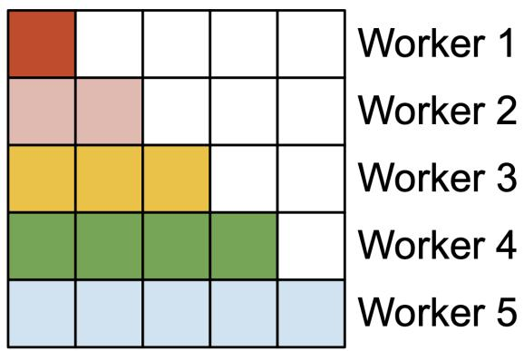

前向传播

  

反向过程

图 2：在前向过程（左）中，我们将 worker（线程块）并行化，每个 worker 负责注意力矩阵的一个行块。在反向过程（右）中，每个 worker 负责注意力矩阵的一个列块。

## 3.3 warp 之间的工作划分

如第 3.2 节所述，我们介绍了如何调度线程块，即使在每个线程块内部，我们也必须决定如何在不同的 warp 之间划分工作。我们通常在每个线程块中使用 4 或 8 个 warp，其划分方式如图 3 所示。

前向传播。对于每个 block，FLASHATTENTION 将 K 和 V 划分到 4 个 warp 上，同时使 Q 可被所有 warp 访问。每个 warp 进行矩阵乘法得到 $QK^{\top}$ 的一个分片，然后需要将该分片与 V 的一个分片相乘，并通过通信将结果相加。这被称为 "split-K" 方案。然而，这种做法效率较低，因为所有 warp 都需要将其中间结果写入共享内存，进行同步，然后再将中间结果相加。这些共享内存的读写操作拖慢了 FLASHATTENTION 的前向传播速度。

在 FLASHATTENTION-2 中，我们改为将 Q 划分到 4 个 warp 上，同时使 K 和 V 可被所有 warp 访问。每个 warp 在完成矩阵乘法得到 $QK^{\top}$ 的一个分片之后，只需再与它们共享的 V 分片相乘，即可得到输出中对应的分片。warp 之间不需要通信。共享内存读写次数的减少带来了加速（第 4 节）。

  

图 3：前向传播中不同 warp 间的工作划分

反向传播（Backward pass）。类似地，对于反向传播，我们选择划分 warp 以避免采用 "split-K" 方案。然而，由于所有不同输入与梯度 Q、K、V、O、dO、dQ、dK、dV 之间存在更为复杂的依赖关系，它仍然需要一定的同步。不过，避免 "split-K" 减少了共享内存的读写次数，并再次带来了加速（第 4 节）。

块大小的调优 增大块大小通常会减少共享内存的加载/存储次数，但会增加所需的寄存器数量以及共享内存的总使用量。超过某一临界块大小后，寄存器溢出（register spilling）会导致显著的性能下降，或者所需的共享内存超过了 GPU 的可用容量，使内核根本无法运行。通常我们根据头维度 d 和设备的共享内存大小，选择大小为 $\{64,128\}\times\{64,128\}$ 的块。

我们对每个头维度进行手动调优，因为块大小本质上只有 4 种选择，但这可以从自动调优中受益，以省去这种人工调优工作。我们将其留作未来的工作。

## 4 经验验证

我们评估使用 FLASHATTENTION-2 来训练 Transformer 模型所带来的影响。

- 注意力机制的基准测试。我们在不同的序列长度下测量 FLASHATTENTION-2 的运行时间，并将其与 PyTorch 中的标准实现、FLASHATTENTION 以及 Triton 中的 FLASHATTENTION 进行比较。我们证实，FLASHATTENTION-2 比 FLASHATTENTION 快 1.7–3.0 倍，比 Triton 中的 FLASHATTENTION 快 1.3–2.5 倍，比标准注意力实现快 3–10 倍。

FLASHATTENTION-2 在 A100 GPU 上最高达到 230 TFLOPs/s，为 A100 理论峰值 TFLOPs/s 的 73%。

- 端到端训练速度 当端到端地用于在 2k 或 8k 序列长度上训练 1.3B 和 2.7B 参数规模的 GPT 风格模型时，FLASHATTENTION-2 相比 FLASHATTENTION 实现了最高 1.3 倍的加速，相比不使用 FLASHATTENTION 的基线实现了 2.8 倍的加速。FLASHATTENTION-2 在每块 A100 GPU 上最高达到 225 TFLOPs/s（72% 的模型 FLOPs 利用率）。

## 4.1 注意力机制的基准测试

我们在 A100 80GB SXM4 GPU 上针对不同设置（无因果掩码 / 有因果掩码，头维度为 64 或 128）测量不同注意力方法的运行时间。我们在图 4、图 5 和图 6 中报告了结果，结果表明 FLASHATTENTION-2 比 FLASHATTENTION 以及 xformers 中的 FLASHATTENTION（即 "cutlass" 实现）快约 2 倍。在前向传播中，FLASHATTENTION-2 比 Triton 中的 FLASHATTENTION 快约 1.3–1.5 倍；在反向传播中，则快约 2 倍。与 PyTorch 中的标准注意力实现相比，FLASHATTENTION-2 可实现最高 10 倍的加速。

基准测试设置：我们将序列长度从 512、1k、…… 到 16k 变化，并设置 batch size 以使 token 总数为 16k。我们将隐藏维度设为 2048，头维度设为 64 或 128（即 32 个头或 16 个头）。为了计算前向传播的 FLOPs，我们使用：

$4 \cdot \text{seqlen}^{2} \cdot \text{head dimension} \cdot \text{number of heads}.$

在使用因果掩码（causal mask）时，由于大约只有一半的条目会被计算，我们将该数值除以 2。为了得到反向传播的浮点运算量（FLOPs），我们将前向传播的 FLOPs 乘以 2.5（因为前向传播中有 2 次矩阵乘法，而反向传播中由于重计算（recomputation）有 5 次矩阵乘法）。

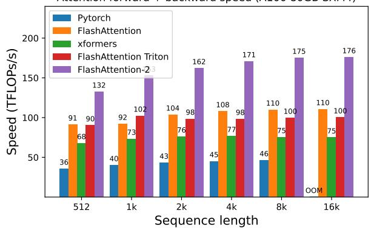

注意力前向 + 反向速度（A100 80GB SXM4）
注意力前向 + 反向速度（A100 80GB SXM4）


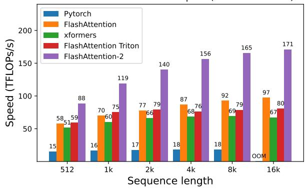  

(a) 无因果掩码（causal mask），头维度 64

(c) 带因果掩码（causal mask），头维度 64

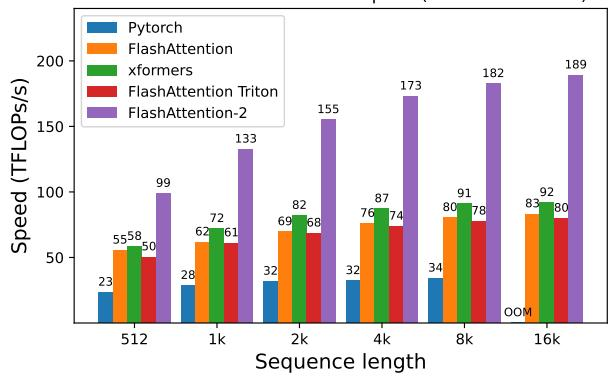  

(b) 无因果掩码（causal mask），头维度（head dimension）128  
(d) 有因果掩码，头维度 128  
图 4：A100 GPU 上的注意力前向 + 反向传播速度

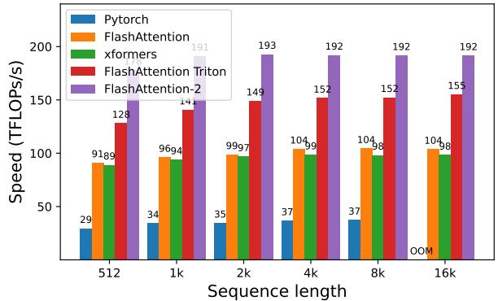  

注意力前向速度（A100 80GB SXM4）  
(a) 无因果掩码，头维度 64

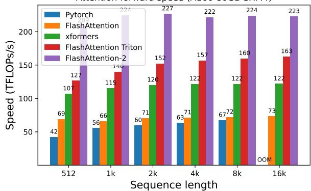  

注意力前向速度（A100 80GB SXM4）

(b) 不使用因果掩码，头维度 128

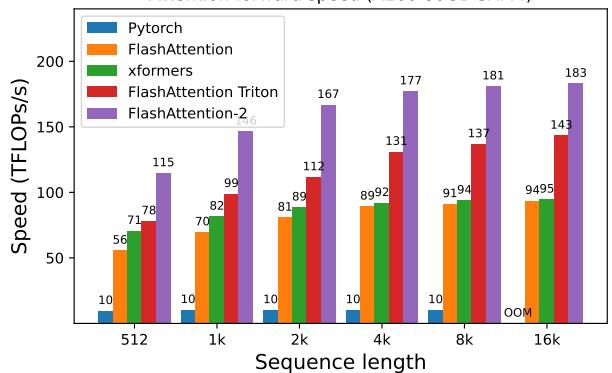  

注意力前向速度（A100 80GB SXM4）  
(c) 使用因果掩码，头维度 64

  

注意力前向速度（A100 80GB SXM4）

(d) 带因果掩码，头维度 128

图 5：A100 GPU 上的注意力前向速度

仅在 H100 GPU 上运行同一实现（未使用任何特殊指令来利用 TMA 和第四代 Tensor Cores 等新特性），我们即可获得高达 335 TFLOPs/s（图 7）。我们预计，通过使用新指令，在 H100 GPU 上还能再获得 1.5×–2× 的加速。我们将此留作未来工作。

## 4.2 端到端性能（End-to-end Performance）

我们在 8×A100 80GB SXM 上测量了参数量分别为 1.3B 和 2.7B 的 GPT-style 模型的训练吞吐量。如表 1 所示，FLASHATTENTION-2 相比不使用 FlashAttention 的基线实现了 2.8× 加速，相比 FLASHATTENTION-2 实现了 1.3× 加速，在每块 A100 GPU 上达到高达 225 TFLOPs/s。

需要说明的是，我们按照 Megatron-LM [16]（以及许多其他论文和库）的做法，通过以下公式计算 FLOPs：

$$
6 \cdot \mathrm{seqlen} \cdot \mathrm{numberofparams} + 1 2 \cdot \mathrm{numberoflayers} \cdot \mathrm{hiddendim} \cdot \mathrm{seqlen} ^ {2}.
$$

第一项对应于权重—输入乘法所产生的 FLOPs，第二项对应于注意力所产生的 FLOPs。然而，也有人认为第二项应当减半，因为在因果掩码（causal mask）下我们只需计算注意力中大约一半的元素。为保持一致性，我们选择沿用文献中的公式（不将注意力 FLOPs 除以 2）。

## 5 讨论与未来方向

FLASHATTENTION-2 比 FLASHATTENTION 快 $2\times$，这意味着我们能够以与先前训练 8k 上下文模型相同的代价，训练上下文长度达 16k 的模型。我们非常期待它能被用于理解长篇书籍和报告、高分辨率图像、音频及视频。FLASHATTENTION-2 还将加速现有模型的训练、微调与推理。

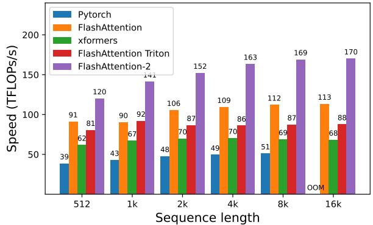  

注意力反向传播速度（Attention backward speed，A100 80GB SXM4）

(a) 无因果掩码（Without causal mask），头维度 64

  

Attention 反向传播速度（A100 80GB SXM4）
(b) 无因果掩码，头维度 128

  

注意力反向传播速度（A100 80GB SXM4）
(c) 使用因果掩码，头维度 64

  

注意力反向速度（A100 80GB SXM4）  
(d) 使用因果掩码，头维度 128  
图 6：A100 GPU 上的注意力反向速度

表 1：在 8×A100 GPU 上，GPT-style 模型的训练速度（每 GPU 的 TFLOPs/s）。FLASHATTENTION-2 达到最高 225 TFLOPs/s（模型 FLOPs 利用率为 72%）。我们与未使用 FLASHATTENTION 的基线方法进行了对比。

<table><tr><td>Model</td><td>Without FLASHATTENTION</td><td>FLASHATTENTION</td><td>FLASHATTENTION-2</td></tr><tr><td>GPT3-1.3B 2k context</td><td>142 TFLOPs/s</td><td>189 TFLOPs/s</td><td>196 TFLOPs/s</td></tr><tr><td>GPT3-1.3B 8k context</td><td>72 TFLOPs/s</td><td>170 TFLOPs/s</td><td>220 TFLOPs/s</td></tr><tr><td>GPT3-2.7B 2k context</td><td>149 TFLOPs/s</td><td>189 TFLOPs/s</td><td>205 TFLOPs/s</td></tr><tr><td>GPT3-2.7B 8k context</td><td>80 TFLOPs/s</td><td>175 TFLOPs/s</td><td>225 TFLOPs/s</td></tr></table>

在不久的将来，我们计划与研究人员和工程师合作，使 FlashAttention 能够广泛应用于不同种类的设备（例如 H100 GPU、AMD GPU），以及 FP8 等新的数据类型。作为直接的下一个步骤，我们计划针对 H100 GPU 优化 FlashAttention-2，以使用新的硬件特性（TMA、第四代 Tensor Core、FP8）。将 FlashAttention-2 中的底层优化与高层算法改进（例如局部、膨胀、块稀疏注意力）相结合，有望使我们能够用更长的上下文训练人工智能模型。我们同样期待与编译器研究人员合作，使这些优化技术易于编程实现。

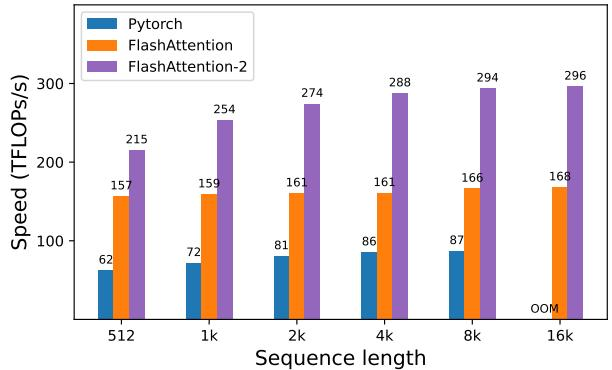  

注意力前向 + 反向传播速度（H100 80GB SXM5）  
(a) 不使用因果掩码，头维度 64

  

Attention 前向 + 反向传播速度（H100 80GB SXM5）

(b) 无因果掩码，头维度 128

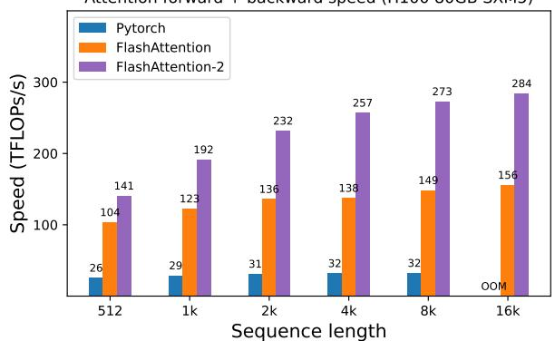  

Attention 前向 + 反向速度 (H100 80GB SXM5)
(c) 带因果掩码，头维度 64

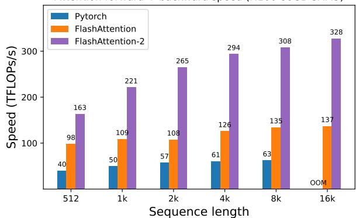  

Attention 前向 + 反向速度（H100 80GB SXM5）

(d) 带因果掩码，头维度 128

图 7：H100 GPU 上 Attention 前向 + 反向速度

## 致谢

我们感谢 Phil Tillet 和 Daniel Haziza，他们分别在 Triton $[17]$ 和 xformers 库 $[10]$ 中实现了 FLASHATTENTION 的不同版本。FLASHATTENTION-2 的灵感来源于对注意力机制可能实现方式的不同思路交流。我们感谢 Nvidia CUTLASS 团队（特别是 Vijay Thakkar、Cris Cecka、Haicheng Wu 和 Andrew Kerr）提供的 CUTLASS 库，尤其是 CUTLASS 3.x 版本，它为 FLASHATTENTION-2 的实现提供了清晰的抽象和强大的构建模块。我们感谢 Driss Guessous 将 FLASHATTENTION 集成到 PyTorch 中。FLASHATTENTION-2 受益于与 Phil Wang、Markus Rabe、James Bradbury、Young-Jun Ko、Julien Launay、Daniel Hesslow、Michaël Benesty、Horace He、Ashish Vaswani 和 Erich Elsen 的有益讨论。感谢 Stanford CRFM（斯坦福基础模型研究中心）和 Stanford NLP（斯坦福自然语言处理小组）提供的计算支持。我们感谢 Dan Fu 和 Christopher Ré 在这一设计硬件高效算法的工作线上所给予的合作、富有建设性的反馈以及持续的鼓励。我们感谢 Albert Gu 和 Beidi Chen 对本技术报告早期草稿提出的宝贵建议。

## 参考文献

[1] Joshua Ainslie, James Lee-Thorp, Michiel de Jong, Yury Zemlyanskiy, Federico Lebrón, and Sumit Sanghai. Gqa：基于多头检查点训练通用多查询 Transformer 模型（GQA: Training generalized multi-query transformer models from multi-head checkpoints）。arXiv 预印本 arXiv:2305.13245, 2023.

[2] Iz Beltagy, Matthew E Peters, and Arman Cohan. Longformer：长文档 Transformer（Longformer: The long-document transformer）。arXiv 预印本 arXiv:2004.05150, 2020.

[3] Beidi Chen, Tri Dao, Eric Winsor, Zhao Song, Atri Rudra, and Christopher Ré. Scatterbrain：统一稀疏与低秩注意力（Scatterbrain: Unifying sparse and low-rank attention）。发表于：神经信息处理系统大会（NeurIPS），2021.

[4] Krzysztof Marcin Choromanski, Valerii Likhosherstov, David Dohan, Xingyou Song, Andreea Gane, Tamas Sarlos, Peter Hawkins, Jared Quincy Davis, Afroz Mohiuddin, Lukasz Kaiser, 等. 重新思考注意力机制与 Performers（Rethinking attention with performers）。发表于：国际学习表征会议（ICLR），2020.

[5] Tri Dao, Daniel Y. Fu, Stefano Ermon, Atri Rudra, and Christopher Ré. FlashAttention：具有 IO 感知能力的快速且内存高效的精确注意力（FlashAttention: Fast and memory-efficient exact attention with IO-awareness）。发表于：神经信息处理系统大会，2022.

[6] Zhe Jia and Peter Van Sandt. 通过微基准测试剖析 Ampere GPU 架构（Dissecting the Ampere GPU architecture via microbenchmarking）。GPU 技术大会（GPU Technology Conference），2021.

[7] Zhe Jia, Marco Maggioni, Benjamin Staiger, and Daniele P Scarpazza. 通过微基准测试剖析 NVIDIA Volta GPU 架构（Dissecting the nvidia Volta GPU architecture via microbenchmarking）。arXiv 预印本 arXiv:1804.06826, 2018.

[8] Angelos Katharopoulos, Apoorv Vyas, Nikolaos Pappas, and François Fleuret. Transformer 即 RNN：基于线性注意力的快速自回归 Transformer（Transformers are RNNs: Fast autoregressive transformers with linear attention）。发表于：国际机器学习大会（ICML），第 5156–5165 页，PMLR，2020.

[9] Nikita Kitaev, Lukasz Kaiser, and Anselm Levskaya. Reformer：高效 Transformer（Reformer: The efficient transformer）。发表于：国际机器学习大会（ICML），2020.

[11] Maxim Milakov and Natalia Gimelshein. 用于 softmax 的在线归一化计算. arXiv preprint arXiv:1805.02867, 2018.

[12] OpenAI. GPT-4 技术报告. ArXiv, abs/2303.08774, 2023.

[13] Markus N Rabe and Charles Staats. 自注意力并不需要 $O(n^{2})$ 的内存. arXiv preprint arXiv:2112.05682, 2021.

[14] Aurko Roy, Mohammad Saffar, Ashish Vaswani, and David Grangier. 基于内容的高效稀疏注意力与路由 Transformer. Transactions of the Association for Computational Linguistics, 9:53–68, 2021.

[15] Noam Shazeer. 快速 Transformer 解码：一个写头足矣. arXiv preprint arXiv:1911.02150, 2019.

[16] Mohammad Shoeybi, Mostofa Patwary, Raul Puri, Patrick LeGresley, Jared Casper, and Bryan Catanzaro. Megatron-LM：使用模型并行训练数十亿参数的语言模型. arXiv preprint arXiv:1909.08053, 2019.

[17] Philippe Tillet, Hsiang-Tsung Kung, and David Cox. Triton：用于分块神经网络计算的中间语言与编译器. 见：第三届 ACM SIGPLAN 机器学习与编程语言国际研讨会论文集，第 10–19 页，2019.

[19] Sinong Wang, Belinda Z Li, Madian Khabsa, Han Fang, and Hao Ma. Linformer：具有线性复杂度的自注意力. arXiv preprint arXiv:2006.04768, 2020.