# 大语言模型服务的高效内存管理：PagedAttention（分页注意力）

Woosuk Kwon1,∗ Zhuohan Li1,∗ Siyuan Zhuang1 Ying Sheng1,2 Lianmin Zheng1 Cody Hao Yu3 Joseph E. Gonzalez1 Hao Zhang4 Ion Stoica1

1加州大学伯克利分校（UC Berkeley） 2斯坦福大学（Stanford University） 3独立研究者（Independent Researcher） 4加州大学圣迭戈分校（UC San Diego）

## 摘要

大语言模型（large language models, LLMs）的高吞吐量服务需要同时批处理足够多的请求。然而，现有系统难以胜任，因为每个请求的键值缓存（key-value cache, KV cache）内存占用巨大，并且会动态地增长与收缩。当管理低效时，这些内存会因碎片化和冗余复制而被严重浪费，从而限制了批处理规模。为了解决这一问题，我们提出了 PagedAttention（分页注意力），一种受操作系统中经典虚拟内存和分页技术启发的注意力算法。在其之上，我们构建了 vLLM，一个 LLM 服务系统，实现了 (1) KV cache 内存的近零浪费，以及 (2) 在请求内部及请求之间灵活共享 KV cache 以进一步减少内存使用。我们的评估表明，与 FasterTransformer 和 Orca 等最先进的系统相比，在相同延迟水平下，vLLM 将主流 LLM 的吞吐量提升了 2-4 倍。在更长序列、更大模型和更复杂的解码算法下，提升效果更为显著。vLLM 的源代码已在 htps://github.com/vllm-project/vllm 公开。

## 1 引言

大语言模型（LLMs）如 GPT [5, 37] 和 PaLM [9] 的出现，催生了编程助手 [6, 18] 和通用聊天机器人 [19, 35] 等新应用，这些应用正开始深刻地影响我们的工作和日常生活。许多云公司 [34, 44] 正竞相将这些应用作为托管服务对外提供。然而，运行这些应用的成本极其高昂，需要大量的硬件加速器（如 GPU）。根据最近的估计，处理一个 LLM 请求的成本可能是传统关键词查询的 10 倍 [43]。鉴于如此高昂的成本，提高 LLM 服务系统的吞吐量——进而降低每个请求的成本——正变得愈发重要。

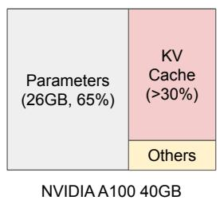

  

图 1. 左侧：在 NVIDIA A100 上为具有 130 亿参数的大语言模型（LLM）提供服务时的内存布局。参数（灰色）在整个服务过程中持续驻留在 GPU 内存中。KV 缓存（红色）的内存根据每个服务请求进行（释放）分配。少量内存（黄色）被临时用于存储激活值。右侧：vLLM 平滑了现有系统 [31, 60] 中 KV 缓存内存的快速增长曲线，从而显著提升了服务吞吐量。

LLMs的核心是一个自回归Transformer模型[53]。该模型基于输入（提示，prompt）以及迄今为止已生成的输出token的前序序列，逐个生成词（token）。对于每个请求，这个开销巨大的过程会不断重复，直到模型输出终止token。这种串行生成过程使得负载呈现内存受限（memory-bound）特征，无法充分利用GPU的计算能力，并限制了服务的吞吐量。

通过将多个请求一起批处理（batching），可以提升吞吐量。然而，要在一个批次中处理多个请求，必须高效地管理每个请求所占用的内存空间。例如，图1（左）展示了一个130亿参数LLM在配备40GB内存的NVIDIA A100 GPU上的内存分布。约65%的内存用于分配模型权重，这些权重在服务过程中保持静态。接近30%的内存用于存储请求的动态状态。对于Transformer而言，这些状态由与注意力机制相关联的key和value张量组成，通常称为KV缓存（KV cache）[41]，它们表示来自先前token的上下文，用于按序列生成新的token。剩余的一小部分内存用于存放其他数据，包括激活值（activations）——即评估LLM时产生的临时张量。由于模型权重保持不变，且激活值仅占用GPU内存的很小一部分，KV缓存的管理方式对于决定最大批处理规模至关重要。当管理低效时，KV缓存内存会显著限制批处理规模，进而限制LLM的吞吐量，如图1（右）所示。

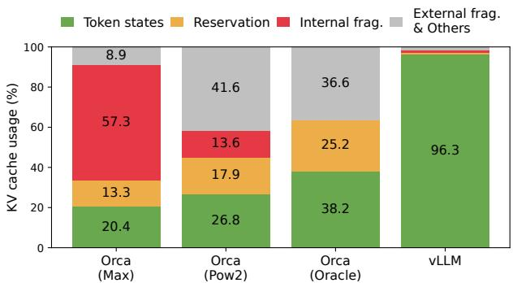  

图 2. §6.2 实验中不同 LLM 服务系统的平均内存浪费百分比。

在本论文中，我们观察到现有的 LLM 服务系统 [31, 60] 在高效管理 KV 缓存（KV cache）内存方面存在不足。这主要是因为它们将一个请求的 KV 缓存存储在连续的内存空间中，而大多数深度学习框架 [33, 39] 要求张量（tensor）以连续内存方式存储。然而，与传统深度学习负载中的张量不同，KV 缓存具有独特的特性：随着模型生成新的词元（token），它会随时间动态增长和收缩，并且其生命周期和长度无法事先获知。这些特性使得现有系统的方法在两个方面效率显著低下：

首先，现有的系统 [31, 60] 存在内部和外部内存碎片化问题。为了将一个请求的 KV 缓存在连续空间中存储，它们会根据请求的最大长度（例如 2048 个词元）预先分配一块连续的内存。这会导致严重的内部碎片化，因为请求的实际长度可能远小于其最大长度（例如图 11）。此外，即使实际长度可以事先获知，预先分配仍然是低效的：由于整块内存在请求的整个生命周期内都被预留，其他较短请求无法利用该内存块中当前未使用的任何部分。除此之外，外部内存碎片化也可能非常显著，因为每个请求的预分配大小可能不同。事实上，我们在图 2 中的剖析结果显示，在现有系统中，仅有 20.4% – 38.2% 的 KV 缓存内存被用于存储实际的词元状态。

其次，现有系统无法利用内存共享的机会。LLM 服务经常使用先进的解码算法，例如并行采样（parallel sampling）和束搜索（beam search），它们会为每个请求生成多个输出。在这些场景中，请求由多个序列组成，这些序列可以部分共享其 KV 缓存。然而，在现有系统中无法实现内存共享，因为这些序列的 KV 缓存在各自独立的连续空间中存储。

为了解决上述局限性，我们提出了 PagedAttention，一种受操作系统（operating system，OS）解决内存碎片化与共享问题的方案——分页虚拟内存——启发而设计的注意力算法。PagedAttention 将请求的 KV 缓存划分为若干块（block），每一块可包含固定数量 token 的注意力键和值。在 PagedAttention 中，KV 缓存的各块不必存储在连续空间中。因此，我们可以像操作系统管理虚拟内存那样，以更灵活的方式管理 KV 缓存：可以将块视为页（pages），将 token 视为字节（bytes），将请求视为进程（processes）。该设计通过使用相对较小的块并按需分配，缓解了内部碎片。此外，由于所有块大小相同，它彻底消除了外部碎片。最后，它支持在同一请求关联的不同序列之间，乃至跨不同请求之间，以块为粒度进行内存共享。

在本工作中，我们构建了 vLLM，一个构建于 PagedAttention 之上的高吞吐分布式 LLM 服务引擎，实现了 KV 缓存内存的近零浪费。vLLM 采用与 PagedAttention 协同设计的块级内存管理和抢占式请求调度。vLLM 支持流行的 LLM，如 GPT [5]、OPT [62] 和 LLaMA [52] 等不同规模的模型，包括那些超出单个 GPU 内存容量的模型。我们在多种模型与负载上的评估表明，相较于当前最先进（state-of-the-art）的系统 [31, 60]，vLLM 将 LLM 服务的吞吐量提升了 2–4 倍，且完全不影响模型精度。在更长序列、更大模型以及更复杂解码算法（§4.3）的场景下，提升效果更为显著。总之，我们做出以下贡献：

• 我们识别了 LLM 服务中内存分配面临的挑战，并量化了其对服务性能的影响。

• 我们提出了 PagedAttention，一种在以非连续分页内存方式存储的 KV 缓存上运行的注意力算法，其灵感源自操作系统中的虚拟内存与分页机制。

• 我们设计并实现了 vLLM，一个构建于 PagedAttention 之上的分布式 LLM 服务引擎。

• 我们在多种场景下对 vLLM 进行了评估，证明其显著优于此前的最先进方案，如 FasterTransformer [31] 和 Orca [60]。

## 2 背景

在本节中，我们描述典型 LLM 的生成与服务流程，以及 LLM 服务中使用的迭代级（iteration-level）调度。

## 2.1 基于 Transformer 的大语言模型

语言建模任务的目标是对一组 token $( x _ { 1 } , \ldots , x _ { n } )$ 的概率进行建模。由于语言具有自然的顺序性，通常将整个序列上的联合概率分解为各条件概率的乘积（即自回归分解（autoregressive decomposition）[3]）：

$$
P (x) = P (x _ {1}) \cdot P (x _ {2} \mid x _ {1}) \dots P (x _ {n} \mid x _ {1}, \ldots , x _ {n - 1}).\tag{1}
$$

Transformers [53] 已成为在大规模建模上述概率时的事实标准架构。基于 Transformer 的语言模型中最重要的组成部分是其自注意力层。对于输入的隐藏状态序列 $( x _ { 1 } , \ldots , x _ { n } ) \ \in \ \mathbb { R } ^ { n \times d }$，自注意力层首先对每个位置 $x_i$ 应用线性变换，以得到查询（query）、键（key）和值（value）向量：

$$
q _ {i} = W _ {q} x _ {i}, k _ {i} = W _ {k} x _ {i}, v _ {i} = W _ {v} x _ {i}.\tag{2}
$$

随后，自注意力层通过将某一位置的查询向量与其之前所有位置的键向量相乘来计算注意力分数 $a_{ij}$，并将值向量的加权平均作为输出 $o_i$：

$$
a _ {i j} = \frac {\exp (q _ {i} ^ {\top} k _ {j} / \sqrt {d})}{\sum_ {t = 1} ^ {i} \exp (q _ {i} ^ {\top} k _ {t} / \sqrt {d})}, o _ {i} = \sum_ {j = 1} ^ {i} a _ {i j} v _ {j}.\tag{3}
$$

除了公式 4 中的计算外，Transformer 模型中的所有其他组件，包括嵌入层、前馈层、层归一化 [2]、残差连接 [22]、输出 logit 计算以及公式 2 中的 query、key 和 value 变换，都以 $y _ { i } = f ( x _ { i } )$ 的形式逐位置（position-wise）独立地应用。

## 2.2 LLM 服务与自回归生成

训练完成后，LLM 通常被部署为条件生成服务（例如补全 API [34] 或聊天机器人 [19, 35]）。对 LLM 服务的请求会提供一组输入提示词元（prompt tokens）$( x _ { 1 } , \ldots , x _ { n } )$，LLM 服务根据公式 1 生成一组输出词元（output tokens）$( x _ { n + 1 } , \ldots , x _ { n + T } )$。我们将提示词与输出列表的拼接称为序列（sequence）。

由于公式 1 中的分解，LLM 只能逐个采样并生成新的词元，并且每个新词元的生成过程依赖于该序列中所有先前的词元，具体而言是它们的 key 向量和 value 向量。在这一顺序生成过程中，已有词元的 key 向量和 value 向量通常会被缓存以用于生成后续词元，这即是众所周知的 KV 缓存（KV cache）。请注意，一个词元的 KV 缓存依赖于其之前的所有词元。这意味着，同一词元出现在序列中不同位置时，其 KV 缓存是不同的。

给定一个请求提示词，LLM 服务中的生成计算可被分解为两个阶段：

提示阶段（prompt phase）以整个用户提示 $( x _ { 1 } , \ldots , x _ { n } )$ 作为输入，计算第一个新词元的概率 $P ( x _ { n + 1 } \mid x _ { 1 } , . . . , x _ { n } )$。在此过程中，还会生成 key 向量 $k _ { 1 } , \ldots , k _ { n }$ 和 value 向量 $v _ { 1 } , \ldots , v _ { n }$。由于提示词元 $x _ { 1 } , \ldots , x _ { n }$ 都是已知的，提示阶段的计算可以通过矩阵-矩阵乘法运算实现并行化。因此，这一阶段能够高效地利用 GPU 中固有的并行性。

自回归生成阶段按顺序生成剩余的新 token。在第 $t$ 次迭代时，模型将一个 token $x_{n+t}$ 作为输入，并基于键向量 $k_1, \ldots, k_{n+t}$ 和值向量 $v_1, \ldots, v_{n+t}$ 计算概率 $P(x_{n+t+1} \mid x_1, \ldots, x_{n+t})$。注意，位置 1 到 $n+t-1$ 处的键向量和值向量已在之前的迭代中缓存，本轮迭代中只需计算新增的键向量 $k_{n+t}$ 和值向量 $v_{n+t}$。该阶段在序列达到最大长度（由用户指定或受 LLM 限制）或生成出序列结束标记（end-of-sequence，<eos>）时终止。由于数据依赖关系，不同迭代之间的计算无法并行化，并且通常采用矩阵-向量乘法，效率较低。因此，该阶段严重未充分利用 GPU 算力，呈现内存受限（memory-bound）的特征，成为单个请求延迟的主要来源。

## 2.3 大语言模型的批处理技术

通过批处理多个请求，可以提升 LLM 推理服务中的算力利用率。由于这些请求共享相同的模型权重，权重加载的开销可在一个批次内的多个请求之间分摊，当批次大小足够大时，权重加载开销可被计算开销掩盖。然而，为 LLM 服务做请求批处理并非易事，原因有二。首先，请求可能在不同时间到达。朴素的批处理策略要么让较早到达的请求等待较晚到达的请求，要么推迟处理新到达的请求直至较早的请求完成，这都会导致显著的排队延迟。其次，不同请求的输入和输出长度可能差异巨大（图 11）。一种直接的批处理技术会将各请求的输入和输出填充至等长，从而浪费 GPU 算力和显存。

为解决上述问题，研究者提出了细粒度批处理（fine-grained batching）机制，例如单元化批处理（cellular batching）[16] 和迭代级调度（iteration-level scheduling）[60]。与在请求级别运作的传统方法不同，这些技术在迭代级别运作：每完成一次迭代，已完成的请求会从批次中移除，并加入新的请求。因此，新请求只需等待一次迭代即可开始处理，而不必等待整个批次完成。此外，借助专用的 GPU 算子，这些技术消除了对输入和输出进行填充的需要。通过降低排队延迟并减少因填充造成的效率损失，细粒度批处理机制显著提升了 LLM 推理服务的吞吐量。

  

图 3. 现有系统中的 KV 缓存内存管理。存在三类内存浪费——预留（reserved）、内部碎片（internal fragmentation）和外部碎片（external fragmentation）——它们阻碍其他请求装入内存。每个内存槽中的 token 代表其 KV 缓存。注意，同一 token 在不同位置时可能具有不同的 KV 缓存。

虽然细粒度批处理减少了计算资源的浪费，并使请求能够以更加灵活的方式进行批处理，但可一起批处理的请求数量仍然受限于 GPU 内存容量，特别是用于存储 KV Cache 的空间。换句话说，服务系统的吞吐量受限于内存。克服这种内存瓶颈需要在内存管理中应对以下挑战：

**较大的 KV Cache。** KV Cache 的大小随请求数量的增加而迅速增长。以 13B 参数的 OPT 模型 [62] 为例，单个 token 的 KV Cache 需要 800 KB 的空间，计算方式为 2（键向量和值向量）× 5120（隐藏状态大小）× 40（层数）× 2（每个 FP16 占用的字节数）。由于 OPT 最多可以生成 2048 个 token 的序列，存储单个请求的 KV Cache 所需要的内存最多可达 1.6 GB。当前 GPU 的内存容量为数十 GB。即便将所有可用内存都分配给 KV Cache，也只能容纳几十个请求。此外，低效的内存管理会进一步降低批大小，如图 2 所示。再者，根据当前的趋势，GPU 的计算速度增长比内存容量的增长更快 [17]。例如，从 NVIDIA A100 到 H100，FLOPS 增加了两倍以上，但 GPU 内存最大仍保持在 80 GB。因此，我们认为内存将成为越来越显著的瓶颈。

**复杂的解码算法。** LLM 服务提供多种解码算法供用户选择，每种算法对内存管理复杂度的影响各不相同。例如，当用户从一个输入提示中请求多个随机样本时——这是程序建议 [18] 中的一种典型用例——提示部分的 KV Cache（在我们实验中占总 KV Cache 内存的 12%，参见 §6.3）可以被共享以最小化内存使用。另一方面，在自回归生成阶段的 KV Cache 则应保持不共享，因为不同的采样结果依赖于各自的上下文和位置。KV Cache 的共享程度取决于所采用的具体解码算法。在更复杂的算法（如集束搜索（beam search）[49]）中，不同请求的搜索束可以共享更大比例的 KV Cache（最多可节省 55% 的内存，参见 §6.3），且共享模式会随着解码过程的推进而动态变化。

**针对未知输入与输出长度的调度。** 对 LLM 服务的请求在输入和输出长度上表现出差异性。这要求内存管理系统能够适应范围广泛的提示长度。此外，随着请求在解码过程中输出长度的增长，其 KV Cache 所需的内存也会扩大，并可能耗尽可用于新请求或现有请求持续生成的内存。系统需要做出调度决策，例如从 GPU 内存中删除或换出（swap out）某些请求的 KV Cache。

## 3.1 现有系统中的内存管理

由于当前深度学习框架 [33, 39] 中的大多数算子要求张量存储在连续内存中，早期的 LLM 服务系统 [31, 60] 也将单个请求的 KV 缓存存储为跨不同位置的连续张量。由于 LLM 的输出长度不可预测，这些系统会根据请求的最大可能序列长度静态地为其分配一块内存，而不考虑请求的实际输入或最终输出长度。

图 3 展示了两个请求：请求 A 的最大可能序列长度为 2048，请求 B 的最大长度为 512。现有系统中的块预分配方案存在三种主要的内存浪费来源：为未来 token 保留的槽位、由于对潜在最大序列长度过度配置而导致的内部碎片，以及由类似伙伴分配器的内存分配器产生的外部碎片。外部碎片永远不会被用于生成 token，这在服务请求之前就是已知的。内部碎片同样保持未被使用，但只有在请求完成采样之后才会意识到这一点。二者都是纯粹的内存浪费。尽管保留的内存最终会被使用，但在整个请求持续期间保留该空间（特别是当保留空间很大时）会占用原本可以用于处理其他请求的空间。我们在实验中的图 2 中可视化了内存浪费的平均百分比，结果表明先前系统中实际的可用内存最低可低至 20.4%。

  

图 4. vLLM 系统概览。

虽然压缩（compaction）[54] 已被提出作为一种解决碎片化问题的潜在方案，但在一个对性能敏感的 LLM 推理服务系统中执行压缩并不现实，因为 KV 缓存非常庞大。即使进行压缩，现有内存管理系统中为每个请求预先分配的块空间也阻碍了解码算法特有的内存共享。

## 4 方法

在本工作中，我们开发了一种新的注意力算法 PagedAttention，并构建了一个 LLM 推理服务引擎 vLLM，以应对 §3 中概述的挑战。vLLM 的架构如图 4 所示。vLLM 采用集中式调度器来协调分布式 GPU worker 的执行。KV 缓存管理器以分页方式有效地管理 KV 缓存，这由 PagedAttention 所实现。具体而言，KV 缓存管理器根据集中式调度器发送的指令来管理 GPU worker 上的物理 KV 缓存内存。

接下来，我们在 §4.1 中描述 PagedAttention 算法。在此基础上，我们分别在 §4.2 和 §4.3 中展示 KV 缓存管理器的设计以及它如何促进 PagedAttention 的实现。然后，我们展示该设计如何促进各种解码方法的有效内存管理（§4.4），以及如何处理可变长度的输入和输出序列（§4.5）。最后，我们展示 vLLM 的系统设计如何在分布式环境下工作（§4.6）。

## 4.1 PagedAttention

为了应对 §3 中的内存挑战，我们引入了 PagedAttention，这是一种受操作系统中经典分页思想[25]启发的注意力算法。与传统的注意力算法不同，PagedAttention 允许将连续的键和值存储在非连续的内存空间中。具体而言，PagedAttention 将每个序列的 KV 缓存划分为若干 KV 块。每个块包含固定数量 token 的键向量和值向量，1 我们将其记为 KV 块大小（$B$）。记键块 $K _ { j } = ( k _ { ( j - 1 ) B + 1 } , \ldots , k _ { j B } )$，值块 $V _ { j } = \big ( \boldsymbol { v } _ { ( j - 1 ) B + 1 } , \ldots , \boldsymbol { v } _ { j B } \big )$。公式 4 中的注意力计算可以转换为以下块式计算：

  

图 5. PagedAttention（Paged Attention）算法的示意图，其中注意力键和值向量以非连续的内存块形式存储在内存中。

$$
A _ {i j} = \frac {\exp (q _ {i} ^ {\top} K _ {j} / \sqrt {d})}{\sum_ {t = 1} ^ {\lceil i / B \rceil} \exp (q _ {i} ^ {\top} K _ {t} \mathbf {1} / \sqrt {d})}, o _ {i} = \sum_ {j = 1} ^ {\lceil i / B \rceil} V _ {j} A _ {i j} ^ {\top},\tag{4}
$$

其中 $A_{ij} = (a_{i,(j-1)B+1}, \dotsc, a_{i,jB})$ 是第 $j$ 个 KV 块上的注意力分数行向量。

在注意力计算过程中，PagedAttention 内核分别识别并获取不同的 KV 块。我们在图 5 中展示了一个 PagedAttention 的示例：键向量和值向量分散在三个块中，这三个块在物理内存上并不连续。在每个时刻，内核将查询词元（query token）的查询向量 $q_i$ 与一个块中的键向量 $K_j$ 相乘（例如，块 0 中 "Four score and seven" 的键向量），以计算注意力分数 $A_{ij}$，然后再将 $A_{ij}$ 与一个块中的值向量 $V_j$ 相乘，从而推导出最终的注意力输出 $o_i$。

总之，PagedAttention 算法允许将 KV 块存储在非连续的物理内存中，这使得 vLLM 能够实现更灵活的页式内存管理。

## 4.2 KV 缓存管理器

vLLM 内存管理器背后的核心思想类似于操作系统中的虚拟内存 [25]。操作系统将内存划分为固定大小的页（page），并将用户程序的逻辑页映射到物理页。连续的逻辑页可以对应非连续的物理内存页，从而允许用户程序像访问连续内存一样访问内存。此外，物理内存空间不需要提前完全预留，这使得操作系统能够根据需要动态分配物理页。vLLM 利用虚拟内存的思想来管理 LLM 服务中的 KV 缓存。借助 PagedAttention，我们将 KV 缓存组织为固定大小的 KV 块，就像虚拟内存中的页一样。

一个请求的 KV 缓存被表示为一系列逻辑 KV 块，随着新词元及其 KV 缓存的生成，从左到右进行填充。最后一个 KV 块中未填充的位置被保留，以供后续生成使用。在 GPU worker 上，块引擎分配一块连续的 GPU DRAM 内存，并将其划分为物理 KV 块（在 CPU RAM 上也会执行同样的划分，用于交换；参见 §4.5）。KV 块管理器还维护着块表（block table）——即每个请求的逻辑 KV 块与物理 KV 块之间的映射关系。每个块表项记录一个逻辑块对应的物理块以及已填充的位置数量。将逻辑 KV 块与物理 KV 块相分离，使得 vLLM 能够动态扩展 KV 缓存内存，而无需为所有位置提前预留，从而消除了现有系统中大部分的内存浪费，如图 2 所示。

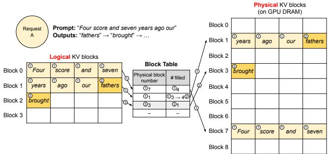  

图 6. vLLM 中的块表翻译。

## 4.3 使用 PagedAttention 和 vLLM 进行解码

接下来，我们通过 Fig. 4 中的一个示例，演示 vLLM 如何在单个输入序列的解码过程中执行 PagedAttention 并管理内存：○1 与操作系统（OS）的虚拟内存类似，vLLM 不需要在初始时为最大可能的生成序列长度预留内存。相反，它只预留容纳提示词计算期间生成的 KV 缓存所必需的 KV 块。在这种情况下，提示词包含 7 个 token，因此 vLLM 将前两个逻辑 KV 块（0 和 1）分别映射到两个物理 KV 块（7 和 1）。在 prefill 阶段，vLLM 使用传统的自注意力算法（例如 [13]）生成提示词的 KV 缓存和第一个输出 token。随后，vLLM 将前 4 个 token 的 KV 缓存存储在逻辑块 0 中，将接下来的 3 个 token 的 KV 缓存存储在逻辑块 1 中。剩余的槽位预留给后续的自回归生成阶段。○2 在第一个自回归解码步骤中，vLLM 在物理块 7 和 1 上使用 PagedAttention 算法生成新 token。由于最后一个逻辑块中还有一个可用槽位，新生成的 KV 缓存被存储在该位置，并且块表（block table）中的 #filled 记录被更新。○3 在第二个解码步骤中，由于最后一个逻辑块已满，vLLM 将新生成的 KV 缓存存储在一个新的逻辑块中；vLLM 为其分配一个新的物理块（物理块 3），并将该映射关系存储在块表中。

从全局来看，对于每次解码迭代，vLLM 首先选择一组候选序列进行批处理（详见 §4.5），并为新需要的逻辑块分配物理块。然后，vLLM 将当前迭代的所有输入 token（即提示词阶段请求的所有 token 以及生成阶段请求的最新 token）拼接为一条序列，并将其送入 LLM。在 LLM 的计算过程中，vLLM 使用 PagedAttention 内核以逻辑 KV 块的形式访问先前的 KV 缓存，并将新生成的 KV 缓存保存到物理 KV 块中。在一个 KV 块内存储多个 token（块大小 > 1）使 PagedAttention 内核能够并行处理更多位置的 KV 缓存，从而提高硬件利用率并降低延迟。然而，更大的块大小也会增加内存碎片。我们在 §7.2 中研究了块大小的影响。

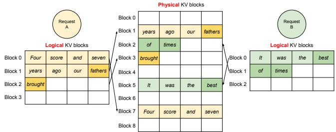  

图 7. 在 vLLM 中同时存储两个请求的 KV 缓存（KV cache）。

同样，随着更多 token 及其 KV cache 的生成，vLLM 会动态地将新的物理块分配给逻辑块。由于所有块从左到右依次填充，且只有当所有先前的块都已填满时才会分配新的物理块，vLLM 将单个请求的所有内存浪费限制在一个块以内，从而能够有效地利用所有内存，如图 2 所示。这使得更多请求能够放入内存以进行批处理——因而提高了吞吐量。一个请求完成生成后，其 KV 块可被释放以存储其他请求的 KV cache。在图 7 中，我们展示了 vLLM 为两条序列管理内存的一个示例。两条序列的逻辑块被映射到 GPU 工作进程中块引擎所保留空间内的不同物理块上。两条序列的相邻逻辑块在物理 GPU 内存中不需要是连续的，物理块的空间可被两条序列有效地利用。

## 4.4 在其他解码场景中的应用

§4.3 展示了 PagedAttention 和 vLLM 如何处理基本的解码算法，例如贪婪解码和采样，这些算法以单个用户提示作为输入并生成单个输出序列。在许多成功的 LLM 应用 [18, 34] 中，LLM 服务必须提供更复杂的解码场景，这些场景表现出复杂的访问模式以及更多的内存共享机会。我们在本节展示 vLLM 在这些场景上的一般适用性。

并行采样。在基于 LLM 的编程助手 [6, 18] 中，LLM 会针对单个输入提示生成多个采样输出；用户可以从各种候选输出中选择一个喜爱的输出。到目前为止，我们隐式地假设一个请求生成单个序列。在本文的剩余部分，我们假设更一般的情况，即一个请求生成多个序列。在并行采样中，一个请求包含多个共享相同输入提示的采样样本，从而允许该提示的 KV cache 也被共享。通过其 PagedAttention 和分页内存管理，vLLM 可以轻松地实现这种共享并节省内存。

  

图 8. 并行采样示例。

图 8 展示了对两个输出进行并行解码的示例。由于两个输出共享同一个提示词（prompt），我们仅为该提示词的状态预留一份空间；在提示阶段，两个序列的提示词的逻辑块被映射到同一组物理块：两个序列的逻辑块 0 和逻辑块 1 分别映射到物理块 7 和物理块 1。由于单个物理块可以映射到多个逻辑块，我们为每个物理块引入了引用计数（reference count）。在这种情况下，物理块 7 和物理块 1 的引用计数均为 2。在生成阶段，两个输出采样出不同的输出标记，因此需要为 KV 缓存分配独立的存储空间。vLLM 在块粒度上对需要被多个序列修改的物理块实现了写时复制（copy-on-write）机制，类似于操作系统虚拟内存中的写时复制技术（例如在派生（fork）进程时）。具体而言，在图 8 中，当采样 A1 需要写入其最后一个逻辑块（逻辑块 1）时，vLLM 检测到对应物理块（物理块 1）的引用计数大于 1；于是它分配一个新的物理块（物理块 3），指示块引擎（block engine）将物理块 1 中的信息复制过去，并将物理块 1 的引用计数减 1。接下来，当采样 A2 写入物理块 1 时，其引用计数已降至 1；因此 A2 直接将其新生成的 KV 缓存写入物理块 1。

综上所述，vLLM 支持在多个输出采样之间共享用于存储提示词 KV 缓存的大部分空间，唯一例外的是最后一个逻辑块，它由写时复制机制进行管理。通过在多个采样之间共享物理块，内存占用可以大幅降低，尤其是对于较长的输入提示词。

束搜索（Beam search）。在机器翻译 [59] 等 LLM 任务中，用户期望 LLM 输出排名前 𝑘 的最合适译文。束搜索 [49] 被广泛用于从 LLM 中解码出概率最大的输出序列，因为它缓解了完全遍历样本空间的计算复杂度。该算法依赖于束宽（beam width）参数 𝑏，𝑏 决定了每一步保留的候选数量。在解码过程中，束搜索通过考虑所有可能的标记来扩展束中的每个候选序列，利用 LLM 计算它们各自的概率，并从 𝑏·|𝑉| 个候选中保留概率最大的前 𝑏 个序列，其中 |𝑉| 表示词汇表大小。

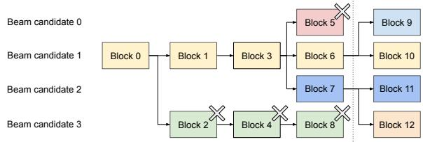  

图 9. 束搜索示例。

与并行解码不同，束搜索（beam search）不仅能在不同候选之间共享初始提示块，还能共享其他块，并且随着解码过程的推进，共享模式会动态变化，这一过程类似于操作系统中由复合 fork（compound fork）创建的进程树。图 9 展示了一个束数为 � = 4 的束搜索示例中 vLLM 如何管理 KV 块。在虚线所示的迭代之前，每个候选序列已使用了 4 个完整的逻辑块。所有束候选共享第一个块 0（即提示）。候选 3 从第二个块开始与其他候选分叉。候选 0–2 共享前 3 个块，并在第四个块处分叉。在后续迭代中，前 4 个概率最高的候选全部源自候选 1 和候选 2。由于原始候选 0 和候选 3 已不再属于前 4 高概率候选，它们的逻辑块被释放，对应物理块的引用计数被减少。vLLM 释放所有引用计数降为 0 的物理块（块 2、4、5、8）。然后，vLLM 分配新的物理块（块 9–12）来存储来自新候选的 KV 缓存。现在，所有候选共享块 0、1、3；候选 0 和候选 1 共享块 6，候选 2 和候选 3 进一步共享块 7。

以往的 LLM 服务系统需要在不同束候选之间频繁地复制 KV 缓存。例如，在图 9 所示的情况下，在虚线之后，候选 3 需要复制候选 2 的大部分 KV 缓存才能继续生成。这种频繁的内存复制开销通过 vLLM 的物理块共享得以显著降低。在 vLLM 中，不同束候选的大多数块都可以被共享。仅当新生成的令牌落在某个旧的共享块内时（与并行解码类似），才会触发写时复制（copy-on-write）机制，这只涉及复制一个块的数据。

共享前缀（Shared prefix）。通常情况下，LLM 用户会提供一段较长的任务描述，其中包含指令和示例输入输出，这也被称为系统提示（system prompt）[36]。该描述与实际任务输入拼接后构成请求的提示（prompt）。LLM 基于完整的提示生成输出。图 10 展示了一个示例。此外，共享前缀还可以通过提示工程（prompt engineering）进一步调优，以提升下游任务的准确性 [26, 27]。

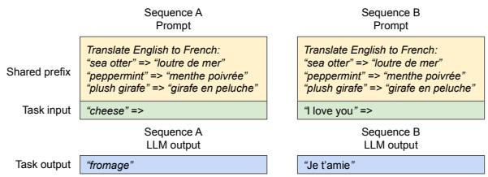  

图 10. 机器翻译的共享提示示例。示例来自 [5]。

对于此类应用，许多用户提示共享一个前缀，因此大语言模型（LLM）服务提供商可以预先存储该前缀的 KV 缓存，以减少在该前缀上花费的冗余计算。在 vLLM 中，可以通过由 LLM 服务提供商为一组预定义的共享前缀预留一组物理块来方便地实现这一点，正如操作系统跨进程处理共享库的方式一样。具有共享前缀的用户输入提示可以简单地将它的逻辑块映射到已缓存的物理块（最后一个块标记为写时复制（copy-on-write））。提示阶段的计算只需在用户的任务输入上执行。

混合解码方法。前面讨论的解码方法表现出多样的内存共享和访问模式。尽管如此，vLLM 便于同时处理具有不同解码偏好的请求，而现有系统无法高效地做到这一点。这是因为 vLLM 通过一个公共映射层（将逻辑块转换为物理块）来隐藏不同序列之间复杂的内存共享关系。LLM 及其执行内核只看到每个序列的一组物理块 ID，无需处理跨序列的共享模式。与现有系统相比，这种方法拓宽了具有不同采样需求的请求的批处理机会，最终提升了系统的整体吞吐量。

## 4.5 调度与抢占

当请求流量超过系统容量时，vLLM 必须对一部分请求进行优先级排序。在 vLLM 中，我们对所有请求采用先来先服务（FCFS）调度策略，以保证公平性并防止饥饿。当 vLLM 需要抢占请求时，它确保最早到达的请求优先被服务，最晚到达的请求优先被抢占。

大语言模型（LLM）服务面临一个独特的挑战：大语言模型的输入提示长度差异很大，而生成的输出长度无法预先得知，取决于输入提示与模型本身。随着请求数量及其输出的增长，vLLM 可能会耗尽用于存储新生成 KV 缓存的 GPU 物理块。在这种情况下，vLLM 需要回答两个经典问题：（1）应当置换哪些块？（2）如果再次需要被置换的块，如何将其恢复？通常，置换策略采用启发式方法预测哪些块在未来最远才会被访问，并置换这些块。在我们的场景中，由于知道同一序列的所有块会被一起访问，因此实现了全有或全无（all-or-nothing）的置换策略，即要么置换序列的全部块，要么一个都不置换。此外，单个请求中的多个序列（例如，一次束搜索请求中的束候选）会作为序列组（sequence group）进行组调度（gang-scheduled）。由于这些序列之间可能存在显存共享，同一序列组内的序列总是会被一起抢占或重新调度。为了回答第二个问题——如何恢复被置换的块，我们考虑了两种技术：

**交换（Swapping）。** 这是大多数虚拟内存实现所使用的经典技术，它将被置换的页面复制到磁盘上的交换区。在我们的场景中，将被置换的块复制到 CPU 内存中。如图 4 所示，除了 GPU 块分配器之外，vLLM 还包含一个 CPU 块分配器，用于管理交换到 CPU 内存的物理块。当 vLLM 用尽用于新令牌的空闲物理块时，它会选择一组序列进行置换，把它们的 KV 缓存转移到 CPU。一旦某个序列被抢占并置换其块，vLLM 会停止接收新请求，直至所有被抢占的序列执行完毕。当一个请求完成后，其块将从显存中释放，被抢占序列的块会被重新读回，以继续该序列的处理。需要注意的是，在该设计中，交换到 CPU 内存中的块数量永远不会超过 GPU 显存中物理块的总量，因此 CPU 内存上的交换空间受限于为 KV 缓存分配的 GPU 显存。

**重计算（Recomputation）。** 在这种情况下，我们只需在被抢占序列被重新调度时重新计算其 KV 缓存。需要注意的是，重计算的延迟可以显著低于原始延迟，这是因为解码阶段生成的令牌可以与原始用户提示拼接成新的提示——其在所有位置的 KV 缓存可以在一次提示阶段迭代中生成。

交换与重计算的性能取决于 CPU 内存与 GPU 显存之间的带宽，以及 GPU 的算力。我们在 §7.3 中对交换与重计算的速度进行了考察。

## 4.6 分布式执行（Distributed Execution）

许多 LLM 的参数量超过了单个 GPU 的显存容量 [5, 9]。因此，需要将它们划分到多块分布式 GPU 上，并以模型并行的方式执行 [28, 63]。这要求内存管理器具备处理分布式内存的能力。vLLM 通过在 Transformers 上支持广泛使用的 Megatron-LM 风格的张量模型并行策略，能够在分布式场景中高效运行 [47]。该策略遵循 SPMD（Single Program Multiple Data，单程序多数据）的执行调度，将线性层切分以执行分块矩阵乘法，GPU 之间通过 all-reduce（全局归约）操作持续同步中间结果。具体而言，注意力算子沿注意力头（attention head）维度进行切分，每个 SPMD 进程负责多头注意力（multi-head attention）中的一组注意力头。

表 1. 模型规模与服务器配置。

<table><tr><td>Model size</td><td>13B</td><td>66B</td><td>175B</td></tr><tr><td>GPUs</td><td>A100</td><td>4×A100</td><td>8×A100-80GB</td></tr><tr><td>Total GPU memory</td><td>40 GB</td><td>160 GB</td><td>640 GB</td></tr><tr><td>Parameter size</td><td>26 GB</td><td>132 GB</td><td>346 GB</td></tr><tr><td>Memory for KV cache</td><td>12 GB</td><td>21 GB</td><td>264 GB</td></tr><tr><td>Max. # KV cache slots</td><td>15.7K</td><td>9.7K</td><td>60.1K</td></tr></table>

我们观察到，即使采用模型并行执行，每个模型分片仍需处理相同的输入词元集合，因此需要为相同的位置提供键值缓存（KV Cache）。因此，vLLM 在集中式调度器中设置了一个统一的 KV 缓存管理器，如图 4 所示。不同的 GPU 工作进程共享该管理器，以及逻辑块到物理块的映射关系。这一共享映射使得 GPU 工作进程能够使用调度器为每个输入请求分配的物理块来执行模型。尽管每个 GPU 工作进程持有相同的物理块编号，但每个工作进程仅存储其对应注意力头所对应的 KV 缓存片段。

在每一步中，调度器首先为批次中的每个请求准备包含输入词元 ID 的消息，同时附上每个请求的块表（block table）。接着，调度器将该控制消息广播给各 GPU 工作进程。随后，GPU 工作进程开始使用输入词元 ID 执行模型。在注意力层中，GPU 工作进程根据控制消息中的块表读取 KV 缓存。在执行过程中，GPU 工作进程通过全归约（all-reduce）通信原语同步中间结果，无需调度器的协调，如文献 [47] 所述。最后，GPU 工作进程将本轮迭代采样的词元返回给调度器。总之，GPU 工作进程无需在内存管理上相互同步，因为它们只需要在每一步解码迭代开始时，与步骤输入一并接收所有的内存管理信息即可。

## 5 实现

vLLM 是一个端到端的推理服务系统，采用 FastAPI [15] 前端和基于 GPU 的推理引擎。前端扩展了 OpenAI API [34] 接口，允许用户为每个请求自定义采样参数，例如最大序列长度和束宽（beam width）。vLLM 引擎由 8.5K 行 Python 代码和 2K 行 C++/CUDA 代码实现。我们在 Python 中开发了控制类组件，包括调度器和块管理器，同时针对诸如 PagedAttention 等关键操作编写了自定义 CUDA 核函数。在模型执行器方面，我们实现了多种主流大语言模型，包括 GPT [5]、OPT [62] 和 LLaMA [52] 等，使用

  

(a) ShareGPT

  

(b) Alpaca
图 11. (a) ShareGPT 和 (b) Alpaca 数据集的输入与输出长度分布。

PyTorch [39] 和 Transformers [58]。我们使用 NCCL [32] 在分布式 GPU 工作节点之间进行张量通信。

## 5.1 内核级优化

由于 PagedAttention 引入了现有系统无法高效支持的内存访问模式，我们开发了若干 GPU 内核来对其进行优化。（1）融合 reshape 与块写入。在每个 Transformer 层中，新的 KV 缓存被切分为多个块，重新组织为针对块读取优化的内存布局，然后保存到块表指定的位置。为了最小化内核启动开销，我们将这些操作融合到一个内核中。（2）融合块读取与注意力计算。我们改造了 FasterTransformer [31] 中的注意力内核，使其能够根据块表读取 KV 缓存并就地执行注意力运算。为保证合并内存访问（coalesced memory access），我们分配一个 GPU warp 来读取每个块。此外，我们还增加了对同一请求批次内可变序列长度的支持。（3）融合块复制。写时复制（copy-on-write）机制所发起的块复制操作可能作用于不连续的块上。若使用 cudaMemcpyAsync API，这会导致大量小块数据搬运的调用。为降低开销，我们实现了一个内核，将不同块的复制操作批量合并到同一次内核启动中执行。

## 5.2 支持多种解码算法

vLLM 通过三个关键方法（fork、append 和 free）来实现多种解码算法。fork 方法从已有序列创建一个新序列；append 方法将一个新 token 追加到序列末尾；free 方法则删除该序列。例如，在并行采样中，vLLM 使用 fork 方法从单一输入序列生成多个输出序列，随后在每一轮迭代中使用 append 向这些序列添加新 token，并使用 free 删除满足停止条件的序列。束搜索（beam search）和前缀共享（prefix sharing）同样采用了这一策略。我们相信未来的解码算法也可以通过组合这些方法来实现。

## 6 评估

本节中，我们将在多种工作负载下评估 vLLM 的性能。

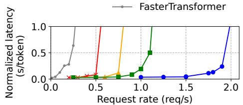  

(a) OPT-13B，1 GPU，ShareGPT

  

(b) OPT-66B, 4 GPU, ShareGPT

  

(c) OPT-175B，8 GPU，ShareGPT

  

您只给出了一段文字 "(d) OPT-13B, 1 GPU, Alpaca"，看起来像是某张图或表格里的子标题（图 (d) 对应的说明），而不是一篇完整的论文 Markdown。

请把需要翻译的完整 Markdown 内容（包含标题、摘要、正文、公式、表格、参考文献等）发给我，我再按要求逐段翻译成中文。

  

(e) OPT-66B，4 GPUs，Alpaca

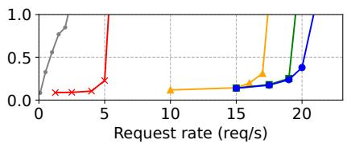  

(f) OPT-175B，8 GPUs，Alpaca

  

图12. 使用 OPT 模型在 ShareGPT 和 Alpaca 数据集上进行单序列生成
(a) ShareGPT

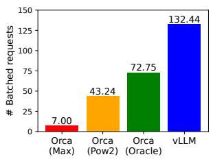  

(b) Alpaca
图 13. 在 ShareGPT（2 reqs/s）和 Alpaca（30 reqs/s）轨迹下服务 OPT-13B 时的平均批处理请求数。

## 6.1 实验设置

模型与服务器配置。我们在评估中使用 OPT [62] 模型的 13B、66B 和 175B 参数版本，以及 LLaMA [52] 的 13B 参数版本。13B 和 66B 是 LLM（Large Language Model）的常见参数量，如 LLM 排行榜 [38] 所示，而 175B 则是著名的 GPT-3 [5] 模型的参数量。在我们所有的实验中，我们使用 Google Cloud Platform 上配备 NVIDIA A100 GPU 的 A2 实例。详细的模型规模与服务器配置如表 1 所示。

工作负载。我们基于 ShareGPT [51] 和 Alpaca [50] 数据集合成工作负载，这两个数据集包含真实 LLM 服务的输入与输出文本。ShareGPT 数据集是用户与 ChatGPT [35] 共享的对话集合。Alpaca 数据集是由 GPT 3.5 通过 self-instruct [57] 方法生成的指令数据集。我们对数据集进行分词（tokenize），并利用其输入与输出长度来合成客户端请求。如图 11 所示，ShareGPT 数据集的平均输入提示（prompt）长度是 Alpaca 数据集的 8.4 倍，输出长度是 Alpaca 数据集的 5.8 倍，且具有更高的方差。由于这些数据集不包含时间戳，我们使用不同请求到达率的泊松分布（Poisson distribution）生成请求到达时间。

基线方法 1：FasterTransformer。FasterTransformer [31] 是一个针对延迟高度优化的分布式推理引擎。

由于 FasterTransformer 没有自己的调度器（scheduler），我们实现了一个自定义的调度器，采用类似于 Triton [30] 等现有服务系统的动态批处理（dynamic batching）机制。具体而言，对于每个实验，我们根据 GPU 内存容量将最大批大小（batch size）$\hat{b}$ 设为尽可能大。调度器取出最早到达的最多 $\hat{b}$ 个请求，并将该批次（batch）发送给 FasterTransformer 进行处理。

基线方法 2：Orca。Orca [60] 是一个针对吞吐量优化的、最先进的 LLM 服务系统。由于 Orca 不公开可用，我们实现了我们自己的 Orca 版本。我们假设 Orca 使用伙伴分配（buddy allocation）算法来确定用于存储 KV cache 的内存地址。我们根据请求输出空间过度预留的程度，实现了三个版本的 Orca：

• Orca (Oracle)。我们假设系统拥有请求实际生成的输出长度的先验知识。这展示了 Orca 的上界性能，在实际中无法达到。

• Orca (Pow2)。我们假设系统对输出空间的过度预留最多为 2 倍。例如，如果真实输出长度为 25，则为输出预留 32 个位置。

• Orca (Max)。我们假设系统始终按模型的最大序列长度（即 2048 个 token）预留空间。

关键指标。我们聚焦于服务吞吐量。具体而言，我们使用具有不同请求速率的负载，测量系统的归一化延迟，即每个请求端到端延迟除以其输出长度的均值，方法与 Orca [60] 一致。高吞吐量的服务系统应在高请求速率下保持较低的归一化延迟。在大多数实验中，我们使用 1 小时的轨迹对各系统进行评估。作为例外，由于成本限制，我们对 OPT-175B 模型使用 15 分钟的轨迹。

  

(a) 并行生成（parallel size = 2）

请问您是要翻译这一行图题，还是有完整的论文 Markdown 需要我翻译？如果是后者，请把整篇论文发给我。

  

(b) 并行生成（parallel size = 4）

  

（c）并行生成（并行规模 = 6）

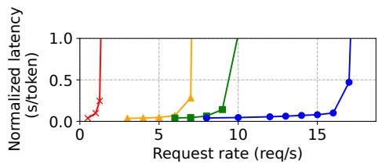  

(d) 束搜索（beam width = 2）

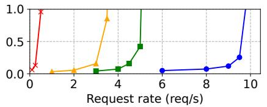  

(e) 束搜索（beam search，束宽 = 4）

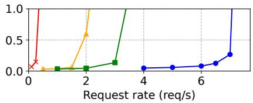  

(f) 束搜索（beam search）（束宽度 = 6）
图14. 使用OPT-13B在Alpaca数据集上进行并行生成与束搜索。

## 6.2 基本采样

我们使用基本采样（每个请求一个样本）在三个模型和两个数据集上评估了 vLLM 的性能。图 12 的第一行展示了在 ShareGPT 数据集上的结果。曲线表明，随着请求速率的增加，延迟最初以渐进的速度上升，但随后突然爆炸式增长。这可以归因于以下事实：当请求速率超过服务系统的容量时，队列长度会无限增长，请求的延迟也会随之不断上升。

在 ShareGPT 数据集上，vLLM 在保持相似延迟的同时，能够支持比 Orca（Oracle）高 1.7×–2.7×、比 Orca（Max）高 2.7×–8× 的请求速率。这是因为 vLLM 的 PagedAttention 能够高效地管理内存使用，从而实现比 Orca 更大批量的请求处理。例如，如图 13a 所示，对于 OPT-13B，vLLM 同时处理的请求数比 Orca（Oracle）多 2.2×，比 Orca（Max）多 4.3×。与 FasterTransformer 相比，vLLM 能够支持高达 22× 的请求速率，因为 FasterTransformer 没有使用细粒度的调度机制，并且像 Orca（Max）一样低效地管理内存。

图 12 的第二行和图 13b 展示了在 Alpaca 数据集上的结果，其趋势与 ShareGPT 数据集相似。一个例外是图 12 (f)，其中 vLLM 相对于 Orca（Oracle）和 Orca（Pow2）的优势不太明显。这是因为 OPT-175B 的模型和服务器配置（表 1）允许较大的 GPU 内存空间用于存储 KV cache，而 Alpaca 数据集的序列较短。在这种设置下，尽管 Orca（Oracle）和 Orca（Pow2）在内存管理上存在低效性，它们也能够批处理大量请求。因此，系统的性能转变为计算受限（compute-bound）而非内存受限（memory-bound）。

  

(a) 并行采样（Parallel sampling）

(b) 束搜索（Beam search）

图 15. 在为 Alpaca trace 提供 OPT-13B 服务时，通过共享 KV 块所获得的平均内存节省量。

## 6.3 并行采样与束搜索（Parallel Sampling and Beam Search）

我们使用两种流行的采样方法评估 PagedAttention 中内存共享的有效性：并行采样和束搜索。在并行采样中，一个请求中的所有并行序列可以共享提示（prompt）的 KV 缓存。如图 14 第一行所示，随着采样序列数量的增加，vLLM 相对于 Orca 基线带来了更大的性能提升。类似地，图 14 第二行展示了不同束宽（beam widths）下束搜索的结果。由于束搜索允许更多的共享，vLLM 表现出更大的性能优势。在 OPT-13B 和 Alpaca 数据集上，vLLM 相对于 Orca（Oracle）的性能提升从基本采样时的 1.3× 增加到束宽为 6 的束搜索时的 2.3×。

图 15 绘制了内存节省量，计算方法为：通过共享节省的块数除以不共享时的总块数。结果显示，并行采样节省内存 6.1% - 9.8%，束搜索节省 37.6% - 55.2%。在 ShareGPT 数据集上的相同实验中，并行采样节省内存 16.2% - 30.5%，束搜索节省 44.3% - 66.3%。

## 6.4 共享前缀（Shared Prefix）

我们探索了 vLLM 在不同输入提示之间共享一个前缀的情况下的有效性，如图

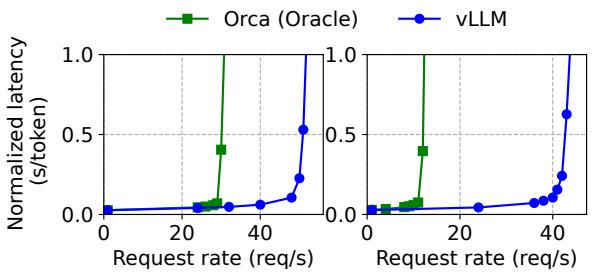  

(a) 1-shot 前缀提示 (b) 5-shot 前缀提示

图 16. 翻译工作负载，其中输入提示共享一个公共前缀。该前缀包含 (a) 1 个示例共 80 个词元，或 (b) 5 个示例共 341 个词元。

  

图 17. 在聊天机器人工作负载上的性能。

图 10. 在模型方面，我们使用多语言的 LLaMA-13B [52]。在工作负载方面，我们使用 WMT16 [4] 英语到德语翻译数据集，并合成两个包含指令和若干翻译示例的前缀。第一个前缀包含单个示例（即一次性示例 (one-shot)），另一个前缀包含 5 个示例（即少样本示例 (few-shot)）。如图 16 (a) 所示，当 one-shot 前缀被共享时，vLLM 相比 Orca（Oracle 版）实现了 1.67 倍的吞吐量提升。此外，当共享更多示例时（图 16 (b)），vLLM 相比 Orca（Oracle 版）达到了 3.58 倍的吞吐量提升。

## 6.5 聊天机器人（Chatbot）

聊天机器人（chatbot）[8, 19, 35] 是 LLM 最重要的应用之一。为了实现聊天机器人，我们将聊天历史与最后一条用户查询拼接成一个提示（prompt），让模型据此生成回复。我们使用 ShareGPT 数据集合成聊天历史与用户查询。由于 OPT-13B 模型的上下文长度有限，我们将提示截断到最后 1024 个 token，并让模型最多生成 1024 个 token。我们不在不同对话轮次之间存储 KV 缓存，因为这样做会占用对话轮次之间其他请求的空间。

图 17 表明，与三种 Orca 基线相比，vLLM 能够维持 2 倍的请求速率。由于 ShareGPT 数据集包含许多长对话，大多数请求的输入提示长度均为 1024 个 token。由于伙伴分配（buddy allocation）算法，无论如何预测输出长度，Orca 基线都为请求输出保留了 1024 个 token 的空间。因此，三种 Orca 基线的表现相似。相比之下，由于 PagedAttention 解决了内存碎片化与内存预留问题，vLLM 能够有效处理长提示。

  

(a) 注意力核的延迟。

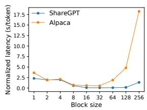  

(b) 不同块大小下的端到端延迟。
图 18. 消融实验。

## 7 消融实验

在本节中，我们研究 vLLM 的各个方面，并通过消融实验评估我们所做设计选择的合理性。

### 7.1 内核微基准测试

PagedAttention 中的动态块映射会影响涉及所存储 KV 缓存的 GPU 操作的性能，即块的读/写以及注意力计算。与现有系统相比，我们的 GPU 内核（§5）带来了额外的开销，包括访问块表、执行额外的分支以及处理可变长度的序列。如图 18a 所示，与高度优化的 FasterTransformer 实现相比，这导致注意力内核的延迟增加 20–26%。我们认为这一开销较小，因为它仅影响注意力算子，而不影响模型中的其他算子，例如 Linear。尽管存在该开销，PagedAttention 使 vLLM 在端到端性能上显著优于 FasterTransformer（§6）。

### 7.2 块大小的影响

块大小的选择会对 vLLM 的性能产生重大影响。如果块大小过小，vLLM 可能无法充分利用 GPU 在读取和处理 KV 缓存时的并行性。如果块大小过大，内部碎片会增加，共享的概率则会降低。

在图 18b 中，我们使用 ShareGPT 和 Alpaca 跟踪在固定请求速率下采用基础采样（basic sampling）来评估不同块大小下 vLLM 的性能。在 ShareGPT 跟踪中，块大小从 16 到 128 都能带来最佳性能。在 Alpaca 跟踪中，块大小 16 和 32 表现良好，而更大的块大小则会显著降低性能，因为序列长度变得短于块大小。在实践中，我们发现块大小 16 已足够大以高效利用 GPU，同时也足够小以避免在大多数工作负载中出现显著的内部碎片。因此，vLLM 将默认块大小设置为 16。

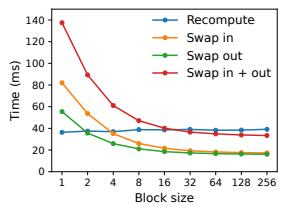  

(a) 微基准测试

  

(b) 端到端性能（End-to-end performance）

图 19. （a）不同块大小下重计算与交换的开销。（b）使用 ShareGPT 轨迹在相同请求速率下服务 OPT-13B 时的性能。

## 7.3 重计算与交换的比较

vLLM 支持重计算（recomputation）和交换（swapping）作为其恢复机制。为了理解这两种方法之间的权衡，我们评估了它们的端到端性能，并对它们的开销进行了微基准测试，结果如图 19 所示。我们的结果表明，在小块大小下，交换会产生过多开销。这是因为小块大小通常会导致 CPU 和 GPU 之间产生大量小数据传输，从而限制了有效的 PCIe 带宽。相比之下，重计算的开销在不同块大小下保持不变，因为重计算不使用 KV 块。因此，当块大小较小时，重计算更高效；而当块大小较大时，交换更高效，但重计算的开销永远不会超过交换延迟的 20%。对于 16 到 64 的中等块大小，两种方法的端到端性能相当。

## 8 讨论

将虚拟内存和分页技术应用于其他 GPU 工作负载。虚拟内存和分页的思想对于管理 LLM 服务中的 KV 缓存是有效的，因为该工作负载需要动态内存分配（因为输出长度事先未知），并且其性能受 GPU 内存容量限制。然而，这并不普遍适用于每个 GPU 工作负载。例如，在 DNN 训练中，张量形状通常是静态的，因此可以提前优化内存分配。再例如，在服务非 LLM 的 DNN 时，内存效率的提升可能不会带来任何性能改善，因为性能主要受计算限制（compute-bound）。在这些场景中，引入 vLLM 的技术反而可能由于内存间接访问和非连续块内存的额外开销而降低性能。但是，我们将很高兴看到 vLLM 的技术被应用于具有与 LLM 服务相似特性的其他工作负载。

在应用虚拟内存和分页时的 LLM 特定优化。vLLM 通过利用应用特定的语义，重新解释并增强了虚拟内存和分页的思想。一个例子是 vLLM 的全有或全无（all-or-nothing）换出策略，它利用了处理一个请求需要将其所有对应的 token 状态存储在 GPU 内存中这一事实。另一个例子是用于恢复被驱逐块的重计算方法，这在操作系统中是不可行的。此外，vLLM 通过将用于内存访问操作的 GPU 内核与用于其他操作（如注意力）的内核融合，来减轻分页中内存间接访问的开销。

## 9 相关工作

通用模型服务系统。近年来，模型服务一直是研究的活跃领域，已有众多系统被提出以应对深度学习模型部署的各个方面。Clipper [11]、TensorFlow Serving [33]、Nexus [45]、InferLine [10] 和 Clockwork [20] 是一些较早的通用模型服务系统。它们研究了批处理（batching）、缓存、放置（placement）与调度（scheduling），以服务于单个或多个模型。更近期地，DVABatch [12] 引入了多入口多出口批处理（multi-entry multi-exit batching）。REEF [21] 和 Shepherd [61] 提出了服务中的抢占机制。AlpaServe [28] 利用模型并行（model parallelism）实现统计复用（statistical multiplexing）。然而，这些通用系统未能考虑自回归（autoregressive）特性和 LLM 推理的 token 状态，从而错失了优化机会。

面向 Transformer 的专用服务系统。由于 Transformer 架构的重要性，已开发出众多针对它的专用服务系统。这些系统利用 GPU 内核优化 [1, 29, 31, 56]、先进的批处理机制 [14, 60]、模型并行 [1, 41, 60] 与参数共享 [64] 来实现高效服务。其中，Orca [60] 与我们的方法最为相关。

与 Orca 的比较。Orca [60] 中的迭代级调度（iteration-level scheduling）与 vLLM 中的 PagedAttention 是互补的技术：尽管两个系统都旨在提高 GPU 利用率从而提升 LLM 服务的吞吐量，但 Orca 通过调度与交错（interleaving）请求以使更多请求可被并行处理来实现这一点，而 vLLM 则通过提升内存利用率以使更多请求的工作集合能够装入内存来实现。通过减少内存碎片并实现共享，vLLM 可以在一个批次（batch）中并行运行更多请求，并相比 Orca 获得 2–4 倍的加速。事实上，像 Orca 那样细粒度的调度与请求交错使内存管理更具挑战性，这使得 vLLM 中所提出的技术变得更加关键。

内存优化。加速器计算能力与内存容量之间日益扩大的差距，已使内存成为训练与推理共同的瓶颈。交换（swapping）[23, 42, 55]、重计算（recomputation）[7, 24] 及其组合 [40] 已被用于降低训练的峰值内存。其中，FlexGen [46] 研究了在有限 GPU 内存下为 LLM 推理交换权重与 token 状态的方法，但其目标并非在线服务（online serving）场景。OLLA [48] 优化了张量的生命周期与位置以减少碎片化，但它未进行细粒度的块级管理，也不针对在线服务。FlashAttention [13] 通过分块（tiling）与内核优化来降低注意力计算的峰值内存并减少 I/O 开销。本文在在线服务场景下引入了块级内存管理（block-level memory management）这一新思路。

## 10 结论

本文提出了 PagedAttention，一种新的注意力算法，它允许注意力的键（keys）与值（values）存储在非连续的分页内存中；并提出了 vLLM，一个由 PagedAttention 实现高效内存管理的高吞吐量大语言模型（LLM）服务系统。受操作系统中虚拟内存与写时复制等成熟技术启发，我们展示了如何对这些技术加以改造，以高效管理 KV 缓存并处理 LLM 服务中的多种解码算法。我们的实验表明，vLLM 在吞吐量上较当前最先进系统提升了 2–4 倍。

## 致谢

我们感谢 Xiaoxuan Liu、Zhifeng Chen、Yanping Huang、匿名的 SOSP 审稿人，以及我们的会议导师 Lidong Zhou 所提出的富有洞见的反馈。本研究部分得到了来自 Andreessen Horowitz、Anyscale、Astronomer、Google、IBM、Intel、Lacework、Microsoft、Mohamed Bin Zayed University of Artificial Intelligence、Samsung SDS、Uber 与 VMware 的资助。

## 参考文献

[1] Reza Yazdani Aminabadi, Samyam Rajbhandari, Minjia Zhang, Ammar Ahmad Awan, Cheng Li, Du Li, Elton Zheng, Jeff Rasley, Shaden Smith, Olatunji Ruwase, et al. 2022. DeepSpeed Inference：以空前规模实现 Transformer 模型的高效推理. arXiv 预印本 arXiv:2207.00032 (2022).

[2] Jimmy Lei Ba, Jamie Ryan Kiros, and Geoffrey E Hinton. 2016. 层归一化. arXiv 预印本 arXiv:1607.06450 (2016).

[3] Yoshua Bengio, Réjean Ducharme, and Pascal Vincent. 2000. 一种神经概率语言模型. Advances in neural information processing systems 13 (2000).

[4] Ondřej Bojar, Rajen Chatterjee, Christian Federmann, Yvette Graham, Barry Haddow, Matthias Huck, Antonio Jimeno Yepes, Philipp Koehn, Varvara Logacheva, Christof Monz, Matteo Negri, Aurelie Neveol, Mariana Neves, Martin Popel, Matt Post, Raphael Rubino, Carolina Scarton, Lucia Specia, Marco Turchi, Karin Verspoor, and Marcos Zampieri. 2016. 2016 年机器翻译大会的研究发现. 载于：第一届机器翻译大会论文集. 计算语言学协会，德国柏林，131–198. http://www.aclweb.org/anthology/W/W16/W16-2301

[6] Mark Chen, Jerry Tworek, Heewoo Jun, Qiming Yuan, Henrique Ponde de Oliveira Pinto, Jared Kaplan, Harri Edwards, Yuri Burda, Nicholas Joseph, Greg Brockman, et al. 2021. 评估在代码上训练的大语言模型. arXiv 预印本 arXiv:2107.03374 (2021).

[7] Tianqi Chen, Bing Xu, Chiyuan Zhang, and Carlos Guestrin. 2016. 以亚线性内存开销训练深度网络. arXiv 预印本 arXiv:1604.06174 (2016).

[8] Wei-Lin Chiang, Zhuohan Li, Zi Lin, Ying Sheng, Zhanghao Wu, Hao Zhang, Lianmin Zheng, Siyuan Zhuang, Yonghao Zhuang, Joseph E. Gonzalez, Ion Stoica, and Eric P. Xing. 2023. Vicuna：一个以 90%\* ChatGPT 质量令 GPT-4 印象深刻的开源聊天机器人. https://lmsys.org/blog/2023-03-30-vicuna/

[10] Daniel Crankshaw, Gur-Eyal Sela, Xiangxi Mo, Corey Zumar, Ion Stoica, Joseph Gonzalez, and Alexey Tumanov. 2020. InferLine：面向预测服务流水线的延迟感知资源配置与弹性伸缩. 发表于第 11 届 ACM 云计算研讨会论文集. 477–491.

[11] Daniel Crankshaw, Xin Wang, Guilio Zhou, Michael J Franklin, Joseph E Gonzalez, and Ion Stoica. 2017. Clipper：一种低延迟在线预测服务系统. 发表于第 14 届 USENIX 网络系统设计与实现研讨会 (NSDI 17). 613–627.

[12] Weihao Cui, Han Zhao, Quan Chen, Hao Wei, Zirui Li, Deze Zeng, Chao Li, and Minyi Guo. 2022. DVABatch：面向 GPU 上 DNN 服务高效处理的多样性感知多入口多出口批处理. 发表于 2022 年 USENIX 年度技术会议 (USENIX ATC 22). 183–198.

[13] Tri Dao, Dan Fu, Stefano Ermon, Atri Rudra, and Christopher Ré. 2022. FlashAttention：具备 IO 感知能力的快速且内存高效的精确注意力机制. 《神经信息处理系统进展》第 35 卷 (2022), 16344–16359.

[14] Jiarui Fang, Yang Yu, Chengduo Zhao, and Jie Zhou. 2021. TurboTransformers：一种高效的 Transformer 模型 GPU 服务系统. 发表于第 26 届 ACM SIGPLAN 并行编程原理与实践研讨会论文集. 389–402.

[15] FastAPI. 2023. FastAPI. https://github.com/tiangolo/fastapi.

[16] Pin Gao, Lingfan Yu, Yongwei Wu, and Jinyang Li. 2018. 基于蜂窝批处理的低延迟 RNN 推理. 发表于第 13 届 EuroSys 会议论文集. 1–15.

[17] Amir Gholami, Zhewei Yao, Sehoon Kim, Michael W Mahoney, and Kurt Keutzer. 2021. AI 与内存墙. RiseLab Medium 博客文章第 1 期 (2021), 6.

[18] Github. 2022. https://github.com/features/copilot

[19] Google. 2023. https://bard.google.com/

[20] Arpan Gujarati, Reza Karimi, Safya Alzayat, Wei Hao, Antoine Kaufmann, Ymir Vigfusson, and Jonathan Mace. 2020. 如钟表般服务 {DNN}：自底向上的性能可预测性. 发表于第 14 届 USENIX 操作系统设计与实现研讨会 (OSDI 20). 443–462.

[21] Mingcong Han, Hanze Zhang, Rong Chen, and Haibo Chen. 2022. 面向并发 {GPU 加速} {DNN} 推理的微秒级抢占机制. 发表于第 16 届 USENIX 操作系统设计与实现研讨会 (OSDI 22). 539–558.

[22] Kaiming He, Xiangyu Zhang, Shaoqing Ren, 和 Jian Sun. 2016. 用于图像识别的深度残差学习（Deep Residual Learning for Image Recognition）. 载于：IEEE 计算机视觉与模式识别会议论文集. 770–778.

[23] Chien-Chin Huang, Gu Jin, 和 Jinyang Li. 2020. SwapAdvisor：通过智能换出将深度学习突破 GPU 内存限制（SwapAdvisor: Pushing Deep Learning Beyond the GPU Memory Limit via Smart Swapping）. 载于：第二十五届编程语言与操作系统体系结构支持国际会议论文集. 1341–1355.

[24] Paras Jain, Ajay Jain, Aniruddha Nrusimha, Amir Gholami, Pieter Abbeel, Joseph Gonzalez, Kurt Keutzer, 和 Ion Stoica. 2020. Checkmate：通过最优张量重计算打破内存墙（Checkmate: Breaking the Memory Wall with Optimal Tensor Rematerialization）. 机器学习与系统论文集（Proceedings of Machine Learning and Systems）2 (2020), 497–511.

[25] Tom Kilburn, David BG Edwards, Michael J Lanigan, 和 Frank H Sumner. 1962. 单级存储系统（One-Level Storage System）. IRE 电子计算机汇刊（IRE Transactions on Electronic Computers）2 (1962), 223–235.

[26] Brian Lester, Rami Al-Rfou, 和 Noah Constant. 2021. 规模的力量：参数高效提示调优（The Power of Scale for Parameter-Efficient Prompt Tuning）. arXiv 预印本 arXiv:2104.08691 (2021).

[27] Xiang Lisa Li 和 Percy Liang. 2021. 前缀调优：优化用于生成的连续提示（Prefix-Tuning: Optimizing Continuous Prompts for Generation）. arXiv 预印本 arXiv:2101.00190 (2021).

[28] Zhuohan Li, Lianmin Zheng, Yinmin Zhong, Vincent Liu, Ying Sheng, Xin Jin, Yanping Huang, Zhifeng Chen, Hao Zhang, Joseph E Gonzalez, 等. 2023. AlpaServe：面向深度学习服务的模型并行统计多路复用（AlpaServe: Statistical Multiplexing with Model Parallelism for Deep Learning Serving）. arXiv 预印本 arXiv:2302.11665 (2023).

[29] Lingxiao Ma, Zhiqiang Xie, Zhi Yang, Jilong Xue, Youshan Miao, Wei Cui, Wenxiang Hu, Fan Yang, Lintao Zhang, 和 Lidong Zhou. 2020. Rammer：通过 rTasks 实现整体深度学习编译器优化（Rammer: Enabling Holistic Deep Learning Compiler Optimizations with rTasks）. 载于：第 14 届 USENIX 操作系统设计与实现会议论文集. 881–897.

[30] NVIDIA. [n. d.]. Triton 推理服务器（Triton Inference Server）. https://developer.nvidia.com/nvidia-triton-inference-server.

[31] NVIDIA. 2023. FasterTransformer. https://github.com/NVIDIA/FasterTransformer.

[32] NVIDIA. 2023. NCCL：英伟达集合通信库（NCCL: The NVIDIA Collective Communication Library）. https://developer.nvidia.com/nccl.

[34] OpenAI. 2020. https://openai.com/blog/openai-api

[35] OpenAI. 2022. https://openai.com/blog/chatgpt

[36] OpenAI. 2023. https://openai.com/blog/custom-instructions-for-chatgpt

[37] OpenAI. 2023. GPT-4 技术报告（GPT-4 Technical Report）. arXiv:2303.08774 [cs.CL]

[38] LMSYS ORG. 2023. 聊天机器人竞技场排行榜第 8 周：推出 MT-Bench 与 Vicuna-33B（Chatbot Arena Leaderboard Week 8: Introducing MT-Bench and Vicuna-33B）. https://lmsys.org/blog/2023-06-22-leaderboard/.

[40] Shishir G Patil, Paras Jain, Prabal Dutta, Ion Stoica, and Joseph Gonzalez. 2022. POET：通过集成重计算与分页技术在微型设备上训练神经网络。见：*International Conference on Machine Learning*. PMLR, 17573–17583.

[41] Rohan Pope, Sholto Douglas, Aakanksha Chowdhery, Jacob Devlin, James Bradbury, Anselm Levskaya, Jonathan Heek, Kefan Xiao, Shivani Agrawal, and Jeff Dean. 2022. 高效扩展 Transformer 推理。*arXiv preprint arXiv:2211.05102* (2022).

[42] Jie Ren, Samyam Rajbhandari, Reza Yazdani Aminabadi, Olatunji Ruwase, Shuangyan Yang, Minjia Zhang, Dong Li, and Yuxiong He. 2021. ZeRO-Offload：让十亿参数规模模型训练走向大众。见：*USENIX Annual Technical Conference*. 551–564.

[43] Reuters. 2023. https://www.reuters.com/technology/tech-giants-ailike-bing-bard-poses-billion-dollar-search-problem-2023-02-22

[44] Amazon Web Services. 2023. https://aws.amazon.com/bedrock/

[46] Ying Sheng, Lianmin Zheng, Binhang Yuan, Zhuohan Li, Max Ryabinin, Daniel Y Fu, Zhiqiang Xie, Beidi Chen, Clark Barrett, Joseph E Gonzalez, et al. 2023. 使用单个 GPU 实现大语言模型的高吞吐量生成推理。*arXiv preprint arXiv:2303.06865* (2023).

[47] Mohammad Shoeybi, Mostofa Patwary, Raul Puri, Patrick LeGresley, Jared Casper, and Bryan Catanzaro. 2019. Megatron-LM：使用模型并行训练数十亿参数语言模型。*arXiv preprint arXiv:1909.08053* (2019).

[48] Benoit Steiner, Mostafa Elhoushi, Jacob Kahn, and James Hegarty. 2022. OLLA：优化数组的生存周期与位置以降低神经网络的内存占用。(2022). https://doi.org/10.48550/arXiv.2210.12924

[49] Ilya Sutskever, Oriol Vinyals, and Quoc V Le. 2014. 使用神经网络进行序列到序列学习。*Advances in Neural Information Processing Systems* 27 (2014).

[51] ShareGPT Team. 2023. https://sharegpt.com

[53] Ashish Vaswani, Noam Shazeer, Niki Parmar, Jakob Uszkoreit, Llion Jones, Aidan N Gomez, Łukasz Kaiser, and Illia Polosukhin. 2017. 你只需要注意力（Attention is All You Need）. *神经信息处理系统进展* 第30卷 (2017).

[54] Jing Wang, Youyou Lu, Qing Wang, Minhui Xie, Keji Huang, and Jiwu Shu. 2022. Pacman：一种面向持久内存的日志结构键值存储的高效压缩方法（Pacman: An Efficient Compaction Approach for {Log-Structured} {Key-Value} Store on Persistent Memory）. 发表于：*2022 USENIX 年度技术会议（USENIX ATC 22）*. 773–788.

[55] Linnan Wang, Jinmian Ye, Yiyang Zhao, Wei Wu, Ang Li, Shuaiwen Leon Song, Zenglin Xu, and Tim Kraska. 2018. Superneurons：面向深度神经网络训练的动态 GPU 内存管理（Superneurons: Dynamic GPU Memory Management for Training Deep Neural Networks）. 发表于：*第23届 ACM SIGPLAN 并行编程原理与实践研讨会论文集*. 41–53.

[56] Xiaohui Wang, Ying Xiong, Yang Wei, Mingxuan Wang, and Lei Li. 2021. LightSeq：面向 Transformer 的高性能推理库（LightSeq: A High Performance Inference Library for Transformers）. 发表于：*2021 年北美计算语言学协会人类语言技术会议：工业论文集*. 113–120.

[58] Thomas Wolf, Lysandre Debut, Victor Sanh, Julien Chaumond, Clement Delangue, Anthony Moi, Pierric Cistac, Tim Rault, Rémi Louf, Morgan Funtowicz, 等人. 2020. Transformers：最先进的自然语言处理（Transformers: State-of-the-Art Natural Language Processing）. 发表于：*2020 年自然语言处理经验方法会议系统演示论文集*. 38–45.

[59] Yonghui Wu, Mike Schuster, Zhifeng Chen, Quoc V Le, Mohammad Norouzi, Wolfgang Macherey, Maxim Krikun, Yuan Cao, Qin Gao, Klaus Macherey, 等人. 2016. 谷歌的神经机器翻译系统：弥合人与机器翻译之间的鸿沟（Google's Neural Machine Translation System: Bridging the Gap between Human and Machine Translation）. *arXiv 预印本 arXiv:1609.08144* (2016).

[60] Gyeong-In Yu, Joo Seong Jeong, Geon-Woo Kim, Soojeong Kim, and Byung-Gon Chun. 2022. Orca：面向基于 Transformer 的生成模型的分布式服务系统（Orca: A Distributed Serving System for {Transformer-Based} Generative Models）. 发表于：*第16届 USENIX 操作系统设计与实现研讨会（OSDI 22）*. 521–538.

[61] Hong Zhang, Yupeng Tang, Anurag Khandelwal, and Ion Stoica. 2023. SHEPHERD：在真实环境中服务 DNN（SHEPHERD: Serving DNNs in the Wild）. 发表于：*第20届 USENIX 网络系统设计与实现研讨会（NSDI 23）*. USENIX 协会，马萨诸塞州波士顿，787–808. https://www.usenix.org/conference/nsdi23/presentation/zhang-hong

[63] Lianmin Zheng, Zhuohan Li, Hao Zhang, Yonghao Zhuang, Zhifeng Chen, Yanping Huang, Yida Wang, Yuanzhong Xu, Danyang Zhuo, Eric P Xing, et al. 2022. Alpa：面向分布式深度学习的算子间与算子内并行自动化（Alpa: Automating Inter-and Intra-Operator Parallelism for Distributed Deep Learning）. 发表于第 16 届 USENIX 操作系统设计与实现研讨会（OSDI 22），第 559–578 页.

[64] Zhe Zhou, Xuechao Wei, Jiejing Zhang, and Guangyu Sun. 2022. PetS：面向参数高效 Transformer 服务的统一框架（PetS: A Unified Framework for Parameter-Efficient Transformers Serving）. 发表于 2022 年 USENIX 年度技术大会（USENIX ATC 22），第 489–504 页.