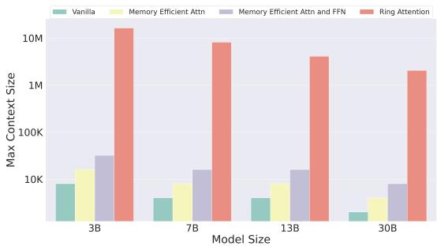
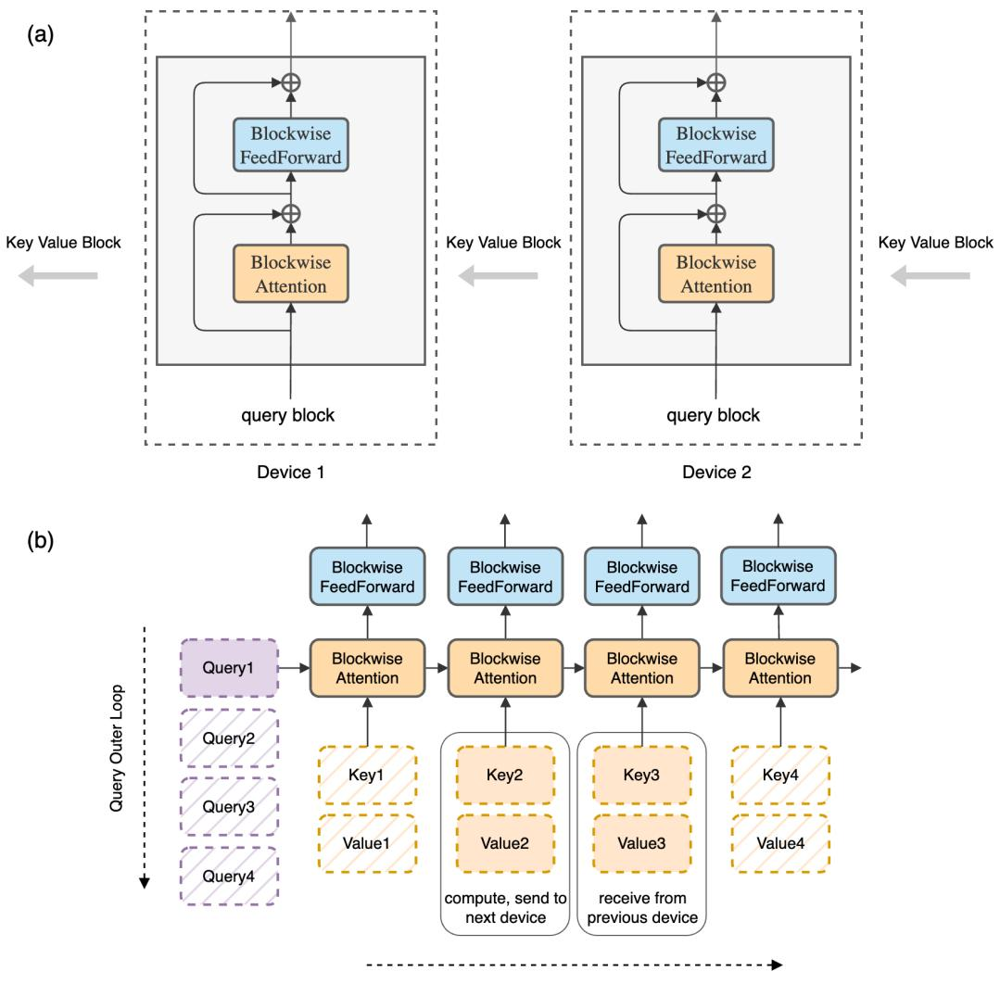
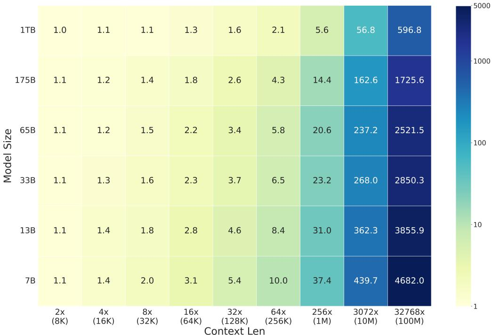

# Ring Attention with Blockwise Transformers for Near-Infinite Context

环形注意力与分块 Transformer 实现近乎无限的上下文

Hao Liu, Matei Zaharia, Pieter Abbeel

加州大学伯克利分校 hao.liu@cs.berkeley.edu

## 摘要

Transformers 已成为许多最先进 AI 模型的首选架构，在广泛的 AI 应用中展现出卓越的性能。然而，Transformers 对内存的需求限制了它们处理长序列的能力，从而在复杂环境中利用视频、动作及其他长篇序列和模态方面带来了挑战。我们提出了一种新颖的方法——环形注意力与分块 Transformer（Ring Attention with Blockwise Transformers，Ring Attention），它利用自注意力和前馈的分块计算，将长序列分布到多个设备上，同时充分地将键值块的通信与分块注意力的计算进行重叠。我们的方法使得训练和推理的序列长度可达先前内存高效 Transformer 所能达到长度的设备数量倍，且无需借助近似方法或产生额外的通信和计算开销。在语言建模和强化学习任务上的大量实验证明了我们方法的有效性，该方法支持数百万 token 的上下文大小并提升了性能。<sup>1</sup>。

## 1 引言

Transformers [37] 已成为许多最先进 AI 系统的骨干，这些系统在广泛的 AI 问题中展现出令人瞩目的性能。Transformers 通过使用自注意力（self-attention）和位置前馈（position-wise feedforward）机制的架构设计取得了这一成功。然而，扩展 Transformers 的上下文长度是一项挑战 [29]，因为 Transformers 继承的架构设计，即自注意力机制，其内存成本与输入序列长度成平方关系，这使得将其扩展到更长的输入序列变得困难。大型上下文 Transformers 对于应对多种 AI 挑战至关重要，范围涵盖处理书籍和高分辨率图像、分析长视频以及复杂代码库。它们擅长从相互关联的网络和超链接内容中提取信息，并且对于处理复杂科学实验数据至关重要。已出现上下文长度显著扩展的语言模型用例：GPT-3.5 [32] 上下文长度为 16K，GPT-4 [29] 上下文长度为 32K，MosaicML 的 MPT [25] 上下文长度为 65K，以及 Anthropic 的 Claude [1] 上下文长度为 100K。

由于其重要性，降低内存开销已成为研究热点。一个研究方向利用了如下观察结果：自注意力（self-attention）中的 softmax 矩阵无需物化整个矩阵即可计算 [24]，这推动了自注意力和前馈层的分块计算方法的发展 [30, 9, 23]，且不引入近似。尽管内存有所减少，但存储每一层输出仍带来重大挑战。这一必要性源于自注意力固有的特性，即涉及所有元素之间的交互（n 对 n 交互）。下一层的自注意力依赖于访问前一层的所有输出；若不这样做，则必须为每个序列元素重新计算每个输出，导致计算成本呈三次方上升，使得长序列场景下难以实际应用。

这些组件有助于高效捕捉输入词元（token）之间的长程依赖关系，并通过高度并行的计算实现可扩展性。为了直观感受内存需求，即便批量大小仅为 1，处理 1 亿 token 在隐藏维度为 1024 的中等规模模型中也需要超过 1000GB 的内存。这远超当代 GPU 和 TPU 的容量，后者通常配备不到 100GB 的高带宽内存（HBM）。

  

图 1：在 TPUv4-1024 上进行端到端大规模训练时的最大上下文长度。基线方法包括 vanilla transformers（标准 Transformer）[37]、memory efficient transformers（内存高效 Transformer）[30]，以及 memory efficient attention and feedforward（blockwise parallel transformers，分块并行 Transformer）[23]。我们提出的 Ring Atten tion 方法允许训练的序列长度达到基线方法的设备数倍，并能够在不进行任何近似处理、也不增加通信和计算开销的前提下，训练长度超过百万级的序列。

为了应对这一挑战，我们提出了一个关键观察：通过以分块（blockwise）方式执行自注意力（self-attention）和前馈网络（feedforward network）计算[23]，我们可以将序列维度分布到多个设备上，从而实现计算与通信的并发执行。这一洞察源于以下事实：当我们逐块计算注意力时，这些分块计算的结果对其执行顺序具有不变性。我们的方法将分块注意力的外层循环分布在主机之间，每个设备负责管理其对应的输入块。对于内层循环，每个设备都会计算与其指定输入块相关的分块注意力和前馈操作。主机设备在概念上构成一个环形拓扑：在内层循环期间，每个设备将其用于分块计算的关键值（key-value）块副本发送给环形中的下一个设备，同时从上一个设备接收关键值块。只要分块计算的时间长于分块传输的时间，重叠这些过程就不会带来相对于标准 Transformer 的额外开销。在先前的工作[21]中，利用环形拓扑来计算自注意力的方法也得到了研究，但它会产生与序列并行（sequence parallelism）类似的非重叠通信开销，使其难以应用于较大的上下文长度。我们的工作利用分块并行 Transformer（blockwise parallel transformers）[23]来大幅降低内存成本，从而在训练和推理过程中实现对数千万 token 的上下文长度的零开销扩展，并允许使用任意大的上下文长度。由于我们的方法通过 Transformer 的分块计算来重叠主机间关键值块的通信，因此将其命名为采用分块并行 Transformer 的环形注意力（Ring Attention with Blockwise Parallel Transformers, Ring Attention）。

我们在语言建模基准上评估了我们方法的有效性。我们的实验表明，Ring Attention 能够降低 Transformer 的内存需求，使我们能够训练比此前内存高效的最优方法长 500 倍以上的序列，并能够在不对注意力进行任何近似的情况下训练长度超过 1 亿的序列。重要的是，Ring Attention 消除了单个设备所施加的内存限制，使得序列长度可以随设备数量按比例扩展地进行训练和推理，本质上实现了近乎无限的上下文长度。

我们的贡献有两方面：(a) 提出一种内存高效的 Transformer 架构，允许上下文长度随设备数量线性扩展的同时保持性能，消除了单个设备所带来的内存瓶颈；(b) 通过大量实验证明了我们方法的有效性。

## 2 大上下文内存约束

给定输入序列 $Q , K , V \in \mathbb { R } ^ { s \times d }$，其中 s 是序列长度，d 是头维度。我们按照如下方式计算输出矩阵：

$$
\operatorname{Attention} (Q, K, V) = \operatorname{softmax} (\frac {Q K ^ {T}}{\sqrt {d}}) V,
$$

其中 softmax 按行应用。每个自注意力子层都附带一个前馈网络，该网络对每个位置分别且相同地施加同样的变换。它由两个线性变换组成，中间使用 ReLU 激活函数。

$$
\operatorname{FFN} (x) = \max (0, x W _ {1} + b _ {1}) W _ {2} + b _ {2}.
$$

块并行 Transformer（Blockwise Parallel Transformers）。先前的先驅方法透過創新技術實現了記憶體使用量的大幅降低，這些技術使得注意力計算無需完整實例化，而是以塊為單位逐步計算 [30, 9, 23]。這些進展將注意力的記憶體開銷降低至每層 2bsh 位元組，其中 b 代表批次大小（batch size），s 表示序列長度（sequence length），h 代表模型的隱藏層維度（hidden size）。為了進一步降低記憶體使用量，塊並行 Transformer（BPT）[23] 引入了一種策略，將每個自注意力子層相關的前饋網路以塊為單位進行計算。這種方法有效地將前饋網路（feedforward network）的最大激活大小從 8bsh 限制到 2bsh。有關記憶體效率的更詳細分析，請參閱其中的討論。總之，先進的 Transformer 層的激活記憶體成本為 2bsh。

每層的大量輸出（Large Output of Each Layer）。雖然 BPT 大幅降低了 Transformer 中的記憶體需求，但它仍然對擴展上下文長度構成重大挑戰，因為它需要儲存每一層的輸出。這種儲存至關重要，這是由於自注意力固有的特性，即涉及所有元素之間的交互（n 對 n 交互）。如果沒有這些儲存的輸出，後續層的自注意力在計算上將變得不可行，需要對每個序列元素進行重計算。簡而言之，使用批次大小為 1 處理 1 億個 token，即使對於隱藏層維度僅為 1024 的中等規模模型，也需要超過 1000GB 的記憶體。相比之下，現代 GPU 和 TPU 通常提供不到 100GB 的高頻寬記憶體（HBM），而 HBM 的大幅擴展前景受到物理限制和高製造成本的阻礙。

## 3 結合區塊並行 Transformer 的環狀注意力（Ring Attention with Blockwise Parallel Transformers）

我们的主要目标是通过将长序列高效分布到多个主机上来消除单个设备所带来的内存限制，且不增加额外开销。为实现这一目标，我们提出对分块并行 Transformer（Blockwise Parallel Transformers, BPT）框架 [23] 进行一项改进。在将输入序列分布到不同主机时，每台主机负责运行对应其指定分块的分块注意力外层循环的一个元素，以及该分块专属的前馈网络。这些操作不需要与其他主机进行通信。然而，挑战出现在内层循环中，该循环涉及键-值分块之间的交互，需要从其他主机获取分块。由于每台主机仅持有一个键-值分块，从其他主机获取分块的朴素做法会带来两个显著问题。首先，它引入了计算延迟，因为系统需要等待接收必要的键-值分块。其次，键-值分块的累积会导致内存使用量增加，从而违背了降低内存开销的初衷。

## 基于环结构的分块注意力（Ring-Based Blockwise Attention）

为应对上述挑战，我们利用内层循环中键-值分块操作的置换不变性（permutation invariance）性质。该性质源于这样一个事实：只要将每个分块的统计量正确组合以进行重新缩放，查询块与一组键-值分块之间的自注意力可以按任意顺序计算。我们利用这一性质，将所有主机概念化为一个环形结构：主机-1、主机-2、……、主机-N。在我们计算分块注意力和前馈网络时，每台主机通过高效协同，在将用于注意力计算的键-值分块并发发送给下一台主机的同时，从前序主机接收键-值分块，从而有效地将分块传输与分块计算重叠。具体而言，对于任意主机-i，在其查询块与某个键-值分块之间计算注意力的过程中，它会在向前序主机-(i + 1) 发送键-值分块的同时从前序主机-(i − 1) 接收键-值分块。如果计算时间超过传输键-值分块所需的时间，则不会产生额外的通信开销。这种重叠机制适用于我们方法的正向传播和反向传播，因为可以采用相同的操作和技术。先前的工作也曾提出利用环形拓扑来计算自注意力 [21]，旨在降低通信成本。我们的工作则有所不同，我们利用分块并行 Transformer 来大幅降低内存成本。正如我们将在下一节中展示的，这使得在训练和推理过程中能够以零开销的方式扩展上下文长度，并允许任意大的上下文长度。

主机间的算术强度。为了确定使传输与计算重叠所需的最小块大小，假设每个主机具有 F FLOPS 的算力，主机间的带宽记为 B。值得注意的是，我们的方法仅涉及与环形配置中紧邻的前一个和后一个主机的交互，因此我们的分析同时适用于 GPU 全互连拓扑（all-to-all topology）和 TPU 环形拓扑（TPU torus topology）。我们考虑如下变量：块大小记为 c，隐藏维度记为 d。在计算分块自注意力（blockwise self-attention）时，使用查询（queries）和键（keys）计算注意力分数需要 $2 d c ^ { 2 }$ FLOPs，将这些注意力分数与值（values）相乘还需要 $2 d c ^ { 2 }$ FLOPs。总体而言，计算需求为 $4 d c ^ { 2 }$ FLOPs。我们将查询、键、值的投影以及分块前馈操作排除在外，因为它们只增加计算复杂度而不带来任何主机间的通信开销。这种简化会给出更为严格的条件，但并不影响我们方法的有效性。在通信方面，键块和值块总共需要 2cd 字节。因此，总的通信需求为 4cd 字节。为了实现通信与计算的重叠，必须满足以下条件：$4 d c ^ { 2 } / F \geq 4 c d / B$。这意味着块大小 c 应大于或等于 F/B。换言之，块大小需要大于 FLOPs 与带宽的比值。

  

## 键值内层循环

图 2：顶部 (a)：我们使用与原始 Transformer 相同的模型架构，只是对其计算过程进行了重新组织。在示意图中，我们通过展示以下机制来加以说明：在主机环形拓扑中，每个主机持有一个查询块，而键值块则以逐块方式在主机环中流转，用于完成注意力和前馈计算。在计算注意力时，每个主机将键值块发送给下一个主机，同时从前一个主机接收键值块。通信过程与逐块注意力及前馈网络的计算相互重叠。底部 (b)：我们以逐块方式计算原始 Transformer。每个主机负责查询外层循环的一次迭代，而键值块则在主机之间轮转。如图所示，设备从最左侧的第一个查询块启动；随后我们对水平排列的键值块序列进行迭代。查询块与键值块相结合，用于计算自注意力（黄色框），其输出传递给前馈网络（青色框）。

表 1：不同 Transformer 架构间最大激活大小的对比。其中 b 为批量大小，h 为隐藏层维度，n 为注意力头数，s 为序列长度，c 为块大小，且块大小 (c) 与输入序列长度 (s) 相互独立。比较对象包括原始 Transformer (vanilla Transformer) [37]、内存高效注意力 (memory efficient attention) [30]、内存高效注意力与前馈层 (memory efficient attention and feedforward) [23]，以及本文所提出的环形注意力 (Ring Attention) 方法。表中数值为每层所占字节数，假设精度为 bfloat16。

<table><tr><td>Layer Type</td><td>Self-Attention</td><td>FeedForward</td><td>Total</td></tr><tr><td>Vanilla</td><td> $2bns^2$ </td><td>8bsh</td><td> $2bhs^2$ </td></tr><tr><td>Memory efficient attention</td><td> $2bsh + 4bch$ </td><td>8bsh</td><td>8bsh</td></tr><tr><td>Memory efficient attention and feedforward</td><td>2bsh</td><td>2bsh</td><td>2bsh</td></tr><tr><td>Ring Attention</td><td>6bch</td><td>2bch</td><td>6bch</td></tr></table>

表 2：每个设备所需的最小序列长度。互联带宽（Interconnect Bandwidth）指的是主机之间的单向带宽，即 GPU 之间的 NVLink / InfiniBand 带宽，以及 TPU 之间的 ICI 带宽。所需的最小块大小为 $c = { \mathrm { F L O P S } } ,$ /Bandwidth，最小序列长度为 $s = 6c$。

<table><tr><td>Spec Per Host</td><td>FLOPS (TF)</td><td>HBM (GB)</td><td>Interconnect Bandwidth (GB/s)</td><td>Minimal Blocksize (×1e3)</td><td>Minimal Sequence Len (×1e3)</td></tr><tr><td>A100 NVLink</td><td>312</td><td>80</td><td>300</td><td>1.0</td><td>6.2</td></tr><tr><td>A100 InfiniBand</td><td>312</td><td>80</td><td>12.5</td><td>24.5</td><td>149.5</td></tr><tr><td>TPU v3</td><td>123</td><td>16</td><td>112</td><td>1.1</td><td>6.6</td></tr><tr><td>TPU v4</td><td>275</td><td>32</td><td>268</td><td>1.0</td><td>6.2</td></tr><tr><td>TPU v5e</td><td>196</td><td>16</td><td>186</td><td>1.1</td><td>6.3</td></tr></table>

内存需求。每个主机需要存储多个块，包括一个用于存储当前查询（query）块的块大小、两个用于当前键（key）和值（value）块的块大小，以及两个用于接收键和值块的块大小。此外，由于分块注意力（blockwise attention）和分块前馈网络（feedforward）的输出保持与查询块相同的形状，因此存储其输出需要一个块大小。因此，总共需要六个块，相当于 6bch 字节的内存。值得注意的是，分块前馈网络的最大激活大小为 2bch [23]。因此，最大激活总大小仍为 6bch 字节。表 1 提供了我们方法与其他方法之间内存成本的详细比较。值得注意的是，我们方法的优点在于内存相对于块大小 c 呈线性扩展，并且与输入序列长度 s 无关。

我们的分析表明，模型需要具有 $s = 6 c$ 的序列长度，是最小块大小的六倍。常见计算服务器的要求如表 2 所示。每个主机所需的最小序列长度（最右一列）在 6K 到 10K 之间变化；对于配备高带宽互联的 TPU 和 GPU，每个主机的最小块大小（倒数第二列）约为 1K。对于通过 InfiniBand 连接（带宽较低）的 GPU，要求则更为严格。这些要求通过数据并行、张量并行以及内存高效的分块注意力和分块前馈网络 [30, 9, 23] 等并行策略很容易满足，我们将在第 5 节实验部分进行展示。

算法与实现。算法 1 给出了该算法的伪代码。Ring Attention 与现有的内存高效 Transformer 代码兼容：Ring Attention 只需在每个主机上调用任何可用的内存高效计算，并将主机之间键值块的通信与分块计算重叠即可。我们使用集合通信操作 jax.lax.ppermute 在相邻主机之间发送和接收键值块。Jax 实现见附录 A。

Required: Input sequence x. Number of hosts  $N_{h}$ .

Initialize

Split input sequence into  $N_{h}$  blocks that each host has one input block.

for Each transformer layer do

    for count = 1 to  $N_{h} - 1$  do

    for For each host concurrently. do

    Compute memory efficient attention incrementally using local query, key, value blocks.

    end for

end for

for For each host concurrently. do

    Compute memory efficient feedforward using local attention output.

end for

end for
</div>

## 4 实验设置

我们评估了使用 Ring Attention 改进 Transformer 模型的影响，方法是对最大序列长度和模型算力利用率（model flops utilization）进行基准测试。

模型配置。我们的研究基于 LLaMA 架构，在实验中对 3B、7B、13B 和 30B 四种模型规模进行了考察。

基线方法。我们通过将我们的方法与以下基线进行比较来对其进行评估：vanilla transformers [37]，它通过实体化注意力矩阵来计算自注意力，并按通常方式计算前馈网络；带有内存高效注意力（memory efficient attention）的 transformers [30] 及其高效的 CUDA 实现 [9]；以及同时带有内存高效注意力和前馈网络优化的 transformers [23]。

训练配置。对于所有方法，我们对注意力层和前馈网络均采用全梯度检查点（full gradient checkpointing）[5]，遵循先前工作的做法 [30, 23]。实验在 GPU 和 TPU 上均进行。对于 GPU，我们既考虑配备 8 块 GPU 的单个 DGX A100 服务器，也考虑分布式的 32 块 A100 GPU 配置。我们还使用 TPU 进行实验，涵盖从较早代的 TPUv3 到较新一代的 TPUv4 和 TPUv5e。我们需要指出，所有结果均使用全精度（full precision）而非混合精度（mixed precision）获得。

## 5 结果

在我们的实验中，我们的主要目标是对 Ring Attention 在多个关键指标上的性能进行全面评估，包括加速器内存内所能支持的最大序列长度、模型算力利用率以及吞吐量。我们在不同的模型规模和加速器配置下，将 Ring Attention 的性能与若干基线模型进行比较，这些基线包括 vanilla transformers [37]、带有内存高效注意力的 transformers [30]，以及同时带有内存高效注意力和前馈网络优化的 transformers [23]。

## 5.1 评估最大上下文规模

我们使用完全分片的数据并行（fully sharded data parallelism，FSDP）[11] 来评估最大可支持的上下文长度，该方法在先前端到端训练工作中被广泛使用 [36, 12]。需要指出的是，在我们的评估中并未考虑张量并行（tensor parallelism），因为我们的方法与张量并行相互独立。实践者可以将我们的方法与张量并行相结合，这一点我们将在第 5.2 节中展示。使用 FSDP 允许我们为基线方法和我们的方法设置相同的以词元（token）计的批次大小，从而保证公平比较。具体而言，在 n 个设备上，FSDP 用于对基线方法的模型进行分片，得到序列长度 l。以词元计的总批次大小为 nl。我们将 FSDP 与 Ring Attention 共同使用，将序列长度扩展至 $\frac{nl}{m}$，并得到 m 条序列。这意味着以词元计的总批次大小保持不变，但 Ring Attention 使得上下文规模能够显著增大。表 3 总结了我们的实验结果。

表 3：使用全分片数据并行（Fully Sharded Data Parallelism）和多种 Transformer 架构在端到端训练中支持的最大上下文长度。我们展示了不同的模型规模与加速器组合。基线方法包括原始 Transformer [37]、使用内存高效注意力（Memory Efficient Attention）的 Transformer [30]，以及同时使用内存高效注意力与前馈网络（Feedforward）的 Transformer [23]。上下文长度以 token 为单位报告（1e3，即 10³）。我们的 Ring Attention 大幅优于基线方法，并能够训练长度最多达到设备数量倍于此前最先进方法的序列。

<table><tr><td rowspan="2"></td><td colspan="4">Max context size supported (×1e3)</td><td rowspan="2">Ours vs SOTA</td></tr><tr><td>Vanilla</td><td>Memory Efficient Attn</td><td>Memory Efficient Attn and FFN</td><td>Ring Attention (Ours)</td></tr><tr><td>8x A100 NVLink</td><td></td><td></td><td></td><td></td><td></td></tr><tr><td>3B</td><td>4</td><td>32</td><td>64</td><td>512</td><td>8x</td></tr><tr><td>7B</td><td>2</td><td>16</td><td>32</td><td>256</td><td>8x</td></tr><tr><td>13B</td><td>2</td><td>4</td><td>16</td><td>128</td><td>8x</td></tr><tr><td>32x A100 InfiniBand</td><td></td><td></td><td></td><td></td><td></td></tr><tr><td>7B</td><td>4</td><td>64</td><td>128</td><td>4096</td><td>32x</td></tr><tr><td>13B</td><td>4</td><td>32</td><td>64</td><td>2048</td><td>32x</td></tr><tr><td>TPUv3-512</td><td></td><td></td><td></td><td></td><td></td></tr><tr><td>7B</td><td>1</td><td>4</td><td>8</td><td>2048</td><td>256x</td></tr><tr><td>13B</td><td>1</td><td>2</td><td>8</td><td>1024</td><td>128x</td></tr><tr><td>TPUv4-1024</td><td></td><td></td><td></td><td></td><td></td></tr><tr><td>3B</td><td>8</td><td>16</td><td>32</td><td>16384</td><td>512x</td></tr><tr><td>7B</td><td>4</td><td>8</td><td>16</td><td>8192</td><td>512x</td></tr><tr><td>13B</td><td>4</td><td>8</td><td>16</td><td>4096</td><td>256x</td></tr><tr><td>30B</td><td>2</td><td>4</td><td>8</td><td>2048</td><td>256x</td></tr><tr><td>TPUv5e-256</td><td></td><td></td><td></td><td></td><td></td></tr><tr><td>3B</td><td>4</td><td>8</td><td>32</td><td>4096</td><td>128x</td></tr><tr><td>7B</td><td>2</td><td>8</td><td>16</td><td>2048</td><td>128x</td></tr></table>

我们的 Ring Attention 模型始终优于基线方法，在多种硬件配置下展现出更出色的可扩展性。例如，在使用 32 块 A100 GPU 时，我们可在 7B 模型上实现超过 100 万 token 的上下文长度，相较此前的最优水平提升了 32 倍。此外，在使用 TPUv4-512 等更大规模的加速器时，Ring Attention 可使上下文长度提升 256 倍，从而支持超过 3000 万 token 的训练序列。此外，我们的 Ring Attention 模型可随设备数量线性扩展——在 8 块 A100 上实现了相较此前最优水平 8 倍的提升，在 TPUv3-512 上则实现了 256 倍的提升。若某模型可使用分块注意力（blockwise attention）与分块前馈（blockwise feedforward）在 n 块 GPU 上以上下文长度 s 进行训练，那么借助 Ring Attention 方法，便能在 n 块 GPU 上以上下文长度 ns 训练该模型。

## 5.2 模型浮点运算利用率评估

我们在标准训练设置下，结合 Jax SPMD，采用全分片数据并行（FSDP）[11] 与张量并行（沿用 LLaMA 与 OpenLLaMA 的方案 [36, 12]），对 Ring Attention 的模型浮点运算利用率（Model Flops Utilization，MFU）进行了评估。以 token 计的 batch 规模在 8/32 块 A100 上为 200 万，在 TPUv4-256 上为 400 万。我们的目标是考察模型规模与上下文长度对 MFU 这一关键性能指标的影响，并彰显本方法的优势。表 5.1 给出了不同模型规模与上下文长度下 MFU 实验的结果。我们展示了基于当前最优的内存高效 Transformer 方法 BPT [23] 所达到的 MFU，并将其与基于该结果所预期的 MFU 进行对比，进而给出本方法（Ring Attention）所获得的实际 MFU。为保证公平比较，BPT 与本方法均基于同一套 BPT 实现，无论在 GPU 还是 TPU 上均如此。

Ring Attention 在自注意力中能够训练更长的上下文长度，因此其自注意力 FLOPs 高于基线模型。由于自注意力的 MFU 低于前馈层，Ring Attention 的 MFU 预期会低于基线模型。本方法在保持 MFU 的同时，能够显著扩展可训练的上下文长度，具有明显的优势。如表 5.1 所示，将本方法与此前最优方法进行对比可见，我们能够在不牺牲 MFU 或吞吐量的前提下训练超长上下文的模型。


表 4：不同训练配置下的模型浮点运算利用率（MFU）：模型规模、算力和上下文长度。Ring Attention 能够以可忽略的额外开销训练大模型（7B-65B）处理大规模输入上下文（超过 4M）。

<table><tr><td rowspan="2"></td><td>Model size</td><td>7B</td><td>13B</td><td>13B</td><td>30B</td><td>65B</td></tr><tr><td>Compute</td><td>8x A100</td><td>8x A100</td><td>32x A100</td><td>TPUv4-1024</td><td>TPUv4-1024</td></tr><tr><td>Memory efficient attention &amp; FFN</td><td>Context size (×1e3)</td><td>32</td><td>16</td><td>64</td><td>16</td><td>8</td></tr><tr><td>Ring Attention</td><td>Context size (×1e3)</td><td>256</td><td>128</td><td>2048</td><td>2048</td><td>1024</td></tr></table>

## 5.3 对上下文强化学习性能的影响

我们展示了将 Ring Attention 应用于 Transformers 来学习试错式强化学习经验的结果。我们在表 5 中给出了结果，在 ExoRL 基准的六个不同任务上评估了我们提出的模型。在 ExoRL 上，我们按照 ExoRL [39] 的方式汇报累计回报。我们对比了 BC、DT [4]、AT [22]、使用内存高效注意力（memory efficient attention）[30] 的 AT（AT+ME）、使用分块并行 Transformer（blockwise parallel transformers）[23] 的 AT（AT+BPT），以及使用我们的 Ring Attention 的 AT（AT+Ring Attention）。BC、DT、AT 的数值来自 ExoRL 和 AT 论文。AT + Ring Attention 的数值由我们自己运行得到。由于 ExoRL 数据具有高度多样性，是使用无监督强化学习 [19] 收集的，已发现 TD 学习表现最佳，而行为克隆表现较差 [39]。AT [22] 表明，将 Transformer 以重标记目标回报的方式条件化于多条轨迹，可以取得与 TD 学习具有竞争力的结果。更多细节请参阅其原始论文。我们感兴趣的是应用 Ring Attention 来通过在更多轨迹（而非先前工作中的 32 条轨迹）上进行条件化来提升 AT 的性能。值得注意的是，每条轨迹长度为 1000 × 4，其中 1000 是序列长度，4 表示回报-状态-动作-奖励，这使得使用适度的 350M 规模模型训练 128 条轨迹对于先前最先进的分块并行 Transformer 而言是不可行的。表 5 中的结果表明，通过扩大序列长度（轨迹数量），AT + Ring Attention 在全部六个任务上一致地优于使用 BPT 的原始 AT，总平均回报达到 113.66，而使用 BPT 的 AT 模型的总平均回报为 111.13。这些结果展示了 Ring Attention 在长序列训练与推理方面的优势。

表 5：Ring Attention 在改进 Transformer 强化学习中的应用。BC 和 DT 使用 vanilla 注意力。AT + ME 表示使用内存高效注意力，AT + BPT 表示使用分块并行 Transformer，AT + RA 表示使用 Ring Attention。

<table><tr><td>ExoRL</td><td>BC-10%</td><td>DT</td><td>AT + ME</td><td>AT + BPT</td><td>AT + BPT</td><td>AT + RA</td></tr><tr><td>Task</td><td></td><td></td><td>N Trajs = 32</td><td>N Trajs = 32</td><td>N Trajs = 128</td><td>N Trajs = 128</td></tr><tr><td>Walker Stand</td><td>52.91</td><td>34.54</td><td>oom</td><td>95.45</td><td>oom</td><td>98.23</td></tr><tr><td>Walker Run</td><td>34.81</td><td>49.82</td><td>oom</td><td>105.88</td><td>oom</td><td>110.45</td></tr><tr><td>Walker Walk</td><td>13.53</td><td>34.94</td><td>oom</td><td>78.56</td><td>oom</td><td>78.95</td></tr><tr><td>Cheetah Run</td><td>34.66</td><td>67.53</td><td>oom</td><td>178.75</td><td>oom</td><td>181.34</td></tr><tr><td>Jaco Reach</td><td>23.95</td><td>18.64</td><td>oom</td><td>87.56</td><td>oom</td><td>89.51</td></tr><tr><td>Cartpole Swingup</td><td>56.82</td><td>67.56</td><td>oom</td><td>120.56</td><td>oom</td><td>123.45</td></tr><tr><td>Total Average</td><td>36.11</td><td>45.51</td><td>oom</td><td>111.13</td><td>oom</td><td>113.66</td></tr></table>

  

图3：不同模型在长程线段检索任务上的对比。

## 5.4 对大语言模型性能的影响

我们通过将我们的方法应用于对 LLaMA 模型进行微调以支持更长上下文来评估 Ring Attention。在本实验中，尽管我们的方法支持训练具有数百万 tokens 上下文长度的模型，但由于云计算预算的限制，我们仅在 LLaMA-13B 模型上进行了微调，并将上下文长度限制在 512K tokens。该微调在 32 块 A100 GPU 上进行，使用了 ShareGPT 数据集，并遵循先前工作 [6, 13] 中所述的方法。随后，我们在行检索测试（line retrieval test）[20] 上对微调后的模型进行了评估。在该测试中，模型需要从一份长文档中精确检索出一个数字，该任务能够有效反映模型在长上下文下的文本生成、检索与信息关联能力，并以检索准确率作为衡量指标。图 3 展示了不同模型在各种上下文长度（以 tokens 为单位）下的准确率结果。值得注意的是，我们的模型 Ring Attention-13B-512K 即使在长上下文下仍能保持高准确率，表现尤为突出。GPT3.5-turbo-16K、Vicuna-16B-16K 和 Claude-2-100K 在较短上下文长度下表现出具有竞争力的准确率，但它们无法处理更长的上下文长度。

## 6 相关工作

Transformer 在人工智能（AI）领域引起了广泛关注，已成为众多前沿模型（state-of-the-art models）的核心架构。多项研究探索了内存高效（memory-efficient）技术，以应对 Transformer 的内存限制，使其能够应用于更广泛的问题。

采用分块（tiling）技术 [24] 以分块方式计算精确的自注意力（self-attention），推动了内存高效注意力机制（memory efficient attention）[30] 及其高效 CUDA 实现 [9] 的发展，并催生了分块并行 Transformer（blockwise parallel transformer）[23]，后者提出按块分别计算前馈（feedforward）和自注意力，从而显著降低了内存需求。

与这些进展一致，我们的工作属于 Transformer 内存高效计算的范畴。

其他研究探索了注意力机制的近似方法，但这些工作往往只能产生次优（sub-optimal）结果，或在扩展规模时遇到困难。欲深入了解这些技术，我们建议参阅综述文献 [26, 35]。

另一研究方向探索了多种并行方法，包括数据并行（data parallelism）[10]、张量并行（tensor parallelism）[34]、流水线并行（pipeline parallelism）[27, 15, 28]、序列并行（sequence parallelism）[21, 18, 17] 以及 FSDP（Fully Sharded Data Parallel，全分片数据并行）[11, 31]。

对于大上下文模型，自注意力的激活值（activations）会占用大量内存。张量并行只能部分降低激活值的内存占用，而序列并行则会引入显著的通信开销，且这些开销无法被计算完全隐藏（overlap）。

先前的研究探讨了沿序列维度和注意力头维度进行分片（sharding），并通过优化的全对全（all-to-all）拓扑来收集序列，从而降低了通信量 [17]。然而，该方法受到注意力头数量的限制，并需要在每个设备上收集完整的序列。

相比之下，我们的方法将通信与分块计算完全重叠，提升了可扩展性。

先前的研究使用环形拓扑（ring topology）扩展了用于计算自注意力的序列并行 [21]，相比标准序列并行降低了通信成本。然而，由于算术强度（arithmetic intensity）的限制，将通信与计算重叠仍然面临挑战。通信开销使该方法在大上下文场景下的训练和推理中变得不可行。

我们的工作基于分块并行 Transformer，将分块注意力和前馈计算分布到各个设备上，并同时将主机之间循环传输键值（key-value）块的通信与查询-键-值（query-key-value）块及前馈的计算重叠，从而大幅降低内存成本，并允许在零开销的情况下将上下文长度扩展至设备数量的倍数。

通信与计算的重叠问题已在高性能计算（high performance computing）文献 [7, 38, 8, 等等] 中得到研究。

虽然环形通信（ring communication）已在其他并行计算场景 [2, 16, 14, 33] 中得到应用，但我们的工作脱颖而出，因为

第一个将该方法应用于 Transformer 中自注意力、并通过重叠分块计算与通信，使其高效地融入 Transformer 训练与推理、且不增加显著开销的工作。

## 7 结论

总之，我们提出了一种内存高效的方法来降低 Transformer——当前最先进 AI 模型的骨干网络——的内存需求。我们的方法使上下文长度能够随设备数量线性扩展，同时保持性能，消除了单个设备所造成的内存瓶颈。通过在语言建模和强化学习上的大量实验，我们证明了其有效性，使得训练序列长度可达到此前内存高效 Transformer 的设备数倍，且在不近似注意力的情况下突破了 1 亿的上下文长度。展望未来，近乎无限的上下文带来了大量令人兴奋的可能性，例如大规模视频-音频-语言模型、从长程反馈与试错中学习、理解与生成代码库、使 AI 模型适配于理解基因序列等科学数据，以及从链接收集数据中发展出强大的推理能力。

## 致谢

本项目部分由美国海军研究办公室（Office of Naval Research）资助，资助号 N00014-21-1-2769。我们感谢 BAIR 与 RLL 社区富有洞察力的讨论与反馈。我们同样感谢 David Patterson 解答我们关于 TPU 的疑问，并就本文早期版本提出了富有洞见的反馈。我们感谢 Jax 开发团队的 Yash Katariya 和 Sharad Vikram 协助解决我们与 Jax 相关的问题。我们也感谢 Tri Dao 对本文提出的宝贵建议。我们感谢 Google TPU Research Cloud 为我们提供 TPU 访问权限。

## 参考文献

[1] Anthropic. Introducing claude, 2023. URL https://www.anthropic.com/index/ introducing-claude.

[2] Christian Bischof. Parallel computing: Architectures, algorithms, and applications, volume 15. IOS Press, 2008.

[6] Wei-Lin Chiang, Zhuohan Li, Zi Lin, Ying Sheng, Zhanghao Wu, Hao Zhang, Lianmin Zheng, Siyuan Zhuang, Yonghao Zhuang, Joseph E Gonzalez, et al. Vicuna：一个以 90%\* ChatGPT 质量给 GPT-4 留下深刻印象的开源聊天机器人。参见 https://vicuna.lmsys.org，2023。

[7] Anthony Danalis, Ki-Yong Kim, Lori Pollock, and Martin Swany. 面向并行代码以实现通信-计算重叠的转换。发表于 SC'05：2005 年 ACM/IEEE 超级计算会议论文集，第 58 页。IEEE，2005。

[8] Anthony Danalis, Lori Pollock, Martin Swany, and John Cavazos. 面向 MPI 感知的编译器优化以改善通信-计算重叠。发表于第 23 届国际超级计算会议论文集，第 316–325 页，2009。

[9] Tri Dao, Dan Fu, Stefano Ermon, Atri Rudra, and Christopher Ré. FlashAttention：快速且内存高效的 IO 感知精确注意力机制。Advances in Neural Information Processing Systems，第 35 卷：16344–16359，2022。

[10] Jeffrey Dean, Greg Corrado, Rajat Monga, Kai Chen, Matthieu Devin, Mark Mao, Marc'aurelio Ranzato, Andrew Senior, Paul Tucker, Ke Yang, et al. 大规模分布式深度网络。Advances in neural information processing systems，第 25 卷，2012。

[11] Facebook. Fully Sharded Data Parallel（完全分片数据并行）：以更少的 GPU 实现更快的 AI 训练 — engineering.fb.com。https://engineering.fb.com/2021/07/15/open-source/fsdp/，2023。

[12] Xinyang Geng and Hao Liu. OpenLlama：LLaMA 的开源复现，2023 年 5 月。URL https://github.com/openlm-research/open_llama，2023。

[13] Xinyang Geng, Arnav Gudibande, Hao Liu, Eric Wallace, Pieter Abbeel, Sergey Levine, and Dawn Song. Koala：面向学术研究的对话模型。博客文章，2023 年 4 月 1 日。

[14] Andrew Gibiansky. 将高性能计算技术引入深度学习。百度研究院技术报告，2017。

[15] Yanping Huang, Youlong Cheng, Ankur Bapna, Orhan Firat, Dehao Chen, Mia Chen, HyoukJoong Lee, Jiquan Ngiam, Quoc V Le, Yonghui Wu, et al. GPipe：使用流水线并行高效训练巨型神经网络。Advances in neural information processing systems，第 32 卷，2019。

[16] Joshua Hursey and Richard L Graham. 构建容错 MPI 应用程序：环形通信示例。发表于 2011 年 IEEE 并行与分布式处理研讨会暨博士论坛国际会议论文集，第 1549–1556 页。IEEE，2011。

[17] Sam Ade Jacobs, Masahiro Tanaka, Chengming Zhang, Minjia Zhang, Leon Song, Samyam Rajbhandari, and Yuxiong He. DeepSpeed Ulysses：面向超长序列 Transformer 模型训练的系统优化。arXiv 预印本 arXiv:2309.14509，2023。

[18] Vijay Korthikanti, Jared Casper, Sangkug Lym, Lawrence McAfee, Michael Andersch, Mohammad Shoeybi, and Bryan Catanzaro. 减少大型 Transformer 模型中的激活重计算。arXiv 预印本 arXiv:2205.05198，2022。

[20] Dacheng Li, Rulin Shao, Anze Xie, Ying Sheng, Lianmin Zheng, Joseph E. Gonzalez, Ion Stoica, Xuezhe Ma, and Hao Zhang. 开源大语言模型在上下文长度上究竟能承诺多少？（How long can open-source LLMs truly promise on context length?），2023 年 6 月. URL https://lmsys.org/blog/2023-06-29-longchat.

[21] Shenggui Li, Fuzhao Xue, Chaitanya Baranwal, Yongbin Li, and Yang You. 序列并行：从系统视角看长序列训练（Sequence Parallelism: Long Sequence Training from System Perspective）. 编辑：Anna Rogers、Jordan Boyd-Graber 和 Naoaki Okazaki，载于《第 61 届计算语言学协会年会论文集》（第一卷：长文），第 2391–2404 页，加拿大多伦多，2023 年 7 月。计算语言学协会（Association for Computational Linguistics）. doi: 10.18653/v1/2023.acl-long.134. URL https://aclanthology.org/2023.acl-long.134.

[22] Hao Liu and Pieter Abbeel. 从事后经验链中涌现的智能体 Transformer（Emergent Agentic Transformer from Chain of Hindsight Experience）. 国际机器学习会议（International Conference on Machine Learning）, 2023.

[23] Hao Liu and Pieter Abbeel. 用于大上下文模型的块级并行 Transformer（Blockwise Parallel Transformer for Large Context Models）. 神经信息处理系统进展（Advances in Neural Information Processing Systems）, 2023.

[24] Maxim Milakov and Natalia Gimelshein. Softmax 的在线归一化计算（Online Normalizer Calculation for Softmax）. arXiv 预印本 arXiv:1805.02867, 2018.

[25] MosaicML. 介绍 MPT-7B：开源商用大语言模型的新标准（Introducing MPT-7B: A New Standard for Open-Source, Commercially Usable LLMs）, 2023. URL https://www.mosaicml.com/blog/mpt-7b.

[27] Deepak Narayanan, Aaron Harlap, Amar Phanishayee, Vivek Seshadri, Nikhil R Devanur, Gregory R Ganger, Phillip B Gibbons, and Matei Zaharia. PipeDream：面向深度神经网络训练的通用流水线并行（PipeDream: Generalized Pipeline Parallelism for DNN Training）. 载于《第 27 届 ACM 操作系统原理研讨会论文集》（Proceedings of the 27th ACM Symposium on Operating Systems Principles），第 1–15 页，2019.

[28] Deepak Narayanan, Amar Phanishayee, Kaiyu Shi, Xie Chen, and Matei Zaharia. 面向 DNN 训练的内存高效流水线并行（Memory-efficient Pipeline-parallel DNN Training）. 载于国际机器学习会议（International Conference on Machine Learning），第 7937–7947 页。PMLR, 2021.

[29] OpenAI. GPT-4 技术报告（GPT-4 Technical Report）, 2023.

[30] Markus N Rabe and Charles Staats. 自注意力并不需要 O(n²) 内存（Self-attention Does Not Need O(n²) Memory）. arXiv 预印本 arXiv:2112.05682, 2021.

[31] Samyam Rajbhandari, Jeff Rasley, Olatunji Ruwase, and Yuxiong He. ZeRO：迈向万亿参数模型训练的内存优化（ZeRO: Memory Optimizations Toward Training Trillion Parameter Models）. 载于 SC20：高性能计算、网络、存储与分析国际会议（International Conference for High Performance Computing, Networking, Storage and Analysis），第 1–16 页。IEEE, 2020.

[33] Alexander Sergeev and Mike Del Balso. Horovod：TensorFlow 中快速且简易的分布式深度学习. arXiv preprint arXiv:1802.05799, 2018.

[34] Mohammad Shoeybi, Mostofa Patwary, Raul Puri, Patrick LeGresley, Jared Casper, and Bryan Catanzaro. Megatron-LM：使用模型并行训练百亿参数语言模型. arXiv preprint arXiv:1909.08053, 2019.

[35] Yi Tay, Mostafa Dehghani, Samira Abnar, Hyung Won Chung, William Fedus, Jinfeng Rao, Sharan Narang, Vinh Q Tran, Dani Yogatama, and Donald Metzler. 缩放定律与模型架构：归纳偏置如何影响缩放？ arXiv preprint arXiv:2207.10551, 2022.

[39] Denis Yarats, David Brandfonbrener, Hao Liu, Michael Laskin, Pieter Abbeel, Alessandro Lazaric, and Lerrel Pinto. 别改算法，改数据：面向离线强化学习的探索性数据. arXiv preprint arXiv:2201.13425, 2022.

## A 代码

Ring Attention 在 Jax 中的实现如图 4 所示。我们使用 defvjp 函数来定义前向和反向传播过程，并使用集合通信操作 jax.lax.ppermute 来促进环上各主机之间键值块的交换。所提供的代码片段突出了 Ring Attention 的核心组件。我们在 https://github.com/lhao499/llm\_large\_context 提供了完整的 Ring Attention 代码。

对于大规模端到端训练，无论是在 TPU 还是高带宽互联的 GPU 集群上，我们推荐使用 FSDP 对大模型进行分片，并使用 Ring Attention 来实现长上下文。如果总批量大小过大，可以加入张量并行（tensor parallelism）来降低全局批量大小。并行度可以通过代码库中的 mesh\_dim 参数进行调整。举例说明，考虑一个拥有 512 台设备的配置，例如 512 个 A100。如果模型规模为 30B，可以将其分片到 8 台设备上，并将剩余的 32 台设备用于 Ring Attention。该配置可将上下文大小扩展为不使用 Ring Attention 时的 32 倍。相反，对于 7B 或 3B 的模型，则无需使用 FSDP。这意味着你可以将全部 512 台设备专用于通过 Ring Attention 将上下文扩展 512 倍。基于我们使用 8 个 A100 GPU 时可达到 256K 上下文长度的结果表明，通过使用 512 个 A100 GPU，潜在上下文大小可扩展至 1600 万。

## B 实验细节

### B.1 上下文长度的评估

在第 5.1 节所呈现的实验结果中，我们使用全分片张量并行（fully sharded tensor parallelism, FSDP）将模型分区到各 GPU 或 TPU 设备上。我们的评估重点是确定在常用 FSDP 训练场景中可达到的最大序列长度。对于 TPU，我们采用其默认训练配置，即以 bfloat16 格式执行矩阵乘法运算，并以 float32 进行权重累加。另一方面，对于 GPU，我们采用默认设置，所有运算均以 float32 执行。

### B.2 MFU 的评估

在第 5.2 节所呈现的评估中，GPU 上每批次 token 数为 200 万，TPU 上每批次 token 数为 400 万。训练使用 Jax SPMD 配合 FSDP [11] 完成。对于梯度检查点（gradient checkpointing）[5]，我们对注意力层和前馈网络（FFN）采用 nothing\_saveable 作为检查点策略。更多细节请参阅 Jax 文档。

### B.3 行检索评估

在第 5.4 节所呈现的评估中，我们对 LLaMA-13B 模型 [36] 进行了微调，由于云计算预算的限制，上下文长度限制为 512K tokens，训练在 32 个 A100 80GB 云端 GPU 上完成。我们使用通过 ShareGPT.com 公开 API 收集的用户共享对话进行微调，遵循先前工作 [6, 13] 中概述的方法论。ShareGPT 是一个用户可共享其 ChatGPT 对话的网站。为确保数据质量，我们将 HTML 转换回 markdown 格式，并过滤掉一些不当或低质量的样本，经数据清洗后共得到 125K 条对话。

## C 推理需求

我们在表 2 中给出了在训练过程中将通信与计算重叠所需的最小序列长度。Ring Attention 使得上下文大小能够随设备数量线性扩展，从而可以轻松地完成训练。我们虽然重点介绍训练任务，因为相较于自回归推理（此时查询 token 的数量为 1），训练对显存的需求更高，但 Ring Attention 同样适用于推理。例如，在 32x TPUv5e 上部署 LLaMa 7B，常规做法是沿注意力头维度对模型进行划分，每个设备负责计算一个注意力头。假设批量大小为 1，受限于键值缓存的激活大小，该方案最多可支持 256K 的上下文长度。而 Ring Attention 通过在设备组成的环形拓扑之间循环传递键值缓存，可以将支持的上下文长度扩大 32 倍。要使通信与计算重叠，需要满足 d2/F >= 2*d2/B，即 B/F >=2。在带宽为 186 GB/s、算力为 196 TFLOPs 的条件下，并假设

```python
def _ring_attention_fwd(q, k, v, attn_bias, axis_name, float32_logits, blockwise_kwargs):
    if float32_logits:
    q, k = q.astype(jnp.float32), k.astype(jnp.float32)
    batch, q_len, num_heads, dim_per_head = q.shape
    batch, kv_len, num_heads, dim_per_head = k.shape
    numerator = jnp.zeros((batch, q_len, num_heads, dim_per_head)).astype(q.dtype)
    denominator = jnp.zeros((batch, num_heads, q_len)).astype(q.dtype)
    axis_size = lax.psum(1, axis_name)
    block_size = q_len # assumes this function is pre-sharded inside shard_map
    query_chunk_size = blockwise_kwargs["query_chunk_size"]
    key_chunk_size = blockwise_kwargs["key_chunk_size"]
    def scan_kv_block(carry, idx):
    prev_max_score, numerator, denominator, k, v = carry
    attn_bias_slice = lax.dynamic_slice_in_dim(atttn_bias,
    (lax.axis_index(axis_name) - idx) % axis_size * kv_len, kv_len, axis=-1)
    q_block_idx = lax.axis_index(axis_name)
    k_block_idx = (lax.axis_index(axis_name) - idx) % axis_size
    q_chunk_idx_start = q_block_idx * (block_size // query_chunk_size)
    k_chunk_idx_start = k_block_idx * (block_size // key_chunk_size)
    numerator, denominator, max_score = _blockwise_attention_fwd(q, k, v,
    (numerator, denominator, prev_max_score), q_chunk_idx_start, k_chunk_idx_start,
    bias=attn_bias_slice, **blockwise_kwargs)
    k, v = map(lambda x: lax.ppermute(x, axis_name, perm=[(i, (i + 1) % axis_size)
    for i in range(axis_size)]), (k, v))
    return (max_score, numerator, denominator, k, v), None
    prev_max_score = jnp.full((batch, num_heads, q_len), -jnp.inf).astype(q.dtype)
    (max_score, numerator, denominator, _, _), _ = lax.scan(scan_kv_block,
    init=(prev_max_score, numerator, denominator, k, v), xs=jnp.arange(0, axis_size))
    output = numerator / rearrange(denominator, 'b h q -> b q h')[..., None]
    return output.astype(v.dtype), (output, q, k, v, attn_bias, denominator, max_score)

def _ring_attention_bwd(axis_name, float32_logits, blockwise_kwargs, res, g):
    output, q, k, v, attn_bias, denominator, max_score = res
    batch, kv_len, num_heads, dim_per_head = k.shape
    axis_size = lax.psum(1, axis_name)
    dq = jnp.zeros_like(q, dtype=jnp.float32)
    dk = jnp.zeros_like(k, dtype=jnp.float32)
    dv = jnp.zeros_like(v, dtype=jnp.float32)
    query_chunk_size = blockwise_kwargs["query_chunk_size"]
    key_chunk_size = blockwise_kwargs["key_chunk_size"]
    block_size = q.shape[1] # assumes this function is pre-sharded inside shard_map
    def scan_kv_block(carry, idx):
    dq, dk, dv, k, v = carry
    attn_bias_slice = lax.dynamic_slice_in_dim(atttn_bias,
    (lax.axis_index(axis_name) - idx) % axis_size * kv_len, kv_len, axis=-1)
    q_block_idx = lax.axis_index(axis_name)
    k_block_idx = (lax.axis_index(axis_name) - idx) % axis_size
    q_chunk_idx_start = q_block_idx * (block_size // query_chunk_size)
    k_chunkidx_start = k_block_idx * (block_size // key_chunk_size)
    dq, dk, dv = _blockwise_attention_bwd(q, k, v, g, (dq, dk, dv, output, denominator, max_score),
    q_chunkidx_start = k_chunkidx_start, bias=attn_bias_slice, **blockwise_kwargs)
    k, v, dk, dv = map(lambda x: lax.ppermute(x, axis_name, perm=[(i,
    (i + 1) % axis_size) for i in range(axis_size)]), (k, v, dk, dv))
    return (dq, dk, dv, k, v), None
    (dq, dk, dv, k, v), _ = lax.scan(scan_kv_block, init=(dq, dk, dv, k, v), xs=jnp.arange(0, axis_size))
    dq, dk, dv = dq.astype(q.dtype), dk.astype(k.dtype), dv.astype(v.dtype)
    return dq, dk, dv, None

@partial(jax.custom_vjp, nondiff_argnums=[4, 5, 6])

def ring_attention(q, k, v, attn_bias, axis_name, float32_logits, blockwise_kwargs):
    y, _ = _ring_attention_fwd(q, k, v, attn_bias, axis_name, float32_logits, blockwise_kwargs)
    return y

ring_attention.defvjp(_ring_attention_fwd, _ring_attention_bwd)
```

图 4：环形注意力（Ring Attention）在 Jax 中实现的关键部分。我们使用集合通信操作 lax.ppermute 在前后相邻主机之间发送和接收键值块。

对于这种大上下文而言，40% 的 MFU 异常地高，那么 B/F = 2.4，意味着环形注意力（Ring Attention）允许推理时的上下文长度增大 32 倍而不带来额外开销。

## D 训练 FLOPs 随上下文长度的扩展

鉴于我们提出的方法解锁了使用超过 1 亿 token 的上下文长度进行训练的可能性，并允许根据设备数量对上下文长度进行线性扩展，因此必须理解每个数据集的训练 FLOPs 如何随上下文长度扩展。虽然更大的上下文长度会导致更高的 FLOPs 数量，但由于 token 数量保持不变，增长比例并不会呈二次方扩展。我们在图 5 中展示了这些结果，其中呈现了不同的模型大小和上下文长度，代表不同的计算预算。该图显示了与同一模型使用较短的 4K 上下文长度相比，更长上下文长度的 FLOPs 比例。我们使用 $( 2 4 b s h ^ { 2 } + 4 b s ^ { 2 } h ) n$ 计算每序列 FLOPs，其中 h 为

  

图 5：相对于 4k 上下文长度的各数据集训练 FLOPs 开销比率，考虑了不同的模型维度。在 x 轴上，你会看到上下文长度，其中例如 32x(128k) 表示上下文长度为 128k，是同一模型 4k 上下文长度的 32 倍。

模型隐藏维度，b 为批量大小（batch size），s 为总序列长度（total sequence length），n 为层数。每个数据集的 FLOPs 比率由下式给出：

$$( ( 2 4 b s _ { 2 } h ^ { 2 } + 4 { b s _ { 2 } } ^ { 2 } h ) / ( 2 4 b s _ { 1 } h ^ { 2 } + 4 { b s _ { 1 } } ^ { 2 } h ) ) / ( \bar { s } _ { 2 } / s _ { 1 } ) =( 6 h + s _ { 2 } ) / ( 6 h + s _ { 1 } )$$

其中 $s _ { 2 }$ 和 $s _ { 1 }$ 分别为新的和旧的上下文长度。模型规模及其隐藏维度如下：LLaMA-7B（4096）、LLaMA-13B（5140）、LLaMA-33B（7168）、LLaMA-65B（8192）、GPT3-175B（12288）和 1TB（36864）。这些模型配置来自 LLaMA [36] 和 GPT-3 [3] 论文，1TB 模型规模及其维度除外（由我们自行定义）。

如图 5 所示，将小模型扩展到 1M 上下文长度会导致约 20–40 倍的 FLOPs 增加，而对于 10M 和 100M 令牌（token）的上下文长度，这一增长更为显著。然而，随着模型规模的增大，成本比率会下降。例如，将 170B 模型从 4K 扩展到 10M 时，尽管上下文长度增加了 3072 倍，但每个数据集的 FLOPs 仍会增加 162.6 倍。