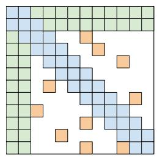
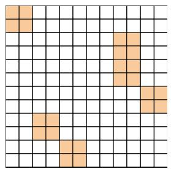
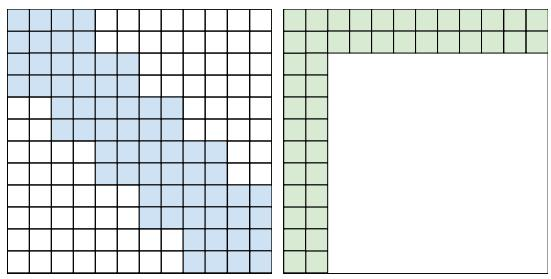
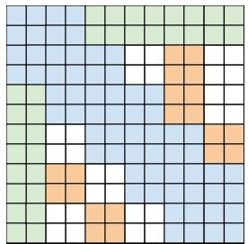
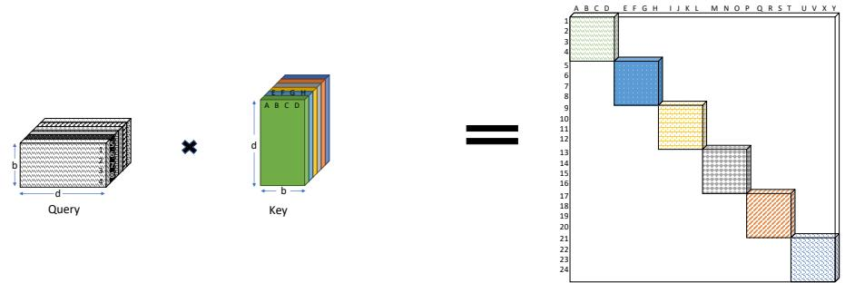
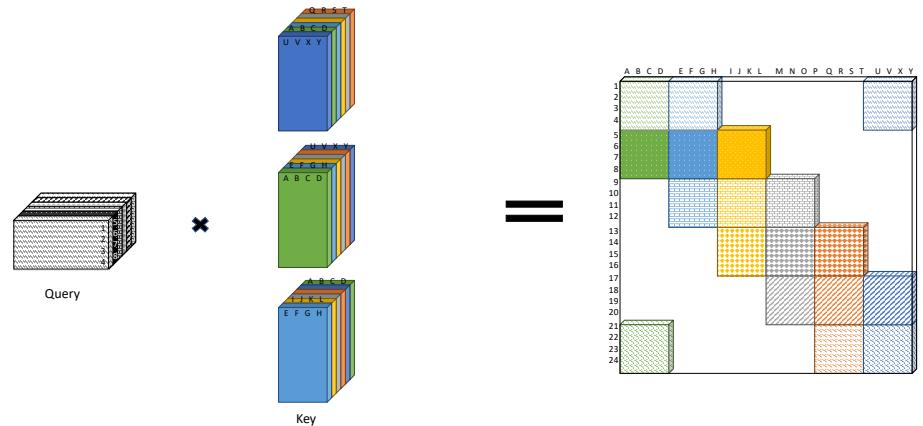
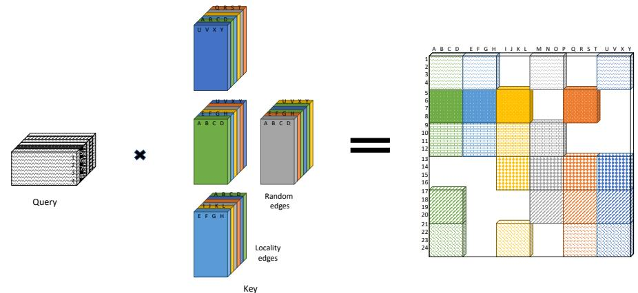
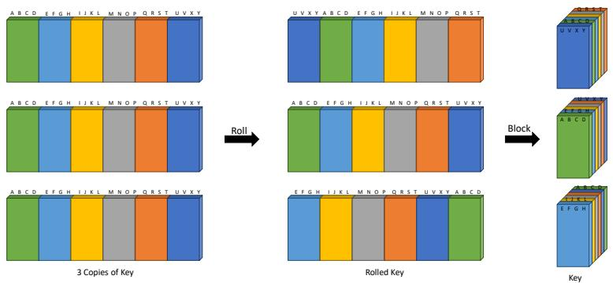
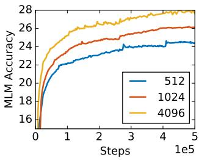

# Big Bird：面向更长序列的 Transformer

Manzil Zaheer, Guru Guruganesh, Avinava Dubey, Joshua Ainslie, Chris Alberti, Santiago Ontanon, Philip Pham, Anirudh Ravula, Qifan Wang, Li Yang, Amr Ahmed Google Research {manzilz, gurug, avinavadubey}@google.com

## 摘要

基于 Transformer 的模型（如 BERT）已成为自然语言处理（NLP）领域最成功的深度学习模型之一。遗憾的是，由于其全注意力机制，模型对序列长度存在二次方依赖（主要体现在内存占用上），这是其核心局限之一。为了解决这一问题，我们提出了 BIGBIRD，一种将这种二次依赖降低为线性的稀疏注意力机制。我们证明了 BIGBIRD 是序列函数的通用近似器，并且是图灵完备的，从而保留了二次全注意力模型的这些特性。同时，我们的理论分析揭示了作为稀疏注意力机制一部分、关注整个序列的 $O(1)$ 个全局 token（例如 CLS）所带来的一些优势。所提出的稀疏注意力在使用相似硬件的情况下，能够处理比以往长达 8 倍的序列。得益于处理更长上下文的能力，BIGBIRD 显著提升了问答和文本摘要等各种 NLP 任务的性能。我们还提出了其在基因组学数据上的全新应用。

## 1 引言

基于 Transformer [91] 的模型（如 BERT [22, 63]）在各种自然语言处理（NLP）任务中取得了巨大的成功，因而成为现代 NLP 研究的中流砥柱。其通用性和鲁棒性是 Transformer 获得广泛应用的主要驱动力。该模型易于适配各种基于序列的任务——既可以作为 seq2seq 模型用于翻译 [91]、摘要 [66]、生成 [15] 等任务，也可以作为独立的编码器用于情感分析 [83]、词性（POS）标注 [65]、机器阅读理解 [93] 等任务——并且众所周知，其性能大幅超越了以往的序列模型（如 LSTM [37]）。Transformer 的关键创新在于引入了自注意力机制，该机制可以对输入序列的每个 token 进行并行计算，消除了循环神经网络（如 LSTM）中的时序依赖性。这种并行性使 Transformer 能够充分发挥现代 SIMD 硬件加速器（如 GPU/TPU）的全部算力，从而推动了在规模空前的数据集上训练 NLP 模型。这种在大规模数据上训练的能力催生了 BERT [22] 和 T5 [75] 等模型，这些模型在大型通用语料库上对 Transformer 进行预训练，并将知识迁移到下游任务中。预训练在低数据量下游任务 [51] 以及数据充足的任务 [101] 中均带来了显著提升，因此成为 Transformer 在当代 NLP 中广泛普及的核心推动力。

自注意力机制通过允许输入序列中的每个标记（token）独立地关注序列中的所有其他标记，克服了循环神经网络（RNN）的局限性（即 RNN 的顺序性）。这种设计选择带来了一些有趣的影响。特别是，完全自注意力机制的计算和内存需求与序列长度呈二次方关系。我们注意到，尽管语料库可以很大，但在许多应用中提供上下文的序列长度却非常有限。在当前常用的硬件和模型大小下，这一要求大致意味着只能处理长度为 512 个标记的输入序列。这降低了它在需要更长上下文的任务中的直接适用性，例如问答（QA）[60]、文档分类等。

然而，尽管我们知道自注意力机制和 Transformer 非常有效，但我们对其理论的理解仍处于起步阶段。自注意力模型的哪些方面对其性能是必不可少的？关于 Transformer 及类似模型的表达能力（expressivity），我们能得出什么结论？先验上，从设计上看甚至尚不清楚所提出的自注意力机制是否与 RNN 一样有效。例如，自注意力机制由于具有置换等变性（permutation equivariant），甚至不遵循序列顺序。这一担忧已得到部分解决，Yun 等人 [104] 证明了 Transformer 具有足够的表达能力来捕获紧致域上的所有连续序列到序列函数。与此同时，Pérez 等人 [72] 证明了完全 Transformer 是图灵完备的（即能够模拟完整的图灵机）。由此产生了两个自然的问题：我们能否使用更少的内积操作来获得完全二次方自注意力方案的经验优势？这些稀疏注意力机制能否保持原始网络的表达能力和灵活性？

在本文中，我们解决了上述两个问题，并提出了一种稀疏注意力机制，以提高在众多需要长上下文的任务上的性能。我们系统地开发了 BIGBIRD，这是一种复杂度与标记数量呈线性的注意力机制（Sec. 2）。我们从图稀疏化方法中汲取灵感，并弄清了当完全注意力被放宽以形成所提出的注意力模式时，Transformer 表达能力的证明会在何处失效。这种理解帮助我们开发了 BIGBIRD，它在理论上具有相同的表达能力，同时在经验上也切实有效。具体而言，我们的 BIGBIRD 由三个主要部分组成：

• 一组关注序列所有部分的 $g$ 个全局标记。

• 所有标记关注一组 $w$ 个局部邻近标记。

• 所有标记关注一组 $r$ 个随机标记。

这带来了一种高性能的注意力机制，可扩展到长得多的序列长度（8x）。总而言之，我们的主要贡献如下：

1. BIGBIRD 满足全注意力 Transformer（full transformer）的所有已知理论性质（第 3 节）。特别是，我们证明了添加额外的标记（tokens）仅需 $O(n)$ 内积即可表达所有连续的序列到序列函数。此外，我们证明在关于精度的标准假设下，BIGBIRD 是图灵完备的（Turing complete）。

2. 在实证方面，我们展示了 BIGBIRD 建模的扩展上下文对多种 NLP 任务大有裨益。我们在多个不同数据集上的问答和文档摘要任务中均取得了最先进的（state-of-the-art）结果。这些结果的总结见第 4 节。

3. 最后，我们介绍了基于注意力的模型在长上下文极具价值的一个新颖应用：提取诸如 DNA 等基因组序列的上下文表征。通过更长序列的掩码语言模型（masked LM）预训练，BIGBIRD 提升了启动子区域和染色质图谱预测等下游任务的性能（第 5 节）。

## 1.1 相关工作 (Related Work)

为了缓解 Transformer 的二次方依赖，已有许多有趣的尝试，这些工作大致可分为两个方向。第一类工作接受长度限制并围绕其开发方法。该类别中最简单的方法仅采用滑动窗口 [93]，但总体而言，大多数工作符合以下通用范式：使用某种其他机制选择一个较小的相关上下文子集输入到 Transformer 中，并可选择进行迭代，即每次使用不同的上下文多次调用 Transformer 块。其中最突出的是，SpanBERT [42]、ORQA [54]、REALM [34]、RAG [57] 在不同任务上取得了强劲的性能。然而，值得注意的是，这些方法通常需要大量的工程努力（如通过大规模最近邻搜索进行反向传播），且训练难度较大。

第二类工作则质疑全注意力是否必不可少，并尝试提出不需要全注意力的方法，从而减少内存和计算需求。其中较为突出的是，Dai 等人 [21]、Sukhbaatar 等人 [82]、Rae 等人 [74] 提出了自回归模型，这些模型在从左到右的语言建模中表现良好，但在需要双向上下文的任务中表现不佳。Child 等人 [16] 提出了一种稀疏模型，将复杂度降低至 $O ( n { \sqrt { n } } )$；Kitaev 等人 [49] 则通过使用局部敏感哈希（LSH）计算最近邻，进一步将复杂度降低至 $O ( n \log ( n ) )$。

  
(a) 随机注意力 (Random attention)

  
(b) 窗口注意力 (Window attention)

  
(c) 全局注意力 (Global Attention)

  
(d) BIGBIRD  
Figure 1: BIGBIRD 中所使用的注意力机制构建模块。白色表示不存在注意力。(a) $r = 2$ 的随机注意力（random attention），(b) $w = 3$ 的滑动窗口注意力（sliding window attention），(c) $g = 2$ 的全局注意力（global attention）。(d) 组合后的 BIGBIRD 模型。

Ye 等人 [103] 提出了数据的二元划分，而 Qiu 等人 [73] 则通过使用块稀疏性来降低复杂度。最近，Longformer [8] 引入了基于局部滑动窗口的掩码并辅以少量全局掩码以减少计算量，从而将 BERT 扩展到更长序列的任务中。最后，我们的工作与 Extended Transformers Construction [4] 的工作密切相关且建立在其基础之上。该工作旨在为 Transformer 编码文本中的结构。他们广泛使用了全局词元（global token）的思想来实现其目标。我们的理论工作也可以被看作为这些模型的成功提供了合理解释。需要指出的是，上述大多数方法都是基于启发式的，在经验上不如原始 Transformer 那样通用和鲁棒，即相同的架构未能在多个标准基准上达到 SoTA（Longformer 是一个例外，我们将其纳入了所有对比中，更详细的对比见附录 E.3）。此外，这些近似方法缺乏理论保证。

## 2 BIGBIRD 架构

在本节中，我们利用作用于输入序列 $\pmb { X } = ( \pmb { x } _ { 1 } , . . . , \pmb { x } _ { n } ) \in \mathbb { R } ^ { n \times d }$ 的 Transformer 各层中所使用的广义注意力机制来描述 BIGBIRD 模型。广义注意力机制由一个有向图 D 描述，其顶点集为 $[ n ] =$ $\{ 1 , \ldots , n \}$。弧集（有向边）表示注意力机制将考虑的内积集合。令 $N ( i )$ 表示 D 中节点 i 的出邻居集，则广义注意力机制的第 $i ^ { \mathrm { t h } }$ 个输出向量定义为

$$
\operatorname{ATTN} _ {D} (\boldsymbol {X}) _ {i} = \boldsymbol {x} _ {i} + \sum_ {h = 1} ^ {H} \sigma \left(Q _ {h} (\boldsymbol {x} _ {i}) K _ {h} (\boldsymbol {X} _ {N (i)}) ^ {T}\right) \cdot V _ {h} (\boldsymbol {X} _ {N (i)})\tag{AT}
$$

其中 $Q _ { h } , K _ { h } : \mathbb { R } ^ { d }  \mathbb { R } ^ { m }$ 分别是查询（query）和键（key）函数，$V _ { h } : \mathbb { R } ^ { d }  \mathbb { R } ^ { d }$ 是值（value）函数，σ 是评分函数（例如 softmax 或 hardmax），H 表示头（head）的数量。另请注意，$X _ { N ( i ) }$ 对应于仅通过堆叠 $\{ \pmb { x } _ { j } : j \in N ( i ) \}$ 而非所有输入所构成的矩阵。如果 D 是完全有向图，我们就可以恢复 Vaswani et al. [91] 的完全二次复杂度注意力机制。为了简化阐述，即使底层图可能是稀疏的，我们仍将在图 D 的邻接矩阵 A 上进行操作。具体来说，$\check { A } \in [ 0 , \mathbf { \dot { 1 } } ] ^ { n \times n }$，若查询 i 关注键 j，则 $A ( i , j ) = 1$，否则为零。例如，当 A 为全 1 矩阵时（如在 BERT 中），由于所有 token 都会关注其他所有 token，从而导致二次复杂度。这种将自注意力视为全连接图的视角使我们能够利用现有的图论来帮助降低其复杂度。降低自注意力的二次复杂度的问题现在可以被视为图稀疏化（graph sparsification）问题。众所周知，随机图是扩展图（expander graph），并可以在许多不同情境下（包括在其谱性质方面）逼近完全图 [80, 38]。我们认为，用于注意力机制的稀疏随机图应具备两个期望特征：节点间较小的平均路径长度以及局部性（locality）概念，下文我们将对这两者逐一展开讨论。

让我们考虑最简单的随机图构建，即所谓的 Erdos-Rényi 模型，其中每条边都以固定概率独立选取。在这样一个仅有 $\tilde { \Theta } ( n )$ 条边的随机图中，任意两个节点之间的最短路径与节点数量呈对数关系 [17, 43]。因此，这种随机图在谱性质上逼近完全图，并且其（邻接矩阵的）第二特征值与第一特征值相距甚远 [9, 10, 6]。这一性质使得图中随机游走的混合时间（mixing time）极快，通俗地说，这意味着信息可以在任意一对节点之间快速流动。因此，我们提出了一种稀疏注意力，其中每个查询关注 r 个随机数量的键，即对于 r 个随机选择的键有 $A ( i , \cdot ) = 1$（见 Fig. 1a）。

启发 BIGBIRD 创立的第二个观点是，NLP 和计算生物学中的大多数上下文数据都表现出极强的引用局部性（locality of reference）。在这种现象中，关于某个 token 的大量信息可以从其相邻 token 中获得。最切题的是，Clark et al. [19] 研究了 NLP 任务中的自注意力模型，并得出结论：相邻的内积极其重要。局部性（即语言结构中 token 的临近性）的概念也构成了各种语言学理论（如转换生成语法）的基础。在图论术语中，聚类系数（clustering coefficient）是连通局部性的一种度量，当图中包含许多团（cliques）或近似团（几乎完全互连的子图）时，该系数较高。简单的 Erdos-Rényi 随机图并不具有高聚类系数 [84]，但一类被称为小世界图（small world graphs）的随机图则表现出高聚类系数 [94]。Watts and Strogatz [94] 提出的一个特定模型与我们高度相关，因为它在平均最短路径与局部性概念之间取得了良好的平衡。该模型的生成过程如下：构建一个正则环状点阵（regular ring lattice），即一个具有 n 个节点的图，每个节点与其两边各 w/2 个邻居相连，共连接 w 个邻居。

换句话说，我们从节点上的滑动窗口开始。然后，所有连接中的一个随机子集（k%）被替换为随机连接。其余 (100 - k)% 的局部连接得以保留。然而，在现代硬件上删除此类随机边可能效率低下，因此我们将其保留，这不会影响其特性。总之，为了捕获上下文中的这些局部结构，在 BIGBIRD 中，我们定义了滑动窗口注意力，以便在

<table><tr><td>模型</td><td>MLM</td><td>SQuAD</td><td>MNLI</td></tr><tr><td>BERT-base</td><td>64.2</td><td>88.5</td><td>83.4</td></tr><tr><td>Random (R)</td><td>60.1</td><td>83.0</td><td>80.2</td></tr><tr><td>Window (W)</td><td>58.3</td><td>76.4</td><td>73.1</td></tr><tr><td>R + W</td><td>62.7</td><td>85.1</td><td>80.5</td></tr></table>

Table 1: 构建模块对比 @512

宽度为 w 的自注意力期间，位于位置 i 的 query 会关注从 $i - w / 2$ 到 $i + w / 2$ 的 key。在我们的符号表示中，$A ( i , i - w / 2 : i + w / 2 ) = 1$（见 Fig. 1b）。作为初步的合理性检查，我们进行了基础实验，以测试在保持注意力关于 token 数量线性的同时，这些直觉是否足以获得接近类 BERT 模型的性能。我们发现，随机块和局部窗口不足以捕获与 BERT 性能相匹敌所需的全部上下文。

BIGBIRD 的最后一个组成部分灵感来源于我们的理论分析（第 3 节），这对实证性能至关重要。更具体地，我们的理论利用了“全局 token（全局词元）”的重要性（即关注序列中所有 token，且被所有 token 所关注的 token，见图 1c）。这些全局 token 可以通过两种方式定义：

• BIGBIRD-ITC：在内部 Transformer 构建（Internal Transformer Construction, ITC）中，我们使一些现有的 token 成为“全局”的，它们关注整个序列。具体而言，我们选择一个索引子集 G（满足 $g : = | G | )$），使得对于所有 $i \in G$，有 $A ( i , : ) = 1$ 且 $A ( : , i ) = 1$。

• BIGBIRD-ETC：在扩展 Transformer 构建（Extended Transformer Construction, ETC）中，我们引入了额外的“全局” token，例如 CLS。具体来说，我们添加了 g 个关注所有现有 token 的全局 token。用我们的符号表示，这对应于通过向矩阵 A 添加 g 行来创建一个新矩阵 $B \in [ 0 , 1 ] ^ { ( N + g ) \times ( N + g ) ^ { \circ } }$，使得对于所有 $i \in \{ 1 , 2 , . . . g \}$，满足 $B ( i , : ) \ = \ 1$ 且 $B ( : , i ) = 1$，并且对于所有 $i , j \in \{ 1 , \ldots , N \}$，满足 $B ( g + i , g + j ) = A ( i , j ) \forall \ : i , j \in \{ 1 , \ldots , N \}$。这增加了存储上下文的额外位置，正如我们在实验中将看到的那样，它提升了性能。

BIGBIRD 的最终注意力机制（图 1d）具有所有这三种特性：查询（query）关注 r 个随机键（key），每个查询关注其位置左侧的 $w / 2$ 个 token 和右侧的 $w / 2$ 个 token，并且它们包含 g 个全局 token（全局 token 可以来自现有 token 或额外添加的 token）。我们在附录 D 中提供了实现细节。

## 3 稀疏注意力机制的理论结果

在本节中，我们将从两个方面证明稀疏注意力机制与全注意力机制一样强大且具有表现力。首先，我们证明当稀疏注意力机制用于独立编码器（例如 BERT）时，它们是 Yun 等人 [104] 形式下的序列到序列函数的通用近似器（Universal Approximators）。我们注意到，这一性质在同期工作 Yun 等人 [105] 中也进行了理论探讨。其次，与 [105] 不同，我们进一步证明了稀疏编码器-解码器 Transformer 是图灵完备的（Turing Complete）（假设满足 [72] 中定义的相同条件）。作为上述积极结果的补充，我们还展示了转向稀疏注意力机制需要付出代价，即天下没有免费的午餐。在第 3.4 节中，我们通过给出一个自然任务展示了下界，在该任务中，任何足够稀疏的机制都需要多项式级增加的层数。

## 3.1 符号表示

完整的 Transformer 编码器栈不过是单层编码器（具有独立参数）的重复应用。我们用 $\mathcal { T } _ { D } ^ { H , m , q }$ 表示此类 Transformer 编码器栈的类别（使用第 2 节中的广义编码器定义），它由 $H$ 个头大小为 $m$ 的注意力头组成，$q$ 为输出网络的隐藏层大小，且注意力层由有向图 $D$ 定义。

我们提出的注意力机制与 Vaswani 等人 [91]、Yun 等人 [104] 的主要区别在于，我们在每个序列的开头添加了一个特殊标记（token），并为其赋予一个特殊向量。我们将其记为 $\scriptstyle { \mathbf { { \mathit { x } } } } _ { 0 }$。因此，我们的图 $D$ 的顶点集为 $\{ 0 \} \cup [ \bar { n } ] = \{ 0 , 1 , 2 , \dotsc , n \}$。我们假设在 Transformer 的最终输出层中，这个额外的节点及其对应的向量将被丢弃。为避免繁琐的符号表示，我们仍将 Transformer 视为将序列 $\pmb { X } \in \mathbb { R } ^ { n \times d } \mathrm { t o } \mathbb { R } ^ { n \times d }$ 进行映射。我们还允许 Transformer 在输入层中将位置嵌入 $E \doteq \mathbb { R } ^ { d \times n }$ 附加到矩阵 $X$ 上。

最后，我们需要定义函数类和距离度量，以证明通用近似性质（universal approximation property）。令 ${ \mathcal { F } } _ { C D }$ 表示在由 $\ell _ { p }$ 范数定义的拓扑下连续的连续函数集合 $f : [ 0 , 1 ] ^ { n \times \dot { d } }  \mathbb { R } ^ { \Breve { n } \times d }$。回顾对于任意 $p \geq 1$，$\ell _ { p }$ 距离为 $d _ { p } ( f _ { 1 } , f _ { 2 } ) =$ $\left( \int \| f _ { 1 } ( X ) - f _ { 2 } ( X ) \| _ { p } ^ { p } d X \right) ^ { 1 / p }$。

## 3.2 通用近似器

定义 1. 以 0 为中心的星形图（star-graph）$S$ 是定义在 $\{ 0 , \ldots , n \}$ 上的图。所有顶点 $i$ 的邻域为 $N ( i ) { \overset { } { = } } \left\{ 0 , i \right\} f o r i \in \left\{ 1 \ldots n \right\}$，且 $N ( 0 ) = \{ 1 , . . . \overset { \cdot } { n } \}$。

我们的主要定理是：由包含 $S$ 的任意图所定义的稀疏注意力机制都是通用近似器：

定理 1. 给定 $1 < p < \infty$ 和 $\epsilon > 0 ,$，对于任意 $f \in \mathcal { F } _ { C D }$，存在一个具有稀疏注意力的 Transformer $g \in \mathcal { T } _ { D } ^ { H , m , q }$，使得 $d _ { p } ( f , g ) \leq \epsilon$，其中 $D$ 是包含星形图 $S$ 的任意图。

为了证明该定理，我们将遵循 [104] 中概述的标准证明结构。

步骤 1：用分段常数函数逼近 ${ \mathcal { F } } _ { C D }$。由于 $f$ 是具有有界定义域 $[ 0 , \dot { 1 } ) ^ { n \times \bar { d } }$ 的连续函数，我们将用合适的分段常数函数对其进行逼近。这是通过将区域 [0, 1) 适当地划分为粒度为 δ 的网格以获得离散集 $\mathbb { G } _ { \delta }$ 来实现的。因此，我们可以假设我们正在处理一个函数 $\bar { f } : \mathbb { G } _ { \delta } \to \mathbb { R } ^ { n \times d }$，其中 $\begin{array} { r } { d _ { p } ( f , \bar { f } ) \leq \frac { \epsilon } { 3 } } \end{array}$

步骤 2：用修改后的 Transformer 逼近分段常数函数。这是证明的关键步骤，其中自注意力机制被用于生成输入的上下文映射。通俗地说，上下文映射是由矩阵 $( X , x _ { i } )$ 和一个列组成的配对的唯一编码。其唯一性使得前馈层（Feed forward layers）能够利用每个编码将其映射到唯一的输出列。

主要的技术挑战是仅使用稀疏注意力机制来计算上下文映射。在 [104] 中，这是通过使用一个“选择性”移位算子来完成的，该算子将位于特定区间内的条目向上平移。他们证明的关键在于，该平移量恰好是从最大条目到最小条目的范围。

利用稀疏注意力机制创建上下文映射是一项巨大的挑战。具体而言，由于每个查询（query）仅关注少数几个键（key），因此是否能够汇集足够的信息来构建整个矩阵的上下文嵌入绝非显而易见。为了解决这个问题，我们开发了一种稀疏移位算子，当矩阵的条目落在某个特定范围内时对其进行移位。移位的确切幅度由有向稀疏注意力图 $D .$ 控制。第二个关键要素是使用额外的全局 token（global token）。通过将该算子精细地应用于一组选定的范围，我们将证明每一列都将包含完整映射的唯一映射。因此，我们可以通过使用多层和一个辅助全局 token 来弥补自注意力机制中内积的损失。

步骤 3：用原始 Transformer 逼近修改后的 Transformer：最后一步是用使用 ReLU 和 softmax 的原始 Transformer 来逼近修改后的 Transformer。

我们在附录 A（App. A）中提供了完整的细节。

## 3.3 图灵完备性

Transformer 是一类非常通用的模型。在 Vaswani et al. [91] 的原始论文中，它们同时被用于编码器和解码器。虽然前一节概述了仅凭编码器就已十分强大，但另一个自然的问题是：同时使用解码器和编码器会带来什么额外的能力？Pérez et al. [72] 表明，基于二次注意力机制的完整 Transformer 是图灵完备的（Turing Complete）。这一结果依赖于一个不切实际的假设，即该模型在任意精度模型下工作。当然，这是必要的，因为否则 Transformer 只是有界的有限状态机，不可能是图灵完备的。

人们很自然会问，全注意力机制是否是必需的？或者稀疏注意力机制是否也可以用来模拟任意图灵机？我们证明事实确实如此：我们可以使用稀疏编码器和稀疏解码器来模拟任意图灵机。

为了在 Transformer 架构中使用稀疏注意力机制，我们需要定义一种合适的修改，使每个 token 仅对先前的 token 做出反应。与 BERT 中整个注意力机制一次性应用的情况不同，在完整的 Transformer 中，解码器端的稀疏注意力机制是逐个 token 使用的。其次，Pérez et al. [72] 的工作将每个 token 用作纸带历史的表示，并使用全注意力来移动并检索正确的纸带符号。Pérez et al. [72] 的大部分构造对于稀疏注意力都是适用的，除了他们用于回溯历史的寻址方案（[72] 中的引理 B.4）。我们展示了如何使用稀疏注意力机制来模拟这一点，并将细节推迟至附录 B（App. B）。

## 3.4 局限性

我们展示了一个全注意力机制可以在 $O ( 1 )$ 层内解决的自然任务。然而，在标准复杂度理论假设下，对于任何具有 ${ \tilde { O } } ( n )$ 条边的稀疏注意力层（不仅限于 BIGBIRD），该问题都需要 $\tilde { \Omega } ( n )$ 层。（此处 $\tilde { O }$ 隐藏了多对数因子）。考虑这样一个简单问题：在给定的长度为 n 的序列中，为每个向量找到其对应的最远向量。形式化地，

任务 1。给定 n 个单位向量 $\{ u _ { 1 } , \ldots , u _ { n } \}$，求 $f ( u _ { 1 } , \dots , u _ { n } ) \to ( u _ { 1 ^ { * } } , \dots , u _ { n ^ { * } } )$，其中对于固定的 $j \in [ n ]$，我们定义 $j ^ { * } = \arg \operatorname* { m a x } _ { k } \| u _ { k } - u _ { j } \| _ { 2 } ^ { 2 }$

在单位向量的情况下，寻找相距最远的向量归结为最小内积搜索。对于具有适当查询（query）和键（key）的全注意力机制，这项任务非常容易，因为我们可以计算所有成对的内积。

稀疏注意力（sparse-attention）的不可能性源于来自正交向量猜想（Orthogonal Vector Conjecture, OVC）[1, 2, 7, 96]的硬度结果。OVC 是细粒度复杂度（fine-grained complexity）中广泛使用的假设。通俗地说，它指出人们无法在亚二次时间内确定 $n$ 个布尔向量之间的最小内积是否为 0。在附录 C（App. C）中，我们展示了一个利用 OVC 进行的归约，以证明如果对于任意稀疏有向图 $D$，一个 Transformer $g \in \mathcal { T } _ { D } ^ { H = 1 , m = 2 d , q = 0 }$ 能够评估任务 1（Task 1），那么它就能够解决正交向量问题。

命题 1（Proposition 1）。存在一个单层全自注意力 $g \in \mathcal { T } ^ { H = 1 , m = 2 d , q = 0 }$ 能够评估任务 1，即 $g ( u _ { 1 } , . . . , u _ { n } ) = [ u _ { 1 ^ { * } } , . . . , u _ { n ^ { * } } ] ,$ ，但对于任何具有 ${ \tilde { O } } ( n )$ 条边（即内积评估次数）的稀疏注意力图 $D$，则需要 $\tilde { \Omega } ( n ^ { 1 - o ( 1 ) } )$ 层。我们在附录 C 中给出了该结论的形式化证明。

## 4 实验：自然语言处理

在本节中，我们的目标是展示为 NLP 任务建模更长输入序列的优势，为此我们选择了三个代表性任务。我们首先从基础的掩码语言建模（Masked Language Modeling, MLM；Devlin et al. 22）开始，以检验通过利用更长的连续序列是否可以学习到更好的上下文表征。接下来，我们考虑带有支持性证据的问答（QA），对于该任务，处理更长序列的能力将使我们能够利用像 TF-IDF/BM25 这样的粗略系统检索到更多证据。

<table><tr><td rowspan="2">模型</td><td colspan="3">HotpotQA</td><td colspan="2">NaturalQ</td><td>TriviaQA</td><td>WikiHop</td></tr><tr><td>Ans</td><td>Sup</td><td>Joint</td><td>LA</td><td>SA</td><td>Full</td><td>MCQ</td></tr><tr><td>RoBERTa</td><td>73.5</td><td>83.4</td><td>63.5</td><td>-</td><td>-</td><td>74.3</td><td>72.4</td></tr><tr><td>Longformer</td><td>74.3</td><td>84.4</td><td>64.4</td><td>-</td><td>-</td><td>75.2</td><td>75.0</td></tr><tr><td>BIGBIRD-ITC</td><td>75.7</td><td>86.8</td><td>67.7</td><td>70.8</td><td>53.3</td><td>79.5</td><td>75.9</td></tr><tr><td>BIGBIRD-ETC</td><td>75.5</td><td>87.1</td><td>67.8</td><td>73.9</td><td>54.9</td><td>78.7</td><td>75.9</td></tr></table>

Table 2: 使用 Base 规模模型的 QA 验证集结果。我们报告了 WikiHop 的准确率以及 HotpotQA、Natural Questions 和 TriviaQA 的 F1 值。

<table><tr><td rowspan="2">模型</td><td colspan="3">HotpotQA</td><td colspan="2">NaturalQ</td><td colspan="2">TriviaQA</td><td>WikiHop</td></tr><tr><td>Ans</td><td>Sup</td><td>Joint</td><td>LA</td><td>SA</td><td>Full</td><td>Verified</td><td>MCQ</td></tr><tr><td>HGN [26]</td><td>82.2</td><td>88.5</td><td>74.2</td><td>-</td><td>-</td><td>-</td><td>-</td><td>-</td></tr><tr><td>GSAN</td><td>81.6</td><td>88.7</td><td>73.9</td><td>-</td><td>-</td><td>-</td><td>-</td><td>-</td></tr><tr><td>ReflectionNet [32]</td><td>-</td><td>-</td><td>-</td><td>77.1</td><td>64.1</td><td>-</td><td>-</td><td>-</td></tr><tr><td>RikiNet-v2 [61]</td><td>-</td><td>-</td><td>-</td><td>76.1</td><td>61.3</td><td>-</td><td>-</td><td>-</td></tr><tr><td>Fusion-in-Decoder [39]</td><td>-</td><td>-</td><td>-</td><td>-</td><td>-</td><td>84.4</td><td>90.3</td><td>-</td></tr><tr><td>SpanBERT [42]</td><td>-</td><td>-</td><td>-</td><td>-</td><td>-</td><td>79.1</td><td>86.6</td><td>-</td></tr><tr><td>MRC-GCN [87]</td><td>-</td><td>-</td><td>-</td><td>-</td><td>-</td><td>-</td><td>-</td><td>78.3</td></tr><tr><td>MultiHop [14]</td><td>-</td><td>-</td><td>-</td><td>-</td><td>-</td><td>-</td><td>-</td><td>76.5</td></tr><tr><td>Longformer [8]</td><td>81.2</td><td>88.3</td><td>73.2</td><td>-</td><td>-</td><td>77.3</td><td>85.3</td><td>81.9</td></tr><tr><td>BIGBIRD-ETC</td><td>81.2</td><td>89.1</td><td>73.6</td><td>77.8</td><td>57.9</td><td>84.5</td><td>92.4</td><td>82.3</td></tr></table>

Table 3: QA 任务测试集上的微调结果。测试结果（HotpotQA、Natural Questions、TriviaQA 的 F1 值，以及 WikiHop 的准确率）均取自各自的排行榜。对于每个任务，挑选了排名前 3 的模型（不包括 BIGBIRD-etc）。在 Natural Questions 长答案（LA）、TriviaQA 和 WikiHop 上，BIGBIRD-ETC 达到了新的最先进水平（state-of-the-art）。在 HotpotQA 上，按 F1 值我们在排行榜中名列第三，按精确匹配（EM）名列第二。

最后，我们处理长文档分类问题，其中具有区分性的信息可能并不位于前 512 个 token 之内。下面我们总结了 BIGBIRD 使用序列长度 40961 的结果，而将所有其他设置细节（包括计算资源、批大小、步长）保留在附录 E（App. E）中说明。

预训练与 MLM（掩码语言建模） 我们遵循 [22, 63] 构建了 BIGBIRD 的 base 和 large 版本，并使用 MLM 目标对其进行预训练。该任务涉及预测被掩码遮盖的随机标记子集。我们使用了四个标准数据集进行预训练（列于附录 E.1，表 9），并从公开的 RoBERTa 检查点2进行热启动。遵循 [8]，我们以每字符比特数（bits per character）来比较预测被掩码标记的性能。如附录 E.1，表 10 所示，BIGBIRD 和 Longformer 的表现均优于长度受限的 RoBERTa，其中 BIGBIRD-ETC 表现最佳。我们注意到，我们的模型是在合理的单芯片 16GB 显存配置下、以 32-64 的批次大小进行训练的。我们的显存效率归功于第 2 节中所述稀疏注意力机制的高效分块和稀疏结构。

## 问答（QA） 我们考虑了以下四个具有挑战性的数据集：

1. Natural Questions [52]：针对给定问题，从给定证据中找出简短答案跨度（SA），并标出给定证据中包含正确答案信息的段落（长答案，LA）。

2. HotpotQA-distractor [100]：与 Natural Questions 类似，它需要从给定证据中找出答案（Ans）以及用于多跳推理所需的不同文档中的支持事实（Sup）。

3. TriviaQA-wiki [41]：我们需要利用提供的 Wikipedia 证据来回答给定问题，然而，答案可能并不存在于给定的证据中。在一个经过验证的较小问题子集上，给定的证据保证包含答案。尽管如此，在这种情况下我们仍将答案建模为跨度选择问题。

4. WikiHop [95]：通过整合证据中分布在多个文档中的信息，从多项选择题（MCQ）中选出正确选项。

由于这些任务竞争非常激烈，针对每个数据集符合其相应输出格式的要求，人们已经设计了多个高度工程化的系统。为了进行公平比较，我们在训练 BIGBIRD 时必须使用一些额外的正则化，其细节以及确切的架构描述在附录 E.2 中提供。我们使用 base 尺寸的模型进行实验，并针对每个数据集在开发集上选择最佳配置（如表 2 所报导）。我们可以看到，带有扩展全局标记的 BIGBIRD-ETC 始终优于所有其他模型。因此，我们选择该配置来训练一个 large 尺寸的模型，用于在隐藏测试集上进行评估。

在表 3 中，我们将 BIGBIRD-ETC 模型与排行榜上除 BIGBIRD 之外的前 3 名条目进行了比较。人们可以清楚地看到使用更长上下文的重要性，因为 Longformer 和 BIGBIRD 的表现都优于具有较小上下文的模型。此外，值得注意的是，BIGBIRD 提交的是单一模型，而 Natural Questions 排行榜上的其他前 3 名条目均为集成模型，这或许可以解释其在精确答案短语选择方面的准确率略低的原因。

分类 我们在不同长度和内容的数据集上进行了实验，特别是各种文档分类任务和 GLUE 任务。遵循 BERT 的做法，我们在第一个 [CLS] 标记（token）之上添加了一个带有交叉熵损失（cross entropy loss）的层。我们发现，当文档更长且训练样本更少时，使用 BIGBIRD 带来的提升更为显著。例如，在使用 base 规模的模型时，BIGBIRD 将 Arxiv 数据集的当前最优性能（state-of-the-art，SoTA）提高了约 5 个百分点。在 Patents 数据集上，相比于使用简单的 BERT/RoBERTa 有所提升，但鉴于训练数据规模庞大，相比 SoTA（非基于 BERT 的模型）的提升并不显著。需要注意的是，在规模小得多的 IMDb 数据集上并没有观察到这种性能增益。连同实验设置细节，我们在附录 E.4（App. E.4）中展示了详细结果，体现了具有竞争力的性能。

## 4.1 编码器-解码器任务

对于编码器-解码器架构，显而易见的是，两者都会由于全自注意力机制（full self attention）而面临二次复杂度的问题。我们重点仅在编码器端引入 BIGBIRD 的稀疏注意力机制。这是因为在实际的生成式应用中，与输入相比，输出序列的长度通常较短。例如在文本摘要任务中，我们在现实场景中观察到（参见附录 E.5 表 18 / App. E.5 Tab. 18），输出序列长度的中位数约为 200，而输入序列长度的中位数大于 3000。对于此类应用，对编码器使用稀疏注意力机制，对解码器使用全自注意力机制会更加高效。

<table><tr><td rowspan="2" colspan="2">模型</td><td colspan="3">Arxiv</td><td colspan="3">PubMed</td><td colspan="3">BigPatent</td></tr><tr><td>R-1</td><td>R-2</td><td>R-L</td><td>R-1</td><td>R-2</td><td>R-L</td><td>R-1</td><td>R-2</td><td>R-L</td></tr><tr><td rowspan="10">先前方法</td><td>SumBasic [68]</td><td>29.47</td><td>6.95</td><td>26.30</td><td>37.15</td><td>11.36</td><td>33.43</td><td>27.44</td><td>7.08</td><td>23.66</td></tr><tr><td>LexRank [25]</td><td>33.85</td><td>10.73</td><td>28.99</td><td>39.19</td><td>13.89</td><td>34.59</td><td>35.57</td><td>10.47</td><td>29.03</td></tr><tr><td>LSA [97]</td><td>29.91</td><td>7.42</td><td>25.67</td><td>33.89</td><td>9.93</td><td>29.70</td><td>-</td><td>-</td><td>-</td></tr><tr><td>Attn-Seq2Seq [85]</td><td>29.30</td><td>6.00</td><td>25.56</td><td>31.55</td><td>8.52</td><td>27.38</td><td>28.74</td><td>7.87</td><td>24.66</td></tr><tr><td>Pntr-Gen-Seq2Seq [77]</td><td>32.06</td><td>9.04</td><td>25.16</td><td>35.86</td><td>10.22</td><td>29.69</td><td>33.14</td><td>11.63</td><td>28.55</td></tr><tr><td>Long-Doc-Seq2Seq [20]</td><td>35.80</td><td>11.05</td><td>31.80</td><td>38.93</td><td>15.37</td><td>35.21</td><td>-</td><td>-</td><td>-</td></tr><tr><td>Sent-CLF [81]</td><td>34.01</td><td>8.71</td><td>30.41</td><td>45.01</td><td>19.91</td><td>41.16</td><td>36.20</td><td>10.99</td><td>31.83</td></tr><tr><td>Sent-PTR [81]</td><td>42.32</td><td>15.63</td><td>38.06</td><td>43.30</td><td>17.92</td><td>39.47</td><td>34.21</td><td>10.78</td><td>30.07</td></tr><tr><td>Extr-Abst-TLM [81]</td><td>41.62</td><td>14.69</td><td>38.03</td><td>42.13</td><td>16.27</td><td>39.21</td><td>38.65</td><td>12.31</td><td>34.09</td></tr><tr><td>Dancer [31]</td><td>42.70</td><td>16.54</td><td>38.44</td><td>44.09</td><td>17.69</td><td>40.27</td><td>-</td><td>-</td><td>-</td></tr><tr><td rowspan="4">Base</td><td>Transformer</td><td>28.52</td><td>6.70</td><td>25.58</td><td>31.71</td><td>8.32</td><td>29.42</td><td>39.66</td><td>20.94</td><td>31.20</td></tr><tr><td>+ RoBERTa [76]</td><td>31.98</td><td>8.13</td><td>29.53</td><td>35.77</td><td>13.85</td><td>33.32</td><td>41.11</td><td>22.10</td><td>32.58</td></tr><tr><td>+ Pegasus [107]</td><td>34.81</td><td>10.16</td><td>30.14</td><td>39.98</td><td>15.15</td><td>35.89</td><td>43.55</td><td>20.43</td><td>31.80</td></tr><tr><td>BIGBIRD-RoBERTa</td><td>41.22</td><td>16.43</td><td>36.96</td><td>43.70</td><td>19.32</td><td>39.99</td><td>55.69</td><td>37.27</td><td>45.56</td></tr><tr><td rowspan="3">Large</td><td>Pegasus（报告值）[107]</td><td>44.21</td><td>16.95</td><td>38.83</td><td>45.97</td><td>20.15</td><td>41.34</td><td>52.29</td><td>33.08</td><td>41.75</td></tr><tr><td>Pegasus（重新评估）</td><td>43.85</td><td>16.83</td><td>39.17</td><td>44.53</td><td>19.30</td><td>40.70</td><td>52.25</td><td>33.04</td><td>41.80</td></tr><tr><td>BIGBIRD-Pegasus</td><td>46.63</td><td>19.02</td><td>41.77</td><td>46.32</td><td>20.65</td><td>42.33</td><td>60.64</td><td>42.46</td><td>50.01</td></tr></table>

Table 4: 长文档摘要的 ROUGE 得分。

摘要（Summarization） 文档摘要是一项为文本文档生成简短且准确摘要的任务。我们使用了三个长文档数据集来测试我们的模型，其详细信息在 Tab. 18 中给出。在本文中，我们专注于长文档的生成式摘要（abstractive summarization），在此任务中使用更长的上下文编码器理应能够提升性能。原因有两方面：首先，核心内容可能均匀分布在长文档中，而不仅仅存在于前 512 个 token 中，这在 BigPatents 数据集 [78] 的设计中正是如此。其次，更长的文档展现出更丰富的篇章结构，且摘要具有明显更高的抽象概括性，因此观察更多的上下文会有所助益。正如最近的研究 [76, 107] 所指出的，预训练有助于生成式任务，我们在 base 规模模型上从通用 MLM 预训练进行热启动（warm start），并在 large 规模模型上利用了来自 Pegasus [107] 的最先进摘要专用预训练。在这些长文档数据集上训练 BIGBIRD 稀疏编码器与全量解码器的结果见 Tab. 4。我们可以清楚地看到，对更长上下文进行建模带来了显著提升。除了超参数外，我们还在 App. E.5 中给出了在更短但更通用数据集上的结果，这些结果表明使用稀疏注意力同样不会损害性能。

## 5 实验：基因组学

近期，将深度学习应用于基因组学数据的研究大量涌现 [86, 106, 13]，并在若干具有重要生物学意义的任务上取得了性能提升，例如启动子位点预测 [71]、甲基化分析 [55]、非编码变异功能效应预测 [109] 等。这些方法以 DNA 序列片段作为输入，鉴于 DNA 中的许多功能效应具有高度的非局部性（non-local）[12]，我们认为 BIGBIRD 处理更长输入序列的能力将大有裨益。此外，受 NLP 的启发，我们利用海量未标注数据（例如人类参考基因组、Saccharomyces Genome Database），通过 MLM 预训练为 DNA 片段学习了强大的上下文表征。接下来，我们展示支持长输入的 BIGBIRD 结合所提出的预训练显著提升了两个下游任务的性能。这两个任务的详细实验设置见 App. F。

预训练与 MLM 如 Liang [58] 中所探讨的，我们建议首先将 DNA 分词为 token，而不是直接基于碱基对进行操作，从而进一步增加上下文长度（附录 F，图 7）。具体而言，我们为大小为 32K 的 DNA 序列构建了一个字节对编码（byte-pair encoding）[50] 表，平均每个 token 代表 8.78 个碱基对。我们使用 MLM 目标在人类参考基因组（GRCh37）3 上学习这些 token 的上下文表示。随后，我们在表 5 中报告了保留集上的每字符比特数（BPC）。我们发现，基于注意力机制的 DNA 上下文表示确实改善了 BPC，并且通过使用基于上下文的 DNA 表示确实改善了 BPC，通过

<table><tr><td>模型</td><td>BPC</td></tr><tr><td>SRILM [58]</td><td>1.57</td></tr><tr><td>BERT (sqln. 512)</td><td>1.23</td></tr><tr><td>BIGBIRD (sqln. 4096)</td><td>1.12</td></tr></table>

表 5: MLM BPC  
更长的上下文进一步得到了提升。

启动子区域预测 启动子（Promoter）是通常位于基因上游的 DNA 区域，是转录起始的位点。为了识别给定 DNA 序列中的启动子区域，已有人提出了多种方法 [99, 59, 11, 98, 71]，因为这是理解基因调控的重要第一步。相应的机器学习任务是将给定的 DNA 片段分类为启动子或非启动子序列。我们使用 Oubounyt 等人 [71] 整理的数据集，该数据集构建自真核生物启动子数据库（EPDnew）[24] 4。我们使用训练数据微调上述预训练的 BIGBIRD 模型，并在测试数据集上报告 F1 分数。我们在表 6 中将我们的结果与先前报告的最佳方法进行了对比。我们看到 BIGBIRD 取得了近乎完美的准确率，比先前报告的最佳准确率提升了 5%。

<table><tr><td>模型</td><td>F1</td></tr><tr><td>CNNProm [90]</td><td>69.7</td></tr><tr><td>DeePromoter [71]</td><td>95.6</td></tr><tr><td>BIGBIRD</td><td>99.9</td></tr></table>

表 6: 对比。

染色质图谱预测 DNA 的非编码区不编码蛋白质。大多数疾病和其他性状相关的单核苷酸多态性（single-nucleotide polymorphism）都与非编码基因组变异相关 [109, 46]。因此，理解 DNA 非编码区的功能效应是一项非常重要的任务。正如 Zhou 和 Troyanskaya [109] 所定义的，该过程中的一个重要步骤是从中预测大规模染色质图谱

<table><tr><td>模型</td><td>TF</td><td>HM</td><td>DHS</td></tr><tr><td>gkm-SVM [30]</td><td>89.6</td><td>-</td><td>-</td></tr><tr><td>DeepSea [109]</td><td>95.8</td><td>85.6</td><td>92.3</td></tr><tr><td>BIGBIRD</td><td>96.1</td><td>88.7</td><td>92.1</td></tr></table>

表 7: 染色质图谱预测

非编码基因组序列。为此，DeepSea [109] 从 DNA 元件百科全书（Encyclopedia of DNA Elements，ENCODE）5 和路线图表观基因组学（Roadmap Epigenomics）项目6 中整理了 240 万个非编码变异的 919 种染色质图谱（chromatin-profile）。相应的机器学习任务是针对给定的 DNA 非编码区域，预测这 919 种染色质图谱，其中包括针对 160 种不同转录因子（TF）的 690 种转录因子结合图谱、125 种 DNase I 敏感性（DHS）图谱以及 104 种组蛋白标记（HM）图谱。我们联合训练了 919 个二分类器，以从 DNA 片段序列中预测这些功能效应。在保留染色体上，我们将 AUC 与 Tab. 7 中的基线模型进行了比较，发现我们在更困难的 HM 任务上显著提升了性能，已知该任务比其他任务具有更长距离的相关性 [27]。

## 6 结论

我们提出了 BIGBIRD：一种与 token 数量呈线性关系的稀疏注意力机制。BIGBIRD 满足多项理论结论：它是序列到序列函数的通用逼近器，并且也是图灵完备的。理论上，我们利用额外的全局 token 来保持模型的表达能力。我们通过证明转向稀疏注意力机制确实会付出一定代价来补充这些结果。在实证方面，BIGBIRD 在问答和长文档分类等多项 NLP 任务上取得了最先进（state-of-the-art）的性能。我们进一步引入了基于注意力的 DNA 上下文语言模型，并将其针对下游任务（如启动子区域预测和非编码变异效应预测）进行了微调。

## 参考文献

[1] A. Abboud, V. V. Williams, and O. Weimann. Consequences of faster alignment of sequences. In International Colloquium on Automata, Languages, and Programming, pages 39–51. Springer, 2014.

[2] A. Abboud, A. Backurs, and V. V. Williams. Tight hardness results for lcs and other sequence similarity measures. In 2015 IEEE 56th Annual Symposium on Foundations of Computer Science, pages 59–78. IEEE, 2015.

[3] J. Abreu, L. Fred, D. Macêdo, and C. Zanchettin. Hierarchical attentional hybrid neural networks for document classification. In International Conference on Artificial Neural Networks, pages 396–402. Springer, 2019.

[4] J. Ainslie, S. Ontanon, C. Alberti, P. Pham, A. Ravula, and S. Sanghai. Etc: Encoding long and structured data in transformers. arXiv preprint arXiv:2004.08483, 2020.

[5] C. Alberti, K. Lee, and M. Collins. A bert baseline for the natural questions. arXiv preprint arXiv:1901.08634, 2019.

[6] J. Alt, R. Ducatez, and A. Knowles. Extremal eigenvalues of critical erd\h {o} sr\’enyi graphs. arXiv preprint arXiv:1905.03243, 2019.

[7] A. Backurs and P. Indyk. Edit distance cannot be computed in strongly subquadratic time (unless seth is false). In Proceedings oftheforty-seventh annual ACM symposium on Theory ofcomputing, pages 51–58, 2015.

[8] I. Beltagy, M. E. Peters, and A. Cohan. Longformer: The long-document transformer. arXiv preprint arXiv:2004.05150, 2020.

[9] F. Benaych-Georges, C. Bordenave, A. Knowles, et al. Largest eigenvalues of sparse inhomogeneous erdos–rényi graphs. Annals of Probability, 47(3):1653–1676, 2019.

[10] F. Benaych-Georges, C. Bordenave, A. Knowles, et al. Spectral radii of sparse random matrices. In Annales de l’Institut Henri Poincaré, Probabilités et Statistiques, volume 56, pages 2141–2161. Institut Henri Poincaré, 2020.

[11] R. Bharanikumar, K. A. R. Premkumar, and A. Palaniappan. Promoterpredict: sequence-based modelling of escherichia coli σ70 promoter strength yields logarithmic dependence between promoter strength and sequence. PeerJ, 6:e5862, 2018.

[12] S. Buldyrev, A. Goldberger, S. Havlin, R. Mantegna, M. Matsa, C.-K. Peng, M. Simons, and H. Stanley. Long-range correlation properties of coding and noncoding dna sequences: Genbank analysis. Physical Review E, 51(5):5084, 1995.

[13] A. Busia, G. E. Dahl, C. Fannjiang, D. H. Alexander, E. Dorfman, R. Poplin, C. Y. McLean, P.-C. Chang, and M. DePristo. A deep learning approach to pattern recognition for short dna sequences. BioRxiv, page 353474, 2019.

[14] J. Chen, S.-t. Lin, and G. Durrett. Multi-hop question answering via reasoning chains. arXiv preprint arXiv:1910.02610, 2019.

[15] Y.-C. Chen, Z. Gan, Y. Cheng, J. Liu, and J. Liu. Distilling the knowledge of bert for text generation. arXiv preprint arXiv:1911.03829, 2019.

[16] R. Child, S. Gray, A. Radford, and I. Sutskever. Generating long sequences with sparse transformers. arXiv preprint arXiv:1904.10509, 2019.

[17] F. Chung and L. Lu. The average distances in random graphs with given expected degrees. Proceedings of the National Academy of Sciences, 99(25):15879–15882, 2002.

[18] C. Clark and M. Gardner. Simple and effective multi-paragraph reading comprehension. arXiv preprint arXiv:1710.10723, 2017.

[19] K. Clark, U. Khandelwal, O. Levy, and C. D. Manning. What does bert look at? an analysis of bert’s attention. arXiv preprint arXiv:1906.04341, 2019.

[20] A. Cohan, F. Dernoncourt, D. S. Kim, T. Bui, S. Kim, W. Chang, and N. Goharian. A discourse-aware attention model for abstractive summarization of long documents. arXiv preprint arXiv:1804.05685, 2018.

[21] Z. Dai, Z. Yang, Y. Yang, J. Carbonell, Q. V. Le, and R. Salakhutdinov. Transformer-xl: Attentive language models beyond a fixed-length context. arXiv:1901.02860, 2019.

[22] J. Devlin, M.-W. Chang, K. Lee, and K. Toutanova. Bert: Pre-training of deep bidirectional transformers for language understanding. arXiv preprint arXiv:1810.04805, 2018.

[23] L. Dong, N. Yang, W. Wang, F. Wei, X. Liu, Y. Wang, J. Gao, M. Zhou, and H.-W. Hon. Unified language model pre-training for natural language understanding and generation. In Advances in Neural Information Processing Systems, pages 13042–13054, 2019.

[24] R. Dreos, G. Ambrosini, R. Cavin Périer, and P. Bucher. Epd 与 epdnew：下一代测序时代的高质量启动子资源. Nucleic acids research, 41(D1): D157–D164, 2013.

[25] G. Erkan and D. R. Radev. Lexrank：基于图的词汇中心度在文本摘要中的显著性研究. Journal of artificial intelligence research, 22:457–479, 2004.

[26] Y. Fang, S. Sun, Z. Gan, R. Pillai, S. Wang, and J. Liu. 用于多跳问答的分层图网络. arXiv preprint arXiv:1911.03631, 2019.

[27] L. A. Gates, C. E. Foulds, and B. W. O’Malley. 处于“主导地位”的组蛋白标记：在指导转录周期中的功能性作用. Trends in biochemical sciences, 42(12):977–989, 2017.

[28] J. Gehring, M. Auli, D. Grangier, D. Yarats, and Y. N. Dauphin. 卷积序列到序列学习. In Proceedings of the 34th International Conference on Machine Learning-Volume 70, pages 1243–1252. JMLR. org, 2017.

[29] S. Gehrmann, Y. Deng, and A. M. Rush. 自底向上的生成式摘要. arXiv preprint arXiv:1808.10792, 2018.

[30] M. Ghandi, D. Lee, M. Mohammad-Noori, and M. A. Beer. 基于带间隔 k-mer 特征的增强型调控序列预测. PLoS computational biology, 10(7), 2014.

[31] A. Gidiotis and G. Tsoumakas. 一种用于学术论文摘要生成的分治方法. arXiv preprint arXiv:2004.06190, 2020.

[32] M. Gong. ReflectionNet, 2020 (2020年6月3日访问). URL https://www.microsoft. com/en-us/research/people/migon/.

[33] S. Gray, A. Radford, and D. P. Kingma. 用于块稀疏权重的 GPU 核函数. arXiv preprint arXiv:1711.09224, 3, 2017.

[34] K. Guu, K. Lee, Z. Tung, P. Pasupat, and M.-W. Chang. REALM：检索增强的语言模型预训练. arXiv preprint arXiv:2002.08909, 2020.

[35] J. He, L. Wang, L. Liu, J. Feng, and H. Wu. 基于循环注意力学习的局部词瞥长文档分类. IEEE Access, 7:40707–40718, 2019.

[36] K. M. Hermann, T. Kocisky, E. Grefenstette, L. Espeholt, W. Kay, M. Suleyman, and P. Blunsom. 教机器阅读与理解. In Advances in neural information processing systems, pages 1693–1701, 2015.

[37] S. Hochreiter and J. Schmidhuber. 长短期记忆（Long short-term memory）. Neural computation, 9(8): 1735–1780, 1997.

[38] S. Hoory, N. Linial, and A. Wigderson. 扩展图及其应用. Bulletin ofthe American Mathematical Society, 43(4):439–561, 2006.

[39] G. Izacard and E. Grave. 利用段落检索与生成模型进行开放域问答. arXiv preprint arXiv:2007.01282, 2020.

[40] Y. Jiang, J. Petrak, X. Song, K. Bontcheva, and D. Maynard. Bertha von Suttner 团队在 SemEval-2019 Task 4：基于 ELMo 句子表示卷积网络的极度偏向性新闻检测. In Proceedings of the 13th International Workshop on Semantic Evaluation, pages 840–844, 2019.

[41] M. Joshi, E. Choi, D. S. Weld, and L. Zettlemoyer. Triviaqa: A large scale distantly supervised challenge dataset for reading comprehension. In Proceedings of the 55th Annual Meeting of the Association for Computational Linguistics, Vancouver, Canada, July 2017. Association for Computational Linguistics.

[42] M. Joshi, D. Chen, Y. Liu, D. S. Weld, L. Zettlemoyer, and O. Levy. Spanbert: Improving pre-training by representing and predicting spans. Transactions of the Association for Computational Linguistics, 8:64–77, 2020.

[43] E. Katzav, O. Biham, and A. K. Hartmann. Distribution of shortest path lengths in subcritical erdos-rényi networks. Physical Review E, 98(1):012301, 2018.

[44] W. J. Kent, C. W. Sugnet, T. S. Furey, K. M. Roskin, T. H. Pringle, A. M. Zahler, and D. Haussler. The human genome browser at ucsc. Genome research, 12(6):996–1006, 2002.

[45] U. Khandelwal, K. Clark, D. Jurafsky, and L. Kaiser. Sample efficient text summarization using a single pre-trained transformer. arXiv preprint arXiv:1905.08836, 2019.

[46] E. Khurana, Y. Fu, D. Chakravarty, F. Demichelis, M. A. Rubin, and M. Gerstein. Role of non-coding sequence variants in cancer. Nature Reviews Genetics, 17(2):93, 2016.

[47] J. Kiesel, M. Mestre, R. Shukla, E. Vincent, P. Adineh, D. Corney, B. Stein, and M. Potthast. Semeval-2019 task 4: Hyperpartisan news detection. In Proceedings of the 13th International Workshop on Semantic Evaluation, pages 829–839, 2019.

[48] B. Kim, H. Kim, and G. Kim. Abstractive summarization of reddit posts with multi-level memory networks. arXiv preprint arXiv:1811.00783, 2018.

[49] N. Kitaev, L. Kaiser, and A. Levskaya. Reformer: The efficient transformer. In International Conference on Learning Representations, 2019.

[50] T. Kudo and J. Richardson. Sentencepiece: A simple and language independent subword tokenizer and detokenizer for neural text processing. arXiv preprint arXiv:1808.06226, 2018.

[51] V. Kumar, A. Choudhary, and E. Cho. Data augmentation using pre-trained transformer models. arXiv preprint arXiv:2003.02245, 2020.

[52] T. Kwiatkowski, J. Palomaki, O. Redfield, M. Collins, A. Parikh, C. Alberti, D. Epstein, I. Polosukhin, J. Devlin, K. Lee, et al. Natural questions: a benchmark for question answering research. Transactions of the Association for Computational Linguistics, 7:453–466, 2019.

[53] J.-S. Lee and J. Hsiang. Patent classification by fine-tuning bert language model. World Patent Information, 61:101965, 2020.

[54] K. Lee, M.-W. Chang, and K. Toutanova. Latent retrieval for weakly supervised open domain question answering. arXiv preprint arXiv:1906.00300, 2019.

[55] J. J. Levy, A. J. Titus, C. L. Petersen, Y. Chen, L. A. Salas, and B. C. Christensen. Methylnet: an automated and modular deep learning approach for dna methylation analysis. BMC bioinformatics, 21(1):1–15, 2020.

[56] M. Lewis, Y. Liu, N. Goyal, M. Ghazvininejad, A. Mohamed, O. Levy, V. Stoyanov, and L. Zettlemoyer. Bart: Denoising sequence-to-sequence pre-training for natural language generation, translation, and comprehension. arXiv preprint arXiv:1910.13461, 2019.

[57] P. Lewis, E. Perez, A. Piktus, F. Petroni, V. Karpukhin, N. Goyal, H. Küttler, M. Lewis, W.-t. Yih, T. Rocktäschel, et al. Retrieval-augmented generation for knowledge-intensive nlp tasks. arXiv preprint arXiv:2005.11401, 2020.

[58] W. Liang. Segmenting dna sequence into words based on statistical language model. Nature Precedings, pages 1–1, 2012.

[59] H. Lin, Z.-Y. Liang, H. Tang, and W. Chen. Identifying sigma70 promoters with novel pseudo nucleotide composition. IEEE/ACM transactions on computational biology and bioinformatics, 2017.

[60] J. Lin, D. Quan, V. Sinha, K. Bakshi, D. Huynh, B. Katz, and D. R. Karger. What makes a good answer? the role of context in question answering. In Proceedings of the Ninth IFIP TC13 International Conference on Human-Computer Interaction (INTERACT 2003), pages 25–32, 2003.

[61] D. Liu, Y. Gong, J. Fu, Y. Yan, J. Chen, D. Jiang, J. Lv, and N. Duan. Rikinet: Reading wikipedia pages for natural question answering. arXiv preprint arXiv:2004.14560, 2020.

[62] Y. Liu and M. Lapata. Text summarization with pretrained encoders. arXiv preprint arXiv:1908.08345, 2019.

[63] Y. Liu, M. Ott, N. Goyal, J. Du, M. Joshi, D. Chen, O. Levy, M. Lewis, L. Zettlemoyer, and V. Stoyanov. Roberta: A robustly optimized bert pretraining approach. arXiv preprint arXiv:1907.11692, 2019.

[64] A. Maas, R. E. Daly, P. T. Pham, D. Huang, A. Y. Ng, and C. Potts. Learning word vectors for sentiment analysis. In Proceedings of the 49th annual meeting of the association for computational linguistics: Human language technologies, pages 142–150, 2011.

[65] L. Martin, B. Muller, P. J. O. Suárez, Y. Dupont, L. Romary, É. V. de la Clergerie, D. Seddah, and B. Sagot. Camembert: a tasty french language model. arXiv preprint arXiv:1911.03894, 2019.

[66] D. Miller. Leveraging bert for extractive text summarization on lectures. arXiv preprint arXiv:1906.04165, 2019.

[67] S. Narayan, S. B. Cohen, and M. Lapata. Don’t give me the details, just the summary! topic-aware convolutional neural networks for extreme summarization. arXiv preprint arXiv:1808.08745, 2018.

[68] A. Nenkova and L. Vanderwende. The impact of frequency on summarization. Microsoft Research, Redmond, Washington, Tech. Rep. MSR-TR-2005, 101, 2005.

[69] M. L. Olson, L. Zhang, and C.-N. Yu. Adapting pretrained language models for long document classification. OpenReview, 2019.

[70] A. v. d. Oord, Y. Li, and O. Vinyals. Representation learning with contrastive predictive coding. arXiv preprint arXiv:1807.03748, 2018.

[71] M. Oubounyt, Z. Louadi, H. Tayara, and K. T. Chong. Deepromoter: Robust promoter predictor using deep learning. Frontiers in genetics, 10, 2019.

[72] J. Pérez, J. Marinkovic, and P. Barceló. On the turing completeness of modern neural network´ architectures. arXiv preprint arXiv:1901.03429, 2019.

[73] J. Qiu, H. Ma, O. Levy, S. W.-t. Yih, S. Wang, and J. Tang. Blockwise self-attention for long document understanding. arXiv preprint arXiv:1911.02972, 2019.

[74] J. W. Rae, A. Potapenko, S. M. Jayakumar, and T. P. Lillicrap. Compressive transformers for long-range sequence modelling. arXiv preprint arXiv:1911.05507, 2019.

[75] C. Raffel, N. Shazeer, A. Roberts, K. Lee, S. Narang, M. Matena, Y. Zhou, W. Li, and P. J. Liu. Exploring the limits of transfer learning with a unified text-to-text transformer. arXiv preprint arXiv:1910.10683, 2019.

[76] S. Rothe, S. Narayan, and A. Severyn. Leveraging pre-trained checkpoints for sequence generation tasks. arXiv preprint arXiv:1907.12461, 2019.

[77] A. See, P. J. Liu, and C. D. Manning. Get to the point: Summarization with pointer-generator networks. arXiv preprint arXiv:1704.04368, 2017.

[78] E. Sharma, C. Li, and L. Wang. Bigpatent: A large-scale dataset for abstractive and coherent summarization. arXiv preprint arXiv:1906.03741, 2019.

[79] P. Shaw, J. Uszkoreit, and A. Vaswani. Self-attention with relative position representations. arXiv preprint arXiv:1803.02155, 2018.

[80] D. A. Spielman and S.-H. Teng. Spectral sparsification of graphs. SIAM Journal on Computing, 40(4):981–1025, 2011.

[81] S. Subramanian, R. Li, J. Pilault, and C. Pal. On extractive and abstractive neural document summarization with transformer language models. arXiv preprint arXiv:1909.03186, 2019.

[82] S. Sukhbaatar, E. Grave, P. Bojanowski, and A. Joulin. Adaptive attention span in transformers. arXiv preprint arXiv:1905.07799, 2019.

[83] C. Sun, L. Huang, and X. Qiu. Utilizing bert for aspect-based sentiment analysis via constructing auxiliary sentence. arXiv preprint arXiv:1903.09588, 2019.

[84] D. Sussman. Lecture Notes for Boston University MA 882 Spring 2017, 2017 (accessed June 3, 2020). URL http://math.bu.edu/people/sussman/MA882\_2017/ 2017-01-26-Lecture-2.html.

[85] I. Sutskever, O. Vinyals, and Q. V. Le. Sequence to sequence learning with neural networks. In Advances in neural information processing systems, pages 3104–3112, 2014.

[86] A. Tampuu, Z. Bzhalava, J. Dillner, and R. Vicente. Viraminer: Deep learning on raw dna sequences for identifying viral genomes in human samples. PloS one, 14(9), 2019.

[87] Z. Tang, Y. Shen, X. Ma, W. Xu, J. Yu, and W. Lu. Multi-hop reading comprehension across documents with path-based graph convolutional network. arXiv:2006.06478, 2020.

[88] T. Thongtan and T. Phienthrakul. Sentiment classification using document embeddings trained with cosine similarity. In Proceedings of the 57th Annual Meeting of the Association for Computational Linguistics: Student Research Workshop, pages 407–414, 2019.

[89] T. H. Trinh and Q. V. Le. A simple method for commonsense reasoning. arXiv preprint arXiv:1806.02847, 2018.

[90] R. K. Umarov and V. V. Solovyev. Recognition of prokaryotic and eukaryotic promoters using convolutional deep learning neural networks. PloS one, 12(2), 2017.

[91] A. Vaswani, N. Shazeer, N. Parmar, J. Uszkoreit, L. Jones, A. N. Gomez, Ł. Kaiser, and I. Polosukhin. Attention is all you need. In Advances in neural information processing systems, pages 5998–6008, 2017.

[92] A. Wang, A. Singh, J. Michael, F. Hill, O. Levy, and S. R. Bowman. Glue: A multitask benchmark and analysis platform for natural language understanding. arXiv preprint arXiv:1804.07461, 2018.

[93] Z. Wang, P. Ng, X. Ma, R. Nallapati, and B. Xiang. Multi-passage bert: A globally normalized bert model for open-domain question answering. arXiv preprint arXiv:1908.08167, 2019.

[94] D. J. Watts and S. H. Strogatz. Collective dynamics of ‘small-world’networks. nature, 393 (6684):440–442, 1998.

[95] J. Welbl, P. Stenetorp, and S. Riedel. Constructing datasets for multi-hop reading comprehension across documents. Transactions ofthe Associationfor Computational Linguistics, 6: 287–302, 2018.

[96] R. Williams. A new algorithm for optimal 2-constraint satisfaction and its implications. Theoretical Computer Science, 348(2-3):357–365, 2005.

[97] S. Wiseman, S. M. Shieber, and A. M. Rush. Challenges in data-to-document generation. arXiv preprint arXiv:1707.08052, 2017.

[98] X. Xiao, Z.-C. Xu, W.-R. Qiu, P. Wang, H.-T. Ge, and K.-C. Chou. ipsw (2l)-pseknc: A two-layer predictor for identifying promoters and their strength by hybrid features via pseudo k-tuple nucleotide composition. Genomics, 111(6):1785–1793, 2019.

[99] Y. Yang, R. Zhang, S. Singh, and J. Ma. Exploiting sequence-based features for predicting enhancer–promoter interactions. Bioinformatics, 33(14):i252–i260, 2017.

[100] Z. Yang, P. Qi, S. Zhang, Y. Bengio, W. W. Cohen, R. Salakhutdinov, and C. D. Manning. Hotpotqa: A dataset for diverse, explainable multi-hop question answering. arXiv preprint arXiv:1809.09600, 2018.

[101] Z. Yang, Z. Dai, Y. Yang, J. Carbonell, R. R. Salakhutdinov, and Q. V. Le. Xlnet: Generalized autoregressive pretraining for language understanding. In Advances in neural information processing systems, pages 5754–5764, 2019.

[102] Z. Yao, S. Cao, W. Xiao, C. Zhang, and L. Nie. Balanced sparsity for efficient dnn inference on gpu. In Proceedings of the AAAI Conference on Artificial Intelligence, volume 33, pages 5676–5683, 2019.

[103] Z. Ye, Q. Guo, Q. Gan, X. Qiu, and Z. Zhang. Bp-transformer: Modelling long-range context via binary partitioning. arXiv preprint arXiv:1911.04070, 2019.

[104] C. Yun, S. Bhojanapalli, A. S. Rawat, S. J. Reddi, and S. Kumar. Are transformers universal approximators of sequence-to-sequence functions? arXiv preprint arXiv:1912.10077, 2019.

[105] C. Yun, Y.-W. Chang, S. Bhojanapalli, A. S. Rawat, S. J. Reddi, and S. Kumar. o(n) connections are expressive enough: Universal approximability of sparse transformers. In Advances in Neural Information Processing Systems, 2020.

[106] H. Zhang, C.-L. Hung, M. Liu, X. Hu, and Y.-Y. Lin. Ncnet: Deep learning network models for predicting function of non-coding dna. Frontiers in genetics, 10, 2019.

[107] J. Zhang, Y. Zhao, M. Saleh, and P. J. Liu. Pegasus: Pre-training with extracted gap-sentences for abstractive summarization. arXiv preprint arXiv:1912.08777, 2019.

[108] X. Zhang, J. Zhao, and Y. LeCun. Character-level convolutional networks for text classification. In Advances in neural information processing systems, pages 649–657, 2015.

[109] J. Zhou and O. G. Troyanskaya. Predicting effects of noncoding variants with deep learning– based sequence model. Nature methods, 12(10):931–934, 2015.

[110] Y. Zhu, R. Kiros, R. Zemel, R. Salakhutdinov, R. Urtasun, A. Torralba, and S. Fidler. Aligning books and movies: Towards story-like visual explanations by watching movies and reading books. In IEEE international conference on computer vision, pages 19–27, 2015.

# Big Bird: 用于更长序列的 Transformer – 附录

## A 通用近似器

## A.1 符号说明

我们首先遵循 Pérez 等人 [72] 的设定引入一些符号，以形式化地描述 Transformer 的完整架构。单层 Transformer 编码器是一个参数化函数 Enc，它接收一个由 $\mathbb { R } ^ { d }$ 中的向量组成的序列 $\pmb { X } = ( \pmb { x } _ { 1 } , . . . , \pmb { x } _ { n } )$，并返回一个具有相同长度的序列 $\pmb { Z } = ( z _ { 1 } , . . . , z _ { n } )$。每个 $z _ { i }$ 同样是一个 $d$ 维向量。我们也可以将序列 X 等同视为 $\mathbb { R } ^ { n \times d }$ 中的一个矩阵。Enc 包含两个组件：

1. 一个注意力机制 ATTN，接收序列 X 并返回具有相同长度和维度的序列 $( \pmb { a } _ { 1 } , . . . , \pmb { a } _ { n } )$；以及

2. 一个双层全连接网络 O，接收一个 $\mathbb { R } ^ { d }$ 中的向量并返回一个 $\mathbb { R } ^ { d }$ 中的向量。

那么 Enc(X) 的第 $i$ 个输出向量计算如下：

$$
\boldsymbol {z} _ {i} = O (\boldsymbol {a} _ {i}) + \boldsymbol {a} _ {i} \quad \text { where } \quad \boldsymbol {a} _ {i} = \operatorname{ATTN} (\boldsymbol {X}) _ {i} + \boldsymbol {x} _ {i}\tag{1}
$$

现在只需对 ATTN 和 O 进行定义，我们将在下文中展开。

如第 2 节所述，注意力机制由三个函数参数化：$Q , K , V$ $\mathbb { R } ^ { d } \to \mathbb { R } ^ { m }$。在本文中，我们假设它们仅为矩阵乘积：$Q ( \pmb { x } ) = \pmb { x } W _ { Q } , K ( \pmb { x } ) =$ $\mathbf { \Delta } _ { \mathbf { \mathit { x } } } W _ { K }$ 以及 $V ( { \pmb x } ) = { \pmb x } W _ { V }$，其中 $W _ { Q } , W _ { K } , W _ { V } \in \mathbb { R } ^ { d \times m }$ 且 $W _ { V } \in \mathbb { R } ^ { d \times d }$。实际上使用的是多头注意力（multiheaded attention），即我们不仅有一组，而是有 $H$ 组 Query/Key/Value 权重矩阵：对于 $h = 1 , . . . , H$ 分别有 $W _ { Q } ^ { h } , W _ { V } ^ { h } , W _ { K } ^ { h }$。因此，对于 $[ n ]$ 上的有向图 D，广义注意力机制的第 $i ^ { \mathrm { { t h } } }$ 个输出向量为

$$
\mathrm{ATTN} _ {D} (\boldsymbol {X}) _ {i} = \sum_ {h = 1} ^ {H} \sigma \left((\boldsymbol {x} _ {i} W _ {Q} ^ {h}) (\boldsymbol {X} _ {N (i)} W _ {K} ^ {h}) ^ {T}\right) \cdot (\boldsymbol {X} _ {N (i)} W _ {V} ^ {h})\tag{AT}
$$

其中 $N ( i )$ 表示节点 i 在 $D$ 中的出邻居集合。换句话说，D 中的弧（有向边）集合代表了我们的注意力机制将要考虑的内积集合。同时回顾一下，σ 是诸如 softmax 或 hardmax 之类的打分函数。

最后，我们将输出全连接网络定义如下：

$$
O (\boldsymbol {a} _ {i}) = \operatorname{ReLU} \left(\boldsymbol {a} _ {i} W _ {1} + b _ {1}\right) W _ {2} \cdot + b _ {2}\tag{FF}
$$

这里 $W _ { 1 } \in \mathbb { R } ^ { d \times q } , W _ { 2 } \in \mathbb { R } ^ { q \times d } , b _ { 1 } \in \mathbb { R } ^ { p }$ 和 $b _ { 2 } \in \mathbb { R } ^ { d }$ 是输出网络 O 的参数。

附加记号 我们引入一些后续会用到的额外记号。令 $\begin{array} { r } { [ a , b ) _ { \delta } = \{ a , a + \delta , \dotsc , a + \lfloor \frac { b - a } { \delta } \rfloor \cdot \delta \} } \end{array}$。因此，$[ 0 , 1 ) _ { \delta } = \{ 0 , \delta , 2 \delta , \dots , ( 1 - \delta ) \}$。我们用 $\mathbf { 1 } [ \mathcal { E } ]$ 表示指示变量；若事件 $\mathcal { E }$ 发生则其值为 1，否则为 0。

## A.2 证明

在本节中，我们将给出定理 1 的完整证明。该证明将包含三个部分。第一部分和第三部分将主要遵循标准技术。主要的创新点在于第二部分。

## A.2.1 用分段常数函数逼近 ${ \mathcal { F } } _ { C D }$

首先，我们考虑将区域 (0, 1) 合理划分为粒度为 $\delta$ 的网格，记为 $G _ { \delta }$。我们借助 Yun 等人 [104] 中的引理 8（Lemma 8）来实现这一点，为了完整性，我们在此重述该引理：

引理 1（引理 8 [104]）。对于任意给定的 $f \in \mathcal { F } _ { C D }$ 和 $1 \le p \le \infty$，存在 $\delta > 0$，使得存在分段常数函数 ¯f 满足 $\begin{array} { r } { d _ { p } ( f , \bar { f } ) \leq \frac { \epsilon } { 3 } . } \end{array}$。具体地，¯f 定义为

$$
\bar {f} (X) = \sum_ {P \in \mathbb {G} _ {\delta}} f (P) \cdot \mathbf {1} [ \| \operatorname{ReLU} (X - P) \| _ {\infty} \leq \delta ]
$$

由于 Transformer 可以学习位置嵌入（positional embedding）$E$，不失一般性地，我们可以考虑平移后的函数。具体而言，定义

$$
E = \left[ \begin{array}{c c c c c} 0 & 0 & 0 & \ldots & 0 \\ \delta^ {- d} & \delta^ {- d} & \delta^ {- d} & \ldots & \delta^ {- d} \\ \delta^ {- 2 d} & \delta^ {- 2 d} & \delta^ {- 2 d} & \ldots & \delta^ {- 2 d} \\ \vdots & & & & \\ \delta^ {- (n - 1) d} & \delta^ {- (n - 1) d} & \delta^ {- (n - 1) d} & \ldots & \delta^ {- (n - 1) d} \end{array} \right]
$$

我们将尝试逼近 $g ( X ) = f ( X - E )$，其中 $g$ 定义在定义域 $[ 0 , 1 ] ^ { d } \times [ \delta ^ { - d } , \delta ^ { - d } +$ $1 ] ^ { d } \times \cdot \cdot \cdot \times [ \delta ^ { - ( n - 1 ) d } , \delta ^ { - ( n - 1 ) d } + 1 ] ^ { d }$ 上。为此，我们将应用引理 1 的一个适当修改版本，该版本将考虑离散网格

$$
\mathbf {G} _ {\delta} ^ {E} := [ 0, 1 ] _ {\delta} ^ {d} \times [ \delta^ {- d}, \delta^ {- d} + 1 ] _ {\delta} ^ {d} \times \dots \times [ \delta^ {- (n - 1) d}, \delta^ {- (n - 1) d} + 1 ] _ {\delta} ^ {d}.
$$

因此，只需逼近定义如下的函数 $\bar { f } : \mathbf { G } _ { \delta } ^ { E }  \mathbb { R } ^ { n \times d }$：

$$
\bar {f} (X) = \sum_ {P \in \mathbf {G} _ {\delta} ^ {E}} f (P - E) \cdot \mathbf {1} [ \| \operatorname{ReLU} (X - P) \| _ {\infty} \leq \delta ].
$$

## A.2.2 上下文映射与稀疏注意力机制

在本节中，我们始终假设所给定的函数在索引 0 处有一个额外的全局 token，并且所有向量都附加了一个额外的维度。后一个假设是不失一般性的，因为我们可以使用前馈网络（Feed-Forward Network）来附加稀疏维度。具体而言，我们将关联 $X \in \mathbb { R } ^ { ( n + 1 ) \times ( d + 1 ) }$，其中记作 $X = ( x _ { 0 } , x _ { 1 } , \ldots , x _ { n } )$。尽管我们的函数仅针对 $\mathbf { G } _ { \delta } ^ { E } \subset \mathbb { R } ^ { n \times d }$ 定义，但我们可以通过使其忽略第一列来以一种自然的方式修正该函数。为了避免过于繁琐，我们将假设函数值是在最后 n 列上进行评估的。

本节的核心思想是利用上下文映射（contextual mapping）使 Transformer 能够计算任何离散化函数。上下文映射是对每个元组 $( X , x _ { i } )$ 的唯一编码，其中 $X \in \mathbf { G } _ { \delta } ^ { E }$，且对所有 $i \in [ n ]$，每个列向量 $x _ { i } \in [ \delta ^ { - ( i - 1 ) \bar { d } } , \delta ^ { - ( i - 1 ) d } + 1 ) _ { \delta } ^ { \bar { d } }$。我们在下文中重述适用于本研究设定的定义

定义 2（定义 3.1 [104]）。（上下文映射）如果函数映射 $q : { \bf G } _ { \delta } ^ { E }  \mathbb { R } ^ { n } \ i f i$ 满足以下条件，则称其为上下文映射：

1. 对于任意 $P \in { \bf G } _ { \delta } ^ { E }$，$q ( P )$ 包含互不相同的元素。

2. 对于任意两个满足 $P \neq P ^ { \prime }$ 的 $P , P ^ { \prime } \in { \bf G } _ { \delta } ^ { E }$，${ \dot { \mathbf { \zeta } } } q ( P )$ 和 $q ( P ^ { \prime } )$ 的所有元素均互不相同。

该证明的关键技术创新在于仅使用稀疏注意力机制来计算上下文映射。我们构建了一个“选择性位移（selective shift）”算子，该算子仅对落在特定范围内的向量元素进行移位。我们将策略性地使用该位移算子，以确保在过程结束时获得上下文映射。下面的引理基于 [104] 中引理 6 的部分证明，指出我们可以使用稀疏注意力机制实现一个合适的“选择性”位移算子。

引理 2。给定函数 $\psi : \mathbb { R } ^ { ( n + 1 ) \times ( d + 1 ) } \times \mathbb { R } ^ { 2 } \to \mathbb { R } ^ { ( n + 1 ) \times 1 }$、向量 $u \in \mathbb { R } ^ { d + 1 }$ 以及基于有向图 $D ,$ 的稀疏注意力机制，我们可以实现一个选择性位移算子，该算子接收矩阵 $X \in \mathbb { R } ^ { ( n + 1 ) \times ( \Breve { d } + \hat { 1 } ) }$ 作为输入并输出 $X + \rho \cdot \psi _ { u } ( X , b _ { 1 } , b _ { 2 } )$，其中

$$
\psi_ {u} (Z; b _ {1}, b _ {2}) _ {i} = \left\{ \begin{array}{l l} (\max _ {j \in N (i)} u ^ {T} Z _ {j} - \min _ {j \in N (i)} u ^ {T} Z _ {j}) e _ {1} & i f b _ {1} \leq u ^ {T} Z _ {j} \leq b _ {2} \\ 0 & e l s e. \end{array} \right.
$$

注意，$e _ { 1 } \in R ^ { d + 1 }$ 表示 $( 1 , 0 , \ldots , 0 )$。

证明。考虑以下可由稀疏注意力机制实现的函数：

$$
\tilde {\psi} (X, b) _ {i} = \sigma_ {H} \left[ \left(u ^ {T} \cdot X _ {i}\right) ^ {T} \cdot \left(u ^ {T} X _ {N (i)} - b 1 _ {N (i)} ^ {T}\right) e ^ {(1)} \left(u ^ {T} X _ {N (i)}\right) \right]
$$

这是因为键（Key）、查询（Query）和值（Value）函数仅仅是 $X$ 的仿射变换。

给定任意图 D，上述函数的计算结果如下：

$$
\tilde {\psi} (Z; b) _ {i} = \left\{ \begin{array}{l l} (\max _ {j \in N (i)} u ^ {T} Z _ {j}) e _ {1} & \text { if } u ^ {T} Z _ {j} > b \\ (\min _ {j \in N (i)} u ^ {T} Z _ {j}) e _ {1} & \text { if } u ^ {T} Z _ {j} <   b \end{array} \right.
$$

因此我们可以说 $\tilde { \psi } ( Z ; b _ { Q } ) - \tilde { \psi } ( Z ; b _ { Q ^ { \prime } } )$ 满足

$$
\psi (Z; b _ {1}, b _ {2}) _ {i} = \left\{ \begin{array}{l l} (\max _ {j \in N (i)} u ^ {T} Z _ {j} - \min _ {j \in N (i)} u ^ {T} Z _ {j}) e _ {1} & \text { if } b _ {1} \leq u ^ {T} Z _ {j} \leq b _ {2} \\ 0 & \text { else } \end{array} \right.
$$

以下引理作为证明的核心，利用上述选择性移位算子来构造上下文映射。

引理 3. 存在函数 $g _ { c } : \mathbb { R } ^ { ( n + 1 ) \times ( d + 1 ) } \to \mathbb { R } ^ { ( n + 1 ) }$ 以及唯一向量 u，使得对于所有 $P \in { \bf G } _ { \delta } ^ { E }$，$g _ { c } ( P ) : = \langle u , g ( \bar { P ) } \rangle$ 满足 $g _ { c }$ 为 P 的上下文映射这一性质。此外，只要 D 包含星图，利用稀疏注意力层的复合就有 $g _ { c } \in \mathcal { T } _ { D } ^ { 2 , 1 , 1 }$。

证明。定义 $u \in \mathbb { R } ^ { d + 1 } = [ 1 , \delta ^ { - 1 } , \delta ^ { - 2 } , \dots , \delta ^ { - d + 1 } , \delta ^ { - n d } ]$ 并令 $X _ { 0 } = ( 0 , \ldots , 0 , 1 )$。通过假定所有列 $x _ { 1 } , \ldots , x _ { n }$ 均追加了 0，我们将假定 $\langle x _ { i } , x _ { 0 } \rangle = 0 ,$。

为了成功地在每个 token 中编码整个上下文，我们将交错使用移位算子来针对原始列 $1 , \ldots , n$ 以及针对全局列 0。在针对某列 i 之后，它与 u 的内积将编码前 i 列的整个上下文。接下来，我们将对全局 token 进行移位以纳入该上下文。随后这可以被其余列所使用。

对于 $i \in \{ 0 , 1 , \ldots , n \}$，我们将用 $l _ { i }$ 表示初始时的内积 $\left. u , x _ { i } \right.$。对于 $i \in \{ 1 , \ldots , n \}$，用 $f _ { i } = \langle u , x _ { i } \rangle$ 表示第 $i$ 列改变后的内积，并且我们将用 $f _ { 0 } ^ { k }$ 表示第 $k$ 阶段之后的 $\langle u , x _ { 0 } \rangle$。由于全局 token 的内积在每个阶段都会改变，我们需要对其做进一步的区分。初始时，给定 $X \in \mathbf { G } _ { \delta } ^ { \breve { E } }$，以下各式成立：

$$
\begin{array}{l} \delta^ {- (i - 1) d} \leq \langle u, X _ {i} \rangle \leq \delta^ {- i d} - \delta \quad \text {   for   all   } i \in [ n ] \\ \delta^ {- (n + 1) d} = \langle u, X _ {0} \rangle \end{array}
$$

注意到所有 $l _ { i }$ 按不同的桶排序为 $l _ { 1 } < l _ { 2 } < \cdots < l _ { n } < l _ { 0 } .$

我们以索引自 $i \in \{ 1 , \ldots , n \}$ 的各个阶段来执行此操作。每个阶段由两个不同的部分组成：低移位操作：这些操作将具有如下形式

$$
X \leftarrow X + \delta^ {- d} \psi (X, v - \delta / 2, v + \delta / 2)
$$

针对取值 $v \in [ \delta ^ { - i d } ) , \delta ^ { - ( i + 1 ) d } ) _ { \delta }$。选取该范围以确保只有 $l _ { i }$ 处于该范围内，而其他任何 $l _ { j } ~ j \neq \ i$ 均不在该范围内。这将恰好平移第 $i$ 列 $x _ { i }$，使得新的内积 $f _ { i } = \langle \overset { \vartriangle } { \boldsymbol { u } } , \boldsymbol { x } _ { i } \rangle$ 显著大于 $l _ { i } .$。此外，X 的其他列均不会受到影响。

高位平移操作（The high shift operation）：这些操作的形式为

$$
X \leftarrow X + \delta^ {- n d} \cdot \psi (X, v - \delta / 2, v + \delta / 2)
$$

针对取值 $v \in [ S _ { i } , T _ { i } ) _ { \delta }$。选取范围 $[ S _ { i } , T _ { i } ) _ { \delta }$ 以使其仅影响列 $x _ { 0 }$（对应于全局 token），而不影响其他任何列。特别地，这将使全局 token 进一步平移 $\delta ^ { - n d }$。令 $\tilde { f } _ { 0 } ^ { i }$ 表示在第 $i$ 次高位操作结束时的值 $\tilde { f } _ { 0 } ^ { i } = \langle u , x _ { 0 } \rangle$。

每个阶段交替进行对列 i 的平移操作以及更新全局 token。在每个阶段之后，更新后的第 $i$ 列 $f _ { i } = \langle u , x _ { i } \rangle$ 将包含一个编码了所有 $l _ { 1 } , \ldots , l _ { i } .$ 之值的唯一定元（token）。在高位更新之后，$\tilde { f } _ { 0 } ^ { i } = \langle u , x _ { 0 } \rangle$ 将包含关于前 i 个 token 的信息。

最后，我们对所有 $k \in \{ 0 , 1 , \ldots , n \}$ 定义如下常数：

$$
\begin{array}{c} T _ {k} = (\delta^ {- (n + 1) d} + 1) ^ {k} \cdot \delta^ {- n d} - \sum_ {t = 2} ^ {k} (\delta^ {- (n + 1) d} + 1) ^ {k - t} (2 \delta^ {- n d - d} + \delta^ {- n d} + 1) \delta^ {- t d} \\ - (\delta^ {- (n + 1) d} + 1) ^ {k - 1} (\delta^ {- n d - d} + \delta^ {- n d}) \delta^ {- d} - \delta^ {- (k + 1) d} \end{array}\tag{UP}
$$

$$
\begin{array}{l} S _ {k} = (\delta^ {- (n + 1) d} + 1) ^ {k} \cdot \delta^ {- n d} - \sum_ {t = 2} ^ {k} (\delta^ {- (n + 1) d} + 1) ^ {k - t} (2 \delta^ {- n d - d} + \delta^ {- n d} + 1) \delta^ {- (t - 1) d} \\ \qquad - (\delta^ {- (n + 1) d} + 1) ^ {k - 1} (\delta^ {- n d - d} + \delta^ {- n d}) - \delta^ {- k d} \end{array}\tag{LP}
$$

在每 k 个阶段之后，我们将保持以下不变量：

1. 对所有 $k \in \{ 0 , 1 , \ldots , n \}$，有 $S _ { k } < \tilde { f } _ { 0 } ^ { k } < T _ { k }$

2. $T _ { k - 1 } \leq f _ { k } < S _ { k }$

3. 第 $k$ 个阶段之后的内积顺序为

$$
l _ {k + 1} <   l _ {k + 2} \dots <   l _ {n} <   f _ {1} <   f _ {2} <   \dots <   f _ {k} <   \tilde {f} _ {0} ^ {k}.
$$

基础情况（Base case） $k = 0 ,$ 的情况是平凡的，因为我们只需设置 $S _ { 0 } = \delta ^ { - ( n + 1 ) d } , T _ { 0 } = \delta ^ { - ( n + 1 ) \cdot d } + \delta .$ 首个非平凡情况是 $k = 1$

归纳步骤：首先，在范围 $[ \delta ^ { - ( k - 1 ) d } , \delta ^ { - k d } ) _ { \delta }$ 内执行低位移位操作。由不变量可知，只有一列 $x _ { k }$ 会受到该移位的影响。特别地，对于第 $k$ 列，我们将有 m $\mathfrak { u } _ { j \in N ( k ) } \left. \bar { u } , x _ { j } \right. = \left. u , x _ { 0 } \right. = \tilde { f } _ { 0 } ^ { k - 1 }$。最小值为 $l _ { k }$。因此更新为 $f _ { k } = \delta ^ { - d } ( \tilde { f } _ { 0 } ^ { k - 1 } - l _ { k } ) + l _ { k }$。注意到对于足够小的 $\delta$，$f _ { k } \ge \tilde { f } _ { 0 } ^ { k - 1 }$。因此，在此操作之后的完全排序为

$$
l _ {k} + 1 <   l _ {k + 2} \dots <   l _ {n} <   f _ {1} <   f _ {2} <   \dots <   \tilde {f} _ {0} ^ {k - 1} <   f _ {k}\tag{2}
$$

现在，当我们在范围 $[ S _ { k - 1 } , T _ { k - 1 } ) _ { \delta }$ 内应用更高阶的选择性移位算子时。由于只有全局标记（global token）的内积 $\tilde { f } _ { 0 } ^ { k - 1 }$ 处于该范围内，它将是唯一受到该移位算子影响的列。由于全局标记在整个范围内起作用，我们由 $\operatorname { E q . } \left( 2 \right)$ 可知，$f _ { k } = \operatorname* { m a x } _ { i \in [ n ] } \left. u , x _ { i } \right.$ 且 $l _ { k + 1 } = \operatorname* { m i n } _ { i \in [ n ] } \left. u , x _ { i } \right.$。新值 $\tilde { f } _ { 0 } ^ { k } = \delta ^ { - n d } \cdot ( f _ { k } - l _ { k + 1 } ) + \tilde { f } _ { 0 } ^ { k - 1 }$。展开并化简可得，

$$
\begin{array}{r l} & {\tilde {f} _ {0} ^ {k} = \delta^ {- n d} \cdot (f _ {k} - l _ {k + 1}) + \tilde {f} _ {0} ^ {k - 1}} \\ & {\quad = \delta^ {- n d} \cdot (\delta^ {- d} (\tilde {f} _ {0} ^ {k - 1} - l _ {k}) + l _ {k} - l _ {k + 1}) + \tilde {f} _ {0} ^ {k - 1}} \\ & {\quad = \delta^ {- (n + 1) d} \cdot (\tilde {f} _ {0} ^ {k - 1} - l _ {k}) + \delta^ {- n d} (l _ {k} - l _ {k + 1}) + \tilde {f} _ {0} ^ {k - 1}} \\ & {\quad = (\delta^ {- (n + 1) d} + 1) \tilde {f} _ {0} ^ {k - 1} - (\delta^ {- n d - d} + \delta^ {- n d}) l _ {k} - l _ {k + 1}} \end{array}
$$

将上式递归展开，我们得到

$$
\begin{array}{c} = (\delta^ {- (n + 1) d} + 1) ^ {k} \cdot \tilde {f} _ {0} ^ {0} - \sum_ {t = 2} ^ {k} (\delta^ {- (n + 1) d} + 1) ^ {k - t} (2 \delta^ {- n d - d} + \delta^ {- n d} + 1) l _ {t} \\ - (\delta^ {- (n + 1) d} + 1) ^ {k - 1} (\delta^ {- n d - d} + \delta^ {- n d}) l _ {1} - l _ {k + 1} \end{array}
$$

因为已知 $\tilde { f } _ { 0 } ^ { 0 } = \delta ^ { - n d }$ 且每个 $l _ { i } < \delta ^ { - i d }$，我们可以将此代入得到式 (UP)，并且可以通过使用 $l _ { i } \geq \delta ^ { - ( i - 1 ) d }$ 得到一个下界式 (LP)。

根据构造，我们知道 $S _ { k } \le \tilde { f } _ { 0 } ^ { k } < T _ { k }$。对于足够小的 $\delta$，注意到 $S _ { k } \le \tilde { f } _ { 0 } ^ { k } < T _ { k }$ 本质上都是主导项 ≈ $\supset ( \delta ^ { - n ( k + 1 ) d - k d } )$，且所有低阶项均可忽略。因此立即可见 $f _ { k } > \delta ^ { - d } \left( \tilde { f } _ { 0 } ^ { k - 1 } - l _ { k } \right) > T _ { k - 1 }$，由此我们可以看出不变量 2 也得到满足。由于只有第 k 列和全局 token 受到影响，我们可以看出不变量 3 也得到满足。

经过 n 次迭代后，$\tilde { f } _ { 0 } ^ { n }$ 包含对任意 $P \in \mathbf { G } _ { \delta } ^ { E }$ 的唯一定码。为了确保所有 token 互不相同，我们将针对所有 $v \in [ S _ { 1 } , T _ { n } ) _ { \delta }$ 添加一个额外的层 $X = X + \delta ^ { - n ^ { 2 } d } \psi ( X , v - \delta / 2 , v + \delta / 2 )$。这确保了对于所有 $P , P ^ { \prime } \in { \bf G } _ { \delta } ^ { \dot { E } }$，$q ( P )$ 与 $q ( P ^ { \prime } )$ 的每个分量都是不同的。□

前面的引理表明，我们仅使用稀疏变换即可计算上下文映射。现在我们利用以下引理来说明，我们可以使用上下文映射和前馈层精确地映射到函数 $f$ 的期望输出。

引理 4（引理 7 [104]）。令 $g _ { c }$ 为引理 3 中的函数，我们可以构造一个由 $O ( n \delta ^ { - n d } )$ 个前馈层组成的函数 $g _ { v } : \mathbb { R } ^ { ( n + 1 ) \times ( d + 1 ) }  \mathbb { R } ^ { ( n + 1 ) \times d }$（隐藏维度为 $q = 1$，激活函数属于 Φ），使得 $g _ { v }$ 定义为 $g _ { v } ( Z ) = [ g _ { v } ^ { t k n } ( Z _ { 1 } ) , \ldots , g _ { v } ^ { t k n } ( Z _ { n } ) ]$ ]，其中对于所有 $j \in \{ 1 , \ldots , n \}$，

$$
g _ {v} ^ {t k n} (g _ {c} (L) _ {j}) = f (L) _ {j}
$$

## A.2.3 用 Transformer 近似修改后的 Transformer

前一节假设我们使用了采用 hardmax 算子 $\sigma _ { H }$ 以及激活函数属于集合 Φ 的 Transformer。如以下引理所示，这并不失一般性。

引理 5（引理 9 [104]）。对于每个 $g \in \hat { \mathcal { T } } ^ { 2 , 1 , 1 }$ 和 $1 \leq p \leq \infty$，$\exists g \in \mathcal { T } ^ { 2 , 1 , 4 }$ 使得 $d _ { p } ( g , \bar { g } ) \leq \epsilon / 3$

将上述引理与引理 $^ { 3 , }$ 结合，我们得到主要结果：

定理 2。令 $1 \leq p \leq \infty$ 且 $\epsilon > 0$，存在一个 Transformer 网络 $g \in \mathcal { T } _ { D } ^ { 2 , 1 , 4 }$ 达到 $\cdot _ { d _ { p } ( f , g ) } \leq \epsilon$，其中 D 为稀疏图。

由于与 BIGBIRD 相关的稀疏图包含星型网络，我们知道它可以表达定义在紧集上的任意连续函数。

稀疏 Transformer 通用逼近能力的同期工作 我们想要指出的是，Yun 等人 [105] 的同期工作也并行探讨了具有线性连接的稀疏 Transformer 在紧凑域上捕获序列到序列函数的能力。

## B 图灵完备性

在本节中，我们将把我们的结果推广到 Pérez 等人 [72] 的设定中。我们的阐述将主要采用他们的证明结构，但我们会做一些修改。我们重复了部分引理并进行了修正，以使阐述自成体系。

## B.1 符号表示

Transformer 解码器 为了模拟图灵机，我们在 Transformer 中同时需要编码器和解码器。我们使用与附录 A.1 中针对编码器相同的符号表示。解码器与编码器类似，但增加了对外部键-值向量对 $( K ^ { \mathbf { e } } \in \mathbb { R } ^ { n \times m } , V ^ { \mathbf { e } } \in \mathbb { R } ^ { n \times d } )$ 的注意力，这些向量通常来自编码器堆叠层。单层 Transformer 解码器是一个参数化函数 Dec，它接收 $\mathbb { R } ^ { d }$ 中的向量序列 $Y _ { j } = ( { \pmb y } _ { 1 } , \dots , { \pmb y } _ { j } )$ 以及外部的 $\scriptstyle ( K ^ { \mathrm { \bf { e } } } , V ^ { \mathrm { \bf { e } } } )$，并返回一个相同长度的向量序列 $\pmb { Z _ { j } } = ( z _ { 1 } , \dots , z _ { j } )$。每个 $z _ { i }$ 同样是一个 d 维向量。Dec 包含三个组件，比 Enc 多一个：

1. 一个注意力机制 ATTN，接收序列 $Y _ { j }$ 并返回具有相同长度和维度的序列 $( p _ { 1 } , . . . , p _ { j } )$；

2. 一个交叉注意力机制 CROSSATTN，接收序列 $( p _ { 1 } , . . . , p _ { j } )$ 以及外部的 $( K ^ { \mathbf { e } } , V ^ { \mathbf { e } } )$，并返回序列 $( \pmb { a } _ { 1 } , . . . , \pmb { a } _ { j } )$，其中每个 $\mathbf { \pmb { a } } _ { i } \in \mathbb { R } ^ { d }$；以及

3. 一个两层全连接网络 O，接收 $\mathbb { R } ^ { d }$ 中的向量并返回 $\mathbb { R } ^ { d }$ 中的向量。

那么 $\mathrm { D e c } ( Y _ { j } ; K ^ { \mathrm { e } } , V ^ { \mathrm { e } } )$ 的第 i 个输出向量计算如下：

$$
\pmb {z} _ {i} = O (\pmb {a} _ {i}) + \pmb {a} _ {i}\tag{3}
$$

其中

$$
\boldsymbol {a} _ {i} = \text { CROSSATTN } (\boldsymbol {p} _ {i}, \boldsymbol {K} ^ {\mathbf {e}}, \boldsymbol {V} ^ {\mathbf {e}}) + \boldsymbol {p} _ {i}\tag{4}
$$

且

$$
\boldsymbol {p} _ {i} = \operatorname{ATTN} _ {D} (\boldsymbol {Y} _ {j}) _ {i} + \boldsymbol {y} _ {i}\tag{5}
$$

$\mathrm { A T T N } _ { D }$ 和 $O$ 如附录 A.1 中所定义，接下来需要定义 CROSSATTN。多头交叉注意力的第 $i ^ { \mathrm { { t h } } }$ 个输出向量由下式给出：

$$
\operatorname{CROSSATTN} \left(\boldsymbol {Y} _ {j}\right) _ {i} = \sum_ {h = 1} ^ {H} \sigma \left(\left(\boldsymbol {y} _ {i} W _ {Q} ^ {h}\right) \left(\boldsymbol {K} ^ {(e)} W _ {K} ^ {h}\right) ^ {T}\right) \cdot \left(\boldsymbol {V} ^ {(e)} W _ {V} ^ {h}\right)\tag{6}
$$

其中对于所有 $h = 1 , \ldots H$ 个头，有 $W _ { Q } ^ { h } , W _ { K } ^ { h } , W _ { V } ^ { h } \in \mathbb { R } ^ { d \times m } , W _ { V } ^ { h } \in \mathbb { R } ^ { d \times d }$。

图灵机 我们将使用与 Pérez et al. [72] 中所用的相同图灵机设置（见 B.4 节）。给定一个图灵机 $\boldsymbol { M } \bar { = } ( Q , \Sigma , \bar { \delta , } q _ { i n i t } , F )$，我们使用如下记号：

$q ^ { ( j ) }$：图灵机 M 在时间 $j$ 时的状态。

$s ^ { ( j ) }$：在时间 $j$ 时位于 M 读写头下方的符号。

$\boldsymbol { v } ^ { ( j ) }$：在时间 $j$ 时由 M 写入的符号。

$\it { m } ^ { ( j ) }$：在时间 $j$ 时 M 转移中的读写头移动方向。

向量表示 对于符号 $s \in \Sigma$，$[[ s ]]$ 表示其在 $\mathbb { Q } ^ { | \Sigma | }$ 中的独热（one-hot）向量表示。我们模拟中使用的所有 Transformer 中间向量的维度均为 $\dot { d } = 2 | Q | + 4 | \Sigma | + 1 6$。注意，与 Pérez et al. [72] 相比，我们多使用了五个维度。我们遵循 Pérez et al. [72] 中使用的惯例，将向量 ${ \pmb v } \in \mathbb { Q } ^ { d }$ 排列为四组值，如下所示

$$
\begin{array}{r c l} \boldsymbol {v} & = & [ \quad \boldsymbol {q} _ {1}, \boldsymbol {s} _ {1}, x _ {1}, \\ & & \boldsymbol {q} _ {2}, \boldsymbol {s} _ {2}, x _ {2}, x _ {3}, x _ {4}, x _ {5}, x _ {6}, \\ & & \boldsymbol {s} _ {3}, x _ {7}, \boldsymbol {s} _ {4}, \\ & & x _ {8}, x _ {9}, x _ {1 0}, x _ {1 1}, x _ {1 2}, x _ {1 3}, x _ {1 4}, x _ {1 5}, x _ {1 6} \quad ] \end{array}
$$

其中 $\pmb { q } _ { i } \in \mathbb { Q } ^ { | Q | } , s _ { i } \in \mathbb { Q } ^ { | \Sigma | }$，且 $x _ { i } \in \mathbb { Q }$。

## B.2 模拟细节

在本节中，我们将详细介绍实现我们的模拟策略所需的编码器和解码器架构细节。

总体概述：给定图灵机 M，我们将证明具有适当编码器和解码器 $\mathcal { T } _ { D }$ 的 Transformer 可以模拟 $M \mathrm { { s } }$ 执行的每一步。我们的模拟策略主要遵循 Pérez 等人 [72]，不同之处在于我们将使用稀疏注意力机制。其主要思想是将当前图灵机状态 $q ^ { ( j ) }$ 和读写头下的符号 $s ^ { ( j ) }$ 作为所有时间步 j 解码器序列 Y 的一部分来维持，以便我们始终可以模拟相应的图灵机转移 $\delta ( q ^ { ( j ) } , s ^ { ( j ) } ) = ( \dot { q ^ { ( j ) } } , v ^ { ( j ) } , m ^ { ( j ) } )$。关键差异将出现在 Pérez 等人 [72] 的引理 B.4 中，该引理使用全注意力在单步内从纸带历史中选择适当的符号。为了利用稀疏注意力完成相同的任务，我们将利用 max 操作的结合律，将符号选择分解到多个步骤中。因此，与 Pérez 等人 [72] 不同，我们的稀疏 Transformer $\mathcal { T } _ { D }$ 的一个解码步骤并不对应图灵机 M 的一个步骤。具体来说，我们将有两种类型的步骤：对应于 $M \mathrm { { s } }$ 状态更新的计算步骤，以及对应于聚合 max（进而用于符号选择）的中间步骤。令 i 表示 $\mathcal { T } _ { D }$ 的步骤，$g ( i )$ 表示在解码器的步骤 i 处正在模拟的 M 的步骤。在每个解码步骤中，我们希望在 $\mathbf { \nabla } _ { \mathbf { \boldsymbol { y } } _ { i } }$ 中维持当前图灵机状态 $q ^ { g ( i ) }$ 以及读写头下的符号 $s ^ { g ( i ) }$。在大约 $O ( { \sqrt { i } } )$ 个中间步骤中，状态将保持不变，同时我们通过稀疏注意力聚合有关相关过去输出符号的信息。为了在中间步骤中维持相同的状态，我们引入了一个额外的切换层（附录 B.2.3）。最后，在下一个计算步骤中，我们将转移到新状态 $q ^ { g ( i ) + 1 }$、新读写头移动 $m ^ { g ( i ) }$ 和要写入的新输出符号 $v ^ { g ( i ) }$。由此，我们能够完全模拟给定的图灵机 M。因此，我们可以证明以下主要定理：

定理 3. 存在一种使用 $O ( n )$ 次内积的稀疏注意力机制，使得使用该稀疏注意力机制所得到的 Transformer 网络类别是图灵完备的（Turing Complete）。

## 编码器

与 [72] 相同，我们使用相同的简单单层编码器，其中所得的 $\pmb { K } ^ { ( e ) }$ 包含位置嵌入，而 $V ^ { ( e ) }$ 包含独热（one-hot）符号表示。

## 解码器

解码器的稀疏自注意力机制 在本节中，我们将考虑解码器处稀疏图 D 的一个特定实例。我们将其边定义为由以下关系给出：$\forall j \in \mathbb { N } _ { + } , 1 \le \bar { k } \le j + 1$

$$
\left(\frac {j (j + 1)}{2} + k, \frac {k (k + 1)}{2}\right) \text {   and   }
$$

$$
\left(\frac {j (j + 1)}{2} + k, \frac {j (j + 1)}{2} + k\right) \text {   if   } k > 1 \text {   else   } \left(\frac {j (j + 1)}{2} + 1, \frac {j (j + 1)}{2}\right).
$$

该图可视为 BIGBIRD 的一个特例，其中第一类边是随机边的实现，第二类边对应于局部性。同时请注意，该图满足解码器的自左向右约束，即没有节点会注意到未来的节点。

  
Figure 2: Transformer 步骤与原始图灵机步骤之间的映射。

嵌入与位置编码 我们的构造需要为解码器采用一种不同的位置编码 $\mathrm { p o s } _ { \mathrm { D e c } } : \mathbb { N } \to \mathbb { Q } ^ { d }$：

$$
\begin{array}{r c l} \mathrm{pos} _ {\mathrm{Dec}} (i) & = & [ \quad 0, \ldots , 0, \\ & & 0, \ldots , 0, \\ & & 0, \ldots , 0, \\ & & 1, g (i) + 1, \frac {1}{g (i) + 1}, \frac {1}{(g (i) + 1) ^ {2}}, h (i), 0, 0, 0, 0 ] \end{array}
$$

其中 $\begin{array} { r } { g ( i ) = \Big | \frac { - 1 + \sqrt { 1 + 8 i } } { 2 } } \end{array}$ k 且 $h ( i ) = g ( i + 1 ) - g ( i )$。注意 $h ( i )$ 可约化为一个二值指示变量 $\begin{array} { r } { \mathbf { 1 } \left\{ \frac { \mathbf { \bar { \Phi } } - \mathbf { \bar { 1 } } + \sqrt { 1 + 8 i } } { 2 } = \left. \frac { \mathbf { \bar { 1 } } + \mathbf { \bar { \sqrt { 1 + 8 i } } } } { 2 } \right. \right\} } \end{array}$。

## 归纳设置

接下来，我们将展示如何构造解码器层以生成输出序列 $y _ { 1 } , y _ { 2 } , \dotsc$，其中 $\mathbf { \nabla } _ { \mathbf { \boldsymbol { y } } _ { i } }$ 由下式给出：

$$
\begin{array}{r c l} \boldsymbol {y} _ {i} & = & [ \quad [   [ q ^ {g (i)}   ], [   [ s ^ {g (i)}   ], c ^ {g (i)}, \\ & & 0, \ldots , 0, \\ & & \boldsymbol {0} _ {s}, 0, [   [ w ^ {(i)}   ], \\ & & 0, 0, 0, 0, 0, u _ {1} ^ {(i)}, u _ {2} ^ {(i)}, u _ {3} ^ {(i)}, u _ {4} ^ {(i)} ] \end{array}
$$

也就是说，在我们的稀疏解码器的第 i 步 $^ { y _ { i } , }$ 中，它将包含图灵机 $M$ 在时间 $g ( i )$ 的状态信息、图灵机 $M$ 在时间 $g ( i )$ 读写头下的符号，以及图灵机 M 在时间 $g ( i )$ 读写头的当前位置。我们还包含一个占位符号 w 和占位标量 $u _ { 1 } , u _ { 2 } , u _ { 3 }$，它们的作用将在我们的构造中明确阐明。

我们将以下向量作为解码器的起始向量：

$$
\begin{array}{r c l} \boldsymbol {y} _ {1} & = & [ \quad [   [ q _ {\text {init}} ] ], [   [ \# ] ], 0, \\ & & 0, \ldots , 0, \\ & & 0, \ldots , 0, \\ & & 0, \ldots , 0 \end{array}
$$

我们假设起始磁头位于 $c ^ { ( 0 ) } = 0$，初始状态为 $q ^ { ( 0 ) } = q _ { \mathrm { i n i t } }$ t，且由于我们从空白纸带初始化，故 $s ^ { ( 0 ) } = \#$。我们通过归纳论证来证明构造的正确性：我们逐部分描述该架构，并同时证明对于每个 $r \geq 0$，我们的架构都能根据先前的向量 $\left( { \pmb y } _ { 0 } , \ldots , { \pmb y } _ { r } \right)$ 构造出 ${ \mathbf { \pmb { y } } } _ { r + 1 }$。

因此，假设 $y _ { 1 } , \ldots , y _ { r }$ 满足上述性质。由于我们使用了位置编码（positional encoding），解码器（decoder）第一层的实际输入为序列

$$
\boldsymbol {y} _ {1} + \mathrm{pos} _ {\mathrm{Dec}} (1), \boldsymbol {y} _ {2} + \mathrm{pos} _ {\mathrm{Dec}} (2), \dots , \boldsymbol {y} _ {r} + \mathrm{pos} _ {\mathrm{Dec}} (r).
$$

我们用 $\overline { { { \bf y } } } _ { i }$ 表示向量 $\mathbf { \nabla } _ { \mathbf { \boldsymbol { y } } _ { i } }$ 加上其位置编码。因此，对于所有 $1 \leq i \leq r$，我们有

$$
\begin{array}{r c l} \overline {{\boldsymbol {y}}} _ {i} & = & [ \quad [   [ q ^ {g (i)}   ], [   [ s ^ {g (i)}   ], c ^ {g (i)}, \\ & & 0, \ldots , 0, \\ & & \mathbf {0} _ {s}, 0, [   [ w ^ {(i)}   ], \\ & & 1, g (i) + 1, \frac {1}{g (i) + 1}, \frac {1}{(g (i) + 1) ^ {2}}, h (i), u _ {1} ^ {(i)}, u _ {2} ^ {(i)}, u _ {3} ^ {(i)}, u _ {4} ^ {(i)} ] \end{array}
$$

## B.2.1 第 1 层：模拟转移函数

在这一层中，我们使用编码器与解码器之间的交叉注意力（cross-attention）来访问输入字符串，并使用前馈网络来模拟 $M$ 的转移函数。式 (5) 中的第一个自注意力在这一层中未被使用，我们仅产生恒等映射。该恒等函数是通过将各处的 query、key、value 均设为 0 并加上残差连接来实现的。因此，我们有 $\pmb { p } _ { i } ^ { 1 } = \overline { { \pmb { y } } } _ { i }$。

由于 $\mathbf { \Delta } _ { p _ { i } ^ { 1 } }$ 的形式为 $[ \_ , \cdot \cdot \cdot , \_ , 1 , g ( i ) + 1 , \_ , \cdot \cdot \cdot , \_ ]$，由 Pérez 等人 [72] 的引理 B.1 可知，如果我们使用 $\mathbf { \Delta } _ { \mathbf { \mathcal { p } } _ { i } ^ { 1 } }$ 对编码器进行注意力计算，可得

$$
\begin{array}{r c l} \text {CROSSATTN} (\boldsymbol {p} _ {i} ^ {1}, \boldsymbol {K} ^ {\mathbf {e}}, \boldsymbol {V} ^ {\mathbf {e}}) & = & [ \quad 0, \ldots , 0, \\ & & 0, \ldots , 0, \\ & & [   [ \alpha^ {g (i) + 1} ], \beta^ {g (i) + 1}, \mathbf {0} _ {s}, \\ & & 0, \ldots , 0 \quad ] \end{array}
$$

其中 $\alpha$ 和 $\beta$ 的定义如 [72] 中的式 (21) 所示。因此，在式 (4) 中我们最终生成的向量 $\pmb { a } _ { i } ^ { 1 }$ 为

$$
\begin{array}{r c l} \boldsymbol {a} _ {i} ^ {1} & = & \texttt {C R O S S A T T N} (\boldsymbol {p} _ {i} ^ {1}, \boldsymbol {K} ^ {\mathbf {e}}, \boldsymbol {V} ^ {\mathbf {e}}) + \boldsymbol {p} _ {i} ^ {1} \\ & = & [ \quad [   [ q ^ {g (i)}   ] ], [   [ s ^ {g (i)}   ] ], c ^ {g (i)}, \\ & & 0, \ldots , 0, \\ & & [   [ \alpha^ {g (i) + 1}   ] ], \beta^ {g (i) + 1}, [   [ w ^ {(i)}   ] ], \\ & & 1, g (i) + 1, \frac {1}{g (i) + 1}, \frac {1}{(g (i) + 1) ^ {2}}, h (i), u _ {1} ^ {(i)}, u _ {2} ^ {(i)}, u _ {3} ^ {(i)}, u _ {4} ^ {(i)} \quad ] \end{array}\tag{7}
$$

作为第一解码器层的最后一部分，我们使用满足以下引理的函数 $O _ { 1 } ( \cdot ) ( \mathrm { E q . } ( 3 ) )$。

引理 6 (Lemma $\mathbf { B } . 2 [ 7 2 ] )$ . 存在一个两层前馈网络 $O _ { 1 } : \mathbb { Q } ^ { d }  \mathbb { Q } ^ { d }$，使得在输入向量为 $a _ { i } ^ { 1 } ( E q . ( 7 ) )$ 时产生如下输出：

$$
\begin{array}{r c l} O _ {1} (\boldsymbol {a} _ {i} ^ {1}) & = & [ \quad 0, \ldots , 0, \\ & & [   [ q ^ {g (i) + 1} ], [   [ v ^ {g (i)} ], m ^ {g (i)}, 0, 0, 0, 0 \\ & & 0, \ldots , 0, \\ & & 0, \ldots , 0 \end{array}
$$

也就是说，函数 $O _ { 1 } ( \cdot )$ 除了进行一些其他线性变换之外，还模拟转移 $\delta \big ( q ^ { g ( i ) } , s ^ { g ( i ) } \big )$ 来构建 $\mathbb { [ } \boldsymbol { q } ^ { g ( i ) + 1 } \mathbb { ] } , \mathbb { [ } \boldsymbol { v } ^ { g ( i ) } \mathbb { ] }$ 和 $m ^ { g ( i ) }$。

因此，第一解码器层的最终输出为

$$
\begin{array}{r c l} \boldsymbol {z} _ {i} ^ {1} = O _ {1} (\boldsymbol {a} _ {i} ^ {1}) + \boldsymbol {a} _ {i} ^ {1} & = & [ \quad [   [ q ^ {g (i)}   ], [   [ s ^ {g (i)}   ], c ^ {g (i)}, \\ & & [   [ q ^ {g (i) + 1}   ], [   [ v ^ {g (i)}   ], m ^ {g (i)}, 0, 0, 0, 0, \\ & & [   [ \alpha^ {g (i) + 1}   ], \beta^ {g (i) + 1}, [   [ w ^ {(i)}   ], \\ & & 1, g (i) + 1, \frac {1}{g (i) + 1}, \frac {1}{(g (i) + 1) ^ {2}}, h (i), u _ {1} ^ {(i)}, u _ {2} ^ {(i)}, u _ {3} ^ {(i)}, u _ {4} ^ {(i)} ] \end{array}
$$

## B.2.2 第 2 层：寻找头节点

在该层中，我们仅使用前馈网络来计算磁头的下一个位置。自注意力（self-attention）和交叉注意力（cross-attention）均被设置为恒等函数，因此 $\pmb { a } _ { i } ^ { 2 } = \pmb { p } _ { i } ^ { 2 } = \pmb { z } _ { i } ^ { 1 }$。回顾可知，$c ^ { g ( i ) }$ 是 M 在时刻 $g ( i )$ 所指向的单元格，并且它满足以下递归关系 $c ^ { g ( i ) + 1 } = c ^ { g ( i ) } + m ^ { g ( i ) }$，将其展开可得 $c ^ { g ( i ) + 1 } = m ^ { ( 0 ) } + m ^ { ( 1 ) } + \bar { \cdot } \cdot \cdot + m ^ { g ( i ) }$。不难看出，利用关系式 $c ^ { g ( i ) + 1 } = c ^ { g ( i ) } + m ^ { g ( i ) }$，一个带有非线性激活的两层网络可以从 $c ^ { g ( i ) } , m ^ { g ( i ) }$ 和 $1 / ( g ( i ) + 1 )$ 计算出 $c ^ { g ( i ) + 1 } / ( g ( i ) + 1 )$ 和 $c ^ { g ( i ) } / ( g ( i ) + 1 )$。在第 2 层结束时，我们得到

$$
\begin{array}{r c l} \boldsymbol {z} _ {i} ^ {2} = O _ {2} (\boldsymbol {a} _ {i} ^ {2}) + \boldsymbol {a} _ {i} ^ {2} & = & [ \llbracket q ^ {g (i)} \rrbracket , \llbracket s ^ {g (i)} \rrbracket , c ^ {g (i)}, \\ & & [ \llbracket q ^ {g (i) + 1} \rrbracket , \llbracket v ^ {g (i)} \rrbracket , c ^ {g (i) + 1}, \frac {1}{g (i) + 1}, \frac {1}{(g (i) + 1) ^ {2}}, \frac {c ^ {g (i) + 1}}{g (i) + 1}, \frac {c ^ {g (i)}}{g (i) + 1}, \\ & & [ \llbracket \alpha^ {g (i) + 1} \rrbracket , \beta^ {g (i) + 1}, \llbracket w ^ {(i)} \rrbracket , \\ & & 1, g (i) + 1, \frac {1}{g (i) + 1}, \frac {1}{(g (i) + 1) ^ {2}}, h (i), u _ {1} ^ {(i)}, u _ {2} ^ {(i)}, u _ {3} ^ {(i)}, u _ {4} ^ {(i)} \end{array}
$$

## B.2.3 第 3 层：区分节点类型

这是一个额外的层（在 [72] 的工作中不存在），用于在我们的稀疏图中传播计算。特别地，我们将使用该层在中间节点中“计算”或累积状态。我们在下文中对此进行详细说明。自注意力和交叉注意力均被设置为恒等函数，因此 $\pmb { a } _ { i } ^ { 3 } = \pmb { p } _ { i } ^ { 3 } = z _ { i } ^ { 2 }$。在该层中，我们仅使用稠密注意力层来选择新计算出的状态或延续先前的状态。利用与 [72] 中引理 B.6 类似的思想，我们可以构建一个稠密网络，使得

$$
O ([ \boldsymbol {x}, \boldsymbol {y}, \boldsymbol {z}, b ])) = \left\{ \begin{array}{l l} [ \boldsymbol {0}, \boldsymbol {0}, \boldsymbol {0}, 0 ] & \text { if } b = 1, \\ [ \boldsymbol {0}, \boldsymbol {z} - \boldsymbol {y}, - \boldsymbol {z}, 0 ] & \text { if } b = 0. \end{array} \right.
$$

生成负项是为了抵消残差连接（skip connection）产生的结果。我们利用这样的网络将中间步骤的图灵机状态和位置嵌入切换为从上一时间步接收到的值，而对计算节点不作任何操作。我们使用 $h ( i )$ 作为翻转位 b。因此，在第 3 层结束时，我们得到

$$
\begin{array}{r l r} \boldsymbol {z} _ {i} ^ {3} = O _ {3} (\boldsymbol {a} _ {i} ^ {3}) + \boldsymbol {a} _ {i} ^ {3} & = [ 0, \ldots , 0, \\ & & [ [ \hat {q} ^ {(i)} ], [ [ \hat {v} ^ {(i)} ], \hat {c} ^ {(i)}, \frac {1}{g (i) + 1}, \frac {1}{(g (i) + 1) ^ {2}}, \frac {c ^ {g (i) + 1}}{g (i) + 1}, \hat {u} _ {4} ^ {(i)}, \\ & & [ [ \hat {\alpha} ^ {(i)} ], \hat {\beta} ^ {(i)}, \mathbf {0} _ {s}, \\ & & 1, \hat {u} _ {1} ^ {(i)}, \hat {u} _ {2} ^ {(i)}, \hat {u} _ {3} ^ {(i)}, h (i), 0, 0, 0, 0 ] \end{array}
$$

其中我们使用 $h ( i )$ 来选择旧状态。具体而言，

• 对于中间节点，我们原样复制输入状态和读写头位置。在这些节点中，我们不需要转移到下一个图灵机状态。

$$
\hat {q} ^ {(i)} = \left\{ \begin{array}{l l} q ^ {g (i) + 1} & \text {if} h (i) = 1 \\ q ^ {g (i)} & \text {if} h (i) = 0 \end{array} \right., \quad \hat {v} ^ {(i)} = \left\{ \begin{array}{l l} v ^ {g (i)} & \text {if} h (i) = 1 \\ w ^ {(i)} & \text {if} h (i) = 0 \end{array} \right., \quad \hat {c} ^ {(i)} = \left\{ \begin{array}{l l} c ^ {g (i) + 1} & \text {if} h (i) = 1 \\ c ^ {g (i)} & \text {if} h (i) = 0 \end{array} \right..
$$

• 为了保留中间节点中读写头下的符号，我们将先前的符号复制到 $\alpha$ 位置并设置 $\beta = g ( i ) + 1$，因为如果 $\beta = g ( i ) + 1$，最终变换层会将 $\alpha$ 位置的符号复制为下一个 Transformer 步中读写头下的符号。因此，由于图灵机不会转移这些节点，我们正确地保留了读写头下的先前符号。对于计算节点，处理过程则照常进行。

$$
\hat {\alpha} ^ {(i)} = \left\{ \begin{array}{l l} \alpha^ {g (i) + 1} & \text {if h(i) = 1} \\ s ^ {g (i)} & \text {if h(i) = 0} \end{array} \right., \qquad \hat {\beta} ^ {(i)} = \left\{ \begin{array}{l l} \beta^ {g (i) + 1} & \text {if h(i) = 1} \\ g (i) + 1 & \text {if h(i) = 0} \end{array} \right..
$$

• 最后，对于中间节点，我们复制对应于当前最佳符号 $w ,$ 的位置嵌入，该嵌入存储在 $u _ { 1 } , u _ { 2 } , u _ { 3 }$ 中。对于计算节点，我们让位置嵌入对应于当前图灵机步。

$$
\hat {u} _ {1} ^ {(i)} = \left\{ \begin{array}{l l} g (i) + 1 & \text {if} h (i) = 1 \\ u _ {1} ^ {(i)} & \text {if} h (i) = 0 \end{array} \right., \qquad \hat {u} _ {2} ^ {(i)} = \left\{ \begin{array}{l l} \frac {1}{(g (i) + 1)} & \text {if} h (i) = 1 \\ u _ {2} ^ {(i)} & \text {if} h (i) = 0 \end{array} \right.,
$$

$$
\hat {u} _ {3} ^ {(i)} = \left\{ \begin{array}{l l} \frac {1}{(g (i) + 1) ^ {2}} & \text {if} h (i) = 1 \\ u _ {3} ^ {(i)} & \text {if} h (i) = 0 \end{array} \right., \qquad \hat {u} _ {4} ^ {(i)} = \left\{ \begin{array}{l l} \frac {c ^ {g (i)}}{g (i) + 1} & \text {if} h (i) = 1 \\ u _ {4} ^ {(i)} & \text {if} h (i) = 0 \end{array} \right..
$$

为了进一步简化，注意当 $h ( i ) = 0$ 时 $g ( i + 1 ) = g ( i )$，而在 $h ( i ) = 1$ 时为 $g ( i ) + 1$。基于这一事实，我们可以得出 $\hat { q } ^ { ( i ) } = \stackrel { \cdot } { q } ^ { g ( i + 1 ) }$ 且 $\hat { c } ^ { ( i ) } = \stackrel { \textstyle } { c } ^ { g ( i + 1 ) }$。因此，我们可以写出，

$$
\begin{array}{r c l} \boldsymbol {z} _ {i} ^ {3} & = & [ 0, \ldots , 0, \\ & & [   [ q ^ {g (i + 1)} ], [   [ \hat {v} ^ {(i)} ], c ^ {g (i + 1)}, \frac {1}{g (i) + 1}, \frac {1}{(g (i) + 1) ^ {2}}, \frac {c ^ {g (i) + 1}}{g (i) + 1}, \hat {u} _ {4} ^ {(i)}, \\ & & [   [ \hat {\alpha} ^ {(i)} ], \hat {\beta} ^ {(i)}, \mathbf {0} _ {s}, \\ & & 1, \hat {u} _ {1} ^ {(i)}, \hat {u} _ {2} ^ {(i)}, \hat {u} _ {3} ^ {(i)}, h (i), 0, 0, 0, 0 ] \end{array}
$$

## B.2.4 第 4 层：寻找纸带上的下一个符号

为了找到下一个读写头位置 $c ^ { g ( i ) + 1 }$ 处纸带上的符号，我们尝试寻找最后一次写入位置 $c ^ { g ( i ) + 1 }$ 的内容。为此，遵循 [72]，我们将 $\ell ( j )$ 定义为 M 指向位置 $c ^ { ( j ) }$ 的最后一次时间（在 $j$ 之前），或者如果这是 M 第一次指向 $c ^ { ( j ) }$，则其为 $j - 1$。回想一下，$j$ 是图灵机步数计数器，与稀疏 Transformer 步数 $i$ 不同。[72] 可以利用全注意力机制一步找到 $v ^ { \ell ( j + 1 ) }$，但由于我们的稀疏注意力机制，我们必须跨多个步骤来完成。

对于所有 $i$，我们使用与 [72] 中用于全注意力类似的查询（query）、键（key）、值（value）函数：

$$
\begin{array}{r c l} Q _ {4} (z _ {i} ^ {3}) & = & [ \quad 0, \ldots , 0 \\ & & 0, \ldots , 0, \\ & & 0, \ldots , 0, \\ & & 0, \frac {c ^ {g (i) + 1}}{g (i) + 1}, \frac {1}{g (i) + 1}, \frac {1}{3 (g (i) + 1) ^ {2}}, 0, 0, 0, 0, 0 ] \end{array}
$$

$$
\begin{array}{r c l} K _ {4} (\boldsymbol {z} _ {i} ^ {3}) & = & [ \begin{array}{l} 0, \ldots , 0 \\ 0, \ldots , 0, \\ 0, \ldots , 0, \\ 0, \hat {u} _ {2} ^ {(i)}, \hat {u} _ {4} ^ {(i)}, \hat {u} _ {3} ^ {(i)}, 0, 0, 0, 0, 0 \end{array} ] \\ V _ {4} (\boldsymbol {z} _ {i} ^ {3}) & = & [ \begin{array}{l} 0, \ldots , 0, \\ 0, \ldots , 0, \\ \mathbf {0} _ {s}, 0, [   [ \hat {v} ^ {(i)} ], \\ 0, 0, 0, 0, 0, \hat {u} _ {1} ^ {(i)}, \hat {u} _ {2} ^ {(i)}, \hat {u} _ {3} ^ {(i)}, \hat {u} _ {4} ^ {(i)} \end{array} ] \end{array}
$$

很明显，这三个函数都是线性变换，因此它们可以由前馈网络定义。请注意，查询向量始终使用当前时间步的位置嵌入构建，而键向量和值向量对于中间节点使用复制过来的条目构建，仅对计算节点使用当前条目构建。

Pérez 等人 [72] 使用全注意力将所需的 $v ^ { l ( j + 1 ) }$ 求为 $v ^ { m ( j ) }$，其中

$$
m (t) = \underset {m \in \{0, \dots , t \}} {\arg \min} \chi_ {t} ^ {j} = \underset {m \in \{0, \dots , t \}} {\arg \min} | \langle Q _ {4} (\boldsymbol {z} _ {j} ^ {3}), K _ {4} (\boldsymbol {z} _ {m} ^ {3}) \rangle |
$$

请注意，最小化仅针对图灵机步骤进行，即在我们的情况下仅针对计算节点。我们在下文展示了如何利用稀疏注意力机制分步估计 $m ( j )$。其主要思想仅是注意到，根据结合律，最小化问题 mi $\boldsymbol { 1 } _ { m \in \{ 0 , \ldots , t \} } \chi _ { t } ^ { j }$ 可以表示为 min{· · · min{min $\{ \chi _ { 0 } ^ { j } , \chi _ { 1 } ^ { j } \} , \chi _ { 2 } ^ { j } \} , . . . , \chi _ { t } ^ { j } \}$。

根据图 D 的定义，在形式为 $j ( j + 1 ) / 2 + k$ 的每个中间节点 i 处，即满足 $\begin{array} { r } { k > 0 , g ( i ) = j } \end{array}$ 且 $\bar { h } ( i ) = 0$ 的节点，我们将关注节点 $k ( k + 1 ) / 2$ 以及从 $i - 1$ 复制的迄今最佳结果。由于对所有 k 都有 $h ( k ( \ddot { k } + 1 ) / 2 ) = 1$，节点 $k ( k + \dot { 1 } ) / 2$ 绝不会是中间节点，实际上对应于图灵机的第 k 步。这将帮助我们选择对应于节点 $k ( k + 1 ) / 2$ 与 $i - 1$ 之间最小值的键（key）和值（value）。换言之，在形式为 $j ( j + 1 ) \bar { / 2 } + k$ 的节点 i 处，我们将已经求出了 $m ( k )$ 并选择了对应的值：

$$
w ^ {(j (j + 1) / 2 + k + 1)} = \hat {v} ^ {m (k - 1)}
$$

对于 u 也是类似的处理。因此，在遍历所有中间节点之后，最终在下一个计算节点处（即当 $k = j + 1$ 时），我们将获得 $0 , 1 , . . . , j$ 全部的最小值。这意味着如 [72] 的引理 B.4 所示，在计算节点处将能够恢复 $\ell ( g ( i ) + 1 )$ 及其对应的值。于是我们得到 $\mathbf { \Delta } _ { p _ { i } ^ { 4 } } ^ { 4 }$ 由下式给出

$$
\begin{array}{r l r} \pmb {p} _ {i} ^ {4} & = & \mathrm{ATTN} _ {D} (\pmb {Z} _ {i} ^ {3}) + \pmb {z} _ {i} ^ {3} \\ & = & [ 0, \dots , 0, \\ & & [ [ q ^ {g (i + 1)} ], [ [ \hat {v} ^ {(i)} ], c ^ {g (i + 1)}, 0, \frac {c ^ {g (i) + 1}}{g (i) + 1}, \hat {u} _ {4} ^ {(i)}, \\ & & [ [ \hat {\alpha} ^ {(i)} ], \hat {\beta} ^ {(i)}, [ [ w ^ {(i + 1)} ], \\ & & 1, \hat {u} _ {1} ^ {(i)}, \hat {u} _ {2} ^ {(i)}, \hat {u} _ {3} ^ {(i)}, h (i), u _ {1} ^ {(i + 1)}, u _ {2} ^ {(i + 1)}, u _ {3} ^ {(i + 1)}, u _ {4} ^ {(i + 1)} ] \end{array}\tag{8}
$$

交叉注意力（cross-attention）和前馈网络被设置为恒等映射，因此 $\pmb { z } _ { i } ^ { 4 } = \pmb { a } _ { i } ^ { 4 } = \pmb { p } _ { i } ^ { 4 }$。

## B.2.5 最终变换

我们通过使用 Pérez 等人 [72] 相应引理中的最终变换函数 $F ( \cdot )$ 来完成我们的构造，并作了微小修改。

引理 7（引理 B.5 [72]）。存在一个由前馈网络定义的函数 $F : \mathbb { Q } ^ { d } \to \mathbb { Q } ^ { d }$，使得

$$
\begin{array}{r c l} F (\boldsymbol {z} _ {r} ^ {4}) & = & [ \quad [   [ q ^ {g (r + 1)} ], [   [ s ^ {g (r + 1))} ], c ^ {g (r + 1)}, \\ & & 0, \ldots , 0, \\ & & \mathbf {0} _ {s}, 0, [   [ w ^ {(r + 1)} ], \\ & & 0, 0, 0, 0, 0, u _ {1} ^ {(r + 1)}, u _ {2} ^ {(r + 1)}, u _ {3} ^ {(r + 1)}, u _ {4} ^ {(r + 1)} ] \\ & = & \boldsymbol {y} _ {r + 1} \end{array}
$$

修改之处在于让 $w , u _ { 1 } , u _ { 2 } , u _ { 3 }$ 直接传递。这为中间节点和计算节点都在下一个时间步产生了所需的 Transformer 输入，从而完成了我们的归纳。

## C 局限性

最后，我们表明稀疏注意力机制无法普遍替代稠密注意力机制，即天下没有免费的午餐。我们展示了一个可以在 $O ( 1 ) \mathrm { - l a y e r s }$ 内通过全注意力机制解决的自然任务。然而，在标准的计算复杂性理论假设下，我们证明对于任何具有 ${ \tilde { O } } ( n )$ 条边的稀疏注意力层（不仅限于 BIGBIRD），该问题都需要 $\tilde { \Omega } ( n )$ 层。（我们使用标准符号 $\tilde { \Omega } ( n )$ 来隐藏对多对数因子的依赖。）

我们考虑一个简单的问题：在给定的长度为 n、维度为 $d \in \Omega ( \log ^ { 2 } n )$ 的序列中，为每个向量寻找最远的向量。对维度的假设是很宽松的，因为在许多情况下维度 $d = 7 6 8$ 实际上与 $n$ 的数量相当。

任务 1。给定 n 个单位向量 $\{ u _ { 1 } , \ldots , u _ { n } \}$，每个向量均位于 $\mathbb { R } ^ { d }$ 中，其中 $\begin{array} { l } { d \ \mathbf { \Sigma } = \ \Theta ( \log ^ { 2 } n ) } \end{array}$，计算 $f ( u _ { 1 } , \dots , u _ { n } ) \to ( u _ { 1 ^ { * } } , \dots , u _ { n ^ { * } } )$，其中对于固定的 $j \in [ n ]$，我们定义 $j ^ { * } = \arg \operatorname* { m a x } _ { k } \| u _ { k } - u _ { j } \| _ { 2 } ^ { 2 } .$

在单位向量的情况下，寻找相距最远的向量可以归结为最小内积搜索。对于具有合适查询（query）和键（key）的全注意力机制而言，由于我们可以评估所有成对内积，因此该任务非常简单。

稀疏注意力的不可行性来自于正交向量猜想（Orthogonal Vector Conjecture, OVC）[2, 1, 96, 7] 的硬度结果，这是细粒度复杂性理论中广泛使用的假设。通俗地说，它表明人们无法在次二次时间内确定 n 个布尔向量之间的最小内积是否为 0。

猜想 1 (Orthogonal Vectors Conjecture)。对于每个 $\epsilon > 0 ,$，存在一个 $\iota c \geq 1$，使得给定 d 维的 n 个布尔向量，在 $d \geq c \log n$ 的实例上，无法在 ${ \check { O } } ( n ^ { 2 - \epsilon } )$ 时间内确定是否存在一对正交向量。

基于猜想 1（Conjecture 1），我们通过归约证明，对于任意完成 Task 1 的稀疏有向图 D，Transformer $g \in { \mathcal { T } } _ { D } ^ { H = O ( d ) , m = O ( d ) , q = O ( d ) }$ 必须需要超线性数量的层数。

命题 2. 存在一个单层全注意力网络 $g \in \mathcal { T } ^ { H = 1 , m = 2 d , q = 0 }$ 能够计算 Task 1，即 $g ( u _ { 1 } , . . . , u _ { n } ) \ = \ [ u _ { 1 ^ { * } } , . . . , u _ { n ^ { * } } ] ,$，但对于图 D 具有 ${ \tilde { O } } ( n )$ 条边（即内积计算次数）的 $\scriptstyle { \mathcal { T } } _ { D } ^ { H = O ( d ) , m = O ( d ) , q = O ( \tilde { d } ) }$ 中的任意稀疏注意力网络，则需要 $\tilde { \Omega } ( n ^ { 1 - o ( 1 ) } )$ 层。

证明。我们将此证明分为两部分：

第 1 部分：全注意力机制可以在 $O ( 1 )$ 层内解决该问题。我们首先给出一个可以计算 Task 1 的单层全自注意力的显式构造。

步骤 1 将输入中的每个 $u _ { i }$ 嵌入到 $\mathbb { R } ^ { 2 d }$ 中，如下所示：

$$
x _ {i} := E (u _ {i}) = [ u _ {i}; 0 ]\tag{9}
$$

步骤 2 按如下方式构造查询（query）、键（key）、值（value）函数：

$$
\begin{array}{l} Q ([ a; b ]) = - a \\ K ([ a; b ]) = a \\ V ([ a; b ]) = [ 0; a ] \end{array}\tag{10}
$$

则 $\operatorname { A t t n } ( Q ( x _ { i } ) , K ( X ) , V ( X ) = [ 0 ; u _ { \operatorname { a r g m a x } _ { j } \langle - u _ { i } , u _ { j } \rangle } ]$。于是，

$$
a _ {i} = \mathrm{Attn} (Q (x _ {i}), K (X), V (X)) + x _ {i} = [ u _ {i}; u _ {\arg \max _ {j} \langle - u _ {i}, u _ {j} \rangle} ] = [ u _ {i}; u _ {i ^ {*}} ]\tag{11}
$$

步骤 3 令 $O ( a _ { i } ) = 0$，则输出如预期为 $z _ { i } = [ u _ { i } ; u _ { i * } ]$。

为了完成论证，注意到现在只需 $O ( n )$ 次内积即可检查是否存在一对正交向量，因为我们只需比较 $\left. u _ { i } , u _ { i ^ { * } } \right.$。

第 2 部分：每个稀疏注意力机制都需要 $\tilde { \Omega } ( n ^ { 1 - \epsilon } )$ 层。我们通过反证法证明，任何具有 ${ \tilde { O } } ( n )$ 条边的稀疏注意力图 D 的 $g \in \mathcal { T } _ { D } ^ { H = O \left( d \right) , m = O \left( d \right) , \bar { q } = O \left( d \right) }$ 都不可能解决 Task 1。

假设我们可以使用具有 l 层的网络 $g \in { \mathcal { T } } _ { D } ^ { H = O ( d ) , m = O ( d ) , q = O ( d ) }$ 解决 Task 1。回顾我们在单层中所做的全部计算为：

$$
\begin{array}{l} a _ {i} = \mathrm{ATTN} _ {D} (Q (x _ {i}), K (X _ {N (i)}), V (X _ {N (i)}) + x _ {i} \\ x _ {i} = O (a _ {i}) + a _ {i} \end{array}\tag{12}
$$

其中 $\mathrm { A t t n } _ { D }$ 定义在公式 $\mathrm { e q . } \left( \mathrm { A T } \right)$ 中。

因此，每层的总计算量为 $\tilde { O } ( n d ^ { 3 } )$，由 l 层组成的整个网络的总计算量相应为 $\tilde { O } ( n l d ^ { 3 } )$。

我们可以使用任务 1 的结果在线性时间内求解正交向量（orthogonal vector，OV）问题（定义于猜想 1 中）。因此总的来说，我们将能够在 $\tilde { O } ( n l d ^ { 3 } )$ 时间内求解 OV 的任意实例。

现在，如果对于任意 $\epsilon > 0$ 有 $l = O ( n ^ { 1 - \epsilon } )$ 且 $d = \Theta ( \log ^ { 2 } n )$，那么我们似乎可以在 ${ \tilde { O } } ( n ^ { 2 - \epsilon } )$ 内求解 OV，这与猜想 1 矛盾。因此，我们至少需要 $\tilde { \Omega } ( n ^ { 1 - o ( 1 ) } )$ 层。

## D 实现细节

我们针对现代硬件对代码进行了优化。像 GPU 和 TPU 这样的硬件加速器在合并内存操作（一次性加载连续字节块）上表现尤为出色。因此，由滑动窗口或随机元素查询导致的小规模、零散的查找效率并不高。我们通过对查找进行“块化”（blockifying）来缓解这一问题。

GPU/TPU 与稀疏性 理想情况下，如果第 2 节中描述的邻接矩阵 A 是稀疏的，人们会期望这足以加速实现。不幸的是，众所周知 [33, 102]，此类稀疏乘法无法在 GPU 中高效实现。GPU 拥有数千个并行执行操作的核心。因此，我们无法高效执行第 2 节中提到的稀疏矩阵乘法。

因此，我们建议首先将注意力模式块化，即将 query 和 key 集合打包在一起，然后在这些块上定义注意力。使用 Fig. 3 所示的示例更容易解释这一过程。假设有 12 个 query 向量和 12 个 key 向量需要计算注意力。使用大小为 2 的块，我们将 query 矩阵分割为 $1 2 / 2 = 6$ 个块，类似地将 key 矩阵分割为 $1 2 / 2 = 6$ 个块。然后，BIGBIRD 的三个不同构建组件便定义在该块矩阵上。具体而言，这三个不同组件为：

1. 随机注意力：每个 query 块对 r 个随机 key 块计算注意力。在 Fig. 3a 中，r = 1 且块大小为 2。这意味着每个大小为 2 的 query 块随机对一个大小为 2 的 key 块计算注意力。

2. 局部窗口注意力：在创建块时，我们确保 query 块的数量与 key 块的数量相同。这有助于我们定义块窗口注意力。索引为 j 的每个 query 块对索引从 $j - ( w - 1 ) / 2$ 到 $j + ( w - 1 ) / 2$ 的 key 块（包括 key 块 j）计算注意力。在 Fig. 3b 中，w = 3 且块大小为 2。这意味着每个 query 块 j（包含 2 个 query）对 key 块 $j - 1 , j , j + 1$ 计算注意力。

3. 全局注意力：全局注意力与第 2 节中定义的保持一致，但我们按块进行计算。在 Fig. 3c 中，g = 1 且块大小为 2。对于 BIGBIRD-ITC，这意味着一个 query 块和 key 块对所有内容计算注意力。

最终得到的整体注意力矩阵如图 Fig. 3d 所示。遗憾的是，如果仅仅通过将任意查询（query）向量与键（key）向量对相乘来计算该注意力得分，将需要使用 gather 操作，这是十分低效的。在仔细审视窗口注意力和全局注意力后，我们发现可以在不使用 gather 操作的情况下计算这些注意力得分。

回想一下，全密集注意力得分可以通过查询矩阵与键矩阵的简单矩阵乘法计算得出，其开销为 $O ( n ^ { 2 } d )$ ，如图 Fig. 4a 所示。现在注意到，如果我们对查询矩阵和键矩阵进行块化（blockify）并相乘，则仅需 O(nbd) 的开销即可获得注意力得分的块对角部分，如图 Fig. 4b 所示。为了详细说明这一点，假设 $Q , K \in \mathbb { R } ^ { n \times d }$ 是对应于 n 个 token 的查询矩阵和键矩阵，满足 $Q _ { i . } = x _ { i } W _ { Q }$ 且 $K _ { i . } = x _ { i } W _ { K }$ 。我们沿序列长度重塑 n × d 的查询矩阵 $Q$ 和键矩阵 $K$ ，分别得到尺寸为 $\lceil n / b \rceil \times b \times d$ 的张量 $Q ^ { \prime }$ 和 $K ^ { \prime }$ 。现在我们将这两个张量相乘，如下所示

  
(a) 随机注意力（Random Attention）

  
(b) 窗口注意力（Window Attention）  
(c) 全局注意力（Global Attention）

  
(d) BIGBIRD  
Figure 3: BIGBIRD 中使用的块注意力（block-attention）机制的基础构建块，块大小 = 2。这意味着注意力矩阵被划分为大小为 $2 \times 2$ 的块。所有先前的 BIGBIRD 参数均以每个块为单元进行操作。白色表示不存在注意力。(a) $r = 1$ 的随机注意力，(b) $w = 3$ 的滑动窗口注意力，$\left( \mathrm { c } \right)$ $g = 1$ 的全局注意力。(d) 组合后的 BIGBIRD 模型。

(a) 全所有对（all pair）注意力可以通过查询矩阵和键矩阵之间的直接矩阵乘法获得。分组仅用于指导说明。  
  
(b) 块对角注意力可以通过对查询矩阵和键矩阵进行“块化”来计算

  
(c) 窗口局部注意力通过对查询/键矩阵进行“块化”、复制键矩阵并循环滚动（rolling）所得的键张量来获得（获取滚动键块张量的过程在 Fig. 5 中有详细说明）。这确保了每个查询在两侧各至少关注一个、最多关注两个大小为 b 的键块。

  
(d) 通过遵循上述过程并结合聚集部分随机键块获得的窗口 + 随机注意力。  
Figure 4: BIGBIRD 中快速稀疏注意力计算背后的思想。

  
Figure 5: 滚动键块张量（rolled key-block tensor）的构建。制作键矩阵的 $w$ 份副本。将副本索引为 $\mathrm { a s } ^ { - } ( w - 1 ) / 2 \leq j \leq ( w - 1 ) / 2$。将第 $j$ 份副本滚动 $j$ 个块。正向滚动表示将条目向左循环移动，同理负向滚动对应于向右移动。最后，通过沿新轴对块进行分组重塑（reshape），从而获得键块张量。出于说明目的，选择 $w = 3$。

$$
A _ {j s t} = \sum_ {u} Q _ {j s u} ^ {\prime} K _ {j t u} ^ {\prime}, \qquad j = 0, 1,..., \lceil n / b \rceil\tag{13}
$$

所得大小为 $\lceil n / b \rfloor \times b \times b$ 的 A 张量可以被重塑以对应全注意力模式的块对角部分。现在为了将注意力从块对角扩展到窗口，即索引为 j 的查询块（query block）关注索引为 $j - ( w - 1 ) / 2 \mathsf { \bar { t } o } j + ( w - 1 ) / 2 ,$ 的键块，我们制作重塑后的键张量 $K ^ { \check { \prime } }$ 的 w 份副本。如图 Fig. 5 所示，我们沿长度为 $\lceil n / b \rceil$ 的第一维度逐步“滚动”每个键块张量副本。将这 w 个滚动的键块张量与查询块张量相乘，即可得到所需的窗口注意力分数（Fig. 4c）。同理对于全局分量，我们始终可以包含来自键张量的前 $g$ 个对应于全局 token 的块。最后，对于非常小的随机注意力（在我们所有的实验中 $r = 3$），我们借助 gather 操作（Fig. 4d）。另需注意，根据设计，每个查询块正好关注 r 个随机块。

因此，所有三个组件的结果基本上是一个紧凑的稠密张量 $K ^ { \prime \prime }$，其大小为 $\lceil n / b \rceil \times$ $( g + w + r ) b \times d$，如图 Fig. 6 所示。计算最终的注意力分数随后就归结为稠密张量乘法，而 TPU/GPU 对此非常高效。具体而言，我们需要将 $Q ^ { \prime }$（大小：$\lceil n / b \rceil \times \dot { b } \times d )$）与 $K ^ { \prime \prime }$（大小：$\lceil n / b \rceil \times ( g + w \dot { + } r ) b \times d )$）相乘，计算代价为 $O ( n ( g + w + r ) \bar { b } \bar { d } )$，以生成大小为 $\left\lceil n / b \right\rceil \times \dot { b } \times ( g + w + r ) b .$ 的目标注意力分数张量，该张量可以被重塑以获取符合 BigBird 模式的所有注意力分数。

  
Figure 6：BIGBIRD 注意力计算概览。结构化块稀疏性有助于紧凑地封装我们的稀疏注意力操作，从而使我们的方法在 GPU/TPU 上高效运行。在左侧，我们展示了变换后的稠密查询（query）和键（key）张量。查询张量通过简单的分块和重塑（reshaping）获得，而最终的键张量通过拼接三种变换得到：对应于全局注意力的第一部分绿色列是固定的。中间的蓝色列对应于窗口局部注意力，可以通过如图 5 所示的适当滚动（rolling）获得。对于对应于随机注意力的最后一部分橙色列，我们需要使用计算效率较低的 gather 操作。利用图 4 所示的思想，查询和键张量之间的稠密乘法高效地计算出稀疏注意力模式（除了通过直接乘法计算的第一行块）。右侧的结果矩阵与图 3d 所示相同。

## E NLP 实验细节

## E.1 MLM 预训练

我们使用 Books [110]、CC-News [34]、Stories [89] 和 Wikipedia 这四个公开数据集来预训练 BIGBIRD。我们沿用了与 RoBERTa 相同的 sentencepiece 词表（该词表又沿用自 GPT2）。我们将长度超过 4096 的任何文档切分为多个文档，并将远小于 4096 的文档进行拼接。遵循原始 BERT 的训练方法，我们对这四个数据集中 15% 的 token 进行掩码（mask），并训练模型预测被掩码的内容。我们从 RoBERTa 的检查点（checkpoint）进行热启动（warm start）。我们训练了两个不同的模型：BIGBIRD-ITC-base 和 BIGBIRD-ETC-base。这两个模型的超参数见 Tab. 8。在所有实验中，我们在前 10,000 步中使用学习率预热（warmup），随后对学习率进行线性衰减。

与常规做法类似，我们还训练了一个 large 版本的模型，该模型具有 24 层、16 个注意力头，隐藏层维度为 1024。遵循 RoBERTa 中的观察结果，对于该尺寸的模型，我们在更大的批量大小（batch size 为 2048）上进行预训练。对于 BIGBIRD-ITC，块长度（block length）保持与 base 尺寸相同，但对于 BIGBIRD-ETC，块长度几乎翻倍至 169。所有其余参数均保持相同。

<table><tr><td>参数</td><td>BIGBIRD-ITC</td><td>BIGBIRD-ETC</td></tr><tr><td>块长度, b</td><td>64</td><td>84</td></tr><tr><td>全局 token 数量, g</td><td>2 × b</td><td>256</td></tr><tr><td>窗口长度, w</td><td>3 × b</td><td>3 × b</td></tr><tr><td>随机 token 数量, r</td><td>3 × b</td><td>0</td></tr><tr><td>最大序列长度</td><td>4096</td><td>4096</td></tr><tr><td>头数</td><td>12</td><td>12</td></tr><tr><td>隐藏层数</td><td>12</td><td>12</td></tr><tr><td>隐藏层大小</td><td>768</td><td>768</td></tr><tr><td>批大小</td><td>256</td><td>256</td></tr><tr><td>损失</td><td>MLM</td><td>MLM</td></tr><tr><td>激活层</td><td>gelu</td><td>gelu</td></tr><tr><td>Dropout 概率</td><td>0.1</td><td>0.1</td></tr><tr><td>注意力 Dropout 概率</td><td>0.1</td><td>0.1</td></tr><tr><td>优化器</td><td>Adam</td><td>Adam</td></tr><tr><td>学习率</td><td> $10^{-4}$ </td><td> $10^{-4}$ </td></tr><tr><td>计算资源</td><td>8 × 8 TPUv3</td><td>8 × 8 TPUv3</td></tr></table>

Table 8：用于 MLM 的两个 BIGBIRD base 模型的超参数。

## E.2 问答

所使用的四个数据集的详细统计数据见 Tab. 11。用于生成 Tab. 2 的 BIGBIRD 所有超参数如 Tab. 12 所示，用于提交以获得 Tab. 3 的超参数如 Tab. 13 所示。我们在训练中使用了两种正则化：

• 我们使用了一种对比预测编码（contrastive predictive coding）[70] 的变体作为双编码器模型。

• 我们对 ITC 使用位置嵌入（position embedding），对 ETC 使用相对位置编码（relative position encoding）[79]。

接下来，我们将介绍模型中特定于数据集/任务的部分。

<table><tr><td>数据集</td><td>token 数量</td><td>平均文档长度</td></tr><tr><td>Books [110]</td><td>1.0B</td><td>37K</td></tr><tr><td>CC-News [34]</td><td>7.4B</td><td>561</td></tr><tr><td>Stories [89]</td><td>7.7B</td><td>8.2K</td></tr><tr><td>Wikipedia</td><td>3.1B</td><td>592</td></tr></table>

Table 9：用于预训练的数据集。

<table><tr><td>模型</td><td>Base</td><td>Large</td></tr><tr><td>RoBERTa (sqln: 512)</td><td>1.846</td><td>1.496</td></tr><tr><td>Longformer (sqln: 4096)</td><td>1.705</td><td>1.358</td></tr><tr><td>BIGBIRD-ITC (sqln: 4096)</td><td>1.678</td><td>1.456</td></tr><tr><td>BIGBIRD-ETC (sqln: 4096)</td><td>1.611</td><td>1.274</td></tr></table>

Table 10：在保留集上的 MLM 性能。

<table><tr><td rowspan="2">数据集</td><td colspan="2">样本数</td><td colspan="2">样本长度</td></tr><tr><td>训练集</td><td>验证集</td><td>中位数</td><td>最大值</td></tr><tr><td>HotpotQA-distractor [100]</td><td>90447</td><td>7405</td><td>1227</td><td>3560</td></tr><tr><td>Natural Questions [52]</td><td>307373</td><td>7830</td><td>3258</td><td>77962</td></tr><tr><td>TriviaQA [41]</td><td>61888</td><td>7993</td><td>4900</td><td>32755</td></tr><tr><td>WikiHop [95]</td><td>43738</td><td>5129</td><td>1541</td><td>20337</td></tr></table>

Table 11：问答数据集

<table><tr><td>参数</td><td colspan="2">HotpotQA</td><td colspan="2">NaturalQ</td><td colspan="2">TriviaQA</td><td colspan="2">WikiHop</td></tr><tr><td>全局 token 位置</td><td>ITC</td><td>ETC</td><td>ITC</td><td>ETC</td><td>ITC</td><td>ETC</td><td>ITC</td><td>ETC</td></tr><tr><td>全局 token 数量, g</td><td>128</td><td>256</td><td>128</td><td>230</td><td>128</td><td>320</td><td>128</td><td>430</td></tr><tr><td>窗口长度, w</td><td>192</td><td>252</td><td>192</td><td>252</td><td>192</td><td>252</td><td>192</td><td>252</td></tr><tr><td>随机 token 数量, r</td><td>192</td><td>0</td><td>192</td><td>0</td><td>192</td><td>0</td><td>192</td><td>0</td></tr><tr><td>最大序列长度</td><td>4096</td><td>4096</td><td>4096</td><td>4096</td><td>4096</td><td>4096</td><td>4096</td><td>4096</td></tr><tr><td>注意力头数</td><td>12</td><td>12</td><td>12</td><td>12</td><td>12</td><td>12</td><td>12</td><td>12</td></tr><tr><td>隐藏层数</td><td>12</td><td>12</td><td>12</td><td>12</td><td>12</td><td>12</td><td>12</td><td>12</td></tr><tr><td>隐藏层大小</td><td>768</td><td>768</td><td>768</td><td>768</td><td>768</td><td>768</td><td>768</td><td>768</td></tr><tr><td>批次大小</td><td>32</td><td>32</td><td>128</td><td>128</td><td>32</td><td>32</td><td>64</td><td>64</td></tr><tr><td>损失函数</td><td colspan="2">黄金跨度交叉熵</td><td colspan="2">黄金跨度交叉熵</td><td colspan="2">噪声跨度交叉熵 [18]</td><td colspan="2">答案选项交叉熵</td></tr><tr><td>计算资源</td><td colspan="2">4 × 2 TPUv3</td><td colspan="2">4 × 8 TPUv3</td><td colspan="2">4 × 2 TPUv3</td><td colspan="2">4 × 4 TPUv3</td></tr></table>

Table 12: 用于问答的 base BIGBIRD 模型超参数，即 Tab. 2 中报告的数值

HotpotQA 数据由每个问题及其多个证据段落组成。我们过滤掉了答案不在给定证据中的 16 个问答对。对于 BIGBIRD-ITC，我们使用前 128 个全局 token。对于 BIGBIRD-ETC，我们为每个问题 token 分配一个全局 token，为每个证据段落分配一个，并为段落内的每个句子分配一个，全局 token 数量最多为 256。我们在证据段落全局 token 对应的输出上使用一个全连接层（dense layer），通过在输出 logits 上设定阈值来预测其是否为支持性事实。答案类型（yes/no/span）通过全局 CLS token 后的单个全连接层进行预测。对于基于跨度的答案，跨度由序列上的全连接层进行预测，且起始和结束位置之间的距离不超过 30 个词。候选跨度按起始和结束 logits 的和进行排序。

Natural Questions 该数据集同样由问题及支持性证据组成，但形式为单篇可能较长的文档，而非多个段落。我们在很大程度上遵循了 [5] 的设置。对于长度超过 4096 的文档，采用步长为 2048 的滑动窗口方法。我们在开头使用 CLS token，后接问题，接着是分隔符 token，最后是文档作为输入。对于 BIGBIRD-ITC，我们将前 128 个 token 设为全局（global）。对于 BIGBIRD-ETC，我们将 CLS、问题设为全局 token，并为每个段落分配一个全局 token。我们在最终层训练四个预测器，分别用于预测长答案起始位置、长答案结束位置、短答案起始位置和短答案结束位置。我们并非独立预测答案的起始和结束位置，而是先预测起始位置，然后在起始位置之后预测最佳的结束位置。对于短答案，我们限制起始和结束位置之间的距离不超过 38 个词。答案类型（null、yes、no、short、long）由 CLS token 的输出嵌入（embedding）预测得出。当 yes/no 答案的 logit 高于 short、long 或 null 答案的 logit 时，我们将短答案替换为相应的 yes/no 文本。

TriviaQA 该数据由问答对组成，并以 Wikipedia 文章作为“带噪声的”支持性证据。我们称其为带噪声的，是因为给定的 Wikipedia 文章可能包含也可能不包含答案。此外，答案实体并未被标注到文章中的相应跨度（span），而是列出了使用模糊字符串匹配找到的所有出现位置。我们在开头使用 CLS token，后接问题，接着是分隔符 token，最后是文档作为输入。对于 BIGBIRD-ITC，我们将前 128 个 token 设为全局。对于 BIGBIRD-ETC，我们将 CLS、问题设为全局 token，并为每个句子分配一个 token，全局 token 数量最多为 320 个。鉴于答案跨度的噪声特性，我们遵循 Clark 和 Gardner [18] 的方法进行训练。我们在序列上使用全连接层（dense layer）独立预测每篇文章的答案跨度，并限制起始和结束位置之间的距离不超过 16 个词。对于每篇文章，选取具有最大“起始 logit + 结束 logit”的跨度。然后，我们对与该问题相关的所有文档进行归一化。

<table><tr><td>参数</td><td>HotpotQA</td><td>NaturalQ</td><td>TriviaQA</td><td>WikiHop</td></tr><tr><td>全局 token 位置</td><td>ETC</td><td>ETC</td><td>ETC</td><td>ETC</td></tr><tr><td>全局 token 数量, g</td><td>256</td><td>230</td><td>320</td><td>430</td></tr><tr><td>窗口长度, w</td><td>507</td><td>507</td><td>507</td><td>507</td></tr><tr><td>随机 token 数量, r</td><td>0</td><td>0</td><td>0</td><td>0</td></tr><tr><td>最大序列长度</td><td>4096</td><td>4096</td><td>4096</td><td>4096</td></tr><tr><td>注意力头数量</td><td>16</td><td>16</td><td>16</td><td>16</td></tr><tr><td>隐藏层数量</td><td>24</td><td>24</td><td>24</td><td>24</td></tr><tr><td>隐藏层大小</td><td>1024</td><td>1024</td><td>1024</td><td>1024</td></tr><tr><td>批大小</td><td>32</td><td>64</td><td>32</td><td>64</td></tr><tr><td>损失函数</td><td>交叉熵</td><td>交叉熵</td><td>交叉熵</td><td>交叉熵</td></tr><tr><td>Epoch 数量</td><td>{5, 9}</td><td>{3, 5}</td><td>{3, 5}</td><td>{5, 10}</td></tr><tr><td>优化器</td><td>Adam</td><td>Adam</td><td>Adam</td><td>LAMB</td></tr><tr><td>学习率</td><td> $3 \times 10^{-5}$ </td><td> $\{5, 10\} \times 10^{-5}$ </td><td> $\{3, 5\} \times 10^{-5}$ </td><td> $\{2, 5\} \times 10^{-5}$ </td></tr><tr><td>计算资源</td><td> $4 \times 4$  TPUv3</td><td> $4 \times 8$  TPUv3</td><td> $4 \times 4$  TPUv3</td><td> $4 \times 8$  TPUv3</td></tr></table>

Table 13: 提交用于测试的用于问答（Question Answering）的 BIGBIRD large 模型的超参数，即 Tab. 3 中汇报的数值

WikiHop 对于 WikiHop 中的每个问题，我们最多获得 79 个候选答案和 63 个支持段落。在我们的 BIGBIRD-ITC 模型中，遵循 Beltagy 等人 [8] 的方法，我们使用特殊 token 将答案和问题拼接起来，即 [q] Question [/q] [ans] Ans1 [/ans] . . . [ans] AnsN [/ans] 以及上下文。由于文本的开头总是包含问题且后跟答案，因此我们使前 128 个 token 进行全局注意力交互。在 BIGBIRD-ETC 模型中，由于我们合理设计了全局 token，因此不需要插入特殊的 [ans]、[/ans] 等。除了问题的全局 token 外，我们为每个候选答案分配一个全局 token，最多可达 430 个。此外，我们使用相对位置标签将答案 token 与它们在文中的提及（mentions）进行连接。最后，我们使用一个稠密层（dense layer）接收对应于某个候选答案的输出向量，并预测当前候选作为正确答案的得分。我们将该稠密层独立地应用于每个候选，得分最高的候选被选为我们的最终答案。

值得注意的是，虽然 ETC 中显式设计的注意力连接表现略好，但基于随机连接的 ITC 也相当具有竞争力。

## E.3 与同期工作的关系

Longformer Child 等人 [16] 引入了局部滑动窗口以减少计算量。Longformer [8] 独立引入了一个更新的版本，该版本包含了局部滑动窗口和全局 token。尽管 BIGBIRD 包含了额外的随机 token，但在全局和局部 token 的实现方式上也存在差异。特别地，即使在没有随机 token 的情况下（正如在问答任务中取得 SoTA 所采用的设置），Longformer 与 BIGBIRD-etc（见 [4]）之间也存在两个关键差异：

1. 我们使用带有相对位置编码的全局-局部注意力机制，使其能够更好地处理结构化输入

2. 与 Longformer 不同，我们使用 CPC 损失训练全局 token，并在微调期间学习它们的使用。

## E.4 分类

我们尝试了两种类型的分类任务。

文档分类 我们在不同长度和内容的数据集上进行了实验，如 Tab. 15 所列。具体而言，我们考察了情感分析（IMDb [64] 和 Yelp-5 [108]）任务以及主题分类（Arxiv [35]、Patents [53] 和 Hyperpartisan [47]）任务。遵循 BERT 的做法，我们在处理 4096 个 token 的 BIGBIRD 编码器的首个 [CLS] token 之上使用了一个带有交叉熵损失的单层。我们在 Tab. 15 中报告了文档分类实验的结果。我们与每个数据集的最新技术（SoTA）方法以及截断至 512 个 token 的普通 RoBERTa 模型进行了对比。在所有实验中，我们在前 10% 的步数中采用学习率预热（warmup），并采用学习率线性衰减，其余超参数的详细列表在 Tab. 14 中提供。为了更好地进行定量评估，我们计算了数据集中超过 512 个 token 的比例，即文档通常被截断的长度。我们发现，当文档更长且训练样本更少时，使用 BIGBIRD 带来的收益更加显著。例如，使用 base 规模的模型，BIGBIRD 将 Arxiv 数据集的当前最优水平提升了约 5 个百分点。在 Patents 数据集上，相比于使用简单的 BERT/RoBERTa 有所改进，但由于训练数据规模庞大，相比于 SoTA（非基于 BERT 的方法）的提升并不显著。注意，在规模小得多的 IMDb 数据集上并未观察到这种性能增益。连同实验设置细节，我们在 App. E.4 中展示了详细结果，体现了具有竞争力的性能。

<table><tr><td>参数</td><td>IMDb</td><td>Arxiv</td><td>Patents</td><td>Hyperpartisan</td><td>Yelp-5</td></tr><tr><td>批次大小 (Batch size)</td><td>64</td><td>64</td><td>64</td><td>32</td><td>32</td></tr><tr><td>学习率</td><td> $1 \times 10^{-5}$ </td><td> $3 \times 10^{-5}$ </td><td> $5 \times 10^{-5}$ </td><td> $5 \times 10^{-6}$ </td><td> $2 \times 10^{-5}$ </td></tr><tr><td>训练轮数 (Num epochs)</td><td>40</td><td>10</td><td>3</td><td>15</td><td>2</td></tr><tr><td>TPUv3 切片</td><td> $4 \times 4$ </td><td> $4 \times 4$ </td><td> $4 \times 4$ </td><td> $4 \times 2$ </td><td> $4 \times 8$ </td></tr><tr><td>注意力头数</td><td></td><td></td><td>12</td><td></td><td>16</td></tr><tr><td>隐藏层数</td><td></td><td></td><td>12</td><td></td><td>24</td></tr><tr><td>隐藏层大小</td><td></td><td></td><td>768</td><td></td><td>1024</td></tr><tr><td>块长度，$b$</td><td></td><td></td><td>64</td><td></td><td></td></tr><tr><td>全局标记位置</td><td></td><td></td><td>ITC</td><td></td><td></td></tr><tr><td>全局标记数，$g$</td><td></td><td></td><td> $2 \times b$ </td><td></td><td></td></tr><tr><td>窗口长度，$w$</td><td></td><td></td><td> $3 \times b$ </td><td></td><td></td></tr><tr><td>随机标记数，$r$</td><td></td><td></td><td> $3 \times b$ </td><td></td><td></td></tr><tr><td>最大序列长度</td><td></td><td></td><td>4096</td><td></td><td></td></tr><tr><td>词表大小</td><td></td><td></td><td>50358</td><td></td><td></td></tr><tr><td>激活函数层</td><td></td><td></td><td>gelu</td><td></td><td></td></tr><tr><td>Dropout 概率</td><td></td><td></td><td>0.1</td><td></td><td></td></tr><tr><td>注意力 Dropout 概率</td><td></td><td></td><td>0.1</td><td></td><td></td></tr><tr><td>损失函数</td><td></td><td></td><td>cross-entropy</td><td></td><td></td></tr><tr><td>优化器</td><td></td><td></td><td>Adam</td><td></td><td></td></tr></table>

Table 14: 文档分类的超参数。

<table><tr><td>模型</td><td>IMDb [64]</td><td>Yelp-5 [108]</td><td>Arxiv [35]</td><td>Patents [53]</td><td>Hyperpartisan [47]</td></tr><tr><td>样本数</td><td>25000</td><td>650000</td><td>30043</td><td>1890093</td><td>645</td></tr><tr><td>类别数</td><td>2</td><td>5</td><td>11</td><td>663</td><td>2</td></tr><tr><td>超出比例</td><td>0.14</td><td>0.04</td><td>1.00</td><td>0.90</td><td>0.53</td></tr><tr><td>SoTA</td><td>[88] 97.4</td><td>[3] 73.28</td><td>[69] 87.96</td><td>[69] 69.01</td><td>[40] 90.6</td></tr><tr><td>RoBERTa</td><td> $95.0 \pm 0.2$ </td><td>71.75</td><td>87.42</td><td>67.07</td><td> $87.8 \pm 0.8$ </td></tr><tr><td>BIGBIRD</td><td> $95.2 \pm 0.2$ </td><td>72.16</td><td>92.31</td><td>69.30</td><td> $92.2 \pm 1.7$ </td></tr></table>

Table 15: 分类结果。我们报告了所有数据集的微平均 F1（micro-averaged F1）分数。在较小的 IMDb 和 Hyperpartisan 数据集上的实验重复了 5 次，展示的是平均性能及标准差。

<table><tr><td>System</td><td>MNLI-(m/mm)392k</td><td>QQP363k</td><td>QNLI108k</td><td>SST-267k</td><td>CoLA8.5k</td><td>STS-B5.7k</td><td>MRPC3.5k</td><td>RTE2.5k</td></tr><tr><td>BERT</td><td>84.6/83.4</td><td>71.2</td><td>90.5</td><td>93.5</td><td>52.1</td><td>85.8</td><td>88.9</td><td>66.4</td></tr><tr><td>XLNet</td><td>86.8/-</td><td>91.4</td><td>91.7</td><td>94.7</td><td>60.2</td><td>89.5</td><td>88.2</td><td>74.0</td></tr><tr><td>RoBERTa</td><td>87.6/-</td><td>91.9</td><td>92.8</td><td>94.8</td><td>63.6</td><td>91.2</td><td>90.2</td><td>78.7</td></tr><tr><td>BIGBIRD</td><td>87.5/87.3</td><td>88.6</td><td>92.2</td><td>94.6</td><td>58.5</td><td>87.8</td><td>91.5</td><td>75.0</td></tr></table>

Table 16: base 规模模型在 GLUE 开发集上的结果。每个任务下方报告了训练样本数量。CoLA 报告 MCC 分数，MRPC 报告 F1 分数，STS-B 报告 Spearman 相关系数，其余任务报告准确率分数。

GLUE 通用语言理解评估（GLUE）基准 [92] 在 8 个不同的自然语言理解任务上测试语言模型。我们使用了 https://github.com/pytorch/fairseq/blob/master/ examples/roberta/README.glue.md 中提到的相同训练参数。我们的模型参数为 $b = 6 4 , g = 2 \times b , w =$ $3 \times b , r = 3 \times b$（我们使用了在 MLM 任务上预训练的 BIGBIRD-ITC base 模型）。我们在 Tab. 16 中将 BIGBIRD 的性能与 BERT、XLNet [101] 和 RoBERTa 进行了比较。我们发现，即使在上下文长度小得多的任务上，我们的性能与全注意力模型相比也具有竞争力。

## E.5 摘要

如 Sec. 4.1 中所述，鉴于输出序列长度较短，我们仅在编码器中使用稀疏 BIGBIRD 注意力，而在解码器中保留全注意力。编码器和解码器的隐藏层数、注意力头数以及隐藏层维度均相同。超参数详见 Tab. 17。我们在 Tab. 20 中总结了我们的结果。在所有实验中，我们在前 10,000 步中使用学习率预热，并采用学习率的平方根衰减。

<table><tr><td>参数</td><td colspan="2">Base: BIGBIRD-RoBERTa</td><td>Large: BIGBIRD-Pegasus</td></tr><tr><td>块长度, b</td><td></td><td>64</td><td>64</td></tr><tr><td>全局 token 位置</td><td></td><td>ITC</td><td>ITC</td></tr><tr><td>全局 token 数量, g</td><td></td><td>2 × b</td><td>2 × b</td></tr><tr><td>窗口长度, w</td><td></td><td>3 × b</td><td>3 × b</td></tr><tr><td>随机 token 数量, r</td><td></td><td>3 × b</td><td>3 × b</td></tr><tr><td></td><td>BBC-XSUM:</td><td>1024</td><td>1024</td></tr><tr><td>最大编码器序列长度</td><td>CNN/DM:</td><td>2048</td><td>2048</td></tr><tr><td></td><td>其他:</td><td>3072</td><td>3072</td></tr><tr><td></td><td>BBC-XSUM:</td><td>64</td><td>64</td></tr><tr><td>最大解码器序列长度</td><td>CNN/DM:</td><td>128</td><td>128</td></tr><tr><td></td><td>其他:</td><td>256</td><td>256</td></tr><tr><td>集束大小 (Beam size)</td><td></td><td>5</td><td>5</td></tr><tr><td>长度惩罚</td><td>BBC-XSUM:</td><td>0.7</td><td>0.7</td></tr><tr><td></td><td>其他:</td><td>0.8</td><td>0.8</td></tr><tr><td>注意力头数</td><td></td><td>12</td><td>16</td></tr><tr><td>隐藏层数</td><td></td><td>12</td><td>16</td></tr><tr><td>隐藏层大小</td><td></td><td>768</td><td>1024</td></tr><tr><td>批大小</td><td></td><td>128</td><td>128</td></tr><tr><td>损失函数</td><td colspan="2">teacher forced cross-entropy</td><td>teacher forced cross-entropy</td></tr><tr><td>激活层</td><td colspan="2">gelu</td><td>gelu</td></tr><tr><td>Dropout 概率</td><td colspan="2">0.1</td><td>0.1</td></tr><tr><td>注意力 Dropout 概率</td><td colspan="2">0.1</td><td>0.1</td></tr><tr><td>优化器</td><td colspan="2">Adam</td><td>Adafactor</td></tr><tr><td>学习率</td><td colspan="2"> $1 \times 10^{-5}$ </td><td> $1 \times 10^{-4}$ </td></tr><tr><td>计算资源</td><td colspan="2">4 × 4 TPUv3</td><td>4 × 8 TPUv3</td></tr></table>

Table 17: 用于摘要任务的编码器超参数。我们在解码器中使用完全注意力（full attention）。

<table><tr><td rowspan="2">数据集</td><td colspan="3">样本数</td><td colspan="2">输入长度</td><td colspan="2">输出长度</td></tr><tr><td>训练集</td><td>验证集</td><td>测试集</td><td>中位数</td><td>90分位数</td><td>中位数</td><td>90分位数</td></tr><tr><td>Arxiv [20]</td><td>203037</td><td>6436</td><td>6440</td><td>6151</td><td>14405</td><td>171</td><td>352</td></tr><tr><td>PubMed [20]</td><td>119924</td><td>6633</td><td>6658</td><td>2715</td><td>6101</td><td>212</td><td>318</td></tr><tr><td>BigPatent [78]</td><td>1207222</td><td>67068</td><td>67072</td><td>3082</td><td>7693</td><td>123</td><td>197</td></tr><tr><td>BBC XSum [67]</td><td>204044</td><td>11332</td><td>11334</td><td>359</td><td>920</td><td>25</td><td>32</td></tr><tr><td>CNN/DailyMail [36]</td><td>287113</td><td>13368</td><td>11490</td><td>777</td><td>1439</td><td>59</td><td>93</td></tr></table>

Table 18: 用于摘要任务的数据集统计信息。

Table 19: 较短摘要数据集的统计信息。

<table><tr><td rowspan="2" colspan="2">模型</td><td colspan="3">BBC XSum</td><td colspan="3">CNN/DailyMail</td></tr><tr><td>R-1</td><td>R-2</td><td>R-L</td><td>R1</td><td>R2</td><td>R-L</td></tr><tr><td rowspan="9">现有方法</td><td>Lead</td><td>16.30</td><td>1.61</td><td>11.95</td><td>39.60</td><td>17.70</td><td>36.20</td></tr><tr><td>PtGen [77]</td><td>29.70</td><td>9.21</td><td>23.24</td><td>39.53</td><td>17.28</td><td>36.38</td></tr><tr><td>ConvS2S [28]</td><td>31.89</td><td>11.54</td><td>25.75</td><td>-</td><td>-</td><td>-</td></tr><tr><td>MMN [48]</td><td>32.00</td><td>12.10</td><td>26.00</td><td>-</td><td>-</td><td>-</td></tr><tr><td>Bottom-Up [29]</td><td>-</td><td>-</td><td>-</td><td>41.22</td><td>18.68</td><td>38.34</td></tr><tr><td>TransLM [45]</td><td>-</td><td>-</td><td>-</td><td>39.65</td><td>17.74</td><td>36.85</td></tr><tr><td>UniLM [23]</td><td>-</td><td>-</td><td>-</td><td>43.47</td><td>20.30</td><td>40.63</td></tr><tr><td>Extr-Abst-BERT [62]</td><td>38.81</td><td>16.50</td><td>31.27</td><td>42.13</td><td>19.60</td><td>39.18</td></tr><tr><td>BART [56]</td><td>45.14</td><td>22.27</td><td>37.25</td><td>44.16</td><td>21.28</td><td>40.90</td></tr><tr><td rowspan="4">Base</td><td>Transformer [91]</td><td>29.61</td><td>9.47</td><td>23.17</td><td>34.89</td><td>13.13</td><td>32.12</td></tr><tr><td>+ RoBERTa [76]</td><td>39.92</td><td>17.33</td><td>32.63</td><td>39.44</td><td>18.69</td><td>36.80</td></tr><tr><td>+ Pegasus [107]</td><td>39.79</td><td>16.58</td><td>31.70</td><td>41.79</td><td>18.81</td><td>38.93</td></tr><tr><td>BIGBIRD-RoBERTa</td><td>39.52</td><td>17.22</td><td>32.30</td><td>39.25</td><td>18.46</td><td>36.61</td></tr><tr><td rowspan="3">Large</td><td>Pegasus (报告值) [107]</td><td>47.60</td><td>24.83</td><td>39.64</td><td>44.16</td><td>21.56</td><td>41.30</td></tr><tr><td>Pegasus (重新评估)</td><td>47.37</td><td>24.31</td><td>39.23</td><td>44.15</td><td>21.56</td><td>41.05</td></tr><tr><td>BIGBIRD-Pegasus</td><td>47.12</td><td>24.05</td><td>38.80</td><td>43.84</td><td>21.11</td><td>40.74</td></tr></table>

Table 20: 较短文档的文本摘要 ROUGE 得分。

借鉴近期多项工作 [76, 63] 的成功经验，我们使用预训练权重对编码器-解码器（encoder-decoder）BIGBIRD Transformer 模型进行热启动（warm start），且编码器和解码器之间共享权重。具体而言，自注意力机制（self-attention）的 query/key/value 矩阵以及所有的前馈层在编码器与解码器之间是共享的。唯一进行随机初始化的变量是编码器-解码器注意力机制（encoder-decoder attention）。对于 Base 尺寸的模型，我们利用了附录 E.1 中在 4096 序列长度上进行 MLM 预训练的模型，该模型本身则是使用公开的 RoBERTa 检查点初始化的。对于 Large 尺寸的模型，我们直接采用了最先进的 Pegasus 模型 [107] 的权重，该模型使用的是专为文本摘要任务设计的预训练目标。

为了检验与全注意力（full attention）相比，稀疏注意力（sparse attention）是否会导致显著的性能退化，我们进一步在两个较短但流行的数据集上进行了实验，在这两个数据集上可以在不显著截断文档的情况下使用全注意力。这两个数据集的统计信息见 Tab. 19。我们可以看到我们的表现具有竞争力，这表明稀疏注意力可以取得与全注意力模型相似的性能。

## F 基因组学实验细节

在本节中，我们提供了 BIGBIRD 在基因组学数据上的实验设置细节。

## F.1 预训练

我们尽量使实验设置贴近典型的 NLP（自然语言处理）流程。为此，我们获取了人类参考基因组 GRCh377 并将其转化为文档集合 D。每个文档 $d \in \mathcal { D }$ 是一系列句子的序列，其中每个句子是一系列 DNA 片段的序列。我们按如下方式构建文档：

1. 从空文档集 $D = \varnothing$ 开始

2. 对每条染色体 C，重复以下步骤 10 次。

(a) 从 $_ 5 '$ 端起在碱基对 0 到 5000 之间均匀随机选取一个起始点 q。

(b) 重复直到 $q > | C |$

i. 均匀随机选取一个 50 到 100 之间的数 s，表示每个文档的句子数。

ii. 使用连续的碱基对（bps）构建包含 s 个句子的文档 d。每个句子的长度在 500-1000 之间均匀随机选取。因此生成的文档具有 25, 000 - 100, 000 个 bps。

iii. $D = D \cup d$

iv. $q = q + | d |$

通过该步骤，我们最终获得了约 450K 个文档。

接下来，我们对生成的文档运行 sentencepiece [50] 分词。具体而言，以 5 个字符作为构建块（四个代表碱基——A、T、C、G，一个代表缺失符号 N），我们构建了一个大小为 32k 的字节对编码（byte pair encoding）表，每个 token 平均代表 8.78 个碱基对。

利用上述构建的文档，我们遵循 Devlin et al. [22] 构建了用于两个预训练任务的数据集：

• 掩码语言模型（Masked Language Model, MLM）：为了训练深度双向表征，BERT 训练引入了 MLM 任务，即我们简单地随机掩码 15% 的输入 token，然后预测这些被掩码的 token。我们可以简单地用 [MASK] 占位符替换这些被掩码的 token，但这会导致与没有此类占位符的下游任务之间产生分布不匹配。为了缓解这一问题，在选定用于掩码的 15% token 中：

– 80% 的 token 实际被替换为 token [MASK]。

– 10% 的情况下 token 被替换为随机 token。

– 10% 的情况下 token 保持不变，但仍会在输出端进行预测。

我们将这整个序列输入 BIGBIRD transformer 编码器，然后根据序列中其他未掩码 token 提供的上下文，针对掩码位置进行预测。

• 下一句预测（Next Sentence Prediction, NSP）：为了理解两个序列之间的关系，BERT 训练引入了 NSP 任务，我们在该任务中预测给定的序列对是否连续。在训练过程中，模型接收以 [SEP] token 分隔并在开头带有 [CLS] token 的序列对作为输入。整体输入模式为：[CLS] 序列 A [SEP] 序列 B [SEP]。在 50% 的情况下，第二个序列来自于紧随第一个序列之后的真实序列；其余 50% 的情况下，它是来自完整数据集的随机序列。然后要求模型使用对应于 [CLS] token 的输出预测这种关系，该输出被送入一个简单的二分类层。

  
Figure 7：从原始 DNA 数据集生成掩码语言建模数据的直观描述。GRCh37 的原始 DNA 序列在随机位置进行切分，以创建包含 50-100 个句子的文档，其中每个句子为 500-1000 个碱基对（base pairs, bps）。因此，每个文档都包含一段 25000-100,000 bps 的连续 DNA 链。该过程重复 10 次，为 GRCh37 的每条染色体创建 10 组文档。随后，生成的文档集通过 Sentencepiece 处理，生成平均长度为 8 bp 的 token。在预训练中，我们使用掩码语言模型，掩盖了 10% 的 token，并针对预测被掩盖的 token 进行训练。

步骤序列在 Fig. 9 中进行了直观阐述。模型同时结合 MLM 和 NSP 进行训练。训练超参数在 Tab. 21 的第二列中给出。在所有实验中，我们在前 10,000 步使用学习率预热（warmup），并采用学习率线性衰减。

我们还进行了一项简单的消融实验，以验证以下假设：与 NLP 类似，拥有更大的上下文可以提升性能。我们使用上述 MLM 任务来测试 BIG-BIRD 在不同长度序列下的表现。随着序列长度增加，MLM 任务的准确率如图 8 所示。更长的上下文不仅提高了最终的准确率，而且由于我们现在有更多的掩码机会，它还能带来更快的学习速度。

  
Figure 8：BIGBIRD 准确率随上下文长度的变化。

## F.2 启动子区域预测

启动子区域在转录起始中起着重要作用，因此其识别是生物信息学领域中一个受关注的重要方向。遵循 Oubounyt 等人 [71] 的做法，我们使用来自真核生物启动子数据库（Eukaryotic Promoter Database, EPDnew）[24] 的数据集，该数据集包含人类基因组中的 29,597 个启动子区域。在转录起始位点（TSS）周围，我们从人类参考基因组 GRCh37 中提取了 8000 bp（-5000 到 +3000 bp）的序列。由于 EPDnew 使用较新的 GRCh38，我们使用 LiftOver [44] 将其转换为 GRCh37 坐标。

  
Figure 9: DNA 片段的可视化描述，我们据此预测 GRCh37 原始 DNA 序列中给定非编码区的染色质谱（chromatin profile）。我们将给定非编码区前后各 8000 bps 的 DNA 作为上下文。包含两侧上下文的完整 DNA 片段随后被分词以形成我们的输入标记（token）序列。该任务是预测 919 个染色质谱，其中包括针对 160 种不同转录因子（TF）的 690 个转录因子结合谱、125 个 DNase I 敏感性（DHS）谱和 104 个组蛋白修饰（HM）谱

参照 Oubounyt 等人 [71] 的方法，针对每个启动子区域样本，构建一个与正样本大小相同的负样本（非启动子序列），具体步骤如下：将正样本序列划分为 20 个子序列。然后随机选取 12 个子序列进行随机替换，其余 8 个子序列保持不变。该过程如 [71] 中的 Figure 1 所示。将此过程应用于正样本集，即可生成包含启动子序列保守部分（即 20 个子序列中未发生变化的 8 个子序列）的新非启动子序列。这些参数使得生成的负样本集中有 32% 和 40% 的序列包含启动子序列的保守部分。

我们分别在每个样本的前后添加 [CLS] 和 [SEP] 标记。来自 BIGBIRD Transformer 编码器的 [CLS] 标记对应的输出被送入一个简单的二分类层。我们使用 Tab. 21 中描述的超参数对来自 App. F.1 的预训练 BIGBIRD 进行微调。我们注意到，由于负样本生成的本质与 MLM 预训练之间存在重叠，取得优异的性能并不令人意外。

## F.3 染色质谱预测

用于预测非编码效应的基于序列的算法框架的第一步是构建一个模型来预测大规模染色质谱 [109]。在本文中，我们使用提供在

<table><tr><td>参数</td><td>预训练</td><td>启动子区域</td><td>染色质图谱</td></tr><tr><td>块长度, b</td><td>64</td><td>64</td><td>64</td></tr><tr><td>全局标记位置</td><td>ITC</td><td>ITC</td><td>ITC</td></tr><tr><td>全局标记数量, g</td><td>2 × b</td><td>2 × b</td><td>2 × b</td></tr><tr><td>窗口长度, w</td><td>3 × b</td><td>3 × b</td><td>3 × b</td></tr><tr><td>随机标记数量, r</td><td>3 × b</td><td>3 × b</td><td>3 × b</td></tr><tr><td>最大序列长度</td><td>4096</td><td>4096</td><td>4096</td></tr><tr><td>注意力头数量</td><td>12</td><td>12</td><td>12</td></tr><tr><td>隐藏层数量</td><td>12</td><td>12</td><td>12</td></tr><tr><td>隐藏层大小</td><td>768</td><td>768</td><td>768</td></tr><tr><td>批大小</td><td>256</td><td>256</td><td>256</td></tr><tr><td>词表大小</td><td>32000</td><td>32000</td><td>32000</td></tr><tr><td>损失函数</td><td>MLM+NSP</td><td>BCE</td><td>919 x +ve upweighted BCE</td></tr><tr><td>Dropout 概率</td><td>0.1</td><td>0.1</td><td>0.1</td></tr><tr><td>优化器</td><td>Adam</td><td>Adam</td><td>Adam</td></tr><tr><td>学习率</td><td>0.0001</td><td>0.0001</td><td>0.0001</td></tr><tr><td>步数</td><td>1000000</td><td>711</td><td>500000</td></tr><tr><td>计算资源</td><td>8 × 8 TPUv3</td><td>8 × 8 TPUv3</td><td>8 × 8 TPUv3</td></tr></table>

Table 21: 计算生物学超参数表。

Zhou 和 Troyanskaya [109]8，以训练 BIGBIRD 预测染色质图谱。

每个训练样本由来自人类 GRCh37 参考基因组的 8,000-bp 序列组成，以每个 200-bp 区间（bin）为中心，并与包含 919 个染色质特征的标签向量配对。与之前一样，我们在每个样本的前后分别添加 [CLS] 和 [SEP] 标记。来自 BIGBIRD Transformer 编码器对应 [CLS] 标记的输出被送入具有 919 个头的线性层。因此，我们联合预测这 919 个独立的二分类问题。我们使用 Tab. 21 中描述的超参数微调来自 App. F.1 的预训练 BIGBIRD。由于数据高度不平衡（负样本远多于正样本），我们将正样本的损失函数权重放大了 8 倍。

我们使用了由 Zhou 和 Troyanskaya [109] 提供的基于染色体且严格不重叠的训练和测试集划分。8 号和 9 号染色体被排除在训练之外，用于测试染色质特征预测性能，其余常染色体则用于训练和验证。位于 7 号染色体上、跨越基因组坐标 30,508,751–35,296,850 的 4,000 个样本被用作验证集。

由于 DeepSea（Zhou 和 Troyanskaya [109]）中每个序列的预测概率是通过正向和互补序列对的预测概率集成平均值计算得出的，因此我们也使用两个独立训练的 BIGBIRD 模型的集成来进行预测。