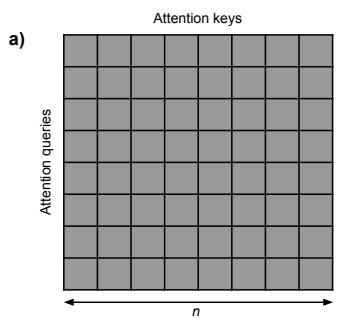
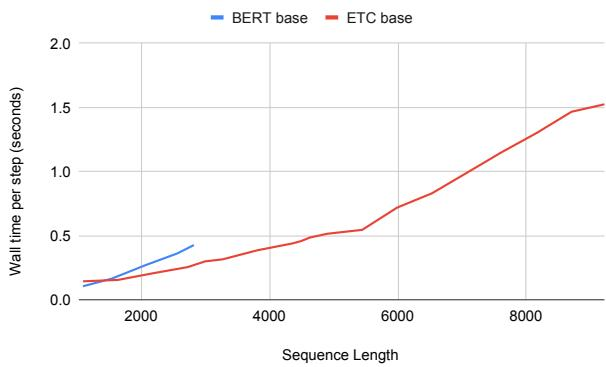

# ETC：在 Transformer 中编码长输入与结构化输入

Joshua Ainslie, Santiago Ontan˜on, Chris Alberti, Vaclav Cvicek,´ Zachary Fisher, Philip Pham, Anirudh Ravula, Sumit Sanghai, Qifan Wang, Li Yang Google Research

{jainslie, santiontanon, chrisalberti, vcvicek,

zachfisher, phillypham, braineater, sumitsanghai, wqfcr, lyliyang}@google.com

## 摘要

Transformer 模型推动了许多自然语言处理（NLP，Natural Language Processing）任务的技术前沿。在本文中，我们提出了一种新的 Transformer 架构——扩展 Transformer 构建（ETC，Extended Transformer Construction），以解决标准 Transformer 架构面临的两个关键挑战，即扩展输入长度和编码结构化输入。为了将注意力机制扩展到更长的输入，我们在全局词元（global token）与常规输入词元之间引入了一种新颖的全局-局部注意力机制。我们还表明，将全局-局部注意力与相对位置编码以及对比预测编码（CPC，Contrastive Predictive Coding）预训练目标相结合，使 ETC 能够对结构化输入进行编码。我们在四个需要长输入和/或结构化输入的自然语言数据集上取得了最先进的结果。

## 1 引言

基于 Transformer（Vaswani et al., 2017）的模型，如 BERT（Devlin et al., 2018）或其他变体（Yang et al., 2019; Lan et al., 2019; Raffel et al., 2019），在许多 NLP 任务中取得了最先进的结果，例如语言建模（Child et al., 2019; Sukhbaatar et al., 2019; Rae et al., 2019; Kitaev et al., 2020）、问答（Lan et al., 2019; Beltagy et al., 2020）和文本摘要（Zhang et al., 2019）。我们提出了扩展 Transformer 构建（ETC）架构1，旨在解决原始模型的两个局限性：(1) 扩展输入长度，(2) 编码结构化输入。

原始 Transformer 中注意力机制的计算和内存复杂度随输入长度呈二次方增长，通常将输入长度限制在约 512 个词元（token）左右。虽然 512 对于某些任务可能已经足够（例如，共指消解似乎能从更小的输入长度中受益 (Joshi et al., 2019)），但这在其他任务中会带来问题。以需要跨多个文档进行推理的问答（QA）任务为例（例如 HotpotQA 数据集 (Yang et al., 2018)），所有文档必须同时容纳在模型输入中。其他例子还包括文本摘要或长文档上的问答。针对这一问题，已有许多方法被提出，如分层处理（Zhang et al., 2019）、稀疏注意力（Child et al., 2019）以及分段级循环（Dai et al., 2019）。

第二个局限性是很少有模型关注结构化输入，我们指的是输入词元（tokens）之间的任何潜在图结构或层次结构。尽管 ETC 可以对更通用的图结构进行编码，但在本工作中，我们重点关注在 NLP 任务中表示层次结构，而这通常未被 Transformer 模型建模。例如，文本被组织成句子和段落，虽然这些具有顺序关系，但不同的输入文档之间可能没有任何先后顺序（例如 HotpotQA 数据集）。此外，网页文本包含标记（markup），并使用 DOM 树进行布局，从而提供了额外的结构。我们表明 ETC 可以表示这些以及其他类型的结构，例如链接不同的实体提及（entity mentions）。

为了应对这些挑战，我们提出了一种名为全局-局部注意力（global-local attention）的新颖注意力机制，该机制将输入分为两个序列（我们称之为全局输入和长输入）。该机制引入了局部稀疏性，以降低注意力机制的二次方复杂度增长。当其与相对位置编码（relative position encodings）（Shaw et al., 2018）相结合时，能够以自然的方式处理结构化输入。此外，与以往的 Transformer 扩展不同，ETC 可以从现有的预训练标准 BERT 模型进行初始化（这与对 GPU/TPU 友好的实现相结合，实现了高效的模型训练）2。我们的结果表明，从 RoBERTa（Liu et al., 2019）进行初始化可以显著提升性能。最后，我们表明通过添加对比预测编码（Contrastive Predictive Coding, CPC）预训练任务（Oord et al., 2018），对于结构非常重要的任务，性能可以得到进一步提升，因为 CPC 起到了掩码语言模型（masked language model, MLM）任务的作用，但粒度是在句子级别。

我们在四个具有长输入和/或结构化输入的数据集上进行了实验：Natural Questions (NQ)（Kwiatkowski et al., 2019）、HotpotQA（Yang et al., 2018）、WikiHop（Welbl et al., 2018）以及 OpenKP（MS MARCO 的一部分）（Xiong et al., 2019）。我们在所有这些数据集上都取得了新的最先进水平（state of the art）。

此外，尽管在本文中我们严格聚焦于 ETC，但在一个名为 BigBird（Zaheer et al., 2020）的相关模型中，我们尝试了一套用于处理长输入的替代思路及其向用于文本生成的解码器的扩展。BigBird 的重点在于向全局-局部注意力中添加随机稀疏注意力模式的想法，并展示在何种条件下像 BigBird/ETC 这样的模型是序列函数的通用近似器（universal approximators）并且是图灵完备的（Turing complete）。虽然实现上述问答（QA）任务中最先进结果所需的关键思想和技术是本文的重点，但读者可以参阅 BigBird 的工作，了解对 ETC（在该工作中被称为 BigBird-ETC）与随机稀疏注意力模式思想的联合评估。

## 2 背景

原始 Transformer 模型（Vaswani et al., 2017）的许多变体已经被提出，用于扩展训练规模（RoBERTa, Liu et al., 2019）、扩展内部表示（ALBERT, Lan et al., 2019）或两者兼顾（T5, Raffel et al., 2019），在 GLUE（Wang et al., 2018）、SQuAD（Rajpurkar et al., 2016）或 RACE（Lai et al., 2017）等任务上超越了 BERT（Devlin et al., 2018）。然而，由于注意力机制具有 $O ( n ^ { 2 } )$ 的计算开销，这些模型通常将输入限制在 $n = 5 1 2$ 个 token 以内。我们将以往扩展注意力机制规模的方法归为四类：稀疏注意力（sparse attention）、循环机制（recurrence）、分层机制（hierarchical mechanisms）以及压缩注意力（compressed attention）。

稀疏注意力（Sparse Attention）涉及限制每个 token 仅关注其他 token 的一个子集。例如，Sparse Transformer（Child et al., 2019）

对文本和图像生成都采用了预定义的注意力模式。他们证明，仅关注同一行或同一列中的先前像素就足以生成高质量图像，同时将注意力开销保持在 $O ( n { \sqrt { n } } )$。在 Adaptive Attention Span Transformer（Sukhbaatar et al., 2019）中，每个注意力头都关联一个衰减的可学习掩码函数，用于限制其可以关注的 token 数量。他们表明，较低层学会使用较短的注意力跨度，只有在较高层中注意力跨度才会更长。稀疏注意力还被用于通过允许注意力为特定输入 token 分配精确为零的权重来提高注意力头的可解释性（Correia et al., 2019）。Reformer（Kitaev et al., 2020）模型使用局部敏感哈希（locality sensing hashing，Andoni et al., 2015）来查找注意力查询的最近邻（即那些会产生最高注意力权重的输入 token），并仅将它们用于注意力计算。这使得注意力开销降低至 $O ( n l o g ( n ) )$ ）。Routing Transformer（Roy et al., 2020）使用在线 k-means 学习动态稀疏注意力模式，将复杂度降低至 $O ( n ^ { 1 . 5 } )$ ）。最后，与本文工作最相关的方法是 Longformer（Beltagy et al., 2020），它与 ETC 同时开发，具有与 ETC 非常相似的全局-局部注意力机制，但并未直接编码图结构或分层结构（更详细的对比见第 3 节）。

循环机制（Recurrence）将循环神经网络的元素融入 Transformer 模型中以延长其注意力跨度。Transformer-XL（Dai et al., 2019）采用了这种方法，将输入序列划分为多个片段，然后逐个处理这些片段。在每一层中，模型同时对当前和前一个输入片段的正下方一层进行注意力计算。其效果是，第 k 层会受到当前片段以及前 k − 1 个片段的影响，如 Figure 1 右上角所示。

在分层机制（Hierarchical Mechanisms）中，输入序列被切分为若干块（block），这些块被独立输入以生成代表整个块的摘要嵌入。随后，由单独的层来输入这些嵌入的拼接结果。例如，HIBERT (Zhang et al., 2019) 在句子层级上应用了这一思想来进行抽取式摘要（如图 1 左下所示）。Transformer 中的分层注意力也被应用于其他 NLP 任务，如神经机器翻译 (Maruf et al., 2019)。此外，应当注意到以分层方式处理输入的思想并非 Transformer 模型所独有，它也已被应用于循环神经网络模型中，涵盖句子级别 (Yang et al., 2016; Miculicich et al., 2018) 和块级别 (Shen et al., 2018)。

  
Figure 1: 扩展注意力以适应长输入的机制示意图，包括我们提出的模型 ETC。

压缩注意力（Compressed Attention）通过选择性地压缩输入的某些部分，将分层注意力的思想更进一步。BP-Transformer (Ye et al., 2019) 模型在输入上构建一棵二叉划分树，并仅允许模型对近处的词元关注叶子节点（原始词元），而随着词元距离变远，则关注树中更高层级的节点（词元组的摘要）（见 Figure 1 中上）。其他思路包括内存压缩注意力（memory compressed attention）(Liu et al., 2018)，即在词元被关注之前通过卷积滤波器将每组 $k$ 个词元进行压缩；以及 Star Transformer (Guo et al., 2019)，其中每个词元只能关注其紧邻的左/右相邻词元以及一个表示整个输入摘要的独立特殊辅助词元（见 Figure 1 左侧）。Compressive Transformer (Rae et al., 2019) 将这一思想整合到 Transformer-XL 中，对输入中距离较远的词元进行压缩。该模型既得益于对附近词元的细粒度注意力，又对更远距离的词元利用了汇总信息（见 Figure 1 右下）。

## 3 扩展 Transformer 结构（Extended Transformer Construction）

我们的模型遵循原始 Transformer 架构 (Vaswani et al., 2017)，并进行了关键修改以处理长输入和结构化输入：相对位置编码、全局-局部注意力和 CPC 预训练任务，具体说明如下。在本文中，我们仅考虑 Transformer 的编码器端，将解码器留待未来工作中研究。

## 3.1 相对位置编码

受 Shaw et al. (2018) 工作的启发，ETC 用相对位置编码替代了绝对位置编码，相对位置编码提供了输入序列中词元（token）之间相对位置的信息。给定输入序列 $x = ( x _ { 1 } , . . . , x _ { n } )$ ，我们可以将其视为一个带标签的有向完全图，其中 $l _ { i j }$ 是连接 $x _ { i }$ 到 $x _ { j }$ 的边的标签。给定最大截断距离 $k ,$ ，Shaw et al. 定义了 2k + 1 个相对位置标签：$l _ { - k } , . . . , l _ { k }$ 。两个输入词元之间边的标签仅取决于它们的相对位置 $j - i .$ 。对于满足 $j - i \geq k$ 的输入对，赋予标签 $l _ { k }$；对于满足 $j - i \le - k$ 的输入对，赋予标签 $l _ { - k }$ 。每个标签随后转换为一个可学习向量 $a _ { l } ^ { K }$ ，用以修改注意力机制（公式见下一节）3。

相对位置编码与输入长度无关，因此很容易使模型适应比预训练期间见过的更长的输入长度。与其他近期工作（Shaw et al., 2019）一样，ETC 的注意力机制不仅将相对位置标签用于序列中的相对位置，还用于表达对结构化输入有用的任意成对词元关系，如下文所述。

  
Figure 2: 稀疏性示意图，展示了哪些注意力查询（行）可以关注哪些注意力键（列）：a) 输入大小为 n 的标准 Transformer 注意力；b) 输入大小为 $n _ { g } , n _ { l } .$ 且半径为 $r$ 的全局-局部注意力；$\mathbf { c } )$ 受局部半径限制的 l2l 注意力部分如何被重塑为一个更小的注意力矩阵。

## 3.2 全局-局部注意力

全局-局部注意力（Global-local attention）是上述几种模型的推广。ETC 接收两个独立的输入序列：全局输入 $x ^ { g } =$ $( x _ { 1 } ^ { g } , . . . , x _ { n _ { g } } ^ { g } )$ 和长输入 $\boldsymbol { x } ^ { l } = ( x _ { 1 } ^ { l } , . . . , x _ { n _ { l } } ^ { l } )$。通常，长输入包含标准 Transformer 会接收的输入，而全局输入则包含数量少得多的辅助标记（token）$( n _ { g } \ll n _ { l } )$。注意力随后被拆分为四个独立的部分：全局到全局（global-to-global, g2g）、全局到长（global-to-long, g2l）、长到全局 $( \mathrm { l } 2 \mathrm { g } )$ 以及长到长（long-to-long, l2l）。l2l 部分（计算开销最大的部分）中的注意力被限制在一个固定半径 $r \ll n _ { l }$ 内。为了弥补这种有限的注意力跨度，全局输入中的标记具有无限制的注意力，因此长输入标记可以通过全局输入标记相互传递信息。相应地，$\mathrm { g } 2 \mathrm { g } , \mathrm { g } 2 \mathrm { l }$ 和 l2g 部分的注意力是不受限制的。

Figure 2 展示了这一概念，其中如果标记 $x _ { i }$ 可以关注标记 $x _ { j }$，则每个单元格（第 i 行，第 j 列）会被阴影（灰色）显示。正如我们所见，在常规 Transformer 中，注意力是无限制的（完全 $n \times n$ 注意力）。然而，在 Figure 2b 中展示的 ETC 则将 l2l 部分限制在一个局部半径内，从而显著降低了超长输入的计算和内存复杂度。从概念上讲，l2l 注意力部分被重塑为一个 $n _ { l } \times ( 2 r + 1 )$ 矩阵，如 Figure $2 \mathrm { c } . ^ { 4 }$ 所示。

如果 r = 1 且 $n _ { g } = 1$，我们就能完全还原 Star Transformer（Section 2）。类似地，将所有标记放入全局输入中并设置 $n _ { l } = 0$，即可得到标准 Transformer 注意力。ETC 中的注意力复杂度为 $O ( n _ { g } ( n _ { g } + n _ { l } ) + n _ { l } ( n _ { g } + 2 r + 1 ) )$。如果我们假设 $n _ { g } = O ( 2 r + 1 )$，可以看到注意力与长输入的大小呈线性关系：$O ( n _ { g } ^ { 2 } + n _ { g } n _ { l } )$。

为了提供灵活的注意力并辅助结构化输入，存在针对每个实例的布尔注意力矩阵 $M ^ { g 2 g } , M ^ { \bar { g } 2 l } , M ^ { l 2 g }$ 和 $M ^ { l 2 l }$，对于不应相互关注的标记对，矩阵值为零。每个 $\mathrm { g 2 g }$ 注意力头的工作方式如下。给定全局输入 $x ^ { g } = ( x _ { 1 } ^ { g } , . . . , x _ { n _ { g } } ^ { g } )$（即标记表示序列 $x _ { i } ^ { g } \in$ $\mathbb { R } ^ { d _ { x } }$），注意力的输出为 $\boldsymbol { z ^ { g } } = ( z _ { 1 } ^ { g } , . . . , z _ { n _ { g } } ^ { \bar { g } } )$，其中每个 $\bar { z _ { i } ^ { g } } \in \mathbb { R } ^ { d _ { z } }$ 计算如下：

$$
z _ {i} ^ {g} = \sum_ {j = 1} ^ {n _ {g}} \alpha_ {i j} ^ {g 2 g} x _ {j} ^ {g} W ^ {V}
$$

$$
\begin{array}{r} \alpha_ {i j} ^ {g 2 g} = \frac {\exp (e _ {i j} ^ {g 2 g})}{\sum_ {\ell = 1} ^ {n} \exp (e _ {i \ell} ^ {g 2 g})} \\ e _ {i j} ^ {g 2 g} = \frac {x _ {i} ^ {g} W ^ {Q} (x _ {j} ^ {g} W ^ {K} + a _ {i j} ^ {K}) ^ {T}}{\sqrt {d _ {z}}} - (1 - M _ {i j} ^ {g 2 g}) C \end{array}
$$

其中：$M ^ { g 2 g }$ 是一个二进制注意力掩码（binary attention mask），$W ^ { Q } , W ^ { K }$ 和 $W ^ { V }$ 是可学习的权重矩阵，$a _ { i j } ^ { K }$ 是表示相对位置标签的可学习向量，$C$ 是一个大常数（在我们的实验中 $C = 10000$，以遵循与 BERT 相同的惯例）。其他 3 个部分的注意力计算类似。我们实验了在所有四个注意力部分中使用独立的 $W ^ { K }$ 和 $W ^ { V }$，或共享它们。对于 $W ^ { Q }$，我们实验了让 g2g 和 $\mathbf { g } 2 \mathbf { l }$ 使用一个，并让 l2g 和 l2l 使用另一个独立的；或者也将它们共享。为了在 $r$ 足够大以消除稀疏性时能够将 BERT 作为特例恢复，注意力在内部实际上只被拆分为 2 个部分而不是 4 个，因为 $\mathrm { g } 2 \mathrm { g } + \mathrm { g } 2 \mathrm { l }$ 可以联合计算（Figure 2c 的上半部分），l2g+l2l 也可以联合计算（Figure 2c 的下半部分）。单个 softmax 用于联合计算 $\alpha _ { i j } ^ { g 2 g }$ 和 $\alpha _ { i j } ^ { g 2 l }$，另一个 softmax 用于计算 $\alpha _ { i j } ^ { l 2 g }$ 和 $\alpha _ { i j } ^ { l 2 l }$。

  
Figure 3: 用于处理 (a) 长输入和 (b) 结构化输入的示例注意力模式。白色背景表示注意力通过 M 进行掩码遮蔽，其他颜色表示不同的相对位置标签。

因此，全局-局部注意力（global-local attention）的输出是一个长度为 $n _ { g }$ 的序列和一个长度为 $n _ { l }$ 的序列。这些序列按照与标准 Transformer 相同的方式通过层归一化（layer normalization）和前馈层（feed forward layer）。

## 3.3 长输入与全局-局部注意力

让我们来说明 ETC 如何用于编码长输入。在 ETC 中处理长输入的一种通用方法是将输入 token 的整个序列（例如 word pieces）放入长输入中，然后假设将其划分为某种片段（例如句子），为长输入中的每个片段在全局输入中放置一个辅助 token。接着，我们使用一种相对位置标签将全局片段 token 与属于它们的 word piece token 链接起来，并使用不同的标签标记那些不属于它们的 token。此外，正如我们在下文实验中所展示的，我们发现使用 $M ^ { g 2 l }$ 注意力掩码在单向（g2l）上执行硬掩码（hard masking）可以在某些数据集上带来性能提升。这种非对称硬掩码如图 Figure 3a 所示，其中我们使用不同的颜色来表示不同的相对位置标签。通过这种方式，尽管长输入中的 token 只能关注由半径 $k ,$ 定义的局部邻域，但它们可以通过全局 token 间接关注输入序列中的所有其他 token。

## 3.4 结构化输入

标准 Transformer 类似于在全连接图 $g ;$ 上的图神经网络（Scarselli et al., 2008）；参见 Ye et al. (2019)。得益于全局-局部注意力与相对b)位置标签的结合，ETC 利用这种关系来编码结构化输入。给定输入 $x = ( x _ { 1 } , . . . , x _ { n } )$，我们使用术语“结构”来指代 x 中 token 之间存在的关系。当 x 是纯文本有序序列时，唯一的关系是 token 的先后顺序，这也是 BERT 捕获的唯一结构（通过绝对位置编码进行编码，用于调整注意力）。我们将结构化输入定义为除了先后顺序之外、token 之间还具有额外关系的输入。原则上，我们可以考虑具有任意图结构的输入（例如化学分子图），但在此我们专注于 NLP 任务中的结构。

ETC 特别适合捕捉层次结构，这得益于三种机制。首先，按照最初的设计，相对位置标签的词表用于表示 token 的相对位置。然而，将 Transformer 视为在图 $g$（$x$ 中的每个 token 作为一个顶点，边表示它们之间的关系）上的图神经网络，我们可以扩展该词表，用诸如 is- $^ { \cdot a , }$ part-of 等关系的标签来标记某些边。其次，长输入和全局输入之间的划分引入了一种自然结构，其中全局输入包含 $x$ 中 token 集合的摘要 token（两级层次结构）。然而，我们也可以使用用于总结一组摘要 token 的 token（构建三级或更高层级的层次结构）。第三，如果某些 token 对之间不应存在边，则可以通过 $\bar { M } ^ { g 2 g } , M ^ { g 2 l } , M ^ { l 2 g } , M ^ { l 2 l }$ 掩码来捕捉。Figure 3b 展示了所有这些概念的示意图，它利用掩码和相对位置标签来表示上下文-句子-token（context-sentence-token）的层次结构，其中包括上下文内部句子的顺序，但不包括上下文之间的顺序。另一个例子是社交群组图结构，我们可以将图划分为多个组件，使用 $M ^ { l 2 l }$ 将注意力约束在组件内部，并为每个组件添加全局 token，通过连接以层次化的方式允许信息从一个组件传播到另一个组件。

## 3.5 预训练任务

我们使用了两项预训练任务：（1）带有全词掩码（whole word masking，如果一个 word piece token 被掩码，则同一单词的所有其他 token 也都会被掩码）的掩码语言模型（MLM）任务；以及（2）不使用 BERT 的下一句预测（NSP），而是为 ETC 改编了对比预测编码（Contrastive Predictive Coding, CPC）（Oord et al., 2018）。

CPC 的目标是在潜在空间中预测后续输入，即预测 token 块的内部隐藏表示。我们在 ETC 中通过使用全局输入句子摘要 token 改编了这一思想。给定包含 n 个句子的输入序列，我们掩码对应于句子子集的所有 token（但在全局输入中保留句子摘要 token）。然后，我们训练模型最小化被掩码句子的全局句子摘要 token 的隐藏表示，与只能看到未掩码句子而看不到其他内容的全局摘要 token 的隐藏表示之间的差异。我们像 Oord et al. (2018) 的工作一样使用了噪声对比估计（Noise Contrastive Estimation, NCE）损失（详见附录）。

在描述了 ETC 之后，我们现在可以将其与 Longformer（Beltagy et al., 2020）进行比较。Longformer 采用了类似的注意力机制，不同之处在于 Longformer 具有单个输入序列，其中某些 token 被标记为全局 token（唯一使用完全注意力的 token）。关键区别在于：(1) ETC 将全局-局部注意力与相对位置编码及灵活的掩码相结合，使其能够以类似于图神经网络（graph neural networks）的方式对结构化输入进行编码；(2) Longformer 中的全局 token 从未通过类似我们 CPC 损失的方式进行预训练，因此它们的使用必须在微调过程中学习。

## 3.6 从现有模型中迁移权重

ETC 与 BERT 具有足够的相似性，因此 BERT 参数可用于进行热启动（warm start）。这些参数是兼容的，因为如果输入足够小或局部半径足够大以消除稀疏性，则全局-局部注意力机制会将 BERT 作为特例包含在内。此外，当从 BERT 将权重迁移到具有独立 $W ^ { Q } , W ^ { K }$ 和 $W ^ { V }$ 投影矩阵的 ETC 模型中时，BERT 的参数只需直接复制到 ETC 的各个不同矩阵中。

尽管仍需要进行预训练以调整权重以使用全局 token 和相对位置编码，但我们表明，与从头开始预训练相比，从 RoBERTa 初始化可以带来显著的性能提升。具体而言，我们从 Rothe 等人（Rothe et al., 2020）的工作中报告的 RoBERTa 检查点进行初始化。

<table><tr><td rowspan="2">数据集</td><td colspan="2">样本数</td><td colspan="3">样本长度</td></tr><tr><td>训练集</td><td>验证集</td><td>中位数</td><td>95%</td><td>最大值</td></tr><tr><td>NQ</td><td>307373</td><td>7830</td><td>4004</td><td>17137</td><td>156551</td></tr><tr><td>HotpotQA</td><td>90447</td><td>7405</td><td>1227</td><td>1810</td><td>3560</td></tr><tr><td>WikiHop</td><td>43738</td><td>5129</td><td>1541</td><td>3994</td><td>20337</td></tr><tr><td>OpenKP</td><td>133724</td><td>6610</td><td>761</td><td>4546</td><td>89183</td></tr></table>

Table 1: 数据集统计信息（长度以 word piece token 计）。

## 4 实证评估

本节重点评估我们的两个主要贡献：(1) 长输入，以及 (2) 文本输入中的结构，以及从现有 BERT 模型的初始化。我们选择了四个具有长输入或具有代表性输入结构的数据集（Table 1）。

NQ（Kwiatkowski et al., 2019）：在 Google 的 Natural Questions（NQ）数据集中，输入由一个问题和一篇完整的 Wikipedia 文章组成。任务是识别文章中是否存在短答案（来自文章的几个词）和长答案（例如整个段落），若存在则予以找出（否则返回空答案）。性能是根据模型预测相对于人工标注答案的 F1 分数来衡量的。

HotpotQA (Yang et al., 2018) 是一个问答数据集，其目标是整合来自多个上下文的证据。我们采用干扰项（distractor）设置，其中提供了 10 个段落：其中两个包含回答问题所需的有用信息，其余均为干扰项。该任务既要求回答问题，又要求识别出与回答问题相关的支持事实（在句子粒度上）。

WikiHop (Welbl et al., 2018) 在结构上与 HotpotQA 相似。上下文对应于 Wikipedia 文章的部分内容，其目标是回答关于某个实体属性的问题，而这些属性在该实体自身的文章中是找不到的。每个实例包含一个查询（query）、一组候选答案，以及一组用于获取信息以在候选答案中进行选择的上下文。

OpenKP (Xiong et al., 2019) 是一个关键短语提取数据集。每个文档包含最多 3 个待识别的简短关键短语。我们选择该数据集是因为其输入不是扁平的文本序列，而是网页，包含了网页上不同 DOM 元素之间的层级和空间关系，以及其他视觉属性。

## 4.1 训练配置

我们使用两种基本配置：Base 和 Large。Base 采用 12 层、768 隐藏层大小、12 个注意力头、局部注意力半径 $r = 8 4 .$ 以及相对位置最大距离 k = 12。Large 采用 24 层、1024 隐藏层大小、16 个头、$r = 1 6 9 .$ 以及 $k = 2 4$。在 $\mathrm { N Q } ^ { 5 }$ 中，对于输入长度分别为 512、4096 和 8192 的模型，我们分别使用了 128、230 和 460 个全局 token；在 HotpotQA 中使用了 256 个全局 token，在 WikiHop 中使用了 430 个，在 OpenKP 中使用了 512 个。

<table><tr><td>模型</td><td>输入长度</td><td>配置</td><td>参数量</td><td>长答案 F1</td><td>短答案 F1</td></tr><tr><td>BERT-base</td><td>512</td><td></td><td>110M</td><td>0.634</td><td>0.475</td></tr><tr><td>BERT-large</td><td>512</td><td></td><td>340M</td><td>0.647</td><td>0.527</td></tr><tr><td>RikiNet</td><td>512</td><td>从 RoBERTa-large 提升</td><td>-</td><td>0.753</td><td>0.593</td></tr><tr><td>ETC</td><td>512</td><td>共享，无 CPC，无硬 g2l</td><td>109M</td><td>0.645</td><td>0.478</td></tr><tr><td>ETC</td><td>4096</td><td>共享，无 CPC，无硬 g2l</td><td>109M</td><td>0.692</td><td>0.497</td></tr><tr><td>ETC</td><td>4096</td><td>固定块，共享，无 CPC，无硬 g2l</td><td>109M</td><td>0.697</td><td>0.508</td></tr><tr><td>ETC</td><td>4096</td><td>共享，无硬 g2l</td><td>109M</td><td>0.717</td><td>0.524</td></tr><tr><td>ETC</td><td>4096</td><td>共享</td><td>109M</td><td>0.721</td><td>0.514</td></tr><tr><td>ETC</td><td>4096</td><td>-</td><td>166M</td><td>0.725</td><td>0.522</td></tr><tr><td>ETC</td><td>8192</td><td></td><td>166M</td><td>0.740</td><td>0.542</td></tr><tr><td>ETC</td><td>4096</td><td>2倍局部半径</td><td>166M</td><td>0.737</td><td>0.530</td></tr><tr><td>ETC</td><td>4096</td><td>2倍相对词表</td><td>166M*</td><td>0.733</td><td>0.532</td></tr><tr><td>ETC</td><td>4096</td><td>2倍预训练</td><td>166M</td><td>0.746</td><td>0.558</td></tr><tr><td>ETC-large</td><td>4096</td><td></td><td>539M</td><td>0.761</td><td>0.565</td></tr><tr><td>ETC-large</td><td>4096</td><td>从 RoBERTa 提升</td><td>558M</td><td>0.782</td><td>0.585</td></tr></table>

Table 2: Natural Questions (NQ) 数据集开发集上的实证结果。base 和 large 模型的最优结果已高亮显示。BERT-large 的结果取自 Alberti et al. (2019)。∗ 尽管由于四舍五入到最接近的百万位而未体现，但将相对位置编码词表扩大一倍会增加约 600k 个参数。

预训练：我们将所有 word piece token 放入长输入中，并在全局输入中每句添加一个辅助 token。我们默认使用 BERT 的 30k 英文 uncased word piece 词表。模型使用原始 BERT 数据集进行预训练，但过滤掉了少于 7 个句子的文档。除非另有说明，base 模型的预训练 token 总数与原始 BERT 相同，而 large 模型则是其两倍。我们使用 LAMB 优化器（You et al., 2019），学习率设置为 ${ \sqrt { 8 } } \times 1 0 ^ { - 3 }$。

微调（Fine-tuning）：我们将所有输入 token 置于长输入中（对于 QA 数据集，包括 CLS、问题和上下文 token），并使用相对位置标签来编码结构（见第 3.4 节）。全局输入包含一个 CLS token、镜像长输入中问题 token 的 token，以及每个段落/句子（或 OpenKP 中的 VDOM 块）的一个摘要 token。OpenKP 既没有 CLS 也没有问题 token。对于 WikiHop，我们还为每个候选答案添加了一个全局 token，并使用不同的相对位置标签将这些 token 与它们在文本中通过字符串匹配到的提及（mention）相连接（更多细节见附录）。

## 4.2 开发集上的结果

NQ：我们使用 NQ 通过消融实验来研究 ETC 的各个不同部分。结果如 Table 2 所示。前三行展示了基线模型：BERTbase、BERT-large 和 RikiNet (Liu et al., 2020)（NQ 排行榜上表现最好的模型之一）。BERT 的性能与输入长度为 512 的 ETC 相当。ETC 较小的局部半径（84）使其相对于 BERT 处于劣势，但 ETC 的其他改进（例如动态全词掩码）似乎弥补了这一点。

Table 2 的其余部分展示了不同消融配置下的性能。我们的默认配置（在配置列中用“-”标出）是长输入长度为 4096 个 token 的 ETC-base，使用 CPC、硬 g2l 掩码，并为长/全局输入分别使用独立的 WQ、$W ^ { K }$ 和 $W ^ { V }$ 矩阵。我们测试了以下消融实验：shared（在全局输入和长输入之间共享注意力的所有模型参数）、no CPC（移除 CPC 预训练任务）、no hard g2l（不使用硬 g2l 掩码）以及 fixed blocks（配置全局输入为每 97 个长输入 token 仅对应 1 个全局 token，以保持与没有 fixed-blocks 时相同的比例，忽略句子边界，并且在预训练或微调时不向全局输入添加任何其他 token）。共享 $W ^ { Q } ,$ $W ^ { K }$ 和 $W ^ { V }$ 以及移除 CPC 显著降低了 ETC 在 $\mathrm { N Q } ^ { 7 }$ 上的性能。令人惊讶的是，在没有 CPC 的情况下，使用 fixed blocks 似乎有轻微的帮助。

将长输入从 512 增加到 4096 显著提升了性能，进一步增加到 8192 则将性能提高到了 0.740 / 0.542，这突出了更长输入的重要性。增大局部半径、相对位置词表大小或预训练数据量都有助于提升性能（尤其是后者，达到了 0.746 / 0.558）。转向大模型（large model）也有帮助，特别是从 RoBERTa 进行提升（lifting）时（两个大模型都使用了 RoBERTa 词表）。从 RoBERTa 提升取得了我们的最佳得分：0.782 / 0.585，超越了文献中长答案的最佳开发集得分（相比之下，RikiNet 为 0.754 / 0.593）。对于短答案，我们仍然落后于 RikiNet。

<table><tr><td rowspan="2">模型</td><td rowspan="2">输入长度</td><td rowspan="2">配置</td><td rowspan="2">#参数量</td><td>HotpotQA</td><td>WikiHop</td></tr><tr><td>答案 F1 / 支撑 F1</td><td>准确率</td></tr><tr><td>Longformer</td><td>4096</td><td></td><td>149M*</td><td>0.743 / 0.844</td><td>75.0</td></tr><tr><td>Longformer-large</td><td>4096</td><td></td><td>435M*</td><td>0.788 / 0.860 $^{6}$ </td><td>77.6</td></tr><tr><td>ETC</td><td>4096</td><td>扁平结构, 无 CPC, 无硬 g2l</td><td>166M</td><td>0.722 / 0.857</td><td>70.0</td></tr><tr><td>ETC</td><td>4096</td><td>扁平结构</td><td>166M</td><td>0.748 / 0.870</td><td>70.7</td></tr><tr><td>ETC</td><td>4096</td><td>无 CPC</td><td>166M</td><td>0.747 / 0.866</td><td>73.0</td></tr><tr><td>ETC</td><td>4096</td><td>无硬 g2l</td><td>166M</td><td>0.743 / 0.864</td><td>75.9</td></tr><tr><td>ETC</td><td>4096</td><td>共享</td><td>109M</td><td>0.733 / 0.866</td><td>73.7</td></tr><tr><td>ETC</td><td>4096</td><td>-</td><td>166M</td><td>0.751 / 0.869</td><td>73.2</td></tr><tr><td>ETC-large</td><td>4096</td><td></td><td>539M</td><td>0.798 / 0.890</td><td>77.0</td></tr><tr><td>ETC-large</td><td>4096</td><td>从 RoBERTa 提升</td><td>558M</td><td>0.813 / 0.894</td><td>79.8</td></tr></table>

Table 3: HotpotQA 和 WikiHop 上的实验结果（开发集结果）。∗Longformer 参数量由作者通过私人通信提供。

<table><tr><td>模型</td><td>输入长度</td><td>配置</td><td>#参数量</td><td>OpenKP F1@3</td></tr><tr><td>RoBERTa-JointKPE</td><td>512</td><td></td><td>-</td><td>0.398</td></tr><tr><td>ETC</td><td>512</td><td>固定块, 无 CPC, 无硬 g2l, 无视觉特征</td><td>166M</td><td>0.399</td></tr><tr><td>ETC</td><td>4096</td><td>固定块, 无 CPC, 无硬 g2l, 无视觉特征</td><td>166M</td><td>0.400</td></tr><tr><td>ETC</td><td>4096</td><td>无 CPC, 无硬 g2l, 无视觉特征</td><td>166M</td><td>0.400</td></tr><tr><td>ETC</td><td>4096</td><td>无硬 g2l, 无视觉特征</td><td>166M</td><td>0.400</td></tr><tr><td>ETC</td><td>4096</td><td>无视觉特征</td><td>166M</td><td>0.402</td></tr><tr><td>ETC</td><td>4096</td><td>-</td><td>166M</td><td>0.409</td></tr><tr><td>ETC</td><td>4096</td><td>共享</td><td>109M</td><td>0.409</td></tr><tr><td>ETC</td><td>4096</td><td>最大损失</td><td>166M</td><td>0.416</td></tr><tr><td>ETC-large</td><td>4096</td><td>最大损失</td><td>539M</td><td>0.419</td></tr><tr><td>ETC-large</td><td>4096</td><td>最大损失, 从 RoBERTa 提升</td><td>558M</td><td>0.423</td></tr></table>

Table 4: OpenKP 上的实验结果（开发集 F1@3 结果）。

<table><tr><td>排行榜</td><td>结果</td><td>排名</td></tr><tr><td>NQ 长答案</td><td>0.7778</td><td>第 1 名</td></tr><tr><td>NQ 短答案</td><td>0.5786</td><td>第 18 名</td></tr><tr><td>HotpotQA Sup. F1</td><td>0.8909</td><td>第 1 名</td></tr><tr><td>HotpotQA Overall</td><td>0.7362</td><td>第 3 名</td></tr><tr><td>WikiHop</td><td>0.8225</td><td>第 1 名</td></tr><tr><td>OpenKP</td><td>0.4205</td><td>第 1 名</td></tr></table>

Table 5: ETC 在提交时的官方排行榜结果。

HotpotQA，WikiHop：Table 3 展示了我们在 HotpotQA 和 WikiHop 上的结果。我们展示了两个 Longformer 模型作为基准（该模型当前是 WikiHop 上的最先进模型），并进行了消融实验以研究结构对结果的影响。特别地，我们考虑了一种平面结构（flat structure）消融设置，其中：(1) 我们不对长输入注意力按上下文边界进行切分，(2) 我们将全局与长标记（token）之间的相对位置标签限制为仅表示句子级别的关系（这移除了 WikiHop 中候选答案与其提及项之间的任何特殊注意力）。

我们的结果表明，在 HotpotQA 和 WikiHop 中，我们的 base 和 large 模型均优于其对应的 Longformer 模型。除了参数量之外，可以解释这种性能差异的主要因素是 ETC 和 Longformer 采用了不同的预训练策略以及对结构的不同处理方式。移除 CPC 预训练任务且不使用硬 g2l 掩码会显著损害模型在 HotpotQA 中的性能，从基线模型的 0.751 / 0.869 下降到不使用这些特性时的 0.722 / 0.857。使用平面结构（但保留 CPC 和硬 g2l）在 HotpotQA 中似乎没有产生负面影响。WikiHop 则呈现出略微不同的情况，因为在该数据集中，硬 g2l 掩码、尤其是平面结构似乎损害了性能。我们的最佳模型是不使用硬 g2l 掩码的 base 配置，取得了 75.9 的准确率。有趣的是，共享 $W ^ { Q } , W ^ { K }$ 和 $W ^ { \dot { V } }$ 在 WikiHop 中似乎有助于提升性能。这是我们规模最小的数据集，模型在不共享参数时所增加的模型容量可能导致了过拟合。

OpenKP：Table 4 展示了我们在 OpenKP 数据集上的结果，以目前在排行榜上排名第一的 RoBERTa-JointKPE (Sun et al., 2020) 作为基线。这是一个有趣的结构化数据集，因此我们进行了额外的消融实验，以探究移除此类结构化信息的影响。我们的结果表明，即使是约束最强的 ETC 模型也已经取得了非常出色的性能（0.399），并且扩展到 4096 长度似乎带来了轻微的提升。使用硬性 g2l（hard g2l）也有所帮助，而添加视觉特征带来的增益最大。最后，我们发现使用大型模型，特别是从 RoBERTa 继承权重（lifting weights），可以显著提升结果。与 WikiHop 一样，共享 WQ、WK 和 $W ^ { \dot { V } }$ 不会损害性能。我们的默认模型使用关键短语的首次出现，但我们发现使用所有出现位置的最大 logit（max loss）可以提高结果。

## 4.3 官方排行榜结果

最后，Table 5 展示了各数据集排行榜上的官方结果。提交至排行榜的模型是在验证集上表现最佳的模型（显示在相应结果表格的底部，从 RoBERTa 继承权重）。我们在 WikiHop 和 OpenKP、NQ 长答案（long answer）以及 HotpotQA Support F1 上刷新了最先进水平（state of the art）。值得注意的是，我们提交的全部是单模型，且超越了排行榜上的集成模型（ensemble models）。

## 5 结论

本文介绍了 Extended Transformer Construction（ETC），这是一种旨在实现以下目标的架构：(1) 扩大输入长度（与输入长度呈线性关系），以及 (2) 对结构化输入进行编码。ETC 允许从现有的 BERT 模型中继承权重，从而显著提升结果。其核心思想是一种新型的全局-局部（global-local）注意力机制，结合了相对位置编码和 CPC 预训练任务。

我们表明，增加输入序列长度可以获得显著的收益。ETC 表征数据集结构的能力进一步提升了模型质量。我们假设 CPC 有助于模型训练使用更高级别的全局输入摘要 token，因为 CPC 在全局输入级别起到了类似于 MLM 的作用。需要注意的是，尽管我们的数据集（与图数据集相比）包含的结构信息有限，但实验表明 ETC 能够充分利用这种现有的结构。

作为未来的工作，我们希望探索互补的注意力机制，例如 Reformer (Kitaev et al., 2020) 或 Routing Transformer (Roy et al., 2020) 中的机制，借鉴 RevNet (Gomez et al., 2017) 等思路来进一步提升可扩展性，并研究 ETC 在结构更丰富的数据集中的性能。

## 致谢

我们由衷感谢 Anna Goldie、Bhargav Kanagal、Ilya Eckstein、Manan Shah、Nich Kwon、Vikram Rao Sudarshan、Joshua Maynez、Manzil Zaheer、Kelvin Guu、Tom Kwiatkowski、Kristina Toutanova 以及 D. Sivakumar 提供的有益讨论、支持、意见以及对本工作早期版本的反馈。我们还要感谢 Longformer 的作者（Iz Beltagy、Matthew E. Peters、Arman Cohan）对本论文早期版本提出的宝贵反馈，并与我们分享了参数量统计数据。

## 参考文献

Chris Alberti, Kenton Lee, and Michael Collins. 2019. A bert baseline for the natural questions. arXiv preprint arXiv:1901.08634.

Alexandr Andoni, Piotr Indyk, Thijs Laarhoven, Ilya Razenshteyn, and Ludwig Schmidt. 2015. Practical and optimal lsh for angular distance. In Advances in neural information processing systems, pages 1225– 1233.

Iz Beltagy, Matthew E. Peters, and Arman Cohan. 2020. Longformer: The long-document transformer. arXiv preprint arXiv:2004.05150v1.

Rewon Child, Scott Gray, Alec Radford, and Ilya Sutskever. 2019. Generating long sequences with sparse transformers. arXiv preprint arXiv:1904.10509.

Gonc¸alo M Correia, Vlad Niculae, and Andre FT Mar-´ tins. 2019. Adaptively sparse transformers. arXiv preprint arXiv:1909.00015.

Zihang Dai, Zhilin Yang, Yiming Yang, Jaime Carbonell, Quoc V Le, and Ruslan Salakhutdinov. 2019. Transformer-xl: Attentive language models beyond a fixed-length context. arXiv preprint arXiv·1901 02860

Jacob Devlin, Ming-Wei Chang, Kenton Lee, and Kristina Toutanova. 2018. Bert: Pre-training of deep bidirectional transformers for language understand ing. arXiv preprint arXiv:1810.04805.

Aidan N Gomez, Mengye Ren, Raquel Urtasun, and Roger B Grosse. 2017. The reversible residual network: Backpropagation without storing activations. In Advances in neural information processing systems, pages 2214–2224.

Qipeng Guo, Xipeng Qiu, Pengfei Liu, Yunfan Shao, Xiangyang Xue, and Zheng Zhang. 2019. Startransformer. arXiv preprint arXiv:1902.09113.

Cheng-Zhi Anna Huang, Ashish Vaswani, Jakob Uszkoreit, Ian Simon, Curtis Hawthorne, Noam Shazeer, Andrew M Dai, Matthew D Hoffman, Mon ica Dinculescu, and Douglas Eck. 2018. Music transformer: Generating music with long-term structure. In International Conference on Learning Representations.

Mandar Joshi, Omer Levy, Daniel S Weld, and Luke Zettlemoyer. 2019. Bert for coreference resolution: Baselines and analysis. arXiv preprint arXiv:1908.09091.

Nikita Kitaev, Łukasz Kaiser, and Anselm Levskaya. 2020. Reformer: The efficient transformer. arXiv preprint arXiv:2001.04451.

Tom Kwiatkowski, Jennimaria Palomaki, Olivia Redfield, Michael Collins, Ankur Parikh, Chris Alberti, Danielle Epstein, Illia Polosukhin, Jacob Devlin, Kenton Lee, et al. 2019. Natural questions: a benchmark for question answering research. Transactions of the Association for Computational Linguistics, 7:453–466.

Guokun Lai, Qizhe Xie, Hanxiao Liu, Yiming Yang, and Eduard Hovy. 2017. Race: 来自考试的大规模阅读理解数据集. arXiv preprint arXiv:1704.04683.

Zhenzhong Lan, Mingda Chen, Sebastian Goodman, Kevin Gimpel, Piyush Sharma, and Radu Soricut. 2019. Albert: 用于语言表征自监督学习的精简版 BERT. arXiv preprint arXiv:1909.11942.

Dayiheng Liu, Yeyun Gong, Jie Fu, Yu Yan, Jiusheng Chen, Daxin Jiang, Jiancheng Lv, and Nan Duan. 2020. Rikinet: 阅读维基百科页面以进行自然问答. arXiv preprint arXiv:2004.14560.

Peter J Liu, Mohammad Saleh, Etienne Pot, Ben Goodrich, Ryan Sepassi, Lukasz Kaiser, and Noam Shazeer. 2018. 通过总结长序列生成维基百科. arXiv preprint arXiv:1801.10198

Yinhan Liu, Myle Ott, Naman Goyal, Jingfei Du, Mandar Joshi, Danqi Chen, Omer Levy, Mike Lewis, Luke Zettlemoyer, and Veselin Stoyanov. 2019.

Roberta: 一种鲁棒优化的 BERT 预训练方法. arXiv preprint arXiv:1907.11692.

Sameen Maruf, Andre FT Martins, and Gholamreza´ Haffari. 2019. 用于上下文感知神经机器翻译的选择性注意力. arXiv preprint arXiv:1903.08788.

Lesly Miculicich, Dhananjay Ram, Nikolaos Pappas, and James Henderson. 2018. 基于分层注意力网络的文档级神经机器翻译. arXiv preprint arXiv:1809.01576.

Aaron van den Oord, Yazhe Li, and Oriol Vinyals. 2018. 基于对比预测编码的表征学习. arXiv preprint arXiv:1807.03748.

Jack W Rae, Anna Potapenko, Siddhant M Jayakumar, and Timothy P Lillicrap. 2019. 用于长程序列建模的压缩 Transformer. arXiv preprint arXiv:1911.05507.

Colin Raffel, Noam Shazeer, Adam Roberts, Katherine Lee, Sharan Narang, Michael Matena, Yanqi Zhou, Wei Li, and Peter J Liu. 2019. 利用统一的文本到文本 Transformer 探索迁移学习的极限. arXiv preprint arXiv:1910.10683.

Pranav Rajpurkar, Jian Zhang, Konstantin Lopyrev, and Percy Liang. 2016. Squad: 用于文本机器理解的 100,000+ 个问题. arXiv preprint arXiv:1606.05250

Sascha Rothe, Shashi Narayan, and Aliaksei Severyn. 2020. 利用预训练检查点进行序列生成任务. Transactions of the Associationfor Computational Linguistics, 8:264–280.

Aurko Roy, Mohammad Saffar, Ashish Vaswani, and David Grangier. 2020. 利用路由 Transformer 实现高效的基于内容的稀疏注意力. arXiv preprint arXiv:2003.05997.

Franco Scarselli, Marco Gori, Ah Chung Tsoi, Markus Hagenbuchner, and Gabriele Monfardini. 2008. 图神经网络模型. IEEE Transactions on Neural Networks, 20(1):61–80.

Peter Shaw, Philip Massey, Angelica Chen, Francesco Piccinno, and Yasemin Altun. 2019. 从文本和实体的图表征生成逻辑形式. arXiv preprint arXiv:1905.08407.

Peter Shaw, Jakob Uszkoreit, and Ashish Vaswani. 2018. 具有相对位置表征的自注意力. arXiv preprint arXiv:1803.02155.

Noam Shazeer and Mitchell Stern. 2018. Adafactor: Adaptive learning rates with sublinear memory cost. arXiv preprint arXiv:1804.04235.

Tao Shen, Tianyi Zhou, Guodong Long, Jing Jiang, and Chengqi Zhang. 2018. Bi-directional block selfattention for fast and memory-efficient sequence modeling. arXiv preprint arXiv:1804.00857.

Sainbayar Sukhbaatar, Edouard Grave, Piotr Bojanowski, and Armand Joulin. 2019. Adaptive attention span in transformers. arXiv preprint arXiv:1905.07799.

Si Sun, Chenyan Xiong, Zhenghao Liu, Zhiyuan Liu, and Jie Bao. 2020. Joint keyphrase chunking and salience ranking with bert. arXiv preprint arXiv:2004.13639.

Ashish Vaswani, Noam Shazeer, Niki Parmar, Jakob Uszkoreit, Llion Jones, Aidan N Gomez, Łukasz Kaiser, and Illia Polosukhin. 2017. Attention is all you need. In Advances in neural information processing systems, pages 5998–6008.

Alex Wang, Amanpreet Singh, Julian Michael, Felix Hill, Omer Levy, and Samuel R Bowman. 2018. Glue: A multi-task benchmark and analysis platform for natural language understanding. arXiv preprint arXiv:1804.07461.

Johannes Welbl, Pontus Stenetorp, and Sebastian Riedel. 2018. Constructing datasets for multi-hop reading comprehension across documents. Transactions of the Association for Computational Linguistics, 6:287–302.

Lee Xiong, Chuan Hu, Chenyan Xiong, Daniel Campos, and Arnold Overwijk. 2019. Open domain web keyphrase extraction beyond language modeling. arXiv preprint arXiv:1911.02671.

Zhilin Yang, Zihang Dai, Yiming Yang, Jaime Carbonell, Russ R Salakhutdinov, and Quoc V Le. 2019. Xlnet: Generalized autoregressive pretraining for language understanding. In Advances in neural information processing systems, pages 5754–5764.

Zhilin Yang, Peng Qi, Saizheng Zhang, Yoshua Bengio, William W Cohen, Ruslan Salakhutdinov, and Christopher D Manning. 2018. Hotpotqa: A dataset for diverse, explainable multi-hop question answering. arXiv preprint arXiv:1809.09600.

Zichao Yang, Diyi Yang, Chris Dyer, Xiaodong He, Alex Smola, and Eduard Hovy. 2016. Hierarchical attention networks for document classification. In Proceedings of the 2016 conference of the North American chapter of the association for computational linguistics: human language technologies, pages 1480–1489.

Zihao Ye, Qipeng Guo, Quan Gan, Xipeng Qiu, and Zheng Zhang. 2019. Bp-transformer: Modelling long-range context via binary partitioning. arXiv preprint arXiv:1911.04070.

Yang You, Jing Li, Sashank Reddi, Jonathan Hseu, Sanjiv Kumar, Srinadh Bhojanapalli, Xiaodan Song, James Demmel, Kurt Keutzer, and Cho-Jui Hsieh. 2019. Large batch optimization for deep learning: Training bert in 76 minutes. In International Conference on Learning Representations.

Manzil Zaheer, Guru Guruganesh, Avinava Dubey, Joshua Ainslie, Chris Alberti, Santiago Ontan˜on,´ Philip Pham, Anirudh Ravula, Qifan Wang, Li Yang, et al. 2020. Big bird: Transformers for longer sequences. arXiv preprint arXiv:2007.14062.

Xingxing Zhang, Furu Wei, and Ming Zhou. 2019. Hibert: Document level pre-training of hierarchical bidirectional transformers for document summariza tion. arXiv preprint arXiv:1905.06566.

## 附录 A：实现细节

## 全局-局部注意力实现

本附录提供了关于全局-局部注意力（global-local attention）在 TPU/GPU 友好型实现上的更多细节。我们对滑动窗口局部注意力的实现类似于 Ten-$\mathrm { s o r } 2 \mathrm { T e n s o r } ^ { 8 }$ 中的一维局部注意力层（local attention 1d layer）方法，但增加了灵活的掩码、相对位置编码，以及作为侧键/侧值（side keys/values）的全局标记（global tokens）。我们使用一个简单的示例来描述其内部的分块逻辑。假设输入对应于以下各个分词词元（word pieces）的嵌入，每个词元由一个字母表示：ABCDEFG。

通常，我们将这些嵌入投影为查询（queries）、键（keys）和值（values），得到如下内容（针对每个注意力头）：

$$
\begin{array}{l l} \text {Queries:} & \mathbb {A} _ {q} \mathbb {B} _ {q} \mathbb {C} _ {q} \mathbb {D} _ {q} \mathbb {E} _ {q} \mathbb {F} _ {q} \mathbb {G} _ {q} \\ \text {Keys:} & \mathbb {A} _ {k} \mathbb {B} _ {k} \mathbb {C} _ {k} \mathbb {D} _ {k} \mathbb {E} _ {k} \mathbb {F} _ {k} \mathbb {G} _ {k} \\ \text {Values:} & \mathbb {A} _ {v} \mathbb {B} _ {v} \mathbb {C} _ {v} \mathbb {D} _ {v} \mathbb {E} _ {v} \mathbb {F} _ {v} \mathbb {G} _ {v} \end{array}
$$

假设我们希望使用局部半径 $r = 2$ 来执行滑动窗口局部注意力。在内部，我们将输入切分为长度为 r + 1（在我们的示例中为 3）的块，并在左侧和右侧添加填充块，从而针对查询得到以下五个块（键和值同理），其中 0 表示填充：

$$
\begin{array}{l l l l l} 0 0 0 & \mathrm{A} _ {q} \mathrm{B} _ {q} \mathrm{C} _ {q} & \mathrm{D} _ {q} \mathrm{E} _ {q} \mathrm{F} _ {q} & \mathrm{G} _ {q} 0 0 & 0 0 0 \end{array}
$$

在概念上，我们希望将每个查询与其周围的 $2 r + 1 \ : ( 5$ 在我们的示例中为 5）个键进行比较，如下所示：

<table><tr><td>查询</td><td>键</td></tr><tr><td> $\mathbb{A}_q$ </td><td> $0\,0\mathbb{A}_k\mathbb{B}_k\mathbb{C}_k$ </td></tr><tr><td> $\mathbb{B}_q$ </td><td> $0\,\mathbb{A}_k\mathbb{B}_k\mathbb{C}_k\mathbb{D}_k$ </td></tr><tr><td> $\mathbb{C}_q$ </td><td> $\mathbb{A}_k\mathbb{B}_k\mathbb{C}_k\mathbb{D}_k\mathbb{E}_k$ </td></tr><tr><td> $\mathbb{D}_q$ </td><td> $\mathbb{B}_k\mathbb{C}_k\mathbb{D}_k\mathbb{E}_k\mathbb{F}_k$ </td></tr><tr><td> $\mathbb{E}_q$ </td><td> $\mathbb{C}_k\mathbb{D}_k\mathbb{E}_k\mathbb{F}_k\mathbb{G}_k$ </td></tr><tr><td> $\mathbb{F}_q$ </td><td> $\mathbb{D}_k\mathbb{E}_k\mathbb{F}_k\mathbb{G}_k\,0$ </td></tr><tr><td> $\mathbb{G}_q$ </td><td> $\mathbb{E}_k\mathbb{F}_k\mathbb{G}_k\,0\,0$ </td></tr></table>

但是具体实现每个键（key）窗口会非常消耗内存。相反，我们允许每个查询（query）块关注 3 个键块（当前块，以及紧邻其左侧和右侧的块），结果如下：

$$
\begin{array}{c c} \text {Queries} & \text {Keys} \\ \hline \mathsf {A} _ {q} \mathsf {B} _ {q} \mathsf {C} _ {q} & 0 0 0 \quad \mathsf {A} _ {k} \mathsf {B} _ {k} \mathsf {C} _ {k} \quad \mathsf {D} _ {k} \mathsf {E} _ {k} \mathsf {F} _ {k} \\ \mathsf {D} _ {q} \mathsf {E} _ {q} \mathsf {F} _ {q} & \mathsf {A} _ {k} \mathsf {B} _ {k} \mathsf {C} _ {k} \quad \mathsf {D} _ {k} \mathsf {E} _ {k} \mathsf {F} _ {k} \quad \mathsf {G} _ {k} 0 0 \\ \mathsf {G} _ {q} 0 0 & \mathsf {D} _ {k} \mathsf {E} _ {k} \mathsf {F} _ {k} \quad \mathsf {G} _ {k} 0 0 \quad 0 0 0 \end{array}
$$

现在，每个查询可能会看到比局部半径 r 严格允许范围更多的 token。例如，$\mathtt { A } _ { q }$ 会与 $\mathrm { D } _ { k } , \mathrm { E } _ { k }$ 和 $\mathtt { F } _ { k }$ 进行点积计算，但这很容易直接掩码（mask out）掉，从而获得相同的滑动窗口局部注意力结果。通过这种方式，分块机制以一些额外的计算为代价节省了内存。

值（value）也按照与键相同的方式分块（一次拼接 3 个），并且标准缩放点积注意力（scaled dot product attention）独立应用于下表中的每一行，为简明起见，其中的键已被截断：

<table><tr><td>查询</td><td>键</td><td>值</td></tr><tr><td> $A_{q}B_{q}C_{q}$ </td><td>...</td><td>000  $A_{v}B_{v}C_{v}$   $D_{v}E_{v}F_{v}$ </td></tr><tr><td> $D_{q}E_{q}F_{q}$ </td><td>...</td><td> $A_{v}B_{v}C_{v}$   $D_{v}E_{v}F_{v}$   $G_{v}00$ </td></tr><tr><td> $G_{q}00$ </td><td>...</td><td> $D_{v}E_{v}F_{v}$   $G_{v}00$  000</td></tr></table>

## 高效相对注意力实现

为了高效实现相对位置编码（又称相对注意力机制），我们采用了一种类似于 Music Transformer (Huang et al., 2018) 中的优化方法，但对其进行了泛化，以支持任意的成对标签（pairwise labels），而非仅局限于相对位置模式。我们简要描述该方法在全注意力机制（单一序列长度为 $n$）下的实现，但该方法可自然扩展到 ETC 中使用的四种注意力分块情况。最初的相对注意力工作 (Shaw et al., 2018) 通过为每个查询-键（query-key）对实体化 $a _ { i j } ^ { K }$，并在所有注意力头之间共享 $a _ { i j } ^ { K }$，报告了 $O ( n ^ { 2 } d _ { z } )$ 的内存开销（第 3.3 节）（若不在各头之间共享，则为 $O ( h n ^ { 2 } d _ { z } )$），其中 $d _ { z }$ 是每个头的维度，$h$ 是注意力头的数量。相反，我们计算每个查询向量与相对注意力词表（vocabulary）中所有不重复的 $a _ { i j } ^ { K }$ 向量之间的点积。然后针对每个查询-键对收集（gather）这些标量结果。这避免了 $O ( n ^ { 2 } d _ { z } )$ 的内存开销，并允许我们为每个注意力头使用不同的 $a _ { i j } ^ { K }$，且不产生额外的激活内存成本。需要注意的是，我们的相对注意力词表大小明显小于 $n$，因此我们的实现还减少了相对注意力所需的点积计算次数。

## 附录 B：ETC 中的 CPC 损失

我们通过将 CPC 建模为一个双编码器问题，调整了其在 ETC 中的原始形式。我们使用了同一 ETC 模型的两个实例 $g _ { 1 }$ 和 $g _ { 2 }$（共享相同权重）。$g _ { 1 }$ 是我们正在训练的主编码器，我们将其长输入划分为若干片段（例如句子），并在全局输入中为每个片段设置一个全局标记（global token）。我们掩码（mask）长输入中的某些片段，并使用 g2 独立编码这些片段（输入仅包含该片段在长输入中的标记，以及全局输入中的单个全局标记）。然后，我们训练 g1 和 g2，使得被掩码片段对应的全局标记编码与通过 g2 获得的全局片段标记编码尽可能相似。在此过程中，我们同样使用了批次内随机负样本（within-batch random negatives），并以与原始 CPC 工作 (Oord et al., 2018) 相同的方式使用噪声对比估计（Noise Contrastive Estimation, NCE）损失。

## 附录 C：训练细节

我们的默认预训练流程使用了与 BERT 相同的 Wikipedia 和 Books 训练语料库，但我们进行了过滤以移除少于 7 个句子的文档。模型预训练了 33 个 epoch，以匹配原始 BERT 模型的预训练量，原始模型使用每批次 256 个序列、每个序列 512 个 token，并预训练了 1,000,000 次迭代。作为替代，我们使用每批次 512 个序列、每个序列 4096 个 token，并预训练了 63,000 次迭代。ETC-large 模型则通过改用 1024 的批次大小预训练了 66 个 epoch。当从 RoBERTa 迁移权重时，我们发现将学习率降低至 2 × 10−3 可以提高模型质量。

在预训练模型时，我们将任何长于长输入长度的输入文档进行拆分。为了提高效率，我们还将尽可能多的较短文档拼接在一起，使其填满 512/4096/8192 的窗口，并通过注意力掩码防止它们相互影响。这使 4096-token 模型的预训练时间获得了约 3 倍的加速，再次凸显了灵活掩码的优势。

在使用 CPC 进行预训练时，我们随机选择 10% 的句子进行掩码以用于 CPC 任务。随后，剩余 token 中的 15% 被掩码以用于 MLM。

在同时使用 MLM 和 CPC 的模型中，我们为 MLM 分配 0.8 的权重，为 CPC 分配 0.2 的权重，将它们组合成单一损失。

## NQ

数据下载链接：https://ai.google. com/research/NaturalQuestions/download

数据预处理：遵循 Alberti 等人的 BERT 实现（Alberti et al., 2019），NQ 中的长输入包含一个 CLS token，后接问题分词，然后是一个分隔符，后接长文档，最后是一个分隔符和填充。全局输入包含一个 CLS token、问题中每个 token 对应的一个特殊“question”token，以及长输入中每个段落（长答案候选）对应的一个特殊“segment”token。此外，由于该数据集中的真实标注索引是词索引，为了能够将 token 与词对齐，句子首先按词进行分词，然后将每个词输入给 BERT/RoBERTa 分词器。

微调：预训练完成后，所有模型都在 NQ 训练集上使用 Adam 优化器进行了微调，超参数搜索范围包括学习率 $\{ 3 \times 1 0 ^ { - 5 } , 5 \times 1 0 ^ { - 5 } \}$ 以及 epoch 数量 {3, 5}（大型模型为 {2, 3}），批次大小为 64。模型被训练用于预测来自长输入 token 的四个 logits：长答案起始、长答案结束、短答案起始和短答案结束。最终预测（根据长输入 CLS token 嵌入进行预测）为答案类型（null、yes、no、short、long）。对于长于长输入大小的 NQ 实例，采用滑动窗口方法（对于 512 的输入长度，步长为 128；对于 4096 的输入长度，步长为 2048；对于 8192 的输入长度，步长为 4096）。

模型选择（Model Selection）：我们对每个模型进行了单次超参数搜索（即每个参数配置测试了一个随机种子）。最佳模型是根据微调结束时在验证集（dev）上获得的最高平均 F1 分数选出的。我们的最佳模型（large，基于 RoBERTa 提升）以 3 × 10−5 的学习率训练了 2 个周期（epochs）。

推理（Inference）：最终预测的聚合方式与 Alberti et al. (2019) 的工作类似，但有两点改进：首先，我们不是分别预测简短/长答案的起始和结束位置，而是先选择最佳起始位置，然后选择出现在该起始位置之后的最佳结束位置。对于简短答案，我们还过滤掉了所有距起始位置超过 38 个词的结束位置。其次，当 yes/no 答案的 logit 高于简短答案、长答案或空答案的 logits 时，我们将简短答案替换为相应的 yes/no。

## HotpotQA

数据下载链接：https://hotpotqa. github.io/

数据预处理（Data Pre-processing）：在 90,447 个样本中，仅有 90,431 个用于训练，因为我们将该任务建模为抽取式问答（extractive QA），从而过滤掉了在上下文中找不到答案的 16 个样本。HotpotQA 中的长输入组织如下：CLS token，后接问题 tokens，再后接所有上下文 tokens。每个上下文表示为其标题与随后所有句子的拼接。全局输入包含一个 CLS token，然后每个问题 token 对应一个全局 token（与 NQ 中相同），随后是代表上下文的全局 tokens。对于每个上下文，在全局中，我们有一个代表整个上下文的 token，然后每个句子对应一个 token。对于较长的样本，我们没有使用任何窗口方法，只是在 4096 的长输入范围内尽可能容纳更多的 token。全局输入长度设为 256。

微调（Fine-Tuning）：预训练后，所有 base 模型使用 Adam 优化器在训练集上进行了超参数搜索微调，搜索空间包括学习率 $\{ 3 \times 1 0 ^ { - 5 } , 5 \times$ $1 0 ^ { - 5 } \}$、周期数 {3, 5, 7, 9}、批次大小（batch size）{32, 64} 以及支撑事实阈值（supporting fact threshold）linspace(0, 1, 11)。Large 模型测试的学习率包括 $\{ 1 \times 1 0 ^ { - 5 } , 2 \times 1 0 ^ { - 5 } , 3 \times 1 0 ^ { - 5 } , 5 \times$ $1 0 ^ { - 5 } , 7 \times 1 0 ^ { - 5 } \}$，周期数包括 {2, 5, 9, 13}，批次大小包括 {32, 64, 128}。

模型选择（Model Selection）：我们进行了单次超参数搜索以确定每个模型的最佳参数配置，随后针对最佳配置尝试了 3 个不同的随机种子。最佳模型是根据在验证集（dev）上获得最佳联合 F1（joint F1）分数选出的。我们的最佳模型（large，基于 RoBERTa 提升）训练了 5 个周期，学习率为 $3 \times 1 0 ^ { - 5 }$，批次大小为 32，支撑事实阈值为 0.4。

推理：为了进行预测，支持事实（supporting facts）是通过单个全连接层进行预测的，该层以全局输入嵌入（global input embeddings）作为输入，并对输出 logits 设定阈值。输出类型是通过全局 CLS token 后的单个全连接层进行预测的。答案片段（answer spans）同样通过全连接层进行预测，但使用长输入嵌入作为输入，并遵循以下标准：起始/结束位置必须位于句子或标题中，起始/结束必须在同一句子/标题内，片段必须属于支持事实，起始位置必须在结束位置之前，且片段长度不得超过 30 个 token 的最大答案长度。在满足这些标准的片段中，选择起始概率 $\times$ 结束概率（begin prob ∗ end prob）最高的单个片段。

## WikiHop

数据下载链接：https://qangaroo.cs. ucl.ac.uk/

数据预处理：全局输入和长输入的设置与 HotpotQA 类似，不同之处在于全局输入设置为 430，并且在全局输入中不再使用 CLS token，而是每个候选答案对应一个 token（WikiHop 提供了候选答案列表，模型需要从中进行选择）。我们使用相对位置标签（与用于将句子摘要 token 与其对应 token 相关联的标签相同）将候选答案与其在文本中的提及（mentions）关联起来，其中提及仅通过字符串匹配确定。此外，与 HotpotQA 一样，没有使用滑动窗口，实例直接被裁剪至 4096 的长度。使用最大堆（MaxHeap）来确保在上下文需要截断时，优先从句子数量较多的上下文中进行截断。

微调：预训练后，所有 base 模型在训练集上使用 Adam 优化器进行微调，并进行了超参数搜索，搜索范围包括学习率 $\{ 1 \times 1 0 ^ { - 5 } , 2 \times$ $1 0 ^ { - 5 } , 3 \times 1 0 ^ { - 5 } , 4 \times 1 0 ^ { - 5 } , 5 \times 1 0 ^ { - 5 } \}$ ，epoch 数量 {5, 10, 15}，批大小（batch size）为 64。对于 large 模型，我们将超参数搜索范围缩小至学习率 $\{ 2 \times 1 0 ^ { - 5 } , 3 \times$ $1 0 ^ { - 5 } , 4 \times 1 0 ^ { - 5 } , 5 \times 1 0 ^ { - 5 } \}$ ，epoch 数量 {5, 10}。对于该数据集，我们还（在 Adam 之外）尝试了 LAMB 优化器，并用于最终的排行榜提交。

模型选择：我们执行了单次超参数搜索以确定每个模型的最佳参数配置（即每个参数配置使用单个随机种子）。最佳模型选取为在验证集（dev）上准确率最高者。我们的最佳模型（large，从 RoBERTa 提升/扩展而来）训练了 10 个 epoch，学习率为 $5 \times 1 0 ^ { - 5 }$。最后，对于最终的排行榜提交，我们选择了在验证集上准确率最高的模型检查点（checkpoint）。

推理：对于最终预测，我们使用了一个基于全局输入嵌入的全连接层，随后选择 logit 最高的候选作为最终预测结果。

## OpenKP

数据下载链接：https://microsoft. github.io/msmarco/

数据预处理：OpenKP 中的长输入（Long input）包含输入的所有词元（word pieces）。每个 VDOM 节点向全局输入（global input）添加一个全局标记（global token）（请注意，这类似于预训练设置，不同之处在于此处的高级单元是 VDOM 节点而非句子）。我们未使用滑动窗口（sliding windowing），而是直接将样本截断至长输入的最大标记数或全局输入的最大 VDOM 标记数中限制更为严格的一方。在该数据集中，长输入长度默认设置为 4096，全局输入长度默认设置为 512。在经过 URL 去重并跳过截断文档中不含关键短语（keyphrases）的样本后，共保留了 133,374 个有效训练样本。关于视觉特征，我们根据 24 个分桶区间对字号大小进行嵌入（embed），并且还为输入数据中“block（块）”、“heading（标题）”和“bolded（加粗）”布尔特征的交叉特征构建了嵌入。所有其他视觉特征均作为稠密特征处理，浮点特征被裁剪至合理范围并重新缩放至 [−1, 1] 区间。随后，这些稠密特征被转换到与其他嵌入相同的嵌入空间中，并且所有视觉特征嵌入都会添加到相关的长输入和全局输入标记中。

微调：预训练后，所有模型均使用 Adam 优化器在 OpenKP 训练集上进行超参数搜索微调，批次大小（batch size）为 64，学习率取自 $\{ 3 \times 1 0 ^ { - 5 } , 5 \times 1 0 ^ { - 5 } \}$，训练轮数（epochs）取自 {2, 3}。为了生成预测，我们首先将每个单词的所有词元嵌入（来自长输入）求和以形成单词嵌入。然后我们运行卷积核大小为 1、2、3、4 和 5 的卷积来形成相应的 n-gram 嵌入。最后，使用稠密线性层生成所有 n-gram 的 logits，并将它们拼接在一起进行统一的 softmax 处理。损失函数为交叉熵（cross entropy），其中真实标签概率在各个关键短语标签（最多 3 个）之间平均分配。默认情况下，我们使用每个关键短语的首次出现作为标签。我们改进的“最大损失”（max loss）则取同一关键短语在文本中所有出现位置的 logits 最大值，而不仅仅是首次出现的位置。

模型选择：我们执行了一次超参数搜索来确定每个模型的最佳参数配置（即每个参数配置使用单个随机种子）。选择开发集（dev）上 F1@3 最高的模型作为最佳模型。我们的最佳模型（large、max loss、从 RoBERTa 提升）训练了 2 个轮次，学习率为 $3 \times 1 0 ^ { - 5 }$。

<table><tr><td>模型</td><td>时间</td><td>硬件</td></tr><tr><td>ETC (share)</td><td>11h 13m</td><td>256 core TPU v3</td></tr><tr><td>ETC</td><td>11h 46m</td><td>256 core TPU v3</td></tr><tr><td>ETC-large</td><td>63h 41m</td><td>512 core TPU v3</td></tr></table>

Table 6: 我们实验中使用的不同模型类型进行预训练所花费的时间，以及所使用的硬件配置（2 核 = 1 芯片）。这对应于 63k 次预训练迭代，base 模型的批大小为 512（33 个 epoch），large 模型的批大小为 1024（66 个 epoch）。

<table><tr><td>数据集</td><td>Epoch 数</td><td>时间</td><td>硬件</td></tr><tr><td>NQ</td><td>5</td><td>10h 47m</td><td>32 核 TPU v3</td></tr><tr><td>HotpotQA</td><td>9</td><td>2h 59m</td><td>32 核 TPU v3</td></tr><tr><td>WikiHop</td><td>15</td><td>5h 55m</td><td>32 核 TPU v3</td></tr><tr><td>OpenKP</td><td>3</td><td>2h 5m</td><td>32 核 TPU v3</td></tr></table>

Table 7: 在不同数据集上微调基线 ETC (base) 模型所花费的时间，以及所使用的硬件配置（2 核 = 1 芯片）。由于我们针对不同的 epoch 数量进行了超参数扫描，因此我们报告了所尝试的最大 epoch 数的时间。

推理：在推理过程中，我们按 logits 排序选取前 5 个关键短语，并移除任何重复项。出于去重目的，所有关键短语均按不区分大小写处理。

## 附录 D：从 BERT/RoBERTa 提取权重

当从 BERT 或 RoBERTa 提取权重时，可以提取的权重包括（对于每个 Transformer 层）：前馈层、WQ、WK、WV（由于 BERT/RoBERTa 只有一组这样的矩阵，在我们对全局输入和长输入使用不同矩阵的模型中，我们将两组矩阵都初始化为相同的 BERT/RoBERTa 权重）、注意力输出投影以及层归一化（layer normalization）。此外，我们还可以提取 token 嵌入矩阵。来自 BERT 的绝对位置嵌入和下一句预测权重将被丢弃。此后，CPC 损失所需的层权重以及涉及相对位置编码的权重将进行随机初始化。

为了能够进行提取，BERT/RoBERTa 模型的层数、隐藏层大小、注意力头数以及前馈中间层的大小需要与 ETC 模型相匹配。

Figure 4: 采用 base 配置的 BERT 和 ETC 在不同输入长度下的每步实际运行时间（Wall time）。对于 ETC，全局输入长度被设置为长输入长度的 1/16，直到在长输入长度为 8192 时达到 512 的全局长度上限，序列长度为长输入长度和全局输入长度之和。  
  
Figure 5: 使用 ETC 进行结构编码的图示（使用与 Figure 3b 中相同的示例）。顶部：每个框代表一个输入 token，箭头代表注意力。箭头中不同的颜色和虚线样式代表不同的相对位置标签。底部：每个 token 将出现在 ETC 输入中的位置图示。

## 附录 E：模型计算需求

内存：为了评估在超出本文所用长度的基础上进一步扩展输入长度的裕度，我们在 TPU v3 硬件上使用梯度检查点（gradient checkpointing）并移除了类似 Adam 和 LAMB 等优化器所需的额外梯度动量，进行了一些额外实验。将全局输入长度固定为 512 个 token，在单个 TPU v3 核心发生内存溢出之前，我们能够将 base 模型的长输入大小推至 22656，将 large 模型的长输入大小推至 8448。我们将使用更具内存效率的优化器（如 Adafactor (Shazeer and Stern, 2018)）以及在 ETC 中应用模型并行技术的实验留作未来工作。

计算：如上所述，ETC 中注意力的计算复杂度为 $O ( n _ { g } ( n _ { g } + n _ { l } ) +$ $n _ { l } ( n _ { g } + 2 r + 1 ) )$，如果我们假设 $n _ { g } = O ( 2 r + 1 )$，则复杂度为 $O ( n _ { g } ^ { 2 } + n _ { g } n _ { l } )$，它与长输入的尺寸呈线性关系。Table 6 显示了我们实验中的预训练时间，以及每个实验中所使用的硬件。Table 7 显示了基线 ETC 模型在不同数据集上所花费的微调时间。注意，预训练是计算最密集的部分，因此我们使用了明显更多的硬件。为了进一步深入了解使用 GPU 运行模型这一常见使用场景，Figure 4 展示了在 base 配置下，随着输入长度的增加，使用单个 NVIDIA Tesla V100 GPU 时 BERT 和 ETC 每步所用实际运行时间（wall-time）的对比。如图所示，ETC 在初期较慢，但在输入长度大于约 1500 时变得比 BERT 更快。此外，由于内存限制，BERT 的曲线提前终止。最后，请注意在此图中 ETC 的实际运行时间不是线性的，因为我们在增加长输入的同时也增加了全局输入的大小。

<table><tr><td>模型</td><td>参数量</td></tr><tr><td>ETC base (shared)</td><td>109M</td></tr><tr><td>ETC base</td><td>166M</td></tr><tr><td>ETC large (RoBERTa vocab)</td><td>558M</td></tr><tr><td>BERT base</td><td>110M</td></tr><tr><td>BERT large (RoBERTa vocab)</td><td>355M</td></tr></table>

Table 8: 本文中评估的不同模型的可训练参数量。

参数：最后，表 8（Table 8）展示了我们实验中使用的不同配置下 ETC 模型的总参数量。最重要的考量是，可训练参数的数量并不依赖于输入长度。事实上，它仅取决于：嵌入维度（$d$）、层数（$l$）以及相对位置标签的数量（其取决于 $k$）。参数量还取决于全连接前馈网络的中间层大小，但按照惯例以及对于本文中的所有 ETC 模型而言，该大小均为 $4d$。我们的基线模型对全局输入和长输入使用独立的 $W ^ { Q } , \bar { W } ^ { \bar { K } } , W ^ { V }$ 以及输出投影矩阵，导致参数量比 BERT 多约 50%。但共享 $W ^ { Q } , W ^ { K } , W ^ { V }$ 及输出投影的配置与 BERT 具有相近的参数量。BERT base 的参数量引自原论文（Devlin et al., 2018），BERT large（RoBERTa 词表）的参数量引自 RoBERTa 原论文（Liu et al., 2019）。

## 附录 F：结构化输入示例

图 3b（Figure 3b）展示了针对类似于 WikiHop 这样数据集的一种可能注意力模式的图解，其中输入由上下文（contexts）组成，而上下文又由句子构成。上下文之间没有顺序，但上下文内部的句子之间存在顺序。图 5（Figure 5）展示了如何在 ETC 中对其进行编码：将所有 wordpiece token 置于长输入中，并将特殊的“上下文”（context）和“句子”（sentence）token 用于全局输入。使用不同的相对位置标签来表示不同的关系（token 属于句子、句子属于上下文、句子之间的顺序、token 之间的顺序等）。