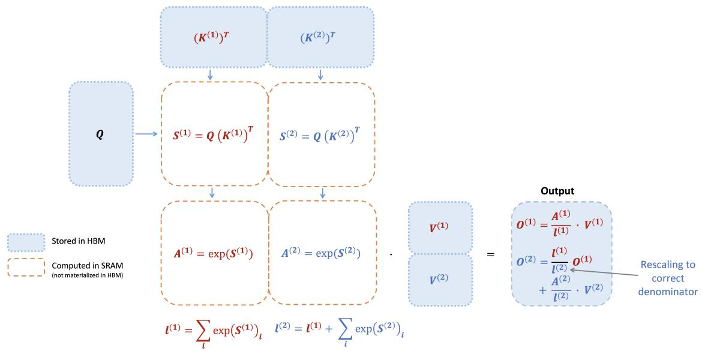
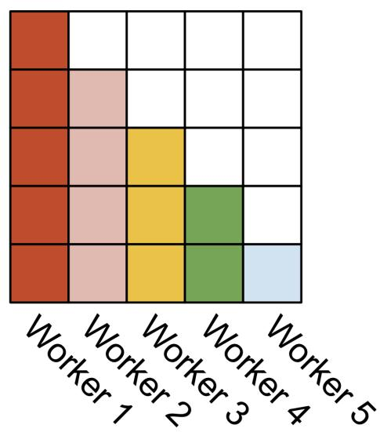
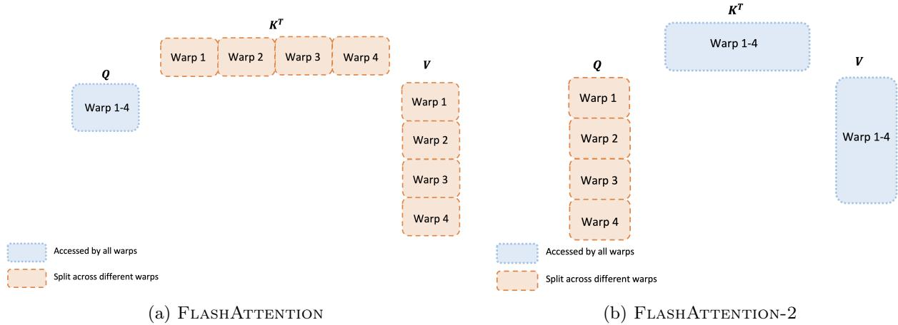
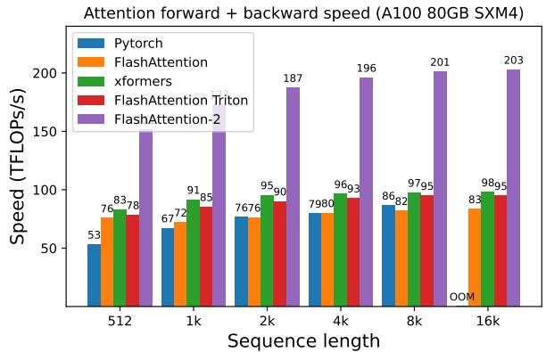
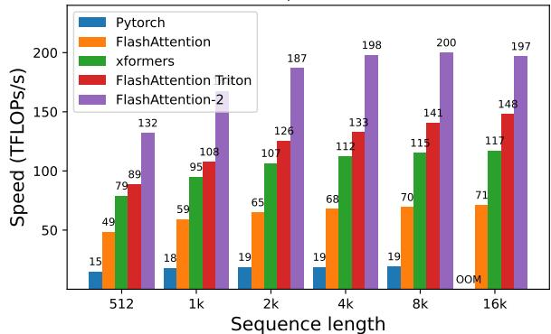
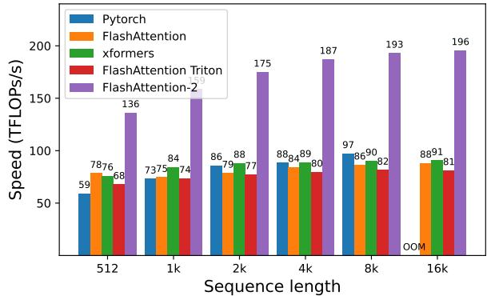
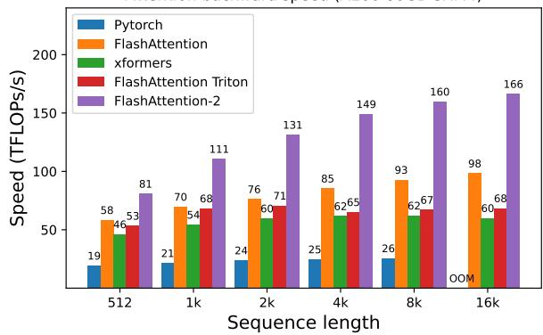
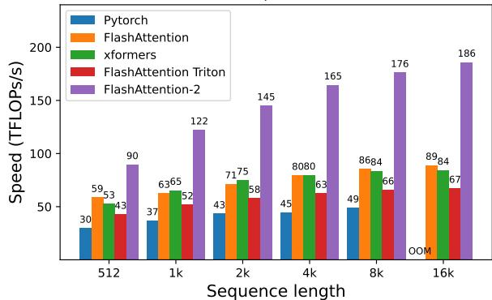
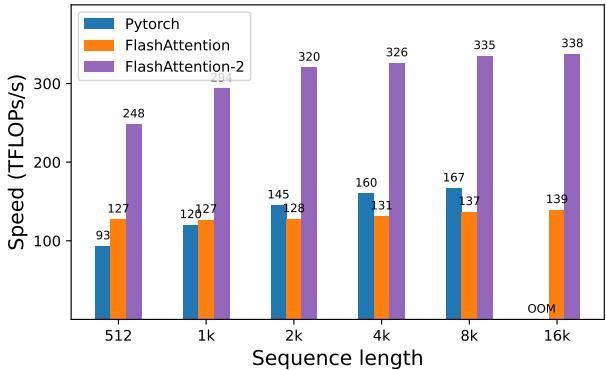

# FLASHATTENTION-2：通过更优的并行与工作划分实现更快的注意力机制

Tri Dao $^{1,2}$

$^{1}$ Department of Computer Science, Princeton University（普林斯顿大学计算机科学系） $^{2}$ Department of Computer Science, Stanford University（斯坦福大学计算机科学系） trid@cs.stanford.edu

2023年7月18日

## 摘要

在过去几年中，将 Transformers 扩展到更长的序列长度一直是一个核心难题，这有望提升语言建模和高分辨率图像理解的性能，并解锁在代码、音频和视频生成方面的新应用。注意力层是扩展到更长序列的主要瓶颈，因为其运行时间和内存需求随序列长度呈二次方增长。FLASHATTENTION [5] 利用非对称的 GPU 内存层级结构，在不进行任何近似的情况下带来了显著的内存节省（线性而非二次方）以及运行速度提升（与优化后的基准相比提升 2-4 倍）。然而，FLASHATTENTION 的速度仍远未达到优化矩阵乘法（GEMM）操作的水平，仅达到理论最大 FLOPs/s 的 25-40%。我们观察到，这种低效是由于 GPU 上不同线程块（thread blocks）和线程束（warps）之间的工作划分不够理想，导致了较低的占用率或不必要的共享内存读写。我们提出了 FLASHATTENTION-2，通过更优的工作划分来解决这些问题。具体而言，我们（1）调整算法以减少非矩阵乘法（non-matmul）FLOPs 的数量，（2）即使对于单个注意力头，也在不同的线程块之间并行化注意力计算以提高占用率，以及（3）在每个线程块内，在各线程束之间分配工作以减少通过共享内存进行的通信。与 FLASHATTENTION 相比，这些改进带来了约 2 倍的加速，在 A100 上达到了理论最大 FLOPs/s 的 50-73%，接近 GEMM 操作的效率。我们通过实证验证，当端到端用于训练 GPT 风格的模型时，FLASHATTENTION-2 在每张 A100 GPU 上的训练速度高达 225 TFLOPs/s（模型 FLOPs 利用率达到 72%）。$^{1}$

## 1 引言

扩展 Transformers $[18]$ 的上下文长度是一项挑战，因为其核心的注意力层的运行时间和内存需求与输入序列长度呈二次方关系。理想情况下，我们希望突破标准的 2k 序列长度限制，以训练模型来理解书籍、高分辨率图像和长视频。仅在过去一年中，就出现了几个上下文长度远超以往的语言模型：上下文长度为 32k 的 GPT-4 $[12]$、上下文长度为 65k 的 MosaicML 的 MPT，以及上下文长度为 100k 的 Anthropic 的 Claude。长文档查询和故事创作等新兴应用场景已经展示了对此类长上下文模型的需求。

为了降低长上下文下注意力机制的计算需求，已有众多方法被提出来近似注意力计算 $[2, 3, 4, 8, 9, 14, 19, 20]$。尽管这些方法已有部分应用案例，但据我们所知，大多数大规模训练仍然使用标准注意力机制。受此启发，Dao 等人 $[5]$ 提出对注意力计算进行重新排序，并利用经典技术（分块 tiling、重计算 recomputation）大幅加速计算，将内存占用从序列长度的二次方降低到线性。这在无任何近似的情况下，相比优化后的基线实现了 $2-4\times$ 的实际耗时（wall-clock time）加速，并节省了高达 $10-20\times$ 的内存，因此 FLASHATTENTION 在 Transformers 的大规模训练与推理中得到了广泛应用。

然而，随着上下文长度进一步增加，FLASHATTENTION 的效率仍远未达到矩阵乘法（GEMM）等其他基本算子的水平。具体而言，尽管 FLASHATTENTION 已经比标准注意力实现快 2-4 倍，但其前向传播仅能达到设备理论最大 FLOPs/s 的 30-50%（Fig. 5），而反向传播则更具挑战性，在 A100 GPU 上仅能达到最大吞吐量的 25-35%（Fig. 6）。相比之下，经过优化的 GEMM 可以达到设备理论最大吞吐量的 80-90%。通过细致的性能分析，我们发现 FLASHATTENTION 在 GPU 的不同线程块（thread blocks）与线程束（warps）之间的工作划分仍然不够理想，导致占用率（occupancy）偏低或产生了不必要的共享内存读写。

在 FLASHATTENTION 的基础上，我们提出了 FLASHATTENTION-2，通过更好的并行性和工作划分来解决这些挑战。

1. 在第 3.1 节中，我们在不改变输出的前提下调整算法，以减少非矩阵乘法（non-matmul）的 FLOPs。虽然非矩阵乘法 FLOPs 仅占总 FLOPs 的一小部分，但由于 GPU 拥有专门的矩阵乘法单元，执行非矩阵乘法需要更长的时间，因此矩阵乘法的吞吐量可以比非矩阵乘法高出多达 $16\times$。因此，减少非矩阵乘法 FLOPs 并尽可能多地将时间花在矩阵乘法 FLOPs 上至关重要。

2. 除了批次大小（batch）和注意力头数维度之外，我们提议在前向传播和反向传播中均沿序列长度维度进行并行化。在序列较长（因此批次大小通常较小）的情况下，这能提高占用率（GPU 资源的利用率）。

3. 即使在单个注意力计算块内部，我们也在线程块的不同 warp 之间划分工作，以减少通信以及共享内存的读写。

在第 4 节中，我们通过实证验证了 FLASHATTENTION-2 相比于 FLASHATTENTION 也能产生显著的加速。在不同设置（有或无因果掩码、不同的注意力头维度）下的基准测试表明，FLASHATTENTION-2 相比 FLASHATTENTION 实现了约 $2\times$ 的加速，在前向传播中达到理论最大吞吐量的 73%，在反向传播中达到理论最大吞吐量的 63%。当端到端用于训练 GPT 风格的模型时，我们在每张 A100 GPU 上达到了高达 225 TFLOPs/s 的训练速度。

## 2 背景

我们提供了关于 GPU 性能特征和执行模型的一些背景知识。我们还描述了注意力机制（attention）的标准实现以及 FLASHATTENTION。

## 2.1 硬件特性

GPU 性能特征。GPU 由计算单元（例如浮点运算单元）和内存层级组成。大多数现代 GPU 包含用于加速低精度矩阵乘法的专用单元（例如 Nvidia GPU 上用于 FP16/BF16 矩阵乘法的 Tensor Cores）。内存层级由高带宽内存（HBM）和片上 SRAM（又称共享内存）组成。例如，A100 GPU 拥有 40-80GB 的高带宽内存（HBM），带宽为 1.5-2.0TB/s，并且 108 个流式多处理器（SM）中每个都拥有 192KB 的片上 SRAM，带宽估计约为 19TB/s [6, 7]。由于 L2 缓存不能由程序员直接控制，出于本文讨论的目的，我们将重点关注 HBM 和 SRAM。

执行模型。GPU 拥有海量线程来执行某个操作（称为 kernel）。线程被组织成线程块（thread blocks），这些线程块被调度在流式多处理器（SMs）上运行。在每个线程块内，线程被分组为 warp（由 32 个线程组成的组）。warp 内的线程可以通过快速 shuffle 指令进行通信，或协同执行矩阵乘法。线程块内的 warp 可以通过读写共享内存进行通信。每个 kernel 从 HBM 加载输入到寄存器和 SRAM，进行计算，然后将输出写入 HBM。

## 2.2 标准注意力实现

给定输入序列 $Q, K, V \in R^{N \times d}$，其中 N 是序列长度，d 是注意力头维度，我们希望计算注意力输出 $O \in R^{N \times d}$：

$$
\mathbf {S} = \mathbf {Q} \mathbf {K} ^ {\top} \in \mathbb {R} ^ {N \times N}, \quad \mathbf {P} = \mathrm{softmax} (\mathbf {S}) \in \mathbb {R} ^ {N \times N}, \quad \mathbf {O} = \mathbf {P} \mathbf {V} \in \mathbb {R} ^ {N \times d},
$$

其中 softmax 是按行应用的。$^{2}$ 对于多头注意力（MHA），相同的计算在多个注意力头之间并行执行，并在批次维度（一个批次中的输入序列数量）上并行。

注意力的反向传播过程如下。令 $\mathbf{dO} \in \mathbb{R}^{N \times d}$ 为 $\mathbf{O}$ 关于某个损失函数的梯度。然后根据链式法则（即反向传播）：

$$
\begin{array}{r l} & {\mathbf {d V} = \mathbf {P} ^ {\top} \mathbf {d O} \in \mathbb {R} ^ {N \times d}} \\ & {\mathbf {d P} = \mathbf {d O V} ^ {\top} \in \mathbb {R} ^ {N \times N}} \\ & {\mathbf {d S} = \mathrm{dsoftmax} (\mathbf {d P}) \in \mathbb {R} ^ {N \times N}} \\ & {\mathbf {d Q} = \mathbf {d S K} \in \mathbb {R} ^ {N \times d}} \\ & {\mathbf {d K} = \mathbf {Q d S} ^ {\top} \in \mathbb {R} ^ {N \times d},} \end{array}
$$

其中 dsoftmax 是按行应用的 softmax 的梯度（反向传播）。可以推导出，如果对于某个向量 $s$ 和 $p$ 有 $p = \text{softmax}(s)$，那么在输出梯度为 $dp$ 的情况下，输入梯度为 $ds = (\text{diag}(p) - pp^{\top})dp$。

标准注意力实现将矩阵 S 和 P 具体化（materialize）到 HBM 中，这需要 $O(N^{2})$ 的内存。通常 $N \gg d$（一般 N 在 1k–8k 的数量级，而 d 约为 64–128）。标准注意力实现 (1) 调用矩阵乘法（GEMM）子程序计算 $S = QK^{\top}$，将结果写入 HBM，然后 (2) 从 HBM 加载 S 计算 softmax 并将结果 P 写入 HBM，最后 (3) 调用 GEMM 得到 O = PV。由于大多数操作都受内存带宽限制，大量的内存访问会导致实际运行时间（wall-clock time）变慢。此外，由于必须具体化 S 和 P，所需的内存为 $O(N^{2})$。而且，还必须保存 $P \in R^{N \times N}$ 以供反向传播计算梯度。

## 2.3 FLASHATTENTION

为了加速在 GPU 等硬件加速器上的注意力计算，$[5]$ 提出了一种在保持相同输出（无近似）的同时减少内存读写量的算法。

## 2.3.1 Forward pass

FLASHATTENTION 应用了经典的分块（tiling）技术来减少内存 IO，具体方式为：(1) 将输入块从 HBM 加载到 SRAM，(2) 针对该块计算注意力，然后 (3) 更新输出，而无需将庞大的中间矩阵 S 和 P 写入 HBM。由于 softmax 将整行或行块耦合在一起，在线 softmax（online softmax）[11, 13] 可以将注意力计算拆分成块，并对每个块的输出重新缩放（rescale），从而最终获得正确的结果（无近似）。通过显著减少内存读写量，FLASHATTENTION 相比经过优化的基准注意力实现获得了 2-4 倍的实际运行速度提升。

我们描述了在线 softmax 技术 [11] 及其在注意力机制中的应用方式 [13]。为简单起见，仅考虑注意力矩阵 $\mathbf{S}$ 的一个行块，其形式为针对某些矩阵 $\mathbf{S}^{(1)}, \mathbf{S}^{(2)} \in \mathbb{R}^{B_r \times B_c}$ 的 $\left[\mathbf{S}^{(1)} - \mathbf{S}^{(2)}\right]$，其中 $B_r$ 和 $B_c$ 分别是行块和列块的大小。我们希望计算该行块的 softmax 并与 value 相乘，value 的形式为针对某些矩阵 $\mathbf{V}^{(1)}, \mathbf{V}^{(2)} \in \mathbb{R}^{B_c \times d}$ 的 $\left[\begin{array}{c}\mathbf{V}^{(1)}\\ \mathbf{V}^{(2)}\end{array}\right]$。标准 softmax 会

计算：

$$
\begin{array}{l} m = \max (\operatorname{rowmax} (\mathbf {S} ^ {(1)}), \operatorname{rowmax} (\mathbf {S} ^ {(2)})) \in \mathbb {R} ^ {B _ {r}} \\ \ell = \operatorname{rowsum} (e ^ {\mathbf {S} ^ {(1)} - m}) + \operatorname{rowsum} (e ^ {\mathbf {S} ^ {(2)} - m}) \in \mathbb {R} ^ {B _ {r}} \\ \mathbf {P} = \left[ \begin{array}{c c} \mathbf {P} ^ {(1)} & \mathbf {P} ^ {(2)} \end{array} \right] = \operatorname{diag} (\ell) ^ {- 1} \left[ \begin{array}{c c} e ^ {\mathbf {S} ^ {(1)} - m} & e ^ {\mathbf {S} ^ {(2)} - m} \end{array} \right] \in \mathbb {R} ^ {B _ {r} \times 2 B _ {c}} \\ \mathbf {O} = \left[ \begin{array}{c c} \mathbf {P} ^ {(1)} & \mathbf {P} ^ {(2)} \end{array} \right] \left[ \begin{array}{c} \mathbf {V} ^ {(1)} \\ \mathbf {V} ^ {(2)} \end{array} \right] = \operatorname{diag} (\ell) ^ {- 1} e ^ {\mathbf {S} ^ {(1)} - m} \mathbf {V} ^ {(1)} + e ^ {\mathbf {S} ^ {(2)} - m} \mathbf {V} ^ {(2)} \in \mathbb {R} ^ {B _ {r} \times d}. \end{array}
$$

在线 softmax（online softmax）则针对每个块计算“局部”softmax，并在最后进行重新缩放以获得正确的输出：

$$
\begin{array}{r l} & m ^ {(1)} = \mathrm{rowmax} (\mathbf {S} ^ {(1)}) \in \mathbb {R} ^ {B _ {r}} \\ & \ell^ {(1)} = \mathrm{rowsum} (e ^ {\mathbf {S} ^ {(1)} - m ^ {(1)}}) \in \mathbb {R} ^ {B _ {r}} \\ & \tilde {\mathbf {P}} ^ {(1)} = \mathrm{diag} (\ell^ {(1)}) ^ {- 1} e ^ {\mathbf {S} ^ {(1)} - m ^ {(1)}} \in \mathbb {R} ^ {B _ {r} \times B _ {c}} \\ & \mathbf {O} ^ {(1)} = \tilde {\mathbf {P}} ^ {(1)} \mathbf {V} ^ {(1)} = \mathrm{diag} (\ell^ {(1)}) ^ {- 1} e ^ {\mathbf {S} ^ {(1)} - m ^ {(1)}} \mathbf {V} ^ {(1)} \in \mathbb {R} ^ {B _ {r} \times d} \\ & m ^ {(2)} = \max (m ^ {(1)}, \mathrm{rowmax} (\mathbf {S} ^ {(2)})) = m \\ & \ell^ {(2)} = e ^ {m ^ {(1)} - m ^ {(2)}} \ell^ {(1)} + \mathrm{rowsum} (e ^ {\mathbf {S} ^ {(2)} - m ^ {(2)}}) = \mathrm{rowsum} (e ^ {\mathbf {S} ^ {(1)} - m}) + \mathrm{rowsum} (e ^ {\mathbf {S} ^ {(2)} - m}) = \ell \\ & \tilde {\mathbf {P}} ^ {(2)} = \mathrm{diag} (\ell^ {(2)}) ^ {- 1} e ^ {\mathbf {S} ^ {(2)} - m ^ {(2)}} \\ & \mathbf {O} ^ {(2)} = \mathrm{diag} (\ell^ {(1)} / \ell^ {(2)}) ^ {- 1} \mathbf {O} ^ {(1)} + \tilde {\mathbf {P}} ^ {(2)} \mathbf {V} ^ {(2)} = \mathrm{diag} (\ell^ {(2)}) ^ {- 1} e ^ {s ^ {(1)} - m} \mathbf {V} ^ {(1)} + \mathrm{diag} (\ell^ {(2)}) ^ {- 1} e ^ {s ^ {(2)} - m} \mathbf {V} ^ {(2)} = \mathbf {0}. \end{array}
$$

我们展示了 FLASHATTENTION 如何利用在线 softmax 来实现分块（tiling）（Fig. 1），从而减少内存读写。

  
Figure 1：当键 K 被划分为两个块且值 V 也被划分为两个块时，FLASHATTENTION 前向传播执行过程的示意图。通过针对每个块计算注意力并重新缩放输出，我们最终得到了正确的结果，同时避免了对中间矩阵 S 和 P 进行昂贵的内存读取/写入。为简化图表，我们省略了 softmax 中从每个元素中减去按行最大值的步骤。

## 2.3.2 反向传播

在反向传播中，当输入 Q、K、V 的分块加载到 SRAM 后，FLASHATTENTION 通过重新计算注意力矩阵 S 和 P 的值，避免了存储庞大的中间值。由于无需保存大小为 $N \times N$ 的大型矩阵 S 和 P，FLASHATTENTION 根据序列长度实现了 10-20× 的内存节省（所需的内存与序列长度 N 呈线性关系，而非二次方关系）。由于减少了内存读取/写入，反向传播还实现了 2-4× 的实际运行时间（wall-clock）加速。

反向传播对第 2.2 节中的公式应用了分块（tiling）。尽管从概念上讲反向传播比前向传播更简单（没有 softmax 重新缩放），但实现起来要复杂得多。这是因为在前向传播中只需执行 2 次矩阵乘法，而在反向传播中为了执行 5 次矩阵乘法，需要将更多的值保留在 SRAM 中。

## 3 FLASHATTENTION-2：算法、并行性与工作划分

我们介绍了 FLASHATTENTION-2 算法，该算法对 FLASHATTENTION 进行了若干微调以减少非矩阵乘法（non-matmul）FLOPs 的数量。然后，我们描述了如何在不同的线程块（thread blocks）上并行化计算以充分利用 GPU 资源。最后，我们描述了如何在一个线程块内的不同 warp 之间划分工作，以减少共享内存的访问量。正如第 4 节中所验证的，这些改进带来了 2-3× 的加速。

## 3.1 算法

我们对 FLASHATTENTION 的算法进行了微调，以减少非矩阵乘法 FLOPs 的数量。这是因为现代 GPU 拥有专用的计算单元（例如 Nvidia GPU 上的 Tensor Core），这使得矩阵乘法要快得多。例如，A100 GPU 的 FP16/BF16 矩阵乘法理论最大吞吐量为 312 TFLOPs/s，但非矩阵乘法 FP32 仅为 19.5 TFLOPs/s。换一种思考方式，每个非矩阵乘法 FLOP 的开销是矩阵乘法 FLOP 的 $16\times$。为了保持高吞吐量（例如，超过理论最大 TFLOPs/s 的 50%），我们希望尽可能多地将时间花在矩阵乘法 FLOPs 上。

## 3.1.1 前向传播

我们重新回顾第 2.3 节所示的在线 softmax 技巧，并做出两项微调以减少非矩阵乘法 FLOPs：

1. 我们不必用 $\mathrm{diag}(\ell^{(2)})^{-1}$ 对输出更新的两项都进行重新缩放：

$$
\mathbf {O} ^ {(2)} = \mathrm{diag} (\ell^ {(1)} / \ell^ {(2)}) ^ {- 1} \mathbf {O} ^ {(1)} + \mathrm{diag} (\ell^ {(2)}) ^ {- 1} e ^ {\mathbf {S} ^ {(2)} - m ^ {(2)}} \mathbf {V} ^ {(2)}.
$$

相反，我们可以维护 $\mathbf{O}^{(2)}$ 的“未缩放”版本并保留统计量 $\ell^{(2)}$：

$$
\tilde {\mathbf {O}} ^ {(2)} = \mathrm{diag} (\ell^ {(1)}) ^ {- 1} \mathbf {O} ^ {(1)} + e ^ {\mathbf {S} ^ {(2)} - m ^ {(2)}} \mathbf {V} ^ {(2)}.
$$

仅在循环的最末尾，我们才通过 $\mathrm{diag}(\ell^{(\mathrm{last})})^{-1}$ 对最终的 $\tilde{\mathbf{O}}^{(\mathrm{last})}$ 进行缩放，以获得正确的输出。

2. 我们不需要为反向传播同时保存最大值 $m^{(j)}$ 和指数和 $\ell^{(j)}$。我们只需要存储 logsumexp $L^{(j)} = m^{(j)} + \log (\ell^{(j)})$。

在第 2.3 节中 2 个分块的简单情况下，在线 softmax 技巧现在变为：

<div class="mineru-algorithm" style="white-space: pre-wrap; font-family:monospace;">
$\begin{array}{rl} &amp; m^{(1)} = \mathrm{rowmax}(\mathbf{S}^{(1)})\in \mathbb{R}^{B_r}\\ &amp; \ell^{(1)} = \mathrm{rowsum}(e^{\mathbf{S}^{(1)} - m^{(1)}})\in \mathbb{R}^{B_r}\\ &amp; \tilde{\mathbf{O}}^{(1)} = e^{\mathbf{S}^{(1)} - m^{(1)}}\mathbf{V}^{(1)}\in \mathbb{R}^{B_r\times d}\\ &amp; m^{(2)} = \max (m^{(1)},\mathrm{rowmax}(\mathbf{S}^{(2)})) = m\\ &amp; \ell^{(2)} = e^{m^{(1)} - m^{(2)}}\ell^{(1)} + \mathrm{rowsum}(e^{\mathbf{S}^{(2)} - m^{(2)}}) = \mathrm{rowsum}(e^{\mathbf{S}^{(1)} - m}) + \mathrm{rowsum}(e^{\mathbf{S}^{(2)} - m}) = \ell \\ &amp; \tilde{\mathbf{P}}^{(2)} = \mathrm{diag}(\ell^{(2)})^{-1}e^{\mathbf{S}^{(2)} - m^{(2)}}\\ &amp; \tilde{\mathbf{O}}^{(2)} = \mathrm{diag}(e^{m^{(1)} - m^{(2)}})^{-1}\tilde{\mathbf{O}}^{(1)} + e^{\mathbf{S}^{(2)} - m^{(2)}}\mathbf{V}^{(2)} = e^{s^{(1)} - m}\mathbf{V}^{(1)} + e^{s^{(2)} - m}\mathbf{V}^{(2)}\\ &amp; \mathbf{O}^{(2)} = \mathrm{diag}(\ell^{(2)})^{-1}\tilde{\mathbf{O}}^{(2)} = \mathbf{O}. \end{array}$
</div>

我们在算法 1 中描述了完整的 FLASHATTENTION-2 前向传播。

<div class="mineru-algorithm" style="white-space: pre-wrap; font-family:monospace;">
算法 1 FLASHATTENTION-2 前向传播

输入：位于 HBM 中的矩阵 Q, K, V ∈ R^{N×d}，分块大小 B_c, B_r。

1: 将 Q 分割为 T_r = $\left[\frac{N}{B_r}\right]$ 个大小均为 Br × d 的块 Q1, ..., Q_Tr，并将 K, V 分割为 T_c = $\left[\frac{N}{B_c}\right]$ 个大小均为 Br × d 的块 K1, ..., K_Tc 和 V1, ..., V_Tc。

2: 将输出 O ∈ R^{N×d} 分割为 Tr 个大小均为 Br × d 的块 O_i, ..., O_Tr，并将 logsumexp L 分割为 Tr 个大小均为 Br 的块 Li, ..., LT_r。

3: for 1 ≤ i ≤ Tr do

4: 从 HBM 加载 Qi 到片上 SRAM。

5: 在片上，初始化 O_i^{(0)} = (0)_{Br×d} ∈ R^{Br×d}, \ell_i^{(0)} = (0)_{Br} ∈ R^{Br}, m_i^{(0)} = (-∞)_{Br} ∈ R^{Br}。

6: for 1 ≤ j ≤ T_c do

7: 从 HBM 加载 K_j, V_j 到片上 SRAM。

8: 在片上，计算 S_i^{(j)} = Q_i K_j^T ∈ R^{Br×B_c}。

9: 在片上，计算 m_i^{(j)} = max(m_i^{(j-1)}, rowmax(S_i^{(j)})) ∈ R^{Br}, \tilde{P}_i^{(j)} = exp(S_i^{(j)} - m_i^{(j)}) ∈ R^{Br×B_c}（逐元素）, \ell_i^{(j)} = e^{m_i^{j-1}-m_i^{(j)}} \ell_i^{(j-1)} + rowsum(\tilde{P}_i^{(j)}) ∈ R^{Br}。

10: 在片上，计算 O_i^{(j)} = diag(e^{m_i^{(j-1)}-m_i^{(j)}})^{-1}O_i^{(j-1)} + \tilde{P}_i^{(j)}V_j。

11: end for

12: 在片上，计算 O_i = diag(\ell_i^{(T_c)})^{-1}O_i^{(T_c)}。

13: 在片上，计算 Li = m_i^{(T_c)} + log(\ell_i^{(T_c)})。

14: 将 O_i 作为 O 的第 i 个块写回 HBM。

15: 将 Li 作为 L 的第 i 个块写回 HBM。

16: end for

17: 返回输出 O 以及 logsumexp L。
</div>

因果掩码。注意力机制的一个常见应用场景是在自回归语言建模中，此时我们需要对注意力矩阵 S 应用因果掩码（即对于任何 j > i 的条目 $S_{ij}$ 均设为 $-\infty$ ）。

1. 由于 FLASHATTENTION 和 FLASHATTENTION-2 本身就是分块执行的，对于所有列索引均大于行索引的块（对于长序列长度而言，大约占全部块的一半），我们可以直接跳过该块的计算。与不带因果掩码的注意力机制相比，这带来了约 $1.7-1.8\times$ 的加速。

2. 对于能确保其行索引严格小于列索引的块，我们无需应用因果掩码。这意味着对于每一行，我们只需要对 1 个块应用因果掩码（假设为正方形块）。

正确性、运行时间和内存需求。与 FLASHATTENTION 一样，算法 1 返回正确的输出 $\mathbf{O} = \mathrm{softmax}(\mathbf{Q}\mathbf{K}^{\top})\mathbf{V}$（无近似），使用 $O(N^{2}d)$ FLOPs，且除了输入和输出之外仅需要 $O(N)$ 的额外内存（用于存储 logsumexp $L$ ）。其证明与 Dao et al. [5, Theorem 1] 的证明几乎相同，因此我们在此略去。

## 3.1.2 反向传播

FLASHATTENTION-2 的反向传播与 FLASHATTENTION 几乎相同。我们做了一个微小的调整，仅使用行级 logsumexp L，而不再在 softmax 中同时使用行级最大值和行级指数和。为了完整起见，我们在算法 2 中包含了反向传播的描述。

```txt
Algorithm 2 FLASHATTENTION-2 Backward Pass

Require: Matrices Q, K, V, O, dO ∈ R^{N×d} in HBM, vector L ∈ R^N in HBM, block sizes B_c, B_r.

1: Divide Q into T_r = [N/B_r] blocks Q_1, ..., Q_{T_r} of size B_r × d each, and divide K, V in to T_c = [N/B_c] blocks K_1, ..., K_{T_c} and V_1, ..., V_{T_c}, of size B_c × d each.

2: Divide O into T_r blocks O_i, ..., O_{T_r} of size B_r × d each, divide dO into T_r blocks dO_i, ..., dO_{T_r} of size B_r × d each, and divide L into T_r blocks L_i, ..., L_{T_r} of size B_r each.

3: Initialize dQ = (0)_{N×d} in HBM and divide it into T_r blocks dQ_1, ..., dQ_{T_r} of size B_r × d each. Divide dK, dV ∈ R^{N×d} in to T_c blocks dK_1, ..., dK_{T_c} and dV_1, ..., dV_{T_c}, of size B_c × d each.

4: Compute D = rowsum(dO ∘ O) ∈ R^d (pointwise multiply), write D to HBM and divide it into T_r blocks D_1, ..., D_{T_r} of size B_r each.

5: for 1 ≤ j ≤ T_c do

6: Load K_j, V_j from HBM to on-chip SRAM.

7: Initialize dK_j = (0)_{B_c×d}, dV_j = (0)_{B_c×d} on SRAM.

8: for 1 ≤ i ≤ T_r do

9: Load Q_i, O_i, dO_i, dQ_i, L_i, D_i from HBM to on-chip SRAM.

10: On chip, compute S_i^{(j)} = Q_i K_j^T ∈ R^{B_r × B_c}

11: On chip, compute P_i^{(j)} = exp(S_{ij} - L_i) ∈ R^{B_r × B_c}

12: On chip, compute dV_j ← dV_j + (P_i^{(j)})^T dO_i ∈ R^{B_c × d}

13: On chip, compute dP_i^{(j)} = dO_i V_j^T ∈ R^{B_r × B_c}

14: On chip, compute dS_i^{(j)} = P_i^{(j)} ∘ (dP_i^{(j)} - D_i) ∈ R^{B_r × B_c}

15: Load dQ_i from HBM to SRAM, then on chip, update dQ_i ← dQ_i + dS_i^{(j)} K_j ∈ R^{B_r × d}, and write back to HBM.

16: On chip, compute dK_j ← dK_j + dS_i^{(j)ᵀ} Q_i ∈ R^{B_c × d}

17: end for

18: Write dK_j, dV_j to HBM.

19: end for

20: Return dQ, dK, dV.
```

多查询注意力（Multi-query attention, MQA）与分组查询注意力（grouped-query attention, GQA）。多查询注意力（MQA）[15] 和分组查询注意力（GQA）[1] 是注意力的变体，其中多个查询头（query head）关注同一个键（key）和值（value）头，以减少推理过程中的 KV 缓存大小。我们不需要为了计算而复制键和值头，而是通过隐式操作头部的索引来执行相同的计算。在反向传播中，我们需要对隐式复制的不同头之间的梯度 dK 和 dV 进行求和。

## 3.2 并行化

FLASHATTENTION 的第一个版本在批次大小（batch size）和注意力头数量（number of heads）上进行并行化。我们使用 1 个线程块（thread block）来处理一个注意力头，总共有“批次大小 · 注意力头数量”个线程块。每个线程块被调度在一个流式多处理器（streaming multiprocessor, SM）上运行，例如在 A100 GPU 上有 108 个这样的 SM。当该数量较大（比如 $\geq$ 80）时，这种调度是高效的，因为我们可以有效地利用 GPU 上的几乎所有计算资源。

在长序列的情况下（这通常意味着较小的批次大小或较少的注意力头数量），为了更好地利用 GPU 上的多处理器，我们现在还在序列长度维度上进行了额外的并行化。这使得在该机制下获得了显著的加速。

前向传播。我们注意到外层循环（在序列长度上）是易并行（embarrassingly parallel）的，我们将它们调度在不需要相互通信的不同线程块上。与 FLASHATTENTION 一样，我们也在批次维度和注意力头数量维度上进行并行化。当批次大小和注意力头数量较小时，在序列长度上增加的并行度有助于提高占用率（occupancy，即正在使用的 GPU 资源的比例），从而在此类情况下带来加速。

这些交换循环顺序的想法（外层循环遍历行块，内层循环遍历列块，而不是原始 FLASHATTENTION 论文中的相反方式），以及在序列长度维度上进行并行化的方法，最初是由 Phil Tillet 在 Triton [17] 实现中提出并实现的。$^{3}$

反向传播。请注意，不同列块之间唯一的共享计算是算法 2 中的更新 dQ，我们需要将 $dQ_{i}$ 从 HBM 加载到 SRAM，然后在芯片上更新 $dQ_{i} \leftarrow dQ_{i} + dS_{i}^{(j)}K_{j}$，并写回 HBM。因此，我们同样在序列长度维度上进行并行化，并为反向传播的每个列块调度 1 个线程块。我们使用原子加法（atomic adds）在不同线程块之间进行通信以更新 dQ。

我们在图 2（Fig. 2）中描述了该并行化方案。

前向传播  


反向传播  
  
Figure 2: 在前向传播（左）中，我们对工作单元（线程块）进行并行化，每个工作单元处理注意力矩阵的一个行块。在反向传播（右）中，每个工作单元处理注意力矩阵的一个列块。

## 3.3 Warp 间的工作划分

正如第 3.2 节描述了我们如何调度线程块，即使在每个线程块内部，我们也必须决定如何在不同的 warp 之间划分工作。我们通常在每个线程块中使用 4 个或 8 个 warp，其划分方式如图 3 所示。

前向传播。对于每个块，FLASHATTENTION 将 K 和 V 划分给 4 个 warp，同时保持 Q 可被所有 warp 访问。每个 warp 进行乘法计算以得到 $QK^{\top}$ 的一个切片，然后它们需要与 V 的一个切片相乘并进行通信以累加结果。这被称为“split-K”方案。然而，这是低效的，因为所有 warp 都需要将其局部中间结果写出到共享内存（shared memory），进行同步，然后再累加中间结果。这些共享内存读写操作降低了 FLASHATTENTION 中前向传播的速度。

在 FLASHATTENTION-2 中，我们改为将 Q 划分给 4 个 warp，同时保持 K 和 V 可被所有 warp 访问。在每个 warp 执行矩阵乘法以得到 $QK^{\top}$ 的一个切片后，它们只需与其共享的 V 切片相乘即可获得其对应的输出切片。warp 之间无需进行通信。共享内存读写操作的减少带来了加速（第 4 节）。

  
Figure 3: 前向传播中不同 warp 之间的工作划分

反向传播。类似地，对于反向传播，我们选择对 warp 进行划分以避免“split-K”方案。然而，由于所有不同输入与梯度 Q、K、V、O、dO、dQ、dK、dV 之间存在更复杂的依赖关系，它仍然需要一些同步。尽管如此，避免“split-K”减少了共享内存的读写，从而再次带来了加速（第 4 节）。

调整块大小 增加块大小通常会减少共享内存的加载/存储，但会增加所需的寄存器数量和共享内存总量。超过一定的块大小后，寄存器溢出（register spilling）会导致显著的减速，或者所需的共享内存量超出 GPU 的可用容量，导致内核根本无法运行。通常，我们根据头维度 d 和设备的共享内存大小，选择大小为 $\{64,128\}\times\{64,128\}$ 的块。

我们针对每个头维度进行了手动调优，因为本质上块大小只有 4 种选择，但通过自动调优来避免这种人工劳动将大有裨益。我们将此留待未来的工作。

## 4 实证验证

我们评估了使用 FLASHATTENTION-2 训练 Transformer 模型的影响。

- 注意力基准测试。我们测量了 FLASHATTENTION-2 在不同序列长度下的运行时间，并将其与 PyTorch 中的标准实现、FLASHATTENTION 以及 Triton 中的 FLASHATTENTION 进行了比较。我们证实 FLASHATTENTION-2 比 FLASHATTENTION 快 1.7-3.0×，比 Triton 中的 FLASHATTENTION 快 1.3-2.5×，比标准注意力实现快 3-10×。

FLASHATTENTION-2 的计算速度最高可达 230 TFLOPs/s，达到 A100 GPU 理论最大 TFLOPs/s 的 73%。

- 端到端训练速度 当端到端用于训练序列长度为 2k 或 8k、模型大小为 1.3B 和 2.7B 的 GPT 风格模型时，与 FLASHATTENTION 相比，FLASHATTENTION-2 实现了高达 1.3× 的加速；与不使用 FLASHATTENTION 的基线相比，实现了高达 2.8× 的加速。在每张 A100 GPU 上，FLASHATTENTION-2 达到了高达 225 TFLOPs/s（72% 的模型 FLOPs 利用率）。

## 4.1 注意力基准测试

我们在 A100 80GB SXM4 GPU 上测量了不同设置下（无/有因果掩码，头维度为 64 或 128）不同注意力方法的运行时间。我们在图 4、图 5 和图 6 中报告了结果，表明 FLASHATTENTION-2 比 FLASHATTENTION 以及 xformers 中的 FLASHATTENTION（“cutlass” 实现）快约 2×。在前向传播中，FLASHATTENTION-2 比 Triton 中的 FLASHATTENTION 快约 1.3-1.5×，在反向传播中快约 2×。与 PyTorch 中的标准注意力实现相比，FLASHATTENTION-2 最多可快 10×。

基准测试设置：我们将序列长度从 512、1k、...、16k 进行变化，并设置批次大小使 token 总数为 16k。我们将隐藏维度设为 2048，头维度设为 64 或 128（即 32 个头或 16 个头）。为了计算前向传播的 FLOPs，我们使用：

$4 \cdot \text{seqlen}^{2} \cdot \text{head dimension} \cdot \text{number of heads}.$

带有因果掩码时，我们将此数值除以 2，以考虑大约只有一半的项被计算的事实。为了获得反向传播的 FLOPs，我们将前向传播的 FLOPs 乘以 2.5（因为在前向传播中有 2 次矩阵乘法，而由于重计算，在反向传播中有 5 次矩阵乘法）。

注意力前向 + 反向速度（A100 80GB SXM4）  
注意力前向 + 反向速度（A100 80GB SXM4）  




(a) 无因果掩码，头维度 64  
  
(c) 有因果掩码，头维度 64

(b) 无因果掩码，头维度 128  
  
(d) 有因果掩码，头维度 128  
Figure 4: A100 GPU 上的注意力前向 + 反向传播速度

注意力前向速度（A100 80GB SXM4）  
  
(a) 无因果掩码，头维度 64

注意力前向速度 (A100 80GB SXM4)  
  
(b) 无因果掩码，头维度 128

注意力前向速度 (A100 80GB SXM4)  
  
(c) 有因果掩码，头维度 64

注意力前向速度 (A100 80GB SXM4)  
  
(d) 有因果掩码，头维度 128  
Figure 5: A100 GPU 上的注意力前向速度

仅仅在 H100 GPU 上运行相同的实现（不使用任何特殊指令来利用 TMA 和第 4 代 Tensor Cores 等新特性），我们就获得了高达 335 TFLOPs/s 的速度（Fig. 7）。我们预计通过使用新指令，可以在 H100 GPU 上再获得 1.5×-2× 的加速。我们将此留待未来的工作中完成。

## 4.2 端到端性能

我们在 8×A100 80GB SXM 上测量了参数量为 1.3B 或 2.7B 的 GPT 风格模型的训练吞吐量。如 Table 1 所示，FLASHATTENTION-2 相比于不使用 FlashAttention 的基线带来了 2.8× 的加速，相比于 FLASHATTENTION-2 带来了 1.3× 的加速，单张 A100 GPU 达到了最高 225 TFLOPs/s。

请注意，我们遵循 Megatron-LM [16]（以及许多其他论文和代码库）的公式来计算 FLOPs：

$$
6 \cdot \mathrm{seqlen} \cdot \mathrm{numberofparams} + 1 2 \cdot \mathrm{numberoflayers} \cdot \mathrm{hiddendim} \cdot \mathrm{seqlen} ^ {2}.
$$

第一项对应权重与输入相乘产生的 FLOPs，第二项对应注意力机制产生的 FLOPs。然而，有人可能会认为第二项应该减半，因为在因果掩码下，我们只需要计算注意力中大约一半的元素。为了保持一致性，我们选择沿用文献中的公式（不将注意力 FLOPs 除以 2）。

## 5 讨论与未来方向

FLASHATTENTION-2 比 FLASHATTENTION 快 $2\times$，这意味着我们能以之前训练 8k 上下文模型的相同成本，训练具有 16k 更长上下文的模型。我们对如何将其应用于理解长篇书籍和报告、高分辨率图像、音频和视频感到十分兴奋。FLASHATTENTION-2 也将加速现有模型的训练、微调和推理。

注意力反向速度 (A100 80GB SXM4)  
  
(a) 无因果掩码，头维度 64

注意力反向速度 (A100 80GB SXM4)  
  
(b) 无因果掩码，头维度 128

注意力反向速度 (A100 80GB SXM4)  
  
(c) 有因果掩码，头维度 64

注意力反向传播速度 (A100 80GB SXM4)  
  
(d) 带因果掩码，头维度 128  
Figure 6: A100 GPU 上的注意力反向传播速度

Table 1: 在 8×A100 GPU 上 GPT 风格模型的训练速度 (TFLOPs/s/GPU)。FLASHATTENTION-2 达到高达 225 TFLOPs/s（72% 的模型 FLOPs 利用率）。我们与不使用 FLASHATTENTION 运行的基准进行了对比。

<table><tr><td>模型</td><td>不使用 FLASHATTENTION</td><td>FLASHATTENTION</td><td>FLASHATTENTION-2</td></tr><tr><td>GPT3-1.3B 2k 上下文</td><td>142 TFLOPs/s</td><td>189 TFLOPs/s</td><td>196 TFLOPs/s</td></tr><tr><td>GPT3-1.3B 8k 上下文</td><td>72 TFLOPs/s</td><td>170 TFLOPs/s</td><td>220 TFLOPs/s</td></tr><tr><td>GPT3-2.7B 2k 上下文</td><td>149 TFLOPs/s</td><td>189 TFLOPs/s</td><td>205 TFLOPs/s</td></tr><tr><td>GPT3-2.7B 8k 上下文</td><td>80 TFLOPs/s</td><td>175 TFLOPs/s</td><td>225 TFLOPs/s</td></tr></table>

在不久的将来，我们计划与研究人员和工程师合作，使 FlashAttention 广泛适用于各种不同类型的设备（例如 H100 GPU、AMD GPU）以及如 FP8 等新的数据类型。作为紧接着的下一步，我们计划针对 H100 GPU 优化 FlashAttention-2，以利用新的硬件特性（TMA、第 4 代 Tensor Cores、fp8）。将 FlashAttention-2 中的底层优化与高层算法变体（例如局部注意力、空洞注意力、块稀疏注意力）相结合，可以使我们能够训练具有更长上下文的 AI 模型。我们也非常期待与编译器研究人员合作，使这些优化技术易于编程。

注意力前向 + 反向传播速度 (H100 80GB SXM5)  
  
(a) 无因果掩码，头维度 64

注意力前向 + 反向传播速度 (H100 80GB SXM5)  
  
(b) 无因果掩码，头维度 128

注意力前向 + 反向传播速度 (H100 80GB SXM5)  
  
(c) 带因果掩码，头维度 64

注意力前向 + 反向传播速度 (H100 80GB SXM5)  
  
(d) 带因果掩码，头维度 128  
Figure 7: H100 GPU 上的注意力前向 + 反向传播速度

## 致谢

我们感谢 Phil Tillet 和 Daniel Haziza，他们在 Triton $[17]$ 和 xformers 库 $[10]$ 中实现了 FLASHATTENTION 的相关版本。FLASHATTENTION-2 的诞生得益于对注意力机制不同实现方式的思想交流与启发。我们非常感谢 Nvidia CUTLASS 团队（特别是 Vijay Thakkar、Cris Cecka、Haicheng Wu 和 Andrew Kerr）提供的 CUTLASS 库，尤其是 CUTLASS 3.x 版本，它为 FLASHATTENTION-2 的实现提供了清晰的抽象和强大的基础构建模块。我们感谢 Driss Guessous 将 FLASHATTENTION 集成到 PyTorch 中。FLASHATTENTION-2 得益于与 Phil Wang、Markus Rabe、James Bradbury、Young-Jun Ko、Julien Launay、Daniel Hesslow、Michaël Benesty、Horace He、Ashish Vaswani 以及 Erich Elsen 的有益讨论。感谢 Stanford CRFM 和 Stanford NLP 提供的算力支持。我们感谢 Dan Fu 和 Christopher Ré 在这一系列设计硬件高效算法的工作中所给予的合作、建设性反馈以及持续鼓励。我们感谢 Albert Gu 和 Beidi Chen 对本技术报告早期草稿提出的宝贵建议。

## 参考文献

[1] Joshua Ainslie, James Lee-Thorp, Michiel de Jong, Yury Zemlyanskiy, Federico Lebrón, and Sumit Sanghai. Gqa: Training generalized multi-query transformer models from multi-head checkpoints. arXiv preprint arXiv:2305.13245, 2023.

[2] Iz Beltagy, Matthew E Peters, and Arman Cohan. Longformer: The long-document transformer. arXiv preprint arXiv:2004.05150, 2020.

[3] Beidi Chen, Tri Dao, Eric Winsor, Zhao Song, Atri Rudra, and Christopher Ré. Scatterbrain: Unifying sparse and low-rank attention. In Advances in Neural Information Processing Systems (NeurIPS), 2021.

[4] Krzysztof Marcin Choromanski, Valerii Likhosherstov, David Dohan, Xingyou Song, Andreea Gane, Tamas Sarlos, Peter Hawkins, Jared Quincy Davis, Afroz Mohiuddin, Lukasz Kaiser, et al. Rethinking attention with performers. In International Conference on Learning Representations (ICLR), 2020.

[5] Tri Dao, Daniel Y. Fu, Stefano Ermon, Atri Rudra, and Christopher Ré. FlashAttention: Fast and memory-efficient exact attention with IO-awareness. In Advances in Neural Information Processing Systems, 2022.

[6] Zhe Jia and Peter Van Sandt. Dissecting the Ampere GPU architecture via microbenchmarking. GPU Technology Conference, 2021.

[7] Zhe Jia, Marco Maggioni, Benjamin Staiger, and Daniele P Scarpazza. Dissecting the nvidia Volta GPU architecture via microbenchmarking. arXiv preprint arXiv:1804.06826, 2018.

[8] Angelos Katharopoulos, Apoorv Vyas, Nikolaos Pappas, and François Fleuret. Transformers are RNNs: Fast autoregressive transformers with linear attention. In International Conference on Machine Learning, pages 5156–5165. PMLR, 2020.

[9] Nikita Kitaev, Lukasz Kaiser, and Anselm Levskaya. Reformer: The efficient transformer. In The International Conference on Machine Learning (ICML), 2020.

[10] Benjamin Lefaudeux, Francisco Massa, Diana Liskovich, Wenhan Xiong, Vittorio Caggiano, Sean Naren, Min Xu, Jieru Hu, Marta Tintore, Susan Zhang, Patrick Labatut, and Daniel Haziza. xformers: A modular and hackable transformer modelling library. https://github.com/facebookresearch/xformers, 2022.

[11] Maxim Milakov and Natalia Gimelshein. Online normalizer calculation for softmax. arXiv preprint arXiv:1805.02867, 2018.

[12] OpenAI. Gpt-4 technical report. ArXiv, abs/2303.08774, 2023.

[13] Markus N Rabe and Charles Staats. Self-attention does not need $O(n^{2})$ memory. arXiv preprint arXiv:2112.05682, 2021.

[14] Aurko Roy, Mohammad Saffar, Ashish Vaswani, and David Grangier. Efficient content-based sparse attention with routing transformers. Transactions of the Association for Computational Linguistics, 9:53–68, 2021.

[15] Noam Shazeer. Fast transformer decoding: One write-head is all you need. arXiv preprint arXiv:1911.02150, 2019.

[16] Mohammad Shoeybi, Mostofa Patwary, Raul Puri, Patrick LeGresley, Jared Casper, and Bryan Catanzaro. Megatron-LM: Training multi-billion parameter language models using model parallelism. arXiv preprint arXiv:1909.08053, 2019.

[17] Philippe Tillet, Hsiang-Tsung Kung, and David Cox. Triton: an intermediate language and compiler for tiled neural network computations. In Proceedings of the 3rd ACM SIGPLAN International Workshop on Machine Learning and Programming Languages, pages 10–19, 2019.

[18] Ashish Vaswani, Noam Shazeer, Niki Parmar, Jakob Uszkoreit, Llion Jones, Aidan N Gomez, Łukasz Kaiser, and Illia Polosukhin. Attention is all you need. Advances in neural information processing systems, 30, 2017.

[19] Sinong Wang, Belinda Z Li, Madian Khabsa, Han Fang, and Hao Ma. Linformer: Self-attention with linear complexity. arXiv preprint arXiv:2006.04768, 2020.

[20] Manzil Zaheer, Guru Guruganesh, Kumar Avinava Dubey, Joshua Ainslie, Chris Alberti, Santiago Ontanon, Philip Pham, Anirudh Ravula, Qifan Wang, Li Yang, et al. Big bird: Transformers for longer sequences. Advances in Neural Information Processing Systems, 33, 2020.