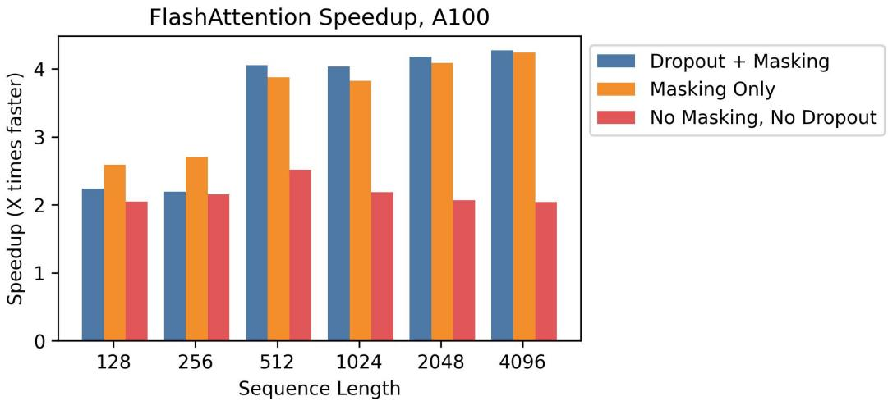

# FlashAttention：具有 IO 感知的高速且内存高效的精确注意力机制

Tri Dao<sup>†</sup>、Daniel Y. Fu<sup>†</sup>、Stefano Ermon<sup>†</sup>、Atri Rudra<sup>‡</sup> 和 Christopher Ré<sup>†</sup>

<sup>†</sup>斯坦福大学计算机科学系（Department of Computer Science, Stanford University） <sup>‡</sup>纽约州立大学布法罗分校计算机科学与工程系（Department of Computer Science and Engineering, University at Buffalo, SUNY） {trid,danfu}@cs.stanford.edu, ermon@stanford.edu, atri@buffalo.edu, chrismre@cs.stanford.edu

2022 年 6 月 24 日

## 摘要

Transformer 在长序列上运行缓慢且极度消耗内存，因为自注意力机制（self-attention）的时间和内存复杂度与序列长度呈二次方关系。近似注意力方法试图通过牺牲模型质量来降低计算复杂度以解决这一问题，但往往未能实现实际运行时间（wall-clock）的加速。我们认为，一个缺失的原则是使注意力算法具备 IO 感知能力（IO-aware）——即考虑 GPU 内存各层级之间的读取和写入。我们提出了 FlashAttention，这是一种具备 IO 感知的精确注意力算法，它利用分块（tiling）技术减少 GPU 高带宽内存（HBM）与 GPU 片上 SRAM 之间的内存读写次数。我们分析了 FlashAttention 的 IO 复杂度，证明了其所需的 HBM 访问次数少于标准注意力机制，并且在一系列 SRAM 大小范围内达到了最优。我们还将 FlashAttention 扩展到了块稀疏注意力（block-sparse attention），从而产生了一种比任何现有近似注意力方法都更快的近似注意力算法。FlashAttention 训练 Transformer 的速度快于现有基准：在 BERT-large（序列长度 512）上，与 MLPerf 1.1 训练速度纪录相比实现了 15% 的端到端实际加速；在 GPT-2（序列长度 1K）上实现了 3 倍加速；在 long-range arena（序列长度 1K-4K）上实现了 2.4 倍加速。FlashAttention 和块稀疏 FlashAttention 使得 Transformer 能够处理更长的上下文，从而带来了更高质量的模型（在 GPT-2 上的困惑度改善了 0.7，在长文档分类上提升了 6.4 个百分点），并赋予了全新的能力：成为首个在 Path-X 挑战（序列长度 16K，准确率 61.4%）和 Path-256（序列长度 64K，准确率 63.1%）上性能优于随机猜测的 Transformer。

## 1 引言

Transformer 模型 [82] 已成为自然语言处理和图像分类等应用中最为广泛采用的架构。尽管 Transformer 变得越来越大 [5]、越来越深 [83]，但为其配备更长的上下文仍然十分困难 [80]，因为作为其核心的自注意力模块的时间和内存复杂度与序列长度呈二次方关系。一个重要的问题是：使注意力机制更快且更具内存效率，是否能够帮助 Transformer 模型解决其在长序列下面临的运行时间和内存挑战。

许多近似注意力方法旨在降低注意力机制的计算和内存需求。这些方法涵盖了从稀疏近似 [51, 74] 到低秩近似 [12, 50, 84] 以及它们的组合 [3, 9, 92]。尽管这些方法将计算需求降低到与序列长度呈线性或近似线性关系，但其中许多方法相比于标准注意力机制并未展现出实际运行时间（wall-clock speedup）的加速，因而未能获得广泛应用。一个主要原因是它们侧重于减少浮点运算次数（FLOP reduction，这可能与实际运行速度并不相关），并且往往忽略了内存访问（IO）所带来的开销。

在本文中，我们认为一个缺失的原则是使注意力算法具备 IO 感知能力（IO-aware）[1]——即细致地考量对不同层级的高速和低速内存的读写（例如，在快速的 GPU 片上 SRAM 与相对较慢的 GPU 高带宽内存（High Bandwidth Memory，或 HBM [45]）之间，见 Figure 1 左图）。在现代

  
Figure 1: 左：FlashAttention 使用平铺（tiling）技术来防止在（相对）较慢的 GPU HBM 上实体化（materialization）庞大的 $N \times N$ 注意力矩阵（虚线框）。在外层循环中（红色箭头），FlashAttention 遍历 K 和 V 矩阵的分块并将它们加载到快速的片上 SRAM 中。在每个分块中，FlashAttention 遍历 Q 矩阵的分块（蓝色箭头），将它们加载到 SRAM，并将注意力计算的输出写回到 HBM。右：相比 GPT-2 上 PyTorch 实现的注意力的加速比。FlashAttention 不会将庞大的  ×  注意力矩阵读写至 HBM，从而在注意力计算上实现了 7.6× 的加速。

GPU 上，计算速度的增长已经超越了内存速度 [61, 62, 63]，并且 Transformer 中的大多数操作都受制于内存访问瓶颈 [43]。对于类似的受限于内存（memory-bound）的操作，当读写数据占据运行时间的很大一部分时，IO 感知算法一直至关重要——例如数据库连接（database joins）[71]、图像处理 [70]、数值线性代数 [4] 等等 [40, 85]。然而，深度学习中常用的 Python 接口（如 PyTorch 和 Tensorflow）并不支持对内存访问进行细粒度的控制。

我们提出了 FlashAttention，这是一种以大幅减少的内存访问来计算精确注意力（exact attention）的新注意力算法。我们的主要目标是避免在 HBM 中读写注意力矩阵。这需要：(i) 在不访问完整输入的情况下计算 softmax 归约（reduction）；(ii) 不为反向传播存储庞大的中间注意力矩阵。我们采用两种成熟的技术来应对这些挑战：(i) 我们重构注意力计算，将输入切分为块，并对输入块进行多次遍历，从而增量式地执行 softmax 归约（亦称平铺，tiling）；(ii) 我们存储前向传播中的 softmax 归一化因子，以便在反向传播中快速在片上（on-chip）重计算注意力，这比从 HBM 读取中间注意力矩阵的标准方法更快。我们在 CUDA 中实现了 FlashAttention，以实现对内存访问的细粒度控制，并将所有注意力操作融合为一个 GPU 内核（kernel）。得益于大幅减少的 HBM 访问量，即便重计算增加了 FLOPs，我们的算法运行速度依然更快（在 GPT-2 [67] 上最高可达 7.6 倍，见 Figure 1 右图），且比标准注意力机制消耗更少的内存——内存占用与序列长度呈线性关系。

我们分析了 FlashAttention 的 IO 复杂度 [1]，证明其所需的 HBM 访问次数为 $O ( N ^ { 2 } d ^ { 2 } M ^ { - 1 } )$（其中 $d$ 为注意力头维度，$M$ 为 SRAM 的大小），相比之下标准注意力为 $\Omega ( N d + N ^ { 2 } )$。对于 $d$ 和 $M$ 的典型取值，FlashAttention 所需的 HBM 访问次数比标准注意力少很多倍（如图 Fig. 2 所示，最多可减少 9 倍）。此外，我们提供了一个下界，证明对于所有 SRAM 大小，没有任何精确注意力算法能够在渐近意义上进一步减少 HBM 访问次数。

我们还表明，FlashAttention 可以作为一个有用的原语（primitive），通过克服近似注意力算法在内存访问开销方面的问题，从而释放它们的潜力。作为概念验证，我们实现了块稀疏 FlashAttention（block-sparse FlashAttention），这是一种稀疏注意力算法，其速度甚至比 FlashAttention 还要快 2-4 倍，并能扩展至 64k 的序列长度。我们证明了块稀疏 FlashAttention 具有比 FlashAttention 更好的 IO 复杂度，提升幅度与稀疏比例成正比。我们在 Section 5 中讨论了对其他操作（多 GPU 注意力、核回归、块稀疏矩阵乘法）的进一步扩展。我们开源了 FlashAttention，以便更容易基于该原语进行开发。<sup>1</sup>

我们通过实证验证了 FlashAttention 能够加速模型训练，并通过建模更长的上下文来提升模型质量。我们还将 FlashAttention 和块稀疏 FlashAttention 的运行时间及内存占用与先前的注意力实现进行了基准测试对比。

• 更快的模型训练。FlashAttention 在实际运行时间（wall-clock time）上训练 Transformer 模型的速度更快。我们训练 BERT-large（序列长度 512）比 MLPerf 1.1 [58] 中的训练速度纪录快 15%，训练 GPT-2（序列长度 1K）比来自 HuggingFace [87] 和 Megatron-LM [77] 的基线实现快 3 倍，在长距离竞技场（Long-Range Arena，序列长度 1K-4K）上的训练速度比基线快 2.4 倍。

• 更高质量的模型。FlashAttention 将 Transformer 扩展到更长的序列，从而提高了模型质量并赋予其新的能力。我们观察到 GPT-2 的困惑度（perplexity）改善了 0.7，而在长文档分类 [13] 中通过对更长序列建模获得了 6.4 个百分点的提升。FlashAttention 实现了首个仅凭使用更长序列长度（16K）就能在 Path-X [80] 挑战中取得优于随机表现的 Transformer 模型。块稀疏 FlashAttention（Block-sparse FlashAttention）使 Transformer 能够扩展到更长的序列（64K），从而成为首个在 Path-256 上取得优于随机表现的模型。

• 注意力基准测试。在 128 到 2K 的常见序列长度下，FlashAttention 比标准注意力实现快多达 3 倍，并且可以扩展到 64K。在序列长度达到 512 时，FlashAttention 比现有的任何注意力方法都更快且更节省内存，而当序列长度超过 1K 时，某些近似注意力方法（例如 Linformer）开始变得更快。另一方面，块稀疏 FlashAttention 比我们所知的所有现有近似注意力方法都要快。

## 2 背景

我们提供了关于现代硬件（GPU）上常见深度学习操作性能特征的一些背景知识。我们还描述了注意力的标准实现。

## 2.1 硬件性能

我们在此重点关注 GPU。在其他硬件加速器上的性能表现与此类似 [46, 48]。

GPU 内存层次结构。GPU 内存层次结构（图 1 左）包含多种不同容量和速度的存储介质，其中较小容量的存储器速度更快。例如，A100 GPU 拥有 40-80GB 的高带宽内存（HBM），带宽为 1.5-2.0TB/s，且在其 108 个流式多处理器（streaming multiprocessor）中，每个都配备了 192KB 的片上 SRAM，带宽估计约为 19TB/s [44, 45]。片上 SRAM 比 HBM 快一个数量级，但在容量上小了许多个数量级。随着计算速度相对于内存速度的不断提升 [61, 62, 63]，计算操作越来越受到内存（HBM）访问的瓶颈限制。因此，利用快速的 SRAM 变得更加重要。

执行模型。GPU 拥有海量线程来执行某个操作（称为核函数，kernel）。每个核函数从 HBM 将输入加载到寄存器和 SRAM 中，进行计算，然后将输出写回 HBM。

性能特征。根据计算与内存访问之间的平衡，操作可以分为计算受限（compute-bound）或内存受限（memory-bound）。这通常通过算术强度（arithmetic intensity）[85] 来衡量，即每字节内存访问所执行的算术运算次数。

1. 计算受限（Compute-bound）：操作所需的时间取决于算术运算的次数，而访问 HBM 的时间要小得多。典型的例子是具有较大内部维度的矩阵乘法，以及具有大量通道的卷积。

2. 内存受限（Memory-bound）：操作所需的时间取决于内存访问的次数，而花费在计算上的时间要小得多。例子包括大多数其他操作：逐元素操作（例如激活函数、dropout）和规约操作（例如 sum、softmax、batch norm、layer norm）。

内核融合（Kernel fusion）。加速内存受限操作最常见的方法是内核融合：如果对同一输入应用多个操作，则可以从 HBM 中加载一次输入，而不是针对每个操作多次加载。编译器可以自动融合许多逐元素操作 [53, 65, 75]。

然而，在模型训练的背景下，中间值仍需写入 HBM 以便保存用于反向传播，从而降低了朴素内核融合的有效性。

## 2.2 标准注意力实现

给定输入序列 ${ \bf Q } , { \bf K } , { \bf V } \in \mathbb { R } ^ { N \times d }$，其中  是序列长度， 是头维度，我们希望计算注意力输出 $\mathbf { 0 } \in \mathbb { R } ^ { N \times d }$：

$$
\mathbf {S} = \mathbf {Q} \mathbf {K} ^ {\top} \in \mathbb {R} ^ {N \times N}, \quad \mathbf {P} = \mathrm{softmax} (\mathbf {S}) \in \mathbb {R} ^ {N \times N}, \quad \mathbf {O} = \mathbf {P} \mathbf {V} \in \mathbb {R} ^ {N \times d},
$$

其中 softmax 是按行应用的。

标准注意力实现将矩阵 S 和 P 实体化到 HBM 中，这需要消耗 $O ( N ^ { 2 } )$ 的内存。通常 $N \gg d \ ( \mathrm { e . g . }$，对于 GPT2，$N = 1 0 2 4$ 且 $d = 6 4 )$。我们在 Algorithm 0 中描述了标准注意力实现。由于部分或大部分操作是内存受限的（例如 softmax），大量的内存访问会导致较慢的实际运行时间（wall-clock time）。

应用于注意力矩阵的其他逐元素操作加剧了这一问题，例如应用于 S 的掩码（masking）或应用于 P 的 dropout。因此，已有许多尝试融合多个逐元素操作的工作，例如将掩码与 softmax 进行融合 [77]。

在第 3.2 节中，我们将展示标准注意力实现的 HBM 访问次数与序列长度  呈二次方关系。我们还将比较标准注意力与我们的方法（FlashAttention）的 FLOP 次数和 HBM 访问次数。

```txt
Algorithm 0 Standard Attention Implementation
Require: Matrices Q, K, V ∈ R^{N×d} in HBM.
1: Load Q, K by blocks from HBM, compute S = QK^T, write S to HBM.
2: Read S from HBM, compute P = softmax(S), write P to HBM.
3: Load P and V by blocks from HBM, compute O = PV, write O to HBM.
4: Return O.
```

## 3 FlashAttention：算法、分析与扩展

我们展示了如何以更少的 HBM 读/写次数计算精确注意力（exact attention），且无需为反向传播存储庞大的中间矩阵。这带来了一种既节省内存又在实际运行时间（wall-clock time）上更快的注意力算法。我们分析了其 IO 复杂度，证明与标准注意力相比，我们的方法所需的 HBM 访问次数要少得多。我们进一步展示了 FlashAttention 可以作为一个有用的原语，将其扩展以处理块稀疏注意力（block-sparse attention）。

为便于说明，我们在此重点介绍前向传播；附录 B 包含反向传播的详细信息。

## 3.1 采用分块和重计算的高效注意力算法

给定 HBM 中的输入 ${ \bf Q } , { \bf K } , { \bf V } \in \mathbb { R } ^ { N \times d }$，我们的目标是计算注意力输出 $\mathbf { 0 } \in \mathbb { R } ^ { N \times d }$ 并将其写入 HBM。我们的目标是减少 HBM 访问量（在  上达到次二次复杂度）。

我们应用了两种成熟的技术（分块、重计算）来克服在次二次 HBM 访问下计算精确注意力的技术挑战。我们在算法 1 中对此进行了描述。其核心思想是，我们将输入 Q、K、V 划分为块，将它们从较慢的 HBM 加载到快速的 SRAM 中，然后计算相对于这些块的注意力输出。通过在相加之前用正确的归一化因子缩放每个块的输出，我们最终得到了正确的结果。

分块（Tiling）。我们按块计算注意力。Softmax 耦合了 K 的各列，因此我们通过缩放来分解大型 Softmax [51, 60, 66]。为了数值稳定性，向量 $\boldsymbol { x } \in \mathbb { R } ^ { B }$ 的 Softmax 计算如下：

$$
m (x) := \max _ {i} x _ {i}, f (x) := \left[ e ^ {x _ {1} - m (x)} \dots e ^ {x _ {B} - m (x)} \right], \ell (x) := \sum_ {i} f (x) _ {i}, \mathrm{softmax} (x) := \frac {f (x)}{\ell (x)}.
$$

对于向量 $\boldsymbol { x } ^ { ( 1 ) } , \boldsymbol { x } ^ { ( 2 ) } \in \mathbb { R } ^ { B }$，我们可以将拼接后的 $x = \left[ x ^ { ( 1 ) } ~ x ^ { ( 2 ) } \right] \in \mathbb { R } ^ { 2 B }$ 的 Softmax 分解为：

$$
\begin{array}{l} m (x) = m (\left[ x ^ {(1)} x ^ {(2)} \right]) = \max (m (x ^ {(1)}), m (x ^ {(2)})), \quad f (x) = \left[ e ^ {m (x ^ {(1)}) - m (x)} f (x ^ {(1)}) \quad e ^ {m (x ^ {(2)}) - m (x)} f (x ^ {(2)}) \right], \\ \ell (x) = \ell (\left[ x ^ {(1)} x ^ {(2)} \right]) = e ^ {m (x ^ {(1)}) - m (x)} \ell (x ^ {(1)}) + e ^ {m (x ^ {(2)}) - m (x)} \ell (x ^ {(2)}), \quad \mathrm{softmax} (x) = \frac {f (x)}{\ell (x)}. \end{array}
$$

因此，如果我们跟踪一些额外的统计量 $( m ( x ) , \ell ( x ) )$，就可以逐块计算 softmax。<sup>2</sup> 因此，我们将输入 Q、K、V 划分为块（Algorithm 1 第 3 行），计算 softmax 值以及额外统计量（Algorithm 1 第 10 行），并合并结果（Algorithm 1 第 12 行）。

重计算（Recomputation）。我们的目标之一是不为反向传播（backward pass）存储 $O ( N ^ { 2 } )$ 的中间值。反向传播通常需要矩阵 ${ \bf S } , { \bf P } \in \mathbb { R } ^ { N \times N }$ 来计算关于 $\mathbf { Q } , \mathbf { K } , \mathbf { V }$ 的梯度。然而，通过存储输出 O 和 softmax 归一化统计量 $( m , \ell )$，我们可以在反向传播中利用 SRAM 中的 Q、K、V 块轻松重计算注意力矩阵 S 和 P。这可以被视为一种选择性梯度检查点（selective gradient checkpointing）的形式 [10, 34]。虽然梯度检查点已被提出用于减少所需的最大内存量 [66]，但（据我们所知）所有的实现都必须以牺牲速度来换取内存。相比之下，尽管 FLOPs 有所增加，但由于减少了 HBM 访问，我们的重计算反而加速了反向传播（Fig. 2）。反向传播的完整描述见附录 B。

实现细节：算子融合（Kernel fusion）。分块（Tiling）使我们能够在一个 CUDA kernel 中实现该算法：从 HBM 加载输入，执行所有计算步骤（矩阵乘法、softmax、可选的掩码和 dropout、矩阵乘法），然后将结果写回 HBM（掩码和 dropout 见附录 B）。这避免了在 HBM 之间重复读写输入和输出。

<div class="mineru-algorithm" style="white-space: pre-wrap; font-family:monospace;">
算法 1 FLASHATTENTION
输入：HBM 中的矩阵 Q, K, V ∈ R^{N×d}，大小为 M 的片上 SRAM。
1: 设置块大小 B_c = ∫{M/4d}, Br = min(∑{M/4d}, d)。
2: 在 HBM 中初始化 O = (0)_{N×d} ∈ R^{N×d}, ℓ = (0)_N ∈ R^N, m = (-∞)_N ∈ R^N。
3: 将 Q 划分为 T_r = ∫{N/B_r} 个块 Q_1, ..., Q_T_r，每个大小为 B_r × d；将 K, V 划分为 T_c = ∫{N/B_c} 个块 K_1, ..., K_T_c 和 V_1, ..., V_T_c，每个大小为 B_c × d。
4: 将 O 划分为 T_r 个块 O_i, ..., O_T_r，每个大小为 B_r × d；将 ℓ 划分为 T_r 个块 ℓ_i, ..., ℓ_T_r，每个大小为 B_r；将 m 划分为 T_r 个块 m_1, ..., m_T_r，每个大小为 B_r。
5: for 1 ≤ j ≤ T_c do
6:    将 K_j, V_j 从 HBM 加载到片上 SRAM。
7:    for 1 ≤ i ≤ T_r do
8:    将 Q_i, O_i, ℓ_i, m_i 从 HBM 加载到片上 SRAM。
9:    在片上计算 S_ij = Q_i K_j^T ∈ R^{B_r × B_c}。
10:    在片上计算 $\tilde{m}_{ij}$ = rowmax(S_ij) ∈ R^{B_r}, $\tilde{\mathbf{P}}_{ij}$ = exp(S_ij - $\tilde{m}_{ij}$) ∈ R^{B_r × B_c}（逐元素），$\tilde{\ell}_{ij}$ = rowsum($\tilde{\mathbf{P}}_{ij}$) ∈ R^{B_r}。
11:    在片上计算 m_i^{new} = max(m_i, $\tilde{m}_{ij}$) ∈ R^{B_r}, $\ell_i^{new}$ = e^{m_i - m_i^{new}} $\ell_i$ + e$\tilde{m}_{ij}$-m_i^{new} $\tilde{\ell}_{ij}$ ∈ R^{B_r}。
12:    将 O_i ← diag($\ell_i^{new}$)^{-1}(diag($\ell_i$)e^{m_i - m_i^{new}} O_i + e$\tilde{m}_{ij}$-m_i^{new} $\tilde{\mathbf{P}}_{ij} \mathbf{V}_j$) 写回 HBM。
13:    将 $\ell_i$ ← $\ell_i^{new}$, m_i ← m_i^{new} 写回 HBM。
14:    end for
15: end for
16: 返回 O。
</div>

我们展示了 FlashAttention 的正确性、运行时间以及内存需求（证明见附录 C）。

定理 1。算法 1 返回 ${ \bf 0 } = \mathrm { s o f t m a x } ( { \bf Q } { \bf K } ^ { \top } ) { \bf V }$，计算量为 $O ( N ^ { 2 } d )$ FLOPs，且除输入和输出外需要 $O ( N )$ 的额外内存。

## 3.2 分析：FlashAttention 的 IO 复杂度

我们分析了 FlashAttention 的 IO 复杂度，表明与标准注意力机制相比，其 HBM 访问次数显著减少。我们还提供了一个下界，证明对于所有 SRAM 大小，没有精确注意力算法能够在 HBM 访问次数上实现渐近改进。证明见附录 C。


  
Figure 2: 左图：在 A100 GPU 上针对 GPT-2 medium（序列长度 1024，头维度 64，16 个头，批大小 64）的标准注意力机制与 FlashAttention 的前向+反向传播运行时间。HBM 访问是影响运行时间的主要因素。中图：在 A100 GPU 上 FlashAttention 的前向传播运行时间（序列长度 1024，头维度 64，16 个头，批大小 64）。在一定限度内，更少的 HBM 访问带来更快的运行时间。右图：块稀疏 FlashAttention 的运行时间（序列长度 4K）比 FlashAttention 更快，加速比与稀疏度成正比。

定理 2. 设  为序列长度， 为注意力头维度（head dimension）， 为 SRAM 的大小，满足 $d \leq M \leq N d .$ 标准注意力机制（算法 0）需要 $\Theta ( N d + N ^ { 2 } )$ 次 HBM 访问，而 FlashAttention（算法 1）需要 $\Theta ( N ^ { 2 } d ^ { 2 } M ^ { - \mathrm { i } } )$ 次 HBM 访问。

对于典型的 （64-128）和 （约 100KB）取值，$d ^ { 2 }$ 远小于 $M ,$ 因此 FlashAttention 所需的 HBM 访问次数比标准实现少得多。这既带来了更快的执行速度，又降低了内存占用，我们将在第 4.3 节对此进行验证。

证明的主要思想是：在给定 SRAM 大小为  的情况下，我们每次可以加载大小各为 $\Theta ( M )$ 的 K、V 块（算法 1 第 6 行）。对于 K 和 V 的每个块，我们遍历 $\mathbf { Q }$ 的所有块（算法 1 第 8 行）以计算中间值，从而导致对 Q 进行 $\Theta ( N d M ^ { - 1 } )$ 次遍历。每次遍历加载 Θ() 个元素，总计产生 $\Theta ( N ^ { 2 } d ^ { 2 } M ^ { - 1 } )$ ) 次 HBM 访问。我们类似地证明了标准注意力的反向传播需要 $\Theta ( N d + N ^ { 2 } )$ 次 HBM 访问，而 FlashAttention 的反向传播需要 $\Theta ( N ^ { 2 } d ^ { 2 } M ^ { - 1 } )$ 次 HBM 访问（附录 B）。

我们证明了一个下界：在计算精确注意力时，对于所有 （SRAM 大小）的取值，在渐近意义上无法进一步减少 HBM 访问次数。

命题 3. 设  为序列长度， 为注意力头维度， 为 SRAM 的大小，满足 $d \leq M \leq N d$ 。对于范围 [,  ] 内的所有 ，不存在能以 $o ( N ^ { 2 } d ^ { 2 } M ^ { - 1 } )$ 次 HBM 访问计算精确注意力的算法。

该证明基于这样一个事实：当 $M = \Theta ( N d )$ 时，任何算法都必须执行 $\Omega ( N ^ { 2 } d ^ { 2 } M ^ { - 1 } ) = \Omega ( N d )$ 次 HBM 访问。这种在  的子范围上的下界在流式算法（streaming algorithms）文献中很常见 [88]。我们把证明关于  的参数化复杂度（parameterized complexity）[27] 下界留作令人期待的未来工作。

我们验证了 HBM 访问次数是注意力运行时间的主要决定因素。在图 2（左）中，我们可以看到，尽管与标准注意力相比 FlashAttention 的 FLOP 计数更高（由于反向传播中的重计算），但其 HBM 访问次数要少得多，从而带来了快得多的运行时间。在图 2（中）中，我们改变 FlashAttention 的块大小 $B _ { c }$（这会导致不同的 HBM 访问量），并测量前向传播的运行时间。随着块大小的增加，HBM 访问次数减少（因为对输入的遍历次数减少），运行时间也随之降低。对于足够大的块大小（超过 256），运行时间的瓶颈将转移至其他因素（例如算术运算）。此外，更大的块大小将无法装入容量较小的 SRAM 中。

## 3.3 扩展：Block-Sparse FlashAttention

我们将 FlashAttention 扩展到近似注意力（approximate attention）：我们提出了块稀疏 FlashAttention（block-sparse FlashAttention），其 IO 复杂度比 FlashAttention 小一个与稀疏度成正比的因子。

给定输入 ${ \bf Q } , { \bf K } , { \bf V } \in \mathbb { R } ^ { N \times d }$ 以及掩码矩阵 $\tilde { \mathbf { M } } \in \{ 0 , 1 \} ^ { N \times N }$，我们希望计算：

$$
\mathbf {S} = \mathbf {Q} \mathbf {K} ^ {\top} \in \mathbb {R} ^ {N \times N}, \quad \mathbf {P} = \operatorname{softmax} (\mathbf {S} \odot \mathbb {1} _ {\tilde {\mathbf {M}}}) \in \mathbb {R} ^ {N \times N}, \quad \mathbf {O} = \mathbf {P V} \in \mathbb {R} ^ {N \times d},
$$

其中当 $\tilde { \mathbf { M } } _ { k l } = 1$ 时 $( \mathbf { S } \odot \mathbb { 1 } _ { \tilde { \mathbf { M } } } ) _ { k l } = \mathbf { S } _ { k l }$，当 ${ \mathbf { M } } _ { k l } = 0$ 时为 −∞。我们要求 $\tilde { \textbf { M } }$ 具有块形式（block form）：对于某些块大小 $B _ { r } , B _ { c }$，对所有 , ，$\tilde { \mathbf { M } } _ { k , l } = \mathbf { M } _ { i j }$，其中 $i = \lfloor k / B _ { r } \rfloor , j = \lfloor l / B _ { c } \rfloor$，对于某个 $\mathbf { M } \in \{ 0 , 1 \} ^ { N / B _ { r } \times N / B _ { c } }$。

给定一个预定义的块稀疏掩码 $\mathbf { M } \in \{ 0 , 1 \} ^ { N / B _ { r } \times N / B _ { c } }$，我们可以轻松调整 Algorithm 1 以仅计算注意力矩阵的非零块。该算法除了跳过零块之外，与 Algorithm 1 完全相同。我们在附录 B 的 Algorithm 5 中重现了该算法描述。

我们还分析了块稀疏 FlashAttention 的 IO 复杂度。

命题 4（Proposition 4）。设  为序列长度， 为注意力头维度， 为 SRAM 的大小且满足 $d \leq M \leq N d$。块稀疏 FlashAttention（Algorithm 5）需要 $\Theta ( N d + N ^ { 2 } d ^ { 2 } M ^ { - 1 } s )$ 次 HBM 访问，其中  是块稀疏掩码中非零块的比例。

我们看到，应用块稀疏性可根据稀疏度对 IO 复杂度中较大的项产生直接改善。对于较大的序列长度 ， 通常被设置为 $N ^ { - 1 / 2 }$ [11] 或 $N ^ { - 1 } \log N$ [3, 17, 92]，从而产生 Θ( ) 或 Θ( log ) 的 IO 复杂度。对于下游实验，我们使用固定的蝶形稀疏模式（butterfly sparsity pattern）[17]，该模式已被证明能够逼近任意稀疏度 [16]。

在 Fig. 2（右）中，我们验证了随着稀疏度的增加，块稀疏 FlashAttention 的运行时间成比例改善。在 LRA 基准测试上，块稀疏 FlashAttention 实现了 2.8× 的加速，同时性能与标准注意力相当（Section 4）。

## 4 实验

我们评估了使用 FlashAttention 训练 Transformer 模型的影响。我们验证了关于训练时间和模型准确率的两项主张，并报告了注意力运行时间及显存基准测试。

• 训练速度。FlashAttention 超越了 BERT 的 MLPerf 1.1 [58] 速度纪录 15%，并且在 GPT-2 上相比标准 Transformer，比 HuggingFace [87] 提速达 3 倍，比 Megatron [77] 提速达 1.8 倍。FlashAttention 将 Long-Range Arena (LRA) 基准提速了 2.4 倍。

• 质量。FlashAttention 将 Transformer 扩展至更长的序列，从而获得了更高的质量。FlashAttention 训练上下文长度为 4K 的 GPT-2 比 Megatron 训练上下文长度为 1K 的 GPT-2 更快，同时困惑度（perplexity）改善了 0.7。对更长序列进行建模在两个长文档分类任务上带来了 6.4 个百分点的提升。最后，FlashAttention 实现了首个在极具挑战性的 Path-X 任务（序列长度 16K）上取得优于随机表现的 Transformer，且块稀疏 FlashAttention（block-sparse FlashAttention）实现了据我们所知首个在 Path-256（序列长度 64K）上取得优于随机表现的序列模型。

• 注意力基准测试。我们根据序列长度测量了 FlashAttention 和块稀疏 FlashAttention 的运行时间与内存性能。我们证实了 FlashAttention 的内存占用随序列长度呈线性扩展，并且在常用序列长度（最大至 2K）下比标准注意力机制快多达 3 倍。我们证实了块稀疏 FlashAttention 的运行时间随序列长度线性扩展，并且比所有现有的近似注意力机制基线都要快。

更多实验细节见附录 E。

## 4.1 基于 FlashAttention 的更快模型

BERT。FlashAttention 实现了据我们所知最快的单节点 BERT 训练速度。我们在 Wikipedia 数据集上使用 FlashAttention 训练了 BERT-large [22] 模型。表 1 将我们的训练时间与创下 MLPerf 1.1 [58] 训练速度纪录的 Nvidia 实现进行了比较。我们的实现提速了 15%。

Table 1: 从 MLPerf 基准提供的相同初始化开始，BERT-large 在掩码语言建模（masked language modeling）上达到 72.0% 目标准确率的训练时间。在 8×A100 GPU 上进行 10 次运行取平均值。

<table><tr><td>BERT 实现</td><td>训练时间（分钟）</td></tr><tr><td>Nvidia MLPerf 1.1 [58]</td><td>20.0 ± 1.5</td></tr><tr><td>FLASHATTENTION (ours)</td><td>17.4 ± 1.4</td></tr></table>

GPT-2。在大规模 OpenWebtext 数据集 [32] 上，FlashAttention 为 GPT-2 [67] 带来的训练时间比广泛使用的 HuggingFace [87] 和 Megatron-LM [77] 实现更快。表 2 显示，相比 HuggingFace 实现了高达 3 倍的端到端提速，相比 Megatron-LM 实现了 1.7 倍的提速。由于我们并未改变模型定义，FlashAttention 达到了与其他两个实现相同的困惑度。附录 E 包含了整个训练过程中验证集困惑度的曲线图，证实了 FlashAttention 与基线同样具备数值稳定性，并产生了相同的训练/验证曲线。

Table 2: 使用 FlashAttention 的 GPT-2 small 和 medium 相比 Huggingface 实现取得了高达 3× 的加速，相比 Megatron-LM 取得了高达 1.7× 的加速。训练时间在 8×A100 GPU 上测得。

<table><tr><td>模型实现</td><td>OpenWebText (ppl)</td><td>训练时间（加速比）</td></tr><tr><td>GPT-2 small - Huggingface [87]</td><td>18.2</td><td>9.5 天 (1.0×)</td></tr><tr><td>GPT-2 small - Megatron-LM [77]</td><td>18.2</td><td>4.7 天 (2.0×)</td></tr><tr><td>GPT-2 small - FLASHATTENTION</td><td>18.2</td><td>2.7 天 (3.5×)</td></tr><tr><td>GPT-2 medium - Huggingface [87]</td><td>14.2</td><td>21.0 天 (1.0×)</td></tr><tr><td>GPT-2 medium - Megatron-LM [77]</td><td>14.3</td><td>11.5 天 (1.8×)</td></tr><tr><td>GPT-2 medium - FLASHATTENTION</td><td>14.3</td><td>6.9 天 (3.0×)</td></tr></table>

Long-range Arena。我们在长程竞技场（LRA [80]）基准上对比了原始 Transformer（采用标准实现或 FlashAttention）。我们测量了所有模型的准确率、吞吐量和训练时间。每个任务具有不同的序列长度，介于 1024 到 4096 之间。我们遵循 Tay 等人 [80] 以及 Xiong 等人 [90] 中的实现和实验设置。<sup>3</sup> Table 3 显示，FlashAttention 相比标准注意力实现了高达 2.4× 的加速。块稀疏 FlashAttention（Block-sparse FlashAttention）比我们测试的所有近似注意力方法都要更快。

Table 3: 标准注意力、FlashAttention、块稀疏 FlashAttention 以及近似注意力基线在 Long-Range-Arena 基准上的性能。

<table><tr><td>模型</td><td>ListOps</td><td>Text</td><td>Retrieval</td><td>Image</td><td>Pathfinder</td><td>平均</td><td>加速比</td></tr><tr><td>Transformer</td><td>36.0</td><td>63.6</td><td>81.6</td><td>42.3</td><td>72.7</td><td>59.3</td><td>-</td></tr><tr><td>FLASHATTENTION</td><td>37.6</td><td>63.9</td><td>81.4</td><td>43.5</td><td>72.7</td><td>59.8</td><td>2.4×</td></tr><tr><td>Block-sparse FLASHATTENTION</td><td>37.0</td><td>63.0</td><td>81.3</td><td>43.6</td><td>73.3</td><td>59.6</td><td>2.8×</td></tr><tr><td>Linformer [84]</td><td>35.6</td><td>55.9</td><td>77.7</td><td>37.8</td><td>67.6</td><td>54.9</td><td>2.5×</td></tr><tr><td>Linear Attention [50]</td><td>38.8</td><td>63.2</td><td>80.7</td><td>42.6</td><td>72.5</td><td>59.6</td><td>2.3×</td></tr><tr><td>Performer [12]</td><td>36.8</td><td>63.6</td><td>82.2</td><td>42.1</td><td>69.9</td><td>58.9</td><td>1.8×</td></tr><tr><td>Local Attention [80]</td><td>36.1</td><td>60.2</td><td>76.7</td><td>40.6</td><td>66.6</td><td>56.0</td><td>1.7×</td></tr><tr><td>Reformer [51]</td><td>36.5</td><td>63.8</td><td>78.5</td><td>39.6</td><td>69.4</td><td>57.6</td><td>1.3×</td></tr><tr><td>Smyrf [19]</td><td>36.1</td><td>64.1</td><td>79.0</td><td>39.6</td><td>70.5</td><td>57.9</td><td>1.7×</td></tr></table>

## 4.2 具有更长序列的更优模型

长上下文语言建模。FlashAttention 的运行速度和内存效率使我们能够将 GPT-2 的上下文长度扩展 4 倍，同时运行速度仍快于来自 Megatron-LM 的优化实现。Table 4 显示，带有 FlashAttention 且上下文长度为 4K 的 GPT-2 仍比 Megatron 上下文长度为 1K 的 GPT-2 快 30%，同时取得了高出 0.7 的困惑度（perplexity）。

Table 4: 带有 FlashAttention 的 GPT-2 small，与 Megatron-LM 相比上下文长度扩大了 4 倍，运行速度仍快 30%，同时取得了高出 0.7 的困惑度。报告了在 8×A100 GPU 上的训练时间。

<table><tr><td>模型实现</td><td>上下文长度</td><td>OpenWebText (ppl)</td><td>训练时间（加速比）</td></tr><tr><td>GPT-2 small - Megatron-LM</td><td>1k</td><td>18.2</td><td>4.7 天 (1.0×)</td></tr><tr><td>GPT-2 small - FLASHATTENTION</td><td>1k</td><td>18.2</td><td>2.7 天 (1.7×)</td></tr><tr><td>GPT-2 small - FLASHATTENTION</td><td>2k</td><td>17.6</td><td>3.0 天 (1.6×)</td></tr><tr><td>GPT-2 small - FLASHATTENTION</td><td>4k</td><td>17.5</td><td>3.6 天 (1.3×)</td></tr></table>

长文档分类。使用 FlashAttention 训练具有更长序列的 Transformer 提升了在 MIMIC-III [47] 和 ECtHR [6, 7] 数据集上的性能。MIMIC-III 包含重症监护病房患者的出院小结，每份小结均标注有多个标签。ECtHR 包含来自

  
Figure 3: 左：前向传播 + 反向传播的运行时间。右：注意力机制内存占用。

欧洲人权法院（European Court of Human Rights）的法律案件，每个案件都映射到据称被违反的人权公约条款。这两个数据集都包含极长的文本文档；MIMIC 中的平均 token 数量为 2,395 个 token，最长文档包含 14,562 个 token，而 ECtHR 中的平均和最长数量分别为 2,197 和 49,392。我们评估了增加预训练 RoBERTa 模型 [56] 序列长度带来的提升（我们按照 Beltagy 等人 [3] 的方法重复位置嵌入）。

Table 5 显示，在 MIMIC 上，序列长度 16K 比长度 512 的性能高出 4.3 个点，在 ECtHR 上，长度 8K 比长度 512 高出 8.5 个点。这些差异可能是由于细微的分布偏移造成的：MIMIC-III 包含专业的医学文本，因此可能更容易受到文档长度分布偏移的影响，而 ECtHR 包含通用语言。

Table 5: 使用 FlashAttention 在不同序列长度下的长文档性能（micro $F_1$）。

<table><tr><td></td><td>512</td><td>1024</td><td>2048</td><td>4096</td><td>8192</td><td>16384</td></tr><tr><td>MIMIC-III [47]</td><td>52.8</td><td>50.7</td><td>51.7</td><td>54.6</td><td>56.4</td><td>57.1</td></tr><tr><td>ECtHR [6]</td><td>72.2</td><td>74.3</td><td>77.1</td><td>78.6</td><td>80.7</td><td>79.2</td></tr></table>

Table 6: 我们报告了首个能够在 Path-X 和 Path-256 上取得非随机表现的 Transformer 模型。

<table><tr><td>模型</td><td>Path-X</td><td>Path-256</td></tr><tr><td>Transformer</td><td> $\times$ </td><td> $\times$ </td></tr><tr><td>Linformer [84]</td><td> $\times$ </td><td> $\times$ </td></tr><tr><td>Linear Attention [50]</td><td> $\times$ </td><td> $\times$ </td></tr><tr><td>Performer [12]</td><td> $\times$ </td><td> $\times$ </td></tr><tr><td>Local Attention [80]</td><td> $\times$ </td><td> $\times$ </td></tr><tr><td>Reformer [51]</td><td> $\times$ </td><td> $\times$ </td></tr><tr><td>SMYRF [19]</td><td> $\times$ </td><td> $\times$ </td></tr><tr><td>FLASHATTENTION</td><td>61.4</td><td> $\times$ </td></tr><tr><td>Block-sparse FLASHATTENTION</td><td>56.0</td><td>63.1</td></tr></table>

Path-X 和 Path-256。Path-X 和 Path-256 基准是来自 Long-Range Arena 基准测试中旨在测试长上下文的极具挑战性的任务。该任务是对黑白 128×128（或 256×256）图像中的两个点之间是否存在路径连接进行分类，图像以逐个像素的方式输入给 Transformer。在以往的工作中，所有 Transformer 模型要么内存耗尽，要么仅取得随机表现 [80]。此前一直有人在寻找能够对此类长上下文建模的替代架构 [37]。我们在此展示了 Transformer 模型能够解决 Path-X 和 Path-256 的首个结果（Table 6）。我们在 Path-64 上预训练了一个 Transformer，然后通过对位置嵌入（positional embeddings）进行空间插值迁移到 Path-X。FlashAttention 在 Path-X 上取得了 61.4 的准确率。此外，块稀疏 FlashAttention（block-sparse FlashAttention）使 Transformer 能够扩展到 64K 的序列长度，在 Path-256 上取得了 63.1 的准确率<sup>4</sup>。

## 4.3 注意力基准测试

我们改变序列长度，在一块拥有 40 GB HBM 的 A100 GPU 上，在包含 dropout 和填充掩码（padding mask）的设置下，测量了 FlashAttention 和块稀疏 FlashAttention 与各种注意力基线相比的运行时间和内存占用。我们与精确注意力（exact attention）、近似注意力（approximate attention）和稀疏注意力（sparse attention）的参考实现进行了比较。我们在正文中汇报了基线的一个子集；Appendix E 包含更多基线和完整细节。

运行时间。图 3（左）展示了 FlashAttention 和块稀疏 FlashAttention（block-sparse FlashAttention）在前向+反向传播中的运行时间（以毫秒为单位），并与精确注意力、近似注意力和稀疏注意力的基线进行了对比（具体数值见附录 E）。运行时间随序列长度呈二次方增长，但 FlashAttention 的运行速度显著快于精确注意力基线，比 PyTorch 实现快多达 3×。许多近似/稀疏注意力机制的运行时间随序列长度呈线性增长，但由于内存访问次数更少，FlashAttention 在短序列上的运行速度依然快于近似注意力和稀疏注意力。近似注意力的运行时间在序列长度介于 512 到 1024 之间时开始与 FlashAttention 产生交汇。另一方面，块稀疏 FlashAttention 在所有序列长度上都快于我们已知的所有精确、稀疏和近似注意力的实现。

内存占用。图 3（右）展示了 FlashAttention 和块稀疏 FlashAttention 与各种精确、近似和稀疏注意力基线相比的内存占用情况。FlashAttention 和块稀疏 FlashAttention 具有相同的内存占用，且随序列长度呈线性增长。FlashAttention 的内存效率比精确注意力基线高出多达 20×，且比近似注意力基线更具内存效率。除 Linformer 之外的所有其他算法在 A100 GPU 上序列长度达到 64K 之前都会耗尽内存（OOM），而 FlashAttention 的效率仍比 Linformer 高出 2×。

## 5 局限性与未来方向

我们讨论了本方法的局限性及未来研究方向。相关工作见附录 A。

编译为 CUDA。我们当前构建 IO 感知注意力实现的方法需要为每一种新的注意力实现编写一个新的 CUDA 内核（kernel）。这需要使用比 PyTorch 明显更底层的语言来编写注意力算法，并且需要大量的工程投入。相关实现也可能无法在不同的 GPU 架构之间迁移。这些局限性表明，需要一种能够支持在高级语言（例如 PyTorch）中编写注意力算法，并将其编译为 CUDA 中的 IO 感知实现的方法——类似于图像处理领域的 Halide 等工作 [70]。

IO 感知的深度学习。我们认为 IO 感知方法可以拓展到注意力机制之外。注意力机制是 Transformer 中内存密集度最高的计算，但深度网络中的每一层都会访问 GPU HBM。我们希望我们的工作能启发更多模块的 IO 感知实现。我们在附录 D 中讨论了这些潜在的扩展。

多 GPU IO 感知方法。我们针对注意力机制的 IO 感知实现，在单 GPU 上计算注意力时在常数因子范围内是最优的。然而，注意力计算或许可以在多个 GPU 之间并行化 [72]。使用多个 GPU 为 IO 分析增加了一个额外的层面——即考虑 GPU 之间的数据传输。我们希望我们的工作能启发这一方向的未来研究。

## 致谢

我们的实现以 Apex 的 FMHA 代码（https://github.com/NVIDIA/apex/tree/master/apex/ contrib/csrc/fmha）为起点。我们感谢 Young-Jun Ko 对其 FMHA 实现的深入解释，以及对我们关于 CUDA 问题的详尽解答。我们感谢 Sabri Eyuboglu、Megan Leszczynski、Laurel Orr、Yuhuai Wu、Beidi Chen 和 Xun Huang 对论文早期草稿提出的建设性反馈和建议。我们感谢 Markus Rabe 和 Charles Staats 就其注意力算法进行的富有成效的讨论。

我们由衷感谢 NIH 资助项目 No. U54EB020405 (Mobilize)、NSF 资助项目 Nos. CCF1763315 (Beyond Sparsity)、CCF1563078 (Volume to Velocity) 和 1937301 (RTML)；ARL 资助项目 No. W911NF-21-2-0251 (Interactive Human-AI Teaming)；ONR 资助项目 No. N000141712266 (Unifying Weak Supervision)；ONR N00014-20-1-2480: Understanding and Applying Non-Euclidean Geometry in Machine Learning；N000142012275 (NEPTUNE)；NXP、Xilinx、LETI-CEA、Intel、IBM、Microsoft、NEC、Toshiba、TSMC、ARM、Hitachi、BASF、Accenture、Ericsson、Qualcomm、Analog Devices、Google Cloud、Salesforce、Total、HAI-GCP 与 HAI-Azure 研究云积分计划、Stanford Data Science Initiative (SDSI)、通过国防科学与工程研究生奖学金（NDSEG）计划资助的美国国防部（DoD），以及 Stanford DAWN 项目成员：Facebook、Google 和 VMWare 的支持。尽管文中有任何版权标记，美国政府有权出于政府目的复制和分发重印本。本材料中表达的任何观点、发现、结论或建议均为作者个人观点，并不一定反映 NIH、ONR 或美国政府的观点、政策或认可。Atri Rudra 的研究得到了 NSF 资助项目 CCF-1763481 的支持。

## 参考文献

[1] Alok Aggarwal and S Vitter, Jefrey. The input/output complexity of sorting and related problems. Communications of the ACM, 31(9):1116–1127, 1988.

[2] Irwan Bello. LambdaNetworks: Modeling long-range interactions without attention. arXiv preprint arXiv:2102.08602, 2021.

[3] Iz Beltagy, Matthew E Peters, and Arman Cohan. Longformer: The long-document transformer. arXiv preprint arXiv:2004.05150, 2020.

[4] L Susan Blackford, Antoine Petitet, Roldan Pozo, Karin Remington, R Clint Whaley, James Demmel, Jack Dongarra, Iain Duf, Sven Hammarling, Greg Henry, et al. An updated set of basic linear algebra subprograms (blas). ACM Transactions on Mathematical Software, 28(2):135–151, 2002.

[5] Tom Brown, Benjamin Mann, Nick Ryder, Melanie Subbiah, Jared D Kaplan, Prafulla Dhariwal, Arvind Neelakantan, Pranav Shyam, Girish Sastry, Amanda Askell, et al. Language models are few-shot learners. Advances in neural information processing systems, 33:1877–1901, 2020.

[6] Ilias Chalkidis, Ion Androutsopoulos, and Nikolaos Aletras. Neural legal judgment prediction in English. In Proceedings of the 57th Annual Meeting of the Association for Computational Linguistics, pages 4317–4323, Florence, Italy, 2019. Association for Computational Linguistics. doi: 10.18653/v1/P19-1424. URL https://www.aclweb.org/anthology/P19-1424.

[7] Ilias Chalkidis, Manos Fergadiotis, Dimitrios Tsarapatsanis, Nikolaos Aletras, Ion Androutsopoulos, and Prodromos Malakasiotis. Paragraph-level rationale extraction through regularization: A case study on european court of human rights cases. In Proceedings of the Annual Conference of the North American Chapter of the Association for Computational Linguistics, Mexico City, Mexico, 2021. Association for Computational Linguistics.

[8] Benjamin Charlier, Jean Feydy, Joan Alexis Glaunès, François-David Collin, and Ghislain Durif. Kernel operations on the gpu, with autodif, without memory overflows. Journal of Machine Learning Research, 22(74):1–6, 2021. URL http://jmlr.org/papers/v22/20-275.html.

[9] Beidi Chen, Tri Dao, Eric Winsor, Zhao Song, Atri Rudra, and Christopher Ré. Scatterbrain: Unifying sparse and low-rank attention. In Advances in Neural Information Processing Systems (NeurIPS), 2021.

[10] Tianqi Chen, Bing Xu, Chiyuan Zhang, and Carlos Guestrin. Training deep nets with sublinear memory cost. arXiv preprint arXiv:1604.06174, 2016.

[11] Rewon Child, Scott Gray, Alec Radford, and Ilya Sutskever. Generating long sequences with sparse transformers. arXiv preprint arXiv:1904.10509, 2019.

[12] Krzysztof Marcin Choromanski, Valerii Likhosherstov, David Dohan, Xingyou Song, Andreea Gane, Tamas Sarlos, Peter Hawkins, Jared Quincy Davis, Afroz Mohiuddin, Lukasz Kaiser, et al. Rethinking attention with performers. In International Conference on Learning Representations (ICLR), 2020.

[13] Xiang Dai, Ilias Chalkidis, Sune Darkner, and Desmond Elliott. Revisiting transformer-based models for long document classification. arXiv preprint arXiv:2204.06683, 2022.

[14] Zihang Dai, Zhilin Yang, Yiming Yang, Jaime G Carbonell, Quoc Le, and Ruslan Salakhutdinov. Transformer-XL: Attentive language models beyond a fixed-length context. In Proceedings of the 57th Annual Meeting of the Association for Computational Linguistics, pages 2978–2988, 2019.

[15] Tri Dao, Albert Gu, Matthew Eichhorn, Atri Rudra, and Christopher Ré. Learning fast algorithms for linear transforms using butterfly factorizations. In International Conference on Machine Learning (ICML), 2019.

[16] Tri Dao, Nimit Sohoni, Albert Gu, Matthew Eichhorn, Amit Blonder, Megan Leszczynski, Atri Rudra, and Christopher Ré. Kaleidoscope: An eficient, learnable representation for all structured linear maps. In International Conference on Learning Representations (ICLR), 2020.

[17] Tri Dao, Beidi Chen, Kaizhao Liang, Jiaming Yang, Zhao Song, Atri Rudra, and Christopher Ré. Pixelated butterfly: Simple and eficient sparse training for neural network models. In International Conference on Learning Representations (ICLR), 2022.

[18] Tri Dao, Beidi Chen, Nimit Sohoni, Arjun Desai, Michael Poli, Jessica Grogan, Alexander Liu, Aniruddh Rao, Atri Rudra, and Christopher Ré. Monarch: Expressive structured matrices for eficient and accurat training. In International Conference on Machine Learning (ICML), 2022.

[19] Giannis Daras, Nikita Kitaev, Augustus Odena, and Alexandros G Dimakis. Smyrf-eficient attention using asymmetric clustering. Advances in Neural Information Processing Systems, 33:6476–6489, 2020.

[20] Christopher De Sa, Albert Gu, Rohan Puttagunta, Christopher Ré, and Atri Rudra. A two-pronged progress in structured dense matrix vector multiplication. In Proceedings of the Twenty-Ninth Annual ACM-SIAM Symposium on Discrete Algorithms, pages 1060–1079. SIAM, 2018.

[21] Peter J Denning. The working set model for program behavior. Communications of the ACM, 11(5): 323–333, 1968.

[22] Jacob Devlin, Ming-Wei Chang, Kenton Lee, and Kristina Toutanova. BERT: Pre-training of deep bidirectional transformers for language understanding. 2019.

[23] Xin Dong, Shangyu Chen, and Sinno Jialin Pan. Learning to prune deep neural networks via layer-wise optimal brain surgeon. arXiv preprint arXiv:1705.07565, 2017.

[24] Alexey Dosovitskiy, Lucas Beyer, Alexander Kolesnikov, Dirk Weissenborn, Xiaohua Zhai, Thomas Unterthiner, Mostafa Dehghani, Matthias Minderer, Georg Heigold, Sylvain Gelly, et al. An image is worth 16x16 words: Transformers for image recognition at scale. In International Conference on Learning Representations, 2020.

[25] Y Eidelman and I Gohberg. On a new class of structured matrices. Integral Equations and Operator Theory, 34(3):293–324, 1999.

[26] Jean Feydy, Joan Glaunès, Benjamin Charlier, and Michael Bronstein. Fast geometric learning with symbolic matrices. Advances in Neural Information Processing Systems, 33, 2020.

[27] Jörg Flum and Martin Grohe. Parameterized Complexity Theory. Springer, 2006.

[28] Jonathan Frankle and Michael Carbin. The lottery ticket hypothesis: Finding sparse, trainable neural networks. In International Conference on Learning Representations, 2018.

[29] Jonathan Frankle, Gintare Karolina Dziugaite, Daniel M Roy, and Michael Carbin. Stabilizing the lottery ticket hypothesis. arXiv preprint arXiv:1903.01611, 2019.

[30] Jonathan Frankle, Gintare Karolina Dziugaite, Daniel Roy, and Michael Carbin. Linear mode connectivity and the lottery ticket hypothesis. In International Conference on Machine Learning, pages 3259–3269. PMLR, 2020.

[31] Karan Goel, Albert Gu, Chris Donahue, and Christopher Ré. It’s raw! audio generation with state-space models. In International Conference on Machine Learning (ICML), 2022.

[32] Aaron Gokaslan, Vanya Cohen, Pavlick Ellie, and Stefanie Tellex. Openwebtext corpus, 2019.

[33] Jim Gray, Surajit Chaudhuri, Adam Bosworth, Andrew Layman, Don Reichart, Murali Venkatrao, Frank Pellow, and Hamid Pirahesh. Data cube: A relational aggregation operator generalizing group-by, cross-tab, and sub-totals. Data mining and knowledge discovery, 1(1):29–53, 1997.

[34] Andreas Griewank and Andrea Walther. Evaluating derivatives: principles and techniques of algorithmic diferentiation. SIAM, 2008.

[35] Albert Gu, Tri Dao, Stefano Ermon, Atri Rudra, and Christopher Ré. Hippo: Recurrent memory with optimal polynomial projections. In Advances in neural information processing systems (NeurIPS), 2020.

[36] Albert Gu, Isys Johnson, Karan Goel, Khaled Saab, Tri Dao, Atri Rudra, and Christopher Ré. Combining recurrent, convolutional, and continuous-time models with linear state space layers. Advances in Neural Information Processing Systems, 34, 2021.

[37] Albert Gu, Karan Goel, and Christopher Ré. Eficiently modeling long sequences with structured state spaces. In The International Conference on Learning Representations (ICLR), 2022.

[38] Song Han, Jef Pool, John Tran, and William J Dally. Learning both weights and connections for eficient neural networks. arXiv preprint arXiv:1506.02626, 2015.

[39] Song Han, Huizi Mao, and William J Dally. Deep compression: Compressing deep neural networks with pruning, trained quantization and hufman coding. In International Conference on Learning Representations, 2016.

[40] John Hennessy and David Patterson. Memory hierarchy design. Computer Architecture: A Quantitative Approach, pages 390–525, 2003.

[41] Sara Hooker. The hardware lottery. arXiv preprint arXiv:2009.06489, 2020.

[42] Weizhe Hua, Zihang Dai, Hanxiao Liu, and Quoc V Le. Transformer quality in linear time. arXiv preprint arXiv:2202.10447, 2022.

[43] Andrei Ivanov, Nikoli Dryden, Tal Ben-Nun, Shigang Li, and Torsten Hoefler. Data movement is all you need: A case study on optimizing transformers. Proceedings of Machine Learning and Systems, 3: 711–732, 2021.

[44] Zhe Jia and Peter Van Sandt. Dissecting the Ampere GPU architecture via microbenchmarking. GPU Technology Conference, 2021.

[45] Zhe Jia, Marco Maggioni, Benjamin Staiger, and Daniele P Scarpazza. Dissecting the nvidia Volta GPU architecture via microbenchmarking. arXiv preprint arXiv:1804.06826, 2018.

[46] Zhe Jia, Blake Tillman, Marco Maggioni, and Daniele Paolo Scarpazza. Dissecting the graphcore IPU architecture via microbenchmarking. arXiv preprint arXiv:1912.03413, 2019.

[47] Alistair EW Johnson, Tom J Pollard, Lu Shen, Li-wei H Lehman, Mengling Feng, Mohammad Ghassemi, Benjamin Moody, Peter Szolovits, Leo Anthony Celi, and Roger G Mark. MIMIC-III：一个可免费获取的重症监护数据库. Scientific data, 3(1):1–9, 2016.

[48] Norman P Jouppi, Clif Young, Nishant Patil, David Patterson, Gaurav Agrawal, Raminder Bajwa, Sarah Bates, Suresh Bhatia, Nan Boden, Al Borchers, et al. 张量处理单元（TPU）的数据中心内性能分析. In Proceedings of the 44th annual international symposium on computer architecture, pages 1–12, 2017.

[49] Thomas Kailath, Sun-Yuan Kung, and Martin Morf. 矩阵与线性方程的位移秩. Journal of Mathematical Analysis and Applications, 68(2):395–407, 1979.

[50] Angelos Katharopoulos, Apoorv Vyas, Nikolaos Pappas, and François Fleuret. Transformer 即 RNN：具有线性注意力的快速自回归 Transformer. In International Conference on Machine Learning, pages 5156–5165. PMLR, 2020.

[51] Nikita Kitaev, Łukasz Kaiser, and Anselm Levskaya. Reformer：高效 Transformer. In The International Conference on Machine Learning (ICML), 2020.

[52] Zhenzhong Lan, Mingda Chen, Sebastian Goodman, Kevin Gimpel, Piyush Sharma, and Radu Soricut. ALBERT：用于语言表示自监督学习的轻量级 BERT. In The International Conference on Learning Representations (ICLR), 2020.

[53] Mingzhen Li, Yi Liu, Xiaoyan Liu, Qingxiao Sun, Xin You, Hailong Yang, Zhongzhi Luan, Lin Gan, Guangwen Yang, and Depei Qian. 深度学习编译器综述. IEEE Transactions on Parallel and Distributed Systems, 32(3):708–727, 2020.

[54] Valerii Likhosherstov, Krzysztof Choromanski, Jared Davis, Xingyou Song, and Adrian Weller. 次线性内存：如何使 Performer 轻量化. arXiv preprint arXiv:2012.11346, 2020.

[55] Ji Lin, Yongming Rao, Jiwen Lu, and Jie Zhou. 运行时神经剪枝. In I. Guyon, U. V. Luxburg, S. Bengio, H. Wallach, R. Fergus, S. Vishwanathan, and R. Garnett, editors, Advances in Neural Information Processing Systems, volume 30. Curran Associates, Inc., 2017.

[56] Yinhan Liu, Myle Ott, Naman Goyal, Jingfei Du, Mandar Joshi, Danqi Chen, Omer Levy, Mike Lewis, Luke Zettlemoyer, and Veselin Stoyanov. RoBERTa：一种鲁棒优化的 BERT 预训练方法. arXiv preprint arXiv:1907.11692, 2019.

[57] Xuezhe Ma, Xiang Kong, Sinong Wang, Chunting Zhou, Jonathan May, Hao Ma, and Luke Zettlemoyer. Luna：线性统一嵌套注意力. Advances in Neural Information Processing Systems, 34, 2021.

[58] Peter Mattson, Christine Cheng, Gregory Diamos, Cody Coleman, Paulius Micikevicius, David Patterson, Hanlin Tang, Gu-Yeon Wei, Peter Bailis, Victor Bittorf, et al. MLPerf 训练基准. Proceedings of Machine Learning and Systems, 2:336–349, 2020.

[59] Frank McSherry, Michael Isard, and Derek G Murray. 可扩展性！但代价（{COST}）是什么？ In 15th Workshop on Hot Topics in Operating Systems (HotOS XV), 2015.

[60] Maxim Milakov and Natalia Gimelshein. Online normalizer calculation for softmax. arXiv preprint arXiv:1805.02867, 2018.

[61] NVIDIA. Nvidia Tesla V100 GPU architecture, 2017.

[62] NVIDIA. Nvidia A100 tensor core GPU architecture, 2020.

[63] NVIDIA. Nvidia H100 tensor core GPU architecture, 2022.

[64] D Stott Parker. Random butterfly transformations with applications in computational linear algebra. 1995.

[65] Adam Paszke, Sam Gross, Francisco Massa, Adam Lerer, James Bradbury, Gregory Chanan, Trevor Killeen, Zeming Lin, Natalia Gimelshein, Luca Antiga, et al. Pytorch: An imperative style, high performance deep learning library. Advances in neural information processing systems, 32, 2019.

[66] Markus N Rabe and Charles Staats. Self-attention does not need (<sup>2</sup>) memory. arXiv preprint arXiv:2112.05682, 2021.

[67] Alec Radford, Jefrey Wu, Rewon Child, David Luan, Dario Amodei, Ilya Sutskever, et al. Language models are unsupervised multitask learners. OpenAI blog, 1(8):9, 2019.

[68] Jack Rae and Ali Razavi. Do transformers need deep long-range memory? In Proceedings of the 58th Annual Meeting of the Association for Computational Linguistics, Online, July 2020. Association for Computational Linguistics. URL https://www.aclweb.org/anthology/2020.acl-main.672.

[69] Jack W Rae, Anna Potapenko, Siddhant M Jayakumar, and Timothy P Lillicrap. Compressive transformers for long-range sequence modelling. In The International Conference on Learning Representations (ICLR), 2020.

[70] Jonathan Ragan-Kelley, Connelly Barnes, Andrew Adams, Sylvain Paris, Frédo Durand, and Saman Amarasinghe. Halide: a language and compiler for optimizing parallelism, locality, and recomputation in image processing pipelines. Acm Sigplan Notices, 48(6):519–530, 2013.

[71] Raghu Ramakrishnan, Johannes Gehrke, and Johannes Gehrke. Database management systems, volume 3. McGraw-Hill New York, 2003.

[72] Benjamin Recht and Christopher Ré. Parallel stochastic gradient algorithms for large-scale matrix completion. Mathematical Programming Computation, 5(2):201–226, 2013.

[73] Hongyu Ren, Hanjun Dai, Zihang Dai, Mengjiao Yang, Jure Leskovec, Dale Schuurmans, and Bo Dai. Combiner: Full attention transformer with sparse computation cost. Advances in Neural Information Processing Systems, 34, 2021.

[74] Aurko Roy, Mohammad Safar, Ashish Vaswani, and David Grangier. Eficient content-based sparse attention with routing transformers. Transactions of the Association for Computational Linguistics, 9: 53–68, 2021.

[75] Amit Sabne. XLA: Compiling machine learning for peak performance. 2020.

[76] Victor Sanh, Thomas Wolf, and Alexander M Rush. Movement pruning: Adaptive sparsity by fine-tuning. arXiv preprint arXiv:2005.07683, 2020.

[77] Mohammad Shoeybi, Mostofa Patwary, Raul Puri, Patrick LeGresley, Jared Casper, and Bryan Catanzaro. Megatron-LM: Training multi-billion parameter language models using model parallelism. arXiv preprint arXiv:1909.08053, 2019.

[78] Vikas Sindhwani, Tara Sainath, and Sanjiv Kumar. Structured transforms for small-footprint deep learning. In Advances in Neural Information Processing Systems, pages 3088–3096, 2015.

[79] Sainbayar Sukhbaatar, Edouard Grave, Piotr Bojanowski, and Armand Joulin. Adaptive attention span in transformers. In Proceedings of the Annual Meeting of the Association for Computational Linguistics, 2019.

[80] Yi Tay, Mostafa Dehghani, Samira Abnar, Yikang Shen, Dara Bahri, Philip Pham, Jinfeng Rao, Liu Yang, Sebastian Ruder, and Donald Metzler. Long range arena: A benchmark for eficient transformers. In International Conference on Learning Representations, 2020.

[81] Yi Tay, Mostafa Dehghani, Dara Bahri, and Donald Metzler. Eficient transformers: A survey. arXiv preprint arXiv:2009.06732, 2020.

[82] Ashish Vaswani, Noam Shazeer, Niki Parmar, Jakob Uszkoreit, Llion Jones, Aidan N Gomez, Łukasz Kaiser, and Illia Polosukhin. Attention is all you need. Advances in neural information processing systems, 30, 2017.

[83] Hongyu Wang, Shuming Ma, Li Dong, Shaohan Huang, Dongdong Zhang, and Furu Wei. Deepnet: Scaling transformers to 1,000 layers. arXiv preprint arXiv:2203.00555, 2022.

[84] Sinong Wang, Belinda Z Li, Madian Khabsa, Han Fang, and Hao Ma. Linformer: Self-attention with linear complexity. arXiv preprint arXiv:2006.04768, 2020.

[85] Samuel Williams, Andrew Waterman, and David Patterson. Roofline: an insightful visual performance model for multicore architectures. Communications of the ACM, 52(4):65–76, 2009.

[86] Michael E Wolf and Monica S Lam. A data locality optimizing algorithm. In Proceedings of the ACM SIGPLAN 1991 conference on Programming language design and implementation, pages 30–44, 1991.

[87] Thomas Wolf, Lysandre Debut, Victor Sanh, Julien Chaumond, Clement Delangue, Anthony Moi, Pierric Cistac, Tim Rault, Rémi Louf, Morgan Funtowicz, Joe Davison, Sam Shleifer, Patrick von Platen, Clara Ma, Yacine Jernite, Julien Plu, Canwen Xu, Teven Le Scao, Sylvain Gugger, Mariama Drame, Quentin Lhoest, and Alexander M. Rush. Transformers: State-of-the-art natural language processing. In Proceedings of the 2020 Conference on Empirical Methods in Natural Language Processing: System Demonstrations, pages 38–45, Online, October 2020. Association for Computational Linguistics. URL https://www.aclweb.org/anthology/2020.emnlp-demos.6.

[88] David P Woodruf. Optimal space lower bounds for all frequency moments. In SODA, volume 4, pages 167–175. Citeseer, 2004.

[89] Felix Wu, Angela Fan, Alexei Baevski, Yann N Dauphin, and Michael Auli. Pay less attention with lightweight and dynamic convolutions. In The International Conference on Learning Representations (ICLR), 2019.

[90] Yunyang Xiong, Zhanpeng Zeng, Rudrasis Chakraborty, Mingxing Tan, Glenn Fung, Yin Li, and Vikas Singh. Nyströmformer: A nystöm-based algorithm for approximating self-attention. In Proceedings of the AAAI Conference on Artificial Intelligence. AAAI Conference on Artificial Intelligence, volume 35, page 14138, 2021.

[91] Li Yuan, Yunpeng Chen, Tao Wang, Weihao Yu, Yujun Shi, Zi-Hang Jiang, Francis EH Tay, Jiashi Feng, and Shuicheng Yan. Tokens-to-token vit: Training vision transformers from scratch on imagenet. In Proceedings of the IEEE/CVF International Conference on Computer Vision, pages 558–567, 2021.

[92] Manzil Zaheer, Guru Guruganesh, Kumar Avinava Dubey, Joshua Ainslie, Chris Alberti, Santiago Ontanon, Philip Pham, Anirudh Ravula, Qifan Wang, Li Yang, et al. Big bird: Transformers for longer sequences. Advances in Neural Information Processing Systems, 33, 2020.

[93] Shuangfei Zhai, Walter Talbott, Nitish Srivastava, Chen Huang, Hanlin Goh, Ruixiang Zhang, and Josh Susskind. An attention free transformer. arXiv preprint arXiv:2105.14103, 2021.

[94] Chen Zhu, Wei Ping, Chaowei Xiao, Mohammad Shoeybi, Tom Goldstein, Anima Anandkumar, and Bryan Catanzaro. Long-short transformer: Eficient transformers for language and vision. Advances in Neural Information Processing Systems, 34, 2021.

## A 相关工作

IO 感知的运行时优化。针对快/慢内存读写进行优化的这一广泛概念在计算机科学中历史悠久，并有诸多称谓。本文与分析 I/O 复杂度的文献 [1] 建立了最直接的联系，但存储层次结构的概念是基础性的，且以多种形式出现，从工作集模型（working set model）[21]、数据局部性（data locality）[86]、计算强度的 Roofline 模型 [85]，到可扩展性分析 [59]，再到计算机体系结构的标准教科书讨论 [40]。我们希望这项工作能够鼓励社区在深度学习技术栈的更多部分中采纳这些思想。

基于结构化矩阵的高效机器学习模型。矩阵乘法是大多数机器学习模型的核心计算瓶颈。为了降低计算复杂度，已有许多方法尝试在更高效的矩阵集合上进行学习。这些矩阵被称为结构化矩阵（structured matrices），它们对于 $n \times n$ 维度具有次二次方 $\left( o ( n ^ { 2 } ) \right.$ 参数量和运行时间。结构化矩阵最常见的例子是稀疏矩阵和低秩矩阵，以及信号处理中常见的快速变换（傅里叶、切比雪夫、正弦/余弦、正交多项式）。机器学习中还提出了几类更通用的结构化矩阵：类托普利茨矩阵（Toeplitz-like）[78]、低位移秩矩阵（low-displacement rank）[49]、拟可分离矩阵（quasi-separable）[25]。我们在块稀疏注意力（block-sparse attention）中使用的蝶形模式（butterfly pattern）是受到以下事实的启发：蝶形矩阵（butterfly matrices）[15, 64] 及其乘积已被证明能够以近乎最优的运行时间和参数量表示任何结构化矩阵 [16, 20]。然而，尽管结构化矩阵在理论上是高效的，但它们尚未得到广泛应用，因为稠密无约束的矩阵乘法具有高度优化的实现，导致很难将其理论效率转化为实际的物理耗时（wall-clock）加速，这种现象被称为硬件彩票（hardware lottery）[41]。蝶形矩阵的扩展研究 [17, 18] 旨在使蝶形矩阵对硬件更加友好。

稀疏训练。我们的块稀疏 FlashAttention 可以看作是提高稀疏模型训练效率迈出的一步。稀疏模型通过对权重矩阵进行稀疏化（剪枝）在推理阶段的模型压缩中取得了成功 [23, 38, 39, 55, 76]。在模型训练方面，彩票假设（lottery tickets hypothesis）[28, 29, 30] 表明，从较大的稠密网络中衍生出的一组小型子网络可以达到与原始稠密网络相当的性能。我们的块稀疏 FlashAttention 也可以被视为注意力机制背景下的一个固定彩票：我们在训练过程中将稀疏模式固定为蝶形模式，并观察到它在 Long-range Arena 任务上的表现几乎与（稠密）FlashAttention 一样出色。

高效 Transformer。基于 Transformer 的模型已成为自然语言处理 [22] 和计算机视觉 [24, 91] 中应用最广泛的架构。然而，它们的计算瓶颈之一在于其时间和内存随序列长度呈二次方增长。为了克服这一瓶颈，存在许多方法，包括使用哈希（即稀疏）近似，如 Reformer [51] 和 Smyrf [19]，以及使用低秩近似，如 Performer [12, 54]。人们甚至可以结合稀疏和低秩近似以获得更好的准确率（例如 Longformer [3]、BigBird [92]、Scatterbrain [9]、Long-short transformer [94]、Combiner [73]）。其他方法包括沿序列维度进行压缩，以一次性对多个标记（token）进行注意力计算 [52, 57, 79, 89]。还可以通过关注来自先前序列的状态来帮助延长上下文（例如 Transformer-XL [14] 和 Compressive Transformer [69]）。更多细节建议参考综述 [81]。

有几类工作致力于开发替代注意力机制的其他模块以建模更长的上下文。HiPPO [35] 及其扩展——最著名的是 S4 [31, 36, 37]——将历史投影在多项式基上，从而能够通过状态空间模型精确重构历史。它们结合了 CNN（高效训练）、RNN（高效推理）以及连续模型（对采样率变化具有鲁棒性）的优势。LambdaNetworks [2]、AFT [93] 和 FLASH [42] 则是在图像分类和语言建模背景下替代注意力机制的其他尝试。

## B 算法细节

我们首先推导注意力的前向和反向传播，并展示它们可以以内存高效的方式进行计算（所需的额外内存随序列长度呈线性而非二次方增长）。尽管它们减少了所需的额外内存量，但朴素实现仍然会导致二次方的 HBM 访问，从而导致较慢的执行速度。我们描述了在 GPU 上实现前向和反向传播的 FlashAttention 算法，该算法减少了 HBM 访问，从而实现了更快的运行时间和更小的内存占用。

## B.1 内存高效的前向传播

使注意力机制实现内存高效的主要挑战在于 softmax 操作将 K 的各列（以及 V 的各列）耦合在了一起。我们的方法是单独计算 softmax 归一化常数以解耦这些列。文献 [51, 66] 中已使用该技术 [60] 来证明注意力计算不需要二次方的额外内存（尽管 HBM 访问次数仍然是二次方的，导致运行时间较慢）。

为简便起见，我们在此省略了 softmax 过程中的减去最大值（max-shifting）步骤。附录 B.3 中的完整算法包含了所有步骤。

回顾一下，给定输入序列 ${ \bf Q } , { \bf K } , { \bf V } \in \mathbb { R } ^ { N \times d }$，我们想要计算注意力输出 $\mathbf { 0 } \in \mathbb { R } ^ { N \times d }$

$$
\mathbf {S} = \mathbf {Q} \mathbf {K} ^ {\top} \in \mathbb {R} ^ {N \times N}, \quad \mathbf {P} = \operatorname{softmax} (\mathbf {S}) \in \mathbb {R} ^ {N \times N}, \quad \mathbf {O} = \mathbf {P V} \in \mathbb {R} ^ {N \times d}.
$$

我们有 $S _ { i j } = q _ { i } ^ { T } k _ { j }$，其中 $q _ { i }$ 和 $k _ { j }$ 分别是 $\mathbf { Q }$ 和 K 的第  列与第  列。定义 softmax 的归一化常数：

$$
L _ {i} = \sum_ {j} e ^ {q _ {i} ^ {T} k _ {j}}.\tag{1}
$$

设 $\nu _ { j }$ 为 V 的第  列，则输出的第  列为

$$
o _ {i} = P _ {i:} \mathbf {V} = \sum_ {j} P _ {i j} v _ {j} = \sum_ {j} \frac {e ^ {q _ {i} ^ {T} k _ {j}}}{L _ {i}} v _ {j}.\tag{2}
$$

可以看出，一旦计算出 $L _ { i }$，我们就可以通过对 $\frac { e ^ { q _ { i } ^ { T } k _ { j } } } { L _ { i } } \nu _ { j }$ 进行累加求和，在无需额外内存的情况下计算出 $o _ { i }$。因此，前向传播（forward pass）仅需 $O ( n )$ 的额外内存即可完成计算：

1. 根据式 (1) 计算所有  的 $L _ { i }$，这需要 $O ( n )$ 的额外内存。

2. 根据式 (2) 计算所有  的 $o _ { i }$，这需要 $O ( d )$ 的额外内存。

## B.2 内存高效的反向传播

我们推导了注意力机制的反向传播（backward pass），并证明它同样可以用线性内存进行计算。Rabe and Staats [66] 提出，通过对内存高效的前向传播应用梯度检查点（gradient checkpointing），可以在不需要二次方额外内存的情况下完成反向传播。而我们则显式地推导了反向传播，并展示了如何以内存高效的方式进行计算。

假设存在一个标量损失函数 $\phi$，并设输出梯度为 $\mathbf { d O } \in \mathbb { R } ^ { n \times d }$（其中 dO 表示 $\textstyle { \frac { \partial \phi } { \partial \mathbf { 0 } } } \rangle$）。我们希望计算输入梯度 dQ、dK、$\mathbf { d V } \in \mathbb { R } ^ { n \times d }$（其中 dQ、dK、dV 分别表示 $\frac { \partial \phi } { \partial \mathbf { Q } } , \frac { \partial \phi } { \partial \mathbf { K } } , \frac { \partial \phi } { \partial \mathbf { V } }$）。

梯度 dV 很容易求得。通过手动应用反向模式自动微分（reverse-mode autodiff，即链式法则），我们得到（矩阵表示形式）$\mathbf { d V } = \mathbf { \dot { P } } ^ { T } \mathbf { d O }$。因此：

$$
d v _ {j} = \sum_ {i} P _ {i j} d o _ {i} = \sum_ {i} \frac {e ^ {q _ {i} ^ {T} k _ {j}}}{L _ {i}} d o _ {i}.\tag{3}
$$

由于我们已经计算出了 $L _ { i }$，因此通过反复累加即可在不占用额外内存的情况下计算出 $d \nu _ { j }$。

梯度 dQ 和 dK 稍微更复杂一些。我们首先推导梯度 dP 和 dS。由式 (2) 可知，$\mathbf { d P } = \mathbf { d O V } ^ { T }$，因此：

$$
d P _ {i j} = d o _ {i} ^ {T} v _ {j}.
$$

回顾 $P _ { i : } = \mathrm { s o f t m a x } ( S _ { i : } )$。利用 $y = \operatorname { s o f t m a x } ( x )$ 的雅可比矩阵（Jacobian）为 $\mathrm { d i a g } ( y ) - y y ^ { T }$ 这一性质，我们可得

$$
d S _ {i:} = (\mathrm{diag} (P _ {i:}) - P _ {i:} P _ {i:} ^ {T}) d P _ {i:} = P _ {i:} \circ d P _ {i:} - (P _ {i:} ^ {T} d P _ {i:}) P _ {i:},
$$

其中 ◦ 表示逐元素相乘。

定义

$$
D _ {i} = P _ {i:} ^ {T} d P _ {i:} = \sum_ {j} \frac {e ^ {q _ {i} ^ {T} k _ {j}}}{L _ {i}} d o _ {i} ^ {T} v _ {j} = d o _ {i} ^ {T} \sum_ {j} \frac {e ^ {q _ {i} ^ {\top} k _ {j}}}{L _ {i}} v _ {j} = d o _ {i} ^ {T} o _ {i},\tag{4}
$$

则

$$
d S _ {i:} = P _ {i:} \circ d P _ {i:} - D _ {i} P _ {i:}.
$$

因此

$$
d S _ {i j} = P _ {i j} d P _ {i j} - D _ {i} P _ {i j} = P _ {i j} (d P _ {i j} - D _ {i}).
$$

现在我们可以求得梯度 dQ 和 dK。回顾 $S _ { i j } = q _ { i } ^ { T } k _ { j }$，因此

$$
d q _ {i} = \sum_ {j} d S _ {i j} k _ {j} = \sum_ {j} P _ {i j} (d P _ {i j} - D _ {i}) k _ {j} = \sum_ {j} \frac {e ^ {q _ {i} ^ {T} k _ {j}}}{L _ {i}} (d o _ {i} ^ {T} v _ {j} - D _ {i}) k _ {j}.\tag{5}
$$

同理，

$$
d k _ {j} = \sum_ {i} d S _ {i j} q _ {i} = \sum_ {i} P _ {i j} (d P _ {i j} - D _ {i}) q _ {i} = \sum_ {i} \frac {e ^ {q _ {i} ^ {T} k _ {j}}}{L _ {i}} (d o _ {i} ^ {T} v _ {j} - D _ {i}) q _ {i}.\tag{6}
$$

因此，反向传播也可以仅使用 $O ( n )$ 的额外内存来计算：

1. 根据公式 (3) 计算所有  的 $d \nu _ { j }$，这需要  () 的额外内存。

2. 根据公式 (4) 计算所有  的 $D _ { i }$，这需要  () 的额外内存。

3. 根据公式 (5) 计算所有  的 $d q _ { i }$，这需要  () 的额外内存。

4. 根据公式 (6) 计算所有  的 $d k _ { j }$，这需要 $O ( d )$ 的额外内存。

## B.3 FlashAttention: Forward Pass

我们详细描述 FlashAttention 前向传播的完整细节。给定输入序列 Q、K、$\mathbf { V } \in \mathbb { R } ^ { N \times d }$，我们希望计算注意力输出 $\mathbf { 0 } \in \mathbb { R } ^ { N \times d }$：

$$
\begin{array}{r l} & {\mathbf {S} = \tau \mathbf {Q} \mathbf {K} ^ {\top} \in \mathbb {R} ^ {N \times N}, \quad \mathbf {S} ^ {\mathrm{masked}} = \mathrm{MASK} (S) \in \mathbb {R} ^ {N \times N}, \quad \mathbf {P} = \mathrm{softmax} (\mathbf {S} ^ {\mathrm{masked}}) \in \mathbb {R} ^ {N \times N},} \\ & {\mathbf {P} ^ {\mathrm{dropped}} = \mathrm{dropout} (\mathbf {P}, p _ {\mathrm{drop}}), \quad \mathbf {O} = \mathbf {P} ^ {\mathrm{dropped}} \mathbf {V} \in \mathbb {R} ^ {N \times d},} \end{array}
$$

其中 $\tau \in \mathbb { R }$ 为某种 softmax 缩放因子（通常为 $\scriptstyle { \frac { 1 } { \sqrt { d } } } \rangle$），mask 是某种掩码函数，它将输入的某些项设为 −∞ 并保持其他项不变（例如，当批次中的序列长度不同且进行了填充时的键填充掩码 key padding mask），而 dropout $( x , p )$ 对 $x$ 逐元素应用 dropout（即对于每个元素 $x$，以 $1 - p$ 的概率输出 $\scriptstyle { \frac { x } { 1 - p } }$，以 $p$ 的概率输出 0）。

完整算法见算法 2（Algorithm 2）。我们保存输出 O、softmax 统计量 ℓ 与 $m ,$ 以及伪随机数生成器状态 R，以供反向传播使用。

```txt
Algorithm 2 FLASHATTENTION Forward Pass

Require: Matrices Q, K, V ∈ R^{N×d} in HBM, on-chip SRAM of size M, softmax scaling constant τ ∈ R, masking function MASK, dropout probability p_{drop}

1: Initialize the pseudo-random number generator state R and save to HBM.

2: Set block sizes B_c = [M/4d], B_r = min(ΓM/4d), d).

3: Initialize O = (0)_{N×d} ∈ R^{N×d}, ξ = (0)_N ∈ R^N, m = (-∞)_N ∈ R^N in HBM.

4: Divide Q into T_r = [N/B_r] blocks Q_1, ..., Q_T_r of size B_r × d each, and divide K, V in to T_c = [N/B_c] blocks K_1, ..., K_T_c and V_1, ..., V_T_c, of size B_c × d each.

5: Divide O into T_r blocks O_i, ..., O_T_r of size B_r × d each, divide ξ into T_r blocks ξ_i, ..., ξ_T_r of size B_r each, divide m into T_r blocks m_1, ..., m_T_r of size B_r each.

6: for 1 ≤ j ≤ T_c do

7: Load K_j, V_j from HBM to on-chip SRAM.

8: for 1 ≤ i ≤ T_r do

9: Load Q_i, O_i, ξ_i, m_i from HBM to on-chip SRAM.

10: On chip, compute S_ij = τQ_iK_j^T ∈ R^{B_r×B_c}.

11: On chip, compute S_{ij}^{masked} = MASK(S_{ij}).

12: On chip, compute $\tilde{m}_{ij}$ = rowmax(S_{ij}^{masked}) ∈ R^{B_r}$, $\tilde{\mathbf{P}}_{ij}$ = exp(S_{ij}^{masked} - $\tilde{m}_{ij}$) ∈ R^{B_r×B_c}$ (pointwise), $\tilde{\ell}_{ij}$ = rowsum(\(\tilde{\mathbf{P}}_{ij}\)) ∈ R^{B_r}$.

13: On chip, compute $m_i^{\text{new}}$ = max($m_i$, $\tilde{m}_{ij}$) ∈ R^{B_r}$, $\ell_i^{\text{new}}$ = e^{m_i - m_i^{\text{new}}} \ell_i + e^{\tilde{m}_{ij} - m_i^{\text{new}}} \tilde{\ell}_{ij}$ ∈ R^{B_r}$.

14: On chip, compute $\tilde{\mathbf{P}}_{ij}^{\text{dropped}}$ = dropout(\(\tilde{\mathbf{P}}_{ij}\), p_{drop}).

15: Write O_i ← diag(\(\ell_i^{\text{new}}\))^{-1}(diag(\(\ell_i\))e^{m_i - m_i^{\text{new}}} O_i + e^{\tilde{m}_{ij} - m_i^{\text{new}}} \tilde{\mathbf{P}}_{ij}^{\text{dropped}}\) V_j) to HBM.

16: Write $\ell_i$ ← $\ell_i^{\text{new}}$, $m_i$ ← $m_i^{\text{new}}$ to HBM.

17: end for

18: end for

19: Return O, $\ell$, m, R.
```

## B.4 FlashAttention：反向传播

我们详细描述 FlashAttention 反向传播（backward pass）的完整细节。给定输入序列 Q, K, $\mathbf { V } \in \mathbb { R } ^ { N \times d } .$、输出 $\mathbf { 0 } \in \mathbb { R } ^ { N \times d }$ 以及输出梯度 dO，我们希望计算输入梯度 $\mathbf { d Q } , \mathbf { d K } , \mathbf { d V } \in \mathbb { R } ^ { N \times d }$。为完整起见，我们首先在算法 3 中描述标准注意力机制的反向传播。

```txt
Algorithm 3 Standard Attention Backward Pass

Require: Matrices Q, K, V, dO ∈ R^{N×d}, P ∈ R^{N×N} in HBM.

1: Load P, dO by blocks from HBM, compute dV = P^T dO ∈ R^{N×d}, write dV to HBM.

2: Load dO, V by blocks from HBM, compute dP = dOV^T ∈ R^{N×N}, write dP to HBM.

3: Read P, dP from HBM, compute dS ∈ R^{N×N} where dS_{ij} = P_{ij}(dP_{ij} - \sum_{l} P_{il} dP_{il}), write dS to HBM.

4: Load dS and K by blocks from HBM, compute dQ = dSK, write dQ to HBM.

5: Load dS and Q by blocks from HBM, compute dK = dS^T Q, write dK to HBM.

6: Return dQ, dK, dV.
```

现在我们对 FlashAttention 反向传播提出两点观察：

1. 我们不需要保存前向传播中大小为 $O ( N ^ { 2 } )$ 的 dropout 掩码（mask）。相反，我们可以保存前向传播中的伪随机数生成器状态，并在反向传播中重新生成 dropout 掩码。这使得我们仅需使用 $O ( N )$ 的额外内存。

2. 在计算 softmax 梯度时，我们使用式 (4) 来计算 $D _ { i } = P _ { i : } ^ { \top } d P _ { i : }$，而无需对大小为  的 $P _ { i : }$ 和 $d P _ { i : }$ 进行归约（它们可能无法放入 SRAM 中）。相反，我们可以将其重写为 $D _ { i } = d o _ { i } ^ { \top } o _ { i }$，并计算大小为  的向量之间的点积。

完整的 FlashAttention 反向传播算法见算法 4。从概念上讲，它只是附录 B.2 中推导过程的分块版本。

<div class="mineru-algorithm" style="white-space: pre-wrap; font-family:monospace;">
算法 4 FLASHATTENTION 反向传播

输入：HBM 中的矩阵 Q, K, V, O, dO ∈ RN×d，HBM 中的向量 ℓ, m ∈ RN，大小为 M 的片上 SRAM，softmax 缩放常数 τ ∈ R，掩码函数 MASK，dropout 概率 p$_{drop}$，前向传播中的伪随机数生成器状态 R。

1: 将伪随机数生成器状态设置为 R。

2: 设置块大小 Bc = [M/4d], Br = min ( [M/4d], d)。

3: 将 Q 划分为 Tr = [N/Br] 个块 Q1, ..., QTr，每个块大小为 Br × d；将 K, V 划分为 Tc = [N/Bc] 个块 K1, ..., KTc 和 V1, ..., VTc，每个块大小为 Br × d。

4: 将 O 划分为 Tr 个块 Oi, ..., OTr，每个块大小为 Br × d；将 dO 划分为 Tr 个块 dOi, ..., dOTr，每个块大小为 Br × d；将 ℓ 划分为 Tr 个块 ℓi, ..., ℓTr，每个块大小为 Br；将 m 划分为 Tr 个块 m1, ..., mTr，每个块大小为 Br。

5: 在 HBM 中初始化 dQ = (0)N×d 并将其划分为 Tr 个块 dQ1, ..., dQTr，每个块大小为 Br × d。在 HBM 中初始化 dK = (0)N×d, dV = (0)N×d 并将 dK, dV 划分为 Tc 个块 dK1, ..., dKTc 和 dV1, ..., dVTc，每个块大小为 Br × d。

6: for 1 ≤ j ≤ Tc do</div>

7: 将 Kj, Vj 从 HBM 加载到片上 SRAM。

8: 在 SRAM 上初始化 dKj = (0)Bc×d, dVj = (0)Bc×d。

9: for 1 ≤ i ≤ Tr do

10: 将 Qi, Oi, dOi, dQi, ℓi, mi 从 HBM 加载到片上 SRAM。

11: 在片上计算 Sij = τQiKjT ∈ RBr×Bc。

12: 在片上计算 Sij masked = MASK(Sij)。

13: 在片上计算 Pij = diag(li)-1 exp(Sij masked - mi) ∈ RBr×Bc。

14: 在片上计算 dropout 掩码 Zi j ∈ RBr×Bc，其中每个元素以概率 1 - p$_{drop}$ 取值为 1/p$_{drop}$，以概率 p$_{drop}$ 取值为 0。

15: 在片上计算 Pij$^{dropped}$ = Pij∘ Zi j（逐元素相乘）。

16: 在片上计算 dVj ← dVj + (Pij$^{dropped}$)T dOi ∈ RBc×d。

17: 在片上计算 dPij$^{dropped}$ = dOiVj ∈ RBr×Bc。

18: 在片上计算 dPij = dPij$^{dropped}$∘ Zi j（逐元素相乘）。

19: 在片上计算 Di = rowsum(dOi∘ Oi) ∈ RBr。

20: 在片上计算 dSij = Pij∘ (dPij - Di) ∈ RBr×Bc。

21: 将 dQi ← dQi + τdSijKj ∈ RBr×d 写回 HBM。

22: 在片上计算 dKj ← dKj + τdSijQi ∈ RBc×d。

23: end for

24: 将 dKj ← dKj, dVj ← dVj 写回 HBM。

25: end for

26: 返回 dQ, dK, dV。
</div>

我们看到，与前向传播类似，反向传播执行 $O ( N ^ { 2 } )$ FLOPs，并且除了输入、输出、输出梯度和输入梯度之外，只需要 () 的额外内存。

与前向传播类似（定理 2），我们分析了反向传播的 IO 复杂度。

定理 5. 设  为序列长度， 为头维度， 为满足 $d \leq M \leq N d .$ 的 SRAM 大小。标准注意力（算法 0）反向传播需要 $\Theta ( N d + N ^ { 2 } )$ 次 HBM 访问，而 FlashAttention 反向传播（算法 4）需要 $\Theta ( N ^ { 2 } d ^ { 2 } M ^ { - 1 } )$ 次 HBM 访问。

证明见附录 C。

## B.5 与 Rabe and Staats [66] 的比较

我们在此阐述 FlashAttention 算法与 Rabe and Staats [66] 算法之间的一些异同。

从概念上讲，FlashAttention 与 Rabe and Staats [66] 都使用成熟的分块（tiling，或 softmax 缩放）技术 [51, 60] 在注意力矩阵的块上进行操作。为了减少内存占用，这两种方法都避免在前向传播中存储大型注意力矩阵，而是在反向传播中重新计算它。

第一个主要区别在于，Rabe and Staats [66] 侧重于减少总内存占用（所需的 GPU 内存最大量），而 FlashAttention 则侧重于减少内存访问量（内存读/写次数）。正如第 2 节中所述，内存访问量是运行时间的主要决定因素。减少内存访问也必然会减少所需的总内存量（例如，如果一个操作产生  次内存访问，那么它的总内存需求至多为 ）。因此，FlashAttention 比标准注意力更快（2-4 倍），而 Rabe and Staats [66] 的速度与标准注意力大致相同或略慢。在所需的总内存方面，两种方法都带来了显著的内存节省。

这两种方法之间的第二个区别在于从每个块中汇总信息并传递给下一个块的方式。Rabe and Staats [66] 用临时输出以及 softmax 归一化统计量来汇总每个块。在前向传播结束时，所有块的临时输出利用这些统计量组合在一起，以生成最终输出。而 FlashAttention 则在处理完每个块后增量更新输出（算法 1 第 12 行），因此只需要保留一份输出（而不是为 $k$ 个块保留 $k$ 份）。这意味着与 Rabe and Staats [66] 相比，FlashAttention 具有更小的总内存需求。

最后一个主要区别是反向传播的计算方式。Rabe and Staats [66] 使用梯度检查点（gradient checkpointing）来重新计算注意力矩阵和每个块的临时输出。而 FlashAttention 则在解析上简化了反向传播（附录 B.2 和 B.4）。它仅重新计算注意力矩阵，而不重新计算每个块的临时输出。这降低了反向传播的内存需求，并带来了加速。

## C 证明

定理 1 的证明。我们首先计算 $\mathrm { F L O P s }$ 的数量和所需的额外内存。

占主导地位的 FLOPs 来自于矩阵乘法。在内层循环中（算法 1 第 9 行），我们为 $\mathbf { Q } _ { i } \in \mathbb { R } ^ { B _ { r } \times d }$ 和 $\mathbf { K } _ { j } \in \mathbb { R } ^ { \mathbf { \tilde { B } } _ { c } \times d }$ 计算 $\mathbf { Q } _ { i } \mathbf { K } _ { i } ^ { \top } \in \mathbb { R } ^ { \breve { B } _ { r } \times B _ { c } }$，这需要 $O ( B _ { r } B _ { c } d )$ 次 FLOPs。我们还为 $\tilde { \bf P } _ { i j } \in \mathbb { R } ^ { B _ { r } \times B _ { c } }$ 和 $\mathbf { V } _ { j } \in \mathbb { R } ^ { B _ { c } \times d }$ 计算 $\tilde { \mathbf { P } } _ { i j } \mathbf { V } _ { j } \in \mathbb { R } ^ { B _ { r } \times d }$（算法 1 第 12 行），这也需要 $O ( B _ { r } B _ { c } d )$ 次 FLOPs。我们执行内层循环 $\begin{array} { r } { T _ { c } T _ { r } = \left\lceil \frac { N } { B _ { c } } \right\rceil \left\lceil \frac { N } { B _ { r } } \right\rceil } \end{array}$ 次。因此总的 FLOPs 数量为

$$
O \left(\frac {N ^ {2}}{B _ {c} B _ {r}} B _ {r} B _ {c} d\right) = O (N ^ {2} d).
$$

在所需的额外内存方面，我们看到需要 $O ( N )$ 的内存来存储统计量 $( \ell , m )$

我们现在通过对 $j$（$0 \le j \le T _ { c }$）进行数学归纳来证明算法的正确性。令 $\mathbf { K } _ { : i } \in \mathbb { R } ^ { j B _ { c } \times d }$ 为 $\mathbf{K}$ 的前 $j B _ { c }$ 行，同理 $\mathbf { V } _ { : j } \in \mathbb { R } ^ { j B _ { c } \times d }$ 为 $\mathbf{V}$ 的前 $j B _ { c }$ 行。令 $\mathbf { S } _ { : , : j } = \mathbf { Q } \mathbf { \bar { K } } _ { : j } ^ { \top } \in \mathbb { R } ^ { N \times j B _ { c } }$，且 $\mathbf { P } _ { : , : j } = \mathrm { s o f t m a x } ( \mathbf { S } _ { : , : j } ) \in \mathbb { R } ^ { N \times j B _ { c } }$（按行应用 softmax）。令 $m ^ { j } , \ell ^ { ( j ) } , \mathbf { 0 } ^ { ( j ) }$ 为在外循环第 $j$ 次迭代（Algorithm 1 第 5 行）后 HBM 中 $m , \ell , { \mathbf { 0 } }$ 的值。（注意，这些 $m$、$\ell$、$\mathbf{O}$ 的值在每次外循环迭代后都会更新。）我们希望证明在外循环第 $j$ 次迭代后，我们在 HBM 中计算得到了：

$$
m ^ {(j)} = \operatorname{rowmax} (\mathbf {S} _ {:,: j}) \in \mathbb {R} ^ {N}, \quad \ell^ {(j)} = \operatorname{rowsum} (\exp (\mathbf {S} _ {:,: j} - m ^ {(j)})) \in \mathbb {R} ^ {N}, \quad \mathbf {O} ^ {(j)} = \mathbf {P} _ {:,: j} \mathbf {V} _ {: j} \in \mathbb {R} ^ {N \times d}.
$$

基于我们的初始化（Algorithm 1 第 2 行），该断言对于 $j = 0 \ ( \mathrm { i . e . }$，即在执行任何外循环迭代之前）成立。假设对于某个 $j = 0 , \ldots , T _ { c } - 1$ 该断言成立。我们希望证明该断言对于 $j + 1$ 同样成立。事实上，当在外循环的第 $( j + 1 ) \mathrm { t h }$ 次迭代中

更新内循环中的统计量（Algorithm 1 第 10 行）时，我们更新 $m ^ { ( j + 1 ) } = \operatorname* { m a x } ( m ^ { ( j ) } , \tilde { m } )$，其中 $\tilde{m} \in \mathbb { R } ^ { N }$ 是 $\mathbf { S } _ { : , j : j + 1 }$ 的按行最大值（row-max），即 $\mathbf{S}$ 从第 $j B _ { c }$ 列到第 $( j + 1 ) B _ { c } - 1$ 列的切片。这意味着

$$
m ^ {(j + 1)} = \mathrm{rowmax} (\mathbf {S} _ {:,: j + 1}) \in \mathbb {R} ^ {N}.
$$

同理，我们更新

$$
\ell^ {(j + 1)} = e ^ {m ^ {(j)} - m ^ {(j + 1)}} \ell^ {(j)} + e ^ {\tilde {m} - m ^ {(j + 1)}} \tilde {\ell},
$$

其中 $\tilde { \ell } = \mathrm { r o w s u m } ( \exp ( \mathbf { S } _ { : , j : j + 1 } - \tilde { m } ) ) \in \mathbb { R } ^ { N }$。通过与第 3.1 节中相同的代数变换，我们得到：

$$
\ell^ {(j + 1)} = \operatorname{rowsum} (\exp (\mathbf {S} _ {:,: j + 1} - m ^ {(j + 1)})) \in \mathbb {R} ^ {N}.
$$

令 $\mathbf { V } _ { j : j + 1 }$ 为 $\mathbf{V}$ 从第 $j B _ { c }$ 列到第 $( j + 1 ) B _ { c } - 1$ 列的切片，我们同样更新：

$$
\begin{array}{r l} & {\mathbf {O} ^ {(j + 1)} = \mathrm{diag} (\ell^ {(j + 1)}) ^ {- 1} (\mathrm{diag} (\ell^ {(j)}) e ^ {m ^ {(j)} - m ^ {(j + 1)}} \mathbf {O} ^ {(j)} + e ^ {\tilde {m} - m ^ {(j + 1)}} \exp (\mathbf {S} _ {j: j + 1} - \tilde {m}) \mathbf {V} _ {j: j + 1})} \\ & {\quad = \mathrm{diag} (\ell^ {(j + 1)}) ^ {- 1} (\mathrm{diag} (\ell^ {(j)}) e ^ {m ^ {(j)} - m ^ {(j + 1)}} \mathbf {P} _ {:,: j} \mathbf {V} _ {: j} + e ^ {- m ^ {(j + 1)}} \exp (\mathbf {S} _ {j: j + 1}) \mathbf {V} _ {j: j + 1})} \\ & {\quad = \mathrm{diag} (\ell^ {(j + 1)}) ^ {- 1} (\mathrm{diag} (\ell^ {(j)}) e ^ {m ^ {(j)} - m ^ {(j + 1)}} \mathrm{diag} (\ell^ {(j)}) \exp (\mathbf {S} _ {:,: j} - m ^ {(j)}) \mathbf {V} _ {: j} + e ^ {- m ^ {(j + 1)}} \exp (\mathbf {S} _ {j: j + 1}) \mathbf {V} _ {j: j + 1})} \\ & {\quad = \mathrm{diag} (\ell^ {(j + 1)}) ^ {- 1} (e ^ {- m ^ {(j + 1)}} \exp (\mathbf {S} _ {:,: j}) \mathbf {V} _ {: j} + e ^ {- m ^ {(j + 1)}} \exp (\mathbf {S} _ {j: j + 1}) \mathbf {V} _ {j: j + 1})} \\ & {\quad = \mathrm{diag} (\ell^ {(j + 1)}) ^ {- 1} (\exp (\mathbf {S} _ {:,: j} - m ^ {(j + 1)}) \mathbf {V} _ {: j} + \exp (\mathbf {S} _ {j: j + 1} - m ^ {(j + 1)}) \mathbf {V} _ {j: j + 1})} \\ & {\quad = \mathrm{diag} (\ell^ {(j + 1)}) ^ {- 1} \left(\exp \left([ \mathbf {S} _ {:,: j} - \mathbf {S} _ {j: j + 1} ] - m ^ {(j + 1)}\right)\right) [ \begin{array}{c} \mathbf {V} _ {: j} \\ \mathbf {V} _ {j: j + 1} \end{array} ]} \\ & {\quad = \mathrm{softmax} (\mathbf {S} _ {: j + 1}) \mathbf {V} _ {: j + 1}.} \end{array}
$$

由此可见，该断言对 $j + 1$ 同样成立。由数学归纳法可知，该断言对所有 $j = 0 , \dots , T _ { c }$ 均成立。

当 $j = T _ { c }$ 时，我们得出结论：HBM 中 O 的最终值为 softmax $( \mathbf { S } ) \mathbf { V } = \operatorname { s o f t m a x } ( \mathbf { Q } \mathbf { K } ^ { \top } ) \mathbf { V } .$

定理 2 的证明。我们首先分析标准注意力机制实现的 IO 复杂度。输入 $\mathbf { Q } , \mathbf { K } , \mathbf { V } \in \mathbb { R } ^ { N \times d }$ 驻留在 HBM 中，算法结束时输出 $\mathbf { 0 } \in \mathbb { R } ^ { N \times d }$ 会被写入 HBM。在计算矩阵乘法 $\mathbf { S } = \mathbf { Q } \mathbf { K } ^ { \top }$ 的第一步中，从 HBM 读取输入 Q、K，并将输出 $\mathbf { S } \in \mathbb { R } ^ { N \times N }$ 写入 HBM（算法 0 第 1 行）。这会产生 $\Theta ( N d + N ^ { 2 } )$ 次 HBM 访问。

在计算 $\mathbf { P } = \mathrm { s o f t m a x } ( \mathbf { S } )$ 的第二步中，从 HBM 读取输入 S，并将输出 P 写入 HBM（算法 0 第 2 行）。这会产生 $\Theta ( N ^ { 2 } )$ 次 HBM 访问。

在计算 $\mathbf { O } = \mathbf { P } \mathbf { V }$ 的最后一步中，从全局内存（global memory）读取输入 P、V，并将输出 O 写入 HBM（算法 0 第 3 行）。这会产生 $\Theta ( N d + N ^ { 2 } )$ 次 HBM 访问。

总体而言，标准注意力机制实现需要 $\Theta ( N d + N ^ { 2 } )$ 次全局内存访问。

我们现在分析流式注意力机制（streaming attention）的 IO 复杂度。

根据算法 1（Algorithm 1），我们可以看到 K 和 V 的每个元素均从 HBM 加载一次（算法 1 第 6 行）。我们对 Q 和 O 进行 $T _ { c }$ 次遍历，每次遍历都会将所有的 Q 和所有的 O 加载到 HBM（算法 1 第 8 行）。因此，HBM 访问次数为 $\Theta \left( N d + N d T _ { c } \right) = \Theta ( N d T _ { c } )$。

我们推导关于块大小 $B _ { c }$ 和 $B _ { r }$ 的条件。我们需要大小为 $B _ { c } \times d$ 的块 $\mathbf { K } _ { j }$ 和 $\mathbf { V } _ { j }$ 能够放入片上内存（on-chip memory），这转化为：

$$
B _ {c} d = O (M) \Leftrightarrow B _ {c} = O \left(\frac {M}{d}\right).
$$

类似地，我们需要大小为 $B _ { r } \times d$ 的块 $\mathbf { Q } _ { i } , \mathbf { O } _ { i }$ 能够放入片上内存，这转化为：

$$
B _ {r} d = O (M) \Leftrightarrow B _ {r} = O \left(\frac {M}{d}\right).
$$

最后，我们需要大小为 $B _ { r } \times B _ { c }$ 的块 $\mathbf { S } _ { i j }$ 能够放入片上内存，这转化为：

$$
B _ {r} B _ {c} = O (M).
$$

因此我们设置：

$$
B _ {c} = \Theta \left(\frac {M}{d}\right), \qquad B _ {r} = \Theta \left(\min \left(\frac {M}{d}, \frac {M}{B _ {c}}\right)\right) = \Theta \left(\min \left(\frac {M}{d}, d\right)\right).
$$

于是我们有：

$$
T _ {c} = \frac {N}{B _ {c}} = \Theta \left(\frac {N d}{M}\right).
$$

因此，HBM 访问次数为：

$$
\Theta (N d T _ {c}) = \Theta \left(\frac {N ^ {2} d ^ {2}}{M}\right).
$$

 

命题 3 的证明（Proof of Proposition 3）。使用反证法，假设存在一种计算精确注意力机制的算法，对于所有 $M \in [ d , N d ]$，其 HBM 访问次数为

$$
o \left(\frac {N ^ {2} d ^ {2}}{M}\right).
$$

在 $M = \Theta ( N d )$ 的情况下，这导致 HBM 访问次数为：

$$
o \left(\frac {N ^ {2} d ^ {2}}{N d}\right) = o (N d).
$$

然而，注意力机制的输入（矩阵 $\mathbf { Q } , \mathbf { K } , \mathbf { V } )$ 和输出 O 的大小为  且它们最初均位于 HBM 中，因此如果该算法计算的是精确注意力，则它必然会产生至少 $\Omega ( N d )$ 次 HBM 访问。这产生了矛盾。  

定理 5 的证明（Proof of Theorem 5）。注意力反向传播的 IO 复杂度与注意力前向传播的 IO 复杂度非常相似（定理 $2 )$。在此我们提供证明的简要概述。

我们首先分析标准注意力反向传播过程的 IO 复杂度。输入 ${ \bf Q } , { \bf K } , { \bf V } , { \bf d } { \bf O } \in \mathbb { R } ^ { N }$ × 驻留在 HBM 中，并且在算法结束时，输出 dQ、dK、$\mathbf { d V } \in \mathbb { R } ^ { N \times d }$ 被写入 HBM。

在标准注意力反向传播的每一步中，都需要从 HBM 加载大小为   或 $N ^ { 2 }$ 的输入，并需要将大小为 $N ^ { 2 }$ 或  的输出写入 HBM。这会导致 $\Theta ( N d + N ^ { 2 } )$ 次 HBM 访问。

现在我们分析 FlashAttention 反向传播的 IO 复杂度。

与定理 2 类似，我们看到 K 和 V 的每个元素仅从 HBM 加载一次。dK 和 dV 的每个元素仅写入 HBM 一次。我们对 $\mathbf { Q } , \mathbf { O } , \mathbf { d O }$ 进行 $T _ { c }$ 轮遍历，每轮将所有 $\mathbf { Q } , \mathbf { O } , \mathbf { d O }$ 加载到 HBM。我们还对 dQ 进行 $T _ { c }$ 轮遍历，每轮从/向 HBM 读取/写入所有 dQ。因此 HBM 访问次数为 $\Theta \left( N d + N d T _ { c } \right) = \Theta ( N d T _ { c } )$

正如定理 2 的证明中那样，对块大小的约束为：

$$
B _ {c} = \Theta \left(\frac {M}{d}\right), \qquad B _ {r} = \Theta \left(\min \left(\frac {M}{d}, d\right)\right).
$$

因此我们有：

$$
T _ {c} = \frac {N}{B _ {c}} = \Theta \left(\frac {N d}{M}\right).
$$

结果，HBM 访问次数为：

$$
\Theta (N d T _ {c}) = \Theta \left(\frac {N ^ {2} d ^ {2}}{M}\right).
$$

```txt
Algorithm 5 Block-Sparse FLASHATTENTION Forward Pass

Require: Matrices Q, K, V ∈ R^{N×d} in HBM, on-chip SRAM of size M, softmax scaling constant τ ∈ R, masking function MASK, dropout probability p_drop, block sizes B_c = [M/4d], B_r = min(Γ(M/4d), d), block sparsity mask M ∈ {0,1}^{N/B_r×N/B_c}..
1: Initialize the pseudo-random number generator state R and save to HBM.
2: Initialize O = (0)_{N×d} ∈ R^{N×d}, ℓ = (0)_N ∈ R^N, m = (-∞)_N ∈ R^N in HBM.
3: Divide Q into T_r = [N/Br] blocks Q_1, ..., Q_T_r of size Br × d each, and divide K, V in to T_c = [N/B_c] blocks K_1, ..., K_T_c and V_1, ..., V_T_c, of size Br × d each.
4: Divide O into T_r blocks O_i, ..., O_T_r of size Br × d each, divide ℓ into T_r blocks ℓ_i, ..., ℓ_T_r of size Br each, divide m into T_r blocks m_1, ..., m_T_r of size Br each.
5: for 1 ≤ j ≤ T_c do
6:    Load K_j, V_j from HBM to on-chip SRAM.
7:    for 1 ≤ i ≤ T_r do
8:    if M_ij ≠ 0 then
9:    Load Q_i, O_i, ℓ_i, m_i from HBM to on-chip SRAM.
10:    On chip, compute S_ij = τQ_iK_j^T ∈ R^{B_r×B_c}.
11:    On chip, compute S_{ij}^{masked} = MASK(S_{ij}).
12:    On chip, compute \(\tilde{m}_{ij}\) = rowmax(S_{ij}^{masked}) ∈ R^{B_r}, \(\tilde{\mathbf{P}}_{ij}\) = exp(S_{ij}^{masked} - \(\tilde{m}_{ij}\)) ∈ R^{B_r×B_c} (pointwise), \(\tilde{\ell}_{ij}\) = rowsum(\(\tilde{\mathbf{P}}_{ij}\)) ∈ R^{B_r}.
13:    On chip, compute \(m_i^{\text{new}}\) = max(\(m_i\), \(\tilde{m}_{ij}\)) ∈ R^{B_r}, \(\ell_i^{\text{new}}\) = e^{m_i - m_i^{\text{new}}} \(\ell_i\) + e^{\(\tilde{m}_{ij}\) - m_i^{\text{new}}} \(\tilde{\ell}_{ij}\) ∈ R^{B_r}.
14:    On chip, compute \(\tilde{\mathbf{P}}_{ij}^{\text{dropped}}\) = dropout(\(\tilde{\mathbf{P}}_{ij}\), p_drop).
15:    Write O_i ← diag(\(\ell_i^{\text{new}}\))^{-1}(diag(\ell_i)e^{m_i - m_i^{\text{new}}} \mathbf{O}_i\) + e^{\(\tilde{m}_{ij}\) - m_i^{\text{new}}} \(\tilde{\mathbf{P}}_{ij}^{\text{dropped}} \mathbf{V}_j\)) to HBM.
16:    Write \(\ell_i\) ← \(\ell_i^{\text{new}}\), \(m_i\) ← \(m_i^{\text{new}}\) to HBM.
17:    end if
18:    end for
19: end for
20: Return O, ℓ, m, R.
```

## D 扩展细节

## D.1 块稀疏 FlashAttention

我们在算法 5（Algorithm 5）中描述了完整的块稀疏 FlashAttention 算法。该算法与算法 2（Algorithm 2）完全相同，只是我们跳过了全零块。

我们证明了块稀疏 FlashAttention 的 IO 复杂度。

命题 4（Proposition 4）的证明。该证明与定理 2（Theorem 2）的证明非常相似。对于块稀疏的情况，注意我们只需要加载与非零块对应的块。因此，HBM 访问次数会乘以 $s$（块稀疏掩码中非零块的比例）进行缩放。然而，对于较小的 $s$ 值，我们仍然需要写入结果 $\mathbf { 0 } \in \mathbb { R } ^ { N \times d }$。因此，HBM 访问次数为

$$
\Theta \left(N d + \frac {N ^ {2} d ^ {2}}{M} s\right).
$$

## D.2 潜在扩展

我们在此讨论几种利用 IO 感知（IO-aware）方法加速深度学习训练的潜在扩展。

多 GPU 注意力（Multi-GPU Attention）。大型语言模型是在数百或数千个 GPU 上进行训练的，通常会在同一节点上的 4-8 个 GPU 之间拆分注意力计算 [77]。这引入了另一层内存层级：除了 GPU SRAM 和 GPU HBM 之外，我们还有其他 GPU 的 HBM。对于极长的序列，同一节点上的不同 GPU 可以通过考虑不同内存层级的不对称性来协作计算注意力。

稀疏 MLP 层（Sparse MLP layers）。典型的稠密 MLP 层是计算受限（compute-bound）而非内存受限（memory-bound）的。为了提高其效率，可以使用具有稀疏权重矩阵的 MLP 层 [17]。然而，许多稀疏 MLP 层反而变成了内存受限，其加速比往往与稀疏度不成比例。我们相信 IO 感知的实现可以缓解这一问题并实现稀疏性带来的好处。我们对这一方向的未来工作感到兴奋，以减少大型模型的计算需求并改善其挂钟实际运行时间（wall-clock runtime）。

核机器学习（Kernel machine learning）。我们在 FlashAttention 中的方法依赖于这样一个事实：$N \times N$ 的注意力矩阵是低秩矩阵 QK<sup>></sup>（秩为 $d \ll N )$ 的函数。因此，我们可以反复加载输入 Q、K 并重新计算我们所需的注意力矩阵块，从而显著减少 HBM 访问。在核机器学习中也存在类似的情况：$N \times N$ 核矩阵 K 的每个元素 $K _ { i j }$ 都是两个维度大小的向量的函数，因为它衡量了两个数据点之间的相似度。KeOps 库 [8, 26] 是通过减少内存读/写来加速核运算的一个成功范例。我们希望这将激励人们开发出更多侧重于减少 IO 而不仅仅是减少 FLOPs 的核方法。

## E 完整实验结果

## E.1 BERT

我们遵循 MLPerf 1.1 参考实现的训练流程和超参数来训练 BERT-large。具体而言，我们使用学习率为 3.75e-3、批大小为 448 的 LAMB 优化器，最多训练 7100 步。一旦验证准确率（针对掩码语言建模，masked language modeling）达到目标 72.0%，训练即停止，并测量其实际运行时间（wall-clock run-time）。我们使用 Apex AMP（采用 O2 优化级别）以 FP16 精度进行训练。

我们将我们的结果与 Nvidia 提交给 MLPerf 1.1 的已报告训练速度进行比较（Table 1）。

我们使用与 MLPerf 1.1 参考实现所提供的相同的训练/验证数据集划分。具体而言，我们在与 Nvidia 基线相同的 10000 个验证样本上进行评估。

我们在 8×A100-80GB GPU 上训练该模型。每次训练运行耗时在 16 到 19 分钟之间，我们取 10 次运行的平均结果。

## E.2 GPT-2

我们使用来自 Huggingface transformers 库和 Nvidia Megatron-LM 代码库的 GPT-2 [67] 标准实现。我们遵循 Megatron-LM 代码库的训练配方。

我们使用 512 的有效批大小，并使用梯度累积以适应可用的 GPU 显存。我们使用 AdamW 优化器，GPT-2 small 的学习率为 6e-4，GPT-2 medium 的学习率为 1.5e-4，权重衰减为 0.1。所有模型均使用相同的超参数训练 400K 步。我们在所有实现中均运行混合精度训练（PyTorch AMP）。

我们使用 Openwebtext 数据集以及 GPT-2 BPE 分词器。我们随机选择数据集的 0.5% 作为验证集，其余用作训练集。该验证集的随机选择仅执行一次，所有模型均在相同的验证集上进行评估。

我们在 8×A100-40GB GPU 上训练模型，并测量实际训练时间。训练 GPT-2 small 耗时在 2.7 到 9.5 天之间，训练 GPT-2 medium 耗时在 6.9 到 21.0 天之间（Table 2）。

在 Fig. 4 中，我们绘制了使用 HuggingFace 实现或我们的 FlashAttention 实现训练 GPT-2 small/medium 全过程的验证困惑度（validation perplexity）。我们看到 FlashAttention 的表现与基线实现相同，两种实现的验证困惑度曲线几乎完全重合。

长文档分类（Long Document Classification）。对于 MIMIC-III 和 ECtHR，我们遵循 Dai 等人 [13] 的超参数。

  
Figure 4: 使用两种实现时 GPT-2 small/medium 的验证困惑度。我们证实 FlashAttention 能够产生与 HuggingFace 基线实现相同的验证曲线。

## E.3 LRA 细节

我们遵循 Long-range arena 论文 [80]、Long-range arena 代码库 (https://github.com/google-research/long-range-arena) 以及 Nyströmformer 复现 [90] 中的超参数。为了对基线方法保持宽容，如果我们无法复现任何基线在五个任务中任一任务上的性能，我们将汇报 Tay 等人 [80] 或 Xiong 等人 [90] 中该基线在相应任务上更好的性能结果。

在经过超参数调优后，几乎所有的注意力方法在全部五个 LRA 任务上都取得了相近的准确率。

除 Performer（在混合精度下不稳定）和 Local Attention（其实现不支持 FP16）之外，我们对所有方法都采用混合精度训练。

为了计算总体的实际运行时间（wallclock-time）加速比，我们取五个任务中每个任务的实际运行时间加速比的几何平均值。

Path-X 对于 Path-X 和 Path-256，我们遵循 Long-range arena 论文 [80] 中 PathFinder-32 实验的超参数。对于两者，我们首先在 Path-64 上预训练一个模型。我们取 200 个 epoch 后的检查点，对其位置嵌入进行上采样（我们在空间上网格化复制位置嵌入），并在下游任务上进行微调，训练 200 个 epoch，包含一个 epoch 的线性预热（linear warmup）和学习率余弦衰减。对于 Path-X，我们取表现最好的检查点（根据验证集准确率），并使用相同的预热和学习率额外微调 200 个 epoch（这为 FlashAttention 在 Path-X 上增加了大约 4 个百分点的准确率，但随后模型开始出现过拟合）。

## E.4 与 Apex FMHA 的对比

我们将我们的方法/实现与 Apex FMHA (https://github.com/NVIDIA/apex/tree/master/apex/contrib/csrc/fmha) 进行了比较。

当我们开始这个项目时，Apex FMHA 是（据我们所知）最快的注意力实现，专门针对长度最多为 512 的短序列进行了定制。事实上，截至 MLPerf 1.1 [58]，几乎所有在 Nvidia GPU 上运行的 BERT 训练基准测试的 MLPerf 提交都在其模型代码中使用了 FMHA。由于

Table 7: 在 A100-SXM4-40GB GPU 上测得的 FlashAttention 与 FMHA 按序列长度划分的运行时间（ms），包含掩码和 dropout。批大小 64，16 个头，头维度 64（即 BERT-large 规模）。

<table><tr><td>Attention Method</td><td>128</td><td>256</td><td>512</td></tr><tr><td>Apex FMHA forward</td><td>0.10</td><td>0.29</td><td>1.14</td></tr><tr><td>FLASHATTENTION forward</td><td>0.08</td><td>0.22</td><td>0.81</td></tr><tr><td>Apex FMHA backward</td><td>0.17</td><td>0.52</td><td>1.81</td></tr><tr><td>FLASHATTENTION backward</td><td>0.20</td><td>0.53</td><td>2.00</td></tr><tr><td>Apex FMHA forward + backward</td><td>0.27</td><td>0.81</td><td>2.95</td></tr><tr><td>FLASHATTENTION forward + backward</td><td>0.28</td><td>0.75</td><td>2.81</td></tr></table>

FMHA 针对 BERT 模型，仅支持注意力头维度 64，且仅能在 A100 GPU 上运行。FMHA 将注意力计算 dropout(softmax(mask(QK<sup>></sup>)))V 融合为一个 CUDA 核函数。在前向传播中，它将注意力矩阵 softmax(mask(QK<sup></sup> )) 存储到 HBM 中以用于梯度计算。因此，它并没有带来大幅的内存节省（尽管对于较短的序列，内存占用通常不是主要问题）。

我们以 FMHA 代码为起点，并应用了两种成熟的技术（平铺和重计算）来处理长序列并节省内存，正如第 3 节中所述。因此，我们能够支持更长的序列（例如，长度最高可达 64K）。我们还支持更多的注意力头维度（16、32、64、128）以及更广泛的 GPU 类型（截至撰写本文时涵盖所有 Turing 和 Ampere 架构 GPU）。

在 Table 7 中，我们对比了 FlashAttention 和 Apex FMHA 在短序列上的性能（因为 FMHA 最多仅支持 512 的序列长度）。通常而言，FlashAttention 在前向传播中比 FMHA 略快，在反向传播中比 FMHA 略慢。这是因为我们在前向传播中不存储注意力矩阵，而是在反向传播中对其进行重计算。与 FMHA 相比，FlashAttention 的总运行时间在序列长度为 128 时大约慢 4%，在序列长度为 256 时快 8%，在序列长度为 512 时快 5%。

## E.5 Speedup On Diferent Hardware and Configurations

由于 HBM 带宽和 SRAM 容量的差异，加速比在不同类型和架构代的 GPU 之间有所不同。在本节中，我们对 FlashAttention 在不同 GPU 和配置下的加速比进行了性能分析。

  
Figure 5: 在 A100 上，相对于标准 PyTorch 注意力在不同序列长度下的加速比。

A100 Figure 5 展示了在 A100 GPU 上、批次大小为 8、注意力头维度为 64、注意力头数量为 12 时，不同序列长度下的加速比。我们普遍观察到了 2-4× 的加速比，并且由于核函数融合，在使用 dropout 和 masking 时能获得更高的加速比。

  
Figure 6: 在 A100 上，注意力头维度为 128 时，相对于标准 PyTorch 注意力在不同序列长度下的加速比。

A100, Head Dimension 128 当我们增加注意力头维度时，加速比也会发生变化。每个块需要更多内存，因此我们需要使用较小的块尺寸以适应 SRAM。Figure 6 展示了在 A100 上注意力头维度为 128（批次大小 16，12 个注意力头）时的加速比。我们观察到总体加速比有所下降——但在带有因果掩码（causal mask，其中有一半的块被掩蔽掉）的情况下，仍然可以看到显著的加速比（最高可达 3×）。

  
Figure 7: 在 RTX 3090 上，相对于标准 PyTorch 注意力在不同序列长度下的加速比。

RTX 3090 图 7 展示了在 RTX 3090 GPU 上的加速比。在此，我们使用批大小 12 以及 12 个注意力头。我们在 RTX 3090 上观察到了略高的加速比（在 2.5-4.5× 之间），因为 RTX 3090 上的显存带宽低于 A100（大约 900 GB/s 对比 1.5 TB/s）。

T4 图 8 展示了在 T4 GPU 上的加速比。T4 的 SRAM 小于 A100，因此我们需要在 FlashAttention 中减小块大小（block size）。因此，我们在 T4 上观察到的加速比较小，这与第 3.2 节中的 IO 复杂度分析相吻合。T4 GPU 通常用于推理，因此我们还报告了仅前向传播的加速比。

FlashAttention 加速比，T4  


FlashAttention 加速比，T4（仅前向传播）  
  
Figure 8: 在 T4 上，不同序列长度下相较于标准 PyTorch 注意力的加速比。上图：前向传播 + 反向传播结合。下图：仅前向传播。

## E.6 完整基准测试结果

我们报告了在 A100 上的完整基准测试结果和实验细节。

基线模型 我们与来自 PyTorch/HuggingFace 和 Megatron 的精确注意力（exact attention）、近似注意力（approximate attention）以及稀疏注意力（sparse attention）的参考实现进行了对比。对于近似注意力，我们与 Reformer [51]、Local Attention [68]、Linformer Attention [84]、Smyrf [19] 和 LongShortFormer (LSFormer) [94] 的参考实现进行了对比。对于稀疏注意力，我们与来自 OpenAI 的 Block-Sparse Attention [11]、Longformer [3] 以及 BigBird Attention [92] 的参考实现进行了对比。对于近似注意力和稀疏注意力，我们使用 1/8 的压缩率，或者 256 的压缩序列长度，以较小者为准。

实验设置 我们在一台配备单张 40 GB GPU HBM 的 A100 GPU 的机器上，测量了维度为 64 的 8 个头、批大小为 16 的注意力计算的运行时间和显存使用情况。我们在实验中改变了序列长度。我们在 Q、K 和 V 的随机向量上计算注意力（我们不测量来自隐藏层的投影）。对于 dropout，我们使用 dropout 0.1；对于掩码（masking），我们使用填充掩码（padding mask），掩码长度在总序列长度到总序列长度减 20 之间均匀随机采样。为了测量运行时间，我们取 100 次注意力调用的平均值。显存占用仅测量一次，因为它在不同运行之间不会改变。

Table 8: 结果表格指引。

<table><tr><td>Dropout</td><td>掩码</td><td>阶段</td><td>对应表格</td></tr><tr><td>是</td><td>是</td><td>前向</td><td>Table 9</td></tr><tr><td>是</td><td>是</td><td>反向</td><td>Table 10</td></tr><tr><td>是</td><td>是</td><td>联合</td><td>Table 11</td></tr><tr><td>否</td><td>是</td><td>前向</td><td>Table 12</td></tr><tr><td>否</td><td>是</td><td>反向</td><td>Table 13</td></tr><tr><td>否</td><td>是</td><td>联合</td><td>Table 14</td></tr><tr><td>是</td><td>否</td><td>前向</td><td>Table 15</td></tr><tr><td>是</td><td>否</td><td>反向</td><td>Table 16</td></tr><tr><td>是</td><td>否</td><td>联合</td><td>Table 17</td></tr><tr><td>否</td><td>否</td><td>前向</td><td>Table 18</td></tr><tr><td>否</td><td>否</td><td>反向</td><td>Table 19</td></tr><tr><td>否</td><td>否</td><td>联合</td><td>Table 20</td></tr><tr><td>否</td><td>否</td><td>内存占用（联合）</td><td>Table 21</td></tr></table>

Table 9: 包含 dropout 和掩码时，不同精确/近似/稀疏注意力机制在不同序列长度下的前向传播运行时间（ms）。最优值加粗，次优值加下划线。

<table><tr><td>注意力方法</td><td>128</td><td>256</td><td>512</td><td>1024</td><td>2048</td><td>4096</td><td>8192</td><td>16384</td><td>32768</td><td>65536</td></tr><tr><td>PyTorch Attention</td><td>0.36</td><td>0.34</td><td>0.78</td><td>2.54</td><td>9.33</td><td>36.33</td><td>-</td><td>-</td><td>-</td><td>-</td></tr><tr><td>Megatron</td><td>0.40</td><td>0.40</td><td>1.10</td><td>3.65</td><td>16.19</td><td>-</td><td>-</td><td>-</td><td>-</td><td>-</td></tr><tr><td>Reformer</td><td>2.03</td><td>3.15</td><td>5.67</td><td>11.02</td><td>22.59</td><td>46.14</td><td>97.38</td><td>212.13</td><td>-</td><td>-</td></tr><tr><td>Local Attention</td><td>0.83</td><td>0.86</td><td>1.01</td><td>2.20</td><td>7.13</td><td>14.32</td><td>28.60</td><td>57.79</td><td>117.67</td><td>-</td></tr><tr><td>Linformer</td><td>0.67</td><td>0.52</td><td>0.69</td><td>0.71</td><td>1.65</td><td>3.18</td><td>6.15</td><td>12.16</td><td>24.17</td><td>52.39</td></tr><tr><td>Smyrf</td><td>2.27</td><td>2.34</td><td>3.91</td><td>7.44</td><td>14.71</td><td>29.22</td><td>58.27</td><td>116.41</td><td>-</td><td>-</td></tr><tr><td>LSformer</td><td>1.18</td><td>1.27</td><td>1.34</td><td>3.38</td><td>11.40</td><td>22.55</td><td>44.95</td><td>89.76</td><td>179.66</td><td>-</td></tr><tr><td>Block Sparse</td><td>1.12</td><td>1.11</td><td>2.13</td><td>2.77</td><td>6.95</td><td>20.91</td><td>-</td><td>-</td><td>-</td><td>-</td></tr><tr><td>Longformer</td><td>1.22</td><td>1.14</td><td>1.08</td><td>1.95</td><td>5.72</td><td>12.98</td><td>-</td><td>-</td><td>-</td><td>-</td></tr><tr><td>BigBird</td><td>1.13</td><td>1.12</td><td>1.12</td><td>1.77</td><td>6.03</td><td>13.68</td><td>-</td><td>-</td><td>-</td><td>-</td></tr><tr><td>FLASHATTENTION</td><td>0.04</td><td>0.06</td><td>0.21</td><td>0.82</td><td>2.85</td><td>10.41</td><td>41.74</td><td>167.19</td><td>670.76</td><td>2682.35</td></tr><tr><td>Block-Sparse FLASHATTENTION</td><td>0.06</td><td>0.06</td><td>0.06</td><td>0.12</td><td>0.44</td><td>0.86</td><td>1.70</td><td>3.29</td><td>6.55</td><td>13.34</td></tr></table>

我们报告了前向传播（forward pass）、反向传播（backward pass）以及前向 + 反向组合传播的耗时结果。我们在包含和不包含 dropout、掩码（masking）或两者皆有的情况下对每种方法进行了测试——Block Sparse、Longformer 和 BigBird 除外。由于外部库中的错误（bug），这些方法在带有掩码时无法成功运行反向传播，因此为宽容起见，我们在不带掩码的情况下对其进行了测试。除 Local Attention 的实现仅支持 FP32 外，我们在所有测量中均使用 FP16。

对于每个基线（baseline），我们不断增加序列长度，直至其在 GPU 上发生显存不足（out of memory），但以下情况除外：Megatron 的实现不支持超过 2048 的序列长度。Block-Sparse (OpenAI) 不支持超过 4096 的序列长度。Longformer 和 BigBird 不支持超过 8092 的序列长度。

我们在前向 + 反向组合传播中测量了内存占用，且不使用 dropout 或掩码。

结果 Table 8 总结了所有实验配置，并包含了指向各结果表格的索引。

Table 10: 各种精确/近似/稀疏注意力机制在不同序列长度下的反向传播运行时间（ms），带有 dropout 和掩码。最优值加粗，次优值加下划线。

<table><tr><td>注意力方法</td><td>128</td><td>256</td><td>512</td><td>1024</td><td>2048</td><td>4096</td><td>8192</td><td>16384</td><td>32768</td><td>65536</td></tr><tr><td>PyTorch Attention</td><td>0.37</td><td>0.49</td><td>1.66</td><td>5.81</td><td>22.32</td><td>87.67</td><td>-</td><td>-</td><td>-</td><td>-</td></tr><tr><td>Megatron</td><td>0.35</td><td>0.32</td><td>0.77</td><td>2.42</td><td>8.43</td><td>-</td><td>-</td><td>-</td><td>-</td><td>-</td></tr><tr><td>Reformer</td><td>2.37</td><td>4.59</td><td>8.91</td><td>17.68</td><td>35.13</td><td>70.05</td><td>140.01</td><td>-</td><td>-</td><td>-</td></tr><tr><td>Local Attention</td><td>0.55</td><td>0.62</td><td>1.49</td><td>4.03</td><td>13.78</td><td>27.61</td><td>55.20</td><td>110.27</td><td>221.40</td><td>-</td></tr><tr><td>Linformer</td><td>0.89</td><td>0.80</td><td>0.81</td><td>0.93</td><td>2.48</td><td>4.75</td><td>9.29</td><td>18.27</td><td>36.53</td><td>-</td></tr><tr><td>Smyrf</td><td>1.41</td><td>2.83</td><td>5.43</td><td>10.72</td><td>21.25</td><td>42.31</td><td>84.48</td><td>168.95</td><td>-</td><td>-</td></tr><tr><td>LSformer</td><td>1.75</td><td>1.76</td><td>3.01</td><td>7.50</td><td>20.07</td><td>39.08</td><td>76.39</td><td>150.82</td><td>-</td><td>-</td></tr><tr><td>Block Sparse</td><td>1.29</td><td>1.28</td><td>2.18</td><td>3.04</td><td>7.27</td><td>21.16</td><td>-</td><td>-</td><td>-</td><td>-</td></tr><tr><td>Longformer</td><td>1.27</td><td>1.31</td><td>1.29</td><td>2.04</td><td>5.24</td><td>10.74</td><td>25.95</td><td>-</td><td>-</td><td>-</td></tr><tr><td>BigBird</td><td>1.33</td><td>1.28</td><td>1.32</td><td>1.81</td><td>5.55</td><td>11.44</td><td>27.45</td><td>-</td><td>-</td><td>-</td></tr><tr><td>FLASHATTENTION</td><td>0.30</td><td>0.26</td><td>0.68</td><td>2.02</td><td>6.84</td><td>26.89</td><td>105.70</td><td>418.96</td><td>1666.89</td><td>6660.44</td></tr><tr><td>Block-Sparse FLASHATTENTION</td><td>0.30</td><td>0.27</td><td>0.29</td><td>0.59</td><td>1.50</td><td>2.94</td><td>5.82</td><td>11.85</td><td>23.98</td><td>47.61</td></tr></table>

Table 11: 各种精确/近似/稀疏注意力机制在不同序列长度下的前向传播 + 反向传播运行时间（ms），带有 dropout 和掩码。最优值加粗，次优值加下划线。

<table><tr><td>注意力方法</td><td>128</td><td>256</td><td>512</td><td>1024</td><td>2048</td><td>4096</td><td>8192</td><td>16384</td><td>32768</td><td>65536</td></tr><tr><td>PyTorch Attention</td><td>0.84</td><td>0.86</td><td>2.35</td><td>8.29</td><td>31.75</td><td>124.19</td><td>-</td><td>-</td><td>-</td><td>-</td></tr><tr><td>Megatron</td><td>0.87</td><td>0.89</td><td>1.33</td><td>4.21</td><td>16.50</td><td>-</td><td>-</td><td>-</td><td>-</td><td>-</td></tr><tr><td>Reformer</td><td>4.30</td><td>7.76</td><td>14.60</td><td>28.74</td><td>57.79</td><td>116.34</td><td>237.57</td><td>-</td><td>-</td><td>-</td></tr><tr><td>Local Attention</td><td>1.40</td><td>1.60</td><td>2.06</td><td>6.06</td><td>20.94</td><td>42.01</td><td>84.08</td><td>168.48</td><td>339.45</td><td>-</td></tr><tr><td>Linformer</td><td>1.57</td><td>1.49</td><td>1.55</td><td>1.60</td><td>4.19</td><td>8.04</td><td>15.71</td><td>30.92</td><td>61.47</td><td>-</td></tr><tr><td>Smyrf</td><td>3.41</td><td>5.08</td><td>9.35</td><td>18.18</td><td>36.03</td><td>71.68</td><td>143.04</td><td>285.87</td><td>-</td><td>-</td></tr><tr><td>LSformer</td><td>3.08</td><td>3.10</td><td>4.26</td><td>10.90</td><td>31.59</td><td>61.72</td><td>121.51</td><td>241.18</td><td>-</td><td>-</td></tr><tr><td>Block Sparse</td><td>2.54</td><td>2.52</td><td>3.71</td><td>5.44</td><td>13.29</td><td>39.19</td><td>-</td><td>-</td><td>-</td><td>-</td></tr><tr><td>Longformer</td><td>2.47</td><td>2.49</td><td>2.51</td><td>3.10</td><td>10.39</td><td>22.49</td><td>60.44</td><td>-</td><td>-</td><td>-</td></tr><tr><td>BigBird</td><td>2.51</td><td>2.49</td><td>2.52</td><td>3.40</td><td>10.97</td><td>23.89</td><td>63.28</td><td>-</td><td>-</td><td>-</td></tr><tr><td>FLASHATTENTION</td><td>0.43</td><td>0.41</td><td>0.95</td><td>2.55</td><td>9.56</td><td>37.49</td><td>147.75</td><td>586.61</td><td>2339.11</td><td>9341.30</td></tr><tr><td>Block-Sparse FLASHATTENTION</td><td>0.44</td><td>0.44</td><td>0.45</td><td>0.89</td><td>1.95</td><td>4.12</td><td>7.64</td><td>16.60</td><td>32.73</td><td>64.11</td></tr></table>

Table 12: 不同序列长度下各种精确/近似/稀疏注意力机制的前向传播运行时间（ms）（带掩码）。最佳以粗体表示，次佳以下划线表示。

<table><tr><td>注意力方法</td><td>128</td><td>256</td><td>512</td><td>1024</td><td>2048</td><td>4096</td><td>8192</td><td>16384</td><td>32768</td><td>65536</td></tr><tr><td>PyTorch Attention</td><td>0.30</td><td>0.30</td><td>0.63</td><td>1.93</td><td>7.08</td><td>27.45</td><td>112.90</td><td>-</td><td>-</td><td>-</td></tr><tr><td>Megatron</td><td>0.45</td><td>0.41</td><td>0.43</td><td>1.52</td><td>5.80</td><td>-</td><td>-</td><td>-</td><td>-</td><td>-</td></tr><tr><td>Reformer</td><td>1.87</td><td>3.00</td><td>5.37</td><td>10.43</td><td>21.40</td><td>43.83</td><td>92.80</td><td>203.24</td><td>-</td><td>-</td></tr><tr><td>Local Attention</td><td>0.70</td><td>0.81</td><td>1.02</td><td>2.09</td><td>6.64</td><td>13.34</td><td>26.77</td><td>54.02</td><td>110.11</td><td>-</td></tr><tr><td>Linformer</td><td>0.63</td><td>0.50</td><td>0.67</td><td>0.65</td><td>1.36</td><td>2.60</td><td>5.04</td><td>9.92</td><td>19.69</td><td>43.47</td></tr><tr><td>Smyrf</td><td>2.38</td><td>2.32</td><td>3.76</td><td>7.16</td><td>14.14</td><td>28.09</td><td>55.98</td><td>111.73</td><td>-</td><td>-</td></tr><tr><td>LSformer</td><td>1.22</td><td>1.29</td><td>1.44</td><td>3.28</td><td>10.99</td><td>21.72</td><td>43.29</td><td>86.32</td><td>172.76</td><td>-</td></tr><tr><td>Block Sparse</td><td>0.96</td><td>1.04</td><td>1.66</td><td>2.16</td><td>5.41</td><td>16.15</td><td>-</td><td>-</td><td>-</td><td>-</td></tr><tr><td>Longformer</td><td>0.99</td><td>0.98</td><td>0.99</td><td>1.56</td><td>4.79</td><td>11.07</td><td>32.98</td><td>-</td><td>-</td><td>-</td></tr><tr><td>BigBird</td><td>0.96</td><td>1.02</td><td>1.02</td><td>1.48</td><td>5.05</td><td>11.59</td><td>34.16</td><td>-</td><td>-</td><td>-</td></tr><tr><td>FLASHATTENTION</td><td>0.03</td><td>0.04</td><td>0.17</td><td>0.68</td><td>2.28</td><td>8.40</td><td>33.55</td><td>134.14</td><td>537.50</td><td>2150.88</td></tr><tr><td>Block-Sparse FLASHATTENTION</td><td>0.05</td><td>0.04</td><td>0.05</td><td>0.11</td><td>0.35</td><td>0.68</td><td>1.33</td><td>2.54</td><td>5.34</td><td>10.73</td></tr></table>

Table 13: 带有掩码（masking）时，各种精确/近似/稀疏注意力机制在不同序列长度下的反向传播运行时间（ms）。最优结果加粗，次优结果加下划线。

<table><tr><td>注意力方法</td><td>128</td><td>256</td><td>512</td><td>1024</td><td>2048</td><td>4096</td><td>8192</td><td>16384</td><td>32768</td><td>65536</td></tr><tr><td>PyTorch Attention</td><td>0.44</td><td>0.46</td><td>1.53</td><td>5.33</td><td>20.34</td><td>79.87</td><td>-</td><td>-</td><td>-</td><td>-</td></tr><tr><td>Megatron</td><td>0.29</td><td>0.31</td><td>0.65</td><td>1.95</td><td>6.49</td><td>-</td><td>-</td><td>-</td><td>-</td><td>-</td></tr><tr><td>Reformer</td><td>2.31</td><td>4.47</td><td>8.68</td><td>17.20</td><td>34.14</td><td>68.09</td><td>136.02</td><td>-</td><td>-</td><td>-</td></tr><tr><td>Local Attention</td><td>0.51</td><td>0.62</td><td>1.30</td><td>3.81</td><td>13.33</td><td>26.72</td><td>53.41</td><td>106.82</td><td>214.15</td><td>-</td></tr><tr><td>Linformer</td><td>0.76</td><td>0.81</td><td>0.94</td><td>0.87</td><td>2.24</td><td>4.25</td><td>8.35</td><td>16.38</td><td>32.67</td><td>72.11</td></tr><tr><td>Smyrf</td><td>1.34</td><td>2.77</td><td>5.30</td><td>10.46</td><td>20.73</td><td>41.27</td><td>82.41</td><td>164.86</td><td>-</td><td>-</td></tr><tr><td>LSformer</td><td>1.66</td><td>1.61</td><td>3.09</td><td>7.42</td><td>19.68</td><td>38.35</td><td>74.92</td><td>147.86</td><td>-</td><td>-</td></tr><tr><td>Block Sparse</td><td>1.24</td><td>1.25</td><td>2.04</td><td>2.91</td><td>6.78</td><td>19.67</td><td>-</td><td>-</td><td>-</td><td>-</td></tr><tr><td>Longformer</td><td>1.27</td><td>1.23</td><td>1.24</td><td>1.85</td><td>4.99</td><td>10.21</td><td>24.89</td><td>-</td><td>-</td><td>-</td></tr><tr><td>BigBird</td><td>1.43</td><td>1.50</td><td>1.44</td><td>1.69</td><td>5.25</td><td>10.86</td><td>26.26</td><td>-</td><td>-</td><td>-</td></tr><tr><td>FLASHATTENTION</td><td>0.21</td><td>0.22</td><td>0.62</td><td>1.84</td><td>5.77</td><td>22.25</td><td>86.21</td><td>338.91</td><td>1343.91</td><td>5361.09</td></tr><tr><td>Block-Sparse FLASHATTENTION</td><td>0.22</td><td>0.22</td><td>0.26</td><td>0.57</td><td>1.55</td><td>3.13</td><td>5.98</td><td>12.21</td><td>23.49</td><td>47.85</td></tr></table>

Table 14：不同序列长度下，各种精确/近似/稀疏注意力机制的前向传播 + 反向传播运行时间（ms）（带掩码）。最佳结果以粗体表示，次佳结果以下划线标出。

<table><tr><td>注意力方法</td><td>128</td><td>256</td><td>512</td><td>1024</td><td>2048</td><td>4096</td><td>8192</td><td>16384</td><td>32768</td><td>65536</td></tr><tr><td>PyTorch Attention</td><td>0.80</td><td>0.81</td><td>2.08</td><td>7.23</td><td>27.51</td><td>107.58</td><td>-</td><td>-</td><td>-</td><td>-</td></tr><tr><td>Megatron</td><td>0.81</td><td>0.83</td><td>1.09</td><td>3.36</td><td>12.39</td><td>-</td><td>-</td><td>-</td><td>-</td><td>-</td></tr><tr><td>Reformer</td><td>4.16</td><td>7.46</td><td>14.06</td><td>27.68</td><td>55.66</td><td>112.15</td><td>229.37</td><td>-</td><td>-</td><td>-</td></tr><tr><td>Local Attention</td><td>1.39</td><td>1.68</td><td>2.08</td><td>5.83</td><td>20.04</td><td>40.16</td><td>80.44</td><td>161.35</td><td>325.11</td><td>-</td></tr><tr><td>Linformer</td><td>1.51</td><td>1.42</td><td>1.56</td><td>1.67</td><td>3.67</td><td>6.99</td><td>13.63</td><td>26.77</td><td>53.36</td><td>117.56</td></tr><tr><td>Smyrf</td><td>3.38</td><td>4.93</td><td>9.07</td><td>17.66</td><td>34.94</td><td>69.55</td><td>138.72</td><td>277.41</td><td>-</td><td>-</td></tr><tr><td>LSformer</td><td>3.08</td><td>3.10</td><td>4.26</td><td>10.90</td><td>31.59</td><td>61.72</td><td>121.51</td><td>241.18</td><td>-</td><td>-</td></tr><tr><td>Block Sparse</td><td>2.39</td><td>2.40</td><td>3.31</td><td>5.02</td><td>12.25</td><td>35.94</td><td>-</td><td>-</td><td>-</td><td>-</td></tr><tr><td>Longformer</td><td>2.36</td><td>2.34</td><td>2.38</td><td>2.94</td><td>9.83</td><td>21.35</td><td>58.12</td><td>-</td><td>-</td><td>-</td></tr><tr><td>BigBird</td><td>2.35</td><td>2.35</td><td>2.37</td><td>3.25</td><td>10.36</td><td>22.57</td><td>60.63</td><td>-</td><td>-</td><td>-</td></tr><tr><td>FLASHATTENTION</td><td>0.32</td><td>0.30</td><td>0.83</td><td>2.37</td><td>7.95</td><td>30.77</td><td>119.98</td><td>473.65</td><td>1883.43</td><td>7513.01</td></tr><tr><td>Block-Sparse FLASHATTENTION</td><td>0.34</td><td>0.34</td><td>0.36</td><td>0.69</td><td>1.85</td><td>3.89</td><td>7.16</td><td>14.85</td><td>30.46</td><td>60.03</td></tr></table>

Table 15: 各种精确/近似/稀疏注意力机制在不同序列长度下的前向传播运行时间（ms），带有 dropout。最佳结果加粗，次优结果带下划线。

<table><tr><td>注意力方法</td><td>128</td><td>256</td><td>512</td><td>1024</td><td>2048</td><td>4096</td><td>8192</td><td>16384</td><td>32768</td><td>65536</td></tr><tr><td>PyTorch Attention</td><td> $\underline{0.26}$ </td><td> $\underline{0.24}$ </td><td>0.57</td><td>1.80</td><td>6.56</td><td>25.34</td><td>-</td><td>-</td><td>-</td><td>-</td></tr><tr><td>Megatron</td><td>0.27</td><td>0.27</td><td>0.56</td><td>1.88</td><td>6.56</td><td>-</td><td>-</td><td>-</td><td>-</td><td>-</td></tr><tr><td>Reformer</td><td>1.83</td><td>2.96</td><td>5.31</td><td>10.33</td><td>21.19</td><td>43.42</td><td>91.96</td><td>201.34</td><td>-</td><td>-</td></tr><tr><td>Local Attention</td><td>0.51</td><td>0.60</td><td>0.78</td><td>2.01</td><td>6.23</td><td>12.52</td><td>25.07</td><td>50.50</td><td>102.18</td><td>-</td></tr><tr><td>Linformer</td><td>0.47</td><td>0.37</td><td> $\underline{0.49}$ </td><td> $\underline{0.52}$ </td><td>1.37</td><td>2.65</td><td> $\underline{5.12}$ </td><td> $\underline{10.13}$ </td><td> $\underline{20.25}$ </td><td> $\underline{44.16}$ </td></tr><tr><td>Smyrf</td><td>2.12</td><td>2.01</td><td> $\underline{3.15}$ </td><td>5.97</td><td>11.83</td><td>23.36</td><td>46.48</td><td>92.72</td><td>-</td><td>-</td></tr><tr><td>LSformer</td><td>1.28</td><td>1.33</td><td>1.51</td><td>3.39</td><td>11.40</td><td>22.54</td><td>44.96</td><td>89.85</td><td>179.73</td><td>-</td></tr><tr><td>Block Sparse</td><td>1.03</td><td>1.00</td><td>1.72</td><td>2.39</td><td>5.96</td><td>17.88</td><td>-</td><td>-</td><td>-</td><td>-</td></tr><tr><td>Longformer</td><td>1.02</td><td>1.03</td><td>1.03</td><td>1.73</td><td>5.10</td><td>11.63</td><td>34.22</td><td>-</td><td>-</td><td>-</td></tr><tr><td>BigBird</td><td>0.99</td><td>1.03</td><td>1.01</td><td>1.58</td><td>5.36</td><td>12.27</td><td>35.56</td><td>-</td><td>-</td><td>-</td></tr><tr><td>FLASHATTENTION</td><td>0.10</td><td>0.10</td><td>0.22</td><td>0.83</td><td>2.81</td><td>10.38</td><td>41.63</td><td>167.01</td><td>668.74</td><td>2678.11</td></tr><tr><td>Block-Sparse FLASHATTENTION</td><td>0.54</td><td>0.51</td><td>0.68</td><td> $\underline{0.61}$ </td><td>0.67</td><td>1.10</td><td>1.89</td><td>3.71</td><td>7.18</td><td>14.41</td></tr></table>

Table 16: 各类精确/近似/稀疏注意力机制在不同序列长度下的反向传播运行时间（ms），包含 dropout。最优结果加粗，次优结果加下划线。

<table><tr><td>注意力方法</td><td>128</td><td>256</td><td>512</td><td>1024</td><td>2048</td><td>4096</td><td>8192</td><td>16384</td><td>32768</td><td>65536</td></tr><tr><td>PyTorch Attention</td><td>0.44</td><td>0.35</td><td>0.90</td><td>2.94</td><td>10.77</td><td>41.67</td><td>-</td><td>-</td><td>-</td><td>-</td></tr><tr><td>Megatron</td><td>0.28</td><td>0.33</td><td>0.92</td><td>2.94</td><td>10.80</td><td>-</td><td>-</td><td>-</td><td>-</td><td>-</td></tr><tr><td>Reformer</td><td>2.24</td><td>4.34</td><td>8.39</td><td>16.62</td><td>33.02</td><td>65.77</td><td>131.52</td><td>-</td><td>-</td><td>-</td></tr><tr><td>Local Attention</td><td>0.51</td><td>0.58</td><td>1.41</td><td>3.71</td><td>12.96</td><td>25.98</td><td>51.94</td><td>103.72</td><td>207.78</td><td>-</td></tr><tr><td>Linformer</td><td>0.84</td><td>0.74</td><td>0.79</td><td> $\underline{0.85}$ </td><td> $\underline{2.28}$ </td><td> $\underline{4.37}$ </td><td> $\underline{8.66}$ </td><td> $\underline{17.02}$ </td><td> $\underline{33.78}$ </td><td>-</td></tr><tr><td>Smyrf</td><td>1.27</td><td>2.56</td><td>4.90</td><td> $\underline{9.66}$ </td><td> $\underline{19.16}$ </td><td>38.13</td><td> $\underline{76.17}$ </td><td>152.39</td><td>-</td><td>-</td></tr><tr><td>LSformer</td><td>1.67</td><td>1.77</td><td>3.03</td><td>7.52</td><td>20.10</td><td>39.13</td><td>76.35</td><td>150.83</td><td>-</td><td>-</td></tr><tr><td>Block Sparse</td><td>1.27</td><td>1.36</td><td>2.15</td><td>3.04</td><td>7.27</td><td>21.18</td><td>-</td><td>-</td><td>-</td><td>-</td></tr><tr><td>Longformer</td><td>1.28</td><td>1.34</td><td>1.38</td><td>1.98</td><td>5.24</td><td>10.74</td><td>25.95</td><td>-</td><td>-</td><td>-</td></tr><tr><td>BigBird</td><td>1.48</td><td>1.47</td><td>1.50</td><td>1.81</td><td>5.57</td><td>11.38</td><td>27.43</td><td>-</td><td>-</td><td>-</td></tr><tr><td>FLASHATTENTION</td><td> $\underline{0.15}$ </td><td> $\underline{0.18}$ </td><td> $\underline{0.58}$ </td><td>1.86</td><td>6.50</td><td>26.21</td><td>104.27</td><td>416.10</td><td>1661.92</td><td> $\underline{6643.01}$ </td></tr><tr><td>Block-Sparse FLASHATTENTION</td><td> $\underline{0.17}$ </td><td> $\underline{0.17}$ </td><td> $\underline{0.17}$ </td><td>0.40</td><td>1.10</td><td>2.04</td><td>4.43</td><td>9.33</td><td>18.28</td><td> $\underline{37.31}$ </td></tr></table>

Table 17: 各种精确/近似/稀疏注意力机制在不同序列长度下的前向传播 + 反向传播运行时间（ms），包含 dropout。最优结果加粗，次优结果带下划线。

<table><tr><td>注意力方法</td><td>128</td><td>256</td><td>512</td><td>1024</td><td>2048</td><td>4096</td><td>8192</td><td>16384</td><td>32768</td><td>65536</td></tr><tr><td>PyTorch Attention</td><td> $\underline{0.66}$ </td><td> $\underline{0.67}$ </td><td>1.43</td><td>4.82</td><td>17.47</td><td>67.29</td><td>-</td><td>-</td><td>-</td><td>-</td></tr><tr><td>Megatron</td><td>0.88</td><td>0.90</td><td>1.49</td><td>4.73</td><td>17.41</td><td>-</td><td>-</td><td>-</td><td>-</td><td>-</td></tr><tr><td>Reformer</td><td>4.06</td><td>7.28</td><td>13.68</td><td>26.98</td><td>54.27</td><td>109.39</td><td>223.80</td><td>-</td><td>-</td><td>-</td></tr><tr><td>Local Attention</td><td>1.09</td><td>1.40</td><td>1.99</td><td>5.61</td><td>19.23</td><td>38.62</td><td>77.30</td><td>154.63</td><td>311.12</td><td>-</td></tr><tr><td>Linformer</td><td>1.31</td><td>1.21</td><td>1.30</td><td>1.39</td><td>3.73</td><td>7.15</td><td>14.05</td><td>27.69</td><td>55.00</td><td>-</td></tr><tr><td>Smyrf</td><td>3.00</td><td>4.37</td><td>8.05</td><td>15.66</td><td>31.04</td><td>61.64</td><td>123.04</td><td>245.65</td><td>-</td><td>-</td></tr><tr><td>LSformer</td><td>3.07</td><td>3.17</td><td>4.31</td><td>10.89</td><td>31.54</td><td>61.78</td><td>121.56</td><td>240.94</td><td>-</td><td>-</td></tr><tr><td>Block Sparse</td><td>2.54</td><td>2.52</td><td>3.71</td><td>5.44</td><td>13.29</td><td>39.19</td><td>-</td><td>-</td><td>-</td><td>-</td></tr><tr><td>Longformer</td><td>2.47</td><td>2.49</td><td>2.51</td><td>3.10</td><td>10.39</td><td>22.49</td><td>60.44</td><td>-</td><td>-</td><td>-</td></tr><tr><td>BigBird</td><td>2.51</td><td>2.49</td><td>2.52</td><td>3.40</td><td>10.97</td><td>23.89</td><td>63.28</td><td>-</td><td>-</td><td>-</td></tr><tr><td>FLASHATTENTION</td><td>0.35</td><td>0.36</td><td>0.80</td><td>2.52</td><td>9.16</td><td>36.70</td><td>146.13</td><td>583.45</td><td>2332.01</td><td>9323.63</td></tr><tr><td>Block-Sparse FLASHATTENTION</td><td>0.91</td><td>0.83</td><td> $\underline{0.94}$ </td><td>0.92</td><td>1.83</td><td>3.50</td><td>7.02</td><td>13.56</td><td>26.71</td><td>53.92</td></tr></table>

Table 18: 各种精确/近似/稀疏注意力机制在不同序列长度下的前向传播运行时间（ms）。最优结果加粗，次优结果加下划线。

<table><tr><td>注意力方法</td><td>128</td><td>256</td><td>512</td><td>1024</td><td>2048</td><td>4096</td><td>8192</td><td>16384</td><td>32768</td><td>65536</td></tr><tr><td>PyTorch Attention</td><td>0.21</td><td>0.22</td><td>0.43</td><td>1.27</td><td>4.32</td><td>16.47</td><td>67.77</td><td>-</td><td>-</td><td>-</td></tr><tr><td>Megatron</td><td>0.24</td><td>0.26</td><td>0.42</td><td>1.33</td><td>4.28</td><td>-</td><td>-</td><td>-</td><td>-</td><td>-</td></tr><tr><td>Reformer</td><td>1.77</td><td>2.82</td><td>5.01</td><td>9.74</td><td>20.03</td><td>41.11</td><td>87.39</td><td>192.40</td><td>-</td><td>-</td></tr><tr><td>Local Attention</td><td>0.48</td><td>0.57</td><td>0.80</td><td>1.90</td><td>5.76</td><td>11.56</td><td>23.13</td><td>46.65</td><td>94.74</td><td>-</td></tr><tr><td>Linformer</td><td>0.46</td><td>0.36</td><td>0.45</td><td>0.50</td><td>1.09</td><td>2.09</td><td>4.01</td><td>7.90</td><td>15.70</td><td>35.40</td></tr><tr><td>Smyrf</td><td>1.94</td><td>1.96</td><td>3.01</td><td>5.69</td><td>11.26</td><td>22.23</td><td>44.21</td><td>88.22</td><td>-</td><td>-</td></tr><tr><td>LSformer</td><td>1.21</td><td>1.34</td><td>1.34</td><td>3.31</td><td>11.01</td><td>21.71</td><td>43.27</td><td>86.32</td><td>172.85</td><td>-</td></tr><tr><td>Block Sparse</td><td>0.96</td><td>1.04</td><td>1.66</td><td>2.16</td><td>5.41</td><td>16.15</td><td>-</td><td>-</td><td>-</td><td>-</td></tr><tr><td>Longformer</td><td>0.99</td><td>0.98</td><td>0.99</td><td>1.56</td><td>4.79</td><td>11.07</td><td>32.98</td><td>-</td><td>-</td><td>-</td></tr><tr><td>BigBird</td><td>0.96</td><td>1.02</td><td>1.02</td><td>1.48</td><td>5.05</td><td>11.59</td><td>34.16</td><td>-</td><td>-</td><td>-</td></tr><tr><td>FLASHATTENTION</td><td>0.08</td><td>0.09</td><td>0.18</td><td>0.68</td><td>2.40</td><td>8.42</td><td>33.54</td><td>134.03</td><td>535.95</td><td>2147.05</td></tr><tr><td>Block-Sparse FLASHATTENTION</td><td>0.56</td><td>0.52</td><td>0.63</td><td>0.65</td><td>0.61</td><td>0.96</td><td>1.69</td><td>3.02</td><td>5.69</td><td>11.77</td></tr></table>

Table 19: 各种精确/近似/稀疏注意力机制在不同序列长度下的反向传播运行时间（ms）。最优结果加粗，次优结果加下划线。

<table><tr><td>注意力方法</td><td>128</td><td>256</td><td>512</td><td>1024</td><td>2048</td><td>4096</td><td>8192</td><td>16384</td><td>32768</td><td>65536</td></tr><tr><td>PyTorch Attention</td><td>0.26</td><td>0.29</td><td>0.78</td><td>2.44</td><td>8.82</td><td>33.87</td><td>-</td><td>-</td><td>-</td><td>-</td></tr><tr><td>Megatron</td><td>0.29</td><td>0.30</td><td>0.80</td><td>2.59</td><td>8.86</td><td>-</td><td>-</td><td>-</td><td>-</td><td>-</td></tr><tr><td>Reformer</td><td>2.18</td><td>4.21</td><td>8.14</td><td>16.12</td><td>32.02</td><td>63.84</td><td>127.60</td><td>-</td><td>-</td><td>-</td></tr><tr><td>Local Attention</td><td>0.51</td><td>0.64</td><td>1.28</td><td>3.60</td><td>12.52</td><td>25.08</td><td>50.22</td><td>100.23</td><td>200.66</td><td>-</td></tr><tr><td>Linformer</td><td>0.69</td><td>0.76</td><td>0.69</td><td>0.80</td><td>2.04</td><td>3.88</td><td>7.67</td><td>15.04</td><td>30.11</td><td>63.15</td></tr><tr><td>Smyrf</td><td>1.24</td><td>2.49</td><td>4.77</td><td>9.42</td><td>18.65</td><td>37.12</td><td>74.15</td><td>148.35</td><td>-</td><td>-</td></tr><tr><td>LSformer</td><td>1.68</td><td>1.61</td><td>3.02</td><td>7.40</td><td>19.72</td><td>38.27</td><td>74.89</td><td>147.99</td><td>-</td><td>-</td></tr><tr><td>Block Sparse</td><td>1.24</td><td>1.25</td><td>2.04</td><td>2.91</td><td>6.78</td><td>19.67</td><td>-</td><td>-</td><td>-</td><td>-</td></tr><tr><td>Longformer</td><td>1.27</td><td>1.23</td><td>1.24</td><td>1.85</td><td>4.99</td><td>10.21</td><td>24.89</td><td>-</td><td>-</td><td>-</td></tr><tr><td>BigBird</td><td>1.43</td><td>1.50</td><td>1.44</td><td>1.69</td><td>5.25</td><td>10.86</td><td>26.26</td><td>-</td><td>-</td><td>-</td></tr><tr><td>FLASHATTENTION</td><td>0.11</td><td>0.16</td><td>0.52</td><td>1.62</td><td>5.45</td><td>21.57</td><td>84.75</td><td>336.00</td><td>1338.56</td><td>5343.19</td></tr><tr><td>Block-Sparse FLASHATTENTION</td><td>0.11</td><td>0.12</td><td>0.16</td><td>0.38</td><td>1.20</td><td>2.34</td><td>4.69</td><td>9.10</td><td>18.74</td><td>37.04</td></tr></table>

Table 20: 不同精确/近似/稀疏注意力机制在各序列长度下的前向传播 + 反向传播运行时间（ms）。最优结果加粗，次优结果加下划线。

<table><tr><td>注意力方法</td><td>128</td><td>256</td><td>512</td><td>1024</td><td>2048</td><td>4096</td><td>8192</td><td>16384</td><td>32768</td><td>65536</td></tr><tr><td>PyTorch Attention</td><td>0.67</td><td>0.70</td><td>1.18</td><td>3.67</td><td>13.22</td><td>50.44</td><td>-</td><td>-</td><td>-</td><td>-</td></tr><tr><td>Megatron</td><td>0.74</td><td>0.65</td><td>1.23</td><td>3.80</td><td>13.21</td><td>-</td><td>-</td><td>-</td><td>-</td><td>-</td></tr><tr><td>Reformer</td><td>3.93</td><td>7.01</td><td>13.15</td><td>25.89</td><td>52.09</td><td>105.00</td><td>215.13</td><td>-</td><td>-</td><td>-</td></tr><tr><td>Local Attention</td><td>1.09</td><td>1.27</td><td>1.99</td><td>5.38</td><td>18.32</td><td>36.77</td><td>73.67</td><td>147.29</td><td>296.35</td><td>-</td></tr><tr><td>Linformer</td><td>1.31</td><td>1.25</td><td>1.30</td><td>1.29</td><td>3.20</td><td>6.10</td><td>11.93</td><td>23.39</td><td>46.72</td><td>100.52</td></tr><tr><td>Smyrf</td><td>2.98</td><td>4.23</td><td>7.78</td><td>15.12</td><td>29.96</td><td>59.45</td><td>118.60</td><td>237.02</td><td>-</td><td>-</td></tr><tr><td>LSformer</td><td>3.03</td><td>3.05</td><td>4.26</td><td>10.70</td><td>30.77</td><td>60.15</td><td>118.33</td><td>234.94</td><td>-</td><td>-</td></tr><tr><td>Block Sparse</td><td>2.39</td><td>2.40</td><td>3.31</td><td>5.02</td><td>12.25</td><td>35.94</td><td>-</td><td>-</td><td>-</td><td>-</td></tr><tr><td>Longformer</td><td>2.36</td><td>2.34</td><td>2.38</td><td>2.94</td><td>9.83</td><td>21.35</td><td>58.12</td><td>-</td><td>-</td><td>-</td></tr><tr><td>BigBird</td><td>2.35</td><td>2.35</td><td>2.37</td><td>3.25</td><td>10.36</td><td>22.57</td><td>60.63</td><td>-</td><td>-</td><td>-</td></tr><tr><td>FLASHATTENTION</td><td>0.31</td><td>0.31</td><td>0.73</td><td>2.29</td><td>7.64</td><td>30.09</td><td>118.50</td><td>470.51</td><td>1876.08</td><td>7492.85</td></tr><tr><td>Block-Sparse FLASHATTENTION</td><td>0.74</td><td>0.77</td><td>0.82</td><td>0.88</td><td>1.71</td><td>3.21</td><td>6.56</td><td>12.60</td><td>24.93</td><td>50.39</td></tr></table>

Table 21: 按序列长度划分的各种精确/近似/稀疏注意力机制的内存使用量（MB）。最优以粗体显示，次优加下划线显示。

<table><tr><td>注意力方法</td><td>128</td><td>256</td><td>512</td><td>1024</td><td>2048</td><td>4096</td><td>8192</td><td>16384</td><td>32768</td><td>65536</td></tr><tr><td>PyTorch Attention</td><td>36</td><td>104</td><td>336</td><td>1184</td><td>4416</td><td>17024</td><td>-</td><td>-</td><td>-</td><td>-</td></tr><tr><td>Megatron</td><td>36</td><td>104</td><td>336</td><td>1184</td><td>4416</td><td>-</td><td>-</td><td>-</td><td>-</td><td>-</td></tr><tr><td>Reformer</td><td>377</td><td>754</td><td>1508</td><td>3016</td><td>6033</td><td>12067</td><td>24134</td><td>-</td><td>-</td><td>-</td></tr><tr><td>Local Attention</td><td>53</td><td>110</td><td>232</td><td>592</td><td>1696</td><td>3392</td><td>6784</td><td>13568</td><td>27136</td><td>-</td></tr><tr><td>Linformer</td><td>25</td><td>52</td><td>114</td><td>287</td><td>832</td><td>1652</td><td>3292</td><td>6572</td><td>13132</td><td>26252</td></tr><tr><td>Smyrf</td><td>217</td><td>434</td><td>868</td><td>1737</td><td>3474</td><td>6947</td><td>13894</td><td>27788</td><td>-</td><td>-</td></tr><tr><td>LSformer</td><td>72</td><td>152</td><td>333</td><td>796</td><td>2540</td><td>5068</td><td>10125</td><td>20240</td><td>-</td><td>-</td></tr><tr><td>Block Sparse</td><td>33</td><td>82</td><td>228</td><td>408</td><td>910</td><td>2401</td><td>-</td><td>-</td><td>-</td><td>-</td></tr><tr><td>Longformer</td><td>30</td><td>61</td><td>124</td><td>277</td><td>681</td><td>1370</td><td>2748</td><td>-</td><td>-</td><td>-</td></tr><tr><td>BigBird</td><td>33</td><td>66</td><td>131</td><td>294</td><td>708</td><td>1431</td><td>2872</td><td>-</td><td>-</td><td>-</td></tr><tr><td>FLASHATTENTION</td><td>22</td><td>44</td><td>104</td><td>209</td><td>418</td><td>836</td><td>1672</td><td>3344</td><td>6688</td><td>13376</td></tr><tr><td>Block-Sparse FLASHATTENTION</td><td>22</td><td>44</td><td>104</td><td>209</td><td>418</td><td>836</td><td>1672</td><td>3344</td><td>6690</td><td>13384</td></tr></table>