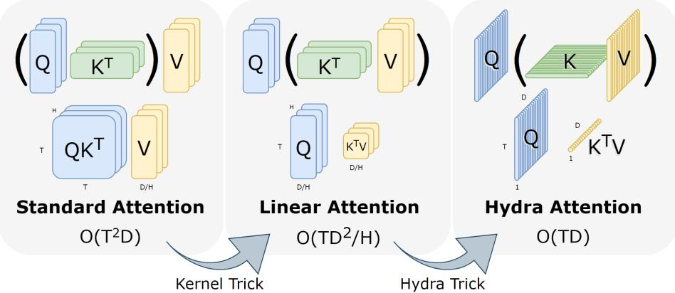
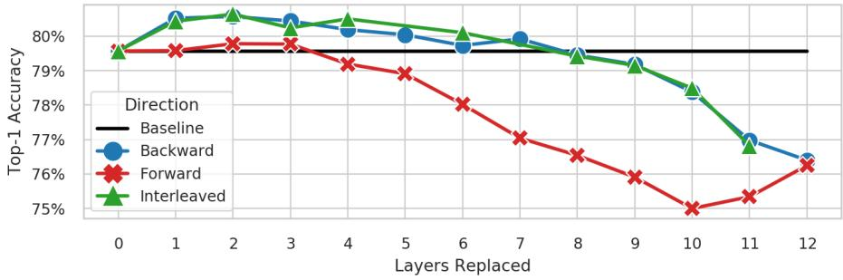
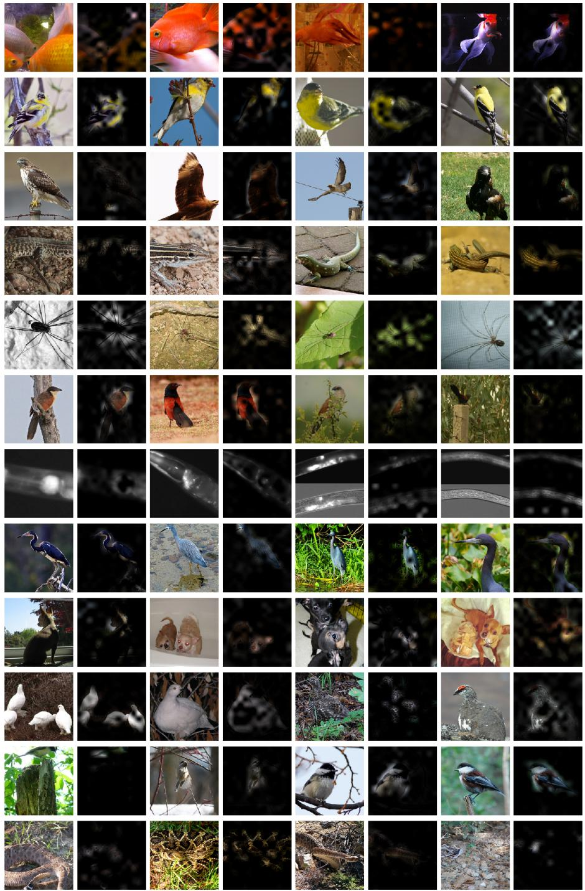

# Hydra Attention：多头高效注意力

Daniel Bolya<sup>1,2⋆</sup>, Cheng-Yang Fu<sup>2</sup>, Xiaoliang Dai<sup>2</sup>, Peizhao Zhang<sup>2</sup>, and Judy Hofman<sup>1</sup>

<sup>1</sup> Georgia Tech

{dbolya,judy}@gatech.edu

Meta AI

{chengyangfu,xiaoliangdai,stzpz}@fb.com

摘要。尽管 Transformer 已经开始在许多视觉任务中占据主导地位，但将其应用于大尺寸图像在计算上仍然十分困难。造成这种情况的一个重要原因是，自注意力机制（self-attention）的计算量随 token 数量呈二次方增长，而 token 数量又随图像尺寸呈二次方增长。在较大尺寸的图像（例如 1080p）上，网络中超过 60% 的总计算量仅用于创建和应用注意力矩阵。为了解决这一问题，我们迈出了一步，提出了 Hydra Attention，这是一种针对视觉 Transformer（Vision Transformers，ViTs）的极高效注意力操作。看似矛盾的是，这种高效性来自于将多头注意力推向极致：通过使用与特征维度一样多的注意力头，Hydra Attention 在 token 数量和特征维度上均呈线性计算复杂度，且没有隐藏的常数项，这使得它在现成的 ViT-B/16 中比标准自注意力的速度显著提升了 token 数量的倍数。此外，Hydra Attention 在 ImageNet 上保持了高准确率，在某些情况下甚至有所提升。

关键词：Vision Transformers, Attention, Token Eficiency

## 1 引言

凭借其通用性以及从海量数据中学习的高容量，Transformer [32] 在过去几年中一直是自然语言处理（NLP）领域的主导力量 [17,25,6]。如今，随着视觉 Transformer（ViTs）[10] 的引入，同样的变革也正在计算机视觉领域发生。

然而，与 NLP 不同的是，在 NLP 中类似 BERT [17] 或在视觉中类似 ViT [10] 那样的纯粹 Transformer 实现，并没有成为主导计算机视觉任务的力量。相反，诸如 Swin [21] 或 MViT [11,20] 等更具视觉针对性的基于注意力的架构，或是像 LeViT [13] 这样的注意力和卷积混合模型，正在被取而代之并广泛使用。

  
图 1：Hydra Attention。标准注意力 [32] 随 token 数量 T 的平方缩放。使用可分解核，我们可以像在 [16] 中那样重新排列运算顺序，使得注意力改为随特征维度 D 的平方缩放。我们的 Hydra Attention 更进一步，最大化注意力头数 H，从而在空间和时间上均实现了 O(TD) 的操作复杂度。

这种差异背后的主要原因是效率：专用的视觉 Transformer（vision transformer）可以通过更少的计算量表现得更好——无论是通过添加卷积层、使用特定于视觉的局部窗口注意力，还是通过其他低成本添加视觉归纳偏置的方法。虽然纯 ViT 在大规模下可以表现良好（在 ImageNet [38] 上达到 90.45% 的 top-1 准确率），但纯 Transformer 的核心机制——多头自注意力（multihead self-attention）[32]——在将模型应用于若干下游任务所需的大尺寸图像时，可能会成为极其严重的瓶颈。

事实上，当将现成的 ViT 应用于 1080p 图像（这在分割等基准任务中很常见，例如 CityScapes [7]）时，网络总计算量的 60%（见 Tab. 4）仅仅用于创建和应用自注意力的注意力矩阵，而在 224 × 224 的 ImageNet [9] 图像上这一比例仅为 4%。在纯 Transformer 中，这些注意力矩阵的计算量随着 token 数量的平方级增长，这本身就已经极其昂贵（例如在 NLP 中的长句子场景下）。但在 ViT 中，由于 token 数量随着图像尺寸的平方级增长，该问题被进一步加剧，这意味着图像尺寸翻倍会使注意力机制的计算量增加 16 倍。

NLP 领域已经探索了大量技术来解决这个问题。若干研究通过使用“核技巧（kernel trick）”重新排列计算顺序 [5,28,16,24]，或者投影到与 token 无关的低秩空间 [34,5,24]（部分方法两者兼具），引入了（就 token 而言的）“线性”注意力。然而，大多数这些“线性”注意力方法都是以特征维度的计算量为代价来换取 token 维度的计算减少，这使得它们的计算代价依然相当高昂。事实上，最近 Flash Attention [8] 已经表明，一种

IO 高效的多头自注意力实现，即使在 token 数量达到数千时，也能超越大多数这些“线性”注意力方法。

也有一些研究在视觉领域尝试了高效注意力机制，但没有一种在传统的 ViT 架构中被单独探索过。PolyNL [2] 将注意力视为一种高效的三阶多项式，但这尚未在 ViT 架构中得到探索。Attention Free Transformer [37] 具有一个类似高效的 AFT-Simple 变体，但它在纯 ViT 中表现较差，并且需要来自卷积和位置编码的额外支持。我们在标准 DeiT [31] 架构中测试了这两种方法（见 Tab. 1），发现这两种方法虽然高效，但都会导致精度显著下降。因此，现有文献中仍需要一种真正高效、准确且通用的多头自注意力替代方案。

为此，我们引入了 Hydra Attention（见 Fig. 1）。我们的方法源于线性注意力中一个有些矛盾的现象：在标准多头自注意力（multihead self-attention）中，为模型增加更多的头会保持计算量不变。然而，在改变线性注意力中的运算顺序后，增加更多的头实际上会减少该层的计算成本。我们将这一观察推向极致，将模型中的头数设置为等于特征数，从而创建了一个在计算上关于 token 和特征均呈线性的注意力模块。

Hydra Attention 不仅是对以往高效注意力工作的更通用表述（见 Sec. 3.5），而且在使用合适的核函数时，其准确率可以显著更高（见 Tab. 1）。事实上，当与标准多头注意力混合使用时，Hydra Attention 实际上可以在速度更快的同时提高基线 DeiT-B 模型的准确率（见 Fig. 4）。由于派生自多头注意力，我们的方法保留了注意力的若干优良特性，例如可解释性（见 Fig. 3）以及对不同任务的通用性。

然而，尽管 Hydra Attention 对大尺寸图像具有通用且高效的特点，但在本文中我们仅专注于使用 DeiT-B [31] 进行 ImageNet [9] 分类，该任务传统上使用较小的 224 × 224 和 384 × 384 图像。虽然此处的效率提升并没有那么多（根据图像尺寸为 10-27%），但其他高效注意力方法（例如 [37,2]）在此机制下已经遭遇了巨大的准确率下降（见 Tab. 1），而 Hydra Attention 则没有。我们希望 Hydra Attention 能够在未来成为适用于具有大量 token 的通用纯 transformer 的基石。

我们的贡献如下：我们进行了一项研究以验证 transformer 可以拥有多少个头（Fig. 2），并发现 12 是 softmax 注意力的极限，但若使用合适的核函数，任何数量都是可行的。随后，我们利用这一观察结果，通过增加多头自注意力中的头数，为纯 transformer 引入了 Hydra Attention（Sec. 3）。接着，我们从数学上分析了 Hydra Attention 的作用（Sec. 3.4），并提出了一种可视化其关注焦点的方法（Fig. 3）。最后，我们发现在 ImageNet-1k [9] 上使用 DeiT-B [31] 时，通过将特定注意力层替换为 Hydra Attention（Fig. 4），我们既可以将准确率提高 1%，也可以在保持与基线相同准确率的同时产生一个严格更快的模型。

## 2 相关工作

在本文中，我们的目标是通过消除多头自注意力中 token 数量平方级的计算瓶颈，来加快 transformer 的推理时间。

高效注意力（Eficient Attention） 多头自注意力 [32] 是一种众所周知速度较慢的运算，已有大量工作试图在不同领域解决其计算缺陷。

在 NLP 中，多项工作使用可分解的核函数来近似注意力机制 [5,28,16,24]。这种“核技巧（kernel trick）”使它们能够重新排列矩阵乘法的顺序，使其在特征维度上呈二次方复杂度，而非在标记（token）维度上。其中一些方法更进一步，通过投影到低秩空间来降低该矩阵乘法的维度 [34,5,24]。然而，这些“线性”注意力方法以跨特征的计算换取了跨标记的计算，这可能会使它们计算代价高昂。事实上，在本论文的研究领域（ImageNet 分类）中，标记数量并不足以支撑这些方法的合理性，且大多数方法都会导致模型变慢。即便在有成千上万个标记的情况下，Flash Attention [8] 也表明，一种感知 IO（IO-aware）的多头自注意力实现实际上能够超越这些方法中最快的一种。

但是重新排列操作顺序并不是加速注意力机制的唯一方法。事实上，在视觉领域中将注意力“线性化”最常用的方法是使用局部窗口注意力（例如，[21,3,19]）。这在计算量上相对于标记数量确实呈线性关系，但局部窗口注意力可能难以计算（尤其是在 Swin [21] 的情况下），而且这仅适用于图像和视频等密集的、具有空间顺序的模态。

相反，我们的目标是提出一种高效、计算快速且通用于几种不同模态的线性注意力方法。

高效 Transformer（Efficient Transformers） 替换注意力模块并不是加速 Transformer 推理时间的唯一方法。事实上，根据具体任务和标记数量，其他高效 Transformer 方法可能会更符合需求。例如，在 ImageNet [9] 分类任务上，注意力仅占整个网络计算量的 4%，这意味着如果仅修改注意力机制，最多只能获得 4% 的加速。

有几种高效的视觉 Transformer 将卷积与注意力机制混合在一起，以构建更高效的最终产品，例如 LeViT [13]、MobileViT [22]、Mobile-Former [4] 和 LVT [35]。对于图像而言，所有这些都是有效的策略，我们将其视为相近的技术。其他特定于视觉的注意力论文（如 [37,2]）在其高效注意力之外还使用了卷积，这使得很难辨别性能提升是来自于注意力方法还是卷积的引入。

在本文中，除了将多头自注意力替换为 Hydra Attention 之外，我们不对底层 ViT 架构进行任何修改，以便清晰地分离并观察其对性能的影响。

多头注意力（Multihead Attention） Hydra Attention 依赖于增加多头注意力中使用的头数。有趣的是，自 [32] 提出多头注意力以来，其中使用的头数一直未被深入探讨。尽管已有部分关于剪枝注意力头的研究 [33,23]，但所有这些研究的方向都是减少头的数量。事实上，即使是在 [38] 中探索的最大 ViT 模型 ViT-G 中，作者也仅使用了 16 个注意力头。因此，我们在图 2（Fig. 2）中亲自开展了这项研究。

## 3 Hydra Attention

标准多头自注意力 [32] 随图像中 token 数量呈二次方级增长。具体而言，如果 T 是 token 数量且 D 是特征维度，那么创建并应用注意力矩阵的复杂度均为 $O ( T ^ { 2 } D )$。因此，当 $T$ 很大时（如大图像的情况），这会带来问题，因为该操作在计算上很快就会变得不可行。

## 3.1 核技巧（The Kernel Trick）

如第 2 节（Sec. 2）所述，许多工作 [5,28,16,24] 已经尝试通过引入“线性”注意力来解决这个问题。给定 $\mathbb { R } ^ { T \times D }$ 中的查询 Q、键 $K$ 和值 V，标准 softmax 自注意力的计算方式为

$$
A (Q, K, V) = \mathrm{softmax} \left(\frac {Q K ^ {T}}{\sqrt {D}}\right) V\tag{1}
$$

计算 $Q K ^ { T }$ 的复杂度为 $O ( T ^ { 2 } D )$ 并生成一个 $T \times T$ 矩阵，其扩展性随 T 的增加而变差。正如在 $[ 1 6 ]$ 中一样，我们可以通过将 softmax(·) 视为 $Q$ 与 K 之间的成对相似度来推广此操作。也就是说，对于某种相似度函数 sim(·)，我们可以写成

$$
A (Q, K, V) = \mathrm{sim} (Q, K) V\tag{2}
$$

如果我们随后选择一个具有特征表示 $\phi ( \cdot )$ 的可分解核，使得 sim $( x , y ) = \phi ( x ) \phi ( y ) ^ { T }$，我们便可以得到

$$
A (Q, K, V; \phi) = \left(\phi (Q) \phi (K) ^ {T}\right) V\tag{3}
$$

然后根据结合律，我们可以改变计算顺序，从而使得

$$
A (Q, K, V; \phi) = \phi (Q) (\phi (K) ^ {T} V)\tag{4}
$$

这允许我们先计算 $\phi ( K ) ^ { T } V$，从而产生一个复杂度为 $O ( T D ^ { 2 } )$ 的操作，并且生成的是一个 $D ^ { \bar { 2 } }$ 矩阵而非 $T ^ { 2 }$ 矩阵。注意，该公式与 [16] 略有不同，不同之处在于我们将归一化交由相似度函数处理，而不是将其显式写出。

## 3.2 多头注意力（Multi-Head Attention）

尽管对于 $T _ { : }$ 是线性的，但公式 4（Eq. 4）中的结果仍然不尽如人意：D 通常很大 $( \geq 7 6 8 )$，因此创建一个 $D \times D$ 矩阵并执行 $O ( T D ^ { 2 } )$ 次运算仍然可能相当昂贵。然而，公式 1 到公式 4 假设我们创建了一个注意力矩阵，从而只有单个“头”。

在实践中，大多数视觉 Transformer（Vision Transformers）使用 $H$ 个头（通常在 6 到 16 之间），其中每个头创建并应用其自身的注意力矩阵。遵循 [32]，每个头对其来自 $Q , K$ 和 $V$ 的 $D / H$ 特征子集进行操作。因此公式 1 变为

$$
A (Q _ {h}, K _ {h}, V _ {h}) = \mathrm{softmax} \left(\frac {Q _ {h} K _ {h} ^ {T}}{\sqrt {D}}\right) V _ {h} \qquad \forall h \in \{1, \ldots , H \}\tag{5}
$$

其中 $Q _ { h } , K _ { h } , V _ { h } \in \mathbb { R } ^ { T \times \frac { D } { H } }$。这保持了总计算操作次数不变：

$$
O (H T ^ {2} D / H) = O (T ^ {2} D)\tag{6}
$$

然而，对于线性注意力来说情况并非如此。公式 4 变为

$$
A (Q _ {h}, K _ {h}, V _ {h}; \phi) = \phi (Q _ {h}) \left(\phi (K _ {h}) ^ {T} V _ {h}\right) \quad \forall h \in \{1, \dots , H \}\tag{7}
$$

通过这种方式计算注意力，增加头的数量实际上减少了操作次数：

$$
O (H T (D / H) ^ {2}) = O (T D ^ {2} / H)\tag{8}
$$

## 3.3 增加头的数量

根据公式 8，我们向网络中添加的头越多，多头线性注意力就变得越快。这就引出了一个问题：我们究竟能够合理地添加多少个头？实际应用中的大多数 Transformer 根据特征数量 $D _ { : }$ 使用 6 到 16 个头 [32,17,10,38]，但如果将头的数量增加到超出该范围会发生什么？

为了找出答案，我们在 ImageNet-1k [9] 上训练 DeiT-B [31]，并通过使用带有 softmax 的标准多头自注意力（公式 5，MSA）或带有余弦相似度的多头线性注意力（公式 7，MLA）来改变头数 $H$，结果绘制在 Fig. 2 中。在显存占用方面，当 $H > 9 6$ 时 MSA 显存不足（out of memory），而当 $H < 3$ 时 MLA 显存不足。

在性能方面，虽然当 $H > 1 2$ 时 MSA 的准确率急剧下滑，但使用余弦相似度的 MLA 的准确率一直到 $H = 768$ 都保持得非常稳定。令人惊叹的是，在这一头数下，$H$ 等于 $D _ { : }$，这意味着每个头仅需要处理标量特征！

  
Fig. 2: 改变头数。我们在 ImageNet-1k 上训练 DeiT-B 模型，使用带有 softmax 的标准自注意力（蓝色）或带有余弦相似度的多头线性注意力（红色），设置不同数量的头。标准自注意力的结果在 $H > 9 6$ 时显存溢出，多头线性注意力在 $H < 3$ 时显存溢出。随着增加更多的头，Softmax 注意力的准确率似乎出现崩溃，而多头线性注意力则保持稳定。请注意，$H$ 必须能够整除 $D = 7 6 8$。

## 3.4 Hydra 技巧

如 Fig. 2 所示，只要相似度函数 $\mathrm{sim}(x, y)$ 不是 softmax，将 $H$ 任意扩大是可行的。为了利用这一点，我们引入了“Hydra 技巧”（Hydra Trick），即设置 $H = D$

$$
A (Q _ {h}, K _ {h}, V _ {h}; \phi) = \phi (Q _ {h}) \left(\phi (K _ {h}) ^ {T} V _ {h}\right) \quad \forall h \in \{1, \dots , D \}\tag{9}
$$

在这种情况下，每个 $Q _ { h } , K _ { h } , V _ { h }$ 都是 $\mathbb { R } ^ { T \times 1 }$ 中的列向量。如果我们在多头之间对该操作进行向量化，最终得到

$$
\operatorname{Hydra} (Q, K, V; \phi) = \phi (Q) \odot \sum_ {t = 1} ^ {T} \phi (K) ^ {t} \odot V ^ {t}\tag{10}
$$

其中 ⊙ 表示逐元素相乘。注意，这种向量化与公式 9 之间存在细微差异：$\phi$ 应用于整个 $Q$ 和 $K$，而不是单个列向量 $Q _ { h }$ 和 $K _ { h }$。这一点很重要，因为对于每个 token，$Q _ { h }$ 和 $K _ { h }$ 都是标量，而计算两个标量之间的相似度是非常受限的（例如，余弦相似度只能输出 $\cdot 1 , 0 , \mathrm { o r } + 1 )$。

此外，尽管公式 10 的推导来自于多头注意力（multihead attention），但它实际上执行的操作截然不同：它首先创建一个全局特征向量 $\bar { \sum _ { t = 1 } ^ { T } } \phi ( K ) ^ { \breve { t } } \odot V ^ { t }$，该向量聚合了图像中所有 token 的信息。然后，每个 $\phi ( Q )$ 对每个输出 token 的这个全局特征的重要性进行门控。因此，Hydra Attention 通过全局瓶颈来混合信息，而不是像标准自注意力（self-attention）那样进行显式的 token 到 token 混合。

这导致的计算复杂度为

$$
O (T D (D / H)) = O (T D)\tag{11}
$$

从而为我们提供了一个高效的 token 混合模块，该模块与模型中的 token 数量和特征数量均呈线性关系，并且没有其他线性注意力方法（如 [5,34,16]）中的额外常数。需要注意的是，该技术的空间复杂度也是 $O ( T D )$，这对于实际运行速度非常重要，因为许多操作都是受 IO 限制的（参见 [8]）。

## 3.5 与其他工作的关系

文献中还有一些其他 $O ( T D )$ 注意力候选方法：Attention-Free Transformer [37]（特别是 AFT-Simple）和 PolyNL [2]。在本节中，我们探讨公式 10 中所描述的 Hydra Attention 与它们各自之间的关系。

AFT-Simple [37] 描述为

$$
\mathrm{AFT-Simple} (Q, K, V) = \sigma (Q) \odot \sum_ {t = 1} ^ {T} \operatorname{softmax} (K) ^ {t} \odot V ^ {t}\tag{12}
$$

其中 $\sigma ( \cdot )$ 表示 sigmoid。如果我们允许 ϕ 在 Q 和 K 之间有所不同，这就是公式 10 的一个直接特例，其中 $\phi ( Q ) = \sigma ( Q )$ 且 $\phi ( K ) = \mathrm { s o f t m a x } ( K )$。

另一方面，PolyNL [2] 描述为

$$
\operatorname{PolyNL} (X; W _ {1}, W _ {2}, W _ {3}) = \left(X \odot \frac {1}{T} \sum_ {t = 1} ^ {T} X W _ {1} \odot X W _ {2}\right) W _ {3}\tag{13}
$$

如果我们记 $K = X W _ { 1 }$ 且 $V = X W _ { 2 }$，并令 $\phi _ { \mathrm { m e a n } } ( x ) = x / \sqrt { T }$，我们可以写为

$$
\operatorname{PolyNL} (X; W _ {1}, W _ {2}, W _ {3}) = \operatorname{Hydra} (X, K, V; \phi_ {\text {mean}}) W _ {3}\tag{14}
$$

因此，Hydra 注意力可以被视为其他 $O ( T D )$ 注意力方法的一种更通用的形式。

## 4 实验

在所有实验中，除非另有说明，我们均使用采用默认设置并在 ImageNet-1k [9] 上训练的 DeiT-B [31]，结果以验证集上的 Top-1 准确率汇报。当未明确指定时，公式 10 中的 $\phi ( \cdot )$ 函数采用 L2 归一化，使得 $\mathrm { s i m } ( \cdot , \cdot )$ 为余弦相似度。为了计算吞吐量，我们遍历了多个批大小（batch size），并在舍弃 10 次预热迭代后，汇报 30 个批次上的最高平均吞吐量。

<table><tr><td>方法</td><td>核函数</td><td> $\phi(Q)$ </td><td> $\phi(K)$ </td><td>准确率</td></tr><tr><td>Hydra</td><td>余弦相似度</td><td colspan="2"> $x/||x||_2$ </td><td>76.37</td></tr><tr><td>Hydra</td><td>均值</td><td colspan="2"> $x/\sqrt{T}$ </td><td>75.95</td></tr><tr><td>Hydra</td><td>Tanh Softmax</td><td> $\tanh(x)$ </td><td> $softmax(x)$ </td><td>74.18</td></tr><tr><td>AFT-Simple [37]</td><td>Sigmoid Softmax</td><td> $\sigma(x)$ </td><td> $softmax(x)$ </td><td>74.02</td></tr><tr><td>PolyNL [2]</td><td>均值</td><td colspan="2"> $x/\sqrt{T}$ </td><td>73.96</td></tr></table>

Table 1: 核函数选择。在此，我们通过公式 10 中的特征表示 $\phi(\cdot)$ 来改变核函数的选择。如第 3.5 节所述，我们在此还与 AFT 和 PolyNL 进行了对比。注意，某些核函数可以是非对称的，具有不同的 $\phi ( Q )$ 和 $\phi ( K )$。更多核函数请参见附录。

## 4.1 核函数的选择

在我们的大多数实验中，遵循 [16]，我们采用余弦相似度作为公式 10 的核函数。在表 1 中，我们探索了其他可能的核函数，包括第 3.5 节中讨论的其他候选注意力替代方法所使用的核函数。然而，我们测试的所有核函数均未超过简单的余弦相似度。

这可能是因为余弦相似度改变了注意力的本质。在 MSA（公式 5）中，注意力完全是在混合 $V$ 中包含的信息，因为混合权重 $\mathrm{sim}(Q, K)$ 之和必须为 1。但在使用余弦相似度或其他无约束点积核（如均值）时则并非如此。事实证明，这些权重之和为 1 这一特性本身可能就并不理想：如公式 12 所述的 AFT-Simple [37] 设置了 $\phi ( Q ) = \sigma ( Q )$ 和 $\phi ( K ) = \mathrm { s o f t m a x } ( K )$，这更接近于对 $V$ 的严格混合，但其性能反而因此下降（见表 1）。

我们还测试了使用 $\tanh(Q)$ 替代 $\sigma ( Q )$，以验证是否是因为余弦相似度允许结果为负数才带来优势，但这仅比 AFT-Simple 表现稍好一点。因此，在这种受计算资源约束的环境下，让核函数尽可能不受限制，同时以某种方式对其进行归一化，似乎是非常重要的。我们还测试了其他几种核函数并在附录中进行了记录，但没有一个能超越这种简单的技术。

## 4.2 可视化 Hydra 注意力

自注意力机制最受青睐的特性之一是其可解释性：可视化基于注意力机制的模型关注焦点（例如通过 attention rollout [1]）通常非常直接。然而对于 Hydra attention 而言，情况并非如此。

为了可视化 Hydra attention 模块的关注焦点，我们可以为 $h \in \{ 1 , \ldots , D \}$ 构建注意力矩阵 $\phi ( Q ) _ { h } \phi ( K ) _ { h } ^ { T }$，但每个矩阵的秩都为 1，并且当每个矩阵负责不同的特征维度时，目前尚不清楚该如何将这 $D$ 个不同的注意力矩阵组合起来。单纯地对这些头取平均值会产生无意义的结果，因为每个特征维度编码了不同的信息。

  
Fig. 3: Hydra Attention 可视化。如第 4.2 节所述的最后一层中 class token 的 Hydra attention 可视化。左侧的 4 张图像预测正确，而右侧的 2 个示例分类错误。在右上角的图像中，网络关注了错误的狗的头部，从而猜错了品种。而在右下角，网络则完全忽略了鸟。更多示例请参见 Appendix。

相反，让我们来看看每个 token 对 class token 输出的贡献信息。如果我们仅从公式 10 中对 class token $c$ 的输出进行采样，可得

$$
\phi (Q) ^ {c} \odot \sum_ {t = 1} ^ {T} \phi (K) ^ {t} \odot V ^ {t} = \sum_ {t = 1} ^ {T} \phi (Q) ^ {c} \odot \phi (K) ^ {t} \odot V ^ {t}\tag{15}
$$

因此，每个 token $t$ 对 class token $c$ 输出的贡献由下式给出：

$$
\phi (Q) ^ {c} \odot \phi (K) ^ {t} \odot V ^ {t}\tag{16}
$$

为了说明这与最终预测之间的关系，我们可以使用类似于 Grad-CAM [27] 的方法：将损失设为预测类别的 logit，然后获取关于 Hydra attention 层输出的梯度 $g$。那么每个 token 沿着该梯度方向的贡献为

$$
(\phi (Q) ^ {c} \odot \phi (K) ^ {t} \odot V ^ {t}) ^ {T} g\tag{17}
$$

我们在 Fig. 3 和 Appendix 中绘制了若干不同图像的这一数值。对于这些可视化结果，我们沿 token 对公式 17 进行归一化，并展示其正值。这些焦点图表明，尽管数学表达可能不同，但 Hydra attention 正在执行与标准自注意力机制基本相同的功能。

## 4.3 我们可以替换哪些层？

如第 3.4 节和第 4.1 节所述，采用余弦相似度核的 Hydra Attention 混合 token 间信息的方式与标准 MSA [32] 不同。因此，将网络中的每一个注意力层都替换为 Hydra attention 或许并不合理。事实上，Hydra attention 会从 token 中构建一个全局特征，并在经由 Q 加权后应用到每个 token 上。由于这是一种全局操作，将其置于网络的较后层会更合理，因为在那个阶段信息已经在局部完成了混合。我们在 Fig. 4 中对此进行了测试，即遵循不同的策略逐步将 DeiT-B 中的 MSA 注意力层替换为 Hydra attention。

  
Fig. 4: 我们可以替换哪些层？采用不同的替换策略将 softmax 自注意力替换为 Hydra attention：从前向后、从后向前，或者交错层替换。在所有情况下，0 表示未替换任何层（基准线），12 表示所有层均被替换。令人惊讶的是，采用合适的层替换策略时，Hydra attention 实际上可以在加快速度的同时将 ImageNet 上的准确率提升 1%。或者，我们可以替换多达 8 个层且准确率没有任何下降。

在该实验中，我们观察到如果从网络的第一层开始替换，模型的性能会迅速下降。然而事实表明，如果我们从最后一层开始反向替换各层，实际上可以提高模型的准确率。而且这种提升幅度非常显著，我们甚至可以替换网络的最后 8 个层，且准确率仍能与基线 DeiT-B 模型持平。

那么，如果 Hydra attention 可以与标准 softmax 注意力互补，将两者结合的最佳方式或许就是交错排列它们。在 Fig. 4 中，我们还尝试遵循 Hydra attention 层应位于 MSA 层之后的原则来交替配置 MSA 和 Hydra 层。然而，与从后方开始替换相比，我们并未观察到这种交错策略带来更多实质性益处，这表明重要的是 Hydra 层的数量，而不一定是其具体位置。

需要注意的是，其他高效注意力方法（例如 AFT [37] 和 UFO-ViT [29]）添加了卷积层，而不是穿插常规注意力层。添加这些卷积层的作用与使用自注意力进行局部混合大致相同，但尚不明确这些现有方法的优势究竟来自于卷积层还是其提出的注意力层。在此案例中，我们明确分离并证明了 Hydra attention 不仅有助于提升模型速度，还能提升其性能。未来的工作可能会探讨改用卷积层的情况。

<table><tr><td>方法</td><td>准确率 (%)</td><td>FLOPs (G)</td><td>速度 (im/s)</td></tr><tr><td>Standard Attention [32]</td><td>79.57</td><td>17.58</td><td>314.8</td></tr><tr><td>AFT-Simple [37]</td><td>74.02 (-5.55)</td><td>16.87 (-4.0%)</td><td>346.1 (+9.9%)</td></tr><tr><td>PolyNL [2]</td><td>73.96 (-5.61)</td><td>16.87 (-4.0%)</td><td>353.8 (+12.4%)</td></tr><tr><td>Hydra (2 层)</td><td>80.64 (+1.1)</td><td>17.46 (-0.7%)</td><td>321.9 (+2.3%)</td></tr><tr><td>Hydra (8 层)</td><td>79.45 (-0.12)</td><td>17.11 (-2.7%)</td><td>334.8 (+6.3%)</td></tr><tr><td>Hydra (12 层)</td><td>76.40 (-3.17)</td><td>16.87 (-4.0%)</td><td>346.8 (+10.2%)</td></tr></table>

Table 2: 结果。在 224px 图像上训练的 DeiT-B [31] 架构中不同注意力方法在 ImageNet-1k [9] 验证集上的结果，以及在 V100 上测得的吞吐量。与其他 O(T D) 注意力方法（AFT-Simple [37] 和 PolyNL [2]）相比，Hydra 注意力导致的准确率降幅更小。此外，如果我们不替换网络中的每一个注意力层，Hydra 注意力可以在减少 FLOPs 并提升吞吐量的同时，提高准确率或保持准确率不变。

<table><tr><td>方法</td><td>准确率 (%)</td><td>FLOPs (G)</td><td>速度 (im/s)</td></tr><tr><td>Standard Attention [32]</td><td>81.33</td><td>55.54</td><td>92.5</td></tr><tr><td>Hydra (2 层)</td><td>81.92 (+0.59)</td><td>54.52 (-1.8%)</td><td>96.3 (+4.1%)</td></tr><tr><td>Hydra (7 层)</td><td>81.26 (-0.07)</td><td>51.96 (-6.4%)</td><td>106.8 (+15.4%)</td></tr><tr><td>Hydra (12 层)</td><td>77.85 (-3.48)</td><td>49.40 (-11.0%)</td><td>117.6 (+27.1%)</td></tr></table>

Table 3: 384px 微调。Tab. 2 中的模型使用 384px 图像微调 30 个 epoch 的结果。即使在 token 数量更多的情况下，Hydra 注意力在采用 2 层时仍可比基线提升 0.59% 的准确率，在采用 7 层时可在与基线准确率持平的同时将吞吐量提高 15.4%。

## 4.4 结果

我们在 Tab. 2 中展示了在 ImageNet-1k 上使用 Hydra 注意力与标准 $O ( T ^ { 2 } D )$ 注意力及其他 O(TD) 方法相比的最终准确率和 FLOP 计数。当替换所有层时，Hydra 注意力相比其他 O(T D) 方法取得了高出 2.4% 的准确率。而当替换较少层数时，Hydra 注意力可以严格优于基线标准注意力模型：在 2 层时，准确率提升 1.1%，同时 FLOPs 减少 0.7%，吞吐量增加 2.3%；在 8 层时，准确率保持不变，FLOPs 减少 2.7%，吞吐量加快 6.3%。有趣的是，实际吞吐量的提升幅度大大超过了 FLOPs 的削减幅度。这可能是由于 [8] 中指出的注意力机制受内存带宽限制（memory-bound）的现象，以及 Hydra 注意力比标准注意力使用更少内存的原因所致。

<table><tr><td rowspan="2">图像尺寸</td><td rowspan="2">T</td><td colspan="2">Baseline</td><td colspan="2">Hydra</td><td colspan="2">局部窗口</td></tr><tr><td>GFLOPs</td><td>注意力</td><td>GFLOPs</td><td>注意力</td><td>GFLOPs</td><td>注意力</td></tr><tr><td>224</td><td>197</td><td>17.6</td><td>4.10%</td><td>16.8</td><td>0.02%</td><td>17.6</td><td>4.10%</td></tr><tr><td>384</td><td>577</td><td>55.1</td><td>11.13%</td><td>49.0</td><td>0.02%</td><td>51.1</td><td>4.10%</td></tr><tr><td>448</td><td>785</td><td>78.0</td><td>14.56%</td><td>66.7</td><td>0.02%</td><td>69.5</td><td>4.10%</td></tr><tr><td>1024</td><td>4097</td><td>657.3</td><td>47.06%</td><td>348.1</td><td>0.02%</td><td>362.8</td><td>4.10%</td></tr><tr><td>1280</td><td>6401</td><td>1298.9</td><td>58.14%</td><td>543.8</td><td>0.02%</td><td>566.9</td><td>4.10%</td></tr></table>

Table 4: FLOP 计数与图像尺寸。随着图像尺寸增加，ViT-B/16 模型在不同注意力方法下的 FLOP 计数扩展情况。我们还列出了创建和应用注意力矩阵所占总计算量的百分比。尽管 Hydra 注意力在大图像尺寸下显著改善了模型的 FLOP 计数，但局部窗口注意力（已在大型图像上被证明有效 [19]）同样做到了这一点。Hydra 注意力的一个局限在于它最多只能比局部窗口注意力快 4%，尽管它更具通用性且能带来成比例更高的吞吐量。

更大图像 为了探究 Hydra Attention 在 token 数量更多时是否仍能保持这些增益，在 Tab. 3 中，我们使用 [31] 中建议的超参数，将 Fig. 4 中的反向替换模型在 384px 分辨率下微调 30 个 epoch。这使得模型的 token 数量增加了近 3 倍，这既应该会凸显 O(TD) 与 $O ( T ^ { 2 } D )$ 注意力之间的差异，也能体现 Hydra Attention 的全局信息传播策略在这些更高 token 计数下是否有效。事实上，在 Tab. 3 中，我们看到了与 224px 图像相同的趋势：Hydra Attention 在使用 2 层时可以将准确率提高 0.59%、吞吐量提高 4.1%，或者这次在使用 7 层时保持准确率不变并将吞吐量提高 15.4%。

局限性 好的，既然 Hydra 注意力比标准注意力快 197 倍（当 T = 197 时），为什么 FLOP 计数的最大降幅只有 4% 呢？事实证明，在 $\mathrm { V i T { - } B / 1 6 ~ 2 2 4 ~ \times ~ 2 2 4 }$ 图像 $( T = 1 9 7 , D = 7 6 8 )$ 中，模型总 FLOP 中仅有 4.10% 用于创建和应用注意力矩阵。采用 Hydra 注意力后，这一比例降至 0.02%，基本消除了模型中注意力的开销。尽管这确实带来了高达 10.2% 的原始吞吐量提升（见 Tab.2），但显然我们还可以做得更好。

当然，随着图像尺寸的增加，情况发生了变化：在 Tab. 4 中，我们针对不同的图像尺寸重复了这一计算，标准注意力的计算量在 1280px 图像下激增至 58%，而 Hydra 注意力的计算量仍可忽略不计，仅为 0.02%。我们在 Tab. 3 中自行测试了 384px 的图像，Hydra Attention 的加速效果更加显著（吞吐量提升高达 27.1%）。然而，仍需要进一步的工作来验证 Hydra Attention 在使用更多 token 的任务（例如实例分割 [15]）上的表现。尽管在这些任务中，我们将与 ViTDet [19] 中使用的局部窗口注意力（local window attention）进行对比，后者已被证明在图像的大 token 机制下是有效的。与局部窗口注意力相比，Hydra attention 在任何图像尺寸下所用的 FLOPs 仅减少了 4%，但其吞吐量可能会成比例地更高（因为内存占用更少）。

总的来说，Hydra attention 的实用性在于其通用性。局部窗口注意力是密集图像预测（dense image prediction）的强大解决方案，但在存在 token 稀疏性（例如掩码预训练 [14,12,30] 或 token 剪枝 [26,18,36]）时会迅速变得繁琐。我们将此留待未来的工作进行探索。

## 5 结论与未来方向

在本文中，我们介绍了 Hydra Attention，这是一种具有多头（many heads）的高效注意力模块。我们在 Tab. 1 中展示了 Hydra Attention 优于其他 O(T D) 注意力方法，并且甚至可以与传统的多头自注意力协同工作，以提高 Fig. 4 中基线 DeiT-B 模型的准确率。然而，尽管 Hydra attention 在 ImageNet 分类上表现良好（Tab. 2, Tab. 3），但其真正的加速潜力在于更大的图像尺寸（Tab. 4）。

我们迈出了展示 Hydra attention 切实可行的第一步，并希望未来的工作能够探索其在其他更加消耗 token 的领域（如检测、分割或视频）中的应用。此外，Hydra attention 是一种通用技术，不对 token 之间的关系做任何假设，因此它可以应用于进一步提升 token 稀疏应用（如掩码预训练 [14,12,30] 或 token 剪枝 [26,18,36]）的速度。我们希望 Hydra attention 能够作为迈向未来更强大、更高效且更通用的 Transformer 的一步。

致谢（Acknowledgements） 我们衷心感谢 Alexander Kirillov、Christoph Feichtenhofer 和 Sean Bell 进行的多次深入探讨和提出的宝贵意见！

## 参考文献

1. Abnar, S., Zuidema, W.: Quantifying attention flow in transformers. arXiv:2005.00928 [cs.LG] (2020) 9

2. Babiloni, F., Marras, I., Kokkinos, F., Deng, J., Chrysos, G., Zafeiriou, S.: Poly-nl: Linear complexity non-local layers with 3rd order polynomials. In: ICCV (2021) 3, 4, 8, 9, 12

3. Chen, B., Wang, R., Ming, D., Feng, X.: Vit-p: Rethinking data-eficient vision transformers from locality. arXiv:2203.02358 [cs.CV] (2022) 4

4. Chen, Y., Dai, X., Chen, D., Liu, M., Dong, X., Yuan, L., Liu, Z.: Mobile-former: Bridging mobilenet and transformer. In: CVPR (2022) 4

5. Choromanski, K., Likhosherstov, V., Dohan, D., Song, X., Gane, A., Sarlos, T., Hawkins, P., Davis, J., Mohiuddin, A., Kaiser, L., et al.: Rethinking attention with performers. arXiv:2009.14794 [cs.LG] (2020) 2, 4, 5, 8

6. Chowdhery, A., Narang, S., Devlin, J., Bosma, M., Mishra, G., Roberts, A., Barham, P., Chung, H.W., Sutton, C., Gehrmann, S., et al.: Palm: Scaling language modeling with pathways. arXiv:2204.02311 [cs.CL] (2022) 1

7. Cordts, M., Omran, M., Ramos, S., Rehfeld, T., Enzweiler, M., Benenson, R., Franke, U., Roth, S., Schiele, B.: The cityscapes dataset for semantic urban scene understanding. In: CVPR (2016) 2

8. Dao, T., Fu, D.Y., Ermon, S., Rudra, A., R´e, C.: Flashattention: Fast and memoryeficient exact attention with io-awareness. arXiv:2205.14135 [cs.LG] (2022) 2, 4, 8, 13

9. Deng, J., Dong, W., Socher, R., Li, L.J., Li, K., Fei-Fei, L.: Imagenet: A large-scale hierarchical image database. In: CVPR (2009) 2, 3, 4, 6, 8, 12

10. Dosovitskiy, A., Beyer, L., Kolesnikov, A., Weissenborn, D., Zhai, X., Unterthiner, T., Dehghani, M., Minderer, M., Heigold, G., Gelly, S., et al.: An image is worth 16x16 words: Transformers for image recognition at scale. In: ICLR (2020) 1, 6

11. Fan, H., Xiong, B., Mangalam, K., Li, Y., Yan, Z., Malik, J., Feichtenhofer, C.: Multiscale vision transformers. In: ICCV (2021) 1

12. Feichtenhofer, C., Fan, H., Li, Y., He, K.: Masked autoencoders as spatiotemporal learners. arXiv:2205.09113 [cs.CV] (2022) 14

13. Graham, B., El-Nouby, A., Touvron, H., Stock, P., Joulin, A., J´egou, H., Douze, M.: Levit: a vision transformer in convnet’s clothing for faster inference. In: ICCV (2021) 1, 4

14. He, K., Chen, X., Xie, S., Li, Y., Doll´ar, P., Girshick, R.: Masked autoencoders are scalable vision learners. In: CVPR (2022) 14

15. He, K., Gkioxari, G., Doll´ar, P., Girshick, R.: Mask r-cnn. In: ICCV (2017) 14

16. Katharopoulos, A., Vyas, A., Pappas, N., Fleuret, F.: Transformers are rnns: Fast autoregressive transformers with linear attention. In: ICML (2020) 2, 4, 5, 8, 9

17. Kenton, J.D.M.W.C., Toutanova, L.K.: Bert: Pre-training of deep bidirectional transformers for language understanding. In: NAACL-HLT (2019) 1, 6

18. Kong, Z., Dong, P., Ma, X., Meng, X., Niu, W., Sun, M., Ren, B., Qin, M., Tang, H., Wang, Y.: Spvit: Enabling faster vision transformers via soft token pruning. arXiv:2112.13890 [cs.CV] (2021) 14

19. Li, Y., Mao, H., Girshick, R., He, K.: Exploring plain vision transformer backbones for object detection. arXiv:2203.16527 [cs.CV] (2022) 4, 13, 14

20. Li, Y., Wu, C.Y., Fan, H., Mangalam, K., Xiong, B., Malik, J., Feichtenhofer, C.: Mvitv2: Improved multiscale vision transformers for classification and detection. In: CVPR (2022) 1

21. Liu, Z., Lin, Y., Cao, Y., Hu, H., Wei, Y., Zhang, Z., Lin, S., Guo, B.: Swin transformer: Hierarchical vision transformer using shifted windows. In: ICCV (2021) 1, 4

22. Mehta, S., Rastegari, M.: Mobilevit: light-weight, general-purpose, and mobilefriendly vision transformer. arXiv:2110.02178 [cs.CV] (2021) 4

23. Michel, P., Levy, O., Neubig, G.: Are sixteen heads really better than one? NeurIPS (2019) 5

24. Peng, H., Pappas, N., Yogatama, D., Schwartz, R., Smith, N.A., Kong, L.: Random feature attention. arXiv:2103.02143 [cs.CL] (2021) 2, 4, 5

25. Radford, A., Wu, J., Child, R., Luan, D., Amodei, D., Sutskever, I., et al.: Language models are unsupervised multitask learners. OpenAI blog (2019) 1

26. Rao, Y., Zhao, W., Liu, B., Lu, J., Zhou, J., Hsieh, C.J.: Dynamicvit: Eficient vision transformers with dynamic token sparsification. NeurIPS (2021) 14

27. Selvaraju, R.R., Cogswell, M., Das, A., Vedantam, R., Parikh, D., Batra, D.: Gradcam: Visual explanations from deep networks via gradient-based localization. In: ICCV (2017) 10

28. Shen, Z., Zhang, M., Zhao, H., Yi, S., Li, H.: Eficient attention: Attention with linear complexities. In: WACV (2021) 2, 4, 5

29. Song, J.g.: Ufo-vit: High performance linear vision transformer without softmax. arXiv:2109.14382 [cs.CV] (2021) 11

30. Tong, Z., Song, Y., Wang, J., Wang, L.: Videomae: Masked autoencoders are dataeficient learners for self-supervised video pre-training. arXiv:2203.12602 [cs.CV] (2022) 14

31. Touvron, H., Cord, M., Douze, M., Massa, F., Sablayrolles, A., J´egou, H.: Training data-eficient image transformers & distillation through attention. arXiv:2012.12877 [cs.CV] (2020) 3, 6, 8, 12, 13

32. Vaswani, A., Shazeer, N., Parmar, N., Uszkoreit, J., Jones, L., Gomez, A.N., Kaiser, L., Polosukhin, I.: Attention is all you need. NeurIPS (2017) 1, 2, 4, 5, 6, 11, 12

33. Voita, E., Talbot, D., Moiseev, F., Sennrich, R., Titov, I.: Analyzing multi-head self-attention: Specialized heads do the heavy lifting, the rest can be pruned. arXiv:1905.09418 [cs.CL] (2019) 5

34. Wang, S., Li, B.Z., Khabsa, M., Fang, H., Ma, H.: Linformer: Self-attention with linear complexity. arXiv:2006.04768 [cs.LG] (2020) 2, 4, 8

35. Yang, C., Wang, Y., Zhang, J., Zhang, H., Wei, Z., Lin, Z., Yuille, A.: Lite vision transformer with enhanced self-attention. In: CVPR (2022) 4

36. Yin, H., Vahdat, A., Alvarez, J., Mallya, A., Kautz, J., Molchanov, P.: Adavit: Adaptive tokens for eficient vision transformer. CVPR (2022) 14

37. Zhai, S., Talbott, W., Srivastava, N., Huang, C., Goh, H., Zhang, R., Susskind, J.: An attention free transformer. arXiv:2105.14103 [cs.LG] (2021) 3, 4, 8, 9, 11, 12

38. Zhai, X., Kolesnikov, A., Houlsby, N., Beyer, L.: Scaling vision transformers. arXiv:2106.04560 [cs.CV] (2021) 2, 5, 6

## A 其他核函数

在表 5 中，我们列出了在 Hydra Attention 中尝试过的所有核函数（$\phi ( \cdot ) )$ 的实例化形式）。在选择这些核函数时，我们主要考虑了三个方面。即 $\phi ( \cdot )$ 是否应该 1.) 无界，2.) 允许负值，或者 3.) 是线性的。

例如，用于余弦相似度的 L2 归一化（这也是我们在本文中所采用的方法）是有界的、允许负值并且是线性的。另一方面，Sigmoid 是有界的、仅取正值并且是非线性的。

从实验中，我们观察到虽然用于 Q 的函数没有那么重要，但 K 显著受益于线性和允许负值这两个特性。与 L2 归一化相比，对 K 应用 softmax 会显著降低性能。在各类归一化技术中，我们发现 L2 的效果最好（优于 L1 或常数归一化）。

最后，由于 $\phi(K)$（未采用 softmax 时）的和不为 1，将其与 V 相乘可能会产生比标准注意力机制高得多的数量级。因此，我们认为对注意力层的输出结果进行归一化可能会有帮助。我们测试了两个带有 $^ { 6 6 } + \mathrm { L N } ^ { 5 }$ 的核函数，其中在注意力操作之后紧接着一个层归一化（Layer Norm，在投影之前）。然而，这似乎并没有带来提升，因此在这里保持核不进行额外归一化似乎更好。

## B 更多可视化结果

在图 5 中，我们提供了更多图像可视化结果，以补充正文中的内容。这些图像是从 ImageNet-1k 验证集的 12 个不同类别中随机选取的（每个类别 4 张），唯一的筛选标准是图像内容适合安全查看。网络对其中的大多数图像都做出了正确的预测。

<table><tr><td>核函数</td><td> $\phi(Q)$ </td><td> $\phi(K)$ </td><td>准确率</td></tr><tr><td>余弦相似度</td><td colspan="2"> $x/||x||_2$ </td><td>76.37</td></tr><tr><td>Tanh-L2</td><td> $\tanh(x)$ </td><td> $x/||x||_2$ </td><td>76.17</td></tr><tr><td>均值</td><td colspan="2"> $x/\sqrt{T}$ </td><td>75.95</td></tr><tr><td>CosSim + LN</td><td colspan="2"> $x/||x||_2$ </td><td>75.74</td></tr><tr><td>Tanh-L2 + LN</td><td> $\tanh(x)$ </td><td> $x/||x||_2$ </td><td>75.22</td></tr><tr><td>Tanh-Softmax</td><td> $\tanh(x)$ </td><td> $softmax(x)$ </td><td>74.18</td></tr><tr><td>Sigmoid-Softmax</td><td> $\sigma(x)$ </td><td> $softmax(x)$ </td><td>74.02</td></tr><tr><td>L1 归一化</td><td colspan="2"> $x/||x||_1$ </td><td>70.75</td></tr></table>

表 5：更多核函数。我们在本表中列出了测试过的其他核函数。由于大多数核函数是非对称的，我们分别列出了用于 Q 和 K 的 $\phi$。

  
图 5：更多可视化。使用文中所述方法展示的模型关注区域的更多可视化结果。

## C 代码

Hydra 注意力机制的实现极为简单。我们在下方给出了基于 PyTorch 的余弦相似度核参考实现：

```python
def hydra(q, k, v):
    """
    q, k, and v should all be tensors of shape
    [batch, tokens, features]
    """
    q = q / q.norm(dim=-1, keepdim=True)
    k = k / k.norm(dim=-1, keepdim=True)

    kv = (k * v).sum(dim=-2, keepdim=True)
    out = q * kv

    return out
```