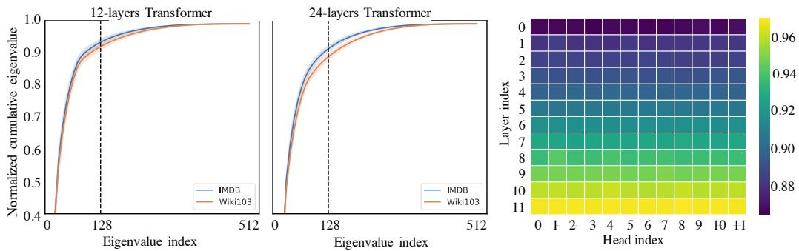
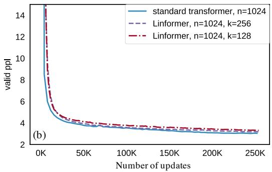

# Linformer：具有线性复杂度的自注意力机制

Sinong Wang, Belinda Z. Li, Madian Khabsa, Han Fang, Hao Ma Facebook AI, Seattle, WA

{sinongwang, belindali, hanfang, mkhabsa, haom}@fb.com

## 摘要

大型 Transformer 模型在许多自然语言处理（NLP）应用中取得了最先进的结果，展现出了非凡的成功。然而，对于长序列而言，训练和部署这些模型的成本可能高得令人望而却步，因为 Transformer 的标准自注意力机制在时间和空间上相对于序列长度都消耗 ${ \check { O } } ( n ^ { 2 } )$ 的复杂度。在本文中，我们证明了自注意力机制可以通过低秩矩阵来近似。我们进一步利用这一发现提出了一种新的自注意力机制，该机制在时间和空间上将自注意力的整体复杂度从 $O ( n ^ { 2 } )$ 降低到 $O ( n )$。由此产生的线性 Transformer，即 Linformer，在表现上与标准 Transformer 模型相当，同时在内存和时间效率上要高得多。

## 1 引言

Transformer 模型（Vaswani et al., 2017）在自然语言处理（NLP）的各种问题中已变得无处不在，包括翻译（Ott et al., 2018）、文本分类、问答等（Raffel et al., 2019; Mohamed et al., 2019）。在过去的几年中，最先进的 NLP Transformer 中的参数数量急剧增长，从最初在 BERT-Large 中引入的 3.4 亿增加到 GPT-3（Brown et al., 2020）中的 1750 亿。尽管这些大规模模型在各种任务上取得了令人瞩目的成果，但在实践中训练和部署此类模型非常缓慢。例如，原始的 BERT-Large 模型（Devlin et al., 2019）在 16 个 Cloud TPU 上需要训练四天，而最近的 GPT-3（Brown et al., 2020）与其前身 GPT-2（Radford et al., 2019）相比，训练所消耗的 petaflops / day 高出几个数量级。除了训练之外，将 Transformer 模型部署到实际应用中也很昂贵，通常需要大量的蒸馏（distillation，Hinton et al., 2015）或压缩。

Transformer 模型的主要效率瓶颈在于其自注意力机制。在这里，每个 token 的表示是通过关注前一层中的所有其他 token 来更新的。这一操作对于保留长期信息至关重要，使得 Transformer 在长序列上相比循环模型具有优势。然而，在每一层中关注所有 token 会产生相对于序列长度为 $O ( n ^ { 2 } )$ 的复杂度。因此，在本文中，我们试图回答这样一个问题：能否对 Transformer 模型进行优化以避免这种二次方复杂度的操作，还是说这种操作对于保持强劲性能是必不可少的？

先前的研究提出了几种提高自注意力（self-attention）效率的技术。一种常用的技术是通过让每个 token 仅关注整个序列中 token 的一个子集，从而在注意力层中引入稀疏性（Child et al., 2019; Qiu et al., 2019; Beltagy et al., 2020）。这将注意力机制的总体复杂度降低到 $O ( n { \sqrt { n } } )$（Child et al., 2019）。然而，正如 Qiu et al. (2019) 所示，这种方法在效率提升有限的情况下性能出现大幅下降，即在仅提速 20% 的情况下性能下降了 2%。最近，Reformer（Kitaev et al., 2020）使用局部敏感哈希（locally-sensitive hashing, LSH）将自注意力复杂度降低至 O(n log(n))。然而在实践中，Reformer 的效率增益仅在序列长度 > 2048 时显现（Kitaev et al. (2020) 中的 Figure 5）。此外，Reformer 的多轮哈希方法实际上增加了串行操作的数量，这进一步削弱了其最终的效率提升。

在这项工作中，我们提出了一种解决 Transformer 中自注意力瓶颈的新方法。我们的方法受到一个关键观察的启发，即自注意力是低秩的（low rank）。更准确地说，我们在理论和实证上都证明了由自注意力形成的随机矩阵可以由一个低秩矩阵来近似。基于这一观察，我们引入了一种新颖的机制，将自注意力的空间复杂度和时间复杂度均降低为 $O ( n )$ 操作：我们通过线性投影将原始的缩放点积注意力（scaled dot-product attention）分解为多个较小的注意力，使得这些操作的组合构成原始注意力的低秩分解。包括我们模型在内的各种 Transformer 架构的运行时间汇总见 Table 1。

Transformer 最主要且收益最大的应用之一是将其用作预训练语言模型，即模型首先在大规模语料库上通过语言建模目标进行预训练，然后使用有监督数据在目标任务上进行微调（Devlin et al., 2019; Liu et al., 2019; Lewis et al., 2019）。遵循 Devlin et al. (2019)，我们使用掩码语言模型（masked-language-modeling）目标在 BookCorpus（Zhu et al., 2015）和英文 Wikipedia 上对我们的模型进行预训练。我们观察到与标准 Transformer 模型相似的预训练性能。随后，我们在 GLUE（Wang et al., 2018）的三个任务和一个情感分析任务 IMDB reviews（Maas et al., 2011）上对我们的预训练模型进行微调。在这些任务中，我们发现我们的模型表现与标准预训练 Transformer 相当，甚至略胜一筹，同时实现了显著的训练和推理加速。

<table><tr><td>模型架构</td><td>每层复杂度</td><td>顺序操作</td></tr><tr><td>循环模型 (Recurrent)</td><td> $O(n)$ </td><td> $O(n)$ </td></tr><tr><td>Transformer, (Vaswani et al., 2017)</td><td> $O(n^{2})$ </td><td> $O(1)$ </td></tr><tr><td>Sparse Tansformer, (Child et al., 2019)</td><td> $O(n\sqrt{n})$ </td><td> $O(1)$ </td></tr><tr><td>Reformer, (Kitaev et al., 2020)</td><td> $O(n\log(n))$ </td><td> $O(\log(n))$ </td></tr><tr><td>Linformer</td><td> $O(n)$ </td><td> $O(1)$ </td></tr></table>

Table 1: 各种架构下作为序列长度 (n) 函数的每层时间复杂度和最小顺序操作数。

## 2 背景与相关工作

## 2.1 Transformer 与自注意力机制

Transformer 构建于多头自注意力机制（Multi-Head Self-Attention，MHA）的理念之上，该机制允许模型联合关注来自不同表示子空间的不同位置的信息。MHA 的定义为

$$
\operatorname{MultiHead} (Q, K, V) = \operatorname{Concat} \left(\operatorname{head} _ {1}, \operatorname{head} _ {2}, \dots , \operatorname{head} _ {h}\right) W ^ {O},\tag{1}
$$

其中 $Q , K , V \in \mathbb { R } ^ { n \times d _ { m } }$ 为输入嵌入矩阵，n 为序列长度，$d _ { m }$ 为嵌入维度，h 为头数。每个头的定义为：

$$
\text {head} _ {i} = \text {Attention} (Q W _ {i} ^ {Q}, K W _ {i} ^ {K}, V W _ {i} ^ {V}) = \underbrace {\text {softmax} \left[ \frac {Q W _ {i} ^ {Q} (K W _ {i} ^ {K}) ^ {T}}{\sqrt {d _ {k}}} \right]} _ {P} V W _ {i} ^ {V},\tag{2}
$$

其中 $W _ { i } ^ { Q } , W _ { i } ^ { K } \in \mathbb R ^ { d _ { m } \times d _ { k } } , W _ { i } ^ { V } \in \mathbb R ^ { d _ { m } \times d _ { v } } , W ^ { O } \in \mathbb R ^ { h d _ { v } \times d _ { m } }$ 为可学习矩阵，$d _ { k } , d _ { v }$ 为投影子空间的隐藏维度。在本文的后续部分中，我们将不再区分 $d _ { k }$ 和 $d _ { v }$，统一使用 d。

式 (2) 中定义的自注意力涉及一个上下文映射矩阵 $P \in \mathbb { R } ^ { n \times n }$。Transformer 利用 $P$ 基于序列中所有词元的组合来捕获给定词元的输入上下文。然而，计算 P 的代价非常高昂。它需要两个 $n \times d$ 矩阵相乘，在时间和空间复杂度上均为 $O ( n ^ { 2 } )$。这种对序列长度的二次方依赖已成为 Transformer 的瓶颈。

## 2.2 相关工作

先前已有大量关于提升 Transformer 效率（尤其是自注意力瓶颈）的文献。可应用于 Transformer 的最常见模型高效化技术（部分专用于 Transformer，另一些则更通用）包括：

混合精度（Mixed Precision，Micikevicius et al., 2017）：在深度学习中，使用半精度或混合精度的浮点数表示非常流行，也被广泛应用于训练 Transformer（Ott et al., 2019）。该技术可以通过量化感知训练（Quantization Aware Training，Jacob et al., 2018; Fan et al., 2020）进一步改进，其中权重在训练期间被量化，梯度通过直通估计器（Straight-Through Estimator）进行近似。这方面的工作与我们的方法是正交的，并且我们在默认情况下使用混合精度训练。

知识蒸馏（Knowledge Distillation，Hinton et al., 2015）：知识蒸馏旨在将“知识”从大型教师模型迁移到轻量级学生模型。随后在推理过程中使用该学生模型。然而，这种方法存在缺点：它没有解决教师模型在训练过程中的加速问题；此外，与教师模型相比，学生模型通常会出现性能下降。例如，当将 12 层的 BERT 蒸馏为 6 层的 BERT 时，学生模型在几个基准任务上的性能平均下降了 2.5%（Sanh et al., 2019）。

稀疏注意力（Sparse Attention，Child et al., 2019）：该技术通过在上下文映射矩阵 P 中引入稀疏性来提高自注意力的效率。例如，Sparse Transformer（Child et al., 2019）仅计算矩阵 $P$ 对角线周围的 $P _ { i j }$（而不是所有的 $P _ { i j } )$。同时，分块自注意力（blockwise self-attention，Qiu et al., 2019）将 P 划分为多个块，并且仅计算所选块内的 $P _ { i j }$。然而，这些技术也会遭受较大的性能下降，而带来的额外加速却很有限，例如下降 2% 仅换来 20% 的加速。

LSH 注意力（LSH Attention，Kitaev et al., 2020）：局部敏感哈希（Locally-sensitive hashing, LSH）注意力在计算点积注意力时采用多轮哈希方案，理论上将自注意力复杂度降低到 $O ( n \log ( n ) )$ ）。然而在实践中，它们的复杂度项包含一个较大的常数 $1 2 8 ^ { 2 }$，并且只有在序列长度极长时才比原始 Transformer 更高效。

提高优化器效率：微批处理（Microbatching，Huang et al., 2019）将一个批次拆分为微小批次（可以放入显存中），然后通过梯度累积分别对它们运行前向和后向传播。梯度检查点（Gradient checkpointing，Chen et al., 2016）通过仅缓存一部分层的激活值来节省显存。未缓存的激活值在反向传播期间从最近的检查点重新计算。这两种技术都是以时间换显存，并且不会加速推理。

正如我们所指出的，大多数常用技术在同时降低训练和推理的时间/显存消耗方面都存在局限性，我们研究了如何优化自注意力层，并在接下来介绍我们的方法。

## 3 自注意力是低秩的

在本节中，我们证明自注意力机制，即上下文映射矩阵 P，是低秩的。

我们首先对上下文映射矩阵 P 进行谱分析。我们在两个任务上使用了两个预训练 Transformer 模型——RoBERTa-base（12层堆叠 Transformer）和 RoBERTa-large（24层堆叠 Transformer）（Liu et al., 2019）：Wiki103 上的掩码语言建模任务（Merity et al., 2016）以及 IMDB 上的分类任务（Maas et al., 2011）。在 Figure 1（左图）中，我们对模型不同层和不同头中的 $P$ 应用奇异值分解，并绘制了在 10k 个句子上平均的归一化累积奇异值。结果在每一层、每一个头和每个任务中都呈现出明显的长尾谱分布。这表明矩阵 $P$ 的大部分信息可以从前几个最大的奇异值中恢复。在 Figure 1（右图）中，我们绘制了在第 128 个最大奇异值处（共 512 个）的归一化累积奇异值热力图。我们观察到，较高层中的谱分布比较低层更加偏斜，这意味着在较高层中，更多的信息集中在最大的奇异值中，且 $P$ 的秩更低。

下面，我们对上述谱结果进行理论分析。

定理 1.（自注意力是低秩的）对于任意 $Q , K , V \in \mathbb { R } ^ { n \times d }$ 以及 $\boldsymbol { W } _ { i } ^ { Q } , \boldsymbol { W } _ { i } ^ { K } , \boldsymbol { W } _ { i } ^ { V } \in \mathbb { R } ^ { d \times d } ,$，对于矩阵 $V W _ { i } ^ { V }$ 的任意列向量 $w \in \mathbb { R } ^ { n }$，存在一个低秩矩阵 $\tilde { P } \in \mathbb { R } ^ { n \times n }$ 使得

$$
\operatorname * {P r} \left(\| \tilde {P} w ^ {T} - P w ^ {T} \| <   \epsilon \| P w ^ {T} \|\right) > 1 - o (1) a n d r a n k (\tilde {P}) = \Theta (\log (n)),\tag{3}
$$

其中上下文映射矩阵 $P$ 在 (2) 中定义。

  
Figure 1: 左侧两图是预训练 Transformer 模型（Liu et al., 2019）在 $n = 5 1 2 .$ 时自注意力矩阵的谱分析。Y 轴是上下文映射矩阵 $P ,$ 的归一化累积奇异值，X 轴是最大特征值的索引。结果基于两个公开数据集（Wiki103 和 IMDB）上的 RoBERTa-base 和 large 模型。右图绘制了在 Wiki103 数据上跨不同层和头在第 128 个最大特征值处的归一化累积特征值热力图。

证明。根据上下文映射矩阵 $P ,$ 的定义，我们可以写成

$$
P = \text { softmax } \underbrace {\left[ \frac {Q W _ {i} ^ {Q} (K W _ {i} ^ {K}) ^ {T}}{\sqrt {d}} \right]} _ {A} = \exp {(A)} \cdot D _ {A} ^ {- 1},\tag{4}
$$

其中 $D _ { A }$ 是一个 $n \times n$ 的对角矩阵。该证明的核心思想基于分布型 Johnson–Lindenstrauss 引理（Lindenstrauss, 1984）（简称 JL 引理）。我们将近似低秩矩阵构造为 $\tilde { P } = \exp \left( A \right) \cdot D _ { A } ^ { - 1 } R ^ { T } R$，其中 $R \in \mathbb { R } ^ { k \times n }$ 的元素独立同分布地采样自 $N ( 0 , 1 / k )$。然后我们可以利用 JL 引理证明，对于矩阵 $V W _ { i } ^ { V }$ 的任意列向量 w $\in \mathbb { R } ^ { n }$，当 $k = 5 \log ( n ) / ( \epsilon ^ { 2 } - \epsilon ^ { 3 } )$ 时，有

$$
\operatorname * {P r} \left(\| P R ^ {T} R w ^ {T} - P w ^ {T} \| \leq \epsilon \| P w ^ {T} \|\right) > 1 - o (1).\tag{5}
$$

更多细节请参阅补充材料。

鉴于上下文映射矩阵 $P$ 的低秩特性，一个直接的想法是使用奇异值分解（SVD）来通过低秩矩阵 $P _ { \mathrm { l o w } }$ 近似 $P$，如下所示

$$
P \approx P _ {\text {low}} = \sum_ {i = 1} ^ {k} \sigma_ {i} u _ {i} v _ {i} ^ {T} = \underbrace {\left[ u _ {1} , \cdots , u _ {k} \right]} _ {k} \operatorname{diag} \{\sigma_ {1}, \dots , \sigma_ {k} \} \left[ \begin{array}{c c c} & v _ {1} \\ & \vdots \\ & v _ {k} \end{array} \right] \Bigg \} k\tag{6}
$$

其中 $\sigma _ { i } , u _ { i }$ 和 $v _ { i }$ 是前 $k$ 个最大的奇异值及其对应的奇异向量。根据定理 1 中的结果以及 Eckart–Young–Mirsky 定理（Eckart & Young, 1936），可以使用 $P _ { \mathrm { l o w } }$ 以   误差和 $O ( n k )$ 的时间与空间复杂度来近似自注意力 (2)。然而，这种方法需要在每个自注意力矩阵中执行 SVD 分解，从而增加了额外的复杂度。因此，我们提出了另一种低秩近似方法，以避免这种额外的计算开销。

## 4 模型

在本节中，我们提出了一种新的自注意力机制，该机制使我们能够以关于序列长度呈线性关系的时间和内存复杂度来计算上下文映射 $P \cdot V W _ { i } ^ { \dot { V } }$。

我们提出的线性自注意力（Figure 2）的核心思想是在计算键（key）和值（value）时添加两个线性投影矩阵 $E _ { i } , F _ { i } \in \mathbb { R } ^ { n \times k }$。我们首先将原始 $( n \times d )$ 维的键层和值层 $K W _ { i } ^ { K }$ 与 $V W _ { i } ^ { V }$ 投影为 $( k \times d )$ 维的投影键层和值层。随后，我们使用缩放点积注意力计算一个 $( n \times k )$ 维的上下文映射矩阵 $\bar { P }$。

  
Figure 2: 左图和右下图展示了我们提出的多头线性自注意力的架构和示例。右上图展示了各种 Linformer 模型的推理时间与序列长度的关系。

$$
\begin{array}{c} \overline {{\text {head} _ {i}}} = \text {Attention} (Q W _ {i} ^ {Q}, E _ {i} K W _ {i} ^ {K}, F _ {i} V W _ {i} ^ {V}) \\ = \underbrace {\text {softmax} \left(\frac {Q W _ {i} ^ {Q} (E _ {i} K W _ {i} ^ {K}) ^ {T}}{\sqrt {d _ {k}}}\right)} _ {\bar {P}: n \times k} \cdot \underbrace {F _ {i} V W _ {i} ^ {V}} _ {k \times d}, \end{array}\tag{7}
$$

最后，我们使用 $\bar { P } \cdot ( F _ { i } V W _ { i } ^ { V } )$ 计算每个 headi 的上下文嵌入。注意上述操作仅需要 $O ( n k )$ 的时间和空间复杂度。因此，如果我们能够选择一个非常小的投影维度 $k ,$ 使得 $k \ll n$ ，那么我们就可以显著降低内存和空间消耗。以下定理表明，当 $\bar { k } = { \cal O } ( d / \bar { \epsilon } ^ { 2 } )$ （与 n 无关）时，可以使用线性自注意力（7）以   误差逼近 $P \cdot V W _ { i } ^ { V }$ 。

定理 2. （线性自注意力 / Linear self-attention）对于任意 $Q _ { i } , K _ { i } , V _ { i } \in \mathbb { R } ^ { n \times d }$ 和 ${ W _ { i } ^ { Q } , W _ { i } ^ { K } , W _ { i } ^ { V } \in \mathbb { R } ^ { d \times d } ; }$ ，如果 $k = \operatorname* { m i n } \{ \Theta ( 9 d \log ( d ) / \epsilon ^ { 2 } ) , 5 \Theta ( \log ( n ) / \epsilon ^ { 2 } ) \}$ ，则存在矩阵 $E _ { i } , F _ { i } \in \mathbb { R } ^ { n \times k }$ 使得，对于矩阵 $Q W _ { i } ^ { Q } ( K W _ { i } ^ { K } ) ^ { T } / \sqrt { d } ,$ 的任意行向量 w，均有

$$
\operatorname * {P r} \left(\| \text { softmax } (w E _ {i} ^ {T}) F _ {i} V W _ {i} ^ {V} - \text { softmax } (w) V W _ {i} ^ {V} \| \leq \epsilon \| \text { softmax } (w) \| \| V W _ {i} ^ {V} \|\right) > 1 - o (1)\tag{8}
$$

证明。证明的主要思路基于分布 Johnson–Lindenstrauss 引理（Lindenstrauss, 1984）。我们首先证明，对于矩阵 $Q W _ { i } ^ { Q } ( K W _ { i } ^ { K } ) ^ { T } / \sqrt { d _ { k } }$ 的任意行向量 $x \in \mathbb { R } ^ { n }$ 以及矩阵 $V W _ { i } ^ { V }$ 的任意列向量 $y \in \mathbb { R } ^ { n }$

$$
\operatorname * {P r} \left(\| \exp (x E _ {i} ^ {T}) F _ {i} y ^ {T} - \exp (x) y ^ {T} \| \leq \epsilon \| \exp (x) y ^ {T} \|\right) > 1 - 2 e ^ {- (\epsilon^ {2} - \epsilon^ {3}) k / 4},\tag{9}
$$

其中 $E _ { i } = \delta R$ 且 $F _ { i } = e ^ { - \delta } R$ ，这里 $R \in \mathbb { R } ^ { k \times n }$ 的元素独立同分布来自 $N ( 0 , 1 / k )$ ，且 δ 是一个较小的常数。将 (9) 中的结果应用于矩阵 A 的每个行向量和矩阵 V 的每个列向量，即可直接证明，对于矩阵 $A ,$ 的任意行向量 $A _ { i }$

$$
\operatorname * {P r} \left(\| \exp (A _ {i} E _ {i} ^ {T}) F _ {i} V - \exp (A _ {i}) V \| \leq \epsilon \| \exp (A _ {i}) V \|\right) > 1 - o (1),\tag{10}
$$

通过设定 $k = 5 \log ( n d ) / ( \epsilon ^ { 2 } - \epsilon ^ { 3 } )$。该结果没有利用矩阵 A 的低秩特性 $( \operatorname { r a n k } ( A ) { = } d )$，且所得的 k 依赖于序列长度 n。我们将进一步利用 $\operatorname{rank}(A)=d$ 这一事实来证明 k 的选择可以是常数且独立于序列长度 n。更多细节请参阅补充材料。□

在 Figure 2（右上）中，我们在保持总 token 数量固定的情况下，绘制了 Linformer 和标准 Transformer 的推理速度随序列长度变化的曲线。我们看到，虽然标准 Transformer 在较长序列长度下变慢，但 Linformer 的速度保持相对平稳，并且在长序列上明显更快。

其他效率技术 在 Linformer 之上，还可以引入几种额外的技术来进一步优化性能和效率：

投影之间的参数共享：可以在层与头之间共享线性投影矩阵 $E _ { i } , F _ { i }$ 的参数。具体而言，我们尝试了 3 种级别的共享：

• 按头共享（Headwise sharing）：对于每一层，我们在所有头 i 之间共享两个投影矩阵 E 和 F，使得 $E _ { i } = E$ 且 $F _ { i } = F$。

• 键-值共享（Key-value sharing）：我们在按头共享的基础上，增加了共享键和值投影的约束。对于每一层，我们在所有头 i 的每个键-值投影矩阵中创建一个单一的投影矩阵 E，使得 $\dot { E _ { i } } = F _ { i } = E$。

• 按层共享（Layerwise sharing）：我们在所有层、所有头以及键和值之间都使用单一的投影矩阵 E。

例如，在一个 12 层、12 头的堆叠 Transformer 模型中，按头共享、键-值共享和按层共享将分别引入 24、12 和 1 个不同的线性投影矩阵。

非均匀投影维度：可以为不同的头和层选择不同的投影维度 k。如 Figure 1（右）所示，不同头和层中的上下文映射矩阵具有不同的谱分布，且较高层中的头倾向于呈现更偏斜的谱分布（更低的秩）。这意味着可以为较高层选择更小的投影维度 k。

通用投影：也可以选择不同类型的低维投影方法，而不仅仅是简单的线性投影。例如，可以选择均值/最大池化，或者将卷积核和步长设置为 $n / k$ 的卷积。卷积函数包含需要训练的参数。

## 5 实验

在本节中，我们展示了上述技术的实验结果。我们逐一分析这些技术，并探讨它们对性能的影响。

## 5.1 预训练困惑度

我们首先将所提出架构的预训练性能与基于 Transformer 的 RoBERTa (Liu et al., 2019) 进行比较。参考 Devlin et al. (2019)，我们使用 BookCorpus (Zhu et al., 2015) 加上 English Wikipedia（英文维基百科）作为预训练集（3300M 词）。所有模型均采用掩码语言建模（masked-language-modeling，MLM）目标进行预训练，所有实验的训练均在 64 块 Tesla V100 GPU 上并行进行，共完成 250k 次更新。

投影维度的影响：我们针对投影维度 k 的不同取值进行了实验。（我们在 Linformer 的所有层和注意力头中使用相同的 k。）在 Figure 3(a) 和 (b) 中，我们绘制了最大序列长度为 $n = 5 1 2$ 和 $n = 1 0 2 4$ 时，标准 Transformer 和 Linformer 在不同 k 下的验证困惑度曲线。正如预期的那样，随着投影维度 k 的增加，Linformer 的表现越来越好。然而，即使在 $n = 5 1 2$ 时取 $k = 1 2 8$，以及在 $n = 1 0 2 4$ 时取 $k = 2 5 6$，Linformer 的性能就已经几乎与原始 Transformer 持平。共享投影的影响：在 Figure 3(c) 中，我们绘制了 $n = 5 1 2$ 时三种参数共享策略（按头共享 headwise、键值共享 key-value 和按层共享 layerwise）的验证困惑度曲线。值得注意的是，当我们仅使用单个投影矩阵时（即按层共享），所得到的 Linformer 模型的验证困惑度几乎与未共享参数的模型相媲美。这表明我们可以减少模型中的额外参数量，进而降低其显存消耗，同时不会对性能造成太大影响。

更长序列的影响：我们评估了 Linformer 预训练过程中序列长度的影响。在 Figure 3(d) 中，我们将投影维度 k 固定为 256，绘制了 Linformer 在 $n \in \{ 5 1 2$ , 1024, 2048, 4096} 下的验证困惑度。请注意，随着序列长度的增加，尽管投影维度是固定的，收敛后的最终困惑度却基本保持一致。这从实证上进一步支持了我们关于 Linformer 具有线性时间复杂度的论断。

  
Figure 3: 预训练验证困惑度与更新次数的关系。

<table><tr><td>n</td><td>模型</td><td>SST-2</td><td>IMDB</td><td>QNLI</td><td>QQP</td><td>平均值</td></tr><tr><td rowspan="7">512</td><td>Liu et al. (2019), RoBERTa-base</td><td>93.1</td><td>94.1</td><td>90.9</td><td>90.9</td><td>92.25</td></tr><tr><td>Linformer, 128</td><td>92.4</td><td>94.0</td><td>90.4</td><td>90.2</td><td>91.75</td></tr><tr><td>Linformer, 128, shared kv</td><td>93.4</td><td>93.4</td><td>90.3</td><td>90.3</td><td>91.85</td></tr><tr><td>Linformer, 128, shared kv, layer</td><td>93.2</td><td>93.8</td><td>90.1</td><td>90.2</td><td>91.83</td></tr><tr><td>Linformer, 256</td><td>93.2</td><td>94.0</td><td>90.6</td><td>90.5</td><td>92.08</td></tr><tr><td>Linformer, 256, shared kv</td><td>93.3</td><td>93.6</td><td>90.6</td><td>90.6</td><td>92.03</td></tr><tr><td>Linformer, 256, shared kv, layer</td><td>93.1</td><td>94.1</td><td>91.2</td><td>90.8</td><td>92.30</td></tr><tr><td rowspan="2">512</td><td>Devlin et al. (2019), BERT-base</td><td>92.7</td><td>93.5</td><td>91.8</td><td>89.6</td><td>91.90</td></tr><tr><td>Sanh et al. (2019), Distilled BERT</td><td>91.3</td><td>92.8</td><td>89.2</td><td>88.5</td><td>90.45</td></tr><tr><td rowspan="3">1024</td><td>Linformer, 256</td><td>93.0</td><td>93.8</td><td>90.4</td><td>90.4</td><td>91.90</td></tr><tr><td>Linformer, 256, shared kv</td><td>93.0</td><td>93.6</td><td>90.3</td><td>90.4</td><td>91.83</td></tr><tr><td>Linformer, 256, shared kv, layer</td><td>93.2</td><td>94.2</td><td>90.8</td><td>90.5</td><td>92.18</td></tr></table>

Table 2: 基准自然语言理解任务在开发集上的结果。此处的 RoBERTa-base 模型使用与 BERT 相同的语料库进行预训练。

## 5.2 下游任务结果

到目前为止，我们仅检验了模型的预训练困惑度。然而，我们希望表明，在下游任务上进行微调后，我们的结论依然成立。我们在 IMDB（Maas et al., 2011）和 SST-2（Socher et al., 2013）（情感分类），以及 QNLI（自然语言推理）（Rajpurkar et al., 2016）和 QQP（文本相似度）（Chen et al., 2018）上对我们的 Linformer 进行了微调。我们对 RoBERTa、12 层的 BERT-base 以及 6 层的 distilled BERT 也进行了相同的微调。我们所有的模型（包括 Transformer 基线模型）均采用相同的目标、预训练语料库进行预训练，且更新步数均达到 250k 次（尽管我们的 Linformer 达到 250k 次更新所需的物理时间要少得多，因此实际训练时间更短）。结果列于 Table 2 中。

我们观察到，Linformer 模型 $( n = 5 1 2 , k = 1 2 8 )$ 与 RoBERTa 模型具有相当的下游性能，实际上在 $k = 2 5 6$ 时甚至略优于后者。此外，我们注意到，尽管 Linformer 的逐层共享策略在整个模型中共享单个投影矩阵，但它在所有三种参数共享策略中实际上展现出了最佳的准确率结果。而且，使用更长序列长度 $( n = 1 0 2 4 , k = 2 5 6 )$ 预训练的 Linformer 与使用更短长度 $( n \bar { = } 5 1 2 , k = 2 5 \dot { 6 } )$ 预训练的模型结果相似，这在经验上支持了这一观点，即 Linformer 模型的性能主要由投影维度 k 决定，而不是由比率 n/k 决定。

## 5.3 推理时效率结果

在表 3 中，我们报告了 Linformer（采用逐层共享）与标准 Transformer 相比的推理效率。我们在单张 16GB Tesla V100 GPU 卡上对两个模型的推理速度和显存进行了基准测试。我们随机生成达到某一序列长度 n 的数据，并在多个批次上执行完整的前向传播。我们还根据显存所能容纳的最大批次大小来选取 batch size，我们的显存节省量也是基于该数值计算得出的。

<table><tr><td rowspan="2">长度 n</td><td colspan="5">投影维度 k</td></tr><tr><td>128</td><td>256</td><td>512</td><td>1024</td><td>2048</td></tr><tr><td>512</td><td>1.5x</td><td>1.3x</td><td>-</td><td>-</td><td>-</td></tr><tr><td>1024</td><td>1.7x</td><td>1.6x</td><td>1.3x</td><td>-</td><td>-</td></tr><tr><td>2048</td><td>2.6x</td><td>2.4x</td><td>2.1x</td><td>1.3x</td><td>-</td></tr><tr><td>4096</td><td>3.4x</td><td>3.2x</td><td>2.8x</td><td>2.2x</td><td>1.3x</td></tr><tr><td>8192</td><td>5.5x</td><td>5.0x</td><td>4.4x</td><td>3.5x</td><td>2.1x</td></tr><tr><td>16384</td><td>8.6x</td><td>7.8x</td><td>7.0x</td><td>5.6x</td><td>3.3x</td></tr><tr><td>32768</td><td>13x</td><td>12x</td><td>11x</td><td>8.8x</td><td>5.0x</td></tr><tr><td>65536</td><td>20x</td><td>18x</td><td>16x</td><td>14x</td><td>7.9x</td></tr></table>

<table><tr><td rowspan="2">长度 n</td><td colspan="5">投影维度 k</td></tr><tr><td>128</td><td>256</td><td>512</td><td>1024</td><td>2048</td></tr><tr><td>512</td><td>1.7x</td><td>1.5x</td><td>-</td><td>-</td><td>-</td></tr><tr><td>1024</td><td>3.0x</td><td>2.9x</td><td>1.8x</td><td>-</td><td>-</td></tr><tr><td>2048</td><td>6.1x</td><td>5.6x</td><td>3.6x</td><td>2.0x</td><td>-</td></tr><tr><td>4096</td><td>14x</td><td>13x</td><td>8.3x</td><td>4.3x</td><td>2.3x</td></tr><tr><td>8192</td><td>28x</td><td>26x</td><td>17x</td><td>8.5x</td><td>4.5x</td></tr><tr><td>16384</td><td>56x</td><td>48x</td><td>32x</td><td>16x</td><td>8x</td></tr><tr><td>32768</td><td>56x</td><td>48x</td><td>36x</td><td>18x</td><td>16x</td></tr><tr><td>65536</td><td>60x</td><td>52x</td><td>40x</td><td>20x</td><td>18x</td></tr></table>

Table 3: Linformer 相比 Transformer 在不同投影维度 k 和序列长度 n 下的推理效率提升。左表显示节省的时间。右表显示节省的显存。

从 Table 3 中可以看出，即使在 $n = 5 1 2$ 且 $k = 1 2 8 .$ 时，Linformer 的推理时间也比 Transformer 快 1.5 倍，并且允许的最大批大小（batch size）比 Transformer 大 1.7 倍。随着序列长度的增加，推理时间的加速和显存的节省更加显著。我们还在 Figure 2 右上方绘制了 Linformer 和 Transformer 在 100 个数据样本上的推理时间对比图。

## 6 结论

Transformer 模型在实践中的训练和部署众所周知地缓慢，因为其自注意力（self-attention）操作关于序列长度 n 具有 $O ( n ^ { 2 } )$ 的时间和空间复杂度。在本文中，我们从理论和实证两方面证明了由自注意力机制形成的随机矩阵是低秩的。我们进一步利用这一观察结果提出了一种新的、高效的自注意力机制。通过理论与实证分析相结合，我们证明了所提出的方法关于序列长度具有 $O ( n )$ 的复杂度。

## 更广泛的影响

我们的工作重点是通过引入一种将自注意力降低到线性时间复杂度的机制，使 Transformer 更加高效。高效 Transformer 的潜在积极影响包括提高模型的可及性，这既适用于设备端部署，也适用于科研目的的训练过程。由于我们能够支持超长序列，这对于在图像上训练 Transformer 也具有潜在影响。此外，降低模型的能耗还具有积极的环境效益。因此，除了适用于深度学习其他核心构建模块的常见问题之外，我们认为我们的工作没有直接的负面伦理或社会影响。

## 参考文献

Rosa I Arriaga and Santosh Vempala. An algorithmic theory of learning: Robust concepts and random projection. Machine Learning, 63(2):161–182, 2006.

Iz Beltagy, Matthew E Peters, and Arman Cohan. Longformer: The long-document transformer. arXiv preprint arXiv:2004.05150, 2020.

Tom B Brown, Benjamin Mann, Nick Ryder, Melanie Subbiah, Jared Kaplan, Prafulla Dhariwal, Arvind Neelakantan, Pranav Shyam, Girish Sastry, Amanda Askell, et al. Language models are few-shot learners. arXiv preprint arXiv:2005.14165, 2020.

Tianqi Chen, Bing Xu, Chiyuan Zhang, and Carlos Guestrin. Training deep nets with sublinear memory cost. arXiv preprint arXiv:1604.06174, 2016.

Zihan Chen, Hongbo Zhang, Xiaoji Zhang, and Leqi Zhao. Quora question pairs, 2018.

Rewon Child, Scott Gray, Alec Radford, and Ilya Sutskever. Generating long sequences with sparse transformers. arXiv preprint arXiv:1904.10509, 2019.

Jacob Devlin, Ming-Wei Chang, Kenton Lee, and Kristina Toutanova. BERT：用于语言理解的深度双向 Transformer 预训练. In Proceedings of the 2019 Conference of the North American Chapter of the Association for Computational Linguistics: Human Language Technologies, Volume 1 (Long and Short Papers), pp. 4171–4186, 2019.

Carl Eckart and Gale Young. 用较低秩矩阵逼近另一矩阵. Psychometrika, 1(3):211–218, 1936.

Angela Fan, Pierre Stock, Benjamin Graham, Edouard Grave, Remi Gribonval, Herve Jegou, and Armand Joulin. 利用量化噪声进行训练以实现极端定点压缩. arXiv preprint arXiv:2004.07320, 2020.

Geoffrey Hinton, Oriol Vinyals, and Jeff Dean. 蒸馏神经网络中的知识. arXiv preprint arXiv:1503.02531, 2015.

Yanping Huang, Youlong Cheng, Ankur Bapna, Orhan Firat, Dehao Chen, Mia Chen, HyoukJoong Lee, Jiquan Ngiam, Quoc V Le, Yonghui Wu, et al. GPipe：使用流水线并行高效训练巨型神经网络. In Advances in Neural Information Processing Systems, pp. 103–112, 2019.

Benoit Jacob, Skirmantas Kligys, Bo Chen, Menglong Zhu, Matthew Tang, Andrew Howard, Hartwig Adam, and Dmitry Kalenichenko. 用于高效纯整数算术推理的神经网络量化与训练. In Proceedings of the IEEE Conference on Computer Vision and Pattern Recognition, pp. 2704–2713, 2018.

Nikita Kitaev, Lukasz Kaiser, and Anselm Levskaya. Reformer：高效 Transformer. In International Conference on Learning Representations, 2020.

Mike Lewis, Yinhan Liu, Naman Goyal, Marjan Ghazvininejad, Abdelrahman Mohamed, Omer Levy, Ves Stoyanov, and Luke Zettlemoyer. BART：用于自然语言生成、翻译与理解的去噪序列到序列预训练. ACL, 2019.

W Johnson J Lindenstrauss. 希尔伯特空间中 Lipschitz 映射的延拓. Contemp. Math, 26: 189–206, 1984.

Yinhan Liu, Myle Ott, Naman Goyal, Jingfei Du, Mandar Joshi, Danqi Chen, Omer Levy, Mike Lewis, Luke Zettlemoyer, and Veselin Stoyanov. RoBERTa：一种鲁棒优化的 BERT 预训练方法. arXiv preprint arXiv:1907.11692, 2019.

Andrew L Maas, Raymond E Daly, Peter T Pham, Dan Huang, Andrew Y Ng, and Christopher Potts. 用于情感分析的词向量学习. In Proceedings of the 49th annual meeting of the association for computational linguistics: Human language technologies-volume 1, pp. 142–150. Association for Computational Linguistics, 2011.

Stephen Merity, Caiming Xiong, James Bradbury, and Richard Socher. 指针哨兵混合模型. arXiv preprint arXiv:1609.07843, 2016.

Paulius Micikevicius, Sharan Narang, Jonah Alben, Gregory Diamos, Erich Elsen, David Garcia, Boris Ginsburg, Michael Houston, Oleksii Kuchaiev, Ganesh Venkatesh, et al. 混合精度训练. arXiv preprint arXiv:1710.03740, 2017.

Abdelrahman Mohamed, Dmytro Okhonko, and Luke Zettlemoyer. Transformers with convolutional context for asr. arXiv preprint arXiv:1904.11660, 2019.

Myle Ott, Sergey Edunov, David Grangier, and Michael Auli. Scaling neural machine translation. In Proceedings of the Third Conference on Machine Translation: Research Papers, pp. 1–9, 2018.

Myle Ott, Sergey Edunov, Alexei Baevski, Angela Fan, Sam Gross, Nathan Ng, David Grangier, and Michael Auli. fairseq: A fast, extensible toolkit for sequence modeling. In Proceedings of the 2019 Conference of the North American Chapter of the Association for Computational Linguistics (Demonstrations), pp. 48–53, 2019.

Jiezhong Qiu, Hao Ma, Omer Levy, Scott Wen-tau Yih, Sinong Wang, and Jie Tang. Blockwise self-attention for long document understanding. arXiv preprint arXiv:1911.02972, 2019.

Alec Radford, Jeffrey Wu, Rewon Child, David Luan, Dario Amodei, and Ilya Sutskever. Language models are unsupervised multitask learners. OpenAI Blog, 1(8):9, 2019.

Colin Raffel, Noam Shazeer, Adam Roberts, Katherine Lee, Sharan Narang, Michael Matena, Yanqi Zhou, Wei Li, and Peter J Liu. Exploring the limits of transfer learning with a unified text-to-text transformer. arXiv preprint arXiv:1910.10683, 2019.

Pranav Rajpurkar, Jian Zhang, Konstantin Lopyrev, and Percy Liang. Squad: 100,000+ questions for machine comprehension of text. In Proceedings ofthe 2016 Conference on Empirical Methods in Natural Language Processing, pp. 2383–2392, 2016.

Victor Sanh, Lysandre Debut, Julien Chaumond, and Thomas Wolf. Distilbert, a distilled version of bert: smaller, faster, cheaper and lighter. arXiv preprint arXiv:1910.01108, 2019.

Richard Socher, Alex Perelygin, Jean Wu, Jason Chuang, Christopher D Manning, Andrew Y Ng, and Christopher Potts. Recursive deep models for semantic compositionality over a sentiment treebank. In Proceedings ofthe 2013 conference on empirical methods in natural language processing, pp. 1631–1642, 2013.

Ashish Vaswani, Noam Shazeer, Niki Parmar, Jakob Uszkoreit, Llion Jones, Aidan N Gomez, Łukasz Kaiser, and Illia Polosukhin. Attention is all you need. In Advances in neural information processing systems, pp. 5998–6008, 2017.

Alex Wang, Amanpreet Singh, Julian Michael, Felix Hill, Omer Levy, and Samuel R. Bowman. GLUE: A multi-task benchmark and analysis platform for natural language understanding. CoRR, abs/1804.07461, 2018. URL http://arxiv.org/abs/1804.07461.

Yukun Zhu, Ryan Kiros, Rich Zemel, Ruslan Salakhutdinov, Raquel Urtasun, Antonio Torralba, and Sanja Fidler. Aligning books and movies: Towards story-like visual explanations by watching movies and reading books. In Proceedings of the IEEE international conference on computer vision, pp. 19–27, 2015.

## A 定理 1 的证明

证明。主要证明思路基于分布约翰逊-林登施特劳斯引理（distributional Johnson–Lindenstrauss lemma，简称 JL）（Lindenstrauss, 1984），以下版本引自（Arriaga & Vempala, 2006）。

引理 1。令 $R$ 为一个 $k \times n$ 矩阵，$1 \leq k \leq n$，其元素独立同分布（i.i.d.）服从 $N ( 0 , 1 / k )$。对于任意 $x , y \in \mathbb { R } ^ { n }$，我们有

$$
\operatorname * {P r} \left(\| R x \| \leq (1 + \epsilon) \| x \|\right) > 1 - e ^ {- (\epsilon^ {2} - \epsilon^ {3}) k / 4},\tag{11}
$$

$$
\operatorname * {P r} \left(\| x R ^ {T} R y ^ {T} - x y ^ {T} \| \leq \epsilon \| x y \|\right) > 1 - 2 e ^ {- (\epsilon^ {2} - \epsilon^ {3}) k / 4}.\tag{12}
$$

为简便起见，我们将省略矩阵 $W _ { i } ^ { K } , W _ { i } ^ { Q } , W _ { i } ^ { V } , E _ { i }$ 和 $F _ { i }$ 的下标 $i$。我们将 $Q$ 视为 $Q W ^ { Q }$，$K$ 视为 $K W ^ { K }$，$V$ 视为 $V W ^ { V }$。定义

$$
A = \frac {Q W _ {i} ^ {Q} (K W _ {i} ^ {K}) ^ {T}}{\sqrt {d}}\tag{13}
$$

根据上下文映射矩阵 $P$ 的定义，我们有

$$
\begin{array}{l} P = \text {softmax} \left[ \frac {Q W _ {i} ^ {Q} (K W _ {i} ^ {K}) ^ {T}}{\sqrt {d}} \right] \\ = \exp {(A)} \cdot D _ {A} ^ {- 1}, \end{array}\tag{14}
$$

其中 $D _ { A }$ 是一个 $n \times n$ 对角矩阵，满足

$$
(D _ {A}) _ {i i} = \sum_ {j = 1} ^ {n} \exp (A _ {j i})\tag{15}
$$

在此我们给出一个构造性证明。给定任意近似误差 $\epsilon > 0$，定义如下矩阵：

$$
\tilde {P} = \exp (A) \cdot D _ {A} ^ {- 1} R ^ {T} R,\tag{16}
$$

其中 $R$ 为一个 $k \times n$ 矩阵，$1 \leq k \leq n$，其元素独立同分布服从 $N ( 0 , 1 / k )$。显然，矩阵 $\tilde { P }$ 的秩满足

$$
\operatorname{rank} (\tilde {P}) \leq \operatorname{rank} (R) = k.\tag{17}
$$

我们进一步证明，当 $k = \log ( n )$ 时，对于任意列向量 $w \in \mathbb { R } ^ { n }$，我们有

$$
\operatorname * {P r} \left(\| \tilde {P} h - P h \| \leq \epsilon \| P h \|\right) > 1 - o (1).\tag{18}
$$

至此定理得证。对于矩阵 $P$ 的任意行向量 $u \in \mathbb { R } ^ { n }$ 以及矩阵 $V W ^ { V }$ 的任意列向量 $w \in \mathbb { R } ^ { n }$，应用 JL 引理（JL Lemma），我们可以得到

$$
\operatorname * {P r} \left(\| u R ^ {t} R w ^ {T} - u w ^ {T} \| \leq \epsilon \| u w ^ {T} \|\right) > 1 - 2 e ^ {- (\epsilon^ {2} - \epsilon^ {3}) k / 4}.\tag{19}
$$

因此，我们有

$$
\begin{array}{l} \operatorname * {P r} \left(\| \tilde {P} w ^ {T} - P w ^ {T} \| \leq \epsilon \| P w ^ {T} \|\right) = \operatorname * {P r} \left(\| P R ^ {T} R w ^ {T} - P w ^ {T} \| \leq \epsilon \| P w ^ {T} \|\right) \\ \stackrel {(a)} {\geq} 1 - \sum_ {x \in P} \operatorname * {P r} \left(\| x R ^ {T} R w ^ {T} - x w ^ {T} \| > \epsilon \| x w ^ {T} \|\right) \\ \stackrel {(b)} {>} 1 - 2 n e ^ {- (\epsilon^ {2} - \epsilon^ {3}) k / 4}. \end{array}\tag{20}
$$

在上述推导中，步骤 (a) 基于联合界（union bound）。步骤 (b) 利用了 JL 引理的结果。令 $k = 5 \log ( n ) \dot { / ( \epsilon ^ { 2 } - \epsilon ^ { 3 } ) }$，则定理得证。□

## B 定理 2 的证明

证明。定义 $E = \delta R$ 以及 $F = e ^ { - \delta } R$，其中 $\boldsymbol { R } \in \mathbb { R } ^ { n \times k }$ 的元素独立同分布采样自 $N ( 0 , 1 / k )$，$\delta$ 为常数且满足 $\delta = 1 / 2 ^ { n }$。我们首先证明，对于矩阵 $2 \dot { K } ^ { T }$ 的任意行向量 $x \in \mathbb { R } ^ { n }$ 以及矩阵 $V _ { ; }$ 的任意列向量 $y \in \mathbb { R } ^ { n }$：

$$
\operatorname * {P r} \left(\| \exp (x E ^ {T}) F y ^ {T} - \exp (x) y ^ {T} \| \leq \epsilon \| \exp (x) y ^ {T} \|\right) > 1 - 2 e ^ {- (\epsilon^ {2} - \epsilon^ {3}) k / 4}.\tag{21}
$$

根据三角不等式，我们有

$$
\begin{array}{l} \| \exp (x E ^ {T}) F y \exp (x) y ^ {T} \| \leq \| \exp (x E ^ {T}) F y - \exp (x) R ^ {T} R y \| + \| \exp (x) R ^ {T} R y - \exp (x) y ^ {T} \| \\ \stackrel {(a)} {\leq} (1 + \epsilon) \| y \| \| \exp (x E ^ {T}) - \exp (x) R ^ {T} \| + \| \exp (x) R ^ {T} R y - \exp (x) y ^ {T} \| \\ \stackrel {(b)} {\leq} \| \exp (x) R ^ {T} R y - \exp (x) y ^ {T} \| + o (\| \exp (x) \| \| y \|) \\ \stackrel {(c)} {\leq} \epsilon \| \exp (x) \| \| y \| + o (\| \exp (x) \| \| y \|) \end{array} \tag {22}
$$

上述推导中，步骤 (a) 基于柯西不等式（Cauchy inequality）以及 (11) 中的 JL 引理（JL Lemma）。步骤 (b) 利用了指数函数在紧致区域内是利普希茨连续（Lipschitz continuous）的事实。因此我们可以选择足够小的 $\delta$（即 $\delta = \theta ( 1 / n )$），使得

$$
\| \exp (\delta x R) - \exp (\delta x) R \| = o (\| \exp (x) \|)\tag{23}
$$

步骤 (c) 基于 (12) 中定义的 JL 引理。

将 (21) 中的结果应用于矩阵 A 的每个行向量以及矩阵 $V ,$ 的每个列向量，可以直接证明，对于矩阵 A 的任意行向量 $A _ { i }$，

$$
\operatorname * {P r} \left(\| \exp (A _ {i} E ^ {T}) F V - \exp (A _ {i}) V \| \leq \epsilon \| \exp (A _ {i}) \| \| V \|\right) > 1 - o (1),\tag{24}
$$

通过设置 $k = 5 \log ( n d ) / ( \epsilon ^ { 2 } - \epsilon ^ { 3 } )$。该结果并未利用矩阵 A 的低秩性质 $( \operatorname { r a n k } ( A ) { = } d )$，且所得的 k 依赖于序列长度 n。我们将进一步证明，k 的选择可以是一个常数，且与序列长度 $n$ 无关。

基于 rank $( A ) { = } d$ 这一事实，我们可以在矩阵 $\exp ( A E ^ { T } ) F H$ 中找到一个行子矩阵 $A _ { s } \in \mathbb { R } ^ { 2 d \times d }$ 使得 rank $( A _ { s } ) { = } d$。将 (21) 中的结果应用于矩阵 $A _ { \varepsilon }$ 的每个行向量以及矩阵 V 的每个列向量，并令 $\dot { k } = 9 \log ( d ) / ( \epsilon ^ { 2 } - \epsilon ^ { 3 } )$，我们可以得到，对于矩阵 $A ^ { s }$ 的任意行向量 $A _ { i } ^ { s }$，

$$
\operatorname * {P r} \left(\| \exp (A _ {i} ^ {s} E ^ {T}) F V - \exp (A _ {i} ^ {s}) V \| \leq \epsilon \| \exp (A _ {i} ^ {s}) \| \| V \|\right) > 1 - o (1),\tag{25}
$$

此外，定义矩阵 $\Gamma \in \mathbb { R } ^ { n \times 2 d }$ 为

$$
\Gamma = \left[ \begin{array}{c} \exp (A E ^ {T}) F V \\ \exp (A) V \end{array} \right] \cdot \left[ \begin{array}{c} \exp (A _ {s} E ^ {T}) F V \\ \exp (A _ {s}) V \end{array} \right] ^ {- 1}
$$

(26)

对于矩阵 $A$ 的任意行向量 $A _ { i }$（$1 \leq i \leq n$），我们有

$$
\begin{array}{l} \| \exp (A _ {i} E ^ {T}) F V - \exp (A _ {i}) V \| = \| \Gamma_ {i} \exp (A ^ {s} E ^ {T}) F V - \Gamma_ {i} \exp (A ^ {s}) V \| \\ \stackrel {{(a)}} {{\leq}} \left\| [ \exp (A ^ {s} E ^ {T}) F V - \exp (A ^ {s}) V ] ^ {T} \right\| _ {2} \| \Gamma_ {i} \| \\ \stackrel {{(b)}} {{\leq}} \Theta (d) \| \exp (A ^ {s} E ^ {T}) F V - \exp (A ^ {s}) V \| _ {F} \\ = \Theta (d) \sum_ {i = 1} ^ {2 d} \| \exp (A _ {i} ^ {s} E ^ {T}) F V - \exp (A _ {i} ^ {s}) V \| \\ \stackrel {{(c)}} {{\leq}} \epsilon \Theta (d) \sum_ {i = 1} ^ {2 d} \| \exp (A _ {i} ^ {s}) \| \| V \| \\ \leq \epsilon \Theta (d) \| \exp (A ^ {s}) \| \| V \| \end{array}
$$

在上述推导中，步骤 (a) 利用了不等式 $\| A x \| \leq \| A \| _ { 2 } \cdot \| x \|$，其中 $\| A \| _ { 2 } = \sqrt { \lambda _ { \operatorname* { m a x } } ( A ^ { T } A ) }$（$\lambda _ { \operatorname* { m a x } } ( \cdot )$ 表示最大特征值）是矩阵 A 的谱范数（spectrum norm）。步骤 (b) 基于矩阵范数不等式 $\| A \| _ { 2 } \leq \| A \| _ { F }$，其中 $\begin{array} { r } { \| \bar { \boldsymbol { A } } \| _ { F } = ( \sum _ { 1 \leq i , j \leq n } A _ { i j } ^ { 2 } ) ^ { 1 / 2 } } \end{array}$ 是矩阵 A 的 Frobenius 范数。步骤 (c) 基于 (24) 的结果。□