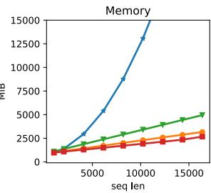
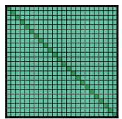
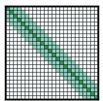
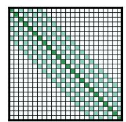
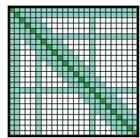

# Longformer：长文档 Transformer

Iz Beltagy Matthew E. Peters<sup>∗</sup> Arman Cohan Allen Institute for Artificial Intelligence, Seattle, WA, USA {beltagy,matthewp,armanc}@allenai.org

## 摘要

基于 Transformer 的模型由于其自注意力（self-attention）操作的计算复杂度与序列长度呈二次方关系，因而无法处理长序列。为了解决这一局限性，我们提出了 Longformer，其注意力机制随序列长度呈线性扩展，使得处理数千个 token 甚至更长文档变得十分轻松。Longformer 的注意力机制是标准自注意力的即插即用替代方案，它将局部窗口注意力与面向任务的全局注意力相结合。参考以往在长序列 Transformer 方面的工作，我们在字符级语言建模任务上评估了 Longformer，并在 text8 和 enwik8 数据集上取得了最先进（state-of-the-art）的结果。与大多数先前工作不同的是，我们还对 Longformer 进行了预训练，并在多种下游任务上进行了微调。我们预训练的 Longformer 在长文档任务上持续优于 RoBERTa，并在 Wiki-Hop 和 TriviaQA 上创造了新的最先进结果。最后，我们推出了 Longformer-Encoder-Decoder (LED)，这是一种用于支持长文档生成式序列到序列（sequence-to-sequence）任务的 Longformer 变体，并证明了其在 arXiv 摘要生成数据集上的有效性。<sup>1</sup>

## 1 引言

Transformer（Vaswani et al., 2017）在一系列广泛的自然语言任务中取得了最先进的结果，包括生成式语言建模（Dai et al., 2019; Radford et al., 2019）和判别式语言理解（Devlin et al., 2019）。这一成功在一定程度上归功于自注意力组件，该组件使网络能够从整个序列中捕获上下文信息。自注意力机制虽然强大，但其内存和计算需求随序列长度呈二次方增长，导致处理长序列变得不可行（或极其昂贵）。


  
Figure 1: 全自注意力与 Longformer 自注意力不同实现的运行时间和显存占用对比；Longformer-loop 为非向量化实现，Longformer-chunk 为向量化实现，Longformer-cuda 为自定义 CUDA 核函数实现。Longformer 的显存使用量随序列长度呈线性增长，而全自注意力机制在当前 GPU 上处理长序列时会发生显存不足。不同实现的运行速度有所差异，其中向量化的 Longformer-chunk 最快。更多细节见第 3.2 节。

为解决这一局限性，我们提出了 Longformer，这是一种改进的 Transformer 架构，其自注意力操作与序列长度呈线性扩展，使其能够灵活处理长文档（图 1）。这对于长文档分类、问答（QA）和共指消解等自然语言任务而言是一大优势，在这些任务中，现有方法通常将长上下文分割或缩短为较短的序列，以满足 BERT 风格预训练模型典型的 512 个标记（token）限制。这种分割可能会导致重要的跨分区信息丢失，为了缓解这一问题，现有方法往往依赖复杂的架构来处理此类交互。另一方面，我们提出的 Longformer 能够利用多层注意力构建整个上下文的上下文表征，从而减少了对特定任务架构的需求。

最近的研究已经解决了 Transformer 在长序列上的计算低效问题（见表 1）。然而，它们主要关注自回归语言建模（LM），而将长文档 Transformer 应用于迁移学习背景下的文档级 NLP 任务（Dai and Le, 2015; Peters et al., 2018; Howard and Ruder, 2018; Devlin et al., 2019）在很大程度上仍未得到充分探索。我们填补了这一空白，并证明 Longformer 的注意力机制可以直接作为预训练 Transformer 中自注意力机制的即插即用替代方案，并在多项文档级 NLP 任务中带来性能提升。

Longformer 的注意力机制结合了带窗口的局部上下文自注意力，以及由终端任务驱动、编码了任务归纳偏置的全局注意力。通过消融实验和对照试验，我们证明这两种注意力类型都是必不可少的——局部注意力主要用于构建上下文表征，而全局注意力则使 Longformer 能够构建用于预测的全序列全局表征。

我们首先通过结合窗口注意力和一种新型膨胀注意力模式，在自回归字符级语言建模上对 Longformer 进行了评估，使该模型能够在现代 GPU 上处理长达 32K 字符的序列。我们在 text8 和 enwik8 基准数据集上取得了最先进（state-of-the-art）的结果，证明了 Longformer 在长文档建模中的有效性。

随后，为了评估 Longformer 替换现有预训练模型中全自注意力操作的能力，我们基于 RoBERTa（Liu et al., 2019）发布的检查点继续进行掩码语言建模（MLM）目标的预训练。预训练完成后，我们通过微调将其应用于下游语言任务，并证明 Longformer 在包括文本分类、QA 和共指消解在内的广泛文档级自然语言任务上均始终优于 RoBERTa，并在其中两个数据集上取得了最先进的结果。

最后，我们介绍了 Longformer 的一个变体，它没有采用纯编码器（encoder-only）的 Transformer 架构，而是采用了类似于原始 Transformer 模型（Vaswani et al., 2017）的编码器-解码器（encoder-decoder）架构，旨在用于序列到序列（seq2seq）学习（Sutskever et al., 2014）。我们将该模型称为 Longformer-Encoder-Decoder (LED)，它在

<table><tr><td>模型</td><td colspan="2">注意力 字符级LM 矩阵</td><td>其他任务</td><td>预训练</td></tr><tr><td>Transformer-XL (2019)</td><td>ltr</td><td>是</td><td>否</td><td>否</td></tr><tr><td>Adaptive Span (2019)</td><td>ltr</td><td>是</td><td>否</td><td>否</td></tr><tr><td>Compressive (2020)</td><td>ltr</td><td>是</td><td>否</td><td>否</td></tr><tr><td>Reformer (2020)</td><td>稀疏</td><td>是</td><td>否</td><td>否</td></tr><tr><td>Sparse (2019)</td><td>稀疏</td><td>是</td><td>否</td><td>否</td></tr><tr><td>Routing (2020)</td><td>稀疏</td><td>是</td><td>否</td><td>否</td></tr><tr><td>BP-Transformer (2019)</td><td>稀疏</td><td>是</td><td>MT</td><td>否</td></tr><tr><td>Blockwise (2019)</td><td>稀疏</td><td>否</td><td>QA</td><td>是</td></tr><tr><td>Our Longformer</td><td>稀疏</td><td>是</td><td>多种</td><td>是</td></tr></table>

Table 1: 针对长文档适配 Transformer 的先前工作总结。ltr：从左至右（left-to-right）。

编码器网络上使用 Longformer 的高效注意力模式，使其能够处理长文档 seq2seq 任务，例如文本摘要（summarization）。我们在 arXiv 摘要数据集（Cohan et al., 2018）上验证了 LED 的有效性。

## 2 相关工作

长文档 Transformer 表 1（Tab. 1）总结了近期在长文档方面的先前工作。目前已探索了两种自注意力（self-attention）方法。第一种是从左至右（left-to-right，ltr）的方法，它通过从左至右移动的分块来处理文档。尽管此类模型在自回归语言建模中取得了成功，但它们不适用于那些能从双向上下文中获益的任务的迁移学习方法。

我们的工作属于另一种通用方法，该方法定义了某种形式的稀疏注意力模式，并避免了计算完整的二次方注意力矩阵乘法。与我们的注意力模式最相似的模型是 Sparse Transformer（Child et al., 2019），它采用了由 BlockSparse（Gray et al., 2017）提供的大小为 8x8 的块状膨胀滑动窗口（dilated sliding window）形式。我们的实现（§3）也包含一个定制的 CUDA 内核，但相比于用 C++ 实现且专为特定版本 TensorFlow 设计的 BlockSparse，它更具灵活性和可维护性。我们还引入了适用于常见 NLP 任务的由任务驱动的额外全局注意力模式（§3），并表明它们对于在迁移学习设置中取得优异性能至关重要。

一些模型尝试了自回归语言建模（autoregressive language modeling）以外的任务，这是向前迈出的一步，因为可以说，将语言建模作为主要评估手段导致了适用性有限的模型的发展。BP-Transformer (Ye et al., 2019) 在机器

  
(a) 全 $n^2$ 注意力（Full n<sup>2</sup> attention）

  
(b) 滑动窗口注意力（Sliding window attention）

  
(c) 空洞滑动窗口（Dilated sliding window）

  
(d) 全局+滑动窗口（Global+sliding window）

Figure 2: 全自注意力模式与我们 Longformer 中的注意力模式配置的对比。

翻译（MT）上进行了评估，但并未探索预训练-微调（pretrain-finetune）设定。Blockwise attention (Qiu et al., 2019) 对其模型进行了预训练并在问答（QA）上进行了评估。然而，该评估具有局限性，因为它不包含语言建模，且 QA 数据集均为相对较短的文档，<sup>2</sup> 因此该模型在长文档任务上的有效性仍有待探索。

针对长文档的特定任务模型（Task-specific Models for Long Documents） 许多特定任务的方法被开发出来，以规避诸如 BERT 等预训练 Transformer 模型的 512 长度限制。最简单的方法是直接截断文档，常用于分类任务（Xie et al., 2019）。另一种方法是将文档分割为长度为 512 的块（可以重叠），分别处理每个块，然后利用特定任务的模型合并激活值（Joshi et al., 2019）。第三种在多跳和开放领域 QA 任务中流行的方法采用两阶段模型，其中第一阶段检索相关文档，并将其传递给第二阶段以进行答案抽取（Clark and Gardner, 2017; Chen et al., 2017）。所有这些方法都会因截断而遭受信息损失，或因两阶段方法而面临级联错误。相比之下，Longformer 能够处理长序列而无需截断或分块，这使我们能够采用一种更简单的方法：拼接可用的上下文并在单次前向传递中完成处理。

一些同期工作<sup>3</sup>探讨了与 Longformer 类似的思想，即在 Transformer 中使用局部 + 全局注意力（local + global attention），并针对长文档自然语言任务进行预训练。具体而言，ETC（Ainslie et al., 2020）采用类似的局部 + 全局注意力代替完全自注意力（full self-attention），从而将 Transformer 扩展到长文档。与 Longformer 不同的是，ETC 使用了相对位置嵌入（relative position embeddings，我们仅在自回归语言模型（Autoregressive LM）设置中使用），在预训练中引入了额外的训练目标（CPC 损失），并以略有不同的方式配置全局注意力。它在包括阅读理解和分类在内的多项任务上展现出了强大的效果。GMAT（Gupta and Berant, 2020）采用了类似的想法，即利用输入中的少数全局位置作为全局记忆。BigBird（Zaheer et al., 2020）是对 ETC 的扩展，并在包括文本摘要（summarization）在内的其他任务上进行了评估。重要的是，通过理论分析，BigBird 证明了稀疏 Transformer 是序列函数的通用逼近器（universal approximators），并保留了完全自注意力的这些性质。

## 3 Longformer

原始 Transformer 模型的自注意力组件具有 $O ( n ^ { 2 } )$ 的时间和内存复杂度，其中 n 是输入序列长度。为了应对这一挑战，我们根据指定相互关注的输入位置对的“注意力模式”（attention pattern）来稀疏化完全自注意力矩阵。与完全自注意力不同，我们提出的注意力模式与输入序列长度呈线性扩展，使其能高效处理更长的序列。本节将讨论该注意力模式的设计与实现。

## 3.1 注意力模式

滑动窗口（Sliding Window） 鉴于局部上下文的重要性（Kovaleva et al., 2019），我们的注意力模式在每个 token 周围采用了固定大小的窗口注意力。堆叠多个此类窗口注意力层可以获得较大的感受野（receptive field），其中顶层可以访问所有输入位置，并有能力构建包含整个输入信息的表征，类似于 CNN（Wu et al., 2019）。给定固定的窗口大小 w，每个 token 关注其两侧各 ${ \scriptstyle { \frac { 1 } { 2 } } } w$ 个 token（Fig. 2b）。该模式的计算复杂度为 $O ( n \times w )$

它与输入序列长度 n 呈线性关系扩展。在具有 \` 层的 Transformer 中，顶层的感受野大小为 $\ell \times w$（假设所有层的 w 均固定）。根据具体应用，为每层使用不同的 w 值可能有助于在效率和模型表征能力之间取得平衡（§4.1）。

膨胀滑动窗口（Dilated Sliding Window） 为了在不增加计算量的情况下进一步增大感受野，可以对滑动窗口进行“膨胀”（dilated）。这类似于膨胀卷积神经网络（dilated CNNs，van den Oord et al., 2016），其中窗口具有大小为膨胀系数 $d$ 的间隔（Fig. 2c）。假设所有层都具有固定的 $d$ 和 $w$，则感受野为 ${ \ell \times d \times w } .$，即使对于较小的 $d$ 值，感受野也能达到数万个 token。

在多头注意力（multi-headed attention）中，每个注意力头计算不同的注意力分数。我们发现，为每个头设置不同的膨胀配置可以提升性能，这使得一些无膨胀的头能够专注于局部上下文，而另一些有膨胀的头则专注于更长范围的上下文。

全局注意力（Global Attention） 在用于自然语言任务的最先进 BERT 风格模型中，最佳输入表示与语言建模不同，并且因任务而异。对于掩码语言建模（masked language modeling, MLM），模型利用局部上下文来预测被掩码的词；而对于分类任务，模型将整个序列的表示聚合到一个特殊 token（在 BERT 中为 [CLS]）中。对于问答（QA）任务，问题和文档被拼接在一起，使模型能够通过自注意力将问题与文档进行比较。

在我们的方案中，窗口化注意力和膨胀注意力在学习特定于任务的表示方面不够灵活。因此，我们在少数预先选定的输入位置上添加了“全局注意力”。重要的是，我们将这种注意力操作设计为对称的：即具有全局注意力的 token 会关注序列中的所有 token，而序列中的所有 token 也会关注它。Fig. 2d 展示了一个在自定义位置的少数 token 上结合全局注意力的滑动窗口注意力示例。例如，对于分类任务，全局注意力用于 [CLS] token；而在 QA 中，全局注意力则赋予所有问题 token。由于此类 token 的数量相对于 $n$ 而言很少且独立于 $n$，因此局部与全局注意力相结合的复杂度仍为 $O ( n )$。尽管指定全局注意力是特定于任务的，但这是向模型的注意力机制中引入归纳偏置（inductive bias）的一种简便方法，并且它比现有的使用复杂架构在较小输入块之间合并信息的任务特定方法要简单得多。

全局注意力的线性投影（Linear Projections for Global Attention） 回顾一下，给定线性投影 $Q, K, V$，Transformer 模型（Vaswani et al., 2017）按如下方式计算注意力分数：

$$
\operatorname{Attention} (Q, K, V) = \operatorname{softmax} \left(\frac {Q K ^ {T}}{\sqrt {d _ {k}}}\right) V\tag{1}
$$

我们使用两组投影矩阵，$Q _ { s } , K _ { s } , V _ { s }$ 用于计算滑动窗口注意力的注意力分数，而 $Q _ { g } , K _ { g } , V _ { g }$ 用于计算全局注意力的注意力分数。额外的投影矩阵为建模不同类型的注意力提供了灵活性，我们表明这对于在下游任务上取得最佳性能至关重要。$Q _ { g } , K _ { g } , V _ { g }$ 的初始化值均与 $Q _ { s } , K _ { s } , V _ { s }$ 保持一致。

## 3.2 实现

在常规 Transformer 中，注意力分数按照公式 1 计算。开销较大的操作是矩阵乘法 $Q \bar { K } ^ { T }$，因为 Q 和 K 都具有 n（序列长度）个投影。对于 Longformer，空洞滑动窗口注意力仅计算 $Q K ^ { \hat { T } }$ 中固定数量的对角线。如图 1 所示，与全自注意力的二次方增长相比，这使得内存使用量呈线性增长。然而，实现它需要一种带状矩阵乘法形式，而现有的深度学习库（如 PyTorch/Tensorflow）并不支持这种操作。图 1 比较了三种不同实现方式的性能：loop 是一种内存高效的 Py-Torch 实现，支持空洞但速度极慢以至于无法实用，仅用于测试；chunks 仅支持非空洞情况，用于预训练/微调场景；cuda 是我们使用 TVM（Chen et al., 2018）实现的全功能、高度优化的自定义 CUDA 内核，用于语言建模实验（更多细节见附录 A）。

## 4 自回归语言建模

自回归或从左到右的语言建模大致定义为：在输入序列中给定先前的 token/字符的情况下，估计当前 token/字符的概率分布。该任务被认为是自然语言处理中的基本任务之一，近期使用 Transformer 建模长序列的前期工作都依赖于此任务作为其主要评估手段（Dai et al., 2019; Rae et al., 2020; Sukhbaatar et al., 2019）。类似地，我们在自回归语言建模上开发并评估了我们的模型。

## 4.1 注意力模式

对于自回归语言建模，我们使用空洞滑动窗口注意力。遵循 Sukhbaatar et al. (2019) 的做法，我们在不同层中使用不同的窗口大小。具体而言，我们在较低层使用较小的窗口大小，并随着向较高层移动而增大窗口大小。这使得顶层能够学习整个序列的高层表示，同时让较低层捕获局部信息。此外，这在效率（较小的窗口大小由于非零值较少而计算开销更低）和性能（较大的窗口大小具有更丰富的表示能力，通常会带来性能提升）之间取得了平衡。

我们没有在较低层使用空洞滑动窗口（dilated sliding windows），以最大化其学习和利用直接局部上下文的能力。对于较高层，我们仅在 2 个头上使用了少量的递增空洞。这使得模型能够在不牺牲局部上下文的情况下，直接关注远距离的 token。

## 4.2 实验设置

为了与先前的工作进行对比，我们重点关注字符级语言模型（character-level LM）（text8 和 enwik8；Mahoney, 2009）。

训练 理想情况下，我们希望在现代 GPU 显存所能容纳的最大窗口大小和序列长度上训练我们的模型。然而，我们发现模型在学习利用更长上下文之前，需要大量的梯度更新来先学习局部上下文。为了适应这一特性，我们采用了一种分阶段训练流程，在多个训练阶段中逐步增加注意力窗口大小和序列长度。具体而言，在第一阶段我们从较短的序列长度和窗口大小开始，随后在每个后续阶段中，我们将窗口大小和序列长度翻倍，并将学习率减半。这使得训练速度加快，同时将耗时较长的部分（最长的序列和窗口大小）留到最后。我们在总共 5 个阶段上训练模型，起始序列长度为 2,048，最后一个阶段的最终序列长度为 23,040（各阶段的详细配置及所有其他超参数请参见附录 B）。

<table><tr><td>模型</td><td>参数量</td><td>Dev</td><td>Test</td></tr><tr><td colspan="4">数据集 text8</td></tr><tr><td>T12 (Al-Rfou et al., 2018)</td><td>44M</td><td>-</td><td>1.18</td></tr><tr><td>Adaptive (Sukhbaatar et al., 2019)</td><td>38M</td><td>1.05</td><td>1.11</td></tr><tr><td>BP-Transformer (Ye et al., 2019)</td><td>39M</td><td>-</td><td>1.11</td></tr><tr><td>Our Longformer</td><td>41M</td><td>1.04</td><td>1.10</td></tr><tr><td colspan="4">数据集 enwik8</td></tr><tr><td>T12 (Al-Rfou et al., 2018)</td><td>44M</td><td>-</td><td>1.11</td></tr><tr><td>Transformer-XL (Dai et al., 2019)</td><td>41M</td><td>-</td><td>1.06</td></tr><tr><td>Reformer (Kitaev et al., 2020)</td><td>-</td><td>-</td><td>1.05</td></tr><tr><td>Adaptive (Sukhbaatar et al., 2019)</td><td>39M</td><td>1.04</td><td>1.02</td></tr><tr><td>BP-Transformer (Ye et al., 2019)</td><td>38M</td><td>-</td><td>1.02</td></tr><tr><td>Our Longformer</td><td>41M</td><td>1.02</td><td>1.00</td></tr></table>

Table 2: 小型模型在 text8 与 enwik8 上的 BPC

<table><tr><td>模型</td><td>参数量</td><td>测试集 BPC</td></tr><tr><td>Transformer-XL (18 layers)</td><td>88M</td><td>1.03</td></tr><tr><td>Sparse (Child et al., 2019)</td><td>≈100M</td><td>0.99</td></tr><tr><td>Transformer-XL (24 layers)</td><td>277M</td><td>0.99</td></tr><tr><td>Adaptive (Sukhbaatar et al., 2019)</td><td>209M</td><td>0.98</td></tr><tr><td>Compressive (Rae et al., 2020)</td><td>277M</td><td>0.97</td></tr><tr><td>Routing (Roy et al., 2020)</td><td>≈223M</td><td>0.99</td></tr><tr><td>Our Longformer</td><td>102M</td><td>0.99</td></tr></table>

Table 3: 大型模型在 enwik8 上的性能

评估 我们使用长度为 32,256 的序列进行评估。遵循 Dai et al. (2019) 的方法，我们将数据集划分为长度为 32,256 且步长为 512 的重叠序列，并报告序列最后 512 个 token 上的性能。

## 4.2.1 结果

Tab. 2 和 3 总结了在 text8 和 enwik8 数据集上的评估结果。我们使用小型模型在 text8 和 enwik8 上均取得了新的最佳性能（state-of-the-art），BPC 分别为 1.10 和 1.00，证明了我们模型的有效性。

对于大型模型，鉴于这些实验的高昂成本，并遵循近期的工作（Kitaev et al., 2020; Rae et al., 2020），我们仅在 enwik8 上进行了评估。Tab. 3 显示，Longformer 优于同等规模的 Transformer-XL 模型，与同等规模的 Sparse Transformer (Child et al., 2019) 性能相当，并且与参数量是其两倍以上的最新模型性能相当或仅略逊一筹。值得注意的是，正如 §2 中所讨论的，Adaptive Span (Sukhbaatar et al., 2019) 和 Compressive Transformer (Rae et al., 2020) 并不适用于预训练-微调（pretraining-finetuning）范式。

<table><tr><td>模型</td><td>Dev BPC</td></tr><tr><td>递减 w（从 512 到 32）</td><td>1.24</td></tr><tr><td>固定 w（= 230）</td><td>1.23</td></tr><tr><td>递增 w（从 32 到 512）</td><td>1.21</td></tr><tr><td>无空洞（No Dilation）</td><td>1.21</td></tr><tr><td>在 2 个头上使用空洞</td><td>1.20</td></tr></table>

Table 4: 上部分：跨层改变窗口大小。下部分：有/无空洞（在 phase 1 达到 150K 步时）

## 4.2.2 消融实验

为了展示我们注意力模式设计选择的重要性，我们尝试了不同的变体并报告其对照实验结果。为了使消融实验更易于管理，我们在 text8 上使用小型模型，采用 phase 1 配置对每种配置训练 150K 步<sup>4</sup>，然后报告验证集上的 BPC 性能。

Tab. 4 上部分展示了每层配置窗口大小的不同方式的影响。我们观察到，从底层到顶层逐渐增大窗口大小能获得最佳性能，反向排列会导致性能变差，而使用固定窗口大小（其他配置窗口大小的平均值）的性能则介于两者之间。Tab. 4 下部分展示了引入空洞（dilation）的影响。与完全不使用空洞相比，在两个注意力头上引入一些空洞带来了一定的性能提升。

## 5 预训练与微调

当前许多 NLP 任务的尖端（state-of-the-art）系统都会利用任务监督微调预训练模型（例如 BERT）。我们的主要动机之一是开发一种适用于长文档任务的此类模型。为此，我们在文档语料库上对 Longformer 进行了预训练，并在包括分类、QA（问答）和共指消解在内的六项任务上对其进行微调。最终得到的模型能够处理长达 4,096 个 token 的序列（比 BERT 长 8 倍）<sup>5</sup>。

我们使用掩码语言建模（masked language modeling, MLM）对 Longformer 进行预训练，其目标是恢复序列中被随机掩码的 token。由于 MLM 预训练成本高昂，我们从 RoBERTa (Liu et al., 2019) 发布的检查点继续预训练，同时仅进行支持 Longformer 注意力机制所需的最小改动。值得注意的是，我们的注意力模式可以直接插入任何预训练的 transformer 模型中，而无需更改模型架构。

<table><tr><td>模型</td><td>base</td><td>large</td></tr><tr><td>RoBERTa (seqlen: 512)</td><td>1.846</td><td>1.496</td></tr><tr><td>Longformer (seqlen: 4,096)</td><td>10.299</td><td>8.738</td></tr><tr><td>+ 复制位置嵌入</td><td>1.957</td><td>1.597</td></tr><tr><td>+ 2K 次梯度更新</td><td>1.753</td><td>1.414</td></tr><tr><td>+ 65K 次梯度更新</td><td>1.705</td><td>1.358</td></tr><tr><td>Longformer (仅训练额外位置嵌入)</td><td>1.850</td><td>1.504</td></tr></table>

Table 5: RoBERTa 以及各种预训练 Longformer 配置的 MLM BPC。

注意力模式（Attention Pattern） 我们使用窗口大小为 512 的滑动窗口注意力，因此使用的计算量与 RoBERTa 相同。<sup>6</sup>

位置嵌入（Position Embeddings） RoBERTa 使用可学习的绝对位置嵌入，最大位置为 512。为了支持更长的文档，我们添加了额外的位置嵌入以支持高达 4,096 的位置。为了充分利用 RoBERTa 的预训练权重，我们并没有对新的位置嵌入进行随机初始化，而是通过多次复制 RoBERTa 的 512 个位置嵌入来进行初始化，因为对 BERT 注意力头的分析表明，其在学习中对关注局部上下文（包括前一个或后一个 token）具有强烈的偏置（Clark et al., 2019）。使用复制初始化除了在分块边界处之外，在其他所有地方都保留了这种局部结构。尽管这种方法非常简单，但我们发现它非常有效（见 Tab. 5），能够让 Longformer 的预训练在少量梯度更新步数下快速收敛。

持续 MLM 预训练（Continued MLM Pretraining） 我们使用 fairseq (Ott et al., 2019) 在我们构建的长文档语料库上预训练 Longformer（语料库详情见附录 C）。我们训练了两种模型尺寸：base 模型和 large 模型。两种模型都进行了 65K 次梯度更新训练，序列长度为 4,096，批大小（batch size）为 64（2<sup>18</sup> 个 token），最大学习率为 3e-5，线性预热（warmup）为 500 步，随后采用 3 次幂的多项式衰减。其余超参数与 RoBERTa 相同。

Tab. 5 展示了我们训练语料开发集上的 BPC。第一行显示了 1.846

<table><tr><td>Wordpieces</td><td>WH</td><td>TQA</td><td>HQA</td><td>ON</td><td>IMDB</td><td>HY</td></tr><tr><td>平均值</td><td>1,535</td><td>6,589</td><td>1,316</td><td>506</td><td>300</td><td>705</td></tr><tr><td>第 95 百分位数</td><td>3,627</td><td>17,126</td><td>1,889</td><td>1,147</td><td>705</td><td>1,975</td></tr></table>

Table 6：各数据集以 Wordpieces 为单位的上下文长度平均值和第 95 百分位数。WH: WikiHop，TQA: TriviaQA，HQA: HotpotQA，ON: OntoNotes，HY: Hyperpartisan news

使用 RoBERTa-base 时的 BPC，这与 RoBERTa 论文在其语料库上报告的 1.880 BPC 相当。这表明我们的训练语料分布与用于训练 RoBERTa 的语料非常接近。接下来的两行展示了 Longformer 在预训练前分别采用随机初始化位置嵌入和复制位置嵌入时的性能。显著的差异表明了复制初始化的重要性，而 RoBERTa BPC 与初始化后 BPC 之间相对较小的差异则表明我们的滑动窗口注意力机制能够与 RoBERTa 权重良好配合。接下来的两行展示了继续预训练的影响。训练 2K 步后 BPC 从 1.957 改善至 1.753，在 65K 步后进一步降至 1.705，表明模型正在学会更好地利用滑动窗口注意力和更长的上下文。在 RoBERTa-large 和 Longformer-large 上也观察到了类似的模式。

冻结 RoBERTa 权重（Frozen RoBERTa Weights） 我们还在冻结所有 RoBERTa 权重且仅训练新位置嵌入的情况下对 Longformer 进行了预训练。采用该配置的出发点是为了完美保留 RoBERTa 在短文档上的性能。该配置的 BPC 为 1.850（低于初始化时的 1.957），但高于所有权重均可训练时的 1.705。

## 6 任务

我们将 Longformer 应用于多个长文档任务，包括 QA（问答）、共指消解（coreference resolution）和分类。Tab. 6 显示评估数据集的上下文显著长于 512 个 wordpieces。我们的首要目标是评估我们的注意力机制是否可以替代 BERT 风格模型中的标准自注意力机制，并与强大的基线进行对照实验。我们还关注能否通过直接将所有可用上下文拼接为单一序列的更简单模型，来取代由于 BERT 上下文长度受限而不得不采用的复杂的特定任务模型。

我们的基线模型是一个基于 RoBERTa 的模型，它将上下文切分成尽可能长的片段，将每个片段单独输入 RoBERTa，并拼接激活值以进行后续处理。对于 QA 任务，我们还会将问题拼接到每个片段中，以便 RoBERTa 能够结合问题来调节其对上下文的语境表示。Longformer 变体则将 RoBERTa 的自注意力机制替换为我们在预训练期间使用的滑动窗口注意力，外加受任务启发的全局注意力。全局注意力使用了额外的线性投影（§3.1）。

## 6.1 问答

我们使用了三个数据集：WikiHop (Welbl et al., 2018)、TriviaQA (Joshi et al., 2017，Wikipedia 设置) 和 HotpotQA (Yang et al., 2018，干扰项设置)。<sup>7</sup>

对于 WikiHop 和 TriviaQA，我们遵循 BERT (Devlin et al., 2019) 的简单 QA 模型，将问题和文档拼接成一个长序列，将其输入 Longformer，然后使用特定于数据集的预测层。WikiHop 使用针对候选答案的分类层，而 TriviaQA 则使用 Clark and Gardner (2017) 的损失函数来预测答案跨度（answer span）。我们在 WikiHop 中对问题标记（token）和候选答案应用全局注意力，在 TriviaQA 中对问题标记应用全局注意力。

HotpotQA 是一个多跳问答（multihop QA）数据集，涉及从 10 个 Wikipedia 段落中提取答案跨度和证据句子，其中 2 个段落是相关的，其余均为干扰项。我们使用了一个两阶段模型，首先选择最相关的段落，然后将它们传递给第二阶段进行答案提取。两个阶段都将问题和上下文拼接为一个序列，输入 Longformer，然后使用特定于任务的预测层。我们以多任务方式训练模型，共同预测相关段落、证据句子、答案跨度和问题类型（yes/no/span）。请注意，该模型比近期包含复杂任务特定架构的 SOTA 模型更为简单（例如，(Tu et al., 2019; Chen et al., 2019; Tu et al., 2020; Groeneveld et al., 2020)）。有关模型和超参数的更多细节，请参见附录 D。

## 6.2 共指消解

我们使用了 OntoNotes (Pradhan et al., 2012) 以及来自 Joshi et al. (2019) 的模型，该模型是对 Lee et al. (2018) 系统的一个修改版本，将 ELMo 替换为了 BERT。Longformer 系统是对基线模型的直接改编，通过将 RoBERTa 替换为 Longformer 并扩展了序列长度。我们在此任务中没有使用全局注意力。

<table><tr><td rowspan="2">模型</td><td colspan="3">问答</td><td>共指消解</td><td colspan="2">分类</td></tr><tr><td>WikiHop</td><td>TriviaQA</td><td>HotpotQA</td><td>OntoNotes</td><td>IMDB</td><td>Hyperpartisan</td></tr><tr><td>RoBERTa-base</td><td>72.4</td><td>74.3</td><td>63.5</td><td>78.4</td><td>95.3</td><td>87.4</td></tr><tr><td>Longformer-base</td><td>75.0</td><td>75.2</td><td>64.4</td><td>78.6</td><td>95.7</td><td>94.8</td></tr></table>

Table 7: 问答、共指消解和文档分类微调结果汇总。结果基于开发集，对比了我们的 Longformer-base 与 RoBERTa-base。TriviaQA、Hyperpartisan 的评估指标为 F1，WikiHop 和 IMDB 使用准确率，HotpotQA 为联合 F1，OntoNotes 为平均 F1。

## 6.3 文档分类

我们在 IMDB (Maas et al., 2011) 和 Hyperpartisan 新闻检测 (Kiesel et al., 2019) 数据集上进行了评估。<sup>8</sup> IMDB 是一个由电影评论组成的标准情感分类数据集。虽然该数据集中的大部分文档较短，但其中约有 13.6% 的文档长度超过 512 个 wordpiece（Tab. 6）。Hyperpartisan 中的文档相对较长，且规模较小，仅有 645 篇文档，这使其成为检验 Longformer 适应有限数据能力的绝佳测试。我们在 [CLS] token 上使用了全局注意力。

## 6.4 结果

主要结果 Tab. 7 汇总了我们所有微调实验的结果。我们观察到，Longformer 的表现始终优于 RoBERTa 基线。对于 WikiHop 和 Hyperpartisan 等需要长上下文的任务，其性能提升尤为显著。对于 TriviaQA，由于局部上下文通常足以回答问题，因此性能提升较为平缓。在 HotpotQA 的情况下，支持性事实（supporting fact）的辅助监督使模型能够轻松找到相关上下文并随后专注于局部上下文，从而导致增益较小。这与仅包含中间推理链远程监督的 WikiHop 形成了鲜明对比，在 WikiHop 中，我们的方法通过在整个上下文上进行推理而表现优异。在 IMDB 和 OntoNotes 数据集上，性能提升较小。对于 IMDB，数据集中的大部分为短文档，因此提升较小是符合预期的。对于 OntoNotes，我们发现任意两个指称（mention）之间的距离通常都很小，因此单独处理较小分块（chunk）的基线模型无需考虑跨分块交互即可将指称拼接成共指链。

<table><tr><td>模型</td><td>WikiHop</td><td>TriviaQA</td><td>HotpotQA</td></tr><tr><td>当前* SOTA</td><td>78.3</td><td>73.3</td><td>74.2</td></tr><tr><td>Longformer-large</td><td>81.9</td><td>77.3</td><td>73.2</td></tr></table>

Table 8: 提交时（2020年5月）Longformer-large 的排行榜结果。所有数值均为 F1 分数。

用于 QA 的 Longformer-large 我们还在长上下文 QA 任务上评估了 Longformer-large 的性能。Tab. 8 显示，我们的 Longformer-large 在 WikiHop 和 TriviaQA 上以较大优势（分别提高 3.6 和 4 个百分点）取得了新的最先进结果（state-of-the-art）<sup>9</sup>，而在 HotpotQA 上，其表现比当前最先进的方法（Fang et al., 2020）低 1 个百分点。Tab. 9 展示了 HotpotQA 与已发表及未发表的同期模型的详细结果对比。Longformer 在已公开发表的排行榜上名列第二，优于除 HGN（Fang et al., 2020）之外的所有其他已发表结果。该任务中所有已发表的表现最优的模型（Tu et al., 2019; Fang et al., 2020; Shao et al., 2020）都使用了 GNN（图神经网络，Kipf and Welling, 2017）或实体图网络，这似乎为该任务编码了重要的归纳偏置（inductive bias），并有可能进一步提高我们的结果。尽管如此，Longformer 表现依然强劲，超越了包括近期非 GNN 方法（Glaß et al., 2019; Shao et al., 2020; Groeneveld et al., 2020）在内的所有其他方法。

<table><tr><td>模型</td><td>ans.</td><td>supp.</td><td>joint</td></tr><tr><td>TAP 2 (ensemble) (Glaß et al., 2019)</td><td>79.8</td><td>86.7</td><td>70.7</td></tr><tr><td>SAE (Tu et al., 2019)</td><td>79.6</td><td>86.7</td><td>71.4</td></tr><tr><td>Quark (dev) (Groeneveld et al., 2020)</td><td>81.2</td><td>87.0</td><td>72.3</td></tr><tr><td>C2F Reader (Shao et al., 2020)</td><td>81.2</td><td>87.6</td><td>72.8</td></tr><tr><td>Longformer-large</td><td>81.3</td><td>88.3</td><td>73.2</td></tr><tr><td>ETC-large $^{\dagger}$  (Ainslie et al., 2020)</td><td>81.2</td><td>89.1</td><td>73.6</td></tr><tr><td>GSAN-large $^{\dagger}$ </td><td>81.6</td><td>88.7</td><td>73.9</td></tr><tr><td>HGN-large (Fang et al., 2020)</td><td>82.2</td><td>88.5</td><td>74.2</td></tr></table>

Table 9: HotpotQA 在干扰项设置（distractor setting）测试集上的结果。Quark 的测试结果不可用。所有数值均为 F1 分数。<sup>†</sup> 表示同期的排行榜提交项。

<table><tr><td>模型</td><td>准确率 / Δ</td></tr><tr><td>Longformer (seqlen: 4,096)</td><td>73.8</td></tr><tr><td>RoBERTa-base (seqlen: 512)</td><td>72.4 / -1.4</td></tr><tr><td>Longformer (seqlen: 4,096, 15 epochs)</td><td>75.0 / +1.2</td></tr><tr><td>Longformer (seqlen: 512, attention:  $n^{2}$ )</td><td>71.7 / -2.1</td></tr><tr><td>Longformer (seqlen: 2,048)</td><td>73.1 / -0.7</td></tr><tr><td>Longformer (无 MLM 预训练)</td><td>73.2 / -0.6</td></tr><tr><td>Longformer (无线性投影)</td><td>72.2 / -1.6</td></tr><tr><td>Longformer (无线性投影，无全局注意力)</td><td>65.5 / -8.3</td></tr><tr><td>Longformer (仅预训练额外的位置嵌入)</td><td>73.5 / -0.3</td></tr></table>

Table 10: WikiHop 开发集消融实验

## 6.5 WikiHop 上的消融实验

Tab. 10 展示了 WikiHop 在开发集上的消融实验（ablation study）。除非另有说明，所有结果均使用 Longformerbase，并在相同超参数下微调五个轮次（epochs）。Longformer 得益于更长的序列、全局注意力、用于全局注意力的独立投影矩阵、MLM 预训练以及更长时间的训练。此外，当配置为与 RoBERTa-base 相同（seqlen: 512，以及 $n ^ { 2 }$ 注意力）时，Longformer 的表现略逊于 RoBERTa-base，这证实了性能提升并非来自于额外的预训练。当使用仅解冻额外位置嵌入预训练的 RoBERTa 模型时，性能略有下降，这表明 Longformer 可以在 WikiHop 等大型训练数据集的任务特定微调中学会利用长距离上下文。

## 7 Longformer-Encoder-Decoder (LED)

最初的 Transformer（Vaswani et al., 2017）由编码器-解码器（encoder-decoder）架构组成，旨在用于序列到序列（sequence-to-sequence，seq2seq）任务（Sutskever et al., 2014），例如文本摘要和翻译。尽管仅编码器（encoder-only）的 Transformer 在各种 NLP 任务中表现出色，但预训练的编码器-解码器 Transformer 模型（例如 BART (Lewis et al., 2020) 和 T5 (Raffel et al., 2020)）在文本摘要等任务上也取得了优异的成绩。然而，此类模型无法高效扩展到具有更长输入的 seq2seq 任务。

为了便于在 seq2seq 学习中对长序列进行建模，我们提出了一种 Longformer 变体，它同时包含编码器和解码器 Transformer 堆叠层，但在编码器中没有使用完全自注意力（full self-attention），而是采用了 Longformer 高效的局部+全局注意力模式。解码器则对所有已编码的 token 以及先前已解码的位置使用完全自注意力。我们将该模型称为 Longformer-Encoder-Decoder (LED)，其复杂度随输入长度呈线性扩展。由于预训练 LED 的成本高昂，我们从 BART 初始化 LED 的参数，并在层数和隐藏层维度（hidden sizes）方面完全遵循 BART 的架构。唯一的区别在于，为了处理更长的输入，我们将位置嵌入扩展到 16K 个 token（相比 BART 的 1K 个 token 有所增加），并且正如第 5 节中针对 RoBERTa 所做的那样，通过重复复制 BART 的 1K 位置嵌入 16 次来初始化新的位置嵌入矩阵。与 BART 类似，我们发布了两种模型尺寸：LED-base 和 LED-large，它们在编码器和解码器堆叠层中分别具有 6 层和 12 层。

我们在聚焦于科学领域长文档摘要的 arXiv 摘要数据集（Cohan et al., 2018）上评估了 LED 在摘要任务上的表现。该数据集中 90% 的文档长度达到 14.5K 个 token，是评估 LED 的合适测试平台。LED 的编码器（encoder）读取文档，解码器（decoder）生成输出摘要。编码器采用窗口大小为 1,024 个 token 的局部注意力，并在第一个 `<s>` token 上使用全局注意力。解码器对整个编码器以及先前已解码的位置采用完全注意力（full attention）。与标准 seq2seq 模型一致，LED 在训练时对标准训练摘要使用教师强制（teacher forcing），并在推理时使用束搜索（beam search）。

表 11 展示了 LED-large 16K 在 arXiv 摘要任务上的结果。该模型仅使用 BART 进行初始化，未进行额外的预训练。我们观察到 LED 在 arXiv 上取得了最先进（state-of-the-art）的结果，略优于 BigBird（Zaheer et al., 2020）。需要注意的是，BigBird 摘要模型支持 4K 个 token 的序列长度，但它是从专门针对摘要任务设计并预训练的 Pegasus（Zhang et al., 2020）开始并继续进行预训练的。在没有预训练或特定任务初始化的情况下，仅凭借处理更长输入的能力，LED 就能略优于 BigBird。通过对 LED 进行预训练，应该可以取得进一步的改进。图 3 进一步阐明了序列长度的重要性，表明处理更长输入的能力显著提高了结果。

<table><tr><td></td><td>R-1</td><td>R-2</td><td>R-L</td></tr><tr><td>Discourse-aware (2018)</td><td>35.80</td><td>11.05</td><td>31.80</td></tr><tr><td>Extr-Abst-TLM (2020)</td><td>41.62</td><td>14.69</td><td>38.03</td></tr><tr><td>Dancer (2020)</td><td>42.70</td><td>16.54</td><td>38.44</td></tr><tr><td>Pegasus (2020)</td><td>44.21</td><td>16.95</td><td>38.83</td></tr><tr><td>LED-large (seqlen: 4,096) (ours)</td><td>44.40</td><td>17.94</td><td>39.76</td></tr><tr><td>BigBird (seqlen: 4,096) (2020)</td><td>46.63</td><td>19.02</td><td>41.77</td></tr><tr><td>LED-large (seqlen: 16,384) (ours)</td><td>46.63</td><td>19.62</td><td>41.83</td></tr></table>

Table 11: Longformer-Encoder-Decoder（LED）在 arXiv 数据集上的摘要结果。指标从左到右依次为 ROUGE-1、ROUGE-2 和 ROUGE-L。

  
Figure 3: 改变输入大小时 LED 的 ROUGE-1 和 ROUGE-2 变化情况（arXiv 验证集）。

## 8 结论与未来工作

我们提出了 Longformer，这是一种基于 Transformer 的模型，能够扩展用于处理长文档，且无需对长输入进行分块/缩短，也无需借助复杂的架构来组合跨块信息，即可轻松执行各种文档级 NLP 任务。Longformer 采用了一种结合局部和全局信息的注意力模式，同时其计算复杂度随序列长度呈线性扩展。Longformer 在 text8 和 enwik8 的字符级语言建模任务上取得了最先进（state-of-the-art）的结果。经过预训练后，Longformer 在长文档任务上持续优于 RoBERTa，并在 WikiHop 和 TriviaQA 数据集上刷新了最先进成绩。我们进一步提出了 LED，这是 Longformer 的一种编码器-解码器（encoder-decoder）变体，用于建模序列到序列（sequence-to-sequence）任务，并在 arXiv 长文档摘要任务上取得了最先进的结果。在未来的工作中，我们希望研究其他的预训练目标（特别是针对 LED）、进一步增加序列长度，并探索可能从我们的模型中受益的其他任务。

## 致谢

我们感谢 Noah Smith、Dan Weld、Dirk Groeneveld、Kyle Lo、Daniel King 和 Doug Downey 提供的有益讨论与反馈，并感谢 AI2 基础设施团队的技术支持。

## 参考文献

Joshua Ainslie, Santiago Ontanon, Chris Alberti, Vaclav Cvicek, Zachary Fisher, Philip Pham, Anirudh Ravula, Sumit Sanghai, Qifan Wang, and Li Yang. 2020. ETC: Encoding long and structured inputs in transformers. In Proceedings of the 2020 Conference on Empirical Methods in Natural Language Processing (EMNLP), pages 268–284, Online. Association for Computational Linguistics.

Rami Al-Rfou, Dokook Choe, Noah Constant, Mandy Guo, and Llion Jones. 2018. Character-level language modeling with deeper self-attention. In AAAI.

Danqi Chen, Adam Fisch, Jason Weston, and Antoine Bordes. 2017. Reading wikipedia to answer opendomain questions. In ACL.

Jifan Chen, Shih-Ting Lin, and Greg Durrett. 2019. Multi-hop question answering via reasoning chains. arXiv preprint, abs/1910.02610.

Tianqi Chen, Thierry Moreau, Ziheng Jiang, Lianmin Zheng, Eddie Yan, Haichen Shen, Meghan Cowan, Leyuan Wang, Yuwei Hu, Luis Ceze, et al. 2018. TVM: An automated end-to-end optimizing compiler for deep learning. In OSDI.

Tianqi Chen, Bing Xu, Chiyuan Zhang, and Carlos Guestrin. 2016. Training deep nets with sublinear memory cost. arXiv preprint, abs/1604.06174.

Rewon Child, Scott Gray, Alec Radford, and Ilya Sutskever. 2019. Generating long sequences with sparse transformers. arXiv preprint, abs/1904.10509

Christopher Clark and Matt Gardner. 2017. Simple and effective multi-paragraph reading comprehension. In ACL.

Kevin Clark, Urvashi Khandelwal, Omer Levy, and Christopher D. Manning. 2019. What does bert look at? an analysis of bert’s attention. arXiv preprint, abs/1906.04341.

Arman Cohan, Franck Dernoncourt, Doo Soon Kim, Trung Bui, Seokhwan Kim, Walter Chang, and Nazli Goharian. 2018. A discourse-aware attention model for abstractive summarization of long documents. In NAACL-HLT 2018.

Andrew M Dai and Quoc V Le. 2015. Semi-supervised sequence learning. In NeurIPS.

Zihang Dai, Zhilin Yang, Yiming Yang, Jaime G. Carbonell, Quoc V. Le, and Ruslan Salakhutdinov. 2019. Transformer-XL: Attentive language models beyond a fixed-length context. In ACL.

Jacob Devlin, Ming-Wei Chang, Kenton Lee, and Kristina Toutanova. 2019. BERT: Pre-training of deep bidirectional transformers for language understanding. In NAACL-HLT.

Yuwei Fang, Siqi Sun, Zhe Gan, Rohit Pillai, Shuohang Wang, and Jingjing Liu. 2020. Hierarchical graph network for multi-hop question answering. In Proceedings of the 2020 Conference on Empirical Methods in Natural Language Processing (EMNLP), pages 8823–8838, Online. Association for Computational Linguistics.

Adam Fisch, Alon Talmor, Robin Jia, Minjoon Seo, Eunsol Choi, and Danqi Chen. 2019. MRQA 2019 shared task: Evaluating generalization in reading comprehension. In MRQA workshop at EMNLP.

Alexios Gidiotis and Grigorios Tsoumakas. 2020. A divide-and-conquer approach to the summarization of academic articles. ArXiv, abs/2004.06190.

Michael Glaß, Alfio Massimiliano Gliozzo, Rishav Chakravarti, Anthony Ferritto, Lin Pan, Gaudani Bhargav, Dinesh Garg, and Avirup Sil. 2019. Span selection pre-training for question answering. arXiv preprint, abs/1909.04120.

Scott Gray, Alec Radford, and Diederik P. Kingma. 2017. Gpu kernels for block-sparse weights.

Dirk Groeneveld, Tushar Khot, Mausam, and Ashish Sabhwaral. 2020. A simple yet strong pipeline for HotpotQA. arXiv preprint, abs/2004.06753.

Ankit Gupta and Jonathan Berant. 2020. Gmat: Global memory augmentation for transformers. ArXiv, abs/2006.03274.

Jeremy Howard and Sebastian Ruder. 2018. Universal language model fine-tuning for text classification. In ACL.

Mandar Joshi, Eunsol Choi, Daniel S. Weld, and Luke Zettlemoyer. 2017. TriviaQA: A large scale distantly supervised challenge dataset for reading comprehension. In ACL.

Mandar Joshi, Omer Levy, Luke Zettlemoyer, and Daniel Weld. 2019. BERT for coreference resolution: Baselines and analysis. In EMNLP-IJCNLP.

Johannes Kiesel, Maria Mestre, Rishabh Shukla, Emmanuel Vincent, Payam Adineh, David Corney, Benno Stein, and Martin Potthast. 2019. SemEval-2019 task 4: Hyperpartisan news detection. In Proceedings of the 13th International Workshop on Semantic Evaluation, pages 829–839, Minneapolis, Minnesota, USA. Association for Computational Linguistics.

Thomas N Kipf and Max Welling. 2017. Semisupervised classification with graph convolutional networks. ICLR.

Nikita Kitaev, Lukasz Kaiser, and Anselm Levskaya. 2020. Reformer: The efficient transformer. In ICLR.

Olga V. Kovaleva, Alexey Romanov, Anna Rogers, and Anna Rumshisky. 2019. Revealing the dark secrets of bert. In EMNLP/IJCNLP.

Kenton Lee, Luheng He, and Luke Zettlemoyer. 2018. Higher-order coreference resolution with coarse-tofine inference. In NAACL.

Mike Lewis, Yinhan Liu, Naman Goyal, Marjan Ghazvininejad, Abdelrahman Mohamed, Omer Levy, Veselin Stoyanov, and Luke Zettlemoyer. 2020. BART: Denoising sequence-to-sequence pretraining for natural language generation, translation, and comprehension. In Proceedings of the 58th Annual Meeting of the Association for Computational Linguistics, pages 7871–7880, Online. Association for Computational Linguistics.

Yinhan Liu, Myle Ott, Naman Goyal, Jingfei Du, Mandar Joshi, Danqi Chen, Omer Levy, Mike Lewis, Luke Zettlemoyer, and Veselin Stoyanov. 2019. RoBERTa: A robustly optimized bert pretraining approach. arXiv preprint, abs/1907.11692.

Andrew L. Maas, Raymond E. Daly, Peter T. Pham, Dan Huang, Andrew Y. Ng, and Christopher Potts. 2011. Learning word vectors for sentiment analysis. In Proceedings of the 49th Annual Meeting of the Association for Computational Linguistics: Human Language Technologies, pages 142–150, Portland, Oregon, USA. Association for Computational Linguistics.

Matt Mahoney. 2009. Large text compression benchmark.

Aaron van den Oord, Sander Dieleman, Heiga Zen,¨ Karen Simonyan, Oriol Vinyals, Alex Graves, Nal Kalchbrenner, Andrew W. Senior, and Koray Kavukcuoglu. 2016. Wavenet: A generative model for raw audio. In SSW.

Myle Ott, Sergey Edunov, Alexei Baevski, Angela Fan, Sam Gross, Nathan Ng, David Grangier, and Michael Auli. 2019. fairseq: A fast, extensible

toolkit for sequence modeling. In Proceedings of NAACL-HLT 2019: Demonstrations.

Matthew E. Peters, Mark Neumann, Mohit Iyyer, Matt Gardner, Christopher Clark, Kenton Lee, and Luke Zettlemoyer. 2018. Deep contextualized word representations. In NAACL.

Sameer Pradhan, Alessandro Moschitti, Nianwen Xue, Olga Uryupina, and Yuchen Zhang. 2012. CoNLL-2012 shared task: Modeling multilingual unrestricted coreference in OntoNotes. In Joint Conference on EMNLP and CoNLL - Shared Task, pages 1–40, Jeju Island, Korea. Association for Computational Linguistics.

Jiezhong Qiu, Hao Ma, Omer Levy, Scott Yih, Sinong Wang, and Jie Tang. 2019. Blockwise self-attention for long document understanding. arXiv preprint, abs/1911.02972.

Alec Radford, Jeffrey Wu, Rewon Child, David Luan, Dario Amodei, and Ilya Sutskever. 2019. Language models are unsupervised multitask learners.

Jack W. Rae, Anna Potapenko, Siddhant M. Jayakumar, and Timothy P. Lillicrap. 2020. Compressive transformers for long-range sequence modelling. In ICLR.

Colin Raffel, Noam Shazeer, Adam Roberts, Katherine Lee, Sharan Narang, Michael Matena, Yanqi Zhou, W. Li, and Peter J. Liu. 2020. Exploring the limits of transfer learning with a unified text-to-text transformer. J. Mach. Learn. Res., 21:140:1–140:67.

Aurko Roy, Mohammad Saffar, Ashish Vaswani, and David Grangier. 2020. Efficient content-based sparse attention with routing transformers. arXiv preprint, abs/2003.05997.

Nan Shao, Yiming Cui, Ting Liu, Shijin Wang, and Guoping Hu. 2020. 图结构对多跳推理是必需的吗？arXiv preprint, abs/2004.03096.

Sandeep Subramanian, Raymond Li, Jonathan Pilault, and C. Pal. 2020. 基于 Transformer 语言模型的抽取式与生成式神经文档摘要研究. In EMNLP.

Sainbayar Sukhbaatar, Edouard Grave, Piotr Bojanowski, and Armand Joulin. 2019. Transformer 中的自适应注意力跨度. In ACL.

Ilya Sutskever, Oriol Vinyals, and Quoc V. Le. 2014. 利用神经网络进行序列到序列学习. In NIPS.

Trieu H. Trinh and Quoc V. Le. 2018. 一种常识推理的简单方法. arXiv preprint, abs/1806.02847.

Ming Tu, Jinke Huang, Xiaodong He, and Bowen Zhou. 2020. 用于序列推理的图序列网络. In NeurIPS Graph Representation Learning workshop.

Ming Tu, Kevin Huang, Guangtao Wang, Jing Huang, Xiaodong He, and Bufang Zhou. 2019. 选择、回答与解释：跨多文档的可解释多跳阅读理解. arXiv preprint, abs/1911.00484.

Ashish Vaswani, Noam Shazeer, Niki Parmar, Jakob Uszkoreit, Llion Jones, Aidan N. Gomez, Lukasz Kaiser, and Illia Polosukhin. 2017. 注意力即你所需要的一切（Attention is all you need）. In NIPS.

Johannes Welbl, Pontus Stenetorp, and Sebastian Riedel. 2018. 构建跨文档多跳阅读理解数据集. TACL, 6:287–302.

Felix Wu, Angela Fan, Alexei Baevski, Yann Dauphin, and Michael Auli. 2019. 利用轻量级与动态卷积减少注意力计算. arXiv preprint, abs/1901.10430.

Qizhe Xie, Zihang Dai, Eduard H. Hovy, Minh-Thang Luong, and Quoc V. Le. 2019. 用于一致性训练的无监督数据增强. arXiv preprint, abs/1904.12848.

Ruibin Xiong, Yunchang Yang, Di He, Kai Zheng, Shu xin Zheng, Chen Xing, Huishuai Zhang, Yanyan Lan, Li-Wei Wang, and Tie-Yan Liu. 2020. 关于 Transformer 架构中的层归一化研究. arXiv preprint, abs/2002.04745.

Zhilin Yang, Peng Qi, Saizheng Zhang, Yoshua Bengio, William W. Cohen, Ruslan Salakhutdinov, and Christopher D. Manning. 2018. HotpotQA：用于多样化、可解释多跳问答的数据集. In EMNLP.

Zihao Ye, Qipeng Guo, Quan Gan, Xipeng Qiu, and Zheng Zhang. 2019. BP-Transformer：通过二分划分建模长程上下文. arXiv preprint, abs/1911.04070.

Manzil Zaheer, Guru Guruganesh, Kumar Avinava Dubey, Joshua Ainslie, C. Alberti, S. Ontan˜on,´ Philip Pham, Anirudh Ravula, Qifan Wang, L. Yang, and A. Ahmed. 2020. Big Bird：用于更长序列的 Transformer. ArXiv, abs/2007.14062.

Rowan Zellers, Ari Holtzman, Hannah Rashkin, Yonatan Bisk, Ali Farhadi, Franziska Roesner, and Yejin Choi. 2019. 防御神经伪造新闻. In NeurIPS.

Jingqing Zhang, Yao Zhao, Mohammad Saleh, and Peter J Liu. 2020. Pegasus：用于生成式摘要的抽取式填空句预训练. ICML.

Yukun Zhu, Ryan Kiros, Richard S. Zemel, Ruslan Salakhutdinov, Raquel Urtasun, Antonio Torralba, and Sanja Fidler. 2015. Aligning books and movies: Towards story-like visual explanations by watching movies and reading books. ICCV, pages 19–27.

## A 实现细节

实现 Longformer 的空洞滑动窗口注意力（dilated sliding window attention）需要一种带状矩阵乘法（banded matrix multiplication，即除特定对角线外输出全为零的矩阵乘法），现有的深度学习库（如 PyTorch/Tensorflow）并不直接支持这种运算。图 1 比较了实现该运算的三种不同方式的运行时间和内存占用。

Longformer-loop 是一种朴素实现，它在循环中分别计算每个对角线。它的内存效率很高，因为它只计算非零值，但其速度过慢而无法实际使用。由于它易于实现，我们仅将其用于测试，而不用它来运行实验。

Longformer-chunks 仅支持非空洞情况。它将 Q 和 K 切分成大小为 w 且重叠大小为 <sup>1</sup><sub>2</sub> w 的重叠块，对这些块进行矩阵相乘，然后掩蔽掉对角线。这种方法的计算效率非常高，因为它使用了 PyTorch 单个矩阵乘法操作，但它消耗的内存是完全优化实现所需内存的 2 倍，因为它计算了部分零值。由于其高计算效率，该实现最适合预训练/微调（pretrain/finetune）场景。在此设置下，我们发现内存的增加并不是问题。

Longformer-cuda 是我们使用 TVM（Chen et al., 2018）实现的自定义 CUDA 核函数（CUDA kernel）。它是我们注意力机制的全功能实现（不像 Longformer-chunks 那样受限），具有最高的内存效率，并且与高度优化的全自注意力（full self-attention）一样快。<sup>10</sup> 我们主要将该实现用于自回归语言建模实验，因为其内存效率高（允许最长的序列）且支持空洞（字符级语言模型实验所必需）。

Tensor Virtual Machine (TVM) 我们使用 TVM（Chen et al., 2018）构建了自定义 CUDA 核函数，TVM 是一个深度学习编译器栈，可将函数的高层描述编译为针对特定设备的优化代码。使用 TVM，我们用高层 Python 结构来描述带状矩阵乘法，然后 TVM 生成相应的 CUDA 代码并针对 GPU 进行编译。

## B 字符级语言模型超参数

我们在 text8 和 enwik8 上进行评估，两者均包含来自 Wikipedia（维基百科）的 100M 字符，并划分为 90M、5M、5M 分别用于训练、验证和测试。我们的模型仅规定了自注意力（self-attention）组件的工作方式，且独立于 Transformer 模型的其他设计选择。我们的实现基于 Transformer-XL（Dai et al., 2019）的代码<sup>11</sup>，并禁用了记忆机制。我们采用了与 Dai et al. (2019) 相同的带正弦权重的相对位置嵌入（relative position embeddings）。我们使用了两种不同的模型规模：与 Dai et al. (2019) 相同的小型模型（12 层，512 隐藏层大小），以及与 Child et al. (2019) 相同的大型模型（30 层，512 隐藏层大小）。我们使用 apex<sup>12</sup> 进行了混合精度训练（16 位和 32 位浮点），以减少显存消耗并加速训练。然而，我们将注意力计算保留为 fp32，以避免数值不稳定问题。<sup>13</sup> 我们使用梯度检查点（gradient checkpointing，Chen et al., 2016）来减少显存占用，并在 48GB RTX8000 GPU 上运行了实验。所有超参数和阶段配置均列于 Tab. 12 中。我们的 CUDA 内核支持自回归模式，其中每个 token 仅关注其前面一定窗口内的 token。我们的实现还包含一个与我们的空洞滑动窗口注意力（dilated sliding window attention）兼容的相对位置嵌入版本。

我们在 4 块 RTX8000 GPU 上运行小型模型实验，历时 16 天。对于大型模型，我们在 8 块 RTX8000 GPU 上运行实验，历时 13 天。我们的大多数超参数搜索与 Tab. 4 中的消融实验类似，在 text8 上对各配置运行 150K 步。我们尝试了绝对位置嵌入和可学习位置嵌入、[0.1, 0.2]（小型模型）与 [0.1, 0.4]（大型模型）的 dropout 值、前置层归一化（pre-layernorm）和后置层归一化（post-layernorm，Xiong et al., 2020）、第一阶段学习率（LR）取值 [2.5e-5, 5e-4, 1e-4] 的恒定及余弦 LR 调度策略，以及不同的空洞（dilation）配置（所有注意力头、2 个注意力头、无空洞）。Tab. 12 中报告的每个阶段的梯度更新次数，是通过运行各个阶段直至验证集 BPC 停止

改善来确定的。

## C 预训练数据

为了使模型能够在预训练中学习长距离依赖关系，我们构建了一个长文档语料库。其中部分数据源也包含在原始 RoBERTa 预训练中，包括 Books 语料库（Zhu et al., 2015）以及英文 Wikipedia。此外，我们还加入了文档长度超过 1,200 个 token 的 Realnews 数据集（Zellers et al., 2019）子集的三分之一，以及 Stories 语料库（Trinh and Le, 2018）的三分之一。我们的目标是混合长短文档，既让模型能够学习更长的依赖关系，同时又不会遗忘来自原始 RoBERTa 预训练的信息。预训练数据的统计信息如 Tab. 13 所示。

## D 任务特定模型细节

所有问答（QA）和分类模型均使用 PyTorch-Lightning<sup>14</sup> 实现。除了 Hyperpartisan news 数据集我们将其按 80/10/10 随机划分为训练集/开发集/测试集（train/dev/test）之外，所有数据集均使用官方的 train/dev/test 划分。

WikiHop WikiHop 中的实例包括：一个问题、候选答案（数量从 2 个到 79 个候选不等）、支持上下文（数量从 3 个段落到 63 个段落不等）以及正确答案。该数据集未提供多跳推理链的任何中间标注，而是需要模型从间接的答案监督中推断出它们。

为了准备输入给 Longformer 和 RoBERTa 的数据，我们首先使用 RoBERTa 的 wordpiece 分词器（tokenizer）对问题、候选答案和支持上下文进行分词。然后我们使用特殊标记拼接问题和候选答案，形式为 [q] question [/q] [ent] candidate1 [/ent] ... [ent] candidateN [/ent]。上下文也使用 RoBERTa 的文档定界符标记作为分隔符进行拼接：</s> context1 </s> ... </s> contextM </s>。特殊标记 [q]、[/q]、[ent]、[/ent] 在任务微调前被添加到 RoBERTa 词表中并进行了随机初始化。

在准备好输入数据后，我们按如下方式计算每个模型顶层的激活值。我们将问题和候选答案与尽可能多的上下文进行拼接，直到达到模型的序列长度上限（RoBERTa 为 512，Longformer 为 4,096），将序列输入模型运行，收集输出激活值，并重复此过程直到耗尽所有上下文（除了 Longformer-large，由于内存要求，我们仅包含前 4,096 长度的序列）。然后将所有分块（chunks）的所有激活值拼接成一个长序列。对于 Longformer，我们对整个问题和候选答案序列使用全局注意力（global attention）。

为了进行预测，我们在每个 [ent] 上连接一个输出单个 logit 的线性层，对跨分块的每个候选答案的所有 logit 取平均值，应用 softmax 并计算与正确候选答案的交叉熵损失（cross entropy loss）。

训练使用 Adam 优化器，在 200 次梯度更新中进行线性预热（linear warmup）至最大学习率（LR），并在剩余的训练过程中进行线性衰减。我们使用梯度累积达到 32 个实例的有效批大小（batch size），每 250 次梯度更新检查一次开发集准确率，并报告最高开发集准确率。其他超参数（dropout、weight decay）与 RoBERTa 预训练一致。

通常，我们进行了最少量的超参数试验，但为了在 Longformer 和 RoBERTa 之间进行公平比较，我们在 Longformer-base 和 RoBERTa-base 上运行了相同的超参数搜索。这包括在学习率（LR）[2e-5, 3e-5, 5e-5] 和轮数（epochs）[5, 10, 15] 上的网格搜索。最佳的 Longformer-base 配置使用了 lr=3e-5，15 个 epoch。我们为 Longformer-large 进行了两次超参数试验，lr=3e-5 且轮数在 [5, 15] 之间（5 个 epoch 的模型具有更高的开发集（dev）准确率 77.6，并且是提交到公开排行榜进行测试集评估的单个模型）。所有模型均在单个 RTX8000 GPU 上训练，其中 Longformer-base 训练 5 个 epoch 耗时约一天。

TriviaQA TriviaQA 拥有超过 10 万个用于训练的问题、答案、文档三元组。文档为 Wikipedia 文章，答案是文章中提及的命名实体。回答问题的文本片段未作标注，而是通过简单的文本匹配找到的。

与 WikiHop 类似，我们使用 RoBERTa 的分词器对问题和文档进行分词，然后构建格式为 [s] question [/s] document [/s] 的输入。为了避免运行过慢，我们将文档截断为 4,096 个 wordpiece。随后，我们以类似于 WikiHop（如上所述）的方式获取来自 RoBERTa 和 Longformer 的激活值。我们对所有问题 token 使用全局注意力。

```csv
Param Value
Position Embeddings Relative and Sinusoidal as in Dai et al. (2019)
Small model config 12 layers, 8 heads, 512 hidden size as in Dai et al. (2019)
Large model config 30 layers, 8 heads, 512 hidden size as in Child et al. (2019)
Optimizer AdamW
Dropout 0.2 (small model), 0.4 (large model)
Gradient clipping 0.25
Weight Decay 0.01
Layernorm Location pre-layernorm (Xiong et al., 2020)
Activation GeLU
Number of phases 5
Phase 1 window sizes 32 (bottom layer) - 8,192 (top layer)
Phase 5 window sizes 512 (bottom layer) - (top layer)
Phase 1 sequence length 2,048
Phase 5 sequence length 23,040 (gpu memory limit)
Phase 1 LR 0.00025
Phase 5 LR 000015625
Batch size per phase 32, 32, 16, 16, 16
#Steps per phase (small) 430K, 50k, 50k, 35k, 5k
#Steps per phase (large) 350K, 25k, 10k, 5k, 5k
Warmup 10% of the phase steps with maximum 10K steps
LR scheduler constant throughout each phase
Dilation (small model) 0 (layers 0-5), 1 (layers 6-7), 2 (layers 8-9), 3 (layers 10-11)
Dilation (large model) 0 (layers 0-14), 1 (layers 15-19), 2 (layers 20-24), 3 (layers 25-29)
Dilation heads 2 heads only
```  
Table 12: 字符级语言建模表现最佳模型的超参数

<table><tr><td>来源</td><td>Tokens</td><td>平均文档长度</td></tr><tr><td>Books (Zhu et al., 2015)</td><td>0.5B</td><td>95.9K</td></tr><tr><td>English Wikipedia</td><td>2.1B</td><td>506</td></tr><tr><td>Realnews (Zellers et al., 2019)</td><td>1.8B</td><td>1.7K</td></tr><tr><td>Stories (Trinh and Le, 2018)</td><td>2.1B</td><td>7.8K</td></tr></table>

Table 13: 预训练数据

对于预测，我们添加了一个层来预测答案跨度的起始和结束位置。由于训练数据的远监督（distant supervision）特性（没有黄金标准答案跨度），我们采用了 Clark and Gardner (2017) 的损失函数，其机制类似于“或”（OR）操作，模型只需预测对其中一个答案跨度即可，而无需全部命中。

最佳配置的超参数列于 Tab. 14 中。所有其他超参数均与 RoBERTa 类似。在超参数搜索方面，我们仅针对 RoBERTa 基线调整了学习率（LR），尝试了 [3e-5, 5e-5, 1e-4] 等速率，随后将表现最佳的 3e-5 用于所有后续实验，未作进一步调优。我们使用最佳配置对 Longformer-large 进行了一次训练，并将其输出提交到了排行榜（leaderboard）。我们在 32GB V100 GPU 上运行了实验。小模型在 4 块 GPU 上训练需要 1 天，而大模型在 8 块 GPU 上训练需要 1 天。

HotpotQA HotpotQA 数据集包含基于来自 10 篇不同 Wikipedia 文章的 10 个段落来回答问题，其中 2 个段落与问题相关，其余为干扰段落。它包括答案跨度提取和证据句子识别两个任务。我们针对 HotpotQA 的模型将答案跨度提取和证据提取结合在了一个联合模型中。我们发现，采用类似设置的两阶段 Longformer 模型能取得更高的性能，该模型首先识别相关段落，然后再去寻找最终的答案跨度和证据。<sup>15</sup> 这主要是因为首先移除干扰段落可以减少最终证据和跨度检测时的噪声，该数据集上近期的前沿方法（Fang et al., 2020）也发现了这一点的重要性。与 Wikihop 和 TriviaQA 类似，为了准备输入给 Longformer 的数据，我们将问题与全部 10 个段落拼接成一个长上下文。具体而言，我们使用了包含特殊标记（tokens）的以下输入格式：“[CLS] [q] question [/q] hti title h/ti sent [s] sent [s] ...

“hti title<sub>2</sub> h/ti sent<sub>2,1</sub> [s] sent<sub>2,2</sub> [s] ...”，其中 [q]、[/q]、hti、h/ti、[s]、[p] 分别是表示问题开始与结束、段落标题开始与结束以及句子的特殊词元（special tokens）。这些特殊词元被添加到 Longformer 词表中，并在任务微调之前进行了随机初始化。对于 Longformer，我们对问题词元、段落标题起始词元以及句子词元应用全局注意力（global attention）。该模型在段落标题起始词元之上添加了额外的前馈层用于预测相关段落，并在句子词元之上添加了前馈层用于预测证据句子。在训练完第一阶段模型后，我们预测训练集和开发集的相关段落得分。随后，我们保留最多 5 个原始得分高于预设阈值（-3.0）的段落，并从上下文中移除其他段落。然后，我们在所得的缩短上下文上训练第二阶段模型。对于答案跨度抽取（answer span extraction），我们使用 BERT 的 QA 模型（Devlin et al., 2019），并在第一个特殊词元（[CLS]）之上添加了问题类型（yes/no/span）分类头。对于证据抽取，我们在句子和段落词元对应的表示之上应用两层前馈网络以获得相应的证据预测得分，并使用二元交叉熵损失（binary cross entropy loss）来训练模型。在证据抽取的推理阶段，我们采用了类似于 Groeneveld et al. (2020) 的受约束解码策略，以确保证据句子恰好来自两个段落，这正是该数据集的设定。我们将跨度损失、问题分类损失、句子损失和段落损失相结合，并通过损失的线性组合以多任务方式训练模型。我们的实验在 RTX8000 GPU 上完成，在 4 块 GPU 上训练每个轮次（epoch）大约需要半天时间。我们使用带有线性预热（1000 步）和线性衰减的 Adam 优化器训练模型。我们进行了最小限度的超参数调优，测试了 3e-5 和 5e-5 的学习率（LR）以及 3 到 7 个轮次，发现学习率为 3e-5 且训练 5 个轮次的模型效果最佳。我们对 RoBERTa 基线模型也进行了相同的超参数搜索。其余超参数见 Tab 14。

共指消解模型细节 共指模型是对 Joshi et al. (2019) 提出的基于 BERT 的粗到细（coarse-to-fine）模型的直接适配。在使用 RoBERTa wordpiece 分词器对每个文档进行预处理后，它将每个文档分割为长度不超过最大序列长度的非重叠片段，然后将这些激活值拼接起来，用于形成共指簇的粗到细聚类阶段。对于 RoBERTa-base，最大序列长度为 384，这是在使用原始实现中的默认超参数在 [256, 384, 512] 中进行了三次试验后选取的。<sup>16</sup>对于 Longformer-base，序列长度为 4,096。与原始实现类似，预训练的 RoBERTa 参数和随机初始化的任务参数采用了不同的学习率。在任务参数中使用较大的学习率可以让优化器将其调整得更远离随机初始化的值，而不会破坏预训练 RoBERTa 参数中的信息。

<table><tr><td>参数</td><td>WikiHop</td><td>TriviaQA</td><td>HotpotQA</td></tr><tr><td>Epochs</td><td>15</td><td>5</td><td>5</td></tr><tr><td>学习率 (LR)</td><td>3e-5</td><td>3e-5</td><td>5e-5</td></tr><tr><td>预热步数 (Warmup steps)</td><td>200</td><td>1000</td><td>1000</td></tr><tr><td>批大小 (Batch size)</td><td>32</td><td>32</td><td>32</td></tr><tr><td>优化器</td><td>Adam</td><td>Adam</td><td>Adam</td></tr></table>

Table 14：QA 模型的超参数。所有模型均使用带有线性预热和衰减的类似调度器。

为了公平比较，超参数搜索非常精简，仅包括对 RoBERTa 和 Longformer 的 RoBERTa 学习率在 [1e-5, 2e-5, 3e-5] 以及任务学习率在 [1e-4, 2e-4, 3e-4] 范围内进行网格搜索。Longformer-base 的最佳配置为 RoBERTa lr=1e-5，task lr=1e-4。所有其他超参数均与原始实现相同。在单张 GPU 上的训练时间约为 10 小时。

我们的实现采用了一种高度客制化的技巧方案，让 PyTorch 和 TensorFlow 共享同一个进程和 GPU。为了避免在 PyTorch 中重新实现 TensorFlow 中复杂的粗到细逻辑（其中包含 Lee et al. (2018) 最初发布的经高度优化的自定义 GPU 内核），我们设计了一个系统，使模型下层的 Transformer 部分在 PyTorch 和 TensorFlow 之间来回传递激活值和梯度。输入张量首先在 PyTorch 中通过 Transformer，从顶层收集激活值，从 GPU 传输到 CPU，然后再从 CPU 传输到 TensorFlow 并回到 GPU，以运行粗到细聚类并计算损失。随后在 TensorFlow 中将梯度反向传播到 Transformer 的顶部，并将该过程逆转以将梯度传递至 PyTorch，从而通过模型的其余部分进行反向传播。两边维护独立的优化器，采用相同的学习率调度来进行参数更新。与运行模型的总开销相比，这种方法带来的额外开销微乎其微。

文本分类 对于分类任务，遵循 BERT，我们在第一个 [CLS] token 之上使用了简单的二元交叉熵损失，并对 [CLS] 添加了全局注意力。我们使用 Adam 优化器，批大小（batch size）为 32，并采用线性预热和衰减，预热步数设为总训练步数的 0.1。对于 IMDB 和 Hyperpartisan news 数据集，我们对学习率（LR）[3e-5, 5e-5] 和训练轮数（epochs）[10, 15, 20] 进行了网格搜索，发现学习率为 [3e-5] 且训练 15 轮的模型效果最佳。实验在单张 RTX8000 GPU 上完成。