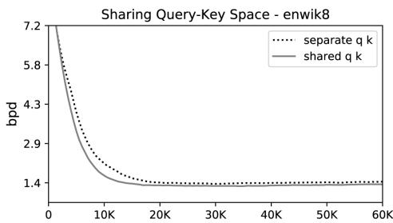
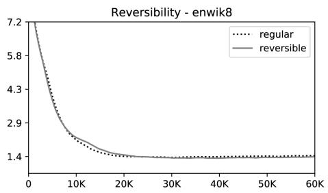
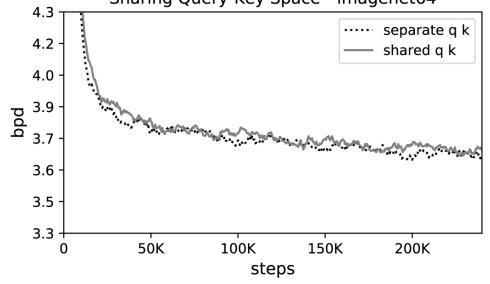
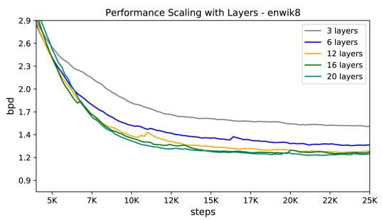

# REFORMER：高效的 TRANSFORMER

Nikita Kitaev∗ U.C. Berkeley & Google Research kitaev@cs.berkeley.edu

Łukasz Kaiser∗ Anselm Levskaya Google Research Google Research {lukaszkaiser,levskaya}@google.com

## 摘要

大型 Transformer 模型通常在许多任务上取得最先进的结果（state-of-the-art），但训练这些模型的成本极其高昂，尤其是在处理长序列时。我们引入了两种技术来提高 Transformer 的效率。其一，我们用基于局部敏感哈希（locality-sensitive hashing）的注意力机制替代了点积注意力，将其复杂度从 O(L2) 降低到 O(L log L)，其中 L 是序列的长度。此外，我们使用可逆残差层（reversible residual layers）代替标准残差层，这使得在训练过程中只需存储一次激活值，而不是 N 次，其中 N 是层数。由此产生的模型 Reformer 的表现与 Transformer 模型相当，同时在长序列上具有更高的内存利用效率和更快的速度。

## 1 引言

Transformer 架构（Vaswani et al., 2017）在自然语言处理中得到了广泛应用，并在众多任务上取得了最先进的结果。为了获得这些结果，研究人员开始诉诸于训练越来越大的 Transformer 模型。在 (Shazeer et al., 2018) 报道的最大配置中，每层的参数量超过了 0.5B，而在 (Al-Rfou et al., 2018) 中层数多达 64 层。Transformer 模型也被应用于越来越长的序列。在 (Liu et al., 2018) 中，单个样本处理的文本 token 高达 1.1 万个，而在处理其他模态（如音乐 (Huang et al., 2018) 和图像 (Parmar et al., 2018)）时，甚至更长的序列也是屡见不鲜。这些大规模长序列模型虽然取得了优异的成果，但对资源的消耗极为严重，以至于有人认为这种趋势正在破坏 NLP 研究1。许多大型 Transformer 模型实际上只能在大型工业研究实验室中进行训练，而使用模型并行训练的此类模型甚至无法在单张 GPU 上进行微调，因为它们的内存需求使得即便只是单步训练也需要多加速器的硬件配置。

大型 Transformer 模型从根本上就需要如此庞大的资源，还是它们仅仅是效率低下？考虑以下计算：文献报道的最大 Transformer 层中使用的 0.5B 参数占用了 2GB 内存。嵌入维度为 1024、批次大小（batch size）为 8 时，64K 个 token 的激活值占用了 64K × 1K × 8 = 0.5B 个浮点数，需要另外 2GB 内存。如果我们的内存使用仅是逐层的，那么即使对于长度为 64K 的序列，我们也应该能相当轻松地将大型 Transformer 放入单个加速器中。此外，用于训练 BERT 的整个语料库只需要 17GB 的存储空间。那为什么我们甚至无法在单台机器上微调这些模型呢？

上述估计仅包含了每层的内存和输入激活值开销，并没有考虑 Transformer 中以下主要的内存使用来源。

• 由于需要为反向传播存储激活值，拥有 N 层的模型中的内存是单层模型的 N 倍。

• 由于中间前馈层的深度 $d _ { f f }$ 通常远大于注意力激活值的深度 $d _ { m o d e l }$，因此它占据了很大一部分内存使用。

• 长度为 L 的序列上的注意力计算在计算和内存复杂度上都是 O(L2)，因此即使是 64K token 的单个序列也可能会耗尽加速器内存。

我们提出了 Reformer 模型，该模型利用以下技术解决了这些问题：

• 最初由 Gomez et al. (2017) 引入的可逆层（reversible layers），使得整个模型只需存储一份激活值副本，因此 N 因子便不复存在。

• 切分前馈层内部的激活值并按块进行处理，消除了 $d _ { f f }$ 因子并节省了前馈层内部的内存。

• 基于局部敏感哈希（locality-sensitive hashing）的近似注意力计算将注意力层中的 $\mathrm { O } ( L ^ { 2 } )$ 因子替换为 O(L log L)，从而允许处理长序列。

我们研究了这些技术，并证明与标准 Transformer 相比，它们对训练过程的影响微乎其微。切分激活值实际上仅影响具体实现；它在数值上与 Transformer 中使用的层完全相同。使用可逆残差代替标准残差确实改变了模型，但在我们实验过的所有配置中对训练的影响都可以忽略不计。最后，注意力中的局部敏感哈希是一个更大的改变，它可能会影响训练动态，具体取决于所使用的并发哈希数量。我们研究了这一参数，并找到了一个既使用高效又能产生与全注意力（full attention）非常接近结果的值。

我们在一个合成任务、一个序列长度为 64K 的文本任务（enwik8）以及一个序列长度为 12K 的图像生成任务（imagenet-64 生成）上进行了实验。在这两种情况下，我们均表明 Reformer 能够达到与完整 Transformer 相当的结果，但运行速度要快得多（尤其是在文本任务上），且内存效率提高了数个数量级。

## 2 局部敏感哈希注意力

点积注意力（Dot-product attention）。Transformer 中使用的标准注意力机制是缩放点积注意力（scaled dot-product attention）（Vaswani et al., 2017）。其输入由维度为 $d _ { k }$ 的查询（queries）与键（keys），以及维度为 $d _ { v }$ 的值（values）组成。计算查询与所有键的点积，除以 $\sqrt { d _ { k } }$ 进行缩放，并应用 softmax 函数以获得作用在值上的权重。在实践中，对一组查询同时计算注意力函数，将其打包成矩阵 $Q .$ 。假设键和值也分别打包成矩阵 K 和 $\breve { V }$ ，则输出矩阵定义为：

$$
\operatorname{Attention} (Q, K, V) = \operatorname{softmax} (\frac {Q K ^ {T}}{\sqrt {d _ {k}}}) V\tag{1}
$$

多头注意力（Multi-head attention）。在 Transformer 中，并非使用 $d _ { m o d e l }$ 维的键、值和查询执行单一的注意力函数，而是使用不同且可学习的线性投影将查询、键和值分别线性投影 h 次至 $d _ { k } , d _ { k }$ 和 $d _ { v }$ 维度。在这些投影版本的查询、键和值上并行应用注意力机制，产生 $d _ { v } .$ 维的输出值。将这些输出值拼接在一起并再次进行投影，从而得出最终的值。这种机制被称为多头注意力。

内存高效注意力（Memory-efficient attention）。为了计算注意力机制的内存占用，我们重点关注公式 1 中的注意力计算。假设 Q、K 和 V 的形状均为 $\left[ b a t c h \_ s i z e , l e n g t h , d _ { m o d e l } \right]$ 。主要问题在于项 $Q K ^ { T }$ ，其形状为 [batch size, length, length]。在实验部分，我们在长度为 64 $K \gets$ 的序列上训练模型；在这种情况下，即使 batch-size 为 1，这也是一个 $6 4 K \times 6 4 K$ 的矩阵，在 32 位浮点数下需要占用 16GB 的内存。这是不切实际的，并且阻碍了 Transformer 在长序列上的应用。但需要注意的是，$Q K ^ { T }$ 矩阵并不需要在内存中完全实体化。注意力实际上可以针对每个查询 $q _ { i }$ 分别计算，在内存中仅计算一次 softmax $\textstyle { \big ( } { \frac { q _ { i } K ^ { T } } { \sqrt { d _ { k } } } } { \big ) } V$ ，然后在反向传播需要梯度时重新计算它。这种计算注意力的方式效率可能较低，但它所占用的内存仅与长度成正比。我们使用这种内存高效的注意力实现来运行实验部分中展示的全注意力（full-attention）基准模型。

Q、K、V 从何而来？上述的多头注意力（multi-head attention）作用于键（keys）、查询（queries）和值（values）之上，但通常我们只得到一个形状为 $[ { \bar { b } } a t c h _ { - } s i z e , l e n g t h , d _ { m o d e l } ] - \mathbf { \bar { e } } . \mathbf { g }$ . 的单一激活张量 A——例如来自将句子中的词元（tokens）嵌入为向量。

  
Figure 1: 角度局部敏感哈希利用球面投影点的随机旋转，通过在带符号轴投影上的 argmax 来建立分桶（buckets）。在这个高度简化的二维示意图中，除非两个点 x 和 y 的球面投影彼此接近（下图），否则对于三种不同的角度哈希，它们不太可能共享相同的哈希桶（上图）。

为了从 A 构建 Q、K 和 V，Transformer 使用了 3 个具有不同参数的线性层将 A 分别投影为 Q、K 和 V。对于采用 LSH 注意力的模型，我们希望查询和键（Q 和 K）是相同的。这很容易通过使用同一个线性层将 A 转换为 Q 和 $\mathrm { K , }$，并使用另一个单独的线性层生成 V 来实现。我们将具有这种行为的模型称为 shared-QK Transformer。事实证明，正如我们在第 5 节实验部分所展示的，即使我们对键 K 的长度进行额外的归一化，共享 QK 也不会影响 Transformer 的性能。

哈希注意力（Hashing attention）。对于 LSH 注意力，我们从形状为 [batch size, length, $d _ { m o d e l } ]$ 的两个张量 Q=K 和 V 开始。我们保持多头机制不变，并专注于公式 1 中的注意力计算。正如前面所提到的，主要问题在于具有 [batch size, length, length] 形状的项 $Q K ^ { T }$。但请注意，实际上我们只对 softmax $( Q K ^ { T } )$ 感兴趣。由于 softmax 主要由最大的元素主导，对于每个查询 $q _ { i }$，我们只需要关注 K 中与 $q _ { i }$ 最接近的键。例如，如果 K 的长度为 64K，对于每个 $q _ { i }$，我们可能只需考虑一个很小的子集，比如最接近的 32 或 64 个键。这样效率要高得多，但我们如何在键中找到最近邻呢？

局部敏感哈希（Locality sensitive hashing）。在高维空间中快速寻找最近邻的问题可以通过局部敏感哈希（LSH）来解决。一种将每个向量 x 映射到哈希值 $h ( x )$ 的哈希方案被称为局部敏感的，前提是相邻的向量大概率获得相同的哈希值，而相距较远的向量则大概率不会。在我们的场景中，实际上只需要相邻向量大概率获得相同的哈希值，并且哈希桶的大小大概率保持相近即可。

我们通过采用如下所示的随机投影来实现这一点（见 Figure 1）。为了获得 $b$ 个哈希值，我们首先固定一个大小为 $[ d _ { k } , \dot { b } / 2 ]$ 的随机矩阵 $\dot { R }$。然后我们定义 $h(x) = \arg \max ([ x \bar { R } ; - x R ])$，其中 $[u; v]$ 表示两个向量的拼接。该方法是一种已知的 LSH 方案（Andoni et al., 2015），并且易于实现和应用于向量批次（batches）。

LSH 注意力。在了解了我们的 LSH 方案和哈希注意力的通用思想后，我们现在将形式化本文中使用的 LSH 注意力。我们首先将标准注意力公式 (1) 重写为单次针对单个查询位置 $i$ 的形式：

$$
o _ {i} = \sum_ {j \in \mathcal {P} _ {i}} \exp \left(q _ {i} \cdot k _ {j} - z (i, \mathcal {P} _ {i})\right) v _ {j}
$$

$$
\text { where } \mathcal {P} _ {i} = \{j: i \geq j \}\tag{2}
$$

我们引入记号 $\mathcal { P } _ { i }$ 来表示位置 $i$ 处查询所关注的集合，并用 $z$ 表示配分函数（即 softmax 中的归一化项）。为清晰起见，我们还省略了按 $\sqrt { d _ { k } }$ 进行的缩放。

为了便于批处理，我们通常在一个更大的集合 $\widetilde { \mathcal { P } } _ { i } = \{ 0 , 1 , \ldots , l \} \supseteq \mathcal { P } _ { i }$ 上执行注意力操作，同时掩蔽（mask out）不在 $\mathcal { P } _ { i }$ 中的元素：

$$
o _ {i} = \sum_ {j \in \widetilde {\mathcal {P}} _ {i}} \exp \left(q _ {i} \cdot k _ {j} - m (j, \mathcal {P} _ {i}) - z (i, \mathcal {P} _ {i})\right) v _ {j} \quad \text { where } m (j, \mathcal {P} _ {i}) = \left\{ \begin{array}{l l} \infty & \text { if } j \notin \mathcal {P} _ {i} \\ 0 & \text { otherwise } \end{array} \right.\tag{3}
$$

  
Figure 2: LSH 注意力的简化示意图，展示了哈希分桶、排序和分块步骤以及由此产生的因果注意力。(a-d) 这些不同类型注意力的注意力矩阵。

现在我们转向 LSH 注意力，我们可以将其理解为通过仅允许在单个哈希桶内进行注意力计算，从而限制查询位置 $i$ 可以关注的目标项集合 $\mathcal { P } _ { i }$。

$$
\mathcal {P} _ {i} = \{j: h (q _ {i}) = h (k _ {j}) \}\tag{4}
$$

Figure 2(a-b) 展示了全注意力与哈希变体的原理对比。(a) 部分描绘了全注意力的注意力矩阵通常是稀疏的，但其计算并没有利用这种稀疏性。在 (b) 中，查询和键已根据它们所在的哈希桶进行了排序。由于相似的项大概率会落入同一个桶中，因此仅允许在每个桶内部进行注意力计算就可以近似全注意力模式。

在这种表述中，哈希桶的大小往往不均匀，这使得跨桶进行批处理变得困难。此外，同一个桶内的 query 数量和 key 数量可能不相等——事实上，一个桶完全有可能包含很多 query 却没有 key。为了缓解这些问题，我们首先通过设置 $k _ { j } = \mathbf { \dot { \phi } } _ { \parallel q _ { j } \parallel } ^ { q _ { j } }$ 来确保 $h ( k _ { j } ) = h ( q _ { j } )$。接下来，我们按桶编号对 query 进行排序，并在每个桶内部按序列位置排序；这定义了一个排序后的置换 $i \mapsto s _ { i }$。在排序后的注意力矩阵中，来自同一个桶的对将聚集在对角线附近（如图 2c 所示）。我们可以采用一种批处理方法，即（排序后）由 m 个连续 query 组成的块彼此关注，并关注前一个块（图 2d）。遵循我们之前的符号表示，这相当于设置：

$$
\widetilde {\mathcal {P}} _ {i} = \left\{j: \left\lfloor \frac {s _ {i}}{m} \right\rfloor - 1 \leq \left\lfloor \frac {s _ {j}}{m} \right\rfloor \leq \left\lfloor \frac {s _ {i}}{m} \right\rfloor \right\}\tag{5}
$$

如果 maxi $| { \mathcal { P } } _ { i } | < m$，则 $\mathcal { P } _ { i } \subseteq \widetilde { \mathcal { P } } _ { i }$。在实践中，我们设置 $\begin{array} { r } { m = \frac { 2 l } { n _ { b u c k e t s } } } \end{array}$（其中 l 为序列长度）。平均桶大小为 $\frac { l } { n _ { b u c k e t s } }$，并且我们假设桶的大小增长到两倍的概率足够低。LSH attention 的整体流程总结在图 2 中。

多轮 LSH attention。在使用哈希时，总存在相似项落入不同桶中的微小概率。这一概率可以通过使用 $n _ { r o u n d s }$ 个不同的哈希函数 $\{ h ^ { ( 1 ) } , h ^ { \bar { ( 2 ) } } , \ldots \}$ 进行多轮哈希来降低，从而满足：

$$
\mathcal {P} _ {i} = \bigcup_ {r = 1} ^ {n _ {\text {rounds}}} \mathcal {P} _ {i} ^ {(r)}
$$

$$
\text { where } \mathcal {P} _ {i} ^ {(r)} = \left\{j: h ^ {(r)} (q _ {i}) = h ^ {(r)} (q _ {j}) \right\}\tag{6}
$$

多轮的情况本质上涉及并行执行 $n _ { r o u n d s }$ 次 LSH attention；该过程的详细信息在附录 A（Appendix A）中进行了描述。

共享 QK 注意力的因果掩码。在 Transformer 解码器（Transformer decoder）中，掩码（在公式 3 中表示为 $m ( j , \mathcal { P } _ { i } )$）用于防止某些位置关注未来的信息。为了在 LSH attention 中实现掩码，我们将每个 query/key 向量与一个位置索引相关联，使用用于对 query/key 向量排序的相同置换来重新排序位置索引，然后使用比较操作来计算掩码。

Table 1：注意力变体的空间和时间复杂度。我们用 l 表示长度，b 表示批次大小（batch size），$n _ { h }$ 表示头数，$n _ { c }$ 表示 LSH 分块数，$n _ { r }$ 表示哈希重复次数。

<table><tr><td>注意力类型</td><td>空间复杂度</td><td>时间复杂度</td></tr><tr><td>缩放点积（Scaled Dot-Product）</td><td> $\max(bn_h l d_k, bn_h l^2)$ </td><td> $\max(bn_h l d_k, bn_h l^2)$ </td></tr><tr><td>内存高效型（Memory-Efficient）</td><td> $\max(bn_h l d_k, bn_h l^2)$ </td><td> $\max(bn_h l d_k, bn_h l^2)$ </td></tr><tr><td>LSH 注意力（LSH Attention）</td><td> $\max(bn_h l d_k, bn_h l n_r (4l/n_c)^2)$ </td><td> $\max(bn_h l d_k, bn_h n_r l (4l/n_c)^2)$ </td></tr></table>

Table 2：单层 Transformer 模型在复制任务上的准确率，分别采用全注意力（Full Attention）以及使用不同并行哈希次数的局部敏感哈希注意力（Locality-Sensitive Hashing Attention）。

<table><tr><td>评估 \ 训练</td><td>Full Attention</td><td>LSH-8</td><td>LSH-4</td><td>LSH-2</td><td>LSH-1</td></tr><tr><td>Full Attention</td><td>100%</td><td>94.8%</td><td>92.5%</td><td>76.9%</td><td>52.5%</td></tr><tr><td>LSH-4</td><td>0.8%</td><td>100%</td><td>99.9%</td><td>99.4%</td><td>91.9%</td></tr><tr><td>LSH-2</td><td>0.8%</td><td>100%</td><td>99.9%</td><td>98.1%</td><td>86.8%</td></tr><tr><td>LSH-1</td><td>0.8%</td><td>99.9%</td><td>99.6%</td><td>94.8%</td><td>77.9%</td></tr></table>

虽然不允许关注未来的位置，但 Transformer 的典型实现确实允许某个位置关注自身。这种行为在共享 QK 的表述中是不可取的，因为查询向量（query vector）与自身的点积几乎总是大于查询向量与另一位置向量的点积。因此，我们修改了掩码机制，禁止 token 关注自身，除非在 token 没有其他有效注意力目标的情况下（例如序列中的第一个 token）。

## 2.1 合成任务上的分析

为了验证 LSH 注意力的性能并研究其行为，我们从以下合成任务开始：复制符号序列。在该任务中，每个训练和测试样本的形式为 0w0w，其中 $w \in \mathfrak { \backslash } 1 , \dotsc , N \} ^ { * }$ 是取值范围为 1 到 N 的符号序列（我们在实验中使用 N = 127）。下面给出了一个词 w 长度为 3 的示例。

<table><tr><td>示例：</td><td>0</td><td>19</td><td>113</td><td>72</td><td>0</td><td>19</td><td>113</td><td>72</td></tr></table>

为了研究 LSH 注意力，我们在上述形式的样本上训练了一个语言模型，其中每个 w 的长度为 511（因此整个输入 0w0w 的长度为 1024）。由于这是一个语言建模任务，我们总是在给定前面所有符号的情况下来预测下一个符号，但我们对损失和准确率进行了掩码处理，仅考虑输入后半部分中的位置，即那些实际上可以被预测的位置。

上述任务可以通过一个单层 Transformer 模型得到完美解决（达到 100% 的准确率和 0 的损失值）。但请注意，它需要非局部（non-local）注意力查找，因此任何依赖具有有限跨度（span）的稀疏注意力的模型都无法解决该任务。为了使其易于且快速训练，同时又类似于 NLP 中使用的模型，我们使用了一个具有 $d _ { m o d e l } = d _ { f f } = 2 5 6$ 以及 4 个头的单层 Transformer。我们在 4 种不同的设置下对其进行了 150K 步的训练：全注意力（full attention）、以及具有 $n _ { r o u n d s } = 1$、$n _ { r o u n d s } = 2 \mathrm { a n d } n _ { r o u n d s } = 4$ 的 LSH（局部敏感哈希）注意力。

从 Table 2 总结的结果中我们可以看出，使用全注意力训练的模型可以直接与 LSH 注意力配合使用，但会牺牲一定的准确率。当使用 LSH 注意力从头开始训练时，采用 4 次哈希训练的模型同样取得了近乎完美的准确率。有趣的是，当使用 8 次哈希进行评估时，准确率达到了完美。而当使用 2 次或 1 次哈希进行评估时，准确率会有所下降。使用更少哈希次数训练的模型表现稍差，但即使是仅使用 1 次哈希训练的模型，在用 8 次哈希评估时也表现得几乎完美。

## 3 可逆 Transformer (REVERSIBLE TRANSFORMER)

如上一节所示，在允许近似的情况下，注意力的复杂度可以从关于长度的平方关系降低到线性关系。但从 Table 1 可以清楚地看出，每个字段都以 $b \cdot n _ { h } \cdot l$ 项开头：$b \cdot n _ { h } \cdot l \cdot d _ { k }$（或换句话说 $b \cdot l \cdot d _ { m o d e l }$）的开销是不可避免的。事实上，每层之前的激活值大小就已经达到了 $b \cdot l \cdot d _ { m o d e l } .$，因此具有 $n _ { l }$ 层的整个模型的内存使用量至少为 $b \cdot l \cdot d _ { m o d e l } \cdot n _ { l }$。更糟糕的是：在 Transformer 的前馈层内部，该值会上升到 $\boldsymbol { b } \cdot \boldsymbol { l } \cdot d _ { f f } \cdot n _ { l }$。在大型 Transformer 中，通常会设置 $d _ { f f } = 4 K$ 且 $n _ { l } = 1 6 \mathrm { s o w i t h } l = 6 4 K$，这将再次占用不切实际的 16GB 内存。

在本节中，我们展示了如何通过首先使用可逆层（reversible layers）处理该项中与 $n _ { l }$ 相关的部分，进而展示分块（chunking）如何使我们能够解决 $d _ { f f }$ 问题，从而降低这一开销。这些方法各自对内存和时间复杂度的影响总结在 Table 3 中。

RevNets。可逆残差网络（Reversible residual networks）由 Gomez et al. (2017) 提出，并证明其可以在图像分类任务中替代 ResNets。其核心思想是允许仅使用模型参数，即可从后一层的激活值中恢复任意给定层的激活值。因此，在反向传播从网络输出向输入进行的过程中，各层可以逐一进行可逆计算，而无需为了反向传播（backward pass）保存中间激活值的检查点（checkpoint）。普通的残差层执行形式为 $x \mapsto y$ 的函数，作用于单一输入并产生单一输出，形式为 $y = x + F ( x )$；而可逆层则作用于输入/输出对：$( x _ { 1 } , x _ { 2 } ) \mapsto ( y _ { 1 } , y _ { 2 } )$，并遵循以下公式：

$$
y _ {1} = x _ {1} + F (x _ {2})
$$

$$
y _ {2} = x _ {2} + G (y _ {1})\tag{7}
$$

通过减去（而非加上）残差项，可以对网络层进行可逆重构：

$$
x _ {2} = y _ {2} - G (y _ {1})
$$

$$
x _ {1} = y _ {1} - F (x _ {2})\tag{8}
$$

Reversible Transformer。我们将 RevNet 的思想应用于 Transformer，将注意力层和前馈层组合在 revnet 块内。在上述符号表示中，F 变为注意力层，而 G 变为前馈层。注意，层归一化（Layer Normalization, Ba et al., 2016）被移到了残差块的内部。

$$
Y _ {1} = X _ {1} + \mathrm{Attention} (X _ {2})
$$

$$
Y _ {2} = X _ {2} + \text { FeedForward } (Y _ {1})\tag{9}
$$

可逆 Transformer 不需要存储每一层的激活值，从而消除了内存开销中的 $n _ { l }$ 项。在第 5 节（Section 5）中，我们展示了在参数量相同的情况下，它的性能与标准 Transformer 相当；我们通过将 $x _ { 1 }$ 和 $x _ { 2 }$ 的维度都设为 $d _ { m o d e l }$ 来实现这一点。

Chunking（分块）。虽然可逆性解决了 $n _ { l }$ 项的内存问题，但较厚的层仍然可能占用大量内存。特别是前馈层，其使用的中间向量维度可达到 $d _ { f f } = 4 K$ 或更高。然而，前馈层中的计算在序列中的各位置之间是完全独立的，因此计算可以拆分为 c 个块（chunks）：

$$
Y _ {2} = \left[ Y _ {2} ^ {(1)}; \dots ; Y _ {2} ^ {(c)} \right] = \left[ X _ {2} ^ {(1)} + \text { FeedForward } (Y _ {1} ^ {(1)}); \dots ; X _ {2} ^ {(c)} + \text { FeedForward } (Y _ {1} ^ {(c)}) \right]\tag{10}
$$

该层通常通过对所有位置并行执行操作进行批处理，但一次只操作一个分块可以减少内存占用。公式 (8) 中的反向重构计算和反向传播过程同样进行了分块处理。除前馈层外，对于词表较大（词表大小超过 $d _ { m o d e l }$）的模型，我们还对输出处的对数概率进行分块，并一次针对序列的一部分计算损失。

分块、大批次与参数复用。通过分块和可逆层，整个网络中用于激活值的内存独立于层数。然而参数却并非如此，因为其数量会随层数的增加而增长。不过这一问题可以得到解决，因为在该层未进行计算时，我们可以在 CPU 内存与 GPU 之间换入和换出层参数。在标准 Transformer 中，这种做法效率很低，因为向 CPU 的内存传输速度较慢。然而在 Reformer 中，批大小与序列长度的乘积要大得多，因此利用这些参数完成的计算量能够分摊其传输的开销。

Table 3: Transformer 变体的内存和时间复杂度。我们将模型深度记为 $d _ { m o d e l }$ 和 $d _ { f f }$，并假设 $d _ { f f } \geq d _ { m o d e l } ; b$ 代表批大小，l 代表长度，nl 代表层数。我们假设 $n _ { c } = l / 3 2 \mathrm { s o } 4 l / n _ { c } = 1 2 8$ 并记 $c = 1 2 8 ^ { 2 }$

<table><tr><td>模型类型</td><td>内存复杂度</td><td>时间复杂度</td></tr><tr><td>Transformer</td><td> $\max(bld_{ff}, bn_h l^2) n_l$ </td><td> $(bld_{ff} + bn_h l^2) n_l$ </td></tr><tr><td>Reversible Transformer</td><td> $\max(bld_{ff}, bn_h l^2)$ </td><td> $(bn_h ld_{ff} + bn_h l^2) n_l$ </td></tr><tr><td>Chunked Reversible Transformer</td><td> $\max(bld_{model}, bn_h l^2)$ </td><td> $(bn_h ld_{ff} + bn_h l^2) n_l$ </td></tr><tr><td>LSH Transformer</td><td> $\max(bld_{ff}, bn_h ln_r c) n_l$ </td><td> $(bld_{ff} + bn_h n_r lc) n_l$ </td></tr><tr><td>Reformer</td><td> $\max(bld_{model}, bn_h ln_r c)$ </td><td> $(bld_{ff} + bn_h n_r lc) n_l$ </td></tr></table>

## 4 相关工作

(Vaswani et al., 2017) 中提出的 Transformer 模型已广泛应用于自然语言任务，并进一步扩展到对各种不同数据进行建模，如乐谱 (Huang et al., 2018) 和图像 (Parmar et al., 2018; Ramachandran et al., 2019)。最值得注意的是，此类模型已成功应用于超大型语言模型的自监督训练 (Devlin et al., 2018; Radford et al., 2019)。

鉴于最先进的序列模型有着巨大的计算需求，人们对寻找降低 Transformer 模型的内存占用和计算需求的方法表现出越来越浓厚的兴趣。除了降低精度和梯度检查点（gradient checkpointing）(Sohoni et al., 2019) 等标准方法外，最近人们还探索了 Transformer 模型自注意力机制的更高效版本 (Sukhbaatar et al., 2019a;b)。

特别地，利用注意力层中的稀疏性已被证明是行之有效的。OpenAI 提出了稀疏 Transformer（sparse Transformer，Child et al., 2019），该模型利用了注意力的因子化稀疏表示。使用乘积键注意力（product-key attention）来增加键空间也被用于在前馈层中降低内存需求且不损失性能（Lample et al., 2019）。

据我们所知，局部敏感哈希（Locality-sensitive hashing，LSH）此前尚未直接应用于 Transformer 注意力层。但以往在神经网络中使用外部记忆的研究已经涉及了大容量记忆的处理。记忆网络（memory networks）的最初实现（Weston et al., 2014）以及随后扩展其规模的工作（Bordes et al., 2015; Chandar et al., 2016）使用了数以百万计大小的记忆。这样做的代价是记忆必须在训练前固定下来。此外，由于在训练初期模型不太可能正确查询记忆，因此使用了强监督来促使模型查询有用的记忆位置。这些提示要么由任务作为额外的监督信息提供，要么如 Hill et al. (2015) 中那样通过启发式方法确定。Santoro et al. (2016) 以牺牲记忆大小为代价移除了预先固定记忆的要求，随后 Rae et al. (2016) 缓解了这一问题。后一篇论文考虑了使用近似最近邻进行记忆查找（包括 LSH 和随机 kd 树），但仅用于外部记忆中的查找。

## 5 实验

在本节中，我们展示了论证上述技术的实验结果。我们逐一分析这些技术，以明确哪些组合会对性能产生影响。我们首先展示可逆层和共享查询-键空间不会影响性能，然后继续分析哈希注意力，最后评估完整的 Reformer 模型。

我们在 imagenet64 和 enwik8-64K 任务上进行了实验，其中后者是 enwik8 的一个变体，被分块为 $2 ^ { 1 6 } \ : = \ : 6 4 K$ 个标记的子序列。我们在消融实验中使用 3 层模型，以便能够与具有高内存占用并执行完整 $O ( l ^ { 2 } )$ 注意力的常规 Transformer 进行可行的比较。所有实验均设置 $d _ { m o d e l } = 1 0 2 4 , d _ { f f } = 4 0 \bar { 9 6 }$ $n _ { h e a d s } ~ = ~ 8$，总批次大小（batch size）为 8 个序列。我们使用 Adafactor 优化器（Shazeer & Stern, 2018）来训练这些模型。我们还遵循 Vaswani et al. (2017) 的超参数，在 WMT 2014 英语到德语翻译任务上进行了评估。所有实验的训练均在 8 个设备（8 块 GPU 或 8 个 TPU v3 核心）上并行进行。训练我们模型的代码已公开提供。2

  
Figure 3: 共享 query-key 空间（左）和可逆性（右）对 enwik8 和 imagenet64 训练性能的影响。曲线显示了保留数据上的每维度比特数（bits per dim）。

Table 4: WMT 英语-德语（EnDe）在 newstest2014 上的 BLEU 得分。我们额外报告了由 sacreBLEU（Post, 2018）计算的去标记化（detokenized）BLEU 得分。

<table><tr><td rowspan="2">模型</td><td rowspan="2">BLEU</td><td colspan="2">sacreBLEU</td></tr><tr><td>不区分大小写3</td><td>区分大小写4</td></tr><tr><td>Vaswani et al. (2017), 基础模型</td><td>27.3</td><td></td><td></td></tr><tr><td>Vaswani et al. (2017), 大型模型</td><td>28.4</td><td></td><td></td></tr><tr><td>Ott et al. (2018), 大型模型</td><td>29.3</td><td></td><td></td></tr><tr><td>Reversible Transformer (base, 100K steps)</td><td>27.6</td><td>27.4</td><td>26.9</td></tr><tr><td>Reversible Transformer (base, 500K steps, no weight sharing)</td><td>28.0</td><td>27.9</td><td>27.4</td></tr><tr><td>Reversible Transformer (big, 300K steps, no weight sharing)</td><td>29.1</td><td>28.9</td><td>28.4</td></tr></table>

共享 QK 的影响。我们首先考虑共享 QK 注意力机制对常规 Transformer 模型的影响。共享 QK 注意力机制设定 $\begin{array} { r } { k _ { j } ~ = ~ \frac { q _ { j } } { \parallel q _ { j } \parallel } } \end{array}$，并防止 token 关注自身（除非没有其他上下文可用）。在 Figure 3 的左侧部分，我们绘制了常规注意力和共享 QK 注意力的困惑度曲线。共享 query-key 空间的表现并不比常规注意力差；事实上，对于 enwik8 而言，它的训练速度似乎略快一些。换言之，转用共享 QK 注意力机制并不会牺牲准确率。

可逆层的影响。在 Figure 3 右侧的两幅图中，我们将 Vaswani et al. (2017) 的常规 Transformer 与第 3 节中描述的可逆 Transformer 进行了对比。这两个模型具有相同的参数量，其学习曲线看起来也几乎相同。这些结果表明，可逆 Transformer 所实现的内存节省并不是以牺牲准确率为代价的。

机器翻译中的可逆层。我们还在用于英语到德语机器翻译的编码器-解码器 Transformer 模型中评估了可逆层。我们首先在 Transformer-base 架构中使编码器和解码器均完全可逆，并发现当训练 100K 步时，所得模型的性能与 Vaswani et al. (2017) 相当。我们还评估了训练更多步数以及采用更大模型的情况。Reformer 模型非常节省内存，因此在后两个实验中，我们不需要通过在整个模型中共享嵌入矩阵和输出投影权重矩阵来节省内存。结果如 Table 4 所示。在这种设置下，我们没有应用 LSH 注意力（LSH attention），因为样本是单句，且句子往往相对较短。我们典型的 LSH 注意力配置在哈希和排序后使用 128 个 token 的分块，而 WMT14 测试集中的样本均短于 128 个 token。

  
Figure 4: imagenet64 上 LSH 注意力性能随哈希轮数变化的关系。

  
Figure 5: 左：enwik8 上 LSH 注意力性能随层数变化的关系。右：全注意力与 LSH 注意力的评估速度随输入长度变化的关系。

Transformer 中的 LSH 注意力。LSH 注意力是全注意力（full attention）的一种近似，如图 Figure 4 所示，随着哈希次数的增加，它变得更加准确。在 $\begin{array} { r } { n _ { r o u n d s } = 8 , } \end{array}$ 时，它已经几乎与全注意力相媲美。模型的计算成本随着哈希次数的增加而增长，因此可以根据可用的计算预算来调整该超参数。此外，如 Table 2 所示，在评估阶段可以增加哈希次数以产生更准确的结果。在 Figure 5 的右半部分，我们绘制了在保持 token 总数固定的情况下，不同注意力类型的速度与序列长度的关系图。我们可以看到，虽然常规注意力在序列长度变长时速度变慢，但 LSH 注意力的速度保持平稳。

大型 Reformer 模型。为了验证 Reformer 确实可以在单核上容纳大型模型并在长序列上快速训练，我们在 enwik8 和 imagenet64 上训练了多达 20 层的大型 Reformer。如图 Figure 5 所示，这些模型可以装入内存并进行训练。在这种情况下，我们无法训练 Transformer 基线模型，因为它们太慢且极耗内存，但我们看到了随着层数增加带来的明显改进。在 enwik8 上训练 20K 步、dropout 率为 0.1 的 12 层模型在测试集上达到了 1.19 bits/dim。我们还通过进一步的调优和改进对一个 12 层的 Reformer 模型进行了更长时间的训练，在 enwiki8 测试集上达到了 1.05 bits/dim。

## 6 结论

Reformer 将 Transformer 的建模能力与一种能够在长序列上高效执行且内存占用极小的架构相结合，即使对于层数很多的模型也是如此。我们相信，这将有助于大型、参数丰富的 Transformer 模型变得更加普及和易于获取。此外，处理长序列的能力为 Reformer 在许多生成任务中的应用铺平了道路。除了生成极长的连贯文本之外，Reformer 还可以将 Transformer 模型的能力拓展到诸如时间序列预测、音乐、图像以及视频生成等其他领域。

## 参考文献

Rami Al-Rfou, Dokook Choe, Noah Constant, Mandy Guo, and Llion Jones. Character-level language modeling with deeper self-attention. CoRR, abs/1808.04444, 2018. URL http: //arxiv.org/abs/1808.04444.

Alexandr Andoni, Piotr Indyk, Thijs Laarhoven, Ilya P. Razenshteyn, and Ludwig Schmidt. Practical and optimal LSH for angular distance. CoRR, abs/1509.02897, 2015. URL http://arxiv. org/abs/1509.02897.

Jimmy Lei Ba, Jamie Ryan Kiros, and Geoffrey E Hinton. Layer normalization. arXiv preprint arXiv:1607.06450, 2016. URL http://arxiv.org/abs/1607.06450.

Antoine Bordes, Nicolas Usunier, Sumit Chopra, and Jason Weston. Large-scale simple question answering with memory networks. CoRR, abs/1506.02075, 2015. URL http://arxiv.org/ abs/1506.02075.

Sarath Chandar, Sungjin Ahn, Hugo Larochelle, Pascal Vincent, Gerald Tesauro, and Yoshua Bengio. Hierarchical memory networks. arXiv preprint arXiv:1605.07427, 2016.

Rewon Child, Scott Gray, Alec Radford, and Ilya Sutskever. Generating long sequences with sparse transformers. URL https://openai.com/blog/sparse-transformers, 2019.

Jacob Devlin, Ming-Wei Chang, Kenton Lee, and Kristina Toutanova. BERT: pre-training of deep bidirectional transformers for language understanding. CoRR, abs/1810.04805, 2018. URL http://arxiv.org/abs/1810.04805.

Aidan N Gomez, Mengye Ren, Raquel Urtasun, and Roger B Grosse. The reversible residual network: Backpropagation without storing activations. In Advances in neural information processing systems, pp. 2214–2224, 2017.

Felix Hill, Antoine Bordes, Sumit Chopra, and Jason Weston. The goldilocks principle: Reading children’s books with explicit memory representations. CoRR, abs/1511.02301, 2015. URL http://arxiv.org/abs/1511.02301.

Cheng-Zhi Anna Huang, Ashish Vaswani, Jakob Uszkoreit, Noam Shazeer, Curtis Hawthorne, Andrew M Dai, Matthew D Hoffman, and Douglas Eck. Music transformer: Generating music with long-term structure. arXiv preprint arXiv:1809.04281, 2018.

Guillaume Lample, Alexandre Sablayrolles, Marc’Aurelio Ranzato, Ludovic Denoyer, and Herve´ Jegou. Large memory layers with product keys.´ CoRR, abs/1907.05242, 2019. URL http: //arxiv.org/abs/1907.05242.

Peter J. Liu, Mohammad Saleh, Etienne Pot, Ben Goodrich, Ryan Sepassi, Lukasz Kaiser, and Noam Shazeer. Generating wikipedia by summarizing long sequences. CoRR, abs/1801.10198, 2018. URL http://arxiv.org/abs/1801.10198.

Myle Ott, Sergey Edunov, David Grangier, and Michael Auli. Scaling neural machine translation. In Proceedings of the Third Conference on Machine Translation: Research Papers, pp. 1–9, Brussels, Belgium, October 2018. Association for Computational Linguistics. doi: 10.18653/v1/W18-6301. URL https://www.aclweb.org/anthology/W18-6301.

Niki Parmar, Ashish Vaswani, Jakob Uszkoreit, Lukasz Kaiser, Noam Shazeer, and Alexander Ku. Image transformer. CoRR, abs/1802.05751, 2018. URL http://arxiv.org/abs/1802. 05751.

Matt Post. A call for clarity in reporting BLEU scores. In Proceedings of the Third Conference on Machine Translation: Research Papers, pp. 186–191, Belgium, Brussels, October 2018. Association for Computational Linguistics. URL https://www.aclweb.org/anthology/ W18-6319.

Alec Radford, Jeff Wu, Rewon Child, David Luan, Dario Amodei, and Ilya Sutskever. Language models are unsupervised multitask learners. 2019.

Jack W Rae, Jonathan J Hunt, Tim Harley, Ivo Danihelka, Andrew Senior, Greg Wayne, Alex Graves, and Timothy P Lillicrap. Scaling memory-augmented neural networks with sparse reads and writes. In Advances in Neural Information Processing Systems, (NIPS), 2016.

Prajit Ramachandran, Niki Parmar, Ashish Vaswani, Irwan Bello, Anselm Levskaya, and Jonathon Shlens. Stand-alone self-attention in vision models. CoRR, abs/1906.05909, 2019. URL http: //arxiv.org/abs/1906.05909.

Adam Santoro, Sergey Bartunov, Matthew Botvinick, Daan Wierstra, and Timothy P. Lillicrap. Oneshot learning with memory-augmented neural networks. CoRR, abs/1605.06065, 2016. URL http://arxiv.org/abs/1605.06065.

Noam Shazeer and Mitchell Stern. Adafactor: Adaptive learning rates with sublinear memory cost. CoRR, abs/1804.04235, 2018. URL http://arxiv.org/abs/1804.04235.

Noam Shazeer, Youlong Cheng, Niki Parmar, Dustin Tran, Ashish Vaswani, Penporn Koanantakool, Peter Hawkins, HyoukJoong Lee, Mingsheng Hong, Cliff Young, Ryan Sepassi, and Blake Hechtman. Mesh-tensorflow: Deep learning for supercomputers. CoRR, abs/1811.02084, 2018. URL http://arxiv.org/abs/1811.02084.

Nimit Sharad Sohoni, Christopher Richard Aberger, Megan Leszczynski, Jian Zhang, and Christopher Re. Low-memory neural network training: A technical report.´ CoRR, abs/1904.10631, 2019. URL http://arxiv.org/abs/1904.10631.

Sainbayar Sukhbaatar, Edouard Grave, Piotr Bojanowski, and Armand Joulin. Adaptive attention span in transformers. CoRR, abs/1905.07799, 2019a. URL http://arxiv.org/abs/ 1905.07799.

Sainbayar Sukhbaatar, Edouard Grave, Guillaume Lample, Herve J ´ egou, and Armand Joulin. Aug- ´ menting self-attention with persistent memory. CoRR, abs/1907.01470, 2019b. URL http: //arxiv.org/abs/1907.01470.

Ashish Vaswani, Noam Shazeer, Niki Parmar, Jakob Uszkoreit, Llion Jones, Aidan N. Gomez, Lukasz Kaiser, and Illia Polosukhin. Attention is all you need. CoRR, 2017. URL http: //arxiv.org/abs/1706.03762.

Jason Weston, Sumit Chopra, and Antoine Bordes. Memory networks. CoRR, abs/1410.3916, 2014. URL http://arxiv.org/abs/1410.3916.

## A 多轮 LSH 注意力

在本节中，我们更详细地描述我们 LSH 注意力机制的多哈希版本。我们首先重述正文中的公式 (3)，该公式描述了具有稀疏性的注意力机制的通用表述：

$$
o _ {i} = \sum_ {j \in \widetilde {\mathcal {P}} _ {i}} \exp \left(q _ {i} \cdot k _ {j} - m (j, \mathcal {P} _ {i}) - z (i, \mathcal {P} _ {i})\right) v _ {j} \quad \text { where } m (j, \mathcal {P} _ {i}) = \left\{ \begin{array}{l l} \infty & \text { if } j \notin \mathcal {P} _ {i} \\ 0 & \text { otherwise } \end{array} \right.\tag{3}
$$

在多轮情况下，查询位置 i 可以关注式 (6) 中定义的键位置 $\mathcal { P } _ { i }$，我们在此也予以重述：

$$
\mathcal {P} _ {i} = \bigcup_ {r = 1} ^ {n _ {\text { rounds }}} \mathcal {P} _ {i} ^ {(r)} \quad \text { where } \mathcal {P} _ {i} ^ {(r)} = \left\{j: h ^ {(r)} (q _ {i}) = h ^ {(r)} (q _ {j}) \right\}\tag{6}
$$

出于批处理（batching）的目的，注意力计算是在已排序查询/键的分块上执行的：

$$
\widetilde {\mathcal {P}} _ {i} ^ {(r)} = \left\{j: \left\lfloor \frac {s _ {i} ^ {(r)}}{m} \right\rfloor - 1 \leq \left\lfloor \frac {s _ {j} ^ {(r)}}{m} \right\rfloor \leq \left\lfloor \frac {s _ {i} ^ {(r)}}{m} \right\rfloor \right\}\tag{11}
$$

结合 (3) 和 (6) 可得：

$$
o _ {i} = \sum_ {j \in \widetilde {\mathcal {P}} _ {i}} \exp \left(q _ {i} \cdot k _ {j} - m (j, \mathcal {P} _ {i}) - z (i, \mathcal {P} _ {i})\right) v _ {j}\tag{12}
$$

$$
= \sum_ {r = 1} ^ {n _ {r o u n d s}} \exp \left(z (i, \mathcal {P} _ {i} ^ {(r)}) - z (i, \mathcal {P} _ {i})\right) \sum_ {j \in \widetilde {\mathcal {P}} _ {i} ^ {(r)}} \frac {1}{N _ {i , j}} \exp \left(q _ {i} \cdot k _ {j} - m (j, \mathcal {P} _ {i} ^ {(r)}) - z (i, \mathcal {P} _ {i} ^ {(r)})\right)\tag{\(v_{j}\}
$$

(13)

$$
= \sum_ {r = 1} ^ {n _ {r o u n d s}} \exp \left(z (i, \mathcal {P} _ {i} ^ {(r)}) - z (i, \mathcal {P} _ {i})\right) o _ {i} ^ {(r)}\tag{14}
$$

$$
o _ {i} ^ {(r)} = \sum_ {j \in \widetilde {\mathcal {P}} _ {i} ^ {(r)}} \exp \left(q _ {i} \cdot k _ {j} - m _ {i, j} ^ {(r)} - z (i, \mathcal {P} _ {i} ^ {(r)})\right) v _ {j}\tag{15}
$$

$$
\text { where } N _ {i, j} = \left| \left\{r ^ {\prime}: j \in \mathcal {P} _ {i} ^ {(r ^ {\prime})} \right\} \right| \text { and } m _ {i, j} ^ {(r)} = \left\{ \begin{array}{l l} \infty & \text { if } j \notin \mathcal {P} _ {i} ^ {(r)} \\ 1 0 ^ {5} & \text { if } i = j \\ \log N _ {i, j} & \text { otherwise } \end{array} \right.\tag{16}
$$

每一轮 LSH 注意力（LSH attention）都会生成一个向量 $o _ { i } ^ { ( r ) }$，除了包含用于在构建 $\mathcal { P } _ { i } ^ { ( r ) }$ 集合的并集时避免重复计数元素的项 $N _ { i , j }$ 之外，该向量可以独立于其他轮次进行计算。在我们的实现中，我们将 $N _ { i , j }$ 因子合并到了掩码项 $m _ { i , j } ^ { ( r ) }$ 中。

我们还对 $m _ { i , j } ^ { ( r ) }$ 进行了修改，引入了 $i = j$ 的特殊情况。添加这种情况是因为标准 Transformer 中的因果掩码允许位置 i 关注自身，这在共享 QK（shared-QK）公式中并不可取。我们将掩码设置为一个较大但有限的值以禁止自身注意力（attention-in-place），除非在一个 token 没有其他有效注意力目标的情况下。例如，序列中的第一个 token 仅关注自身，因为没有可用的前置上下文。