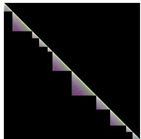
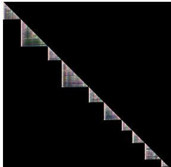
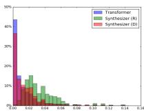
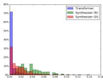
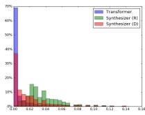
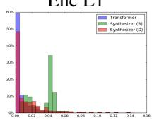
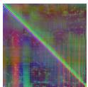
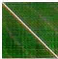
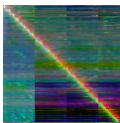
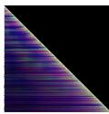

# Synthesizer：对 Transformer 模型自注意力机制的重新思考

Yi Tay 1 Dara Bahri 1 Donald Metzler 1 Da-Cheng Juan 1 Zhe Zhao 1 Che Zheng 1

## 摘要

点积自注意力机制（dot product self-attention）被公认为是当前顶尖 Transformer 模型的核心且不可或缺的组成部分。但它真的是必需的吗？本文深入探讨了基于点积的自注意力机制对 Transformer 模型性能的真实重要性和贡献。通过大量实验，我们发现：（1）令人惊讶的是，随机对齐矩阵的表现相当具有竞争力；（2）通过词元间（查询-键，query-key）交互来学习注意力权重虽然有用，但终究没有那么重要。为此，我们提出了 SYNTHESIZER，一种无需词元间交互即可学习合成注意力权重的模型。在实验中，我们首先表明，在机器翻译、语言建模、文本生成以及 GLUE/SuperGLUE 基准等一系列任务上，简单的 Synthesizer 与原生 Transformer 模型相比，均取得了极具竞争力的表现。当与点积注意力机制组合时，我们发现 Synthesizer 的表现始终优于 Transformer。此外，我们还将 Synthesizer 与动态卷积（Dynamic Convolutions）进行了对比，结果表明简单的 Random Synthesizer 不仅速度提升了 60%，而且在困惑度（perplexity）上相对改善了 3.5%。最后，我们证明了简单的分解式 Synthesizer 在纯编码任务上能够超越 Linformer。

## 1. 引言

Transformer 模型（Vaswani et al., 2017）已在广泛的任务中展现出卓越的成效。这使得 Transformer 近年来在很大程度上取代了曾经风靡一时的自回归模型和循环模型。Transformer 模型的核心在于查询-键-值（query-key-value）点积注意力机制。Transformer 模型的成功被广泛归功于这种自注意力机制，因为能够建模长距离依赖关系的完全连接词元图（token graphs）提供了强大的归纳偏置（inductive bias）。

但是，点积自注意力机制真的如此重要吗？我们真的需要它吗？通过成对点积来学习注意力权重是必要的吗？本文旨在更深入地理解点积自注意力机制在 Transformer 模型中所扮演的角色。

点积自注意力的基本作用是学习自对齐（self-alignment），即确定单个词元相对于序列中所有其他词元的相对重要性。为此，已有研究构建了记忆隐喻和类比来支持这一主张。事实上，查询（query）、键（keys）和值（values）这些术语暗示了自注意力机制模拟了一种基于内容的检索过程，并在其核心机制中利用了成对交互。

打破常规，本文假设我们不仅可以摒弃点积自注意力（dot product self-attention），甚至可以完全不用基于内容的类记忆自注意力（content-based memory-like self-attention）。传统上，注意力权重是在实例或样本级别进行学习的，其中的权重是通过实例级的成对交互产生的。因此，由于缺乏一致的全局上下文，这些特定于实例的交互往往会在不同的实例之间自由波动。

本文提出了 SYNTHESIZER，这是一种通过学习来合成自对齐矩阵、而非手动计算成对点积的新模型。我们提出了一套多样化的合成函数，并对其进行了广泛的评估。我们对这些合成函数接收的源信息进行了表征，即它们接收的信息是来自单个标记（token）、标记间交互，还是全局任务信息，抑或是兼而有之。直观而言，合成函数的不同源输入应该能捕获不同的视角，当结合使用时可能会大有裨益。

除了推广标准的 Transformer 模型外，我们还表明，仅利用完全不考虑标记间交互或任何实例级（局部）信息的完全全局注意力权重，也有可能取得具有竞争力的结果。更具体地说，一个随机矩阵 SYNTHESIZER 模型在 WMT 2014 英语-德语（English-German）1 上取得了 27.27 的 BLEU 分数。通过一系列严谨的实验，我们观察到在某些情况下，流行且成熟的基于内容点积注意力可以用更简单的变体（如随机矩阵或稠密层）来近似，而不会损失太多性能。

在我们的实验中，我们还展示了我们相对简单的 Synthesizer 模型同样优于动态卷积（Dynamic Convolutions，Wu et al., 2019），在速度快 60% 的同时，困惑度（perplexity）获得了 +3.5% 的相对提升。在编码任务上，我们分解的 Synthesizer 可以胜过其他低秩高效的 Transformer 模型，例如 Linformers（Wang et al., 2020）。

尽管简单的 Synthesizer 模型能够取得极具竞争力的表现，但我们的实验表明，成对点积终究是有益的。当我们将合成函数与点积结合时，我们发现它们始终能够提升 Transformer 的性能。总的来说，我们相信我们的发现将激发对自注意力机制在 Transformer 模型中的真正角色与功用的进一步研究和讨论。

我们的贡献 我们主要的贡献阐述如下：

• 我们提出了合成注意力（Synthetic Attention），这是一种无需显式注意力（即无需点积注意力或基于内容的注意力）即可学习注意的新方法。相反，我们独立于标记间依赖关系生成对齐矩阵，并探索了用于合成注意力矩阵的各种参数化函数组合。

• 我们提出了 SYNTHESIZER，这是一种利用合成注意力（Synthetic Attention）的新模型。该模型在包括机器翻译和语言建模在内的广泛语言任务上，取得了与最先进的 Transformer 模型相当的性能。

• 此外，我们表明：(1) 随机可学习对齐矩阵的表现具有竞争力；(2) 在某些任务上，token 与 token 间的依赖关系对于 Transformer 模型取得良好性能并不是必需的。

• 在 C4 数据集（Raffel et al., 2019）上的大规模掩码语言建模以及在 SuperGLUE 和 GLUE 基准上的微调中，我们展示了简单的随机 Synthesizer 能够超越/匹敌轻量级动态卷积（Lightweight Dynamic convolutions）（Wu et al., 2019），同时超越 Transformer 和 Universal Transformer（Dehghani et al., 2018）。在两个编码任务中，因子化随机 Synthesizer 的表现优于低秩 Linformer（Wang et al., 2020）。

## 2. 相关工作

基于注意力的模型已广泛应用于各个问题领域。由于其有效性，这类模型在语言和视觉领域尤为流行。注意力模型可以追溯到（Bahdanau et al., 2014）和（Luong et al., 2015）的机器翻译模型，其中注意力机制被用于学习语言对之间的软词对齐。注意力机制背后的直觉深深扎根于基于记忆的检索（memory-based retrieval）概念（Graves et al., 2014; Weston et al., 2014），该概念最初提出了对记忆的可微软寻址。

学习自对齐的范式（也称为自注意力，self-attention）主要由 Transformer 模型（Vaswani et al., 2017）推广普及。这一技术路线在近期的其他一些研究中也有所探索，包括内部注意力（intra-attention）（Parikh et al., 2016）、自匹配网络（self-matching networks）（Wang et al., 2017）以及 LSTMN（Cheng et al., 2016）。为此，主要基于自注意力和前馈层运行的 Transformer 模型，通常可以作为自回归循环模型的可靠替代方案。

自注意力层本身一直是近期许多技术创新的研究主题。例如，近期的研究探讨了通过稀疏化以及降低对齐矩阵的计算复杂度来提高该层的整体效率（Child et al., 2019；Kitaev et al., 2020；Huang et al., 2018；Tay et al., 2020；Beltagy et al., 2020）。这些方法与 Query-Key-Value（查询-键-值）范式紧密结合，采用一种基于记忆的内容检索形式作为注意力机制。在另一个极端，也有研究主张用卷积来替代自注意力（Wu et al., 2019）。近期对简化注意力机制的浓厚兴趣，引发了关于成对点积（pairwise dot products）的作用和效用的重要疑问，而成对点积正是自注意力模型的决定性特征之一。同时，在图像领域，(Cordonnier et al., 2019) 展示了 Transformer 与 CNN 之间的联系。

我们的工作是对 Transformer 模型中自注意力机制的一种全新审视。我们进行了更深入的探索，首先是用我们称之为合成函数（synthesizing functions）的机制来替代成对点积，该函数用于学习可能依赖也可能不依赖于输入 token 的注意力矩阵。最密切相关的工作是 ((Raganato et al., 2020))，作者在其中提议在 Transformer 编码器中使用固定的（即非学习的）注意力模式。然而，他们工作的范围局限于编码器，并且依赖于人工定义的、看似表现良好的手工设计模式。我们的工作进一步拓展了这一直觉并丰富了这一思路。

MLP-Mixer 即为 Random Synthesizer 这是关于 Random Synthesizer 与近期 MLP-Mixer (Tolstikhin et al., 2021) 之间关系的一个 up-$\mathrm { d a t e } ^ { 2 }$（更新）。近期有研究（2021年4月）提出了用于视觉的全 MLP（All-MLP）架构。尽管本工作最初发表于 2020年5月（比 MLP-Mixer 提出早一年），但我们表明 Random Synthesizer 实质上是 MLP-Mixer 的一种形式。Random Synthesizer 在长度维度上应用权重矩阵 R。R 是一个 $L \times L$ 矩阵，可以看作是跨长度维度的一种投影形式。这等价于在 MLP-Mixer 模型中的 token-mixer 进行线性投影之前转置轴。这里的关键区别在于：(1) 我们在核（权重）上使用了 softmax 归一化；(2) Random Synthesizer 是一种多头（multi-headed）形式的 MLP-Mixer。

## 3. 所提出的方法

本节介绍我们提出的 SYNTHESIZER 模型。其核心在于，我们的模型本质上是一个将自注意力模块替换为我们合成注意力（Synthetic Attention）模块的 Transformer 模型。Figure 3.1 说明了 (a) Transformer、(b) Dense Synthesizer 以及 (c) Random Synthesizer 背后的核心思想。

## 3.1. Synthesizer 模型

本节介绍了我们提出的自注意力模块——合成注意力（Synthetic Attention）。我们的模型移除了自注意力模块中查询-键-值（query-key-values）的概念，改为直接合成对齐矩阵。为简便起见，我们描述了单头和单层的计算过程，在大多数情况下分别用 $h$ 和 $\ell$ 表示。

Dense Synthesizer 我们首先考虑以每个输入标记（token）为条件的 SYNTHESIZER 模型的最简单变体。总体而言，我们的方法接收输入 $X _ { h , \ell } \in \mathbf { \mathbb { R } } ^ { N \times d }$ 并生成输出 $\bar { Y _ { h , \ell } } \in \mathbb { R } ^ { \bar { N } \times d }$。这里，$N$ 表示序列长度，$d$ 表示模型的维度。我们首先采用参数化函数 $F _ { h , \ell } ( . )$ 将输入 $X _ { i }$ 从 $d$ 维投影到 $N$ 维。

$$
B _ {i, h, \ell} = F _ {h, \ell} (X _ {i, h, \ell})\tag{1}
$$

其中 $F _ { h , \ell } ( . )$ 是一个将 $\mathbb { R } ^ { d }$ 映射到 $\mathbb { R } ^ { \ell }$ 的参数化函数，$i$ 表示 $X _ { h , \ell }$ 中的第 $i$ 个标记，并且该函数是按位置（针对长度为 $N$ 的序列中的每个向量）应用的。直观上，这可以解释为学习一个针对序列长度 $N$ 的标记级投影。本质上，在该模型中，每个标记都会预测输入序列中每个标记的权重。在实践中，我们对 $F _ { h , \ell } ( . )$ 采用带有 ReLU 激活函数的简单两层前馈层：

$$
F _ {h, \ell} (X _ {i, h, \ell}) = W _ {2, h, \ell} (\sigma_ {R} (W _ {1, h, \ell} (X _ {i, h, \ell}))\tag{2}
$$

其中 $\sigma _ { R }$ 为 ReLU 激活函数，$W _ { 1 , h , \ell } \in$ Rd×d 且 $W _ { 2 , h , \ell } \in \mathbb { R } ^ { d \times \ell }$。因此，$B _ { i , h , \ell }$ 现在属于 $\mathbb { R } ^ { \ell }$。给定 $B _ { i , h , \ell } \in \mathbb { R } ^ { N \times N }$，我们接下来计算：

$$
Y _ {h, \ell} = \mathrm{softmax} (B _ {h, \ell}) G _ {h, \ell} (X _ {h, \ell})\tag{3}
$$

其中 $G _ { h , \ell } ( . )$ 是 $X$ 的另一个参数化函数，类似于标准 Transformer 模型中的 $V _ { h , \ell }$（值，value）。该方法通过用合成函数 $F _ { h , \ell } ( . )$ 替换标准 Transformer 中的 $Q _ { h , \ell } K _ { h , \ell } ^ { \top }$，从而完全消除了点积注意力 $Y =$ softmax $( Q _ { h , \ell } K _ { h , \ell } ^ { \top } ) V _ { h , \ell }$。

Random Synthesizer 前一种变体通过以 X 的每个输入为条件并投影到 N 维来学习合成注意力。因此，Dense Synthesizer 独立地以每个 token 为条件，这与原生 Transformer 模型中的成对 token 交互相反。我们考虑 SYNTHESIZER 的另一种变体，其中注意力权重不以任何输入 token 为条件。相反，注意力权重被初始化为随机值。这些值随后既可以是可训练的，也可以保持固定（表示为 Fixed）。

令 $R _ { h , \ell }$ 为一个随机初始化的矩阵。Random Synthesizer 定义为：

$$
Y _ {h, \ell} = \operatorname{softmax} (R _ {h, \ell}) G _ {h, \ell} (X _ {h, \ell}).\tag{4}
$$

其中 $R _ { h , \ell } \in \mathbb { R } ^ { N \times N }$。值得注意的是，每个头向网络添加了 $N ^ { 2 }$ 个参数。Random Synthesizer 的基本思想3是不依赖成对的 token 交互或来自单个 token 的任何信息，而是学习一种在许多样本上全局表现良好的任务特定对齐。这是对最近提出的固定自注意力模式（Raganato et al., 2020）的直接泛化。

Factorized Models Dense Synthesizer 向网络添加了 $d \times N$ 个参数。另一方面，Random Synthesizer 添加了 N×N 个参数。在这里，需要注意的是，我们省略了标准 Transformer 中的 Q、K 投影，从而进一步节省了参数。尽管有这些节省，但在 \` 较大时，合成模型的学习可能会变得繁琐。因此，我们提出了 SYNTHESIZER 模型的因子分解变体，并证明这些变体在实践中表现相当。

Factorized Dense Synthesizer 因子分解输出不仅略微降低了 SYNTHESIZER 的参数成本，而且有助于防止过拟合。Dense Synthesizer 的因子分解变体可以表示如下：

  
Figure 1. 我们提出的 SYNTHESIZER 模型架构。

$$
A _ {h, \ell}, B _ {h, \ell} = F _ {A, h, \ell} (X _ {i, h, \ell}), F _ {B, h, \ell} (X _ {i, h, \ell})\tag{5}
$$

其中 $F _ { A , h , \ell } ( . )$ 将输入 $X _ { i , h , \ell }$ 投影到 a 维，$F _ { B , h , \ell } ( . )$ 将 $X _ { i , h , \ell }$ 投影到 b 维，且 $a \times b = N$。因子分解模块的输出现在写为：

$$
Y _ {h, \ell} = \operatorname{softmax} (C _ {h, \ell}) G _ {h, \ell} (X _ {h, \ell}).\tag{6}
$$

其中 $C _ { h , \ell } = H _ { A } ( A _ { h , \ell } ) * H _ { B } ( B _ { h , \ell } )$，其中 $H _ { A } , H _ { B }$ 为平铺函数（tiling function），且 $C _ { h , \ell } \in \mathbb { R } ^ { N \times N }$。平铺函数仅将向量复制 k 次，即 $i $. \mathbf { e } . , \mathbb { R } ^ { N }  \mathbf { \bar { \mathbb { R } } } ^ { N \times k }$。在此情况下，$H _ { A } ( \cdot )$ 是从 $\mathbb { R } ^ { a } \to \mathbb { R } ^ { a \times b }$ 的投影，$H _ { B } ( \cdot )$ 是从 $\mathbb { R } ^ { b } \to \mathbb { R } ^ { b \times a }$ 的投影。为了避免在同一块内具有相似的值，我们将 $H _ { A }$ 和 $H _ { B }$ 的输出进行组合。

因子化随机合成器（Factorized Random Synthesizer）类似于因子化合成器，我们也可以将 $R _ { h , \ell }$ 分解为低秩矩阵 $R _ { 1 , h , \ell } , R _ { 2 , h , \ell } \in \mathbb { R } ^ { N \times k }$

$$
Y _ {h, \ell} = \mathrm{softmax} (R _ {1, h, \ell} R _ {2, h, \ell} ^ {\top}) G _ {h, \ell} (X _ {h, \ell}).\tag{7}
$$

因此，容易看出，对于每个头，这使参数成本从 $N ^ { 2 } \mathrm { t o } 2 ( N k )$ 降低（其中 k $< < N$），从而有助于防止过拟合。在实践中，我们使用较小的值 $k = 8$。

混合合成器（Mixture of Synthesizers）最后，我们注意到所有提出的合成注意力（synthetic attention）变体都可以通过加法方式进行混合。这可以表示为：

$$
\begin{array}{l} Y _ {h, \ell} = \text {softmax} (\alpha_ {1, h, \ell} S _ {1, h, \ell} (X _ {h, \ell}) + \\ \dots \alpha_ {N, h, \ell} S _ {N, h, e l l} (X _ {h, \ell})) G _ {h, \ell} (X _ {h, \ell}). \end{array}
$$

其中 $S ( . )$ 是一个参数化的合成函数，而 α（其中 $\textstyle \sum \alpha = 1 )$）是可学习的权重。在将随机因子化合成器与标准稠密合成器（Dense Synthesizers）混合的情况下，可表示为：

$$
\begin{array}{r} Y _ {h, \ell} = \mathrm{softmax} (\alpha_ {1, h, \ell} R _ {1, h, \ell} R _ {2, h, \ell} ^ {\top} + \\ \alpha_ {2, h, \ell} F _ {h, \ell} (X _ {h, \ell})) G _ {h, \ell} (X). \end{array}
$$

我们在实验中探究了几种混合合成器变体。

关于依赖于序列长度的参数（On Parameters Depending on Sequence Length）随机合成器和稠密合成器都依赖于与长度 \` 相关的参数。通常，我们定义一个最大长度，并动态截断至每个批次的实际长度。我们注意到，这与在 Transformer 模型中已成为常见做法的可训练位置编码具有相似的思想。因此，我们在此没有预见到任何问题。如果这确实成为一个问题，一种潜在的解决方案是投影到一个较小的值 b，并将 b 平铺到最大序列长度。我们将这一探索留待未来工作。

## 3.2. 讨论

本文提出了关于注意力矩阵 A 的基础性问题，以及是否可以通过成对注意力（pairwise attention）之外的其他方式来合成 A。值得注意的是，常规的点积注意力（dot product attention）也可以被归入我们的 SYNTHESIZER 框架中，即 SYNTHESIZER 是对 Transformer 模型的泛化。在 Transformer 的情况下，对应的合成函数为 $S ( X ) = F _ { Q } ( X ) F _ { K } ( \bar { X ( X ) } ^ { \top }$ 。表 1 列出了在我们的 SYNTHESIZER 框架下探索的不同模型变体。“条件依赖（condition on）”列指的是合成输出是作为 $X _ { i }$ 的函数生成，还是作为每个 $X _ { i } , X _ { j }$ 对的函数生成。“样本（sample）”列表示给定变体利用的是局部上下文还是全局上下文。Random Synthesizer 是全局的，因为它们在所有样本之间共享相同的全局对齐模式。Dense Synthesizer 被认为是局部的，因为它们以 $X _ { i }$ 为条件，这使得对齐模式依赖于每个单独的样本。为此，合成模型必须采用多头结构才能发挥有效作用。

Synthesizer：重新思考 Transformer 模型的自注意力机制

<table><tr><td>模型</td><td> $S(X)$ </td><td>条件依赖</td><td>样本范围</td><td>交互</td><td> $|\theta|$ </td></tr><tr><td>Dot Product（点积）</td><td> $F_Q(X)F_K(X_i)^{\top}$ </td><td> $X_j \forall j$ </td><td>局部</td><td>是</td><td> $2d^2$ </td></tr><tr><td>Random（随机）</td><td> $R$ </td><td>N/A</td><td>全局</td><td>否</td><td> $N^2$ </td></tr><tr><td>Fac. Random（因子化随机）</td><td> $R_1R_2^\top$ </td><td>N/A</td><td>全局</td><td>否</td><td> $2Nk$ </td></tr><tr><td>Dense（稠密）</td><td> $F_1\sigma(F_2(X_i))$ </td><td> $X_i$ </td><td>局部</td><td>否</td><td> $d^2 + dN$ </td></tr><tr><td>Fac. Dense（因子化稠密）</td><td> $H_A(F_A(X_i))) * H_B(F_B(X_i)))$ </td><td> $X_i$ </td><td>局部</td><td>否</td><td> $d^2 + d(k_1 + k_2)$ </td></tr></table>

Table 1. 所有合成函数概览。

## 4. 实验

本节概述了我们的实验设置和结果。我们首先在五个任务上进行实验，以评估不同 Synthesizer 变体的有效性4，以及它们与原生（vanilla）Transformer 相比的表现。具体来说，我们在以下任务上进行了实验：(1) 机器翻译（EnDe、EnFr），(2) 自回归语言建模（LM1B），(3) 文本生成（摘要和对话建模），以及 (4) 多任务自然语言处理（GLUE/SuperGLUE）。每个实验的详细信息见附录。

变体表示法 我们使用 R 表示 Random，D 表示 Dense，V 表示原生点积注意力。Fix 表示 Fixed Random，FR 表示 Factorized Random，FD 表示 Factorized random。对于混合合成器（Mixture Synthesizers），我们使用 + 表示将两种方法混合。

## 4.1. 比较 Synthesizer 变体与 Transformer 模型

本节深入详细研究了多种 Synthesizer 变体与基础 Transformer 模型。

在 MT/LM 上的实验结果 首先，我们观察到我们的 Random Synthesizer 基线在 EnDe 上达到了 27.27，在 EnFr 上达到了 41.12。不可训练（即固定）的变体表现明显较差，但在固定随机注意力权重的情况下仍取得了令人惊讶的较强表现（≈ 24 BLEU）。大多数其他 SYNTHESIZER 变体都取得了具有竞争力的性能，尽管与 Transformers 相比性能略有下降。一个有趣的发现是，Random + Dense 合成器的混合模型在 EnDe 上的表现与原始 Transformers 相当。当混合标准点积注意力时，性能进一步提升了 +0.8 BLEU 分（EnDe）。总体而言，SYNTHESIZER 变体在该任务上的性能与 Transformers 相当。在 LM1b 上，我们发现 Random Synthesizer 的表现与原始 Transformer 模型仅相差 1-2 个 PPL 点。表现最好的模型是 Synthesizer (D+V)，它在该设定下取得了最佳性能。

文本生成上的结果 对于摘要任务，我们发现 (R) 和 (D) 变体的表现没有超越 Transformers。(D) 模型的性能比 Transformers 低 ≈ 2 个 Rouge-L 点。因此，我们推测样本内部局部的成对交互（pairwise interactions）对摘要任务非常重要。另一方面，合成注意力的效用也得到了体现，即 (R+V) 和 (R+D) 模型均优于 Transformers。在对话任务上，Synthesizer (R) 和 (D) 在大多数/所有指标上均以可观的优势（≈ 1-3 点）优于原始 Transformers。这里表现最好的模型是 (D) 变体。令人惊讶的是，与大多数其他任务不同，(+V) 变体表现并不好，这表明点积自注意力实际上可能对该任务有害。

<table><tr><td rowspan="2">模型</td><td colspan="2">摘要</td><td colspan="2">对话</td><td rowspan="2">CIDr</td></tr><tr><td>RL</td><td>B4</td><td>RL</td><td>Met.</td></tr><tr><td>Trans.</td><td>35.77</td><td>3.20</td><td>13.38</td><td>5.89</td><td>18.94</td></tr><tr><td colspan="6">Synthesizer 模型</td></tr><tr><td>R</td><td>33.10</td><td>2.25</td><td>15.00</td><td>6.42</td><td>19.57</td></tr><tr><td>D</td><td>33.70</td><td>4.02</td><td>15.22</td><td>6.61</td><td>20.54</td></tr><tr><td>D+V</td><td>36.02</td><td>3.57</td><td>14.22</td><td>6.32</td><td>18.87</td></tr><tr><td>R+V</td><td>35.95</td><td>2.28</td><td>14.79</td><td>6.39</td><td>19.09</td></tr></table>

Table 3. 生成式摘要（CNN/Dailymail）和对话生成（PersonaChat）上的实验结果。我们报告了 RL (Rouge-L)、B4 (Bleu-4)、Met. (Meteor) 和 CIDr。

将 Synthesizer 与动态卷积进行对比 为了确定 Synthesizer 的竞争力，我们还将它们与动态卷积（Dynamic convolutions，Wu et al., 2019）进行了对比。

<table><tr><td rowspan="2">模型</td><td colspan="3">NMT (BLEU)</td><td colspan="2">LM (PPL)</td></tr><tr><td> $|\theta|$ </td><td>EnDe</td><td>EnFr</td><td> $|\theta|$ </td><td>LM</td></tr><tr><td>Transformer $^{\dagger}$ </td><td>67M</td><td>27.30</td><td>38.10</td><td>-</td><td>-</td></tr><tr><td>Transformer</td><td>67M</td><td>27.67</td><td>41.57</td><td>70M</td><td>38.21</td></tr><tr><td>Synthesizer (Fixed Random)</td><td>61M</td><td>23.89</td><td>38.31</td><td>53M</td><td>50.52</td></tr><tr><td>Synthesizer (Random)</td><td>67M</td><td>27.27</td><td>41.12</td><td>58M</td><td>40.60</td></tr><tr><td>Synthesizer (Factorized Random)</td><td>61M</td><td>27.30</td><td>41.12</td><td>53M</td><td>42.40</td></tr><tr><td>Synthesizer (Dense)</td><td>62M</td><td>27.43</td><td>41.39</td><td>53M</td><td>40.88</td></tr><tr><td>Synthesizer (Factorized Dense)</td><td>61M</td><td>27.32</td><td>41.57</td><td>53M</td><td>41.20</td></tr><tr><td>Synthesizer (Random + Dense)</td><td>67M</td><td>27.68</td><td>41.21</td><td>58M</td><td>42.35</td></tr><tr><td>Synthesizer (Dense + Vanilla)</td><td>74M</td><td>27.57</td><td>41.38</td><td>70M</td><td>37.27</td></tr><tr><td>Synthesizer (Random + Vanilla)</td><td>73M</td><td>28.47</td><td>41.85</td><td>70M</td><td>40.05</td></tr></table>

Table 2. WMT’14 英语-德语、WMT’14 英语-法语机器翻译任务以及十亿词语言建模（LM1B）上的实验结果。† 表示 (Vaswani et al., 2017) 中最初报告的结果。

<table><tr><td>模型</td><td>Log PPL</td><td>Steps/Sec</td><td>参数量</td><td>TFLOPS</td></tr><tr><td>Trans.</td><td>1.865</td><td>3.90</td><td>223M</td><td>3.70</td></tr><tr><td>DyConv</td><td>2.040</td><td>2.65</td><td>257M</td><td>3.93</td></tr><tr><td>LightConv</td><td>1.972</td><td>4.05</td><td>224M</td><td>3.50</td></tr><tr><td>Syn (D)</td><td>1.965</td><td>3.61</td><td>224M</td><td>3.80</td></tr><tr><td>Syn (R)</td><td>1.972</td><td>4.26</td><td>254M</td><td>3.36</td></tr><tr><td>Syn (R+V)</td><td>1.849</td><td>3.79</td><td>292M</td><td>4.03</td></tr><tr><td>Syn (D+V)</td><td>1.832</td><td>3.34</td><td>243M</td><td>4.20</td></tr></table>

Table 4. C4 数据集 (Raffel et al., 2019) 上的验证困惑度得分。所有模型的参数量大致相当。

我们在以下两个方面对它们进行了比较：(1) 在 C4 上使用掩码语言建模（masked language modeling）目标的预训练困惑度，以及 (2) 在 GLUE 和 SuperGLUE 上的下游微调结果。

掩码语言建模的结果 我们还对这些模型的速度进行了基准测试。为此，我们在 C4 数据集 (Raffel et al., 2019) 上针对掩码语言建模的 T5 适配进行了附加实验，在掩码语言建模任务上将其与轻量级动态卷积 (Wu et al., 2019) 进行了对比。我们还借此机会对 Synthesizer 与 Transformer 的速度进行了基准对比。实验基于 Mesh Tensorflow (Shazeer et al., 2018) 进行，并在 2x2 TPU V3 芯片上运行了约 524K 步。

MLM 上的结果 表 4 报告了掩蔽语言建模（masked language modeling）5验证集上的对数困惑度（log perplexity）。我们观察到，Synthesizers (R) 相比 Dynamic Convolutions 取得了相对 +3.5% 的性能提升，同时速度快了 +60%。与 Lightweight Dynamic Convolutions 相比，我们在速度快 +5% 的同时达到了相当的性能。考虑到这只是一个简单的随机 Synthesizer 基线，它能够超越像动态卷积这样相对复杂的模型，我们认为这是非常有趣的。与这两种卷积模型相比，Random Synthesizer 的 FLOPS 也更少。另一方面，使用点积注意力（dot product attention）的 Mixture Synthesizer 模型在模型速度基本相当的情况下提升了基础 Transformer 模型的性能。最后，与先前的结果类似，我们观察到 Synthesizer (D+V) 和 Synthesizer (R+V) 持续取得性能增益，表现均优于基础 Transformer 模型。

GLUE 和 SuperGLUE 上的结果 表 5 和表 6 报告了在 GLUE 和 SuperGLUE 基准上的结果。我们注意到 SYNTHESIZER 的 (R) 和 (D) 变体未能取得合理的性能。这很大程度上可以归因于在 T5 设置中，编码器自注意力（encoder self-attention）同时也充当了跨句子注意力（cross-sentence attention）的功能。例如，在蕴涵（entailment）或阅读理解任务中，前提（premise）和假设（hypothesis）被拼接在一起，自注意力实际上起到了跨句子注意力的作用6。在像 SST 这样直接的情感分类任务数据集上，这种跨句子注意力并不是必需的，因此 Syn (R) 和 Syn (D) 都表现出了竞争力。为此，Dynamic Convolutions (Wu et al., 2019) 同样不具备这种编码器“跨注意力”，因此在许多此类成对匹配任务上也表现不佳。值得注意的是，在这种“无跨注意力”设置下，Random Synthesizers 的 GLUE/SuperGLUE 得分相比 Dynamic Convolutions 高出 4 到 5 个百分点。

令人乐观的是，我们观察到混合模型 Syn (R+V) 大幅超越了 T5 模型（在 SuperGLUE 上高出 +1.9 分，在 GLUE 上高出 +0.6 分）。自然地，该混合模型也大幅优于 Dynamic Convolution。最后，为了确保 Syn (+V) 变体并非仅仅因为参数量更多而超越 Transformer，我们还将其与 T5 (Base+) 进行了对比，后者与 Syn (+V) 变体具有相同数量的参数（大约多出 ≈ 10M 参数）。我们的结果表明，Synthesizers (+V) 仍然优于 T5 (Base+)。

Synthesizer: Rethinking Self-Attention for Transformer Models

<table><tr><td>模型</td><td>Glue</td><td>CoLA</td><td>SST</td><td>MRPC</td><td>STSB</td><td>QQP</td><td>MNLI</td><td>QNLI</td><td>RTE</td></tr><tr><td>T5 (Base)</td><td>83.5</td><td>53.1</td><td>92.2</td><td>92.0/88.7</td><td>89.1/88.9</td><td>88.2/91.2</td><td>84.7/85.0</td><td>91.7</td><td>76.9</td></tr><tr><td>T5 (Base+)</td><td>82.8</td><td>54.3</td><td>92.9</td><td>88.0/83.8</td><td>85.2/85.4</td><td>88.3/91.2</td><td>84.2/84.3</td><td>91.4</td><td>79.1</td></tr><tr><td>DyConv</td><td>69.4</td><td>33.9</td><td>90.6</td><td>82.6/72.5</td><td>60.7/63.1</td><td>84.2/88.2</td><td>73.8/75.1</td><td>84.4</td><td>58.1</td></tr><tr><td>Syn (R)</td><td>75.1</td><td>41.2</td><td>91.2</td><td>85.9/79.4</td><td>74.0/74.3</td><td>85.5/89.0</td><td>77.6/78.1</td><td>87.6</td><td>59.2</td></tr><tr><td>Syn (D)</td><td>72.0</td><td>18.9</td><td>89.9</td><td>86.4/79.4</td><td>75.3/75.5</td><td>85.2/88.3</td><td>77.4/78.1</td><td>86.9</td><td>57.4</td></tr><tr><td>Syn (D+V)</td><td>82.6</td><td>48.6</td><td>92.4</td><td>91.2/87.7</td><td>88.9/89.0</td><td>88.6/91.5</td><td>84.3/84.8</td><td>91.7</td><td>75.1</td></tr><tr><td>Syn (R+V)</td><td>84.1</td><td>53.3</td><td>92.2</td><td>91.2/87.7</td><td>89.3/88.9</td><td>88.6/91.4</td><td>85.0/84.6</td><td>92.3</td><td>81.2</td></tr></table>

Table 5. 小型模型和 en-mix 混合数据在多任务语言理解（GLUE 基准）上的实验结果（开发集得分）。注：该任务与 SuperGLUE 联合训练。

<table><tr><td>模型</td><td>SGlue</td><td>BoolQ</td><td>CB</td><td>CoPA</td><td>MultiRC</td><td>ReCoRD</td><td>RTE</td><td>WiC</td><td>WSC</td></tr><tr><td>T5 (Base)</td><td>70.3</td><td>78.2</td><td>72.1/83.9</td><td>59.0</td><td>73.1/32.1</td><td>71.1/70.3</td><td>77.3</td><td>65.8</td><td>80.8</td></tr><tr><td>T5 (Base+)</td><td>70.7</td><td>79.3</td><td>81.1/87.5</td><td>60.0</td><td>75.1/34.4</td><td>71.7/70.7</td><td>80.5</td><td>64.6</td><td>71.2</td></tr><tr><td>DyConv</td><td>57.8</td><td>66.7</td><td>65.9/73.2</td><td>58.0</td><td>57.9/8.71</td><td>58.4/57.4</td><td>69.0</td><td>58.6</td><td>73.1</td></tr><tr><td>Syn (R)</td><td>61.1</td><td>69.5</td><td>54.6/73.2</td><td>60.0</td><td>63.0/15.7</td><td>58.4/57.4</td><td>67.5</td><td>64.4</td><td>66.3</td></tr><tr><td>Syn (D)</td><td>58.5</td><td>69.5</td><td>51.7/71.4</td><td>51.0</td><td>66.0/15.8</td><td>54.1/53.0</td><td>67.5</td><td>65.2</td><td>58.7</td></tr><tr><td>Syn (D+V)</td><td>69.7</td><td>79.3</td><td>74.3/85.7</td><td>64.0</td><td>73.8/33.7</td><td>69.9/69.2</td><td>78.7</td><td>64.3</td><td>68.3</td></tr><tr><td>Syn (R+V)</td><td>72.2</td><td>79.3</td><td>82.7/91.1</td><td>64.0</td><td>74.3/34.9</td><td>70.8/69.9</td><td>82.7</td><td>64.6</td><td>75.0</td></tr></table>

Table 6. 小型模型和 en-mix 混合数据在多任务语言理解（SuperGLUE 基准）上的实验结果（开发集得分）。注：该任务与 GLUE 联合训练。

## 4.2. Synthesizer 与 Linformer 的比较

我们进行了更多实验，将因式分解随机 Synthesizers 与 Linformers 进行对比。由于 Linformer 无法用于解码，我们在 tensorflow datasets 的两个纯编码任务（AGnews (Zhang et al., 2015) 和电影评论 (Maas et al., 2011)）上对它们进行了比较。对于两个因式分解模型，我们均使用 $k=32$。我们还在该任务上对 Transformers 进行了基准测试。请注意，我们没有使用上下文嵌入（contextualized embeddings），因此结果无法与其他工作直接比较。

<table><tr><td>模型</td><td>新闻</td><td>评论</td><td>Steps/Sec</td></tr><tr><td>Transformer</td><td>88.83</td><td>81.34</td><td>1.09</td></tr><tr><td>Linformer</td><td>86.50</td><td>82.86</td><td>1.09</td></tr><tr><td>Syn (FR)</td><td>86.53</td><td>83.39</td><td>1.10</td></tr><tr><td>Syn (FR+V)</td><td>89.13</td><td>84.61</td><td>0.80</td></tr></table>

Table 7. 纯编码任务上的结果（准确率）。

结果 我们注意到因式分解 Synthesizers (FR) 在该任务上与 Linformers 和 Transformers 相比具有竞争力。Syn (FR) 的准确率与 Linformers 相当，而 Syn (FR+V) 则优于 Transformers 和 Linformers。

  
Figure 2. 初始化解码器权重（参考）

## 5. 定性分析

权重分布 我们希望探究合成生成的注意力权重与点积注意力权重有何不同。Figure 3 展示了训练后的 Transformer 和 SYNTHESIZER 模型的注意力直方图。我们报告了 6 层（Transformer 或 SYNTHESIZER）模型在 50K 步时第 1、3 和 5 层的直方图。我们发现此后权重分布基本保持不变。Figure 2 展示了初始化状态。我们观察到 SYNTHESIZER 和 Transformer 模型的权重分布存在明显差异。SYNTHESIZER 权重的方差往往更高。另一方面，Transformer 模型上的权重往往集中在 0 附近，且方差较小。(R) 和 (D) SYNTHESIZER 变体之间也存在显著差异。具体而言，(D) 模型通常具有更大的最大值，且有更多值分布在 0.1-0.2 范围内，而 R 模型的值往往更接近 0。

Figure 6. LM1B 上的 Synthesizer 权重 Figure 7. LM1B 上的 Transformer 权重。  

  
Enc L1

  
Dec L1

Enc L3  
  
Dec L3

  
Dec L5  
Figure 3. 机器翻译（WMT EnDe）上编码器和解码器注意力权重的直方图。L 表示层号，Enc/Dec 表示编码器或解码器。

## 5.1. Synthesizer 学习到了什么模式？

在本节中，我们对 SYNTHESIZER 模型进行了更深入的分析。

  
Vanilla

  
Random

  
Fr

  
Dense

  
FD  
Figure 4. WMT EnDe 上合成注意力（编码器）的可视化分析。

  
Vanilla

  
Random

  
FR

  
Dense

  
FD  
Figure 5. WMT EnDe 上合成注意力（解码器）的可视化分析。

分析 最后，我们希望了解这些 Synthesizer 模型具体学习到了什么。我们检查了语言建模任务 LM1B 上的随机合成注意力权重，并将其与原始（Vanilla）注意力的差异进行了可视化。我们发现，对于语言建模任务，Synthesizer 能够学习到一个局部窗口，尽管完全从随机状态开始，却能非常贴近地模拟原始 Transformer。然而，与 Transformer 相比，其权重看起来更加平滑，不够粗糙。这似乎符合我们的预期，因为 Synthesizer 并没有利用特定词元（token）的信息。我们在补充材料中提供了针对机器翻译任务的额外分析和权重可视化。

## 5.2. 定量结果的总体总结

本节总结了我们的总体发现。

合成注意力即使在没有点积注意力的情况下也具有竞争力 在所有评估的任务上，我们表明合成注意力表现出了很强的竞争力，即它取得了与点积自注意力相当接近的性能。在一项任务（对话生成）中，研究发现点积自注意力实际上降低了性能。在其他任务中，机器翻译受移除原生点积的影响最小。这些发现使我们得以反思自注意力中的成对比较（pairwise comparisons）是否真的有必要。在多任务语言理解基准测试中，自注意力通过拼接句子对充当了一种交叉注意力的形式。因此，合成注意力的性能明显差于原生 Transformer。

合成注意力与点积注意力高度互补 总体而言，我们也观察到点积注意力是非常有帮助的。为此，合成注意力与成对点积注意力具有高度的互补性。虽然合成注意力本身通常可以实现具有竞争力且快速的性能，但合成注意力能进一步提升性能，将多个合成注意力（以及点积注意力）组合在一起在我们调查的几乎所有任务中都显示出增益。因此，我们认为这是一个稳健的发现。

最简单的 Synthesizer（如随机 Synthesizer）是快速且具有竞争力的基线 最后，我们注意到简单的随机 Synthesizer 与近期提出的模型（如动态卷积和 Linformer）相比具有竞争力。在两个编码任务和一个大规模掩码语言建模任务中，我们展示了随机（或因子分解随机）Synthesizer 与其他快速或高效的 Transformer 模型相比依然具有竞争力。

## 6. 结论

本文提出了 SYNTHESIZER，一种采用合成注意力（Synthetic Attention）的新型 Transformer 模型。我们进行了一项有原则的研究，以更好地理解和评估自注意力中全局对齐以及局部、实例级对齐（例如，基于独立 token 和基于 token-token）的效用。我们表明，在机器翻译、语言建模、对话生成、掩码语言建模和文档分类等多个任务上，与原生自注意力相比，合成注意力展现出了具有竞争力的性能。此外，对于对话生成任务，成对交互实际上损害了性能。值得注意的是，我们再次强调本研究针对的是自注意力。我们发现在大多数情况下，我们无法用更简单的变体来替代交叉注意力。通过一组额外的大规模实验，我们还发现 Synthesizer 可以超越或匹敌动态卷积（Dynamic Convolutions），且因子分解 Synthesizer（Factorized Synthesizers）可以超越其他低秩 Linformer 模型。

## 参考文献

Bahdanau, D., Cho, K., and Bengio, Y. Neural machine translation by jointly learning to align and translate. arXiv preprint arXiv:1409.0473, 2014.

Beltagy, I., Peters, M. E., and Cohan, A. Longformer: The long-document transformer. arXiv:2004.05150, 2020.

Cheng, J., Dong, L., and Lapata, M. Long short-term memory-networks for machine reading. arXiv preprint arXiv:1601.06733, 2016.

Child, R., Gray, S., Radford, A., and Sutskever, I. Generating long sequences with sparse transformers. arXiv preprint arXiv:1904.10509, 2019.

Cordonnier, J.-B., Loukas, A., and Jaggi, M. On the relationship between self-attention and convolutional layers. arXiv preprint arXiv:1911.03584, 2019.

Dehghani, M., Gouws, S., Vinyals, O., Uszkoreit, J., and Kaiser, Ł. Universal transformers. arXiv preprint arXiv:1807.03819, 2018.

Graves, A., Wayne, G., and Danihelka, I. Neural turing machines. arXiv preprint arXiv:1410.5401, 2014.

Huang, C.-Z. A., Vaswani, A., Uszkoreit, J., Shazeer, N., Simon, I., Hawthorne, C., Dai, A. M., Hoffman, M. D., Dinculescu, M., and Eck, D. Music transformer. arXiv preprint arXiv:1809.04281, 2018.

Kitaev, N., Kaiser, Ł., and Levskaya, A. Reformer: The efficient transformer. arXiv preprint arXiv:2001.04451, 2020.

Luong, M.-T., Pham, H., and Manning, C. D. Effective approaches to attention-based neural machine translation. arXiv preprint arXiv:1508.04025, 2015.

Maas, A. L., Daly, R. E., Pham, P. T., Huang, D., Ng, A. Y., and Potts, C. Learning word vectors for sentiment analysis. In Proceedings of the 49th Annual Meeting of the Association for Computational Linguistics: Human Language Technologies, pp. 142–150, Portland, Oregon, USA, June 2011. Association for Computational Linguistics. URL http://www.aclweb. org/anthology/P11-1015.

Parikh, A. P., Tackstr¨ om, O., Das, D., and Uszkoreit, J.¨ A decomposable attention model for natural language inference. arXiv preprint arXiv:1606.01933, 2016.

Raffel, C., Shazeer, N., Roberts, A., Lee, K., Narang, S., Matena, M., Zhou, Y., Li, W., and Liu, P. J. Exploring the limits of transfer learning with a unified text-to-text transformer. arXiv preprint arXiv:1910.10683, 2019.

Raganato, A., Scherrer, Y., and Tiedemann, J. Fixed encoder self-attention patterns in transformer-based machine translation. arXiv preprint arXiv:2002.10260, 2020.

Seo, M., Kwiatkowski, T., Parikh, A. P., Farhadi, A., and Hajishirzi, H. Phrase-indexed question answering: A new challenge for scalable document comprehension. arXiv preprint arXiv:1804.07726, 2018.

Shazeer, N., Cheng, Y., Parmar, N., Tran, D., Vaswani, A., Koanantakool, P., Hawkins, P., Lee, H., Hong, M., Young, C., et al. Mesh-tensorflow: Deep learning for supercomputers. In Advances in Neural Information Processing Systems, pp. 10414–10423, 2018.

Tay, Y., Bahri, D., Yang, L., Metzler, D., and Juan, D.-C. Sparse sinkhorn attention. arXiv preprint arXiv:2002.11296, 2020.

Tolstikhin, I., Houlsby, N., Kolesnikov, A., Beyer, L., Zhai, X., Unterthiner, T., Yung, J., Keysers, D., Uszkoreit, J., Lucic, M., et al. Mlp-mixer: An all-mlp architecture for vision. arXiv preprint arXiv:2105.01601, 2021.

Vaswani, A., Shazeer, N., Parmar, N., Uszkoreit, J., Jones, L., Gomez, A. N., Kaiser, Ł., and Polosukhin, I. Attention is all you need. In Advances in neural information processing systems, pp. 5998–6008, 2017.

Wang, S., Li, B., Khabsa, M., Fang, H., and Ma, H. Linformer: Self-attention with linear complexity. arXiv preprint arXiv:2006.04768, 2020.

Wang, W., Yang, N., Wei, F., Chang, B., and Zhou, M. Gated self-matching networks for reading comprehension and question answering. In Proceedings of the 55th Annual Meeting of the Association for Computational Linguistics (Volume 1: Long Papers), pp. 189–198, 2017.

Weston, J., Chopra, S., and Bordes, A. Memory networks. arXiv preprint arXiv:1410.3916, 2014.

Wu, F., Fan, A., Baevski, A., Dauphin, Y. N., and Auli, M. Pay less attention with lightweight and dynamic convolutions. arXiv preprint arXiv:1901.10430, 2019.

Zhang, X., Zhao, J., and LeCun, Y. Character-level convolutional networks for text classification. In Advances in neural information processing systems, pp. 649–657, 2015.