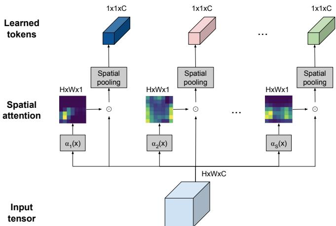
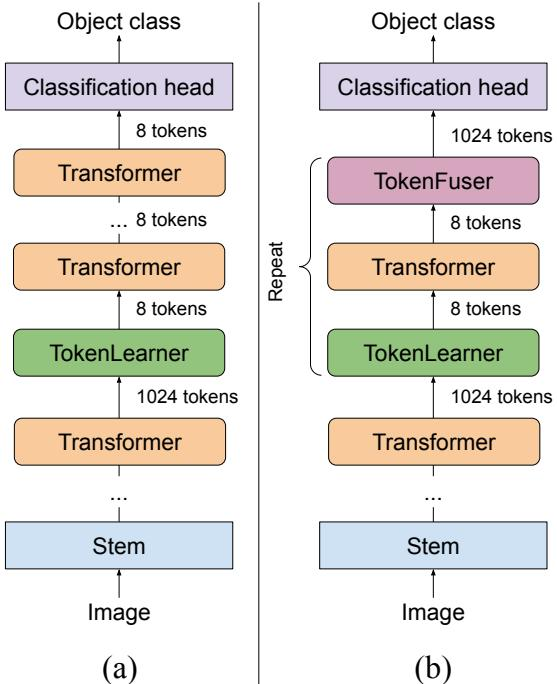
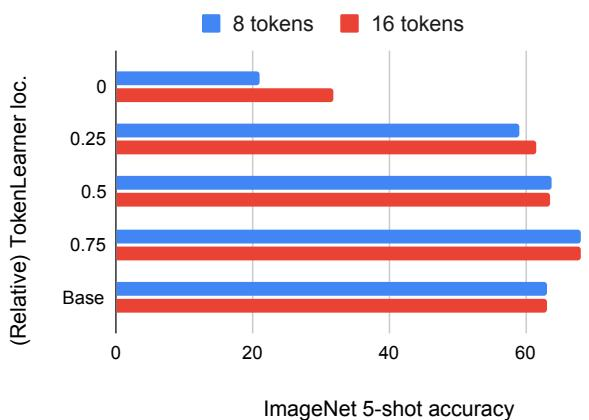
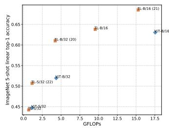
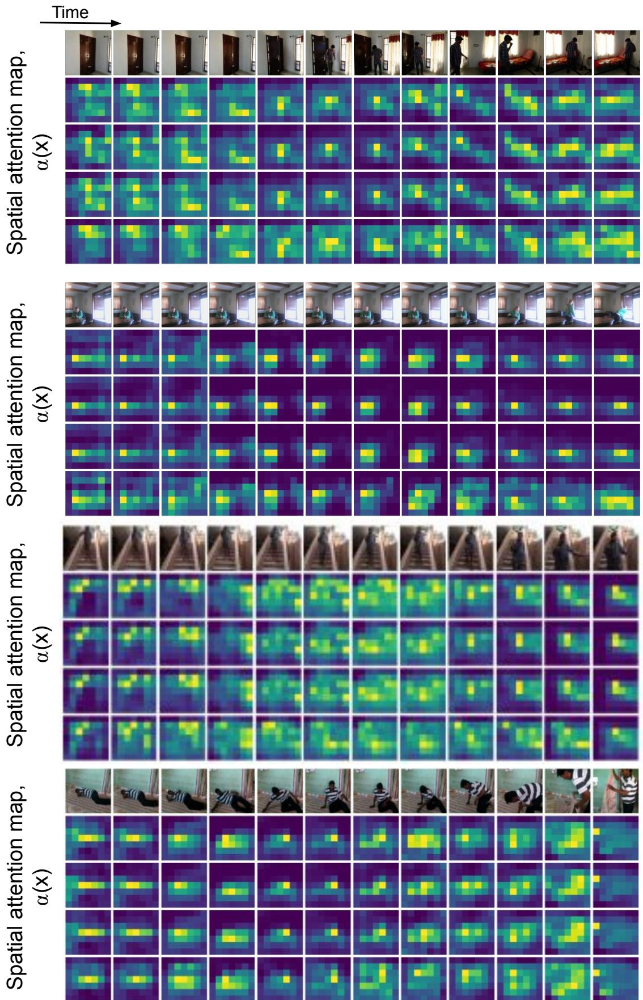

# TokenLearner：8个学习到的Token能为图像和视频做什么？

Michael S. Ryoo, AJ Piergiovanni, Anurag Arnab, Mostafa Dehghani, Anelia Angelova

摘要—在本文中，我们介绍了一种新颖的视觉表示学习方法，该方法依赖于少量自适应学习到的 token（标记），并且适用于图像和视频理解任务。我们的方法不再依赖人工设计的分割策略来获取视觉 token，也不再为了计算注意力而处理大量密集采样的图像块（patches），而是学习挖掘视觉数据中的重要 token。这使得模型能够高效且有效地找到少量重要的视觉 token，并在更长的时间跨度（针对视频）或空间内容（针对图像）上对这些 token 之间的成对注意力进行建模。我们的实验在图像和视频识别任务的多个极具挑战性的基准测试中展示了强大的性能。重要的是，由于我们的 token 是自适应的，我们在显著减少计算量的情况下取得了极具竞争力的结果。我们在 ImageNet 上取得了与当前最先进方法相当的结果，同时计算效率更高。我们还在多个视频数据集上证实了该方法的有效性，包括 Kinetics-400、Kinetics-600、Charades 和 AViD。

代码开源于：https://github.com/google-research/scenic/tree/main/scenic/projects/token\_learner

索引术语—计算机视觉（Computer vision），动作识别（Activity recognition）

✦

## 1 引言

图像和视频提供了丰富的视觉信息。图像理解是计算机视觉领域一个长期存在的问题，尽管取得了令人瞩目的进展，但为各种图像理解任务获取最佳的视觉表示仍然是一个活跃的研究领域。对于视频而言，除了要解决类似的图像理解任务外，还需要对 RGB 和时间流进行有效的时空处理，以捕获长程交互 [1], [2], [3], [4], [5], [6], [7], [8], [9], [10]。这种理解的一个重要方面在于如何快速学习输入视频流中哪些部分在空间和时间上是重要的，并将计算资源集中在这些部分上。但是，究竟什么样的基本处理机制能够成功地同时适用于图像和视频呢？

使用多头自注意力（multi-head self-attention）[11] 的 Transformer 模型在图像和视频识别方面都取得了巨大的成功。Vision Transformer（ViT）[12] 扩展了其在文本领域的最初用途，通过将图像视为一系列 patch token（例如 16x16 的图像块）来发挥 Transformer 的优势。在每一层中，ViT 模型根据 token 之间的成对关系重新组合和处理 patch token，从而构建整个图像的全局表示。Transformer 的有效性也在许多计算机视觉任务中得到了证明，例如目标检测 [13] 和视频分类 [14]。

许多视觉 Transformer（Vision Transformer）架构面临的主要挑战在于，它们通常需要过多的 token 才能获得合理的结果。例如，即使采用 16x16 的图像块（patch）分元，单张 512x512 的图像也对应着 1024 个 token。在包含多帧的视频情况下，这会导致数以万计的 token，因为每个视频“小管体”（tubelet，例如 16x16x2 的视频片段）都会成为一个 token。此外，如此庞大数量的 token 需要在每一层都进行处理，因为上一层的输出会成为下一层的 token。考虑到 Transformer 的计算量（和内存占用）随 token 数量呈二次方增长，这往往会使 Transformer 在处理更大图像和更长视频时变得难以应对。这引出了一个问题：真的有必要在每一层都处理这么多的 token 吗？

在本文中，我们表明，自适应地生成较少数量的 token，而不是始终依赖通过均匀切分形成的 token，能够使 Vision Transformer 运行得更快且性能更优。TokenLearner 是一个可学习的模块，它接收类图像张量（即输入）并生成一小组 token。该模块可以放置在目标模型内的多个不同位置，从而显著减少所有后续层中需要处理的 token 数量。实验表明，引入 TokenLearner 可以在不损害分类性能的前提下，将内存和计算量减少一半或更多。此外，由于其适应输入的能力，它通常能够在依赖更少计算量的同时提高识别准确率。

我们使用一种直截了当的空间注意力机制构建了 TokenLearner。其核心思想是学习自适应地计算输入图像/视频中的重要区域，并从这些区域中生成 token。我们计算突出重要区域的空间注意力图（使用卷积层或 MLP），并将它们应用于输入本身，以对每个区域赋予不同的权重（并丢弃不必要的区域）。然后对结果进行空间池化以生成最终学得的 token。这与以往在图像或视频中密集采样 token（例如 16x16 或 32x32）的方法形成了鲜明对比 [12], [15]。

在我们的研究中，我们发现极少量的 token 就足以完成视觉理解任务。具体而言，对于图像，我们表明，当学习 8-16 个 token 作为中间表示（而不是保留 200∼500 个）时，可以显著降低 Vision Transformer 的计算预算。我们通过实验证实，TokenLearner 能够减少总 FLOPS，同时保持甚至提高分类准确率。类似地，对于视频识别，我们在三个极具挑战性的数据集上仅对每帧使用 8-16 个 token，便取得了优于当前最先进水平的性能。

该方法简单、高效，并且如结果所示，其性能优于包括卷积方法以及此前未使用 TokenLearner 的时空 Transformer 基线方法。我们证明了带有 TokenLearner 的模型在 ImageNet（以及 ImageNet ReaL）上取得了与先前的 Transformer 模型相当的性能，同时显著减少了计算量。在视频理解任务中，TokenLearner 在多个具有挑战性的视频数据集上刷新了最先进（state-of-the-art）的成绩。

本文扩展了此前发表在会议上的早期版本 [16]，将 TokenLearner 推广到了图像和视频表征学习中。与仅关注视频的会议版本不同，在本论文中，我们增加了大量的新实验，证实了 TokenLearner 在图像和视频分类上的优势。它还包括了各种详细的消融实验与进一步分析。

## 2 用于自适应 TOKEN 化的 TOKENLEARNER 模块

在诸如 ViT [12] 等视觉 Transformer 架构中，输入图像首先通过分割成较小的（例如 16x16）空间图像块（patches）来进行 Token 化，这些图像块被用作模型的输入。类似地，在近期的视频 Transformer 架构中，例如 ViViT [14] 和 TimeSformer [15]，视频则是通过在规则网格上将视频切割为二维空间或三维时空立方体来进行 Token 化的。

我们的注意力模块并非处理固定的、已 Token 化的输入，而是学习用于识别任务的 Token。通过这样做，我们获得了几个重要的特性：(1) 我们实现了自适应 Token 化，从而可以根据输入动态选择 Token。(2) 这也有效地减少了 Transformer 的 Token 总数，考虑到视频中存在大量 Token 且计算量与 Token 数量呈二次方关系，这一点尤其有利。(3) 最后，我们为每个后续层提供了学习依赖于不同时空 Token 化的能力，从而潜在地允许不同层捕获视频的不同方面。这些动态且自适应生成的 Token 既可以用于标准的 Transformer 架构（如用于图像的 ViT 和用于视频的 ViViT），也可以用于我们在第 4 节中进一步讨论的专用视频架构。

## 2.1 TokenLearner

设 X 为具有时空形状的输入张量：$X \in$ $\mathbb { R } ^ { T \times H \times W \times C }$，其中 $H \times W$ 对应于输入的空间维度，T 是时间维度（即帧数），C 是通道数。设

$X _ { t }$ 为其时间切片，对应于帧 $t \colon \mathsf { \bar { X } } _ { t } \ \in \ \mathbb { R } ^ { H \times ^ { 1 } W \times C }$。在图像输入的情况下，$T = 1$ 且 $X = X _ { t }$。请注意，X 也可以是网络内的中间表示，在这种情况下 $X _ { t }$ 将是其切片。

对于每个时间帧 $t$ ，我们学习从输入帧 $X _ { t }$ 中生成一系列由 $S$ 个标记（token）组成的集合 $Z _ { t } \doteq [ z _ { i } ] _ { i = 1 } ^ { S }$ 。具体而言，我们构建了一个分词器函数（tokenizer function） $\bar { z } _ { i } = A _ { i } ( X _ { t } )$ ，它将输入帧 $X ^ { t }$ 映射为一个标记向量 $z _ { i } \colon \dot { \mathbb { R } } ^ { H \times W \times C } \mapsto \mathbb { R } ^ { \dot { C } }$ 。其核心思想是学习我们的分词器函数 $A _ { i }$ ，以自适应地选择 $X _ { t }$ 中信息丰富的像素（或空间位置）组合，并且我们拥有 $S$ 个这样的函数。通过这种方式，我们的标记将不再是输入张量的固定切分，而是一组自适应变化的空间选择。每帧都会挖掘出不同的标记，这使得我们能够在视频场景下建模它们之间的时空关系/交互。我们还将 $S$ 设置得小于 $H \times W$ （例如，$S = 8$ 且 $H \times W = 3 2 \times 3 2$），从而使模型能够显著减少该模块后续各层所需的计算量。

在这里，我们的分词器 $z _ { i } = A _ { i } ( X _ { t } )$ 是通过空间注意力机制实现的：即模型学习以输入 $X _ { t }$ 为条件计算一个权重图（大小为 $H \times W$），并将其与 $X _ { t }$ 自身相乘。更具体地，令 $\dot { \alpha } _ { i } ( X _ { t } )$ 为生成空间 $H \times W \times 1$ 权重图的函数。每个标记 $z _ { i }$ 的生成方式如下：

$$
z _ {i} = A _ {i} (X _ {t}) = \rho (X _ {t} \odot A _ {i w}) = \rho (X _ {t} \odot \gamma (\alpha_ {i} (X _ {t}))),\tag{1}
$$

其中 $\odot$ 表示阿达马积（Hadamard product，即逐元素乘法），$A _ { i w } \in \mathbb { R } ^ { H \times W \times C }$ 是利用函数 $\alpha _ { i } ( X _ { t } )$ 和广播函数 $\gamma ( \cdot )$ 计算得到的中间权重张量。最后，在其之上应用空间全局平均池化 $\rho ( \cdot )$ 将维度缩减至 $\mathbb { R } ^ { C }$ 。生成的标记被汇聚起来以构建输出张量：$Z _ { t } = [ z _ { i } ] _ { i = 1 } ^ { S } \in \mathbb R ^ { S \times C }$ 。

整个过程呈现出一种逐元素空间自注意力的形式。在我们的初始版本中，$\{ \alpha _ { i } ( \cdot ) \} _ { i = 1 } ^ { S }$ 被共同实现为一个或一系列卷积层（通道大小为 $S$），后接一个 sigmoid 函数。在我们的 1.1 版本中，它由单个 MLP 层（即中间带有 gelu 的两个全连接层）实现。对于图像而言，$Z = Z _ { t }$ 。对于视频而言，来自所有帧的标记 $Z _ { t }$ 被收集起来，形成最终的输出标记张量 $Z \in \mathbb { R } ^ { S T \times C }$ 。

我们特意将我们的标记学习模块命名为“TokenLearner”。Figure 1 直观地总结了 TokenLearner 模块。

## 2.1.1 Transformer 中的计算缩减：

学习到的 token（即 TokenLearner 的输出 $Z )$）被提供给后续层用于视觉表征学习，例如 Vision Transformer 和 ViViT 中使用的多头自注意力（multi-head self-attention，MHSA）。通过 TokenLearner，这些后续层仅需处理少量的 token（例如 8 个而不是 1024 个），由于计算量与 token 数量呈二次方关系，这显著降低了计算量。Figure 3 (a) 展示了在 ViT 中插入 TokenLearner 模块的基本架构。它可以被添加到网络内的任意位置，并且由于 token 数量的巨大差异，TokenLearner 之后的 Transformer 层的相对计算量几乎可以忽略不计。

  
Fig. 1：应用于单张图像的 TokenLearner 模块的直观示意图。TokenLearner 学习在空间上关注张量像素的子集（即来自中间空间表征），并生成一组自适应于输入的 token 向量。

## 2.2 TokenFuser

在 TokenLearner 生成 token 且其后续的 Transformer 层（例如 MHSA）对其进行处理之后，可以使用“TokenFuser”进一步（1）融合跨 token 的信息，以及（2）将表征重新映射回其原始的空间分辨率。这使得模型能够捕获由 token 构建的空间（或时空）“模式”，并在必要时恢复原始输入张量的形状。

首先，给定来自 Transformer 层的 token 张量 $Y \in \mathbb { R } ^ { S T \times C }$，我们在 token 维度（而非通道维度）上应用一个线性层（即全连接 MLP 层）。也就是说，我们学习一个线性函数 $\mathbb { R } ^ { S T } \mapsto \dot { \mathbb { R } } ^ { S T }$（其中 S 是我们每帧挖掘的 token 数量，T 是输入张量的时间维度大小），并将其独立应用于每个通道。即，我们更新 $\dot { Y } = ( Y ^ { T } M ) ^ { T }$，其中 M 是大小为 $S T \times S T$ 的可学习权重矩阵。该操作的结果保持了 $S T \times C$ 的张量大小。我们认为这也与同期工作 MLP-Mixer [17] 的观察结果相契合，即使用 token 维度的线性层来捕获由 token 构成的模式是有益的。

接下来，TokenFuser 分别处理每个时间切片 $Y _ { t } \in$ $\mathbb { R } ^ { S \times C }$，并通过学习针对 $H \times W$ 中的每个空间位置以不同方式组合 token，将大小为 $S { \times } C$ 的 token 张量重新映射回 $H \times W \times { \dot { C } }$。

$$
X _ {t} ^ {j + 1} = B (Y _ {t}, X _ {t} ^ {j}) = B _ {w} Y _ {t} + X _ {t} ^ {j} = \beta_ {i} (X _ {t} ^ {j}) Y _ {t} + X _ {t} ^ {j}\tag{2}
$$

其中 $X _ { t } ^ { j }$ 是上一个 TokenLearner 模块的残差输入，Yt 是 TokenFuser 模块中处理后的 token，而 $X _ { t } ^ { j + 1 }$ 为输出。$B _ { w } \in \mathbb { R } ^ { H W \times S }$ 是通过函数 $\beta _ { i } ( X _ { t } )$ 计算得到的中间权重张量。函数 $\beta _ { i } ( X _ { t } )$ 由一个简单的线性层后接 sigmoid 函数实现。

Figure 2 展示了 TokenFuser 的整体流程（省略了逐 token 的线性层）。

  
Fig. 2: TokenFuser 模块的直观展示，该模块分别独立应用于每个图像帧。

## 3 图像实验

为了验证 TokenLearner 模块的有效性，我们首先将 TokenLearner 应用于图像表征学习。我们评估了两种不同的架构：(a) 仅在标准 Transformer 模型中插入 TokenLearner，以及 (b) 在 Transformer 内部的多处位置同时使用 TokenLearner 和 TokenFuser。

## 3.1 网络架构实现

我们采用 Vision Transformer 架构 [12]，遵循其详细的设置和实现 [18]。我们使用 ViT-B/16 和 ViT-L/16 作为骨干网络（backbone），同时也把 TokenLearner 应用于 ViT-B/32（相同的模型，但起始 patch 大小为 32x32）、ViT-S/32（具有 384 个通道的较小版本）等。ViT-S 和 ViT-B 骨干模型具有 12 个 Transformer 层，而 ViT-L 具有 24 层。完全遵循 [12] 的设置，我们根据数据集和模型采用了 224x224、384x384 或 512x512 的输入分辨率（即 196、576 或 1024 个 token）。使用了与 ViT 完全相同的位置编码。

Figure 3 (a) 和 (b) 展示了结合 TokenLearner 的两种不同架构。(a) 是通过在网络中间插入 TokenLearner 构建的，例如在 12 层 Transformer 中的第 6 层之后；而 (b) 则同时使用了 TokenLearner 和 TokenFuser。具体而言，我们的模型 (b) 是通过用一系列 TokenLearner-Transformer-TokenFuser 替换传统的 Transformer 层来构建的。与 (a) 类似，这种替换仅针对某一特定层之后的层进行。例如，我们在一开始保留 6 个标准的 Transformer MHSA 层，并将剩余的 6 层替换为重复 6 次的 TokenLearner-Transformer-TokenFuser 模块。我们还对某些模型进行了修改，使其具有更多的 Transformer 层（例如，从 12 层增加到 21 层），在进行此类修改时我们会予以说明。需要注意的是，由于这些层中的 token 数量很少（8 或 16 个），在 TokenLearner 模块之后增加 Transformer 层所带来的计算量增长非常小。

我们尝试了多种不同数量的 token，包括 $S \ =$ 8、16、32，并将 $S \ = \ 8$ 和 16 用作我们的默认设置。也就是说，TokenLearner 学习将图像抽象为 8 个（或 16 个）token。TokenLearner 中的空间注意力函数（α）通过四个 3x3 卷积层（中间包含 gelu）实现，其通道大小与 token 数量相同 $( \mathbf { e . g . } , S = 8 )$。

我们采用了 [12] 的训练设置（例如，学习率、训练轮数等）。

  
Fig. 3: 遵循 ViT 架构的我们的模型。(a) 带有 TokenLearner，(b) 同时带有 TokenLearner 和 Token-Fuser。

## 3.2 图像分类数据集

ImageNet：我们使用了常用的图像基准数据集 ImageNet [19]。在实验中，我们使用包含 1000 个类别和 1.1M 张图像的标准 ImageNet 版本。对于 S/16 和 B/16 模型，我们使用的图像分辨率为 384x384，对于 L/16 模型则使用 512x512。ImageNet ReaL [20]，即具有重新评估（Re-Assessed, ReaL）标签的 ImageNet 数据集，也用于评估。

JFT-300M。JFT-300M 数据集是用于训练图像分类模型的内部数据集，最初由 [21] 提出。图像从网络上采集并经过过滤以最大化标签精度。它包含 300M 张图像，并已被证明适用于学习高容量模型（如 transformer）。

在本工作中，遵循先前为 ViT [12] 制定的评估协议，我们仅将 JFT-300M 数据集用于预训练目的。为此我们使用的图像分辨率为 224x224。

## 3.3 消融实验：我们应该在哪里放置 TokenLearner？

我们首先进行了消融实验，以确定在模型中放置 TokenLearner 的最佳位置。Figure 4 展示了结果。该实验采用我们的模型 (a)（不带 TokenFuser）进行。它遵循 ViT [12] 的协议，展示了经 JFT 预训练后在 ImageNet 上的少样本（few-shot）分类准确率。此外，我们展示了计算量（FLOPS）如何随着 TokenLearner 位置的变化而改变。从根本上说，由于带有和不带有 TokenLearner 的 token 数量之间存在巨大差异（例如，带有 TokenLearner 为 8 个，而不带有为 196 个），TokenLearner 模块之后的 transformer 计算量与 TokenLearner 位置之前的 transformer 相比几乎可以忽略不计。

TABLE 1: ImageNet 微调 Top1 准确率与 FLOPS。括号中的数字是 transformer 层的数量。16-TokenLearner 使用 16 个 token 而非 8 个。

<table><tr><td>方法</td><td>GFLOPS</td><td>准确率</td></tr><tr><td>ViT S/32</td><td>3.4</td><td>77.87</td></tr><tr><td>ViT B/32</td><td>19.8</td><td>80.69</td></tr><tr><td>ViT B/16</td><td>55.6</td><td>84.73</td></tr><tr><td>TokenLearner S/32</td><td>1.9</td><td>76.13</td></tr><tr><td>TokenLearner B/16</td><td>28.7</td><td>83.65</td></tr><tr><td>TokenLearner S/32 (22)</td><td>3.3</td><td>79.42</td></tr><tr><td>TokenLearner B/32 (20)</td><td>11.5</td><td>82.74</td></tr><tr><td>TokenLearner B/16 (21)</td><td>47.1</td><td>85.21</td></tr><tr><td>16-TokenLearner B/16 (21)</td><td>47.7</td><td>85.45</td></tr></table>

我们发现，在网络中间（1/2 处）插入 TokenLearner 可以在将计算量（几乎）减半的同时，取得几乎完全相同的准确率。此外，得益于其自适应性，将 TokenLearner 放置在较后面的层（网络的 3/4 之后）甚至比不使用 TokenLearner 获得了更优异的性能，同时运行速度更快。

## 3.4 结果

遵循 ViT [12] 中建立的协议，我们从以下两个方面评估了使用和不使用 TokenLearner 的模型：(i) 微调准确率和 (ii) 少样本（few-shot）准确率。对于微调准确率，与以往的工作一致，我们使用 JFT 对模型进行预训练，并使用 384x384（用于 ViT-S 和 ViT-B 模型）或 512x512（用于 ViT-L 模型）的图像分辨率在原始 ImageNet 数据集上进行微调。对于少样本准确率，我们同样遵循 ViT [12] 的协议，进行正则化最小二乘回归，将训练图像子集的（冻结）表征映射到 {−1, 1}K 目标向量。我们报告了 5-shot ImageNet Top-1 准确率，以及在多个数据集上的平均 5-shot 准确率：Caltech101、Caltech-UCSD Birds 2011、Cars196、CIFAR100、colorectal\_histology、DTD、ImageNet、Oxford-IIIT Pet 和 UC Merced Land Use Dataset。少样本准确率特别值得关注，因为它展示了所学习表征本身的泛化能力。我们注意到，5-shot 准确率也被用于评估 ViT [12] 学习到的表征。在本小节的实验中，我们使用 Figure 4 中不含 TokenFuser 的模型 (a)。除非另有说明，我们恰好在网络的中点处插入 TokenLearner 模块。默认的 token 数量为 8，我们同时也使用了 16，因为它们表现出了最佳的准确率与速度平衡。

Figure 5 和 Table 1 展示了使用较小的 ViT-S 和 ViT-B 模型的 ImageNet 微调评估结果。如 3.1 节所述，我们展示了各种版本的 ViT 及其 TokenLearner 版本的准确率。我们可以观察到，效率与准确率之间的权衡取得了实质性的提升。

当直接应用于 ViT（例如 B/16）时，TokenLearner 在保持 ViT 准确率的同时，将计算量减少了近一半。当将更多层与 TokenLearner 结合使用时，我们能够以增加额外层的形式利用 TokenLearner 所节省的计算量，

ImageNet 5-shot 准确率

  
Fig. 4: 模型内不同 TokenLearner 位置对应的 ImageNet 5-shot 准确率（左）和 FLOPS（右）。“0”表示 TokenLearner 位于模型的最前端（在任何 Transformer 之前），“0.5”表示位于模型中间，而“Base”表示不进行 token 学习。

  
Fig. 5: 基线 ViT 模型与 TokenLearner 的 ImageNet 微调准确率可视化。横轴为 GFLOPs，用于衡量所需的计算量。

并且在 FLOPS 仍然更低的情况下表现更优。基线 ViT B/16 处理的 token 数量为 576，而 TokenLearner 学习得到 S = 8 个 token。因此，正如前一小节所述，与 TokenLearner 位置之前的 Transformer 相比，TokenLearner 模块之后的 Transformer 计算量几乎可以忽略不计。

Figure 6 展示了少样本实验结果。对于这些实验，遵循 [12] 采用了 224x224 的图像分辨率。因此基线 ViT 使用 196 个 token（而在 ImageNet 微调实验中使用了 576 个）。这使得 TokenLearner 与 ViT 所使用的 token 数量差距缩小（相比于微调设置），从而提升了 TokenLearner 的相对准确率。值得关注的是，尽管 token 数量存在差异，TokenLearner 的准确率并未下降（例如 TokenLearner-B/16 与 ViT-B/16 相比）。

  
Fig. 6: 少样本分类实验。展示了 ImageNet 上的 5-shot 分类准确率（左）以及 Sec. 3.4 中所列多个数据集的平均准确率（右）。“TL”代表 TokenLearner。更多模型的结果请参见附录（Appendix）。

## 3.4.1 更大模型上的 TokenLearner

我们还评估了将 TokenLearner 插入到“大模型” ViT-L 中的情况。除了将场景划分为 16x16 patch 的标准 L/16 模型外，还使用了具有更精细 token 的相同模型，包括 L/14、L/10 和 L/8。需要注意的是，这些模型的模型大小保持不变，均具有 464M 参数，改变的仅是输入。如前所述，无论何种模型，在经过 TokenLearner 层之后，token 数量都会变为 8 或 16。对于这些大模型，在 ImageNet 上使用的图像分辨率为 512x12。

表 2 显示了结果。它指明了每个模型使用的 token 数量以及 TokenLearner 层的插入位置。“16-TL at $1 2 ^ { \prime \prime }$”表示 token 数量为 16，且 TokenLearner 插入在第 12 个 Transformer 层之后（即中间位置）。部分模型被设置为使用额外的层（例如‘+11’），但由于 TokenLearner 层之后的 token 数量很少，FLOPS 的增加微乎其微。

我们可以观察到，与我们在 ViT-S 和 ViT-B 上的实验类似，当 TokenLearner 插入在中间时，能够减少一半的计算量。此外，由于 token 生成过程具有自适应性，它在实现这一目标的同时并未牺牲准确率。当节省下来的计算量以其他形式使用时（例如使用 L/14 代替 L/16），结果表明它能够显著优于基础模型。基础 ViT L/16 与 L/16 + TokenLearner 的实际运行速度分别为每秒 1400 张和 2000 张图像。由于存在数据加载等其他瓶颈，速度提升与 FLOPS 并不完全呈线性关系。

TABLE 2: 基于 ViT L/16 和 L/14 的 TokenLearner。输入图像大小为 512x512。

<table><tr><td>基础模型</td><td>层数</td><td>TokenLearner</td><td>GFLOPS</td><td>ImageNet Top1</td></tr><tr><td>ViT L/16</td><td>24</td><td>-</td><td>363.1</td><td>87.35</td></tr><tr><td>ViT L/16</td><td>24</td><td>16-TL at 12</td><td>178.1</td><td>87.68</td></tr><tr><td>ViT L/16</td><td>24+11</td><td>16-TL at 12</td><td>186.8</td><td>87.47</td></tr><tr><td>ViT L/16</td><td>24+6</td><td>8-TL at 18</td><td>274.2</td><td>88.11</td></tr><tr><td>ViT L/14</td><td>24+11</td><td>16-TL at 18</td><td>361.6</td><td>88.37</td></tr></table>

TABLE 3: 与最先进的 ViT 模型的对比。

<table><tr><td>方法</td><td>参数量</td><td>ImageNet</td><td>ImageNet Real</td></tr><tr><td>BiT-L</td><td>928M</td><td>87.54</td><td>90.54</td></tr><tr><td>ViT-H/14</td><td>654M</td><td>88.55</td><td>90.72</td></tr><tr><td>ViT-G/14</td><td>1843M</td><td>90.45</td><td>90.81</td></tr><tr><td>TL L/10 (24+11)</td><td>460M</td><td>88.5</td><td>90.75</td></tr><tr><td>TL L/8 (24+11)</td><td>460M</td><td>88.87</td><td>91.05</td></tr></table>

表 3 将采用了 TokenLearner 的模型与来自 [12] 和 [22] 的更大规模 ViT 模型进行了比较。尽管参数量少得多，我们的 TokenLearner 模型的性能仍可与庞大（huge 和 giant）的 ViT 模型相媲美。

## 3.4.2 使大型模型更加高效

我们还验证了在网络中更靠前的位置（例如在第 2 或第 3 个注意力层之后）使用 TokenLearner 的策略。这使得整体模型的计算效率甚至高于更小的基础 ViT 模型（B/16），同时性能更优。表 4 显示了相关结果。我们可以观察到，例如在第 3 个注意力层插入 TokenLearner 的 L/16 模型获得了比 ViT B/16 更高的准确率，而其运行时间仅约为 B/16 的一半。

## 3.5 消融实验与对比

## 3.5.1 TokenFuser

首先，我们对比了带有和不带有 TokenFuser 模块的 TokenLearner 模型。更具体地说，我们对比了图 4 中的模型 (a) 和模型 (b)，以验证 TokenFuser 的有效性。表 5 展示了实验结果。

## 3.5.2 TokenLearner 与池化（pooling）的对比

TokenLearner 模块的一个直接替代方案是使用空间池化来减少 token 的数量。这可以通过在空间上重新排列 token 以具有高度和宽度，然后应用常规的空间池化来实现。这类似于 [23] 中使用的基于池化的 MHSA 模块。

TABLE 4: 在 ViT L/16 较早层中插入 TokenLearner。使用 384x384 输入图像。

<table><tr><td>Base</td><td># layers</td><td>TokenLearner</td><td>GFLOPS</td><td>ImageNet Top1</td></tr><tr><td>ViT B/16</td><td>12</td><td>-</td><td>55.63</td><td>84.73</td></tr><tr><td>ViT L/16</td><td>24</td><td>16-TL at 2</td><td>20.91</td><td>83.89</td></tr><tr><td>ViT L/16</td><td>24</td><td>16-TL at 3</td><td>28.66</td><td>85.40</td></tr><tr><td>ViT L/16</td><td>24</td><td>16-TL at 6</td><td>51.92</td><td>86.44</td></tr></table>

  
Fig. 7: TokenFuser 替代方案的消融实验。

表 6 比较了 TokenLearner 与空间池化的表现。在所有这些实验中，均使用了 ViT L/16 模型。我们能够观察到 token “学习”带来的优势。基于池化的 token 减少方案虽然具有与 TokenLearner 相似的计算量，但与基础模型相比其准确率有所下降。另一方面，尽管计算量较低，TokenLearner 的表现仍略优于基础模型。

## 3.5.3 TokenFuser 替代方案

在此，我们通过实验对比了所提出的 TokenFuser 模块与其替代方案。TokenFuser 的作用是混合来自 Transformer 层的输出 token，并将其映射回 token 缩减前的原始形状。

最直接的替代方案是 (1) 使用来自 TokenLearner 模块的掩码对输出 token 进行“反池化”（unpool）。其基本思路是将每个输出 token 与先前 TokenLearner 模块中计算出的对应空间图相乘，并将它们全部相加，从而恢复原始输入张量的形状。或者，(2) 我们可以使用额外的一个 Transformer 层将 token 的数量增加回原始的 token 数量，类似于 [24] 中使用的“重投影”（re-projection）。

图 7 展示了使用 B/16 的结果。反池化策略的表现较差。重投影策略的表现与 TokenFuser 相当，但需要更多的 FLOPS。

## 4 用于视频的 TOKENLEARNER（TOKENLEARNER FOR VIDEOS）

在本节中，我们阐述 TokenLearner 如何应用于视频表征。第 2 节中介绍的 TokenLearner 和 TokenFuser 模块可直接应用于视频表征学习。用于图像的 TokenLearner 与用于视频的 TokenLearner 之间的唯一区别在于：TokenLearner 会为视频生成多个 $Z _ { t }$，并且需要将它们堆叠以形成 Z。一旦生成了 Z，就可以使用任何标准的 Transformer 层来对它们进行联合解析。

TABLE 5: 带有 TokenLearner、包含与不包含 TokenFuser 的模型。不包含 TokenFuser 的模型如 Figure 4 (a) 所述。包含 TokenFuser 的模型采用 Figure 4 (b) 的架构。

<table><tr><td>Base</td><td>层数</td><td>TokenLearner</td><td>TokenFuser</td><td>ImageNet Top1</td><td>ImageNet Real</td><td>GFLOPS</td></tr><tr><td>B/16</td><td>12</td><td>8-TL at 6</td><td>N</td><td>83.2</td><td>88.1</td><td>28.3</td></tr><tr><td>B/16</td><td>12</td><td>8-TL at 6</td><td>Y</td><td>83.7</td><td>88.4</td><td>28.5</td></tr><tr><td>B/16</td><td>12</td><td>16-TL at 6</td><td>N</td><td>83.2</td><td>88.0</td><td>28.7</td></tr><tr><td>B/16</td><td>12</td><td>16-TL at 6</td><td>Y</td><td>83.9</td><td>88.7</td><td>29.1</td></tr><tr><td>L/16</td><td>24</td><td>16-TL at 12</td><td>N</td><td>87.6</td><td>90.4</td><td>184.6</td></tr><tr><td>L/16</td><td>24</td><td>16-TL at 12</td><td>Y</td><td>87.6</td><td>90.5</td><td>187.1</td></tr><tr><td>L/16</td><td>24</td><td>8-TL at 18</td><td>N</td><td>87.9</td><td>90.8</td><td>273.2</td></tr><tr><td>L/16</td><td>24</td><td>8-TL at 18</td><td>Y</td><td>88.2</td><td>90.9</td><td>273.8</td></tr><tr><td>L/10</td><td>24+11</td><td>16-TL at 18</td><td>N</td><td>88.5</td><td>90.7</td><td>849.0</td></tr><tr><td>L/10</td><td>24+11</td><td>16-TL at 18</td><td>Y</td><td>88.5</td><td>90.9</td><td>856.9</td></tr></table>

  
Fig. 8: 用于视频表征学习的 TokenLearner、Transformer 和 TokenFuser 组合示意图。TokenLearner 首先学习生成一组 token 向量，Transformer（例如 MHSA）对其时空关系进行建模，最后 TokenFuser 将它们融合。S 是我们每帧学习的 token 数量，T 是帧数。C 是通道数，出于效率考虑，我们在各模块之间使其保持一致。请注意，这种组合本身可以作为一个“模块”，并且可以在网络内多次堆叠此类模块。根据架构的不同，也可以省略 TokenFuser。

TABLE 6: TokenLearner 与基于池化的 token 缩减方法的对比。

<table><tr><td>详细信息</td><td>ImageNet</td><td>GFLOPS</td></tr><tr><td>基础 ViT L/16</td><td>87.35</td><td>363.1</td></tr><tr><td>在第 9 层和第 18 层进行 2x2 池化</td><td>85.63</td><td>144.3</td></tr><tr><td>在第 12 层和第 18 层进行 2x2 池化</td><td>86.41</td><td>187.2</td></tr><tr><td>在第 12 层进行 4x4 池化</td><td>83.93</td><td>184.4</td></tr><tr><td>在第 12 层使用 16-TL</td><td>87.68</td><td>184.6</td></tr></table>

Figure 8 提供了用于视频的组合框架的概述。TokenLearner 首先为每帧提取 $S$ 个 token，总共产生 $ST$ 个 token，其中 $T$ 为帧数。一旦 TokenLearner 生成这些自适应学习到的 token，它们就会被提供给后续的 Transformer 层以捕获全局时空模式。最后（并且根据架构可选），正如第 2.2 节中所讨论的，TokenFuser 在 token 轴上应用一个线性层，然后将张量形状重新映射回去。遵循公式 2（Eq. 2），TokenFuser 应用于逐帧表示 $Y$。这构成了一种轻量级方法，通过捕获长距离视觉模式实现了高效的视频表示。

我们针对视频表示学习所展示的是多次重复 TokenLearner、Transformer 和 TokenFuser 模块的组合，如 Figure 3 (b) 所示。如果我们使用的是模型架构 (a)，则舍弃 TokenFuser 部分，在 TokenLearner 模块之后仅多次重复 Transformer 层。

TABLE 7: 在 Kinetics-400 上使用与不使用 TokenLearner 的 ViViT 模型的对比。GFLOPS 为单视角（per view）指标。TokenLearner 模型（来自 Table 2 和 Table 5）之间的参数量差异来自于在 TokenLearner 模块之后使用的不同层数。

<table><tr><td>方法</td><td>Top-1 准确率</td><td>Top-5 准确率</td><td>参数量</td><td>GFLOPS</td></tr><tr><td>ViViT-L/16 [14]</td><td>82.8</td><td>95.5</td><td>308M</td><td>1446</td></tr><tr><td>ViViT-L/16 320 [14]</td><td>83.5</td><td>95.5</td><td>308M</td><td>3992</td></tr><tr><td>ViViT-H/14 [14]</td><td>84.8</td><td>95.8</td><td>654M</td><td>3981</td></tr><tr><td>ViViT-L/16 (我们的运行结果)</td><td>83.4</td><td>95.6</td><td>308M</td><td>1446</td></tr><tr><td>TokenLearner 16at12 + L/16</td><td>83.5</td><td>95.6</td><td>308M</td><td>766</td></tr><tr><td>TokenLearner 8at18 + L/16</td><td>84.5</td><td>96.1</td><td>383M</td><td>1105</td></tr><tr><td>TokenLearner 16at18+ L/14</td><td>84.7</td><td>96.1</td><td>447M</td><td>1621</td></tr><tr><td>TokenLearner 16at18+ L/10</td><td>85.4</td><td>96.3</td><td>450M</td><td>4076</td></tr></table>

## 5 视频实验：结合视频视觉 Transformer 的 TokenLearner

## 5.1 网络架构实现

ViViT [14] 是 ViT 在视频领域的直接扩展，它使用视频中的时空 patch 作为其 token。时空 patch 的大小通常为 16x16x2，并像 ViT 一样输入到 Transformer 层中。ViViT 和 ViT 共享相同的架构。在我们的实验中，我们将 TokenLearner 模块插入到 ViViT 架构中，插入方式与图 3 中在 ViT 中的插入方式完全相同。ViViT 一直是 Kinetics 数据集 [1] 上的最先进方法之一，我们的目的是验证 TokenLearner 是否可以直接添加到此类通用视频表示模型中并超越它们。

## 5.2 数据集与训练

对于本节的实验，我们使用了 Kinetics 数据集，该数据集是包含相对较短视频剪辑（约 10 秒）的视频分类数据集。我们在 Kinetics-400 和 Kinetics-600 数据集上进行了训练和评估，它们分别拥有约 24 万和 39 万个训练样本。我们遵循以往论文中使用的标准设置，并在验证集上报告准确率 [1], [6]。

遵循 ViViT [14]，我们首先在 JFT 上对模型进行预训练以获得初始权重。我们直接使用了第 3 节中的模型。处理图像 patch（例如 16x16）的初始卷积层权重通过遵循 ViViT 的 3D 初始化策略进行处理，以处理 16x16x2 的视频 patch，而 Transformer 和 TokenLearner 层的权重则直接用于初始化。随后，模型在 Kinetics 数据上进行微调。

与 ViViT 类似，我们使用 Momentum 优化器以 0.05 的基础学习率对模型训练了 30 个 epoch。基本上，我们在 Kinetics 实验中的所有设置均遵循 ViViT 的设置。

## 5.3 结果

我们评估了结合 TokenLearner 模块的各种版本的 ViT-L 模型。如上所述，所有模型均在 JFT 上进行预训练，并在 Kinetics 上进行微调。除了标准的 L/16 模型 + TokenLearner 之外，我们还使用了表 2 和表 3 中介绍的 L/14 和 L/10 模型。与标准 ViT $\mathrm { L } / 1 6 ,$ 相比，这些模型使用了额外的层，但正如前几节所述，由于添加的层中 token 数量要少得多（8 或 16 个），由它们引起的计算量增加微乎其微。我们报告了它们的分类准确率以及以 FLOPS 计量的计算量。

TABLE 8: Kinetics-400 上的 ViViT + TokenLearner 与以往模型的对比。不同的方法依赖于不同的预训练数据集，例如 ImageNet-21K（用于 TimeSformer 和 Swin）和 JFT（用于 ViViT 和 TokenLearner）。GFLOPS 中的乘法对应于推理时使用的视角数量，例如 4x3 = 12。

<table><tr><td>方法</td><td>Top-1 准确率</td><td>总 GFLOPS</td></tr><tr><td>R(2+1)D [25]</td><td>73.9</td><td>304 × 115</td></tr><tr><td>SlowFast 16x8, R101+NL [6]</td><td>79.8</td><td>234 × 30</td></tr><tr><td>TimeSformer-L [15]</td><td>80.7</td><td>2380 × 3</td></tr><tr><td>ViViT-L/16 [14]</td><td>82.8</td><td>1446 × 12</td></tr><tr><td>Swin-L [26]</td><td>83.1</td><td>604 × 12</td></tr><tr><td>Swin-L (384) [26]</td><td>84.6</td><td>2107 × 12</td></tr><tr><td>Swin-L (384) [26]</td><td>84.9</td><td>2107 × 50</td></tr><tr><td>TokenLearner 16at12 (L/16)</td><td>82.1</td><td>766 × 6</td></tr><tr><td>TokenLearner 8at18 (L/16)</td><td>83.2</td><td>1105 × 6</td></tr><tr><td>TokenLearner 16at12 (L/16)</td><td>83.5</td><td>766 × 12</td></tr><tr><td>TokenLearner 8at18 (L/16)</td><td>84.5</td><td>1105 × 12</td></tr><tr><td>TokenLearner 16at18 (L/14)</td><td>84.7</td><td>1621 × 12</td></tr><tr><td>TokenLearner 16at18 (L/10)</td><td>85.4</td><td>4076 × 12</td></tr></table>

Table 7 在 Kinetics-400 上对比了基础 ViViT 模型与我们的 ViViT + TokenLearner 模型的准确率。由于采用了完全相同的设置和预训练数据集，这些模型具有直接可比性。“TokenLearner 16at12” 表示我们在第 12 个 Transformer 层之后引入了学习 16 个 token 的 TokenLearner 层。我们可以观察到，使用 TokenLearner 能够在提高分类准确率的同时降低计算量。Table 8 将 TokenLearner 的准确率与先前的模型进行了对比。请注意，这些方法遵循略微不同的设置和预训练数据集（例如，使用 ImageNet-21K 而不是像我们一样使用 JFT）。我们认为 85.4 的准确率是迄今为止报道的最高值，并且我们相信这是非常有意义的。

Table 9 对比了在 Kinetics-600 上的结果。与我们在 Kinetics-400 上的结果类似，TokenLearner 在首次发布时，不仅刷新了最先进水平（SOTA），同时还保持了较高的计算效率。

TABLE 9: Kinetics-600 上的 ViViT + TokenLearner。GFLOPS 中的乘法对应于推理所用的视角（views）数量，例如 $4 { \bf x } 3 { \bf \theta } = 1 2 { \bf \theta }$。TL 代表 TokenLearner。

<table><tr><td>方法</td><td>Top-1</td><td>Top-5</td><td>总 GFLOPS</td></tr><tr><td>SlowFast 16x8, R101+NL [6]</td><td>81.8</td><td>95.1</td><td>234 × 30</td></tr><tr><td>X3D-XL [27]</td><td>81.9</td><td>95.5</td><td>48 × 30</td></tr><tr><td>TimeSformer-HR [15]</td><td>82.4</td><td>96.0</td><td>1703 × 3</td></tr><tr><td>ViViT-L/16 [14]</td><td>84.3</td><td>96.2</td><td>1446 × 12</td></tr><tr><td>Swin-B [26]</td><td>84.0</td><td>96.5</td><td>282 × 12</td></tr><tr><td>Swin-L (384) [26]</td><td>85.9</td><td>97.1</td><td>2107 × 12</td></tr><tr><td>Swin-L (384) [26]</td><td>86.1</td><td>97.3</td><td>2107 × 50</td></tr><tr><td>TL 16at12 (L/16)</td><td>84.4</td><td>96.0</td><td>766 × 12</td></tr><tr><td>TL 8at18 (L/16)</td><td>86.0</td><td>97.0</td><td>1105 × 12</td></tr><tr><td>TL 16at18 (L/10)</td><td>86.1</td><td>97.0</td><td>4076 × 12</td></tr><tr><td>TL 16at18 w. Fuser (L/10)</td><td>86.3</td><td>97.0</td><td>4100 × 12</td></tr></table>

## 6 视频实验：结合 BOTTLENECK TRANSFORMER 的 TOKENLEARNER

## 6.1 网络架构实现

在本实验中，我们遵循 Bottleneck Transformer [28] 的网络风格，同时采用 X3D [27] 作为骨干网络（backbone）。这是受到 X3D 在 Charades 数据集上成功应用的启发。Charades 包含时长较长的视频（平均 30 秒）和长动作（平均动作时长 15 秒）。这要求模型通过考虑多个时间 token 来理解更长期的时序信息，而 TokenLearner 能够实现跨多帧对它们的高效计算。

具体而言，我们对 X3D 进行了修改以提高计算效率，具体方式为：(1) 将其 3D XYT 卷积层替换为一对 2D 卷积层和 1D 卷积层；(2) 移除 Squeeze-and-Excitation 层 [29] 和 swish 激活函数。我们的骨干网络可以看作是 X(2+1)D。我们使用的通道大小和层数与高效模型 X3D-M 完全相同。

基于这种 X(2+1)D 架构，并遵循 Bottleneck Transformer 的概念，我们将最后一个块（block）中的时空卷积层替换为我们的 Transformer。Figure 9 展示了残差模块架构，该模块在块中重复多次。我们尝试了不同的版本，最终模型是在保留 X(2+1)D 模块中 2D 3 × 3 卷积层的同时，通过将 1D 时间卷积替换为我们的 TokenLearner 构建而成。TokenLearner 中的空间注意力函数 $( \mathrm { i } . \mathbf { e } . , \alpha ( \cdot ) )$ 使用单个 conv2d 层实现。

在这里，我们使用 Vector Transformer 代替 MHSA 作为 Transformer 层，这也可以看作是头数与通道数相同的 MHSA。我们在附录（Appendix）中提供了更多细节。

我们使用 224×224×64 的视频进行训练，使用 256×256×64 的视频进行测试。在第 3 个残差块之后，输入张量的形状为 $8 \times 8 \times 6 4 ,$，并作为 TokenLearner 的输入。为了高效实现，TokenLearner 的中间通道大小被设置为与输出通道大小相同，$d = 4 3 2$。注意，使用了 64 帧以最好地捕获更长期的时序信息。使用了 $S = 8$ 个 token。

  
Fig. 9: 我们紧接在瓶颈 Transformer 之后的网络模块，采用 X(2+1)D 骨干网络。它是一个倒瓶颈（inverted bottleneck）。

## 6.1.1 数据集

Charades 数据集：Charades 数据集 [30] 是通过分配活动任务收集而来的数据集，由不同环境中的人们表演这些任务，例如执行一系列涉及与物体交互的动作。例如，坐在沙发上看书、合上书本、站起来并打电话。它包含 8000 个训练视频和 1686 个验证视频，平均时长为 30 秒。它拥有 157 个活动类别。该数据集非常具有挑战性，因为它是一个多类别、多标签的视频数据集，即可能同时发生多个活动，并且包含真实世界环境中细粒度的动作或与小物体的交互。我们遵循标准评估协议，报告平均精度均值（mAP）%（该数据集的 v1 分类设置）。我们使用 6 fps 和 12 fps 的帧率来获取训练/测试视频（12 fps 效果更好）。该数据集拥有非商业使用许可证。

AViD 数据集：来自多元化国家的匿名视频（Anonymized Videos from Diverse countries，AViD）数据集 [31] 是一个独特的数据集，能够代表全球人口的视频内容生成。它是从跨越六大洲的多个国家上传的视频中收集而来的，与 Kinetics 等其他视频数据集相比，在概念、动作和视觉表征方面表现出更高的多样性。例如，在某些国家，“打招呼”涉及握手，在某些国家是亲吻，而在其他国家则是微微鞠躬。该数据集经过专门设计，旨在减少偏见、促进多样性，同时尊重隐私和许可证。AViD 数据集包含 887 个类别和 45 万个视频（41 万用于训练，4 万用于测试），在规模上与分别包含 400 和 600 个类别的 Kinetics-400 和 Kinetics-600 数据集相当，并且包含时长在 $3 - 1 5 s .$ 之间的可变时长视频。我们报告了 887 个类别上的分类准确率。

TABLE 10: Charades 多标签分类任务上的性能。12 fps 设置。由于可能存在多个真实动作，因此使用平均精度均值（mAP）衡量性能。列出了使用 RGB 和光流输入模态的方法。

<table><tr><td>方法</td><td>输入</td><td>预训练</td><td>mAP</td></tr><tr><td>I3D [1]</td><td>RGB</td><td>Kinetics</td><td>32.9</td></tr><tr><td>I3D（来自 [32]）</td><td>RGB</td><td>Kinetics</td><td>35.5</td></tr><tr><td>I3D + Non-local [32]</td><td>RGB</td><td>Kinetics</td><td>37.5</td></tr><tr><td>EvaNet [33]</td><td>RGB</td><td>Kinetics</td><td>38.1</td></tr><tr><td>STRG [34]</td><td>RGB</td><td>Kinetics</td><td>39.7</td></tr><tr><td>LFB-101 [35]</td><td>RGB</td><td>Kinetics</td><td>42.5</td></tr><tr><td>SGFB-101 [36]</td><td>RGB</td><td>Kinetics</td><td>44.3</td></tr><tr><td>SlowFast-101 [6]</td><td>RGB+RGB</td><td>Kinetics</td><td>45.2</td></tr><tr><td>AssembleNet-50 [37]</td><td>RGB+Flow</td><td>无</td><td>47.0</td></tr><tr><td>Multiscale ViT [23]</td><td>RGB</td><td>Kinetics</td><td>47.7</td></tr><tr><td>AssembleNet-101 [37]</td><td>RGB+Flow</td><td>Kinetics</td><td>58.6</td></tr><tr><td>AssembleNet++ [38] (w/o obj.)</td><td>RGB+Flow</td><td>无</td><td>55.0</td></tr><tr><td>MoViNets [39]</td><td>RGB</td><td>无</td><td>63.2</td></tr><tr><td>骨干网络 (X(2+1)D-M)</td><td>RGB</td><td>无</td><td>62.7</td></tr><tr><td>本文方法</td><td>RGB</td><td>无</td><td>66.3</td></tr></table>

TABLE 11: 来自不同国家/地区的匿名视频（Anonymized Videos from Diverse countries，AViD）数据集上的性能表现。以平均准确率表示的性能（%）是在 887 个类别上的平均值。先前方法的结果引自 [31]，均基于仅使用 RGB 输入的从头训练。X(2+1)D-M 基线采用了不相交的空间+时间 Transformer（如 [15] 中所述）。

<table><tr><td>方法</td><td>准确率</td><td>总 GFLOPS</td></tr><tr><td>I3D [1]</td><td>46.5</td><td> $108 \times N/A$ </td></tr><tr><td>(2+1)D ResNet-50</td><td>46.7</td><td> $152 \times 115$ </td></tr><tr><td>3D ResNet-50</td><td>47.9</td><td>N/A</td></tr><tr><td>SlowFast-50 8x8 [6]</td><td>50.2</td><td> $65.7 \times 30$ </td></tr><tr><td>SlowFast-101 16x4 [6]</td><td>50.8</td><td> $213 \times 30$ </td></tr><tr><td>骨干网络 (X(2+1)D-M)</td><td>48.6</td><td> $532 \times 1$ </td></tr><tr><td>X(2+1)D-M</td><td>50.6</td><td> $493 \times 1$ </td></tr><tr><td>本文方法</td><td>53.8</td><td> $487 \times 1$ </td></tr></table>

该数据集中的所有视频均采用知识共享许可协议（Creative Commons License）。

## 6.2 结果

Charades 数据集结果：在表 10 中，我们将提出的 TokenLearner 与最先进的方法进行了比较。我们的方法优于这些方法，包括与我们最为相近的近期工作。在 Charades 分类任务上取得的 66.3% mAP 创下了新的最先进水平。

来自不同国家/地区匿名视频（Anonymized Videos from Diverse countries, AViD）的结果：Table 11 展示了在 AViD 数据集上的结果。如表所示，我们的方法在这个具有挑战性的数据集上也超越了以往的工作。我们还将我们的方法与应用于相同骨干网络（backbone）的 TimeSformer 模块 [15] 重现版本进行了对比。该模块使用分离的空间和时间 Transformer 模块，这也在 [14] 中进行了测试。我们可以观察到，我们在该数据集上刷新了当前最先进水平（state-of-the-arts），同时在计算上也更高效。

## 6.3 消融实验

## 6.3.1 与不同 Tokenization 策略的比较

在这里，我们将带有 TokenLearner 的模型与不同的时空 Transformer tokenization 策略进行了比较。更具体地说，我们将 TokenLearner + Vector Transformer + TokenFuser 的使用与全联合时空 Transformer 模块（在 [14] 中倡导并在 [15] 中提及）中的 tokenization 进行了对比。全联合时空 Transformer 模块是一个类似于我们基于时空 token 的 Transformer 层，但它完全依赖于手工设计的 tokenization。相比于生成 $S \times T$ 个 token 的 TokenLearner，全联合时空 Transformer 使用了 $H \times W \times T$ 个 token。在我们的瓶颈实现中，它使用的 token 数量大约多出 ${ \sim } 8$ 倍 $( \mathrm { i . e . , \ } 8 ^ { \ast } 6 4 \ \mathrm { v s . \ } \tilde { 8 ^ { \ast } } 8 ^ { \ast } 6 4 )$ 。对于联合时空 Transformer 模块，采用了具有 8 个头的标准多头自注意力（multi-head self-attention, MHSA）。

Table 12 展示了实验结果。有趣的是，尽管全联合时空 Transformer 的计算量更大，但其表现却略逊于 TokenLearner 模块。我们认为这体现了 TokenLearner 中 token 的“自适应性”（adaptiveness）的优势，并表明标准 Transformer 可能会受到与动作无关的 token 作为噪声或干扰项所带来的负面影响。

我们还报告了这些模型中每个模块的计算量和参数量。这取决于输入尺寸和超参数设置，我们的测量基于 $8 \times 8 \times 6 4 \times 4 9 2$ 的输入尺寸 $( \mathrm { i . e . } ,$ $T \times \check { H } \times W \times C )$ 。需要注意的是，这是对各个模块的测量，而非整个网络。

## 6.3.2 多个时空层组合之间的比较

正如以往文献所指出的那样，将关注空间信息的层与关注时间信息的层配对是视频表征的一种常见策略 $( \mathbf { e . g . } , \mathrm { R } ( 2 \substack { + 1 } ) \mathrm { D }$ [25] 和 TimeSformer [15])。Table 13 展示了该消融实验的结果。对于空间和时间 Transformer 的实现，与 [14]、[15] 一样，采用了标准的多头自注意力机制。结果表明，所提出的 TokenLearner 比其他流行组合更为准确。此外，与其他使用 $\bar { 1 6 } \times 1 6$ 或 $3 2 \times 3 2$ 个 token 的方法相比，基于 TokenLearner 的模块实际上每帧仅使用了一小部分 Token $( \mathrm { i . e . , 8 } )$。

TokenLearner 的主要优势之一（除了对输入的自适应 token 化以及我们显式融合 token 以捕获其时空模式之外）在于，与本次消融实验中使用的分离式空间/时间 Transformer 不同，它是一个联合时空 Transformer。同时，它仍然使其计算更加易于处理（如 Table 13 所示）：在我们的案例中，时空 Transformer 的朴素完整版本需要考虑 $8 \times \bar { 8 } \times 6 4 = 4 0 9 6$ 个 token，并构建和相乘大小为 $4 0 9 6 \times 4 0 9 6$ 的注意力张量。而另一方面，TokenLearner 学会了联合考虑 $8 \times 6 4 = 5 1 2$ 个 token。

## 6.3.3 更多 TokenLearner 替代方案

我们还将基于空间注意力的 token 学习与替代方法进行了比较：(1) 使用固定网格将每帧划分为相同数量的 token（即 8 个 token），(2) 使用全连接层直接生成 token 的方法，以及 (3) 对整个帧像素进行空间平均池化并使用全连接层为每帧生成多个 token 的方法。在第二种方法中，我们直接将 $z _ { i } = A _ { i } ( x )$ 建模为全连接层，根据 $T \times H \times W \times C$ 输入生成 $T \times S \times { \dot { C } }$ 张量。第三种方法类似，不同之处在于我们对每帧应用空间全局平均池化，然后使用 MLP 生成 token。

TABLE 12: TokenLearner 与类似于 [14] 且应用于我们骨干网络的联合时空 Transformer 模块之间的比较。它们使用 X(2+1)D 骨干网络，在 Charades 的 6 fps 设置、Charades 12 fps 设置以及 AViD 数据集上进行测试。GFLOPs 和参数量（# params）均指各个模块（输入为 64 帧），而非整个网络。

<table><tr><td>模块</td><td>Charades-6fps</td><td>Charades-12fps</td><td>AViD</td><td>GFLOPs</td><td>参数量</td></tr><tr><td>Joint space-time MHSA</td><td>57.9</td><td>64.0</td><td>53.3</td><td>22.0</td><td>0.30M</td></tr><tr><td>Conv2D + Joint space-time MHSA</td><td>58.6</td><td>62.5</td><td>52.5</td><td>35.8</td><td>1.98M</td></tr><tr><td>Ours (TokenLearner)</td><td>58.8</td><td>63.4</td><td>53.8</td><td>3.4</td><td>0.81M</td></tr><tr><td>Ours (Conv2D + TokenLearner)</td><td>59.6</td><td>66.3</td><td>53.7</td><td>17.2</td><td>2.49M</td></tr></table>

TABLE 13: 不同时空 Transformer 模块之间的比较。它们均应用于相同的骨干架构（即带有 X(2+1)D 的 Bottleneck Transformer 风格）。本实验使用 Charades-6fps。FLOPs 是在 64 帧设置下针对每个模块进行估算的。

<table><tr><td>模块</td><td>准确率 (%)</td><td>GFLOPs</td><td>参数量</td></tr><tr><td>Conv2D + Conv1D</td><td>56.6</td><td>18.3</td><td>2.24M</td></tr><tr><td>Conv2D + MLPMixer [17]</td><td>57.0</td><td>13.8</td><td>2.06M</td></tr><tr><td>Conv2D + Temporal transformer</td><td>58.4</td><td>16.5</td><td>1.98M</td></tr><tr><td>Spatial + Temporal transformer</td><td>58.8</td><td>5.5</td><td>0.59M</td></tr><tr><td>Conv2D + Spatial + Temporal</td><td>58.0</td><td>19.2</td><td>2.27M</td></tr><tr><td>Ours (TokenLearner)</td><td>58.8</td><td>3.4</td><td>0.81M</td></tr><tr><td>Ours (SpatialT + TokenLearner)</td><td>58.9</td><td>6.2</td><td>1.11M</td></tr><tr><td>Ours (Conv2D + TokenLearner)</td><td>59.6</td><td>17.2</td><td>2.49M</td></tr></table>

固定分割 Token 化方法（1）在 Charades 上为我们提供了 58.8 的准确率，而我们的方法为 59.6。直接 Token 生成方法（2）在 Charades 上的准确率为 56.6，未能获得更好的 Token。池化与生成方法（3）为我们提供了 58.6 的准确率。这些结果表明了空间注意力对于 Token 学习的重要性，即我们的 TokenLearner。本次消融实验使用了相同的向量 Transformer 和 TokenFuser（来自第 2 节）。

## 6.4 可视化

Figure 10 展示了使用我们的方法所学习到的 Token 的可视化。我们展示了来自第一个 TokenLearner 模块的空间注意力图（即 $\alpha _ { i } ( x ) )$），因为输入到更高层 TokenLearner 的内容在空间和时间上变得更加混合。我们能够观察到它们倾向于更多地关注人体区域，并且随着视觉输入的变化随时间改变。在我们每帧学习到的 S = 8 个 Token 中，我们可视化了其中的 4 个。

## 7 相关工作

视觉理解是计算机视觉领域一个长期存在的问题。包括目标分类和检测在内的图像识别任务已经在许多不同方向上得到了广泛研究。当今的大多数方法都专注于学习表示图像中的空间外观。这是一个跨越了计算机视觉研究多年的具有挑战性的任务 [40]。

视频理解在提取视频中的空间和时间信息方面面临着更具挑战性的任务 [1], [15], [25], [41], [42], [43], [44], [45], [46]。为了充分捕获视频中的运动和外观信息，研究人员采用了全 3D 时空卷积层以及 (2+1)D 卷积层 [1], [2], [25], [47]。更先进的网络设计在视频 CNN 中也非常流行，尤其是双流（two-stream）网络 [6], [43], [48], [49], [50], [51]，以及最近通过架构搜索得到的网络 [27], [33], [37], [38], [52], [53]。

基于注意力的架构（例如 Transformer [11]）在自然语言处理和计算机视觉领域均取得了显著的成功。Vision Transformer [12] 展示了专用于 NLP 的 Transformer 架构如何优雅地应用于图像和图像识别任务。这是通过将输入图像在规则网格上划分为互不重叠的图块（patches），并将它们作为词元嵌入（token embeddings）输入到 Transformer 中来实现的，其中使用了 $O ( N ^ { 2 } )$ 量级的词元，通常约为 256 或 1024 个。大量方法沿用了这一策略 [22], [23], [54], [55], [56]，其中一些方法提出了多尺度视觉 Transformer 版本 [23], [55], [57]。还有一些方法专注于这些模型和网络层的优化，并且也取得了成功 [58], [59], [60], [61]。

将基于注意力的架构应用于视频面临着明确的挑战，因为模型需要学习跨越空间和时间维度的依赖关系。[62] 依靠区域候选网络（region proposal network），将检测到的人体和物体候选框用作词元，证明了其可以与 CNN 相结合。最近的一些工作 [14], [15] 秉承 Vision Transformer 的思想，将视频在 3D 网格中划分为词元以捕获视频输入。这导致学习所需的词元数量呈 $O ( N ^ { 3 } )$ 增长（对于 96 帧模型，通常约为 2.5 万个词元）。基于注意力的架构也已被用于视频生成领域 [63]。还有几种架构展示了用于处理多种模态的多个输入的基于注意力的模型 [64], [65]。

与图像和视频识别领域的相关工作相比，我们的工作直接从数据中学习词元，从而产生显著更少的词元以及更高效的方法。我们发现，即使学习到的词元数量减少至 1/8（例如 512 对比 4096），也能够成功捕获视频表征学习所需的信息。重要的是，我们提出的 TokenLearner 同时适用于视频和图像识别任务，并取得了更好的

  
Fig. 10: 词元化空间注意力图的可视化。图中展示了学习到的总共八个词元中的四个注意力图。

在两个领域均取得了更优的结果。

## 8 结论

我们提出了 TokenLearner，这是一种用于视觉表征学习的新方法，能够自适应地对输入进行词元化（tokenization）。其目标是学会提取图像和视频帧中对于当前识别任务至关重要的词元（tokens）。与同期工作相比，我们的方法更为高效，因为它能找出少量能够对图像和视频的视觉表征进行建模的重要时空词元。我们在图像分类以及具有挑战性的视频理解任务中均观察到了准确率的提升，并在许多数据集上超越了先前的方案。遗留的挑战之一是学习完整的时空词元。当前的 TokenLearner 侧重于在一系列帧中寻找空间词元，未来可以进一步扩展为在时空体（space-time volumes）中挖掘词元。

## 致谢

我们感谢 Dmitry Kalashnikov、Andy Zeng 以及 Robotics at Google NYC 团队成员在注意力机制方面进行的宝贵讨论。

## 附录 A

## 向量 TRANSFORMER：成对向量注意力

在此，我们总结了 Bottleneck Transformer 实验中使用的 Vector Transformer 的细节。

一旦 TokenLearner 生成了自适应学习的词元，就可以计算键-查询（key-query）对之间的向量注意力。这可以被视为多头自注意力（multi-head self-attention）的一种变体，其中头数与通道数相同，从而允许我们为每个通道学习不同的注意力矩阵。它以高效的方式捕获了每个通道的成对时空关系，尤其有利于具有丰富通道信息的词元。

给定反映视频不同时空维度的词元集合 $Z ,$ ，Transformer 对它们之间的时空交互进行建模。具体而言，我们遵循 [59] 的公式表述，从而实现了一个向量版本的 Transformer，尽管也可以结合其他注意力机制。

对于每个词元 $z _ { i } ,$ ，通过考虑所有可能的 $z _ { j }$ 来计算 Transformer 的输出 $y _ { i }$ ，如下所示：

$$
y _ {i} = \sum_ {z _ {j} \in Z} \gamma (f _ {q} (z _ {i}) \odot f _ {k} (z _ {j})) \odot f _ {v} (z _ {j})\tag{3}
$$

其中 i 和 j 是 $Z$ 中词元的索引，其大小为 $| Z | = S T . { \overset { \cdot } { f } } _ { q } , f _ { k }$ 和 $f _ { v }$ 是用于投影词元的线性层。$\gamma$ 是用于匹配通道维度的额外投影层，其后接一个关于 j 的 softmax 函数。当投影的通道大小相同时，$\gamma$ 简化为与标准 Transformer 相同的单一 softmax 层。

在原始 Transformer 的表示法中，查询矩阵 $Q$ 对应于我们的 $\{ f _ { q } ( z _ { i } ) \} _ { i } ,$，而键矩阵 K 对应于我们的 $\{ f _ { k } ( z _ { j } ) \} _ { j }$。这种向量化形式并没有像 $Q K ^ { T }$ 那样计算 $Q$ 和 K 之间的点积来生成注意力“矩阵”，而是计算了一个保留通道信息的注意力“张量” $\{ \gamma ( f _ { q } ( z _ { i } ) \odot f _ { k } ( z _ { j } ) ) \} _ { ( i , j ) }$。其形状为 $S T \times { \bar { S } } T \times d$，其中 d 是中间通道大小。计算得到的注意力张量与值矩阵 $\{ \bar { f _ { v } } ( z _ { j } ) \} _ { j }$ j 相乘，从而获得最终的 Transformer 输出。

注意，该向量 Transformer 是一种全局表征，它能够捕获的信息的时间跨度完全取决于我们向其提供的 token。通过我们可学习的自适应 token，我们有能力覆盖更多数量的帧并专注于时间结构。

## 附录 B

## 图像与视频分类训练细节

## B.1 图像分类

我们在图像分类实验中完全遵循了 [12] 的训练方案和超参数。

## B.2 视频分类 - ViViT

我们完全遵循了 [14] 的训练方案和超参数。我们在训练以及评估中使用了相同的代码（Scenic 库 [18]）和硬件。

我们使用 Momentum 优化器以 0.05 的基础学习率对 Kinetics 模型训练了 30 个 epoch。基本上，我们在 Kinetics 实验中的所有设置均遵循 ViViT 的设置。

## B.3 视频分类 - Bottleneck Transformer

我们在下方提供了训练细节。对于数据集的训练/测试划分，我们遵循了其标准设置。

我们采用了在许多视频 CNN 模型训练中广泛使用的余弦衰减学习率。对于 Charades 数据集（多标签动作分类），每个 TPU 核心（相当于单个 GPU）使用的基础学习率为 0.8，而对于 AViD 数据集（视频分类），每个 TPU 使用的基础学习率为 0.025。在 Charades 实验中，训练进行了 100k 次迭代，每个 TPU 核心的批次大小为 4（即我们的批次大小为 4\*64=256）。AViD 每个 TPU 核心的批次大小为 8。100k 次迭代在 AViD 中大约对应 125 个 epoch。AViD 训练中使用了 0.2 的标签平滑。Charades 未使用标签平滑。在 Charades 中，训练是通过在时间上将长 Charades 视频（例如 30 秒）裁剪为 64 帧的片段来进行的。评估同样使用 64 帧的片段，并通过合并它们的输出响应来进行。

使用 32 个 TPU v3 训练单个模型的时间约为 ∼16 小时。瓶颈主要在于数据流水线，实际计算耗时更少。

## 附录 C

## 在少样本学习上比较更多模型

在此，我们报告了更多结合 TokenLearner 的模型的少样本学习（few-shot learning）准确率，对图 6 进行了扩展。具体而言，我们额外展示了在不同位置插入 TokenLearner 的 L/16（以及 L/14）模型，包括将其插入到第 2、第 3、第 6 和第 12 个注意力层。我们可以观察到，在网络早期添加 TokenLearner 的策略使我们能够在节省计算量的同时，获得优于基础模型的图像分类准确率。

  
Fig. 11: 少样本分类实验。展示了在 ImageNet 上的 5-shot 分类准确率（左）以及第 3.4 节所列多个数据集上的平均准确率（右）。“TL”代表 TokenLearner。

TABLE 14: 比较我们 TokenLearner 的不同组件。在 Charades 数据集上（6fps）。

<table><tr><td>模块</td><td>准确率 (%)</td></tr><tr><td>标准 Transformer (MHSA)</td><td>58.4</td></tr><tr><td>向量 Transformer (VectT)</td><td>58.1</td></tr><tr><td>仅先验注意力 + 广播 (Prior-only-attention + broadcasting)</td><td>58.6</td></tr><tr><td>向量 Transformer (VectT) + 广播</td><td>58.9</td></tr><tr><td>向量 Transformer (VectT) + TokenFuser</td><td>59.0</td></tr><tr><td>TokenLearner + MHSA + TokenFuser</td><td>59.0</td></tr><tr><td>TokenLearner + VectT + TokenFuser</td><td>59.6</td></tr></table>

## 附录 D

## 补充消融实验

## D.1 不同组件

利用 Bottleneck Transformer 实验的设置，我们进行了消融实验以评估我们方法的各个组件及其组合。我们通过移除/添加模型的不同组件进行了消融研究。除了上述小节中描述的 Vector Transformer 之外，我们还尝试了将其替换为多头自注意力（multi-head self-attention, MHSA）的消融实验。表 14 展示了实验结果，证实了每个元素为该方法带来的收益。在本实验中，我们使用了由 Conv2D + Transformer（在 bottleneck 内）组成的模块，我们从其他消融实验中发现该模块的表现最佳。

## 参考文献

[1] J. Carreira and A. Zisserman, “Quo vadis, action recognition? a new model and the kinetics dataset,” in Proceedings of the IEEE Conference on Computer Vision and Pattern Recognition (CVPR), 2017.

[2] D. Tran, L. D. Bourdev, R. Fergus, L. Torresani, and M. Paluri, “C3d: generic features for video analysis,” CoRR, abs/1412.0767, vol. 2, no. 7, p. 8, 2014.

[3] W. Kay, J. Carreira, K. Simonyan, B. Zhang, C. Hillier, S. Vijayanarasimhan, F. Viola, T. Green, T. Back, P. Natsev et al., “The kinetics human action video dataset,” arXiv preprint arXiv:1705.06950, 2017.

[4] K. Hara, H. Kataoka, and Y. Satoh, “Learning spatio-temporal features with 3d residual networks for action recognition,” in Proceedings of the ICCV Workshop on Action, Gesture, and Emotion Recognition, 2017.

[5] M. Monfort, A. Andonian, B. Zhou, K. Ramakrishnan, S. A. Bargal, T. Yan, L. Brown, Q. Fan, D. Gutfruend, C. Vondrick et al., “Moments in time dataset: one million videos for event understanding,” arXiv preprint arXiv:1801.03150, 2018.

[6] C. Feichtenhofer, H. Fan, J. Malik, and K. He, “Slowfast networks for video recognition,” in Proceedings of the IEEE International Conference on Computer Vision (ICCV), 2019.

[7] J. C. Stroud, D. A. Ross, C. Sun, J. Deng, and R. Sukthankar, “D3D: Distilled 3d networks for video action recognition,” arXiv preprint arXiv:1812.08249, 2018.

[8] S. Ji, W. Xu, M. Yang, and K. Yu, “3d convolutional neural networks for human action recognition,” IEEE Transactions on Pattern Analysis and Machine Intelligence, vol. 35, no. 1, pp. 221–231, 2013.

[9] A. Piergiovanni, A. Angelova, and M. S. Ryoo, “Evolving losses for unsupervised video representation learning,” in Proceedings of the IEEE Conference on Computer Vision and Pattern Recognition (CVPR), 2020.

[10] J.-B. Alayrac, A. Recasens, R. Schneider, R. Arandjelovi´c, J. Ramapuram, J. D. Fauw, L. Smaira, S. Dieleman, and A. Zisserman, “Self-supervised multimodal versatile networks,” in Advances in Neural Information Processing Systems (NeurIPS), 2020.

[11] A. Vaswani, N. Shazeer, N. Parmar, J. Uszkoreit, L. Jones, A. N. Gomez, L. Kaiser, and I. Polosukhin, “Attention is all you need,” in Advances in Neural Information Processing Systems (NeurIPS), 2017.

[12] A. Dosovitskiy, L. Beyer, A. Kolesnikov, D. Weissenborn, X. Zhai, T. Unterthiner, M. Dehghani, M. Minderer, G. Heigold, S. Gelly, J. Uszkoreit, and N. Houlsby, “An image is worth 16x16 words: Transformers for image recognition at scale,” arXiv preprint arXiv:2010.11929, 2020.

[13] Z. Liu, Y. Lin, Y. Cao, H. Hu, Y. Wei, Z. Zhang, S. Lin, and B. Guo, “Swin transformer: Hierarchical vision transformer using shifted windows,” in Proceedings of the IEEE International Conference on Computer Vision (ICCV), 2021.

[14] A. Arnab, M. Dehghani, G. Heigold, C. Sun, M. Luˇci´c, and C. Schmid, “ViViT: A video vision transformer,” in Proceedings of the IEEE International Conference on Computer Vision (ICCV), 2021.

[15] G. Bertasius, H. Wang, and L. Torresani, “Is space-time attention all you need for video understanding?” in International Conference on Machine Learning (ICML), 2021.

[16] M. S. Ryoo, A. Piergiovanni, A. Arnab, M. Dehghani, and A. Angelova, “Tokenlearner: Adaptive space-time tokenization for videos,” in Advances in Neural Information Processing Systems (NeurIPS), 2021.

[17] I. Tolstikhin, N. Houlsby, A. Kolesnikov, L. Beyer, X. Zhai, T. Unterthiner, J. Yung, A. Steiner, D. Keysers, J. Uszkoreit, M. Lucic, and A. Dosovitskiy, “Mlp-mixer: An all-mlp architecture for vision,” arXiv preprint arXiv:2105.01601, 2021.

[18] M. Dehghani, A. Gritsenko, A. Arnab, M. Minderer, and Y. Tay, “Scenic: A JAX library for computer vision research and beyond,” arXiv preprint arXiv:2110.11403, 2021.

[19] J. Deng, W. Dong, R. Socher, L.-J. Li, K. Li, and L. Fei-Fei, “Imagenet: A large-scale hierarchical image database,” in Proceedings ofthe IEEE Conference on Computer Vision and Pattern Recognition (CVPR), 2009.

[20] L. Beyer, O. J. Hénaff, A. Kolesnikov, X. Zhai, and A. van den Oord, “Are we done with imagenet?” arXiv preprint arXiv:2006.07159, 2020.

[21] C. Sun, A. Shrivastava, S. Singh, and A. Gupta, “Revisiting unreasonable effectiveness of data in deep learning era,” in Proceedings of the IEEE International Conference on Computer Vision (ICCV), 2017.

[22] X. Zhai, A. Kolesnikov, N. Houlsby, and L. Beyer, “Scaling vision transformers,” arXiv preprint arXiv:2106.04560, 2021.

[23] H. Fan, B. Xiong, K. Mangalam, Y. Li, Z. Yan, J. Malik, and C. Feichtenhofer, “Multiscale vision transformers,” arXiv preprint arXiv:2104.11227, 2021.

[24] B. Wu, C. Xu, X. Dai, A. Wan, P. Zhang, Z. Yan, M. Tomizuka, J. Gonzalez, K. Keutzer, and P. Vajda, “Visual transformers: Tokenbased image representation and processing for computer vision,” arXiv preprint arXiv:2006.03677, 2020.

[25] D. Tran, H. Wang, L. Torresani, J. Ray, Y. LeCun, and M. Paluri, “A closer look at spatiotemporal convolutions for action recognition,” in Proceedings of the IEEE Conference on Computer Vision and Pattern Recognition (CVPR), 2018, pp. 6450–6459.

[26] Z. Liu, J. Ning, Y. Cao, Y. Wei, Z. Zhang, S. Lin, and H. Hu, “Video swin transformer,” arXiv preprint arXiv:2106.13230, 2021.

[27] C. Feichtenhofer, “X3D: expanding architectures for efficient video recognition,” in Proceedings ofthe IEEE Conference on Computer Vision and Pattern Recognition (CVPR), June 2020.

[28] A. Srinivas, T. Lin, N. Parmar, J. Shlens, P. Abbeel, and A. Vaswani, “Bottleneck transformers for visual recognition,” arXiv preprint arXiv:2101.11605, 2021.

[29] J. Hu, L. Shen, S. Albanie, G. Sun, and E. Wu, “Squeeze-andexcitation networks,” in Proceedings of the IEEE Conference on Computer Vision and Pattern Recognition (CVPR), 2018.

[30] G. A. Sigurdsson, G. Varol, X. Wang, A. Farhadi, I. Laptev, and A. Gupta, “Hollywood in homes: Crowdsourcing data collection for activity understanding,” in Proceedings of European Conference on Computer Vision (ECCV), 2016.

[31] A. Piergiovanni and M. S. Ryoo, “AViD dataset: Anonymized videos from diverse countries,” in Advances in Neural Information Processing Systems (NeurIPS), 2020.

[32] X. Wang, R. Girshick, A. Gupta, and K. He, “Non-local neural networks,” in Proceedings of the IEEE Conference on Computer Vision and Pattern Recognition (CVPR), 2018, pp. 7794–7803.

[33] A. Piergiovanni, A. Angelova, A. Toshev, and M. S. Ryoo, “Evolving space-time neural architectures for videos,” Proceedings of the IEEE International Conference on Computer Vision (ICCV), 2019.

[34] X. Wang and A. Gupta, “Videos as space-time region graphs,” in Proceedings of European Conference on Computer Vision (ECCV), 2018, pp. 399–417.

[35] C.-Y. Wu, C. Feichtenhofer, H. Fan, K. He, P. Krähenbühl, and R. Girshick, “Long-term feature banks for detailed video understanding,” arXiv preprint arXiv:1812.05038, 2018.

[36] J. Ji, R. Krishna, L. Fei-Fei, and J. C. Niebles, “Action genome: Actions as composition of spatio-temporal scene graphs,” in Proceedings of the IEEE Conference on Computer Vision and Pattern Recognition (CVPR), 2020.

[37] M. S. Ryoo, A. Piergiovanni, M. Tan, and A. Angelova, “AssembleNet: Searching for multi-stream neural connectivity in video architectures,” in International Conference on Learning Representations (ICLR), 2020.

[38] M. S. Ryoo, A. Piergiovanni, J. Kangaspunta, and A. Angelova, “AssembleNet++: Assembling modality representations via attention connections,” in Proceedings of European Conference on Computer Vision (ECCV), 2020.

[39] D. Kondratyuk, L. Yuan, Y. Li, L. Zhang, M. Tan, M. Brown, and B. Gong, “Movinets: Mobile video networks for efficient video recognition,” in Proceedings of the IEEE Conference on Computer Vision and Pattern Recognition (CVPR), 2021.

[40] W. Rawat and Z. Wang, “Deep convolutional neural networks for image classification: A comprehensive review,” Neural computation, vol. 29, no. 9, pp. 2352–2449, 2017.

[41] B. Zhou, A. Andonian, A. Oliva, and A. Torralba, “Temporal relational reasoning in videos,” in Proceedings of European Conference on Computer Vision (ECCV), 2018, pp. 803–818.

[42] C.-Y. Wu and P. Krahenbuhl, “Towards long-form video understanding,” in Proceedings of the IEEE Conference on Computer Vision and Pattern Recognition (CVPR), 2021.

[43] C. Feichtenhofer, A. Pinz, and A. Zisserman, “Convolutional twostream network fusion for video action recognition,” in Proceedings of the IEEE Conference on Computer Vision and Pattern Recognition (CVPR), 2016, pp. 1933–1941.

[44] N. Hussein, E. Gavves, and A. W. Smeulders, “Timeception for complex action recognition,” in Proceedings of the IEEE Conference on Computer Vision and Pattern Recognition (CVPR), 2019.

[45] B. Korbar, D. Tran, and L. Torresani, “Scsampler: Sampling salient clips from video for efficient action recognition,” in Proceedings of the IEEE International Conference on Computer Vision (ICCV), 2019.

[46] M. Zolfaghari, K. Singh, and T. Brox, “Eco: efficient convolutional network for online video understanding,” in Proceedings ofEuropean Conference on Computer Vision (ECCV), 2018.

[47] S. Xie, C. Sun, J. Huang, Z. Tu, and K. Murphy, “Rethinking spatiotemporal feature learning: Speed-accuracy trade-offs in video classification,” in Proceedings of European Conference on Computer Vision (ECCV), 2018, pp. 305–321.

[48] K. Simonyan and A. Zisserman, “Two-stream convolutional networks for action recognition in videos,” in Advances in Neural Information Processing Systems (NeurIPS), 2014, pp. 568–576.

[49] C. Feichtenhofer, A. Pinz, and R. Wildes, “Spatiotemporal residual networks for video action recognition,” in Advances in Neural Information Processing Systems (NeurIPS), 2016, pp. 3468–3476.

[50] C. Feichtenhofer, A. Pinz, and R. P. Wildes, “Spatiotemporal multiplier networks for video action recognition,” in Proceedings of the IEEE Conference on Computer Vision and Pattern Recognition (CVPR), 2017, pp. 4768–4777.

[51] A. Diba, M. Fayyaz, V. Sharma, M. Paluri, J. Gall, , R. Stiefelhagen, and L. V. Gool, “Holistic large scale video understanding,” arXiv preprint arXiv:1904.114511, 2019.

[52] A. Piergiovanni, A. Angelova, and M. S. Ryoo, “Tiny video networks,” in Applied AI Letters Journal, 2021.

[53] L. Xu, Y. Guan, S. Jin, W. Liu, C. Qian, P. Luo, W. Ouyang, and X. Wang, “Vipnas: Efficient video pose estimation via neural architecture search,” in Proceedings of the IEEE Conference on Computer Vision and Pattern Recognition (CVPR), 2021.

[54] H. Touvron, M. Cord, A. Sablayrolles, G. Synnaev, and H. Jegou, “Going deeper with image transformers,” in Proceedings of the IEEE International Conference on Computer Vision (ICCV), 2021.

[55] B. Graham, A. El-Nouby, H. Touvron, P. Stock, A. Joulin, H. Jegou, and M. Douze, “Levit: A vision transformer in convnet’s clothing for faster inference,” in Proceedings of the IEEE International Conference on Computer Vision (ICCV), 2021.

[56] L. Yuan, Y. Chen, T. Wang, W. Yu, Y. Shi, F. E. Tay, J. Feng, and S. Yan, “Tokensto-token vit: Training vision transformers from scratch on imagenet,” in Proceedings of the IEEE International Conference on Computer Vision (ICCV), 2021.

[57] W. Wang, E. Xie, X. Li, D.-P. Fan, K. Song, D. Liang, T. Lu, P. Luo, and L. Shao, “Pyramid vision transformer: A versatile backbone for dense prediction without convolutions,” in Proceedings of the IEEE International Conference on Computer Vision (ICCV), 2021.

[58] N. Carion, F. Massa, G. Synnaeve, N. Usunier, A. Kirillov, and S. Zagoruyko, “End-to-end object detection with transformers,” in Proceedings of European Conference on Computer Vision (ECCV), 2020.

[59] H. Zhao, J. Jia, and V. Koltun, “Exploring self-attention for image recognition,” in Proceedings ofthe IEEE Conference on Computer Vision and Pattern Recognition (CVPR), June 2020.

[60] J. Cordonnier, A. Loukas, and M. Jaggi, “On the relationship between self-attention and convolutional layers,” in International Conference on Learning Representations (ICLR), 2020.

[61] P. Ramachandran, N. Parmar, A. Vaswani, I. Bello, A. Levskaya, and J. Shlens, “Stand-alone self-attention in vision models,” in Advances in Neural Information Processing Systems (NeurIPS), 2019.

[62] R. Girdhar, J. Carreira, C. Doersch, and A. Zisserman, “Video action transformer network,” in Proceedings of the IEEE Conference on Computer Vision and Pattern Recognition (CVPR), 2019.

[63] D. Weissenborn, O. Täckström, and J. Uszkoreit, “Scaling autoregressive video models,” in International Conference on Learning Representations (ICLR), 2020.

[64] A. Jaegle, F. Gimeno, A. Brock, A. Zisserman, O. Vinyals, and J. Carreira, “Perceiver: General perception with iterative attention,” in ICML, 2021.

[65] J. Lee, Y. Lee, J. Kim, A. R. Kosiorek, S. Choi, and Y. W. Teh, “Set transformer: A framework for attention-based permutationinvariant neural networks,” in ICML, 2021.

Michael S. Ryoo 是石溪大学（Stony Brook University）计算机科学系的纽约州立大学帝国创新副教授（SUNY Empire Innovation Associate Professor），同时也是 Robotics at Google 的资深研究科学家（staff research scientist）。他此前曾任印第安纳大学布卢明顿分校（Indiana University Bloomington）助理教授，并曾是 NASA 喷气推进实验室（JPL）机器人部门的资深研究员。Ryoo 博士在德克萨斯大学奥斯汀分校（University of Texas at Austin）获得博士学位，在韩国科学技术院（KAIST）获得学士学位。

AJ Piergiovanni 是 Google 的研究科学家。他拥有印第安纳大学（Indiana University）计算机科学博士学位和罗斯-霍曼理工学院（Rose-Hulman Institute of Technology）学士学位。他的研究兴趣包括视频理解、构建高效模型以及视觉与语言学习。

Anurag Arnab 是 Google 的研究科学家。此前，他在牛津大学（University of Oxford）获得了博士学位。

Mostafa Dehghani 是 Google Brain 的研究科学家。此前，他在阿姆斯特丹大学（University of Amsterdam）获得了博士学位。

Anelia Angelova 是计算机视觉领域的研究科学家。她领导 Google Brain Research 的视觉与语言（Vision and Language）团队，此前曾领导 Robotics at Google 的机器人视觉团队。她的研究兴趣涵盖计算机视觉中的多个课题：目标识别与检测、3D 场景理解、自监督学习、视频理解、多模态学习、机器人感知、实时算法等。她的研究成果已应用于多个生产系统，包括 X Robotics、Google Maps、Google Cloud 以及 Google 自动驾驶汽车（Waymo）。Anelia 在加州理工学院（California Institute of Technology）获得计算机科学硕士和博士学位。