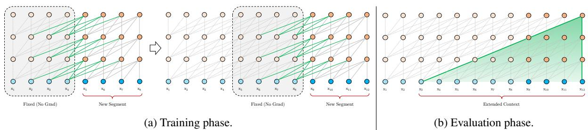
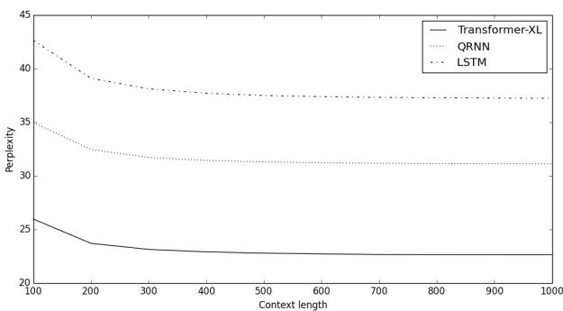
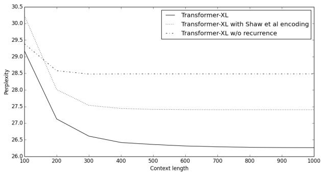
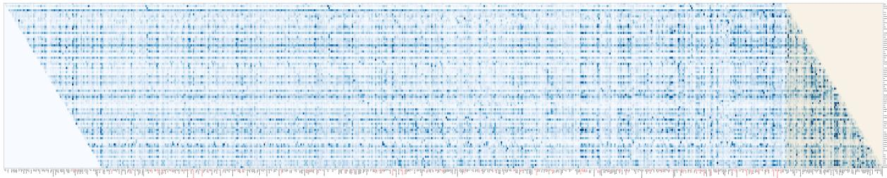
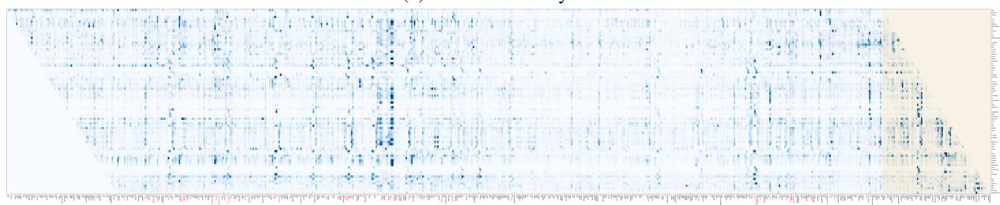

# Transformer-XL：超越固定长度上下文的注意力语言模型

Zihang Dai<sup>∗12</sup>, Zhilin Yang<sup>∗12</sup>, Yiming Yang<sup>1</sup>, Jaime Carbonell<sup>1</sup>,

Quoc V. Le<sup>2</sup>, Ruslan Salakhutdinov<sup>1</sup>

<sup>1</sup>Carnegie Mellon University, <sup>2</sup>Google Brain

{dzihang,zhiliny,yiming,jgc,rsalakhu}@cs.cmu.edu, qvl@google.com

## 摘要

Transformer 具有学习更长程依赖的潜力，但在语言建模设定下受限于固定长度的上下文。我们提出了一种新颖的神经架构 Transformer-XL，它能够在不破坏时间连贯性的情况下学习超越固定长度的依赖关系。该架构由片段级循环机制（segment-level recurrence mechanism）和一种新颖的位置编码方案组成。我们的方法不仅能够捕获更长程的依赖，还解决了上下文碎片化（context fragmentation）问题。因此，Transformer-XL 学习到的依赖长度比 RNN 长 80%，比原生 Transformer 长 450%，在长短序列上均取得了更好的性能，且在评估阶段比原生 Transformer 快达 1800 倍以上。值得注意的是，我们将 bpc/困惑度（perplexity）的最优结果（state-of-the-art）提升至：enwiki8 上 0.99，text8 上 1.08，WikiText-103 上 18.3，One Billion Word 上 21.8，以及 Penn Treebank 上 54.5（无需微调）。仅在 WikiText-103 上训练时，Transformer-XL 便能够生成包含数千个 token 且具有合理连贯性的全新文本文章。我们的代码、预训练模型和超参数均已在 Tensorflow 和 PyTorch 中开源¹。

## 1 引言

语言建模是需要对长程依赖进行建模的重要问题之一，其成功应用包括无监督预训练（Dai and Le, 2015; Peters et al., 2018; Radford et al., 2018; Devlin et al., 2018）。然而，赋予神经网络对序列数据中的长程依赖进行建模的能力一直是一项挑战。循环神经网络（RNN），特别是长短期记忆（LSTM）网络（Hochreiter and Schmidhuber, 1997），一直是语言建模的标准解决方案，并在多个基准测试中取得了强劲的结果。尽管得到了广泛应用，但由于梯度消失和梯度爆炸（Hochreiter et al., 2001），RNN 很难进行优化，且在 LSTM 中引入门控机制以及梯度裁剪技术（Graves, 2013）可能不足以完全解决这一问题。从实证来看，以往的研究发现 LSTM 语言模型平均仅利用 200 个上下文词（Khandelwal et al., 2018），这表明仍有进一步提升的空间。

另一方面，注意力机制中内置的长距离词对之间的直接连接可能会简化优化过程，并实现对长期依赖（long-term dependency）的学习（Bahdanau et al., 2014; Vaswani et al., 2017）。最近，Al-Rfou et al. (2018) 设计了一组辅助损失来训练用于字符级语言建模的深度 Transformer 网络，其性能大幅超越了 LSTM。尽管取得了成功，但 Al-Rfou et al. (2018) 中的语言模型训练是在由数百个字符组成的互不相连的固定长度片段上进行的，片段之间没有任何信息流动。由于固定上下文长度的限制，模型无法捕获超出预定义上下文长度的更长期依赖。此外，固定长度的片段是通过选取连续的符号块来构建的，没有考虑句子或任何其他语义边界。因此，模型缺乏准确预测前几个符号所必需的上下文信息，导致优化效率低下且性能不佳。我们将这个问题称为上下文碎片化（context fragmentation）。

为了解决上述固定长度上下文的局限性，我们提出了一种名为 Transformer-XL（意为 extra long，超长）的新架构。我们在深度自注意力网络中引入了循环（recurrence）的概念。具体而言，我们不再针对每个新片段从头开始计算隐藏状态，而是复用在先前片段中获得的隐藏状态。这些复用的隐藏状态充当当前片段的记忆，从而在片段之间建立了循环连接。因此，由于信息可以通过循环连接进行传播，对极长期依赖的建模成为了可能。同时，传递来自先前片段的信息还可以解决上下文碎片化问题。更重要的是，我们证明了使用相对位置编码而非绝对位置编码的必要性，以实现状态复用而不引起时序混淆。因此，作为额外的技术贡献，我们引入了一种简单但更有效的相对位置编码公式，它能够泛化到比训练期间观察到的注意力长度更长的长度。

Transformer-XL 在从词级别到字符级别语言建模的五个数据集上均取得了优异的成果。仅在 100M 个 token（词元）上训练的 Transformer-XL，还能够生成包含数千个 token 且相对连贯的长篇文章（见附录 E）。

我们的主要技术贡献包括在纯自注意力模型中引入循环概念，并推导了一种新型位置编码方案。这两种技术构成了一套完整的解决方案，因为仅凭其中任何一项都无法解决固定长度上下文的问题。Transformer-XL 是首个在字符级和词级语言建模上均显著优于 RNN 的自注意力模型。

## 2 相关工作

在过去的几年中，语言建模领域取得了许多重大进展，包括但不限于：设计新颖的架构以更好地编码上下文 (Bengio et al., 2003; Mikolov et al., 2010; Merity et al., 2016; Al-Rfou et al., 2018)，改进正则化和优化算法 (Gal and Ghahramani, 2016)，加速 Softmax 计算 (Grave et al., 2016a)，以及丰富输出分布族 (Yang et al., 2017)。

为了在语言建模中捕获长距离上下文，一系列工作将更宽范围上下文的表示作为额外输入直接输入网络中。现有的工作包括手动定义上下文表示的方法 (Mikolov and Zweig, 2012; Ji et al., 2015; Wang and Cho, 2015)，以及依赖从数据中学习到的文档级主题的方法 (Dieng et al., 2016; Wang et al., 2017)。

更广泛地说，在通用序列建模中，如何捕获长期依赖一直是一个长期的研究问题。从这个角度来看，自 LSTM 被普遍采用以来，人们付出了许多努力来缓解梯度消失问题，包括更好的初始化 (Le et al., 2015)、额外的损失信号 (Trinh et al., 2018)、增强的记忆结构 (Ke et al., 2018)，以及其他通过修改 RNN 内部架构以简化优化的方法 (Wu et al., 2016; Li et al., 2018)。与它们不同的是，我们的工作基于 Transformer 架构，并表明语言建模作为一项现实任务，能够从学习更长期依赖的能力中受益。

## 3 模型

给定一个词元（token）语料库 $\mathbf { x } = ( x _ { 1 } , \dots , x _ { T } )$，语言建模的任务是估计联合概率 $P ( \mathbf { x } )$，该概率通常自回归地分解为 $\begin{array} { r } { P ( \mathbf { x } ) = \prod _ { t } P ( x _ { t } \mid \mathbf { x } _ { < t } ) } \end{array}$。通过这种分解，问题简化为估计每个条件因子。在这项工作中，我们坚持使用标准的神经网络方法对条件概率进行建模。具体来说，使用一个可训练的神经网络将上下文 $\mathbf { x } _ { < t }$ 编码为固定大小的隐藏状态，然后将其与词嵌入相乘得到 logits。随后将 logits 输入 Softmax 函数，从而生成下一个词元的分类概率分布。

## 3.1 原生 Transformer 语言模型

为了将 Transformer 或自注意力机制（self-attention）应用于语言建模，核心问题在于如何训练 Transformer 以有效地将任意长度的上下文编码为固定大小的表示。在拥有无限内存和计算资源的情况下，一个简单的解决方案是使用无条件 Transformer 解码器处理整个上下文序列，类似于前馈神经网络。然而，在实践中由于资源有限，这通常是不可行的。

一种可行但粗略的近似方法是将整个语料库分割为大小可控的较短片段，并且仅在每个片段内训练模型，忽略来自先前片段的所有上下文信息。这是 Al-Rfou et al. (2018) 所采用的想法。我们称之为 vanilla 模型，并在图 1a 中进行了可视化展示。在这种训练范式下，无论是在前向传播还是反向传播中，信息都绝不会跨片段流动。使用固定长度的上下文存在两个关键局限性。首先，最大可能依赖长度以片段长度为上限，而在字符级语言建模中该长度仅为几百（Al-Rfou et al., 2018）。因此，尽管自注意力机制与 RNN 相比受梯度消失问题的影响较小，但 vanilla 模型无法充分利用这一优化优势。其次，尽管可以通过填充（padding）来遵循句子或其他语义边界，但由于能提高效率，在实践中简单地将长文本切分为固定长度的片段已成为标准做法（Peters et al., 2018; Devlin et al., 2018; Al-Rfou et al., 2018）。然而，正如第 1 节所讨论的，简单地将序列切分为固定长度的片段会导致上下文碎片化问题。

(b) 评估阶段。  
(a) 训练阶段。  
  
Figure 1: 片段长度为 4 的 vanilla 模型示意图。

在评估阶段，每一步 vanilla 模型同样接收一个与训练时长度相同的片段，但仅在最后一个位置做出一次预测。随后，在下一步中，该片段仅向右移动一个位置，而新片段必须完全从头开始重新处理。如图 1b 所示，该过程确保了每次预测都能利用训练期间所暴露的最长可能上下文，同时也缓解了训练中遇到的上下文碎片化问题。然而，这种评估过程的计算开销极大。我们将证明，本文提出的架构能够大幅提高评估速度。

## 3.2 带有状态复用的片段级循环机制

为了解决使用固定长度上下文的局限性，我们提出在 Transformer 架构中引入循环机制。在训练期间，为前一个片段计算得到的隐藏状态序列会被固定并缓存，以便在模型处理下一个新片段时作为扩展上下文进行重用，如图 Fig. 2a 所示。尽管梯度仍然保留在单个片段内，但这一额外输入使网络能够利用历史中的信息，从而具备对更长程依赖关系进行建模的能力，并避免上下文碎片化（context fragmentation）。形式上，设长度为 L 的两个连续片段分别为 $\begin{array} { r l } { \mathbf { s } _ { \tau } } & { { } = } \end{array}$ $[ x _ { \tau , 1 } , \cdots , x _ { \tau , L } ]$ 和 $\mathbf { s } _ { \tau + 1 } = [ x _ { \tau + 1 , 1 } , \cdot \cdot \cdot , x _ { \tau + 1 , L } ]$。将为第 τ 个片段 s<sub>τ</sub> 生成的第 n 层隐藏状态序列记为 $\mathbf { h } _ { \tau } ^ { n } ~ \in ~ \mathbb { R } ^ { L \times d }$，其中 d 是隐藏层维度。那么，片段 s 的第 n 层隐藏状态（原理上）生成如下，

$$
\begin{array}{l} \widetilde {\mathbf {h}} _ {\tau + 1} ^ {n - 1} = \left[ \mathrm{SG} (\mathbf {h} _ {\tau} ^ {n - 1}) \circ \mathbf {h} _ {\tau + 1} ^ {n - 1} \right], \\ \mathbf {q} _ {\tau + 1} ^ {n}, \mathbf {k} _ {\tau + 1} ^ {n}, \mathbf {v} _ {\tau + 1} ^ {n} = \mathbf {h} _ {\tau + 1} ^ {n - 1} \mathbf {W} _ {q} ^ {\top}, \widetilde {\mathbf {h}} _ {\tau + 1} ^ {n - 1} \mathbf {W} _ {k} ^ {\top}, \widetilde {\mathbf {h}} _ {\tau + 1} ^ {n - 1} \mathbf {W} _ {v} ^ {\top}, \\ \mathbf {h} _ {\tau + 1} ^ {n} = \text {Transformer - Layer} (\mathbf {q} _ {\tau + 1} ^ {n}, \mathbf {k} _ {\tau + 1} ^ {n}, \mathbf {v} _ {\tau + 1} ^ {n}). \end{array}
$$

其中函数 SG(·) 代表停止梯度（stop-gradient），符号 $[ \mathbf { h } _ { u } \circ \mathbf { h } _ { v } ]$ 表示沿长度维度拼接两个隐藏序列，W<sub>·</sub> 表示模型参数。与标准 Transformer 相比，关键的区别在于键 $\mathbf { k } _ { \tau + 1 } ^ { n }$ 和值 $\mathbf { v } _ { \tau + 1 } ^ { n }$ 以扩展上下文 $\widetilde { \mathbf { h } } _ { \tau + 1 } ^ { n - 1 }$ 为条件，因而也以前一个片段缓存的 $ { \mathbf { h } } _ { \tau } ^ { n - 1 }$ 为条件。我们在 Fig. 2a 中用绿色路径强调了这一特殊设计。

将这种循环机制应用于语料库中每两个连续的片段时，它本质上在隐藏状态中创建了片段级别的循环。因此，所利用的有效上下文可以远远超出仅仅两个片段。然而，请注意 $ { \mathbf { h } } _ { \tau + 1 } ^ { n }$ 与 $ { \mathbf { h } } _ { \tau } ^ { n - 1 }$ 之间的循环依赖关系在每个片段上向下移动了一层，这与传统 RNN-LMs 中的同层循环不同。因此，最大可能依赖长度相对于层数以及片段长度呈线性增长，即 $O ( N \times L )$，如图 2b 中的阴影区域所示。这类似于截断 BPTT（truncated BPTT，Mikolov et al., 2010），一种为训练 RNN-LMs 开发的技术。然而，与截断 BPTT 不同的是，我们的方法缓存的是一个隐藏状态序列而不是最后一个状态，并且应该与第 3.3 节中描述的相对位置编码技术结合使用。

  
Figure 2: 片段长度为 4 的 Transformer-XL 模型示意图。

除了实现超长上下文和解决碎片化问题之外，循环方案带来的另一个好处是评估速度显著加快。具体而言，在评估期间，可以重用前序片段的表征，而无需像原始模型（vanilla model）那样从头开始计算。在我们对 enwiki8 的实验中，Transformer-XL 在评估期间比原始模型快达 1,800+ 倍（见第 4 节）。

最后，请注意循环方案不必仅局限于前一个片段。理论上，我们可以在 GPU 显存允许的范围内缓存尽可能多的先前片段，并在处理当前片段时将它们全部重用为额外上下文。因此，我们可以缓存预定义长度为 M、跨越（可能）多个片段的旧隐藏状态，并将其称为记忆（memory）$\mathbf { m } _ { \tau } ^ { \bar { n } } \in \mathbb { R } ^ { \bar { M } \times d }$，这是由于其与记忆增强神经网络（memory augmented neural networks，Graves et al., 2014; Weston et al., 2014）有着明确的联系。在我们的实验中，我们在训练期间将 M 设置为等于片段长度，并在评估期间将其增加数倍。

## 3.3 相对位置编码

尽管我们发现前一小节中提出的想法非常吸引人，但为了复用隐藏状态，还有一个我们尚未解决的关键技术挑战。也就是说，在复用状态时，我们该如何保持位置信息的一致性？回想一下，在标准 Transformer 中，序列顺序信息是由一组位置编码提供的，记作 $\textbf { U } \in \mathbb { R } ^ { L _ { \operatorname* { m a x } } \times d } ,$ ，其中第 i 行 $\mathbf { U } _ { i }$ 对应片段内的第 i 个绝对位置，而 $L _ { \mathrm { m a x } }$ 规定了可建模的最大可能长度。随后，Transformer 的实际输入是词嵌入与位置编码的逐元素相加。如果我们将这种位置编码直接应用到我们的循环机制中，隐藏状态序列的计算示意如下：

$$
\begin{array}{c} \mathbf {h} _ {\tau + 1} = f (\mathbf {h} _ {\tau}, \mathbf {E} _ {\mathbf {s} _ {\tau + 1}} + \mathbf {U} _ {1: L}) \\ \mathbf {h} _ {\tau} = f (\mathbf {h} _ {\tau - 1}, \mathbf {E} _ {\mathbf {s} _ {\tau}} + \mathbf {U} _ {1: L}), \end{array}
$$

其中 $\mathbf { E } _ { \mathbf { s } _ { \tau } } ~ \in ~ \mathbb { R } ^ { L \times d }$ 是 ${ \bf s } _ { \tau }$ 的词嵌入序列，且 $f$ 表示一个变换函数。注意，$\mathbf { E _ { s , \alpha } }$ 与 $\mathbf { E } _ { \mathbf { s } _ { \tau + 1 } }$ 都关联了相同的位置编码 $\mathbf { U } _ { 1 : L } .$。结果就是，对于任意 $j = 1 , \dots , L$，模型没有任何信息来区分 $x _ { \tau , j }$ 和 $x _ { \tau + 1 , j }$ 之间的位置差异，从而导致严重的性能损失。

为了避免这种失效模式，其基本思想是在隐藏状态中仅编码相对位置信息。从概念上讲，位置编码为模型提供了一种时间线索或“偏置”，指示信息应该如何被收集，即应该关注哪里。出于同样的目的，与其将这种偏置静态地整合到初始嵌入中，不如将相同的信息注入到每一层的注意力分数中。更重要的是，以相对的方式定义时间偏置更加直观且具有更强的泛化能力。例如，当查询向量 $q _ { \tau , i }$ 关注键向量 $\mathbf { k } _ { \tau , \leq i }$ 时，它并不需要知道每个键向量的绝对位置来确定片段的时间顺序。相反，它只需知道每个键向量 $k _ { \tau , j }$ 与其自身 $q _ { \tau , i }$ 之间的相对距离，即 $i - j$。在实践中，可以创建一组相对位置编码 $\mathbf { R } \in \mathbb { R } ^ { L _ { \operatorname* { m a x } } \times d }$，其中第 $i$ 行 $\mathbf { R } _ { i }$ 表示两个位置之间的相对距离为 $i$。通过将相对距离动态注入到注意力分数中，查询向量可以很容易地根据不同的距离来区分 $x _ { \tau , j }$ 和 $x _ { \tau + 1 , j }$ 的表示，从而使状态复用机制变得可行。同时，我们不会丢失任何时间信息，因为绝对位置可以通过相对距离递归恢复。

此前，相对位置编码的思想已经在机器翻译（Shaw et al., 2018）和音乐生成（Huang et al., 2018）的背景下进行了探索。在这里，我们提供了一种不同的推导方式，得出了一种新形式的相对位置编码，它不仅与其绝对位置编码形式具有一一对应的关系，而且在经验上具有更好的泛化性能（见第 4 节）。首先，在标准 Transformer（Vaswani et al., 2017）中，同一片段内查询向量 $q _ { i }$ 与键向量 $k _ { j }$ 之间的注意力分数可以分解为

$$
\begin{array}{c} \mathbf {A} _ {i, j} ^ {\mathrm{abs}} = \underbrace {\mathbf {E} _ {x _ {i}} ^ {\top} \mathbf {W} _ {q} ^ {\top} \mathbf {W} _ {k} \mathbf {E} _ {x _ {j}}} _ {(a)} + \underbrace {\mathbf {E} _ {x _ {i}} ^ {\top} \mathbf {W} _ {q} ^ {\top} \mathbf {W} _ {k} \mathbf {U} _ {j}} _ {(b)} \\ + \underbrace {\mathbf {U} _ {i} ^ {\top} \mathbf {W} _ {q} ^ {\top} \mathbf {W} _ {k} \mathbf {E} _ {x _ {j}}} _ {(c)} + \underbrace {\mathbf {U} _ {i} ^ {\top} \mathbf {W} _ {q} ^ {\top} \mathbf {W} _ {k} \mathbf {U} _ {j}} _ {(d)}. \end{array}
$$

遵循仅依赖相对位置信息的思想，我们建议将这四项重新参数化如下

$$
\begin{array}{l} \mathbf {A} _ {i, j} ^ {\text {rel}} = \underbrace {\mathbf {E} _ {x _ {i}} ^ {\top} \mathbf {W} _ {q} ^ {\top} \mathbf {W} _ {k , E} \mathbf {E} _ {x _ {j}}} _ {(a)} + \underbrace {\mathbf {E} _ {x _ {i}} ^ {\top} \mathbf {W} _ {q} ^ {\top} \mathbf {W} _ {k , R} \mathbf {R} _ {i - j}} _ {(b)} \\ \quad + \underbrace {u ^ {\top} \mathbf {W} _ {k , E} \mathbf {E} _ {x _ {j}}} _ {(c)} + \underbrace {v ^ {\top} \mathbf {W} _ {k , R} \mathbf {R} _ {i - j}} _ {(d)}. \end{array}
$$

• 我们做出的第一个改变是将项 (b) 和 (d) 中用于计算键向量的所有绝对位置嵌入 $\mathbf { U } _ { j }$ 替换为其相对对应项 ${ \bf R } _ { i - j }$。这本质上反映了一个先验，即对于注意力应当关注的位置，只有相对距离才是关键。注意，R 是一个正弦编码矩阵（Vaswani et al., 2017），不包含可学习参数。

• 其次，我们引入了一个可训练参数 $u \in \mathbb { R } ^ { d }$ 来替换项 (c) 中的查询 $\mathbf { U } _ { i } ^ { \top } \mathbf { W } _ { q } ^ { \top }$。在这种情况下，由于对于所有查询位置，该查询向量都是相同的，这表明无论查询位置为何，对不同词的注意力偏置都应保持不变。基于类似的推理，我们添加了一个可训练参数 $\boldsymbol { v } \in \mathbb { R } ^ { d }$ 来替换项 (d) 中的 $\mathbf { U } _ { i } ^ { \top } \mathbf { W } _ { q } ^ { \top }$。

• 最后，我们特意分开了两个权重矩阵 $\mathbf { W } _ { k , E }$ 和 ${ \bf W } _ { k , R }$，分别用于生成基于内容的键向量和基于位置的键向量。

在新的参数化形式下，每一项都具有直观的含义：项 (a) 表示基于内容的寻址，项 (b) 捕获依赖于内容的位置偏置，项 (c) 控制全局内容偏置，而 (d) 则编码全局位置偏置。

相比之下，Shaw et al. (2018) 中的公式仅包含项 (a) 和 (b)，舍弃了两个偏置项 (c) 和 (d)。此外，Shaw et al. (2018) 将乘法 $\mathbf { W } _ { k } \mathbf { R }$ 合并为一个单一的可训练矩阵 $\begin{array} { r } { \hat { \bf R } , } \end{array}$，这放弃了原始正弦位置编码（Vaswani et al., 2017）中内置的归纳偏置。与此相反，我们的相对位置嵌入 R 沿用了正弦表述。得益于这种归纳偏置，在某种特定长度的记忆上训练的模型，在评估期间可以自动泛化到数倍长度的记忆。

将循环机制与我们提出的相对位置嵌入相结合，我们最终得到了 Transformer-XL 架构。为了完整起见，我们在此总结具有单注意力头的 N 层 Transformer-XL 的计算过程。对于 $n = 1 , \ldots , N ;$

$$
\begin{array}{c} \widetilde {\mathbf {h}} _ {\tau} ^ {n - 1} = \left[ \mathrm{SG} (\mathbf {m} _ {\tau} ^ {n - 1}) \circ \mathbf {h} _ {\tau} ^ {n - 1} \right] \\ \mathbf {q} _ {\tau} ^ {n}, \mathbf {k} _ {\tau} ^ {n}, \mathbf {v} _ {\tau} ^ {n} = \mathbf {h} _ {\tau} ^ {n - 1} \mathbf {W} _ {q} ^ {n \top}, \widetilde {\mathbf {h}} _ {\tau} ^ {n - 1} \mathbf {W} _ {k, E} ^ {n \top}, \widetilde {\mathbf {h}} _ {\tau} ^ {n - 1} \mathbf {W} _ {v} ^ {n \top} \\ \mathbf {A} _ {\tau , i, j} ^ {n} = \mathbf {q} _ {\tau , i} ^ {n \top} \mathbf {k} _ {\tau , j} ^ {n} + \mathbf {q} _ {\tau , i} ^ {n \top} \mathbf {W} _ {k, R} ^ {n} \mathbf {R} _ {i - j} \\ + u ^ {\top} \mathbf {k} _ {\tau , j} + v ^ {\top} \mathbf {W} _ {k, R} ^ {n} \mathbf {R} _ {i - j} \\ \mathbf {a} _ {\tau} ^ {n} = \text {Masked - Softmax} (\mathbf {A} _ {\tau} ^ {n}) \mathbf {v} _ {\tau} ^ {n} \\ \mathbf {o} _ {\tau} ^ {n} = \text {LayerNorm} (\text {Linear} (\mathbf {a} _ {\tau} ^ {n}) + \mathbf {h} _ {\tau} ^ {n - 1}) \\ \mathbf {h} _ {\tau} ^ {n} = \text {Positionwise - Feed - Forward} (\mathbf {o} _ {\tau} ^ {n}) \end{array}
$$

其中 $\mathbf { h } _ { \tau } ^ { 0 } : = \mathbf { \Delta E } _ { \mathbf { s } _ { \tau } }$ 定义为词嵌入序列。此外，值得一提的是，计算 $\mathbf{A}$ 的朴素方法需要对所有数对 $( i , j )$ 计算 ${ \bf W } _ { k , R } ^ { n } { \bf R } _ { i - j }$，其开销关于序列长度呈二次方关系。然而，注意到 $i - j$ 的取值范围仅从零到序列长度，我们在附录 B 中展示了一种简单的计算流程，可将开销降低至关于序列长度呈线性关系。

## 4 实验

## 4.1 主要结果

我们将 Transformer-XL 应用于词级别和字符级别语言建模的多种数据集上，以与最先进的系统进行对比，这些数据集包括 WikiText-103 (Merity et al., 2016)、enwik8 (LLC, 2009)、text8 (LLC, 2009)、One Billion Word (Chelba et al., 2013) 和 Penn Treebank (Mikolov and Zweig, 2012)。

<table><tr><td>模型</td><td>参数量</td><td>PPL</td></tr><tr><td>Grave et al. (2016b) - LSTM</td><td>-</td><td>48.7</td></tr><tr><td>Bai et al. (2018) - TCN</td><td>-</td><td>45.2</td></tr><tr><td>Dauphin et al. (2016) - GCNN-8</td><td>-</td><td>44.9</td></tr><tr><td>Grave et al. (2016b) - LSTM + Neural cache</td><td>-</td><td>40.8</td></tr><tr><td>Dauphin et al. (2016) - GCNN-14</td><td>-</td><td>37.2</td></tr><tr><td>Merity et al. (2018) - QRNN</td><td>151M</td><td>33.0</td></tr><tr><td>Rae et al. (2018) - Hebbian + Cache</td><td>-</td><td>29.9</td></tr><tr><td>本文方法 - Transformer-XL Standard</td><td>151M</td><td>24.0</td></tr><tr><td>Baevski and Auli (2018) - Adaptive Input◇</td><td>247M</td><td>20.5</td></tr><tr><td>本文方法 - Transformer-XL Large</td><td>257M</td><td>18.3</td></tr></table>

Table 1: 在 WikiText-103 上与最先进结果的对比。<sup> </sup> 表示同期工作。

<table><tr><td>模型</td><td>#Param</td><td>bpc</td></tr><tr><td>Ha et al. (2016) - LN HyperNetworks</td><td>27M</td><td>1.34</td></tr><tr><td>Chung et al. (2016) - LN HM-LSTM</td><td>35M</td><td>1.32</td></tr><tr><td>Zilly et al. (2016) - RHN</td><td>46M</td><td>1.27</td></tr><tr><td>Mujika et al. (2017) - FS-LSTM-4</td><td>47M</td><td>1.25</td></tr><tr><td>Krause et al. (2016) - Large mLSTM</td><td>46M</td><td>1.24</td></tr><tr><td>Knol (2017) - cmix v13</td><td>-</td><td>1.23</td></tr><tr><td>Al-Rfou et al. (2018) - 12L Transformer</td><td>44M</td><td>1.11</td></tr><tr><td>本文 - 12L Transformer-XL</td><td>41M</td><td>1.06</td></tr><tr><td>Al-Rfou et al. (2018) - 64L Transformer</td><td>235M</td><td>1.06</td></tr><tr><td>本文 - 18L Transformer-XL</td><td>88M</td><td>1.03</td></tr><tr><td>本文 - 24L Transformer-XL</td><td>277M</td><td>0.99</td></tr></table>

Table 2: 在 enwik8 上与最先进结果的对比。

WikiText-103 是目前可用的具有长程依赖性的最大词级语言建模基准。它包含来自 28K 篇文章的 103M 个训练词元（tokens），每篇文章平均长度为 3.6K 个词元，从而能够测试长程依赖建模的能力。我们在训练期间将注意力长度设置为 384，在评估期间设置为 1600。我们采用了自适应 softmax 和输入表示（Baevski and Auli, 2018; Grave et al., 2016a）。如 Table 1 所示，Transformer-XL 将先前的最先进（SoTA）困惑度从 20.5 降低到了 18.3，这证明了 Transformer-XL 架构的优越性。

数据集 enwik8 包含 100M 字节未处理的维基百科文本。我们在 Table 2 中将我们的架构与先前的结果进行了对比。在模型大小受限的情况下，12 层 Transformer-XL 取得了新的 SoTA 结果，比 Al-Rfou et al. (2018) 的 12 层标准 Transformer 高出 0.05，同时这两种 Transformer 变体均大幅领先于传统的基于 RNN 的模型。值得注意的是，我们的 12 层架构仅使用了 17% 的参数预算，就达到了与 Al-Rfou et al. (2018) 的 64 层网络相同的结果。为了探究通过增加模型大小是否能获得更好的性能，我们训练了模型规模更大的 18 层和 24 层 Transformer-XL。通过在训练时设置注意力长度为 784、评估时设置为 3,800，我们取得了新的 SoTA 结果，并且我们的方法在广泛研究的字符级基准上首次突破了 1.0。与 Al-Rfou et al. (2018) 不同，Transformer-XL 不需要任何辅助损失，因此所有的提升都归功于更优越的架构。

<table><tr><td>模型</td><td>参数量</td><td>bpc</td></tr><tr><td>Cooijmans et al. (2016) - BN-LSTM</td><td>-</td><td>1.36</td></tr><tr><td>Chung et al. (2016) - LN HM-LSTM</td><td>35M</td><td>1.29</td></tr><tr><td>Zilly et al. (2016) - RHN</td><td>45M</td><td>1.27</td></tr><tr><td>Krause et al. (2016) - Large mLSTM</td><td>45M</td><td>1.27</td></tr><tr><td>Al-Rfou et al. (2018) - 12L Transformer</td><td>44M</td><td>1.18</td></tr><tr><td>Al-Rfou et al. (2018) - 64L Transformer</td><td>235M</td><td>1.13</td></tr><tr><td>Ours - 24L Transformer-XL</td><td>277M</td><td>1.08</td></tr></table>

Table 3: 在 text8 上的最先进结果对比。

<table><tr><td>模型</td><td>参数量</td><td>PPL</td></tr><tr><td>Shazeer et al. (2014) - Sparse Non-Negative</td><td>33B</td><td>52.9</td></tr><tr><td>Chelba et al. (2013) - RNN-1024 + 9 Gram</td><td>20B</td><td>51.3</td></tr><tr><td>Kuchaiev and Ginsburg (2017) - G-LSTM-2</td><td>-</td><td>36.0</td></tr><tr><td>Dauphin et al. (2016) - GCNN-14 bottleneck</td><td>-</td><td>31.9</td></tr><tr><td>Jozefowicz et al. (2016) - LSTM</td><td>1.8B</td><td>30.6</td></tr><tr><td>Jozefowicz et al. (2016) - LSTM + CNN Input</td><td>1.04B</td><td>30.0</td></tr><tr><td>Shazeer et al. (2017) - Low-Budget MoE</td><td>~5B</td><td>34.1</td></tr><tr><td>Shazeer et al. (2017) - High-Budget MoE</td><td>~5B</td><td>28.0</td></tr><tr><td>Shazeer et al. (2018) - Mesh Tensorflow</td><td>4.9B</td><td>24.0</td></tr><tr><td>Baevski and Auli (2018) - Adaptive Input◇</td><td>0.46B</td><td>24.1</td></tr><tr><td>Baevski and Auli (2018) - Adaptive Input◇</td><td>1.0B</td><td>23.7</td></tr><tr><td>Ours - Transformer-XL Base</td><td>0.46B</td><td>23.5</td></tr><tr><td>Ours - Transformer-XL Large</td><td>0.8B</td><td>21.8</td></tr></table>

Table 4: 在 One Billion Word 上的最先进结果对比。<sup> </sup> 表示同期工作。

与 enwik8 相似但有所不同，text8 包含 1 亿个处理过的 Wikipedia 字符，其处理方式为将文本转换为小写，并移除了除 26 个英文字母（a 到 z）和空格之外的所有字符。由于两者的高度相似性，我们直接将 enwik8 上的最佳模型和相同超参数应用于 text8，未做进一步微调。与以往方法的对比如 Table 3 所示。Transformer-XL 再次以显著优势取得了新的最先进（SoTA）结果。

<table><tr><td>模型</td><td>#Param</td><td>PPL</td></tr><tr><td>Inan et al. (2016) - Tied Variational LSTM</td><td>24M</td><td>73.2</td></tr><tr><td>Zilly et al. (2016) - Variational RHN</td><td>23M</td><td>65.4</td></tr><tr><td>Zoph and Le (2016) - NAS Cell</td><td>25M</td><td>64.0</td></tr><tr><td>Merity et al. (2017) - AWD-LSTM</td><td>24M</td><td>58.8</td></tr><tr><td>Pham et al. (2018) - Efficient NAS</td><td>24M</td><td>58.6</td></tr><tr><td>Liu et al. (2018) - Differentiable NAS</td><td>23M</td><td>56.1</td></tr><tr><td>Yang et al. (2017) - AWD-LSTM-MoS</td><td>22M</td><td>55.97</td></tr><tr><td>Melis et al. (2018) - Dropout tuning</td><td>24M</td><td>55.3</td></tr><tr><td>Ours - Transformer-XL</td><td>24M</td><td>54.52</td></tr><tr><td>Merity et al. (2017) - AWD-LSTM+Finetune $^{\dagger}$ </td><td>24M</td><td>57.3</td></tr><tr><td>Yang et al. (2017) - MoS+Finetune $^{\dagger}$ </td><td>22M</td><td>54.44</td></tr></table>

Table 5: 在 Penn Treebank 上的前沿（state-of-the-art）结果对比。† 表示使用两步微调。

One Billion Word 由于句子被打乱，因此未保留任何长期依赖。因此，该数据集主要仅测试建模短期依赖的能力。Transformer-XL 与其他方法的对比见 Table 4。尽管 Transformer-XL 的主要设计目的是更好地捕捉较长期的依赖，但它显著将单模型 SoTA 从 23.7 提升至 21.8。具体而言，Transformer-XL 显著优于同期使用原生 Transformer 的方法（Baevski and Auli, 2018），表明 Transformer-XL 的优势可推广至短序列建模。

我们还在 Table 5 中报告了词级别 Penn Treebank 上的结果。与 AWD-LSTM（Merity et al., 2017）类似，我们对 Transformer-XL 应用了变分 dropout 和权重平均。在适当的正则化下，Transformer-XL 在未经两步微调的模型中取得了新的 SoTA 结果。Penn Treebank 仅有 1M 个训练 token，这表明 Transformer-XL 即使在小型数据集上也能很好地泛化。

## 4.2 消融实验

我们进行了两组消融实验，以检验 Transformer-XL 中所提出的两种技术的效果：循环机制和新的位置编码方案。

第一项研究在需要建模长程依赖（long-term dependency）的 WikiText-103 上进行。结果见 Table 6。在所对比的编码方案中，Shaw et al. (2018) 属于相对位置编码，而 Vaswani et al. (2017) 和 Al-Rfou et al. (2018) 属于绝对位置编码。“Full”和“half”损失是指将交叉熵损失应用于片段中的全部位置或较近的后半部分位置。我们发现绝对编码仅在配合 half 损失时表现良好，因为 half 损失在训练期间排除了注意力长度极短的位置，从而获得更好的泛化能力。Table 6 表明，循环机制和我们提出的编码方案对于取得最佳性能、以及在评估阶段泛化到更长的注意力序列都是必不可少的。尽管训练期间的反向传播长度仅为 128，但在采用这两种技术后，测试时的注意力长度可增加至 640。在具有 151M 参数的标准设置下，困惑度（perplexity）随着注意力长度的增加而降低。

由于循环机制会消耗额外的显存，我们还在相同的 GPU 显存限制下将 Transformer-XL 与基线模型进行了对比。如 Appendix A 中的 Table 10 所示，尽管使用了较短的反向传播长度，Transformer-XL 依然优于基线模型。

第二项研究旨在将解决上下文碎片化（context fragmentation）问题的效果与捕获更长上下文长度的收益分离开来。为了实现这一目标，我们特意选择了一个不需要长程依赖的数据集，以便将引入循环机制所带来的任何提升都归因于解决了上下文碎片化问题。具体而言，我们在 One Billion Word 数据集上进行了该对照实验，该数据集只能从消除上下文碎片化中获益。我们训练了一个拥有约 0.3B 参数的 20 层 Transformer-XL，训练步数为 400K 步。如 Table 7 所示，即使在不需要长程依赖的情况下，使用片段级循环机制也能显著提升性能，这与我们先前关于循环机制解决了上下文碎片化问题的讨论一致。此外，我们的相对位置编码在短序列上也优于 Shaw et al. (2018)。

## 4.3 相对有效上下文长度 (Relative Effective Context Length)

Khandelwal et al. (2018) 提出了一种用于评估序列模型有效上下文长度（Effective Context Length，简称 ECL）的方法。ECL 是指增加上下文跨度所带来的收益超过某一阈值的最长长度。然而，ECL 忽略了这样一个事实：当模型仅使用较短上下文就已经达到较低的困惑度时，要获得进一步的提升会更加困难，因此它不适合用于多个模型之间的公平比较。为此，我们提出了一种新的度量指标

<table><tr><td>备注</td><td>循环机制</td><td>编码方式</td><td>损失</td><td>PPL init</td><td>PPL best</td><td>Attn Len</td></tr><tr><td>Transformer-XL (128M)</td><td>✓</td><td>本文方法</td><td>全</td><td>27.02</td><td>26.77</td><td>500</td></tr><tr><td>-</td><td>✓</td><td>Shaw et al. (2018)</td><td>全</td><td>27.94</td><td>27.94</td><td>256</td></tr><tr><td>-</td><td>✓</td><td>本文方法</td><td>半</td><td>28.69</td><td>28.33</td><td>460</td></tr><tr><td>-</td><td>✗</td><td>本文方法</td><td>全</td><td>29.59</td><td>29.02</td><td>260</td></tr><tr><td>-</td><td>✗</td><td>本文方法</td><td>半</td><td>30.10</td><td>30.10</td><td>120</td></tr><tr><td>-</td><td>✗</td><td>Shaw et al. (2018)</td><td>全</td><td>29.75</td><td>29.75</td><td>120</td></tr><tr><td>-</td><td>✗</td><td>Shaw et al. (2018)</td><td>半</td><td>30.50</td><td>30.50</td><td>120</td></tr><tr><td>-</td><td>✗</td><td>Vaswani et al. (2017)</td><td>半</td><td>30.97</td><td>30.97</td><td>120</td></tr><tr><td> $Transformer (128M)^{\dagger}$ </td><td>✗</td><td>Al-Rfou et al. (2018)</td><td>半</td><td>31.16</td><td>31.16</td><td>120</td></tr><tr><td></td><td></td><td></td><td></td><td></td><td>23.09</td><td>640</td></tr><tr><td>Transformer-XL (151M)</td><td>✓</td><td>本文方法</td><td>全</td><td>23.43</td><td>23.16</td><td>450</td></tr><tr><td></td><td></td><td></td><td></td><td></td><td>23.35</td><td>300</td></tr></table>

Table 6: WikiText-103 上的消融实验。对于前两个部分，我们使用了一个稍小的模型（128M 参数）。† 表示该行简化为与 (Al-Rfou et al., 2018) 中的 Transformer 网络相同的设置，区别仅在于我们的实验中未实现两个辅助损失。“PPL init” 指使用与训练时相同的长度。“PPL best” 表示使用最优长度所获得的困惑度。“Attn Len” 是在评估期间达到相应结果（PPL best）所需的最短可能注意力长度。只有在使用我们的位置编码时，在评估期间增加注意力长度才能提升性能。“Transformer-XL (151M)” 设置使用了与以往工作 (Merity et al., 2018) 相同的标准参数预算，在该设置下，我们在评估期间增加注意力长度时也观察到了类似的效果。

<table><tr><td>方法</td><td>PPL</td></tr><tr><td>本文方法</td><td>25.2</td></tr><tr><td>采用 Shaw et al. (2018) 编码</td><td>25.7</td></tr><tr><td>无循环机制</td><td>27.1</td></tr></table>

Table 7: 在 One Billion Word（一个不存在长程依赖的数据集）上的消融实验。

<table><tr><td>模型</td><td>r = 0.1</td><td>r = 0.5</td><td>r = 1.0</td></tr><tr><td>Transformer-XL 151M</td><td>900</td><td>800</td><td>700</td></tr><tr><td>QRNN</td><td>500</td><td>400</td><td>300</td></tr><tr><td>LSTM</td><td>400</td><td>300</td><td>200</td></tr><tr><td>Transformer-XL 128M</td><td>700</td><td>600</td><td>500</td></tr><tr><td>- 使用 Shaw et al. (2018) 编码</td><td>400</td><td>400</td><td>300</td></tr><tr><td>- 移除循环机制</td><td>300</td><td>300</td><td>300</td></tr><tr><td>Transformer</td><td>128</td><td>128</td><td>128</td></tr></table>

Table 8: 相对有效上下文长度（RECL）比较。RECL 和 r 的定义见正文。在计算 RECL 时，前三个模型和后四个模型作为两个模型组分别进行比较（RECL 是在模型组上计算的，而非单个模型）。每个组具有相同的参数预算。

称为相对有效上下文长度（Relative Effective Context Length, RECL）。RECL 是在模型组而非单个模型上定义的，长上下文带来的增益是通过相对于最佳短上下文模型的相对改进来衡量的。因此，模型组共享相同的基线以实现公平比较。RECL 还有一个参数 r，表示将比较限制在排名前 r 的困难样本上。关于 RECL 的更多细节见附录 C。如 Table 8 所示，在 r = 0.1 时，Transformer-XL 能够平均对长达 900 个词的依赖关系进行建模。Transformer-XL 的 RECL 分别比循环网络和 Transformer 长 80% 和 450%。循环机制和我们的位置编码都有助于获得更长的 RECL。这进一步证实了我们的论点，即 Transformer-XL 能够对更长期的依赖关系进行建模。

<table><tr><td>注意力长度</td><td>Al-Rfou et al. (2018) 的减速倍数</td></tr><tr><td>3,800</td><td>1,874x</td></tr><tr><td>2,800</td><td>1,409x</td></tr><tr><td>1,800</td><td>773x</td></tr><tr><td>800</td><td>363x</td></tr></table>

Table 9: 评估期间运行时间的减速情况。评估基于单块 GPU 上每个 token 的处理时间。

## 4.4 生成文本

仅在规模中等的 WikiText-103 上进行训练，Transformer-XL 就已经能够在无需人工精选（cherry picking）的情况下，生成具有数千个 token 且相对连贯的文章，尽管存在些许小瑕疵。样本请参见附录 E。

## 4.5 评估速度

最后，我们将我们模型的评估速度与标准 Transformer 模型（Al-Rfou et al., 2018）进行了比较。如 Table 9 所示，由于状态复用方案的存在，Transformer-XL 在评估期间实现了高达 1,874 倍的加速。

## 5 结论

Transformer-XL 取得了出色的困惑度（perplexity）结果，比 RNN 和 Transformer 能够建模更长期的依赖关系，在评估期间实现了显著的加速，并能够生成连贯的文本文章。我们预见到 Transformer-XL 在文本生成、无监督特征学习、图像以及语音建模领域将具有令人感兴趣的应用。

## 致谢

ZD 和 YY 的部分研究工作得到了美国国家科学基金会（NSF，项目编号 IIS-1546329）以及美国能源部科学办公室（DOE-Office of Science，项目编号 ASCR #KJ040201）的资助。ZY 和 RS 的部分研究工作得到了美国海军研究办公室（Office of Naval Research，项目编号 N000141812861）、NSF 项目（编号 IIS1763562）、Nvidia 奖学金（Nvidia fellowship）以及 Siebel 奖学金（Siebel scholarship）的资助。

## 参考文献

Rami Al-Rfou, Dokook Choe, Noah Constant, Mandy Guo, and Llion Jones. 2018. Character-level language modeling with deeper self-attention. arXiv preprint arXiv:1808.04444.

Alexei Baevski and Michael Auli. 2018. Adaptive input representations for neural language modeling. arXiv preprint arXiv:1809.10853.

Dzmitry Bahdanau, Kyunghyun Cho, and Yoshua Bengio. 2014. Neural machine translation by jointly learning to align and translate. arXiv preprint arXiv:1409.0473.

Shaojie Bai, J Zico Kolter, and Vladlen Koltun. 2018. An empirical evaluation of generic convolutional and recurrent networks for sequence modeling. arXiv preprint arXiv:1803.01271.

Yoshua Bengio, Réjean Ducharme, Pascal Vincent, and Christian Jauvin. 2003. A neural probabilistic language model. Journal ofmachine learning research, 3(Feb):1137–1155.

Ciprian Chelba, Tomas Mikolov, Mike Schuster, Qi Ge, Thorsten Brants, Phillipp Koehn, and Tony Robinson. 2013. One billion word benchmark for measuring progress in statistical language modeling. arXiv preprint arXiv:1312.3005.

Junyoung Chung, Sungjin Ahn, and Yoshua Bengio. 2016. Hierarchical multiscale recurrent neural networks. arXiv preprint arXiv:1609.01704.

Tim Cooijmans, Nicolas Ballas, César Laurent, Çaglar˘ Gülçehre, and Aaron Courville. 2016. Recurrent batch normalization. arXiv preprint arXiv:1603.09025

Andrew M Dai and Quoc V Le. 2015. Semi-supervised sequence learning. In Advances in neural information processing systems, pages 3079–3087.

Yann N Dauphin, Angela Fan, Michael Auli, and David Grangier. 2016. Language modeling with gated convolutional networks. arXiv preprint arXiv:1612.08083.

Jacob Devlin, Ming-Wei Chang, Kenton Lee, and Kristina Toutanova. 2018. Bert: Pre-training of deep bidirectional transformers for language understanding. arXiv preprint arXiv:1810.04805.

Adji B Dieng, Chong Wang, Jianfeng Gao, and John Paisley. 2016. Topicrnn: A recurrent neural network with long-range semantic dependency. arXiv preprint arXiv:1611.01702.

Yarin Gal and Zoubin Ghahramani. 2016. A theoretically grounded application of dropout in recurrent neural networks. In Advances in neural information processing systems, pages 1019–1027.

Edouard Grave, Armand Joulin, Moustapha Cissé, David Grangier, and Hervé Jégou. 2016a. Efficient softmax approximation for gpus. arXiv preprint arXiv:1609.04309

Edouard Grave, Armand Joulin, and Nicolas Usunier. 2016b. Improving neural language models with a continuous cache. arXiv preprint arXiv:1612.04426.

Alex Graves. 2013. Generating sequences with recurrent neural networks. arXiv preprint arXiv:1308.0850.

Alex Graves, Greg Wayne, and Ivo Danihelka. 2014. Neural turing machines. arXiv preprint arXiv:1410.5401.

David Ha, Andrew Dai, and Quoc V Le. 2016. Hypernetworks. arXiv preprint arXiv:1609.09106.

Sepp Hochreiter, Yoshua Bengio, Paolo Frasconi, Jürgen Schmidhuber, et al. 2001. Gradient flow in recurrent nets: the difficulty of learning long-term dependencies.

Sepp Hochreiter and Jürgen Schmidhuber. 1997. Long short-term memory. Neural computation, 9(8):1735–1780.

Cheng-Zhi Anna Huang, Ashish Vaswani, Jakob Uszkoreit, Noam Shazeer, Curtis Hawthorne, Andrew M Dai, Matthew D Hoffman, and Douglas Eck. 2018. An improved relative self-attention mechanism for transformer with application to music generation. arXiv preprint arXiv:1809.04281.

Hakan Inan, Khashayar Khosravi, and Richard Socher. 2016. Tying word vectors and word classifiers: A loss framework for language modeling. arXiv preprint arXiv:1611.01462.

Yangfeng Ji, Trevor Cohn, Lingpeng Kong, Chris Dyer, and Jacob Eisenstein. 2015. Document context language models. arXiv preprint arXiv:1511.03962.

Rafal Jozefowicz, Oriol Vinyals, Mike Schuster, Noam Shazeer, and Yonghui Wu. 2016. Exploring the limits of language modeling. arXiv preprint arXiv:1602.02410.

Nal Kalchbrenner, Lasse Espeholt, Karen Simonyan, Aaron van den Oord, Alex Graves, and Koray Kavukcuoglu. 2016. Neural machine translation in linear time. arXiv preprint arXiv:1610.10099.

Sekitoshi Kanai, Yasuhiro Fujiwara, Yuki Yamanaka, and Shuichi Adachi. 2018. Sigsoftmax: Reanalysis of the softmax bottleneck. arXiv preprint arXiv:1805.10829.

Nan Rosemary Ke, Anirudh Goyal ALIAS PARTH GOYAL, Olexa Bilaniuk, Jonathan Binas, Michael C Mozer, Chris Pal, and Yoshua Bengio. 2018. Sparse attentive backtracking: Temporal credit assignment through reminding. In Advances in Neural Information Processing Systems, pages 7650–7661.

Urvashi Khandelwal, He He, Peng Qi, and Dan Jurafsky. 2018. Sharp nearby, fuzzy far away: How neural language models use context. arXiv preprint arXiv:1805.04623

Bryon Knol. 2017. cmix v13. http://www. byronknoll.com/cmix.html.

Jan Koutnik, Klaus Greff, Faustino Gomez, and Juergen Schmidhuber. 2014. A clockwork rnn. arXiv preprint arXiv:1402.3511.

Ben Krause, Liang Lu, Iain Murray, and Steve Renals. 2016. Multiplicative lstm for sequence modelling. arXiv preprint arXiv:1609.07959.

Oleksii Kuchaiev and Boris Ginsburg. 2017. Factorization tricks for lstm networks. arXiv preprint arXiv:1703.10722.

Quoc V Le, Navdeep Jaitly, and Geoffrey E Hinton. 2015. A simple way to initialize recurrent networks of rectified linear units. arXiv preprint arXiv:1504.00941.

Shuai Li, Wanqing Li, Chris Cook, Ce Zhu, and Yanbo Gao. 2018. Independently recurrent neural network (indrnn): Building a longer and deeper rnn. In Proceedings of the IEEE Conference on Computer Vision and Pattern Recognition, pages 5457–5466.

Hanxiao Liu, Karen Simonyan, and Yiming Yang. 2018. Darts: Differentiable architecture search. arXiv preprint arXiv:1806.09055.

MultiMedia LLC. 2009. Large text compression benchmark.

Gábor Melis, Charles Blundell, Tomáš Kociskˇ y,\` Karl Moritz Hermann, Chris Dyer, and Phil Blunsom. 2018. Pushing the bounds of dropout. arXiv preprint arXiv:1805.09208.

Stephen Merity, Nitish Shirish Keskar, and Richard Socher. 2017. Regularizing and optimizing lstm language models. arXiv preprint arXiv:1708.02182.

Stephen Merity, Nitish Shirish Keskar, and Richard Socher. 2018. An analysis of neural language modeling at multiple scales. arXiv preprint arXiv:1803.08240.

Stephen Merity, Caiming Xiong, James Bradbury, and Richard Socher. 2016. Pointer sentinel mixture models. arXiv preprint arXiv:1609.07843.

Tomas Mikolov, Armand Joulin, Sumit Chopra, Michael Mathieu, and Marc’Aurelio Ranzato. 2014. Learning longer memory in recurrent neural networks. arXiv preprint arXiv:1412.7753.

Tomáš Mikolov, Martin Karafiát, Lukáš Burget, Jan Cernock<sup>ˇ</sup> y, and Sanjeev Khudanpur. 2010. Recur-\` rent neural network based language model. In Eleventh Annual Conference of the International Speech Communication Association.

Tomas Mikolov and Geoffrey Zweig. 2012. Context dependent recurrent neural network language model. SLT, 12(234-239):8.

Frederic Morin and Yoshua Bengio. 2005. Hierarchical probabilistic neural network language model. In Aistats, volume 5, pages 246–252. Citeseer.

Asier Mujika, Florian Meier, and Angelika Steger. 2017. Fast-slow recurrent neural networks. In Advances in Neural Information Processing Systems, pages 5915–5924.

Razvan Pascanu, Tomas Mikolov, and Yoshua Bengio. 2012. Understanding the exploding gradient problem. CoRR, abs/1211.5063.

Matthew E Peters, Mark Neumann, Mohit Iyyer, Matt Gardner, Christopher Clark, Kenton Lee, and Luke Zettlemoyer. 2018. Deep contextualized word representations. arXiv preprint arXiv:1802.05365.

Hieu Pham, Melody Y Guan, Barret Zoph, Quoc V Le, and Jeff Dean. 2018. Efficient neural architecture search via parameter sharing. arXiv preprint arXiv:1802.03268

Ofir Press and Lior Wolf. 2016. Using the output embedding to improve language models. arXiv preprint arXiv:1608.05859.

Alec Radford, Karthik Narasimhan, Tim Salimans, and Ilya Sutskever. 2018. Improving language understanding by generative pre-training. URL https://s3- us-west-2. amazonaws. com/openai-assets/researchcovers/languageunsupervised/language understanding paper. pdf.

Jack W Rae, Chris Dyer, Peter Dayan, and Timothy P Lillicrap. 2018. Fast parametric learning with activation memorization. arXiv preprint arXiv:1803.10049.

Peter Shaw, Jakob Uszkoreit, and Ashish Vaswani. 2018. Self-attention with relative position representations. arXiv preprint arXiv:1803.02155.

Noam Shazeer, Youlong Cheng, Niki Parmar, Dustin Tran, Ashish Vaswani, Penporn Koanantakool, Peter Hawkins, HyoukJoong Lee, Mingsheng Hong, Cliff Young, et al. 2018. Mesh-tensorflow: Deep learning for supercomputers. In Advances in Neural Information Processing Systems, pages 10434–10443.

Noam Shazeer, Azalia Mirhoseini, Krzysztof Maziarz, Andy Davis, Quoc Le, Geoffrey Hinton, and Jeff Dean. 2017. Outrageously large neural networks: The sparsely-gated mixture-of-experts layer. arXiv preprint arXiv:1701.06538.

Noam Shazeer, Joris Pelemans, and Ciprian Chelba. 2014. Skip-gram language modeling using sparse non-negative matrix probability estimation. arXiv preprint arXiv:1412.1454.

Trieu H Trinh, Andrew M Dai, Thang Luong, and Quoc V Le. 2018. Learning longer-term dependencies in rnns with auxiliary losses. arXiv preprint arXiv:1803.00144.

Ashish Vaswani, Noam Shazeer, Niki Parmar, Jakob Uszkoreit, Llion Jones, Aidan N Gomez, Łukasz Kaiser, and Illia Polosukhin. 2017. Attention is all you need. In Advances in Neural Information Processing Systems, pages 5998–6008.

Tian Wang and Kyunghyun Cho. 2015. Largercontext language modelling. arXiv preprint arXiv:1511.03729

Wenlin Wang, Zhe Gan, Wenqi Wang, Dinghan Shen, Jiaji Huang, Wei Ping, Sanjeev Satheesh, and Lawrence Carin. 2017. Topic compositional neural language model. arXiv preprint arXiv:1712.09783.

Jason Weston, Sumit Chopra, and Antoine Bordes. 2014. Memory networks. arXiv preprint arXiv:1410.3916.

Yuhuai Wu, Saizheng Zhang, Ying Zhang, Yoshua Bengio, and Ruslan R Salakhutdinov. 2016. On multiplicative integration with recurrent neural networks. In Advances in neural information processing systems, pages 2856–2864.

Zhilin Yang, Zihang Dai, Ruslan Salakhutdinov, and William W Cohen. 2017. Breaking the softmax bottleneck: A high-rank rnn language model. arXiv preprint arXiv:1711.03953.

Wojciech Zaremba, Ilya Sutskever, and Oriol Vinyals. 2014. Recurrent neural network regularization. arXiv preprint arXiv:1409.2329.

Julian Georg Zilly, Rupesh Kumar Srivastava, Jan Koutník, and Jürgen Schmidhuber. 2016. Recurrent highway networks. arXiv preprint arXiv:1607.03474.

Barret Zoph and Quoc V Le. 2016. Neural architecture search with reinforcement learning. arXiv preprint arXiv:1611.01578.

## A 显存约束下的消融实验

<table><tr><td>反向传播长度</td><td>循环机制</td><td>编码方式</td><td>损失</td><td>最佳 pplx</td><td>初始 pplx</td><td>注意力长度</td></tr><tr><td>128</td><td>√</td><td>本文方法</td><td>全量</td><td>26.77</td><td>27.02</td><td>500</td></tr><tr><td>128</td><td>√</td><td>本文方法</td><td>部分</td><td>28.33</td><td>28.69</td><td>460</td></tr><tr><td>176</td><td>✗</td><td>本文方法</td><td>全量</td><td>27.98</td><td>28.43</td><td>400</td></tr><tr><td>172</td><td>✗</td><td>本文方法</td><td>部分</td><td>28.83</td><td>28.83</td><td>120</td></tr></table>

Table 10: 在相同 GPU 显存约束下 WikiText-103 上的消融实验。

Table 10 在相同的显存预算下比较了 Transformer-XL 与基线模型（baseline）。即使在反向传播长度更短的情况下，Transformer-XL 的表现仍然优于基线模型。

## B 相对位置编码注意力机制的高效计算

正如我们在第 3.3 节中所讨论的，直接针对所有数对 $( i , j )$ 计算 ${ \bf W } _ { k , R } { \bf R } _ { i - j }$ 的朴素方法会产生二次方的时间复杂度。在此，我们提出一种复杂度仅为线性的简单方法。首先，注意到相对距离 $i - j$ 只能是介于 0 到 $M + L - 1$ 之间的整数，其中 M 和 L 分别为记忆长度（memory length）和分段长度（segment length）。因此，矩阵

$$
\mathbf {Q} := \left[ \begin{array}{c} \mathbf {R} _ {M + L - 1} ^ {\top} \\ \mathbf {R} _ {M + L - 2} ^ {\top} \\ \vdots \\ \mathbf {R} _ {1} ^ {\top} \\ \mathbf {R} _ {0} ^ {\top} \end{array} \right] \mathbf {W} _ {k, R} ^ {\top} = \left[ \begin{array}{c} \left[ \mathbf {W} _ {k, R} \mathbf {R} _ {M + L - 1} \right] ^ {\top} \\ \left[ \mathbf {W} _ {k, R} \mathbf {R} _ {M + L - 2} \right] ^ {\top} \\ \vdots \\ \left[ \mathbf {W} _ {k, R} \mathbf {R} _ {1} \right] ^ {\top} \\ \left[ \mathbf {W} _ {k, R} \mathbf {R} _ {0} \right] ^ {\top} \end{array} \right] \in \mathbb {R} ^ {(M + L) \times d}
$$

的各行包含了任意 $( i , j )$ 对应的 ${ \bf W } _ { k , R } { \bf R } _ { i - j }$ 的所有可能向量输出。需要说明的是，为了便于后续讨论，我们将 $\mathbf { Q }$ 定义为倒序排列，即 $\mathrm { i . e . , } \mathbf { Q } _ { k } = \mathbf { W } _ { k , R } \mathbf { R } _ { M + L - 1 - k }$。

接下来，我们将所有可能的 $i , j$ 对应的项 (b) 收集到以下 $L \times ( M + L )$ 矩阵中：

$$
\begin{array}{r l} & {\mathbf {B} = \left[ \begin{array}{c c c c c c c} q _ {0} ^ {\top} \mathbf {W} _ {k, R} \mathbf {R} _ {M} & \dots & q _ {0} ^ {\top} \mathbf {W} _ {k, R} \mathbf {R} _ {0} & 0 & \dots & 0 \\ q _ {1} ^ {\top} \mathbf {W} _ {k, R} \mathbf {R} _ {M + 1} & \dots & q _ {1} ^ {\top} \mathbf {W} _ {k, R} \mathbf {R} _ {1} & q _ {1} ^ {\top} \mathbf {W} _ {k, R} \mathbf {R} _ {0} & \dots & 0 \\ \vdots & \vdots & \vdots & \vdots & \ddots & \vdots \\ q _ {L - 1} ^ {\top} \mathbf {W} _ {k, R} \mathbf {R} _ {M + L - 1} & \dots & q _ {L - 1} ^ {\top} \mathbf {W} _ {k, R} \mathbf {R} _ {M + L - 1} & q _ {L - 1} ^ {\top} \mathbf {W} _ {k, R} \mathbf {R} _ {L - 1} & \dots & q _ {L - 1} ^ {\top} \mathbf {W} _ {k, R} \mathbf {R} _ {0} \end{array} \right]} \\ & = \left[ \begin{array}{c c c c c c c} q _ {0} ^ {\top} \mathbf {Q} _ {L - 1} & \dots & q _ {0} ^ {\top} \mathbf {Q} _ {M + L - 1} & 0 & \dots & 0 \\ q _ {1} ^ {\top} \mathbf {Q} _ {L - 2} & \dots & q _ {1} ^ {\top} \mathbf {Q} _ {M + L - 2} & q _ {1} ^ {\top} \mathbf {Q} _ {M + L - 1} & \dots & 0 \\ \vdots & \vdots & \ddots & \vdots & \ddots & \vdots \\ q _ {L - 1} ^ {\top} \mathbf {Q} _ {0} & \dots & q _ {L - 1} ^ {\top} \mathbf {Q} _ {M} & q _ {L - 1} ^ {\top} \mathbf {Q} _ {M + 1} & \dots & q _ {L - 1} ^ {\top} \mathbf {Q} _ {M + L - 1} \end{array} \right] \end{array}
$$

然后，我们进一步定义

$$
\widetilde {\mathbf {B}} = \mathbf {q} \mathbf {Q} ^ {\top} = \left[ \begin{array}{c c c c c c} q _ {0} ^ {\top} \mathbf {Q} _ {0} & \dots & q _ {0} ^ {\top} \mathbf {Q} _ {M} & q _ {0} ^ {\top} \mathbf {Q} _ {M + 1} & \dots & q _ {0} ^ {\top} \mathbf {Q} _ {M + L - 1} \\ q _ {1} ^ {\top} \mathbf {Q} _ {0} & \dots & q _ {1} ^ {\top} \mathbf {Q} _ {M} & q _ {1} ^ {\top} \mathbf {Q} _ {M + 1} & \dots & q _ {1} ^ {\top} \mathbf {Q} _ {M + L - 1} \\ \vdots & \vdots & \ddots & \vdots & \ddots & \vdots \\ q _ {L - 1} ^ {\top} \mathbf {Q} _ {0} & \dots & q _ {L - 1} ^ {\top} \mathbf {Q} _ {M} & q _ {L - 1} ^ {\top} \mathbf {Q} _ {M + 1} & \dots & q _ {L - 1} ^ {\top} \mathbf {Q} _ {M + L - 1} \end{array} \right].
$$

现在，很容易看出 B 与 $\widetilde { \mathbf { B } }$ 之间存在直接关系，其中 B 的第 i 行仅是 Be 第 i 行的左移版本。因此，计算 B 仅需进行一次矩阵乘法 ${ \bf q } { \bf Q } ^ { \top }$ 来计算 Be，然后执行一组左移操作即可。

类似地，我们可以将所有可能的 $i , j$ 对应的所有项 (d) 收集到另一个 $L \times ( M + L )$ 矩阵 D 中，

$$
\mathbf {D} = \left[ \begin{array}{c c c c c c} v ^ {\top} \mathbf {Q} _ {L - 1} & \dots & v ^ {\top} \mathbf {Q} _ {M + L - 1} & 0 & \dots & 0 \\ v ^ {\top} \mathbf {Q} _ {L - 2} & \dots & v ^ {\top} \mathbf {Q} _ {M + L - 2} & v ^ {\top} \mathbf {Q} _ {M + L - 1} & \dots & 0 \\ \vdots & \vdots & \ddots & \vdots & \ddots & \vdots \\ v ^ {\top} \mathbf {Q} _ {0} & \dots & v ^ {\top} \mathbf {Q} _ {M} & v ^ {\top} \mathbf {Q} _ {M + 1} & \dots & v ^ {\top} \mathbf {Q} _ {M + L - 1} \end{array} \right].
$$

然后，我们可以按照相同的步骤定义

$$
\widetilde {\mathbf {d}} = [ \mathbf {Q} v ] ^ {\top} = \left[ \begin{array}{c c c c c} v ^ {\top} \mathbf {Q} _ {0} & \dots & v ^ {\top} \mathbf {Q} _ {M} & v ^ {\top} \mathbf {Q} _ {M + 1} & \dots & v ^ {\top} \mathbf {Q} _ {M + L - 1} \end{array} \right].
$$

同样，$\mathbf{D}$ 的每一行只是 $\widetilde { \mathbf { d } }$ 的左移版本。因此，主要的计算开销来自于矩阵-向量乘法 $\widetilde { \mathbf { d } } = [ \mathbf { Q } v ] ^ { \top }$，其计算代价不再高昂。

## C 关于 RECL 的详细信息

  
(a) Transformer-XL vs RNNs

  
(b) Transformer-XL vs Baseline

Figure 3: 可视化 $r = 0 . 1$ 时的未归一化相对困惑度增益  
  
(a) Transformer-XL vs RNNs

  
(b) Transformer-XL vs Baseline  
Figure 4: 困惑度与上下文长度关系。

在本节中，我们详细介绍评估指标 RECL。设 $\mathcal { M } = \{ m _ { 1 } , m _ { 2 } , \cdot \cdot \cdot , m _ { N } \}$ 为由 $N$ 个模型组成的模型组。设 $l _ { i } ( c , t )$ 表示模型 $m _ { i }$ 在上下文长度为 c 时对语料库中第 t 个 token 的损失。具体而言，该损失可写为

$$
l _ {i} (c, t) = - \log P _ {m _ {i}} (x _ {t} | x _ {t - 1}, \dots , x _ {t - c})
$$

其中 $P _ { m _ { i } }$ 是模型 $m _ { i }$ 给出的概率分布，而 $x _ { t }$ 是语料库中的第 t 个 token。给定一个短上下文长度 c 和一个满足 $c ^ { \prime } \geq c$ 的长上下文长度 $c ^ { \prime }$，我们可以进一步为每个位置 t 定义一个基准（baseline），

$$
b (c, t) = \min _ {i = 1} ^ {N} l _ {i} (c, t)
$$

$m _ { i }$ 相对于模型组 M 的相对损失表示为

$$
f _ {i} (c, c ^ {\prime}) = \frac {1}{| \mathcal {T} |} \sum_ {t \in \mathcal {T}} \min \left(b (c, t), l _ {i} (c ^ {\prime}, t)\right)
$$

上述公式使用所有模型在较短长度 $c$ 上的最小损失作为基准（baseline），只有小于该基准的损失才会有效计入相对损失中。这使得多个模型之间可以进行公平比较，因为所有具有较长上下文长度 $c ^ { \prime }$ 的模型都需要在相同的基准上进行提升。有时我们只关注基准表现较差的位置（这意味着上下文长度为 $c$ 的短期依赖是不充分的），因此给定一个比例参数 $r$，我们将上述公式中的集合 $\mathcal {T}$ 定义为

$$
\mathcal {T} = \text { top - } r \text {   positions   } t \text {   with   largest   } b (c, t)
$$

随后，相对增益被定义为相对困惑度（perplexity）的降低：

$$
g _ {i} (c, c ^ {\prime}) = \frac {\exp f _ {i} (c , c) - \exp f _ {i} (c , c ^ {\prime})}{\exp f _ {i} (c , c)}
$$

给定步长 $\Delta .$，我们接着使用一种算法通过对相对增益设定阈值来寻找 RECL：

1. 设定初始较短上下文长度 $c$，以及较长上下文长度 $c ^ { \prime } = c + \Delta$

2. 计算 $g _ { i } ( c , c ^ { \prime } ) . \mathrm { I f } g _ { i } ( c , c ^ { \prime } ) < 0 . 0 1$ ，返回 RECL = c。如果 $g _ { i } ( c , c ^ { \prime } ) \geq 0 . 0 1$ ，设 $c = c ^ { \prime } , c ^ { \prime } = c + \Delta$ 并转到步骤 1。

在 Figure 3 中，我们可视化了当 $r = 0 . 1$ 时，不同 $( c , c ^ { \prime } )$ 对下的未归一化相对困惑度增益（exp $f _ { i } ( c , c ) - \exp f _ { i } ( c , c ^ { \prime } ) )$。显然，与 RNNs 和其他基线相比，Transformer-XL 具有更长的 RECL，因为其相对增益要显著更大。

作为参考，我们在 Figure 4 中绘制了不同上下文长度下的困惑度。y 轴表示“常规”困惑度（未经基线校准）。

## D 注意力可视化

在本节中，我们提供了 SoTA 模型在 WikiText-103 验证集上学习到的注意力的部分可视化。回顾一下，该模型具有 16 个 10 头的 Transformer 层，并依赖于长度为 640 的记忆（memory）。

```txt
The image contains only a horizontal line, which is stylistic or background elements. According to Rule 2, such elements must be ignored by the OCR result. Therefore, the corrected OCR text is:

[Empty String]
```  
Figure 5: 在前 640 个 token 上的平均注意力，其中每一行对应一个注意力头，每一列对应一个相对位置。总共有 160 个注意力头，每 10 个头来自同一个层。颜色越深表示数值越大。

第一个可视化旨在揭示模型注意力的总体趋势。具体而言，对于每一层的每个注意力头，我们对验证集中所有标记（token）的注意力分布求平均。如图 Fig. 5 所示。可以看出，总体趋势是更多地关注邻近标记，而非较远的标记。然而，同样非常明显的是，某些注意力头在整个记忆跨度（memory span）上具有更广泛的注意力分布，特别是第 1 层的注意力头 8、第 8 层的注意力头 78 以及第 16 层的注意力头 158。

由于我们专注于学习长程依赖（long-range dependency），因此我们对这些具有更宽注意力跨度的注意力头格外感兴趣。因此，在第二组可视化中，我们选取了上述三个值得注意的注意力头，并可视化了它们针对随机选定位置的注意力行为，如图 Fig. 6 所示。在此，我们观察到了三种不同的更宽注意力模式：

• 对于第 1 层的注意力头 8，我们在整个记忆跨度上观察到了几乎均匀的注意力。这非常符合直觉，因为较低层需要筛选整个记忆跨度，以决定高层应该关注何处。



(a) 第 1 层的注意力头 8。  


(b) 第 8 层的注意力头 78。  
  
(c) 第 16 层的注意力头 158。  
Figure 6: 具有广泛注意力范围的三个注意力头的可视化。每一行对应一个目标位置/标记，每一列对应一个上下文位置/标记。记忆中注意力值处于前 20% 的标记以红色高亮显示。

• 对于第 8 层（中间层）的注意力头 78，我们观察到一种散布在记忆各个范围中的极其稀疏的注意力模式。这同样非常符合我们的直觉：随着信息的累积，网络可能会聚焦于某些特别受关注的特定位置。

• 对于第 16 层（即最后一层）的注意力头 158，每个目标位置（对应每一行）都有其独特且稀疏的关注点，这与注意力头 78 不同，在注意力头 78 中，各目标位置在很大程度上共享记忆中相同的受关注位置。同时，该模式也不同于注意力头 8 的情况，在注意力头 8 中，少数位置明显比其他位置受到更多关注。

最后，正如我们在第 3.3 节中所讨论的，注意力得分可以分解为四个直观的项。在此，我们希望进一步研究这四项如何对 Fig. 5 中的总体注意力趋势产生贡献。由于项 (c) 表示全局内容偏置，即无论上下文如何、每个词本身的先验重要性，因此我们将忽略该项，并专注于项 (a)、(b) 和 (d)。因此，对于每一项，我们针对记忆跨度计算 Softmax，并对验证集中所有标记得到的结果分布求平均。结果在 Fig. 7 中进行了可视化：

• 由于项 (a) 是完全基于内容的寻址，在对所有目标词进行平均时，除了少数几个非常接近的词（它们很可能在语义上与目标词相似）之外，其结果在整个上下文中基本上是均匀分布的。

• 项 (b) 的总体趋势与图 5 中整个注意力分布高度相似。这表明关注邻近上下文的全局趋势主要归功于这种依赖于内容的位置偏差。

• 项 (d) 的总体趋势也是更加关注邻近的词。然而，与项 (b) 的趋势相比，它明显更加平缓，且偏向于更长的上下文。


(a) 项 (a)。  


(b) 项 (b)。  
  
(c) 项 (d)。  
Figure 7: 计算注意力分数时三项的可视化。每一行对应一个注意力头，每一列对应一个相对位置。

## E 生成文本

在本节中，我们展示了在 Wikitext-103 数据集上训练的最佳模型生成的一些文本。我们以从 Wikitext-103 测试集中随机采样的最多 512 个连续词元（token）作为上下文提供给 Transformer-XL 作为输入提示。然后，我们运行 Transformer-XL 来生成预定数量的词元（在我们的实验中为 500 或 1,000 个）。对于每个生成步骤，我们首先找到下一步分布中概率最高的前 40 个词元（top-40），并基于重新归一化后的分布从这前 40 个词元中进行采样。为了便于阅读，我们对上下文、生成的文本以及参考文本进行了去分词（detokenize）处理。三个生成示例如 Table 11、Table 12 和 Table 13 所示。需要注意的是，我们没有进行任何挑选，而是在论文中直接展示了我们生成的前三个示例。在文本中，由于 Wikitext-103（Merity et al., 2016）的原始数据预处理流程，$\mathrm { \mathrm { ' s } } = \mathrm { t e x t } = \mathrm { " , ~ } \mathrm { \mathrm { ' s } } = = \mathrm { t e x t } = = \mathrm { " } \mathrm { ~ a n d ~ } \mathrm { \mathrm { ~ } } \mathrm { \mathrm { ' s } } = = \mathrm { t e x t } = =$ =” 分别表示 Wikipedia 的页面标题、章节标题和小节标题。

正如我们所见，尽管仅在 100M 词元上进行了训练，Transformer-XL 在生成长篇文本文章方面仍然是一个强大的模型，尤其体现在以下几个方面：

• Transformer-XL 能够在结构上保持 Wikipedia 的分节排版组织。

• Transformer-XL 在整个生成过程中能够在语义上保持在同一主题上。

• 在生成的文本中，长程指代非常普遍。

• Transformer-XL 经常生成训练数据中不存在的新颖内容。

关于每个示例中有趣观察的更详细说明，请参阅相应的说明文字。

尽管生成质量总体上非常出色，但该模型只能感知种子上下文（seed context），并基于其训练所依据的有限知识（仅 100M 个 token）来虚构生成内容。因此，与人类作者的写作相比，生成的文本有时虽然看起来明显相关，但不够贴切或切中要害。尽管如此，我们认为这一问题主要是由于训练数据规模有限造成的，可以通过使用更大的训练集来缓解。

  
Table 11: 示例 1 – 使用来自 Wikitext-103 测试集的一个片段作为初始上下文，由 XL 生成的 500 个 token。该样本为随机生成，未经过任何挑选。

原始 Wikipedia 页面：https://en.wikipedia.org/wiki/Clayton\_Kershaw

从这个例子中可以得出许多有趣的观察：

• 首先，在现实生活中 Kershaw 从未去过 Royals。尽管如此，Transformer-XL 依然保持在这个完全虚构的主题上，并在整个生成文本中持续虚构 Kershaw 在 Royals 的经历。

  
Table 12: 示例 2 – 使用来自 Wikitext-103 测试集的一个片段作为初始上下文，由 XL 生成的 500 个 token。该样本为随机生成，未经过任何挑选。

原始 Wikipedia 页面：https://en.wikipedia.org/wiki/The\_Tale\_of\_Mrs.\_Tittlemouse.

该示例展示了 Transformer-XL 的一些其他有趣特性：

• 在完成种子上下文的最后一个段落后，参考文本和生成文本都开启了一个新主题（即 Wikipedia 页面），如单行“= title =”所标记。这表明该模型具有识别主题/页面结尾并随机开启新主题的能力。

• 更为有趣的是，新开启的页面是关于一本名为《The Tale of Mrs. Tittlemouse》的书。Transformer-XL 能够从训练集中复制相同的书名以及一些相关信息，但虚构了该书的新内容。这体现了一定程度的泛化能力，而非单纯的机械记忆。有关该书的原始内容，请参阅 Wikipedia 页面。

## 上下文：

= Battle of Dürenstein =

杜伦施坦战役（Battle of Dürenstein，亦称为 Battle of <unk>、Battle of <unk> 和 Battle of <unk>；德语：<unk> bei <unk>）发生于 1805 年 11 月 11 日，是第三次反法同盟战争（War of the Third Coalition）期间拿破仑战争（Napoleonic Wars）中的一场交战。Dürenstein（现代 <unk>）位于 <unk> Valley，坐落于多瑙河（River Danube）畔，距奥地利维也纳上游 73 kilometers (45 mi)。多瑙河在 <unk> 与临近的多瑙河畔克雷姆斯（Krems an der Donau）之间形成新月形弯道，战斗发生在河流与山脉之间的泛滥平原上。在 Dürenstein，俄罗斯与奥地利联军困住了由 Théodore Maxime Gazan 指挥的一个法国师。该法国师隶属于新组建的第八军团（VIII Corps，即所谓的莫蒂埃军团/Corps Mortier），由 Édouard Mortier 指挥。在追击从巴伐利亚撤退的奥地利军队时，Mortier 将其三个师沿多瑙河北岸过度拉长展开。反法同盟军指挥官 Mikhail <unk> Kutuzov 引诱 Mortier 将 Gazan 的师派入陷阱，法军被夹在两个俄军纵队之间的山谷中。他们因 Pierre Dupont de l ’Étang 指挥的第二个师及时赶到而获救。战斗一直持续到深夜。双方均声称取得了胜利。法军损失了超过三分之一的参战人员，Gazan 师的伤亡率更是超过了 40%。奥地利和俄罗斯军队也遭受了惨重的 <unk> 至 16 <unk>，其中最重大的损失或许是奥地利最有能力的参谋长之一 Johann Heinrich von Schmitt 的阵亡。该战役发生在奥地利在乌尔姆投降三周之后，以及俄奥联军在奥斯特利茨战役（Battle of Austerlitz）中惨败的三周之前。Austerlitz 战役之后，奥地利退出了战争。法国索要了巨额赔款，Francis II 退位放弃神圣罗马帝国皇帝称号，免除了各德意志邦国对神圣罗马帝国的效忠。

= = 背景 = =

在 1803 年至 1815 年被称为拿破仑战争的一系列冲突中，各欧洲强国组成了五次反法同盟对抗法兰西第一帝国（First French Empire）。与法国大革命（French Revolution，1789 年）引发的战争类似，这些战争进一步革新了欧洲军队的编制、组织与训练，并在很大程度上由于大规模征兵而导致了前所未有的军事化。在 Napoleon 的领导下，随着大军团（Grande Armée）征服欧洲大部分地区，法国势力迅速崛起，随后又迅速崩溃

## XL Generation：

在法国征服意大利之后。这场胜利标志着第二次反法同盟（Second Coalition）的开始。拿破仑（Napoleon）的快速推进促使奥地利——俄罗斯、英国和俄罗斯进行和平谈判。由瑞士境内的俄罗斯帝国陆军指挥官米哈伊尔·米哈伊洛维奇·米哈伊洛维奇·查菲王子（Prince Mikhail Mikhailovich Mikhailovich Chaffee）率领的俄军在斯托卡赫战役（Battle of Stockach，1805年）中击退了奥地利军队，并从奥地利人手中夺取了普雷斯堡（Pressburg，即现代奥地利的 Ö3）。在早期阶段，奥匈舰队在马塔潘角（Cape Matapan）附近海域的一场风暴中受损；这使得盟军得以在1805年2月对意大利发起全面入侵。奥斯特里茨战役（Battle of Austerlitz）是法国对抗拿破仑的决定性胜利，也是历史上规模最大的海战，涉及了更多现代欧洲海军。随着拿破仑面临与其新组建的欧洲军团（Army of Europe）相关的数个威胁，法军的军事局势进一步恶化，尤其是俄罗斯自身，此刻正处于崩溃的边缘。俄罗斯将领兼拿破仑的好友亚历山大（Alexander）对奥地利人的行动感到不满；他仍与法兰西共和国的国王拿破仑皇帝存在冲突，后者曾在1804年夏季向奥地利宣战。随着战争结束，拿破仑决定在1805年10月对意大利发起第二次入侵。

= = 序幕 = =

1805年7月，法国第一军团（French 1st Army）进入意大利南部。该军队由马尔蒙元帅（Marshal Marmont）指挥，在菲利普斯堡（Philippsburg）镇得到了克劳德·奥古斯特·德·马尔蒙将军（Claude General Auguste de Marmont）麾下数个步兵营的增援，并在贝卢诺（Belluno）得到了另一个营的增援。1805年9月17日，军队从贝卢诺向克雷姆斯（Krems）进军。至9月29日，他们已到达贝卢诺，并针对一支小规模奥地利军队展开推进。至9月31日，整支部队得到了皮埃尔·奥热罗（Pierre Augereau）指挥的蒂罗尔军团（Army of Tyrol）一个旅的增援。奥地利军队此时由督政府（Directory）成员让·维克多·玛丽·莫罗元帅（Marshal Jean Victor Marie Moreau）指挥。莫罗于1805年春季接管了奥地利入侵部队的指挥权。他的指挥范围包括由让·巴蒂斯特·德鲁埃·德·内伊（Jean Baptiste Drouet de Ney）指挥的第VI军，以及由让·维克多·玛丽·莫罗将军和约瑟夫·苏厄姆将军（Joseph Souham）指挥的第VI军。内伊的军由第III军和第VI军组成，位于奥属尼德兰（Austrian Netherlands）的第III军和第VI军则由弗里德里希·约瑟夫，巴耶·德·拉图尔伯爵（Friedrich Joseph, Count Baillet de Latour）指挥。莫罗的军队由六个师和数个附属旅组成。

= = 后续 = =

= = = 第一次反法同盟军队 = = =

1805年10月9日，法国多瑙河军团（Army of the Danube）在奥斯特利茨战役（Battle of Austerlitz）中遭到卡尔大公（Archduke Charles）率领的奥地利军队的进攻。尽管卡尔几乎没有时间重整部队，但他仍在10月10日向劳恩堡伯爵弗里德里希·约瑟夫（Friedrich Joseph, Count of Lauenburg）麾下的波兰军队发起了进攻。三天后，卡尔的军队占领了劳恩堡。法军将奥地利军队追击至西里西亚边界，并在那里遭遇了奥地利军队的顽强抵抗。这些冲突迫使奥地利军队撤退至蒂罗尔（Tyrol），奥地利同意休战。由温策尔·安东·卡尔·梅尔费尔特伯爵（Wenzel Anton Karl Count of Merveldt）指挥的奥地利军队被削减至约10,000人。最初计划卡尔大公将在同一天对法军发起反击，正如拿破仑（Napoleon）所希望的那样，但这并未付诸实施。10月25日，梅尔费尔特离开施蒂利亚（Styria）前往蒂罗尔。就在同一天，奥地利在乌尔姆（Ulm）向法军发起了新的攻势。在奥地利将军斐迪南（Ferdinand）和于利希-克莱沃-贝格的弗里德里希·威廉（Friedrich Wilhelm of Jülich-Cleves-Berg）的总指挥下，卡尔在埃尔兴根战役（Battle of Elchingen）中第三次将部队撤出该地区。为防止卡尔大公从战场逃脱，哈布斯堡军队指挥官卡尔大公计划占领林茨要塞（Linz）；然而，他决定迫使弗朗茨·冯·希佩尔（Franz von Hipper）献城投降。然而，随着卡尔向南移动，莫罗（Moreau）率领增援部队赶到现场——包括整个帝国卫队（Imperial Guard）——并在10月28日的霍恩林登战役（Battle of Hohenlinden）中击溃了奥地利军队。林茨的失守导致奥地利在霍恩林登彻底溃败。与此同时，法国的观察与预备军团（Army of Observation and Preparedness）被重组为多瑙河军团，由步兵上将（Feldzeugmeister / Colonel-General）弗里德里希·弗赖赫尔·冯·霍策（Friedrich Freiherr von Hotze）指挥。该军团由第I、IV、VI、VI、VII、VIII和IX军组成。随着来自意大利和法国的增援，它在奥地利陆军中组建了新的营、连和骑兵连。1804年11月17日，在耶拿-奥厄施泰特战役（Battle of Jena-Auerstadt）中，西里西亚军团（Army of Silesia）与西里西亚军团会师。但到了……

## 参考文献：

在1812年灾难性的入侵俄国之后。拿破仑的帝国最终在1813–1814年的战役中遭受了彻底的军事失败，导致波旁王朝（Bourbon monarchy）在法国复辟。尽管拿破仑在1815年惊人地重返政坛（史称“百日王朝”，Hundred Days），但他在滑铁卢战役（Battle of Waterloo）中的惨败、对其军队及他本人的追捕、退位以及被流放至圣赫勒拿岛（Island of Saint Helena），宣告了拿破仑战争（Napoleonic Wars）的结束。

## = = 多瑙河战役 = =

1803年至1806年，Third Coalition（第三次反法同盟）与First French Empire（法兰西第一帝国）及其附庸国展开交战（见右表）。尽管数场海战决定了制海权的归属，但战争的胜负最终是在欧洲大陆上见分晓的，主要取决于多瑙河流域的两次重大陆上战役：多瑙河上游的Ulm campaign（乌尔姆战役）和多瑙河中游的Vienna campaign（维也纳战役）。维也纳内部的政治冲突使奥地利加入第三次反法同盟的时间被推迟至1805年。在第二次反法同盟战争的敌对行动于1801年结束后，Archduke Charles（查理大公）<unk> 皇帝的 <unk> 利用随后的和平时期制定了一项军事重组计划。他自1803年至1804年开始谨慎地将该计划付诸实施，但在1805年陆军中将兼军需总长Karl Mack（卡尔·马克）推行其自身的重组方案时，该计划的执行尚未完成。Mack绕过了Charles有条不紊的做法。Mack的方案在野战前线推行，同时也破坏了整体的指挥与编制结构。尽管如此，Mack仍向维也纳发送了一份关于军队战备状态的热情洋溢的报告。此外，在误判了Napoleon（拿破仑）在Württemberg（符腾堡）的调动后，Mack还向维也纳报告称法军兵力部署十分薄弱。尽管Charles本人提出了相反的劝告，但Mack的报告依然说服了向皇帝Francis II（弗朗茨二世）建言的主战派加入对法冲突。鉴于该报告以及维也纳甚嚣尘上的反法热潮，Francis免去了Charles的大元帅职务，并任命其 <unk> 姻亲Archduke Ferdinand（斐迪南大公）为指挥官。缺乏经验的Ferdinand并非替代能干的Charles的理想人选，他既欠缺成熟度，也不具备胜任该任命的才能。尽管Ferdinand保留了名义上的指挥权，但日常决策权却落入了同样不适合承担如此重要任命的Mack手中。当Mack在战役初期负伤后，他已无法全面统辖军队。因此，指挥权进一步移交给了陆军中将Karl Philipp, Prince of Schwarzenberg（卡尔·菲利普，施瓦岑贝格亲王），他虽然是一位干练的骑兵军官，但在指挥如此庞大规模军队方面却缺乏经验。

= = = 通往乌尔姆之路 = = =

上多瑙河谷的战役始于 10 月，在士瓦本地区爆发了数次冲突。10 月 8 日，在奥格斯堡西北 40 公里（25 英里）的巴伐利亚小镇韦尔廷根（Wertingen）附近，隶属于 Murat（缪拉）预备骑兵军的第 1 龙骑兵团以及 Lannes（拉纳）第 V 军的掷弹兵，突袭了一支规模仅为其一半的奥地利军队。奥军当时排成线形阵列，未能足够迅速地组成防御方阵来抵御 4,000 名龙骑兵和 8,000 名掷弹兵。近 3,000 名奥地利士兵被俘，400 余人阵亡或受伤。一天后，在多瑙河南岸的另一座小镇 <unk>，法国第 59 线列步兵团强攻了一座横跨多瑙河的桥梁，并羞辱性地将两支庞大的奥军纵队驱赶向乌尔姆（Ulm）。这场战役对维也纳方面来说也并非全都是坏消息。在哈斯拉赫（Haslach），Johann von Klenau（约翰·冯·克勒瑙）将其 25,000 名步兵和骑兵部署在极佳的防御阵地上；10 月 11 日，过分自信的师级将领 Pierre Dupont de l’Étang（皮埃尔·杜邦·德莱唐）率领不足 8,000 名士兵进攻了 Klenau 的部队。法军阵亡和负伤达 1,500 人。除了缴获帝国鹰旗和第 15 及第 17 龙骑兵团的 <unk> 外，Klenau 的部队还俘虏了 900 人，缴获了 11 门火炮和 18 辆弹药车。Klenau 的胜利是一次非凡的成功。10 月 14 日，Mack（麦克）派出两支纵队离开乌尔姆，准备向北突围：一支由 Johann Sigismund Riesch（约翰·西吉斯蒙德·里施）率领，前往埃尔兴根（Elchingen）以守住那里的桥梁；另一支由 Franz von Werneck（弗朗茨·冯·韦尔内克）率领，携大部分重炮向北进发。元帅 Michel Ney（米歇尔·内伊）察觉到了这一战机，急忙率领其第 VI 军的其余部队推进，以重新与仍在多瑙河以北的 Dupont 取得联系。在一次双管齐下的进攻中，Ney 派遣了一个师前往多瑙河南岸的埃尔兴根以南。该师发起了对埃尔兴根的进攻。与此同时，另一个师在东侧渡河，向西挺进压迫 Riesch 的阵地。在清除了桥梁上的奥军前哨后，法军进攻并占领了一座位于战略要地的修道院，该修道院位于

法军逼近维也纳，普鲁士人已经投降。由于奥地利人不希望战争继续进行，他们决定放弃北部的领土，并将军队向北和向西调动，切断了 Charles（卡尔大公）与维也纳之间的联系。华沙战役于 1805 年 11 月 23 日在华沙与普雷斯堡（今斯洛伐克特尔纳瓦）附近爆发，交战双方为法国多瑙河军团与奥地利施蒂利亚军团。当时哈布斯堡王朝的军队

用刺刀攻占了山顶。奥地利骑兵试图击退法军未果，而奥地利步兵则溃散逃窜。仅在此次交战中，奥地利军就损失了超过一半的后备炮兵群，8,000 名参战人员中有 6,000 人阵亡、受伤或被俘，并丢失了四面军旗。Reisch 的纵队也未能摧毁横跨多瑙河的桥梁。拿破仑的闪电战暴露了奥地利优柔寡断的指挥体系和糟糕的后勤补给机构。Mack

Table 13: 示例 3 —— 使用来自 Wikitext-103 测试集的片段作为初始上下文，由 XL 生成的 1,000 个词元（tokens）。该样本为随机生成，未经过任何精心挑选。

原始维基百科页面：https://en.wikipedia.org/wiki/Battle\_of\_D%C3%BCrenstein。

• 尽管该示例明显更长，但我们可以看到 Transformer-XL 仍然能够保持在同一主题上，并虚构出有关拿破仑战争的不存在的故事。

• 值得注意的是，从第二部分开始，生成的文本除了在段落末尾附近的一处错误（误将 1805 年写为 1804 年）之外，在月和日层面上均正确遵循了细粒度的时间顺序来叙述 1805 年的事件。为了便于阅读，我们在生成内容中用品红色高亮标出了所有与日期相关的短语。