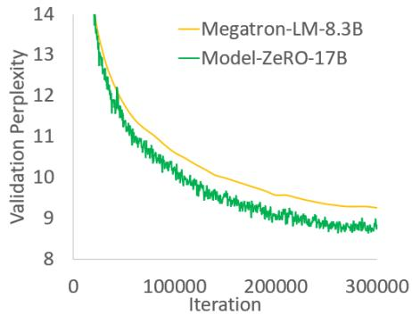
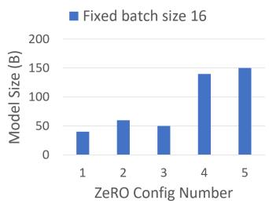
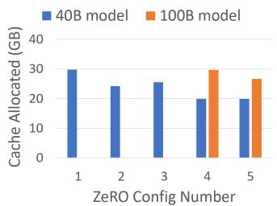

# ZeRO：面向万亿参数模型训练的内存优化

Samyam Rajbhandari∗, Jef Rasley∗, Olatunji Ruwase, Yuxiong He {samyamr, jerasley, olruwase, yuxhe}@microsoft.com

## 摘要

大型深度学习模型带来了显著的准确率提升，但训练数十亿至数万亿参数的模型极具挑战性。现有的解决方案（如数据并行和模型并行）在将这些模型装入有限的设备显存中，同时兼顾计算、通信和开发效率方面存在根本性的局限。我们开发了一种全新的解决方案——零冗余优化器（Zero Redundancy Optimizer, ZeRO）来优化内存/显存，在大幅提高训练速度的同时，增加了可以高效训练的模型规模。ZeRO 消除了数据并行和模型并行训练中的内存冗余，同时保持了较低的通信量和较高的计算粒度，使我们能够随设备数量成比例地扩展模型大小，并保持持续的高效率。我们对内存需求和通信量的分析表明：利用现有的硬件，ZeRO 具有扩展到超过 1 万亿（1 Trillion）参数的潜力。

我们实现并评估了 ZeRO：它在 400 块 GPU 上以超线性加速比训练了超过 100B（1000 亿）参数的大模型，实现了 15 Petaflops 的吞吐量。与现有最先进技术相比，这代表着模型规模扩大了 8 倍，可达到的性能提升了 10 倍。在可用性方面，ZeRO 可以在不需要模型并行（这对科研人员来说更难应用）的情况下训练多达 13B（130 亿）参数的大模型（例如，大于 Megatron GPT 8.3B 和 T5 11B）。最后但同样重要的是，研究人员利用 ZeRO 的系统突破，打造了世界上最大且准确率创纪录的语言模型（17B 参数）。

## 1 扩展引言

深度学习（DL）模型正变得越来越大，模型规模的增加带来了显著的准确率提升。在自然语言处理（NLP）领域，Transformer 为 Bert-large (0.3B) [1]、GPT-2 (1.5B) [2]、Megatron-LM (8.3B) [3]、T5 (11B) [4] 等大模型铺平了道路。为了使模型规模能够继续从数百亿增长到数万亿参数，我们在训练它们时遇到了挑战——它们显然无法容纳在单个设备（例如 GPU 或 TPU）的显存中，而仅仅增加更多设备并不能帮助扩展训练规模。

基础数据并行（DP）并不会减少每台设备上的内存占用，并且在当前配备 32 GB 显存的 GPU 上，对于超过 1.4B 参数的模型会出现内存不足（OOM）。其他现有解决方案，如流水线并行（Pipeline Parallelism, PP）、模型并行（Model Parallelism, MP），

CPU-Offloading（CPU 卸载）等，在功能性、可用性以及内存和计算/通信效率之间进行了权衡，但所有这些对于兼顾速度与规模的训练都至关重要。

在现有的用于训练大模型的不同解决方案中，MP（模型并行，Model Parallelism）或许是最有前景的。当前文献中最大的模型，即 11B 的 T5 模型 [4] 以及 Megatron-LM 8.3B [3]，均由模型并行提供支持，并分别在 Mesh-Tensorflow [5] 和 Megatron-LM [3] 中实现。然而，MP 的扩展能力很难远远超越这些模型规模。MP 垂直切分模型，将每一层中的计算和参数划分到多个设备上，从而需要在每一层之间进行大量的通信。因此，它们在 GPU 间通信带宽较高的单节点内运行良好，但一旦超出单节点，其效率便会迅速下降 [3]。我们使用 Megatron-LM 在两个 DGX-2 节点上测试了一个 40B 参数的模型，观察到每块 V100 GPU 仅能达到约 5 Tflops（低于硬件峰值性能的 5%）。

那么，我们该如何克服现有解决方案的局限性并更高效地训练大模型？为了回答这个问题，我们首先对现有系统在模型训练中的全部内存消耗进行了全面分析，并将其归为两类：1）对于大模型，大部分内存被模型状态（model states）占用，其中包括优化器状态（如 Adam [6] 中的动量和方差）、梯度和参数。2）其余内存被激活值（activation）、临时缓冲区（temporary bufers）以及不可用的碎片化内存消耗，我们统称之为残余状态（residual states）。我们开发了 ZeRO —— 零冗余优化器（Zero Redundancy Optimizer）—— 在获得高计算和通信效率的同时优化这两部分的内存效率。鉴于这两部分面临不同的挑战，我们针对性地开发并讨论了各自的解决方案。

优化模型状态内存 模型状态通常在训练过程中消耗最多的内存，但诸如 DP（数据并行，Data Parallelism）和 MP 等现有方法并未提供令人满意的解决方案。DP 具有良好的计算/通信效率，但内存效率较差；而 MP 的计算/通信效率可能较差。具体而言，DP 在所有数据并行进程之间复制整个模型状态，导致冗余的内存消耗；而 MP 对这些状态进行切分以获得高内存效率，但通常会导致过于细粒度的计算和开销巨大的通信，其扩展效率较低。此外，所有这些方法都在整个训练过程中静态维护所需的所有模型状态，尽管并非所有模型状态在训练期间都自始至终被需要。基于这些观察，我们开发了 ZeRO-DP，即基于 ZeRO 的数据并行，它在达到 MP 内存效率的同时，实现了 DP 的计算/通信效率。ZeRO-DP 通过切分模型状态而不是复制它们，消除了跨数据并行进程的内存状态冗余；同时通过在训练期间使用动态通信调度来保持 DP 的计算粒度和通信量，从而保留了计算/通信效率。

ZeRO-DP 具有三个主要的优化阶段（如图 Figure 1 所示），分别对应优化器状态、梯度和参数的切分。当累积启用时：1) 优化器状态切分 $( P _ { o s } )$：显存占用减少 4 倍，通信量与 DP 相同；

2) 增加梯度切分 $( P _ { o s + g } )$：显存占用减少 8 倍，通信量与 DP 相同；

3) 增加参数切分 $\left( P _ { o s + g + p } \right)$：显存减少量与 DP 度 $N _ { d }$ 呈线性关系。例如，在 64 块 GPU $( N _ { d } = 6 4 )$ 上进行切分将实现 64 倍的显存减少。通信量仅有 50% 的适度增加。

ZeRO-DP 消除了显存冗余，并使集群的全部聚合显存容量变得可用。在所有三个阶段均启用的情况下，ZeRO 仅在 1024 块 NVIDIA GPU 上就能训练一个万亿参数（trillion-parameter）模型。对于一个万亿参数模型，在 16 位精度下使用类似 Adam [6] 的优化器时，大约需要 16 太字节（TB）的显存来容纳优化器状态、梯度和参数。16TB 除以 1024 约为 16GB，这完全在 GPU 的合理显存限制范围之内（例如具有 32GB 设备显存的 GPU）。

  
Figure 1: 比较在 $Z e R O { - } \mathrm { D P }$ 三个优化阶段下，每台设备的模型状态显存消耗。Ψ 表示模型大小（参数量），K 表示优化器状态的显存乘数，$N _ { d }$ 表示 DP 度。在本示例中，我们假设模型大小为 $\Psi = 7 . 5 B$，基于使用 Adam 优化器的混合精度训练，DP 度 $N _ { d } = 6 4$ 且 $K = 1 2$。

优化残差状态显存 在 ZeRO-DP 提升了模型状态的显存效率之后，由激活值、临时缓冲区和不可用显存碎片所消耗的其余显存可能会成为次要显存瓶颈。我们开发了 ZeRO-R，分别针对由这三个因素所消耗的残差显存进行优化。

1) 对于激活值（在前向传播中存储以执行反向传播），我们注意到激活值检查点（checkpointing）[7] 有所帮助，但对于大模型而言仍然不足。因此，ZeRO-R 通过激活值切分，识别并消除了现有 MP（模型并行）方法中的激活值复制，从而优化了激活值显存。它还会在适当时将激活值卸载至 CPU。

2) ZeRO-R 为临时缓冲区定义了适当的大小，以在显存和计算效率之间取得平衡。

3) 我们观察到，在训练过程中由于不同张量的生命周期差异会导致显存碎片。碎片化导致的连续显存匮乏可能会引起显存分配失败，即使此时有足够的空闲显存。ZeRO-R 根据张量的不同生命周期主动管理显存，从而防止显存碎片化。

ZeRO-DP 和 ZeRO-R 结合在一起，构成了一套强大的 DL 训练显存优化系统，我们统称为 ZeRO。

ZeRO 与 MP：由于 ZeRO 消除了 DP 中的内存低效问题，人们自然会问：我们是否仍然需要 MP，以及在何时需要？ZeRO 如何与 MP 协同工作？有了 ZeRO，仅为了容纳大模型而言，MP 变得不再那么具有吸引力。ZeRO-DP 在减少每设备内存占用方面至少与 MP 一样有效，甚至在 MP 无法均匀划分模型时有时更为有效。它还具有相当或更好的扩展效率。此外，数据并行非常易于使用，因而广泛适用于不同的工作负载，而

  
Figure 2: 不同模型规模下 ZeRO 的训练吞吐量以及相对于 SOTA 基线的加速比。对于 ZeRO，MP 始终容纳在单个节点内，而对于基线，大于 40B 参数的模型则需要跨节点 MP。

如今的 MP 方法通常需要模型开发者修改其模型，系统开发者设计分布式算子，且像 Megatron-LM 这样的现有工作仅支持有限的算子和模型集合。

话虽如此，仍有一些情况下我们需要利用 MP：i) 当与 ZeRO-R 结合使用时，MP 可以减少超大模型的激活内存占用。ii) 对于激活内存不是问题的较小模型，如果仅使用 DP 导致聚合批大小（aggregated batch size）过大而无法获得良好的收敛性，MP 也能带来好处。1 在这些情况下，可以将 ZeRO 与 MP 结合，以可接受的聚合批大小容纳模型。

我们表明 ZeRO 可以与 MP 相结合，在 DP 度为 $N _ { d }$ 且 MP 度为 $N _ { m }$ 时，每台设备上的理论最大内存减少量可达 $N _ { d } \times N _ { m }$ 倍。这使我们能够在 1024 块 GPU 上，通过节点内 16 路模型并行（在每个 DGX2 节点内）和跨节点 64 路数据并行，容纳一个万亿参数的模型，并以适度的批大小高效运行它！

实现与评估（Implementation & Evaluation） ZeRO 中的全套优化使我们能够在当今的高端硬件集群（例如配备 1K 块 V100 GPU）上运行万亿参数模型，然而硬件计算能力仍然过于有限，训练时间可能长到不切实际（>1 年）。因此，我们本实现方案的重点是在当前硬件的计算能力范围内，高效支持比当前最先进技术（SOTA）大 10 倍参数（约 100B 参数）的模型。我们实现并评估了 ZeRO 中的一个优化子集——称为 $Z e R O _ { - } \mathrm { 1 0 0 B } \mathrm { ~ - ~ } P _ { o s + g }$，即 ZeRO-DP 加上 ZeRO-R 的一部分——使我们能够实现这一目标。结果表明：

模型规模（Model Size） 与 MP 相结合时，ZeRO-100B 可以高效运行 170B 参数的模型，而如图 Figure 2 所示，仅使用 Megatron 等现有系统无法高效扩展至超过 40B 参数。与 SOTA 相比，模型规模提升了 8 倍以上。

速度 提高的内存效率带来了更高的吞吐量和更快的训练速度。如图 2 所示，ZeRO 在由 400 块 Nvidia V100 GPU 组成的集群上运行 100B 参数模型，单 GPU 性能超过

  
Figure 3: 使用 ZeRO-100B 训练 60B 参数模型时的超线性可扩展性以及单 GPU 训练吞吐量。

每 GPU 38 TFlops，聚合性能超过 15 Petaflops。与相同模型规模下的 SOTA 相比，训练速度提升了 10 倍以上。

可扩展性 我们在 64-400 块 GPU 的范围内观察到了超线性加速比，即当我们将 GPU 数量增加一倍时，性能提升超过一倍。这是 ZeRO-DP 的一个特性：随着我们增加 DP（数据并行）度，它减少了模型状态的内存占用，使我们能够在每个 GPU 上容纳更大的批大小（batch size），从而获得更好的性能。我们预计，随着我们将 GPU 数量增加到 400 块以上，这种特性将继续保持。

大模型训练的大众化 ZeRO-100B 使数据科学家能够在无需任何需要重构模型的 MP（模型并行）或 PP（流水线并行）的情况下，训练参数量高达 13B 的模型，而 13B 已经超过了文献中最大的模型参数量（具有 11B 参数的 T5）。因此，数据科学家可以自由地尝试大型模型，而无需担心并行性问题。相比之下，现有系统（例如 PyTorch Distributed Data Parallel）在运行 1.4B 参数模型时就会出现显存不足（OOM）。

新的 SOTA 模型 ZeRO 助力构建了参数量达 17B 且具有破纪录精度的最大语言模型——Turing-NLG [9]。

我们将 ZeRO 作为名为 Deep-Speed2 的开源 DL（深度学习）训练优化库的一部分进行共享。我们计划在 2020 年 5 月底之前发布本文中描述的所有实现，并通过启用对参数进行划分的 ZeRO-DP 第 3 阶段 $\left( P _ { o s + g + p } \right)$ 进一步扩展它以支持 1 万亿参数。我们计划让 DL 社区能够完全使用 ZeRO，以促进大规模大模型训练的演进和大众化。

## 2 相关工作

## 2.1 数据、模型和流水线并行

并行化是进行大规模大模型训练的关键策略。对于在训练时能够放入设备内存中的模型，数据并行（Data Parallelism，DP）被用于将训练扩展到多个设备。在 DP 中，模型参数在每个设备上都有一份副本。在每一步中，一个 mini-batch 会被均匀地划分到所有数据并行进程中，以便每个进程在不同的数据样本子集上执行前向和反向传播，并使用跨进程的平均梯度在本地更新模型。

当模型无法放入设备内存时，模型并行（Model Parallelism，MP）[5, 3] 和流水线并行（Pipeline Parallelism，PP）[10, 11] 会分别以垂直和水平的方式将模型划分到各个进程中。第 1 节讨论了 ZeRO 与 DP 和 MP 的关系。我们现在讨论 PP 及其与降低内存消耗的关系。

PP（流水线并行，Pipeline Parallelism）通过跨层水平切分模型，在不同的设备上运行每个分区，并使用微批次（micro-batching）来隐藏流水线气泡（pipeline bubble）[10, 11]。由于水平切分和微批次机制，权重共享（tied-weights）和批归一化（batch-normalization）等模型功能较难实现。主流的 PP 实现（如 G-pipe [10]）同时对模型参数和总激活值进行分区，但需要与流水线分区数量成比例的批大小（batch size）来隐藏流水线气泡。过大的批大小可能会影响收敛速度，同时存储激活值也需要大量的内存。PipeDream [12] 中的另一种 PP 实现则保留了多份陈旧参数（stale parameters）的副本以隐藏流水线气泡，而无需显著增加批大小，但这降低了其内存效率。此外，该实现并不等价于标准的 DL（深度学习）训练，并且会对训练收敛性产生影响。相比之下，ZeRO 能够获得与 PP 相同甚至更高的内存效率，且不会引入 PP 在功能性、性能和收敛性方面的限制。

## 2.2 基于非并行的方法减少内存

除了 MP 和 PP 之外，还有多项旨在降低 DL 训练内存开销的研究工作。

## 2.2.1 减少激活内存

许多研究工作专注于通过压缩 [13]、激活检查点（activation checkpointing）[7, 14] 或活跃度分析（live analysis）[15] 来减少激活值的内存占用。这些工作与 ZeRO 是互补的，并且可以与 ZeRO 协同工作。事实上，ZeRO-R 中的激活内存减少技术是与激活检查点并行配合工作的。

## 2.2.2 CPU 卸载（CPU Offload）

[16, 17] 利用了当今计算节点的异构特性，分别通过算法设计或虚拟化内存将模型状态卸载到 CPU 内存中。训练时间的至多 50% 可能会消耗在 GPU-CPU-GPU 的传输上 [16]。ZeRO 的不同之处在于，它在显著降低内存消耗的同时，无需将模型状态存储到因 PCI-E 而带宽严重受限的 CPU 内存中。在极少数情况下，针对极大模型，ZeRO-R 可能会仅卸载激活检查点以提升性能（详见第 6.1 节）。

## 2.2.3 内存高效优化器

[18, 19] 专注于通过维护模型参数和梯度的更粗粒度统计信息来降低自适应优化方法的内存消耗，但这可能对模型的收敛性保证产生潜在影响。ZeRO 与这些工作是正交的，其优化既不改变模型优化方法，也不影响模型收敛性，却能有效减少每个设备上优化器状态和梯度的内存占用。

## 2.3 训练优化器

自适应优化方法 [20, 6, 21, 22] 对于大模型的有效模型训练以实现 SOTA 性能和精度至关重要。与 SGD 相比，它们通过为每个模型参数和梯度维护细粒度的一阶和二阶统计量，代价是巨大的显存占用。ZeRO 可以将这些优化器的显存占用降低数个数量级，使得这些复杂的优化方法在显存容量有限的硬件设备上训练大模型变得切实可行。它还使得开发和使用收敛性更好、但更复杂且更消耗显存的优化器成为可能。

## 3 显存都去哪儿了？

让我们退一步来审视当前训练系统的显存消耗。例如，一个 1.5B 参数的 GPT-2 模型在 16 位精度下需要 3GB 的显存来存储其权重（或参数），然而，使用 TensorFlow 或 PyTorch 却无法在具有 32GB 显存的单张 GPU 上进行训练。人们可能会好奇显存都消耗在哪里了。在模型训练期间，大部分显存被模型状态（model states）消耗，即由优化器状态、梯度和参数组成的张量。除了这些模型状态之外，其余的显存被激活值、临时缓冲区和内存碎片消耗，我们称之为残余状态（residual states）。我们将详细剖析这两方面的显存消耗。

## 3.1 模型状态：优化器状态、梯度和参数

在训练期间，设备显存的大部分被模型状态消耗。以深度学习（DL）训练中最常用的优化器之一 Adam [6] 为例。Adam 需要存储两个优化器状态：i) 时间平均动量，以及 ii) 梯度的方差，以用于计算更新。因此，要使用 ADAM 训练模型，必须有足够的显存来保存梯度的动量和方差副本。此外，还需要足够的显存来存储梯度和权重本身。在这三种与参数相关的张量中，优化器状态通常消耗最多的显存，特别是在应用混合精度训练时。

混合精度训练（Mixed-Precision Training） 在当前一代 NVIDIA GPU 上训练大模型的最先进方法是通过混合精度（fp16/32）训练 [23]，其中参数和激活值存储为 fp16，从而能够利用这些 GPU 上的高吞吐量 Tensor Core 单元 [24]。在混合精度训练期间，前向传播和反向传播均使用 fp16 权重和激活值执行。然而，为了在反向传播结束时有效地计算并应用更新，混合精度优化器会保留一份参数的 fp32 副本以及所有其他优化器状态的 fp32 副本。

让我们以 Adam 为具体例子。使用 Adam 对具有 $\Psi$ 个参数的模型进行混合精度训练时，需要足够的显存来保存参数和梯度的 fp16 副本，其显存需求分别为 $2\Psi$ 和 $2\Psi$ 字节。此外，它还需要保存优化器状态：参数、动量（momentum）和方差（variance）的 fp32 副本，显存需求分别为 $4\Psi$、$4\Psi$ 和 $4\Psi$ 字节。我们用 $K$ 表示优化器状态的显存乘数，即存储它们所需的额外显存为 $K\Psi$ 字节。混合精度 Adam 的 $K = 12$。总共导致 $2\Psi + 2\Psi + K\Psi = 16\Psi$ 字节的显存需求。对于像具有 15 亿（1.5 Billion）参数的 GPT-2 这样的模型，这会导致至少 24 GB 的显存需求，这显著高于仅保存 fp16 参数所需的区区 3 GB 显存。

## 3.2 残余显存消耗

在训练过程中，激活值（activations）可能会占用大量的显存 [7]。举个具体的例子，在序列长度为 1K、批次大小（batch size）为 32 的情况下训练 15 亿参数的 GPT-2 模型大约需要 60 GB 的显存3。激活检查点（activation checkpointing，或激活重计算 activation recomputation）是一种常用的方法，它以 33% 的重计算开销为代价，将激活值显存减少到大约总激活值的平方根量级 [7]。这会将该模型的激活值显存消耗减少到大约 8 GB。

尽管减少幅度很大，但对于更大的模型，即使使用了激活检查点，激活值显存也会变得相当大。例如，对于一个拥有 1000 亿参数的类 GPT 模型，即使使用激活检查点，在批次大小为 32 时也需要大约 60 GB 的显存。

用于存储中间结果的临时缓冲区（temporary buffers）在大模型中会消耗相当可观的显存。像梯度 all-reduce 或梯度范数（gradient norm）计算这类操作，往往倾向于在执行操作前将所有梯度融合到单个扁平化缓冲区中，以提高吞吐量。例如，跨设备的 all-reduce 带宽会随着消息大小的增大而提高。虽然梯度本身通常以 fp16 张量的形式存储，但根据具体操作，融合后的缓冲区可能是 fp32 张量。当模型规模很大时，这些临时缓冲区的大小是不容忽视的。例如，对于一个具有 15 亿参数的模型，扁平化的 fp32 缓冲区将需要 6 GB 的显存。

内存碎片（Memory Fragmentation）：到目前为止，我们讨论了训练期间的实际显存消耗。此外，即使存在大量可用显存，也有可能耗尽可用显存。这可能会因内存碎片而发生。如果没有足够的连续内存来满足请求，即使总可用内存大于请求大小，内存请求也会失败。我们在训练超大模型时观察到了严重的内存碎片现象，在某些极端情况下，即使仍有超过 30% 的显存可用，也会导致显存不足（out of memory）的问题。

## 4 ZeRO：洞察与概述

ZeRO 包含两套优化技术：i）旨在减少模型状态显存占用的 ZeRO-DP，以及 ii）旨在减少残余显存消耗的 ZeRO-R。我们概述了这些优化技术及其背后的洞察，这些洞察使 ZeRO 能够在保持高效的同时减少显存占用。请注意，效率是这里的关键：如果没有这一限制，诸如将所有参数状态移动到 CPU 内存，或者任意增加模型并行（MP）度等简单方案都可以减少显存占用。

## 4.1 洞察与概述：ZeRO-DP

基于 ZeRO 的数据并行（DP）建立在三个关键洞察之上：

a) DP 的扩展效率优于 MP，因为 MP 降低了计算粒度，同时也增加了通信开销。超过一定限度后，较低的计算粒度会降低每个 GPU 的效率，而增加的通信开销会阻碍跨 GPU 的可扩展性，尤其是在跨越节点边界时。相反，DP 既具有更高的计算粒度，又具有更低的通信量，从而能实现高得多的效率。

b) DP 在显存利用上是低效的，因为模型状态在所有数据并行进程中冗余存储。相反，MP 对模型状态进行切分以获得显存效率。

c) DP 和 MP 都保留了整个训练过程中所需的所有模型状态，但并非所有内容在任何时候都是必需的。例如，对应于每一层的参数仅在该层的前向传播和反向传播期间才需要。

基于这些洞察，ZeRO-DP 在保持 DP 训练效率的同时，实现了 MP 的显存效率。ZeRO-DP 对模型状态进行切分而不是复制（第 5 节），并使用动态通信调度，利用模型状态内在的时间特性，同时将通信量降至最低（第 7 节）。通过这样做，ZeRO-DP 随着 DP 度的增加线性减少模型的单设备显存占用，同时保持通信量接近默认 DP 的通信量，从而保留了效率。

## 4.2 洞察与概述：ZeRO-R

## 4.2.1 减少激活显存

两个关键洞察是：

a) MP 切分了模型状态，但通常需要复制激活显存。例如，如果我们将一个线性层的参数进行垂直切分并在两个 GPU 上并行计算，则每个 GPU 都需要完整的激活值来计算其切分部分。

b) 对于像 GPT-2 或更大的模型，算术强度（每次迭代的计算量与每次迭代激活检查点数量的比值）非常大（≥ 10K），并且随着隐藏层维度线性增加，这使得即使在带宽较低的情况下，也可以隐藏激活检查点的数据移动开销。

ZeRO 通过在各个 GPU 之间划分激活检查点（activation checkpoints）来消除 MP 中的内存冗余，并使用 allgather 按需重建它们。激活内存占用量与 MP 的并行度成比例减少。对于超大型模型，ZeRO 甚至可以选择将激活分区移动到 CPU 内存中，同时由于这些模型具有较高的计算强度，仍能实现良好的效率。

## 4.2.2 临时缓冲区管理

ZeRO-R 使用恒定大小的缓冲区，以避免临时缓冲区随着模型规模的增加而急剧膨胀，同时使其保持足够大以确保高效。

## 4.2.3 碎片化内存管理

内存碎片化是由短生命周期和长生命周期的内存对象相互交错导致的。在前向传播期间，激活检查点是长生命周期的，但重新计算出的激活则是短生命周期的。类似地，在反向计算中，激活梯度是短生命周期的，而参数梯度是长生命周期的。基于这一认识，

ZeRO 通过将激活检查点和梯度移动到预先分配的连续内存缓冲区中来执行动态内存碎片整理。这不仅增加了内存可用性，还通过减少内存分配器查找空闲连续内存所需的时间来提高效率。

## 5 深入探讨 ZeRO-DP

现有的 DP 方法在每个设备上复制模型状态并带来显著的内存开销，而 ZeRO-DP 则通过在数据并行进程之间划分这些状态——优化器状态、梯度和参数——来消除这种内存冗余。Figure 1 对使用和不使用 ZeRO-DP 时的内存需求进行了量化和可视化。该图展示了累积划分 (1) 优化器状态、(2) 梯度和 (3) 参数冗余后的内存占用。我们将它们称为 ZeRO-DP 的三个优化阶段：$P _ { o s } , P _ { g }$ 和 $P _ { p }$，下面我们将对此进行详细阐述。

## 5.1 $\mathbf { P } _ { o s }$ : 优化器状态划分

对于 DP 并行度为 $N _ { d } .$ 的情况，我们将优化器状态分成 $N _ { d }$ 个相等的分区，使得第 $i ^ { t h }$ 个数据并行进程仅更新与第 $i ^ { t h }$ 个分区对应的优化器状态。因此，每个数据并行进程只需要存储和更新全部优化器状态的 $\frac { 1 } { N _ { d } }$，进而仅更新 $\frac { 1 } { N _ { d } }$ 的参数。我们在每个训练步骤结束时跨数据并行进程执行 all-gather，以获取所有数据并行进程上完全更新后的参数。

内存节省：如图 Figure 1 所示，在优化状态切分后，内存消耗从 $\begin{array} { r } { 4 \Psi + K \Psi \mathrm { \ t o \ } 4 \Psi + \frac { K \Psi } { N _ { d } } } \end{array}$ 降低。正如 Figure 1 中所示的具体示例，一个 7.5 B 参数的模型在使用 64 路 DP $( N _ { d } = 6 4 )$ 的 $P _ { o s }$ 时需要 31.4GB 的内存，而在标准 DP 下则需要 120 GB。此外，当 $N _ { d }$ 很大时，模型状态的内存需求从 4Ψ + 12Ψ = 16Ψ 字节减少到 $\begin{array} { r } { 4 \Psi + \frac { 1 2 \Psi } { N _ { d } } \approx 4 \Psi } \end{array}$ 字节，实现了 4 倍的减少。

## 5.2 ${ \mathbf { P } } _ { g } \mathbf { : }$ 梯度切分

由于每个数据并行进程仅更新其对应的参数分区，因此它只需要对应参数规约后的梯度。所以，在反向传播过程中，当每一层的每个梯度变为可用时，我们仅在负责更新对应参数的数据并行进程上对它们进行规约（reduce）。在规约完成后，我们不再需要这些梯度，其占用的内存也可以被释放。这使保存梯度所需的内存占用从 2Ψ 字节减少到 $\frac { 2 \Psi } { N _ { d } }$。

实际上这是一种 Reduce-Scatter（规约-分散）操作，其中对应于不同参数的梯度被规约到不同的进程上。为了在实践中提高效率，我们采用了一种分桶（bucketization）策略，将对应于某一特定分区的所有梯度分桶，并一次性对整个桶执行规约。这在理念上类似于 NVIDIA 的 AMP [25] 优化器通过对 all-reduce 梯度计算进行分桶以重叠通信与计算。而在我们的方案中，我们在分区边界执行规约（reduction）而不是 all-reduce，以减少内存占用并重叠计算与通信。

内存节省：通过消除梯度和优化器状态两者的冗余，我们将内存占用进一步降低至 $\begin{array} { r } { 2 \Psi + \frac { 1 4 \Psi } { N _ { d } } \approx 2 \Psi } \end{array}$。正如 Figure 1 中的示例，一个 7.5 B 参数的模型在使用 64 路 DP $( N _ { d } = 6 4 )$ 的 $P _ { o s + g }$ 时仅需要 16.6 GB 的内存。

<table><tr><td rowspan="2">DP</td><td colspan="3">7.5B 模型 (GB)</td><td colspan="3">128B 模型 (GB)</td><td colspan="3">1T 模型 (GB)</td></tr><tr><td> $P_{os}$ </td><td> $P_{os+g}$ </td><td> $P_{os+g+p}$ </td><td> $P_{os}$ </td><td> $P_{os+g}$ </td><td> $P_{os+g+p}$ </td><td> $P_{os}$ </td><td> $P_{os+g}$ </td><td> $P_{os+g+p}$ </td></tr><tr><td>1</td><td>120</td><td>120</td><td>120</td><td>2048</td><td>2048</td><td>2048</td><td>16000</td><td>16000</td><td>16000</td></tr><tr><td>4</td><td>52.5</td><td>41.3</td><td>30</td><td>896</td><td>704</td><td>512</td><td>7000</td><td>5500</td><td>4000</td></tr><tr><td>16</td><td>35.6</td><td>21.6</td><td>7.5</td><td>608</td><td>368</td><td>128</td><td>4750</td><td>2875</td><td>1000</td></tr><tr><td>64</td><td>31.4</td><td>16.6</td><td>1.88</td><td>536</td><td>284</td><td>32</td><td>4187</td><td>2218</td><td>250</td></tr><tr><td>256</td><td>30.4</td><td>15.4</td><td>0.47</td><td>518</td><td>263</td><td>8</td><td>4046</td><td>2054</td><td>62.5</td></tr><tr><td>1024</td><td>30.1</td><td>15.1</td><td>0.12</td><td>513</td><td>257</td><td>2</td><td>4011</td><td>2013</td><td>15.6</td></tr></table>

Table 1: 作为 DP 程度函数的 $Z e R O { - } \mathrm { D P }$ 中不同优化策略的单设备内存消耗。粗体文本表示模型可以放入 32GB V100 GPU 集群中的组合。

而标准 DP 则需要 120 GB。当 $N _ { d }$ 较大时，模型状态的内存需求从 $2 \Psi + 1 4 \Psi = 1 6 \Psi$ 字节减少到 $\begin{array} { r } { 2 \Psi + \frac { 1 4 \Psi } { N _ { d } } \approx 2 \Psi } \end{array}$ 字节，实现了 8 倍的减少。

## 5.3 $\mathbf { P } _ { p } \mathbf { : }$ : 参数划分

正如优化器状态和梯度一样，每个进程只存储与其划分相对应的参数。当前向传播和反向传播需要其划分之外的参数时，它们会通过广播从相应的数据并行进程中接收。虽然乍一看这似乎会产生显著的通信开销，但我们表明，这种方法仅将基线 DP 系统的总通信量增加到 1.5 倍，同时实现了与 $N _ { d }$ 成比例的内存减少。

内存节省：通过参数划分，我们将 $\Psi$ 参数模型的内存消耗从 $16\Psi$ 减少到 $\frac { 1 6 \bar { \Psi } } { N _ { d } }$。如 Figure 1 中的示例所示，一个 7.5B 参数模型在使用 64 路 DP $( N _ { d } = 6 4 )$ 的 $P _ { o s + p + g }$ 时需要 1.9 GB 的模型状态内存，而使用标准 DP 时需要 120 GB。这具有深远的意义：只要有足够数量的设备来共享模型状态，ZeRO 就能让 DP 容纳任意大小的模型。

## 5.4 对模型大小的影响

三个切分阶段 $P _ { o s } , \ P _ { o s + g } ,$ 和 $P _ { o s + g + p }$ 分别将每个数据并行进程在模型状态上的内存消耗最多降低 4 倍、8 倍和 $N _ { d }$ 倍。Table 1 分析了在不同 DP 度数下，几个示例模型在 $Z e R O { - } \mathrm { D P }$ 优化的 3 个阶段中的模型状态内存消耗。在没有 $Z e R O$ 的情况下，无论 DP 度数是多少，内存消耗都等于表中的第一行。需要注意，在 $N _ { d } = 6 4$ 时，ZeRO 分别使用 $P _ { o s } , \ P _ { o s + g } ,$ 和 $P _ { o s + g + p }$ 可以训练高达 7.5B、14B 和 128B 参数的模型。当 $N _ { d } = 1 0 2 4$ 时，启用了所有优化的 ZeRO $\left( P _ { o s + g + p } \right)$ 可以训练拥有 1 万亿（1 Trillion）参数的模型！甚至可能训练任意规模的模型！若没有 ZeRO，仅靠 DP 能运行的最大模型参数量不足 15 亿（1.5 Billion）。

## 6 深入探讨 ZeRO-R

## 6.1 $P _ { a }$ : 分区激活检查点（Partitioned Activation Checkpointing）

正如 4.2 节所讨论的，MP（模型并行）在设计上需要复制激活值，从而导致在模型并行 GPU 之间产生激活值的冗余副本。ZeRO 通过切分激活值来消除这种冗余，并且仅在计算中使用激活值之前，一次具体化一个激活层为复制形式。更具体地，一旦计算完模型某一层的正向传播，输入激活值就会被切分并分布到所有模型并行进程中，直到反向传播中再次需要它。此时，ZeRO 使用 all-gather 操作重新具体化激活值的副本。我们将这种优化称为 $P _ { a } .$。它与激活检查点（activation checkpointing）[7] 结合使用，仅存储分区的激活检查点，而不是复制副本。此外，在超大模型且设备显存非常有限的情况下，这些分区的激活检查点也可以卸载到 CPU，以额外的通信开销为代价将激活显存开销降低到接近零，我们将在第 7 节中对此进行讨论。我们将此称为 $P _ { a + c p u }$。

内存节省（Memory Saving） 通过分区激活检查点，ZeRO 能够以与 MP 度数成正比的比例减少激活显存占用。考虑训练 Table 4 中所示的 100B 模型，批大小（batch size）为 32，序列长度为 1024，MP 度数为 16。如果我们为每个 Transformer 层检查点保存单个激活，仅存储激活检查点就需要每个 GPU 大约 33 GB 的显存。但是通过 ZeRO 中的 $\mathrm { P } _ { a }$，每个 GPU 的显存占用可以减少到约 2 GB。此外，这 2GB 还可以卸载到 CPU，使激活显存占用降低到几乎为零。

## 6.2 $\mathbf { C } _ { B } \mathbf { : }$ 恒定大小缓冲区（Constant Size Buffers）

ZeRO 精心选择临时数据缓冲区（temporal-data buffer）的大小，以平衡内存与计算效率。在训练期间，某些操作的计算效率高度依赖于输入大小，较大的输入能实现更高的效率。例如，大型 all-reduce 操作能够获得比小型操作高得多的带宽。因此，为了获得更高的效率，诸如 NVIDIA Apex 或 Megatron 等高性能库在应用这些操作之前会将所有参数融合到一个单独的缓冲区中。然而，融合缓冲区的内存开销与模型大小成正比，并可能成为阻碍。例如，对于一个 3B 参数的模型，一个 32 位的融合缓冲区将需要 12 GB 的内存。为了解决这一问题，当模型变得过大时，我们只需使用具有良好性能效率的固定大小融合缓冲区。这样一来，缓冲区大小便不再依赖于模型大小，并且通过保持足够大的缓冲区尺寸，我们仍然能够实现良好的效率。

## 6.3 $\mathbf { M } _ { D } \mathbf { : }$ 内存碎片整理

模型训练中的内存碎片是由激活检查点（activation checkpointing）和梯度计算导致的。在带有激活检查点的前向传播过程中，只有选定的激活值会被保存用于反向传播，而大多数激活值会被丢弃，因为它们可以在反向传播期间被重新计算。这造成了短生命周期内存（被丢弃的激活值）和长生命周期内存（检查点激活值）的交错，从而导致内存碎片。同样，在反向传播期间，参数梯度是长生命周期的，而激活梯度以及计算参数梯度所需的任何其他缓冲区则是短生命周期的。长短期内存的这种交错再次引发了内存碎片。

<table><tr><td rowspan="2">MP</td><td rowspan="2">GPUs</td><td colspan="4">理论最大模型大小</td><td colspan="2">实测模型大小</td></tr><tr><td>基线</td><td> $P_{os}$ </td><td> $P_{os+g}$ </td><td> $P_{os+g+p}$ </td><td>基线</td><td>ZeRO-DP ( $P_{os}$ )</td></tr><tr><td>1</td><td>64</td><td>2B</td><td>7.6B</td><td>14.4B</td><td>128B</td><td>1.3B</td><td>6.2B</td></tr><tr><td>2</td><td>128</td><td>4B</td><td>15.2B</td><td>28.8B</td><td>256B</td><td>2.5B</td><td>12.5B</td></tr><tr><td>4</td><td>256</td><td>8B</td><td>30.4B</td><td>57.6B</td><td>0.5T</td><td>5B</td><td>25B</td></tr><tr><td>8</td><td>512</td><td>16B</td><td>60.8B</td><td>115.2B</td><td>1T</td><td>10B</td><td>50B</td></tr><tr><td>16</td><td>1024</td><td>32B</td><td>121.6B</td><td>230.4B</td><td>2T</td><td>20B</td><td>100B</td></tr></table>

Table 2: 通过内存分析得出的最大模型大小（左）以及使用 ZeRO-OS 运行时测得的模型大小（右）。使用 $P _ { o s }$ 测得的模型大小与理论最大值相匹配，表明我们的内存分析为模型大小提供了切实可行的上限。

当有充裕的空闲内存时，有限的内存碎片通常不是问题，但对于在受限内存下运行的大模型训练而言，内存碎片会导致两个问题：i) 即使有足够可用的内存，由于缺乏连续内存而导致 OOM（内存溢出，Out of Memory）；ii) 由于内存分配器花费大量时间寻找连续内存块以满足内存请求，从而导致效率低下。

ZeRO 通过为激活检查点（activation checkpoints）和梯度预分配连续内存块，并在它们生成时将其复制到预分配的内存中，从而实现实时的内存碎片整理。$\mathrm { M } _ { D }$ 不仅使 ZeRO 能够以更大的批次大小（batch sizes）训练更大的模型，而且提高了在受限内存下训练时的效率。

## 7 ZeRO-DP 的通信分析

由于 ZeRO 通过消除内存冗余来提升模型规模，很自然会问我们是否以通信量为代价换取了内存效率。换言之，基于 ZeRO 的 DP 方法与基线 DP 方法相比通信量是多少？答案分为两部分：i) ZeRO-DP 在使用 $P _ { o s }$ 和 $P _ { g } { \mathrm { : } }$ 时不会产生额外的通信，同时可实现高达 8 倍的内存减少；ii) 在使用 $P _ { o s }$ 和 $P _ { g }$ 的基础上额外使用 $P _ { p }$ 时，ZeRO-DP 最多产生 1.5 倍的通信量，同时将内存占用进一步减少 $N _ { d }$ 倍。我们在本节中给出分析。我们首先简要概述标准 DP 的通信量。

## 7.1 数据并行通信量

在数据并行训练期间，在计算下一步的更新之前，反向传播结束时会对所有数据并行进程的梯度求平均。求平均是通过 all-reduce 通信原语完成的。对于大模型规模，all-reduce 通信完全受限于通信带宽，因此，我们将分析限定在进出每个数据并行进程的总通信量上。

最先进的 all-reduce 实现采用两步法：第一步是 reduce-scatter 操作，在不同进程上规约数据的不同部分；下一步是 all-gather 操作，其中每个进程收集所有进程上规约后的数据。这两步的结果即为一个 all-reduce。reduce-scatter 和 all-gather 均采用流水线方法实现，对于包含 Ψ 个元素的数据，每个操作导致的总数据移动量均为 Ψ 个元素。因此，标准 DP 在每个训练步中会产生 2Ψ 的数据移动。

## 7.2 ZeRO-DP 通信量

## 7.2.1 采用 $P _ { o s + g }$ 时的通信量

在梯度切分下，每个进程仅存储更新其对应参数分区所需的梯度部分。因此，ZeRO 不需要进行 all-reduce，而只需对梯度执行 reduce-scatter 操作，产生 $\Psi$ 的通信量。在每个进程更新其负责的参数分区后，执行一次 all-gather 以从所有数据并行进程中收集所有更新后的参数。这也产生 $\Psi$ 的通信量。因此，每个训练步骤的总通信量为 $\Psi + \Psi = 2 \Psi$，与基准 DP 完全相同。

## 7.2.2 $P _ { o s + g + p }$ 的通信量

在参数切分后，每个数据并行进程仅存储它负责更新的参数。因此，在前向传播期间，它需要接收所有其他分区的参数。然而，这可以通过流水线化来避免内存开销。在对对应于特定分区的模型部分计算前向传播之前，负责该分区的数据并行进程可以将权重广播给所有数据并行进程。一旦该分区的前向传播完成，这些参数就可以被丢弃。因此，总通信量为 $\frac { \Psi \times N _ { d } } { N _ { d } } = \Psi$。换句话说，我们通过将参数 all-gather 分散在整个前向传播过程中，并在参数使用后将其丢弃，从而重新调度了参数 all-gather。但是请注意，在反向传播中需要以相反的顺序再次进行此 all-gather。

因此，总通信量是这些 all-gather 产生的通信量与梯度的 reduce-scatter 产生的通信量之和。因此总通信量为 3Ψ，是基准的 1.5 倍。梯度切分和参数切分都利用了这一洞察——即并非所有梯度和参数状态在所有时刻都是必需的——通过合理地通信这些状态来优化内存。

## 8 ZeRO-R 的通信分析

我们将 ZeRO-R 中分区激活检查点（$P _ { a }$）的通信量与基准 MP 进行了对比，并表明 $P _ { a }$ 带来的通信量增加通常不到基准 MP 的十分之一。此外，我们分析了 $P _ { a }$ 相对于 DP 通信量的通信开销，以确定 $P _ { a }$ 通过支持更大的批次大小（batch size）并减少 DP 通信来提高效率的场景。我们利用这种分析来决定是否以及何时应用 $P _ { a }$ 以及 $P _ { a + c p u }$。

划分激活检查点（activation checkpoint）的通信量权衡取决于模型大小、检查点策略以及模型并行（MP）策略。为了分享具体的见解，我们在使用 SOTA MP 方法 Megatron-LM 实现的基于 Transformer 的模型的语境下进行了分析。

在带有激活检查点的 Megatron-LM 中，每个 Transformer 块在前向传播中执行两次大小为 $\text{batch} \times ~ s e q \_ l e n g t h \times h i d d e n \_ d i m$ 的 all-reduce 操作，在前向重计算中执行两次 all-reduce，在反向传播中再执行两次。由于 all-reduce 的通信量是消息大小的 $2 \times$，因此每个块的总通信量为 $1 2 \times s e q \_ l e n g t h \times h i d d e n \_ d i m$。

当 ${ Z e R O - \mathrm { R } }$ 划分激活检查点时，它需要在对每个激活检查点进行反向传播的前向重计算之前执行一次额外的 all-gather 操作。通常，我们对每个 Transformer 块的输入激活设置检查点，从而每个 Transformer 块需要一次 all-gather。由于 all-gather 的通信量等于消息大小，因此通信开销 $P _ { a }$ 为 seq length ∗ hidden dim。因此，$P _ { a }$ 的总通信开销不到模型并行原始通信量的 10%。

当 MP 与数据并行（DP）结合使用时，可以使用 $P _ { a }$ 以模型并行通信量增加 10% 为代价，将数据并行通信量减少一个数量级，并在数据并行通信成为性能瓶颈时显著提高效率。请注意，$P _ { a }$ 将激活内存消耗降低了 MP 度数（MP degree）倍，从而允许按比例增加批量大小（batch size）。对于大模型，MP 可以高达 16（DGX-2 节点上的 GPU 数量），从而允许批量大小最多增加 16 倍。数据并行训练的通信量与批量大小成反比。因此，由 $P _ { a }$ 带来的批量大小的一个数量级增加可能会导致数据并行通信量的一个数量级减少。

最后，如果应用 $P _ { a + c p u }$，划分后的激活检查点将被卸载（offload）到 CPU，相比于 $P _ { a }$，虽然增加了 2 倍往返于 CPU 内存的数据传输，但将激活内存需求降低至接近于零。在极端情况下，即即使使用 $P _ { a }$ 也由于批量大小较小而使 DP 通信量成为主要瓶颈时，只要 CPU 数据传输开销小于 DP 通信量开销，$P _ { a + c p u }$ 就可以通过增加批量大小来提高效率，而这对于小批量大小通常是成立的。

鉴于模型和硬件特性，我们利用上述分析来决定是否以及何时应用 $P _ { a }$ 和 $P _ { a + c p u }$。

## 9 迈向 1 万亿参数

目前已发布的最大模型参数量在百亿级别，训练它们已然极具挑战性。走向大 3 个数量级的万亿（trillion）参数量是必然的趋势，但这一道路注定充满障碍、惊喜与创新。尽管我们并未声称已知晓或解决了所有问题，但 ZeRO 从系统角度解决了最基本的挑战之一：在当前硬件上容纳如此规模的模型，同时使其具备良好的系统可扩展性以进行训练。

相比现有技术的飞跃 当前最先进的框架 Megatron 能在 DGX-2 系统中以可接受的吞吐量训练的最大模型是 16 - 20B 参数的模型。通过跨多个 DGX 节点进行模型并行来进一步扩展，会由于受限的节点间带宽而导致效率大幅下降。

ZeRO 极大地增加了可高效运行的模型规模。它使当前一代硬件能够运行明显更大的模型，而无需跨越节点边界进行细粒度的模型并行。如 Table 1 所示，在开启所有优化 $\textstyle ( \mathrm { P } _ { o s + g + p } )$ 的情况下，ZeRO 仅使用 DP（数据并行）即可在 1024 块 GPU 上容纳超过 1 万亿（Trillion）参数。或者，当与模型并行结合时（如 Table 2 所示），ZeRO 可以在 1024 块 GPU 上通过 16 路模型并行（在每个 DGX2 节点内）和 64 路跨节点数据并行容纳超过 1 万亿参数。高效运行万亿参数模型不再是不可能的事！

算力差距 然而，在可接受的时间范围内端到端训练一个万亿参数模型，仍然需要巨大的算力，而这正是当今 AI 集群所欠缺的。

为了了解资源需求，我们与 Bert-Large 进行了简要对比。在 1024 块 GPU 的 DGX-2H 集群上，Bert-Large 可以在 67 分钟内完成训练 [26]。对于单个数据样本，一个 1 万亿参数模型的计算量很容易达到 Bert-Large 模型的 3000 倍（1 万亿 / 3.3 亿）。即使我们假设序列长度和训练模型所需的总样本数相同，在相同的硬件和相近的计算效率假设下，训练一个 1T 模型也需要 140 天。在实践中，随着模型规模的增大，数据样本量和序列长度都可能增加，从而需要一年以上的训练时间。要在合理的时间内训练一个 1T 参数模型，需要百亿亿次（exa-flop）级别的系统。但当这种计算能力具备时，我们希望 ZeRO 能提供高效运行 1T 模型的系统技术。

  
Figure 4: 采用 ZeRO-DP 的最大模型吞吐量。

  
Figure 5: 由 ZeRO 支持的 SOTA Turing-NLG。

  
Figure 6: 最大模型规模

  
Figure 7: 分配的最大缓存。

  
Figure 8: 每 GPU 吞吐量。

## 10 实现与评估

我们的实现重点支持高效训练参数量约为 100B 的模型，这些模型比当今公开发布的最大模型（例如 T5-11B [4]）大一个数量级，同时在当前硬件条件下（例如使用 1K 块 V100 GPU）可以在合理的时间范围内完成训练。我们实现并评估了 ZeRO-DP 中的 $Z e R O - P _ { o s + g }$ 优化子集加上 ZeRO-R——这使我们能够实现这一目标。我们将把这个实现称为 ZeRO-100B。我们的实验结果表明，ZeRO-100B 能够高效训练高达 170B 参数量的模型，比当前最先进技术（SOTA）大 8 倍，速度提升高达 10 倍，并且具有更佳的易用性。ZeRO-100B 为 Turing-NLG 提供了支持，Turing-NLG 是世界上公开发布的最大模型，具有新的 SOTA 精度。

## 10.1 实现与方法

实现 我们在 PyTorch 中实现了 ZeRO-100B，包括 $P _ { o s + g }$ 和 ZeRO-R 中的全套优化。它的接口与任何作为 torch.nn.module 实现的模型兼容。用户只需使用该接口包装他们的模型，即可像使用传统 DP 一样利用 ZeRO 支持的 DP。用户无需修改其模型。ZeRO 支持的 DP 可以与任何形式的 MP（包括 Megatron-LM）结合使用。

硬件 我们在由 400 块 V100 GPU（25 个 DGX-2 节点）组成的集群上进行了实验，节点间通信带宽为 800 Gbps。

基线 对于不使用 MP 的实验，我们使用 torch 的分布式数据并行（DDP）作为基线。对于使用 MP 的实验，我们使用 Megatron-LM，因为据我们所知，它是当前最先进的技术。我们使用的是 NVIDIA 4 于 2019 年 9 月发布的开源版本 Megatron-LM。最新的 Megatron-LM 结果报告了使用 32 个 DGX-2 节点（共 512 块 32GB V100 GPU）扩展至 16B 参数模型的能力 [3]。

ZeRO 不使用 MP 的实验采用 ZeRO-100B 中由 ZeRO 支持的 DP 实现。使用 MP 的实验将由 ZeRO 支持的 DP 与 Megatron-LM 的 MP 相结合。

模型配置 本节展示的模型是类似 GPT-2 [2] 的基于 Transformer 的模型。我们通过改变隐藏层维度和层数来获得具有不同参数量的模型。Table 4 显示了我们实验中使用的配置参数，更多细节见 AE 附录。

## 10.2 速度与模型规模

ZeRO-100B 能够在 400 块 GPU 上高效运行参数量高达 170B 的模型，比 Megatron-LM 支持的模型大 8 倍以上。图 2（Figure 2）展示了使用 ZeRO-100B 结合 MP 与单独使用 Megatron MP 相比，不同模型大小下每块 GPU 的吞吐量。对于 8B 到 100B 参数的模型，ZeRO-100B 平均实现了 15 PetaFlops 的持续吞吐量（超过峰值的 30%）。相比之下，基线 MP 的性能随着模型大小的增加而迅速下降：MP 会在 GPU 之间带来高通信量，而为了容纳更大的模型而超出单节点时，通信带宽会从每链路 300GB/sec（NVSwitch）骤降至每链路 12.5 GB/sec（Infiniband EDR），导致显著的性能下降。ZeRO-100B 相比基线实现了高达 10 倍的加速，在大模型上表现显著优异。

对于 ZeRO-100B，在超过 100B 之后性能略微下降是由于缺乏足够的内存来运行更大的批大小（batch size）。正如我们接下来讨论的，由于 ZeRO-100B 的超线性加速（super-linear speedup），我们预计随着 GPU 数量的增加，性能将得到提升。

## 10.3 超线性扩展性

ZeRO-100B 在超大规模模型上表现出超线性扩展性。图 3（Figure 3）展示了一个 60B 参数模型从 64 块 GPU 扩展到 400 块 GPU 的扩展性结果，我们预计在更多 GPU 上这一趋势仍将继续。$P _ { o s + g }$ 降低了每块 GPU 的内存消耗，对于

<table><tr><td></td><td>ZeRO-DP</td><td>ZeRO-R</td></tr><tr><td>1</td><td> $P_{os}$ </td><td> $C_B + M_D$ </td></tr><tr><td>2</td><td> $P_{os}$ </td><td> $C_B + M_D + P_a$ </td></tr><tr><td>3</td><td> $P_{os+g}$ </td><td> $C_B + M_D$ </td></tr><tr><td>4</td><td> $P_{os+g}$ </td><td> $C_B + M_D + P_a$ </td></tr><tr><td>5</td><td> $P_{os+g}$ </td><td> $C_B + M_D + P_{a+cpu}$ </td></tr></table>

Table 3: ZeRO 配置

ZeRO-100B 而言，随着 DP 程度的增加，这使得 ZeRO-100B 能够容纳更大的单 GPU 批大小5，进而通过提高算术强度来提升吞吐量。

## 10.4 推动大模型训练普及化

对于许多数据科学家而言，使用 MP 和 PP 具有很大挑战，这是训练大模型的一个公认障碍。ZeRO 不需要对模型本身进行任何修改，它可以像基线 DP 一样简单使用，同时能够大幅提升支持的模型规模和速度。图 4（Fig. 4）显示，ZeRO-100B 可以在 128 块 GPU 上不使用 MP 的情况下训练高达 13B 参数的模型，平均每块 GPU 达到超过 40 TFlops 的吞吐量。相比之下，在没有 ZeRO 的情况下，仅使用 DP 能训练的最大模型仅为 1.4B 参数，每块 GPU 的吞吐量不足 20 TFlops。此外，由于消除了来自 MP 的通信开销，这些模型可以使用较低端的计算节点进行训练，而无需像 MP 那样为了获得良好效率而必须依赖 NVLINK 或 NVSwitch 等超高速节点内互连。

## 10.5 内存与性能分析

我们研究了不同优化对于最大模型规模、内存消耗和性能的益处与影响。这些优化在 Table 3 中被称为配置 1 至 5（C1-C5）。

最大模型规模 Figure 6 展示了在固定批次大小（batch size）以及 MP 为 16 的情况下，通过启用不同的 ZeRO 优化所能训练的最大模型。与 C1 相比，使用 C2 训练时模型规模从 40B 增加到 60B，这是由于使用 $P _ { a } ,$ 使激活内存减少了 16 倍（MP 度数）；而使用 C4 跃升至 140B 是由于启用了 $P _ { o s + g }$，与 C2 中的 $P _ { o s }$ 相比，它将模型状态的内存需求减半。使用 C5 进一步增加到 150B，则完全归功于将分区后的激活检查点卸载（offload）到 CPU 内存从而进一步减少了激活内存。

最大缓存内存 Figure 7 展示了对于 40B 和 100B 参数模型，PyTorch 在每次训练迭代期间缓存的最大内存。从 C1 到 C2 缓存内存大小的下降符合预期。C2 与 C3 之间内存消耗的差异取决于模型状态与激活内存相比的大小，当激活内存较大时差异可能会增大，而当模型状态较大时差异则会减小。值得注意的是，对于 40B 模型，缓存内存从 C4 到 C5 并未减少，但对于 100B 模型却有所减少。这仅仅是因为 100B 模型的激活内存要大得多，其减少量才足以被明显观察到。这使得在面对超大模型时，$P _ { a + c p u }$ 成为容纳更大批次大小的有效工具。在 Figure 8 中，170B 模型需要 $P _ { a + c p u }$ 才能在不发生内存耗尽（out of memory）的情况下运行。

<table><tr><td colspan="3">Figure 2</td><td colspan="3">Figures 3, 4</td></tr><tr><td></td><td>Layers</td><td>HD</td><td></td><td>Layers</td><td>HD</td></tr><tr><td>1.5B</td><td>48</td><td>1600</td><td>1.16B-2.5B</td><td>24,34,54</td><td>1920</td></tr><tr><td>8B</td><td>72</td><td>3072</td><td>4B</td><td>64</td><td>2304</td></tr><tr><td>40B-60B</td><td>88,132</td><td>4096</td><td>6B-8B</td><td>52,72</td><td>3072</td></tr><tr><td>80B-170B</td><td>100,125,150</td><td>8192</td><td>10B-13B</td><td>50,54,58,62</td><td>4096</td></tr><tr><td>140B-170B</td><td>175,212</td><td>8192</td><td>60B</td><td>75</td><td>8192</td></tr></table>

Table 4: Figures 2、3、4 中不同模型规模、层数（Layers）和隐藏层维度（HD）的配置。

最大可达性能 图 8 展示了不同优化组合的最佳可达性能。可以注意到，优化之间的性能提升对应着内存消耗的降低。如前所述，更低的内存消耗允许使用更大的批次大小（batch size），从而提高性能。唯一的例外是 60B 参数模型在 C4 和 C5 之间的性能下降。尽管内存消耗更低，但 C5 会引入激活值在 CPU 与 GPU 之间的传输，这在大多数情况下会导致性能变差，除了少数情况：模型过大导致不使用 C5 就完全无法运行，或者不使用 C5 时能运行的批次大小非常小（例如图 8 中具有 170B 参数的模型）。在训练期间，仅在有益时才会开启 $P _ { a + c p u }$。

## 10.6 Turing-NLG，具有 17B 参数的 SOTA 语言模型

截至 2020 年 5 月 12 日，Turing-NLG 是全球最大的模型，拥有超过 17B 参数。它以 10.21 的 Webtext-103 困惑度（perplexity）达到了语言模型的新 SOTA。Turing-NLG 使用 ZeRO-100B 进行了端到端训练，图 5 展示了其在 300K 次迭代中的验证困惑度，并与之前的 SOTA（Megatron-LM 8.3B 参数模型）进行了对比。ZeRO-100B 在该模型上实现了每 GPU 41.4 TFlops 的持续吞吐量。

## 11 结语

从 HPC（高性能计算）和系统视角来看，我们认为 ZeRO 代表了大模型训练领域的一场革命性变革。虽然我们的实现 ZeRO-100B 实现了模型规模 8 倍的提升、吞吐量 10 倍以上的改善，在现代 GPU 集群上实现了超线性加速，并训练了全球最大的模型，但这仍只是冰山一角。完整的 ZeRO 有潜力将模型规模再提升一个数量级，从而使得未来训练万亿参数模型成为可能。

或许，我们对 ZeRO 最乐观的一点在于它没有给数据科学家带来任何障碍。与 MP（模型并行）和 PP（流水线并行）等现有方法不同，ZeRO 无需重构模型，且与标准 DP（数据并行）一样易于使用，这使 ZeRO 成为未来大模型训练研究的首选方案。通过开源和社区反馈，我们计划让 DL（深度学习）社区能够全面使用 ZeRO，以促进大规模模型训练的演进与普及化。

## 致谢

我们感谢 Junhua Wang 宝贵的支持和建议。我们感谢 Minjia Zhang、Elton Zheng、Shaden Smith、Reza Yazdani Aminabadi、Arash Ashari 以及 Niranjan Uma Naresh 在评估工作中所给予的大力反馈与帮助。我们感谢 Brandon Norick、Corby Rossett、Gopi Kumar、Jack Zhang、Jing Zhao、Payal Bajaj、Rangan Majumder、Saksham Singhal、Saurabh Tiwary 以及 Xia Song 提供的诸多有益探讨和建议。

## 参考文献

[1] Jacob Devlin, Ming-Wei Chang, Kenton Lee, and Kristina Toutanova. BERT: pre-training of deep bidirectional transformers for language understanding. CoRR, abs/1810.04805, 2018.

[2] Alec Radford, Jef Wu, Rewon Child, David Luan, Dario Amodei, and Ilya Sutskever. Language models are unsupervised multitask learners. 2019.

[3] Mohammad Shoeybi, Mostofa Patwary, Raul Puri, Patrick LeGresley, Jared Casper, and Bryan Catanzaro. Megatron-lm: Training multi-billion parameter language models using model parallelism, 2019.

[4] Colin Rafel, Noam Shazeer, Adam Roberts, Katherine Lee, Sharan Narang, Michael Matena, Yanqi Zhou, Wei Li, and Peter J. Liu. Exploring the limits of transfer learning with a unified text-to-text transformer, 2019.

[5] Noam Shazeer, Youlong Cheng, Niki Parmar, Dustin Tran, Ashish Vaswani, Penporn Koanantakool, Peter Hawkins, HyoukJoong Lee, Mingsheng Hong, Clif Young, Ryan Sepassi, and Blake A. Hechtman. Mesh-tensorflow: Deep learning for supercomputers. CoRR, abs/1811.02084, 2018.

[6] Diederik P. Kingma and Jimmy Ba. Adam: A method for stochastic optimization. In Yoshua Bengio and Yann LeCun, editors, 3rd International Conference on Learning Representations, ICLR 2015, San Diego, CA, USA, May 7-9, 2015, Conference Track Proceedings, 2015.

[7] Tianqi Chen, Bing Xu, Chiyuan Zhang, and Carlos Guestrin. Training deep nets with sublinear memory cost. CoRR, abs/1604.06174, 2016.

[8] Sam McCandlish, Jared Kaplan, Dario Amodei, and OpenAI Dota Team. An empirical model of large-batch training. CoRR, abs/1812.06162, 2018.

[9] Microsoft. Turing-nlg: A 17-billion-parameter language model by microsoft. https://www.microsoft.com/en-us/research/blog/ turing-nlg-a-17-billion-parameter-language-model-by-microsoft/, 2020.

[10] Yanping Huang, Yonglong Cheng, Dehao Chen, HyoukJoong Lee, Jiquan Ngiam, Quoc V. Le, and Zhifeng Chen. Gpipe: Eficient training of giant neural networks using pipeline parallelism. ArXiv, abs/1811.06965, 2018.

[11] Aaron Harlap, Deepak Narayanan, Amar Phanishayee, Vivek Seshadri, Nikhil R. Devanur, Gregory R. Ganger, and Phillip B. Gibbons. Pipedream: Fast and eficient pipeline parallel DNN training. CoRR, abs/1806.03377, 2018.

[12] Deepak Narayanan, Aaron Harlap, Amar Phanishayee, Vivek Seshadri, Nikhil Devanur, Greg Granger, Phil Gibbons, and Matei Zaharia. Pipedream: Generalized pipeline parallelism for dnn training. In ACM Symposium on Operating Systems Principles (SOSP 2019), October 2019.

[13] Animesh Jain, Amar Phanishayee, Jason Mars, Lingjia Tang, and Gennady Pekhimenko. Gist: Eficient data encoding for deep neural network training. In International Symposium on Computer Architecture (ISCA 2018), 2018.

[14] Paras Jain, Ajay Jain, Aniruddha Nrusimha, Amir Gholami, Pieter Abbeel, Kurt Keutzer, Ion Stoica, and Joseph E. Gonzalez. Checkmate: Breaking the memory wall with optimal tensor rematerialization. ArXiv, abs/1910.02653, 2019.

[15] Linnan Wang, Jinmian Ye, Yiyang Zhao, Wei Wu, Ang Li, Shuaiwen Leon Song, Zenglin Xu, and Tim Kraska. Superneurons: Dynamic GPU memory management for training deep neural networks. CoRR, abs/1801.04380, 2018.

[16] Bharadwaj Pudipeddi, Maral Mesmakhosroshahi, Jinwen Xi, and Sujeeth Bharadwaj. Training large neural networks with constant memory using a new execution algorithm. ArXiv, abs/2002.05645, 2020.

[17] M. Rhu, N. Gimelshein, J. Clemons, A. Zulfiqar, and S. W. Keckler. vdnn: Virtualized deep neural networks for scalable, memory-eficient neural network design. In 2016 49th Annual IEEE/ACM International Symposium on Microarchitecture (MICRO), pages 1–13, 2016.

[18] Noam Shazeer and Mitchell Stern. Adafactor: Adaptive learning rates with sublinear memory cost. CoRR, abs/1804.04235, 2018.

[19] Rohan Anil, Vineet Gupta, Tomer Koren, and Yoram Singer. Memory-eficient adaptive optimization for large-scale learning. ArXiv, abs/1901.11150, 2019.

[20] John Duchi, Elad Hazan, and Yoram Singer. Adaptive subgradient methods for online learning and stochastic optimization. J. Mach. Learn. Res., 12(null):21212159, July 2011.

[21] Yang You, Igor Gitman, and Boris Ginsburg. Scaling SGD batch size to 32k for imagenet training. CoRR, abs/1708.03888, 2017.

[22] Yang You, Jing Li, Jonathan Hseu, Xiaodan Song, James Demmel, and Cho-Jui Hsieh. Reducing BERT pre-training time from 3 days to 76 minutes. CoRR, abs/1904.00962, 2019.

[23] Paulius Micikevicius, Sharan Narang, Jonah Alben, Gregory Diamos, Erich Elsen, David Garcia, Boris Ginsburg, Michael Houston, Oleksii Kuchaiev, Ganesh Venkatesh, and Hao Wu. Mixed precision training, 2017.

[24] NVIDIA Tesla V100 GPU architecture. http://images.nvidia.com/content/ volta-architecture/pdf/volta-architecture-whitepaper.pdf, 2017. [Online, accessed 22-April-2020].

[25] NVIDIA. Automatic mixed-precision. https://developer.nvidia.com/ automatic-mixed-precision, 2019.

[26] Shar Narasimhan. NVIDIA Clocks Worlds Fastest BERT Training Time ... https: //devblogs.nvidia.com/training-bert-with-gpus/, 2019. [Online; accessed 25- September-2019].

Figure 2

<table><tr><td colspan="9">图 2</td></tr><tr><td>模型大小</td><td>ZeRO/基线</td><td>GPU 数量</td><td>MP</td><td>层数</td><td>隐藏层大小</td><td>注意力头数</td><td>批次大小</td><td>总批次大小</td></tr><tr><td>1.5B</td><td>ZeRO</td><td>400</td><td>1</td><td>48</td><td>1600</td><td>16</td><td>24</td><td>9600</td></tr><tr><td>1.5B</td><td>基线</td><td>400</td><td>2</td><td>48</td><td>1600</td><td>16</td><td>16</td><td>3200</td></tr><tr><td>8B</td><td>ZeRO</td><td>400</td><td>4</td><td>72</td><td>3072</td><td>24</td><td>64</td><td>6400</td></tr><tr><td>8B</td><td>基线</td><td>400</td><td>8</td><td>72</td><td>3072</td><td>24</td><td>8</td><td>400</td></tr><tr><td>40B</td><td>ZeRO</td><td>400</td><td>4</td><td>88</td><td>6144</td><td>32</td><td>12</td><td>1200</td></tr><tr><td>40B</td><td>基线</td><td>384</td><td>32</td><td>88</td><td>6144</td><td>64</td><td>4</td><td>48</td></tr><tr><td>60B</td><td>ZeRO</td><td>400</td><td>16</td><td>132</td><td>6144</td><td>32</td><td>64</td><td>1600</td></tr><tr><td>60B</td><td>基线</td><td>384</td><td>64</td><td>132</td><td>6144</td><td>64</td><td>4</td><td>24</td></tr><tr><td>80B</td><td>ZeRO</td><td>400</td><td>16</td><td>100</td><td>8192</td><td>64</td><td>32</td><td>800</td></tr><tr><td>80B</td><td>基线</td><td>384</td><td>128</td><td>100</td><td>8192</td><td>128</td><td>4</td><td>12</td></tr><tr><td>100B</td><td>ZeRO</td><td>400</td><td>16</td><td>125</td><td>8192</td><td>64</td><td>32</td><td>800</td></tr><tr><td>100B</td><td>基线</td><td>384</td><td>128</td><td>125</td><td>8192</td><td>128</td><td>2</td><td>6</td></tr><tr><td>120B</td><td>ZeRO</td><td>400</td><td>16</td><td>150</td><td>8192</td><td>64</td><td>24</td><td>600</td></tr><tr><td>120B</td><td>基线</td><td>384</td><td>128</td><td>150</td><td>8192</td><td>128</td><td>2</td><td>6</td></tr><tr><td>140B</td><td>ZeRO</td><td>400</td><td>16</td><td>175</td><td>8192</td><td>64</td><td>16</td><td>400</td></tr><tr><td>140B</td><td>基线</td><td>384</td><td>128</td><td>175</td><td>8192</td><td>128</td><td>2</td><td>6</td></tr><tr><td>170B</td><td>ZeRO</td><td>400</td><td>16</td><td>212</td><td>8192</td><td>64</td><td>12</td><td>300</td></tr><tr><td>170B</td><td>基线</td><td>256</td><td>256</td><td>212</td><td>8192</td><td>256</td><td>2</td><td>2</td></tr></table>

Table 5: 图 2 中与 ZeRO 对比基线的吞吐量相关的模型配置。

<table><tr><td colspan="9">Figure 3</td></tr><tr><td>模型大小</td><td>ZeRO/基线</td><td>GPU 数量</td><td>MP</td><td>层数</td><td>隐藏层维度</td><td>注意力头数</td><td>批大小</td><td>总批大小</td></tr><tr><td>60B</td><td>ZeRO</td><td>64</td><td>16</td><td>75</td><td>8192</td><td>32</td><td>16</td><td>64</td></tr><tr><td>60B</td><td>ZeRO</td><td>128</td><td>16</td><td>75</td><td>8192</td><td>32</td><td>48</td><td>384</td></tr><tr><td>60B</td><td>ZeRO</td><td>256</td><td>16</td><td>75</td><td>8192</td><td>32</td><td>48</td><td>768</td></tr><tr><td>60B</td><td>ZeRO</td><td>400</td><td>16</td><td>75</td><td>8192</td><td>32</td><td>64</td><td>1600</td></tr></table>

Table 6: Figure 3 中与超线性可扩展性相关的模型配置。

<table><tr><td colspan="9">Figure 4</td></tr><tr><td>模型大小</td><td>ZeRO/基线</td><td>GPU 数量</td><td>MP</td><td>层数</td><td>隐藏层维度</td><td>注意力头数</td><td>批大小</td><td>总批大小</td></tr><tr><td>40B</td><td>ZeRO</td><td>400</td><td>16</td><td>50</td><td>8192</td><td>32</td><td>16</td><td>400</td></tr><tr><td>60B</td><td>ZeRO</td><td>400</td><td>16</td><td>132</td><td>6144</td><td>64</td><td>16</td><td>400</td></tr><tr><td>140B</td><td>ZeRO</td><td>400</td><td>16</td><td>175</td><td>8192</td><td>64</td><td>16</td><td>400</td></tr><tr><td>150B</td><td>ZeRO</td><td>400</td><td>16</td><td>187</td><td>8192</td><td>64</td><td>16</td><td>400</td></tr><tr><td>50B</td><td>ZeRO</td><td>400</td><td>16</td><td>62</td><td>8192</td><td>32</td><td>16</td><td>400</td></tr></table>

Table 7: Figure 4 中与不同 ZeRO 配置下最大模型大小相关的模型配置。

<table><tr><td colspan="9">Figure 5</td></tr><tr><td>模型大小</td><td>ZeRO/基线</td><td>GPU 数量</td><td>MP</td><td>层数</td><td>隐藏层大小</td><td>注意力头数</td><td>批大小</td><td>总批大小</td></tr><tr><td>40B</td><td>ZeRO</td><td>400</td><td>16</td><td>50</td><td>8192</td><td>32</td><td>16</td><td>400</td></tr><tr><td>40B</td><td>ZeRO</td><td>400</td><td>16</td><td>50</td><td>8192</td><td>32</td><td>16</td><td>400</td></tr><tr><td>40B</td><td>ZeRO</td><td>400</td><td>16</td><td>50</td><td>8192</td><td>32</td><td>16</td><td>400</td></tr><tr><td>40B</td><td>ZeRO</td><td>400</td><td>16</td><td>50</td><td>8192</td><td>32</td><td>16</td><td>16</td></tr><tr><td>40B</td><td>ZeRO</td><td>400</td><td>16</td><td>50</td><td>8192</td><td>32</td><td>16</td><td>400</td></tr><tr><td>100B</td><td>ZeRO</td><td>400</td><td>16</td><td>125</td><td>8192</td><td>64</td><td>32</td><td>800</td></tr><tr><td>100B</td><td>ZeRO</td><td>400</td><td>16</td><td>125</td><td>8192</td><td>64</td><td>32</td><td>800</td></tr><tr><td colspan="9">Figure 6</td></tr><tr><td>模型大小</td><td>ZeRO/基线</td><td>GPU 数量</td><td>MP</td><td>层数</td><td>隐藏层大小</td><td>注意力头数</td><td>批大小</td><td>总批大小</td></tr><tr><td>60B</td><td>ZeRO</td><td>128</td><td>16</td><td>75</td><td>8192</td><td>64</td><td>2</td><td>16</td></tr><tr><td>60B</td><td>ZeRO</td><td>128</td><td>16</td><td>75</td><td>8192</td><td>64</td><td>4</td><td>32</td></tr><tr><td>60B</td><td>ZeRO</td><td>128</td><td>16</td><td>75</td><td>8192</td><td>64</td><td>32</td><td>256</td></tr><tr><td>60B</td><td>ZeRO</td><td>128</td><td>16</td><td>75</td><td>8192</td><td>64</td><td>32</td><td>256</td></tr><tr><td>60B</td><td>ZeRO</td><td>128</td><td>16</td><td>75</td><td>8192</td><td>64</td><td>8</td><td>64</td></tr><tr><td>170B</td><td>ZeRO</td><td>400</td><td>16</td><td>212</td><td>8192</td><td>64</td><td>12</td><td>300</td></tr></table>

Table 8: 与不同 ZeRO 配置下内存分配相关的 Figure 5 对应的模型配置。

Table 9: 与不同 ZeRO 配置下吞吐量相关的 Figure 6 对应的模型配置。

<table><tr><td colspan="9">Figure 7</td></tr><tr><td>模型大小</td><td>ZeRO/Baseline</td><td>GPU 数量</td><td>MP</td><td>层数</td><td>隐藏层大小</td><td>注意力头数</td><td>批大小</td><td>总批大小</td></tr><tr><td>1.5B</td><td>ZeRO</td><td>128</td><td>1</td><td>34</td><td>1920</td><td>16</td><td>24</td><td>3072</td></tr><tr><td>2.5B</td><td>ZeRO</td><td>128</td><td>1</td><td>54</td><td>1920</td><td>16</td><td>24</td><td>3072</td></tr><tr><td>4B</td><td>ZeRO</td><td>128</td><td>1</td><td>64</td><td>2304</td><td>24</td><td>16</td><td>2048</td></tr><tr><td>6B</td><td>ZeRO</td><td>128</td><td>1</td><td>52</td><td>3072</td><td>24</td><td>12</td><td>1536</td></tr><tr><td>8B</td><td>ZeRO</td><td>128</td><td>1</td><td>72</td><td>3072</td><td>24</td><td>8</td><td>1024</td></tr><tr><td>10B</td><td>ZeRO</td><td>128</td><td>1</td><td>50</td><td>4096</td><td>32</td><td>6</td><td>768</td></tr><tr><td>11B</td><td>ZeRO</td><td>128</td><td>1</td><td>54</td><td>4096</td><td>32</td><td>4</td><td>512</td></tr><tr><td>12B</td><td>ZeRO</td><td>128</td><td>1</td><td>58</td><td>4096</td><td>32</td><td>4</td><td>512</td></tr><tr><td>13B</td><td>ZeRO</td><td>128</td><td>1</td><td>62</td><td>4096</td><td>32</td><td>2</td><td>256</td></tr><tr><td>1p16B</td><td>Baseline</td><td>128</td><td>1</td><td>24</td><td>1920</td><td>16</td><td>8</td><td>1024</td></tr><tr><td>1p38B</td><td>Baseline</td><td>128</td><td>1</td><td>40</td><td>1536</td><td>16</td><td>1</td><td>128</td></tr></table>

Table 10: 与仅使用数据并行评估最大模型大小与吞吐量相关的 Figure 7 的模型配置。

这些表格包含了本文所展示实验中使用的所有模型配置和批大小。在 Figure 2 中，请注意某些 Baseline 实验的 GPU 总数为 384 或 256，而 ZeRO 则为 400。这是因为 GPU 总数必须是 MP 数量的倍数，而我们总共只能使用 400 块 GPU。在模型配置值中还存在一些额外的约束，例如隐藏层大小必须能被注意力头数整除、隐藏层大小能被 MP 整除，以及注意力头数能被 MP 整除。对于 Baseline，我们使用了能够容纳该模型的最小 2 的幂次方的 GPU 数量。例如，对于 170B 参数的模型，Baseline 使用的 GPU 数量为 256。由于我们只有 400 块 GPU，Baseline 只能在 256 块 GPU 上运行。

我们确实想指出，这赋予了 Baseline 相比于 ZeRO 的优势，因为更少的 GPU 数量意味着 Baseline 具有更好的通信吞吐量。例如，在 170B 参数模型的情况下，Baseline 的 DP=1，因此实际上没有产生 DP 通信。尽管 Baseline 具有这种优势，本文所展示的结果依然成立。

此外，我们想指出的是，我们对比的是单 GPU 的性能，而非总性能，因此这种对比依然是公平对等的，同时还略微对基线（baseline）更有利。