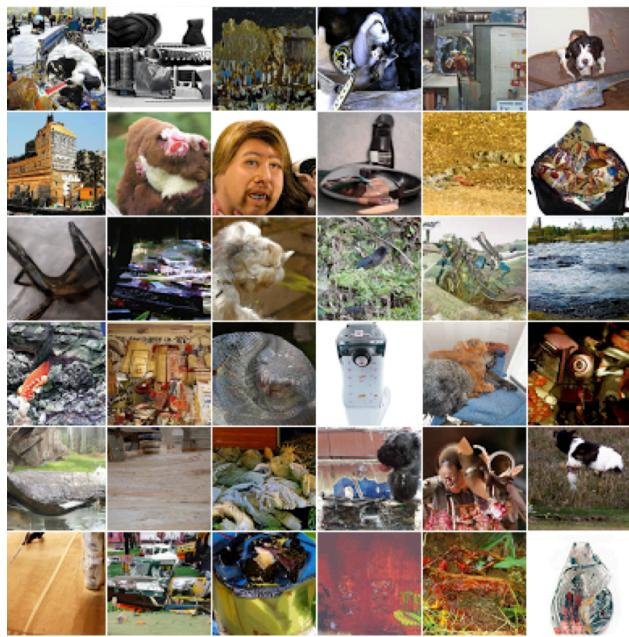
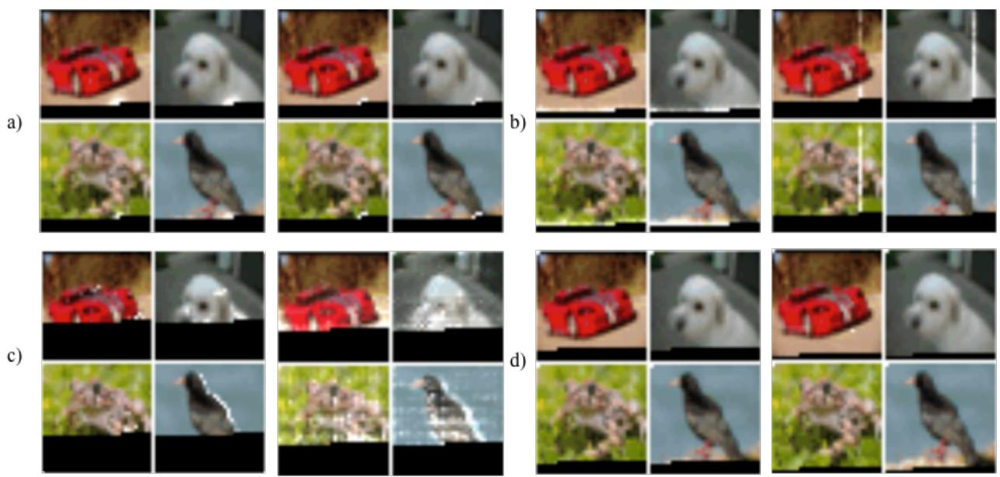
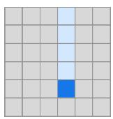
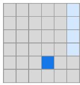
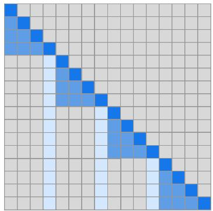

# 利用稀疏 Transformer 生成长序列

Rewon Child 1 Scott Gray 1 Alec Radford 1 Ilya Sutskever 1

## 摘要

Transformer 是强大的序列模型，但其所需的时间和内存会随序列长度呈二次方增长。在本文中，我们引入了注意力矩阵的稀疏因子分解，将此开销降低至 $O ( n { \sqrt { n } } )$。我们还引入了：a）一种用于训练更深网络的架构与初始化变体，b）注意力矩阵的重计算以节省内存，以及 c）用于训练的快速注意力算子。我们将结合了这些改进的网络称为稀疏 Transformer（Sparse Transformers），并展示了它们可以使用数百层来对长达数万个时间步的序列进行建模。我们使用相同的架构直接从原始字节对图像、音频和文本进行建模，在 Enwik8、CIFAR-10 和 ImageNet-64 的密度建模上取得了新的最先进（state of the art）水平。我们生成的无条件样本展现出全局连贯性和高度多样性，并证明了在原理上使用自注意力机制对长度达一百万或更长的序列进行建模是可行的。

## 1. 引言

估计复杂的高维数据分布是无监督学习中的核心问题，因为许多受关注的下游应用都涉及文本、图像、音频和其他数据的生成。此外，这也被认为是无监督表征学习的关键组成部分。

最近，神经自回归模型在这一领域取得了令人瞩目的成果，在自然语言建模 (Jozefowicz et al., 2016) (Radford et al., 2018) (Dai et al., 2018)、原始音频建模 (Van Den Oord et al., 2016) (Mehri et al., 2016) 和图像建模 (Oord et al., 2016) (Menick & Kalchbrenner, 2018) (Salimans et al., 2017) (Reed et al., 2017) (Chen et al., 2017) 中均达到了最先进水平。

这些方法将联合概率分布分解为条件概率分布的乘积。然而，对这些条件分布进行建模极具挑战性，因为它们包含许多复杂且长距离的依赖关系，需要具备足够表达能力的模型架构来对其进行学习。

基于 CNN (Oord et al., 2016) 的架构在此方向上取得了巨大进展，但需要相当大的深度来扩展其感受野。为了解决这一问题，WaveNet (Van Den Oord et al., 2016) 引入了空洞卷积（dilated convolutions），使得网络能够以对数级的层数对长距离依赖进行建模。

  
Figure 1. 我们的神经自回归模型在 ImageNet 64 和一个古典音乐数据集上的无条件生成样本。我们对音频、图像和文本使用了相同的基于自注意力（self-attention）的架构。上述样本是在 softmax 温度为 1.0 条件下生成的，长度分别为 12,288 和 65,536。音频样本可在 https://openai.com/blog/sparse-transformer 试听。

另一方面，Transformer（Vaswani et al., 2017）已被证明在许多自然语言任务中表现优异，这可能部分归功于其在恒定层数内建模任意依赖关系的能力。由于每个自注意力层都具有全局感受野，网络可以将表征能力分配给最有效的输入区域。因此，与具有固定连接模式的网络相比，该架构在生成多样化数据类型方面可能更加灵活。

然而，这类网络的内存和计算需求随序列长度呈二次方增长，这限制了它们在长序列上的应用。

本工作的主要贡献是引入了几种注意力矩阵的稀疏因子分解（sparse factorizations），其计算复杂度随序列长度呈 $O ( n \sqrt { n } )$ 扩展，且不会牺牲性能。这些方法通过将完整的注意力计算分解为几个更快的注意力操作，并在组合时可以近似稠密注意力操作。我们利用这一点将自注意力应用于前所未有长度的序列。

此外，我们还对 Transformer 引入了其他几项改进，包括：

• 重构的残差块和权重初始化，以改善极深网络的训练

• 一组稀疏注意力核函数（sparse attention kernels），能够高效计算注意力矩阵的子集

• 在反向传播过程中重新计算注意力权重以减少内存占用

我们通过实证验证了以此方式增强的模型在自然语言、原始音频和自然图像的压缩与生成方面均可达到最优性能（state-of-the-art）。该架构的简洁性让我们相信它可能对许多感兴趣的问题有所助益。

## 2. 相关工作

最相关的研究涉及扩展自回归生成模型（autoregressive generative models）规模的其他技术。对于图像，(Reed et al., 2017) 对像素之间的条件独立性进行建模，以便并行生成多个位置；(Menick & Kalchbrenner, 2018) 引入了排序和多尺度上采样过程来生成高保真度样本；(Parmar et al., 2018) 使用局部注意力块将 Transformer 应用于图像。对于文本，(Dai et al., 2018) 引入了状态复用“记忆”（memory）来建模长期依赖关系。对于音频，除 (Van Den Oord et al., 2016) 之外，(Mehri et al., 2016) 使用了分层结构和具有不同时钟速率的 RNN，从而在推理期间利用长上下文，类似于 (Koutnik et al., 2014)。(Huang et al., 2018) 通过高效的相对注意力将 Transformer 应用于 MIDI 生成。

我们的工作比上述许多技术更加简单，并且可以同样应用于图像、文本和音频。此外，上述许多技术与我们的方法是正交的，可以与我们的方法结合使用。

在生成建模之外，有几项工作与通过分块（Chiu & Raffel, 2017）或使用定长表示（Britz et al., 2017）来提高注意力的效率相关。其他研究探讨了多“跳”（multi-hop）注意力，例如 (Sukhbaatar et al., 2015) 和 (Gehring et al., 2017)。

值得注意的是，Gated Pixel CNN (Oord et al., 2016) 和 WaveNet (Van Den Oord et al., 2016) 在其网络中使用了乘法交互，这与自注意力密切相关。

## 3. 背景

我们考虑自回归序列生成任务，其中序列 $\begin{array} { r l } { \mathbf { x } } & { { } = } \end{array}$ $\{ x _ { 1 } , x _ { 2 } , . . . , x _ { n } \}$ 的联合概率被建模为条件概率分布的乘积，并由网络 $\theta$ 进行参数化。

$$
p (\mathbf {x}) = \prod_ {i = 1} ^ {n} p (x _ {i} | x _ {1},..., x _ {i - 1}; \theta)\tag{1}
$$

我们将图像、文本和音频视为离散标记（token）序列，通常为原始字节。网络 $\theta$ 接收标记序列，并使用 softmax 函数输出下一个标记在 $v$ 个可能值上的类别分布，其中 $v$ 是词表大小。训练目标是最大化数据关于 $\theta$ 的对数概率。

如 (Radford et al., 2018) 和 (Liu et al., 2018) 所展示的，模型 $\theta$ 的一个简单而强大的选择是仅解码器（decoder-only）模式下的 Transformer (Vaswani et al., 2017)。这些模型通过对整个序列的多头自注意力块来转换输入序列，随后对每个序列元素进行密集变换。然而，网络的自注意力部分必须为 $n$ 个元素中的每一个计算 $n$ 个权重，随着序列长度的增长，这很快会变得难以计算。

在接下来的章节中，我们将描述对 Transformer 架构的改进，这些改进使其更适合建模长序列。

## 4. 分解自注意力（Factorized Self-Attention）

Sparse Transformer 将全自注意力（full self-attention）操作分解为多个注意力步骤，如图 3(b) 和 3(c) 所示。为了阐明我们方法的动机，我们首先对标准 Transformer 在图像数据集上学习到的注意力模式进行了定性评估。

Figure 2. 在 CIFAR-10 上使用全注意力训练的 128 层网络所学习到的注意力模式。白色高亮表示在生成给定像素时某个注意力头的注意力权重，黑色表示自回归掩码（autoregressive mask）。各层能够学习到多种特化的稀疏结构，这或许可以解释它们适应不同领域的能力。a) 网络中的许多早期层学习到了局部连接模式，类似于卷积。b) 在第 19 层和第 20 层中，网络学会了将注意力分解为行注意力和列注意力，从而有效地分解了全局注意力计算。c) 若干注意力层表现出全局且依赖于数据的访问模式。d) 第 64-128 层中的典型层表现出高度的稀疏性，其位置极少被激活，且仅针对特定的输入模式激活。  

  
(a) Transformer

  
(b) Sparse Transformer (strided)

  
(c) Sparse Transformer (fixed)  
Figure 3. 我们评估的两种二维分解注意力机制与标准 Transformer 的全注意力 (a) 的对比。以一个 6x6 图像为例，顶行表示在计算给定输出时，两个注意力头接收哪些位置作为输入。底行显示了所有此类输出（行）与输入（列）之间的连接矩阵（未按比例绘制）。连接矩阵的稀疏性可以显著加快计算速度。在 (b) 和 (c) 中，当按顺序计算这两个头时，元素之间的完全连通性得以保留。我们测试了这种分解方案在性能上是否能够媲美 Figure 2 中丰富的连接模式。

## 4.1. 学习到的注意力模式的定性评估

我们对 128 层自注意力网络在 CIFAR-10 上学到的注意力模式进行了可视化，并在 Figure 2 中展示了几个示例。直观观察表明，大多数层在大多数数据点上都呈现出稀疏的注意力模式，这表明可以引入某种形式的稀疏性而不会显著影响性能。然而，有几层（Figure 2c）明显表现出全局模式，而另一些层则表现出依赖于数据的内容稀疏性（Figure 2d），如果在所有注意力矩阵中都引入预先确定的稀疏模式，这两者都会受到影响。

在本文中，我们将研究限制在一类稀疏注意力模式上，这些模式在经过多步注意力之后可以在所有位置之间建立连接。这些方法可以比全注意力（full attention）更高效，同时仍能为任何给定位置提供全局上下文。鉴于它们无法学习到与 Figure 2 中完全相同的映射，我们的目标是通过实验验证这些分解模式在一系列任务上的性能。我们在下文中给出了分解注意力的形式化定义。

## 4.2. 分解自注意力

自注意力层将输入嵌入矩阵 X 映射为输出矩阵，并由连接模式 $S = \{ S _ { 1 } , . . . , S _ { n } \}$ 参数化，其中 $S _ { i }$ 表示第 i 个输出向量所关注的输入向量索引集合。输出向量是输入向量变换后的加权和：

$$
\operatorname{Attend} (X, S) = \left(a (\mathbf {x} _ {i}, S _ {i})\right) _ {i \in \{1, \dots , n \}}\tag{2}
$$

$$
a (\mathbf {x} _ {i}, S _ {i}) = \mathrm{softmax} \left(\frac {(W _ {q} \mathbf {x} _ {i}) K _ {S _ {i}} ^ {T}}{\sqrt {d}}\right) V _ {S _ {i}}\tag{3}
$$

$$
K _ {S _ {i}} = \left(W _ {k} \mathbf {x} _ {j}\right) _ {j \in S _ {i}} V _ {S _ {i}} = \left(W _ {v} \mathbf {x} _ {j}\right) _ {j \in S _ {i}}\tag{4}
$$

此处 $W _ { q } , W _ { k }$ 和 $W _ { v }$ 表示将给定的 x 转换为查询（query）、键（key）或值（value）的权重矩阵，d 是查询和键的内部维度。每个位置的输出是按键和查询的缩放点积相似度加权后的值之和。

自回归模型的全自注意力定义了 $S _ { i } =$ $\{ j : j \leq i \}$，允许每个元素关注所有先前位置及其自身位置。

相反，分解自注意力具有 p 个独立的注意力头，其中第 m 个头定义了一个索引子集 $A _ { i } ^ { ( m ) } ~ \subset ~ \{ j ~ : ~ j ~ \leq ~ i \}$ 并令 ${ \cal S } _ { i } ~ = ~ { \cal A } _ { i } ^ { ( m ) }$。我们主要对子集 A 的高效选择感兴趣，其中 $| A _ { i } ^ { ( m ) } | \propto \sqrt [ p ] { n } .$

此外，目前我们考虑 A 的有效选择，即在 p 个注意力步骤中，所有输入位置都与所有未来的输出位置相连。

对于每一个满足 $j \le i$ 的数对，我们设定每个 A，使得 $i$ 可以通过一条最大长度为 $p + 1$ 的位置路径关注到 $j$。具体而言，如果 $( j , a , b , c , . . . , i )$ 是索引路径，则 $j \in A _ { a } ^ { ( 1 ) } , a \in A _ { b } ^ { ( 2 ) } , b \in A _ { c } ^ { ( 3 ) }$，依此类推。

这两个准则使我们能够保留 Transformer 在常数步内将信号从任意输入位置传播到任意输出位置的能力，同时将总的有效计算量降低至 $O ( n \sqrt { n } )$。我们还注意到，放宽有效性准则（例如，采用一系列仅局部连接的层）对于某些领域而言可能是一种有用的归纳偏置（inductive bias）。

在这项工作中，我们探讨了 $p = 2 ,$ 时的两种分解方式，并在接下来的章节中对其进行描述，不过我们注意到同样的技术可以很容易地推广到更高维度。

## 4.3. 二维分解注意力

在二维中定义分解注意力模式的一种自然方法是，让一个注意力头关注前 $l$ 个位置，而另一个注意力头关注每隔 $l$ 个位置处的内容，其中 $l$ 为步长（stride），且选择接近于 ${ \sqrt { n } } ,$ 的值，我们将这种方法称为跨步注意力（strided attention）。

形式化地，$A _ { i } ^ { ( 1 ) } = \{ t , t + 1 , . . . , i \}$，其中 $t = \operatorname* { m a x } ( 0 , i - l )$，且 $A _ { i } ^ { ( 2 ) } = \{ j : ( i - j )$ mod $l = 0 \}$。该模式如图 Figure 3(b) 所示。

如果数据天然具备与步长对齐的结构（例如图像或某些类型的音乐），这种表述是非常方便的。然而，对于没有周期性结构的数据（例如文本），我们发现网络采用跨步模式可能无法正确路由信息，因为某个元素的空间坐标并不一定与其在未来最相关的位置存在关联。

在这些情况下，我们改为使用固定注意力（fixed attention）模式（Figure $3 ( \mathrm { c } ) )$，其中特定的单元会总结之前的位置，并将该信息传播到所有未来的单元。

形式化地，$A _ { i } ^ { ( 1 ) } = \{ j : ( \lfloor j / l \rfloor = \lfloor i / l \rfloor ) \}$，其中方括号表示向下取整运算，且 $A _ { i } ^ { ( 2 ) } = \{ j : j$ mod $l \in$ $\{ t , t + 1 , . . . , l \}$，其中 $t = l - c$，$c$ 为超参数。具体而言，如果步长为 128 且 $c = 8 ,$，则大于 128 的所有未来位置都可以关注位置 120-128，大于 256 的所有位置都可以关注 248-256，依此类推。

当 $c = 1$ 时，固定注意力模式会显著限制网络的表达能力，因为网络中的许多表征仅用于一个块，而只有少数位置被所有块使用。相反，我们发现在典型的 $l \in$ {128, 256} 取值下，选择 $c \in \{ 8 , 1 6 , 3 2 \}$ 表现良好，但需要注意的是，与跨步注意力（strided attention）相比，这会使该方法的计算成本增加 $c$ 倍。

此外，我们发现当使用多头时，让它们关注大小为 $l$ 的块内长度为 $c$ 的不同子块，要优于让它们关注相同的子块。

在接下来的部分中，我们将描述如何将因式分解注意力（factorized attention）融入 Sparse Transformer 架构中。

## 5. Sparse Transformer

在这里，我们完整描述了 Sparse Transformer 架构，它是 Transformer（Vaswani et al., 2017）的一个修改版本。

## 5.1. 因式分解注意力头

标准的稠密注意力（dense attention）仅对公式 2 中定义的 attend 函数执行线性变换：

$$
\operatorname{attention} (X) = W _ {p} \cdot \operatorname{attend} (X, S)\tag{5}
$$

其中 $W _ { p }$ 表示注意力后的权重矩阵。整合因式分解自注意力最简单的技术是在每个残差块中使用一种注意力类型，并按顺序或按作为超参数确定的比例进行交替：

$$
\operatorname{attention} (X) = W _ {p} \cdot \operatorname{attend} (X, A ^ {(r \bmod p)})\tag{6}
$$

这里 $r$ 是当前残差块的索引，$p$ 是因式分解注意力头的数量。

第二种方法是让单个头关注两个因式分解头都会关注的像素位置，我们称之为合并头（merged head）：

$$
\operatorname{attention} (X) = W _ {p} \cdot \operatorname{attend} (X, \bigcup_ {m = 1} ^ {p} A ^ {(m)})\tag{7}
$$

这种方法的计算量略大，但仅增加了一个常数倍数。第三种方法是使用多头注意力（multi-head attention，Vaswani et al., 2017），其中并行计算 $n _ { h }$ 个注意力乘积，然后沿特征维度进行拼接：

$$
\operatorname{attention} (X) = W _ {p} \left(\operatorname{attend} (X, A) ^ {(i)}\right) _ {i \in \{1, \dots , n _ {h} \}}\tag{8}
$$

  
Figure 4. 描述 Sparse Transformer 单个残差块的示意图。阴影背景表示设置了检查点（checkpointed，Chen et al., 2016）并保存在 GPU 显存中的张量。其他张量（包括注意力权重和前馈网络激活值）在计算梯度时会重新计算，从而大幅减少显存使用量。

在这里，A 可以是单独的注意力模式、合并后的模式，或者如公式 2 中所示的交错模式。此外，attend 函数内部权重矩阵的维度减少了 $1 / n _ { h }$ 倍，使得参数数量在不同的 $n _ { h }$ 取值下保持不变。

我们通常发现多头机制效果良好，但对于注意力机制在计算时间中占主导地位的超长序列，逐个且按顺序执行它们更为合算。

## 5.2. 扩展至数百层

正如 (Al-Rfou et al., 2018) 所指出的，我们发现具有很多层的 Transformer 很难训练。我们没有引入辅助损失，而是采用了以下

架构上的改动。

首先，我们使用了 (He et al., 2016) 的预激活残差块（pre-activation residual block），按如下方式定义一个包含 N 层的网络：

$$
H _ {0} = \operatorname{embed} (X, W _ {e})\tag{9}
$$

$$
H _ {k} = H _ {k - 1} + \mathrm{resblock} (H _ {k - 1})\tag{10}
$$

$$
y = \mathrm{softmax} (\mathrm{norm} (H _ {N}) W _ {o u t})\tag{11}
$$

其中 embed 是我们在下一节描述的函数，$W _ { o u t }$ 是一个权重矩阵，而 resblock(h) 则按如下方式对输入到注意力块和逐位置前馈网络的数据进行归一化：

$$
a (H) = \text { dropout } (\text { attention } (\text { norm } (H)))\tag{12}
$$

$$
b (H) = \text { dropout } (\text { ff } (\text { norm } (H + a (H))))\tag{13}
$$

$$
\operatorname{resblock} (H) = a (H) + b (H)\tag{14}
$$

norm 函数表示层归一化（Layer Normalization）(Ba et al., 2016)，且 $\mathrm { { f } } ( x ) = W _ { 2 } f ( W _ { 1 } x + b _ { 1 } ) + b _ { 2 }$。我们对 $f$ 的选择是高斯误差线性单元（Gaussian Error Linear Unit, GELU）(Hendrycks & Gimpel, 2016)，即 f(X) = X  sigmoid(1.702 · X)，正如 (Radford et al., 2018) 中所使用的那样。除非另有说明，$W _ { 1 }$ 的输出维度是输入维度的 4.0 倍。

可以观察到，$H _ { N }$ 是函数 a 和 $b$ 应用 N 次的总和，因此每个函数块都直接从输出层接收梯度。我们将公式 5 中 $W _ { 2 }$ 和 $W _ { p }$ 的初始化按 $\frac { 1 } { \sqrt { 2 N } }$ 进行缩放，以使输入嵌入尺度与残差块尺度的比值在不同的 N 取值下保持不变。

## 5.3. 对多样化数据类型建模

除了输入符号的嵌入之外，Transformer 和其他位置无关的架构中通常还会使用位置嵌入来编码数据的空间关系 (Gehring et al., 2017), (Parmar et al., 2018)。

我们发现，使用编码了数据结构或因式分解注意力模式的可学习嵌入，对我们模型的性能至关重要。

我们在每个输入位置添加了 $n _ { e m b } = d _ { d a t a } \mathrm { o r } n _ { e m b } = d _ { a t t n }$ 个嵌入（embeddings），其中 $d _ { d a t a }$ 表示数据的维度数，$d _ { a t t r }$ 是因子化注意力（factorized attention）的维度数。如果 xi 是序列中第 i 个元素的独热编码（one-hot encoded），且 $\mathbf { \bar { o } } _ { i } ^ { ( j ) }$ 表示 $\mathbf { x } _ { i }$ 在第 j 维 $( 1 \leq j \leq n _ { e m b } )$ 中的独热编码位置，则：

$$
\operatorname{embed} (X, W _ {e}) = \left(\mathbf {x} _ {i} W _ {e} + \sum_ {j = 1} ^ {n _ {\text { emb }}} \mathbf {o} _ {i} ^ {(j)} W _ {j}\right) _ {\mathbf {x} _ {i} \in X}\tag{15}
$$

对于图像，我们使用了数据嵌入，其中 $d _ { d a t a } = 3$ 分别对应每个输入字节的行、列和通道位置。对于文本和音频，我们使用了二维注意力嵌入，其中 $d _ { a t t n } = 2$，其索引对应于宽度等于步长（stride）的矩阵中每个位置的行索引和列索引。

## 5.4. 通过重新计算注意力权重节省内存

梯度检查点（Gradient checkpointing）已被证明在降低训练深度神经网络的内存需求方面是有效的 (Chen et al., 2016), (Gruslys et al., 2016)。然而，值得注意的是，在处理长序列时，该技术对自注意力层尤为有效，因为相对于这些层的计算成本，其内存占用非常高。

仅通过重计算，我们就能够在长度为 16,384 的序列上训练包含数百层的稠密注意力网络，否则这在现代硬件上是不可行的。

在我们的实验中，我们在反向传播过程中重新计算注意力和前馈块。为了简化实现，我们没有像 (Vaswani et al., 2017) 那样在注意力块内部应用 dropout，而是仅在每个残差相加的末尾应用它，如图 4 所示。

## 5.5. 高效的块稀疏注意力核函数

图 3(b) 和 3(c) 中的稀疏注意力掩码可以通过从查询（query）、键（key）和值（value）矩阵中切出子块并按块计算乘积来高效计算。局部窗口上的注意力可以直接按原样计算，而步长为 k 的注意力可以通过转置矩阵并计算局部窗口来完成。固定注意力位置可以聚合后分块计算。

为了便于实验，我们实现了一组能高效执行这些操作的 GPU 核函数（kernels）。Softmax 操作被融合到一个单一核函数中，并通过使用寄存器消除了多次加载输入数据的开销，使其运行速度与简单的非线性操作相同。此外，注意力矩阵的上三角部分从未被计算，从而消除了对 (Vaswani et al., 2017) 中负偏置项的需求，并将需要执行的操作数量减半。

## 5.6. 混合精度训练

我们将网络权重存储为单精度浮点数，但在其他方面按照 (Micikevicius et al., 2017) 的做法以半精度计算网络激活和梯度。由于在 V100 GPU 上使用了 Tensor Core 操作，这加快了我们的训练速度。在梯度计算过程中，我们使用动态损失缩放（dynamic loss scaling）来减少数值下溢，并且在多 GPU 间进行平均时通信半精度梯度。在采样时，我们将查询（queries）和键（keys）转换为单精度，因为查询-键的点积有时可能会超出半精度的最大值导致溢出。

  
Figure 5. 来自 ImageNet 64x64 的无条件采样样本，使用未修改的 softmax 温度 1.0 生成。我们能够在不使用多尺度架构的情况下直接从像素学习长程依赖关系。

## 6. 训练

我们使用 Adam 优化器，设置 5000 次迭代的线性预热（warmup）和 1.0 的梯度裁剪（gradient clipping），我们发现这两者对模型稳定性都很重要。我们使用的权重衰减惩罚为 0.01。我们按照 (Radford et al., 2018) 中的余弦衰减（cosine decay）对学习率进行退火。除非另有说明，我们均在 8 块 V100 GPU 上进行训练。

所有嵌入（embeddings）都具有恒定的维度 d，通常为 {256, 512, 1024} 之一。默认情况下，所有线性变换都保持相同的维度，但前馈网络（feed-forward network）除外，它将输入投影到 4d，除非我们使用“半尺寸”（half-size）变换，此时为 2d。此外，有时我们会将查询和键变换的尺寸减半。

我们从 $\mathcal { N } ( 0 , \frac { 0 . 1 2 5 } { \sqrt { d } } )$ 初始化词元嵌入（token embedding）$W _ { e }$，从 $\mathcal { N } ( 0 , \frac { 0 . 1 2 5 } { \sqrt { d n _ { e m b } } } )$ 初始化位置嵌入。在注意力机制和前馈组件中，所有偏置均初始化为 0，所有权重均从 $\begin{array} { r } { \mathcal { N } ( 0 , \frac { 0 . 1 2 5 } { \sqrt { d _ { i n } } } ) } \end{array}$ 初始化，其中 $d _ { i n }$ 为输入扇入（fan-in）维度。输出 logits 的权重矩阵初始化为 0。

## 7. 实验

我们在密度建模任务（包括自然图像、文本和原始音频）上对我们的架构进行了实证测试。结果汇总见 Table 1。我们发现，除了运行速度明显快于全注意力机制（full attention）之外，稀疏模式还收敛到了更低的误差，如 Table 2 所示。这可能表明我们引入的稀疏模式具有有益的归纳偏置（inductive bias），或者全注意力机制存在潜在的优化问题。

## 7.1. CIFAR-10

我们在表示为 3072 字节序列的 CIFAR-10 图像上训练跨步稀疏 Transformer（strided Sparse Transformers）。模型具有 2 个头、128 层、d = 256、半尺寸前馈网络和查询-键投影，并在学习率为 0.00035、dropout 率为 0.25 的条件下训练 120 个 epoch，直至验证误差不再下降。

我们使用 48000 个样本进行训练，2000 个样本用于验证，并在测试集上评估我们最佳模型的性能。该模型达到了 2.80 bits per dim（在随机种子 1, 2, 3 上为 2.798 ± 0.004），优于此前 2.85 的最先进水平（Chen et al., 2017）。我们还在 Table 2 中比较了不同注意力模式的性能。跨步注意力（strided attention）在最短的时间内达到了最低的误差，超越了密集注意力（dense attention）的 2.82 bits per dim 误差。

Table 1. 密度建模任务的研究结果总结。结果以 bits per byte 报告，对于图像任务而言等同于 bits per dim。M 表示百万参数量。

<table><tr><td>模型</td><td>Bits per byte</td></tr><tr><td colspan="2">CIFAR-10</td></tr><tr><td>PixelCNN (Oord et al., 2016)</td><td>3.03</td></tr><tr><td>PixelCNN++ (Salimans et al., 2017)</td><td>2.92</td></tr><tr><td>Image Transformer (Parmar et al., 2018)</td><td>2.90</td></tr><tr><td>PixelSNAIL (Chen et al., 2017)</td><td>2.85</td></tr><tr><td>Sparse Transformer 59M (strided)</td><td>2.80</td></tr><tr><td colspan="2">Enwik8</td></tr><tr><td>Deeper Self-Attention (Al-Rfou et al., 2018)</td><td>1.06</td></tr><tr><td>Transformer-XL 88M (Dai et al., 2018)</td><td>1.03</td></tr><tr><td>Transformer-XL 277M (Dai et al., 2018)</td><td>0.99</td></tr><tr><td>Sparse Transformer 95M (fixed)</td><td>0.99</td></tr><tr><td colspan="2">ImageNet 64x64</td></tr><tr><td>PixelCNN (Oord et al., 2016)</td><td>3.57</td></tr><tr><td>Parallel Multiscale (Reed et al., 2017)</td><td>3.7</td></tr><tr><td>Glow (Kingma &amp; Dhariwal, 2018)</td><td>3.81</td></tr><tr><td>SPN 150M (Menick &amp; Kalchbrenner, 2018)</td><td>3.52</td></tr><tr><td>Sparse Transformer 152M (strided)</td><td>3.44</td></tr><tr><td colspan="2">古典音乐，12 kHz 下 5 秒</td></tr><tr><td>Sparse Transformer 152M (strided)</td><td>1.97</td></tr></table>

## 7.2. 文本

为了在没有强二维结构的数据集上评估 Sparse Transformer，我们在 EnWik8 数据集上训练了模型，该数据集代表了 Wikipedia 的前 108 个字节，且周期性结构中包含高度的可变性。我们使用 12,288 的上下文长度进行训练，这比以往的方法更长。

我们在前 9000 万个 token 上进行训练，并保留最后 1000 万个用于验证和测试。我们使用了 30 层的固定式 Sparse Transformer（fixed Sparse Transformer），包含 8 个头，d = 512，以及 0.40 的 dropout 率。我们训练了 80 个 epoch，直至验证损失停止下降。我们使用的步长（stride）为 128，c = 32，并合并了分解注意力头（factorized attention heads）。

我们的最佳模型达到了 0.99 bits per dim（在种子 1、2、3 上为 0.992 ± 0.001），超越了类似规模的 Transformer-XL（Dai et al., 2018）所取得的 1.03 当前最优水平（state-of-the-art），并追平了参数量两倍以上的模型所达到的 0.99。跨步注意力（strided attention）在该数据集上表现不佳，而固定模式（fixed patterns）则能够恢复并超越稠密注意力（dense attention）的性能，如 Table 2 所示。

Table 2. 在我们能够对比两者的各个数据集上，稀疏模式均表现出更快的速度和更优的损失，这可能表明我们学习到的模式中存在有益的归纳偏置，或者全注意力存在潜在的优化问题。

<table><tr><td>模型</td><td>Bits per byte</td><td>时间/迭代</td></tr><tr><td colspan="3">Enwik8（12,288 上下文）</td></tr><tr><td>稠密注意力</td><td>1.00</td><td>1.31</td></tr><tr><td>Sparse Transformer（固定）</td><td>0.99</td><td>0.55</td></tr><tr><td>Sparse Transformer（跨步）</td><td>1.13</td><td>0.35</td></tr><tr><td colspan="3">CIFAR-10（3,072 上下文）</td></tr><tr><td>稠密注意力</td><td>2.82</td><td>0.54</td></tr><tr><td>Sparse Transformer（固定）</td><td>2.85</td><td>0.47</td></tr><tr><td>Sparse Transformer（跨步）</td><td>2.80</td><td>0.38</td></tr></table>

Table 3. 我们观察到随着上下文长度增加，Enwik8 的压缩率提高，这表明 Sparse Transformer 能够有效整合长期依赖关系。

<table><tr><td>评估期间的最小上下文长度</td><td>Bits per byte</td></tr><tr><td>6,144 tokens</td><td>0.9952</td></tr><tr><td>9,216 tokens</td><td>0.9936</td></tr><tr><td>10,752 tokens</td><td>0.9932</td></tr><tr><td>11,904 tokens</td><td>0.9930</td></tr><tr><td>12,096 tokens</td><td>0.9922</td></tr><tr><td>12,160 tokens</td><td>0.9908</td></tr></table>

此外，在测试集的评估过程中，我们通过并行评估更少的 token 来修改网络可以使用的最小上下文长度。我们观察到随着使用 token 数量的增加，性能单调提升，在用于训练的 12,288 个 token 中最高达到 12,160 个（见 Table 3），这表明网络有效地整合了长期依赖关系。

## 7.3. ImageNet 64x64

为了测试模型学习长距离依赖关系以及扩展到大型数据集的能力，我们在 (Oord et al., 2016) 发布的下采样 ImageNet 版本上进行训练，并在验证集上进行评估。我们使用了一个具有 16 个注意力头且 d = 512 的 48 层跨步 Sparse Transformer，参数总量为 1.52 亿（152 million）。我们使用的跨度（stride）为 128，dropout 为 0.01，并训练了 70 个 epoch，在 64 块 V100 GPU 上耗时 7 天。

我们的模型达到了 3.44 bits per dim 的损失（单次运行为 3.437），相比之下此前为 3.52（Menick & Kalchbrenner, 2018）。

此外，我们在未修改的 softmax 温度 1.0 下，从该模型以及一个训练了双倍层数（共 3 亿参数）的模型中生成了无条件样本（Figure 5）。我们在此展示了来自 3 亿参数模型的样本。在视觉评估中，我们没有发现稀疏模式带来的伪影，并在大多数图像中看到了长期结构的证据。

## 7.4. 来自原始音频的古典音乐

为了测试 Sparse Transformers 扩展到极长上下文的能力，我们在 (Dieleman et al., 2018) 发布的古典音乐数据集上训练了模型。由于该数据集处理的具体细节不可考，我们省略了与其他工作的直接比较，而是研究随着上下文长度的增加，我们可以训练多大规模的 Sparse Transformer。对于每个序列长度，我们都尝试训练能够完全装入 16GB V100 加速卡（不使用模型并行）的最大模型。

总体而言，我们发现将序列长度增加 4 倍需要将模型容量减少约 $4 { \sqrt { 4 } } = 8 .$ 倍。因此，我们发现可以在长度超过 100 万个时间步的序列上使用因子化自注意力，尽管参数量极少（300 万）。

我们提供了长度为 65,536 的序列样本，这对应于 12kHz 采样率下约 5 秒的生成音频。这些样本清晰地展示了在采样周期内的全局连贯性，并表现出多种演奏风格和音色，从富有节奏感的演奏切换到强有力的演奏。如需收听样本，请访问 https://openai.com/blog/ sparse-transformer。由于模型容量降低，对于更长的序列长度，样本质量会迅速下降。

Table 4. 跨步 Sparse Transformer 在古典音频数据集（在 12 kHz 下采用 µ-law 编码）上的性能，作为序列长度和模型大小的函数。

<table><tr><td>Sequence length</td><td>Parameters</td><td>Bits per byte</td></tr><tr><td>65,536</td><td>152M</td><td>1.97</td></tr><tr><td>262,144</td><td>25M</td><td>2.17</td></tr><tr><td>1,048,576</td><td>3M</td><td>2.99</td></tr></table>

## 8. 结论

我们介绍了 Sparse Transformers，并表明它们在长序列的密度建模上达到了与标准 Transformers 相当或更好的性能，同时所需的操作显著减少。这种性能在图像和文本领域达到了最先进水平（state-of-the-art），并且易于适配到原始音频。该模型展示了对长期上下文的利用能力，并能生成全局连贯的样本。

## 9. 致谢

我们要感谢 Ashish Vaswani 在该项目构思阶段富有见地的讨论。我们还要感谢 Joshua Meier 和 Mark Chen 提供的有益讨论，以及 Johannes Otterbach、Prafulla Dhariwal 和 David Luan 对本文初稿的反馈。

## References

Al-Rfou, R., Choe, D., Constant, N., Guo, M., and Jones, L. Character-level language modeling with deeper selfattention. arXiv preprint arXiv:1808.04444, 2018.

Ba, J. L., Kiros, J. R., and Hinton, G. E. 层归一化（Layer normalization）. arXiv preprint arXiv:1607.06450, 2016.

Britz, D., Guan, M. Y., and Luong, M.-T. 使用固定大小记忆表示的高效注意力机制（Efficient attention using a fixed-size memory representation）. arXiv preprint arXiv:1707.00110, 2017.

Chen, T., Xu, B., Zhang, C., and Guestrin, C. 以次线性内存成本训练深度网络（Training deep nets with sublinear memory cost）. arXiv preprint arXiv:1604.06174, 2016.

Chen, X., Mishra, N., Rohaninejad, M., and Abbeel, P. PixelSNAIL：一种改进的自回归生成模型（Pixelsnail: An improved autoregressive generative model）. arXiv preprint arXiv:1712.09763, 2017.

Chiu, C.-C. and Raffel, C. 单调分块注意力（Monotonic chunkwise attention）. arXiv preprint arXiv:1712.05382, 2017.

Dai, Z., Yang, Z., Yang, Y., Cohen, W. W., Carbonell, J., Le, Q. V., and Salakhutdinov, R. Transformer-XL：具有更长依赖关系的语言建模（Transformer-xl: Language modeling with longer-term dependency）. 2018.

Dieleman, S., van den Oord, A., and Simonyan, K. 逼真音乐生成的挑战：大规模原始音频建模（The challenge of realistic music generation: modelling raw audio at scale）. In Advances in Neural Information Processing Systems, pp. 8000–8010, 2018.

Gehring, J., Auli, M., Grangier, D., Yarats, D., and Dauphin, Y. N. 卷积序列到序列学习（Convolutional sequence to sequence learning）. arXiv preprint arXiv:1705.03122, 2017.

Gruslys, A., Munos, R., Danihelka, I., Lanctot, M., and Graves, A. 内存高效的时序反向传播（Memory-efficient backpropagation through time）. In Advances in Neural Information Processing Systems, pp. 4125–4133, 2016.

He, K., Zhang, X., Ren, S., and Sun, J. 深度残差网络中的恒等映射（Identity mappings in deep residual networks）. arXiv preprint arXiv:1603.05027, 2016.

Hendrycks, D. and Gimpel, K. 利用高斯误差线性单元连接非线性和随机正则化器（Bridging nonlinearities and stochastic regularizers with gaussian error linear units）. arXiv preprint arXiv:1606.08415, 2016.

Huang, C.-Z. A., Vaswani, A., Uszkoreit, J., Shazeer, N., Hawthorne, C., Dai, A. M., Hoffman, M. D., and Eck, D. 一种用于 Transformer 的改进相对自注意力机制及其在音乐生成中的应用（An improved relative self-attention mechanism for transformer with application to music generation）. arXiv preprint arXiv:1809.04281, 2018.

Jozefowicz, R., Vinyals, O., Schuster, M., Shazeer, N., and Wu, Y. 探索语言建模的极限（Exploring the limits of language modeling）. arXiv preprint arXiv:1602.02410, 2016.

Kingma, D. P. and Dhariwal, P. Glow：基于可逆 1x1 卷积的生成流（Glow: Generative flow with invertible 1x1 convolutions）. In Advances in Neural Information Processing Systems, pp. 10236–10245, 2018.

Koutnik, J., Greff, K., Gomez, F., and Schmidhuber, J. 时钟循环神经网络（A clockwork rnn）. arXiv preprint arXiv:1402.3511, 2014.

Liu, P. J., Saleh, M., Pot, E., Goodrich, B., Sepassi, R., Kaiser, L., and Shazeer, N. 通过长序列摘要生成维基百科（Generating wikipedia by summarizing long sequences）. arXiv preprint arXiv:1801.10198, 2018.

Mehri, S., Kumar, K., Gulrajani, I., Kumar, R., Jain, S., Sotelo, J., Courville, A., and Bengio, Y. SampleRNN：一种无条件的端到端神经音频生成模型（Samplernn: An unconditional end-to-end neural audio generation model）. arXiv preprint arXiv:1612.07837, 2016.

Menick, J. and Kalchbrenner, N. 利用亚尺度像素网络和多维上采样生成高保真图像（Generating high fidelity images with subscale pixel networks and multidimensional upscaling）. arXiv preprint arXiv:1812.01608, 2018.

Micikevicius, P., Narang, S., Alben, J., Diamos, G., Elsen, E., Garcia, D., Ginsburg, B., Houston, M., Kuchaev, O., Venkatesh, G., et al. Mixed precision training. arXiv preprint arXiv:1710.03740, 2017.

Oord, A. v. d., Kalchbrenner, N., and Kavukcuoglu, K. Pixel recurrent neural networks. arXiv preprint arXiv:1601.06759, 2016.

Parmar, N., Vaswani, A., Uszkoreit, J., Kaiser, Ł., Shazeer, N., and Ku, A. Image transformer. arXiv preprint arXiv:1802.05751, 2018.

Radford, A., Narasimhan, K., Salimans, T., and Sutskever, I. Improving language understanding by generative pre-training. URL https://s3-us-west-2. amazonaws. com/openai-assets/research-covers/languageunsupervised/language understanding paper. pdf, 2018.

Reed, S., Oord, A. v. d., Kalchbrenner, N., Colmenarejo, S. G., Wang, Z., Belov, D., and de Freitas, N. Parallel multiscale autoregressive density estimation. arXiv preprint arXiv:1703.03664, 2017.

Salimans, T., Karpathy, A., Chen, X., and Kingma, D. P. Pixelcnn++: Improving the pixelcnn with discretized logistic mixture likelihood and other modifications. arXiv preprint arXiv:1701.05517, 2017.

Sukhbaatar, S., Weston, J., Fergus, R., et al. End-to-end memory networks. In Advances in neural information processing systems, pp. 2440–2448, 2015.

Van Den Oord, A., Dieleman, S., Zen, H., Simonyan, K., Vinyals, O., Graves, A., Kalchbrenner, N., Senior, A., and Kavukcuoglu, K. Wavenet: A generative model for raw audio. CoRR abs/1609.03499, 2016.

Vaswani, A., Shazeer, N., Parmar, N., Uszkoreit, J., Jones, L., Gomez, A. N., Kaiser, Ł., and Polosukhin, I. Attention is all you need. In Advances in Neural Information Processing Systems, pp. 5998–6008, 2017.