# 基于 PagedAttention 的大语言模型服务高效内存管理

Woosuk Kwon1,∗ Zhuohan Li1,∗ Siyuan Zhuang1 Ying Sheng1,2 Lianmin Zheng1 Cody Hao Yu3 Joseph E. Gonzalez1 Hao Zhang4 Ion Stoica1

1UC Berkeley 2Stanford University 3Independent Researcher 4UC San Diego

## 摘要

大语言模型（LLM）的高吞吐量服务需要一次性批处理足够多的请求。然而，现有系统面临困难，因为每个请求的键值缓存（KV cache）内存占用巨大，并且会动态增长和收缩。如果管理不当，该内存会因碎片化和冗余复制而被大量浪费，从而限制了批大小（batch size）。为了解决这个问题，我们提出了 PagedAttention，一种受操作系统中经典虚拟内存和分页技术启发的注意力算法。在此基础上，我们构建了 vLLM，一个实现了以下目标的 LLM 服务系统：(1) 接近于零的 KV cache 内存浪费，以及 (2) 在请求内部和请求之间灵活共享 KV cache，以进一步减少内存使用。我们的评估表明，与 FasterTransformer 和 Orca 等最先进的系统相比，vLLM 在保持相同延迟水平的同时，将常用 LLM 的吞吐量提升了 2-4 倍。在更长的序列、更大的模型和更复杂的解码算法下，这种改进尤为显著。vLLM 的源代码公开于 htps://github.com/vllm-project/vllm。

## 1 引言

GPT [5, 37] 和 PaLM [9] 等大语言模型（LLM）的出现催生了编程助手 [6, 18] 和通用聊天机器人 [19, 35] 等新应用，这些应用正开始深刻地影响我们的工作和日常生活。许多云计算公司 [34, 44] 正竞相将这些应用作为托管服务提供。然而，运行这些应用的成本非常高昂，需要大量的硬件加速器（如 GPU）。根据近期的估计，处理一次 LLM 请求的成本可能是传统关键词查询的 10 倍 [43]。鉴于这些高昂的成本，提高 LLM 服务系统的吞吐量——从而降低单次请求的成本——正变得愈发重要。

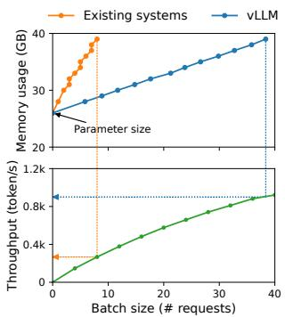  
Figure 1. 左图：在 NVIDIA A100 上为拥有 13B 参数的 LLM 提供服务时的内存布局。模型参数（灰色）在整个服务期间持久驻留在 GPU 内存中。用于 KV cache（红色）的内存在每个服务请求中进行分配和释放。少量内存（黄色）用于临时的激活值。右图：vLLM 平滑了现有系统 [31, 60] 中 KV cache 内存的快速增长曲线，从而显著提升了服务吞吐量。

LLM 的核心是自回归 Transformer 模型 [53]。该模型根据输入（prompt）以及到目前为止已生成的先前输出词元（token）序列，一次生成一个词（token）。对于每个请求，这一开销巨大的过程会不断重复，直到模型输出终止词元。这种顺序生成过程使得该工作负载受限于内存带宽（memory-bound），未能充分利用 GPU 的计算能力，从而限制了服务吞吐量。

通过将多个请求批处理（batching）在一起，可以提高吞吐量。然而，为了在一个批次中处理多个请求，必须高效管理每个请求的内存空间。例如，图 1（左）展示了在一个拥有 40GB 显存的 NVIDIA A100 GPU 上，一个 13B 参数的 LLM 的内存分布。大约 65% 的内存被分配用于模型权重，这些权重在服务期间保持静态。近 30% 的内存用于存储请求的动态状态。对于 Transformer 而言，这些状态由与注意力机制相关的键（key）和值（value）张量组成，通常被称为 KV 缓存（KV cache）[41]，它们代表了早期词元的上下文，用于依次生成新的输出词元。剩下的一小部分内存用于其他数据，包括激活值（activations）——即在评估 LLM 时创建的临时张量。由于模型权重是恒定的，且激活值仅占用 GPU 内存的一小部分，因此 KV 缓存的管理方式在决定最大批大小（batch size）方面起着关键作用。如果管理不当，KV 缓存内存可能会显著限制批大小，进而限制 LLM 的吞吐量，如图 1（右）所示。

  
Figure 2. §6.2 实验中不同 LLM 服务系统的平均内存浪费百分比。

在本文中，我们观察到现有的 LLM 服务系统 [31, 60] 无法高效地管理 KV 缓存内存。这主要是因为它们将请求的 KV 缓存存储在连续的内存空间中，因为大多数深度学习框架 [33, 39] 要求将张量存储在连续内存中。然而，与传统深度学习工作负载中的张量不同，KV 缓存具有独特的特性：随着模型生成新的词元，它会随时间动态增长和收缩，且其生命周期和长度无法先验已知。这些特性使得现有系统的方法在以下两个方面极其低效：

首先，现有系统 [31, 60] 面临内部和外部内存碎片的问题。为了在连续空间中存储请求的 KV cache，它们会按照请求的最大长度（例如 2048 个 token）预先分配一块连续的内存。这会导致严重的内部碎片，因为请求的实际长度可能远短于其最大长度（例如 Fig. 11）。此外，即使预先已知实际长度，预分配仍然效率低下：由于在请求的整个生命周期中该整块内存都被保留，其他较短的请求无法利用该块中当前未使用的任何部分。另外，外部内存碎片也可能非常严重，因为每个请求预分配的大小可能各不相同。事实上，我们在 Fig. 2 中的性能分析结果表明，现有系统中仅有 20.4% - 38.2% 的 KV cache 内存被用于存储实际的 token 状态。

其次，现有系统无法利用内存共享的机会。LLM 服务通常使用先进的解码算法，例如并行采样（parallel sampling）和束搜索（beam search），这些算法会针对每个请求生成多个输出。在这些场景中，请求包含多个序列，它们可以部分共享其 KV cache。然而，现有系统无法实现内存共享，因为这些序列的 KV cache 被存储在各自独立的连续空间中。

为了解决上述局限，我们提出了 PagedAttention，这是一种受操作系统（OS）解决内存碎片与共享方案——分页虚拟内存启发的注意力算法。PagedAttention 将请求的 KV cache 划分为块（block），每个块可以容纳固定数量 token 的注意力键（key）和值（value）。在 PagedAttention 中，用于 KV cache 的块不一定存储在连续空间中。因此，我们可以像操作系统的虚拟内存一样以更灵活的方式管理 KV cache：可以将块视为页（page），将 token 视为字节（byte），并将请求视为进程（process）。该设计通过使用相对较小的块并按需分配，缓解了内部碎片问题。此外，由于所有块的大小相同，它消除了外部碎片。最后，它允许以块为粒度，在同一请求关联的不同序列之间、甚至在不同请求之间实现内存共享。

在本工作中，我们在 PagedAttention 之上构建了 vLLM，这是一个高吞吐量的分布式大语言模型（LLM）推理服务引擎，实现了 KV 缓存（KV cache）内存的近乎零浪费。vLLM 采用了与 PagedAttention 协同设计的块级内存管理和抢占式请求调度机制。vLLM 支持不同规模的主流 LLM，例如 GPT [5]、OPT [62] 和 LLaMA [52]，包括那些超出单张 GPU 显存容量的模型。我们在各种模型和工作负载上的评估表明，与最先进的系统 [31, 60] 相比，vLLM 将 LLM 推理服务吞吐量提高了 2-4 倍，且完全不影响模型精度。在序列更长、模型更大以及解码算法更复杂的情况下，这种性能提升更为显著（§4.3）。总而言之，我们的贡献如下：

• 我们指出了在 LLM 推理服务中内存分配所面临的挑战，并量化了它们对推理服务性能的影响。

• 我们提出了 PagedAttention，这是一种受操作系统中虚拟内存和分页机制启发的注意力算法，可以在存储于非连续分页内存中的 KV 缓存上运行。

• 我们设计并实现了基于 PagedAttention 构建的分布式 LLM 推理服务引擎 vLLM。

• 我们在各种场景下对 vLLM 进行了评估，证明其大幅优于先前的最先进解决方案，如 FasterTransformer [31] 和 Orca [60]。

## 2 背景

在本节中，我们介绍典型 LLM 的生成与推理服务流程，以及 LLM 推理服务中使用的迭代级调度（iteration-level scheduling）。

## 2.1 基于 Transformer 的大语言模型

语言建模的任务是对词元（token）序列 $( x _ { 1 } , \ldots , x _ { n } )$ 的概率进行建模。由于语言具有天然的序列顺序，通常将整个序列上的联合概率分解为条件概率的乘积（亦称自回归分解 [3]）：

$$
P (x) = P (x _ {1}) \cdot P (x _ {2} \mid x _ {1}) \dots P (x _ {n} \mid x _ {1}, \ldots , x _ {n - 1}).\tag{1}
$$

Transformer [53] 已成为大规模建模上述概率的事实标准架构。基于 Transformer 的语言模型中最重要的组件是其自注意力层（self-attention layers）。对于输入的隐藏状态序列 $( x _ { 1 } , \ldots , x _ { n } ) \ \in \ \mathbb { R } ^ { n \times d }$，自注意力层首先在每个位置应用线性变换，以获得查询（query）、键（key）和值（value）向量：

$$
q _ {i} = W _ {q} x _ {i}, k _ {i} = W _ {k} x _ {i}, v _ {i} = W _ {v} x _ {i}.\tag{2}
$$

然后，自注意力层通过将某一位置的查询向量与该位置之前的所有键向量相乘来计算注意力分数 $a _ { i j }$，并将输出 $o _ { i }$ 计算为值向量的加权平均值：

$$
a _ {i j} = \frac {\exp (q _ {i} ^ {\top} k _ {j} / \sqrt {d})}{\sum_ {t = 1} ^ {i} \exp (q _ {i} ^ {\top} k _ {t} / \sqrt {d})}, o _ {i} = \sum_ {j = 1} ^ {i} a _ {i j} v _ {j}.\tag{3}
$$

除了 $\operatorname { E q . 4 , }$ 中的计算之外，Transformer 模型中的所有其他组件，包括嵌入层（embedding layer）、前馈层（feed-forward layer）、层归一化（layer normalization）[2]、残差连接（residual connection）[22]、输出 logit 计算，以及公式 2 中的 query、key 和 value 变换，都是以 $y _ { i } = f ( x _ { i } )$ 的形式逐位置（position-wise）独立应用的。

## 2.2 LLM 服务与自回归生成

一旦训练完成，LLM 通常被部署为条件生成服务（例如补全 API [34] 或聊天机器人 [19, 35]）。对 LLM 服务的请求会提供一个输入 prompt token 列表 $( x _ { 1 } , \ldots , x _ { n } )$，LLM 服务则根据 $\operatorname { E q . }$ 1 生成一个输出 token 列表 $( x _ { n + 1 } , \ldots , x _ { n + T } )$。我们将 prompt 和输出列表的拼接称为序列（sequence）。

由于公式 1 中的分解，LLM 只能逐个采样和生成新的 token，并且每个新 token 的生成过程都依赖于该序列中所有先前的 token，特别是它们的 key 和 value 向量。在这个顺序生成过程中，已有 token 的 key 和 value 向量通常会被缓存起来以用于生成后续的 token，这被称为 KV cache（键值缓存）。请注意，一个 token 的 KV cache 取决于其之前的所有 token。这意味着出现在序列中不同位置的相同 token，其 KV cache 将会有所不同。

给定一个请求 prompt，LLM 服务中的生成计算可以分解为两个阶段：

prompt 阶段将整个用户 prompt $( x _ { 1 } , \ldots , x _ { n } )$ 作为输入，并计算第一个新 token 的概率 $P ( x _ { n + 1 } \mid x _ { 1 } , . . . , x _ { n } )$。在此过程中，还会生成 key 向量 $k _ { 1 } , \ldots , k _ { n }$ 和 value 向量 $v _ { 1 } , \ldots , v _ { n }$。由于 prompt token $x _ { 1 } , \ldots , x _ { n }$ 都是已知的，因此 prompt 阶段的计算可以使用矩阵-矩阵乘法操作进行并行化。因此，该阶段可以高效地利用 GPU 固有的并行性。

自回归生成阶段会按顺序依次生成剩余的新 token。在迭代 $t$ 中，模型将一个 token $x _ { n + t }$ 作为输入，并利用键向量 $k _ { 1 } , \ldots , k _ { n + t }$ 以及值向量 $v _ { 1 } , \ldots , v _ { n + t }$ 计算概率 $P ( x _ { n + t + 1 } \mid x _ { 1 } , . . . , x _ { n + t } )$。注意，位置 1 到 $n + t - 1$ 处的键向量和值向量已在之前的迭代中被缓存，在本次迭代中仅计算新的键向量和值向量 $k _ { n + t }$ 与 $v _ { n + t }$。当序列达到最大长度（由用户指定或受 LLM 限制）或输出序列结束符（<eos>）token 时，该阶段结束。由于存在数据依赖，不同迭代之间的计算无法并行化，并且通常使用效率较低的矩阵-向量乘法。因此，该阶段极大地欠载了 GPU 的计算能力，并成为内存受限（memory-bound）阶段，占据了单个请求延迟的大部分时间。

## 2.3 LLM 的批处理技术

通过对多个请求进行批处理（batching），可以提高 LLM 服务的计算利用率。由于这些请求共享相同的模型权重，搬运权重的开销可以在一个批次中的各个请求之间被分摊；并且当批大小（batch size）足够大时，该开销可以被计算开销所掩盖。然而，对 LLM 服务进行请求批处理绝非易事，原因有二。首先，请求可能会在不同的时间到达。一种朴素的批处理策略要么让先到的请求等待后到的请求，要么将新到达的请求推迟到先前的请求完成之后，从而导致显著的排队延迟。其次，请求的输入和输出长度可能差异极大（Fig. 11）。简单的批处理技术会对请求的输入和输出进行填充（padding）以使其长度一致，从而浪费 GPU 计算和内存资源。

为了解决这个问题，研究者提出了细粒度批处理机制，例如蜂窝批处理（cellular batching）[16] 和迭代级调度（iteration-level scheduling）[60]。与在请求级别工作的传统方法不同，这些技术在迭代级别运行。在每次迭代之后，已完成的请求会从批次中移除，同时加入新的请求。因此，新请求只需等待一次迭代即可被处理，而无需等待整个批次完成。此外，借助专用的 GPU kernel，这些技术消除了对输入和输出进行填充的需求。通过减少排队延迟以及填充带来的低效性，细粒度批处理机制显著提升了 LLM 服务的吞吐量。

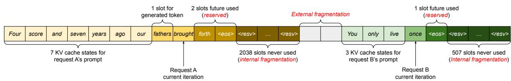  
Figure 3. 现有系统中的 KV 缓存（KV cache）内存管理。存在三种类型的内存浪费——预留浪费、内部碎片和外部碎片——它们阻碍了其他请求容纳到内存中。每个内存槽中的 token 代表其 KV 缓存。注意，相同的 token 在不同位置时可能具有不同的 KV 缓存。

## 3 LLM 服务中的内存挑战

尽管细粒度批处理减少了计算浪费并使得请求能够以更灵活的方式进行批处理，但能够一同进行批处理的请求数量仍然受到 GPU 内存容量的限制，特别是分配用于存储 KV 缓存的空间。换句话说，服务系统的吞吐量是受内存限制的（memory-bound）。克服这种内存限制需要解决内存管理中的以下挑战：

庞大的 KV 缓存。KV 缓存的大小随着请求数量的增加而迅速增长。例如，对于 13B 参数的 OPT 模型 [62]，单个 token 的 KV 缓存需要 800 KB 的空间，计算方式为 2（键向量和值向量）× 5120（隐藏状态大小）× 40（层数）× 2（每个 FP16 的字节数）。由于 OPT 可以生成长达 2048 个 token 的序列，存储单个请求的 KV 缓存所需的内存可高达 1.6 GB。当今 GPU 的内存容量在数十 GB 左右。即使将所有可用内存都分配给 KV 缓存，也只能容纳几十个请求。此外，低效的内存管理会进一步减小批处理大小（batch size），如图 2 所示。另外，按照目前的趋势，GPU 计算速度的增长快于内存容量的增长 [17]。例如，从 NVIDIA A100 到 H100，FLOPS 增加了 2 倍以上，但 GPU 内存最大仍保持在 80GB。因此，我们认为内存将成为一个日益显著的瓶颈。

复杂的解码算法。LLM 服务为用户提供了一系列解码算法供其选择，每种算法对内存管理复杂性的影响各不相同。例如，当用户请求从单个输入 prompt 中进行多次随机采样时（这是程序建议 [18] 中的典型用例），prompt 部分的 KV 缓存（在我们的实验中占 KV 缓存总内存的 12%，见 §6.3）可以被共享以最小化内存使用。另一方面，在自回归生成阶段的 KV 缓存由于采样结果不同以及它们对上下文和位置的依赖性，应保持不共享。KV 缓存共享的程度取决于所采用的具体解码算法。在更复杂的算法中，如束搜索（beam search）[49]，不同的请求束（beam）可以共享更大比例（最多节省 55% 的内存，见 §6.3）的 KV 缓存，并且共享模式会随着解码过程的推进而动态演变。

针对未知输入与输出长度的调度。对 LLM 服务的请求在其输入和输出长度上表现出多变性。这要求内存管理系统能够适应各种各样的 prompt 长度。此外，随着解码阶段请求输出长度的增长，其 KV cache 所需的内存也会扩展，并可能耗尽用于新到达请求或现有 prompt 正在进行的生成的可用内存。系统需要做出调度决策，例如从 GPU 内存中删除或换出（swap out）某些请求的 KV cache。

## 3.1 现有系统中的内存管理

由于当前深度学习框架 [33, 39] 中的大多数算子要求张量存储在连续内存中，先前的 LLM 服务系统 [31, 60] 也将单个请求跨不同位置的 KV cache 存储为连续张量。由于 LLM 输出长度的不可预测性，它们会根据请求的最大可能序列长度为请求静态分配一块内存，而与请求的实际输入或最终输出长度无关。

图 3 展示了两个请求：最大可能序列长度为 2048 的请求 A，以及最大长度为 512 的请求 B。现有系统中的块预分配方案有三个主要的内存浪费来源：为未来 token 预留的槽位、因对潜在最大序列长度过度配置导致的内部碎片，以及来自内存分配器（如伙伴分配器，buddy allocator）的外部碎片。外部碎片永远不会用于生成的 token，这一点在服务请求之前就已确定。内部碎片也同样未被使用，但这只有在请求完成采样后才能被知晓。它们都是纯粹的内存浪费。尽管预留的内存最终会被使用，但在整个请求持续期间保留该空间（尤其是当预留空间很大时）会占用原本可用于处理其他请求的空间。我们在图 2 中对实验中内存浪费的平均百分比进行了可视化，结果表明以往系统中的实际有效内存可能低至 20.4%。

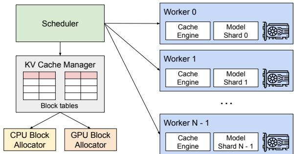  
Figure 4. vLLM 系统概览。

尽管内存规整（compaction）[54] 已被提议作为解决碎片化的潜在方案，但由于海量的 KV cache，在对性能敏感的 LLM 服务系统中执行规整是不切实际的。即使进行了内存规整，现有内存管理系统中为每个请求预分配的块空间也阻碍了特定于解码算法的内存共享。

## 4 方法

在这项工作中，我们开发了一种新的注意力算法 PagedAttention，并构建了一个 LLM 服务引擎 vLLM，以解决第 3 节中概述的挑战。vLLM 的架构如图 4 所示。vLLM 采用集中式调度器来协调分布式 GPU 工作节点的执行。得益于 PagedAttention，KV 缓存管理器能够以分页方式有效管理 KV 缓存。具体而言，KV 缓存管理器通过集中式调度器发送的指令来管理 GPU 工作节点上的物理 KV 缓存内存。

接下来，我们在第 4.1 节中介绍 PagedAttention 算法。随后，我们分别在第 4.2 节中展示 KV 缓存管理器的设计，并在第 4.3 节中展示它如何支持 PagedAttention。然后，我们展示该设计如何为各种解码方法实现有效的内存管理（第 4.4 节），并处理可变长度的输入和输出序列（第 4.5 节）。最后，我们展示 vLLM 的系统设计如何在分布式环境中运行（第 4.6 节）。

## 4.1 PagedAttention

为了解决第 3 节中的内存挑战，我们引入了 PagedAttention，这是一种受操作系统中经典分页 [25] 思想启发的注意力算法。与传统的注意力算法不同，PagedAttention 允许将连续的键和值存储在非连续的内存空间中。具体来说，PagedAttention 将每个序列的 KV 缓存划分为 KV 块。每个块包含固定数量 token1 的键和值向量，我们将其表示为 KV 块大小（）。将键块记为 $K _ { j } = ( k _ { ( j - 1 ) B + 1 } , \ldots , k _ { j B } )$，值块记为 $V _ { j } = \big ( \boldsymbol { v } _ { ( j - 1 ) B + 1 } , \ldots , \boldsymbol { v } _ { j B } \big )$。公式 4 中的注意力计算可以转换为以下分块计算：

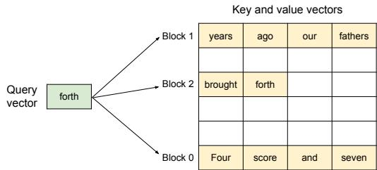  
Figure 5. PagedAttention 算法示意图，其中注意力的键和值向量作为非连续块存储在内存中。

$$
A _ {i j} = \frac {\exp (q _ {i} ^ {\top} K _ {j} / \sqrt {d})}{\sum_ {t = 1} ^ {\lceil i / B \rceil} \exp (q _ {i} ^ {\top} K _ {t} \mathbf {1} / \sqrt {d})}, o _ {i} = \sum_ {j = 1} ^ {\lceil i / B \rceil} V _ {j} A _ {i j} ^ {\top},\tag{4}
$$

其中 $A _ { i j } = ( a _ { i , ( j - 1 ) B + 1 } , \dotsc , a _ { i , j B } )$ 是第  个 KV 块上的注意力分数行向量。

在注意力计算过程中，PagedAttention 核函数分别识别并获取不同的 KV 块。我们在图 5 中展示了 PagedAttention 的一个示例：键（Key）和值（Value）向量分布在三个块中，且这三个块在物理内存上是不连续的。在每一步中，核函数将查询标记（“forth”）的查询向量 $q _ { i }$ 与一个块中的键向量 $K _ { j }$（例如，块 0 中“Four score and seven”的键向量）相乘，以计算注意力分数 $A _ { i j } { \mathrm { : } }$ ，随后将 $A _ { i j }$ 与该块中的值向量 $V _ { j }$ 相乘，从而得出最终的注意力输出 。

总之，PagedAttention 算法允许 KV 块存储在非连续的物理内存中，从而在 vLLM 中实现了更灵活的分页内存管理。

## 4.2 KV 缓存管理器

vLLM 内存管理器背后的核心思想类似于操作系统中的虚拟内存 [25]。操作系统将内存划分为固定大小的页，并将用户程序的逻辑页映射到物理页。连续的逻辑页可以对应非连续的物理内存页，从而允许用户程序像访问连续内存一样访问内存。此外，物理内存空间无需提前全部预留，使得操作系统能够根据需要动态分配物理页。vLLM 利用虚拟内存的思想来管理 LLM 服务中的 KV 缓存。借助 PagedAttention，我们将 KV 缓存组织为固定大小的 KV 块，就像虚拟内存中的页一样。

一个请求的 KV 缓存表示为一系列逻辑 KV 块，随着新标记及其 KV 缓存的生成，从左到右依次填充。最后一个 KV 块中未填充的位置保留给未来的生成步骤。在 GPU worker 上，块引擎分配一段连续的 GPU DRAM 空间并将其划分为物理 KV 块（在 CPU RAM 上也同样进行划分以用于换页；参见 §4.5）。KV 块管理器还维护块表（block table）——即每个请求的逻辑 KV 块与物理 KV 块之间的映射。每个块表条目记录一个逻辑块对应的物理块以及已填充位置的数量。将逻辑 KV 块和物理 KV 块分离，使得 vLLM 能够动态增加 KV 缓存内存，而无需提前为所有位置预留空间，从而消除了现有系统中大部分的内存浪费，如图 2 所示。

  
Figure 6. vLLM 中的块表转换。

## 4.3 使用 PagedAttention 和 vLLM 进行解码

接下来，我们通过图 6（Fig. 6）中的示例来演示 vLLM 如何在单个输入序列的解码过程中执行 PagedAttention 并管理内存：○1 与操作系统的虚拟内存类似，vLLM 最初不需要为可能生成的最大序列长度预留内存。相反，它仅预留必要的 KV 块以容纳 prompt 计算期间生成的 KV 缓存（KV cache）。在本例中，prompt 包含 7 个 token，因此 vLLM 将前 2 个逻辑 KV 块（0 和 1）分别映射到 2 个物理 KV 块（分别为 7 和 1）。在预填充（prefill）阶段，vLLM 使用传统的自注意力（self-attention）算法（例如 [13]）生成 prompt 的 KV 缓存和第一个输出 token。随后，vLLM 将前 4 个 token 的 KV 缓存存储在逻辑块 0 中，接下来的 3 个 token 存储在逻辑块 1 中。剩余的槽位预留给后续的自回归生成阶段。○2 在第一个自回归解码步中，vLLM 基于物理块 7 和 1 运行 PagedAttention 算法生成新的 token。由于最后一个逻辑块中仍有一个可用槽位，新生成的 KV 缓存便存储在该处，并更新块表中的 #filled 记录。○3 在第二个解码步中，由于最后一个逻辑块已满，vLLM 将新生成的 KV 缓存存储在一个新的逻辑块中；vLLM 为其分配一个新的物理块（物理块 3），并将此映射关系记录在块表中。

从全局来看，在每个解码迭代中，vLLM 首先选择一组候选序列进行批处理（详见 §4.5），并为新需要的逻辑块分配物理块。然后，vLLM 将当前迭代的所有输入 token（即 prompt 阶段请求的所有 token 以及生成阶段请求的最新 token）拼接成一个序列并输入到 LLM 中。在 LLM 计算期间，vLLM 使用 PagedAttention 算子（kernel）访问以逻辑 KV 块形式存储的历史 KV 缓存，并将新生成的 KV 缓存保存到物理 KV 块中。在一个 KV 块内存储多个 token（块大小 block size > 1）使 PagedAttention 算子能够跨更多位置并行处理 KV 缓存，从而提高硬件利用率并降低延迟。然而，较大的块大小也会增加内存碎片。我们在 §7.2 中研究了块大小的影响。

  
Figure 7. 在 vLLM 中同时存储两个请求的 KV 缓存。

同样，随着更多词元（token）及其 KV 缓存的生成，vLLM 会动态地将新的物理块分配给逻辑块。由于所有块都是从左到右填充的，且只有在所有先前的块都填满时才会分配新的物理块，因此 vLLM 将一个请求的所有内存浪费限制在一个块之内，从而能够有效地利用所有内存，如图 Fig. 2 所示。这使得内存中能够容纳更多请求以进行批处理——从而提高了吞吐量。一旦请求完成生成，其 KV 块就可以被释放以存储其他请求的 KV 缓存。在图 Fig. 7 中，我们展示了 vLLM 为两个序列管理内存的示例。这两个序列的逻辑块被映射到 GPU 工作节点（GPU workers）中由块引擎保留的空间内的不同物理块。两个序列的相邻逻辑块在物理 GPU 内存中不需要是连续的，并且物理块的空间可以被两个序列有效地利用。

## 4.4 应用于其他解码场景

§4.3 展示了 PagedAttention 和 vLLM 如何处理基本的解码算法，例如贪婪解码（greedy decoding）和采样（sampling），这些算法以一个用户提示作为输入并生成单个输出序列。在许多成功的 LLM 应用 [18, 34] 中，LLM 服务必须提供更复杂的解码场景，这些场景表现出复杂的访问模式以及更多的内存共享机会。我们在本节中展示 vLLM 对这些场景的通用适用性。

并行采样（Parallel sampling）。在基于 LLM 的编程助手 [6, 18] 中，LLM 会针对单个输入提示生成多个采样输出；用户可以从各种候选结果中选择最喜欢的一个。到目前为止，我们一直默认假定一个请求仅生成单个序列。在本文的其余部分中，我们假定更通用的情况，即一个请求生成多个序列。在并行采样中，一个请求包含共享相同输入提示的多个样本，从而允许提示的 KV 缓存也被共享。通过 PagedAttention 和分页内存管理，vLLM 可以轻松实现这种共享并节省内存。

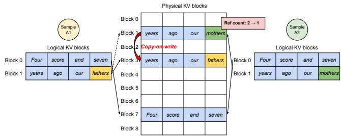  
Figure 8. 并行采样示例。

Fig. 8 展示了两个输出的并行解码示例。由于两个输出共享相同的提示词（prompt），我们在提示词阶段仅为提示词状态保留一份副本空间；两个序列提示词的逻辑块被映射到相同的物理块：两个序列的逻辑块 0 和 1 分别映射到物理块 7 和 1。由于单个物理块可以映射到多个逻辑块，我们为每个物理块引入了引用计数。在这种情况下，物理块 7 和 1 的引用计数均为 2。在生成阶段，这两个输出采样出不同的输出词元（token），并需要为 KV 缓存（KV cache）提供独立的存储空间。vLLM 针对需要被多个序列修改的物理块，在块粒度上实现了写时复制（copy-on-write）机制，类似于操作系统虚拟内存中的写时复制技术（例如派生进程 fork 时）。具体而言，在 Fig. 8 中，当样本 A1 需要写入其最后一个逻辑块（逻辑块 1）时，vLLM 识别到对应物理块（物理块 1）的引用计数大于 1；它分配一个新的物理块（物理块 3），指示块引擎复制物理块 1 中的信息，并将引用计数减少至 1。接着，当样本 A2 写入物理块 1 时，该引用计数已减至 1；因此 A2 直接将其新生成的 KV 缓存写入物理块 1。

综上所述，vLLM 能够在多个输出样本之间共享用于存储提示词 KV 缓存的大部分空间，但通过写时复制机制管理的最后一个逻辑块除外。通过在多个样本间共享物理块，可以大幅减少内存使用量，对于长输入提示词尤其如此。

束搜索（Beam search）。在诸如机器翻译 [59] 之类的 LLM 任务中，用户期望 LLM 输出前  个最合适的翻译。束搜索 [49] 被广泛用于从 LLM 中解码出概率最高的输出序列，因为它缓解了完全遍历样本空间的计算复杂度。该算法依赖于束宽（beam width）参数 ，该参数决定了在每一步中保留的候选序列数量。在解码过程中，束搜索通过考虑所有可能的词元来扩展束中的每个候选序列，使用 LLM 计算它们各自的概率，并从  · || 个候选序列中保留概率最高的前  个序列，其中 || 为词表大小（vocabulary size）。

  
Figure 9. 束搜索（Beam search）示例。

与并行解码不同，束搜索（beam search）不仅支持跨不同候选序列共享初始提示块，还支持共享其他块，并且随着解码过程的推进，共享模式会动态变化，类似于操作系统中由复合 fork 创建的进程树。Fig. 9 展示了 vLLM 如何管理束宽为  = 4 的束搜索示例中的 KV 块。在虚线所示的迭代之前，每个候选序列已经使用了 4 个完整的逻辑块。所有束候选序列都共享第一个块 0（即提示）。候选序列 3 从第二个块开始与其他候选序列发生分叉。候选序列 0–2 共享前 3 个块，并在第四个块处产生分歧。在随后的迭代中，概率最高的 top-4 候选序列全部源自候选序列 1 和 2。由于原来的候选序列 0 和 3 已不再属于最优候选序列，它们的逻辑块被释放，相应物理块的引用计数也随之减少。vLLM 会释放引用计数归 0 的所有物理块（块 2、4、5、8）。随后，vLLM 分配新的物理块（块 9–12）来存储来自新候选序列的新 KV 缓存。此时，所有候选序列共享块 0、1、3；候选序列 0 和 1 共享块 6，候选序列 2 和 3 则进一步共享块 7。

先前的 LLM 服务系统需要在束候选序列之间频繁进行 KV 缓存的内存拷贝。例如，在 Fig. 9 所示的情况下，在虚线之后，候选序列 3 需要复制候选序列 2 的大部分 KV 缓存才能继续生成。这种频繁的内存拷贝开销通过 vLLM 的物理块共享得到了显著减少。在 vLLM 中，不同束候选序列的大多数块都可以共享。与并行解码类似，仅当新生成的 token 位于旧的共享块内时，才会应用写时复制（copy-on-write）机制。这仅涉及复制一个数据块。

共享前缀。通常，LLM 用户会提供包含指令以及输入输出示例的任务（长）描述，也称为系统提示（system prompt）[36]。该描述与实际的任务输入拼接在一起，构成请求的提示。LLM 根据完整的提示生成输出。Fig. 10 展示了一个示例。此外，还可以通过提示工程（prompt engineering）进一步调优共享前缀，以提高下游任务的准确率 [26, 27]。

  
Figure 10. 机器翻译的共享提示示例。该示例改编自 [5]。

对于这类应用，许多用户提示词（prompt）共享相同的前缀，因此 LLM 服务提供商可以提前存储该前缀的 KV 缓存（KV cache），以减少花费在前缀上的冗余计算。在 vLLM 中，这可以通过让 LLM 服务提供商为一组预定义的共享前缀保留一组物理块来便捷地实现，类似于操作系统（OS）在进程间处理共享库的方式。带有共享前缀的用户输入提示词只需将其逻辑块映射到已缓存的物理块（并将最后一个块标记为写时复制，copy-on-write）。提示词阶段的计算仅需在用户的任务输入上执行。

混合解码方法。前面讨论的解码方法表现出多样化的内存共享和访问模式。尽管如此，vLLM 支持同时处理具有不同解码偏好的请求，而现有系统无法高效地做到这一点。这是因为 vLLM 通过一个将逻辑块转换为物理块的通用映射层，隐藏了不同序列之间复杂的内存共享。LLM 及其执行内核仅能看到每个序列的物理块 ID 列表，而无需处理跨序列的共享模式。与现有系统相比，该方法扩大了具有不同采样需求的请求的批处理机会，最终提高了系统的整体吞吐量。

## 4.5 调度与抢占

当请求流量超过系统容量时，vLLM 必须优先处理一部分请求。在 vLLM 中，我们对所有请求采用先来先服务（FCFS）调度策略，以确保公平性并防止饥饿。当 vLLM 需要抢占请求时，它会确保最早到达的请求优先得到服务，而最晚到达的请求最先被抢占。

LLM 服务面临着一个独特的挑战：LLM 的输入提示（prompt）长度可能差异巨大，且生成的输出长度无法预先得知，它取决于输入提示和模型本身。随着请求数量及其输出的增长，vLLM 用于存储新生成 KV 缓存（KV cache）的 GPU 物理块可能会耗尽。在这种情况下，vLLM 需要回答两个经典问题：(1) 它应该逐出（evict）哪些块？(2) 如果再次需要，如何恢复被逐出的块？通常，逐出策略使用启发式方法来预测未来最久才会被访问的块并将其逐出。由于在我们的场景中已知一个序列的所有块都是一起被访问的，因此我们实现了一种“全有或全无”（all-or-nothing）的逐出策略，即要么逐出一个序列的所有块，要么一个都不逐出。此外，一个请求内的多个序列（例如一个束搜索 [beam search] 请求中的候选束）被作为序列组（sequence group）进行组调度（gang-scheduled）。由于这些序列之间可能存在内存共享，一个序列组内的序列总是被一同抢占或重新调度。为了回答第二个关于如何恢复被逐出块的问题，我们考虑了两种技术：

**交换（Swapping）**。这是大多数虚拟内存实现中使用的经典技术，它将逐出的页面复制到磁盘上的交换空间。在我们的场景中，我们将逐出的块复制到 CPU 内存中。如图 4 所示，除了 GPU 块分配器之外，vLLM 还包含一个 CPU 块分配器，用于管理交换到 CPU RAM 的物理块。当 vLLM 耗尽用于新 token 的空闲物理块时，它会选择一组序列进行逐出，并将其 KV 缓存传输到 CPU。一旦抢占了一个序列并逐出了其块，vLLM 就会停止接收新请求，直到所有被抢占的序列完成。一旦一个请求完成，其块就会从内存中释放，而被抢占序列的块将被重新调入以继续处理该序列。请注意，通过这种设计，交换到 CPU RAM 的块数量绝不会超过 GPU RAM 中物理块的总数，因此 CPU RAM 上的交换空间受限于为 KV 缓存分配的 GPU 内存大小。

**重计算（Recomputation）**。在这种情况下，当被抢占的序列被重新调度时，我们只需重新计算 KV 缓存。需要注意的是，重计算延迟可能会显著低于原始延迟，因为解码时生成的 token 可以与原始用户提示拼接成一个新的提示——它们在所有位置的 KV 缓存都可以在一次提示阶段（prompt phase）迭代中生成。

交换和重计算的性能取决于 CPU RAM 与 GPU 内存之间的带宽以及 GPU 的计算能力。我们在 §7.3 中考察了交换和重计算的速度。

## 4.6 分布式执行

许多 LLM（大语言模型）的参数量都超过了单张 GPU 的容量 [5, 9]。因此，有必要将它们切分到分布式 GPU 上并以模型并行（model parallel）的方式执行 [28, 63]。这就需要一个能够处理分布式内存的内存管理器。vLLM 通过支持在 Transformers 上广泛使用的 Megatron-LM 风格张量模型并行策略 [47]，在分布式环境下表现出色。该策略遵循 SPMD（单程序多数据）执行调度，其中线性层被切分以执行分块矩阵乘法，并且 GPU 之间不断通过 all-reduce 操作同步中间结果。具体而言，注意力算子在注意力头维度上进行切分，每个 SPMD 进程负责多头注意力中一部分注意力头的计算。

Table 1. 模型大小与服务器配置。

<table><tr><td>模型大小</td><td>13B</td><td>66B</td><td>175B</td></tr><tr><td>GPU</td><td>A100</td><td>4×A100</td><td>8×A100-80GB</td></tr><tr><td>GPU 总显存</td><td>40 GB</td><td>160 GB</td><td>640 GB</td></tr><tr><td>参数大小</td><td>26 GB</td><td>132 GB</td><td>346 GB</td></tr><tr><td>KV 缓存显存</td><td>12 GB</td><td>21 GB</td><td>264 GB</td></tr><tr><td>最大 KV 缓存槽数量</td><td>15.7K</td><td>9.7K</td><td>60.1K</td></tr></table>

我们观察到，即使采用模型并行执行，每个模型分片仍然处理相同的一组输入 token，因此需要相同位置的 KV 缓存。因此，vLLM 在集中式调度器中配备了单个 KV 缓存管理器，如图 Fig. 4 所示。不同的 GPU worker 共享该管理器以及从逻辑块到物理块的映射。这种通用映射允许 GPU worker 使用调度器为每个输入请求提供的物理块来执行模型。尽管每个 GPU worker 拥有相同的物理块 ID，但一个 worker 仅为其对应的注意力头存储一部分 KV 缓存。

在每一步中，调度器首先准备包含批次中每个请求的输入 token ID 以及每个请求的块表的消息。接下来，调度器将该控制消息广播给各 GPU worker。然后，GPU worker 开始使用输入 token ID 执行模型。在注意力层中，GPU worker 根据控制消息中的块表读取 KV 缓存。在执行过程中，GPU worker 使用 all-reduce 通信原语同步中间结果，无需调度器的协调，如 [47] 所示。最后，GPU worker 将本次迭代采样的 token 发送回调度器。总而言之，GPU worker 在内存管理上无需进行同步，因为它们只需在每个解码迭代开始时随单步输入一起接收所有内存管理信息即可。

## 5 实现

vLLM 是一个端到端的服务系统，包含一个 FastAPI [15] 前端和一个基于 GPU 的推理引擎。该前端扩展了 OpenAI API [34] 接口，允许用户为每个请求自定义采样参数，例如最大序列长度和束宽（beam width）。vLLM 引擎由 8.5K 行 Python 代码和 2K 行 C++/CUDA 代码编写而成。我们在 Python 中开发了包括调度器（scheduler）和块管理器（block manager）在内的控制相关组件，同时为 PagedAttention 等关键操作开发了自定义 CUDA 内核。对于模型执行器，我们使用

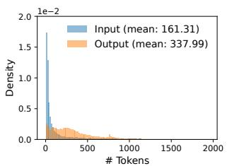  
(a) ShareGPT

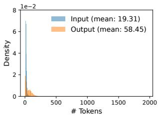  
(b) Alpaca  
Figure 11. (a) ShareGPT 和 (b) Alpaca 数据集的输入与输出长度分布。

PyTorch [39] 和 Transformers [58] 实现了主流的大语言模型（LLM），如 GPT [5]、OPT [62] 和 LLaMA [52]。我们使用 NCCL [32] 在分布式 GPU 工作节点之间进行张量通信。

## 5.1 内核级优化

由于 PagedAttention 引入了现有系统无法有效支持的内存访问模式，我们开发了多个 GPU 内核来对其进行优化。(1) 融合 reshape 和块写入（Fused reshape and block write）。在每个 Transformer 层中，新的 KV 缓存被切分为块，重塑（reshape）为针对块读取优化的内存布局，然后保存到由块表指定的位置。为了尽量减少内核启动开销，我们将它们融合为一个单一内核。(2) 融合块读取和注意力计算（Fusing block read and attention）。我们修改了 FasterTransformer [31] 中的注意力内核，使其能够根据块表读取 KV 缓存并实时（on the fly）执行注意力计算。为确保合并内存访问（coalesced memory access），我们分配一个 GPU warp 来读取每个块。此外，我们还增加了对请求批次中可变序列长度的支持。(3) 融合块复制（Fused block copy）。由写时复制（copy-on-write）机制发起的块复制操作可能会作用于不连续的块上。如果我们使用 cudaMemcpyAsync API，这可能会导致大量小规模数据搬运的调用。为了降低这一开销，我们实现了一个内核，将针对不同块的复制操作批处理到单次内核启动中。

## 5.2 支持多种解码算法

vLLM 使用三种关键方法实现了多种解码算法：fork、append 和 free。fork 方法从现有序列中派生出一个新序列。append 方法向序列追加一个新 token。最后，free 方法删除该序列。例如，在并行采样（parallel sampling）中，vLLM 使用 fork 方法从单个输入序列创建多个输出序列。然后，在每次迭代中使用 append 为这些序列添加新 token，并使用 free 删除满足停止条件的序列。vLLM 在束搜索（beam search）和前缀共享（prefix sharing）中也应用了相同的策略。我们相信，未来的解码算法也可以通过组合这些方法来得到支持。

## 6 评估

在本节中，我们评估了 vLLM 在各种工作负载下的性能。

  
(a) OPT-13B, 1 GPU, ShareGPT

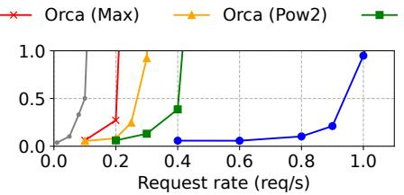  
(b) OPT-66B, 4 GPUs, ShareGPT

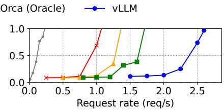  
(c) OPT-175B, 8 GPUs, ShareGPT

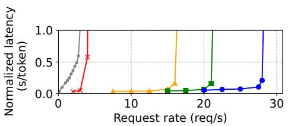  
(d) OPT-13B, 1 GPU, Alpaca

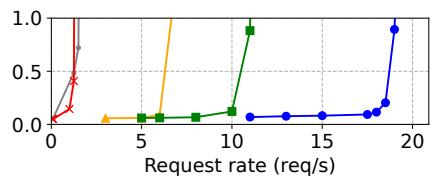  
(e) OPT-66B, 4 GPUs, Alpaca

  
(f) OPT-175B, 8 GPUs, Alpaca

Figure 12. 在 ShareGPT 和 Alpaca 数据集上使用 OPT 模型进行单序列生成  
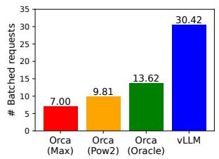  
(a) ShareGPT

  
(b) Alpaca  
Figure 13. 在 ShareGPT（2 reqs/s）和 Alpaca（30 reqs/s）追踪上服务 OPT-13B 时的平均批处理请求数。

## 6.1 实验设置

模型与服务器配置。我们在评估中使用了参数量分别为 13B、66B 和 175B 的 OPT [62] 模型，以及 13B 参数的 LLaMA [52]。正如 LLM 排行榜 [38] 中所示，13B 和 66B 是 LLM 中广受欢迎的规模，而 175B 则是著名的 GPT-3 [5] 模型的规模。在我们所有的实验中，均使用 Google Cloud Platform 上的配备 NVIDIA A100 GPU 的 A2 实例。详细的模型规模和服务器配置如 Table 1 所示。

工作负载。我们基于 ShareGPT [51] 和 Alpaca [50] 数据集来合成工作负载，这两个数据集包含了真实 LLM 服务的输入和输出文本。ShareGPT 数据集是用户与 ChatGPT [35] 分享的对话集合。Alpaca 数据集是由 GPT 3.5 通过 self-instruct [57] 生成的指令数据集。我们对这些数据集进行分词（tokenize），并使用它们的输入和输出长度来合成客户端请求。如 Fig. 11 所示，ShareGPT 数据集的平均输入 prompt 长度是 Alpaca 数据集的 8.4 倍，平均输出长度是其 5.8 倍，且方差更大。由于这些数据集不包含时间戳，我们使用不同请求速率的泊松分布（Poisson distribution）来生成请求到达时间。

基线 1：FasterTransformer。FasterTransformer [31] 是一个针对延迟高度优化的分布式推理引擎。

由于 FasterTransformer 没有自带的调度器，我们实现了一个自定义调度器，该调度器采用了类似于 Triton [30] 等现有服务系统的动态批处理（dynamic batching）机制。具体而言，我们根据 GPU 显存容量，为每个实验设置了一个尽可能大的最大批处理大小 。调度器最多获取  个最早到达的请求，并将该批次发送给 FasterTransformer 进行处理。

基线 2：Orca。Orca [60] 是一种针对吞吐量进行优化的最先进的 LLM 服务系统。由于 Orca 尚未公开可用，我们实现了自己的 Orca 版本。我们假设 Orca 使用伙伴分配算法（buddy allocation algorithm）来确定存储 KV 缓存的内存地址。我们根据其对请求输出空间过度预留的程度实现了三个版本的 Orca：

• Orca (Oracle)。我们假设系统已知请求实际将要生成的输出长度。这展示了 Orca 的性能上限，在实践中是无法实现的。

• Orca (Pow2)。我们假设系统对输出空间的过度预留最多为 2 倍。例如，如果真实的输出长度为 25，它将为输出预留 32 个位置。

• Orca (Max)。我们假设系统始终预留空间直至模型的最大序列长度，即 2048 个 token。

关键指标。我们重点关注服务吞吐量。具体而言，使用具有不同请求速率的工作负载，我们测量系统的归一化延迟（normalized latency），即每个请求的端到端延迟除以其输出长度的平均值，与 Orca [60] 中相同。高吞吐量的服务系统应在面对高请求速率时保持较低的归一化延迟。在大多数实验中，我们使用 1 小时的追踪数据来评估系统。作为特例，由于成本限制，我们对 OPT-175B 模型使用了 15 分钟的追踪数据。

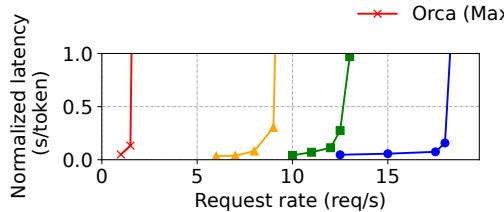  
(a) 并行生成（并行大小 = 2）

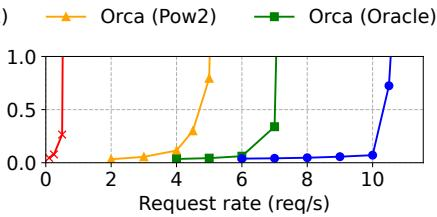  
(b) 并行生成（并行大小 = 4）

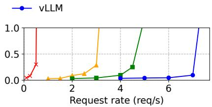  
(c) 并行生成（并行大小 = 6）

  
(d) 束搜索（束宽 = 2）

  
(e) 束搜索（束宽 = 4）

  
(f) 束搜索（束宽 = 6）  
Figure 14. 在 Alpaca 数据集上使用 OPT-13B 进行并行生成和束搜索。

## 6.2 基本采样

我们在三个模型和两个数据集上评估了 vLLM 在基本采样（每个请求一个样本）下的性能。Fig. 12 的第一行展示了在 ShareGPT 数据集上的结果。曲线表明，随着请求速率的增加，延迟起初以平缓的速度上升，但随后突然激增。这可以归因于当请求速率超过服务系统的容量时，队列长度会持续无限增长，请求的延迟亦是如此。

在 ShareGPT 数据集上，在保持相似延迟的情况下，vLLM 相比 Orca (Oracle) 可以维持 1.7×–2.7× 更高的请求速率，相比 Orca (Max) 可以维持 2.7×–8× 更高的请求速率。这是因为 vLLM 的 PagedAttention 可以高效地管理内存使用，从而比 Orca 支持批处理更多的请求。例如，如图 13a 所示，对于 OPT-13B，vLLM 同时处理的请求数量比 Orca (Oracle) 多 2.2×，比 Orca (Max) 多 4.3×。与 FasterTransformer 相比，vLLM 可以维持高达 22× 的更高请求速率，因为 FasterTransformer 未采用细粒度调度机制，并且像 Orca (Max) 一样低效地管理内存。

图 12 的第二行和图 13b 展示了在 Alpaca 数据集上的结果，其趋势与 ShareGPT 数据集类似。一个例外是图 12 (f)，其中 vLLM 相比 Orca (Oracle) 和 Orca (Pow2) 的优势不那么明显。这是因为 OPT-175B 的模型和服务器配置（表 1）提供了较大的 GPU 显存空间用于存储 KV cache，而 Alpaca 数据集的序列较短。在这种配置下，尽管 Orca (Oracle) 和 Orca (Pow2) 的内存管理效率较低，但它们也能够批处理大量的请求。因此，系统的性能变成了受计算限制（compute-bound）而非受内存限制（memory-bound）。

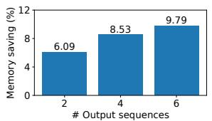

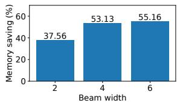  
(a) 并行采样（Parallel sampling）  
(b) 束搜索（Beam search）  
Figure 15. 在 Alpaca 跟踪数据上为 OPT-13B 提供服务时，通过共享 KV 块所节省的平均内存量。

## 6.3 并行采样与束搜索

我们使用两种流行的采样方法评估 PagedAttention 中内存共享的有效性：并行采样（parallel sampling）和束搜索（beam search）。在并行采样中，一个请求中的所有并行序列都可以共享 prompt 的 KV cache。如图 14 第一行所示，随着待采样序列数量的增加，vLLM 相比 Orca 基线带来了更大的性能提升。类似地，图 14 的第二行展示了不同束宽（beam widths）下束搜索的结果。由于束搜索允许更多的共享，vLLM 展现出了更大的性能优势。在 OPT-13B 和 Alpaca 数据集上，vLLM 相比 Orca (Oracle) 的提升从基础采样的 1.3× 提高到束宽为 6 的束搜索下的 2.3×。

图 15 绘制了内存节省量，其计算方式为通过共享节省的块数除以未共享时的总块数。结果显示，我们在并行采样上实现了 6.1% - 9.8% 的内存节省，在束搜索上实现了 37.6% - 55.2% 的内存节省。在 ShareGPT 数据集的相同实验中，我们在并行采样上观察到 16.2% - 30.5% 的内存节省，在束搜索上观察到 44.3% - 66.3% 的内存节省。

## 6.4 共享前缀

我们探讨了在不同输入 prompt 之间共享前缀的情况下 vLLM 的有效性，如图

  
(a) 单样本前缀提示词 (b) 5 样本前缀提示词

Figure 16. 输入提示词共享公共前缀的翻译工作负载。前缀包含 (a) 1 个包含 80 个 token 的示例或 (b) 5 个包含 341 个 token 的示例。

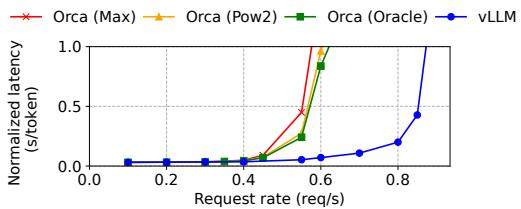  
Figure 17. 聊天机器人工作负载下的性能。

Fig. 10。在模型方面，我们使用了支持多语言的 LLaMA-13B [52]。在工作负载方面，我们使用了 WMT16 [4] 英语-德语翻译数据集，并合成了两个包含指令和若干翻译示例的前缀。第一个前缀包含单个示例（即单样本/one-shot），而另一个前缀包含 5 个示例（即少样本/few-shot）。如图 16 (a) 所示，在共享单样本前缀时，vLLM 的吞吐量比 Orca (Oracle) 高出 1.67×。此外，当共享更多示例时（图 16 (b)），vLLM 的吞吐量比 Orca (Oracle) 高出 3.58×。

## 6.5 聊天机器人

聊天机器人 [8, 19, 35] 是大语言模型（LLM）最重要的应用之一。为了实现聊天机器人，我们通过将对话历史和最新的用户查询拼接成提示词，让模型生成响应。我们使用 ShareGPT 数据集来合成对话历史和用户查询。由于 OPT-13B 模型的上下文长度有限，我们将提示词截断至最新的 1024 个 token，并让模型最多生成 1024 个 token。我们不在不同对话轮次之间存储 KV 缓存，因为这样做会在对话轮次之间占用其他请求的空间。

图 17 显示，与三种 Orca 基线相比，vLLM 能够承受高出 2× 的请求速率。由于 ShareGPT 数据集包含许多长对话，大多数请求的输入提示词都有 1024 个 token。由于伙伴分配算法（buddy allocation algorithm），无论 Orca 基线如何预测输出长度，它们都会为请求输出预留 1024 个 token 的空间。出于这个原因，三种 Orca 基线的表现相似。相比之下，vLLM 可以有效地处理长提示词，因为 PagedAttention 解决了内存碎片和预留的问题。

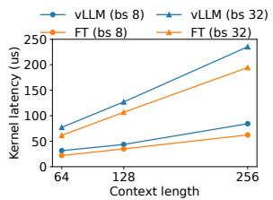  
(a) 注意力算子延迟。

  
(b) 不同块大小下的端到端延迟。  
Figure 18. 消融实验。

## 7 消融实验

在本节中，我们研究了 vLLM 的各个方面，并通过消融实验评估了我们所做出的设计选择。

## 7.1 算子微基准测试

PagedAttention 中的动态块映射会影响涉及已存储 KV cache 的 GPU 操作（即块读写和注意力计算）的性能。与现有系统相比，我们的 GPU 内核（§5）引入了额外的开销，包括访问块表、执行额外的分支以及处理可变序列长度。如图 18a 所示，与高度优化的 FasterTransformer 实现相比，这导致注意力内核延迟增加了 20–26%。我们认为该开销较小，因为它仅影响注意力算子，而不影响模型中的其他算子（例如 Linear）。尽管存在这些开销，PagedAttention 仍使 vLLM 在端到端性能上显著优于 FasterTransformer（§6）。

## 7.2 块大小的影响

块大小的选择会对 vLLM 的性能产生重大影响。如果块大小太小，vLLM 可能无法充分利用 GPU 的并行性来读取和处理 KV cache。如果块大小太大，内部碎片会增加，且共享的概率会降低。

在图 18b 中，我们在固定的请求速率下，使用带有基础采样的 ShareGPT 和 Alpaca 追踪数据集评估了不同块大小下 vLLM 的性能。在 ShareGPT 追踪数据中，16 到 128 的块大小带来了最佳性能。而在 Alpaca 追踪数据中，尽管块大小为 16 和 32 时表现良好，但更大的块大小会显著降低性能，因为其序列长度变得比块大小还要短。在实践中，我们发现在大多数工作负载下，16 的块大小既足够大以有效利用 GPU，又足够小以避免产生显著的内部碎片。因此，vLLM 将其默认块大小设置为 16。

  
(a) 微基准测试

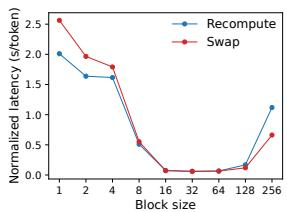  
(b) 端到端性能  
Figure 19. (a) 不同块大小下重计算和交换的开销。(b) 在相同请求速率下使用 ShareGPT 追踪数据服务 OPT-13B 时的性能。

## 7.3 比较重计算与交换

vLLM 支持重计算（recomputation）和交换（swapping）两种恢复机制。为了理解这两种方法之间的权衡，我们评估了它们的端到端性能并对其开销进行了微基准测试，如图 Fig. 19 所示。我们的结果表明，在块大小较小时，交换会带来过大的开销。这是因为较小的块大小通常会导致 CPU 与 GPU 之间发生大量的小数据传输，从而限制了有效 PCIe 带宽。相比之下，重计算的开销在不同的块大小下保持恒定，因为重计算并不利用 KV 块。因此，当块大小较小时，重计算更高效；而当块大小较大时，交换更高效，尽管重计算的开销从未高于交换延迟的 20%。对于 16 到 64 的中等块大小，这两种方法表现出相当的端到端性能。

## 8 讨论

将虚拟内存和分页技术应用于其他 GPU 工作负载。虚拟内存和分页的思想在 LLM 服务的 KV 缓存管理中非常有效，因为该工作负载需要动态内存分配（因为输出长度无法先验已知），且其性能受限于 GPU 内存容量。然而，这通常并不适用于所有 GPU 工作负载。例如，在 DNN 训练中，张量形状通常是静态的，因此内存分配可以提前进行优化。再例如，在为非 LLM 的 DNN 提供服务时，内存效率的提升可能不会带来任何性能改善，因为其性能主要是计算受限的。在这些场景中，由于内存间接寻址和非连续块内存带来的额外开销，引入 vLLM 的技术反而可能会降低性能。尽管如此，我们非常期待看到 vLLM 的技术被应用于与 LLM 服务具有相似特性的其他工作负载中。

应用虚拟内存和分页时针对 LLM 的特定优化。vLLM 通过利用特定于应用的语义，重新解释并增强了虚拟内存和分页的思想。一个例子是 vLLM 的“全有或全无”（all-or-nothing）换出策略，该策略利用了处理请求需要将其所有对应的 token 状态都存储在 GPU 内存中这一事实。另一个例子是用于恢复被驱逐块的重计算方法，这在 OS 中是不可行的。此外，vLLM 通过将内存访问操作的 GPU 核函数与 attention 等其他操作的核函数进行融合，减轻了分页中内存间接寻址的开销。

## 9 相关工作

通用模型服务系统。近年来，模型服务（Model serving）一直是一个活跃的研究领域，学者们提出了许多系统来解决深度学习模型部署的各个方面。Clipper [11]、TensorFlow Serving [33]、Nexus [45]、InferLine [10] 和 Clockwork [20] 是早期的一些通用模型服务系统。它们研究了用于服务单个或多个模型的批处理（batching）、缓存（caching）、放置（placement）和调度（scheduling）。最近，DVABatch [12] 引入了多入口多出口（multi-entry multi-exit）批处理。REEF [21] 和 Shepherd [61] 提出了用于服务的抢占机制。AlpaServe [28] 利用模型并行来实现统计复用。然而，这些通用系统未能考虑到大语言模型（LLM）推理的自回归特性和 token 状态，从而错失了优化的机会。

专用于 Transformer 的服务系统。鉴于 Transformer 架构的重要性，业界开发了许多针对它的专用服务系统。这些系统利用 GPU 算子（kernel）优化 [1, 29, 31, 56]、先进的批处理机制 [14, 60]、模型并行 [1, 41, 60] 以及参数共享 [64] 来实现高效服务。在这些系统中，Orca [60] 与我们的方法最为相关。

与 Orca 的比较。Orca [60] 中的迭代级调度（iteration-level scheduling）与 vLLM 中的 PagedAttention 是互补的技术：尽管两个系统都旨在提高 GPU 利用率并进而提升 LLM 服务的吞吐量，但 Orca 是通过对请求进行调度和交错执行，从而并行处理更多请求来实现这一点的；而 vLLM 则是通过提高内存利用率，使更多请求的工作集（working sets）能够容纳在内存中来实现的。通过减少内存碎片并支持共享，vLLM 能在一个批次中并行运行更多请求，与 Orca 相比实现了 2-4 倍的加速。事实上，像 Orca 中这种细粒度的请求调度和交错执行使内存管理更具挑战性，从而使 vLLM 提出的技术显得更加至关重要。

内存优化。加速器的计算能力与内存容量之间日益扩大的差距，导致内存成为了训练和推理的瓶颈。换入换出（Swapping）[23, 42, 55]、重计算（recomputation）[7, 24] 及其结合 [40] 已被用于降低训练的峰值内存。值得注意的是，FlexGen [46] 研究了在 GPU 内存受限的情况下如何换入换出权重和 token 状态以进行 LLM 推理，但它并不针对在线服务场景。OLLA [48] 优化了张量的生命周期和位置以减少碎片，但它并未实现细粒度的块级管理，也不针对在线服务。FlashAttention [13] 应用分块（tiling）和算子优化来降低注意力计算的峰值内存并减少 I/O 开销。本文在在线服务的背景下引入了块级内存管理的新思路。

## 10 结论

本文提出了 PagedAttention，一种允许将注意力键（keys）和值（values）存储在非连续分页内存中的新注意力算法，并展示了 vLLM，一个基于 PagedAttention 实现高效内存管理的高吞吐量 LLM 服务系统。受操作系统的启发，我们展示了如何将诸如虚拟内存和写时复制（copy-on-write）等成熟技术进行改造，以在 LLM 服务中高效管理 KV 缓存（KV cache）并处理各种解码算法。我们的实验表明，相比最先进的系统，vLLM 实现了 2-4× 的吞吐量提升。

## 致谢

我们要感谢 Xiaoxuan Liu、Zhifeng Chen、Yanping Huang、SOSP 匿名审稿人以及我们的指导责任人（shepherd）Lidong Zhou 提出的深刻反馈。本研究得到了来自 Andreessen Horowitz、Anyscale、Astronomer、Google、IBM、Intel、Lacework、Microsoft、Mohamed Bin Zayed University of Artificial Intelligence、Samsung SDS、Uber 和 VMware 的赞助支持。

## 参考文献

[1] Reza Yazdani Aminabadi, Samyam Rajbhandari, Minjia Zhang, Am mar Ahmad Awan, Cheng Li, Du Li, Elton Zheng, Jef Rasley, Shaden Smith, Olatunji Ruwase, et al. 2022. DeepSpeed Inference: Enabling Eficient Inference of Transformer Models at Unprecedented Scale. arXiv preprint arXiv:2207.00032 (2022).

[2] Jimmy Lei Ba, Jamie Ryan Kiros, and Geofrey E Hinton. 2016. Layer normalization. arXiv preprint arXiv:1607.06450 (2016).

[3] Yoshua Bengio, Réjean Ducharme, and Pascal Vincent. 2000. A neural probabilistic language model. Advances in neural information processing systems 13 (2000).

[4] Ond rej Bojar, Rajen Chatterjee, Christian Federmann, Yvette Gra ham, Barry Haddow, Matthias Huck, Antonio Jimeno Yepes, Philipp Koehn, Varvara Logacheva, Christof Monz, Matteo Negri, Aurelie Neveol, Mariana Neves, Martin Popel, Matt Post, Raphael Rubino, Car olina Scarton, Lucia Specia, Marco Turchi, Karin Verspoor, and Marcos Zampieri. 2016. Findings of the 2016 Conference on Machine Translation. In Proceedings of the First Conference on Machine Translation. Association for Computational Linguistics, Berlin, Germany, 131–198. htp://www.aclweb.org/anthology/W/W16/W16-2301

[5] Tom Brown, Benjamin Mann, Nick Ryder, Melanie Subbiah, Jared D Kaplan, Prafulla Dhariwal, Arvind Neelakantan, Pranav Shyam, Girish Sastry, Amanda Askell, et al. 2020. Language models are few-shot learners. Advances in neural information processing systems 33 (2020), 1877–1901.

[6] Mark Chen, Jerry Tworek, Heewoo Jun, Qiming Yuan, Henrique Ponde de Oliveira Pinto, Jared Kaplan, Harri Edwards, Yuri Burda, Nicholas

Joseph, Greg Brockman, et al. 2021. Evaluating large language models trained on code. arXiv preprint arXiv:2107.03374 (2021).

[7] Tianqi Chen, Bing Xu, Chiyuan Zhang, and Carlos Guestrin. 2016. Training deep nets with sublinear memory cost. arXiv preprint arXiv:1604.06174 (2016).

[8] Wei-Lin Chiang, Zhuohan Li, Zi Lin, Ying Sheng, Zhanghao Wu, Hao Zhang, Lianmin Zheng, Siyuan Zhuang, Yonghao Zhuang, Joseph E. Gonzalez, Ion Stoica, and Eric P. Xing. 2023. Vicuna: An Open-Source Chatbot Impressing GPT-4 with 90%\* ChatGPT Quality. htps://lmsys. org/blog/2023-03-30-vicuna/

[9] Aakanksha Chowdhery, Sharan Narang, Jacob Devlin, Maarten Bosma, Gaurav Mishra, Adam Roberts, Paul Barham, Hyung Won Chung, Charles Sutton, Sebastian Gehrmann, et al. 2022. Palm: Scaling language modeling with pathways. arXiv preprint arXiv:2204.02311 (2022).

[10] Daniel Crankshaw, Gur-Eyal Sela, Xiangxi Mo, Corey Zumar, Ion Stoica, Joseph Gonzalez, and Alexey Tumanov. 2020. InferLine: latencyaware provisioning and scaling for prediction serving pipelines. In Proceedings of the 11th ACM Symposium on Cloud Computing. 477–491.

[11] Daniel Crankshaw, Xin Wang, Guilio Zhou, Michael J Franklin, Joseph E Gonzalez, and Ion Stoica. 2017. Clipper: A Low-Latency Online Prediction Serving System. In 14th USENIX Symposium on Networked Systems Design and Implementation (NSDI 17). 613–627.

[12] Weihao Cui, Han Zhao, Quan Chen, Hao Wei, Zirui Li, Deze Zeng, Chao Li, and Minyi Guo. 2022. DVABatch: Diversity-aware Multi-Entry Multi-Exit Batching for Eficient Processing of DNN Services on GPUs. In 2022 USENIX Annual Technical Conference (USENIX ATC 22). 183–198.

[13] Tri Dao, Dan Fu, Stefano Ermon, Atri Rudra, and Christopher Ré. 2022. Flashattention: Fast and memory-eficient exact attention with io-awareness. Advances in Neural Information Processing Systems 35 (2022), 16344–16359.

[14] Jiarui Fang, Yang Yu, Chengduo Zhao, and Jie Zhou. 2021. TurboTransformers: an eficient GPU serving system for transformer models. In Proceedings ofthe 26th ACM SIGPLAN Symposium on Principles and Practice of Parallel Programming. 389–402.

[15] FastAPI. 2023. FastAPI. htps://github.com/tiangolo/fastapi.

[16] Pin Gao, Lingfan Yu, Yongwei Wu, and Jinyang Li. 2018. Low latency rnn inference with cellular batching. In Proceedings of the Thirteenth EuroSys Conference. 1–15.

[17] Amir Gholami, Zhewei Yao, Sehoon Kim, Michael W Mahoney, and Kurt Keutzer. 2021. Ai and memory wall. RiseLab Medium Post 1 (2021), 6.

[18] Github. 2022. htps://github.com/features/copilot

[19] Google. 2023. htps://bard.google.com/

[20] Arpan Gujarati, Reza Karimi, Safya Alzayat, Wei Hao, Antoine Kaufmann, Ymir Vigfusson, and Jonathan Mace. 2020. Serving {DNNs} like Clockwork: Performance Predictability from the Bottom Up. In 14th USENIX Symposium on Operating Systems Design and Implementation (OSDI 20). 443–462.

[21] Mingcong Han, Hanze Zhang, Rong Chen, and Haibo Chen. 2022. Microsecond-scale Preemption for Concurrent {GPUaccelerated} {DNN} Inferences. In 16th USENIX Symposium on Operating Systems Design and Implementation (OSDI 22). 539–558.

[22] Kaiming He, Xiangyu Zhang, Shaoqing Ren, and Jian Sun. 2016. Deep residual learning for image recognition. In Proceedings of the IEEE conference on computer vision and pattern recognition. 770–778.

[23] Chien-Chin Huang, Gu Jin, and Jinyang Li. 2020. Swapadvisor: Pushing deep learning beyond the gpu memory limit via smart swapping. In Proceedings of the Twenty-Fifth International Conference on Architectural Supportfor Programming Languages and Operating Systems. 1341–1355.

[24] Paras Jain, Ajay Jain, Aniruddha Nrusimha, Amir Gholami, Pieter Abbeel, Joseph Gonzalez, Kurt Keutzer, and Ion Stoica. 2020. Checkmate: Breaking the memory wall with optimal tensor rematerialization.

Proceedings ofMachine Learning and Systems 2 (2020), 497–511.

[25] Tom Kilburn, David BG Edwards, Michael J Lanigan, and Frank H Sumner. 1962. One-level storage system. IRE Transactions on Electronic Computers 2 (1962), 223–235.

[26] Brian Lester, Rami Al-Rfou, and Noah Constant. 2021. The power of scale for parameter-eficient prompt tuning. arXiv preprint arXiv:2104.08691 (2021).

[27] Xiang Lisa Li and Percy Liang. 2021. Prefix-tuning: Optimizing contin uous prompts for generation. arXiv preprint arXiv:2101.00190 (2021).

[28] Zhuohan Li, Lianmin Zheng, Yinmin Zhong, Vincent Liu, Ying Sheng, Xin Jin, Yanping Huang, Zhifeng Chen, Hao Zhang, Joseph E Gonzalez, et al. 2023. AlpaServe: Statistical Multiplexing with Model Parallelism for Deep Learning Serving. arXiv preprint arXiv:2302.11665 (2023).

[29] Lingxiao Ma, Zhiqiang Xie, Zhi Yang, Jilong Xue, Youshan Miao, Wei Cui, Wenxiang Hu, Fan Yang, Lintao Zhang, and Lidong Zhou. 2020. Rammer: Enabling holistic deep learning compiler optimizations with rtasks. In Proceedings of the 14th USENIX Conference on Operating Systems Design and Implementation. 881–897.

[30] NVIDIA. [n. d.]. Triton Inference Server. htps://developer.nvidia.com/ nvidia-triton-inference-server.

[31] NVIDIA. 2023. FasterTransformer. htps://github.com/NVIDIA/ FasterTransformer.

[32] NVIDIA. 2023. NCCL: The NVIDIA Collective Communication Library. htps://developer.nvidia.com/nccl.

[33] Christopher Olston, Noah Fiedel, Kiril Gorovoy, Jeremiah Harmsen, Li Lao, Fangwei Li, Vinu Rajashekhar, Sukriti Ramesh, and Jordan Soyke. 2017. Tensorflow-serving: Flexible, high-performance ml serving. arXiv preprint arXiv:1712.06139 (2017).

[34] OpenAI. 2020. htps://openai.com/blog/openai-api

[35] OpenAI. 2022. htps://openai.com/blog/chatgpt

[36] OpenAI. 2023. htps://openai.com/blog/custom-instructions-forchatgpt

[37] OpenAI. 2023. GPT-4 Technical Report. arXiv:2303.08774 [cs.CL]

[38] LMSYS ORG. 2023. Chatbot Arena Leaderboard Week 8: Introducing MT-Bench and Vicuna-33B. https://lmsys.org/blog/2023-06-22- leaderboard/.

[39] Adam Paszke, Sam Gross, Francisco Massa, Adam Lerer, James Bradbury, Gregory Chanan, Trevor Killeen, Zeming Lin, Natalia Gimelshein, Luca Antiga, et al. 2019. Pytorch: An imperative style, high-performance deep learning library. Advances in neural information processing systems 32 (2019).

[40] Shishir G Patil, Paras Jain, Prabal Dutta, Ion Stoica, and Joseph Gonzalez. 2022. POET: Training Neural Networks on Tiny Devices with Integrated Rematerialization and Paging. In International Conference on Machine Learning. PMLR, 17573–17583.

[41] Reiner Pope, Sholto Douglas, Aakanksha Chowdhery, Jacob Devlin, James Bradbury, Anselm Levskaya, Jonathan Heek, Kefan Xiao, Shivani Agrawal, and Jeff Dean. 2022. Efficiently Scaling Transformer Inference. arXiv preprint arXiv:2211.05102 (2022).

[42] Jie Ren, Samyam Rajbhandari, Reza Yazdani Aminabadi, Olatunji Ruwase, Shuangyan Yang, Minjia Zhang, Dong Li, and Yuxiong He. 2021. ZeRO-Offload: Democratizing Billion-Scale Model Training.. In USENIX Annual Technical Conference. 551–564.

[43] Reuters. 2023. htps://www.reuters.com/technology/tech-giants-ailike-bing-bard-poses-billion-dollar-search-problem-2023-02-22

[44] Amazon Web Services. 2023. htps://aws.amazon.com/bedrock/

[45] Haichen Shen, Lequn Chen, Yuchen Jin, Liangyu Zhao, Bingyu Kong, Matthai Philipose, Arvind Krishnamurthy, and Ravi Sundaram. 2019. Nexus: A GPU cluster engine for accelerating DNN-based video analysis. In Proceedings of the 27th ACM Symposium on Operating Systems Principles. 322–337.

[46] Ying Sheng, Lianmin Zheng, Binhang Yuan, Zhuohan Li, Max Ryabinin, Daniel Y Fu, Zhiqiang Xie, Beidi Chen, Clark Barrett, Joseph E Gonzalez, et al. 2023. High-throughput Generative Inference of Large

Language Models with a Single GPU. arXiv preprint arXiv:2303.06865 (2023).

[47] Mohammad Shoeybi, Mostofa Patwary, Raul Puri, Patrick LeGresley, Jared Casper, and Bryan Catanzaro. 2019. Megatron-lm: Training multi billion parameter language models using model parallelism. arXiv preprint arXiv:1909.08053 (2019).

[48] Benoit Steiner, Mostafa Elhoushi, Jacob Kahn, and James Hegarty. 2022. OLLA: Optimizing the Lifetime and Location of Arrays to Reduce the Memory Usage of Neural Networks. (2022). htps://doi.org/10.48550/ arXiv.2210.12924

[49] Ilya Sutskever, Oriol Vinyals, and Quoc V Le. 2014. Sequence to sequence learning with neural networks. Advances in neural information processing systems 27 (2014).

[50] Rohan Taori, Ishaan Gulrajani, Tianyi Zhang, Yann Dubois, Xuechen Li, Carlos Guestrin, Percy Liang, and Tatsunori B. Hashimoto. 2023. Stanford Alpaca: An Instruction-following LLaMA model. htps:/ github.com/tatsu-lab/stanford\_alpaca.

[51] ShareGPT Team. 2023. htps://sharegpt.com

[52] Hugo Touvron, Thibaut Lavril, Gautier Izacard, Xavier Martinet, Marie-Anne Lachaux, Timothée Lacroix, Baptiste Rozière, Naman Goyal, Eric Hambro, Faisal Azhar, et al. 2023. Llama: Open and eficient foundation language models. arXiv preprint arXiv:2302.13971 (2023).

[53] Ashish Vaswani, Noam Shazeer, Niki Parmar, Jakob Uszkoreit, Llion Jones, Aidan N Gomez, Łukasz Kaiser, and Illia Polosukhin. 2017. Attention is all you need. Advances in neural information processing systems 30 (2017).

[54] Jing Wang, Youyou Lu, Qing Wang, Minhui Xie, Keji Huang, and Jiwu Shu. 2022. Pacman: An Eficient Compaction Approach for {Log-Structured} {Key-Value} Store on Persistent Memory. In 2022 USENIX Annual Technical Conference (USENIX ATC 22). 773–788.

[55] Linnan Wang, Jinmian Ye, Yiyang Zhao, Wei Wu, Ang Li, Shuaiwen Leon Song, Zenglin Xu, and Tim Kraska. 2018. Superneurons: Dynamic GPU memory management for training deep neural networks. In Proceedings ofthe 23rd ACM SIGPLAN symposium on principles and practice of parallel programming. 41–53.

[56] Xiaohui Wang, Ying Xiong, Yang Wei, Mingxuan Wang, and Lei Li. 2021. LightSeq: A High Performance Inference Library for Transformers. In Proceedings of the 2021 Conference of the North American Chapter of the Association for Computational Linguistics: Human Language Technologies: Industry Papers. 113–120.

[57] Yizhong Wang, Yeganeh Kordi, Swaroop Mishra, Alisa Liu, Noah A Smith, Daniel Khashabi, and Hannaneh Hajishirzi. 2022. Self-Instruct: Aligning Language Model with Self Generated Instructions. arXiv preprint arXiv:2212.10560 (2022).

[58] Thomas Wolf, Lysandre Debut, Victor Sanh, Julien Chaumond, Clement Delangue, Anthony Moi, Pierric Cistac, Tim Rault, Rémi Louf, Morgan Funtowicz, et al. 2020. Transformers: State-of-the-art natural language processing. In Proceedings of the 2020 conference on empirical methods in natural language processing: system demonstrations. 38–45.

[59] Yonghui Wu, Mike Schuster, Zhifeng Chen, Quoc V Le, Mohammad Norouzi, Wolfgang Macherey, Maxim Krikun, Yuan Cao, Qin Gao, Klaus Macherey, et al. 2016. Google’s neural machine translation system: Bridging the gap between human and machine translation. arXiv preprint arXiv:1609.08144 (2016).

[60] Gyeong-In Yu, Joo Seong Jeong, Geon-Woo Kim, Soojeong Kim, and Byung-Gon Chun. 2022. Orca: A Distributed Serving System for {Transformer-Based} Generative Models. In 16th USENIX Symposium on Operating Systems Design and Implementation (OSDI 22). 521–538.

[61] Hong Zhang, Yupeng Tang, Anurag Khandelwal, and Ion Stoica. 2023. SHEPHERD: Serving DNNs in the Wild. In 20th USENIXSymposium on Networked Systems Design and Implementation (NSDI 23). USENIX As sociation, Boston, MA, 787–808. htps://www.usenix.org/conference nsdi23/presentation/zhang-hong

[62] Susan Zhang, Stephen Roller, Naman Goyal, Mikel Artetxe, Moya Chen, Shuohui Chen, Christopher Dewan, Mona Diab, Xian Li, Xi Victoria Lin, et al. 2022. Opt: Open pre-trained transformer language models. arXiv preprint arXiv:2205.01068 (2022).

[63] Lianmin Zheng, Zhuohan Li, Hao Zhang, Yonghao Zhuang, Zhifeng Chen, Yanping Huang, Yida Wang, Yuanzhong Xu, Danyang Zhuo,

Eric P Xing, et al. 2022. Alpa: Automating Inter-and Intra-Operator Parallelism for Distributed Deep Learning. In 16th USENIX Symposium on Operating Systems Design and Implementation (OSDI 22). 559–578.

[64] Zhe Zhou, Xuechao Wei, Jiejing Zhang, and Guangyu Sun. 2022. PetS: A Unified Framework for Parameter-Eficient Transformers Serving. In 2022 USENIX Annual Technical Conference (USENIX ATC 22). 489–504.