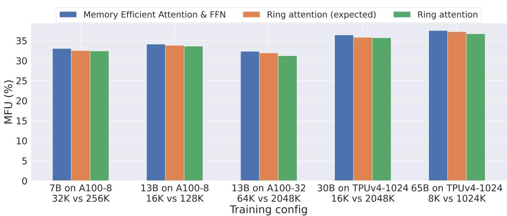
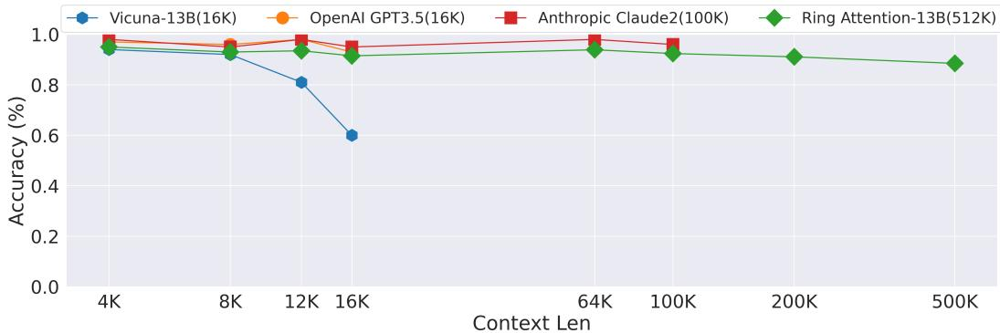

# 基于分块 Transformer 的环状注意力以实现近乎无限上下文

Hao Liu, Matei Zaharia, Pieter Abbeel

UC Berkeley hao.liu@cs.berkeley.edu

## 摘要

Transformer 已成为众多前沿 AI 模型的首选架构，在广泛的 AI 应用中展现出了卓越的性能。然而，Transformer 对内存的高需求限制了其处理长序列的能力，从而在复杂环境中处理视频、动作以及其他长序列和多模态数据时带来了挑战。我们提出了一种新颖的方法——基于分块 Transformer 的环状注意力（Ring Attention with Blockwise Transformers，简称 Ring Attention）。该方法利用自注意力（self-attention）和前馈网络（feedforward）的分块计算，将长序列分布到多个计算设备上，同时将键-值（key-value）块的通信与分块注意力的计算完全重叠（overlap）。我们的方法无需借助近似计算，也不会产生额外的通信和计算开销，即可实现比以往内存高效型 Transformer 长达“设备数量”倍的序列训练与推理。在语言建模和强化学习任务上的大量实验证明了我们方法的有效性，它支持数百万标记（tokens）的上下文大小并显著提升了性能。<sup>1</sup>。

## 1 引言

Transformer [37] 已成为众多前沿 AI 系统的基石，并在广泛的 AI 问题中展现了令人瞩目的性能。Transformer 的成功得益于其采用了自注意力机制和逐位置前馈机制的架构设计。然而，扩展 Transformer 的上下文长度是一项挑战 [29]，因为 Transformer 固有的架构设计（即自注意力机制）所需的内存开销与输入序列长度呈二次方关系，这使得将其扩展到更长的输入序列变得十分困难。大上下文 Transformer 对于应对多样化的 AI 挑战至关重要，涵盖从处理书籍和高分辨率图像到分析长视频和复杂代码库等各个方面。它们擅长从相互关联的网络和超链接内容中提取信息，并且对于处理复杂的科学实验数据至关重要。目前已经涌现出许多上下文长度较以往显著扩展的语言模型应用案例：具有 16K 上下文长度的 GPT-3.5 [32]、具有 32K 上下文长度的 GPT-4 [29]、具有 65K 上下文长度的 MosaicML MPT [25]，以及具有 100K 上下文长度的 Anthropic Claude [1]。

在其重要性的推动下，减少内存开销的研究兴趣日益高涨。其中一条研究路线利用了这样一个观察结果：自注意力（self-attention）中的 Softmax 矩阵无需实例化完整矩阵即可计算 [24]，这促进了在不进行近似计算的情况下分块计算自注意力和前馈网络（feedforward）的发展 [30, 9, 23]。尽管内存有所减少，但存储每一层的输出仍然带来重大挑战。这种必要性源于自注意力的固有特性，即涉及所有元素之间的交互（$n$ 到 $n$ 交互）。后一层的自注意力依赖于访问前一层的全部输出。若不这样做，计算成本将呈三次方程式增加，因为必须为每个序列元素重新计算每个输出，从而导致其无法应用于更长的序列。

这些组件有助于高效捕获输入 token 之间的长距离依赖关系，并通过高度并行的计算实现可扩展性。为了直观展示内存需求，即使在批大小（batch size）为 1 的情况下，对于一个隐藏层大小（hidden size）为 1024 的适度规模模型，处理 1 亿个 token 也需要超过 1000GB 的内存。这远大于当代 GPU 和 TPU 的容量，后者的显存（高带宽内存，HBM）通常不足 100GB。

  
Figure 1: 在 TPUv4-1024 上进行端到端大规模训练下的最大上下文长度。基线模型为原始 Transformer [37]、内存高效 Transformer [30] 以及内存高效注意力和前馈网络（分块并行 Transformer）[23]。我们提出的 Ring Attention 方法允许训练比基线长达设备数量倍的序列，并在不进行近似且不增加任何通信和计算开销的情况下实现数百万以上长度序列的训练。

为解决这一挑战，我们提出了一个关键观察：通过以分块方式执行自注意力和前馈网络计算 [23]，我们可以将序列维度分布在多个设备上，从而允许计算与通信并发进行。这种见解源于这样一个事实：当我们按块逐个计算注意力时，计算结果与这些分块计算的顺序无关。我们的方法将计算分块注意力的外层循环分布在

主机，每个设备管理各自对应的输入块。在内循环中，每个设备计算针对其指定输入块的分块注意力和前馈操作。主机设备构成一个概念上的环，在内循环期间，每个设备将其用于分块计算的键值块副本发送给环中的下一个设备，同时从上一个设备接收键值块。只要分块计算的时间长于分块传输的时间，将这些过程重叠就不会比标准 Transformer 引入额外的开销。以往的研究 [21] 中也探讨过使用环形拓扑来计算自注意力，但它会产生类似于序列并行的非重叠通信开销，使其无法适用于大上下文尺寸。我们的工作利用分块并行 Transformer（Blockwise Parallel Transformers）[23] 大幅降低内存成本，从而在训练和推理过程中实现数千万 token 上下文大小的零开销扩展，并允许使用任意大的上下文尺寸。由于我们的方法通过 Transformer 的分块计算重叠了环中主机之间键值块的通信，因此我们将其命名为基于分块并行 Transformer 的环形注意力（Ring Attention with Blockwise Parallel Transformers，简称 Ring Attention）。

我们在语言建模基准上评估了我们方法的有效性。实验表明，Ring Attention 能够降低 Transformer 的内存需求，使我们能够训练比以往最先进的内存高效方法长 500 倍以上的序列，并能在不对注意力进行近似的情况下训练长度超过 1 亿的序列。重要的是，Ring Attention 消除了单个设备所施加的内存限制，使得训练和推理的序列长度能够与设备数量成正比扩展，从本质上实现了接近无限的上下文大小。

我们的贡献包含两个方面：(a) 提出了一种内存高效的 Transformer 架构，该架构允许上下文长度随设备数量线性扩展，同时保持性能，消除了单个设备所带来的内存瓶颈；(b) 通过广泛的实验证明了我们方法的有效性。

## 2 大上下文内存约束

给定输入序列 $Q , K , V \in \mathbb { R } ^ { s \times d }$，其中 s 为序列长度，d 为头维度。我们将输出矩阵计算为：

$$
\operatorname{Attention} (Q, K, V) = \operatorname{softmax} (\frac {Q K ^ {T}}{\sqrt {d}}) V,
$$

其中 softmax 是按行应用的。每个自注意力子层都附带一个前馈网络，该网络分别且相同地应用于每个位置。它由两个线性变换以及其间的 ReLU 激活函数组成。

$$
\operatorname{FFN} (x) = \max (0, x W _ {1} + b _ {1}) W _ {2} + b _ {2}.
$$

分块并行 Transformer（Blockwise Parallel Transformers）。先前的前沿技术大幅降低了内存占用，这是通过创新技术实现的，这些技术通过逐块计算注意力，从而无需完全实例化注意力图 [30, 9, 23]。这些进展将注意力的内存开销降低至每层 2bsh 字节，其中 b 代表批次大小（batch size），s 表示序列长度（sequence length），h 代表模型的隐藏层大小（hidden size）。为了进一步减少内存使用，分块并行 Transformer（Blockwise Parallel Transformer, BPT）[23] 引入了一种策略，以分块方式计算与每个自注意力子层相关联的前馈网络。该方法有效地将前馈网络的最大激活值大小从 8bsh 限制到 2bsh。有关内存效率的更详细分析，请参阅该文献中的讨论。总之，当前最先进的 Transformer 层的激活值内存开销为 2bsh。

每层的庞大输出（Large Output of Each Layer）。尽管 BPT 显著降低了 Transformer 中的内存需求，但在扩展上下文长度方面仍面临重大挑战，因为它需要存储每一层的输出。由于自注意力的固有特性涉及所有元素之间的交互（n 对 n 交互），这种存储是至关重要的。如果没有这些存储的输出，后续层的自注意力计算在实际中将变得不可行，需要对每个序列元素进行重新计算。简而言之，即使对于一个隐藏层大小为 1024 的普通模型，以批次大小为 1 处理 1 亿个 token 也需要超过 1000GB 的内存。相比之下，现代 GPU 和 TPU 通常提供不到 100GB 的高带宽内存（HBM），而受物理限制和高昂制造成本的阻碍，大幅扩展 HBM 容量的前景并不乐观。

## 3 结合分块并行 Transformer 的 Ring Attention（环形注意力）

我们的主要目标是通过在多个主机（host）之间高效分布长序列且不增加额外开销，从而消除单个设备带来的内存限制。为了实现这一目标，我们对分块并行 Transformer（Blockwise Parallel Transformers，BPT）[23] 框架进行了改进。在将输入序列分布到不同主机上时，每个主机负责运行与其指定分块对应的分块注意力（blockwise attention）外层循环的一个元素，以及特定于该分块的前馈网络（feedforward network）。这些操作不需要与其他主机进行通信。然而，内层循环中出现了一个挑战，它涉及键-值（key-value）块的交互，需要从其他主机获取分块。由于每个主机仅拥有一个键-值块，从其他主机获取分块的朴素方法会导致两个显著问题：首先，系统在等待接收所需的键-值块时会引入计算延迟；其次，键-值块的累积会导致内存占用增加，从而违背了降低内存成本的初衷。

基于环的分块注意力（Ring-Based Blockwise Attention）。为了解决上述挑战，我们利用了内层循环中键-值块操作的置换不变性（permutation invariance）。这一性质源于：只要正确组合每个块的统计量以进行重新缩放，查询（query）块与一组键-值块之间的自注意力计算就可以按任意顺序进行。我们通过将所有主机设想为构成一个环形结构来利用这一性质：host-1, host-2, ..., host-N。在计算分块注意力和前馈网络时，每个主机通过高效协作，在将用于注意力计算的键-值块并发发送到下一个主机的同时，接收来自前一个主机的键-值块，从而有效地将数据块的传输与分块计算重叠（overlap）。具体而言，对于任意 host-i，在其查询块与某个键-值块计算注意力期间，它并发地将键-值块发送给下一个 host-(i + 1)，同时从前一个 host-(i − 1) 接收键-值块。如果计算时间超过传输键-值块所需的时间，就不会产生额外的通信开销。由于可以使用相同的操作和技术，该重叠机制同样适用于我们方法的前向传播和反向传播。此前已有工作提出利用环形拓扑来计算自注意力 [21]，旨在降低通信成本。我们的工作不同之处在于，利用分块并行 Transformer 来大幅降低内存开销。正如我们在下一节所展示的，这使得在训练和推理过程中能够实现零开销的上下文大小扩展，并支持任意大的上下文大小。

主机间的算术强度。为了确定重叠传输与计算所需的最小块大小（block size），假设每个主机具有 F FLOPS 的算力，主机之间的带宽表示为 B。值得注意的是，我们的方法仅涉及环形配置中相邻的上一个和下一个主机之间的交互，因此我们的分析既适用于 GPU 全互连（all-to-all）拓扑，也适用于 TPU 环面（torus）拓扑。我们考虑以下变量：块大小表示为 c，隐藏层大小（hidden size）表示为 d。在计算分块自注意力时，使用查询（queries）和键（keys）计算注意力分数需要 $2 d c ^ { 2 }$ FLOPs，将这些注意力分数与值（values）相乘还需要额外的 $2 d c ^ { 2 }$ FLOPs。总计计算需求达到 $4 d c ^ { 2 }$ FLOPs。我们排除了查询、键和值的投影操作以及分块前馈操作，因为它们只会增加计算复杂度，而不会在主机之间产生任何通信成本。这种简化带来的是更严格的条件，并且不会影响我们方法的有效性。在通信方面，键块和值块都需要总共 2cd 字节。因此，总通信需求为 4cd 字节。为了实现通信与计算的重叠，必须满足以下条件：$4 d c ^ { 2 } / F \geq 4 c d / B$ 。这意味着表示为 $c ,$ 的块大小应大于或等于 $F / B$ 。实际上，这意味着块大小需要大于 FLOPs 与带宽的比值。

  
键与值内循环  
Figure 2: 上图 (a)：我们使用与原始 Transformer 相同的模型架构，但重新组织了计算。在图中，我们展示了在主机环中，每个主机持有一个查询块，而键值块以逐块的方式穿过主机环以进行注意力和前馈计算。在计算注意力时，每个主机向下一个主机发送键值块，同时从前一个主机接收键值块。通信与分块注意力和前馈的计算相互重叠。下图 (b)：我们逐块计算原始 Transformer。每个主机负责查询外循环的一次迭代，而键值块在各主机之间轮转。如图所示，设备从左侧的第一个查询块开始；然后我们迭代遍历水平排列的键值块序列。查询块与键值块结合用于计算自注意力（黄色框），其输出传递给前馈网络（青色框）。

Table 1: 不同 Transformer 架构之间最大激活大小的比较。这里，$b$ 为批次大小（batch size），$h$ 为隐藏层维度（hidden dimension），$n$ 为注意力头数（number of heads），$s$ 为序列长度（sequence length），$c$ 为块大小（block size），且块大小（$c$）与输入序列长度（$s$）无关。对比的架构包括原生 Transformer [37]、内存高效注意力 [30]、内存高效注意力与前馈网络 [23]，以及我们提出的 Ring Attention 方法。在假设 bfloat16 精度的前提下，数值以每层字节数表示。

<table><tr><td>层类型</td><td>自注意力 (Self-Attention)</td><td>前馈网络 (FeedForward)</td><td>总计</td></tr><tr><td>Vanilla</td><td> $2bns^2$ </td><td>8bsh</td><td> $2bhs^2$ </td></tr><tr><td>Memory efficient attention</td><td> $2bsh + 4bch$ </td><td>8bsh</td><td>8bsh</td></tr><tr><td>Memory efficient attention and feedforward</td><td>2bsh</td><td>2bsh</td><td>2bsh</td></tr><tr><td>Ring Attention</td><td>6bch</td><td>2bch</td><td>6bch</td></tr></table>

Table 2: 每个设备所需的最小序列长度。互连带宽（Interconnect Bandwidth）为主机之间的单向带宽，$i . e . ,$ GPU 之间的 NVLink / InfiniBand 带宽以及 TPU 之间的 ICI 带宽。所需最小块大小 $c = { \mathrm { F L O P S } } ,$ /Bandwidth，最小序列长度 $s = 6 c$。

<table><tr><td>每台主机规格</td><td>FLOPS (TF)</td><td>HBM (GB)</td><td>互连带宽 (GB/s)</td><td>最小块大小 (×1e3)</td><td>最小序列长度 (×1e3)</td></tr><tr><td>A100 NVLink</td><td>312</td><td>80</td><td>300</td><td>1.0</td><td>6.2</td></tr><tr><td>A100 InfiniBand</td><td>312</td><td>80</td><td>12.5</td><td>24.5</td><td>149.5</td></tr><tr><td>TPU v3</td><td>123</td><td>16</td><td>112</td><td>1.1</td><td>6.6</td></tr><tr><td>TPU v4</td><td>275</td><td>32</td><td>268</td><td>1.0</td><td>6.2</td></tr><tr><td>TPU v5e</td><td>196</td><td>16</td><td>186</td><td>1.1</td><td>6.3</td></tr></table>

内存需求。一台主机需要存储多个块，包括一个块大小用于存储当前的查询（query）块，两个块大小用于当前的键（key）和值（value）块，以及两个块大小用于接收键和值块。此外，存储分块注意力和前馈网络的输出需要一个块大小，因为输出保留了查询块的形状。因此，总共需要六个块，这转化为 $6bch$ 字节的内存。值得注意的是，分块前馈网络的最大激活大小为 $2bch$ [23]。因此，最大总激活大小保持在 $6bch$ 字节。Table 1 详细比较了我们的方法与其他方法的内存开销。值得注意的是，我们的方法展现出了相对于块大小 $c$ 呈线性内存扩展的优势，并且与输入序列长度 $s$ 无关。

我们的分析表明，模型的序列长度需要达到 $s = 6 c ,$，即最小块大小（block size）的六倍。常见计算服务器的需求如 Table 2 所示。每台主机所需的最小序列长度（最右列）在 6K 到 10K 之间变化，而对于配备高带宽互连的 TPU 和 GPU，每台主机的最小块大小（右起第二列）约为 1K。对于通过带宽较低的 InfiniBand 连接的 GPU，这些要求则更为严格。通过数据并行和张量并行等并行技术，以及内存高效的分块注意力（blockwise attention）和前馈网络 [30, 9, 23]，这些要求很容易得到满足，我们将在第 5 节实验中展示这一点。

算法与实现。Algorithm 1 给出了该算法的伪代码。Ring Attention 与现有的内存高效 Transformer 代码兼容：Ring Attention 只需要在每台主机上本地调用任何可用的内存高效计算，并将主机之间键值块（key-value blocks）的通信与分块计算重叠（overlap）。我们使用集合操作 jax.lax.ppermute 在相邻主机之间发送和接收键值块。Jax 实现见附录 A。

<div class="mineru-algorithm" style="white-space: pre-wrap; font-family:monospace;">
Algorithm 1 使用 Ring Attention 降低 Transformer 内存开销。

Required: 输入序列 x。主机数量  $N_{h}$ 。

Initialize

将输入序列切分为  $N_{h}$  个块，使每台主机拥有一个输入块。

在每台主机上为其输入块计算查询（query）、键（key）和值（value）。

for 每个 Transformer 层 do

    for count = 1 to  $N_{h} - 1$  do

    for 每台主机并发执行 do

    使用本地查询、键、值块增量计算内存高效注意力。

    将键和值块发送至下一台主机，并从上一台主机接收键和值块。

    end for

end for

for 每台主机并发执行 do

    使用本地注意力输出计算内存高效前馈网络。

end for

end for
</div>

## 4 设置

我们通过基准测试最大序列长度和模型浮点运算利用率（model FLOPs utilization），来评估使用 Ring Attention 改进 Transformer 模型的效果。

模型配置。我们的研究基于 LLaMA 架构，在实验中考虑了 3B、7B、13B 和 30B 的模型规模。

基线模型。我们通过将我们的方法与以下模型进行对比来评估其效果：原生 Transformer [37]（通过具体实例化注意力矩阵来计算自注意力，并以常规方式计算前馈网络）、具有内存高效注意力的 Transformer [30] 及其高效 CUDA 实现 [9]，以及同时具备内存高效注意力和前馈网络的 Transformer [23]。

训练配置。对于所有方法，遵循先前的研究 [30, 23]，我们对注意力机制和前馈网络均应用了完整的梯度检查点（gradient checkpointing）[5]。实验在 GPU 和 TPU 上进行。对于 GPU，我们同时考虑了包含 8 块 GPU 的单台 DGX A100 服务器以及分布式 32 块 A100 GPU。我们还在 TPU 上进行了实验，涵盖从较早代的 TPUv3 到更新一代的 TPUv4 和 TPUv5e。我们特别指出，我们所有的结果均是在全精度而非混合精度下测得的。

## 5 结果

在我们的实验中，主要目标是在多个关键指标上全面评估 Ring Attention 的性能，包括加速器显存内支持的最大序列长度、模型 FLOPs 利用率（model flops utilization）以及吞吐量。我们在不同的模型规模和加速器配置下，将 Ring Attention 的性能与多个基线模型进行了对比，包括原生 Transformer [37]、带有内存高效注意力（memory efficient attention）的 Transformer [30]，以及同时带有内存高效注意力和前馈网络的 Transformer [23]。

## 5.1 评估最大上下文大小

我们使用在先前的端到端训练 [36, 12] 中广泛采用的全分片张量并行（fully sharded tensor parallelsim, FSDP）[11] 来评估支持的最大上下文长度。我们注意到，在我们的评估中没有考虑张量并行，因为我们的方法独立于张量并行。从业者可以将我们的方法与张量并行相结合，我们将在第 5.2 节中展示这一点。使用 FSDP 允许我们为基线和我们的方法设置相同的以 token 为单位的批大小（batch size），从而确保公平的比较。具体而言，在 n 个设备上，使用 FSDP 对基线模型进行分片，得到的序列长度为 l。以 token 为单位的总批大小为 nl。我们结合使用 FSDP 与 Ring Attention，将序列长度扩展到 $\frac { n l } { m }$，序列数为 m。这意味着以 token 为单位的总批大小保持不变，但 Ring Attention 能够实现显著更大的上下文大小。表 3 总结了我们的实验结果。

Table 3: 使用全分片数据并行和各种 Transformer 架构在端到端训练中支持的最大上下文长度。我们展示了不同的模型大小和加速器。基线包括原生 Transformer [37]、带有内存高效注意力的 Transformer [30]，以及带有内存高效注意力和前馈网络的 Transformer [23]。上下文大小以 token 数（1e3）计。我们的 Ring Attention 显著优于各基线，并使训练序列长度达到先前最先进水平的最高设备数倍。

<table><tr><td rowspan="2"></td><td colspan="4">支持的最大上下文大小 (×1e3)</td><td rowspan="2">本文方法对比 SOTA</td></tr><tr><td>原生 (Vanilla)</td><td>内存高效注意力 (Memory Efficient Attn)</td><td>内存高效注意力与 FFN</td><td>Ring Attention（本文方法）</td></tr><tr><td>8x A100 NVLink</td><td></td><td></td><td></td><td></td><td></td></tr><tr><td>3B</td><td>4</td><td>32</td><td>64</td><td>512</td><td>8x</td></tr><tr><td>7B</td><td>2</td><td>16</td><td>32</td><td>256</td><td>8x</td></tr><tr><td>13B</td><td>2</td><td>4</td><td>16</td><td>128</td><td>8x</td></tr><tr><td>32x A100 InfiniBand</td><td></td><td></td><td></td><td></td><td></td></tr><tr><td>7B</td><td>4</td><td>64</td><td>128</td><td>4096</td><td>32x</td></tr><tr><td>13B</td><td>4</td><td>32</td><td>64</td><td>2048</td><td>32x</td></tr><tr><td>TPUv3-512</td><td></td><td></td><td></td><td></td><td></td></tr><tr><td>7B</td><td>1</td><td>4</td><td>8</td><td>2048</td><td>256x</td></tr><tr><td>13B</td><td>1</td><td>2</td><td>8</td><td>1024</td><td>128x</td></tr><tr><td>TPUv4-1024</td><td></td><td></td><td></td><td></td><td></td></tr><tr><td>3B</td><td>8</td><td>16</td><td>32</td><td>16384</td><td>512x</td></tr><tr><td>7B</td><td>4</td><td>8</td><td>16</td><td>8192</td><td>512x</td></tr><tr><td>13B</td><td>4</td><td>8</td><td>16</td><td>4096</td><td>256x</td></tr><tr><td>30B</td><td>2</td><td>4</td><td>8</td><td>2048</td><td>256x</td></tr><tr><td>TPUv5e-256</td><td></td><td></td><td></td><td></td><td></td></tr><tr><td>3B</td><td>4</td><td>8</td><td>32</td><td>4096</td><td>128x</td></tr><tr><td>7B</td><td>2</td><td>8</td><td>16</td><td>2048</td><td>128x</td></tr></table>

我们的 Ring Attention 模型始终优于基线方法，在各种硬件配置下均展现出卓越的可扩展性。例如，在使用 32 块 A100 GPU 时，我们在 7B 模型上实现了超过 100 万 token 的上下文大小，相比之前的最优方法提升了 32 倍。此外，当利用更大规模的加速器（如 TPUv4-512）时，Ring Attention 使得上下文大小提升了 256 倍，允许训练超过 3000 万 token 的序列。并且，我们的 Ring Attention 模型可随设备数量呈线性扩展，正如在 8 块 A100 上较此前最优方法提升 8 倍，以及在 TPUv3-512 上提升 256 倍所证实的那样。如果在使用分块注意力（blockwise attention）和前馈网络的情况下，模型可以在 $n$ 块 GPU 上以上下文大小 $s$ 进行训练，那么采用我们的 Ring Attention 方法，便能够训练上下文大小为 $ns$ 的模型。

## 5.2 评估模型 FLOPs 利用率 (Model FLOPs Utilization)

我们在标准训练设置下评估了 Ring Attention 的模型浮点运算利用率（model flops utilization，MFU），该设置遵循 LLaMA 和 OpenLLaMA [36, 12]，使用完全分片数据并行（fully sharded data parallelism，FSDP）[11] 以及基于 Jax SPMD 的张量并行。以 token 计量的批大小（batch size）在 8/32x A100 上为 2M，在 TPUv4-256 上为 4M。我们的目标是研究模型大小和上下文长度对 MFU（一项关键性能指标）的影响，同时突出我们方法的优势。Table 5.1 展示了针对不同模型大小和上下文长度的 MFU 实验结果。我们展示了使用最先进的内存高效 Transformer BPT [23] 所达到的 MFU，将其与基于这些结果预期的 MFU 进行对比，并展示了通过我们的方法（Ring Attention）所获得的实际 MFU。为了公平对比，BPT 和我们的方法在 GPU 和 TPU 上均基于相同的 BPT 实现。

Ring Attention 针对自注意力（self-attention）训练了长得多的上下文尺寸，与基线模型相比产生了更高的自注意力 FLOPs。由于自注意力的 MFU 低于前馈网络（feedforward），因此预计 Ring Attention 的 MFU 会低于基线模型。我们的方法在保持 MFU 的同时支持显著更长上下文长度的训练，具有明显的优势。如 Table 5.1 所示，将我们的方法与先前的最先进方法进行对比时，显然我们可以在不牺牲 MFU 或吞吐量的情况下训练超大上下文模型。

Table 4: 不同训练配置下的模型浮点运算利用率（MFU）：模型大小、算力和上下文长度。Ring Attention 能够以微不足道的开销在大输入上下文长度（超过 4M）下训练大模型（7B-65B）。  


<table><tr><td rowspan="2"></td><td>模型大小</td><td>7B</td><td>13B</td><td>13B</td><td>30B</td><td>65B</td></tr><tr><td>算力</td><td>8x A100</td><td>8x A100</td><td>32x A100</td><td>TPUv4-1024</td><td>TPUv4-1024</td></tr><tr><td>内存高效注意力与 FFN</td><td>上下文大小 (×1e3)</td><td>32</td><td>16</td><td>64</td><td>16</td><td>8</td></tr><tr><td>Ring Attention</td><td>上下文大小 (×1e3)</td><td>256</td><td>128</td><td>2048</td><td>2048</td><td>1024</td></tr></table>

## 5.3 对上下文强化学习性能的影响

我们展示了将 Ring Attention 应用于使用 Transformer 学习试错强化学习（RL）经验的结果。我们在 Table 5 中报告了结果，在 ExoRL 基准测试的六个不同任务上评估了我们提出的模型。在 ExoRL 上，我们按照 ExoRL [39] 的标准报告了累积回报。我们对比了 BC、DT [4]、AT [22]，以及结合内存高效注意力机制（memory efficient attention）[30] 的 AT（AT+ME）、结合分块并行 Transformer（blockwise parallel transformers）[23] 的 AT（AT+BPT），以及结合我们提出的 Ring Attention 的 AT（AT+Ring Attention）。BC、DT、AT 的数值来自 ExoRL 和 AT 的论文。AT + Ring Attention 的数值由我们自行运行得出。由于 ExoRL 数据使用无监督 RL [19] 收集，具有高度多样性，已有研究发现时序差分（TD）学习表现最佳，而行为克隆（behavior cloning）则较为困难 [39]。AT [22] 表明，在多个带有重新标记目标回报的轨迹上对 Transformer 进行条件化，可以取得与 TD 学习相当的结果。更多细节请参阅他们的论文。我们关注于应用 Ring Attention，通过对比以往工作中 32 条轨迹更多的轨迹进行条件化，来提升 AT 的性能。值得注意的是，每条轨迹的长度为 1000 × 4，其中 1000 是序列长度，而 4 代表回报-状态-动作-奖励，这使得以往最先进的分块并行 Transformer 无法使用适度的 350M 参数量模型训练 128 条轨迹。Table 5 中的结果表明，通过扩展序列长度（轨迹数量），AT + Ring Attention 在所有六个任务中始终优于原始的结合 BPT 的 AT，总平均回报达到了 113.66，相比之下结合 BPT 的 AT 模型的总平均回报为 111.13。这些结果展示了 Ring Attention 在长序列训练和推理方面的优势。

Table 5: Ring Attention 在提升强化学习中 Transformer 性能上的应用。BC 和 DT 使用原始注意力机制（vanilla attention）。AT + ME 表示使用内存高效注意力机制，AT + BPT 表示使用分块并行 Transformer。AT + RA 表示使用 Ring Attention。

<table><tr><td>ExoRL</td><td>BC-10%</td><td>DT</td><td>AT + ME</td><td>AT + BPT</td><td>AT + BPT</td><td>AT + RA</td></tr><tr><td>任务</td><td></td><td></td><td>N Trajs = 32</td><td>N Trajs = 32</td><td>N Trajs = 128</td><td>N Trajs = 128</td></tr><tr><td>Walker Stand</td><td>52.91</td><td>34.54</td><td>oom</td><td>95.45</td><td>oom</td><td>98.23</td></tr><tr><td>Walker Run</td><td>34.81</td><td>49.82</td><td>oom</td><td>105.88</td><td>oom</td><td>110.45</td></tr><tr><td>Walker Walk</td><td>13.53</td><td>34.94</td><td>oom</td><td>78.56</td><td>oom</td><td>78.95</td></tr><tr><td>Cheetah Run</td><td>34.66</td><td>67.53</td><td>oom</td><td>178.75</td><td>oom</td><td>181.34</td></tr><tr><td>Jaco Reach</td><td>23.95</td><td>18.64</td><td>oom</td><td>87.56</td><td>oom</td><td>89.51</td></tr><tr><td>Cartpole Swingup</td><td>56.82</td><td>67.56</td><td>oom</td><td>120.56</td><td>oom</td><td>123.45</td></tr><tr><td>总平均</td><td>36.11</td><td>45.51</td><td>oom</td><td>111.13</td><td>oom</td><td>113.66</td></tr></table>

  
Figure 3: 不同模型在长距离行检索任务上的对比。

## 5.4 对大语言模型性能的影响

我们通过将本方法应用于将 LLaMA 模型微调至更长上下文来评估 Ring Attention。在该实验中，尽管我们的方法支持数百万上下文标记（token）的训练，但由于云端计算预算的限制，我们在 LLaMA-13B 模型上进行了微调，并将上下文长度限制在 512K 标记以内。该微调遵循先前工作 [6, 13] 中概述的方法，在 32 块 A100 GPU 上使用 ShareGPT 数据集进行。随后，我们在行检索测试 [20] 上评估了微调后的模型。在该测试中，模型需要从一篇长文档中精确检索出一个数字，该任务可以通过检索准确率有效地体现模型在长上下文下的文本生成、检索和信息关联能力。Figure 3 展示了不同模型在不同上下文长度（以标记数计量）下的准确率结果。值得注意的是，我们的模型 Ring Attention-13B-512K 表现尤为突出，因为即使在长上下文下它依然保持着高水平的准确率。GPT3.5-turbo-16K、Vicuna-16B-16K 和 Claude-2-100K 在短上下文长度内展现出了具有竞争力的准确率。然而，它们无法处理更长的上下文长度。

## 6 相关工作

Transformer 在人工智能（AI）领域获得了极大的关注，并已成为众多最先进（state-of-the-art）模型的骨干架构。一些研究探索了内存高效技术，以解决 Transformer 的内存限制，并使其能够应用于更广泛的问题。利用分块（tiling）技术 [24] 以逐块方式计算精确的自注意力机制，催生了内存高效注意力机制 [30] 及其高效的 CUDA 实现 [9]，以及块级并行 Transformer（blockwise parallel transformer）[23]；后者提出逐块计算前馈网络和自注意力，从而大幅降低了内存需求。顺应这些进展，我们的工作也属于 Transformer 内存高效计算的范畴。另有一些工作研究了注意力机制的近似方法，但这些尝试往往产生次优结果，或在扩展（scaling up）过程中遇到挑战。关于这些技术的深入综述，建议参阅综述文献 [26, 35]。另一条研究路径探索了各种并行方法，包括数据并行（data parallelism）[10]、张量并行（tensor parallelism）[34]、流水线并行（pipeline parallelism）[27, 15, 28]、序列并行（sequence parallelism）[21, 18, 17] 以及 FSDP [11, 31]。对于长上下文模型，自注意力的激活值会占用大量内存。张量并行只能减少部分激活内存，而序列并行则引入了显著的通信开销，且无法完全与计算重叠。先前的研究探索了沿序列和注意力头进行分片（sharding），并通过优化的全对全（all-to-all）拓扑收集序列，从而减少了通信量 [17]。然而，该方法受到注意力头数量的限制，并且需要在每个设备上收集完整的序列。相比之下，我们的方法将通信与逐块计算完全重叠，增强了其可扩展性。先前的研究扩展了序列并行，利用环形拓扑（ring topology）计算自注意力 [21]，与标准序列并行相比降低了通信成本。然而，由于计算强度的限制，将通信与计算重叠仍然具有挑战性。通信开销使得该方法在长上下文场景下的训练和推理中不可行。我们的工作利用块级并行 Transformer 将块级注意力和前馈网络分布在各个设备之间，并同时将主机环中键-值（key-value）块的通信与查询-键-值（query-key-value）块及前馈网络的计算重叠起来，大幅降低了内存开销，并以零额外开销实现了设备数量倍数的更长上下文大小。通信与计算重叠在高性能计算文献中已有研究 [7, 38, 8 等]。尽管环形通信已在其他并行计算场景中得到应用 [2, 16, 14, 33]，但我们的工作是首个展示其可应用于 Transformer 中的自注意力机制，并通过重叠块级计算与通信使其高效适用于 Transformer 训练和推理且不增加显著开销的工作。

## 7 结论

总而言之，我们提出了一种内存高效的方法来降低 Transformer 的内存需求，而 Transformer 正是当前最先进 AI 模型的骨干网络。我们的方法使得上下文长度能够随设备数量线性扩展，同时保持性能，消除了单个设备带来的内存瓶颈。通过在语言建模和强化学习上的大量实验，我们证明了该方法的有效性，它所支持的训练序列长度可达以往内存高效型 Transformer 的设备数量倍，在不对注意力机制进行任何近似的情况下突破了 1 亿的上下文长度。在未来展望方面，近乎无限上下文的可能性带来了大量令人兴奋的机遇，例如大型视频-音频-语言模型、从长期反馈和试错中学习、理解与生成代码库、使 AI 模型适应并理解基因序列等科学数据，以及从链接收集数据中发展出强大的推理能力。

## 致谢

本项目部分受 Office of Naval Research（美国海军研究办公室）资助项目 N00014-21-1-2769 的支持。我们对 BAIR 和 RLL 社区富有见地的讨论与反馈表示感谢。我们也要感谢 David Patterson 解答了我们关于 TPU 的疑问，并对本工作的早期版本提出了宝贵反馈。我们向来自 Jax 开发团队的 Yash Katariya 和 Sharad Vikram 表示感谢，感谢他们协助解决与 Jax 相关的问题。我们还要感谢 Tri Dao 对本工作提出的宝贵反馈。我们感谢 Google TPU Research Cloud 为我们提供 TPU 访问权限。

## 参考文献

[1] Anthropic. Introducing claude, 2023. URL https://www.anthropic.com/index/ introducing-claude.

[2] Christian Bischof. Parallel computing: Architectures, algorithms, and applications, volume 15. IOS Press, 2008.

[3] Tom Brown, Benjamin Mann, Nick Ryder, Melanie Subbiah, Jared D Kaplan, Prafulla Dhariwal, Arvind Neelakantan, Pranav Shyam, Girish Sastry, Amanda Askell, et al. Language models are few-shot learners. Advances in neural information processing systems, 33:1877–1901, 2020.

[4] Lili Chen, Kevin Lu, Aravind Rajeswaran, Kimin Lee, Aditya Grover, Misha Laskin, Pieter Abbeel, Aravind Srinivas, and Igor Mordatch. Decision transformer: Reinforcement learning via sequence modeling. Advances in neural information processing systems, 34:15084–15097, 2021.

[5] Tianqi Chen, Bing Xu, Chiyuan Zhang, and Carlos Guestrin. Training deep nets with sublinear memory cost. arXiv preprint arXiv:1604.06174, 2016.

[6] Wei-Lin Chiang, Zhuohan Li, Zi Lin, Ying Sheng, Zhanghao Wu, Hao Zhang, Lianmin Zheng, Siyuan Zhuang, Yonghao Zhuang, Joseph E Gonzalez, et al. Vicuna: An open-source chatbot impressing gpt-4 with 90%\* chatgpt quality. See https://vicuna.lmsys.org, 2023.

[7] Anthony Danalis, Ki-Yong Kim, Lori Pollock, and Martin Swany. Transformations to parallel codes for communication-computation overlap. In SC’05: Proceedings of the 2005 ACM/IEEE conference on Supercomputing, pages 58–58. IEEE, 2005.

[8] Anthony Danalis, Lori Pollock, Martin Swany, and John Cavazos. Mpi-aware compiler optimizations for improving communication-computation overlap. In Proceedings of the 23rd international conference on Supercomputing, pages 316–325, 2009.

[9] Tri Dao, Dan Fu, Stefano Ermon, Atri Rudra, and Christopher Ré. Flashattention: Fast and memory-efficient exact attention with io-awareness. Advances in Neural Information Processing Systems, 35:16344–16359, 2022.

[10] Jeffrey Dean, Greg Corrado, Rajat Monga, Kai Chen, Matthieu Devin, Mark Mao, Marc’aurelio Ranzato, Andrew Senior, Paul Tucker, Ke Yang, et al. Large scale distributed deep networks. Advances in neural information processing systems, 25, 2012.

[11] Facebook. Fully Sharded Data Parallel: faster AI training with fewer GPUs — engineering.fb.com. https://engineering.fb.com/2021/07/15/open-source/fsdp/, 2023.

[12] Xinyang Geng and Hao Liu. Openllama: An open reproduction of llama, may 2023. URL https://github. com/openlm-research/open\_llama, 2023.

[13] Xinyang Geng, Arnav Gudibande, Hao Liu, Eric Wallace, Pieter Abbeel, Sergey Levine, and Dawn Song. Koala: A dialogue model for academic research. Blog post, April, 1, 2023.

[14] Andrew Gibiansky. Bringing hpc techniques to deep learning. Baidu Research, Tech. Rep., 2017.

[15] Yanping Huang, Youlong Cheng, Ankur Bapna, Orhan Firat, Dehao Chen, Mia Chen, HyoukJoong Lee, Jiquan Ngiam, Quoc V Le, Yonghui Wu, et al. Gpipe: Efficient training of giant neural networks using pipeline parallelism. Advances in neural information processing systems, 32, 2019.

[16] Joshua Hursey and Richard L Graham. Building a fault tolerant mpi application: A ring communication example. In 2011 IEEE International Symposium on Parallel and Distributed Processing Workshops and Phd Forum, pages 1549–1556. IEEE, 2011.

[17] Sam Ade Jacobs, Masahiro Tanaka, Chengming Zhang, Minjia Zhang, Leon Song, Samyam Rajbhandari, and Yuxiong He. Deepspeed ulysses: System optimizations for enabling training of extreme long sequence transformer models. arXiv preprint arXiv:2309.14509, 2023.

[18] Vijay Korthikanti, Jared Casper, Sangkug Lym, Lawrence McAfee, Michael Andersch, Mohammad Shoeybi, and Bryan Catanzaro. Reducing activation recomputation in large transformer models. arXiv preprint arXiv:2205.05198, 2022.

[19] Michael Laskin, Denis Yarats, Hao Liu, Kimin Lee, Albert Zhan, Kevin Lu, Catherine Cang, Lerrel Pinto, and Pieter Abbeel. Urlb: Unsupervised reinforcement learning benchmark. arXiv preprint arXiv:2110.15191, 2021.

[20] Dacheng Li, Rulin Shao, Anze Xie, Ying Sheng, Lianmin Zheng, Joseph E. Gonzalez, Ion Stoica, Xuezhe Ma, and Hao Zhang. How long can open-source llms truly promise on context length?, June 2023. URL https://lmsys.org/blog/2023-06-29-longchat.

[21] Shenggui Li, Fuzhao Xue, Chaitanya Baranwal, Yongbin Li, and Yang You. Sequence parallelism: Long sequence training from system perspective. In Anna Rogers, Jordan Boyd-Graber, and Naoaki Okazaki, editors, Proceedings ofthe 61st Annual Meeting ofthe Associationfor Computational Linguistics (Volume 1: Long Papers), pages 2391–2404, Toronto, Canada, July 2023. Association for Computational Linguistics. doi: 10.18653/v1/2023.acl-long.134. URL https://aclanthology.org/2023.acl-long.134.

[22] Hao Liu and Pieter Abbeel. Emergent agentic transformer from chain of hindsight experience. International Conference on Machine Learning, 2023.

[23] Hao Liu and Pieter Abbeel. Blockwise parallel transformer for large context models. Advances in neural information processing systems, 2023.

[24] Maxim Milakov and Natalia Gimelshein. Online normalizer calculation for softmax. arXiv preprint arXiv:1805.02867, 2018.

[25] MosaicML. Introducing mpt-7b: A new standard for open-source, commercially usable llms, 2023. URL https://www.mosaicml.com/blog/mpt-7b.

[26] Sharan Narang, Hyung Won Chung, Yi Tay, William Fedus, Thibault Fevry, Michael Matena, Karishma Malkan, Noah Fiedel, Noam Shazeer, Zhenzhong Lan, et al. Do transformer modifications transfer across implementations and applications? arXiv preprint arXiv:2102.11972, 2021.

[27] Deepak Narayanan, Aaron Harlap, Amar Phanishayee, Vivek Seshadri, Nikhil R Devanur, Gregory R Ganger, Phillip B Gibbons, and Matei Zaharia. Pipedream: Generalized pipeline parallelism for dnn training. In Proceedings ofthe 27th ACM Symposium on Operating Systems Principles, pages 1–15, 2019.

[28] Deepak Narayanan, Amar Phanishayee, Kaiyu Shi, Xie Chen, and Matei Zaharia. Memoryefficient pipeline-parallel dnn training. In International Conference on Machine Learning, pages 7937–7947. PMLR, 2021.

[29] OpenAI. Gpt-4 technical report, 2023.

[30] Markus N Rabe and Charles Staats. Self-attention does not need o(n2) memory. arXiv preprint arXiv:2112.05682, 2021.

[31] Samyam Rajbhandari, Jeff Rasley, Olatunji Ruwase, and Yuxiong He. Zero: Memory optimizations toward training trillion parameter models. In SC20: International Conference for High Performance Computing, Networking, Storage and Analysis, pages 1–16. IEEE, 2020.

[32] J. Schulman, B. Zoph, C. Kim, J. Hilton, J. Menick, J. Weng, J. F. C. Uribe, L. Fedus, L. Metz, M. Pokorny, R. G. Lopes, S. Zhao, A. Vijayvergiya, E. Sigler, A. Perelman, C. Voss, M. Heaton, J. Parish, D. Cummings, R. Nayak, V. Balcom, D. Schnurr, T. Kaftan, C. Hallacy, N. Turley, N. Deutsch, and V. Goel. Chatgpt: Optimizing language models for dialogue. OpenAI Blog, 2022. URL https://openai.com/blog/chatgpt.

[33] Alexander Sergeev and Mike Del Balso. Horovod: fast and easy distributed deep learning in tensorflow. arXiv preprint arXiv:1802.05799, 2018.

[34] Mohammad Shoeybi, Mostofa Patwary, Raul Puri, Patrick LeGresley, Jared Casper, and Bryan Catanzaro. Megatron-lm: Training multi-billion parameter language models using model parallelism. arXiv preprint arXiv:1909.08053, 2019.

[35] Yi Tay, Mostafa Dehghani, Samira Abnar, Hyung Won Chung, William Fedus, Jinfeng Rao, Sharan Narang, Vinh Q Tran, Dani Yogatama, and Donald Metzler. Scaling laws vs model architectures: How does inductive bias influence scaling? arXiv preprint arXiv:2207.10551, 2022.

[36] Hugo Touvron, Thibaut Lavril, Gautier Izacard, Xavier Martinet, Marie-Anne Lachaux, Timothée Lacroix, Baptiste Rozière, Naman Goyal, Eric Hambro, Faisal Azhar, et al. Llama: Open and efficient foundation language models. arXiv preprint arXiv:2302.13971, 2023.

[37] Ashish Vaswani, Noam Shazeer, Niki Parmar, Jakob Uszkoreit, Llion Jones, Aidan N Gomez, Łukasz Kaiser, and Illia Polosukhin. Attention is all you need. Advances in neural information processing systems, 30, 2017.

[38] Shibo Wang, Jinliang Wei, Amit Sabne, Andy Davis, Berkin Ilbeyi, Blake Hechtman, Dehao Chen, Karthik Srinivasa Murthy, Marcello Maggioni, Qiao Zhang, et al. Overlap communication with dependent computation via decomposition in large deep learning models. In Proceedings of the 28th ACM International Conference on Architectural Support for Programming Languages and Operating Systems, Volume 1, pages 93–106, 2022.

[39] Denis Yarats, David Brandfonbrener, Hao Liu, Michael Laskin, Pieter Abbeel, Alessandro Lazaric, and Lerrel Pinto. Don’t change the algorithm, change the data: Exploratory data for offline reinforcement learning. arXiv preprint arXiv:2201.13425, 2022.

## A 代码

Ring Attention 在 Jax 中的实现如图 4 所示。我们使用 defvjp 函数来定义前向传播和反向传播过程，并使用集合操作 jax.lax.ppermute 来促进主机环之间键值块（key-value blocks）的交换。所提供的代码片段突出了 Ring Attention 的核心组件。我们在 https://github.com/lhao499/llm\_large\_context 提供了我们 Ring Attention 的完整代码。

对于在 TPU 或具有高带宽互连的 GPU 集群上进行的大规模端到端训练，我们建议使用 FSDP（完全分片数据并行）来分片大模型，并使用 Ring Attention 来实现大上下文。如果总批大小（batch size）过大，可以添加张量并行（tensor parallelism）以减小全局批大小。并行度可以通过代码库中的 mesh\_dim 参数进行调整。为了说明这一点，考虑一个拥有 512 个设备的配置，例如 512x A100。如果模型大小为 30B，你可以将其分片到 8 个设备上，并将剩余的 32 个设备分配给 Ring Attention。这种设置允许上下文大小比不使用 Ring Attention 时扩展 32 倍。相反，对于 7B 或 3B 大小的模型，不需要 FSDP。这意味着你可以独占使用全部 512 个设备，通过 Ring Attention 将上下文扩展 512 倍。基于我们的方法在使用 8x A100 GPU 时能够实现 256K 上下文大小的结果，这表明通过采用 512 张 A100 GPU，潜在的上下文大小可以扩展到 1600 万（16 million）。

## B 实验细节

## B.1 上下文长度评估

在第 5.1 节展示的实验结果中，我们使用完全分片张量并行（FSDP）在 GPU 或 TPU 设备上划分模型。我们的评估侧重于确定在常用的 FSDP 训练场景中可实现的最大序列长度。对于 TPU，我们使用了其默认的训练配置，其中包括以 bfloat16 格式执行矩阵乘法（matmul）操作，并以 float32 进行权重累加。另一方面，对于 GPU，我们采用了默认设置，其中所有操作均以 float32 执行。

## B.2 MFU 评估

在第 5.2 节展示的评估中。以 token 为单位的批大小在 GPU 上为每批 200 万，在 TPU 上为每批 400 万。训练是使用结合 Jax SPMD 的 FSDP [11] 进行的。对于梯度检查点（gradient checkpointing）[5]，我们使用 nothing\_saveable 作为注意力机制和前馈网络（FFN）的检查点策略。更多详情请参考 Jax 文档。

## B.3 单行检索评估

在第 5.4 节展示的评估中，我们微调了 LLaMA-13B 模型 [36]，由于云算力预算的限制，我们将上下文长度限制为 512K token，训练是在 32x A100 80GB 云 GPU 上进行的。我们遵循先前工作 [6, 13] 中概述的方法，使用通过公开 API 从 ShareGPT.com 收集的用户共享对话进行微调。ShareGPT 是一个用户可以分享其 ChatGPT 对话的网站。为了确保数据质量，我们将 HTML 转换回 markdown，并过滤掉一些不合适或低质量的样本，数据清洗后最终得到了 125K 条对话。

## C 推理需求

我们在表 2（Table 2）中给出了在训练期间实现通信与计算重叠所需的最小序列长度。Ring Attention 能够轻松实现随设备数量线性扩展的上下文长度训练。尽管我们重点介绍训练过程（因为相比查询标记（query token）数量为一的自回归推理，训练对内存的需求更高），但 Ring Attention 同样适用于推理。例如，在 32 块 TPUv5e 上部署 LLaMa 7B 服务时，传统方法是沿着注意力头（attention heads）维度分布模型，每个设备计算一个注意力头。假设批大小（batch size）为 1，由于键值缓存（key-value cache）激活大小的限制，最多只能支持 256K 的上下文长度。而 Ring Attention 通过在环形设备拓扑之间循环传递键值缓存，可以支持大 32 倍的上下文。为了使通信与计算相重叠，需要满足 d2/F >= 2\*d2/B，即 B/F >= 2。在带宽为 186 GB/s、计算能力为 196 TFLOPs 的情况下，并假设

```python
def _ring_attention_fwd(q, k, v, attn_bias, axis_name, float32_logits, blockwise_kwargs):
    if float32_logits:
    q, k = q.astype(jnp.float32), k.astype(jnp.float32)
    batch, q_len, num_heads, dim_per_head = q.shape
    batch, kv_len, num_heads, dim_per_head = k.shape
    numerator = jnp.zeros((batch, q_len, num_heads, dim_per_head)).astype(q.dtype)
    denominator = jnp.zeros((batch, num_heads, q_len)).astype(q.dtype)
    axis_size = lax.psum(1, axis_name)
    block_size = q_len # assumes this function is pre-sharded inside shard_map
    query_chunk_size = blockwise_kwargs["query_chunk_size"]
    key_chunk_size = blockwise_kwargs["key_chunk_size"]
    def scan_kv_block(carry, idx):
    prev_max_score, numerator, denominator, k, v = carry
    attn_bias_slice = lax.dynamic_slice_in_dim(atttn_bias,
    (lax.axis_index(axis_name) - idx) % axis_size * kv_len, kv_len, axis=-1)
    q_block_idx = lax.axis_index(axis_name)
    k_block_idx = (lax.axis_index(axis_name) - idx) % axis_size
    q_chunk_idx_start = q_block_idx * (block_size // query_chunk_size)
    k_chunk_idx_start = k_block_idx * (block_size // key_chunk_size)
    numerator, denominator, max_score = _blockwise_attention_fwd(q, k, v,
    (numerator, denominator, prev_max_score), q_chunk_idx_start, k_chunk_idx_start,
    bias=attn_bias_slice, **blockwise_kwargs)
    k, v = map(lambda x: lax.ppermute(x, axis_name, perm=[(i, (i + 1) % axis_size)
    for i in range(axis_size)]), (k, v))
    return (max_score, numerator, denominator, k, v), None
    prev_max_score = jnp.full((batch, num_heads, q_len), -jnp.inf).astype(q.dtype)
    (max_score, numerator, denominator, _, _), _ = lax.scan(scan_kv_block,
    init=(prev_max_score, numerator, denominator, k, v), xs=jnp.arange(0, axis_size))
    output = numerator / rearrange(denominator, 'b h q -> b q h')[..., None]
    return output.astype(v.dtype), (output, q, k, v, attn_bias, denominator, max_score)

def _ring_attention_bwd(axis_name, float32_logits, blockwise_kwargs, res, g):
    output, q, k, v, attn_bias, denominator, max_score = res
    batch, kv_len, num_heads, dim_per_head = k.shape
    axis_size = lax.psum(1, axis_name)
    dq = jnp.zeros_like(q, dtype=jnp.float32)
    dk = jnp.zeros_like(k, dtype=jnp.float32)
    dv = jnp.zeros_like(v, dtype=jnp.float32)
    query_chunk_size = blockwise_kwargs["query_chunk_size"]
    key_chunk_size = blockwise_kwargs["key_chunk_size"]
    block_size = q.shape[1] # assumes this function is pre-sharded inside shard_map
    def scan_kv_block(carry, idx):
    dq, dk, dv, k, v = carry
    attn_bias_slice = lax.dynamic_slice_in_dim(atttn_bias,
    (lax.axis_index(axis_name) - idx) % axis_size * kv_len, kv_len, axis=-1)
    q_block_idx = lax.axis_index(axis_name)
    k_block_idx = (lax.axis_index(axis_name) - idx) % axis_size
    q_chunk_idx_start = q_block_idx * (block_size // query_chunk_size)
    k_chunkidx_start = k_block_idx * (block_size // key_chunk_size)
    dq, dk, dv = _blockwise_attention_bwd(q, k, v, g, (dq, dk, dv, output, denominator, max_score),
    q_chunkidx_start, k_chunkidx_start, bias=attn_bias_slice, **blockwise_kwargs)
    k, v, dk, dv = map(lambda x: lax.ppermute(x, axis_name, perm=[(i,
    (i + 1) % axis_size) for i in range(axis_size)]), (k, v, dk, dv))
    return (dq, dk, dv, k, v), None
    (dq, dk, dv, k, v), _ = lax.scan(scan_kv_block, init=(dq, dk, dv, k, v), xs=jnp.arange(0, axis_size))
    dq, dk, dv = dq.astype(q.dtype), dk.astype(k.dtype), dv.astype(v.dtype)
    return dq, dk, dv, None

@partial(jax.custom_vjp, nondiff_argnums=[4, 5, 6])

def ring_attention(q, k, v, attn_bias, axis_name, float32_logits, blockwise_kwargs):
    y, _ = _ring_attention_fwd(q, k, v, attn_bias, axis_name, float32_logits, blockwise_kwargs)
    return y

ring_attention.defvjp(_ring_attention_fwd, _ring_attention_bwd)
```

Figure 4: Ring Attention 在 Jax 中的实现关键部分。我们使用集合操作 lax.ppermute 在前一个和后一个主机之间发送和接收键值块。

对于如此大的上下文，MFU 达到不切实际的高值 40%，则 B/F = 2.4，这意味着 Ring Attention 允许在不增加开销的情况下，将推理的上下文大小增加 32 倍。

## D 上下文大小的训练 FLOPs 扩展

鉴于我们提出的方法开启了使用超过 1 亿（100 million）token 的上下文大小进行训练的可能性，并允许根据设备数量对上下文大小进行线性扩展，因此了解每个数据集的训练 FLOPs 如何随上下文大小扩展是至关重要的。虽然更大的上下文大小会导致更多的 FLOPs，但增加的比例并不会呈二次方扩展，因为 token 的总数是固定的。我们在 Figure 5 中展示了这些结果，其中呈现了不同的模型大小和上下文长度，代表了不同的计算预算。该图显示了与具有较短 4K 上下文大小的相同模型相比，更大上下文长度的 FLOPs 比例。我们使用 $( 2 4 b s h ^ { 2 } + 4 b s ^ { 2 } h ) n$ 计算每个序列的 FLOPs，其中 h 是

  
Figure 5: 考虑不同模型维度时，相对于 4k 上下文大小的每个数据集训练 FLOPs 开销比例。在 x 轴上是上下文长度，例如，32x(128k) 表示 128k 的上下文长度，是同一模型 4k 上下文大小的 32 倍。

模型隐藏层维度，b 是批大小（batch size），s 是总序列长度，n 是层数。则每个数据集的 FLOPs 比例由 $( ( 2 4 b s _ { 2 } h ^ { 2 } + 4 { b s _ { 2 } } ^ { 2 } h ) / ( 2 4 b s _ { 1 } h ^ { 2 } + 4 { b s _ { 1 } } ^ { 2 } h ) ) / ( \bar { s } _ { 2 } / s _ { 1 } ) =$ $( 6 h + s _ { 2 } ) / ( 6 h + s _ { 1 } )$ 给出，其中 $s _ { 2 }$ 和 $s _ { 1 }$ 分别为新旧上下文长度。模型大小及其隐藏层维度如下：LLaMA-7B (4096)、LLaMA-13B (5140)、LLaMA-33B (7168)、LLaMA-65B (8192)、GPT3-175B (12288) 和 1TB (36864)。这些模型配置来自 LLaMA [36] 和 GPT-3 [3] 论文，唯独 1TB 模型的大小和维度是由我们定义的。

如 Figure 5 所示，将小模型扩展到 1M 上下文大小会导致大约 20-40 倍的 FLOPs 增加，对于 10M 和 100M token 的上下文大小甚至更多。然而，随着模型大小的增加，开销比例会降低。例如，将 170B 模型从 4K 扩展到 10M，尽管上下文大小增加了 3072 倍，但每个数据集的 FLOPs 仅增加 162.6 倍。