# 用 PERFORMER 重新思考注意力机制

Krzysztof Choromanski∗1, Valerii Likhosherstov∗2, David Dohan∗1, Xingyou Song∗1 Andreea Gane∗1, Tamas Sarlos∗1, Peter Hawkins∗1, Jared Davis∗3, Afroz Mohiuddin1 Lukasz Kaiser1, David Belanger1, Lucy Colwell1,2, Adrian Weller2,4 1Google 2University of Cambridge 3DeepMind 4Alan Turing Institute

## 摘要

我们提出了 Performer，这是一种 Transformer 架构，能够在具有可证明精度的前提下估计常规（softmax）满秩注意力 Transformer，同时仅使用线性（而非二次方）的空间和时间复杂度，且不依赖于稀疏性或低秩性等任何先验。为了近似 softmax 注意力核，Performer 采用了一种新颖的基于正正交随机特征的快速注意力（Fast Attention Via positive Orthogonal Random features，FAVOR+）方法，该方法对于可扩展核方法也可能具有独立的参考价值。FAVOR+ 还可以用于高效地对除 softmax 之外的可核化注意力机制进行建模。这种表征能力至关重要，使得我们首次能够在常规 Transformer 无法企及的大规模任务上，精确地将 softmax 与其他核进行比较，并探究最优注意力核。Performer 是一种与常规 Transformer 完全兼容的线性架构，并具有强大的理论保证：注意力矩阵的无偏或近似无偏估计、一致收敛性以及较低的估计方差。我们在涵盖从像素预测、文本模型到蛋白质序列建模的丰富任务集上测试了 Performer。我们展示了与其他受检验的高效稀疏和密集注意力方法相比具有竞争力的结果，展示了 Performer 所采用的新型注意力学习范式的有效性。

## 1 引言与相关工作

Transformer（Vaswani et al., 2017; Dehghani et al., 2019）是一种强大的神经网络架构，已在多个机器学习领域达到 SOTA（最先进水平），包括自然语言处理（NLP）（例如语音识别（Luo et al., 2020））、神经机器翻译（NMT）（Chen et al., 2018）、文档生成/摘要、时间序列预测、生成式建模（例如图像生成（Parmar et al., 2018））、音乐生成（Huang et al., 2019）以及生物信息学（Rives et al., 2019; Madani et al., 2020; Ingraham et al., 2019; Elnaggar et al., 2019; Du et al., 2020）。

Transformer 依赖于一种可训练的注意力机制，该机制能够识别每个输入序列各元素之间的复杂依赖关系。不幸的是，标准 Transformer 的计算复杂度与输入序列中的 token 数量 $L$ 呈二次方增长，这在 $L$ 较大时开销极其昂贵，并且即使对于中等大小的 $L$，也限制了其在计算资源受限环境中的应用。已有若干解决方案被提出以解决该问题（Beltagy et al., 2020; Gulati et al., 2020; Chan et al., 2020; Child et al., 2019; Bello et al., 2019）。大多数方法将注意力机制限制在局部邻域内（Parmar et al., 2018），或在注意力上引入结构先验，例如稀疏性（Child et al., 2019）、基于池化的压缩（Rae et al., 2020）、聚类/分箱/卷积技术（例如 (Roy et al., 2020) 应用 k-means 聚类来学习动态稀疏注意力区域，或 (Kitaev et al., 2020) 使用局部敏感哈希（locality sensitive hashing）将具有相似嵌入的 token 分组在一起）、滑动窗口（Beltagy et al., 2020）或截断目标定位（Chelba et al., 2020）。还有一系列长期研究关注使用稠密注意力矩阵，但通过替代 softmax 的低秩核函数来定义（Katharopoulos et al., 2020; Shen et al., 2018）。这些方法关键依赖于允许表示为有限正特征向量点积的显式核函数。

上述方法并非旨在近似标准注意力，而是提出更简单且更易处理的注意力机制，这通常是通过引入额外的约束（例如 (Kitaev et al., 2020) 中相同的 query 和 key 集合），或通过使用更多层来用稀疏注意力替代标准注意力（Child et al., 2019）来实现的。不幸的是，此类方法所产生的表征能力缺乏严格的保证，而且有时稀疏模式的有效性只能通过构建专用的 GPU 操作（例如编写 C++ CUDA 核函数（Child et al., 2019）或使用 TVM（Beltagy et al., 2020））进行试错来从经验上验证。旨在降低 Transformer 空间复杂度的其他技术包括允许在训练中仅存储一次激活值的可逆残差层（Kitaev et al., 2020）以及共享注意力权重（Xiao et al., 2019）。这些约束可能会阻碍其在长序列问题上的应用，在这些问题中注意力机制的近似并不充分。基于截断反向传播（Dai et al., 2019）的近似方法也无法捕捉长距离相关性，因为梯度仅在局部窗口内传播。还有其他方法提出了标准注意力的有偏估计，但仅适用于非因果设置且具有较大的均方误差（Wang et al., 2020）。

针对这一问题，我们提出了首个 Transformer 架构——Performer，它能够在理论上可证明准确且实用地估计常规（softmax）满秩注意力，但仅具有线性的空间和时间复杂度，且不依赖于稀疏性或低秩性等任何先验。Performer 使用基于正正交随机特征的快速注意力（Fast Attention Via positive Orthogonal Random features，FAVOR+）机制，利用了我们提出的用于近似 softmax 和高斯核（Gaussian kernels）的新方法。我们认为这些方法具有独立的理论研究价值，对可扩展核方法理论做出了贡献。因此，Performer 是首个与常规 Transformer 完全兼容（通过少量微调）的线性架构，提供了强大的理论保证：注意力矩阵的无偏或近无偏估计、一致收敛性以及更低的近似方差。

FAVOR+ 还可以应用于高效建模 softmax 之外的其他可核化注意力机制。这种表征能力至关重要，它首次使得在常规 Transformer 无法触及的大规模任务上，将 softmax 与其他核进行精确比较并为这些任务找到最优的注意力核成为可能。FAVOR+ 还可以应用在 Transformer 范围之外，作为常规注意力的更具可扩展性的替代方案；常规注意力本身在计算机视觉（Fu et al., 2019）、强化学习（Zambaldi et al., 2019）、使用 softmax 交叉熵损失进行训练，乃至组合优化（Vinyals et al., 2015）中都有着广泛的应用。

我们在丰富的任务集上测试了 Performer，涵盖了从像素预测、文本模型到蛋白质序列建模的广泛领域。我们展示了与其他被考察的高效稀疏和稠密注意力方法相比极具竞争力的结果，体现了 Performer 所采用的新型注意力学习范式的有效性。我们强调，原则上，FAVOR+ 还可以与其他技术相结合，例如可逆层（reversible layers，Kitaev et al., 2020）或基于聚类的注意力（cluster-based attention，Roy et al., 2020）。

## 2 FAVOR+ 机制与正正交随机特征

下面我们将详细描述 FAVOR+ 机制——Performer0s 架构的核心支柱。我们介绍了一种利用正正交随机特征估计 softmax（及高斯）核的新方法，FAVOR+ 利用该方法实现了对常规（softmax）注意力的鲁棒且无偏的估计，并且我们还展示了 FAVOR+ 如何应用于其他注意力核。

## 2.1 预备知识 - 常规注意力机制

设 $L$ 为输入标记（token）序列的长度。那么常规点积注意力（Vaswani et al., 2017）是一种接受矩阵 $\mathbf { Q } , \mathbf { K } , \mathbf { V } \in \mathbb { R } ^ { L \times d }$ 作为输入的映射，其中 $d$ 为隐藏维度（潜在表示的维度）。矩阵 $\mathbf{Q}、\mathbf{K}、\mathbf{V}$ 是输入的中间表示，其各行可分别解释为连续字典数据结构的查询（query）、键（key）和值（value）。双向（或非定向（Devlin et al., 2018））点积注意力具有以下形式，其中 $\mathbf { A } \in \dot { \mathbb { R } } ^ { L \times L }$ 是所谓的注意力矩阵：

$$
\operatorname{Att} _ {\leftrightarrow} (\mathbf {Q}, \mathbf {K}, \mathbf {V}) = \mathbf {D} ^ {- 1} \mathbf {A V}, \quad \mathbf {A} = \exp (\mathbf {Q K} ^ {\top} / \sqrt {d}), \quad \mathbf {D} = \operatorname{diag} (\mathbf {A 1} _ {L}).\tag{1}
$$

这里 $\exp(\cdot)$ 为逐元素应用，$\mathbf { 1 } _ { L }$ 是长度为 $L$ 的全 1 向量，$\operatorname{diag}(\cdot)$ 是以输入向量为对角线的对角矩阵。计算 (1) 的时间复杂度和空间复杂度分别为 ${ \cal { O } } \bar { ( } L ^ { 2 } d )$ 和 $O ( L ^ { 2 } + L d )$，因为 $\mathbf{A}$ 必须显式存储。因此，原则上式 (1) 类型的点积注意力无法与长序列的端到端处理相兼容。双向注意力应用于 Seq2Seq 架构中的编码器自注意力以及编码器-解码器注意力。

另一种重要的注意力类型是单向点积注意力，其形式为：

$$
\operatorname{Att} _ {\rightarrow} (\mathbf {Q}, \mathbf {K}, \mathbf {V}) = \widetilde {\mathbf {D}} ^ {- 1} \widetilde {\mathbf {A}} \mathbf {V}, \quad \widetilde {\mathbf {A}} = \operatorname{tril} (\mathbf {A}), \quad \widetilde {\mathbf {D}} = \operatorname{diag} (\widetilde {\mathbf {A}} \mathbf {1} _ {L}),\tag{2}
$$

其中 $\operatorname{tril}(\cdot)$ 返回包含对角线的参数矩阵的下三角部分。如 (Vaswani et al., 2017) 中所讨论的，单向注意力用于自回归生成建模，例如作为生成式 Transformer 中的自注意力以及 Seq2Seq Transformer 的解码器部分。

我们将证明注意力矩阵 $\mathbf{A}$ 可以在 $O ( L d ^ { 2 } \log ( d ) )$ 的时间内逼近到任意精度。作为对比，通过局部敏感哈希（Locality-Sensitive Hashing，LSH）技术（Kitaev et al., 2020）利用稀疏性的流行方法具有 $O ( L d ^ { 2 } \log { \overline { { L } } } )$ 的时间复杂度。在本文正文中，我们将针对双向注意力描述 FAVOR+。通过前缀和（prefix-sums）机制，可以对单向变体获得完全类似的结果（所有细节见附录 B.1）。

## 2.2 广义可核化注意力

FAVOR+ 适用于使用形式为 $\mathbf { A } ( i , j ) = \mathrm { K } ( \mathbf { q } _ { i } ^ { \top } , \mathbf { k } _ { i } ^ { \top } )$ 的矩阵 $\mathbf { A } \in \mathbb { R } ^ { L \times L }$ 的注意力块，其中 $\mathbf { q } _ { i } / \mathbf { k } _ { j }$ 分别代表 $\mathbf { Q } / \mathbf { K }$ 中的第 $i$ / 第 $j$ 个查询/键行向量，核 $\mathrm { K } : \mathbb { R } ^ { d } \times \mathbb { R } ^ { d }  \mathbb { R } _ { + }$ 1 针对（通常是随机化的）映射 $\phi : \mathbb { R } ^ { d }  \mathbb { R } _ { + } ^ { r }$（对于某个 $r > 0 )$ 定义为：

$$
\mathrm{K} (\mathbf {x}, \mathbf {y}) = \mathbb {E} [ \phi (\mathbf {x}) ^ {\top} \phi (\mathbf {y}) ].\tag{3}
$$

我们将 $\phi ( \mathbf { u } )$ 称为 $\mathbf { u } \in \mathbb { R } ^ { d }$ 的随机特征映射（random feature map）。对于行向量分别由 $\phi ( \mathbf { q } _ { i } ^ { \top } ) ^ { \top }$ 和 $\phi ( \mathbf { k } _ { i } ^ { \top } ) ^ { \top }$ 给出的 $\mathbf { Q } ^ { \prime } , \mathbf { K } ^ { \prime } \in \mathbb { R } ^ { L \times r }$，公式 3 直接导出了如下形式的高效注意力机制：

$$
\widehat {\mathrm{Att} _ {\leftrightarrow}} (\mathbf {Q}, \mathbf {K}, \mathbf {V}) = \widehat {\mathbf {D}} ^ {- 1} (\mathbf {Q} ^ {\prime} ((\mathbf {K} ^ {\prime}) ^ {\top} \mathbf {V})), \qquad \widehat {\mathbf {D}} = \mathrm{diag} (\mathbf {Q} ^ {\prime} ((\mathbf {K} ^ {\prime}) ^ {\top} \mathbf {1} _ {L})).\tag{4}
$$

此处 $\widehat { \mathrm { A t t } _ {  } }$ 代表近似注意力，括号表示计算顺序。显而易见，该机制的空间复杂度为 $O ( L r + L d + r d )$，时间复杂度为 $O ( L r d )$，而常规注意力的空间复杂度和时间复杂度分别为 $O ( L ^ { 2 } + L d )$ 与 $\dot { \boldsymbol { O } } ( \dot { \boldsymbol { L } } ^ { 2 } d )$（亦见图 1）。

  
Figure 1: 通过（随机）特征映射对常规注意力机制 AV（在 $\bar { \bf D } ^ { - 1 }$ 重新归一化之前）的近似。虚线框表示计算顺序，并附有相应的时间复杂度。

上述方案构成了 FAVOR+ 机制的 FA 部分。剩余的 OR+ 部分回答了以下问题：(1) 公式 3 中定义的注意力模型表达能力如何？特别是，我们在原理上能否用它来近似常规的 softmax 注意力？(2) 我们在实践中如何稳健地实现它？特别是，当 $L \gg d$ 时，我们能否选择 $r \ll L$ 以获得期望的空间和时间复杂度收益？我们将在接下来的几节中回答这些问题。

## 2.3 如何以及如何不近似用于注意力机制的 SOFTMAX 核

事实表明，对于函数 $f _ { 1 } , . . . , f _ { l } : \mathbb { R } $ R、函数 $g : \mathbb { R } ^ { d } $ R 以及确定性向量 $\omega _ { i }$ 或来自某分布 $\mathcal { D } \in \mathcal { P } ( \mathbb { R } ^ { d } )$ 的 $\omega _ { 1 } , . . . , \omega _ { m } \stackrel { \mathrm { i i d } } { \sim } \mathcal { D }$，通过采用如下形式的 $\phi$：

$$
\phi (\mathbf {x}) = \frac {h (\mathbf {x})}{\sqrt {m}} (f _ {1} (\omega_ {1} ^ {\top} \mathbf {x}),..., f _ {1} (\omega_ {m} ^ {\top} \mathbf {x}),..., f _ {l} (\omega_ {1} ^ {\top} \mathbf {x}),..., f _ {l} (\omega_ {m} ^ {\top} \mathbf {x})),\tag{5}
$$

我们可以对实践中使用的大多数核进行建模。此外，在大多数情况下，D 是各向同性的（即其 pdf 函数在球面上为常数），通常为高斯分布。例如，通过取 $h ( \mathbf { x } ) = 1 , l = 1$ 和 $\mathbf { \bar { \mathcal { D } } } = \mathcal { N } ( 0 , \mathbf { I } _ { d } )$，我们获得了所谓的 PNG-核（Choromanski et al., $2 0 1 7 ) \ : ( \mathrm { e . g }$ $f _ { 1 } = \mathrm { s g n }$ 对应于角核）的估计量。配置：$h ( \mathbf { x } ) = 1 , l = 2 , f _ { 1 } = \sin , f _ { 2 } = \cos$ 对应于平移不变核，特别地，$\mathscr { D } \equiv \mathcal { N } ( 0 , \mathbf { I } _ { d } )$ 导出了高斯核 $\mathrm { K _ { g a u s s } }$ (Rahimi & Recht, 2007)。定义常规注意力矩阵 A 的 softmax-核给出如下：

$$
\operatorname{SM} (\mathbf {x}, \mathbf {y}) \stackrel {{\text { def }}} {{=}} \exp (\mathbf {x} ^ {\top} \mathbf {y}).\tag{6}
$$

在上式中，不失一般性，我们省略了 d-归一化，因为我们可以等价地对输入的键（keys）和查询（queries）进行重新归一化。由于：$\begin{array} { r } { \mathrm { S M } ( \mathbf { x } , \mathbf { y } ) = \exp ( \frac { \| \mathbf { x } \| ^ { 2 } } { 2 } ) \mathrm { K } _ { \mathrm { g a u s s } } ( \mathbf { x } , \mathbf { y } ) \exp ( \frac { \| \mathbf { y } \| ^ { 2 } } { 2 } ) } \end{array}$，基于前文所述，我们使用三角函数获得了 $\operatorname { S M } ( { \mathbf { \bar { x } } } , \mathbf { y } )$ 的随机特征映射无偏近似，其中参数为：$\begin{array} { r } { h ( \mathbf { x } ) = \exp ( \frac { \| \mathbf { x } \| ^ { 2 } } { 2 } ) , l = 2 , f _ { 1 } = \sin , f _ { 2 } = \cos } \end{array}$。我们将其称为 $\widehat { \mathrm { S M } } _ { m } ^ { \mathrm { t r i g } } ( \mathbf { x } , \mathbf { y } )$。

然而，这里存在一个注意事项。公式 (1) 中的注意力模块为每个 token 构建值向量（value-vectors）的凸组合，其系数为对应的重新归一化的核函数得分。这就是为什么会使用产生非负得分的核函数。应用可能具有负维度值 $( \sin / \cos )$ 的随机特征映射会导致不稳定的行为，特别是当接近 0 的核得分（对于与低相关性 token 对应的 A 的许多条目来说正是这种情况）被在这些区域具有大方差的估计量近似时。这会导致异常行为，例如产生对角线为负值的归一化因子 $\mathbf { D } ^ { - 1 }$，从而要么完全阻止训练，要么导致次优模型。我们通过实证表明这正是 $\widehat { \mathrm { S M } } _ { m } ^ { \mathrm { t r i g } }$ 所发生的情况，并提供了详细的理论解释，表明当被近似值趋近于 0 时，$\widehat { \mathrm { S M } } _ { m } ^ { \mathrm { t r i g } }$ 的方差很大（参见：第 3 节）。这也是用于近似常规 softmax 注意力的鲁棒随机特征映射机制此前从未被提出的主要原因之一。

我们在本文中提出了一种鲁棒的机制。此外，当被近似值趋近于 0 时，我们新的无偏正随机特征映射估计量的方差趋近于 0（参见：第 3 节）。

引理 1 (Softmax 的正随机特征 (PRFs))。对于 $\mathbf { x } , \mathbf { y } \in \mathbb { R } ^ { d } , \mathbf { z } = \mathbf { x } + \mathbf { y }$，我们有：

$$
\operatorname{SM} (\mathbf {x}, \mathbf {y}) = \mathbb {E} _ {\omega \sim \mathcal {N} (0, \mathbf {I} _ {d})} \left[ \exp \left(\omega^ {\top} \mathbf {x} - \frac {\| \mathbf {x} \| ^ {2}}{2}\right) \exp \left(\omega^ {\top} \mathbf {y} - \frac {\| \mathbf {y} \| ^ {2}}{2}\right) \right] = \Lambda \mathbb {E} _ {\omega \sim \mathcal {N} (0, \mathbf {I} _ {d})} \cosh (\omega^ {\top} \mathbf {z}),\tag{7}
$$

其中 $\begin{array} { r } { \Lambda = \exp ( - \frac { \| \mathbf { x } \| ^ { 2 } + \| \mathbf { y } \| ^ { 2 } } { 2 } ) } \end{array}$，cosh 为双曲余弦。因此，softmax 核允许具有 $h ( \mathbf { x } ) = \exp ( - \frac { \| \mathbf { x } \| ^ { 2 } } { 2 } ) , l = 1 , f _ { 1 } = \exp$ 且 $\begin{array} { r } { \mathcal { D } = \mathcal { N } ( 0 , \mathbf { I } _ { d } ) o r \colon h ( \mathbf { x } ) = \frac { 1 } { \sqrt { 2 } } \exp ( - \frac { \| \mathbf { x } \| ^ { 2 } } { 2 } ) , l = 2 , f _ { 1 } ( u ) = \exp ( u ) , f _ { 2 } ( u ) = \exp ( - u ) } \end{array}$ 以及相同的 D（后者用于进一步减小方差）的正随机特征映射无偏近似。我们将相关估计量称为：$\widehat { \mathrm { S M } } _ { m } ^ { + } a n d \widehat { \mathrm { S M } } _ { m } ^ { \mathrm { h y p + } } ,$

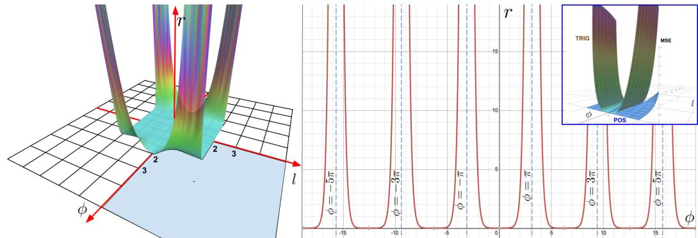  
Figure 2：左图：（围绕原点）对称化的效用函数 r（定义为分别基于三角随机特征和正随机特征构建的估计器的均方误差 (MSE) 之比），它是输入特征向量之间的夹角 φ（以弧度计）及其长度 l 的函数。较大的值表示正随机特征性能更好的 $( \phi , l )$ 空间区域。我们看到，对于 φ 足够大（softmax 核值足够小）的关键区域，我们的方法相比三角随机特征具有任意大的精度优势。绘制的定义域为 $[ - \pi , \pi ] \times [ - 2 , 2 ]$。右图：固定 $l = 1$ 且夹角 φ 变化时函数 r 的切片。右上角：在低 softmax 核值区域中两种估计器的 MSE 对比。

在图 2 中，我们直观展示了正随机特征相对于标准三角随机特征的优势。在核值较小且需要精细近似的关键区域中，我们的方法优于对比方法。在第 4 节中，我们利用正特征高效训练基于 softmax 的线性 Transformer，从实证上进一步证实了该方法的优势。如果我们在 $( 7 )$ 中将 $\omega$ 替换为 ${ \sqrt { d } } { \frac { \omega } { \| \omega \| } }$，就可以得到所谓的正则化 softmax 核 SMREG，我们可以用类似的方式对其进行近似，只需将 $\mathcal { D } = \mathcal { N } ( 0 , \mathbf { I } _ { d } ) \tan \mathcal { D } = \operatorname { U n i f } ( \sqrt { d } S ^ { d - 1 } )$，即对应于半径为 ${ \sqrt { d } } \sin \mathbb { R } ^ { d }$ 的球面上 Haar 测度的分布，从而获得估计器 $\widehat { \mathrm { S M R E G } _ { m } ^ { + } } .$。正如我们在第 3 节中所展示的，此类随机特征也可用于精确近似常规的 softmax 核。

## 2.4 正交随机特征 (ORFs)

上述内容构成了 FAVOR+ 方法的 R+ 部分。接下来还需要解释 O 部分。为了进一步降低估计器的方差（从而可以使用更少数量的随机特征 $r$），我们将不同的随机样本 $\omega _ { 1 } , . . . , \omega _ { m }$ 纠缠为严格正交。只要使用各向同性分布 $\mathcal{D}$（即特别是迄今为止我们考虑过的所有核函数），就可以通过标准 Gram-Schmidt 正交化过程在保持无偏性的同时实现这一点（详见 (Choromanski et al., 2017)）。ORFs 是一种众所周知的方法，但事实证明它与我们针对 softmax 引入的 PRFs 结合得尤为出色。这带来了首个理论结果，表明 ORFs 可用于在任意维度 $d$ 下降低 softmax/高斯核估计器的方差，而不仅仅是在足够大的 $d$ 时渐近成立（以往方法即是如此，见下一节），并且带来了首个指数级小的、严格小于非正交方法的大偏差概率界。随机特征的正定性在这些界中起到了关键作用。ORF 机制要求 $m \leq d ,$，但这在我们所有的实验中均满足。整个 FAVOR+ 算法的伪代码在附录 B 中给出。

我们的理论结果与实验紧密吻合。我们在第 4 节中表明，PRFs+ORFs 显著提高了注意力矩阵的近似精度，并使我们能够减小 $r$，从而形成了一种既准确又兼具空间和时间效率的机制，我们称之为 FAVOR+。

## 3 理论结果

我们在本节中提出了用于 softmax 核估计的正正交随机特征理论。所有这些结果也可应用于高斯核，因为正如前一节所述，二者可以通过重新归一化相互转化（见第 2.3 节）。所有证明以及附带讨论的更一般的附加理论结果均在附录中给出。

引理 2（正（双曲）随机特征与三角随机特征对比）。以下结论成立：

$$
\begin{array}{r l r} & & {\mathrm{MSE} (\widehat {\mathrm{SM}} _ {m} ^ {\mathrm{trig}} (\mathbf {x}, \mathbf {y})) = \frac {1}{2 m} \exp (\| \mathbf {x} + \mathbf {y} \| ^ {2}) \mathrm{SM} ^ {- 2} (\mathbf {x}, \mathbf {y}) (1 - \exp (- \| \mathbf {x} - \mathbf {y} \| ^ {2})) ^ {2},} \\ & & {\mathrm{MSE} (\widehat {\mathrm{SM}} _ {m} ^ {+} (\mathbf {x}, \mathbf {y})) = \frac {1}{m} \exp (\| \mathbf {x} + \mathbf {y} \| ^ {2}) \mathrm{SM} ^ {2} (\mathbf {x}, \mathbf {y}) (1 - \exp (- \| \mathbf {x} + \mathbf {y} \| ^ {2})),} \\ & & {\mathrm{MSE} (\widehat {\mathrm{SM}} _ {m} ^ {\mathrm{hyp+}} (\mathbf {x}, \mathbf {y})) = \frac {1}{2} (1 - \exp (- \| \mathbf {x} + \mathbf {y} \| ^ {2})) \mathrm{MSE} (\widehat {\mathrm{SM}} _ {m} ^ {+} (\mathbf {x}, \mathbf {y})),} \end{array}\tag{8}
$$

对于独立随机样本 $\omega _ { i }$，其中 MSE 表示均方误差。

因此，对于 $\operatorname { S M } ( \mathbf { x } , \mathbf { y } )  0$，我们有：$\mathrm { M S E } ( { \widehat { \mathrm { S M } } } _ { m } ^ { \mathrm { t r i g } } ( { \bf x } , { \bf y } ) ) \to \infty$ 以及 $\mathrm { M S E } ( { \widehat { \mathrm { S M } } } _ { m } ^ { + } ( \mathbf { x } , \mathbf { y } ) ) \to 0$。此外，双曲估计器提供了额外的精度提升，严格优于具有两倍随机特征数量的 $\widehat { \mathrm { S M } } _ { 2 m } ^ { + } ( \mathbf { x } , \mathbf { y } )$。接下来的结果表明，在实践中，正则化 softmax-kernel（Softmax 核）是注意力机制中 softmax-kernel 的精确代理。

定理 1（正则化与 Softmax 核）。假设 softmax-kernel 的注意力矩阵的 $L _ { \infty }$ 范数满足：对于某常数 $C \geq 1$，有 $\| \mathbf { A } \| _ { \infty } ~ \leq ~ C$。用 $\mathbf { A } ^ { \mathrm { r e g } }$ 表示正则化 softmax-kernel 对应的注意力矩阵。则以下结论成立：

$$
\inf _ {i, j} \frac {\mathbf {A} ^ {\text { reg }} (i , j)}{\mathbf {A} (i , j)} \geq 1 - \frac {2}{d ^ {\frac {1}{3}}} + o \left(\frac {1}{d ^ {\frac {1}{3}}}\right), a n d \sup _ {i, j} \frac {\mathbf {A} ^ {\text { reg }} (i , j)}{\mathbf {A} (i , j)} \leq 1.\tag{9}
$$

此外，即使不满足 $L _ { \infty }$ 范数条件，后者在 $d \geq 2$ 时也成立，即正则化 softmax-kernel 是 softmax-kernel 的通用下界。

因此，SMREG 的正随机特征可用于近似 softmax-kernel。我们的下一个结果表明，对于任意维度 d $> 0$，正交性可被证明能降低正随机特征估计的均方误差，并且我们显式地给出了这一差距。

定理 2。若 $\widehat { \mathrm { S M } } _ { m } ^ { \mathrm { o r t + } } ( \mathbf { x } , \mathbf { y } )$ 表示采用正交随机特征对 $\widehat { \mathrm { S M } } _ { m } ^ { + } (  { \mathbf { x } } ,  { \mathbf { y } } )$ 进行的改进（因此 $f o r m \leq d )$），则对于任意 d $> 0$，以下结论成立：

$$
\operatorname{MSE} \left(\widehat {\mathrm{SM}} _ {m} ^ {\text {ort+}} (\mathbf {x}, \mathbf {y})\right) \leq \operatorname{MSE} \left(\widehat {\mathrm{SM}} _ {m} ^ {+} (\mathbf {x}, \mathbf {y})\right) - \frac {2 (m - 1)}{m (d + 2)} \left(\operatorname{SM} (\mathbf {x}, \mathbf {y}) - \exp \left(- \frac {\| \mathbf {x} \| ^ {2} + \| \mathbf {y} \| ^ {2}}{2}\right)\right) ^ {2}.\tag{10}
$$

此外，完全类似的结果也适用于正则化 softmax-kernel SMREG。

对于正则化 softmax 核（regularized softmax-kernel），正交特征提供了额外的集中性结果——对于每个 $d > 0$，首次给出了估计量尾部概率的指数级小界，且严格优于非正交变体。我们的下一个结果使我们能够显式地估计这一差距。

定理 3. 设 $\mathbf { x } , \mathbf { y } \in \mathbb { R } ^ { d } .$。对于任意 $a > \mathrm { S M R E G } ( \mathbf { x } , \mathbf { y } ) , \theta > 0$ 以及 m $\leq d \colon$，以下结论成立：

$$
\begin{array}{l} \mathbb {P} [ \widehat {\mathrm{SMREG}} _ {m} ^ {+} (\mathbf {x}, \mathbf {y}) > a ] \leq \exp (- \theta m a) M _ {Z} (\theta) ^ {m}, \quad \mathbb {P} [ \widehat {\mathrm{SMREG}} _ {m} ^ {\text { ort + }} (\mathbf {x}, \mathbf {y}) > a ] \\ \leq \exp (- \theta m a) \bigg (M _ {Z} (\theta) ^ {m} - \exp \left(- \frac {m}{2} (\| \mathbf {x} \| ^ {2} + \| \mathbf {y} \| ^ {2})\right) \frac {\theta^ {4} m (m - 1)}{4 (d + 2)} \| \mathbf {x} + \mathbf {y} \| ^ {4} \bigg) \end{array}
$$

其中 $\widehat { \mathrm { S M R E G } } _ { m } ^ { \mathrm { o r t + } } ( \mathbf { x } , \mathbf { y } )$ 表示使用 ORFs 对 $\widehat { \mathrm { S M R E G } } _ { m } ^ { + } ( \mathbf { x } , \mathbf { y } )$ 的修改，$\ X \ =$ $\begin{array} { r } { \Lambda \exp ( \sqrt { d } \frac { \omega ^ { \top } } { \| \omega \| _ { 2 } } ( \mathbf x + \mathbf y ) ) , \omega \sim \mathcal { N } ( 0 , \mathbf { I } _ { d } ) } \end{array}$，$\Lambda$ 的定义如引理 1 所示，且 $M _ { Z }$ 是 Z 的矩母函数。

我们看到，在 softmax 核较小的关键区域，ORFs 提供了指数级小且更紧致的界。下文我们将证明，即使对于采用 ORFs 的 $\mathrm { S M } ^ { \mathrm { t r i g } }$ 机制，仅需取 $m = \Theta ( d \log ( d ) )$ 个随机投影就足以精确近似注意力矩阵（因此若非注意力重归一化，PRFs 将是不必要的）。一般而言，m 取决于嵌入的维度 d、所有 query/key 所在的球的半径 R 以及精度参数（参见：附录 F.6 中的补充讨论），但与输入序列长度 L 无关。

定理 4（注意力近似的一致收敛性）。假设 queries/keys 的 $L _ { 2 }$ 范数被 $R > 0$ 所上界限定。定义 $l = R d ^ { - { \frac { 1 } { 4 } } }$ 并令 $\begin{array} { r } { h ^ { \ast } = \exp ( \frac { l ^ { 2 } } { 2 } ) } \end{array}$。那么对于任意 $\begin{array} { r } { \epsilon > 0 , \delta = \frac { \epsilon } { ( h ^ { * } ) ^ { 2 } } } \end{array}$ 以及随机投影数 $\begin{array} { r } { m = \Theta ( \frac { d } { \delta ^ { 2 } } \log ( \frac { 4 d ^ { \frac { 3 } { 4 } } R } { \delta } ) ) } \end{array}$，利用带有 ORF 的估计器 $\widehat { \mathrm { S M } } ^ { \mathrm { t r i g } }$ 的注意力近似机制满足以下条件：以任意常数概率成立 $\| \widehat { \mathbf { A } } - \mathbf { A } \| _ { \infty } \leq \epsilon$，其中 Ab 近似注意力矩阵 A。

## 4 实验

我们在 Jax（Frostig et al., 2018）中已有的 Transformer 训练代码之上实现了我们的设置，并使用即时编译（just-in-time，$( \ j a x . \ j i t )$）进行了优化，同时用经验证据补充我们的理论，以展示 FAVOR+ 在多种设置下的实用性。除非特别说明，Performer 仅将注意力组件替换为我们的方法，而所有其他组件与常规 Transformer 完全相同。为简便起见，我们将单向/因果建模表示为 (U)，将双向/掩码语言建模表示为 (B)。

在基线方面，我们使用其他 Transformer 模型进行对比，尽管其中一些模型仅局限于一种情形——例如 Reformer（Kitaev et al., 2020）仅支持 (U)，而 Linformer（Wang et al., 2020）仅支持 (B)。此外，我们使用 PG-19（Rae et al., 2020）作为替代的 (B) 预训练基准，因为与 BERT（Devlin et al., 2018）和 Linformer 中使用的（目前已不再公开可用的）BookCorpus（Zhu et al., 2015）+ Wikipedia 数据集相比，它是专为长序列训练而设计的。所有模型和分词的超参数均在附录 A 中给出。

  
Figure 3: Transformer 与 Performer 在前向和反向传播速度以及允许的最大 $L$ 方面的比较。$" \mathrm { X } " \left( \mathrm { O P T } \right)$ 表示当注意力机制仅返回 V 矩阵时可实现的最大可能加速比。图中展示的数据截止到模型在 16GB 的 V100 GPU 上出现显存溢出（out of memory）错误为止。所使用的词表大小为 256。彩色图最佳。

## 4.1 计算成本

我们在 (B) 设置下对比了 Transformer 和 Performer 在反向传播过程中的速度，因为这是训练期间主要的计算瓶颈之一。此处使用的是常规默认尺寸 $( n _ { h e a d s } , n _ { l a y e r s } , d _ { f f } , d ) = ( 8 , 6 , 2 0 4 8 , 5 1 2 )$ ，其中 $d _ { f f }$ 表示 MLP 层的宽度。

我们观察到（图 3），就序列长度 L 而言，Performer 达到了接近线性的时间复杂度和亚二次方的显存消耗（因为不需要显式存储 $O ( L ^ { 2 } )$ 的注意力矩阵）。事实上，Performer 取得了接近理论极限的加速比和显存效率，如图中将注意力机制替换为仅返回 V 矩阵的“恒等函数”时的“X”线所示。对于较大的 L，显存和反向传播效率的结合分别实现了大批量训练以及每个梯度步更低的实际耗时（wall clock time）。附录 E 中通过改变层数、原始注意力以及架构尺寸展示了大量的额外结果。

## 4.2 SOFTMAX 注意力近似误差

我们在图 4 中通过 FAVOR+ 进一步检验了近似误差。我们证明了：1. 正交特征比非结构化（IID）特征产生的误差更低；2. 正特征比三角函数（sin/cos）特征产生的误差更低。这两点从经验上验证了 PORF 机制。

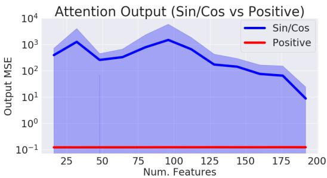  
Figure 4: 比较正交特征与 IID 特征，以及三角函数 sin/cos 特征与正特征时近似输出的均方误差（MSE）。我们设定 $L = 4 0 9 6 , d = 1 6$ ，并改变随机样本数 m。图中显示了在适当归一化的随机矩阵输入数据上 15 个样本的标准差。

为了在多次迭代中进一步提高注意力块的整体近似精度从而进一步改善训练，应当定期重新抽取随机样本（图 5，右）。这是一个开销很小的过程，但还可以得到进一步优化（附录 B.2）。

## 4.3 TRANSFORMER 上的 SOFTMAX 近似

正如我们在附录中的图 14 所示，即使注意力机制的近似非常紧致，微小的误差也很容易在多个 Transformer 层（例如 MLP、多头机制）中传播。换句话说，模型的 Lipschitz 常数很容易放大微小的注意力近似误差，这意味着有时可能需要极其紧致的近似。因此，当将 FAVOR(+) 的 softmax 近似应用于 Transformer 模型（即 "Performer-X-SOFTMAX"）时，我们证明了：

1. 得益于 softmax 近似，即使对于三角特征（Fig. 5 左），在 LM1B 数据集（Chelba et al., 2014）上通过微小的微调（由于误差传播而需要），即可实现与预训练模型的向后兼容性。然而，在更大的数据集 PG-19 上，2. 正向（POS）softmax 特征（配合重采样）对于达到与常规 Transformer 相匹配的性能至关重要（Fig. 5 右）。

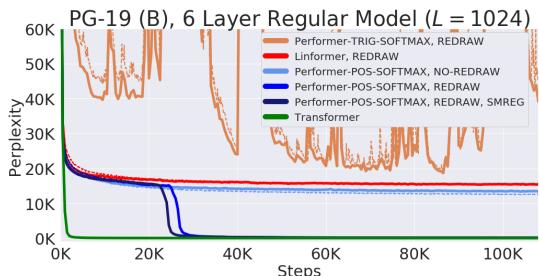  
Figure 5: 我们将原始预训练 Transformer 的权重迁移到了 Performer 中，这产生了初始非零的 0.07 准确率（橙色虚线），但仅用原始梯度步数的一小部分就迅速恢复了准确率。然而在 PG-19 上，三角（TRIG）softmax 近似变得极不稳定（完整曲线见附录 D.2），而正向特征（POS）（无重采样）以及 Linformer（同样近似 softmax）即使在投影重采样的情况下，也停滞在相同的困惑度上。带有特征重采样的正向 softmax 是匹配 Transformer 所必需的，其中 SMREG（来自第 3 节的正则化）允许更快的收敛。针对多种注意力核函数的额外消融实验，以及表明三角随机特征在训练中甚至会导致 NaN 值的实验，均在附录 D.3 中给出。

## 4.4 蛋白质多层训练

我们通过使用来自 TrEMBL 2019年1月版本（Consortium, 2019）的蛋白质序列训练一个 36 层的模型，进一步在 (U) 和 (B) 两种情况下对 Performer 进行基准测试，类似于 (Madani et al., 2020)。在 Fig. 6 中，Reformer 和 Linformer 在蛋白质数据集上的准确率显著下降。此外，Performer-RELU（在公式 5 中取 $f = \mathrm { R e L U }$）在 (U) 和 (B) 两种情况下均取得了最高准确率，证明了广义注意力的有效性。我们提出的 softmax 近似也被证明是紧致的，达到了与精确 softmax Transformer 相同的准确率，从而证实了我们在第 3 节中的理论主张。

  
Figure 6: 训练集 = 虚线，验证集 = 实线。对于 TrEMBL，我们在所有运行中均使用了与 (Madani et al., 2020) 完全相同的模型参数 $( n _ { h e a d s } , n _ { l a y e r s } , d _ { f f } , d ) = ( 8 , 3 6 , 1 0 2 4 , 5 1 2 )$。为了公平起见，所有 TrEMBL 实验均使用了 16x16 TPU-v2。在计算资源的限制下，每次单独运行的批大小均已最大化。超参数可以在附录 A 中找到。包含数据集统计信息、分布外评估和可视化在内的扩展结果可以在附录 C 中找到。

## 4.5 大长度训练 - 常用数据集

在来自 (Parmar et al., 2018) 的标准 (U) ImageNet64 基准测试中，$L = 1 2 2 8 8$，这对于常规 Transformer 来说是不可行的，我们将所有模型设置为使用相同的 $( n _ { h e a d s } , d _ { f f } , d )$，但改变 $n _ { l a y e r s }$。Performer/6层与 Reformer/12层相当，而 Performer/12层与 Reformer/24层相当（Fig. 7：左）。取决于硬件（TPU 或 GPU），我们还发现通过 Jax 针对 (U) 设置的优化，Performer 可以比 Reformer 快 2 倍。

作为原理验证研究，我们还通过将来自 TrEMBL 的蛋白质序列拼接至长度 $L = 8 1 9 2$，创建了一个用于预测蛋白质组间相互作用的初始蛋白质基准，该长度足以对蛋白质相互作用网络进行建模，而无需现有方法所需的大规模序列比对 (Cong et al., 2019)。在此设置下，常规 Transformer 即使在每芯片批大小为 1 时也会大幅超出内存。因此作为基线，我们不得不使用一个显著缩小的变体，减少到 $( n _ { h e a d s } , n _ { l a y e r s } , d _ { f f } , d ) = ( 8 , \{ 1 , 2 , 3 \} , 2 5 6 , 2 5 6 )$。与此同时，Performer 使用标准的 (8, 6, 2048, 512) 架构，在每芯片批大小为 8 的情况下仍能高效训练。我们可以在 Fig. 7（右子图）中看到，较小的 Transformer $( n _ { l a y e r } = 3 )$ 很快受限在 ≈ 19%，而 Performer 则能够持续训练至 ≈ 24%。

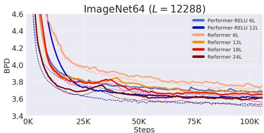

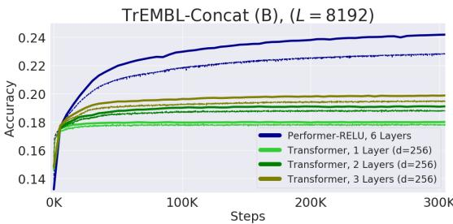  
Figure 7: 训练 = 虚线，验证 = 实线。对于 ImageNet64，所有模型均使用标准的 $( n _ { h e a d s } , d _ { f f } , d ) =$ (8, 2048, 512)。我们在附录 D.2 中进一步展示了我们的正向 softmax 近似取得了与 ReLU 相同的性能。对于拼接后的 TrEMBL，我们针对较小的 Transformer 改变了 $n _ { l a y e r s } \in \{ 1 , 2 , 3 \}$。超参数详见附录 A。

## 5 结论

我们提出了 Performer，这是一种新型的 Transformer，依托于我们的基于正正交随机特征的快速注意力（Fast Attention Via positive Orthogonal Random features, FAVOR+）机制，显著改善了常规 Transformer 的空间和时间复杂度。据我们所知，我们的机制首次以线性空间和时间复杂度提供了对原始基于 softmax 的 Transformer 的有效无偏估计，并为 Transformer 的研究以及非稀疏化注意力机制的作用开辟了新途径。

## 6 更广泛的影响

我们认为，所提出的算法可以在多方面产生影响：

生物学与医学：通过使 Transformer 能够应用于更长的序列且不对注意力矩阵的结构施加约束，我们的方法有潜力直接影响生物序列分析的研究。我们考虑的初步应用是在蛋白质组尺度上预测蛋白质之间的相互作用。近期发表的方法需要大规模的演化序列比对，这成为应用于哺乳动物基因组时的瓶颈 (Cong et al., 2019)。将这些方法应用于生物序列所具有的潜在广泛转化影响，是本研究的主要动机之一。我们相信，现代生物信息学可以极大地受益于新兴的机器学习技术，而 Transformer 正是其中最具前景的技术之一。扩展这些方法以训练更快、更准确的语言模型，为设计具有预设相互作用特性的分子集合开辟了道路。这些方法可用于增强现有的基于物理的设计策略，这在诸如新型纳米颗粒疫苗的开发中至关重要 (Marcandalli et al., 2019)。

环境：正如我们所展示的，结合 FAVOR+ 的 Performer 具有低得多的计算成本和显著降低的空间复杂度，鉴于常规 Transformer 需要极其庞大的计算资源，这可以直接转化为 CO2 减排 (Strubell et al., 2019) 和更低的能耗 (You et al., 2020)。

Transformer 相关研究：我们相信，我们的结果可以塑造高效 Transformer 架构的研究，引导该领域走向具有坚实数学基础的方法。我们的研究还有望将 Transformer 扩展到其标准范围之外（例如，通过考虑广义注意力机制（Generalized Attention）以及与核的联系）。正如我们在论文中所解释的，探索能够处理数千乃至更大数量级 $L$ 且同时保持基线准确率的可扩展 Transformer 架构，是通往生物信息学新突破（例如蛋白质语言建模）的大门。我们提出的方法有望成为迈出的第一步。

向后兼容性：与其他 Transformer 变体不同，我们的 Performer 可以直接应用于常规预训练 Transformer 之上。即使不需要继续训练（up-training），FAVOR+ 仍可用于快速推理且不会损失准确率。我们认为这种向后兼容性是所提出技术的一个非常重要的附加特性，可能对从业者极具吸引力。

Transformer 之外的注意力机制：最后，FAVOR+ 还可以应用于 Transformer 范围之外来近似精确注意力。这开辟了大量新的潜在应用，包括：分层注意力网络（hierarchical attention networks, HANS）（Yang et al., 2016）、图注意力网络（graph attention networks）（Velickovic et al., 2018）、图像处理（Fu et al., 2019）以及强化学习/机器人学（Tang et al., 2020）。

## 7 致谢

我们感谢 Nikita Kitaev 和 Wojciech Gajewski 就 Reformer 进行的多次讨论，并感谢 Aurko Roy 和 Ashish Vaswani 就 Routing Transformer 进行的多次讨论。我们进一步感谢 Joshua Meier、John Platt 和 Tom Weingarten 就生物数据展开的富有成效的讨论以及对本稿提出的宝贵意见。最后，我们感谢 Yi Tay 和 Mostafa Dehghani 就基准对比进行的讨论。

Valerii Likhosherstov 感谢来自 Cambridge Trust 和 DeepMind 的资助。Lucy Colwell 感谢来自 Simons Foundation 的资助。Adrian Weller 感谢来自 Turing AI Fellowship（资助号 EP/V025379/1）、The Alan Turing Institute（EPSRC 资助号 EP/N510129/1 和 U/B/000074）以及 Leverhulme Trust（通过 CFI）的资助。

## 参考文献

Irwan Bello, Barret Zoph, Ashish Vaswani, Jonathon Shlens, and Quoc V. Le. Attention augmented convolutional networks. CoRR, abs/1904.09925, 2019. URL http://arxiv.org/abs/ 1904.09925.

Iz Beltagy, Matthew E. Peters, and Arman Cohan. Longformer: The long-document transformer. CoRR, abs/2004.05150, 2020. URL https://arxiv.org/abs/2004.05150.

William Chan, Chitwan Saharia, Geoffrey E. Hinton, Mohammad Norouzi, and Navdeep Jaitly. Imputer: Sequence modelling via imputation and dynamic programming. CoRR, abs/2002.08926, 2020. URL https://arxiv.org/abs/2002.08926.

Ciprian Chelba, Tomas Mikolov, Mike Schuster, Qi Ge, Thorsten Brants, Phillipp Koehn, and Tony Robinson. One billion word benchmark for measuring progress in statistical language modeling. In INTERSPEECH 2014, 15th Annual Conference ofthe International Speech Communication Association, Singapore, September 14-18, 2014, pp. 2635–2639, 2014.

Ciprian Chelba, Mia Xu Chen, Ankur Bapna, and Noam Shazeer. Faster transformer decoding: N-gram masked self-attention. CoRR, abs/2001.04589, 2020. URL https://arxiv.org/ abs/2001.04589.

Mia Xu Chen, Orhan Firat, Ankur Bapna, Melvin Johnson, Wolfgang Macherey, George F. Foster, Llion Jones, Mike Schuster, Noam Shazeer, Niki Parmar, Ashish Vaswani, Jakob Uszkoreit, Lukasz Kaiser, Zhifeng Chen, Yonghui Wu, and Macduff Hughes. The best of both worlds: Combining recent advances in neural machine translation. In Proceedings of the 56th Annual Meeting of the Association for Computational Linguistics, ACL 2018, Melbourne, Australia, July 15-20, 2018, Volume 1: Long Papers, pp. 76–86. Association for Computational Linguistics, 2018. doi: 10.18653/v1/P18-1008. URL https://www.aclweb.org/anthology/P18-1008/.

Rewon Child, Scott Gray, Alec Radford, and Ilya Sutskever. 利用稀疏 Transformer 生成长序列（Generating long sequences with sparse transformers）. CoRR, abs/1904.10509, 2019. URL http://arxiv.org/abs/1904.10509.

Krzysztof Choromanski, Carlton Downey, and Byron Boots. 初始化至关重要：正交预测状态循环神经网络（Initialization matters: Orthogonal predictive state recurrent neural networks）. 载于第6届国际学习表征会议（ICLR 2018），加拿大不列颠哥伦比亚省温哥华，2018年4月30日 - 5月3日，会议论文集. OpenReview.net, 2018a. URL https://openreview.net/forum?id=HJJ23bW0b.

Krzysztof Choromanski, Mark Rowland, Tamás Sarlós, Vikas Sindhwani, Richard E. Turner, and Adrian Weller. 随机特征的几何性质（The geometry of random features）. 载于国际人工智能与统计会议（AISTATS 2018），西班牙加那利群岛兰萨罗特岛普拉亚布兰卡，2018年4月9日-11日，Proceedings of Machine Learning Research 第 84 卷，pp. 1–9. PMLR, 2018b. URL http://proceedings.mlr.press/v84/choromanski18a.html.

Krzysztof Choromanski, Aldo Pacchiano, Jeffrey Pennington, and Yunhao Tang. KAMA-NNs：基于低维旋转的神经网络（KAMA-NNs: Low-dimensional rotation based neural networks）. 载于第22届国际人工智能与统计会议（AISTATS 2019），日本冲绳那霸，2019年4月16日-18日，Proceedings of Machine Learning Research 第 89 卷，pp. 236–245. PMLR, 2019a. URL http://proceedings.mlr.press/v89/choromanski19a.html.

Krzysztof Choromanski, Mark Rowland, Wenyu Chen, and Adrian Weller. 统一正交蒙特卡洛方法（Unifying orthogonal Monte Carlo methods）. 载于第36届国际机器学习会议论文集（ICML 2019），美国加利福尼亚州长滩，2019年6月9日-15日，Proceedings of Machine Learning Research 第 97 卷，pp. 1203–1212. PMLR, 2019b. URL http: //proceedings.mlr.press/v97/choromanski19a.html.

Krzysztof Marcin Choromanski, Mark Rowland, and Adrian Weller. 结构化随机正交嵌入出人意料的有效性（The unreasonable effectiveness of structured random orthogonal embeddings）. 载于 Advances in Neural Information Processing Systems 30：2017年神经信息处理系统年会，美国加利福尼亚州长滩，2017年12月4日-9日，pp. 219–228, 2017.

Djork-Arné Clevert, Thomas Unterthiner, and Sepp Hochreiter. 基于指数线性单元（ELU）的快速准确深度网络学习（Fast and accurate deep network learning by exponential linear units (elus)）. 载于第4届国际学习表征会议（ICLR 2016），波多黎各圣胡安，2016年5月2日-4日，会议论文集，2016. URL http://arxiv.org/abs/1511.07289.

Qian Cong, Ivan Anishchenko, Sergey Ovchinnikov, and David Baker. 蛋白质组共进化揭示的蛋白质相互作用网络（Protein interaction networks revealed by proteome coevolution）. Science, 365(6449):185–189, 2019.

UniProt Consortium. UniProt：全球蛋白质知识中心（Uniprot: a worldwide hub of protein knowledge）. Nucleic acids research, 47 (D1):D506–D515, 2019.

Thomas H. Cormen, Charles E. Leiserson, Ronald L. Rivest, and Clifford Stein. 算法导论（第3版）（Introduction to Algorithms, 3rd Edition）. MIT Press, 2009. ISBN 978-0-262-03384-8. URL http://mitpress. mit.edu/books/introduction-algorithms.

Zihang Dai, Zhilin Yang, Yiming Yang, William W. Cohen, Jaime Carbonell, Quoc V. Le, and Ruslan Salakhutdinov. Transformer-XL: Language modeling with longer-term dependency, 2019. URL https://openreview.net/forum?id=HJePno0cYm.

Mostafa Dehghani, Stephan Gouws, Oriol Vinyals, Jakob Uszkoreit, and Lukasz Kaiser. Universal transformers. In 7th International Conference on Learning Representations, ICLR 2019, New Orleans, LA, USA, May 6-9, 2019. OpenReview.net, 2019. URL https://openreview.net/forum?id=HyzdRiR9Y7.

Jacob Devlin, Ming-Wei Chang, Kenton Lee, and Kristina Toutanova. BERT: pre-training of deep bidirectional transformers for language understanding. CoRR, abs/1810.04805, 2018. URL http://arxiv.org/abs/1810.04805.

Yilun Du, Joshua Meier, Jerry Ma, Rob Fergus, and Alexander Rives. Energy-based models for atomic-resolution protein conformations. arXiv preprint arXiv:2004.13167, 2020.

Ahmed Elnaggar, Michael Heinzinger, Christian Dallago, and Burkhard Rost. End-to-end multitask learning, from protein language to protein features without alignments. bioRxiv, pp. 864405, 2019.

Roy Frostig, Matthew Johnson, and Chris Leary. Compiling machine learning programs via highlevel tracing. In Conference on Machine Learning and Systems 2018, 2018. URL http://www.sysml.cc/doc/2018/146.pdf.

Jun Fu, Jing Liu, Haijie Tian, Yong Li, Yongjun Bao, Zhiwei Fang, and Hanqing Lu. Dual attention network for scene segmentation. In IEEE Conference on Computer Vision and Pattern Recognition, CVPR 2019, Long Beach, CA, USA, June 16-20, 2019, pp. 3146–3154, 2019.

Anmol Gulati, James Qin, Chung-Cheng Chiu, Niki Parmar, Yu Zhang, Jiahui Yu, Wei Han, Shibo Wang, Zhengdong Zhang, Yonghui Wu, and Ruoming Pang. Conformer: Convolution-augmented transformer for speech recognition, 2020.

Cheng-Zhi Anna Huang, Ashish Vaswani, Jakob Uszkoreit, Ian Simon, Curtis Hawthorne, Noam Shazeer, Andrew M. Dai, Matthew D. Hoffman, Monica Dinculescu, and Douglas Eck. Music transformer: Generating music with long-term structure. In 7th International Conference on Learning Representations, ICLR 2019, New Orleans, LA, USA, May 6-9, 2019. OpenReview.net, 2019. URL https://openreview.net/forum?id=rJe4ShAcF7.

John Ingraham, Vikas Garg, Regina Barzilay, and Tommi Jaakkola. Generative models for graphbased protein design. In Advances in Neural Information Processing Systems, pp. 15794–15805, 2019.

Angelos Katharopoulos, Apoorv Vyas, Nikolaos Pappas, and François Fleuret. Transformers are rnns: Fast autoregressive transformers with linear attention. CoRR, abs/2006.16236, 2020. URL https://arxiv.org/abs/2006.16236.

Nikita Kitaev, Lukasz Kaiser, and Anselm Levskaya. Reformer: The efficient transformer. In 8th International Conference on Learning Representations, ICLR 2020, Addis Ababa, Ethiopia, April 26-30, 2020. OpenReview.net, 2020. URL https://openreview.net/forum?id=rkgNKkHtvB.

Olga Kovaleva, Alexey Romanov, Anna Rogers, and Anna Rumshisky. Revealing the dark secrets of bert. arXiv preprint arXiv:1908.08593, 2019.

Taku Kudo and John Richardson. Sentencepiece: A simple and language independent subword tokenizer and detokenizer for neural text processing. CoRR, abs/1808.06226, 2018. URL http://arxiv.org/abs/1808.06226.

Richard E. Ladner and Michael J. Fischer. Parallel prefix computation. J. ACM, 27(4):831–838, October 1980. ISSN 0004-5411. doi: 10.1145/322217.322232. URL https://doi.org/10.1145/322217.322232.

Han Lin, Haoxian Chen, Tianyi Zhang, Clément Laroche, and Krzysztof Choromanski. Demystifying orthogonal Monte Carlo and beyond. CoRR, abs/2005.13590, 2020.

Haoneng Luo, Shiliang Zhang, Ming Lei, and Lei Xie. Simplified self-attention for transformer-based end-to-end speech recognition. CoRR, abs/2005.10463, 2020. URL https://arxiv.org/abs/2005.10463.

Ali Madani, Bryan McCann, Nikhil Naik, Nitish Shirish Keskar, Namrata Anand, Raphael R. Eguchi, Po-Ssu Huang, and Richard Socher. Progen: Language modeling for protein generation. CoRR, abs/2004.03497, 2020. URL https://arxiv.org/abs/2004.03497.

Jessica Marcandalli, Brooke Fiala, Sebastian Ols, Michela Perotti, Willem de van der Schueren, Joost Snijder, Edgar Hodge, Mark Benhaim, Rashmi Ravichandran, Lauren Carter, et al. Induction of potent neutralizing antibody responses by a designed protein nanoparticle vaccine for respiratory syncytial virus. Cell, 176(6):1420–1431, 2019.

Nikita Nangia and Samuel R. Bowman. Listops: A diagnostic dataset for latent tree learning. In Proceedings of the 2018 Conference of the North American Chapter of the Association for Computational Linguistics, NAACL-HLT 2018, New Orleans, Louisiana, USA, June 2-4, 2018, Student Research Workshop, pp. 92–99, 2018. doi: 10.18653/v1/n18-4013. URL https://doi.org/10.18653/v1/n18-4013.

Niki Parmar, Ashish Vaswani, Jakob Uszkoreit, Lukasz Kaiser, Noam Shazeer, Alexander Ku, and Dustin Tran. Image transformer. In Proceedings of the 35th International Conference on Machine Learning, ICML 2018, Stockholmsmässan, Stockholm, Sweden, July 10-15, 2018, volume 80 of Proceedings of Machine Learning Research, pp. 4052–4061. PMLR, 2018. URL http://proceedings.mlr.press/v80/parmar18a.html.

Jack W. Rae, Anna Potapenko, Siddhant M. Jayakumar, Chloe Hillier, and Timothy P. Lillicrap. Compressive transformers for long-range sequence modelling. In International Conference on Learning Representations, 2020. URL https://openreview.net/forum?id=SylKikSYDH.

Ali Rahimi and Benjamin Recht. Random features for large-scale kernel machines. In Advances in Neural Information Processing Systems 20, Proceedings of the Twenty-First Annual Conference on Neural Information Processing Systems, Vancouver, British Columbia, Canada, December 3-6, 2007, pp. 1177–1184. Curran Associates, Inc., 2007. URL http://papers.nips.cc/paper/3182-random-features-for-large-scale-kernel-machines.

Alexander Rives, Siddharth Goyal, Joshua Meier, Demi Guo, Myle Ott, C. Zitnick, Jerry Ma, and Rob Fergus. 生物结构与功能从扩展至2.5亿蛋白质序列的无监督学习中涌现（Biological structure and function emerge from scaling unsupervised learning to 250 million protein sequences）. bioArxiv, 04 2019. doi: 10.1101/622803.

Mark Rowland, Jiri Hron, Yunhao Tang, Krzysztof Choromanski, Tamás Sarlós, and Adrian Weller. Wasserstein距离的正交估计（Orthogonal estimation of Wasserstein distances）. In The 22nd International Conference on Artificial Intelligence and Statistics, AISTATS 2019, 16-18 April 2019, Naha, Okinawa, Japan, volume 89 of Proceedings of Machine Learning Research, pp. 186–195. PMLR, 2019. URL http:// proceedings.mlr.press/v89/rowland19a.html.

Aurko Roy, Mohammad Saffar, Ashish Vaswani, and David Grangier. 基于Routing Transformer的高效内容驱动稀疏注意力（Efficient content-based sparse attention with routing transformers）. CoRR, abs/2003.05997, 2020. URL https://arxiv. org/abs/2003.05997.

Zhuoran Shen, Mingyuan Zhang, Shuai Yi, Junjie Yan, and Haiyu Zhao. 因子化注意力：具有线性复杂度的自注意力（Factorized attention: Self-attention with linear complexities）. CoRR, abs/1812.01243, 2018. URL http://arxiv. org/abs/1812.01243.

Emma Strubell, Ananya Ganesh, and Andrew McCallum. 自然语言处理（NLP）中深度学习的能源与政策考量（Energy and policy considerations for deep learning in NLP）. CoRR, abs/1906.02243, 2019. URL http://arxiv.org/abs/1906. 02243.

Yujin Tang, Duong Nguyen, and David Ha. 自可解释智能体的神经进化（Neuroevolution of self-interpretable agents）. CoRR, abs/2003.08165, 2020. URL https://arxiv.org/abs/2003.08165.

Yi Tay, Mostafa Dehghani, Samira Abnar, Yikang Shen, Dara Bahri, Philip Pham, Jinfeng Rao, Liu Yang, Sebastian Ruder, and Donald Metzler. 长距离竞技场：高效Transformer的基准测试（Long range arena: A benchmark for efficient transformers）. 2021.

Yao-Hung Hubert Tsai, Shaojie Bai, Makoto Yamada, Louis-Philippe Morency, and Ruslan Salakhutdinov. 解剖Transformer：基于核视角的Transformer注意力统一理解（Transformer dissection: An unified understanding for transformer’s attention via the lens of kernel）. In Proceedings of the 2019 Conference on Empirical Methods in Natural Language Processing and the 9th International Joint Conference on Natural Language Processing (EMNLP-IJCNLP), pp. 4335–4344, 2019.

Ashish Vaswani, Noam Shazeer, Niki Parmar, Jakob Uszkoreit, Llion Jones, Aidan N Gomez, Ł ukasz Kaiser, and Illia Polosukhin. 注意力就是你所需要的一切（Attention is all you need）. In Advances in Neural Information Processing Systems 30, pp. 5998–6008. Curran Associates, Inc., 2017. URL http://papers. nips.cc/paper/7181-attention-is-all-you-need.pdf.

Petar Velickovic, Guillem Cucurull, Arantxa Casanova, Adriana Romero, Pietro Liò, and Yoshua Bengio. 图注意力网络（Graph attention networks）. In 6th International Conference on Learning Representations, ICLR 2018, Vancouver, BC, Canada, April 30 - May 3, 2018, Conference Track Proceedings. OpenReview.net, 2018. URL https://openreview.net/forum?id=rJXMpikCZ.

Jesse Vig. Transformer模型中注意力的多尺度可视化（A multiscale visualization of attention in the transformer model）. arXiv preprint arXiv:1906.05714, 2019.

Jesse Vig and Yonatan Belinkov. 分析Transformer语言模型中的注意力结构（Analyzing the structure of attention in a transformer language model）. CoRR, abs/1906.04284, 2019. URL http://arxiv.org/abs/1906.04284.

Jesse Vig, Ali Madani, Lav R. Varshney, Caiming Xiong, Richard Socher, and Nazneen Fatema Rajani. Bertology meets biology: Interpreting attention in protein language models. CoRR, abs/2006.15222, 2020. URL https://arxiv.org/abs/2006.15222.

Oriol Vinyals, Meire Fortunato, and Navdeep Jaitly. Pointer networks. In Advances in Neural Information Processing Systems 28: Annual Conference on Neural Information Processing Systems 2015, December 7-12, 2015, Montreal, Quebec, Canada, pp. 2692–2700, 2015.

Sinong Wang, Belinda Z. Li, Madian Khabsa, Han Fang, and Hao Ma. Linformer: Self-attention with linear complexity. CoRR, abs/2006.04768, 2020. URL https://arxiv.org/abs/2006. 04768.

Tong Xiao, Yinqiao Li, Jingbo Zhu, Zhengtao Yu, and Tongran Liu. Sharing attention weights for fast transformer. In Proceedings ofthe Twenty-Eighth International Joint Conference on Artificial Intelligence, IJCAI 2019, Macao, China, August 10-16, 2019, pp. 5292–5298. ijcai.org, 2019. doi: 10.24963/ijcai.2019/735. URL https://doi.org/10.24963/ijcai.2019/735.

Zichao Yang, Diyi Yang, Chris Dyer, Xiaodong He, Alexander J. Smola, and Eduard H. Hovy. Hierarchical attention networks for document classification. In NAACL HLT 2016, The 2016 Conference of the North American Chapter of the Association for Computational Linguistics: Human Language Technologies, San Diego California, USA, June 12-17, 2016, pp. 1480–1489. The Association for Computational Linguistics, 2016. doi: 10.18653/v1/n16-1174. URL https: //doi.org/10.18653/v1/n16-1174.

Haoran You, Chaojian Li, Pengfei Xu, Yonggan Fu, Yue Wang, Xiaohan Chen, Richard G. Baraniuk, Zhangyang Wang, and Yingyan Lin. Drawing early-bird tickets: Toward more efficient training of deep networks. In International Conference on Learning Representations, 2020. URL https: //openreview.net/forum?id=BJxsrgStvr.

Felix X. Yu, Ananda Theertha Suresh, Krzysztof Marcin Choromanski, Daniel N. Holtmann-Rice, and Sanjiv Kumar. Orthogonal random features. In Advances in Neural Information Processing Systems 29: Annual Conference on Neural Information Processing Systems 2016, December 5-10, 2016, Barcelona, Spain, pp. 1975–1983, 2016.

Vinícius Flores Zambaldi, David Raposo, Adam Santoro, Victor Bapst, Yujia Li, Igor Babuschkin, Karl Tuyls, David P. Reichert, Timothy P. Lillicrap, Edward Lockhart, Murray Shanahan, Victoria Langston, Razvan Pascanu, Matthew Botvinick, Oriol Vinyals, and Peter W. Battaglia. Deep reinforcement learning with relational inductive biases. In 7th International Conference on Learning Representations, ICLR 2019, New Orleans, LA, USA, May 6-9, 2019, 2019.

Yukun Zhu, Ryan Kiros, Richard S. Zemel, Ruslan Salakhutdinov, Raquel Urtasun, Antonio Torralba, and Sanja Fidler. Aligning books and movies: Towards story-like visual explanations by watching movies and reading books. In 2015 IEEE International Conference on Computer Vision, ICCV 2015, Santiago, Chile, December 7-13, 2015, pp. 19–27, 2015. doi: 10.1109/ICCV.2015.11. URL https://doi.org/10.1109/ICCV.2015.11.

## 附录：重新思考基于 PERFORMER 的注意力机制

## A 实验超参数

我们在 Performer 中使用的这一最佳设置（包括与近似 softmax 的比较）在广义注意力（第 A.4 小节）中进行了详细说明，除非特别提及（例如使用名称“Performer-SOFTMAX”），否则“Performer”均指使用这种广义注意力设置。

## A.1 评估指标

我们报告以下评估指标：

1. 准确率（Accuracy）：对于单向模型，我们衡量下一个 token 预测的准确率，并在数据集中所有序列位置上取平均值。对于双向模型，我们以 15% 的概率掩蔽每个 token（与 (Devlin et al., 2018) 相同），并衡量被掩蔽位置上的准确率。

2. 困惑度（Perplexity）：对于单向模型，我们衡量数据集中所有序列位置上的困惑度。对于双向模型，与准确率的情况类似，我们衡量被掩蔽位置上的困惑度。

3. 每维度/字符比特数（Bits Per Dimension/Character, BPD/BPC）：通过损失（loss）除以 ln(2) 计算得出。

在正文的图表中，我们对 TrEMBL 使用了完整的评估数据集，而对于像 ImageNet64 和 PG-19 这样评估数据集规模极大的数据集，我们使用了随机批次（>2048 个样本）来绘制曲线。

## A.1.1 PG-19 预处理

PG-19 数据集 (Rae et al., 2020) 是一项极具挑战性的长距离文本建模任务。它由 1919 年之前出版的无版权 Project Gutenberg 书籍组成。该数据集没有固定的词表大小，而是可以选择任何能够建模任意文本字符串的分词方式。我们使用了包含 32768 个 token 的 unigram SentencePiece 词表 (Kudo & Richardson, 2018)，该词表保留了空格，并且可以完全可逆地还原为原始书籍文本。困惑度的计算方式为每个 token 的平均对数似然，乘以 sentencepiece 分词后数量与原始数据集中 token 数量的比率。原始数据集在各划分中的 token 计数为：train=1973136207，validation=3007061，test=6966499。我们的 sentencepiece 分词在各划分中产生的 token 计数为：train=3084760726，valid=4656945，test=10699704。这使得在计算困惑度之前各划分的对数似然乘数为 train=1.5634，valid=1.5487，test=1.5359，困惑度等于 exp(log likelihood multiplier ∗ loss)。

TrEMBL 的预处理在附录 C 中有详细说明。

## A.2 训练超参数

除非另有说明，所有 Performer + Transformer 运行默认使用 0.5 梯度裁剪、0.1 权重衰减、0.1 dropout、$1 0 ^ { - 3 }$ 固定学习率以及 Adam 超参数 $( \beta _ { 1 } = 0 . 9 , \beta _ { 2 } = 0 . 9 8 , \epsilon =$ $1 0 ^ { - 9 } )$ ），批大小针对特定模型最大化（直至 TPU 内存溢出）。

所有 36 层蛋白质实验均使用了相同数量的计算资源（即 16x16 TPU-v2，每芯片 8GB）。对于拼接实验，Performer 同样使用了 16x16 TPU-v2，而 1-3 层（d = 256）Transformer 模型使用了 8x8（使用 16x16 对准确率没有影响）。

需要注意的是，Performer 使用了与 Transformer 相同的训练超参数，却取得了具有竞争力的结果——这表明 FAVOR 可以作为简单的即插即用组件，而无需大量调优。

## A.3 近似 Softmax 注意力默认值

设为默认参数1的最优值为：renormalize\_attention = True，numerical stabilizer $= 1 0 ^ { ^ { \bullet } 6 }$，number of features = 256，ortho\_features = True，ortho\_scaling = 0.0。

## A.4 广义注意力默认值

设为默认参数2的最优值为：renormalize\_attention = True，numerical stabilizer $= 0 . 0 ,$，number of features = 256，kernel = ReLU，kernel $\mathrm { \underline { { \ e p s i l o n } } = 1 0 ^ { - 3 } }$

## A.5 Reformer 默认值

对于 Reformer，我们在蛋白质实验中使用了上述相同的超参数，但没有使用梯度裁剪；而在 ImageNet-64 实验中使用了默认设置3（改为使用学习率衰减）。在这两种情况下，Reformer 均使用了相同的默认 LSH 注意力参数。

## A.6 Linformer 默认值

使用如上所述的标准流水线，我们通过 Jax 将注意力函数替换为 Linformer 变体，其中 $\delta = 1 0 ^ { - 6 } , k = 6 0 0$（采用与论文 (Wang et al., 2020) 中相同的符号），其中 δ 是在重归一化过程中使用 $e ^ { - \delta }$ 作为乘数以近似 softmax 的指数，而 k 是 Q 和 K 矩阵投影的维度。作为合理性检查，我们发现我们用 Jax 实现的 Linformer 正确地近似了精确 softmax 的输出，所有条目的误差均在 0.02 以内。

需要注意的是，为了进行严格的比较，我们的 Linformer 超参数甚至比 (Wang et al., 2020) 中的默认值更强，因为：

• 我们使用 $k = 6 0 0$ ，这是论文中默认 $k = 2 5 6$ 的两倍多，也是我们默认特征数 $m = 2 5 6$ 的两倍。

• 我们还使用了重绘制（redrawing），这避免了在 Q 和 K 上的“不良”投影。

## B 主算法：FAVOR+

我们在此形式化地概述 FAVOR+ 的主算法：

算法 1: FAVOR+（双向或单向）。

输入: Q, K, V ∈ R^{L×d}, isBidirectional - 二元标志位。

输出：若 isBidirectional 则为 $\widehat{\text{Att}}_{\leftrightarrow}(\mathbf{Q}, \mathbf{K}, \mathbf{V}) \in \mathbb{R}^{L×L}$，否则为 $\widehat{\text{Att}}_{\rightarrow}(\mathbf{Q}, \mathbf{K}, \mathbf{V}) \in \mathbb{R}^{L×L}$。按照第 2.2 节和第 2.3 节所述计算 Q' 和 K'，并令 C := [V 1_L]；若 isBidirectional 则

| Buf₁ := (K')^T C ∈ R^{M×(d+1)}, Buf₂ := Q'Buf₁ ∈ R^{L×(d+1)};

否则

| 根据式 (11) 计算 G 及其前缀和张量 G^PS；

Buf₂ := [G^{PS}_{1,:,:}Q'_1 ... G^{PS}_{L,:,:}Q'_L]^T ∈ R^{L×(d+1)};

结束

[Buf₃ buf₄] := Buf₂, Buf₃ ∈ R^{L×d}, buf₄ ∈ R^L;

返回 diag(buf₄)^{-1}Buf₃;

## B.1 单向情况与前缀和

我们在本节中解释如何将第 2.2 节中的分析扩展到单向机制。请注意，此时注意力矩阵 A 经过了掩码处理，即其所有不在下三角部分（包含对角线）的条目都被置零（亦见图 8）。

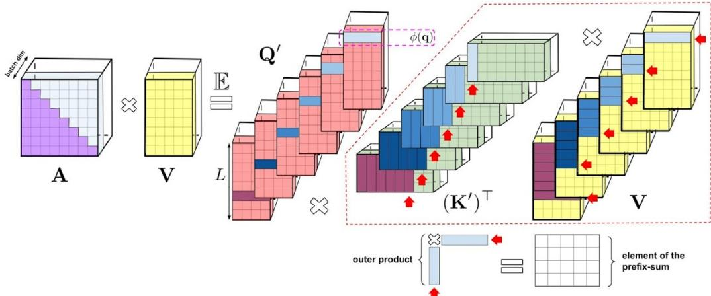  
Figure 8: 单向注意力前缀和算法的可视化表示。为了清晰起见，我们在本可视化中省略了注意力归一化。该算法维护前缀和，该前缀和是通过对键对应的随机特征与值向量的外积求和得到的矩阵。在前缀和算法的每个给定迭代中，将查询对应的随机特征向量与最新的前缀和（通过对前面所有 token 对应的外积求和得到）相乘，以获得由注意力机制输出的矩阵 AV 的新行。

对于单向情况，我们的分析与双向情况类似，但这次我们的目标是在不显式构造和存储大小为 $L \times L$ 的矩阵 tril $( \mathbf { Q } ^ { \prime } ( \mathbf { \breve { K } } ^ { \prime } ) ^ { \top } )$ 的情况下计算 tri $( { \bf { Q } } ^ { \prime } ( { \bf { K } } ^ { \prime } ) ^ { \top } ) { \bf { C } }$，其中 $\mathrm { ~ \bf ~ C ~ } = \mathrm { ~ \bf ~ \zeta ~ } [ V \mathrm { ~ \bf ~ 1 } _ { L } ] \in \mathbb { R } ^ { L \times ( d + 1 ) }$。为此，注意到 $\forall 1 \leq i \leq L$

$$
[ \mathrm{tril} (\mathbf {Q} ^ {\prime} (\mathbf {K} ^ {\prime}) ^ {\top}) \mathbf {C} ] _ {i} = \mathbf {G} _ {i,:,:} ^ {\mathrm{PS}} \times \mathbf {Q} _ {i} ^ {\prime}, \quad \mathbf {G} _ {i,:,:} ^ {\mathrm{PS}} = \sum_ {j = 1} ^ {i} \mathbf {G} _ {j,:,:}, \quad \mathbf {G} _ {j,:,:} = \mathbf {K} _ {j} ^ {\prime} \mathbf {C} _ {j} ^ {\top} \in \mathbb {R} ^ {M \times (d + 1)}\tag{11}
$$

其中 $\mathbf { G } , \mathbf { G } ^ { \mathrm { P S } } \in \mathbb { R } ^ { L \times M \times ( d + 1 ) }$ 为三维张量。因此，每个切片 $\mathbf { G } _ { : , l , p } ^ { \mathrm { P S } }$ 都是对 $\begin{array} { r } { \mathbf { G } _ { : , l , p } \colon \mathbf { G } _ { i , l , p } ^ { \mathrm { P S } } = \sum _ { j = 1 } ^ { i } \mathbf { G } _ { i , l , p } . } \end{array}$ 应用前缀和（prefix-sum，或累加和 cumulative-sum）操作的结果。在并行计算时，计算 L 个元素前缀和的高效算法需要 $O ( L )$ 的总步骤以及 $O ( \log L )$ 的时间 (Ladner & Fischer, 1980; Cormen et al., 2009)。完整方法参见 Algorithm 1。

## B.2 正交随机特征——扩展

正如正文中所述，对于各向同性 $\Omega$（对包括常规注意力在内的大多数实际应用均成立），我们可以使用正交随机特征（orthogonal random features, ORF）(Yu et al., 2016; Choromanski et al., 2017; 2018b) 代替独立采样 $\omega _ { i }$：这些方法在保持样本 $\omega _ { i }$ 边缘分布的同时，强制使不同样本相互正交。如果我们需要 $m > d ,$ ORF 仍然可以在 W 的每个 $d \times d$ 块内局部使用 (Yu et al., 2016)。

引入 ORF 是为了减小蒙特卡洛估计器（Monte Carlo estimators）的方差 (Yu et al., 2016; Choromanski et al., 2017; 2018b; 2019a; Rowland et al., 2019; Choromanski et al., 2018a; 2019b)，并且我们在正文的理论和实验部分中表明，它们确实能带来更精确的近似以及显著更优的下游结果。ORF 机制存在多种变体，而在正文中我们仅讨论了基础版本（在此我们称之为常规版本）。下面我们（根据其优势和成本）简要回顾最高效的 ORF 机制，以呈现最完整的图景。

(1) 常规 ORF [R-ORFs]：应用高斯正交矩阵 (Yu et al., 2016)。以 $O ( m d )$ 空间编码 $\omega$ 样本的矩阵 W（不同行对应不同样本）。提供在 $O ( m d )$ 时间内为任意 $\mathbf { x } \in \mathbb { R } ^ { d }$ 计算 Wx 的算法。给出无偏估计。需要一次性 $O ( m d ^ { 2 } )$ 的预处理（Gram-Schmidt 正交化）。

(2) Hadamard/Givens ORF [H/G-ORFs]：应用随机 Hadamard (Choromanski et al., 2017) 或 Givens 矩阵 (Choromanski et al., 2019b)。以 $O ( m )$ 或 $O ( m \log ( d ) )$ 空间编码矩阵 W。提供在 $O ( m \log ( d ) )$ 时间内为任意 $\mathbf { x } \in \mathbb { R } ^ { d }$ 计算 Wx 的算法。产生微小的偏差（随着 $d \to \infty$ 趋向于 0）。

## B.3 时间和空间复杂度——详细分析

我们看到，使用独立同分布（iid）样本或 R-ORFs 的双向 FAVOR+ 变体的空间复杂度为 $O ( m d + L d + m L )$，而基线的空间复杂度为 $\Theta ( L ^ { 2 } + L d )$。使用并行快速前缀和预计算（Ladner & Fischer, 1980; Cormen et al., 2009）的单向 FAVOR+ 具有存储 $\mathbf { G } ^ { \mathrm { P S } }$ 所需的 $O ( m L d )$ 空间复杂度，通过对 $\mathbf { G } _ { i , : , } ^ { \mathrm { P S } }$ 进行简单的（尽管关于 $L$ 非并行）聚合，无需将整个张量 $\mathbf { G } ^ { \mathrm { P S } }$ 存储在内存中，即可将该复杂度降低至 $O ( m d + L d + m L )$。根据第 B.2 小节，我们知道如果改用 G-ORFs，空间复杂度将降低至 $\dot { O } ( m \log ( d ) + L d + m L )$；若使用 H-ORFs 机制，空间则进一步减少到 $O ( m + L \bar { d } + m L ) = O ( L d + m L )$。因此，对于 $m , d \ll L$，我们所有的变体都提供了显著的空间复杂度改进，因为它们不需要显式存储注意力矩阵。

算法 1 的时间复杂度为 $O ( L m d )$（注意构建 $\mathbf { Q } ^ { \prime }$ 和 $\mathbf { K } ^ { \prime }$ 可以在 $O ( L m d )$ 时间内完成）。请注意，当 $L \gg m$ 时，我们方法的时间复杂度远低于基线的 $O ( L ^ { 2 } d )$。

如第 B.2 小节中所述，R-ORF 机制会产生额外的一次性 $O ( m d ^ { 2 } )$ 开销（对于 $L \gg d$，与 $O ( L m d )$ 项相比可忽略不计）。H-ORFs 或 G-ORFs 则没有这种开销，并且当 FAVOR+ 使用它们时，计算 $\mathbf { Q } ^ { \prime }$ 和 $\mathbf { K } ^ { \prime }$ 可以在 $O ( L \log ( m ) d )$ 时间内进行，而不是 $O ( L m d )$（见：第 B.2 小节）。因此，即使 H/G-ORFs 没有改变渐近时间复杂度，它们也改进了主导项的常数因子。这可能在训练超大模型时发挥重要作用。

随机特征的数量 m 允许在计算复杂度和近似程度之间进行权衡：较大的 m 会导致更高的计算成本，但也会带来对 A 估计的更低方差。在正文的理论部分中，我们证明了在实践中我们可以取 $M = \Theta ( d \log ( d ) )$。

可以看出，FAVOR+ 算法具有高度可并行性，并得益于 GPU 或 TPU 上的快速矩阵乘法和广播操作。

## C 蛋白质建模任务的实验细节

## C.1 TrEMBL 数据集

<table><tr><td rowspan="2">数据集</td><td rowspan="2">集合名称</td><td rowspan="2">数量</td><td colspan="5">长度统计</td></tr><tr><td>最小值</td><td>最大值</td><td>均值</td><td>标准差</td><td>中位数</td></tr><tr><td rowspan="4">TrEMBL</td><td>训练集</td><td>104,863,744</td><td>2</td><td>74,488</td><td>353.09</td><td>311.16</td><td>289.00</td></tr><tr><td>验证集</td><td>102,400</td><td>7</td><td>11,274</td><td>353.62</td><td>307.42</td><td>289.00</td></tr><tr><td>测试集</td><td>1,033,216</td><td>8</td><td>32,278</td><td>353.96</td><td>312.23</td><td>289.00</td></tr><tr><td>OOD</td><td>29,696</td><td>24</td><td>4,208</td><td>330.96</td><td>269.86</td><td>200.00</td></tr><tr><td rowspan="2">TrEMBL (拼接)</td><td>训练集</td><td>4,532,224</td><td>8,192</td><td>8,192</td><td>8,192</td><td>0</td><td>8,192</td></tr><tr><td>验证集</td><td>4,096</td><td></td><td></td><td></td><td></td><td></td></tr></table>

Table 1: TrEMBL 单序列和长序列任务的统计数据。

我们使用了 TrEMBL 数据集4，该数据集包含 139,394,261 条序列，其中 106,030,080 条是唯一的。虽然该训练数据集看起来比 Madani 等人（Madani et al., 2020）中使用的数据集更小，但我们认为它包含了大部分相关序列。具体而言，TrEMBL 数据集由经过计算分析但未经过人工审阅的 UniProtKB 序列子集组成，占 UniProtKB 数据集中序列总数的约 99.5%5。

按照 Madani 等人（Madani et al., 2020）中描述的方法，我们同时使用了 OOD-Test 集（其中选定的 Pfam 家族子集被保留用于评估）和 IID 划分（其中剩余的蛋白质序列被随机划分为训练集、验证集和测试集）。我们保留了以下蛋白质家族（PF18369, PF04680, PF17988, PF12325, PF03272, PF03938, PF17724, PF10696, PF11968, PF04153, PF06173, PF12378, PF04420, PF10841, PF06917, PF03492, PF06905, PF15340, PF17055, PF05318），共得到 29,696 条 OOD 序列。我们注意到，由于去重和潜在的 TrEMBL 版本不一致，我们的 OOD-Test 集与 Madani 等人（Madani et al., 2020）中的并不完全一致。我们还注意到，这种 OOD-Test 选择方法并不能保证评估序列与训练期间使用的序列之间存在最小距离。在未来的工作中，我们将纳入严格的基于距离的划分。

最终数据集划分的统计数据见 Table 1。在标准序列建模任务中，鉴于表中报告的长度统计数据，我们将单条序列截断至最大长度 L = 1024，这仅导致极少数序列被显著截断。

在长序列任务中，训练集和验证集是通过将序列用序列结束标记（end-of-sequence token）分隔拼接，并将生成的链分组为长度为 L = 8192 的非重叠序列来获得的。

## C.2 经验基线

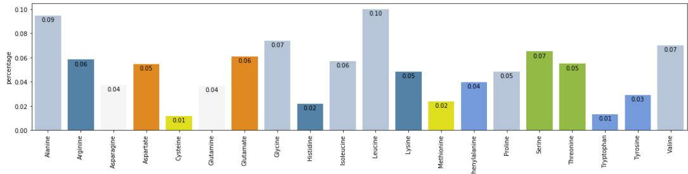  
Figure 9: 20 种标准氨基酸的估计经验分布可视化，按其类别着色。请注意其与 TrEMBL 网页上统计数据的一致性。

在每个位置上所有词表词元均具有均匀概率的随机基线（random baseline），其准确率为 5%（仅包含 20 种标准氨基酸时）和 4%（同时包含 5 种异常氨基酸时 (Consortium, 2019)）。然而，我们数据集中各种氨基酸的经验频率可能远非均匀分布，因此我们还考虑了一种经验基线（empirical baseline），其中氨基酸的概率与它们在训练集中的经验频率成正比。

Figure 9 展示了估计的经验分布。我们同时使用了标准氨基酸和异常氨基酸，并将序列裁剪至长度 1024，以匹配针对 Transformer 模型执行的数据处理。该图仅展示了 20 种标准氨基酸（按其类别着色），以便与 TrEMBL 网页6上的可视化进行对比。

## C.3 表格结果

Table 2 包含了单蛋白质序列建模任务（L = 1024）的结果。我们报告了附录 A 中定义的准确率和困惑度：

<table><tr><td>模型类型</td><td>集合名称</td><td>模型</td><td>准确率</td><td>困惑度</td></tr><tr><td rowspan="6">UNI</td><td rowspan="3">Test</td><td>Empirical Baseline</td><td>9.92</td><td>17.80</td></tr><tr><td>Transformer</td><td>30.80</td><td>9.37</td></tr><tr><td>Performer (generalized)</td><td>31.58</td><td>9.17</td></tr><tr><td rowspan="3">OOD</td><td>Empirical Baseline</td><td>9.07</td><td>17.93</td></tr><tr><td>Transformer</td><td>19.70</td><td>13.20</td></tr><tr><td>Performer (generalized)</td><td>18.44</td><td>13.63</td></tr><tr><td rowspan="6">BID</td><td rowspan="3">Test</td><td>Transformer</td><td>33.32</td><td>9.22</td></tr><tr><td>Performer (generalized)</td><td>36.09</td><td>8.36</td></tr><tr><td>Performer (softmax)</td><td>33.00</td><td>9.24</td></tr><tr><td rowspan="3">OOD</td><td>Transformer</td><td>25.07</td><td>12.09</td></tr><tr><td>Performer (generalized)</td><td>24.10</td><td>12.26</td></tr><tr><td>Performer (softmax)</td><td>23.48</td><td>12.41</td></tr></table>

Table 2: 单蛋白质序列建模的结果（L = 1024）。我们指出，经验基线结果同时适用于单向（UNI）和双向（BID）模型。

## C.4 注意力矩阵图示

在本节中，我们展示了由 Performer 模型生成的注意力矩阵。我们重点关注双向情况，并选择了一个在标准单序列 TrEMBL 任务上训练超过 500K 步的 Performer 模型。同样的分析也可以应用于单向 Performer。

我们注意到，虽然 Transformer 模型会实例化注意力矩阵以计算结合了（查询 Q、键 K、值 V）三元组的注意力输出（参见正文中的公式 1），但 FAVOR 机制直接返回注意力输出（参见算法 1）。为了解决这一差异，我们通过对每种注意力机制应用两次来提取注意力矩阵：一次作用于每个原始的 (Q, K, V) 三元组以获得注意力输出，另一次作用于修改后的 $( Q , K , V ^ { \circ } )$ 三元组以获得注意力矩阵，其中 V◦ 包含每个位置索引的独热（one-hot）指示向量。V◦ 的选择确保了注意力输出的维度等于序列长度，并且维度 i 上的非零输出只能源自对第 i 个序列位置的非零注意力权重。事实上，在 Transformer 的情况下，将该过程的输出与实例化的注意力矩阵进行对比时，两者完全匹配。

注意力矩阵示例。我们首先可视化单个蛋白质序列的注意力矩阵。我们使用 BPT1\_BOVIN 蛋白质序列7，它是研究最广泛的球状蛋白质之一，包含 100 个氨基酸。在 Figure 10 中，我们展示了前 4 层的注意力矩阵。请注意，许多头呈现出对角线模式，即每个节点关注其邻近节点，而某些头呈现出垂直模式，即每个头关注相同的固定位置。这些模式与在自然语言上训练的 Transformer 模型中发现的模式一致（Kovaleva et al., 2019）。在 Figure 12 中，我们通过聚焦于前 25 个词元（token）来突出展示这些注意力模式，并在 Figure 11 中更详细地说明了两个注意力头。

氨基酸相似度。此外，我们分析了根据 Performer 模型生成的注意力矩阵估计出的氨基酸相似度矩阵，具体方法如 Vig 等人（Vig et al., 2020）所述。我们在 800 个序列上聚合了注意力矩阵。最终得到的相似度矩阵如图 Figure 13 所示。请注意，Performer 识别出了高度相似的氨基酸对，例如 (D, E) 和 (F, Y)。

Figure 10: 我们展示了前 4 层和所有 8 个头的注意力矩阵（每行代表一层，每列代表头的索引，每个单元格包含整个 BPT1\_BOVIN 蛋白质序列的注意力矩阵）。请注意，许多头呈现对角线模式，即每个节点关注其邻近节点，而某些头呈现垂直模式，即每个头关注相同的固定位置。  
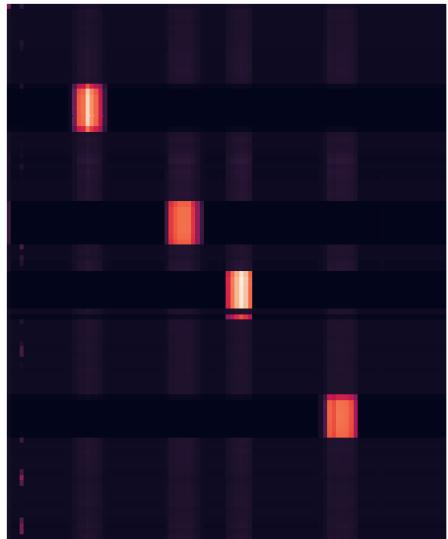

  
Figure 11: 我们更详细地展示了两个注意力头。子图分别对应：(1) Head 1-2（第 2 层，第 3 个头），(2) Head 4-1（第 5 层，第 2 个头）。请注意 Head 1-2 中的块状注意力以及 Head 4-1 中的垂直注意力（针对起始 token (‘M’) 和第 85 个 token (‘C’)）。

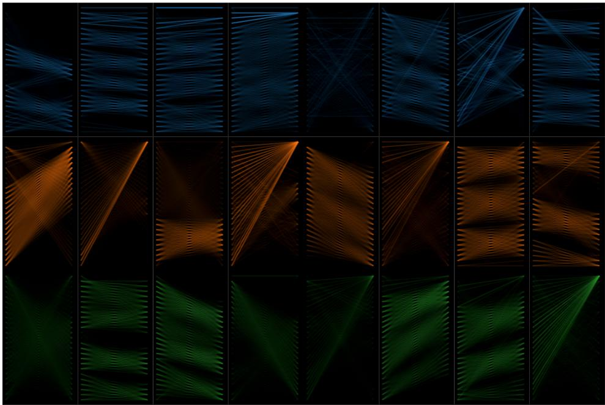

Figure 12: 我们通过将注意力限制在前 25 个 token 来突出注意力模式（注意我们没有对这些 token 的注意力重新归一化）。该图示基于 Vig 等人 (Vig, 2019; Vig & Belinkov, 2019) 的工作。请注意，与以往关于蛋白质 Transformer 的工作 (Madani et al., 2020) 类似，注意力矩阵同时包含了局部和全局模式。  
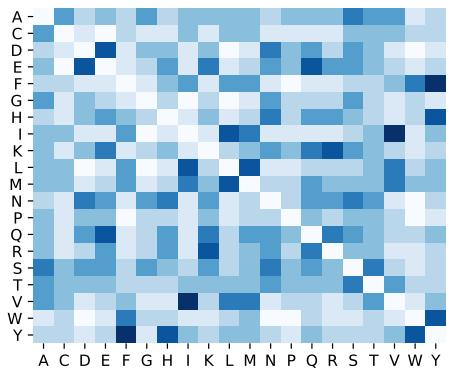

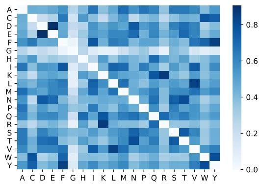  
Figure 13: 如 Vig 等人 (Vig et al., 2020) 所述，从跨一小部分序列聚合的注意力矩阵中估计的氨基酸相似度矩阵。子图分别对应：(1) 归一化的 BLOSUM 矩阵，(2) 通过训练好的 Performer 模型估计的氨基酸相似度。请注意，Performer 能够识别出高度相似的氨基酸对，例如 (D, E) 和 (F, Y)。

## D 扩展近似与比较结果

## D.1 向后兼容性 - 误差传播

尽管前面（第 4.2 节）提到经过额外微调的 Performer 与 Transformer 是向后兼容的，但我们在下文图 14 中证明，由 Transformer 的非注意力组件引起的误差传播，是预训练的 Transformer 权重不能立即用于相应 Performer 进行推理的主要原因之一。

Performer 近似误差  
  
Figure 14: 针对不同层数，原始 Transformer 与 Performer（具有正交特征）之间的输出近似误差。

## D.2 近似 SOFTMAX - 扩展性质

我们在图 15 中展示了我们 softmax 近似的以下性质：

重采样（Redrawing）：虽然在论文正文的第 4.3 小节中展示了重新采样特征的好处，但我们还展示了在具有多层且进行大规模（16x16 TPU-v2）训练时它的优势。

单向（Unidirectional）：虽然我们在 TrEMBL 上展示了具有广义 ReLU 注意力的 Performer 优于 softmax，但我们也展示了近似 softmax 注意力仍然可以是一个可靠的选择，例如在 ImageNet64 (U) 上。在经过 100K 步训练后，Performer-ReLU、Performer-Softmax 和 Performer-Softmax (SMREG) 变体分别达到了 3.67、3.69 和 3.67 BPD。

三角特征的不稳定性：我们看到了使用三角 softmax 时不稳定训练曲线的全貌。

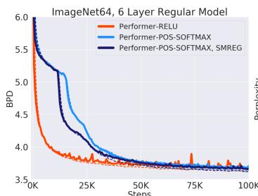

  
Figure 15: 放大查看效果最佳。左图：重采样特征的重要性。如果不使用重采样，一组“不走运”的随机特征可能会导致训练退化，如使用 Seed 1 提前停止的曲线所示，而一组“走运”的随机特征则可能不会产生问题，如使用 Seed 2 的曲线所示。重采样使训练能够自我修正，如黑色垂直线处所示。中图：使用相同的 8x8 TPU-v2 算力和相同的 6 层标准模型，采用正特征的近似 softmax 达到了与广义 ReLU 注意力相同的结果。右图：图 5 右侧子图的缩小全景视图，显示三角 softmax 会导致非常不稳定的训练行为。

## D.3 广义注意力

我们在 TrEMBL 上（当 L = 512 时）针对各种核函数研究了广义注意力机制（Generalized Attention mechanisms，在第 2.2 节中提及）。这类似于 (Tsai et al., 2019)，该研究同样针对自然语言实验了各种注意力核。通过在 FAVOR 中对多个变量进行超参数搜索，我们比较了几种核以及重新归一化（renormalization）的开启/关闭（图 16 和图 17，其中 Renormalize 对应于在注意力中应用 $\mathbf { D } ^ { - 1 }$ 算子，与标准机制相同，尽管我们注意到禁用它并不一定会损害精度），以得出 Performer 的最佳训练配置。我们注意到有效批次大小会轻微影响排名（如 2x2 和 4x4 TPU 运行之间的差异所示）——我们默认使用广义 ReLU 核以及附录 A 中显示的其他默认超参数，因为我们观察到它们在经验上对于大批次大小运行（即 8x8 或 16x16 TPU）是最优的。

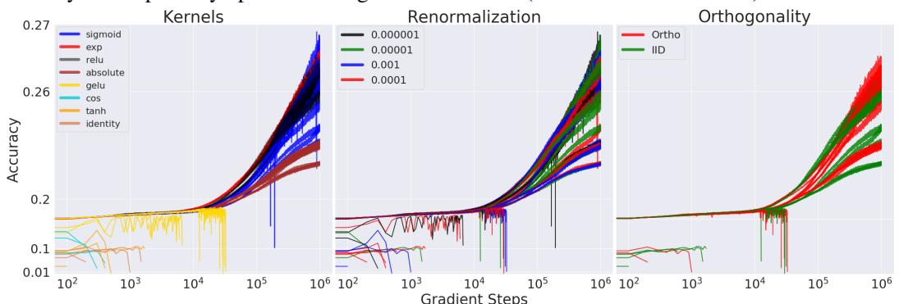  
Figure 16: 为了突出准确率最高的运行，同时也展示某些核导致运行提前停止的 NaN 问题，我们将 x 轴和 y 轴均设置为对数刻度。我们测试了由不同函数 f 定义的核（参见：第 2.2 节）：sigmoid、exponential、ReLU、absolute、gelu、cosine（原始 softmax 近似）、tanh 和 identity。所有训练运行均在 2x2 TPU-v2 上执行，每个设备的批次大小为 128。

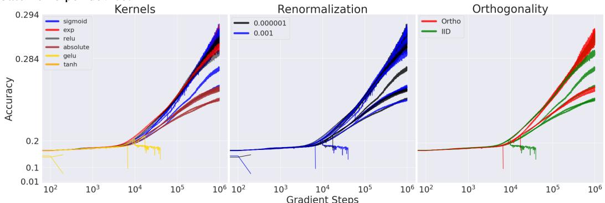  
Figure 17: 我们还针对 4x4 TPU-v2 进行了类似于图 16 的设置。

## D.4 与 LINEAR TRANSFORMER 的比较

我们采用了来自 (Katharopoulos et al., 2020) 的 Linear Transformer 的注意力机制实现，这主要涉及将我们的特征映射设置为 $\phi ( x ) = \mathtt { e l u } ( x ) + 1$ ，其中 elu(x) 是来自 (Clevert et al., 2016) 的平移 eLU 函数（shifted-eLU function）。

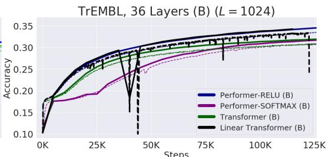  
Figure 18: 左图：在单向 36-ProGen 设置下，我们对 Linear Transformer 运行了 3 个随机种子，发现所有 3 个随机种子在极早期均出现了梯度爆炸，导致训练中断。右图：双向设置下的 Linear Transformer 也在训练中期（接近 125K 步时）出现了梯度爆炸。梯度爆炸可以通过出现 NaN 错误前训练准确率的急剧下降来证明。

为了保证公平性并避免混杂结果，尽管 (Katharopoulos et al., 2020) 在 Linear Transformer 的 MLP 中也使用了 GeLU 非线性激活函数，但我们改用了原始的 ReLU 非线性激活函数。我们还在图 6 对应的精确 ProGen 设置上，使用了与 Performer-ReLU 完全相同的训练超参数。最终，我们从经验上发现 Linear Transformer 在训练过程中通过不稳定的训练曲线表现出数值不稳定性，最终因产生梯度爆炸（NaN）而中断训练（图 18）。

## D.5 LONG RANGE ARENA

在 Long Range Arena（Tay et al., 2021）具有挑战性的长程上下文任务中，我们将 Performer 与我们论文中未包含的许多其他（可扩展和不可扩展的）方法进行了对比：Local Attention、Sparse Attention、Longformer、Sinkhorn Transformer、Synthesizer、Big Bird 以及前文提及的 Linear Transformer，图 19 展示了原论文的结果。在所有测试的可扩展 Transformer 方法（我们将其定义为速度 > 100 样本/秒）中，Performer 获得了最高的 LRA（Long Range Arena）得分。

用于比较的任务包括：(1) (Nangia & Bowman, 2018) 中提出的标准 ListOps 任务的长序列变体，(2) 使用真实世界数据的字节级文本分类，(3) 字节级文档检索，(4) 像素序列上的图像分类，以及 (5) Pathfinder 任务（长程空间依赖问题）。在 Long Range Arena 论文中，作者发现与 Pathfinder 任务相反，所有模型在 Path-X 任务上均未学到任何有效信息（标记为 FAIL），这表明增加序列长度会给模型训练带来极大的困难。

<table><tr><td>模型</td><td>ListOps</td><td>Text</td><td>Retrieval</td><td>Image</td><td>Pathfinder</td><td>Path-X</td><td>平均</td></tr><tr><td>Transformer</td><td>36.37</td><td>64.27</td><td>57.46</td><td>42.44</td><td>71.40</td><td>FAIL</td><td>54.39</td></tr><tr><td>Local Attention</td><td>15.82</td><td>52.98</td><td>53.39</td><td>41.46</td><td>66.63</td><td>FAIL</td><td>46.06</td></tr><tr><td>Sparse Trans.</td><td>17.07</td><td>63.58</td><td>59.59</td><td>44.24</td><td>71.71</td><td>FAIL</td><td>51.24</td></tr><tr><td>Longformer</td><td>35.63</td><td>62.85</td><td>56.89</td><td>42.22</td><td>69.71</td><td>FAIL</td><td>53.46</td></tr><tr><td>Linformer</td><td>35.70</td><td>53.94</td><td>52.27</td><td>38.56</td><td>76.34</td><td>FAIL</td><td>51.36</td></tr><tr><td>Reformer</td><td>37.27</td><td>56.10</td><td>53.40</td><td>38.07</td><td>68.50</td><td>FAIL</td><td>50.67</td></tr><tr><td>Sinkhorn Trans.</td><td>33.67</td><td>61.20</td><td>53.83</td><td>41.23</td><td>67.45</td><td>FAIL</td><td>51.39</td></tr><tr><td>Synthesizer</td><td>36.99</td><td>61.68</td><td>54.67</td><td>41.61</td><td>69.45</td><td>FAIL</td><td>52.88</td></tr><tr><td>BigBird</td><td>36.05</td><td>64.02</td><td>59.29</td><td>40.83</td><td>74.87</td><td>FAIL</td><td>55.01</td></tr><tr><td>Linear Trans.</td><td>16.13</td><td>65.90</td><td>53.09</td><td>42.34</td><td>75.30</td><td>FAIL</td><td>50.55</td></tr><tr><td>Performer</td><td>18.01</td><td>65.40</td><td>53.82</td><td>42.77</td><td>77.05</td><td>FAIL</td><td>51.41</td></tr><tr><td>任务均值 (标准差)</td><td>29 (9.7)</td><td>61 (4.6)</td><td>55 (2.6)</td><td>41 (1.8)</td><td>72 (3.7)</td><td>FAIL</td><td>52 (2.4)</td></tr><tr><td colspan="8"></td></tr><tr><td rowspan="2">模型</td><td colspan="4">每秒步数</td><td colspan="3">峰值显存占用 (GB)</td></tr><tr><td>1K</td><td>2K</td><td>3K</td><td>4K</td><td>1K</td><td>2K</td><td>3K</td></tr><tr><td>Transformer</td><td>8.1</td><td>4.9</td><td>2.3</td><td>1.4</td><td>0.85</td><td>2.65</td><td>5.51</td></tr><tr><td>Local Attention</td><td>9.2 (1.1x)</td><td>8.4 (1.7x)</td><td>7.4 (3.2x)</td><td>7.4 (5.3x)</td><td>0.42</td><td>0.76</td><td>1.06</td></tr><tr><td>Linformer</td><td>9.3 (1.2x)</td><td>9.1 (1.9x)</td><td>8.5 (3.7x)</td><td>7.7 (5.5x)</td><td>0.37</td><td>0.55</td><td>0.99</td></tr><tr><td>Reformer</td><td>4.4 (0.5x)</td><td>2.2 (0.4x)</td><td>1.5 (0.7x)</td><td>1.1 (0.8x)</td><td>0.48</td><td>0.99</td><td>1.53</td></tr><tr><td>Sinkhorn Trans</td><td>9.1 (1.1x)</td><td>7.9 (1.6x)</td><td>6.6 (2.9x)</td><td>5.3 (3.8x)</td><td>0.47</td><td>0.83</td><td>1.13</td></tr><tr><td>Synthesizer</td><td>8.7 (1.1x)</td><td>5.7 (1.2x)</td><td>6.6 (2.9x)</td><td>1.9 (1.4x)</td><td>0.65</td><td>1.98</td><td>4.09</td></tr><tr><td>BigBird</td><td>7.4 (0.9x)</td><td>3.9 (0.8x)</td><td>2.7 (1.2x)</td><td>1.5 (1.1x)</td><td>0.77</td><td>1.49</td><td>2.18</td></tr><tr><td>Linear Trans.</td><td>9.1 (1.1x)</td><td>9.3 (1.9x)</td><td>8.6 (3.7x)</td><td>7.8 (5.6x)</td><td>0.37</td><td>0.57</td><td>0.80</td></tr><tr><td>Performer</td><td>9.5 (1.2x)</td><td>9.4 (1.9x)</td><td>8.7 (3.8x)</td><td>8.0 (5.7x)</td><td>0.37</td><td>0.59</td><td>0.82</td></tr></table>

  
Figure 19: 上表：Long-Range Arena 基准测试结果。最佳模型加粗表示，次佳模型加下划线。下表：所有 X-former 模型在所有模型统一的批次大小（batch size）为 32 下的基准测试结果。作者在每秒步数旁边的括号中报告了与原始 Transformer 相比的相对速度提升/下降。内存使用量是指每个 TPU 设备上的单设备内存占用。基准测试在 4x4 TPU-v3 芯片上运行。右图：不同模型的性能（y 轴）、速度（x 轴）和内存占用（圆圈大小）。

## E 计算成本 - 扩展结果

在本小节中，我们通过实证方法针对图 20 中的三种场景测量了前向和反向传播的实际运行时间（wall clock time）计算成本：

1. 具有不同层数的 Performer。我们展示了我们的方法可以扩展到（但不一定限于）甚至 20 层。

2. 标准注意力机制（来自 Transformer）与 FAVOR（来自 Performer）比较时的注意力时间复杂度。请注意，此处的最大内存大小并不能反映实际模型中的最大内存大小（如下所示），因为该基准测试需要在 Jax 中计算显式张量（导致内存增加），而实际模型则不需要。

3. 比较 Transformer 和 Performer 模型时的时间复杂度。“X” (OPT) 表示当注意力机制仅返回 V 向量时可实现的最大可能加速比，这表明 Performer 接近最优。我们发现在 V100 GPU (16GB) 上使用常规维度时，允许的最大 2 的幂次序列长度为 $2 ^ { 1 5 } = 3 2 7 6 8$。

由于 Transformer 中的部分计算瓶颈可能源自额外的前馈层 (Kitaev et al., 2020)，当注意力机制部分是计算和内存的主要来源时，我们还对“Small”版本进行了基准测试，即 $( n _ { h e a d s } , n _ { l a y e r s } , d _ { f f } , d ) = ( 1 , 6 , 6 4 , 6 4 )$。我们提醒读者，“Regular”版本由 $( n _ { h e a d s } , n _ { l a y e r s } , d _ { f f } , d ) = ( 8 , 6 , 2 0 4 8 , 5 1 2 )$ 组成。

注意力反向传播耗时 (Regular)  
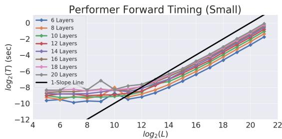

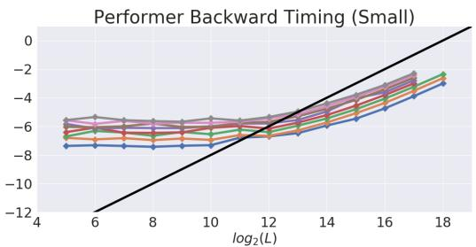

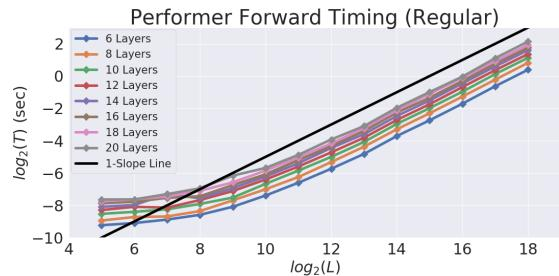

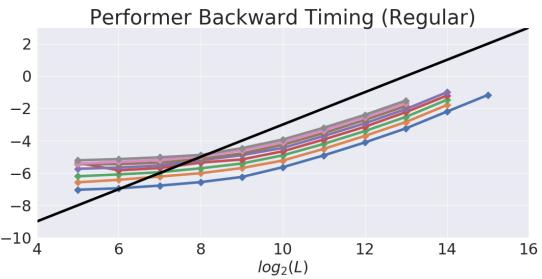

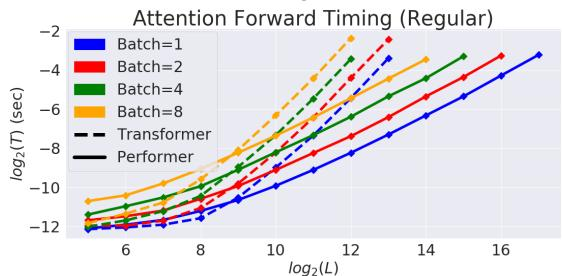

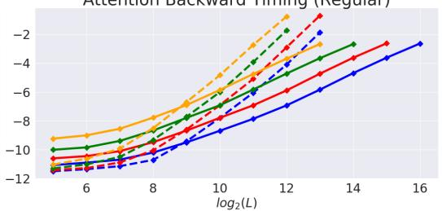  
Figure 20: 上述每个 2x2 子图的说明文字 (1) 和 (2)。

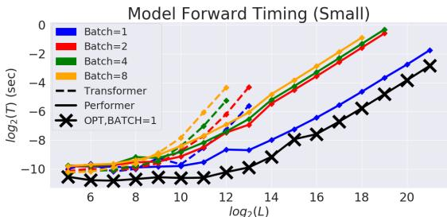

  
模型反向传播计时（常规）

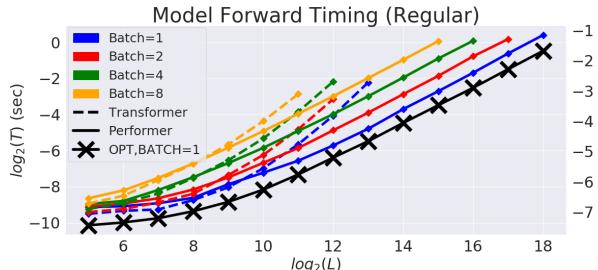  
Figure 21: 上述 2x2 子图的标题 (3)。

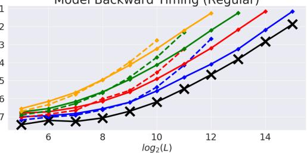

## F 理论结果

我们在本节提供论文中呈现的所有理论结果的证明。

## F.1 引理 1 的证明

证明。我们首先推导出，对于任意 $a , b \in \mathbb { R } ^ { d }$

$$
\operatorname{SM} (\mathbf {x}, \mathbf {y}) = \exp (\boldsymbol {x} ^ {\top} \boldsymbol {y}) = \exp (- \| \boldsymbol {x} \| ^ {2} / 2) \cdot \exp (\| \boldsymbol {x} + \boldsymbol {y} \| ^ {2} / 2) \cdot \exp (- \| \boldsymbol {y} \| ^ {2} / 2).
$$

接下来，令 $\pmb { w } \in \mathbb { R } ^ { d }$。我们利用对于任意 $\boldsymbol { c } \in \mathbb { R } ^ { d }$

$$
(2 \pi) ^ {- d / 2} \int \exp (- \| \boldsymbol {w} - \boldsymbol {c} \| _ {2} ^ {2} / 2) d \boldsymbol {w} = 1
$$

这一事实推导出：

$$
\begin{array}{l} \exp (\| \boldsymbol {x} + \boldsymbol {y} \| ^ {2} / 2) = (2 \pi) ^ {- d / 2} \exp (\| \boldsymbol {x} + \boldsymbol {y} \| ^ {2} / 2) \int \exp (- \| \boldsymbol {w} - (\boldsymbol {x} + \boldsymbol {y}) \| ^ {2} / 2) d \boldsymbol {w} \\ \qquad = (2 \pi) ^ {- d / 2} \int \exp (- \| \boldsymbol {w} \| ^ {2} / 2 + \boldsymbol {w} ^ {\top} (\boldsymbol {x} + \boldsymbol {y}) - \| \boldsymbol {x} + \boldsymbol {y} \| ^ {2} / 2 + \| \boldsymbol {x} + \boldsymbol {y} \| ^ {2} / 2) d \boldsymbol {w} \\ \qquad = (2 \pi) ^ {- d / 2} \int \exp (- \| \boldsymbol {w} \| ^ {2} / 2 + \boldsymbol {w} ^ {\top} (\boldsymbol {x} + \boldsymbol {y})) d \boldsymbol {w} \\ \qquad = (2 \pi) ^ {- d / 2} \int \exp (- \| \boldsymbol {w} \| ^ {2} / 2) \cdot \exp (\boldsymbol {w} ^ {\top} \boldsymbol {x}) \cdot \exp (\boldsymbol {w} ^ {\top} \boldsymbol {y}) d \boldsymbol {w} \\ \qquad = \mathbb {E} _ {\omega \sim \mathcal {N} (\mathbf {0} _ {d}, \mathbf {I} _ {d})} [ \exp (\omega^ {\top} \boldsymbol {x}) \cdot \exp (\omega^ {\top} \boldsymbol {y}) ]. \end{array}
$$

至此完成了引理第一部分的证明。涉及双曲余弦函数的恒等式可由以下事实推出：对于每个 u $\in \mathbb { R } ^ { d }$ 和 $\omega \sim \mathcal { N } ( 0 , \dot { \mathbf { I } _ { d } } )$，下列式子成立：

$$
\mathbb {E} [ \exp (\omega^ {\top} \mathbf {u}) ] = \sum_ {i = 0} ^ {\infty} \frac {\mathbb {E} [ (\omega^ {\top} \mathbf {u}) ^ {2 i} ]}{(2 i) !} = \frac {1}{2} \sum_ {i = 0} ^ {\infty} \frac {\mathbb {E} [ (\omega^ {\top} \mathbf {u}) ^ {2 i} ] + \mathbb {E} [ (- \omega^ {\top} \mathbf {u}) ^ {2 i} ]}{(2 i) !}.\tag{12}
$$

奇数阶矩 $\mathbb { E } [ ( \omega ^ { \top } \mathbf { u } ) ^ { 2 i + 1 } ]$ 的消除直接源于 $\omega$ 取自各向同性分布（即概率密度函数在每个球面上为常数的分布）这一事实。证毕。□

## F.2 引理 2 的证明

证明。记：${ \bf z } = { \bf x } + { \bf y }$ 以及 $\Delta = { \bf x } - { \bf y }$。注意，通过使用标准三角恒等式（以及独立随机变量之和的方差等于这些随机变量方差之和的事实），对于 $\omega \sim \mathcal { N } ( 0 , \mathbf { I } _ { d } )$，我们可以得到如下结果

$$
\mathrm{MSE} (\widehat {\mathrm{SM}} _ {m} ^ {\mathrm{trig}} (\mathbf {x}, \mathbf {y})) = \frac {1}{m} \exp (\| \mathbf {x} \| ^ {2} + \| \mathbf {y} \| ^ {2}) \mathrm{Var} (\cos (\omega^ {\top} \Delta)).\tag{13}
$$

利用以下事实（参见：(Yu et al., 2016) 中的引理 1；注意在该引理中，他们用符号 $z$ 表示我们所记的 $\| \Delta \|$）：

$$
\mathrm{Var} (\cos (\omega^ {\top} \Delta)) = \frac {1}{2} (1 - \exp (- \| \Delta \| ^ {2})) ^ {2},\tag{14}
$$

我们得到：

$$
\begin{array}{c} \widehat {\mathrm{MSE} (\mathrm{SM} _ {m} ^ {\mathrm{trig}} (\mathbf {x} , \mathbf {y}))} = \frac {1}{2 m} \exp (\| \mathbf {x} \| ^ {2} + \| \mathbf {y} \| ^ {2}) (1 - \exp (- \| \Delta \| ^ {2})) ^ {2} = \\ \frac {1}{2 m} \exp (\| \mathbf {z} \| ^ {2}) \mathrm{SM} ^ {- 2} (\mathbf {x}, \mathbf {y}) (1 - \exp (- \| \Delta \| ^ {2})) ^ {2}, \end{array}\tag{15}
$$

这完成了证明的第一部分。为了获得 $\operatorname { M S E } ( { \widehat { \mathrm { S M } } } _ { m } ^ { + } ( \mathbf { x } , \mathbf { y } ) )$ 的公式，首先注意到：

$$
\mathbb {E} _ {\omega \sim \mathcal {N} (0, \mathbf {I} _ {d})} [ \exp (\boldsymbol {\omega} ^ {\top} \mathbf {z}) ] = \exp (\frac {\| \mathbf {z} \| ^ {2}}{2}).\tag{16}
$$

上式直接源于正随机特征映射提供了 softmax 核的无偏估计这一事实，因此下式成立：

$$
\mathrm{SM} (\mathbf {x}, \mathbf {y}) = \exp (- \frac {\| \mathbf {x} \| ^ {2} + \| \mathbf {y} \| ^ {2}}{2}) \mathbb {E} _ {\omega \sim \mathcal {N} (0, \mathbf {I} _ {d})} [ \exp (\boldsymbol {\omega} ^ {\top} \mathbf {z}) ].\tag{17}
$$

因此我们得到：

$$
\begin{array}{r l} & {\mathrm{MSE} (\widehat {\mathrm{SM}} _ {m} ^ {+} (\mathbf {x}, \mathbf {y})) = \frac {1}{m} \exp (- (\| \mathbf {x} \| ^ {2} + \| \mathbf {y} \| ^ {2})) \mathrm{Var} (\exp (\omega^ {\top} \mathbf {z})) =} \\ & {\quad \frac {1}{m} \exp (- (\| \mathbf {x} \| ^ {2} + \| \mathbf {y} \| ^ {2})) \left(\mathbb {E} [ \exp (2 \omega^ {\top} \mathbf {z}) ] - (\mathbb {E} [ \exp (\omega^ {\top} \mathbf {z}) ]) ^ {2}\right) =} \\ & {\qquad \frac {1}{m} \exp (- (\| \mathbf {x} \| ^ {2} + \| \mathbf {y} \| ^ {2})) (\exp (2 \| \mathbf {z} \| ^ {2}) - \exp (\| \mathbf {z} \| ^ {2})),} \end{array}\tag{18}
$$

其中最后一个等式由公式 16 得出。因此我们有：

$$
\begin{array}{r} \widehat {\mathrm{MSE} (\mathrm{SM} _ {m} ^ {+} (\mathbf {x} , \mathbf {y}))} = \frac {1}{m} \exp (- (\| \mathbf {x} \| ^ {2} + \| \mathbf {y} \| ^ {2})) \exp (\| \mathbf {z} \| ^ {2}) (\exp (\| \mathbf {z} \| ^ {2}) - 1) = \\ \frac {1}{m} \exp (\| \mathbf {z} \| ^ {2}) \mathrm{SM} ^ {2} (\mathbf {x}, \mathbf {y}) (1 - \exp (- \| \mathbf {z} \| ^ {2})). \end{array}\tag{19}
$$

最后，

$$
\begin{array}{r l r} & & {\mathrm{MSE} (\widehat {\mathrm{SM}} _ {m} ^ {\mathrm{hyp+}} (\mathbf {x}, \mathbf {y})) = \frac {1}{4 m} \exp (- \frac {\| \mathbf {x} \| ^ {2} + \| \mathbf {y} \| ^ {2}}{2}) ^ {2} (\mathrm{Var} (\exp (\omega^ {\top} \mathbf {z})) + \mathrm{Var} (\exp (- \omega^ {\top} \mathbf {z})) +} \\ & & {2 \mathrm{Cov} (\exp (\omega^ {\top} \mathbf {z})), \exp (- \omega^ {\top} \mathbf {z})))) = \frac {1}{4 m} \exp (- \frac {\| \mathbf {x} \| ^ {2} + \| \mathbf {y} \| ^ {2}}{2}) ^ {2} (2 \mathrm{Var} (\exp (\omega^ {\top} \mathbf {z})) +} \\ & & {2 \mathrm{Cov} (\exp (\omega^ {\top} \mathbf {z})), \exp (- \omega^ {\top} \mathbf {z}))))) = \frac {1}{2 m} \exp (- (\| \mathbf {x} \| ^ {2} + \| \mathbf {y} \| ^ {2}))} \\ & & {(\mathrm{Var} (\exp (\omega^ {\top} \mathbf {z})) + 1 - (\mathbb {E} [ \exp (\omega^ {\top} \mathbf {z}) ])) ^ {2}) = \frac {1}{2 m} \exp (- (\| \mathbf {x} \| ^ {2} + \| \mathbf {y} \| ^ {2}))} \\ & & {(\exp (2 \| \mathbf {z} \| ^ {2}) - \exp (\| \mathbf {z} \| ^ {2}) + 1 - \exp (\| \mathbf {z} \| ^ {2})) = \frac {1}{2 m} \exp (- (\| \mathbf {x} \| ^ {2} + \| \mathbf {y} \| ^ {2})) (\exp (\| \mathbf {z} \| ^ {2}) - 1) ^ {2}} \\ & & {\quad = \frac {1}{2} (1 - \exp (- \| \mathbf {z} \| ^ {2})) \mathrm{MSE} (\widehat {\mathrm{SM}} _ {m} ^ {+} (\mathbf {x}, \mathbf {y})).} \end{array}\tag{20}
$$

在上面的等式链中，我们使用了随机变量 $\exp ( \omega ^ { \top } \mathbf { z } )$ 和 $\exp ( - \omega ^ { \top } { \mathbf z } )$ 具有相同分布这一事实。这是成立的，因为 ω 和 $- \omega$ 具有相同的分布（ω 为高斯分布）。证明完毕。□

## F.3 定理 1 的证明

证明。设 $\mathbf { x } , \mathbf { y } \in \mathbb { R } ^ { d }$ 分别为一个 query/key。注意，根据 $\mathrm { S M R E G } ( \mathbf { x } , \mathbf { y } )$ 的定义，对于 ${ \bf z } = { \bf x } + { \bf y }$，我们有

$$
\mathrm{SMREG} (\mathbf {x}, \mathbf {y}) = \exp (- \frac {\| \mathbf {x} \| ^ {2} + \| \mathbf {y} \| ^ {2}}{2}) \sum_ {k = 0} ^ {\infty} \frac {1}{(2 k) !} \| \mathbf {z} \| ^ {2 k} d ^ {k} \mathbb {E} _ {\omega \sim \mathcal {N} (0, \mathbf {I} _ {d})} [ (\frac {\omega}{\| \omega \| _ {2}} \mathbf {e} _ {1}) ^ {2 k} ],\tag{21}
$$

其中 $\mathbf { e } _ { 1 } \overset { \mathrm { d e f } } { = } ( 1 , 0 , . . . , 0 ) ^ { \intercal } \in \mathbb { R } ^ { d }$。为了得到上述结果，我们利用了 $\mathcal { N } ( 0 , \mathbf { I } _ { d } )$ 是各向同性（isotropic）的这一事实（这尤其意味着泰勒展开中的偶数项为零）。

记：$\begin{array} { r } { A ( k , d ) \stackrel { \mathrm { d e f } } { = } \mathbb { E } _ { \omega \sim \mathcal { N } ( 0 , \mathbf { I } _ { d } ) } [ ( \frac { \omega } { \| \omega \| _ { 2 } } \mathbf { e } _ { 1 } ) ^ { 2 k } ] } \end{array}$。结果表明：

$$
A (2 k, d) = \frac {(2 k - 1) ! !}{(d + 2 k - 2) (d + 2 k - 4) \cdot \ldots \cdot d}.\tag{22}
$$

该事实的证明可以在 (Choromanski et al., 2018b) 的补充材料中找到，但为了完整性以及方便读者，我们在下文中给出：

引理 3. 表达式 $A ( 2 k , d )$ 对于 $k \in \mathbb N$ 满足以下关系

$$
A (2 k, d) = \frac {(2 k - 1) ! !}{(d + 2 k - 2) (d + 2 k - 4) \cdot \ldots \cdot d}.\tag{23}
$$

证明。首先注意，对于 $d \geq 2$，从单位球面上均匀随机选取的向量 $\mathbf { r } \in \mathbb { R } ^ { d }$ 与 $\mathbf { e } _ { 1 }$ 之间的夹角概率密度函数 $p _ { d } ( \theta )$ 由以下公式给出：

$$
p _ {d} (\theta) = \frac {\sin^ {d - 2} (\theta)}{\int_ {0} ^ {\pi} \sin^ {d - 2 (\theta)} d \theta}.\tag{24}
$$

记：$\begin{array} { r } { F ( k , d ) \ { \stackrel { \mathrm { d e f } } { = } } \ \int _ { 0 } ^ { \pi } \cos ^ { k } ( \theta ) \sin ^ { d } ( \theta ) d \theta } \end{array}$。利用分部积分法，我们得到：0

$$
\begin{array}{c} \int_ {0} ^ {\pi} \cos^ {k} (\theta) \sin^ {d} (\theta) d \theta = \int_ {0} ^ {\pi} \cos^ {k - 1} (\theta) \sin^ {d} (\theta) (\sin (\theta)) ^ {\prime} d \theta = \\ \cos^ {k - 1} (\theta) \sin^ {d + 1} (\theta) | _ {0} ^ {\pi} - \int_ {0} ^ {\pi} \sin (\theta) ((k - 1) \cos^ {k - 2} (\theta) (- \sin (\theta)) \sin^ {d} (\theta) + \\ d \cos^ {k} (\theta) \sin^ {d - 1} (\theta)) d \theta . \end{array}\tag{25}
$$

由此我们得出：$\begin{array} { r } { F ( k , d ) = \frac { k - 1 } { d + 1 } F ( k - 2 , d + 2 ) } \end{array}$。因此我们有：

$$
F (2 k, d) = \frac {(2 k - 1) ! !}{(d + 1) (d + 3) \cdot \ldots \cdot (d + 2 k - 1)} \int_ {0} ^ {\pi} \sin^ {d + 2 k} (\theta) d \theta .\tag{26}
$$

我们再次进行分部积分，得到：

$$
\begin{array}{c} \int_ {0} ^ {\pi} \sin^ {d} (\theta) d \theta = - \frac {1}{d} \sin^ {d - 1} (\theta) \cos (\theta) | _ {0} ^ {\pi} + \\ \frac {d - 1}{d} \int_ {0} ^ {\pi} \sin^ {d - 2} (\theta) d \theta = \frac {d - 1}{d} \int_ {0} ^ {\pi} \sin^ {d - 2} (\theta) d \theta . \end{array}\tag{27}
$$

因此我们得出：

$$
\begin{array}{c} A (2 k, d) = \frac {1}{\frac {d - 3}{d - 2} \frac {d - 5}{d - 4} \cdot \ldots} \frac {(2 k - 1) ! !}{(d - 1) (d + 1) \cdot \ldots \cdot (d + 2 k - 3)} \frac {d + 2 k - 3}{d + 2 k - 2} \frac {d + 2 k - 5}{d + 2 k - 4} \cdot \ldots . = \\ \frac {(2 k - 1) ! !}{(d + 2 k - 2) (d + 2 k - 4) \cdot \ldots \cdot d}, \end{array}\tag{28}
$$

从而完成了证明。

应用上述引理，我们得到：

$$
\begin{array}{c} \text {SMREG} (\mathbf {x}, \mathbf {y}) = \exp (- \frac {\| \mathbf {x} \| ^ {2} + \| \mathbf {y} \| ^ {2}}{2}) \sum_ {k = 0} ^ {\infty} \frac {1}{(2 k) !} \| \mathbf {z} \| ^ {2 k} d ^ {k} \frac {(2 k - 1) ! !}{(d + 2 k - 2) (d + 2 k - 4) \cdot \ldots \cdot d} \\ = \exp (- \frac {\| \mathbf {x} \| ^ {2} + \| \mathbf {y} \| ^ {2}}{2}) \sum_ {k = 0} ^ {\infty} \frac {w ^ {k}}{k !} f (k, d), \end{array}\tag{29}
$$

其中 $\begin{array} { r } { w = \frac { \| \mathbf { z } \| ^ { 2 } } { 2 } \mathrm { ~ a n d ~ } f ( k , d ) = \frac { d ^ { k } } { ( d + 2 k - 2 ) ( d + 2 k - 4 ) \cdot \ldots \cdot d } . } \end{array}$

因此我们得到：

$$
\frac {\operatorname{SMREG} (\mathbf {x} , \mathbf {y})}{\operatorname{SM} (\mathbf {x} , \mathbf {y})} = e ^ {- w} \sum_ {k = 0} ^ {\infty} \frac {w ^ {k}}{k !} f (k, d).\tag{30}
$$

首先注意到，对于 $k \geq 1$ 有：$f ( k , d ) \leq 1$，因此：

$$
\operatorname{SMREG} (\mathbf {x}, \mathbf {y}) \leq \operatorname{SM} (\mathbf {x}, \mathbf {y}).
$$

(31)

对于 $l = d ^ { \frac { 1 } { 3 } }$，我们同样有：

$$
\begin{array}{c} \frac {\text {SMREG} (\mathbf {x} , \mathbf {y})}{\text {SM} (\mathbf {x} , \mathbf {y})} = e ^ {- w} \sum_ {k = 0} ^ {l} \frac {w ^ {k}}{k !} f (k, d) + e ^ {- w} \sum_ {k = l + 1} ^ {\infty} \frac {w ^ {k}}{k !} f (k, d) \geq \\ f (l, d) e ^ {- w} \sum_ {k = 0} ^ {l} \frac {w ^ {k}}{k !} + e ^ {- w} \sum_ {k = l + 1} ^ {\infty} \frac {w ^ {k}}{k !} f (k, d) \geq f (l, d) (1 - e ^ {- w} \sum_ {k = l + 1} ^ {\infty} \frac {w ^ {k}}{k !}) = \\ f (l, d) (1 - \mathbb {P} [ \mathrm{Po} (w) > l ]), \end{array}\tag{32}
$$

其中 $\mathrm { P o } ( w )$ 表示参数为 $w$ 的泊松分布随机变量。因此，对于 $t = \ln ( \frac { l } { w } )$，我们得到：

$$
\begin{array}{r l r} & & {\frac {\mathrm{SMREG} (\mathbf {x} , \mathbf {y})}{\mathrm{SM} (\mathbf {x} , \mathbf {y})} \geq (1 - \frac {2 l - 2}{d}) ^ {l} (1 - \mathbb {P} [ \mathrm{Po} (w) > l ]) \geq} \\ & & {\exp (l \ln (1 - \frac {2 l - 2}{d})) (1 - \mathbb {P} [ t \mathrm{Po} (w) \geq t l ]) =} \\ & & {\exp \left(l \sum_ {i = 1} ^ {\infty} (- 1) ^ {i} \frac {\left(\frac {2 l - 2}{d}\right) ^ {i}}{i}\right) (1 - \mathbb {P} [ \exp (t \mathrm{Po} (w) - t l) \geq 1 ]) \geq} \\ & & {\exp (- \frac {2}{d ^ {\frac {1}{3}}} + o (\frac {1}{d ^ {\frac {1}{3}}})) (1 - \exp (- t l) \mathbb {E} [ \exp (t \mathrm{Po} (w)) ]) =} \\ & & {\exp (- \frac {2}{d ^ {\frac {1}{3}}} + o (\frac {1}{d ^ {\frac {1}{3}}})) (1 - \exp (- w - l (t - 1))),} \end{array}\tag{33}
$$

其中最后一个等式由泊松随机变量的拉普拉斯变换（Laplace Transform）公式推出：

$$
\mathbb {E} [ \exp (t \mathrm{Po} (w)) ] = \exp (w (\exp (t) - 1)).\tag{34}
$$

注意到：$\begin{array} { r } { w = \frac { \| \mathbf { z } \| ^ { 2 } } { 2 } = \frac { \ln ( \mathrm { S M } ( \mathbf { x } , \mathbf { x } ) ) + \ln ( \mathrm { S M } ( \mathbf { y } , \mathbf { y } ) ) + 2 \ln ( \mathrm { S M } ( \mathbf { x } , \mathbf { y } ) ) } { 2 } \leq 2 \ln ( C ) } \end{array}$。我们得出结论：

$$
\frac {\mathrm{SMREG} (\mathbf {x} , \mathbf {y})}{\mathrm{SM} (\mathbf {x} , \mathbf {y})} \geq (1 - \frac {2}{d ^ {\frac {1}{3}}} + o (\frac {1}{d ^ {\frac {1}{3}}})) (1 - C ^ {- 2} (\frac {d ^ {\frac {1}{3}}}{2 e \cdot \ln (C)}) ^ {- d ^ {\frac {1}{3}}}) = 1 - \frac {2}{d ^ {\frac {1}{3}}} + o (\frac {1}{d ^ {\frac {1}{3}}}).\tag{35}
$$

证明完毕。

## F.4 定理 2、定理 3 的证明与优美函数

我们在此将提供更为通用的理论结果，这些结果将推导出定理 3 和定理 2。我们需要以下定义：

定义 1. 若函数 $F : \mathbb { R } ^ { n } $ R 可以表示为：

$$
F _ {\Omega , g} (\mathbf {z}) = \mathbb {E} _ {\omega \sim \Omega} [ g (\boldsymbol {\omega} ^ {\top} \mathbf {z}) ],\tag{36}
$$

其中 $\Omega$ 为概率各向同性分布，且 $g : \mathbb { R } $ R 是具有非负幂级数系数的整函数（即对于任意 $x \in \mathbb { R }$ 满足 $\begin{array} { r } { g ( x ) = \sum _ { i = 0 } ^ { \infty } \overset { \textstyle - } { a _ { i } } x ^ { i } } \end{array}$，且对 $i = 0 , 1 , \ldots$ 均有 $a _ { i } \geq 0 f o r$），则称函数 $F$ 是优美的（beautiful）。在上述公式中，我们假设右侧的期望存在。

有趣的是，优美函数可用于定义 Softmax 以及随后的高斯核（包括标准高斯核和正则化高斯核），从而导出我们在论文正文中提出的 PRF 机制，具体解释如下。

注 1. 若取 $\Omega = \mathcal { N } ( 0 , \mathbf { I } _ { d } )$（注意 $\mathcal { N } ( 0 , \mathbf { I } _ { d } )$ 是各向同性的）且 $g : x  \exp ( x )$（这样的 $g$ 显然是具有非负幂级数系数的整函数），则对于 $\mathbf { z } = \mathbf { x } + \mathbf { y }$，以下结论成立：

$$
\mathrm{SM} (\mathbf {x}, \mathbf {y}) = \exp (- \frac {\| \mathbf {x} \| ^ {2} + \| \mathbf {y} \| ^ {2}}{2}) F _ {\Omega , g} (\mathbf {z}).\tag{37}
$$

类似地：$\begin{array} { r } { \mathrm { S M R E G } ( \mathbf { x } , \mathbf { y } ) = \exp ( - \frac { \| \mathbf { x } \| ^ { 2 } + \| \mathbf { y } \| ^ { 2 } } { 2 } ) F _ { \Omega _ { \mathrm { r e g } } , g } ( \mathbf { z } ) } \end{array}$，其中 $\Omega _ { \mathrm { r e g } }$ 表示半径为 $\sqrt { d }$ 的球面上对应 Haar 测度的分布（显然是各向同性的）。因此，优美函数（beautiful functions）的蒙特卡洛估计量的一般集中性结果直接蕴含了（标准和正则化）softmax（从而也包括高斯）核的相应结果。

我们将考虑定义 1 中优美函数的两种估计量，它们（通过注 1）直接导致：基于 PRF 的 softmax 核近似及其具有正交特征的增强版本。标准蒙特卡洛估计量独立采样 $\omega _ { 1 } ^ { \mathrm { i i d } } , . . . , \omega _ { m } ^ { \mathrm { i i d } } \stackrel { \mathrm { i i d } } { \sim } \Omega$，其中 m 表示样本数，然后计算：

$$
\widehat {F} _ {m} ^ {\mathrm{iid}} (\mathbf {z}) \stackrel {{\text { def }}} {{=}} \frac {1}{m} \sum_ {i = 1} ^ {m} g ((\omega_ {i} ^ {\mathrm{iid}}) ^ {\top} \mathbf {z}).\tag{38}
$$

正交蒙特卡洛估计量采样 $\omega _ { 1 } ^ { \mathrm { o r t } } , . . . , \omega _ { m } ^ { \mathrm { o r t } } ( m \leq d )$，使得边缘上有：$\bar { \omega } _ { i } ^ { \mathrm { o r t } } \sim \Omega$，但对于 $i \neq j$ 有 $( \omega _ { i } ^ { \mathrm { o r t } } ) ^ { \top } \omega _ { i } ^ { \mathrm { o r t } } = 0$（正如我们在论文正文中已经提到的，如果 Ω 是各向同性的，则总可以构建这样一个正交系）。我们定义：

$$
\widehat {F} _ {m} ^ {\mathrm{ort}} (\mathbf {z}) \stackrel {{\mathrm{def}}} {{=}} \frac {1}{m} \sum_ {i = 1} ^ {m} g ((\omega_ {i} ^ {\mathrm{ort}}) ^ {\top} \mathbf {z}).\tag{39}
$$

## F.4.1 正交性普遍提升集中性

用 $M _ { Z } ( \theta ) = \mathbb { E } [ e ^ { \theta Z } ]$ 表示随机变量 Z 的矩母函数。首先注意，基于使用独立向量 $\omega _ { i } ^ { \mathrm { i i d } }$ 的标准蒙特卡洛过程的优美函数估计量保证了较强的集中性界，因为独立的 ωi 提供了一种通过矩母函数获得失效率指数级小上界的方法。我们在下面总结了这一经典结论，它是 Markov 不等式（Markov’s Inequality）的标准应用。

引理 4. 考虑在 z 处求值的优美函数 F 的估计量 $\widehat { F } _ { m } ^ { \mathrm { i i d } } ( \mathbf { z } )$。则对于任意 $a > F ( \mathbf { z } ) , \theta > 0 { \mathrm { : } }$，以下结论成立：

$$
\mathbb {P} [ \widehat {F} _ {m} ^ {\mathrm{iid}} (\mathbf {z}) > a ] \leq \exp (\theta m a) M _ {X} (\theta) ^ {m},\tag{40}
$$

其中 $X = g ( \mathbf { w } ^ { \top } \mathbf { z } ) , \mathbf { w } \sim \mathcal { D }$

上述结果为我们提供了标准估计量尾部概率的（在 Legendre 变换意义下）指数级小的上界。下面我们给出两个主要的理论结果。

定理 5（正交性提供更小的尾部概率）。如果 $F _ { \Omega , g }$ 是一个优美函数（beautiful function），则对于 $m \leq d$、引理 4 中的 $X$ 以及任意 $a > F ( \mathbf { z } ) , \theta > 0$，以下结论成立：

$$
\mathbb {P} [ \widehat {F} _ {m} ^ {\mathrm{ort}} (\mathbf {z})) > a ] \leq \exp (- \theta m a) \left(M _ {X} (\theta) ^ {m} - \frac {\theta^ {4} m (m - 1)}{4 d ^ {2} (d + 2)} a _ {0} ^ {M - 2} a _ {1} ^ {2} \| \mathbf {z} \| ^ {4} (\mathbb {E} \| \omega \| ^ {2}) ^ {2}\right).\tag{41}
$$

该结果表明，从两两正交的随机向量系中获得的特征为尾部概率提供了指数级小的界，并且这些界严格优于使用非结构化特征的估计量。此外，该结果具有普适性，即对任意维度 $d$ 均成立，而不仅仅是在 $d$ 足够大时的渐近成立。

关于所考虑估计量的均方误差（MSE），我们也获得了类似的结果：

定理 6。如果 $F _ { \Omega , g }$ 是一个优美函数，则对于 $m \leq d$，以下结论成立：

$$
\mathrm{MSE} (\widehat {F} _ {m} ^ {\mathrm{ort}} (\mathbf {z})) \leq \mathrm{MSE} (\widehat {F} _ {m} ^ {\mathrm{iid}} (\mathbf {z})) - (1 - \frac {1}{m}) \frac {2}{d + 2} \left(F _ {\Omega , g} (\mathbf {z}) - a _ {0}\right) ^ {2}.\tag{42}
$$

与之前一样，正交估计量带来了更好的集中性结果，并且同样对任意 $d > 0$ 均成立，而不仅仅是在 $d$ 足够大时的渐近情况。

注意，根据我们上述讨论，定理 2 和定理 3 分别直接由定理 6 和定理 5 得出。

因此，在本节的剩余部分，我们将证明定理 6 和定理 5。

## F.4.2 定理 5 的证明

证明。注意，类似于引理 4 中对 Markov 不等式的应用，我们得到：

$$
\mathbb {P} [ \widehat {F} _ {m} ^ {\mathrm{ort}} (\mathbf {z})) > a ] \leq \frac {\mathbb {E} [ e ^ {\theta (X _ {1} ^ {\mathrm{ort}} + . . . + X _ {m} ^ {\mathrm{ort}})} ]}{e ^ {\theta m a}},\tag{43}
$$

其中：$X _ { i } ^ { \mathrm { o r t } } = g ( ( \boldsymbol { \omega } _ { i } ^ { \mathrm { o r t } } ) ^ { \top } \mathbf { z } )$。可见，只需证明对于任意 $\theta > 0$ 以下结论成立：$\mathbb { E } \bigl [ e ^ { \theta ( X _ { 1 } ^ { \mathrm { o r t } } + \ldots + X _ { m } ^ { \mathrm { o r t } } ) } \bigr ] < \mathbb { E } \bigl [ e ^ { \theta ( X _ { 1 } ^ { \mathrm { i i d } } + \ldots + X _ { m } ^ { \mathrm { i i d } } ) } \bigr ]$。我们有：

$$
\mathbb {E} [ e ^ {\theta (X _ {1} ^ {\mathrm{ort}} + \ldots + X _ {m} ^ {\mathrm{ort}})} ] = \mathbb {E} [ \sum_ {j = 0} ^ {\infty} \frac {(\theta \sum_ {i = 1} ^ {m} X _ {i} ^ {\mathrm{ort}}) ^ {j}}{j !} ] = \mathbb {E} [ \sum_ {j = 0} ^ {\infty} \frac {\theta^ {j}}{j !} (\sum_ {i = 1} ^ {m} X _ {i} ^ {\mathrm{ort}}) ^ {j} ] =\tag{44}
$$

$$
\sum_ {j = 0} ^ {\infty} \frac {\theta^ {j}}{j !} \mathbb {E} [ (\sum_ {i = 1} ^ {m} X _ {i} ^ {\text {ort}}) ^ {j} ] = \sum_ {j = 0} ^ {\infty} \frac {\theta^ {j}}{j !} \mathbb {E} [ \sum_ {(j _ {1}, \ldots , j _ {m}) \in \mathcal {S} _ {j}} \binom {j} {j _ {1}, \ldots , j _ {m}} (X _ {1} ^ {\text {ort}}) ^ {j _ {1}} \cdot \ldots \cdot (X _ {m} ^ {\text {ort}}) ^ {j _ {m}} ],
$$

其中 $S _ { j } = \{ ( j _ { 1 } , . . . , j _ { m } ) \in \mathbb { N } \times . . . \times \mathbb { N } : j _ { 1 } , . . . , j _ { m } \geq 0 , j _ { 1 } + . . . + j _ { m } = j \}$

因此我们有：

$$
\mathbb {E} [ e ^ {\theta (X _ {1} ^ {\mathrm{ort}} + \ldots + X _ {m} ^ {\mathrm{ort}})} ] = \sum_ {j = 0} ^ {\infty} \frac {\theta^ {j}}{j !} \sum_ {(j _ {1}, \ldots , j _ {m}) \in \mathcal {S} _ {j}} \binom {j} {j _ {1}, \ldots , j _ {m}} \mathbb {E} [ (X _ {1} ^ {\mathrm{ort}}) ^ {j _ {1}} \cdot \ldots \cdot (X _ {m} ^ {\mathrm{ort}}) ^ {j _ {m}} ].\tag{45}
$$

类似地，我们得到：

$$
\mathbb {E} [ e ^ {\theta (X _ {1} ^ {\text {iid}} + \ldots + X _ {m} ^ {\text {iid}})} ] = \sum_ {j = 0} ^ {\infty} \frac {\theta^ {j}}{j !} \sum_ {(j _ {1}, \ldots , j _ {m}) \in \mathcal {S} _ {j}} \binom {j} {j _ {1}, \ldots , j _ {m}} \mathbb {E} [ (X _ {1} ^ {\text {iid}}) ^ {j _ {1}} \cdot \ldots \cdot (X _ {m} ^ {\text {iid}}) ^ {j _ {m}} ].\tag{46}
$$

因此我们得到：

$$
\begin{array}{c} \Delta = \mathbb {E} [ e ^ {\theta (X _ {1} ^ {\mathrm{iid}} + \ldots + X _ {m} ^ {\mathrm{iid}})} ] - \mathbb {E} [ e ^ {\theta (X _ {1} ^ {\mathrm{ort}} + \ldots + X _ {m} ^ {\mathrm{ort}})} ] \\ = \sum_ {j = 0} ^ {\infty} \frac {\theta^ {j}}{j !} \sum_ {(j _ {1}, \ldots , j _ {m}) \in \mathcal {S} _ {j}} \binom {j} {j _ {1}, \ldots , j _ {m}} \left(\mathbb {E} [ (X _ {1} ^ {\mathrm{iid}}) ^ {j _ {1}} \cdot \ldots \cdot (X _ {m} ^ {\mathrm{iid}}) ^ {j _ {m}} ] - \mathbb {E} [ (X _ {1} ^ {\mathrm{ort}}) ^ {j _ {1}} \cdot \ldots \cdot (X _ {m} ^ {\mathrm{ort}}) ^ {j _ {m}} ]\right) \end{array}\tag{47}
$$

首先注意，利用 $f$ 是整函数这一事实，我们可以将每个 $X _ { i } ^ { \mathrm { o r t } }$ 重写为：

$$
X _ {i} ^ {\mathrm{ort}} = \sum_ {s = 0} ^ {\infty} a _ {s} ((\omega_ {i} ^ {\mathrm{ort}}) ^ {\top} \mathbf {z}) ^ {s},\tag{48}
$$

其中 $\textstyle f ( x ) = \sum _ { s = 0 } ^ { \infty } a _ { s } x ^ { s }$ 且 $a _ { 0 } , a _ { 1 } , \dots \geq 0$。类似地，

$$
X _ {i} ^ {\mathrm{iid}} = \sum_ {s = 0} ^ {\infty} a _ {s} ((\omega_ {i} ^ {\mathrm{iid}}) ^ {\top} \mathbf {z}) ^ {s}.\tag{49}
$$

将上述 $X _ { i } ^ { \mathrm { o r t } }$ 和 $X _ { i } ^ { \mathrm { i i d } }$ 的公式代入 $\Delta$ 的公式并展开幂表达式，我们得到：

$$
\Delta = \sum_ {j = 0} ^ {\infty} \frac {\theta^ {j}}{j !} \sum_ {(j _ {1}, \ldots , j _ {m}) \in \mathcal {S} _ {j}} \binom {j} {j _ {1}, \ldots , j _ {m}} \sum_ {(d _ {1}, \ldots , d _ {m}) \in \mathcal {D} (j _ {1}, \ldots , j _ {m})} \widehat {c} _ {j _ {1}, \ldots , j _ {m}} (d _ {1}, \ldots , d _ {m}) \widehat {\Delta} (d _ {1}, \ldots , d _ {m}),\tag{50}
$$

其中 $\mathcal { D } ( j _ { 1 } , . . . , j _ { m } )$ 为某些有序指标子集（可能包含重复项），$\widehat { c } _ { j _ { 1 } , \dots , j _ { m } } ( d _ { 1 } , \dots , d _ { m } )$ 为某些非负数（可以给出这些项的确切公式，但完成证明并不需要，且由于其技术性较强会使证明不必要地复杂化，因此我们将其略去），且 $\widehat { \Delta } ( d _ { 1 } , . . . , d _ { m } )$ 定义为：

$$
\widehat {\Delta} (d _ {1},..., d _ {m}) = \mathbb {E} [ ((\omega_ {1} ^ {\mathrm{iid}}) ^ {\top} \mathbf {z}) ^ {d _ {1}} \cdot ... \cdot ((\omega_ {m} ^ {\mathrm{iid}}) ^ {\top} \mathbf {z}) ^ {d _ {m}} ] - \mathbb {E} [ ((\omega_ {1} ^ {\mathrm{ort}}) ^ {\top} \mathbf {z}) ^ {d _ {1}} \cdot ... \cdot ((\omega_ {m} ^ {\mathrm{ort}}) ^ {\top} \mathbf {z}) ^ {d _ {m}} ].\tag{51}
$$

我们的下一个目标是重写 $\widehat { \Delta } ( d _ { 1 } , . . . , d _ { m } )$ 的公式。记：

$$
Y = ((\omega_ {1} ^ {\mathrm{ort}}) ^ {\top} \mathbf {z}) ^ {d _ {1}} \cdot \ldots \cdot ((\omega_ {m} ^ {\mathrm{ort}}) ^ {\top} \mathbf {z}) ^ {d _ {m}}.\tag{52}
$$

注意到 $Y$ 与定义如下的 $Y ^ { \prime }$ 具有相同的分布：

$$
Y ^ {\prime} = (\mathbf {e} _ {1} ^ {\top} \frac {\mathbf {g}}{\| \mathbf {g} \| _ {2}} \| \mathbf {z} \| _ {2}) ^ {d _ {1}} \cdot \ldots \cdot (\mathbf {e} _ {m} ^ {\top} \frac {\mathbf {g}}{\| \mathbf {g} \| _ {2}} \| \mathbf {z} \| _ {2}) ^ {d _ {m}} \cdot (\| \omega_ {1} ^ {\mathrm{ort}} \| _ {2}) ^ {d _ {1}} \cdot \ldots \cdot (\| \omega_ {m} ^ {\mathrm{ort}} \| _ {2}) ^ {d _ {m}},\tag{53}
$$

其中 $\mathbf{g}$ 是取自 $\mathcal { N } ( 0 , \mathbf { I } _ { d } )$ 分布的高斯向量，且独立于 $\| \omega _ { 1 } ^ { \mathrm { o r t } } \| _ { 2 } , . . . , \| \omega _ { m } ^ { \mathrm { o r t } } \| _ { 2 }$。

这是由于对于固定的 z，可以将集合 $\frac { \omega _ { 1 } ^ { \mathrm { o r t } } } { \| \omega _ { 1 } ^ { \mathrm { o r t } } \| _ { 2 } } , . . . , \frac { \omega _ { m } ^ { \mathrm { o r t } } } { \| \omega _ { m } ^ { \mathrm { o r t } } \| _ { 2 } }$ 视为由 m 个标准基向量 $\mathbf { e } _ { 1 } , . . . , \mathbf { e } _ { m }$ 构成的系统的随机旋转。因此，与其对 $\mathbf { e } _ { 1 } , . . . , \mathbf { e } _ { m }$ 进行随机旋转，不如等价地对向量 z 进行随机旋转。随机旋转后的向量 z 与 $\frac { \mathbf { g } } { \| \mathbf { g } \| _ { 2 } } \| \mathbf { \bar { z } } \| _ { 2 }$ 具有相同的分布。

现在请注意，向量 $\omega _ { 1 } ^ { \mathrm { o r t } } , . . . , \omega _ { m } ^ { \mathrm { o r t } }$ 的长度是独立选取的。

因此我们得到：

$$
\begin{array}{r l r} & & {\mathbb {E} [ ((\omega_ {1} ^ {\mathrm{ort}}) ^ {\top} \mathbf {z}) ^ {d _ {1}} \cdot \ldots \cdot ((\omega_ {m} ^ {\mathrm{ort}}) ^ {\top} \mathbf {z}) ^ {d _ {m}} ] =} \\ & & {\mathbb {E} [ (\| \omega_ {1} ^ {\mathrm{ort}} \| _ {2}) ^ {d _ {1}} ] \cdot \ldots \cdot \mathbb {E} [ (\| \omega_ {m} ^ {\mathrm{ort}} \| _ {2}) ^ {d _ {m}} ] \cdot \mathbb {E} [ (\mathbf {e} _ {1} ^ {\top} \mathbf {v}) ^ {d _ {1}} \cdot \ldots \cdot (\mathbf {e} _ {m} ^ {\top} \mathbf {v}) ^ {d _ {m}} ] \| \mathbf {z} \| _ {2} ^ {d _ {1} + \ldots + d _ {m}},} \end{array}\tag{54}
$$

其中 $\mathbf { v } \sim { \frac { \mathbf { g } } { \| \mathbf { g } \| _ { 2 } } }$。

记 $\mathbf { g } = ( g _ { 1 } , . . . , g _ { d } ) ^ { \intercal }$。因此我们得到：

$$
\begin{array}{c} \mathbb {E} [ ((\omega_ {1} ^ {\mathrm{ort}}) ^ {\top} \mathbf {z}) ^ {d _ {1}} \cdot \ldots \cdot ((\omega_ {m} ^ {\mathrm{ort}}) ^ {\top} \mathbf {z}) ^ {d _ {m}} ] = \\ \mathbb {E} [ (\| \omega_ {1} ^ {\mathrm{ort}} \| _ {2}) ^ {d _ {1}} ] \cdot \ldots \cdot \mathbb {E} [ (\| \omega_ {m} ^ {\mathrm{ort}} \| _ {2}) ^ {d _ {m}} ] \cdot \| \mathbf {z} \| _ {2} ^ {d _ {1} + \ldots + d _ {m}} \mathbb {E} [ \frac {g _ {1} ^ {d _ {1} \ldots \cdot} g _ {m} ^ {d _ {m}}}{\sqrt {g _ {1} ^ {2} + \ldots + g _ {d} ^ {2}} ^ {d _ {1} + \ldots + d _ {m}}} ] \end{array}\tag{55}
$$

现在让我们关注关于 $\widehat { \Delta } ( d _ { 1 } , . . . , d _ { m } )$ 公式中的第二个表达式。我们有：

$$
\begin{array}{c} \mathbb {E} [ ((\omega_ {1} ^ {\mathrm{iid}}) ^ {\top} \mathbf {z}) ^ {d _ {1}} \cdot \ldots \cdot ((\omega_ {m} ^ {\mathrm{iid}}) ^ {\top} \mathbf {z}) ^ {d _ {m}} ] = \prod_ {i = 1} ^ {m} \mathbb {E} [ ((\omega_ {i} ^ {\mathrm{iid}}) ^ {\top} \mathbf {z}) ^ {d _ {i}} ] = \\ \mathbb {E} [ (\| \omega_ {1} ^ {\mathrm{iid}} \| _ {2}) ^ {d _ {1}} ] \cdot \ldots \cdot \mathbb {E} [ (\| \omega_ {m} ^ {\mathrm{iid}} \| _ {2}) ^ {d _ {m}} ] \cdot \| \mathbf {z} \| _ {2} ^ {d _ {1} + \ldots + d _ {m}} \cdot \prod_ {i = 1} ^ {m} \mathbb {E} [ \frac {g _ {i} ^ {d _ {i}}}{\sqrt {g _ {1} ^ {2} + \ldots + g _ {d} ^ {2}} ^ {d _ {i}}} ], \end{array}\tag{56}
$$

其中第一个等号源于不同的 $\omega _ { i } ^ { \mathrm { i i d } } { \it \Omega } _ { i }$ 相互独立这一事实，第二个等号则由与上述分析类似的方法得出。

我们将需要以下引理：

引理 5. 对任意满足 $s \leq n$ 的 $s \in { \mathbb { N } } _ { + }$ 以及任意 $k _ { 1 } , . . . , k _ { s } \in \mathbb { N } _ { + }$，下列等式成立：

$$
\mathbb {E} [ \frac {g _ {1} ^ {k _ {1}} \cdot \ldots \cdot g _ {s} ^ {k _ {s}}}{\sqrt {g _ {1} ^ {2} + \ldots + g _ {d} ^ {2}} ^ {k _ {1} + \ldots + k _ {s}}} ] = \frac {\prod_ {i = 1} ^ {s} \mathbb {E} [ g _ {i} ^ {k _ {i}} ]}{\mathbb {E} [ \sqrt {g _ {1} ^ {2} + \ldots + g _ {d} ^ {2}} ^ {k _ {1} + \ldots + k _ {s}} ]}.\tag{57}
$$

证明。令 $\begin{array} { r } { \mathbf { r } = \frac { \mathbf { g } } { \| \mathbf { g } \| _ { 2 } } \| \tilde { \mathbf { g } } \| _ { 2 } } \end{array}$，其中 $\tilde { \bf g }$ 是 g 的一个独立副本。注意到 $\mathbf { r } \sim \mathbf { g }$。我们有：

$$
\mathbb {E} [ r _ {1} ^ {k _ {1}} ] \cdot \ldots \cdot \mathbb {E} [ r _ {s} ^ {k _ {s}} ] = \mathbb {E} [ r _ {1} ^ {k _ {1}} \cdot \ldots \cdot r _ {s} ^ {k _ {s}} ] = \mathbb {E} [ \frac {g _ {1} ^ {k _ {1}} \cdot \ldots \cdot g _ {s} ^ {k _ {s}}}{\sqrt {g _ {1} ^ {2} + \ldots + g _ {d} ^ {2 k _ {1} + \ldots + k _ {s}}}} ] \cdot \mathbb {E} [ \| \widetilde {\mathbf {g}} \| _ {2} ^ {k _ {1} + \ldots + k _ {s}} ],\tag{58}
$$

其中第一个等号源于 $\mathbf { z } = ( z _ { 1 } , . . . , z _ { n } ) ^ { \top }$ 的不同元素之间的独立性，第二个等号则由 g˜ 独立于 g 这一事实得出。

因此我们有：

$$
\mathbb {E} [ \frac {g _ {1} ^ {k _ {1}} \cdot \ldots \cdot g _ {s} ^ {k _ {s}}}{\sqrt {g _ {1} ^ {2} + \ldots + g _ {d} ^ {2}} ^ {k _ {1} + \ldots + k _ {s}}} ] = \frac {\mathbb {E} [ r _ {1} ^ {k _ {1}} ] \cdot \ldots \cdot \mathbb {E} [ r _ {s} ^ {k _ {s}} ]}{\mathbb {E} [ \| \tilde {\mathbf {g}} \| _ {2} ^ {k _ {1} + \ldots + k _ {s}} ]}.\tag{59}
$$

由于 $\mathbf { z } \sim \mathbf { g }$ 且 $\tilde { \mathbf { g } } \sim \mathbf { g }$，证明完毕。

注意，由引理 5，我们可以将关于 $\widehat { \Delta } ( d _ { 1 } , . . . , d _ { m } )$ 的公式中的右侧表达式重写为：

$$
\mathbb {E} \big [ (\| \omega_ {1} ^ {\mathrm{ort}} \| _ {2}) ^ {d _ {1}} \big ] \cdot \ldots \cdot \mathbb {E} \big [ (\| \omega_ {m} ^ {\mathrm{ort}} \| _ {2}) ^ {d _ {m}} \big ] \cdot \| \mathbf {z} \| _ {2} ^ {d _ {1} + \ldots + d _ {m}} \frac {\prod_ {i = 1} ^ {m} \mathbb {E} [ g _ {i} ^ {d _ {i}} ]}{\mathbb {E} [ \sqrt {g _ {1} ^ {2} + \ldots + g _ {d} ^ {2}} ^ {d _ {1} + \ldots + d _ {m}} ]}.\tag{60}
$$

关于 $\widehat { \Delta } ( d _ { 1 } , . . . , d _ { m } )$ 的公式中的左侧表达式可以重写为：

$$
\begin{array}{r l r} & & {L (d _ {1}, \dots , d _ {m}) = \mathbb {E} [ (\| \omega_ {1} ^ {\mathrm{iid}} \| _ {2}) ^ {d _ {1}} ] \cdot \dots \cdot \mathbb {E} [ (\| \omega_ {m} ^ {\mathrm{iid}} \| _ {2}) ^ {d _ {m}} ] \cdot \| \mathbf {z} \| _ {2} ^ {d _ {1} + \dots + d _ {m}}} \\ & & {\frac {\prod_ {i = 1} ^ {m} \mathbb {E} [ g _ {i} ^ {d _ {i}} ]}{\mathbb {E} [ \sqrt {g _ {1} ^ {2} + \dots + g _ {d} ^ {2}} ^ {d _ {1}} ] \cdot \dots \cdot \mathbb {E} [ \sqrt {g _ {1} ^ {2} + \dots + g _ {d} ^ {2}} ^ {d _ {m}} ]}.} \end{array}\tag{61}
$$

由于 $\omega _ { i } ^ { \mathrm { { o r t } } }$ 和 $\omega _ { i } ^ { \mathrm { i i d } }$ 的边际分布相同，我们可以将 $\widehat { \Delta } ( d _ { 1 } , . . . , d _ { n } )$ 重写为：

$$
\widehat {\Delta} (d _ {1}, \dots , d _ {m}) = L (d _ {1}, \dots , d _ {m}) (1 - \tau (d _ {1}, \dots , d _ {m})),\tag{62}
$$

其中 $\tau ( d _ { 1 } , . . . , d _ { m } )$ 定义为：

$$
\tau (d _ {1}, \dots , d _ {m}) = \frac {\mathbb {E} [ \sqrt {g _ {1} ^ {2} + \dots + g _ {d} ^ {2}} ^ {d _ {1}} ] \cdot \dots \cdot \mathbb {E} [ \sqrt {g _ {1} ^ {2} + \dots + g _ {d} ^ {2}} ^ {d _ {m}} ]}{\mathbb {E} [ \sqrt {g _ {1} ^ {2} + \dots + g _ {d} ^ {2}} ^ {d _ {1} + \dots + d _ {m}} ]}\tag{63}
$$

现在我们需要关于 $\widehat { \Delta } ( d _ { 1 } , . . . , d _ { m } )$ 的几点观察。首先注意，由于高斯标量分布 $\mathcal { N } ( 0 , 1 )$ 的奇数阶矩为零，因此如果 $d _ { i }$ 中至少有一个是奇数，则 $\widehat { \Delta } ( d _ { 1 } , . . . , d _ { m } )$ 为零。此外，如果除了至多一个 $d _ { i }$ 之外其余全部为零，则 $\Delta ( \widehat { d _ { 1 } , . . . , } d _ { m } )$ 显然为零。

利用我们的新记号，$\Delta$ 可以重写为：

$$
\begin{array}{l} \Delta = \sum_ {j = 0} ^ {\infty} \frac {\theta^ {j}}{j !} \sum_ {(j _ {1}, \ldots , j _ {m}) \in \mathcal {S} _ {j}} \binom {j} {j _ {1}, \ldots , j _ {m}} \sum_ {(d _ {1}, \ldots , d _ {m}) \in \mathcal {D} (j _ {1}, \ldots , j _ {m})} \widehat {c} _ {j _ {1}, \ldots , j _ {m}} (d _ {1}, \ldots , d _ {m}) \\ \qquad \times L (d _ {1}, \ldots , d _ {m}) (1 - \tau (d _ {1}, \ldots , d _ {m})), \end{array}
$$

还需注意，我们有：

$$
e ^ {\theta (X _ {1} ^ {\text {iid}} + \ldots + X _ {m} ^ {\text {iid}})} = \sum_ {j = 0} ^ {\infty} \frac {\theta^ {j}}{j !} \sum_ {(j _ {1}, \ldots , j _ {m}) \in \mathcal {S} _ {j}} \binom {j} {j _ {1}, \ldots , j _ {m}} \sum_ {(d _ {1}, \ldots , d _ {m}) \in \mathcal {D} (j _ {1}, \ldots , j _ {m})} \widehat {c} _ {j _ {1}, \ldots , j _ {m}} (d _ {1}, \ldots , d _ {m})   \times L (d _ {1}, \ldots , d _ {m}).
$$

因此（见：我们对 $\widehat { \Delta } ( d _ { 1 } , . . . , d _ { m } ) )$ 的观察），为了完成证明，只需证明：如果对于 $i \neq j$，至少有两个 $d _ { i } , d _ { j }$ 非零且所有 $d _ { i }$ 均为偶数，则 $\begin{array} { r } { \tau ( d _ { 1 } , . . . , d _ { m } ) \leq \frac { d } { d + 2 } } \end{array}$。

引理 6. 如果对于某些 $i \neq j$ 有 $d _ { i } , d _ { j } > 0$ 且所有 $d _ { i }$ 均为偶数，则以下结论成立：

$$
\tau (d _ {1}, \dots , d _ {m}) \leq \frac {d}{d + 2}.\tag{64}
$$

证明. 注意到 $\tau ( d _ { 1 } , . . . , d _ { m } )$ 可以重写为：

$$
\tau (d _ {1}, \dots , d _ {m}) = \frac {\prod_ {i = 1} ^ {m} \mu_ {d} (d _ {i})}{\mu_ {d} (\sum_ {i = 1} ^ {m} d _ {i})},\tag{65}
$$

其中 $\mu _ { d } ( j )$ 表示具有 $d$ 个自由度的 $\chi$ 分布的第 $j$ 阶矩。注意到 $\begin{array} { r } { \mu _ { d } ( j ) = 2 ^ { \frac { j } { 2 } } \frac { \Gamma ( \frac { d + j } { 2 } ) } { \Gamma ( \frac { d } { 2 } ) } } \end{array}$，其中 $\Gamma$ 为所谓的 Gamma 函数（伽马函数）。

利用对于 $n \in \mathbb { N } _ { + }$ 有 $\Gamma ( n ) = ( n - 1 ) !$ 以及 $\begin{array} { r } { \Gamma ( n + \frac { 1 } { 2 } ) = \frac { ( 2 n - 1 ) ! ! } { 2 ^ { n } } \sqrt { \pi } } \end{array}$ 这一事实，容易看出对于固定的 $d$，当对某些 $i \neq j$ 及 $k \not \in \{ i , j \}$ 有 $d _ { i } = d _ { j } = 2$ 且 $d _ { k } = 0$ 时，等式 (65) 的右端达到最大值。此外，直接计算表明在该情况下等式 (65) 右端的值为 $\frac { d } { d { + 2 } }$。引理证明完毕。□

用 $\mathcal { D } ^ { \prime } ( j _ { 1 } , \ldots , j _ { m } )$ 表示 $\mathcal { D } ( j _ { 1 } , \ldots , j _ { m } )$ 的一个子集，该子集仅保留满足对某些 $i \neq j$ 有 $d _ { i } , d _ { j } > 0$ 且所有 $d _ { i }$ 均为偶数的 $d _ { 1 } , \ldots , d _ { m }$。如上所述，当 $( d _ { 1 } , \ldots , d _ { m } ) \not \in \mathcal { D } ^ { \prime } ( j _ { 1 } , \ldots , j _ { m } )$ 时，$\widehat { \Delta } ( d _ { 1 } , \ldots , d _ { m } ) = 0$。否则，

$$
\widehat {\Delta} (d _ {1}, \dots , d _ {m}) \geq \frac {2}{d + 2} \Lambda (d _ {1}, \dots , d _ {m}) \geq 0.
$$

因此，由于求和中的所有项

$$
\Delta = \sum_ {j = 0} ^ {\infty} \frac {\theta^ {j}}{j !} \sum_ {(j _ {1}, \dots , j _ {m}) \in \mathcal {S} _ {j}} \binom {j} {j _ {1}, \dots , j _ {m}} \sum_ {(d _ {1}, \dots , d _ {m}) \in \mathcal {D} (j _ {1}, \dots , j _ {m})} \widehat {c} _ {j _ {1}, \dots , j _ {m}} (d _ {1}, \dots , d _ {m})\tag{66}
$$

$$
\times \widehat {\Delta} (d _ {1}, \dots , d _ {m}).\tag{67}
$$

均非负，因此我们仅取这些项的一个子集即可获得 $\Delta$ 的一个下界。对于该子集，我们取 $j = 4$，以及 $S _ { 4 }$ 的一个子集，其中对于某些 $\boldsymbol { k } _ { 1 } \neq \boldsymbol { k } _ { 2 }$ 仅有两个非零项 $j _ { k _ { 1 } } = j _ { k _ { 2 } } = 2$（此类 $j _ { 1 } , \ldots , j _ { m }$ 共有 $\binom m 2$ 种组合）。然后，我们仅从 $\mathcal { D } ( j _ { 1 } , \ldots , j _ { m } )$ 中选取对应于 (49) 中针对 $k _ { 1 } , k _ { 2 }$ 为 $s = 1$ 且对其余所有 $k$ 均为 $s = 0$ 的那些 $d _ { 1 } , \ldots , d _ { m }$。因此，$d _ { k _ { 1 } } = d _ { k _ { 2 } } = 2$ 且所有其他 $d _ { k } \mathbf { \bar { s } }$ 均为零，并且来自 $( 6 7 )$ 中第二个求和项的对应权重为 $a _ { 1 } ^ { 2 } a _ { 0 } ^ { m - 2 }$。对于该集合中的 $d _ { 1 } , \ldots , d _ { m }$，根据引理 6，我们有 $\begin{array} { r } { \tau ( d _ { 1 } , \dots , d _ { m } ) \leq \frac { d } { d + 2 } } \end{array}$，因此 $\widehat { \Delta } ( d _ { 1 } , \ldots , d _ { m } ) \geq \frac { 2 } { d + 2 } \Lambda ( d _ { 1 } , \ldots , d _ { m } )$。结果，我们得到 $\Delta \mathrm { i }$ 的如下下界：

$$
\begin{array}{l} \Delta \geq \frac {2 \theta^ {4}}{4 ! (d + 2)} \binom {m} {2} \binom {4} {2, 2, 0, \ldots , 0} a _ {1} ^ {2} a _ {0} ^ {m - 2} \Lambda (2, 2, 0, \ldots , 0) \\ = \frac {\theta^ {4} m (m - 1)}{4 (d + 2)} a _ {1} ^ {2} a _ {0} ^ {m - 2} \Lambda (2, 2, 0, \ldots , 0) \\ = \frac {\theta^ {4} m (m - 1)}{4 (d + 2)} a _ {1} ^ {2} a _ {0} ^ {m - 2} \| \mathbf {z} \| ^ {4} \left(\mathbb {E} \| \boldsymbol {\omega} \| ^ {2}\right) ^ {2} \frac {(\mathbb {E} (\mathbf {g} _ {1} ^ {2})) ^ {2}}{(\mathbb {E} \| \mathbf {g} \| ^ {2}) ^ {2}}. \end{array}
$$

由于 $\mathbf { g } \sim \mathcal { N } ( 0 , 1 ) ^ { d }$，$\mathbb { E } \mathbf { g } _ { 1 } ^ { 2 } = 1$ 且 $\begin{array} { r } { \mathbb { E } \| \mathbf { g } \| ^ { 2 } = d \mathbb { E } \mathbf { g } _ { 1 } ^ { 2 } = d . } \end{array}$ 这得出

$$
\Delta \geq \frac {\theta^ {4} m (m - 1)}{4 d ^ {2} (d + 2)} a _ {1} ^ {2} a _ {0} ^ {m - 2} \| \mathbf {z} \| ^ {4} \left(\mathbb {E} \| \omega \| ^ {2}\right) ^ {2}\tag{68}
$$

从而完成了证明。

## F.4.3 定理 6 的证明

证明。我们将使用定理 5 证明中的符号。由于两个估计量 $\widehat { F } _ { m } ^ { \mathrm { o r t } } ( \mathbf { z } )$ 和 $\widehat { F } _ { m } ^ { \mathrm { i i d } } ( \mathbf { z } )$ 都是无偏的，我们有：MSE $( \widehat { F } _ { m } ^ { \mathrm { o r t } } ( \mathbf { z } ) ) = \operatorname { V a r } ( \widehat { F } _ { m } ^ { \mathrm { o r t } } ( \mathbf { z } ) )$ 以及 MSE $( \widehat { F } _ { m } ^ { \mathrm { i i d } } ( \mathbf { z } ) ) = \operatorname { V a r } ( \widehat { F } _ { m } ^ { \mathrm { i i d } } ( \mathbf { z } ) )$。我们有：

$$
\mathrm{Var} (\widehat {F} _ {m} ^ {\mathrm{iid}} (\mathbf {z})) = \mathbb {E} [ (\widehat {F} _ {m} ^ {\mathrm{iid}} (\mathbf {z}) - \mathbb {E} [ \widehat {F} _ {m} ^ {\mathrm{iid}} (\mathbf {z}) ]) ^ {2} ] = \mathbb {E} [ (\widehat {F} _ {m} ^ {\mathrm{iid}} (\mathbf {z})) ^ {2} ] - F ^ {2} (\mathbf {z}).\tag{69}
$$

类似地，

$$
\mathrm{Var} (\widehat {F} _ {m} ^ {\mathrm{ort}} (\mathbf {z})) = \mathbb {E} [ (\widehat {F} _ {m} ^ {\mathrm{ort}} (\mathbf {z})) ^ {2} ] - F ^ {2} (\mathbf {z}).\tag{70}
$$

我们有：

$$
\mathbb {E} [ (\widehat {F} _ {m} ^ {\mathrm{iid}} (\mathbf {z})) ^ {2} ] = \frac {1}{m ^ {2}} \sum_ {i = 1} ^ {m} \mathbb {E} [ (X _ {i} ^ {\mathrm{iid}}) ^ {2} ] + \frac {1}{m ^ {2}} \sum_ {i \neq j} \mathbb {E} [ X _ {i} ^ {\mathrm{iid}} X _ {j} ^ {\mathrm{iid}} ].\tag{71}
$$

类似地，我们得到：

$$
\mathbb {E} [ (\widehat {F} _ {m} ^ {\mathrm{ort}} (\mathbf {z})) ^ {2} ] = \frac {1}{m ^ {2}} \sum_ {i = 1} ^ {m} \mathbb {E} [ (X _ {i} ^ {\mathrm{ort}}) ^ {2} ] + \frac {1}{m ^ {2}} \sum_ {i \neq j} \mathbb {E} [ X _ {i} ^ {\mathrm{ort}} X _ {j} ^ {\mathrm{ort}} ].\tag{72}
$$

因此，由于 $X _ { i } ^ { \mathrm { i i d } }$ 和 $X _ { i } ^ { \mathrm { o r t } }$ 的边缘分布相同，我们有：

$$
\begin{array}{r} \mathrm{MSE} (\widehat {F} _ {m} ^ {\mathrm{iid}} (\mathbf {z})) - \mathrm{MSE} (\widehat {F} _ {m} ^ {\mathrm{ort}} (\mathbf {z})) = \binom {m} {2} \cdot 2 \cdot \frac {1}{m ^ {2}} (\mathbb {E} [ X _ {1} ^ {\mathrm{iid}} X _ {2} ^ {\mathrm{iid}} ] - \mathbb {E} [ X _ {1} ^ {\mathrm{ort}} X _ {2} ^ {\mathrm{ort}} ]) \\ = (1 - \frac {1}{m}) (\mathbb {E} [ X _ {1} ^ {\mathrm{iid}} X _ {2} ^ {\mathrm{iid}} ] - \mathbb {E} [ X _ {1} ^ {\mathrm{ort}} X _ {2} ^ {\mathrm{ort}} ]) \end{array}\tag{73}
$$

代入公式 48 和公式 49 中 $X _ { i } ^ { \mathrm { o r t } }$ 与 $X _ { i } ^ { \mathrm { i i d } }$ 的表达式，并结合定理 3 证明中的分析，我们得到：

$$
\begin{array}{c} \mathrm{MSE} (\widehat {F} _ {m} ^ {\mathrm{iid}} (\mathbf {z})) - \mathrm{MSE} (\widehat {F} _ {m} ^ {\mathrm{ort}} (\mathbf {z})) = (1 - \frac {1}{m}) \sum_ {t, u = 0} ^ {\infty} a _ {t} a _ {u} \| \mathbf {z} \| _ {2} ^ {t + u} \mathbb {E} [ \| \omega \| _ {2} ^ {t} ] \mathbb {E} [ \| \omega \| _ {2} ^ {u} ]. \\ \frac {\mathbb {E} [ r ^ {t} ] \mathbb {E} [ r ^ {u} ]}{\mathbb {E} [ \sqrt {g _ {1} ^ {2} + \ldots + g _ {d} ^ {2}} ] \mathbb {E} [ \sqrt {g _ {1} ^ {2} + \ldots + g _ {d} ^ {2}} ]} (1 - \tau (t, u)). \end{array}\tag{74}
$$

其中 $\omega \sim \Omega$ 且 $r \sim \mathcal { N } ( 0 , 1 )$。

根据 $\tau$ (63) 的定义，若 $t = 0$ 或 $u = 0$，则 $\tau ( t , u ) = 1$，且求和式 (74) 中对应的整项为零。此外，若 $t$ 为奇数，则 $\mathbb { E } ( r ^ { t } ) = 0$，求和式 (74) 中对应的项同样为零。(74) 中的 $u$ 亦然。根据定理 5 证明中的分析以及 $F _ { \Omega , g } ( \mathbf { z } )$ 的定义，我们有：

$$
F _ {\Omega , g} (\mathbf {z}) = \sum_ {t = 0} ^ {\infty} a _ {t} \| \mathbf {z} \| _ {2} ^ {t} \mathbb {E} [ \| \omega \| _ {2} ^ {t} ] \cdot \frac {\mathbb {E} [ r ^ {t} ]}{\mathbb {E} [ \sqrt {g _ {1} ^ {2} + \ldots + g _ {d} ^ {2}} ^ {t} ]} = \sum_ {t = 0} ^ {\infty} a _ {2 t} \| \mathbf {z} \| _ {2} ^ {2 t} \mathbb {E} [ \| \omega \| _ {2} ^ {2 t} ] \cdot \frac {\mathbb {E} [ r ^ {2 t} ]}{\mathbb {E} [ \sqrt {g _ {1} ^ {2} + \ldots + g _ {d} ^ {2}} ^ {2 t} ]}
$$

其中在第二个等号转换中，我们利用了当 $t$ 为奇数时 $\mathbb { E } [ r ^ { t } ] = 0$ 这一事实。

因此，我们可以通过排除必为零的项并利用引理 6 将 (74) 改写为：

$$
\begin{array}{r l r} & & {\mathrm{MSE} (\widehat {F} _ {m} ^ {\mathrm{iid}} (\mathbf {z})) - \mathrm{MSE} (\widehat {F} _ {m} ^ {\mathrm{ort}} (\mathbf {z})) \geq (1 - \frac {1}{m}) \frac {2}{d + 2} \sum_ {t, u = 1} ^ {\infty} a _ {2 t} a _ {2 u} \| \mathbf {z} \| _ {2} ^ {2 t + 2 u} \mathbb {E} [ \| \omega \| _ {2} ^ {2 t} ] \mathbb {E} [ \| \omega \| _ {2} ^ {2 u} ].} \\ & & {\frac {\mathbb {E} [ r ^ {2 t} ] \mathbb {E} [ r ^ {2 u} ]}{\mathbb {E} [ \sqrt {g _ {1} ^ {2} + \ldots + g _ {d} ^ {2}} ^ {2 t} ] \mathbb {E} [ \sqrt {g _ {1} ^ {2} + \ldots + g _ {d} ^ {2}} ^ {2 u} ]}} \\ & & {= (1 - \frac {1}{m}) \frac {2}{d + 2} \left(\sum_ {t = 1} ^ {\infty} a _ {2 t} \| \mathbf {z} \| _ {2} ^ {2 t} \mathbb {E} [ \| \omega \| _ {2} ^ {2 t} ] \cdot \frac {\mathbb {E} [ r ^ {2 t} ]}{\mathbb {E} [ \sqrt {g _ {1} ^ {2} + \ldots + g _ {d} ^ {2}} ^ {2 t} ]}\right) ^ {2}} \\ & & {= (1 - \frac {1}{m}) \frac {2}{d + 2} (F _ {\Omega , g} (\mathbf {z}) - a _ {0}) ^ {2}.} \end{array}\tag{75}
$$

证明完毕。

## F.5 定理 4 的证明

我们在论文正文中已经表明，与其他近似注意力矩阵 A 的方法相比，我们的算法提供了很强的集中性保证（concentration guarantees）。三角随机特征也是如此，然而，正如论文正文中所讨论的，由于注意力重新归一化以及对注意力矩阵中小条目估计的方差较高，三角机制是次优的。我们在此证明，用于精确估计注意力矩阵的三角正交机制的最优随机投影数 $m _ { \mathrm { o p t } }$ 不依赖于 L，而仅依赖于 d。事实上，我们证明了如果取 $m _ { \mathrm { o p t } } = \Theta ( d \log ( d ) )$，那么在 $O ( L d ^ { 2 } \log ( d ) )$ 时间内，无论标记（token）数量 $L$ 是多少，我们都可以以任意精度近似 A。为了提供这些保证，我们利用了最近关于 ORF 负相关理论的研究（Lin et al., 2020）。

我们证明了论文正文中定理 4 的更一般版本：

定理 7（三角机制的一致收敛性）。将注意力矩阵 A 的条目定义如下：对于某些 $g , h : \mathbb { R } ^ { d } \to \mathbb{R}$，$\begin{array} { r } { \mathbf { A } _ { i , j } = g ( \mathbf { q } _ { i } ^ { \top } ) \mathrm { K } ( \frac { 1 } { d ^ { \frac { 1 } { 4 } } } \mathbf { q } _ { i } ^ { \top } , \frac { 1 } { d ^ { \frac { 1 } { 4 } } } \mathbf { k } _ { j } ^ { \top } ) h ( \mathbf { k } _ { j } ^ { \top } ) } \end{array}$，其中 K 是具有相应谱分布 $\Omega$ 的径向基函数（RBF）核（Choromanski et al., 2018b）（例如高斯核，其 $\Omega = \mathcal { N } ( 0 , \mathbf { I } _ { d } )$）。假设矩阵 Q 和 K 的行取自以 0 为中心、半径为 R 的球 $B ( R )$（即查询和键的范数以 R 为上界）。定义 $l = R d ^ { - \frac { 1 } { 4 } }$ 并取 $g ^ { * } = \mathrm { m a x } _ { \mathbf { x } \in B ( l ) } | g ( \mathbf { x } ) |$ 以及 $h ^ { * } = \operatorname* { m a x } _ { \mathbf { x } \in B ( l ) } | h ( \mathbf { x } ) |$。那么对于任意 $\begin{array} { r } { \epsilon > 0 , \delta = \frac { \epsilon } { g ^ { * } h ^ { * } } } \end{array}$ 以及随机投影数 $\begin{array} { r } { m = \Omega ( \frac { d } { \delta ^ { 2 } } \log ( \frac { 4 \bar { \sigma } R } { \delta d ^ { \frac { 1 } { 4 } } } ) ) } \end{array}$（其中 $\sigma = \mathbb { E } _ { \omega \sim \Omega } [ \omega ^ { \top } \omega ]$），以下结论以任意常数概率成立：$\| \widehat { \mathbf { A } } - \mathbf { A } \| _ { \infty } \leq \epsilon$，其中 $\widehat { \mathbf A }$ 通过正交三角随机特征来近似广义注意力矩阵。

该结果特别适用于常规 softmax 注意力（softmax-attention），其中 K 为高斯核且 $\begin{array} { r } { g ( \mathbf { x } ) = h ( \mathbf { x } ) = \exp ( \frac { \| \mathbf { x } \| ^ { 2 } } { 2 } ) } \end{array}$。在那类情况下，由于 $\sigma = d$，有 $\begin{array} { r } { m _ { \mathrm { o p t } } = \Omega ( \frac { d } { \delta ^ { 2 } } \log ( \frac { 4 d ^ { \frac { 3 } { 4 } } R } { \delta } ) ) } \end{array}$。

证明。令 $\mathbf { D _ { Q } }$ 为对角元素形式为 $g ( \mathbf { q } _ { i } ^ { \intercal } )$ 的对角矩阵，令 DK 为对角元素形式为 $h ( \mathbf { k } _ { i } ^ { \top } )$ 的对角矩阵。记 $\begin{array} { r } { { \bf B } = [ \mathrm { K } ( \frac { 1 } { d ^ { \frac { 1 } { 4 } } } { \bf q } _ { i } ^ { \top } , \frac { 1 } { d ^ { \frac { 1 } { 4 } } } { \bf k } _ { j } ^ { \top } ) ] _ { i , j } \in \mathbb { R } ^ { L \times L } } \end{array}$。用 $\widehat { \mathbf A }$ 表示从三角正交随机特征（trigonometric orthogonal random features）获得的注意力矩阵的近似，用 $\widehat { \bf B }$ 表示这些随机特征提供的矩阵 B 的近似。我们依赖于 (Lin et al., 2020) 中的 Theorem 3。注意到我们可以在本例中应用该定理，因为对于 RBF 核，对应的函数 $f _ { i }$ 满足 $f _ { 1 } ( x ) = \sin ( x ) , f _ { 2 } ( x ) = \cos ( x )$（因此特别地是有界的）。此外，不难看出（例如参见 (Rahimi & Recht, 2007) 中 Claim 1 的分析），我们可以取：$L _ { f } = 1$（其中 $L _ { f }$ 的定义见 (Lin et al., 2020) 中的 Theorem 3）。利用 (Lin et al., 2020) 中的 Theorem 3，

$$
\| \widehat {\mathbf {B}} - \mathbf {B} \| _ {\infty} \leq \delta\tag{76}
$$

以任意常数概率成立，只要 $\begin{array} { r } { m = \Omega ( \frac { d } { \delta ^ { 2 } } ) \log ( \frac { \sigma \cdot \mathrm { d i a m } ( \mathcal { M } ) } { \delta } ) } \end{array}$，其中 $\sigma = \mathbb { E } [ \omega ^ { \top } \omega ]$，且 M 为包含所有形式为 $\begin{array} { r } { \mathbf { z } = \frac { \mathbf { Q } _ { i } } { d ^ { \frac { 1 } { 4 } } } - \frac { \mathbf { K } _ { j } } { d ^ { \frac { 1 } { 4 } } } } \end{array}$ 的向量的最小球 $\mathcal { M }$ 的直径。由于 $\| \mathbf { Q } _ { i } \| _ { 2 } , \| \mathbf { K } _ { j } \| _ { 2 } \leq R$，我们得出 $\begin{array} { r } { \| \mathbf { z } \| _ { 2 } \leq \frac { 2 R } { d ^ { \frac { 1 } { 4 } } } } \end{array}$，因此可以取 diam $\begin{array} { r } { \left( \mathcal { M } \right) = \frac { 4 R } { d ^ { \frac { 1 } { 4 } } } } \end{array}$。我们有：

$$
\| \widehat {\mathbf {A}} - \mathbf {A} \| _ {\infty} = \| \mathbf {D _ {Q}} (\widehat {\mathbf {B}} - \mathbf {B}) \mathbf {D _ {K}} \| _ {\infty} \leq \| \mathbf {D _ {Q}} \| _ {\infty} \| \widehat {\mathbf {B}} - \mathbf {B} \| _ {\infty} \| \mathbf {D _ {K}} \| _ {\infty} \leq \delta g ^ {*} h ^ {*}\tag{77}
$$

取 $\begin{array} { r } { \delta = \frac { \epsilon } { g ^ { * } h ^ { * } } } \end{array}$ 即完成了证明。

## F.6 定理 4 的讨论

作为定理 4 的推论，在   误差范围内逼近注意力矩阵所需的随机投影数量 m 是数据维度 $d ,$、参数   以及查询（queries）和键（keys）所在的球体半径 R 的函数：

$$
m = \Psi (\epsilon , d, R).
$$

对 d 和   的依赖性相当容易理解：随着维度 d 的增大，我们需要更多的随机投影（数量级为 $d \log ( d ) )$）以在   误差范围内获得近似。对 R 的依赖性意味着，如果我们希望保持近似的质量，在固定的 m 下查询和键的长度不能增长。特别地，这意味着 FAVOR 无法在固定 m 的情况下逼近无限长序列上的硬注意力（hard attention）。当序列长度增加时，即使是标准注意力机制也需要越来越长的向量，以使 softmax 足够集中来选取单个元素。尽管如此，正如我们的实验所示，在我们所测试的长度范围内，这种局限性在实践中并未显现出来。