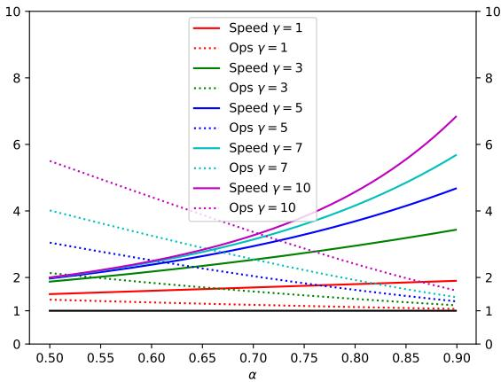
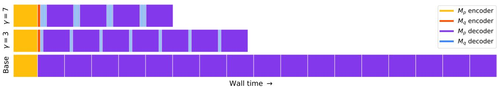

# 通过推测解码实现 Transformer 的快速推理

Yaniv Leviathan <sup>\*</sup> <sup>1</sup> Matan Kalman <sup>\*</sup> <sup>1</sup> Yossi Matias <sup>1</sup>

## 摘要

大型自回归模型（如 Transformer）的推理速度很慢——解码 $K$ 个 token 需要对模型进行 $K$ 次串行运行。在这项工作中，我们提出了推测解码（speculative decoding）——一种通过并行计算多个 token 来更快地从自回归模型中进行采样且不改变任何输出结果的算法。我们方法的核心基于以下两点观察：(1) 复杂的语言建模任务通常包含更简单的子任务，这些子任务可以通过更高效的模型很好地近似；(2) 利用推测执行（speculative execution）和一种新颖的采样方法，我们可以在近似模型的输出上并行运行大模型，从而加快大模型的精确解码速度，潜在地同时生成多个 token，且不会改变输出分布。我们的方法无需重新训练或修改架构，即可加速现有的现成模型。我们在 T5-XXL 上进行了验证，结果表明，在保证输出完全一致的前提下，相比标准的 T5X 实现，该方法实现了 2 到 3 倍的加速。

## 1. 引言

大型自回归模型，特别是大型 Transformer（Vaswani et al., 2017），比小型模型的能力强得多，近年来在文本或图像领域（如 GPT-3 (Brown et al., 2020)、LaMDA (Thoppilan et al., 2022)、Parti (Yu et al., 2022) 和 PaLM (Chowdhery et al., 2022)）中已无数次证明了这一点。遗憾的是，这些较大模型单次解码步骤的速度明显慢于较小的对应模型；更糟糕的是，这些步骤是串行执行的——解码 $K$ 个 token 需要模型进行 $K$ 次串行运行。

鉴于大型自回归模型（特别是大型 Transformer）的重要性，人们开发了若干种方法来加快它们的推理速度。一些方法旨在对所有输入均等地降低推理成本（例如 Hinton et al., 2015; Jaszczur et al., 2021; Hubara et al., 2016; So et al., 2021; Shazeer, 2019）。另一些方法则源于以下观察：并非所有的推理步骤生来相同——有些步骤需要非常大的模型，而另一些步骤可以通过更高效的模型很好地近似。这些自适应计算（adaptive computation）方法（例如 Han et al., 2021; Sukhbaatar et al., 2019; Schuster et al., 2021; Scardapane et al., 2020; Bapna et al., 2020; Elbayad et al., 2019; Schwartz et al., 2020）旨在为更简单的推理步骤使用更少的计算资源。尽管其中许多解决方案在实践中被证明极其有效，但它们通常需要改变模型架构、改变训练过程并重新训练模型，且无法保持完全相同的输出。

上述关键观察结果——即某些推理步骤“更难”，而某些“更容易”——也是我们工作的一个核心动机。我们还观察到，大模型的推理瓶颈通常不在于算术运算，而在于内存带宽和通信，因此可能存在可用的额外计算资源。因此，我们建议将提高并发度作为采用自适应计算量的一种补充方法。具体而言，我们能够在不改变模型架构、不改变训练流程或无需重新训练模型，且不改变模型输出分布的情况下加速推理。这是通过投机执行（speculative execution）实现的。

投机执行（Burton, 1985; Hennessy & Patterson, 2012）是处理器中常见的一种优化技术，其中一项任务的执行与验证该任务是否真正被需要是并行进行的——其收益在于提高并发度。投机执行的一个众所周知的例子是分支预测。为了使投机执行有效，我们需要一种高效的机制来提出很可能被需要的执行任务。在这项工作中，我们将投机执行推广到随机设定（stochastic setting）中——即某个任务以一定的概率被需要。将其应用于 Transformers 等自回归模型的解码时，我们从更高效的近似模型中采样生成结果，作为较慢目标模型的投机前缀。通过一种新颖的采样方法——投机采样（speculative sampling），我们最大化了这些投机任务被接受的概率，同时保证我们系统的输出分布与仅由目标模型生成的输出分布完全一致。例如，Figure 1 中由 38 个 token 组成的句子，得益于一个更小且更高效的近似模型（6M 参数），通过我们的方法仅对较大的目标模型（97M 参数）进行了 9 次串行运行即可生成，同时生成该句子的概率保持不变。

```ini
[START] japan 's benchmark bond n
[START] japan 's benchmark nikkei 22 5
[START] japan 's benchmark nikkei 225 index rose 22 6
[START] japan 's benchmark nikkei 225 index rose 226 . 69 points
[START] japan 's benchmark nikkei 225 index rose 226 . 69 points , or 0 1
[START] japan 's benchmark nikkei 225 index rose 226 . 69 points , or 1 . 5 percent , to 10 , 9859
[START] japan 's benchmark nikkei 225 index rose 226 . 69 points , or 1 . 5 percent , to 10 , 989 . 79 in
[START] japan 's benchmark nikkei 225 index rose 226 . 69 points , or 1 . 5 percent , to 10 , 989 . 79 in tekyo late
[START] japan 's benchmark nikkei 225 index rose 226 . 69 points , or 1 . 5 percent , to 10 , 989 . 79 in late morning trading : [END]
```  
Figure 1. 在无条件语言建模场景下对我们技术的说明。每一行代表该算法的一次迭代。绿色 token 表示近似模型（此处为一个在含 8k token 的 lm1b 上训练的、拥有 6M 参数的类 GPT Transformer 解码器）提出的、并被目标模型（此处为同一设置下拥有 97M 参数的类 GPT Transformer 解码器）接受的建议，而红色和蓝色 token 则分别表示被拒绝的建议及其修正。例如，在第一行中，目标模型仅运行了一次，就生成了 5 个 token。

我们在各种任务和模型规模下分析了我们的方法：在 lm1b 上训练的 97M 参数类 GPT 模型的无条件生成、使用 11B 参数 T5-XXL 模型的英德翻译与新闻文章摘要任务，以及使用 137B 参数 LaMDA 模型的对话任务。我们实现了该方法，并将 T5-XXL 的实际耗时（walltime）与成熟的 T5X 实现（Roberts et al., 2022）进行了比较，结果表明在不改变任何输出的情况下，获得了 2 到 3 倍的开箱即用延迟改善（第 4 节）。

我们的方法易于在实际生产环境中应用，无需训练新模型，且不会改变输出结果。因此，在显存带宽为瓶颈且计算资源充足的常见场景下，它可能是一个加速 Transformer 等自回归模型采样的良好默认选择。

总而言之，我们的主要贡献如下：(1) 将推测执行推广至随机场景，提出了一种称为推测采样（speculative sampling）的新型采样方法；(2) 提出了一种称为推测解码（speculative decoding）的解码机制，可以在不改变模型架构、训练机制和输出分布的情况下，加速自回归模型的解码。

## 2. 推测解码

## 2.1. 概述

设 $M _ { p }$ 为我们试图加速其推理的目标模型，并且 $p ( x _ { t } | \boldsymbol { x } _ { < t } )$ 为该模型在给定前缀 $x _ { < t }$ 下输出的分布。设 $M _ { q }$ 为用于相同任务的更高效近似模型，并用 $q ( x _ { t } | \boldsymbol { x } _ { < t } )$ 表示该模型在给定前缀 ${ \boldsymbol { x } _ { < t } } ^ { 1 }$ 下输出的分布。其核心思想是：(1) 使用更高效的模型 $M _ { q }$ 生成 $\gamma \in \mathbb { Z } ^ { + }$ 个补全（关于如何最优地选择此参数，参见第 3.5 节）；然后 (2) 使用目标模型 $M _ { p }$ 并行评估来自 $M _ { q }$ 的所有猜测及其各自的概率，接受所有能够导致相同分布的猜测；以及 (3) 从调整后的分布中采样一个额外的 token，以修正第一个被拒绝的 token，或者若全部被接受则追加一个新 token。这样，目标模型 $M _ { p }$ 的每次并行运行都将生成至少一个新的 token（因此即使在最坏情况下，目标模型的串行运行次数也绝不会多于简单的自回归方法），但它有可能生成多个新 token，最多可达 $\tan \gamma + 1$ 个，具体取决于 $M _ { q }$ 对 $M _ { p }$ 的近似程度。

## 2.2. 标准化采样

首先需要注意，虽然存在许多采样方法和参数，例如 argmax、top-k、nucleus（核采样）以及设置温度（temperature），且主流实现通常在 logits 层面针对它们进行不同处理，但它们都可以很容易地转化为从调整后的概率分布中进行标准采样。例如，argmax 采样等价于将分布中的非最大值元素置零并进行归一化。因此，我们只需处理来自概率分布的标准采样，并将所有其他类型的采样都归入该框架中。在下文中，我们将假设 $p ( x )$ 和 $q ( x )$ 分别是来自 $M _ { p }$ 和 $M _ { q }$ 且根据采样方法调整后的分布。

## 2.3. 推测采样

为了采样 $x \sim p ( x )$，我们转而采样 $x \sim q ( x )$，如果 $q ( x ) \leq p ( x )$ 则保留该样本；而在 $q ( x ) > p ( x )$ 的情况下，我们以概率 $1 - { \frac { p ( x ) } { q ( x ) } }$ 拒绝该样本，并转而从调整后的分布 $p ^ { \prime } ( x ) \stackrel {  } { = } n o r m ( m a x ( 0 , p ( x ) - q ( x ) ) )$ 1 中重新采样 x。很容易证明（见附录 $\mathbf { A . } 1 )$），对于任意分布 $p ( x )$ 和 $q ( x )$，以及以此方式采样的 x，确实满足 $x \sim p ( x )$。

给定在条件前缀（$p r e f i x$）上运行 $M _ { q }$ 得到的分布 $q ( x )$，我们可以采样一个标记 $x _ { 1 } \sim q ( x )$。然后，我们通过在前缀上运行 $M _ { p }$ 来计算分布 $p ( x )$，同时并行地通过在 $p r e f i x + [ x _ { 1 } ]$ 上运行 $M _ { p }$ 来投机性地计算下一个标记 $x _ { 2 }$ 的分布。一旦两项计算均完成，我们按上述方式进行处理：如果 $x _ { 1 }$ 被拒绝，我们放弃对 $x _ { 2 }$ 的计算，并从调整后的分布中重新采样 $x _ { 1 }$；如果 $x _ { 1 }$ 被接受，我们则保留这两个标记。算法 1（Algorithm 1）将这一思想推广为一次性采样 1 到 $\gamma + 1$ 个标记。

<div class="mineru-algorithm" style="white-space: pre-wrap; font-family:monospace;">
Algorithm 1 SpeculativeDecodingStep
Inputs: $M_p, M_q, prefix$.
▷ 自回归地从 $M_q$ 采样 $\gamma$ 个猜测 $x_1, \ldots, \gamma$。
for $i = 1$ to $\gamma$ do
    $q_i(x) \leftarrow M_q(prefix + [x_1, \ldots, x_{i-1}])$ $x_i \sim q_i(x)$
end for
▷ 并行运行 $M_p$。
$p_1(x), \ldots, p_{\gamma+1}(x) \leftarrow$ $M_p(prefix), \ldots, M_p(prefix + [x_1, \ldots, x_\gamma])$
▷ 确定接受的猜测数量 $n$。
$r_1 \sim U(0, 1), \ldots, r_\gamma \sim U(0, 1)$ $n \leftarrow \min(\{i - 1 \mid 1 \leq i \leq \gamma, r_i &gt; \frac{p_i(x)}{q_i(x)}\} \cup \{\gamma\})$
▷ 如果需要，调整来自 $M_p$ 的分布。
$p'(x) \leftarrow p_{n+1}(x)$
if $n &lt; \gamma$ then
    $p'(x) \leftarrow norm(max(0, p_{n+1}(x) - q_{n+1}(x)))$
end if
▷ 从 $M_p$ 返回一个标记，并从 $M_q$ 返回 $n$ 个标记。
$t \sim p'(x)$
return $prefix + [x_1, \ldots, x_n, t]$
</div>

## 3. 分析

## 3.1. 生成标记的数量

让我们来分析对目标模型串行调用次数的减少倍数，或者等价地，单次运行算法 1 所生成的期望标记数量。

定义 3.1。根据第 $2 . 3$ 节$^2$，给定前缀 $x _ { < t }$，接受率 $\beta _ { x _ { < t } }$ 是通过投机采样接受 $x _ { t } \ \sim \ q ( x _ { t } | \boldsymbol { x } _ { < t } )$ 的概率。

那么 $E ( \beta )$ 是衡量 $M _ { q }$ 对 $M _ { p }$ 近似程度的自然度量。如果我们做出简化的假设，即各个 $\beta$ 是独立同分布（i.i.d.）的，并记 $\alpha = E ( \beta )$，那么单次运行算法 1 生成的标记数量就是一个有上限的几何变量，其成功概率为 $1 - \alpha$，上限为 $\gamma + 1$，并且算法 1 生成的期望标记数量满足公式 (1)。参见图 2。

$$
E (\# \text {generated tokens}) = \frac {1 - \alpha^ {\gamma + 1}}{1 - \alpha}\tag{1}
$$

  
Figure 2. 在不同的 $\gamma$ 取值下，算法 1 生成的期望标记数量关于 α 的函数关系。

## 3.2. 计算 α

现在，我们推导一个在给定前缀以及两个模型 $M _ { p }$ 和 $M _ { q }$ 时计算 α 的简单公式。我们首先定义一个自然的散度 $D _ { L K } \mathbf { \hat { . } }$

定义 3.2. $\begin{array} { r c l } { { D _ { L K } ( p , q ) } } & { { = } } & { { \sum _ { x } \left| p ( x ) - { \cal M } ( x ) \right| ~ = } } \end{array}$ $\begin{array} { r } { \sum _ { x } | q ( x ) - M ( x ) | } \end{array}$，其中 $\begin{array} { r } { M ( x ) = \frac { p ( x ) + q ( x ) } { 2 } } \end{array}$ 引理 3.3. $\begin{array} { r } { D _ { L K } ( p , q ) = 1 - \sum _ { x } \operatorname* { m i n } ( p ( x ) , q ( x ) ) } \end{array}$

$$
\begin{array}{l} \text {Proof.} D _ {L K} (p, q) = \sum_ {x} | p (x) - M (x) | = \sum_ {x} \frac {| p - q |}{2} = \\ 1 - \sum_ {x} \frac {p + q - | p - q |}{2} = 1 - \sum_ {x} \min (p (x), q (x)) \end{array}
$$

由引理 3.3，我们立即可得以下结果：

推论 3.4. $D _ { L K } ( p , q )$ 是 [0, 1] 上的对称散度。$D _ { L K } ( p , q ) = 0 \iff p = q .$ $D _ { L K } ( p , q ) = 1 \iff p$ 与 q 具有不相交的支撑集。

定理 3.5. $\beta = 1 - D _ { L K } ( p , q )$

$$
\begin{array}{l} \text {Proof.} \beta = E _ {x \sim q (x)} \left\{ \begin{array}{l l} 1 & q (x) \leq p (x) \\ \frac {p (x)}{q (x)} & q (x) > p (x) \end{array} \right. = \\ E _ {x \sim q (x)} \min (1, \frac {p (x)}{q (x)}) = \sum_ {x} \min (p (x), q (x)) \quad \square \end{array}
$$

最终我们得到：

推论 3.6. $\alpha = 1 - E ( D _ { L K } ( p , q ) ) = E ( \operatorname* { m i n } ( p , q ) )$

我们在实验中实证观察到的 α 值参见 Table 3。

## 3.3. 实际耗时提升

我们已经证明，在独立同分布（i.i.d.）假设下，我们的算法将对目标模型的调用次数减少了 $\frac { 1 - \alpha ^ { \gamma + 1 } } { 1 - \alpha }$ 倍。需要注意的是，一般的投机执行（特别是我们的算法）都假设我们拥有足够的计算资源来支持增加的并发性（Section 3.4）。对于实际耗时分析，我们假设可以并行运行 $\gamma + 1$ 次 $M _ { p }$ 的并发评估而不增加实际耗时。为了得到总的实际耗时提升，我们现在考虑运行近似模型 $M _ { q }$ 的开销。

定义 3.7. 设成本系数 $c$ 为单次运行 $M _ { q }$ 的时间与单次运行 $M _ { p }$ 的时间之比。

请注意，与作为模型和任务内在属性的 α 不同，c 的值取决于硬件配置和软件实现细节。在我们的实验中，$M _ { q }$ 通常比 $M _ { p }$ 小几个数量级，c 始终小于 0.05，并且通常小到可以忽略不计（接近于 0）。

定理 3.8. Algorithm 1 对总实际耗时的期望提升倍数为 ${ \frac { 1 - \alpha ^ { \gamma + 1 } } { ( 1 - \alpha ) ( \gamma c + 1 ) } } ,$

证明。将运行 $M _ { p }$ 单步的开销记为 $T$。现在，算法 1（Algorithm 1）的每次运行开销为 $T c \gamma + T$（用于运行近似模型 $M _ { q }$ $\gamma$ 次以及运行 $M _ { p }$ 一次），且根据公式 (1)，平均生成 $\frac { 1 - \alpha ^ { \gamma + 1 } } { 1 - \alpha }$ 个 token。因此，使用算法 1 生成一个 token 的总体期望开销为 $\frac { ( c \gamma + \mathbf { \bar { 1 } } ) ( 1 - \alpha ) } { 1 - \alpha ^ { \gamma + 1 } } T$。由于使用标准解码算法生成单个 token 的开销为 T，我们便得到了所需的结果。□

请注意，定理 3.8（Theorem 3.8）假设了生成序列足够长（例如，由于我们至少运行一次 $M _ { p }$，提升倍数上限受限于生成的 token 数量）。

推论 3.9（Corollary 3.9）。若 $H \alpha > c ,$，则存在使得我们获得性能提升的 γ，且提升倍数至少为 $\frac { 1 + \alpha } { 1 + c }$

证明。如果我们对于 γ 能获得提升，那么对于任意 $0 < \gamma ^ { * } < \gamma .$ 我们也能获得提升，因此为了使我们的方法产生提升，我们可以令定理 3.8 中的 γ = 1 进行计算，得出 $\textstyle { \frac { 1 - \alpha ^ { 2 } } { ( 1 - \alpha ) ( c + 1 ) } } = { \frac { 1 + \alpha } { 1 + c } }$ □

## 3.4. 算术运算次数

算法 1 并行执行 $\gamma + 1$ 次 $M _ { p }$ 的运行，因此并发算术运算的次数增加了 $\gamma + 1$ 倍。现在，由于算法 1 每次运行最多生成 $\gamma + 1$ 个 token，总算术运算次数可能会高于标准解码算法。当我们接受来自 $M _ { q }$ 的采样时，增加的并发性是“免费的”，总运算次数并不会增加<sup>3</sup>。然而，当我们拒绝一个猜测时，计算就会被浪费。现在让我们来分析本方法对总算术运算次数的影响。

定义 3.10（Definition 3.10）。设 cˆ 为近似模型 $M _ { q }$ 每 token 算术运算次数与目标模型 $M _ { p }$ 每 token 算术运算次数的比值。

定理 3.11（Theorem 3.11）。算法 1 总运算次数的期望增长倍数为 $\begin{array} { r } { \dot { I } \ i s \ \frac { ( 1 - \alpha ) ( \gamma \hat { c } + \gamma + 1 ) } { 1 - \alpha ^ { \gamma + 1 } } } \end{array}$

证明。用 $\hat { T }$ 表示标准解码基线每 token 所执行的算术运算次数，即单次运行 $M _ { p }$ 的运算次数。那么算法 1 的单次迭代需要消耗 $\hat { T } \hat { c } \gamma + \hat { T } ( \gamma + 1 )$ 次运算（用于 $M _ { q }$ 的 $\gamma$ 次运行以及 $M _ { p }$ 的 $\gamma + 1$ 次并行运行）。除以算法 1 生成 token 的期望数量（即公式 (1)），并除以 $\hat { T }$，我们便得到了所需的结果。

如果 $\alpha$ 较低，则算术运算次数的增加会较高，反之亦然。注意，对于 Transformer 解码器，算法 1 的总算术运算次数（不计算 $M _ { q } )$ 的运行）可以被相同尺寸的 Transformer 编码器的单次运行作为上界。

与总算术运算次数不同，采用我们的方法可以减少总访存次数。具体而言，目标模型的权重和 KV 缓存（KV cache）在每次执行算法 1 时只需读取一次，因此根据公式 (1)，用于读取它们的访存次数减少了 $\frac { 1 - \alpha ^ { \gamma + 1 } } { 1 - \alpha }$ 倍。

## 3.5. 选择 γ

给定 $c$ 和 $\alpha$ 并假设拥有足够的计算资源（参见第 3.4 节），最优的 $\gamma$ 是使实际运行时间改进方程（定理 3.8）最大化的值：$\begin{array} { r } { \frac { 1 - \alpha ^ { \gamma + 1 } } { ( 1 - \alpha ) ( \gamma c + 1 ) } . } \end{array}$。由于 $\gamma$ 是一个整数，可以通过数值计算轻松求得，参见图 3。

  
Figure 3. 针对不同的 $c$ 值，最优 $\gamma$ 作为 $\alpha$ 的函数关系。

表 1 和图 4 展示了在假设 $c = { \hat { c } } = 0$ 的情况下，针对不同的 $\alpha$ 和 $\gamma$ 值，推理速度与总算术运算次数之间的权衡关系。图 5 展示了一个简化的轨迹图（trace diagram）。

Table 1. 假设 $c = { \hat { c } } = 0$，针对不同的 $\gamma$ 和 $\alpha$ 值，总算术运算次数以及相对于基准的推理速度

<table><tr><td>α</td><td>γ</td><td>运算量</td><td>速度</td></tr><tr><td>0.6</td><td>2</td><td>1.53X</td><td>1.96X</td></tr><tr><td>0.7</td><td>3</td><td>1.58X</td><td>2.53X</td></tr><tr><td>0.8</td><td>2</td><td>1.23X</td><td>2.44X</td></tr><tr><td>0.8</td><td>5</td><td>1.63X</td><td>3.69X</td></tr><tr><td>0.9</td><td>2</td><td>1.11X</td><td>2.71X</td></tr><tr><td>0.9</td><td>10</td><td>1.60X</td><td>6.86X</td></tr></table>

由于各个 $\beta$ 并非恒定，除了根据 $\alpha$ 选择单一的 $\gamma$ 值之外，我们还可以通过预测 $\beta$ 的值并在算法 1 运行期间相应地改变 $\gamma$ 的值来获得进一步的改进。为了得到额外改进因子的上界，假设我们拥有一个关于 $\gamma$ 的预言机（oracle）。那么我们将得到 E(生成 token 数量) $\begin{array} { r } { = \frac { 1 } { 1 - \alpha } } \end{array}$。对于 $c$ 和 $\alpha$ 的典型值，并在假设计算资源无上限的情况下，增强的实际运行时间改进因子比固定 $\gamma$ 的改进因子最多可高出约 60%。我们将对此的探索留待后续研究<sup>4</sup>。

  
Figure 4. 针对不同的 $\gamma$ 值，加速比因子和算术运算次数的增加量作为 $\alpha$ 的函数关系

## 3.6. 近似模型

投机采样（Speculative sampling），因而投机解码（speculative decoding），对于无限制选择的任何近似模型 $M _ { q }$ 都能保证相同的输出分布（见附录 A.1）。在我们的实验中，我们主要测试了现成的较小 Transformer 作为近似模型。此外，我们仅测试了与目标模型 $M _ { p }$ 具有相同架构且使用相同概率标准化的近似模型。在这种设置下，选择比 $M _ { p }$ 小约两个数量级的 $M _ { q }$ 通常表现最好，能够平衡 $\alpha$ 和 $c$（定理 3.8）。

另一类近似模型是可忽略成本模型（negligible-cost models），即 $c \approx 0 .$ 的模型，也就是相对于目标模型成本可忽略不计的近似模型。在这种情况下，我们获得的期望实际运行时间（walltime）提升为 $\frac { 1 - \alpha ^ { \gamma + 1 } } { 1 - \alpha }$，其上界为 $\frac { 1 } { 1 - \alpha }$（当 $\gamma$ 很大时趋近于相等）。一类有趣的微小成本近似模型是 n-gram 模型，其评估等同于查表。有趣的是，在实证测试中（第 4.2 节），即使对于这些微不足道的 n-gram 模型，我们也获得了非零的 $\alpha$。例如，在英德翻译任务中，当 $M _ { p }$ 为 T5-XXL 11B 且 $M _ { q }$ 为一个简单的 bigram 模型时，我们得到 $\alpha \approx 0 . 2$，在 $\gamma = 3$ 时带来了 1.25 倍的推理速度提升。

其他简单的启发式方法也可以用作可忽略成本的近似模型。例如，在长序列可能重复的情况下（如摘要任务或类似聊天的交互界面<sup>5</sup>），一种在发现匹配前缀时仅从上下文中复制 token 的近似模型，可能会产生较高的 $\alpha$ 值。从生产角度来看，这些无参数的近似模型还具有更容易部署的额外优势。

  
Figure 5. 完整编码器-解码器（encoder-decoder）Transformer 架构的简化跟踪图。顶行显示了 $\gamma = 7$ 的投机解码，因此每次对 $M _ { p }$ 的调用（紫色块）前面都有 7 次对 $M _ { q }$ 的调用（蓝色块）。左侧的黄色块是对 $M _ { p }$ 编码器的调用，橙色块是对 $M _ { q } .$ 编码器的调用。同样，中间行显示了 $\gamma = 3 .$ 的投机解码，底行显示了标准解码。

投机解码可以使用的另一类近似模型是非自回归模型（non-autoregressive models），例如来自 (Stern et al., 2018) 的模型。这样，我们只需调用一次非自回归模型，而无需执行算法 1 中的自回归循环。

最后一个例子主要在理论层面上具有探讨价值，即一个随机选择标记（token）的近似模型，它能保证对所有模型 $M _ { p }$ 都带来一定的提升（尽管非常微小）。

## 4. 实验

## 4.1. 实际运行时间提升

我们实现了本方法提出的算法，并将其与 T5X 代码库中的实现进行对比，以加速 T5-XXL 模型。

实验设置 我们在 T5 论文中的两个任务上测试了标准的编码器-解码器架构 T5 1.1 版本模型（Raffel et al., 2020）：(1) 在 WMT EnDe 上微调的英德翻译，以及 (2) 在 CNN/DM 上微调的文本摘要。对于这两个任务，我们均使用 T5-XXL (11B) 作为 $M _ { p } .$。对于近似模型 $M _ { q }$，我们测试了几种现有的配置，即 T5-large (800M)、T5-base (250M) 和 T5-small (77M)（Raffel et al., 2020）。我们对所有模型均使用现有的检查点（checkpoints）。我们在单块 TPU-v4 上以批大小（batch size）为 1，分别对 argmax 采样（temp=0）和标准采样（temp=1）测量了实际运行时间的提升。

结果 表 2 展示了我们方法的实证结果。我们可以看到，T5-small (77M) 很好地平衡了 c 和 $\alpha ,$ 在所测试的近似模型中提供了最高的加速比。正如预期的那样，我们观察到 $\alpha$ 随着近似模型规模的增大而增加。有趣的是，argmax 采样（temp=0）下的 $\alpha$ 和实际运行时间提升均更高。我们在翻译任务上观察到了 2.6X（temp=1）和 3.4X（temp=0）的加速比，在摘要任务上观察到了略低的 2.3X（temp=1）和 3.1X（temp=0）的加速比。这些实证结果与理论预测高度吻合，部分差异源于实现细节（参见附录 A.3）。

Table 2. 加速 T5-XXL 11B 模型推理的实证结果。

<table><tr><td>任务</td><td> $M_q$ </td><td>温度</td><td> $\gamma$ </td><td> $\alpha$ </td><td>速度</td></tr><tr><td>ENDE</td><td>T5-SMALL ★</td><td>0</td><td>7</td><td>0.75</td><td>3.4X</td></tr><tr><td>ENDE</td><td>T5-BASE</td><td>0</td><td>7</td><td>0.8</td><td>2.8X</td></tr><tr><td>ENDE</td><td>T5-LARGE</td><td>0</td><td>7</td><td>0.82</td><td>1.7X</td></tr><tr><td>ENDE</td><td>T5-SMALL ★</td><td>1</td><td>7</td><td>0.62</td><td>2.6X</td></tr><tr><td>ENDE</td><td>T5-BASE</td><td>1</td><td>5</td><td>0.68</td><td>2.4X</td></tr><tr><td>ENDE</td><td>T5-LARGE</td><td>1</td><td>3</td><td>0.71</td><td>1.4X</td></tr><tr><td>CNNDM</td><td>T5-SMALL ★</td><td>0</td><td>5</td><td>0.65</td><td>3.1X</td></tr><tr><td>CNNDM</td><td>T5-BASE</td><td>0</td><td>5</td><td>0.73</td><td>3.0X</td></tr><tr><td>CNNDM</td><td>T5-LARGE</td><td>0</td><td>3</td><td>0.74</td><td>2.2X</td></tr><tr><td>CNNDM</td><td>T5-SMALL ★</td><td>1</td><td>5</td><td>0.53</td><td>2.3X</td></tr><tr><td>CNNDM</td><td>T5-BASE</td><td>1</td><td>3</td><td>0.55</td><td>2.2X</td></tr><tr><td>CNNDM</td><td>T5-LARGE</td><td>1</td><td>3</td><td>0.56</td><td>1.7X</td></tr></table>

## 4.2. 实证 α 值

虽然我们仅针对 T5 实现了我们的方法，但我们测量了针对各种任务、采样方法、目标模型 $M _ { p } ,$ 以及近似模型 $M _ { q } .$ 的 α 值。具体而言，对于以下每种设置，我们在由 $M _ { p } ,$ 生成的 10K 个 token 上评估了推论 3.6（Corollary 3.6）中的期望值。

类 GPT（97M 参数） 我们在无条件语言生成任务上测试了一个仅包含解码器的 Transformer 模型，该模型在 lm1b (Chelba et al., 2013) 上训练。这里的模型是一个带有 Gelu 激活函数 (Hendrycks & Gimpel, 2016) 的类 GPT Transformer 解码器。对于 $M _ { q }$，我们尝试了一个具有 6M 参数的 Transformer 解码器模型：维度 256、前馈维度 1024、2 层、4 个注意力头，以及简单的一元文法（unigram）和二元文法（bigram）模型。$M _ { p }$ 拥有 97M 参数：维度 768、前馈维度 3072、12 层、12 个注意力头。我们对所有模型使用了包含 8k 个 token 的 Bert 分词法 (Devlin et al., 2019)。

LaMDA（137B 参数） 我们在对话任务上测试了一个仅包含解码器的 LaMDA 模型 (Thoppilan et al., 2022)。我们使用来自 LaMDA 137B 的现有检查点作为 $M _ { p }$，并使用 LaMDA 8B、LaMDA 2B 和 LaMDA 100M 作为 $M _ { q } .$。关于 T5-XXL（11B 参数）模型的设置，请参见第 4.1 节。

## 5. 相关工作

表 3（Table 3）总结了测试案例的 α 值。我们观察到，比目标模型小几个数量级的近似模型往往会产生介于 0.5 和 0.9 之间的 α 值。有趣的是，我们还注意到对于所有模型，调整后的分布越尖锐，α 值就越高。最后，我们注意到即使是简单的一元文法和二元文法近似，也能产生不可忽视的 α 值。例如，对于英德翻译的情况，二元文法模型的 α 值为 0.2，并且在这种情况下由于 c = 0，从而带来了 1.25 倍的速度提升，对于这个微不足道的近似模型来说，这是出奇的高（但仍低于我们将 T5-small 用作近似模型时所获得的速度提升）。

大模型推理的效率已被广泛研究（Dehghani et al., 2021）。许多方法旨在提升大模型的整体推理速度，特别是像 Transformer 这样的自回归模型。众多技术试图使所有 token 的推理更加高效，例如蒸馏（Hinton et al., 2015）、稀疏化（Jaszczur et al., 2021）、量化（Hubara et al., 2016）以及架构修改（So et al., 2021; Shazeer, 2019）。与我们的方法更接近的是自适应计算方法，它们根据问题难度自适应地调整计算量（Han et al., 2021）。示例包括仅关注输入的子集（Sukhbaatar et al., 2019）以及早退机制（early exits）（Schuster et al., 2021; Scardapane et al., 2020; Bapna et al., 2020; Elbayad et al., 2019; Schwartz et al., 2020）。值得注意的是，Wisdom of Committees（Schwartz et al., 2020）利用了现成的较小模型，但它属于自适应计算方法，因此使用启发式规则来确定何时停止，从而失去了与目标模型输出保持完全相同的保证。通常，自适应计算方法通常会在模型内部或借助辅助模型来学习何时可以采取计算捷径。通常，这些方法既能节省推理时间又能减少算术运算，但需要修改架构、修改训练流程，并训练自定义模型或重新训练现有模型。它们通常还会改变模型的输出。我们注意到，尽管上述许多方法改善了内存访问与算术运算比，但在该比例仍然较高的情况下，这些方法与我们的推测解码（speculative decoding）方法结合使用可能会非常有效。

Table 3. 各种目标模型 $M _ { p } ,$、近似模型 $M _ { q } ,$ 以及采样设置下的经验 $\alpha$ 值。T=0 和 T=1 分别表示 argmax 采样和标准采样<sup>6</sup>。

<table><tr><td> $M_p$ </td><td> $M_q$ </td><td>SMPL</td><td>α</td></tr><tr><td>GPT-LIKE (97M)</td><td>UNIGRAM</td><td>T=0</td><td>0.03</td></tr><tr><td>GPT-LIKE (97M)</td><td>BIGRAM</td><td>T=0</td><td>0.05</td></tr><tr><td>GPT-LIKE (97M)</td><td>GPT-LIKE (6M)</td><td>T=0</td><td>0.88</td></tr><tr><td>GPT-LIKE (97M)</td><td>UNIGRAM</td><td>T=1</td><td>0.03</td></tr><tr><td>GPT-LIKE (97M)</td><td>BIGRAM</td><td>T=1</td><td>0.05</td></tr><tr><td>GPT-LIKE (97M)</td><td>GPT-LIKE (6M)</td><td>T=1</td><td>0.89</td></tr><tr><td>T5-XXL (ENDE)</td><td>UNIGRAM</td><td>T=0</td><td>0.08</td></tr><tr><td>T5-XXL (ENDE)</td><td>BIGRAM</td><td>T=0</td><td>0.20</td></tr><tr><td>T5-XXL (ENDE)</td><td>T5-SMALL</td><td>T=0</td><td>0.75</td></tr><tr><td>T5-XXL (ENDE)</td><td>T5-BASE</td><td>T=0</td><td>0.80</td></tr><tr><td>T5-XXL (ENDE)</td><td>T5-LARGE</td><td>T=0</td><td>0.82</td></tr><tr><td>T5-XXL (ENDE)</td><td>UNIGRAM</td><td>T=1</td><td>0.07</td></tr><tr><td>T5-XXL (ENDE)</td><td>BIGRAM</td><td>T=1</td><td>0.19</td></tr><tr><td>T5-XXL (ENDE)</td><td>T5-SMALL</td><td>T=1</td><td>0.62</td></tr><tr><td>T5-XXL (ENDE)</td><td>T5-BASE</td><td>T=1</td><td>0.68</td></tr><tr><td>T5-XXL (ENDE)</td><td>T5-LARGE</td><td>T=1</td><td>0.71</td></tr><tr><td>T5-XXL (CNNDM)</td><td>UNIGRAM</td><td>T=0</td><td>0.13</td></tr><tr><td>T5-XXL (CNNDM)</td><td>BIGRAM</td><td>T=0</td><td>0.23</td></tr><tr><td>T5-XXL (CNNDM)</td><td>T5-SMALL</td><td>T=0</td><td>0.65</td></tr><tr><td>T5-XXL (CNNDM)</td><td>T5-BASE</td><td>T=0</td><td>0.73</td></tr><tr><td>T5-XXL (CNNDM)</td><td>T5-LARGE</td><td>T=0</td><td>0.74</td></tr><tr><td>T5-XXL (CNNDM)</td><td>UNIGRAM</td><td>T=1</td><td>0.08</td></tr><tr><td>T5-XXL (CNNDM)</td><td>BIGRAM</td><td>T=1</td><td>0.16</td></tr><tr><td>T5-XXL (CNNDM)</td><td>T5-SMALL</td><td>T=1</td><td>0.53</td></tr><tr><td>T5-XXL (CNNDM)</td><td>T5-BASE</td><td>T=1</td><td>0.55</td></tr><tr><td>T5-XXL (CNNDM)</td><td>T5-LARGE</td><td>T=1</td><td>0.56</td></tr><tr><td>LAMDA (137B)</td><td>LAMDA (100M)</td><td>T=0</td><td>0.61</td></tr><tr><td>LAMDA (137B)</td><td>LAMDA (2B)</td><td>T=0</td><td>0.71</td></tr><tr><td>LAMDA (137B)</td><td>LAMDA (8B)</td><td>T=0</td><td>0.75</td></tr><tr><td>LAMDA (137B)</td><td>LAMDA (100M)</td><td>T=1</td><td>0.57</td></tr><tr><td>LAMDA (137B)</td><td>LAMDA (2B)</td><td>T=1</td><td>0.71</td></tr><tr><td>LAMDA (137B)</td><td>LAMDA (8B)</td><td>T=1</td><td>0.74</td></tr></table>

有两项先前的研究利用推测执行（speculative execution）来加速自回归模型的解码。分块并行解码（Blockwise Parallel Decoding, Stern et al., 2018）与我们的工作类似，也是并行解码多个词元（token）。然而，它仅支持贪心解码（temperature=0），不支持通用的随机采样场景；它需要对定制模型进行额外训练，并且侧重于保持下游任务的质量，而不是保证输出完全相同。浅层激进解码（Shallow Aggressive Decoding, SAD, Sun et al., 2021）同样与我们的工作类似，并行解码多个词元。与我们的工作不同的是，SAD 仅支持将输入复制到输出，而不支持通用的近似模型，这使得它仅适用于输入和输出非常相似的场景，例如语法错误纠正。此外，与 Blockwise Parallel Decoding 类似，SAD 也不支持通用的随机采样设置。

在我们最初发表本工作之后，推测解码的一项独立实现（Chen et al., 2023）在 Chinchilla 70B 上展示了类似的 2X-2.5X 加速提升。

## 6. 讨论

我们提出了推测采样（speculative sampling），它实现了高效的随机推测执行——即在随机设置下的推测执行。我们通过推测解码分析了其对诸如 Transformers 等自回归模型解码的影响，并证明了在计算资源充足的情况下，相比于广泛使用的优化实现 T5X，我们在实践中获得了显著的 2X-3X 加速。

一般推测执行以及特别是推测解码的一个局限性在于，它是以增加算术运算量为代价，通过提高并发度来降低延迟的。因此，在没有额外计算资源的配置下，我们的方法并无帮助。然而，在具有额外可用计算资源的常见场景中（例如内存带宽成为瓶颈时），我们的方法在提供加速的同时具有显著优势：无需修改模型架构，无需重新训练，最重要的是，输出分布保证完全保持不变。我们的方法易于实现，可直接用于加速开箱即用模型的推理，而无需开发和评估定制方案。

后续研究有几个方向，重要的是进一步探究推测解码（speculative decoding）与束搜索（beam search）的兼容性（见附录 A.4）。此外，虽然我们的方法在使用现成的近似模型时能够产生显著的加速，但通过定制的近似模型（第 3.6 节）可能会获得更大的提升，例如采用定制架构（如定制尺寸、非自回归模型或各种启发式方法）或定制训练流程（如使用来自 $M _ { p } ,$ 的软目标进行标准蒸馏，或直接针对 α 优化 $M _ { q }$）。探索该算法的分层版本也可能很有价值，其中近似模型本身由一个更快的模型加速，这可以使用能力更强的近似模型。在这项工作中，我们在整个推理过程中固定了近似模型和猜测次数 γ，但在推理过程中动态调整它们可能会带来额外的改进（第 3.5 节）。在我们的实验中，我们始终对近似模型生成的分布执行与目标模型所需分布相同的标准化（第 2.2 节），但通过应用不同的变换可能会获得进一步的提升。我们仅在文本模态上测试了推测解码，但它在其他领域（如图像）中可能也表现良好，对此进行实验将会很有趣。

最后，我们指出随机推测执行和推测采样在自回归模型的推测解码范围之外也可能有所帮助。例如，给定两个较慢的函数 $f ( x )$ 和 $g ( y )$，使得 $f ( x )$ 生成一个分布，从中采样出 $\boldsymbol { g ^ { \prime } } \mathbf { s }$ 的输入，我们可以使用我们的方法并行运行 $f$ 和 $g$。这种设置可能会出现在（$\mathrm { e . g . }$）物理模拟中，或者在强化学习中（其中 $f$ 是生成动作分布的大型模型，而 g 是世界模拟），对这一方向的探索将会很有趣。

## 致谢

我们要特别感谢 YaGuang Li 在所有与 LaMDA 相关的工作中给予的帮助以及计算论文中的 LaMDA 数据，感谢 Blake Hechtman 提供的独到见解和在 XLA 方面给予的帮助。我们还要感谢审稿人富有洞察力的意见，以及 Asaf Aharoni、Reiner Pope、Sasha Goldshtein、Nadav Sherman、Eyal Segalis、Eyal Molad、Dani Valevski、Daniel Wasserman、Valerie Nygaard、Danny Vainstein、Google 的 LaMDA 和 Theta Labs 团队，以及我们的家人。

## 参考文献

Bapna, A., Arivazhagan, N., and Firat, O. Controlling computation versus quality for neural sequence models. ArXiv, abs/2002.07106, 2020.

Brown, T. B., Mann, B., Ryder, N., Subbiah, M., Kaplan, J., Dhariwal, P., Neelakantan, A., Shyam, P., Sastry, G., Askell, A., Agarwal, S., Herbert-Voss, A., Krueger, G., Henighan, T., Child, R., Ramesh, A., Ziegler, D. M., Wu, J., Winter, C., Hesse, C., Chen, M., Sigler, E., Litwin, M., Gray, S., Chess, B., Clark, J., Berner, C., McCandlish, S., Radford, A., Sutskever, I., and Amodei, D. Language models are few-shot learners. In Proceedings of the 34th International Conference on Neural Information Processing Systems, NIPS’20, Red Hook, NY, USA, 2020. Curran Associates Inc. ISBN 9781713829546.

Burton, F. W. Speculative computation, parallelism, and functional programming. IEEE Transactions on Computers, C-34(12):1190–1193, 1985. doi: 10.1109/TC.1985. 6312218.

Chelba, C., Mikolov, T., Schuster, M., Ge, Q., Brants, T., Koehn, P. T., and Robinson, T. One billion word benchmark for measuring progress in statistical language modeling. In Interspeech, 2013.

Chen, C., Borgeaud, S., Irving, G., Lespiau, J.-B., Sifre, L., and Jumper, J. M. Accelerating large language model decoding with speculative sampling. ArXiv, abs/2302.01318, 2023.

Chowdhery, A., Narang, S., Devlin, J., Bosma, M., Mishra, G., Roberts, A., Barham, P., Chung, H. W., Sutton, C., Gehrmann, S., Schuh, P., Shi, K., Tsvyashchenko, S., Maynez, J., Rao, A., Barnes, P., Tay, Y., Shazeer, N. M., Prabhakaran, V., Reif, E., Du, N., Hutchinson, B. C., Pope, R., Bradbury, J., Austin, J., Isard, M., Gur-Ari, G., Yin, P., Duke, T., Levskaya, A., Ghemawat, S., Dev, S., Michalewski, H., Garc´ıa, X., Misra, V., Robinson, K., Fedus, L., Zhou, D., Ippolito, D., Luan, D., Lim, H., Zoph, B., Spiridonov, A., Sepassi, R., Dohan, D., Agrawal, S., Omernick, M., Dai, A. M., Pillai, T. S., Pellat, M., Lewkowycz, A., Moreira, E., Child, R., Polozov, O., Lee, K., Zhou, Z., Wang, X., Saeta, B., D´ıaz, M., Firat, O., Catasta, M., Wei, J., Meier-Hellstern, K. S., Eck, D., Dean, J., Petrov, S., and Fiedel, N. Palm: Scaling language modeling with pathways. ArXiv, abs/2204.02311, 2022.

Dehghani, M., Arnab, A., Beyer, L., Vaswani, A., and Tay, Y. The efficiency misnomer. ArXiv, abs/2110.12894, 2021.

Devlin, J., Chang, M.-W., Lee, K., and Toutanova, K. Bert: Pre-training of deep bidirectional transformers for language understanding. ArXiv, abs/1810.04805, 2019.

Elbayad, M., Gu, J., Grave, E., and Auli, M. Depth-adaptive transformer. ArXiv, abs/1910.10073, 2019.

Han, Y., Huang, G., Song, S., Yang, L., Wang, H., and Wang, Y. Dynamic neural networks: A survey. IEEE Transactions on Pattern Analysis and Machine Intelligence, 44: 7436–7456, 2021.

Hendrycks, D. and Gimpel, K. Bridging nonlinearities and stochastic regularizers with gaussian error linear units. ArXiv, abs/1606.08415, 2016.

Hennessy, J. L. and Patterson, D. A. Computer Architecture: A Quantitative Approach. Morgan Kaufmann, Amsterdam, 5 edition, 2012. ISBN 978-0-12-383872-8.

Hinton, G. E., Vinyals, O., and Dean, J. Distilling the knowledge in a neural network. ArXiv, abs/1503.02531, 2015.

Hubara, I., Courbariaux, M., Soudry, D., El-Yaniv, R., and Bengio, Y. Quantized neural networks: Training neural networks with low precision weights and activations. ArXiv, abs/1609.07061, 2016.

Jaszczur, S., Chowdhery, A., Mohiuddin, A., Kaiser, L., Gajewski, W., Michalewski, H., and Kanerva, J. Sparse is enough in scaling transformers. In Neural Information Processing Systems, 2021.

Raffel, C., Shazeer, N., Roberts, A., Lee, K., Narang, S., Matena, M., Zhou, Y., Li, W., and Liu, P. J. Exploring the limits of transfer learning with a unified text-to-text transformer. The Journal ofMachine Learning Research, 21(1):5485–5551, 2020.

Roberts, A., Chung, H. W., Levskaya, A., Mishra, G., Bradbury, J., Andor, D., Narang, S., Lester, B., Gaffney, C., Mohiuddin, A., Hawthorne, C., Lewkowycz, A., Salcianu, A., van Zee, M., Austin, J., Goodman, S., Soares, L. B., Hu, H., Tsvyashchenko, S., Chowdhery, A., Bastings, J., Bulian, J., Garc´ıa, X., Ni, J., Chen, A., Kenealy, K., Clark, J., Lee, S., Garrette, D. H., Lee-Thorp, J., Raffel, C., Shazeer, N. M., Ritter, M., Bosma, M., Passos, A., Maitin-Shepard, J. B., Fiedel, N., Omernick, M., Saeta, B., Sepassi, R., Spiridonov, A., Newlan, J., and Gesmundo, A. Scaling up models and data with t5x and seqio. ArXiv, abs/2203.17189, 2022.

Scardapane, S., Scarpiniti, M., Baccarelli, E., and Uncini, A. Why should we add early exits to neural networks? Cognitive Computation, 12(5):954–966, 2020.

Schuster, T., Fisch, A., Jaakkola, T., and Barzilay, R. Consistent accelerated inference via confident adaptive transformers. In Conference on Empirical Methods in Natural Language Processing, 2021.

Schwartz, R., Stanovsky, G., Swayamdipta, S., Dodge, J., and Smith, N. A. The right tool for the job: Matching model and instance complexities. In Annual Meeting of the Associationfor Computational Linguistics, 2020.

Shazeer, N. M. Fast transformer decoding: One write-head is all you need. ArXiv, abs/1911.02150, 2019.

So, D. R., Ma’nke, W., Liu, H., Dai, Z., Shazeer, N. M., and Le, Q. V. Primer: Searching for efficient transformers for language modeling. ArXiv, abs/2109.08668, 2021.

Stern, M., Shazeer, N., and Uszkoreit, J. Blockwise parallel decoding for deep autoregressive models. Advances in Neural Information Processing Systems, 31, 2018.

Sukhbaatar, S., Grave, E., Bojanowski, P., and Joulin, A. Adaptive attention span in transformers. In Annual Meeting of the Association for Computational Linguistics, 2019.

Sun, X., Ge, T., Wei, F., and Wang, H. Instantaneous grammatical error correction with shallow aggressive decoding. ArXiv, abs/2106.04970, 2021.

Thoppilan, R., Freitas, D. D., Hall, J., Shazeer, N. M., Kulshreshtha, A., Cheng, H.-T., Jin, A., Bos, T., Baker, L., Du, Y., Li, Y., Lee, H., Zheng, H., Ghafouri, A., Menegali, M., Huang, Y., Krikun, M., Lepikhin, D., Qin, J., Chen, D., Xu, Y., Chen, Z., Roberts, A., Bosma, M., Zhou, Y., Chang, C.-C., Krivokon, I. A., Rusch, W. J., Pickett, M., Meier-Hellstern, K. S., Morris, M. R., Doshi, T., Santos, R. D., Duke, T., Søraker, J. H., Zevenbergen, B., Prabhakaran, V., D´ıaz, M., Hutchinson, B., Olson, K., Molina, A., Hoffman-John, E., Lee, J., Aroyo, L., Rajakumar, R., Butryna, A., Lamm, M., Kuzmina, V. O., Fenton, J., Cohen, A., Bernstein, R., Kurzweil, R., Aguera-Arcas, B., Cui, C., Croak, M., hsin Chi, E. H., and Le, Q. Lamda: Language models for dialog applications. ArXiv, abs/2201.08239, 2022.

Vaswani, A., Shazeer, N., Parmar, N., Uszkoreit, J., Jones, L., Gomez, A. N., Kaiser, Ł., and Polosukhin, I. Attention is all you need. Advances in neural information processing systems, 30, 2017.

Yu, J., Xu, Y., Koh, J. Y., Luong, T., Baid, G., Wang, Z., Vasudevan, V., Ku, A., Yang, Y., Ayan, B. K., Hutchinson, B. C., Han, W., Parekh, Z., Li, X., Zhang, H., Baldridge, J., and Wu, Y. Scaling autoregressive models for contentrich text-to-image generation. ArXiv, abs/2206.10789, 2022.

## A. 附录

## A.1. 投机采样的正确性

我们现在将证明，对于任意分布 $p ( x )$ 和 $q ( x )$，通过投机采样从 $p ( x )$ 和 $q ( x )$ 中采样的 token 与仅从 $p ( x )$ 中采样的 token 分布完全相同。设 $\beta$ 为接受概率（定义 3.1）。

注意到，由于 $\begin{array} { r } { p ^ { \prime } ( x ) = n o r m ( m a x ( 0 , p ( x ) - q ( x ) ) ) = \frac { p ( x ) - m i n ( q ( x ) , p ( x ) ) } { \sum _ { x ^ { \prime } } ( p ( x ^ { \prime } ) - m i n ( q ( x ^ { \prime } ) , p ( x ^ { \prime } ) ) ) } = \frac { p ( x ) - m i n ( q ( x ) , p ( x ) ) } { 1 - \beta } } \end{array}$，调整后分布 $p ^ { \prime } ( x ) { \mathrm { ~ i s ~ } } 1 - \beta ,$ 的归一化常数为 $1 - \beta$，其中最后一个等式直接由引理 3.3 和定理 3.5 得到。

现在：

$$
P (x = x ^ {\prime}) = P (\text {guess accepted}, x = x ^ {\prime}) + P (\text {guess rejected}, x = x ^ {\prime})
$$

其中：

$$
P (g u e s s a c c e p t e d, x = x ^ {\prime}) = q (x ^ {\prime}) \min (1, \frac {p (x ^ {\prime})}{q (x ^ {\prime})}) = \min (q (x ^ {\prime}), p (x ^ {\prime}))
$$

且：

$$
P (g u e s s r e j e c t e d, x = x ^ {\prime}) = (1 - \beta) p ^ {\prime} (x ^ {\prime}) = p (x ^ {\prime}) - \min (q (x ^ {\prime}), p (x ^ {\prime}))
$$

综上：

$$
P (x = x ^ {\prime}) = \min (p (x ^ {\prime}), q (x ^ {\prime})) + p (x ^ {\prime}) - \min (p (x ^ {\prime}), q (x ^ {\prime})) = p (x ^ {\prime}).
$$

得证。

## A.2. 投机采样与拒绝采样

拒绝采样（Rejection sampling）是以下迭代采样过程，表面上看起来与我们的方法相似：

1. 采样 $x \sim q ( x )$ 以及 $r \sim U ( 0 , 1 )$。

2. $\begin{array} { r } { \mathrm { I f } r < \frac { p ( x ) } { M q ( x ) } } \end{array}$ 返回 x。

3. 转至 1。

其中 $\begin{array} { r } { M = m a x _ { x } \frac { p ( x ) } { q ( x ) } } \end{array}$。我们可以采用非迭代版本的拒绝采样来代替投机采样（speculative sampling）——具体来说就是执行上述步骤 1 和 2，若未接受则直接从未经修改的 $p ( x )$ 中进行采样。然而，这会比我们的方法效率低得多。具体而言，此处的期望接受概率 $E _ { x \sim q ( x ) } { \frac { p ( x ) } { M q ( x ) } } =$ $\begin{array} { r } { \sum _ { x } p ( x ) \operatorname* { m i n } _ { x ^ { \prime } } \frac { q ( x ^ { \prime } ) } { p ( x ^ { \prime } ) } \leq \sum _ { x } p ( x ) \operatorname* { m i n } ( 1 , \frac { q ( x ) } { p ( x ) } ) = \sum _ { x } \operatorname* { m i n } ( p ( x ) , q ( x ) ) = \alpha } \end{array}$ （可能）远低于我们方法中的期望接受概率 $\alpha$。

## A.3. 理论预测与实测运行时间对比

Table 4 将基于定理 3.8 的预期运行时间提升与 Table 2 中实测的运行时间进行了对比。我们基于性能分析追踪记录（profiler traces）估计了各个模型的 c 值。可以看出，理论预测与实测运行时间基本吻合。较大的差异主要是由于：(1) 我们的实现与基线之间的优化差异，以及 (2) 假设 $\beta \mathrm { s }$ 独立同分布（i.i.d.）的简化处理仅是一种近似（参见第 3.1 节）。

Table 4. 预期提升倍数（EXP）与实测提升倍数（EMP）对比。

<table><tr><td>任务</td><td> $M_q$ </td><td>温度</td><td> $\gamma$ </td><td> $\alpha$ </td><td> $c$ </td><td>理论</td><td>实测</td></tr><tr><td>ENDE</td><td>T5-SMALL</td><td>0</td><td>7</td><td>0.75</td><td>0.02</td><td>3.2</td><td>3.4</td></tr><tr><td>ENDE</td><td>T5-BASE</td><td>0</td><td>7</td><td>0.8</td><td>0.04</td><td>3.3</td><td>2.8</td></tr><tr><td>ENDE</td><td>T5-LARGE</td><td>0</td><td>7</td><td>0.82</td><td>0.11</td><td>2.5</td><td>1.7</td></tr><tr><td>ENDE</td><td>T5-SMALL</td><td>1</td><td>7</td><td>0.62</td><td>0.02</td><td>2.3</td><td>2.6</td></tr><tr><td>ENDE</td><td>T5-BASE</td><td>1</td><td>5</td><td>0.68</td><td>0.04</td><td>2.4</td><td>2.4</td></tr><tr><td>ENDE</td><td>T5-LARGE</td><td>1</td><td>3</td><td>0.71</td><td>0.11</td><td>2.0</td><td>1.4</td></tr><tr><td>CNNDM</td><td>T5-SMALL</td><td>0</td><td>5</td><td>0.65</td><td>0.02</td><td>2.4</td><td>3.1</td></tr><tr><td>CNNDM</td><td>T5-BASE</td><td>0</td><td>5</td><td>0.73</td><td>0.04</td><td>2.6</td><td>3.0</td></tr><tr><td>CNNDM</td><td>T5-LARGE</td><td>0</td><td>3</td><td>0.74</td><td>0.11</td><td>2.0</td><td>2.2</td></tr><tr><td>CNNDM</td><td>T5-SMALL</td><td>1</td><td>5</td><td>0.53</td><td>0.02</td><td>1.9</td><td>2.3</td></tr><tr><td>CNNDM</td><td>T5-BASE</td><td>1</td><td>3</td><td>0.55</td><td>0.04</td><td>1.8</td><td>2.2</td></tr><tr><td>CNNDM</td><td>T5-LARGE</td><td>1</td><td>3</td><td>0.56</td><td>0.11</td><td>1.6</td><td>1.7</td></tr></table>

## A.4. 在束搜索中的应用

我们的方法也可以应用于束搜索（beam search）采样，但会有一定的性能损失。给定原始束宽 w，我们可以使用近似模型 $M _ { q }$ 和束宽 $u \geq w$ 进行 γ 步束搜索。然后，我们可以使用 $M _ { p }$ 并行检查所有候选序列（消耗的计算预算为运行 $( w + u \gamma )$ 次 $M _ { p } ) .$。最后，在每一步中，只要满足 $t o p _ { w } ( M _ { p } ) \subseteq t o p _ { u } ( M _ { q } )$，我们就可以接受 $M _ { q }$ 的猜测，从而获得与仅使用 $M _ { p }$ 进行常规束搜索完全相同的结果（通过更精细的流程，我们还可以接受所获候选序列的概率恰好高于仅使用 $M _ { p }$ 时的那些情况）。在这一设定下对我们方法的分析更为复杂，我们将其留作未来工作。

## A.5. 宽容度

Algorithm 1 的一个强大特性是保证输出分布保持不变。话虽如此，如果我们愿意在具备良好保证的前提下容许一定的变化，就可以进一步提升推理速度。为了进一步阐明这一动机，需要指出的是，当我们在相同数据集上训练具有相同架构和大小的两个模型时，生成的概率分布并不会完全一致，因此引入一定的宽容度（lenience）是合理的。请注意，除本节之外，本文中的所有结果均使用 Algorithm 1 的最严格版本，不允许任何形式的宽容度。

我们可以在算法 1（Algorithm 1）中引入宽容度参数 $l \in [ 0 , 1 ]$，并在与 $p ( x )$ 进行比较之前将 $q ( x )$ 乘以 l。这仍然保持了一个良好的保证：没有 token 能以大于 $\frac { p ( x ) } { l }$ 的概率被采样。例如，这意味着当 $l = \textstyle { \frac { 1 } { 1 0 } }$ 时，任何 token 被采样的概率都不会超过其真实概率（ground truth probability）的 10 倍，因此我们可以保证极罕见的 token 仍将保持极罕见（对最小概率没有保证，因此宽容度可能会损害样本的多样性）。

具体而言，引入宽容因子 l 后，我们有 $\begin{array} { r l r } { \alpha \ = \ E _ { x \sim q ( x ) } \left\{ \frac { 1 } { l q ( x ) } \ l q ( x ) \le p ( x ) \ } & { { } = \ E _ { x \sim q ( x ) } \frac { p ( x ) } { m a x ( p ( x ) , l q ( x ) ) } \ = \right. } \end{array}$ P<sub>x</sub> <sup>p(x)q(x)</sup><sub>max(p(x),lq(x))</sub> = <sup>1</sup><sub>l</sub> P<sub>x</sub> min(p(x), lq(x)) = P<sub>x</sub> min( <sup>p(x)</sup><sub>l</sub> , q(x))。

表 5 展示了当 $M _ { p }$ 为 T5-XXL (11B) 且 $M _ { q }$ 为 T5-small (77M) 时，不同 l 值对应的 α 值。在 $c = 0 . 0 1 5$ 的情况下，使用 1、0.5、0.3 和 0.1 的宽容度值（意味着任何 token 被采样的概率分别不会超过真实情况的 1 倍、2 倍、3 倍和 10 倍），我们分别获得了 2.5 倍、3.1 倍、3.6 倍和 5 倍的提升因子。

Table 5. 在 EnDe 翻译任务上，当 $M _ { p }$ 为 T5-XXL (11B) 时，标准采样下不同 l 值对应的 α 值。

<table><tr><td> $M_q$ </td><td>l=1</td><td>l=0.5</td><td>l=0.3</td><td>l=0.1</td></tr><tr><td>UNIGRAM</td><td>0.07</td><td>0.1</td><td>0.11</td><td>0.16</td></tr><tr><td>BIGRAM</td><td>0.19</td><td>0.23</td><td>0.25</td><td>0.32</td></tr><tr><td>T5-SMALL (77M)</td><td>0.62</td><td>0.71</td><td>0.76</td><td>0.84</td></tr><tr><td>T5-BASE (250M)</td><td>0.68</td><td>0.8</td><td>0.83</td><td>0.90</td></tr></table>

请注意，当使用 temperature = 0（即 argmax 采样）时，我们不能再像上面那样使用宽容度。相反，我们可以在标准化分布之前允许一定的宽容度。例如，当 $p ( x ) \leq l \cdot m a x ( p )$ 时，我们可以接受从 $M _ { q }$ 采样的 token x。在这种情况下，我们测得的 α 值经验性增长与 temperature = 1 时相似。例如，在英德翻译任务中，当 $M _ { p } \mathrm { T } 5 \mathrm { - } \mathrm { X X L } M _ { q } \mathrm { T } 5$ -small 使用 1、0.5、0.3 和 0.1 的宽容度值时，我们获得的 α 值分别为 0.75、0.75、0.8、0.87。以 $c = 0 . 0 1 5$ 和 $\gamma = 8$ 为例，我们分别获得了 3.3 倍、3.3 倍、3.9 倍和 4.9 倍的速度提升因子<sup>7</sup>。