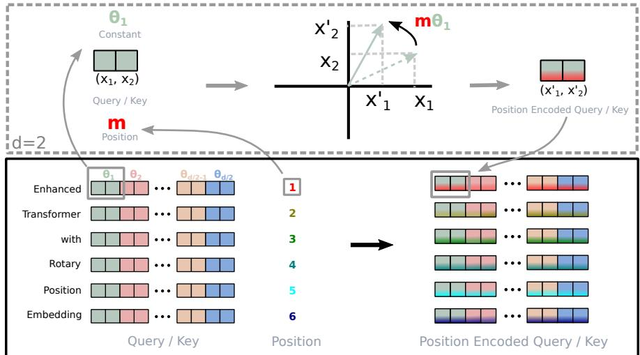
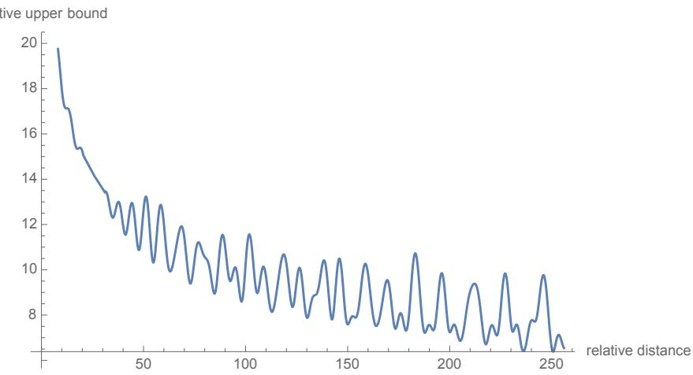
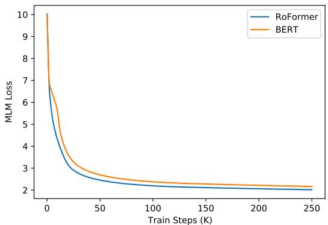
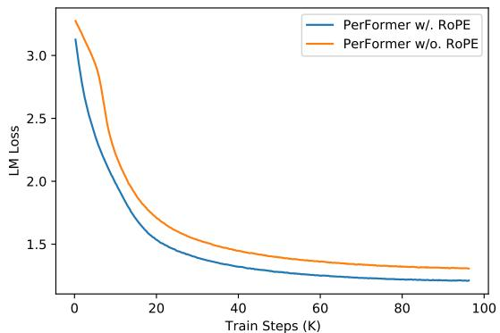

# RoFormer：基于旋转位置嵌入的增强 Transformer

Jianlin Su Zhuiyi Technology Co., Ltd. Shenzhen bojonesu@wezhuiyi.com

Ahmed Murtadha Zhuiyi Technology Co., Ltd. Shenzhen mengjiayi@wezhuiyi.com

Yu Lu Zhuiyi Technology Co., Ltd. Shenzhen julianlu@wezhuiyi.com

Bo Wen Zhuiyi Technology Co., Ltd. Shenzhen brucewen@wezhuiyi.com

Shengfeng Pan Zhuiyi Technology Co., Ltd. Shenzhen nickpan@wezhuiyi.com

Yunfeng Liu Zhuiyi Technology Co., Ltd. Shenzhen glenliu@wezhuiyi.com

2023年11月9日

## 摘要

位置编码近期在 Transformer 架构中展现出了显著的有效性。它为序列中不同位置元素之间的依赖关系建模提供了有价值的监督信息。在本文中，我们首先调研了将位置信息整合到基于 Transformer 的语言模型学习过程中的各种方法。随后，我们提出了一种名为旋转位置嵌入（Rotary Position Embedding，RoPE）的新方法，以有效利用位置信息。具体而言，所提出的 RoPE 通过旋转矩阵对绝对位置进行编码，同时在自注意力公式中融入了显式的相对位置依赖。值得注意的是，RoPE 具备多项宝贵的特性，包括序列长度的灵活性、词元（token）间依赖随着相对距离增加而衰减的特性，以及为线性自注意力赋予相对位置编码的能力。最后，我们在多种长文本分类基准数据集上对基于旋转位置嵌入的增强型 Transformer（亦称 RoFormer）进行了评估。实验表明，该模型始终优于其他同类方法。此外，我们还提供了理论分析以解释部分实验结果。RoFormer 现已集成至 Huggingface：https://huggingface.co/docs/transformers/model\_doc/roformer。

关键词 预训练语言模型 · 位置信息编码 · 预训练 · 自然语言处理。

## 1 引言

词的顺序对于自然语言理解具有重要价值。基于循环神经网络（RNNs）的模型通过沿时间维度递归计算隐藏状态来编码词元（token）的顺序。基于卷积神经网络（CNNs）的模型 Gehring et al. [2017] 通常被认为是无法感知位置的，但最近的研究 Islam et al. [2020] 表明，常用的填充（padding）操作可以隐式地学习位置信息。近年来，基于 Transformer Vaswani et al. [2017] 构建的预训练语言模型（PLMs）在各项自然语言处理（NLP）任务中取得了最先进的性能，其中包括上下文表示学习 Devlin et al. [2019]、机器翻译 Vaswani et al. [2017] 和语言建模 Radford et al. [2019] 等。与基于 RNN 和 CNN 的模型不同，PLMs 利用自注意力机制在语义上捕获给定语料库的上下文表示。因此，与 RNN 相比，PLMs 在并行化方面取得了显著提升，并且与 CNN 相比，提高了对较长词元间关系的建模能力1。

值得注意的是，当前 PLMs 的自注意力架构已被证明是无法感知位置的 Yun et al. [2020]。基于这一结论，研究人员提出了多种方法将位置信息编码到学习过程中。一方面，通过预定义函数生成的绝对位置编码 Vaswani et al. [2017] 被添加到上下文表示中，同时也有研究采用可训练的绝对位置编码 Gehring et al. [2017], Devlin et al. [2019], Lan et al. [2020], Clark et al. [2020], Radford et al. [2019], Radford and Narasimhan [2018]。另一方面，以往的研究 Parikh et al. [2016], Shaw et al. [2018], Huang et al. [2018], Dai et al. [2019], Yang et al. [2019], Raffel et al. [2020], Ke et al. [2020], He et al. [2020], Huang et al. [2020] 侧重于相对位置编码，这类方法通常将相对位置信息编码到注意力机制中。除了这些方法之外，Liu et al. [2020] 的作者提出从神经微分方程（Neural ODE）Chen et al. [2018a] 的角度对位置编码的依赖性进行建模，而 Wang et al. [2020] 的作者则提出在复数空间中对位置信息进行建模。尽管这些方法行之有效，但它们通常是将位置信息添加到上下文表示中，从而导致它们不适用于线性自注意力架构。

在本文中，我们提出了一种新方法，即旋转位置嵌入（Rotary Position Embedding，RoPE），以在预训练语言模型（PLM）的学习过程中利用位置信息。具体而言，RoPE 使用旋转矩阵对绝对位置进行编码，同时在自注意力公式中引入显式的相对位置依赖。值得注意的是，所提出的 RoPE 因其具有许多宝贵的特性而优于现有方法，包括序列长度的灵活性、词元间依赖度随相对距离增加而衰减，以及能够为线性自注意力赋予相对位置编码的能力。在多个长文本分类基准数据集上的实验结果表明，应用了旋转位置嵌入的增强型 Transformer，即 RoFormer，相比基线替代方案能够取得更好的性能，从而证明了所提出的 RoPE 的有效性。

简而言之，我们的贡献总结如下三个方面：

• 我们调研了现有的相对位置编码方法，发现它们大多建立在将位置编码加到上下文表示中的分解思想之上。我们提出了一种新方法，即旋转位置嵌入（Rotary Position Embedding，RoPE），以在 PLM 的学习过程中利用位置信息。其核心思想是通过将上下文表示与旋转矩阵相乘来对相对位置进行编码，且具有明确的理论解释。

• 我们研究了 RoPE 的性质，并表明它随着相对距离的增加而衰减，这正是自然语言编码所期望的特性。我们指出，以往基于相对位置编码的方法与线性自注意力并不兼容。

• 我们在各种长文本基准数据集上对所提出的 RoFormer 进行了评估。实验表明，与替代方案相比，它始终能取得更好的性能。一些基于预训练语言模型的实验可在 GitHub 上获取：https://github.com/ZhuiyiTechnology/roformer。

本文其余部分的组织结构如下：我们在第 (2) 节建立了自注意力架构中位置编码问题的形式化描述，并回顾了以往的相关工作。然后，我们在第 (3) 节中描述了旋转位置编码（RoPE）并研究了其性质。我们在第 (4) 节报告了实验结果。最后，我们在第 (5) 节对本文进行总结。

## 2 背景与相关工作

## 2.1 预备知识

设 $\mathbb { S } _ { N } = \{ w _ { i } \} _ { i = } ^ { N }$ 为包含 $N$ 个输入词元（token）的序列，其中 $w _ { i }$ 为第 $i$ 个元素。$\mathbb { S } _ { N }$ 对应的词嵌入表示为 $\mathbb { E } _ { N } = \{ \pmb { x } _ { i } \} _ { i = 1 } ^ { N }$，其中 $\pmb { x } _ { i } \in \mathbb { R } ^ { d }$ 是词元 $w _ { i }$ 不含位置信息的 $d$ 维词嵌入向量。自注意力机制首先将位置信息融入词嵌入中，并将其转换为查询（query）、键（key）和值（value）表示。

$$
\begin{array}{r} \pmb {q} _ {m} = f _ {q} (\pmb {x} _ {m}, m) \\ \pmb {k} _ {n} = f _ {k} (\pmb {x} _ {n}, n) \\ \pmb {v} _ {n} = f _ {v} (\pmb {x} _ {n}, n), \end{array}\tag{1}
$$

其中 $\mathbf { \delta } q _ { m } , k _ { n }$ 和 ${ \pmb v } _ { n }$ 分别通过 $f _ { q } , f _ { k }$ 和 $f _ { v }$ 融入了第 $m$ 个和第 $n$ 个位置信息。随后，查询和键值用于计算注意力权重，而输出则计算为值

表示的加权和。

$$
a _ {m, n} = \frac {\exp (\frac {\boldsymbol {q} _ {m} ^ {\intercal} \boldsymbol {k} _ {n}}{\sqrt {d}})}{\sum_ {j = 1} ^ {N} \exp (\frac {\boldsymbol {q} _ {m} ^ {\intercal} \boldsymbol {k} _ {j}}{\sqrt {d}})}\tag{2}
$$

$$
\mathbf {o} _ {m} = \sum_ {n = 1} ^ {N} a _ {m, n} \pmb {v} _ {n}
$$

现有的基于 Transformer 的位置编码方法主要侧重于选择合适的函数来构造公式 (1)。

## 2.2 绝对位置嵌入

公式 (1) 的一种典型选择是

$$
f _ {t: t \in \{q, k, v \}} (\boldsymbol {x} _ {i}, i) := \boldsymbol {W} _ {t: t \in \{q, k, v \}} (\boldsymbol {x} _ {i} + \boldsymbol {p} _ {i}),\tag{3}
$$

其中 $\pmb { p } _ { i } \in \mathbb { R } ^ { d }$ 是取决于词元 $\scriptstyle { \mathbf { x } } _ { i } .$ 位置的 $d$ 维向量。先前的研究 Devlin et al. [2019]、Lan et al. [2020]、Clark et al. [2020]、Radford et al. [2019]、Radford and Narasimhan [2018] 引入了一组可训练向量 $\pmb { p } _ { i } \in \{ \pmb { p } _ { t } \} _ { t = 1 } ^ { L }$，其中 $L$ 为最大序列长度。Vaswani et al. [2017] 的作者则提出使用正弦函数来生成 $\mathbf { \nabla } _ { \pmb { p } _ { i } }$。

$$
\left\{ \begin{array}{l l} \boldsymbol {p} _ {i, 2 t} & = \sin (k / 1 0 0 0 0 ^ {2 t / d}) \\ \boldsymbol {p} _ {i, 2 t + 1} & = \cos (k / 1 0 0 0 0 ^ {2 t / d}) \end{array} \right.\tag{4}
$$

其中 $\mathbf { \Delta } _ { p _ { i , 2 t } }$ 是 $d$ 维向量 $\mathbf { \nabla } _ { \pmb { p } _ { i } }$ 的第 $2t$ 个元素。在下一节中，我们将展示从正弦函数的角度来看，我们提出的 RoPE 与这种直觉密切相关。然而，RoPE 并非直接将位置加到上下文表征中，而是提议通过与正弦函数相乘来融入相对位置信息。

## 2.3 相对位置嵌入

Shaw et al. [2018] 采用了公式 (1) 的不同设置，如下所示：

$$
\begin{array}{c} f _ {q} (\boldsymbol {x} _ {m}) := \boldsymbol {W} _ {q} \boldsymbol {x} _ {m} \\ f _ {k} (\boldsymbol {x} _ {n}, n) := \boldsymbol {W} _ {k} (\boldsymbol {x} _ {n} + \tilde {\boldsymbol {p}} _ {r} ^ {k}) \\ f _ {v} (\boldsymbol {x} _ {n}, n) := \boldsymbol {W} _ {v} (\boldsymbol {x} _ {n} + \tilde {\boldsymbol {p}} _ {r} ^ {v}) \end{array}\tag{5}
$$

其中 $\tilde { p } _ { r } ^ { k } , \tilde { p } _ { r } ^ { v } \in \mathbb { R } ^ { d }$ 是可训练的相对位置嵌入。注意 $r = \mathrm { c l i p } ( m - n , r _ { \mathrm { m i n } } , r _ { \mathrm { m a x } } )$ 表示位置 $m$ 与 $n$ 之间的相对距离。他们对相对距离进行了截断，其假设是超出一定距离后，精确的相对位置信息便不再有用。在保持公式 (3) 形式的同时，Dai et al. [2019] 提出将公式 (2) 中的 $\pmb q _ { m } ^ { \top } \pmb k _ { n }$ 分解为

$$
\pmb {q} _ {m} ^ {\intercal} \pmb {k} _ {n} = \pmb {x} _ {m} ^ {\intercal} \pmb {W} _ {q} ^ {\intercal} \pmb {W} _ {k} \pmb {x} _ {n} + \pmb {x} _ {m} ^ {\intercal} \pmb {W} _ {q} ^ {\intercal} \pmb {W} _ {k} \pmb {p} _ {n} + \pmb {p} _ {m} ^ {\intercal} \pmb {W} _ {q} ^ {\intercal} \pmb {W} _ {k} \pmb {x} _ {n} + \pmb {p} _ {m} ^ {\intercal} \pmb {W} _ {q} ^ {\intercal} \pmb {W} _ {k} \pmb {p} _ {n},\tag{6}
$$

其核心思想是将绝对位置嵌入 ${ \pmb p } _ { n }$ 替换为其经正弦编码的相对位置对应项 $\tilde { p } _ { m - n }$，同时将第三和第四项中的绝对位置 ${ \pmb p } _ { m }$ 替换为两个与查询位置无关的可训练向量 $u$ 和 $v$。此外，针对基于内容的键向量 ${ \bf { x } } _ { n }$ 和基于位置的键向量 ${ \pmb p } _ { n }$，对 $\boldsymbol { W } _ { k }$ 进行了区分，分别表示为 $W _ { k }$ 和 $ { \widetilde { W } } _ { k }$，从而得到：

$$
\pmb {q} _ {m} ^ {\intercal} \pmb {k} _ {n} = \pmb {x} _ {m} ^ {\intercal} \pmb {W} _ {q} ^ {\intercal} \pmb {W} _ {k} \pmb {x} _ {n} + \pmb {x} _ {m} ^ {\intercal} \pmb {W} _ {q} ^ {\intercal} \widetilde {\pmb {W}} _ {k} \tilde {\pmb {p}} _ {m - n} + \mathbf {u} ^ {\intercal} \pmb {W} _ {q} ^ {\intercal} \pmb {W} _ {k} \pmb {x} _ {n} + \mathbf {v} ^ {\intercal} \pmb {W} _ {q} ^ {\intercal} \widetilde {\pmb {W}} _ {k} \tilde {\pmb {p}} _ {m - n}\tag{7}
$$

值得注意的是，通过设置 $f _ { v } ( \pmb { x } _ { j } ) : = \pmb { W } _ { v } \pmb { x } _ { j }$，移除了值（value）项中的位置信息。随后的工作 Raffel et al. [2020]、He et al. [2020]、Ke et al. [2020]、Huang et al. [2020] 遵循了这些设置，仅将相对位置信息编码到注意力权重中。然而，Raffel et al. [2020] 的作者将公式 (6) 改写为：

$$
\boldsymbol {q} _ {m} ^ {\intercal} \boldsymbol {k} _ {n} = \boldsymbol {x} _ {m} ^ {\intercal} \boldsymbol {W} _ {q} ^ {\intercal} \boldsymbol {W} _ {k} \boldsymbol {x} _ {n} + b _ {i, j}\tag{8}
$$

其中 $b _ { i , j }$ 是一个可训练的偏置。Ke et al. [2020] 的作者研究了公式 (6) 的中间两项，发现绝对位置与词之间几乎没有相关性。Raffel et al. [2020] 的作者提出使用不同的投影矩阵对词对或位置对进行建模。

$$
\pmb {q} _ {m} ^ {\intercal} \pmb {k} _ {n} = \pmb {x} _ {m} ^ {\intercal} \pmb {W} _ {q} ^ {\intercal} \pmb {W} _ {k} \pmb {x} _ {n} + \pmb {p} _ {m} ^ {\intercal} \pmb {\mathrm{U}} _ {q} ^ {\intercal} \pmb {\mathrm{U}} _ {k} \pmb {p} _ {n} + b _ {i, j}\tag{9}
$$

He et al. [2020] 的作者认为，两个 token 的相对位置只能通过公式 (6) 的中间两项进行充分建模。因此，绝对位置嵌入 ${ \pmb p } _ { m }$ 和 ${ \pmb p } _ { n }$ 被直接替换为相对位置嵌入 $\tilde { p } _ { m - n }$：

$$
\boldsymbol {q} _ {m} ^ {\intercal} \boldsymbol {k} _ {n} = \boldsymbol {x} _ {m} ^ {\intercal} \boldsymbol {W} _ {q} ^ {\intercal} \boldsymbol {W} _ {k} \boldsymbol {x} _ {n} + \boldsymbol {x} _ {m} ^ {\intercal} \boldsymbol {W} _ {q} ^ {\intercal} \boldsymbol {W} _ {k} \tilde {\boldsymbol {p}} _ {m - n} + \tilde {\boldsymbol {p}} _ {m - n} ^ {\intercal} \boldsymbol {W} _ {q} ^ {\intercal} \boldsymbol {W} _ {k} \boldsymbol {x} _ {n}\tag{10}
$$

对相对位置嵌入的四种变体（Radford and Narasimhan [2018]）的比较表明，类似于公式 (10) 的变体在其他三种变体中效率最高。一般而言，所有这些方法都试图在 Vaswani et al. [2017] 最初提出的公式 (2) 的自注意力机制设定下，基于公式 (3) 的分解来修改公式 (6)。它们通常采用将位置信息直接加到上下文表示中的做法。与之不同的是，我们的方法旨在某些约束条件下从公式 (1) 推导出相对位置编码。接下来，我们将展示推导出的方法通过将相对位置信息与上下文表示的旋转相结合，从而具有更强的可解释性。

## 3 提出的方法

在本节中，我们讨论所提出的旋转位置嵌入（rotary position embedding，RoPE）。我们首先在第 (3.1) 节中形式化相对位置编码问题，接着在第 (3.2) 节中推导 RoPE，并在第 (3.3) 节中探究其性质。

## 3.1 问题形式化

基于 Transformer 的语言建模通常通过自注意力机制利用各个词元（token）的位置信息。如公式 (2) 中所示，$\pmb q _ { m } ^ { \top } \pmb k _ { n }$ 通常实现了不同位置词元之间的知识传递。为了融入相对位置信息，我们要求查询 $\pmb q _ { m }$ 与键 $k _ { n }$ 的内积由函数 $^ { g , }$ 表示，该函数仅将词嵌入 ${ \pmb x } _ { m } , { \pmb x } _ { n }$ 及其相对位置 $m - n$ 作为输入变量。换句话说，我们希望内积仅以相对形式对位置信息进行编码：

$$
\langle f _ {q} (\pmb {x} _ {m}, m), f _ {k} (\pmb {x} _ {n}, n) \rangle = g (\pmb {x} _ {m}, \pmb {x} _ {n}, m - n).\tag{11}
$$

最终目标是找到一种等价的编码机制来求解函数 $f _ { q } ( { \pmb x } _ { m } , m )$ 和 $f _ { k } ( \pmb { x } _ { n } , n )$，以符合上述关系。

## 3.2 旋转位置嵌入

## 3.2.1 二维情形

我们从维度 $d = 2 .$ 的简单情形开始。在此设定下，我们利用二维平面上向量的几何性质及其复数形式来证明（详见第 (3.4.1) 节）我们公式 (11) 形式化定义的一个解为：

$$
\begin{array}{r} f _ {q} (\pmb {x} _ {m}, m) = (\pmb {W} _ {q} \pmb {x} _ {m}) e ^ {i m \theta} \\ f _ {k} (\pmb {x} _ {n}, n) = (\pmb {W} _ {k} \pmb {x} _ {n}) e ^ {i n \theta} \\ g (\pmb {x} _ {m}, \pmb {x} _ {n}, m - n) = \mathrm{Re} [ (\pmb {W} _ {q} \pmb {x} _ {m}) (\pmb {W} _ {k} \pmb {x} _ {n}) ^ {*} e ^ {i (m - n) \theta} ] \end{array}\tag{12}
$$

其中 $\mathrm { R e } [ \cdot ]$ 表示复数的实部，$( W _ { k } \pmb { x } _ { n } ) ^ { * }$ 表示 $\left( W _ { k } \pmb { x } _ { n } \right)$ 的共轭复数，$\theta \in \mathbb { R }$ 是一个预设的非零常数。我们可以进一步将 $f _ { \{ q , k \} }$ 写为矩阵乘法的形式：

$$
f _ {\{q, k \}} (\boldsymbol {x} _ {m}, m) = \left( \begin{array}{c c} \cos m \theta & - \sin m \theta \\ \sin m \theta & \cos m \theta \end{array} \right) \left( \begin{array}{c c} W _ {\{q, k \}} ^ {(1 1)} & W _ {\{q, k \}} ^ {(1 2)} \\ W _ {\{q, k \}} ^ {(2 1)} & W _ {\{q, k \}} ^ {(2 2)} \end{array} \right) \binom{x _ {m} ^ {(1)}}{x _ {m} ^ {(2)}}\tag{13}
$$

其中 $( x _ { m } ^ { ( 1 ) } , x _ { m } ^ { ( 2 ) } )$ 是 ${ \pmb x } _ { m }$ 在二维坐标下的表示。类似地，$g$ 也可以视为一个矩阵，从而能够在二维情况下求解第 (3.1) 节中的公式。具体而言，融入相对位置编码十分直接：只需将经过仿射变换的词嵌入向量旋转其位置索引倍数的角度，这也阐释了旋转位置编码（Rotary Position Embedding，RoPE）背后的直觉。

## 3.2.2 通用形式

为了将我们在二维情况下的结果推广到任意 $\pmb { x } _ { i } \in \mathbb { R } ^ { d }$（其中 $d$ 为偶数），我们利用内积的线性性质，将 $d$ 维空间划分为 $d / 2$ 个子空间并将它们组合起来，从而将 $f _ { \{ q , k \} }$ 转化为：

$$
f _ {\{q, k \}} (\pmb {x} _ {m}, m) = \pmb {R} _ {\Theta , m} ^ {d} \pmb {W} _ {\{q, k \}} \pmb {x} _ {m}\tag{14}
$$

其中

$$
\boldsymbol {R} _ {\Theta , m} ^ {d} = \left( \begin{array}{c c c c c c c} \cos m \theta_ {1} & - \sin m \theta_ {1} & 0 & 0 & \dots & 0 & 0 \\ \sin m \theta_ {1} & \cos m \theta_ {1} & 0 & 0 & \dots & 0 & 0 \\ 0 & 0 & \cos m \theta_ {2} & - \sin m \theta_ {2} & \dots & 0 & 0 \\ 0 & 0 & \sin m \theta_ {2} & \cos m \theta_ {2} & \dots & 0 & 0 \\ \vdots & \vdots & \vdots & \vdots & \ddots & \vdots & \vdots \\ 0 & 0 & 0 & 0 & \dots & \cos m \theta_ {d / 2} & - \sin m \theta_ {d / 2} \\ 0 & 0 & 0 & 0 & \dots & \sin m \theta_ {d / 2} & \cos m \theta_ {d / 2} \end{array} \right)\tag{15}
$$

是带有预定义参数 $\Theta = \{ \theta _ { i } = 1 0 0 0 0 ^ { - 2 ( i - 1 ) / d } , i \in [ 1 , 2 , . . . , d / 2 ] \}$ 的旋转矩阵。RoPE 的直观示意图如图 Figure (1) 所示。将我们的 RoPE 应用于公式 (2) 中的自注意力机制，可得：

$$
\pmb {q} _ {m} ^ {\intercal} \pmb {k} _ {n} = (\pmb {R} _ {\Theta , m} ^ {d} \pmb {W} _ {q} \pmb {x} _ {m}) ^ {\intercal} (\pmb {R} _ {\Theta , n} ^ {d} \pmb {W} _ {k} \pmb {x} _ {n}) = \pmb {x} ^ {\intercal} \pmb {W} _ {q} R _ {\Theta , n - m} ^ {d} \pmb {W} _ {k} \pmb {x} _ {n}\tag{16}
$$

其中 $R _ { \Theta , n - m } ^ { d } = ( R _ { \Theta , m } ^ { d } ) ^ { \top } R _ { \Theta , n } ^ { d }$。注意，$R _ { \Theta } ^ { d }$ 是一个正交矩阵，这保证了在编码位置信息过程中的稳定性。此外，由于 $R _ { \Theta } ^ { d }$ 的稀疏性，直接像公式 (16) 中那样应用矩阵乘法在计算上是不高效的；我们在理论解释中提供了另一种实现方式。

与先前工作中采用的位置嵌入方法的加性本质（即公式 (3) 至 (10)）相比，我们的方法是乘性的。此外，当应用于自注意力（self-attention）时，RoPE 通过旋转矩阵乘积自然地融入了相对位置信息，而不是改变加性位置编码展开式中的各项。

  
Figure 1: 旋转位置嵌入（Rotary Position Embedding, RoPE）的实现。

## 3.3 RoPE 的性质

远程衰减（Long-term decay）：遵循 Vaswani 等人 [2017] 的做法，我们设置 $\theta _ { i } = 1 0 0 0 0 ^ { - 2 i / d }$。可以证明该设置具有远程衰减性质（详见第 (3.4.3) 节），这意味着当相对位置增大时，内积将会衰减。这一性质符合直觉，即相对距离较远的一对 token 之间应该具有较弱的关联。

结合线性注意力的 RoPE：自注意力可以被重写为更一般的形式。

$$
\operatorname{Attention} (\mathbf {Q}, \mathbf {K}, \mathbf {V}) _ {m} = \frac {\sum_ {n = 1} ^ {N} \operatorname{sim} (\boldsymbol {q} _ {m} , \boldsymbol {k} _ {n}) \boldsymbol {v} _ {n}}{\sum_ {n = 1} ^ {N} \operatorname{sim} (\boldsymbol {q} _ {m} , \boldsymbol {k} _ {n})}.\tag{17}
$$

原始的自注意力选择 $\operatorname{sim} ( { \bf q } _ { m } , k _ { n } ) = \exp ( { \bf q } _ { m } ^ { _ { \sf T } } k _ { n } / \sqrt { d } )$。注意，原始自注意力需要计算每对 token 的 query 和 key 的内积，其具有二次复杂度 $\mathbb { O } ( N ^ { 2 } )$。遵循 Katharopoulos 等人 [2020] 的工作，线性注意力将公式 (17) 重构为

$$
\mathrm{Attention} (\boldsymbol {Q}, \boldsymbol {K}, \boldsymbol {V}) _ {m} = \frac {\sum_ {n = 1} ^ {N} \phi (\boldsymbol {q} _ {m}) ^ {\intercal} \varphi (\boldsymbol {k} _ {n}) \boldsymbol {v} _ {n}}{\sum_ {n = 1} ^ {N} \phi (\boldsymbol {q} _ {m}) ^ {\intercal} \varphi (\boldsymbol {k} _ {n})},\tag{18}
$$

其中 $\phi ( \cdot ) , \varphi ( \cdot )$ 通常是非负函数。Katharopoulos et al. [2020] 的作者提出了 $\phi ( x ) = \dot { \varphi } ( x ) = \mathrm { e l u } ( x ) + 1$，并利用矩阵乘法的结合律首先计算键与值之间的乘积。Shen et al. [2021] 中在内积之前使用 softmax 函数分别对查询和键进行归一化，这等价于 $\phi ( { \pmb q } _ { i } ) = \mathrm { s o f t m a x } ( { \pmb q } _ { i } )$ 以及 $\phi ( k _ { j } ) = \exp ( k _ { j } )$。关于线性注意力（linear attention）的更多细节，我们建议读者参阅原始论文。在本节中，我们重点讨论将 RoPE 与公式 (18) 相结合。由于 RoPE 通过旋转注入位置信息，保持了隐藏表示的范数不变，因此我们可以通过将旋转矩阵与非负函数的输出相乘，将 RoPE 与线性注意力结合起来。

$$
\mathrm{Attention} (\mathbf {Q}, \mathbf {K}, \mathbf {V}) _ {m} = \frac {\sum_ {n = 1} ^ {N} \big (\boldsymbol {R} _ {\Theta , m} ^ {d} \phi (\boldsymbol {q} _ {m}) \big) ^ {\intercal} \big (\boldsymbol {R} _ {\Theta , n} ^ {d} \varphi (\boldsymbol {k} _ {n}) \big) \boldsymbol {v} _ {n}}{\sum_ {n = 1} ^ {N} \phi (\boldsymbol {q} _ {m}) ^ {\intercal} \varphi (\boldsymbol {k} _ {n})}.\tag{19}
$$

值得注意的是，我们保持分母不变以避免除以零的风险，而分子中的求和项可能包含负数。尽管公式 (19) 中每个值 ${ \mathbf { } } v _ { i }$ 的权重并未经过严格的概率归一化，但我们认为该计算仍然能够建模值的重要性。

## 3.4 理论解释

## 3.4.1 二维下 RoPE 的推导

在 $d = 2$ 的情况下，我们考虑分别对应于查询和键的两个词嵌入向量 $\mathbf { \boldsymbol { x } } _ { q } , \mathbf { \boldsymbol { x } } _ { k }$ 及其位置 $m$ 和 $n$。根据公式 (1)，它们经过位置编码后的对应形式为：

$$
\begin{array}{c} \boldsymbol {q} _ {m} = f _ {q} (\boldsymbol {x} _ {q}, m), \\ \boldsymbol {k} _ {n} = f _ {k} (\boldsymbol {x} _ {k}, n), \end{array}\tag{20}
$$

其中 $\pmb q _ { m }$ 和 $k _ { n }$ 的下标表示编码后的位置信息。假设存在一个函数 $g$，用于定义由 $f _ { \{ q , k \} }$ 生成的向量之间的内积

$$
\boldsymbol {q} _ {m} ^ {\intercal} \boldsymbol {k} _ {n} = \langle f _ {q} (\boldsymbol {x} _ {m}, m), f _ {k} (\boldsymbol {x} _ {n}, n) \rangle = g (\boldsymbol {x} _ {m}, \boldsymbol {x} _ {n}, n - m),\tag{21}
$$

我们进一步要求满足以下初始条件：

$$
\begin{array}{l} \boldsymbol {q} = f _ {q} (\boldsymbol {x} _ {q}, 0), \\ \boldsymbol {k} = f _ {k} (\boldsymbol {x} _ {k}, 0), \end{array}\tag{22}
$$

这可以理解为编码了空位置信息的向量。在这些设定下，我们尝试求解 $f _ { q } , f _ { k }$。首先，我们利用二维向量的几何意义及其复数对应形式，将公式 (20) 和 (21) 中的函数分解为：

$$
\begin{array}{r} f _ {q} (\pmb {x} _ {q}, m) = R _ {q} (\pmb {x} _ {q}, m) e ^ {i \Theta_ {q} (\pmb {x} _ {q}, m)}, \\ f _ {k} (\pmb {x} _ {k}, n) = R _ {k} (\pmb {x} _ {k}, n) e ^ {i \Theta_ {k} (\pmb {x} _ {k}, n)}, \\ g (\pmb {x} _ {q}, \pmb {x} _ {k}, n - m) = R _ {g} (\pmb {x} _ {q}, \pmb {x} _ {k}, n - m) e ^ {i \Theta_ {g} (\pmb {x} _ {q}, \pmb {x} _ {k}, n - m)}, \end{array}\tag{23}
$$

其中 $R _ { f } , R _ { g }$ 与 $\Theta _ { f } , \Theta _ { g }$ 分别是 $f _ { \{ q , k \} }$ 和 $g$ 的径向分量与角度分量。将它们代入公式 (21)，我们得到如下关系：

$$
\begin{array}{r} R _ {q} (\pmb {x} _ {q}, m) R _ {k} (\pmb {x} _ {k}, n) = R _ {g} (\pmb {x} _ {q}, \pmb {x} _ {k}, n - m), \\ \Theta_ {k} (\pmb {x} _ {k}, n) - \Theta_ {q} (\pmb {x} _ {q}, m) = \Theta_ {g} (\pmb {x} _ {q}, \pmb {x} _ {k}, n - m), \end{array}\tag{24}
$$

对应的初始条件为：

$$
\begin{array}{r} \pmb {q} = \| \pmb {q} \| e ^ {i \theta_ {q}} = R _ {q} (\pmb {x} _ {q}, 0) e ^ {i \Theta_ {q} (\pmb {x} _ {q}, 0)}, \\ \pmb {k} = \| \pmb {k} \| e ^ {i \theta_ {k}} = R _ {k} (\pmb {x} _ {k}, 0) e ^ {i \Theta_ {k} (\pmb {x} _ {k}, 0)}, \end{array}\tag{25}
$$

其中 $\left\| q \right\| , \left\| k \right\|$ 和 $\theta _ { q } , \theta _ { k }$ 分别是 $\pmb{q}$ 和 $\pmb{k}$ 在二维平面上的径向部分与角度部分。

接下来，我们在公式 (24) 中令 $m = n$，并代入公式 (25) 中的初始条件：

$$
R _ {q} (\boldsymbol {x} _ {q}, m) R _ {k} (\boldsymbol {x} _ {k}, m) = R _ {g} (\boldsymbol {x} _ {q}, \boldsymbol {x} _ {k}, 0) = R _ {q} (\boldsymbol {x} _ {q}, 0) R _ {k} (\boldsymbol {x} _ {k}, 0) = \| \boldsymbol {q} \| \| \boldsymbol {k} \|,\tag{26a}
$$

$$
\Theta_ {k} (\pmb {x} _ {k}, m) - \Theta_ {q} (\pmb {x} _ {q}, m) = \Theta_ {g} (\pmb {x} _ {q}, \pmb {x} _ {k}, 0) = \Theta_ {k} (\pmb {x} _ {k}, 0) - \Theta_ {q} (\pmb {x} _ {q}, 0) = \theta_ {k} - \theta_ {q}.\tag{26b}
$$

一方面，由公式 (26a) 可以直接得出 $R _ { f }$ 的一个解：

$$
\begin{array}{c} R _ {q} (\boldsymbol {x} _ {q}, m) = R _ {q} (\boldsymbol {x} _ {q}, 0) = \| \boldsymbol {q} \| \\ R _ {k} (\boldsymbol {x} _ {k}, n) = R _ {k} (\boldsymbol {x} _ {k}, 0) = \| \boldsymbol {k} \| \\ R _ {g} (\boldsymbol {x} _ {q}, \boldsymbol {x} _ {k}, n - m) = R _ {g} (\boldsymbol {x} _ {q}, \boldsymbol {x} _ {k}, 0) = \| \boldsymbol {q} \| \| \boldsymbol {k} \| \end{array}\tag{27}
$$

这表明径向函数 $R _ { q } , R _ { k }$ 和 $R _ { g }$ 独立于位置信息。另一方面，如公式 (26b) 所示，$\Theta _ { q } ^ { ' } ( \pmb { x } _ { q } , m ) - \mathcal { \bar { \theta } } _ { q } = \Theta _ { k } ( \pmb { x } _ { k } , m ) - \theta _ { k }$ 表明角度函数不依赖于 query 和 key，我们将它们设为 $\Theta _ { f } : = \Theta _ { q } = \Theta _ { k }$，且项 $\Theta _ { f } ( { \pmb x } _ { \{ q , k \} } , m ) - \theta _ { \{ q , k \} }$ 是关于位置 m 的函数，并且独立于词嵌入 ${ \pmb x } _ { \{ q , k \} }$，我们将其记为 $\phi ( m )$，从而得到：

$$
\Theta_ {f} (\boldsymbol {x} _ {\{q, k \}}, m) = \phi (m) + \theta_ {\{q, k \}},\tag{28}
$$

此外，将 $n = m + 1$ 代入公式 (24) 并结合上述方程，可得：

$$
\phi (m + 1) - \phi (m) = \Theta_ {g} (\pmb {x} _ {q}, \pmb {x} _ {k}, 1) + \theta_ {q} - \theta_ {k},\tag{29}
$$

由于右侧（RHS）是一个与 $m$ 无关的常数，输入为连续整数的 $\phi ( m )$ 构成等差数列：

$$
\phi (m) = m \theta + \gamma ,\tag{30}
$$

其中 $\theta , \gamma \in \mathbb { R }$ 为常数且 θ 非零。总结公式 (27) 至公式 (30) 的求解结果：

$$
\begin{array}{l} f _ {q} (\boldsymbol {x} _ {q}, m) = \| \boldsymbol {q} \| e ^ {i \theta_ {q} + m \theta + \gamma} = \boldsymbol {q} e ^ {i (m \theta + \gamma)}, \\ f _ {k} (\boldsymbol {x} _ {k}, n) = \| \boldsymbol {k} \| e ^ {i \theta_ {k} + n \theta + \gamma} = \boldsymbol {k} e ^ {i (n \theta + \gamma)}. \end{array}\tag{31}
$$

注意，我们未对公式 (22) 中的 $f _ { q }$ 和 $f _ { k }$ 施加任何约束，因此 $f _ { q } ( { \pmb x } _ { m } , 0 )$ 和 $f _ { k } ( \pmb { x } _ { n } , 0 )$ 可以自由选择。为了使我们的结果与公式 (3) 相当，我们定义：

$$
\begin{array}{r} \pmb {q} = f _ {q} (\pmb {x} _ {m}, 0) = \pmb {W} _ {q} \pmb {x} _ {n}, \\ \pmb {k} = f _ {k} (\pmb {x} _ {n}, 0) = \pmb {W} _ {k} \pmb {x} _ {n}. \end{array}\tag{32}
$$

然后，我们只需在最终解的公式 (31) 中令 $\gamma = 0$：

$$
\begin{array}{r} f _ {q} (\pmb {x} _ {m}, m) = (\pmb {W} _ {q} \pmb {x} _ {m}) e ^ {i m \theta}, \\ f _ {k} (\pmb {x} _ {n}, n) = (\pmb {W} _ {k} \pmb {x} _ {n}) e ^ {i n \theta}. \end{array}\tag{33}
$$

## 3.4.2 旋转矩阵乘法的高效计算实现

利用公式 (15) 中 $R _ { \Theta , m } ^ { d }$ 的稀疏性优势，$R _ { \Theta } ^ { d }$ 与 x $\in \mathbb { R } ^ { d }$ 乘法的一种更具计算效率的实现方式为：

$$
\boldsymbol {R} _ {\Theta , m} ^ {d} \boldsymbol {x} = \left( \begin{array}{c} x _ {1} \\ x _ {2} \\ x _ {3} \\ x _ {4} \\ \vdots \\ x _ {d - 1} \\ x _ {d} \end{array} \right) \otimes \left( \begin{array}{c} \cos m \theta_ {1} \\ \cos m \theta_ {1} \\ \cos m \theta_ {2} \\ \cos m \theta_ {2} \\ \vdots \\ \cos m \theta_ {d / 2} \\ \cos m \theta_ {d / 2} \end{array} \right) + \left( \begin{array}{c} - x _ {2} \\ x _ {1} \\ - x _ {4} \\ x _ {3} \\ \vdots \\ - x _ {d} \\ x _ {d - 1} \end{array} \right) \otimes \left( \begin{array}{c} \sin m \theta_ {1} \\ \sin m \theta_ {1} \\ \sin m \theta_ {2} \\ \sin m \theta_ {2} \\ \vdots \\ \sin m \theta_ {d / 2} \\ \sin m \theta_ {d / 2} \end{array} \right)\tag{34}
$$

  
Figure 2: RoPE 的远程衰减。

## 3.4.3 RoPE 的远程衰减

我们可以将向量 $\pmb { q } = \pmb { W } _ { q } \pmb { x } _ { m }$ 和 $\pmb { k } = \pmb { W } _ { k } \pmb { x } _ { n }$ 的分量两两成对分组，公式 (16) 中的 RoPE 内积可以表示为复数乘法的形式：

$$
(\pmb {R} _ {\Theta , m} ^ {d} \pmb {W} _ {q} \pmb {x} _ {m}) ^ {\intercal} (\pmb {R} _ {\Theta , n} ^ {d} \pmb {W} _ {k} \pmb {x} _ {n}) = \mathrm{Re} \bigg [ \sum_ {i = 0} ^ {d / 2 - 1} \pmb {q} _ {[ 2 i: 2 i + 1 ]} \pmb {k} _ {[ 2 i: 2 i + 1 ]} ^ {*} e ^ {i (m - n) \theta_ {i}} \bigg ]\tag{35}
$$

其中 $\pmb { q } _ { [ 2 i : 2 i + 1 ] }$ 表示 $\pmb{q}$ 的第 $2 i$ 到第 $( 2 i + 1 )$ 个分量。记 $h _ { i } \ = \ q _ { [ 2 i : 2 i + 1 ] } { k _ { [ 2 i : 2 i + 1 ] } ^ { * } }$ 且 $S _ { j } ~ =$ $\begin{array} { r } { \sum _ { i = 0 } ^ { j - 1 } e ^ { i ( m - n ) \theta _ { i } } } \end{array}$，并设 $h _ { d / 2 } = 0$ 和 $S _ { 0 } = 0$，我们可以利用阿贝尔变换（Abel transformation）重写该求和式：

$$
\sum_ {i = 0} ^ {d / 2 - 1} \pmb {q} _ {[ 2 i: 2 i + 1 ]} \pmb {k} _ {[ 2 i: 2 i + 1 ]} ^ {*} e ^ {i (m - n) \theta_ {i}} = \sum_ {i = 0} ^ {d / 2 - 1} h _ {i} (S _ {i + 1} - S _ {i}) = - \sum_ {i = 0} ^ {d / 2 - 1} S _ {i + 1} (h _ {i + 1} - h _ {i}).\tag{36}
$$

因此，

$$
\begin{array}{l} \bigg | \sum_ {i = 0} ^ {d / 2 - 1} \boldsymbol {q} _ {[ 2 i: 2 i + 1 ]} \boldsymbol {k} _ {[ 2 i: 2 i + 1 ]} ^ {*} e ^ {i (m - n) \theta_ {i}} \bigg | = \bigg | \sum_ {i = 0} ^ {d / 2 - 1} S _ {i + 1} (h _ {i + 1} - h _ {i}) \bigg | \\ \leq \sum_ {i = 0} ^ {d / 2 - 1} | S _ {i + 1} | | (h _ {i + 1} - h _ {i}) | \\ \leq \left(\max _ {i} | h _ {i + 1} - h _ {i} |\right) \sum_ {i = 0} ^ {d / 2 - 1} | S _ {i + 1} | \end{array}\tag{37}
$$

注意，通过设置 $\theta _ { i } = 1 0 0 0 0 ^ { - 2 i / d }$，$\textstyle { \frac { 1 } { d / 2 } } \sum _ { i = 1 } ^ { d / 2 } | S _ { i } |$ 的值会随着相对距离 $m - n$ 的增加而衰减，如图 2 所示。

## 4 实验与评估

我们在各种 NLP 任务上对所提出的 RoFormer 进行评估，具体安排如下。我们在第 (4.1) 节中验证了所提出方案在机器翻译任务上的性能。随后，我们在第 (4.2) 节的预训练阶段将我们的 RoPE 实现与 BERTDevlin et al. [2019] 进行了对比。基于预训练模型，在第 (4.3) 节中，我们进一步跨 GLUE 基准Singh et al. [2018] 的不同下游任务开展了评估。此外，我们在第

Table 1: 在 WMT 2014 英语-德语翻译任务Bojar et al. [2014]上，所提出的 RoFormer 相比基线替代模型 Vaswani et al. [2017] 取得了更好的 BLEU 分数。

<table><tr><td>Model</td><td>BLEU</td></tr><tr><td>Transformer-baseVaswani et al. [2017]</td><td>27.3</td></tr><tr><td>RoFormer</td><td>27.5</td></tr></table>

(4.4) 节中使用所提出的 RoPE 结合 PerFormer Choromanski et al. [2020] 的线性注意力进行了实验。最后，在第 (4.5) 节中包含了对中文数据的附加测试。所有实验均在配备 4 张 V100 GPU 的两台云服务器上运行。

## 4.1 机器翻译

我们首先展示 RoFormer 在序列到序列语言翻译任务上的性能。

## 4.1.1 实验设置

我们选择了标准的 WMT 2014 英语-德语数据集Bojar et al. [2014]，该数据集包含约 450 万个句对。我们与基于 Transformer 的基线替代方案 Vaswani et al. [2017] 进行了对比。

## 4.1.2 实现细节

我们对基线模型 Vaswani et al. [2017] 的自注意力层进行了一些修改，以将 RoPE 应用于其学习过程。我们复现了英语到德语翻译的设置，基于源语言和目标语言的联合字节对编码（BPE）Sennrich et al. [2015]，词表大小为 37k。在评估期间，通过对最后 5 个检查点取平均值获得单个模型。结果采用集束搜索（beam search），集束大小（beam size）为 4，长度惩罚为 0.6。我们在 fairseq 工具包（MIT 许可证）Ott et al. [2019] 中使用 PyTorch 实现了该实验。我们的模型使用 Adam 优化器进行优化，参数为 $\dot { \beta } _ { 1 } = 0 . 9 , \beta _ { 2 } = 0 . 9 8$，学习率从 1e − 7 线性增加到 5e − 4，然后按步数平方根的倒数成比例衰减。还采用了 0.1 的标签平滑。我们报告了测试集上的 BLEUPapineni et al. [2002] 分数作为最终指标。

## 4.1.3 结果

我们在相同设置下训练了基线模型和我们的 RoFormer，并在 Table (1) 中报告了结果。可以看出，与基线 Transformer 相比，我们的模型取得了更好的 BLEU 分数。

## 4.2 预训练语言建模

第二个实验是验证我们提出的方案在学习上下文表示方面的性能。为此，我们在预训练步骤中将 BERT 原有的正弦位置编码替换为我们的 RoPE。

## 4.2.1 实验设置

我们使用来自 Huggingface Datasets 库（Apache License 2.0）的 BookCorpus Zhu et al. [2015] 和 Wikipedia Corpus Foundation [2021] 进行预训练。语料库按 8:2 的比例进一步划分为训练集和验证集。我们使用训练过程中的掩码语言建模（masked language-modeling, MLM）损失值作为评估指标。著名的 BERT Devlin et al. [2019] 被用作我们的基线模型。注意，我们在实验中使用的是 bert-base-uncased。

## 4.2.2 实现细节

对于 RoFormer，我们用提出的 RoPE 替换了基线模型自注意力块中的正弦位置编码，并根据公式 (16) 实现自注意力机制。我们使用 64 的批次大小（batch size）和 512 的最大序列长度对 BERT 和 RoFormer 进行 100k 步的训练。使用 AdamW Loshchilov and Hutter [2017] 作为优化器，学习率为 1e-5。

## 4.2.3 结果

预训练期间的 MLM 损失如图 Figure (3) 的左图所示。与原生 BERT 相比，RoFormer 表现出更快的收敛速度。

  
Figure 3: RoPE 在语言建模预训练中的评估。左图：BERT 和 RoFormer 的训练损失。右图：包含与不包含 RoPE 的 PerFormer 的训练损失。

## 4.3 在 GLUE 任务上的微调

与之前的实验一致，我们在各种 GLUE 任务上微调预训练 RoFormer 的权重，以评估其在下游 NLP 任务中的泛化能力。

## 4.3.1 实验设置

我们考察了 GLUE 中的几个数据集，即 MRPC Dolan and Brockett [2005]、SST-2 Socher et al. [2013]、QNLI Rajpurkar et al. [2016]、STS-B Al-Natsheh [2017]、QQP Chen et al. [2018b] 和 MNLI Williams et al. [2018]。我们使用 F1 分数（F1-score）评估 MRPC 和 QQP 数据集，斯皮尔曼相关系数（spearman correlation）评估 STS-B，其余任务使用准确率（accuracy）作为评估指标。

## 4.3.2 实现细节

我们使用 Huggingface Transformers 库（Apache License 2.0）Wolf et al. [2020] 对上述每个下游任务进行 3 个轮次（epochs）的微调，最大序列长度为 512，批次大小为 32，学习率为 2,3,4,5e-5。遵循 Devlin et al. [2019]，我们报告在验证集上的最佳平均结果。

Table 2: 通过在下游 GLEU 任务上的微调对比 RoFormer 和 BERT。

<table><tr><td>模型</td><td>MRPC</td><td>SST-2</td><td>QNLI</td><td>STS-B</td><td>QQP</td><td>MNLI(m/mm)</td></tr><tr><td>BERTDevlin et al. [2019]</td><td>88.9</td><td>93.5</td><td>90.5</td><td>85.8</td><td>71.2</td><td>84.6/83.4</td></tr><tr><td>RoFormer</td><td>89.5</td><td>90.7</td><td>88.0</td><td>87.0</td><td>86.4</td><td>80.2/79.8</td></tr></table>

## 4.3.3 结果

微调任务的评估结果如 Table (2) 所示。可以看出，RoFormer 在六个数据集中的三个上均显著优于 BERT，且提升幅度相当可观。

## 4.4 结合 RoPE 的 Performer

Performer Choromanski et al. [2020] 引入了一种替代的注意力机制——线性注意力（linear attention），旨在避免随输入序列长度呈二次方增长的计算成本。正如 Section (3.3) 中所讨论的，所提出的 RoPE 可以轻松应用于 PerFormer 模型中以实现相对位置编码，同时保持其自注意力机制中线性增长的复杂度。我们通过语言建模的预训练任务来展示其性能。

## 4.4.1 实现细节

我们在 Enwik8 数据集 Mahoney [2006] 上进行了测试，该数据集来自英文维基百科（English Wikipedia），除英文文本外还包含标记符号（markup）、特殊字符以及其他语言的文本。我们将 RoPE 融入到一个 12 层、维度为 768 且包含 12 个头的基于字符的 PerFormer 中2。为了更好地说明 RoPE 的有效性，我们报告了在相同设置下（即学习率 1e-4、批量大小 128 以及固定最大序列长度 1024 等）使用和未使用 RoPE 的预训练过程的损失曲线。

## 4.4.2 结果

如 Figure (3) 右图所示，在相同的训练步数下，将 RoPE 代入 Performer 中带来了快速收敛和更低的损失。这些改进加上线性复杂度，使得 Performer 更具吸引力。

## 4.5 中文数据上的评估

除了在英文数据上的实验外，我们还展示了在中文数据上的额外结果。为了验证 RoFormer 在长文本上的性能，我们在长度超过 512 个字符的长文档上进行了实验。

## 4.5.1 实现

在这些实验中，我们对 WoBERT Su [2020] 进行了某些修改，将绝对位置嵌入替换为我们提出的 RoPE。为了与中文的其他预训练基于 Transformer 的模型（即 BERT Devlin et al. [2019]、WoBERT Su [2020] 和 NEZHA Wei et al. [2019]）进行交叉对比，我们在 Table (3) 中列出了它们的分词级别和位置嵌入信息。

Table 3: 我们的 RoFormer 与其他中文预训练模型之间的交叉对比。“abs” 和 “rel” 分别表示绝对位置嵌入和相对位置嵌入。

<table><tr><td>模型</td><td>BERTDevlin et al. [2019]</td><td>WoBERTSu [2020]</td><td>NEZHAWei et al. [2019]</td><td>RoFormer</td></tr><tr><td>分词级别</td><td>字 (char)</td><td>词 (word)</td><td>字 (char)</td><td>词 (word)</td></tr><tr><td>位置嵌入</td><td>abs.</td><td>abs.</td><td>rel.</td><td>RoPE</td></tr></table>

## 4.5.2 预训练

我们在收集自中文维基百科、新闻和论坛的约 34GB 数据上对 RoFormer 进行预训练。预训练分多个阶段进行，期间不断改变批次大小（batch size）和最大输入序列长度，以使模型适应各种场景。如表 (4) 所示，RoFormer 的准确率随着序列长度上限的增加而提升，这证明了 RoFormer 处理长文本的能力。我们认为这归功于所提出的 RoPE 出色的泛化能力。

Table 4: RoFormer 在中文数据集上的预训练策略。训练过程分为多个连续阶段。在每个阶段中，我们使用最大序列长度和批次大小的特定组合来训练模型。

<table><tr><td>阶段</td><td>最大序列长度</td><td>批次大小</td><td>训练步数</td><td>损失</td><td>准确率</td></tr><tr><td>1</td><td>512</td><td>256</td><td>200k</td><td>1.73</td><td>65.0%</td></tr><tr><td>2</td><td>1536</td><td>256</td><td>12.5k</td><td>1.61</td><td>66.8%</td></tr><tr><td>3</td><td>256</td><td>256</td><td>120k</td><td>1.75</td><td>64.6%</td></tr><tr><td>4</td><td>128</td><td>512</td><td>80k</td><td>1.83</td><td>63.4%</td></tr><tr><td>5</td><td>1536</td><td>256</td><td>10k</td><td>1.58</td><td>67.4%</td></tr><tr><td>6</td><td>512</td><td>512</td><td>30k</td><td>1.66</td><td>66.2%</td></tr></table>

## 4.5.3 下游任务与数据集

我们选择 2019 年中国法研杯相似案例匹配（Chinese AI and Law 2019 Similar Case Matching，CAIL2019-SCM）Xiao et al. [2019] 数据集来展示 RoFormer 处理长文本（即语义文本匹配）的能力。CAIL2019-SCM 包含由中国最高人民法院发布的 8964 个案例三元组。输入的这组三元组记为 (A, B 和 C)，是三个案例的事实描述。该任务旨在预测在预先定义的相似度度量下，案例对 (A, B) 是否比 (A, C) 更接近。需要注意的是，由于文档长度问题（即大多超过 512 个字符），现有方法大多在 CAIL2019-SCM 数据集上表现不佳。我们按照通用的 6:2:2 比例划分训练集、验证集和测试集。

## 4.5.4 结果

我们将预训练的 RoFormer 模型应用于不同输入长度的 CAIL2019-SCM 任务中。模型与在相同预训练数据上训练的预训练 BERT 和 WoBERT 模型进行了对比，如表 (5) 所示。在短文本截断（即 512）的情况下，RoFormer 的结果与 WoBERT 相当，且略优于 BERT 实现。然而，当将最大输入文本长度增加到 1024 时，RoFormer 优于 WoBERT，取得了 1.5% 的绝对提升。

Table 5: CAIL2019-SCM 任务上的实验结果。第一列中的数字表示最大截断序列长度。结果以准确率百分比呈现。

<table><tr><td>模型</td><td>验证集</td><td>测试集</td></tr><tr><td>BERT-512</td><td>64.13%</td><td>67.77%</td></tr><tr><td>WoBERT-512</td><td>64.07%</td><td>68.10%</td></tr><tr><td>RoFormer-512</td><td>64.13%</td><td>68.29%</td></tr><tr><td>RoFormer-1024</td><td>66.07%</td><td>69.79%</td></tr></table>

## 4.5.5 研究局限性

尽管我们提供了理论依据以及前景广阔的实验证明，但我们的方法仍受到以下事实的限制：

• 尽管我们从数学上将相对位置关系形式化为二维子空间下的旋转，但对于为何它比结合了其他位置编码策略的基线模型收敛得更快，目前仍缺乏透彻的解释。

• 尽管我们在第 (3.3) 节证明了我们的模型在词元（token）间乘积上具有良好的远程衰减特性（这与现有的位置编码机制类似），并且我们的模型在长文本上表现出了优于同类模型的性能，但我们尚未提出令人信服的解释。

我们提出的 RoFormer 建立在基于 Transformer 的基础架构之上，出于预训练的目的仍需要硬件资源。

## 5 结论

在这项工作中，我们提出了一种新的位置嵌入方法，该方法在自注意力机制中结合了显式的相对位置依赖，以增强 Transformer 架构的性能。我们的理论分析表明，自注意力机制中的向量内积可以自然地形式化相对位置，而绝对位置信息则通过旋转矩阵进行编码。此外，我们从数学上阐释了所提方法在应用于 Transformer 时的优良特性。最后，在英文和中文基准数据集上的实验表明，我们的方法促进了预训练中更快的收敛。实验结果还显示，我们提出的 RoFormer 能够在长文本任务上取得更优异的性能。

## 参考文献

Jonas Gehring, Michael Auli, David Grangier, Denis Yarats, and Yann N Dauphin. Convolutional sequence to sequence learning. In International Conference on Machine Learning, pages 1243–1252. PMLR, 2017.

Md. Amirul Islam, Sen Jia, and Neil D. B. Bruce. How much position information do convolutional neural networks encode? ArXiv, abs/2001.08248, 2020.

Ashish Vaswani, Noam Shazeer, Niki Parmar, Jakob Uszkoreit, Llion Jones, Aidan N Gomez, L ukasz Kaiser, and Illia Polosukhin. Attention is all you need. In I. Guyon, U. V. Luxburg, S. Bengio, H. Wallach, R. Fergus, S. Vishwanathan, and R. Garnett, editors, Advances in Neural Information Processing Systems,

volume 30. Curran Associates, Inc., 2017. URL https://proceedings.neurips.cc/paper/2017/file/ 3f5ee243547dee91fbd053c1c4a845aa-Paper.pdf.

J. Devlin, Ming-Wei Chang, Kenton Lee, and Kristina Toutanova. Bert: Pre-training of deep bidirectional transformers for language understanding. In NAACL-HLT, 2019.

A. Radford, Jeffrey Wu, R. Child, David Luan, Dario Amodei, and Ilya Sutskever. Language models are unsupervised multitask learners. 2019.

Chulhee Yun, Srinadh Bhojanapalli, Ankit Singh Rawat, Sashank Reddi, and Sanjiv Kumar. Are transformers universal approximators of sequence-to-sequence functions? In International Conference on Learning Representations, 2020. URL https://openreview.net/forum?id=ByxRM0Ntvr.

Zhenzhong Lan, Mingda Chen, Sebastian Goodman, Kevin Gimpel, Piyush Sharma, and Radu Soricut. Albert: A lite bert for self-supervised learning of language representations. In International Conference on Learning Representations, 2020. URL https://openreview.net/forum?id=H1eA7AEtvS.

Kevin Clark, Minh-Thang Luong, Quoc V. Le, and Christopher D. Manning. ELECTRA: Pre-training text encoders as discriminators rather than generators. In ICLR, 2020. URL https://openreview.net/pdf?id=r1xMH1BtvB.

A. Radford and Karthik Narasimhan. Improving language understanding by generative pre-training. 2018.

Ankur P. Parikh, Oscar Täckström, Dipanjan Das, and Jakob Uszkoreit. A decomposable attention model for natural language inference. In EMNLP, 2016.

Peter Shaw, Jakob Uszkoreit, and Ashish Vaswani. Self-attention with relative position representations. In NAACL-HLT, 2018.

Cheng-Zhi Anna Huang, Ashish Vaswani, Jakob Uszkoreit, Noam Shazeer, I. Simon, C. Hawthorne, Andrew M. Dai, M. Hoffman, M. Dinculescu, and D. Eck. Music transformer. arXiv: Learning, 2018.

Zihang Dai, Z. Yang, Yiming Yang, J. Carbonell, Quoc V. Le, and R. Salakhutdinov. Transformer-xl: Attentive language models beyond a fixed-length context. In ACL, 2019.

Z. Yang, Zihang Dai, Yiming Yang, J. Carbonell, R. Salakhutdinov, and Quoc V. Le. Xlnet: Generalized autoregressive pretraining for language understanding. In NeurIPS, 2019.

Colin Raffel, Noam Shazeer, Adam Roberts, Katherine Lee, Sharan Narang, Michael Matena, Yanqi Zhou, W. Li, and Peter J. Liu. Exploring the limits of transfer learning with a unified text-to-text transformer. J. Mach. Learn. Res., 21: 140:1–140:67, 2020.

Guolin Ke, Di He, and T. Liu. Rethinking positional encoding in language pre-training. ArXiv, abs/2006.15595, 2020.

Pengcheng He, Xiaodong Liu, Jianfeng Gao, and Weizhu Chen. Deberta: Decoding-enhanced bert with disentangled attention. ArXiv, abs/2006.03654, 2020.

Zhiheng Huang, Davis Liang, Peng Xu, and Bing Xiang. Improve transformer models with better relative position embeddings. In Findings of the Association for Computational Linguistics: EMNLP 2020, pages 3327–3335, Online, November 2020. Association for Computational Linguistics. doi:10.18653/v1/2020.findings-emnlp.298. URL https://www.aclweb.org/anthology/2020.findings-emnlp.298.

Xuanqing Liu, Hsiang-Fu Yu, Inderjit S. Dhillon, and Cho-Jui Hsieh. 基于连续动力学模型学习 Transformer 的位置编码（Learning to encode position for transformer with continuous dynamical model）. 载于《第 37 届国际机器学习大会论文集》（Proceedings of the 37th International Conference on Machine Learning, ICML 2020），2020 年 7 月 13–18 日，线上会议，《机器学习研究通报》（Proceedings of Machine Learning Research）第 119 卷，第 6327–6335 页。PMLR, 2020. URL http://proceedings.mlr.press/v119/liu20n.html.

Tian Qi Chen, Yulia Rubanova, Jesse Bettencourt, and David Duvenaud. 神经普通微分方程（Neural ordinary differential equations）. 载于 Samy Bengio, Hanna M. Wallach, Hugo Larochelle, Kristen Grauman, Nicolò Cesa-Bianchi, and Roman Garnett 编，《神经信息处理系统进展 31：2018 年神经信息处理系统年会》（Advances in Neural Information Processing Systems 31: Annual Conference on Neural Information Processing Systems 2018, NeurIPS 2018），2018 年 12 月 3–8 日，加拿大蒙特利尔，第 6572–6583 页，2018a. URL https://proceedings.neurips.cc/paper/2018/hash/69386f6bb1dfed68692a24c8686939b9-Abstract.html.

Benyou Wang, Donghao Zhao, Christina Lioma, Qiuchi Li, Peng Zhang, and Jakob Grue Simonsen. 在复数嵌入中编码词序（Encoding word order in complex embeddings）. 载于《国际表征学习大会》（International Conference on Learning Representations, ICLR），2020. URL https://openreview.net/forum?id=Hke-WTVtwr.

Angelos Katharopoulos, Apoorv Vyas, Nikolaos Pappas, and François Fleuret. Transformers 即 RNN：具有线性注意力的快速自回归 Transformer（Transformers are rnns: Fast autoregressive transformers with linear attention）. 载于《国际机器学习大会》（International Conference on Machine Learning, ICML），第 5156–5165 页。PMLR, 2020.

Zhuoran Shen, Mingyuan Zhang, Haiyu Zhao, Shuai Yi, and Hongsheng Li. 高效注意力：具有线性复杂度的注意力机制（Efficient attention: Attention with linear complexities）. 载于《IEEE/CVF 计算机视觉应用冬季会议论文集》（Proceedings of the IEEE/CVF Winter Conference on Applications of Computer Vision），第 3531–3539 页，2021.

Amapreet Singh, Julian Michael, Felix Hill, Omer Levy, and Samuel Bowman. GLUE：用于自然语言理解的多任务基准与分析平台（GLUE: A multi-task benchmark and analysis platform for natural language understanding）. 2018 年 4 月.

Krzysztof Choromanski, Valerii Likhosherstov, David Dohan, Xingyou Song, A. Gane, Tamás Sarlós, Peter Hawkins, J. Davis, Afroz Mohiuddin, Lukasz Kaiser, David Belanger, Lucy J. Colwell, and Adrian Weller. 基于 Performer 重新思考注意力机制（Rethinking attention with performers）. ArXiv, abs/2009.14794, 2020.

Ondrej Bojar, Christian Buck, Christian Federmann, Barry Haddow, Philipp Koehn, Johannes Leveling, Christof Monz, Pavel Pecina, Matt Post, Herve Saint-Amand, Radu Soricut, Lucia Specia, and Alevs Tamchyna. 2014 年统计机器翻译研讨会成果报告（Findings of the 2014 workshop on statistical machine translation）. 第 12–58 页，2014 年 6 月. doi:10.3115/v1/W14-3302.

Rico Sennrich, Barry Haddow, and Alexandra Birch. 基于子词单元的稀有词神经机器翻译（Neural machine translation of rare words with subword units）. 2015 年 8 月.

Myle Ott, Sergey Edunov, Alexei Baevski, Angela Fan, Sam Gross, Nathan Ng, David Grangier, and Michael Auli. fairseq：一个快速、可扩展的序列建模工具包（fairseq: A fast, extensible toolkit for sequence modeling）. 第 48–53 页，2019 年 1 月. doi:10.18653/v1/N19-4009.

Kishore Papineni, Salim Roukos, Todd Ward, and Wei Jing Zhu. BLEU：一种机器翻译的自动评估方法（Bleu: a method for automatic evaluation of machine translation）. 2002 年 10 月. doi:10.3115/1073083.1073135.

Yukun Zhu, Ryan Kiros, Richard Zemel, Ruslan Salakhutdinov, Raquel Urtasun, Antonio Torralba, and Sanja Fidler. Aligning books and movies: Towards story-like visual explanations by watching movies and reading books. In arXiv preprint arXiv:1506.06724, 2015.

Wikimedia Foundation. Wikimedia downloads, https://dumps.wikimedia.org, 2021.

Ilya Loshchilov and Frank Hutter. Decoupled Weight Decay Regularization. arXiv e-prints, art. arXiv:1711.05101, November 2017.

William B. Dolan and Chris Brockett. Automatically constructing a corpus of sentential paraphrases. In Proceedings of the Third International Workshop on Paraphrasing (IWP2005), 2005. URL https://www.aclweb.org/ anthology/I05-5002.

Richard Socher, A. Perelygin, J.Y. Wu, J. Chuang, C.D. Manning, A.Y. Ng, and C. Potts. Recursive deep models for semantic compositionality over a sentiment treebank. EMNLP, 1631:1631–1642, 01 2013.

Pranav Rajpurkar, Jian Zhang, Konstantin Lopyrev, and Percy Liang. Squad: 100,000+ questions for machine comprehension of text. pages 2383–2392, 01 2016. doi:10.18653/v1/D16-1264.

Hussein Al-Natsheh. Udl at semeval-2017 task 1: Semantic textual similarity estimation of english sentence pairs using regression model over pairwise features. 08 2017.

Z. Chen, H. Zhang, and L. Zhang, X.and Zhao. Quora question pairs., 2018b. URL https://www.kaggle.com/c/ quora-question-pairs.

Adina Williams, Nikita Nangia, and Samuel Bowman. A broad-coverage challenge corpus for sentence understanding through inference. pages 1112–1122, 01 2018. doi:10.18653/v1/N18-1101.

Thomas Wolf, Lysandre Debut, Victor Sanh, Julien Chaumond, Clement Delangue, Anthony Moi, Pierric Cistac, Tim Rault, Rémi Louf, Morgan Funtowicz, Joe Davison, Sam Shleifer, Patrick von Platen, Clara Ma, Yacine Jernite, Julien Plu, Canwen Xu, Teven Le Scao, Sylvain Gugger, Mariama Drame, Quentin Lhoest, and Alexander M. Rush. Transformers: State-of-the-art natural language processing. In Proceedings ofthe 2020 Conference on Empirical Methods in Natural Language Processing: System Demonstrations, pages 38–45, Online, October 2020. Association for Computational Linguistics. URL https://www.aclweb.org/anthology/2020.emnlp-demos.6.

Matt Mahoney. Large text compression benchmark, http://www.mattmahoney.net/dc/text.html, 2006.

Jianlin Su. Wobert: Word-based chinese bert model - zhuiyiai. Technical report, 2020. URL https://github.com/ ZhuiyiTechnology/WoBERT.

Victor Junqiu Wei, Xiaozhe Ren, Xiaoguang Li, Wenyong Huang, Yi Liao, Yasheng Wang, Jiashu Lin, Xin Jiang, Xiao Chen, and Qun Liu. Nezha: Neural contextualized representation for chinese language understanding. 08 2019.

Chaojun Xiao, Haoxi Zhong, Zhipeng Guo, Cunchao Tu, Zhiyuan Liu, Maosong Sun, Tianyang Zhang, Xianpei Han, Zhen hu, Heng Wang, and Jianfeng Xu. Cail2019-scm: A dataset of similar case matching in legal domain. 11 2019.