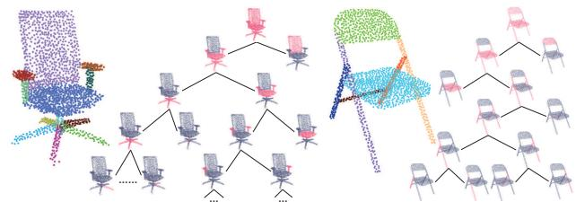
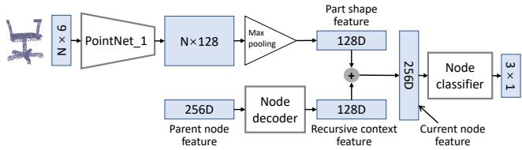
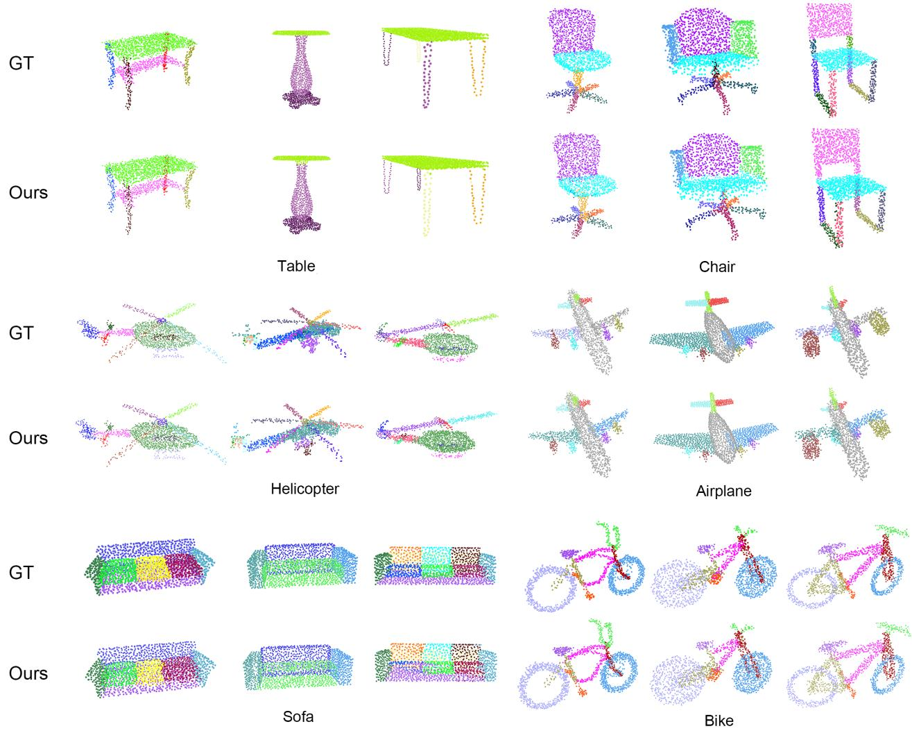
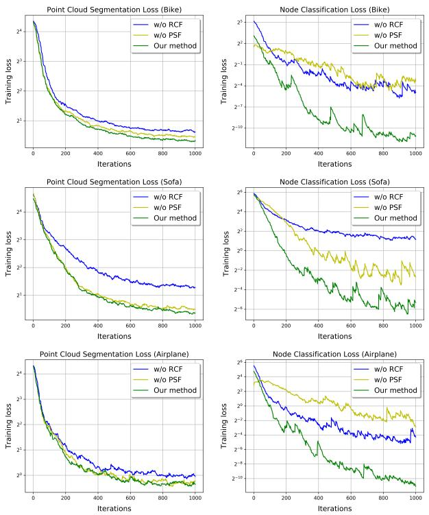
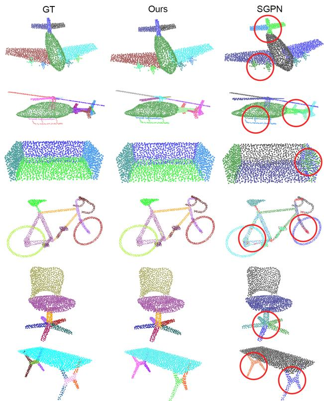
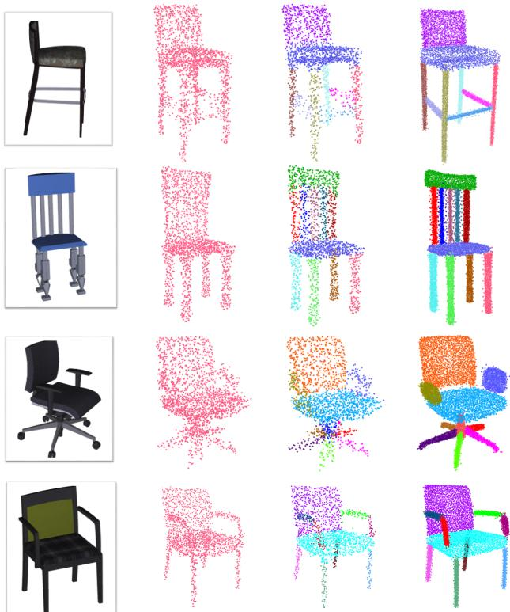

# PartNet：用于细粒度和层次化形状分割的递归部件分解网络

Fenggen Yu1∗ Kun Liu1\* Yan Zhang1 Chenyang Zhu2 Kai Xu2† 1Nanjing University 2National University of Defense Technology

## 摘要

针对三维形状分割的深度学习方法通常被建模为一个多类标注问题。现有模型都是针对固定的标签集合进行训练的，这大大限制了它们的灵活性和自适应性。我们选择自顶向下的递归分解方式，并基于递归神经网络（recursive neural network）开发了首个用于三维形状层次化分割的深度学习模型。从一个由点云表示的完整形状开始，我们的模型执行递归二值分解，层次结构中所有节点处的分解网络共享权重。在每个节点处训练一个节点分类器，用于确定其分解的类型（邻接或对称）和停止准则。在高层节点提取的特征被递归地传播到低层节点。因此，高层中有意义的分解为低层中的分割提供了强有力的上下文线索。同时，为了提高每个节点处的分割精度，我们用为对应部件提取的形状特征来增强递归上下文特征。我们的方法将一个由点云表示的三维形状分割为数量不固定的部件（具体数量取决于形状的复杂度），表现出强大的通用性和灵活性。在公开基准以及本文所提出的一个新细粒度分割基准上，无论对于细粒度分割还是语义分割，我们都取得了最先进的性能。我们还展示了其在图像到形状重建中用于细粒度部件细化的应用。

## 1. 引言

分割是三维形状分析中一个长期存在的问题，在该问题上数据驱动方法相对于传统的几何方法 [38] 表现出明显的优势。随着深度学习技术的蓬勃发展，研究人员一直致力于利用深度神经网络强大的特征学习能力来取代先前数据驱动方法中所使用的手工特征。在这些工作中，深度网络针对多类标注任务进行训练，为每个几何基元（例如体素 [23] 或点 [20]）输出一个语义标签。

  

图 1. PartNet 以自顶向下（top-down）递归的方式对三维点云进行分割，从而得到一个由细粒度部件组成的层次结构。同一模型在椅子（Chair）类上训练后，可用于将不同的椅子模型分割为不同数量的部件，具体取决于输入形状的结构复杂度。

现有模型存在两个问题。首先，这些模型在训练时针对一组固定的标签，这极大地限制了模型的灵活性与适应性。例如，一个被训练用于将椅子分割为三个语义部分的模型，无法用于正确分割具有四个部分的椅子，即便二者属于同一形状族。针对不同的目标标签集训练不同的模型既不通用，也不高效。其次，同时标注所有图元（primitive）无法利用形状分解的层次结构特性。层次化形状分割通过将多类标注问题分解为一系列二分类标注问题，降低了形状分割的难度 [1, 39]。另一方面，层次化分割能够利用跨层级的结构约束：较高层级的分割结果提供了约束较低层级分割的强有力线索。这使得向非常细粒度的层级进行精确分割成为可能（Figure 1）。

在本工作中，我们选择自顶向下的分解方式，并提出了第一个基于递归神经网络（Recursive Neural Network, RvNN）的、用于将三维形状层次化分割为细粒度部分的深度学习模型。从以点云表示的完整形状出发，我们的模型执行递归二值分解，层次结构中所有节点处的分解网络共享权重。在每个节点处，训练一个节点分类器来确定其分解类型（邻接节点或对称节点）以及分解是否应停止（叶节点）。在较高层级节点中提取的特征通过树结构递归传播到较低层级节点，我们称之为递归上下文特征（recursive context feature）。因此，较高层级中有意义的分解约束了较低层级的分割。同时，为了提升每个节点处的分割精度，我们使用为对应点云提取的部分形状特征来增强递归上下文特征。

该网络使用 ShapeNet [3] 中点采样得到的三维模型进行训练，这些模型通常由具有语义标签的部分组成。对于每个形状，使用一种现有的基于规则的方法 [36] 来构建其层次结构。这种有原则的训练层次结构有助于训练更快收敛。损失在每个节点处进行计算，包括节点分类损失和二值点标注损失。

我们的方法能够实现精确的分割，即使对于分解为任意数量部件的高度细粒度任务也是如此，这得益于基于动态 RvNN 架构的灵活性。此外，该方法恢复了部件之间的关系（邻接性或对称性），进一步提升了标注精度，例如，对称部件可以被识别并正确标注（图 1）。我们的方法在公开基准测试以及本文提出的一个新细粒度分割基准测试上均达到了最先进的性能。我们还展示了该方法在从图像到三维形状重建任务中恢复细粒度结构的实用性。

我们的贡献包括：

- 一种基于动态 RvNN 架构的、用于三维形状自顶向下层级化细粒度分割的深度学习模型。
- 一种融合上下文信息与各部件形状几何信息的部件特征学习方案。
- 一个用于三维形状细粒度部件实例分割的基准测试。
- 将我们的细粒度结构恢复方法应用于高质量的从图像到三维形状重建。

## 2. 相关工作

三维形状分割学习。近年来，三维形状的语义分割取得了显著的研究进展，这得益于机器学习技术的发展 [10, 24, 35, 37, 42]。关于基于学习的三维形状分割的全面综述可在文献 [38] 中找到。这些方法的基本思想是基于形状基元的几何特征，学习一个针对形状基元（例如三角形、点或体素）的分类器。

近年来，研究人员已开发出多种深度学习模型，用于在不同表示形式下的三维形状有监督分割，包括体素网格 [23, 32]、点云 [20, 11, 7]、多视图渲染 [9] 或表面网格 [41, 31]。其主要思想是用数据驱动学习得到的特征来取代传统方法中所采用的手工设计的几何特征。然而，所有这些模型的训练都针对一组固定的语义标签。若给定一组不同的目标标签，则必须使用以新标签进行标注的训练数据集对模型进行重新训练。

三维形状的层次分割。三维形状通常以层次化构造的方式由部件进行建模。这一点可由人类创建的对象或场景三维模型中场景图（scene graph）的广泛可得性，以及构造实体几何（Constructive Solid Geometry, CSG）[21] 这一众所周知的层次建模范式部分得到印证。这自然引出了对三维形状进行层次分解的思想。层次形状分割既可以通过自底向上的分组方法 [1, 34] 实现，也可以基于全局拓扑分析以自顶向下的方式实现 [22, 8, 43]。给定一个预先分割好的三维形状，Wang 等人 [36] 基于邻近性和对称性关系推断各部分的层次组织结构。随后，这一启发式方法被一种无监督学习方法 [30] 所改进。Yi 等人 [39] 提出了一种用于三维形状层次分割的有监督学习方法。他们的模型同样是针对一组固定的语义标签进行训练。标签集合在部件标签分析的预处理阶段确定，并以预定义的规范层次结构进行组织。而我们的方法则不需要预设的规范层次结构，而是以数据驱动的方式学习分解层次，这得益于递归训练的节点分类。据我们所知，我们的方法是首个端到端可训练的层次形状分割模型。

递归神经网络。递归神经网络（Recursive Neural Networks, RvNN）由 Socher 等人 [25] 提出，应用于文本与图像理解 [27] 以及三维形状分类 [26]。最近，Li 等人 [12] 引入了一种用于生成三维形状结构的生成式递归自编码器。给定一组预先分割好的三维形状，通过基于 RvNN 的部件结构编码与解码来学习一个变分自编码器（variational auto-encoder, VAE）模型。在此之后，基于 RvNN 的 VAE 还被训练用于三维场景生成 [13]、结构感知的单视图三维重建 [18]，以及部件组合的子结构先验学习 [44]。我们尚未了解到有先前工作使用 RvNN 进行层次化的三维形状分割。

## 3. 方法

我们首先介绍 PartNet 的整体架构，它是一个递归部件分解网络。随后将介绍该网络中若干关键的设计。

  

图 2. PartNet 的架构。在每个节点上，分别设计了三个模块，用于上下文传播（context propagation）、层次结构构建（hierarchy construction）和点云分割（point cloud segmentation）。作为一个递归网络，这些模块由层次结构中的所有节点共享。

## 3.1. 递归部件分解网络

图 2 展示了 PartNet 的架构。PartNet 以三维形状的点云作为输入，执行自顶向下的分解，并在部件实例层级输出分割后的点云。在每个节点上，设计了三个模块：

• 节点解码模块（Node decoding module），用于将全局上下文信息从当前节点传递给其子节点。该信息利用更高层级的上下文来约束节点的分割。

• 节点分类模块（Node classification module），用于构建分解层次结构的拓扑关系。这通过学习预测节点类型来实现，节点类型决定了如何分解一个节点以及何时停止分解。

• 节点分割模块（Node segmentation module），用于对当前节点的点云执行实际的分割。这通过学习一个在所有节点间共享的点分类网络来实现。

下面我们详细讨论这些模块。

节点解码模块。为了进行引导式启动，我们首先为完整形状的点云提取一个 128 维的 PointNet [19] 特征，然后将其复制并拼接，形成一个 256 维的根节点特征。该 256 维特征随后被解码为两个 128 维特征，分别对应其两个子节点，我们将其称为递归上下文特征（recursive context feature）。在每个非根节点处，我们同样为对应的部分点云提取一个 128 维的 PointNet 特征，称为部件形状特征（part shape feature）。该 128 维部件形状特征随后与从父节点传递下来的 128 维递归上下文特征进行拼接，形成当前节点的特征。请参见图 3 以直观理解这些特征。解码模块由一个具有 tanh 非线性的双层全连接网络实现。本模块中使用的 PointNet 被称为 Point-Net 1，以区别于节点分割模块中将要使用的 PointNet（见下文）。

  

图 3. 节点解码模块（Node Decoding Module）与节点分类模块（Node Classification Module）的网络设计。递归上下文特征（Recursive Contextual Feature）与部件形状特征（Part Shape Feature）拼接后输入节点分类器（Node Classifier）。

节点分类模块。在给定节点处，以其当前节点特征作为输入，节点分类模块将该节点的类型预测为以下三种之一：邻接（adjacency）、对称（symmetry）或叶子（leaf）。通过确定节点的分割方式以及是否进行分割，该模块构建了层次结构的拓扑结构。此节点分类模块由两个具有 tanh 非线性的全连接层实现。它可以利用点云的真值层次分割数据进行训练。

注意，当一个节点被分类为对称节点时，我们将其左子节点解释为对称生成器（symmetry generator，表示一个部件），将其右子节点解释为对称参数（symmetry parameters），类似于文献 [12]。将对称参数应用于对称生成器部分，可以得到该对称节点的完整点云。例如，转椅（图 1，左）腿部辐条所对应的节点是一个旋转对称节点。其左子节点表示其中一根辐条的点云，右子节点则编码对称轴和对称阶数。

节点分割模块。该模块基于当前节点特征以及逐点的 PointNet 特征来执行点的标注。具体而言，我们使用另一个 Point-

  

Figure 4. 节点分割模块的网络设计。递归上下文特征与部件形状特征的拼接结果，通过逐点的 PointNet 特征进行增强，用于点标签预测（点云分割）。

Net（即 PointNet 2）用于提取逐点特征，得到一个 N × 128 的特征矩阵，其中 N 为当前节点的点数。然后对于每一行（点特征），我们将 256 维的当前节点特征拼接到该行上，以增强该特征。这将得到一个 N × 384 的特征矩阵，将其输入到点分类网络中以生成逐点的二分类标签。该点分类器由一个 PointNet 的最后五层实现。注意，这些层与 PointNet 1 或 PointNet 2 不共享权重。

对于对称节点，仅需对其左子节点（即对称生成器）进行分割。分割完成后，根据预测的对称参数，将点的标签传递到所有其他对称对应部分。

## 3.2. 损失函数

对于每个训练点云，PartNet 的总体损失函数 $L _ { \mathrm { p a r t n e t } }$ 由所有相关节点的平均节点分类损失和平均节点分割损失构成：

$$
L _ {\text { partnet }} = \frac {1}{| \mathcal {H} |} \sum_ {n \in \mathcal {H}} L _ {\text { class }} (n) + \frac {1}{| \mathcal {T} |} \sum_ {n \in \mathcal {T}} L _ {\text { seg }} (n)\tag{1}
$$

其中 $L_{\mathrm{class}}(n)$ 和 $L_{\mathrm{seg}}(n)$ 分别是节点 n 的分类损失和分割损失。两种损失均定义为交叉熵损失。H 是层次结构中所有节点的集合，T 是所有非叶节点的集合。

## 3.3. 训练细节

用于节点分类的 PointNet 1（图 3）使用六个逐点卷积层，滤波器数量分别为 64、128、128、256、256 和 128。用于节点分割的 PointNet 2（图 4）使用四个逐点卷积层，滤波器数量分别为 64、64、128 和 128。图 4 中的点云分割网络由四个逐点卷积层组成，滤波器数量分别为 512、256、128 和 128，另外还有一个用于二分类标签预测的输出层，该输出层具有 2 个滤波器。在所有这些网络中，最后三个层中的每两层之间使用 20% 的随机特征 dropout。每两层之间使用批归一化（Batch Normalization）。我们使用 Adam 优化器进行训练，批量大小为 10，初始学习率为 0.001。

输入点云的规模为 2048。训练点云通过对三维模型进行点采样获得。为增强数据，添加了高斯噪声。所有 PointNet 都使用点法线来提升细粒度部件分割的性能。因此，PartNet 输入张量的维度为 2048 × 6。

## 4. 结果与评估

## 4.1. 基准数据集

**细粒度分割基准（FineSeg，Fine-grained Segmentation Benchmark）**。随着基于深度学习的三维形状分割技术的进步，对细粒度部件实例分割的基准数据集的需求日益迫切。文献 [17] 中一项同期工作最近提出了一个用于评估细粒度形状分割的优秀基准。在本文中，我们提出 FineSeg。该数据集包含约 3000 个三维形状，涵盖六个形状类别：椅子（1000）、桌子（500）、飞机（600）、沙发（600）、直升机（100）和自行车（140）。这些模型采自 Sung 等人 [29] 工作中使用的 ShapeNet [3] 的一个子集。这些模型经过统一对齐和一致缩放。对于分割不够细粒度的模型（例如，没有实例级部件分割），我们对这些模型进行手动分割。然后，我们使用 [36] 中提出的方法为每个形状构建部件层次结构。我们对每个三维模型进行点采样，从而生成对应三维点云的真值细粒度分割。这些层次结构可用于训练我们的递归部件分解网络。该基准可用于基于平均精度（Average Precision，AP）的三维点云细粒度分割定量评估（用于部件检测，与真值之间的交并比大于设定阈值）。该基准数据集已公开发布于：www.kevinkaixu.net/projects/partnet.html。

## 4.2. 分割结果与评估

我们的 PartNet 模型使用 Fine-Seg 中 80% 的模型进行训练，剩余的 20% 用于测试。关于复杂度与时间消耗（包括训练和测试）的讨论可以在补充材料中找到。

**FineSeg 上的可视化结果。** 我们首先在图 5 中展示一些由 PartNet 得到的细粒度点云分割可视化示例。为了进行并列对比，我们还展示了每个示例的真值分割结果。我们的方法在具有复杂部件结构的含噪点云上能够产生精确的细粒度分割。此外，一旦完成训练，相同的模型即可用于将测试（未见过的）点云分割为数量可变的部件，这体现了其灵活性与通用性。图 6 展示了同一 PartNet 模型如何根据结构复杂度，将同一类别中的不同形状分割为任意数量的目标部件。更多结果可以在补充材料中找到。在补充材料中，我们还展示了与两种传统（非学习型）基线方法的层次化分割的可视化对比。

**定量评估与消融实验。** 在 FineSeg 的定量评估中，我们与两个基线方法进行比较，它们是我们方法的消融版本。特别地，我们关注 PartNet 中所使用的两个重要节点特征的影响：递归上下文特征（Recursive Context Feature, RCF）和部件形状特征（Part Shape Feature, PSF）。

  

图 5. PartNet 的细粒度点云分割。为了便于比较，我们为每个形状展示了细粒度分割结果（下）及其对应的真值（ground-truth，上）。

  

图 6. 在椅子（Chair）数据集上训练的同一个 PartNet 模型，可根据输入形状的结构复杂度，将不同的椅子模型分割成不同数量的部件。

在第一个基线（w/o RCF）中，递归上下文特征（recursive context feature）从节点分类（node classification，见图 3）和节点分割（node segmentation，见图 4）中被移除。为补偿缺失的递归上下文特征，128 维的部分形状特征被复制为 256 维特征。消融后的网络使用 FineSeg 的训练集重新训练。在第二个基线（w/o PSF）中，PSF 仅从节点分类模块中移除。

<table><tr><td colspan="2"></td><td>mean</td><td>aero</td><td>bike</td><td>chair</td><td>heli.</td><td>sofa</td><td>table</td></tr><tr><td rowspan="3">IoU &gt;0.25</td><td>Full</td><td>84.8</td><td>95.2</td><td>97.0</td><td>91.1</td><td>83.0</td><td>65.4</td><td>77.2</td></tr><tr><td>w/o RCF</td><td>79.2</td><td>92.8</td><td>92.0</td><td>87.1</td><td>71.1</td><td>61.6</td><td>70.8</td></tr><tr><td>w/o PSF</td><td>77.6</td><td>90.8</td><td>95.1</td><td>83.6</td><td>77.8</td><td>54.1</td><td>64.0</td></tr><tr><td rowspan="3">IoU &gt;0.5</td><td>Full</td><td>72.8</td><td>88.0</td><td>89.4</td><td>80.5</td><td>69.4</td><td>46.7</td><td>62.6</td></tr><tr><td>w/o RCF</td><td>66.0</td><td>85.3</td><td>83.4</td><td>71.8</td><td>56.7</td><td>42.5</td><td>56.4</td></tr><tr><td>w/o PSF</td><td>64.9</td><td>85.2</td><td>88.4</td><td>65.6</td><td>57.5</td><td>36.9</td><td>55.6</td></tr></table>

表 1. 在 FineSeg 数据集上将我们的完整模型与两个基线方法（不含 RCF 和不含 PSF）进行对比。AP（%）分别在 IoU 阈值为 0.25 和 0.5 时测得。

表 1 报告了在测试集全部六个类别上的 AP 值，IoU 阈值分别为 0.25 和 0.5。

  

图 7. 在三个形状类别（自行车、沙发和飞机）上，针对两个关键节点特征（RCF 和 PSF）的消融实验中，训练损失随迭代次数的变化。对于每个类别（每一行），我们同时绘制了节点分割损失（左图）和节点分类损失（右图）。

我们完整模型（full model）的一致优势表明了这两个特征的重要性。图 7 绘制了三种方法在三种形状类别（Bike、Sofa 和 Airplane）上随迭代次数变化的训练损失。结果表明，这两个特征对于节点分类模块（node classification module）和节点分割模块（node segmentation module）的快速训练都至关重要。这证明了全局上下文信息（global context information）和局部形状几何（local shape geometry）对学习层次化分割（hierarchical segmentation）的重要性。更多结果见补充材料。

ShapeNet 细粒度分割挑战赛。此外，我们使用 ShapeNet [3] 挑战赛进行了一次中等规模的压力测试，以进行细粒度分割。我们从 ShapeNet 中随机选取一组形状，并使用 PartNet 对它们进行分割。由于我们没有 ShapeNet 模型的细粒度分割真值标签（groundtruth），我们转而采用主观研究来评估我们的分割结果。我们要求参与者在 1 到 5 的范围内对细粒度分割的质量进行评分。用户研究表明，我们的方法在所有测试类别中都获得了 > 4.0 的平均评分，远高于 "w/o RCF" 基线（baseline）的结果。该研究的细节和结果见补充材料。在图 8 中，我们展示了一些可视化示例，从中可以看出，我们的方法能够对这些具有复杂结构的未见形状产生细粒度分割。此外，我们的方法还获得了分解部件之间的邻接和对称关系，可用于许多下游结构感知（structure-aware）的应用 [16]。

  

图 8. ShapeNet 细粒度分割挑战赛的部分结果。除了分割之外，PartNet 还可以恢复分割部件之间的关系（邻接关系和对称关系）。我们用彩色箭头可视化恢复出的对称关系（反射对称：红色；平移对称：蓝色；旋转对称：绿色）。

## 4.3. 语义分割对比

尽管 PartNet 是为细粒度分割设计的，但递归分解对于语义分割应当效果更佳，因为语义分割通常是更粗粒度的分割。我们在 ShapeNet part 数据集 [40] 上对 PartNet 在三维点云语义分割任务上的表现进行评估，并与该任务上七种最先进的方法进行了比较。与 PointNet [19] 类似，我们将每个形状的点云重采样为 2048 个点。我们采用与这些最先进方法相同的训练/测试划分设置，并以逐部件的平均交并比（IoU）作为评价指标。

需要注意的是，PartNet 并不为点生成语义标签，因此无法执行带标签的分割。为了实现对比，我们为 PartNet 增加了一个额外的模块，用于对其分解得到的每个部件预测语义标签。该部件标签预测模块以叶节点的节点特征作为输入，为该叶节点包含的所有点输出一个语义标签。该模块由三个全连接层实现，并使用交叉熵损失进行训练。

<table><tr><td>Method</td><td>mean</td><td>aero</td><td>bag</td><td>cap</td><td>car</td><td>chair</td><td>eph.</td><td>guitar</td><td>knife</td><td>lamp</td><td>laptop</td><td>motor</td><td>mug</td><td>pistol</td><td>rocket</td><td>skate.</td><td>table</td></tr><tr><td>PointNet [19]</td><td>83.7</td><td>83.4</td><td>78.7</td><td>82.5</td><td>74.9</td><td>89.6</td><td>73.0</td><td>91.5</td><td>85.9</td><td>80.8</td><td>95.3</td><td>65.2</td><td>93.0</td><td>81.2</td><td>57.9</td><td>72.8</td><td>80.6</td></tr><tr><td>PointNet++ [20]</td><td>85.1</td><td>82.4</td><td>79.0</td><td>87.7</td><td>77.3</td><td>90.8</td><td>71.8</td><td>91.0</td><td>85.9</td><td>83.7</td><td>95.3</td><td>71.6</td><td>94.1</td><td>81.3</td><td>58.7</td><td>76.4</td><td>82.6</td></tr><tr><td>O-CNN [32]</td><td>85.9</td><td>85.5</td><td>87.1</td><td>84.7</td><td>77.0</td><td>91.1</td><td>85.1</td><td>91.9</td><td>87.4</td><td>83.3</td><td>95.4</td><td>56.9</td><td>96.2</td><td>81.6</td><td>53.5</td><td>74.1</td><td>84.4</td></tr><tr><td>SSCN [6]</td><td>86.0</td><td>84.1</td><td>83.0</td><td>84.0</td><td>80.8</td><td>91.4</td><td>78.2</td><td>91.6</td><td>89.1</td><td>85.0</td><td>95.8</td><td>73.7</td><td>95.2</td><td>84.0</td><td>58.5</td><td>76.0</td><td>82.7</td></tr><tr><td>PCNN [2]</td><td>85.1</td><td>82.4</td><td>80.1</td><td>85.5</td><td>79.5</td><td>90.8</td><td>73.2</td><td>91.3</td><td>86.0</td><td>85.0</td><td>95.7</td><td>73.2</td><td>94.8</td><td>83.3</td><td>51.0</td><td>75.0</td><td>81.8</td></tr><tr><td>SPLATNet [28]</td><td>85.4</td><td>83.2</td><td>84.3</td><td>89.1</td><td>80.3</td><td>90.7</td><td>75.5</td><td>92.1</td><td>87.1</td><td>83.9</td><td>96.3</td><td>75.6</td><td>95.8</td><td>83.8</td><td>64.0</td><td>75.5</td><td>81.8</td></tr><tr><td>PointCNN [14]</td><td>86.1</td><td>84.1</td><td>86.4</td><td>86.0</td><td>80.8</td><td>90.6</td><td>79.7</td><td>92.3</td><td>88.4</td><td>85.3</td><td>96.1</td><td>77.2</td><td>95.3</td><td>84.2</td><td>64.2</td><td>80.0</td><td>83.0</td></tr><tr><td>Ours</td><td>87.4</td><td>87.8</td><td>86.7</td><td>89.7</td><td>80.5</td><td>91.9</td><td>75.7</td><td>91.8</td><td>85.9</td><td>83.6</td><td>97.0</td><td>74.6</td><td>97.3</td><td>83.6</td><td>64.6</td><td>78.4</td><td>85.8</td></tr></table>

表 2. 在 ShapeNet 部件数据集 [40] 上的语义分割对比。指标为按部件的交并比（IoU, %）。

结果如表 2 所示。PartNet 在增加了部件标签预测模块后，在大多数类别上取得了更好的性能，并在所有类别上取得了最高的平均精度。此外，我们的方法对于具有复杂结构的类别（例如椅子、桌子和飞机等）尤为有效。我们认为递归分解的分治特性确实有助于降低分割学习的难度。递归分解的另一个关键优势在于：高层级的分割为低层级的分割提供了具有约束作用的上下文线索。在 Princeton 分割基准（Princeton Segmentation Benchmark）[4] 上测试我们训练的模型时，也可以观察到类似的结果（见补充材料）。

对于语义分割，PartNet 可以使用一个在某个类别所有形状上保持一致的层级结构进行训练。训练可以使用任何在所有训练形状上保持一致的层级结构。因此，我们不需要额外的层级构建过程（例如文献 [36] 在细粒度分割中所采用的过程）。我们将任一训练形状的随机层级结构作为"模板"，并基于语义部件标签统一所有其他形状的层级结构。因此，PartNet 在语义分割训练中不需要额外的部件层级监督。相应地，主论文表 2 中报告的对比是公平的。

## 4.4. 实例分割对比

SGPN [33] 是首个在三维点云上学习实例分割的深度学习模型。它能够分割物体实例，并为每个实例预测一个类别标签，这与我们的方法（增加了标签预测模块）非常相似，只是 SGPN 无法像我们的方法那样获得部件关系。我们在 FineSeg 数据集上与 SGPN 进行了对比，同样使用 IoU 阈值为 0.25 和 0.5 的平均精度（AP）。

图 9 展示了一些可视化对比，其中分割错误的区域被标记出来。表 3 展示了我们数据集上的定量对比。我们将相对于 SGPN 的一致性提升归因于两个因素。首先，SGPN 的实例分组学习基于点聚类。这种对完整形状进行的一次性点分组难以学习。而我们的方法则执行自顶向下的递归分解，将完整形状分割分解为一系列部分形状分割的级联。其次，SGPN 所使用的点特征仅仅是点卷积特征 [19]，而我们的特征同时考虑了局部部件形状与全局上下文。

  

图 9. 与 SGPN [33] 的细粒度部件实例分割视觉对比。左：真实标注（Ground-truths）。中：PartNet 的分割结果。右：SGPN 的结果。错误的分割（相对于真实标注）用红色圆圈标出。

<table><tr><td colspan="2"></td><td>mean</td><td>aero</td><td>bike</td><td>chair</td><td>heli.</td><td>sofa</td><td>table</td></tr><tr><td>IoU</td><td>SGPN [12]</td><td>62.2</td><td>67.8</td><td>75.8</td><td>66.2</td><td>59.4</td><td>50.4</td><td>53.6</td></tr><tr><td>&gt;0.25</td><td>Ours</td><td>84.8</td><td>95.2</td><td>97.0</td><td>91.1</td><td>83.0</td><td>65.4</td><td>77.2</td></tr><tr><td>IoU</td><td>SGPN [12]</td><td>47.0</td><td>56.7</td><td>63.7</td><td>54.6</td><td>38.9</td><td>29.5</td><td>38.4</td></tr><tr><td>&gt;0.5</td><td>Ours</td><td>72.8</td><td>88.0</td><td>89.4</td><td>80.5</td><td>69.4</td><td>46.7</td><td>62.6</td></tr></table>

表 3. 在 FineSeg 数据集上与 SGPN [33] 在细粒度实例分割方面的对比。指标为 AP（%），IoU 阈值分别为 0.25 和 0.5。

## 5. 应用

我们展示了 PartNet 细粒度分割在精化从单视图图像重建的 3D 点云中的一个应用。其基本思想是一个"分割—精化"过程。给定一个以整体方式重建出的 3D 点云（例如使用 Fan 等人的方法 [5]），我们首先对该点云进行递归分解，得到一个层次化的部件点云组织。然后我们在每个叶节点训练一个网络来精化该部件的点云，从而为该部件产生一个高质量的点云。这些精化后的部件点云共同构成了完整形状的精化点云。

在每个叶节点使用的部件精化网络由两路 PointNet 组成，分别用于编码该部件的点云和完整形状的点云。所得的两个特征被拼接起来，输入到一个四层全连接网络中，以生成精化后的部件点云。为了训练这个精化网络，我们使用由点云之间的倒角距离（Chamfer distance）和推土机距离（Earth Mover's Distance）计算得到的重建损失 [5]。为了获得更多的训练信号，我们选择使用层次化重建损失来训练精化网络，即按照 PartNet 分割得到的层次结构，自底向上地组合精化后的部件点云。这样，我们就可以在层次结构的每个节点处计算一个重建损失，其对应的点云由其子树内的部件点云构成。更多关于网络架构的细节，请参阅补充材料。

图 10 展示了若干点云精化的示例，这些示例由 PartNet 的细粒度、层次化分割所引导。尽管精化过程有时可能会在部件保真度上相对于输入图像有所损失，但由于 PartNet 的细粒度部件分解，它确实能够生成具有丰富细节的点云，并具有合理的部件结构。更多示例请参见补充材料。

## 6. 结论

我们提出了一个用于 3D 点云细粒度分割的自顶向下递归分解网络。借助层次化分解方案，即使对于高度复杂的形状，我们的模型也能获得细粒度且精确的分割结果。与大多数现有的基于深度学习的分割模型不同，我们的方法根据形状的结构复杂性，将其分割为任意数量的部件，而不是生成具有固定标签集合的带标签分割结果。即使对于语义分割，得益于我们分而治之的分割学习方式，我们的模型同样取得了优异的性能。

局限性与未来工作。我们当前的方法存在一些局限性。首先，尽管 PartNet 以层次化方式对一个形状进行分割，但所得的分割层次不一定像那些针对形状 [30, 39] 或场景 [15] 而专门习得的层次那样具有语义意义。其次，尽管我们的模型可以将不同的形状分割为不同数量的部件，而不是针对固定的部件标签集，但它仍然需要为每个形状类别分别进行训练。学习一种能够对多个类别的形状进行递归分解的更为通用的模型，将是一个非常值得探索的未来方向。第三，PartNet 是使用基于文献 [36] 所构建的合理真值（ground-truth）层次结构进行训练的。使用完全随机的层次结构进行训练会导致性能下降。我们在补充材料中展示了这一效应。因此，另一个未来方向是以无监督方式学习层次化分割，而无需构建真值层次结构。

  

图 10. 几个通过 PartNet 的精细粒度分割来细化从单视图图像重建出的点云的示例。在每一行中，从左到右我们分别展示输入图像、全局重建结果、该重建结果的精细粒度分割，以及我们方法得到的最终细化结果。

## 致谢

我们感谢匿名审稿人提出的宝贵意见。我们同样感谢 Hao (Richard) Zhang 在讨论中给予的富有成效的见解，以及 Yuan Gan 和 Pengyu Wang 在数据准备方面提供的巨大帮助。本研究部分得到国家自然科学基金（NSFC）（61572507、61532003、61622212）以及湖南省杰出青年自然科学基金（2017JJ1002）的资助。

## 参考文献

[11] R. Klokov and V. Lempitsky. Escape from cells: Deep kd-networks for the recognition of 3d point cloud models. In Computer Vision (ICCV), 2017 IEEE International Conference on, pages 863–872. IEEE, 2017. 2

[14] Y. Li, R. Bu, M. Sun, W. Wu, X. Di, and B. Chen. PointCNN：基于 X 变换点的卷积。载于 S. Bengio、H. Wallach、H. Larochelle、K. Grauman、N. Cesa-Bianchi 和 R. Garnett 编，Advances in Neural Information Processing Systems 31，第 820–830 页，Curran Associates, Inc.，2018 年。7

[15] T. Liu, S. Chaudhuri, V. G. Kim, Q. Huang, N. J. Mitra, and T. Funkhouser. 使用概率文法创建一致的场景图。ACM Transactions on Graphics (TOG)，第 33 卷第 6 期：211，2014 年。8

[16] N. Mitra, M. Wand, H. R. Zhang, D. Cohen-Or, V. Kim, and Q.-X. Huang. 结构感知的形状处理。载于 SIGGRAPH Asia 2013 Courses，第 1 页，ACM，2013 年。6

[17] K. Mo, S. Zhu, A. X. Chang, L. Yi, S. Tripathi, L. J. Guibas, and H. Su. PartNet：一个用于细粒度和层次化部件级三维物体理解的大规模基准。arXiv 预印本 arXiv:1812.02713，2018 年。4

[18] C. Niu, J. Li, and K. Xu. Im2Struct：从单张 RGB 图像恢复三维形状结构。载于 CVPR 会议论文集，第 4521–4529 页，2018 年。2

[19] C. R. Qi, H. Su, K. Mo, and L. J. Guibas. PointNet：用于三维分类和分割的点集深度学习。arXiv 预印本 arXiv:1612.00593，2016 年。3, 6, 7

[20] C. R. Qi, L. Yi, H. Su, and L. J. Guibas. PointNet++：度量空间中点集的深度层次特征学习。载于 Advances in Neural Information Processing Systems，第 5099–5108 页，2017 年。1, 2, 7

[21] A. A. Requicha and H. B. Voelcker. 构造实体几何。1977 年。2

[22] M. Reuter. 基于 Laplace-Beltrami 特征函数拓扑特征的层次化形状分割与配准。International Journal of Computer Vision，第 89 卷第 2-3 期：287–308，2010 年。2

[23] G. Riegler, A. O. Ulusoy, and A. Geiger. OctNet：学习高分辨率深度三维表示。载于 IEEE Conference on Computer Vision and Pattern Recognition 会议论文集，第 3 卷，2017 年。1, 2

[24] O. Sidi, O. van Kaick, Y. Kleiman, H. Zhang, and D. Cohen-Or. 基于描述子空间谱聚类的形状集无监督协同分割。ACM Transactions on Graphics (SIGGRAPH Asia)，第 30 卷第 6 期，2011 年。2

[25] R. Socher. 用于自然语言处理与计算机视觉的递归深度学习。博士学位论文，Citeseer，2014 年。2

[26] R. Socher, B. Huval, B. Bath, C. D. Manning, and A. Y. Ng. 用于三维物体分类的卷积-递归深度学习。载于 Advances in Neural Information Processing Systems，第 656–664 页，2012 年。2

[27] R. Socher, C. C. Lin, C. Manning, and A. Y. Ng. 基于递归神经网络解析自然场景与自然语言。载于第 28 届 International Conference on Machine Learning (ICML-11) 论文集，第 129–136 页，2011 年。2

[28] H. Su, V. Jampani, D. Sun, S. Maji, E. Kalogerakis, M.-H. Yang, and J. Kautz. SPLATNet：用于点云处理的稀疏格点网络。载于 IEEE Conference on Computer Vision and Pattern Recognition 会议论文集，第 2530–2539 页，2018 年。7

[29] M. Sung, H. Su, V. G. Kim, S. Chaudhuri, and L. Guibas. ComplementMe：用于 3D 建模的弱监督组件建议。ACM Transactions on Graphics (SIGGRAPH Asia), 2017. 4

[30] O. Van Kaick, K. Xu, H. Zhang, Y. Wang, S. Sun, A. Shamir, and D. Cohen-Or. 形状结构的协同层次分析。ACM Transactions on Graphics (SIGGRAPH), 32(4):69, 2013. 2, 8

[31] P. Wang, Y. Gan, P. Shui, F. Yu, Y. Zhang, S. Chen, and Z. Sun. 通过形状全卷积网络进行 3D 形状分割。Computers & Graphics, 70:128–139, 2018. 2

[32] P.-S. Wang, Y. Liu, Y.-X. Guo, C.-Y. Sun, and X. Tong. O-CNN：基于八叉树的 3D 形状分析卷积神经网络。ACM Transactions on Graphics (SIGGRAPH), 36(4), 2017. 2, 7

[33] W. Wang, R. Yu, Q. Huang, and U. Neumann. SGPN：用于 3D 点云实例分割的相似性分组提议网络。2017. 7

[34] X. Wang, B. Zhou, H. Fang, X. Chen, Q. Zhao, and K. Xu. 学习分组与标记细粒度形状组件。收录于 SIGGRAPH Asia 2018 Technical Papers，第 210 页。ACM, 2018. 2

[35] Y. Wang, M. Gong, T. Wang, D. Cohen-Or, H. Zhang, and B. Chen. 用于 3D 形状分割的投影分析。ACM Transactions on Graphics (TOG), 32(6):192, 2013. 2

[36] Y. Wang, K. Xu, J. Li, H. Zhang, A. Shamir, L. Liu, Z. Cheng, and Y. Xiong. 人造物体的对称性层次结构。Computer Graphics Forum, 30(2):287–296, 2011. 2, 4, 7, 8

[37] Z. Xie, K. Xu, and L. L. abd Yueshan Xiong. 通过极限学习机进行 3D 形状分割与标记。Computer Graphics Forum (Proc. SGP), 33(5):85–95, 2014. 2

[38] K. Xu, V. G. Kim, Q. Huang, N. Mitra, and E. Kalogerakis. 数据驱动的形状分析与处理。收录于 SIGGRAPH ASIA 2016 Courses，第 4 页。ACM, 2016. 1, 2

[39] L. Yi, L. Guibas, A. Hertzmann, V. G. Kim, H. Su, and E. Yumer. 从在线仓库学习层次化形状分割与标记。ACM Transactions on Graphics (SIGGRAPH), 2017. 1, 2, 8

[40] L. Yi, V. G. Kim, D. Ceylan, I.-C. Shen, M. Yan, H. Su, C. Lu, Q. Huang, A. Sheffer, and L. Guibas. 用于 3D 形状集合中区域标注的可扩展主动学习框架。SIGGRAPH Asia, 2016. 6, 7

[41] L. Yi, H. Su, X. Guo, and L. J. Guibas. SyncSpecCNN：用于 3D 形状分割的同步谱卷积神经网络。收录于 CVPR，第 6584–6592 页, 2017. 2

[42] Y. Zhao, K. Xu, E. Zhu, X. Liu, X. Zhu, and J. Yin. 用于图数据集中同时聚类与优化的三角套索。IEEE Transactions on Knowledge and Data Engineering, 31(8):1610–1623, 2018. 2

[43] Y. Zhou, K. Yin, H. Huang, H. Zhang, M. Gong, and D. Cohen-Or. 广义圆柱分解。ACM Transactions on Graphics (SIGGRAPH Asia), 34(6):171–1, 2015. 2

[44] C. Zhu, K. Xu, S. Chaudhuri, R. Yi, and H. Zhang. SCORES：基于递归子结构先验的形状组合。ACM Transactions on Graphics (TOG), 37(6):1–14, 2018. 2