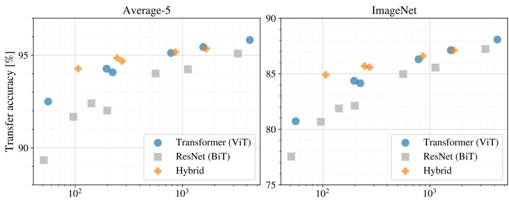
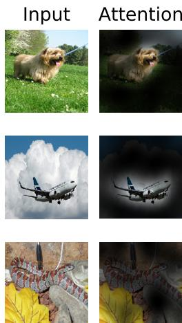
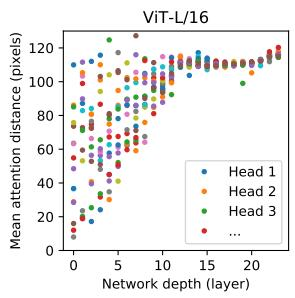
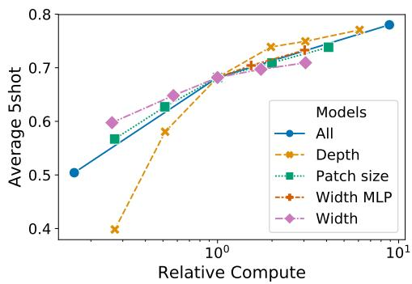
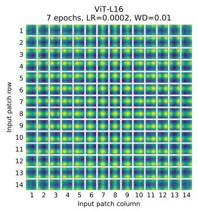
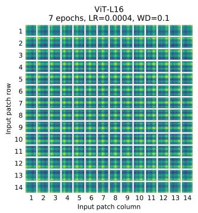
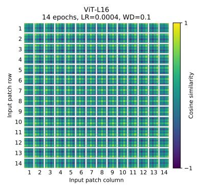
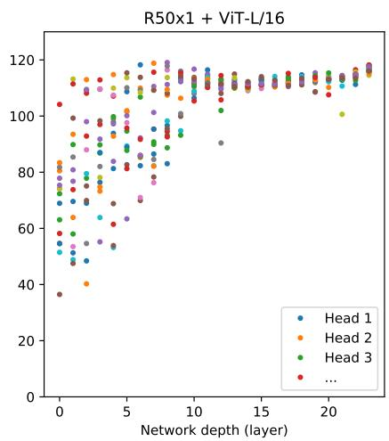
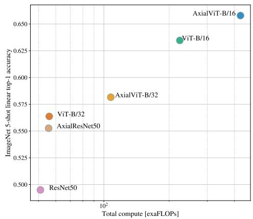
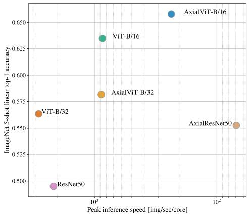

# 一张图等于 16×16 个词：用于大规模图像识别的 Transformer（Transformers for Image Recognition at Scale）

Alexey Dosovitskiy∗,†, Lucas Beyer∗, Alexander Kolesnikov∗, Dirk Weissenborn∗,

Xiaohua Zhai∗, Thomas Unterthiner, Mostafa Dehghani, Matthias Minderer,

Georg Heigold, Sylvain Gelly, Jakob Uszkoreit, Neil Houlsby∗,†

∗同等技术贡献，†同等指导 Google Research, Brain Team {adosovitskiy, neilhoulsby}@google.com

## 摘要（ABSTRACT）

尽管 Transformer 架构已成为自然语言处理任务的事实标准，但它在计算机视觉中的应用仍然有限。在视觉领域，注意力机制要么与卷积网络结合使用，要么用于替代卷积网络的某些组件而保持其整体结构不变。我们表明，这种对 CNN 的依赖并非必要：直接将纯 Transformer 应用于图像块序列，即可在图像分类任务上取得非常好的效果。当在大规模数据上进行预训练并迁移到多个中型或小型图像识别基准（ImageNet、CIFAR-100、VTAB 等）时，视觉 Transformer（Vision Transformer, ViT）相较于最先进的卷积网络取得了优异的结果，同时训练所需的计算资源也大幅减少。1

## 1 引言（INTRODUCTION）

基于自注意力的架构，尤其是 Transformer（Vaswani et al., 2017），已成为自然语言处理（Natural Language Processing, NLP）中的主流模型。主流做法是先在大型文本语料库上预训练，然后在较小的任务特定数据集上进行微调（Devlin et al., 2019）。得益于 Transformer 的计算效率与可扩展性，如今已经能够训练参数规模超过 100B 的前所未有的大型模型（Brown et al., 2020; Lepikhin et al., 2020）。随着模型与数据规模的不断增长，性能仍未出现饱和的迹象。

然而，在计算机视觉领域，卷积架构仍然占据主导地位（LeCun et al., 1989; Krizhevsky et al., 2012; He et al., 2016）。受 NLP 领域成功的启发，多项工作尝试将类 CNN 架构与自注意力相结合（Wang et al., 2018; Carion et al., 2020），还有一些工作尝试完全替换卷积（Ramachandran et al., 2019; Wang et al., 2020a）。后一类模型虽然理论上效率很高，但由于使用了专门的注意力模式，至今仍无法在现代硬件加速器上有效地扩展。因此，在大规模图像识别任务中，经典的类 ResNet 架构仍是当前最先进的技术（Mahajan et al., 2018; Xie et al., 2020; Kolesnikov et al., 2020）。

受到 Transformer 在自然语言处理领域规模化成功的启发，我们尝试将标准 Transformer 直接应用于图像，且尽量减少改动。具体做法是：先将一幅图像切分成若干图块（patch），再将这些图块的线性嵌入序列作为 Transformer 的输入。图像图块的处理方式与自然语言处理应用中的标记（token，即词）完全相同。我们以有监督方式在图像分类任务上对模型进行训练。

当使用中等规模的数据集（如 ImageNet）进行训练且未施加较强正则化时，这些模型的准确率会比同等规模的 ResNet 低几个百分点。这一看似令人沮丧的结果其实符合预期：Transformer 缺乏卷积神经网络（CNN）所固有的一些归纳偏置，例如平移等变性和局部性，因此当训练数据量不足时，其泛化能力较差。

然而，如果在更大规模的数据集（1400 万至 3 亿张图像）上进行训练，情况就会发生改变。我们发现，大规模训练能够胜过归纳偏置的作用。我们的视觉 Transformer（Vision Transformer，ViT）在以足够规模进行预训练并迁移到数据量更少的任务时，取得了优异的效果。当在公开的 ImageNet-21k 数据集或自有的 JFT-300M 数据集上进行预训练后，ViT 在多个图像识别基准上达到或超越了当时的最先进水平。其中表现最好的模型在 ImageNet 上达到了 88.55% 的准确率，在 ImageNet-ReaL 上达到了 90.72%，在 CIFAR-100 上达到了 94.55%，在包含 19 个任务的 VTAB 套件上达到了 77.63%。

## 2 相关工作

Transformer 由 Vaswani 等人（2017）提出，最初用于机器翻译，此后成为许多自然语言处理任务中的最先进方法。基于 Transformer 的大型模型通常先在大型语料库上进行预训练，再针对下游任务进行微调：BERT（Devlin 等人，2019）采用去噪自监督预训练任务，而 GPT 系列工作则以语言建模作为预训练任务（Radford 等人，2018；2019；Brown 等人，2020）。

将自注意力朴素地应用于图像，会要求每个像素对其他所有像素都计算注意力。由于像素数量带来的二次复杂度，这在实际输入尺寸下无法扩展。因此，为了在图像处理背景下应用 Transformer，过去曾尝试若干近似方法。Parmar 等人（2018）仅在每个查询像素的局部邻域内应用自注意力，而非全局范围。此类局部多头点积自注意力块可以完全替代卷积（Hu 等人，2019；Ramachandran 等人，2019；Zhao 等人，2020）。在另一条研究路线上，稀疏 Transformer（Child 等人，2019）采用可扩展的全局自注意力近似以适用于图像。另一种扩展注意力的方式是按不同大小的块来施加注意力（Weissenborn 等人，2019），在极端情况下仅沿单个轴施加（Ho 等人，2019；Wang 等人，2020a）。这些专门的注意力架构中有许多在计算机视觉任务上展示了令人期待的结果，但要在硬件加速器上高效实现它们需要复杂的工程。

与我们工作最相关的是 Cordonnier 等人（2020）的模型，该模型从输入图像中提取大小为 2 × 2 的图块，并在其上施加完整的自注意力。该模型与 ViT 非常相似，但我们的工作更进一步地证明，大规模预训练使 vanilla transformer 能够与最先进的 CNN 相媲美（甚至优于后者）。此外，Cordonnier 等人（2020）使用了 2 × 2 像素的小图块尺寸，这使得该模型仅适用于小分辨率图像，而我们还能处理中等分辨率图像。

将卷积神经网络（CNN）与各种形式的自注意力相结合也同样引起了广泛关注，例如通过增强用于图像分类的特征图（Bello 等人，2019），或使用自注意力进一步处理 CNN 的输出，例如用于目标检测（Hu 等人，2018；Carion 等人，2020）、视频处理（Wang 等人，2018；Sun 等人，2019）、图像分类（Wu 等人，2020）、无监督目标发现（Locatello 等人，2020），或统一的文本-视觉任务（Chen 等人，2020c；Lu 等人，2019；Li 等人，2019）。

另一个近期相关的模型是 image GPT（iGPT）（Chen 等人，2020a），它在降低图像分辨率和颜色空间之后，将 Transformer 应用于图像像素。该模型以无监督方式作为生成模型进行训练，得到的表示随后可通过对分类任务进行微调或线性探测来评估，在 ImageNet 上达到了 72% 的最高准确率。

我们的工作为不断增长的论文集合增添了新的一员，这些论文探索了比标准 ImageNet 数据集更大规模的图像识别问题。使用额外的数据源能够在标准基准上取得最先进的结果（Mahajan 等人，2018；Touvron 等人，2019；Xie 等人，2020）。此外，Sun 等人（2017）研究了 CNN 性能如何随数据集规模扩展，Kolesnikov 等人（2020）；Djolonga 等人（2020）则对来自 ImageNet-21k 和 JFT-300M 等大规模数据集的 CNN 迁移学习进行了实证性探索。我们同样聚焦于后两个数据集，但训练的是 Transformer 模型，而非先前工作中使用的基于 ResNet 的模型。

  

图 1：模型概览。我们将图像分割为固定大小的图块（patch），对每个图块进行线性嵌入，添加位置嵌入（position embedding），并将得到的向量序列输入标准的 Transformer 编码器。为了执行分类，我们采用标准做法，向序列中再加入一个额外的可学习"分类标记"（classification token）。Transformer 编码器的示意图参考自 Vaswani 等人（2017）。

## 3 方法

在模型设计上，我们尽可能紧密地遵循原始 Transformer（Vaswani et al., 2017）的设计。这种有意简化的设置带来的一个优势是可扩展的 NLP Transformer 架构及其高效实现几乎可以开箱即用。

## 3.1 视觉 Transformer（Vision Transformer, ViT）

模型概览如图 1 所示。标准 Transformer 接收 1D 的 token 嵌入序列作为输入。为了处理 2D 图像，我们将图像 $\mathbf { x } \in \mathbb { R } ^ { H \times W \times \overset { \bullet } { C } }$ 重塑为一系列展平的 2D patch $\mathbf { x } _ { p } \in \mathbb { R } ^ { N \times ( P ^ { 2 } \cdot C ) }$，其中 $( H , W )$ 为原始图像的分辨率，$C$ 为通道数，$( P , P )$ 为每个 patch 的分辨率，$N = H W / P ^ { 2 }$ 为得到的 patch 数量，同时也作为 Transformer 的有效输入序列长度。Transformer 在其所有层中使用恒定的潜在向量维度 $D$，因此我们将 patch 展平，并通过一个可训练的线性投影映射到 $D$ 维（公式 1）。我们将该投影的输出称为 patch 嵌入。

类似 BERT 的 [class] token，我们在嵌入 patch 序列前添加一个可学习的嵌入 $( \mathbf { z } _ { 0 } ^ { 0 } = \mathbf { x } _ { \mathrm { c l a s s } } )$，其在 Transformer 编码器输出端的状态 $( \mathbf { z } _ { L } ^ { 0 } )$ 用作图像表示 $y$（公式 4）。无论在预训练还是微调阶段，分类头都附着于 $\mathbf { z } _ { L } ^ { 0 }$。预训练阶段，分类头由一个带隐藏层的多层感知机（MLP）实现；微调阶段，则由单层线性层实现。

位置嵌入被加到 patch 嵌入之上以保留位置信息。我们使用标准的可学习 1D 位置嵌入，因为并未观察到使用更先进的 2D 感知位置嵌入会带来显著的性能提升（附录 D.4）。最终的嵌入向量序列作为编码器的输入。

Transformer 编码器（Vaswani et al., 2017）由多头自注意力（MSA，见附录 A）与 MLP 块交替堆叠构成（公式 2、3）。每个块之前应用层归一化（LayerNorm, LN），每个块之后应用残差连接（Wang et al., 2019; Baevski & Auli, 2019）。

MLP 包含两层，使用 GELU 非线性激活函数。

$$
\mathbf {z} _ {0} = [ \mathbf {x} _ {\mathrm{class}}; \mathbf {x} _ {p} ^ {1} \mathbf {E}; \mathbf {x} _ {p} ^ {2} \mathbf {E}; \dots ; \mathbf {x} _ {p} ^ {N} \mathbf {E} ] + \mathbf {E} _ {p o s}, \qquad \mathbf {E} \in \mathbb {R} ^ {(P ^ {2} \cdot C) \times D}, \mathbf {E} _ {p o s} \in \mathbb {R} ^ {(N + 1) \times D}\tag{1}
$$

$$
\mathbf {z} _ {\ell} ^ {\prime} = \mathrm{MSA} (\mathrm{LN} (\mathbf {z} _ {\ell - 1})) + \mathbf {z} _ {\ell - 1}, \quad \ell = 1 \dots L\tag{2}
$$

$$
\mathbf {z} _ {\ell} = \mathrm{MLP} (\mathrm{LN} (\mathbf {z ^ {\prime}} _ {\ell})) + \mathbf {z ^ {\prime}} _ {\ell}, \quad \ell = 1 \dots L\tag{3}
$$

$$
\mathbf {y} = \mathrm{LN} (\mathbf {z} _ {L} ^ {0})\tag{4}
$$

归纳偏置。我们注意到 Vision Transformer 比 CNN 具有更少的图像特定归纳偏置。在 CNN 中，局部性、二维邻域结构以及平移等变性被融入贯穿整个模型的每一层中。在 ViT 中，只有 MLP 层是局部的和平移等变的，而自注意力层是全局的。二维邻域结构的使用非常有限：仅在模型开始时通过将图像切分为 patch 时使用一次，以及在微调阶段针对不同分辨率的图像对位置嵌入进行调整时使用一次（如后文所述）。除此之外，初始化时的位置嵌入不包含关于 patch 二维位置的任何信息，所有 patch 之间的空间关系都必须从头学习。

混合架构。作为原始图像 patch 的替代方案，输入序列可以由 CNN（LeCun et al., 1989）的特征图构成。在这种混合模型中，patch 嵌入投影 E（公式 1）被应用于从 CNN 特征图中提取的 patch。作为一种特殊情况，patch 的空间大小可以取 1×1，这意味着输入序列通过对特征图的空间维度进行简单展平并投影到 Transformer 维度来获得。分类输入嵌入和位置嵌入按上文所述方式相加。

## 3.2 微调与更高分辨率

通常，我们在大规模数据集上预训练 ViT，然后微调到（较小的）下游任务。为此，我们移除预训练的预测头，并接入一个零初始化的 D × K 前馈层，其中 K 是下游类别的数量。以比预训练更高的分辨率进行微调通常是有益的（Touvron et al., 2019; Kolesnikov et al., 2020）。在输入更高分辨率的图像时，我们保持 patch 大小不变，这会导致更大的有效序列长度。Vision Transformer 可以处理任意长度的序列（受内存限制），然而预训练的位置嵌入可能不再有意义。因此，我们根据预训练位置嵌入在原始图像中的位置，对其进行二维插值。需要注意的是，这种分辨率调整和 patch 提取是将关于图像二维结构的归纳偏置手动注入到 Vision Transformer 中的唯二环节。

## 4 实验

我们评估 ResNet、Vision Transformer（ViT）以及混合模型的表征学习能力。为了理解每个模型的数据需求，我们在不同规模的数据集上进行预训练，并在多个基准任务上进行评估。在考虑模型预训练的计算成本时，ViT 表现非常出色，以较低的预训练成本在大多数识别基准上达到了当时最优水平。最后，我们进行了一个使用自监督的小实验，并展示出自监督 ViT 在未来具有广阔前景。

## 4.1 实验设置

数据集。为了探索模型的可扩展性，我们使用 ILSVRC-2012 ImageNet 数据集（含 1k 个类别和 1.3M 张图像，下文简称 ImageNet）、其超集 ImageNet-21k（含 21k 个类别和 14M 张图像，Deng 等人，2009），以及 JFT（Sun 等人，2017，含 18k 个类别和 3.03 亿张高分辨率图像）。我们参照 Kolesnikov 等人（2020）的方法，针对下游任务的测试集对预训练数据集进行去重处理。我们将在这些数据集上训练的模型迁移到多个基准任务上：使用原始验证标签的 ImageNet 以及经清洗后的 ReaL 标签（Beyer 等人，2020）、CIFAR-10/100（Krizhevsky，2009）、Oxford-IIIT Pets（Parkhi 等人，2012）以及 Oxford Flowers-102（Nilsback 和 Zisserman，2008）。对于这些数据集，预处理流程遵循 Kolesnikov 等人（2020）。

<table><tr><td>Model</td><td>Layers</td><td>Hidden size D</td><td>MLP size</td><td>Heads</td><td>Params</td></tr><tr><td>ViT-Base</td><td>12</td><td>768</td><td>3072</td><td>12</td><td>86M</td></tr><tr><td>ViT-Large</td><td>24</td><td>1024</td><td>4096</td><td>16</td><td>307M</td></tr><tr><td>ViT-Huge</td><td>32</td><td>1280</td><td>5120</td><td>16</td><td>632M</td></tr></table>

表 1：Vision Transformer（视觉 Transformer）模型变体的详细信息。

我们还在 19 个任务的视觉任务自适应基准（VTAB）分类套件（Zhai 等人，2019b）上进行评估。VTAB 评估在每个任务仅使用 1 000 个训练样本的情况下，向多样化任务的低数据量迁移能力。这些任务分为三组：自然（Natural）——例如上述任务、Pets、CIFAR 等；专用（Specialized）——医学和卫星图像；以及结构化（Structured）——需要几何理解的任务，例如定位。

**模型变体。** ViT（Vision Transformer）的配置基于 BERT（Devlin 等人，2019）所使用的配置，如表 1 所示。「Base」和「Large」模型直接沿用 BERT 的配置，我们额外添加了更大的「Huge」模型。在下文中，我们使用简写表示模型规模和输入块（patch）大小：例如，ViT-L/16 表示具有 16 × 16 输入块大小的「Large」变体。需要注意的是，Transformer 的序列长度与块大小的平方成反比，因此块大小更小的模型在计算上更为昂贵。

对于基线卷积神经网络（CNN），我们使用 ResNet（He 等人，2016），但将批归一化层（Batch Normalization，Ioffe 与 Szegedy，2015）替换为组归一化（Group Normalization，Wu 与 He，2018），并使用标准化卷积（Qiao 等人，2019）。这些改进提升了迁移性能（Kolesnikov 等人，2020），我们将修改后的模型记作「ResNet (BiT)」。对于混合（hybrid）模型，我们将中间特征图以一个「像素」的块大小输入 ViT。为了实验不同的序列长度，我们采用以下两种方式：（i）取常规 ResNet50 第 4 阶段的输出，或（ii）移除第 4 阶段，将同等数量的层放在第 3 阶段（保持总层数不变），并取该扩展第 3 阶段的输出。方式（ii）会产生 4 倍长的序列长度，对应的 ViT 模型计算开销也更大。

**训练与微调。** 我们使用 Adam（Kingma 与 Ba，2015）训练所有模型，包括 ResNets，超参数为 $\beta _ { 1 } = 0 . 9 , \beta _ { 2 } = 0 . 9 9 9$，批量大小为 4096，并应用 0.1 的较高权重衰减，我们发现这对所有模型的迁移都很有用（附录 D.1 显示，与通常的实践相反，在我们这一设置下 Adam 对 ResNets 略优于 SGD）。我们使用线性学习率预热（warmup）和衰减策略，详见附录 B.1。对于微调，我们对所有模型使用带动量的 SGD，批量大小为 512，详见附录 B.1.1。对于表 2 中的 ImageNet 结果，我们在更高分辨率下进行了微调：ViT-L/16 使用 512，ViT-H/14 使用 518，并使用了系数为 0.9999 的 Polyak 与 Juditsky（1992）平均（Ramachandran 等人，2019；Wang 等人，2020b）。

指标。我们在下游数据集上通过少样本（few-shot）或微调（fine-tuning）准确率来报告结果。微调准确率反映了每个模型在相应数据集上微调后的性能。少样本准确率是通过求解一个正则化最小二乘回归问题得到的，该问题将一组训练图像的（冻结）表征映射到 $\{-1, 1\}^K$ 的目标向量。这种形式允许我们以闭式（closed form）精确求解。尽管我们主要关注微调性能，但在微调成本过高的场景下，我们有时会使用线性少样本准确率进行动态快速评估。

## 4.2 与现有技术的比较（COMPARISON TO STATE OF THE ART）

我们首先将我们最大的模型——ViT-H/14 和 ViT-L/16——与文献中的现有最先进 CNN 进行比较。第一个比较对象是大迁移（Big Transfer, BiT）（Kolesnikov et al., 2020），它使用大型 ResNet 进行有监督迁移学习。第二个是不带标签的学生（Noisy Student）（Xie et al., 2020），它是一个大型 EfficientNet，使用 ImageNet 和去除标签的 JFT-300M 进行半监督学习训练。目前，不带标签的学生在 ImageNet 上是现有最优模型，而 BiT-L 在此处报告的其他数据集上是现有最优模型。所有模型均在 TPUv3 硬件上训练，我们报告了每个模型预训练所使用的 TPUv3-core-days 数，即——用于训练所使用的 TPU v3 核心数（每芯片 2 个）乘以训练时间（以天为单位）。

表 2 展示了结果。在 JFT-300M 上预训练的较小模型 ViT-L/16 在所有任务上都优于 BiT-L（BiT-L 在同一数据集上预训练），同时训练所需的计算资源显著更少。更大的模型 ViT-H/14 进一步提升了性能，尤其是在更具挑战性的数据集上——ImageNet、CIFAR-100 和 VTAB 套件。有趣的是，该模型的预训练计算量仍然显著少于先前的现有最优模型。然而，我们注意到预训练效率不仅可能受到架构选择的影响，还可能受到其他参数的影响，例如训练调度（training schedule）、优化器、权重衰减等。我们在第 4.4 节中针对不同架构提供了性能与计算量的受控研究。最后，在公共 ImageNet-21k 数据集上预训练的 ViT-L/16 模型在大多数数据集上也表现良好，同时预训练所需资源更少：它可以使用配备 8 个核心的标准云 TPUv3 在大约 30 天内完成训练。

<table><tr><td></td><td>Ours-JFT(ViT-H/14)</td><td>Ours-JFT(ViT-L/16)</td><td>Ours-I21k(ViT-L/16)</td><td>BiT-L(ResNet152x4)</td><td>Noisy Student(EfficientNet-L2)</td></tr><tr><td>ImageNet</td><td> $88.55 \pm 0.04$ </td><td> $87.76 \pm 0.03$ </td><td> $85.30 \pm 0.02$ </td><td> $87.54 \pm 0.02$ </td><td> $88.4/88.5^*$ </td></tr><tr><td>ImageNet Real</td><td> $90.72 \pm 0.05$ </td><td> $90.54 \pm 0.03$ </td><td> $88.62 \pm 0.05$ </td><td>90.54</td><td>90.55</td></tr><tr><td>CIFAR-10</td><td> $99.50 \pm 0.06$ </td><td> $99.42 \pm 0.03$ </td><td> $99.15 \pm 0.03$ </td><td> $99.37 \pm 0.06$ </td><td>—</td></tr><tr><td>CIFAR-100</td><td> $94.55 \pm 0.04$ </td><td> $93.90 \pm 0.05$ </td><td> $93.25 \pm 0.05$ </td><td> $93.51 \pm 0.08$ </td><td>—</td></tr><tr><td>Oxford-IIIT Pets</td><td> $97.56 \pm 0.03$ </td><td> $97.32 \pm 0.11$ </td><td> $94.67 \pm 0.15$ </td><td> $96.62 \pm 0.23$ </td><td>—</td></tr><tr><td>Oxford Flowers-102</td><td> $99.68 \pm 0.02$ </td><td> $99.74 \pm 0.00$ </td><td> $99.61 \pm 0.02$ </td><td> $99.63 \pm 0.03$ </td><td>—</td></tr><tr><td>VTAB (19 tasks)</td><td> $77.63 \pm 0.23$ </td><td> $76.28 \pm 0.46$ </td><td> $72.72 \pm 0.21$ </td><td> $76.29 \pm 1.70$ </td><td>—</td></tr><tr><td>TPUv3-core-days</td><td>2.5k</td><td>0.68k</td><td>0.23k</td><td>9.9k</td><td>12.3k</td></tr></table>

表 2：与当前最先进方法在主流图像分类基准上的比较。我们报告了在三次微调运行中准确率的平均值和标准差。在 JFT-300M 数据集上预训练的 Vision Transformer 模型在所有数据集上都优于基于 ResNet 的基线方法，同时预训练所需的计算资源显著减少。在较小的公共 ImageNet-21k 数据集上预训练的 ViT 表现同样出色。∗Touvron 等人（2020）报告的略有提升的 88.5% 结果。

  

图 2：VTAB 在自然（Natural）、专用（Specialized）和结构化（Structured）任务组上的性能分解。

图 2 将 VTAB 任务分解为相应的分组，并将本方法与该基准上此前的最优方法进行比较：BiT、VIVI（一个在 ImageNet 和 YouTube 上联合训练的 ResNet（Tschannen 等，2020）），以及 S4L（在 ImageNet 上进行有监督加半监督学习的方法（Zhai 等，2019a））。在 Natural 和 Structured 任务上，ViT-H/14 优于 BiT-R152x4 以及其他方法。在 Specialized 任务上，排名前两位的模型性能相近。

## 4.3 预训练数据需求（PRE-TRAINING DATA REQUIREMENTS）

Vision Transformer 在大规模 JFT-300M 数据集上进行预训练时表现优异。相较于 ResNet，其针对视觉的归纳偏置更少，数据集规模的重要性如何？我们进行了两组实验。

首先，我们在规模递增的数据集上对 ViT 模型进行预训练：ImageNet、ImageNet-21k 以及 JFT-300M。为了提升在较小数据集上的性能，我们优化了三个基本的正则化参数——权重衰减、Dropout 和标签平滑。图 3 展示了微调至 ImageNet 后的结果（其他数据集上的结果见表 $5 ) ^ { 2 }$）。当在最小的数据集 ImageNet 上进行预训练时，尽管施加了（适度的）正则化，ViT-Large 模型的表现仍然不及 ViT-Base 模型。使用 ImageNet-21k 预训练时，二者的性能相近。只有使用 JFT-300M 时，我们才能看到更大模型的全部优势。图 3 还展示了不同规模 BiT 模型所覆盖的性能区间。在 ImageNet 上，BiT CNN 优于 ViT，但随着数据集规模增大，ViT 实现反超。

  

图 4：ImageNet 上的线性少样本评估相对于预训练数据规模的关系。ResNet 在较小的预训练数据集上表现更好，但比 ViT 更早进入性能平台期；而 ViT 在更大规模的预训练数据上表现更佳。ViT-b 是将 ViT-B 的所有隐藏维度减半后的模型。

  

图 3：迁移到 ImageNet。当在小规模数据集上预训练时，大的 ViT 模型表现差于 BiT ResNet（阴影区域），而在大规模数据集上预训练时，它们则表现出色。同样地，随着数据集规模增大，较大的 ViT 变体会反超较小的变体。

总预训练算力 [exaFLOPs]

图 5：不同架构的性能与预训练算力对比：视觉 Transformer（Vision Transformer）、ResNet 以及混合模型。在相同算力预算下，视觉 Transformer 通常优于 ResNet。对于较小的模型规模，混合模型相比纯 Transformer 有所改进，但当模型规模较大时，这种差距消失。

第二，我们在 JFT-300M 全数据集以及其随机子集（9M、30M、90M）上训练模型。我们在较小的子集上不施加额外正则化，并在所有设置中使用相同的超参数。这样，我们评估的是模型本身的内在性质，而非正则化的效果。不过，我们使用了早停策略，并报告训练过程中达到的最佳验证准确率。为了节省算力，我们报告的是少样本线性分类准确率，而非完整微调准确率。结果见图 4。Vision Transformer 在较小数据集上的过拟合程度高于计算量相近的 ResNet。例如，ViT-B/32 的速度略快于 ResNet50；它在 9M 子集上的表现明显更差，但在 90M 及以上子集上的表现更好。ResNet152x2 与 ViT-L/16 之间也存在同样的现象。这一结果进一步印证了如下直觉：卷积归纳偏置在较小数据集上很有用，而在较大数据集上，从数据中直接学习相关模式就足够了，甚至更有优势。

总体而言，ImageNet 上的少样本结果（图 4）以及 VTAB 在低数据量下的结果（表 2）在极低数据量的迁移场景中表现良好。对 ViT 少样本特性的进一步分析是未来工作中令人兴奋的方向。

## 4.4 规模扩展研究（SCALING STUDY）

我们通过评估从 JFT-300M 出发的迁移性能，对不同模型进行了受控的规模扩展研究。在该设置下，数据规模不再是模型性能的瓶颈，我们评估的是每个模型的性能与预训练成本之间的关系。所考察的模型集合包括：7 个 ResNet——R50x1、R50x2、R101x1、R152x1、R152x2，训练 7 个 epoch，外加 R152x2 和 R200x3 训练 14 个 epoch；6 个 Vision Transformer——ViT-B/32、B/16、L/32、L/16，训练 7 个 epoch，外加 L/16 和 H/14 训练 14 个 epoch；以及 5 个混合模型——R50+ViT-B/32、B/16、L/32、L/16 训练 7 个 epoch，外加 R50+ViT-L/16 训练 14 个 epoch（对于混合模型，名称末尾的数字并不表示 patch 大小，而是 ResNet 主干中的总下采样比例）。

图 5 给出了迁移性能与总预训练算力之间的关系（计算开销的细节见附录 D.5）。各模型的详细结果见附录中的表 6。可以观察到若干规律。第一，Vision Transformer 在性能/算力的权衡上优于 ResNet。ViT 在达到相同性能（5 个数据集上的平均）时，所用算力大约少 2–4 倍。第二，混合模型在较小算力预算下略优于 ViT，但随着模型规模增大，这一差异消失。这一结果有些出人意料，因为人们原本可能预期卷积的局部特征处理能在任何规模下都对 ViT 有所帮助。第三，Vision Transformer 在所考察的范围内似乎仍未饱和，这激励着未来进一步的规模扩展工作。

## 4.5 对 Vision Transformer 的审视（INSPECTING VISION TRANSFORMER）

为了开始理解 Vision Transformer 如何处理图像数据，我们分析其内部表征。Vision Transformer 的第一层将展平的 patch 线性投影到一个低维空间（公式 1）。图 7（左）展示了所学到的嵌入滤波器的主要主成分。这些成分类似于在低维空间中表示每个 patch 内部精细结构的合理基函数。

在投影之后，会向 patch 表征添加一个学习得到的位置嵌入。图 7（中）表明，模型学会了通过位置嵌入的相似度来编码图像内的距离，也就是说，相距更近的 patch 倾向于具有更相似的位置嵌入。此外，行列结构也出现了；同一行/列中的 patch 具有相似的嵌入。最后，对于较大的网格，有时可以观察到正弦结构（附录 D）。位置嵌入能够学习表示二维图像拓扑结构，这解释了为何手工设计的具有二维感知能力的嵌入变体并未带来性能提升（附录 D.4）。

  

图 6：输出 token 对输入空间注意力的代表性示例。详见附录 D.7。

自注意力机制使得 ViT 即使在最浅的层中也能够整合整张图像的信息。我们研究网络在多大程度上利用了这种能力。具体而言，我们基于注意力权重，计算信息在图像空间中整合的平均距离（图 7 右）。这种「注意力距离」类似于 CNN 中的感受野大小。

我们发现，一些注意力头在最浅的层就已经关注到几乎整张图像，表明模型确实使用了全局整合信息的能力。其他注意力头在浅层中始终保持较小的注意力距离。这种高度局部化的注意力在混合模型中不那么明显，混合模型在 Transformer 之前先应用了一个 ResNet（图 7 右），这表明它可能起到了与 CNN 中早期卷积层类似的作用。此外，注意力距离随着网络深度的增加而增加。总体而言，我们发现模型关注的图像区域与分类语义相关（图 6）。

## 4.6 自监督（Self-Supervision）

Transformer 在 NLP 任务上表现出令人印象深刻的性能。然而，它们的大部分成功不仅源于出色的可扩展性，还源于大规模的自监督预训练（Devlin et al., 2019; Radford et al., 2018）。我们还对用于自监督的掩码块预测进行了初步探索，模仿 BERT 中使用的掩码语言建模任务。通过自监督预训练，我们较小的 ViT-B/16 模型在 ImageNet 上达到了 79.9% 的准确率，相比从头训练有 2% 的显著提升，但仍比有监督预训练低 4%。更多细节见附录 B.1.2。我们将对比预训练（Chen et al., 2020b; He et al., 2020; Bachman et al., 2019; Henaff et al., 2020）的探索留作未来工作。

  

图 7：左：ViT-L/32 的 RGB 值初始线性嵌入的滤波器。中：ViT-L/32 位置嵌入的相似度。方块显示了指定行和列的图像块位置嵌入与所有其他图像块位置嵌入之间的余弦相似度。右：按注意力头和网络深度划分的注意力区域尺寸。每个点表示某一层中 16 个注意力头之一在所有图像上的平均注意力距离。详见附录 D.7。

## 5 结论

我们已经探索了将 Transformer 直接应用于图像识别。与先前在计算机视觉中使用自注意力（self-attention）的工作不同，除了最初的图像块（patch）提取步骤外，我们没有在架构中引入图像特定的归纳偏置（inductive bias）。相反，我们将图像解释为一系列图像块的序列，并使用 NLP 中所用的标准 Transformer 编码器对其进行处理。这种简单却可扩展的策略在与大规模数据集上的预训练相结合时，效果惊人地出色。因此，Vision Transformer（ViT）在许多图像分类数据集上达到或超过了当前最优水平，同时其预训练成本相对较低。

虽然这些初步结果令人鼓舞，但仍然存在许多挑战。第一个挑战是将 ViT 应用于其他计算机视觉任务，例如检测和分割。我们的结果，结合 Carion 等人（2020）的成果，表明了该方法的潜力。另一个挑战是继续探索自监督预训练方法。我们的初步实验显示自监督预训练带来了改进，但自监督预训练与大规模监督预训练之间仍存在巨大差距。最后，进一步扩大 ViT 的规模很可能带来性能的提升。

## 致谢

本项工作在柏林、苏黎世和阿姆斯特丹完成。我们感谢 Google 许多同事的帮助，特别感谢 Andreas Steiner 在基础设施方面以及代码开源发布中的关键帮助；感谢 Joan Puigcerver 和 Maxim Neumann 在大规模训练基础设施方面的帮助；感谢 Dmitry Lepikhin、Aravindh Mahendran、Daniel Keysers、Mario Lučić、Noam Shazeer、Ashish Vaswani 和 Colin Raffel 富有裨益的讨论。

## 参考文献

Samira Abnar and Willem Zuidema. 量化 Transformer 中的注意力流. 载于：ACL，2020。

Philip Bachman, R Devon Hjelm, and William Buchwalter. 通过最大化跨视图互信息学习表示. 载于：NeurIPS，2019。

Alexei Baevski and Michael Auli. 用于神经语言建模的自适应输入表示. 载于：ICLR，2019。

I. Bello, B. Zoph, Q. Le, A. Vaswani, and J. Shlens. 注意力增强卷积网络. 载于：ICCV，2019。

Lucas Beyer, Olivier J. Henaff, Alexander Kolesnikov, Xiaohua Zhai, and Aˇron van den Oord. ImageNet 任务已经完成了吗？arXiv，2020。

Nicolas Carion, Francisco Massa, Gabriel Synnaeve, Nicolas Usunier, Alexander Kirillov, and Sergey Zagoruyko. 使用 Transformers 进行端到端目标检测. 载于：ECCV，2020。

Mark Chen, Alec Radford, Rewon Child, Jeff Wu, and Heewoo Jun. 从像素出发的生成式预训练. 载于：ICML，2020a。

Ting Chen, Simon Kornblith, Mohammad Norouzi, and Geoffrey E. Hinton. 用于视觉表征对比学习的简单框架. 载于：ICML，2020b。

Yen-Chun Chen, Linjie Li, Licheng Yu, Ahmed El Kholy, Faisal Ahmed, Zhe Gan, Yu Cheng, and Jingjing Liu. UNITER：通用图像-文本表征学习（UNITER: UNiversal Image-TExt Representation Learning）. 收录于：ECCV, 2020c.

Rewon Child, Scott Gray, Alec Radford, and Ilya Sutskever. 使用稀疏 Transformer 生成长序列（Generating long sequences with sparse transformers）. arXiv, 2019.

Jean-Baptiste Cordonnier, Andreas Loukas, and Martin Jaggi. 关于自注意力与卷积层之间关系的研究（On the relationship between self-attention and convolutional layers）. 收录于：ICLR, 2020.

J. Deng, W. Dong, R. Socher, L. Li, Kai Li, and Li Fei-Fei. ImageNet：一个大规模层次化图像数据库（Imagenet: A large-scale hierarchical image database）. 收录于：CVPR, 2009.

Jacob Devlin, Ming-Wei Chang, Kenton Lee, and Kristina Toutanova. BERT：用于语言理解的深度双向 Transformer 预训练（BERT: Pre-training of deep bidirectional transformers for language understanding）. 收录于：NAACL, 2019.

Kaiming He, Xiangyu Zhang, Shaoqing Ren, and Jian Sun. 用于图像识别的深度残差学习（Deep residual learning for image recognition）. 收录于：CVPR, 2016.

Kaiming He, Haoqi Fan, Yuxin Wu, Saining Xie, and Ross Girshick. 用于无监督视觉表征学习的动量对比（Momentum contrast for unsupervised visual representation learning）. 收录于：CVPR, 2020.

Jonathan Ho, Nal Kalchbrenner, Dirk Weissenborn, and Tim Salimans. 多维 Transformer 中的轴向注意力（Axial attention in multidimensional transformers）. arXiv, 2019.

Han Hu, Jiayuan Gu, Zheng Zhang, Jifeng Dai, and Yichen Wei. 用于目标检测的关系网络（Relation networks for object detection）. 收录于：CVPR, 2018.

Han Hu, Zheng Zhang, Zhenda Xie, and Stephen Lin. 用于图像识别的局部关系网络（Local relation networks for image recognition）. 收录于：ICCV, 2019.

Zilong Huang, Xinggang Wang, Yunchao Wei, Lichao Huang, Humphrey Shi, Wenyu Liu, and Thomas S. Huang. CCNet：用于语义分割的交叉注意力（Ccnet: Criss-cross attention for semantic segmentation）. 收录于：ICCV, 2020.

Olivier J. Henaff, Aravind Srinivas, Jeffrey De Fauw, Ali Razavi, Carl Doersch, S. M. Ali Eslami, and Aaron van den Oord. 基于对比预测编码的数据高效图像识别（Data-efficient image recognition with contrastive predictive coding）. 收录于：ICML, 2020.

Sergey Ioffe and Christian Szegedy. 批归一化：通过减少内部协变量偏移加速深度网络训练（Batch normalization: Accelerating deep network training by reducing internal covariate shift）. 2015.

Diederik P. Kingma and Jimmy Ba. Adam：一种随机优化方法（Adam: A method for stochastic optimization）. 收录于：ICLR, 2015.

Alexander Kolesnikov, Lucas Beyer, Xiaohua Zhai, Joan Puigcerver, Jessica Yung, Sylvain Gelly, and Neil Houlsby. 大规模迁移（BiT）：通用视觉表征学习（Big transfer (BiT): General visual representation learning）. 收录于：ECCV, 2020.

Alex Krizhevsky. 从小规模图像中学习多层特征（Learning multiple layers of features from tiny images）. 技术报告, 2009.

Alex Krizhevsky, Ilya Sutskever, and Geoffrey E. Hinton. 基于深度卷积神经网络的 ImageNet 图像分类（Imagenet classification with deep convolutional neural networks）. 收录于：NIPS, 2012.

Y. LeCun, B. Boser, J. Denker, D. Henderson, R. Howard, W. Hubbard, and L. Jackel. 反向传播算法在手写邮政编码识别中的应用（Backpropagation applied to handwritten zip code recognition）. Neural Computation, 1:541–551, 1989.

Dmitry Lepikhin, HyoukJoong Lee, Yuanzhong Xu, Dehao Chen, Orhan Firat, Yanping Huang, Maxim Krikun, Noam Shazeer, 和 Zhifeng Chen. Gshard：使用条件计算与自动分片扩展巨型模型. arXiv, 2020.

Liunian Harold Li, Mark Yatskar, Da Yin, Cho-Jui Hsieh, 和 Kai-Wei Chang. VisualBERT：一个简单且高性能的视觉与语言基线模型. 发表于 arXiv, 2019.

Francesco Locatello, Dirk Weissenborn, Thomas Unterthiner, Aravindh Mahendran, Georg Heigold, Jakob Uszkoreit, Alexey Dosovitskiy, 和 Thomas Kipf. 基于槽注意力（slot attention）的以对象为中心的学习. arXiv, 2020.

Jiasen Lu, Dhruv Batra, Devi Parikh, 和 Stefan Lee. ViLBERT：用于视觉与语言任务的与任务无关的视觉-语言表征预训练. 发表于 NeurIPS, 2019.

Dhruv Mahajan, Ross Girshick, Vignesh Ramanathan, Kaiming He, Manohar Paluri, Yixuan Li, Ashwin Bharambe, 和 Laurens van der Maaten. 探索弱监督预训练的极限. 发表于 ECCV, 2018.

M. Nilsback 和 A. Zisserman. 大规模类别下的自动花卉分类. 发表于 ICVGIP, 2008.

Omkar M. Parkhi, Andrea Vedaldi, Andrew Zisserman, 和 C. V. Jawahar. 猫与狗. 发表于 CVPR, 2012.

Niki Parmar, Ashish Vaswani, Jakob Uszkoreit, Lukasz Kaiser, Noam Shazeer, Alexander Ku, 和 Dustin Tran. 图像 Transformer. 发表于 ICML, 2018.

B. T. Polyak 和 A. B. Juditsky. 通过平均加速随机逼近. SIAM Journal on Control and Optimization, 30(4):838–855, 1992. doi: 10.1137/0330046. URL https://doi.org/10.1137/0330046.

Siyuan Qiao, Huiyu Wang, Chenxi Liu, Wei Shen, 和 Alan Yuille. 权重标准化. arXiv 预印本 arXiv:1903.10520, 2019.

Alec Radford, Karthik Narasimhan, Tim Salimans, 和 Ilya Sutskever. 通过无监督学习提升语言理解能力. 技术报告, 2018.

Alec Radford, Jeff Wu, Rewon Child, David Luan, Dario Amodei, 和 Ilya Sutskever. 语言模型是无监督多任务学习者. 技术报告, 2019.

Prajit Ramachandran, Niki Parmar, Ashish Vaswani, Irwan Bello, Anselm Levskaya, 和 Jon Shlens. 视觉模型中的独立自注意力. 发表于 NeurIPS, 2019.

Chen Sun, Abhinav Shrivastava, Saurabh Singh, 和 Abhinav Gupta. 重新审视深度学习时代数据的不可思议的有效性. 发表于 ICCV, 2017.

Chen Sun, Austin Myers, Carl Vondrick, Kevin Murphy, 和 Cordelia Schmid. VideoBERT：用于视频与语言表征学习的联合模型. 发表于 ICCV, 2019.

Hugo Touvron, Andrea Vedaldi, Matthijs Douze, 和 Herve Jegou. 修正训练与测试分辨率的差异. 发表于 NeurIPS, 2019.

Hugo Touvron, Andrea Vedaldi, Matthijs Douze, 和 Herve Jegou. 修正训练与测试分辨率的差异：FixEfficientNet. arXiv 预印本 arXiv:2003.08237, 2020.

Michael Tschannen, Josip Djolonga, Marvin Ritter, Aravindh Mahendran, Neil Houlsby, Sylvain Gelly, and Mario Lucic. 视频引起的视觉不变性的自监督学习。发表于 IEEE/CVF 计算机视觉与模式识别会议（CVPR），2020 年 6 月。

Ashish Vaswani, Noam Shazeer, Niki Parmar, Jakob Uszkoreit, Llion Jones, Aidan N Gomez, Łukasz Kaiser, and Illia Polosukhin. 注意力就是你所需要的一切。发表于 NIPS，2017 年。

Huiyu Wang, Yukun Zhu, Bradley Green, Hartwig Adam, Alan Yuille, and Liang-Chieh Chen. Axial-DeepLab：用于全景分割的独立轴向注意力。发表于 ECCV，2020a。

Huiyu Wang, Yukun Zhu, Bradley Green, Hartwig Adam, Alan Yuille, and Liang-Chieh Chen. Axial-DeepLab：用于全景分割的独立轴向注意力。arXiv 预印本 arXiv:2003.07853，2020b。

Qiang Wang, Bei Li, Tong Xiao, Jingbo Zhu, Changliang Li, Derek F. Wong, and Lidia S. Chao. 面向机器翻译的深度 Transformer 模型学习。发表于 ACL，2019 年。

Xiaolong Wang, Ross Girshick, Abhinav Gupta, and Kaiming He. 非局部神经网络。发表于 CVPR，2018 年。

Dirk Weissenborn, Oscar Täckström, and Jakob Uszkoreit. 自回归视频模型的规模化。发表于 ICLR，2019 年。

Bichen Wu, Chenfeng Xu, Xiaoliang Dai, Alvin Wan, Peizhao Zhang, Masayoshi Tomizuka, Kurt Keutzer, and Peter Vajda. 视觉 Transformer：用于计算机视觉的基于 token 的图像表示与处理。arxiv，2020。

Yuxin Wu and Kaiming He. 组归一化。发表于 ECCV，2018 年。

Qizhe Xie, Minh-Thang Luong, Eduard Hovy, and Quoc V. Le. 使用噪声学生自训练提升 ImageNet 分类。发表于 CVPR，2020 年。

Xiaohua Zhai, Avital Oliver, Alexander Kolesnikov, and Lucas Beyer. S4L：自监督半监督学习。发表于 ICCV，2019a。

Xiaohua Zhai, Joan Puigcerver, Alexander Kolesnikov, Pierre Ruyssen, Carlos Riquelme, Mario Lucic, Josip Djolonga, Andre Susano Pinto, Maxim Neumann, Alexey Dosovitskiy, et al. 基于视觉任务自适应基准的表示学习大规模研究。arXiv 预印本 arXiv:1910.04867，2019b。

Hengshuang Zhao, Jiaya Jia, and Vladlen Koltun. 探索用于图像识别的自注意力。发表于 CVPR，2020 年。

<table><tr><td>Models</td><td>Dataset</td><td>Epochs</td><td>Base LR</td><td>LR decay</td><td>Weight decay</td><td>Dropout</td></tr><tr><td>ViT-B/{16,32}</td><td>JFT-300M</td><td>7</td><td> $8 \cdot 10^{-4}$ </td><td>linear</td><td>0.1</td><td>0.0</td></tr><tr><td>ViT-L/32</td><td>JFT-300M</td><td>7</td><td> $6 \cdot 10^{-4}$ </td><td>linear</td><td>0.1</td><td>0.0</td></tr><tr><td>ViT-L/16</td><td>JFT-300M</td><td>7/14</td><td> $4 \cdot 10^{-4}$ </td><td>linear</td><td>0.1</td><td>0.0</td></tr><tr><td>ViT-H/14</td><td>JFT-300M</td><td>14</td><td> $3 \cdot 10^{-4}$ </td><td>linear</td><td>0.1</td><td>0.0</td></tr><tr><td>R50x{1,2}</td><td>JFT-300M</td><td>7</td><td> $10^{-3}$ </td><td>linear</td><td>0.1</td><td>0.0</td></tr><tr><td>R101x1</td><td>JFT-300M</td><td>7</td><td> $8 \cdot 10^{-4}$ </td><td>linear</td><td>0.1</td><td>0.0</td></tr><tr><td>R152x{1,2}</td><td>JFT-300M</td><td>7</td><td> $6 \cdot 10^{-4}$ </td><td>linear</td><td>0.1</td><td>0.0</td></tr><tr><td>R50+ViT-B/{16,32}</td><td>JFT-300M</td><td>7</td><td> $8 \cdot 10^{-4}$ </td><td>linear</td><td>0.1</td><td>0.0</td></tr><tr><td>R50+ViT-L/32</td><td>JFT-300M</td><td>7</td><td> $2 \cdot 10^{-4}$ </td><td>linear</td><td>0.1</td><td>0.0</td></tr><tr><td>R50+ViT-L/16</td><td>JFT-300M</td><td>7/14</td><td> $4 \cdot 10^{-4}$ </td><td>linear</td><td>0.1</td><td>0.0</td></tr><tr><td>ViT-B/{16,32}</td><td>ImageNet-21k</td><td>90</td><td> $10^{-3}$ </td><td>linear</td><td>0.03</td><td>0.1</td></tr><tr><td>ViT-L/{16,32}</td><td>ImageNet-21k</td><td>30/90</td><td> $10^{-3}$ </td><td>linear</td><td>0.03</td><td>0.1</td></tr><tr><td>ViT-*</td><td>ImageNet</td><td>300</td><td> $3 \cdot 10^{-3}$ </td><td>cosine</td><td>0.3</td><td>0.1</td></tr></table>

表 3：训练超参数。所有模型以 4096 的批量大小和 1 万步的学习率预热进行训练。对于 ImageNet，我们发现额外施加全局范数为 1 的梯度裁剪是有益的。训练分辨率为 224。

## 附录

## A 多头自注意力

标准的 qkv 自注意力（SA，Vaswani 等人 (2017)）是神经网络架构中一种流行的构建模块。对于输入序列 $\mathbf { z } \in \dot { \mathbb { R } } ^ { N \times D }$ 中的每个元素，我们计算序列中所有值 v 的加权和。注意力权重 $A _ { i j }$ 基于序列中两个元素及其各自的查询 $\mathbf { q } ^ { i }$ 和键 $\mathbf { k } ^ { j }$ 表示之间的两两相似度。

$$
[ \mathbf {q}, \mathbf {k}, \mathbf {v} ] = \mathbf {z} \mathbf {U} _ {q k v}
$$

$$
\mathbf {U} _ {q k v} \in \mathbb {R} ^ {D \times 3 D _ {h}},\tag{5}
$$

$$
A = \text { softmax } \left(\mathbf {q} \mathbf {k} ^ {\top} / \sqrt {D _ {h}}\right)
$$

$$
A \in \mathbb {R} ^ {N \times N},\tag{6}
$$

$$
\operatorname{SA} (\mathbf {z}) = A \mathbf {v}.\tag{7}
$$

多头自注意力（Multihead Self-Attention, MSA）是自注意力（Self-Attention, SA）的扩展，其中我们并行运行 k 个自注意力操作（称为"头"，heads），然后对它们的拼接输出进行投影。为了在改变 k 时保持计算量和参数数量不变，$D _ { h }$（公式 5）通常被设置为 $D / k$。

$$
\mathrm{MSA} (\mathbf {z}) = [ \mathrm{SA} _ {1} (z); \mathrm{SA} _ {2} (z); \dots ; \mathrm{SA} _ {k} (z) ]   \mathbf {U} _ {m s a} \qquad \mathbf {U} _ {m s a} \in \mathbb {R} ^ {k \cdot D _ {h} \times D}\tag{8}
$$

## B 实验细节

## B.1 训练

表 3 总结了我们针对不同模型的训练配置。我们发现从头开始在 ImageNet 上训练模型时，强正则化是关键。Dropout（在使用时）应用于每个全连接层之后，但 qkv 投影之后不应用，并且在将位置嵌入加到 patch 嵌入之后立即应用。混合模型（Hybrid Models）使用与其对应的 ViT 完全相同的配置进行训练。最后，所有训练均在 224 分辨率下完成。

## B.1.1 微调

我们使用动量为 0.9 的 SGD 对所有 ViT 模型进行微调。我们在多个学习率上进行了小规模的网格搜索，学习率范围见表 4。为此，我们使用训练集中的小子集作为开发集（Pets 和 Flowers 用 10%，CIFAR 用 2%，ImageNet 用 1%），并在剩余数据上进行训练。对于最终结果，我们在整个训练集上训练，并在相应的测试数据上进行评估。对于 ResNets 和混合模型的微调，我们使用完全相同的设置，唯一的例外是 ImageNet，我们在学习率搜索中额外添加了一个值 0.06。此外，对于 ResNets，我们还运行了 Kolesnikov et al. (2020) 的设置，并综合此次运行和我们搜索的结果选择最佳结果。最后，除非另有说明，所有微调实验均在 384 分辨率下运行（在不同于训练的分辨率下进行微调是常见做法（Kolesnikov et al., 2020））。

<table><tr><td>Dataset</td><td>Steps</td><td>Base LR</td></tr><tr><td>ImageNet</td><td>20 000</td><td>{0.003, 0.01, 0.03, 0.06}</td></tr><tr><td>CIFAR100</td><td>10 000</td><td>{0.001, 0.003, 0.01, 0.03}</td></tr><tr><td>CIFAR10</td><td>10 000</td><td>{0.001, 0.003, 0.01, 0.03}</td></tr><tr><td>Oxford-IIIT Pets</td><td>500</td><td>{0.001, 0.003, 0.01, 0.03}</td></tr><tr><td>Oxford Flowers-102</td><td>500</td><td>{0.001, 0.003, 0.01, 0.03}</td></tr><tr><td>VTAB (19 tasks)</td><td>2 500</td><td>0.01</td></tr></table>

表 4：微调超参数。所有模型均使用余弦学习率衰减进行微调，批量大小为 512，无权重衰减，并将梯度按全局范数 1 进行裁剪。除非另有说明，微调分辨率为 384。

将 ViT 模型迁移到其他数据集时，我们移除整个头部（两个线性层），并用一个零初始化的线性层替换，该线性层输出目标数据集所需的类别数。我们发现这种方法比简单重新初始化最后一层略为稳健。

对于 VTAB，我们遵循 Kolesnikov 等人（Kolesnikov et al., 2020）的方案，并对所有任务使用相同的超参数设置。我们使用学习率 0.01 并训练 2500 步（表 4）。我们通过在两种学习率和两种调度方案上进行小范围搜索，并选择在 200 个样本验证集上 VTAB 分数最高的设置来确定此配置。我们遵循 Kolesnikov 等人（2020）使用的预处理流程，但不使用任务特定的输入分辨率。相反，我们发现 Vision Transformer 在所有任务中使用高分辨率（384 × 384）受益最大。

## B.1.2 自监督（Self-Supervision）

我们在初步的自监督实验中采用掩码块预测（masked patch prediction）目标。为此，我们通过以下三种方式之一破坏 50% 的块嵌入：将其嵌入替换为可学习的 [mask] 嵌入（80%）、随机替换为另一个块的嵌入（10%）、或保持原样不变（10%）。此设置与 Devlin 等人（Devlin et al., 2019）在语言任务上所用的设置非常相似。最后，我们利用每个被破坏块的对应表示来预测其 3 位平均颜色（即总共 512 种颜色）。

我们在 JFT 上以批量大小 4096 训练自监督模型 1M 步（约 14 个 epoch）。我们使用 Adam 优化器，基础学习率为 $2 \cdot 1 0 ^ { - 4 }$，预热 10k 步，并采用余弦学习率衰减。对于预训练的预测目标，我们尝试了以下设置：1) 仅预测平均的 3 位颜色（即 1 次预测 512 种颜色）；2) 并行预测 $1 6 \times 1 6$ 块的 4 × 4 下采样版本及其 3 位颜色（即 16 次预测 512 种颜色）；3) 使用 L2 对完整块进行回归（即对 3 个 RGB 通道进行 256 次回归）。令人惊讶的是，我们发现所有设置都表现良好，尽管 L2 略差。我们仅报告选项 1) 的最终结果，因为它在小样本（few-shot）性能上表现最佳。我们还试验了 Devlin 等人（2019）所使用的 15% 破坏率，但在我们的小样本指标上结果同样略差。

最后，我们想指出的是，我们的掩码块预测实现并不需要如此大量的预训练，也不需要像 JFT 这样的大规模数据集，即可在 ImageNet 分类任务上带来类似的性能提升。也就是说，我们观察到在 100k 预训练步数之后，下游性能出现收益递减，并且在 ImageNet 上进行预训练时也获得了类似的提升。

## C 额外结果（Additional Results）

我们报告了与论文中所示图表相对应的详细结果。表 5 对应论文中的图 3，展示了在规模递增的数据集（ImageNet、ImageNet-21k 和 JFT-300M）上预训练的不同 ViT（Vision Transformer）模型的迁移性能。表 6 对应

<table><tr><td colspan="2"></td><td>ViT-B/16</td><td>ViT-B/32</td><td>ViT-L/16</td><td>ViT-L/32</td><td>ViT-H/14</td></tr><tr><td rowspan="6">ImageNet</td><td>CIFAR-10</td><td>98.13</td><td>97.77</td><td>97.86</td><td>97.94</td><td>-</td></tr><tr><td>CIFAR-100</td><td>87.13</td><td>86.31</td><td>86.35</td><td>87.07</td><td>-</td></tr><tr><td>ImageNet</td><td>77.91</td><td>73.38</td><td>76.53</td><td>71.16</td><td>-</td></tr><tr><td>ImageNet Real</td><td>83.57</td><td>79.56</td><td>82.19</td><td>77.83</td><td>-</td></tr><tr><td>Oxford Flowers-102</td><td>89.49</td><td>85.43</td><td>89.66</td><td>86.36</td><td>-</td></tr><tr><td>Oxford-IIIT-Pets</td><td>93.81</td><td>92.04</td><td>93.64</td><td>91.35</td><td>-</td></tr><tr><td rowspan="6">ImageNet-21k</td><td>CIFAR-10</td><td>98.95</td><td>98.79</td><td>99.16</td><td>99.13</td><td>99.27</td></tr><tr><td>CIFAR-100</td><td>91.67</td><td>91.97</td><td>93.44</td><td>93.04</td><td>93.82</td></tr><tr><td>ImageNet</td><td>83.97</td><td>81.28</td><td>85.15</td><td>80.99</td><td>85.13</td></tr><tr><td>ImageNet Real</td><td>88.35</td><td>86.63</td><td>88.40</td><td>85.65</td><td>88.70</td></tr><tr><td>Oxford Flowers-102</td><td>99.38</td><td>99.11</td><td>99.61</td><td>99.19</td><td>99.51</td></tr><tr><td>Oxford-IIIT-Pets</td><td>94.43</td><td>93.02</td><td>94.73</td><td>93.09</td><td>94.82</td></tr><tr><td rowspan="6">JFT-300M</td><td>CIFAR-10</td><td>99.00</td><td>98.61</td><td>99.38</td><td>99.19</td><td>99.50</td></tr><tr><td>CIFAR-100</td><td>91.87</td><td>90.49</td><td>94.04</td><td>92.52</td><td>94.55</td></tr><tr><td>ImageNet</td><td>84.15</td><td>80.73</td><td>87.12</td><td>84.37</td><td>88.04</td></tr><tr><td>ImageNet Real</td><td>88.85</td><td>86.27</td><td>89.99</td><td>88.28</td><td>90.33</td></tr><tr><td>Oxford Flowers-102</td><td>99.56</td><td>99.27</td><td>99.56</td><td>99.45</td><td>99.68</td></tr><tr><td>Oxford-IIIT-Pets</td><td>95.80</td><td>93.40</td><td>97.11</td><td>95.83</td><td>97.56</td></tr></table>

表 5：在 ImageNet、ImageNet-21k 或 JFT300M 上预训练时，Vision Transformer 在各数据集上的 Top1 准确率（%）。这些数值对应正文中的图 3。模型在 384 分辨率下进行微调。需要说明的是，此处的 ImageNet 结果在计算时未使用表 2 中取得结果所用的额外技巧（Polyak 平均以及 512 分辨率图像）。

<table><tr><td>name</td><td>Epochs</td><td>ImageNet</td><td>ImageNet Real</td><td>CIFAR-10</td><td>CIFAR-100</td><td>Pets</td><td>Flowers</td><td>exaFLOPs</td></tr><tr><td>ViT-B/32</td><td>7</td><td>80.73</td><td>86.27</td><td>98.61</td><td>90.49</td><td>93.40</td><td>99.27</td><td>55</td></tr><tr><td>ViT-B/16</td><td>7</td><td>84.15</td><td>88.85</td><td>99.00</td><td>91.87</td><td>95.80</td><td>99.56</td><td>224</td></tr><tr><td>ViT-L/32</td><td>7</td><td>84.37</td><td>88.28</td><td>99.19</td><td>92.52</td><td>95.83</td><td>99.45</td><td>196</td></tr><tr><td>ViT-L/16</td><td>7</td><td>86.30</td><td>89.43</td><td>99.38</td><td>93.46</td><td>96.81</td><td>99.66</td><td>783</td></tr><tr><td>ViT-L/16</td><td>14</td><td>87.12</td><td>89.99</td><td>99.38</td><td>94.04</td><td>97.11</td><td>99.56</td><td>1567</td></tr><tr><td>ViT-H/14</td><td>14</td><td>88.08</td><td>90.36</td><td>99.50</td><td>94.71</td><td>97.11</td><td>99.71</td><td>4262</td></tr><tr><td>ResNet50x1</td><td>7</td><td>77.54</td><td>84.56</td><td>97.67</td><td>86.07</td><td>91.11</td><td>94.26</td><td>50</td></tr><tr><td>ResNet50x2</td><td>7</td><td>82.12</td><td>87.94</td><td>98.29</td><td>89.20</td><td>93.43</td><td>97.02</td><td>199</td></tr><tr><td>ResNet101x1</td><td>7</td><td>80.67</td><td>87.07</td><td>98.48</td><td>89.17</td><td>94.08</td><td>95.95</td><td>96</td></tr><tr><td>ResNet152x1</td><td>7</td><td>81.88</td><td>87.96</td><td>98.82</td><td>90.22</td><td>94.17</td><td>96.94</td><td>141</td></tr><tr><td>ResNet152x2</td><td>7</td><td>84.97</td><td>89.69</td><td>99.06</td><td>92.05</td><td>95.37</td><td>98.62</td><td>563</td></tr><tr><td>ResNet152x2</td><td>14</td><td>85.56</td><td>89.89</td><td>99.24</td><td>91.92</td><td>95.75</td><td>98.75</td><td>1126</td></tr><tr><td>ResNet200x3</td><td>14</td><td>87.22</td><td>90.15</td><td>99.34</td><td>93.53</td><td>96.32</td><td>99.04</td><td>3306</td></tr><tr><td>R50x1+ViT-B/32</td><td>7</td><td>84.90</td><td>89.15</td><td>99.01</td><td>92.24</td><td>95.75</td><td>99.46</td><td>106</td></tr><tr><td>R50x1+ViT-B/16</td><td>7</td><td>85.58</td><td>89.65</td><td>99.14</td><td>92.63</td><td>96.65</td><td>99.40</td><td>274</td></tr><tr><td>R50x1+ViT-L/32</td><td>7</td><td>85.68</td><td>89.04</td><td>99.24</td><td>92.93</td><td>96.97</td><td>99.43</td><td>246</td></tr><tr><td>R50x1+ViT-L/16</td><td>7</td><td>86.60</td><td>89.72</td><td>99.18</td><td>93.64</td><td>97.03</td><td>99.40</td><td>859</td></tr><tr><td>R50x1+ViT-L/16</td><td>14</td><td>87.12</td><td>89.76</td><td>99.31</td><td>93.89</td><td>97.36</td><td>99.11</td><td>1668</td></tr></table>

Table 6: 模型缩放实验的详细结果。这些结果对应正文中的 Figure 5。我们展示了在若干数据集上的迁移准确率，以及预训练计算量（以 exaFLOPS 为单位）。

Figure 5 来自论文，展示了不同尺寸的 ViT、ResNet 和混合模型的迁移性能，以及它们预训练的估计计算成本。

## D 附加分析

## D.1 RESNET 中 SGD 与 ADAM 的对比

ResNet 通常使用 SGD 进行训练，而我们采用 Adam 作为优化器则相当非主流。本节展示支持这一选择的实验。具体而言，我们比较了两类 ResNet——50x1 和 152x2——在 JFT 上分别使用 SGD 和 Adam 进行预训练后的微调性能。对于 SGD，我们采用 Kolesnikov 等人（2020）推荐的超参数。结果列于 Table 7。在大多数数据集以及平均意义上，Adam 预训练均优于 SGD 预训练。这证明在 JFT 上预训练 ResNet 时选择 Adam 作为优化器是合理的。需要注意的是，绝对数值低于 Kolesnikov 等人（2020）报告的结果，因为我们仅预训练了 7 个 epoch，而非 30 个。

<table><tr><td rowspan="2">Dataset</td><td colspan="2">ResNet50</td><td colspan="2">ResNet152x2</td></tr><tr><td>Adam</td><td>SGD</td><td>Adam</td><td>SGD</td></tr><tr><td>ImageNet</td><td>77.54</td><td>78.24</td><td>84.97</td><td>84.37</td></tr><tr><td>CIFAR10</td><td>97.67</td><td>97.46</td><td>99.06</td><td>99.07</td></tr><tr><td>CIFAR100</td><td>86.07</td><td>85.17</td><td>92.05</td><td>91.06</td></tr><tr><td>Oxford-IIIT Pets</td><td>91.11</td><td>91.00</td><td>95.37</td><td>94.79</td></tr><tr><td>Oxford Flowers-102</td><td>94.26</td><td>92.06</td><td>98.62</td><td>99.32</td></tr><tr><td>Average</td><td>89.33</td><td>88.79</td><td>94.01</td><td>93.72</td></tr></table>

表 7：对使用 Adam 和 SGD 预训练的 ResNet 模型进行微调。

  

图 8：缩放 Vision Transformer 的不同模型维度。

## D.2 Transformer 形状

我们对 Transformer 架构的不同维度进行缩放消融实验，以找出哪些维度最适合被扩展到非常大的模型。图 8 展示了不同配置下在 ImageNet 上的 5-shot 性能。所有配置都基于一个 ViT 模型，其 8 层、$D = { \bar { 1 } } 0 2 4 .$ $D _ { M L P } = 2 0 4 8$ 且 patch 大小为 32，即所有直线的交点。我们可以看到，扩展深度会带来最大的改进，并且在直到 64 层之前都明显可见。然而，在 16 层之后，回报递减的现象已经出现。有趣的是，扩展网络的宽度似乎带来的变化最小。减小 patch 大小从而增加有效序列长度，在不引入额外参数的情况下带来了出乎意料的稳健改进。这些发现表明，计算量可能是比参数量更好的性能预测指标，并且如果要缩放，应当强调深度而非宽度。总体而言，我们发现按比例扩展所有维度会带来稳健的改进。

## D.3 头部类型与类别标记

为了尽可能贴近原始 Transformer 模型，我们使用了一个额外的 [class] 标记，将其作为图像表征。该标记的输出随后通过一个小型多层感知机 (MLP) 转换为类别预测，其中在单个隐藏层中以 tanh 作为非线性激活函数。该设计继承自用于文本的 Transformer 模型，我们在整篇主论文中都使用了它。最初，我们尝试仅使用图像 patch 嵌入，对它们做全局平均池化 (GAP)，然后接一个线性分类器——就像 ResNet 的最终特征图那样——但效果很差。然而，我们发现这既不是由额外的标记导致的，也不是由 GAP 操作导致的。相反，性能差异完全可以由需要不同的学习率来解释，参见图 9。

图 9：类标记（class-token）分类器与全局平均池化（global average pooling）分类器的比较。两者效果相当，但需要不同的学习率。

<table><tr><td>Pos. Emb.</td><td>Default/Stem</td><td>Every Layer</td><td>Every Layer-Shared</td></tr><tr><td>No Pos. Emb.</td><td>0.61382</td><td>N/A</td><td>N/A</td></tr><tr><td>1-D Pos. Emb.</td><td>0.64206</td><td>0.63964</td><td>0.64292</td></tr><tr><td>2-D Pos. Emb.</td><td>0.64001</td><td>0.64046</td><td>0.64022</td></tr><tr><td>Rel. Pos. Emb.</td><td>0.64032</td><td>N/A</td><td>N/A</td></tr></table>

## D.4 位置嵌入

我们使用位置嵌入对编码空间信息的不同方式进行了消融实验。我们尝试了以下情况：

- 不提供位置信息：将输入视为一个 patch 集合。

- 一维位置嵌入：将输入视为按光栅顺序排列的 patch 序列（本论文所有其他实验的默认设置）。

- 二维位置嵌入：将输入视为二维网格中的 patch。在这种情况下，学习两组嵌入，每个轴各一组，即 X 嵌入和 Y 嵌入，每组大小为 $D / 2 .$ 。然后，根据输入中 patch 在路径上的坐标，我们将 X 嵌入和 Y 嵌入拼接起来，得到该 patch 的最终位置嵌入。

- 相对位置嵌入：考虑 patch 之间的相对距离来编码空间信息，而不是它们的绝对位置。为此，我们使用一维相对注意力（Relative Attention），其中我们为所有可能的 patch 对定义相对距离。因此，对于每个给定的对（一个作为 query，另一个作为注意力机制中的 key/value），我们有一个偏移量 $p _ { q } - p _ { k }$ ，其中每个偏移量都关联一个嵌入。然后，我们简单地运行额外的注意力，其中使用原始 query（query 的内容），但使用相对位置嵌入作为 keys。我们将相对注意力得到的 logits 作为偏置项，在应用 softmax 之前将其加到主注意力（基于内容的注意力）的 logits 上。

除了编码空间信息的不同方式外，我们还尝试了在模型中整合这些信息的不同方式。对于一维和二维位置嵌入，我们尝试了三种不同的情况：(1) 在模型的 stem 之后、在将输入馈送到 Transformer 编码器之前，将位置嵌入添加到输入中（本论文所有其他实验的默认设置）；(2) 在每层开始处学习并将位置嵌入添加到输入中；(3) 在每层开始处将学习到的位置嵌入添加到输入中（跨层共享）。

  

图 10：使用不同超参数训练的模型的位置嵌入。

表 8 总结了我们在 ViT-B/16 模型上进行的这项消融实验的结果。正如我们所见，虽然没有位置嵌入的模型与有位置嵌入的模型之间存在巨大的性能差距，但不同位置信息编码方式之间的差异却微乎其微甚至不存在。我们推测，由于我们的 Transformer 编码器作用于块级输入（patch-level inputs），而非像素级输入，因此空间信息编码方式上的差异变得不那么重要。更准确地说，在块级输入中，空间维度远小于原始像素级输入，例如 14 × 14，相较于 $2 2 4 \times 2 2 4$，并且对于这些不同的位置编码策略而言，在该分辨率下学习空间关系表示的难度是相当的。尽管如此，网络所学习到的位置嵌入相似度的具体模式仍取决于训练超参数（图 10）。

  

图 11：不同注意力头与网络深度下的感受区域大小。注意力距离通过对 128 张示例图像进行计算，具体做法是将查询像素与所有其他像素之间的距离按注意力权重进行加权平均。每个点表示某一层中 16 个注意力头之一在所有图像上的平均注意力距离。图像宽度为 224 像素。

## D.5 实测计算开销（EMPIRICAL COMPUTATIONAL COSTS）

我们同样关心这些架构在我们硬件上的实际运行速度，由于车道宽度和缓存大小等细节，理论 FLOPs 并不总能很好地预测实际速度。为此，我们在一块 TPUv3 加速器上对我们主要关注的模型进行了推理速度计时；推理速度与反向传播速度之间的差异是一个与模型无关的常数因子。

图 12（左图）展示了在各种输入尺寸下，单个核心每秒可处理的图像数量。每一个数据点都是在较宽批量大小范围内测得的峰值性能。可以看到，ViT 随图像尺寸呈现的理论上四次方缩放关系，仅在最大模型和最大分辨率下才勉强开始显现。

另一个值得关注的指标是每个模型在单个核心上能够容纳的最大批量大小，该值越大越有利于扩展到大规模数据集。图 12（右图）针对同一组模型展示了这一指标。该图表明，在内存效率方面，大型 ViT 模型相较于 ResNet 模型具有明显的优势。

  

图 12：左：不同架构在各种输入尺寸下的实际挂钟计时。ViT 模型的速度与类似的 ResNet 相当。右：不同架构在各种输入尺寸下设备上每个核心可容纳的最大批量大小。ViT 模型明显更为节省内存。

## D.6 轴向自注意力（AXIAL ATTENTION）

轴向自注意力（Axial Attention, Huang et al., 2020; Ho et al., 2019）是一种简单而有效的技术，用于在组织为多维张量的大型输入上执行自注意力。轴向自注意力的核心思想是执行多个注意力操作，每个操作沿输入张量的单个轴进行，而不是对输入的扁平化版本应用一维注意力。在轴向自注意力中，每个注意力沿特定轴混合信息，同时保持其他轴上的信息独立。在此基础上，Wang et al. (2020b) 提出了 AxialResNet 模型，其中将 ResNet50 中所有 3 × 3 卷积核的卷积替换为轴向自注意力（即行注意力和列注意力），并通过相对位置编码进行增强。我们已将 AxialResNet 实现为基线模型。3。

此外，我们将 ViT 改造为处理二维形状的输入，而非一维的 patch 序列，并引入轴向 Transformer 块（Axial Transformer blocks）。在这些块中，行自注意力加一个 MLP 之后，再接一个列自注意力加一个 MLP，以此替代原始的自注意力加 MLP 的结构。

图 13 展示了 Axial ResNet、Axial-ViT-B/32 和 Axial-ViT-B/16 在 JFT 数据集上预训练后，在 ImageNet 5-shot 线性评估上的性能，对比了预训练计算量，包括 FLOPs 数量和推理时间（每秒样本数）。我们可以看到，Axial-ViT-B/32 和 Axial-ViT-B/16 在性能上均优于其对应的 ViT-B 模型，但这以更多的计算量为代价。这是因为在 Axial-ViT 模型中，每个具有全局自注意力的 Transformer 块被替换为两个轴向 Transformer 块（一个用于行自注意力，一个用于列自注意力），虽然轴向情况下自注意力操作的序列长度更短，但每个 Axial-ViT 块多了一个 MLP。对于 AxialResNet，尽管在精度/计算量权衡方面看起来较为合理（图 13 左图），但其朴素的实现在 TPU 上运行极慢（图 13 右图）。

  

图 13：基于 Axial-Attention（轴向注意力）模型的性能，以其在 ImageNet 5-shot linear 上的 top-1 准确率为衡量，与它们的速度进行对比；速度分别以 FLOPs（左图）和推理时间（左图）为衡量标准。

## D.7 注意力距离（Attention Distance）

为了理解 ViT 如何利用自注意力来整合图像全局信息，我们分析了不同层中注意力权重所跨越的平均距离（图 11）。这种「注意力距离」类似于 CNN 中的感受野大小。在较低层中，平均注意力距离在不同 head 之间差异很大：有些 head 会关注图像的大部分区域，而另一些 head 只关注查询位置附近的小范围区域。随着网络深度增加，所有 head 的注意力距离都会增大。在网络的后半段，大多数 head 会在各个 token 之间进行广泛的关注。

## D.8 注意力图（Attention Maps）

为了计算从输出 token 到输入空间的注意力映射（图 6 和图 14），我们采用了 Attention Rollout 方法（Abnar & Zuidema, 2020）。简而言之，我们将 ViT-L/16 所有 head 的注意力权重取平均，然后递归地将所有层的权重矩阵相乘。这样就考虑到了注意力通过所有层在各 token 之间的混合传播。

## D.9 ObjectNet 结果

我们还在 ObjectNet 基准上评估了旗舰模型 ViT-H/14，遵循 Kolesnikov 等人（2020）中的评估设置，最终取得 82.1% 的 top-5 准确率和 61.7% 的 top-1 准确率。

## D.10 VTAB 细分结果

表 9 给出了在每个 VTAB-1k 任务上取得的分数。

  

图 14：进一步的注意力图示例（同图 6，随机选取）。

表 9：VTAB-1k 各任务性能明细

<table><tr><td></td><td>Caltech101</td><td>CIFAR-100</td><td>DTD</td><td>Flowers102</td><td>Pets</td><td>Sun397</td><td>SVHN</td><td>Camelyon</td><td>EuroSAT</td><td>Resisc45</td><td>Retinopathy</td><td>Clevr-Count</td><td>Clevr-Dist</td><td>DMLab</td><td>dSpr-Loc</td><td>dSpr-Ori</td><td>KITTI-Dist</td><td>sNORB-Azim</td><td>sNORB-Elev</td><td>Mean</td></tr><tr><td>ViT-H/14 (JFT)</td><td>95.3</td><td>85.5</td><td>75.2</td><td>99.7</td><td>97.2</td><td>65.0</td><td>88.9</td><td>83.3</td><td>96.7</td><td>91.4</td><td>76.6</td><td>91.7</td><td>63.8</td><td>53.1</td><td>79.4</td><td>63.3</td><td>84.5</td><td>33.2</td><td>51.2</td><td>77.6</td></tr><tr><td>ViT-L/16 (JFT)</td><td>95.4</td><td>81.9</td><td>74.3</td><td>99.7</td><td>96.7</td><td>63.5</td><td>87.4</td><td>83.6</td><td>96.5</td><td>89.7</td><td>77.1</td><td>86.4</td><td>63.1</td><td>49.7</td><td>74.5</td><td>60.5</td><td>82.2</td><td>36.2</td><td>51.1</td><td>76.3</td></tr><tr><td>ViT-L/16 (I21k)</td><td>90.8</td><td>84.1</td><td>74.1</td><td>99.3</td><td>92.7</td><td>61.0</td><td>80.9</td><td>82.5</td><td>95.6</td><td>85.2</td><td>75.3</td><td>70.3</td><td>56.1</td><td>41.9</td><td>74.7</td><td>64.9</td><td>79.9</td><td>30.5</td><td>41.7</td><td>72.7</td></tr></table>