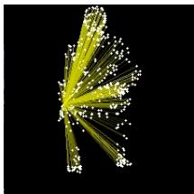
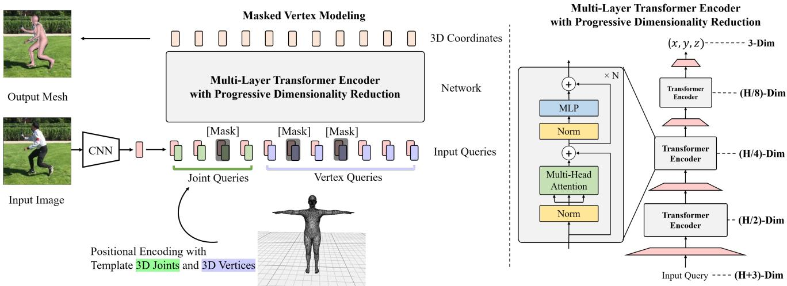
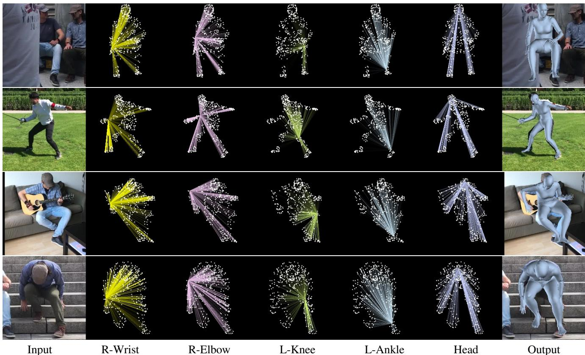
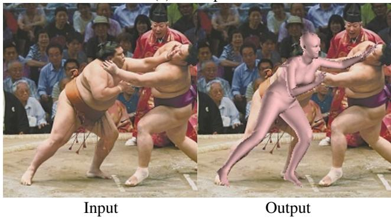
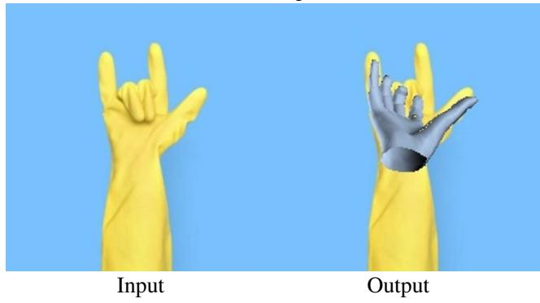
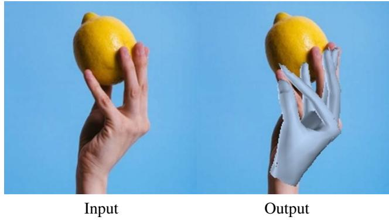
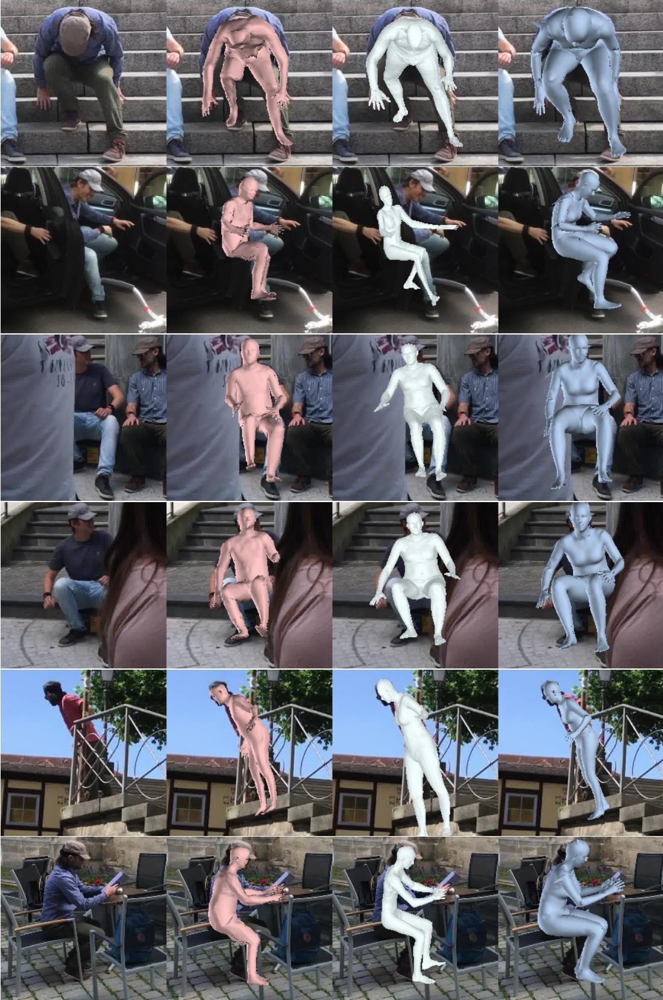

# 端到端人体姿态与网格重建的 Transformer 方法

Kevin Lin　Lijuan Wang　Zicheng Liu

Microsoft

{keli, lijuanw, zliu}@microsoft.com

## 摘要

我们提出了一种新方法，称为 MEsh TRansfOrmer（METRO），用于从单张图像重建 3D 人体姿态和网格顶点。我们的方法使用 transformer 编码器联合建模顶点-顶点和顶点-关节之间的交互，同时预测 3D 关节坐标和网格顶点。与现有回归姿态和形状参数的技术相比，METRO 不依赖 SMPL 等任何参数化网格模型，因此可以轻松扩展到其他对象（如手部）。我们进一步放宽了网格拓扑结构，允许 transformer 自注意力机制在任意两个顶点之间自由进行注意力计算，从而能够学习网格顶点和关节之间的非局部关系。通过所提出的掩码顶点建模方法，我们的方法在处理诸如部分遮挡等困难情况时更为鲁棒和有效。METRO 在公开的 Human3.6M 和 3DPW 数据集上取得了人体网格重建的最新最优结果。此外，我们展示了 METRO 在野外 3D 手部重建任务上的泛化能力，在 FreiHAND 数据集上优于现有的最新最优方法。代码和预训练模型可在 https://github.com/microsoft/MeshTransformer 获取。

## 1. 引言

从单张图像进行 3D 人体姿态和网格重建引起了广泛关注，因为它在虚拟现实、体育运动分析、神经退行性疾病诊断等方面具有众多应用。由于复杂的多关节动作和遮挡问题，这是一项具有挑战性的任务。

该领域的近期工作大致可分为两类。第一类方法使用 SMPL [29] 等参数化模型，并学习预测形状和姿态系数 [14, 26, 39, 22, 24, 34, 44, 23]。该方法已取得了巨大成功。参数化模型中编码的强先验使其对环境变化具有较强的鲁棒性。该方法的缺点在于，姿态和形状空间受限于用于构建参数化模型的有限样本。为了克服这一局限，第二类方法不使用任何参数化模型 [25, 8, 32]。这些方法要么使用图卷积神经网络来建模邻域内的顶点-顶点交互 [25, 8]，要么使用一维热力图来回归顶点坐标 [32]。这些方法的一个局限在于，它们在建模非局部的顶点-顶点交互时效率较低。

  

(a)

  

(b)

  

(c)
图 1：METRO 学习人体关节与网格顶点之间的非局部交互，用于人体网格重建。给定 (a) 中的输入图像，METRO 通过考虑非局部交互来预测人体网格。(b) 展示了被遮挡的手腕关节与网格顶点之间的注意力，颜色越亮表示注意力越强。(c) 是重建得到的网格。

研究人员已经证明，属于身体不同部位（例如手和脚）的非局部顶点之间存在强相关性 [55]。在计算机图形学和机器人学领域，已经开发了逆向运动学（inverse kinematics）技术 [2]，用于在给定末端执行器（end effector，如手尖）位置的情况下，估计铰接图形的内部关节位置。我们相信，学习身体关节和网格顶点之间的相关性（包括短程和长程相关性），对于处理身体形状重建中的挑战性姿态和遮挡问题具有重要价值。在本文中，我们提出了一个简单而有效的框架，用于建模全局顶点-顶点交互。我们框架的主要组件是 Transformer。

最近的研究表明，Transformer [53] 显著提升了在自然语言处理多项任务上的表现 [4, 9, 40, 41]。这一成功主要归功于 Transformer 的自注意力（self-attention）机制，该机制在建模依赖关系（或交互）方面特别有效，无论其输入和输出中的距离如何。在给定依赖关系的情况下，Transformer 能够软搜索相关令牌（token），并基于重要特征进行预测 [4, 53]。

在本工作中，我们提出了 METRO——一个具有渐进式维度缩减的多层 Transformer 编码器，用于同时从给定输入图像重建 3D 身体关节和网格顶点。我们设计了掩码顶点建模（Masked Vertex Modeling）目标函数，并采用 Transformer 编码器架构，以增强关节和顶点之间的交互。如图 1 所示，METRO 学会了发现身体关节和网格顶点之间的短程和长程交互，这有助于更好地重建具有大幅度姿态变化和遮挡的 3D 人体形状。

在多个公开数据集上的实验结果表明，METRO 在学习顶点-顶点和顶点-关节交互方面是有效的，因此在人体网格重建方面以大幅优势优于先前的工作。据我们所知，METRO 是首个利用 Transformer 编码器架构从单张输入图像联合学习 3D 人体姿态和网格重建的方法。此外，METRO 是一个通用框架，可以轻松应用于预测不同的 3D 网格，例如从输入图像重建 3D 手部。

总之，我们做出以下贡献。

- 我们引入了一种新的基于 Transformer 的方法，命名为 METRO，用于从单张图像进行 3D 人体姿态和网格重建。
- 我们设计了掩码顶点建模目标函数，并采用多层 Transformer 编码器来建模顶点-顶点和顶点-关节交互，以实现更好的重建。
- METRO 在大规模基准 Human3.6M 和具有挑战性的 3DPW 数据集上取得了新的最先进性能。

• METRO 是一个多功能框架，可以方便地应用于预测不同类型的 3D 网格，例如实验中所展示的 3D 手部网格。在论文投稿时，METRO 在 FreiHAND 排行榜上取得了第一名。

## 2. 相关工作

**人体网格重建（Human Mesh Reconstruction, HMR）**：HMR 是一项重建三维人体形状的任务，近年来是一个活跃的研究课题。尽管早期的工作已经展示了使用各种传感器（例如深度传感器 [33, 48] 或惯性测量单元 [20, 54]）进行令人印象深刻的重建，研究人员正在探索使用更高效便捷的单目相机设置。然而，由于复杂的姿态变化、遮挡以及有限的 3D 训练数据，从单张图像进行 HMR 是困难的。

先前的研究提出采用预训练的参数化人体模型，即 SMPL [29]、STAR [35]、MANO [43]，并估计参数化模型的姿态和形状系数用于 HMR。由于直接从输入图像回归姿态和形状系数具有挑战性，最近的工作进一步提出利用各种人体先验，例如人体骨骼 [26, 39] 或分割图 [34]，并探索不同的优化策略 [24, 22, 51, 14] 以及时间信息 [23] 来改善重建。

另一方面，研究人员也提出了不采用参数化人体模型、而是从输入图像直接回归三维人体形状的方法。例如，研究人员探索了使用 3D 网格 [25, 8]、体素空间 [52] 或占据场 [46, 47] 来表示人体。每项先前的工作都针对其目标应用解决了特定的输出表示。在这些文献中，相关的研究是 GraphCMR [25]，它旨在使用图卷积神经网络（Graph Convolutional Neural Networks, GCNNs）回归 3D 网格顶点。此外，最近提出的 Pose2Mesh [8] 是一个使用 GCNN 的级联模型。Pose2Mesh 基于给定的人体姿态表示重建人体网格。

尽管基于 GCNN 的方法 [8, 25] 旨在基于预先指定的网格拓扑建模邻接顶点之间的交互，但在建模更长距离的交互时效率较低。相比之下，METRO 对关节和网格顶点之间的全局交互进行建模，不受任何网格拓扑的限制。此外，我们的方法使用自注意力机制进行学习，这与先前的研究 [8, 25] 不同。

注意力机制与 Transformer：近期研究 [36, 28, 53] 表明，注意力机制（attention mechanisms）能够提升在各种语言任务上的表现。其核心思想是学习注意力权重，以便软搜索（soft-search）对预测输出具有重要作用的输入 [4]。Vaswani 等人 [53] 进一步提出了完全基于注意力机制的 Transformer 架构。Transformer 利用多头自注意力（multi-head self-attention）实现高度并行化，从而支持高效的训练与推理，并在规模化语言建模任务上取得了卓越性能，诸如 BERT [9] 与 GPT [40, 41, 5] 都对此进行了探索。

受神经语言领域近期成功的启发，越来越多的研究开始探索将 Transformer 架构应用于各种视觉任务，例如学习用于图像生成 [7, 37] 与分类 [7, 10] 的像素分布，或将目标检测简化为集合预测（set prediction）问题 [6]。然而，3D 人体重建任务尚未沿这一方向展开探索。

  

图 2：所提框架概览。给定一张输入图像，我们使用卷积神经网络（Convolutional Neural Network, CNN）提取图像特征向量。我们通过将模板人体网格添加到图像特征向量中进行位置编码，具体做法是将图像特征与每个身体关节 i 的三维坐标 $( x _ { i } , y _ { i } , z _ { i } )$ 以及每个顶点 j 的三维坐标 $( x _ { j } , y _ { j } , z _ { j } )$ 进行拼接。给定一组关节查询（joint queries）和顶点查询（vertex queries），我们通过多层 Transformer 编码器执行自注意力（self-attention），并行回归身体关节与网格顶点的三维坐标。我们采用渐进式维度归约（progressive dimensionality reduction）架构（如右图所示），逐层逐步减少隐藏嵌入的维度。最终层中的每个标记（token）输出一个关节或网格顶点的三维坐标。每个编码器块包含 4 层和 4 个注意力头。H 表示图像特征向量的维度。

在本研究中，我们提出了一种具有渐进式维度归约的多层 Transformer 架构，以回归关节和网格顶点的 3D 坐标。

## 3. 方法

图 2 展示了我们所提框架的整体概览。该框架以尺寸为 224 × 224 的图像作为输入，并预测一组人体关节点 J 和网格顶点 V。所提框架由两个模块组成：卷积神经网络（Convolutional Neural Network）和多层 Transformer 编码器（Multi-Layer Transformer Encoder）。首先，我们使用 CNN 从输入图像中提取图像特征向量。接下来，多层 Transformer 编码器以该特征向量作为输入，并行地输出人体关节点和网格顶点的 3D 坐标。下面我们将对每个模块进行详细描述。

## 3.1. 卷积神经网络

在我们框架的第一个模块中，我们采用卷积神经网络（CNN）进行特征提取。该 CNN 在 ImageNet 分类任务 [45] 上进行了预训练。具体而言，我们从最后一个隐藏层提取特征向量 X。所提取的特征向量 X 的维度通常为 2048。我们将该特征向量 X 输入到 Transformer 中以进行回归任务。

借助这种通用化的设计，它允许对人体姿态和网格重建进行端到端的训练。此外，Transformer 还能够轻松受益于大规模预训练的 CNN，例如 HRNets [56]。在我们的实验中，我们对输入特征进行了分析，发现高分辨率图像特征有利于 Transformer 回归人体关节点和网格顶点的 3D 坐标。

## 3.2. 具有渐进式维度归约的多层 Transformer 编码器

由于我们需要输出 3D 坐标，因此无法直接应用现有的 Transformer 编码器架构 [10, 6]，因为它们在所有 Transformer 层中均使用恒定的隐藏嵌入维度。受 [18] 通过多个模块逐步进行维度归约的启发，我们设计了一种采用渐进式维度归约方案的新架构。如图 2 右侧所示，我们使用线性投影在每个编码器层之后降低隐藏嵌入的维度。通过叠加多个编码器层，模型可被视为以交替的方式执行自注意力和维度归约。我们 Transformer 编码器的最终输出向量即为关节点和网格顶点的 3D 坐标。

如图 2 左所示，Transformer 编码器的输入是人体关节点（body joint）查询与网格顶点（mesh vertex）查询。沿用位置编码（positional encoding）[53, 25, 13] 的思路，我们使用一个人体模板网格（template human mesh）来保留输入序列中每个查询的位置信息。具体而言，我们将图像特征向量 $X \in \mathbb { R } ^ { 2 \bar { 0 } 4 8 \times 1 }$ 与每个关节点 $i$ 的三维坐标 $( x _ { i } , y _ { i } , z _ { i } )$ 进行拼接，由此形成关节点查询集 $\dot { Q _ { J } } = \{ q _ { 1 } ^ { J } , q _ { 2 } ^ { J } , . . . , q _ { n } ^ { J } \}$，其中 $q _ { i } ^ { J } \in \mathbb { R } ^ { 2 0 5 1 \times 1 }$。类似地，我们对每个网格顶点 $j$ 执行同样的位置编码，形成顶点查询集 $\mathsf { \bar { Q } } _ { V } = \{ q _ { 1 } ^ { \bar { V } } , q _ { 2 } ^ { V } , \dots , q _ { m } ^ { V } \}$，其中 $q _ { j } ^ { V } \in \mathbb { R } ^ { 2 0 5 1 \times 1 }$。

## 3.3. 遮蔽顶点建模

以往的工作 [9, 49] 使用遮蔽语言建模（Masked Language Modeling, MLM）来学习训练语料的语言学特性。然而，MLM 的目标是恢复被遮蔽的输入，这无法直接应用到我们的回归任务中。

为了充分激活 Transformer 编码器中的双向注意力，我们为回归任务设计了遮蔽顶点建模（Masked Vertex Modeling, MVM）。我们以随机方式遮蔽一定比例的输入查询。与 MLM [9] 那种恢复被遮蔽输入的做法不同，我们让 Transformer 去回归所有的关节点与顶点。

为了预测与某个缺失查询相对应的输出，模型必须借助其他相关查询。这在精神上类似于模拟遮挡场景——即部分身体部位不可见的情况。因此，MVM 强制 Transformer 在回归三维坐标时将其他相关的顶点和关节点一并纳入考量，而不必顾及它们之间的距离和网格拓扑结构。这有助于促进关节点与顶点之间短程与长程的交互，从而更好地建模人体。

## 3.4. 训练

为训练 Transformer 编码器，我们在 Transformer 输出之上施加损失函数，并最小化预测值与真值之间的误差。给定数据集 $D = \{ I ^ { i } , \bar { V } _ { 3 D } ^ { i } , \bar { J } _ { 3 D } ^ { i } , \bar { J } _ { 2 D } ^ { i } \} _ { i = 1 } ^ { T }$，其中 $T$ 为训练图像的总数。$\boldsymbol { I } \in \mathbb { R } ^ { w \times h \times 3 }$ 表示一张 RGB 图像。$\bar { V } _ { 3 D } \in \mathbf { \mathbb { R } } ^ { M \times \bar { 3 } }$ 表示网格顶点的真值三维坐标，$M$ 为顶点数。$\bar { J } _ { 3 D } \in \mathbb { R } ^ { K \times 3 }$ 表示人体关节点的真值三维坐标，$K$ 为一个人的关节点数。类似地，$\bar { J } _ { 2 D } \in \mathbb { R } ^ { K \times 2 }$ 表示人体关节点的真值二维坐标。

设 $V _ { 3 D }$ 表示输出的顶点位置，$J _ { 3 D }$ 表示输出的关节位置，我们使用 $L _ { 1 }$ 损失来最小化预测值与真实值之间的误差：

$$
\mathcal {L} _ {V} = \frac {1}{M} \sum_ {i = 1} ^ {M} \left| \left| V _ {3 D} - \bar {V} _ {3 D} \right| \right| _ {1},\tag{1}
$$

$$
\mathcal {L} _ {J} = \frac {1}{K} \sum_ {i = 1} ^ {K} \left| \left| J _ {3 D} - \bar {J} _ {3 D} \right| \right| _ {1}.\tag{2}
$$

值得一提的是，3D 关节点也可以从预测的网格中计算得到。遵循文献 [8, 22, 25, 24] 中的常见做法，我们使用一个预定义的回归矩阵 $G \in \mathbb { R } ^ { K \times M }$，并通过 $J_{ 3 D }^{ reg } = G V_{ 3 D }$ 得到回归出的 3D 关节点。与先前的工作类似，我们使用 $L_{ 1 }$ 损失来优化 $J_{ 3 D }^{ reg }$。

$$
\mathcal {L} _ {J} ^ {r e g} = \frac {1}{K} \sum_ {i = 1} ^ {K} \left| \left| J _ {3 D} ^ {r e g} - \bar {J} _ {3 D} \right| \right| _ {1}.\tag{3}
$$

二维重投影（2D re-projection）已被广泛用于增强图像与网格之间的对齐 [22, 25, 24]。此外，它还有助于在图像中可视化重建结果。受已有工作的启发，我们利用估计得到的相机参数，将三维（3D）关节点投影到二维（2D）空间，并最小化二维投影与二维真值（ground truth）之间的误差：

$$
\mathcal {L} _ {J} ^ {p r o j} = \frac {1}{K} \sum_ {i = 1} ^ {K} \left| \left| J _ {2 D} - \bar {J} _ {2 D} \right| \right| _ {1},\tag{4}
$$

其中相机参数通过在 Transformer 编码器输出之上使用一个线性层来学习。

为了执行大规模训练，利用 2D 和 3D 训练数据集以获得更好的泛化能力是非常理想的。正如文献 [34, 22, 25, 24, 23, 8, 32] 中所探讨的，我们采用一种混合训练策略，利用不同的训练数据集，无论其是否具有配对的图像-网格标注。我们的总体目标函数写作：

$$
\mathcal {L} = \alpha \times (\mathcal {L} _ {V} + \mathcal {L} _ {J} + \mathcal {L} _ {J} ^ {r e g}) + \beta \times \mathcal {L} _ {J} ^ {p r o j},\tag{5}
$$

其中 α 和 β 是每个训练样本的二元标志，分别表示 3D 真值和 2D 真值的可用性。

## 3.5. 实现细节

我们的方法能够处理任意大小的网格。然而，由于当前硬件的内存限制，我们的 Transformer 处理的是一个粗网格：(1) 我们使用一个粗模板网格（431 个顶点）进行位置编码（positional encoding），Transformer 输出一个粗网格；(2) 我们使用可学习的多层感知机（Multi-Layer Perceptrons, MLPs）将粗网格上采样到原始网格（对于 SMPL 人体网格拓扑结构为 6890 个顶点）；(3) Transformer 和 MLPs 以端到端的方式联合训练；请注意，粗网格是通过采样算法 [42] 进行两次子采样得到的 431 个顶点的网格。

如文献 [25] 中所讨论的，先学习粗网格再进行上采样的实现有助于减少计算量。

这也有助于避免原始网格中的冗余（由于顶点的空间局部性），从而使训练更高效。

## 4. 实验结果

我们首先在 Human3.6M 和 3DPW 数据集上展示我们的方法优于此前最先进的人体网格重建方法。

然后，我们提供了针对非局部交互和模型设计的消融研究与深入分析。

最后，我们在手部重建任务上展示了我们模型的泛化能力。

<table><tr><td rowspan="2">Method</td><td colspan="3">3DPW</td><td colspan="2">Human3.6M</td></tr><tr><td>MPVE ↓</td><td>MPJPE ↓</td><td>PA-MPJPE ↓</td><td>MPJPE ↓</td><td>PA-MPJPE ↓</td></tr><tr><td>HMR [22]</td><td>-</td><td>-</td><td>81.3</td><td>88.0</td><td>56.8</td></tr><tr><td>GraphCMR [25]</td><td>-</td><td>-</td><td>70.2</td><td>-</td><td>50.1</td></tr><tr><td>SPIN [24]</td><td>116.4</td><td>-</td><td>59.2</td><td>-</td><td>41.1</td></tr><tr><td>Pose2Mesh [8]</td><td>-</td><td>89.2</td><td>58.9</td><td>64.9</td><td>47.0</td></tr><tr><td>I2LMeshNet [32]</td><td>-</td><td>93.2</td><td>57.7</td><td>55.7</td><td>41.1</td></tr><tr><td>VIBE [23]</td><td>99.1</td><td>82.0</td><td>51.9</td><td>65.6</td><td>41.4</td></tr><tr><td>METRO (Ours)</td><td>88.2</td><td>77.1</td><td>47.9</td><td>54.0</td><td>36.7</td></tr></table>

表 1：在 3DPW 和 Human3.6M 数据集上与最先进方法的性能对比。

## 4.1. 数据集（Datasets）

遵循文献 [34, 22, 25, 24, 23, 8, 32]，我们使用 3D 和 2D 训练数据进行混合训练。下面我们描述每个数据集。

Human3.6M [21] 是一个带有 2D 和 3D 标注的大规模数据集。每张图像中都有一个受试者执行不同的动作。由于许可证问题，无法获得真值 3D 网格。因此，我们使用文献 [8, 32] 中提供的伪 3D 网格用于训练。这些伪标签是通过 SMPLify-X [38] 进行模型拟合得到的。为了公平比较，在评估时我们使用 Human3.6M 中提供的真值 3D 姿态标签。遵循常见设置 [50, 25, 22]，我们使用受试者 S1、S5、S6、S7 和 S8 训练模型，并使用受试者 S9 和 S11 测试模型。

3DPW [54] 是一个带有 2D 和 3D 标注的室外图像数据集。训练集包含 22K 张图像，测试集包含 35K 张图像。遵循此前的最先进方法 [23]，在 3DPW 上进行实验时，我们使用 3DPW 训练数据。

UP-3D [26] 是一个室外图像数据集。其 3D 标注通过模型拟合生成。训练集包含 7K 张图像。

MuCo-3DHP [31] 是基于 MPI-INF-3DHP 数据集 [30] 合成的一个数据集。它将各种真实世界的背景图像与训练数据进行合成。该数据集包含 200K 张训练图像。

COCO [27] 是一个带有 2D 标注的大规模数据集。我们还使用文献 [24] 中提供的伪 3D 网格标签，这些标签是使用 SMPLify-X [38] 拟合得到的。

MPII [1] 是一个带有 2D 姿态标签的室外图像数据集。训练集包含 14K 张图像。

FreiHAND [61] 是一个 3D 手部数据集。训练集包含 130K 张图像，测试集包含 4K 张图像。

我们在该数据集上展示模型的泛化能力。我们使用其提供的训练集进行训练，并在其在线服务器上进行评估。

## 4.2. 评估指标（Evaluation Metrics）

我们使用以下三个标准指标报告结果。这三个指标的单位均为毫米（mm）。

MPJPE：Mean-Per-Joint-Position-Error（MPJPE，平均关节位置误差）[21] 是用于评估人体 3D 姿态的指标 [22, 24, 8]。MPJPE 测量真值关节与预测关节之间的欧几里得距离。

PA-MPJPE：PA-MPJPE，也称为重建误差（Reconstruction Error）[60]，是该任务的另一个指标。它首先使用 Procrustes 分析（PA）[12] 进行 3D 对齐，然后计算 MPJPE。PA-MPJPE 常用于评估 3D 重建 [60]，因为它测量的是重建结构本身的误差，而不考虑尺度和刚性姿态（即平移和旋转）。

MPVE：Mean-Per-Vertex-Error（MPVE，平均顶点误差）[39] 测量真值顶点与预测顶点之间的欧几里得距离。

## 4.3. 主要结果（Main Results）

我们在 3DPW 和 Human3.6M 数据集上，将 METRO 与此前的最先进方法进行了比较。遵循文献 [23, 24, 22, 25]，我们使用 3D 和 2D 训练数据进行了混合训练（mix-training）。结果如表 1 所示。我们的方法在两个数据集上都优于先前的工作。

首先，我们关注 transformer 在 3DPW 野外重建中的表现。如表 1 左侧三列所示，我们的方法优于 VIBE [23]，VIBE 是该数据集上的最先进方法。值得注意的是，VIBE 是基于视频的方法，而我们的方法是基于图像的方法。

此外，我们在 Human3.6M 的室内场景上评估了性能。我们遵循先前工作 [24, 32] 的设置，在训练模型时不使用 3DPW 数据。

  

图 3：我们方法的可视化结果。给定一张输入图像（左），METRO 在进行人体网格重建时考虑了关节与顶点之间的非局部交互（右）。我们将指定关节与所有其他顶点之间的自注意力进行了可视化，其中更亮的颜色表示更强的注意力。我们观察到，METRO 能够在关节与顶点之间发现丰富的、依赖于输入的交互关系。

结果展示在表 1 的右侧两列中。我们的方法取得了更好的重建性能，尤其是在 PA-MPJPE 指标上。

Human3.6M 和 3DPW 这两个数据集具有不同的挑战。3DPW 中的场景遮挡更为严重。Human3.6M 中的场景较为简单，挑战更多在于如何精确估计人体形状。METRO 在两个数据集上都能良好工作这一事实表明，它既对遮挡具有鲁棒性，又具备精确的人体形状回归能力。

## 4.4. 消融研究

掩蔽顶点建模（Masked Vertex Modeling）的有效性：由于我们为 Transformer 设计了掩蔽顶点建模目标，一个有趣的问题是该目标是否有用。表 2 展示了在 Human3.6M 上的消融研究。我们观察到，掩蔽顶点建模显著改善了结果。此外，我们研究了应当掩蔽多少比例的查询 token。我们改变了最大掩蔽比例，表 3 展示了比较结果。随着训练中掩蔽查询数量的增加，性能有所提升。然而，如果掩蔽超过 30% 的输入查询，提升效果变得不那么显著。这是因为大量查询的缺失会使训练变得更加困难。

<table><tr><td></td><td>MPJPE ↓</td><td>PA-MPJPE ↓</td></tr><tr><td>w/o MVM</td><td>61.0</td><td>39.1</td></tr><tr><td>w/ MVM</td><td>54.0</td><td>36.7</td></tr></table>

表 2：掩码顶点建模（Masked Vertex Modeling, MVM）目标的消融实验，在 Human3.6M 上评估。

<table><tr><td>Max Percentage</td><td>0%</td><td>10%</td><td>20%</td><td>30%</td><td>40%</td><td>50%</td></tr><tr><td>PA-MPJPE</td><td>39.1</td><td>37.6</td><td>37.5</td><td>36.7</td><td>38.2</td><td>37.3</td></tr></table>

表 3：使用不同比例的掩码查询对掩码顶点建模（Masked Vertex Modeling）目标进行消融研究，在 Human3.6M 上进行评估。变量 n% 表示我们从输入查询中随机掩码 0% 至 n% 的查询。

<table><tr><td>Method</td><td>PA-MPVPE ↓</td><td>PA-MPJPE ↓</td><td>F@5 mm ↑</td><td>F@15 mm ↑</td></tr><tr><td>Hasson et al [22]</td><td>13.2</td><td>-</td><td>0.436</td><td>0.908</td></tr><tr><td>Boukhayma et al. [25]</td><td>13.0</td><td>-</td><td>0.435</td><td>0.898</td></tr><tr><td>FreiHAND [24]</td><td>10.7</td><td>-</td><td>0.529</td><td>0.935</td></tr><tr><td>Pose2Mesh [8]</td><td>7.8</td><td>7.7</td><td>0.674</td><td>0.969</td></tr><tr><td>I2LMeshNet [32]</td><td>7.6</td><td>7.4</td><td>0.681</td><td>0.973</td></tr><tr><td>METRO (Ours)</td><td>6.3</td><td>6.5</td><td>0.731</td><td>0.984</td></tr></table>

表 4：与最先进方法的性能对比，在 FreiHAND 在线服务器上评估。METRO 以大幅优势超越此前的最先进方法。

非局部交互（Non-local Interactions）：为进一步理解 METRO 在学习关节与网格顶点之间交互中的作用，我们对 Transformer 中的自注意力进行分析。

图 3 给出了自注意力与网格重建的可视化结果。对于图 3 中的每一行，我们展示输入图像，以及某一指定关节点与所有网格顶点之间的自注意力。颜色越亮表示注意力越强。在第一行中，受试者被严重遮挡，右侧身体部位不可见。当我们预测右手腕的位置时，METRO 会关注相关的非局部顶点，尤其是头部和左手上的顶点。在最底下一行中，受试者大幅弯腰。在预测头部位置时，METRO 会关注脚部和手部（最底下一行的第 6 列）。这在直觉上是合理的，因为手和脚的位置为身体姿态（进而为头部位置）提供了强烈的线索。此外，我们观察到模型会根据输入图像进行自注意力。如图 3 第二行所示，在预测右手腕位置时，METRO 更关注右脚，这与其他三行的注意力分布不同。

我们进一步对非局部交互进行定量分析。我们从 3DPW 测试集中随机采样 5000 张图像，并估计一个整体的自注意力图。它是 Transformer 最后一层所有注意力头的平均注意力权重。我们在图 4 中可视化 14 个身体关节与 431 个网格顶点之间的交互。每个像素表示自注意力的强度，颜色越深表示注意力越强。注意，前 14 列对应身体关节，其余列对应网格顶点。我们观察到，METRO 对小臂和小腿上的顶点给予较强注意力。这与逆向运动学文献 [2] 中的结论一致——在链式人体中，内部的关节点可以从末端执行器的位置进行估计。

输入表示（Input Representations）：我们通过使用不同的卷积神经网络（CNN）骨干网络来研究 Transformer 架构的行为。该实验中我们使用 ResNet50 [16] 和 HRNet [56] 的不同变体。所有骨干网络都在 ImageNet [45] 的 1000 类图像分类任务上进行了预训练。对于每个骨干网络，我们提取一个全局图像特征向量 $X \in R^{2048 \times 1}$，并将其输入 Transformer。在表 5 中，我们观察到在使用 ResNet50 骨干网络时，Transformer 已能达到具有竞争力的性能。随着 HRNet 中高分辨率特征图的通道数增加，我们观察到性能进一步提升。

图 4：身体关节与网格顶点之间自注意力的可视化。x 轴与 y 轴分别对应查询和预测输出。左侧前 14 列对应身体关节，其余列对应网格顶点。每一行展示了第 j 个查询对第 i 个输出的注意力权重 $w _ { i , j }$。颜色越深表示注意力越强。

<table><tr><td>Backbone</td><td>MPJPE ↓</td><td>PA-MPJPE ↓</td></tr><tr><td>ResNet50</td><td>56.5</td><td>40.6</td></tr><tr><td>HRNet-W40</td><td>55.9</td><td>38.5</td></tr><tr><td>HRNet-W64</td><td>54.0</td><td>36.7</td></tr></table>

表 5：不同骨干网络的分析，在 Human3.6M 上进行评估。所有骨干网络均在 ImageNet 上进行预训练。我们观察到，增加 HRNet 高分辨率特征图中的滤波器数量有助于网格回归。

  

图 5：我们的方法在 FreiHAND 测试集上的定性结果。我们可视化了指定关节与所有网格顶点之间的自注意力，其中更亮的颜色表示更强的注意力。METRO 是一个多功能框架，可以轻松扩展到三维手部重建。

Generalization to 3D Hand in-the-wild（向真实场景 3D 手的泛化）：METRO 能够预测任意关节点和顶点，无需依赖邻接矩阵（adjacency matrix）和参数化系数（parametric coefficients）。因此，METRO 对于其他物体的网格重建具有高度的灵活性与通用性。为展示这一能力，我们在 FreiHAND [61] 上进行了实验。我们从头开始（from scratch）训练 FreiHAND 模型，并在 FreiHAND 在线服务器上评估结果。Table 4 给出了与先前工作的对比。METRO 以大幅度领先超越了此前的最优方法。在未使用任何外部训练数据的情况下，METRO 在论文投稿时位居 FreiHAND 排行榜第一名1。

Figure 5 展示了带有非局部交互（non-local interactions）的定性结果。在附录中，我们进一步分析了 3D 手部关节点，并表明 METRO 中学习到的自注意力与逆运动学（inverse kinematics）[2] 一致。

## 5. Conclusion（结论）

我们提出了一个简洁而有效的网格 Transformer 框架，从单张输入图像重建人体姿态与网格。我们提出了 Masked Vertex Modeling 目标，用于学习人体关节点和网格顶点之间的非局部交互。实验结果表明，我们的方法在 3DPW、Human3.6M 和 FreiHAND 数据集上推进了当前最优性能。

细致分析揭示，性能的提升主要归因于 METRO 中学习到的输入依赖的非局部交互，使其能够基于重要的关节点和顶点进行预测，而不受网格拓扑限制。我们进一步展示了所提出方法在 3D 手部重建任务上的泛化能力。

## References（参考文献）

[8] Hongsuk Choi, Gyeongsik Moon, and Kyoung Mu Lee. Pose2mesh：用于从二维人体姿态恢复三维人体姿态与网格的图卷积网络（Graph Convolutional Network for 3D Human Pose and Mesh Recovery from a 2D Human Pose）。载于 ECCV, 2020。1, 2, 4, 5, 7, 11, 1

[9] Jacob Devlin, Ming-Wei Chang, Kenton Lee, and Kristina Toutanova. BERT：用于语言理解的深度双向变换器预训练（Pre-training of Deep Bidirectional Transformers for Language Understanding）。载于 NAACL, 2019。2, 4, 11

[10] Alexey Dosovitskiy, Lucas Beyer, Alexander Kolesnikov, Dirk Weissenborn, Xiaohua Zhai, Thomas Unterthiner, Mostafa Dehghani, Matthias Minderer, Georg Heigold, Sylvain Gelly, 等. 一张图像值 16×16 个词：用于大规模图像识别的变换器（An Image is Worth 16x16 Words: Transformers for Image Recognition at Scale）。arXiv 预印本 arXiv:2010.11929, 2020。2, 3

[11] Georgios Georgakis, Ren Li, Srikrishna Karanam, Terrence Chen, Jana Kosecka, and Ziyan Wu. 分层运动学人体网格重建（Hierarchical Kinematic Human Mesh Recovery）。ECCV, 2020。11

[12] John C Gower. 广义普氏分析（Generalized Procrustes Analysis）。Psychometrika, 1975。5, 13

[13] Thibault Groueix, Matthew Fisher, Vladimir G Kim, Bryan C Russell, and Mathieu Aubry. 3D-CODED：通过深度形变建立三维对应关系（3D-CODED: 3D Correspondences by Deep Deformation）。载于 ECCV, 2018。3

[14] Peng Guan, Alexander Weiss, Alexandru O Balan, and Michael J Black. 从单张图像估计人体形状与姿态（Estimating Human Shape and Pose from a Single Image）。载于 ICCV, 2009。1, 2

[15] Riza Alp Guler and Iasonas Kokkinos. HoloPose：野外场景的整体式三维人体重建（HoloPose: Holistic 3D Human Reconstruction In-the-Wild）。载于 CVPR, 2019。11

[16] Kaiming He, Xiangyu Zhang, Shaoqing Ren, and Jian Sun. 用于图像识别的深度残差学习（Deep Residual Learning for Image Recognition）。载于 CVPR, 2016。7

[17] Yihui He, Rui Yan, Katerina Fragkiadaki, and Shoou-I Yu. 对极变换器（Epipolar Transformers）。载于 CVPR, 2020。11

[18] Geoffrey E Hinton and Ruslan R Salakhutdinov. 用神经网络降低数据维度（Reducing the Dimensionality of Data with Neural Networks）。Science, 2006。3, 12

[19] Lin Huang, Jianchao Tan, Ji Liu, and Junsong Yuan. HandTransformer：用于三维手部姿态估计的非自回归结构化建模（HandTransformer: Non-Autoregressive Structured Modeling for 3D Hand Pose Estimation）。载于 ECCV, 2020。11

[20] Yinghao Huang, Manuel Kaufmann, Emre Aksan, Michael J. Black, Otmar Hilliges, and Gerard Pons-Moll. 深度惯性姿态估计：从稀疏惯性测量实时重建人体姿态的学习方法（Deep Inertial Poser Learning to Reconstruct Human Pose from Sparse Inertial Measurements in Real Time）。ACM Transactions on Graphics, 37(6):185:1–185:15, 2018 年 11 月。2

[21] Catalin Ionescu, Dragos Papava, Vlad Olaru, and Cristian Sminchisescu. Human3.6M：自然环境中三维人体感知的大规模数据集与预测方法（Human3.6M: Large Scale Datasets and Predictive Methods for 3D Human Sensing in Natural Environments）。IEEE Transactions on Pattern Analysis and Machine Intelligence, 36(7):1325–1339, 2014。5

[22] Angjoo Kanazawa, Michael J Black, David W Jacobs, and Jitendra Malik. 人体形状与姿态的端到端恢复（End-to-End Recovery of Human Shape and Pose）。载于 CVPR, 2018。1, 2, 4, 5, 7, 11

[23] Muhammed Kocabas, Nikos Athanasiou, and Michael J. Black. VIBE：通过视频推理估计人体姿态与形状（VIBE: Video Inference for Human Body Pose and Shape Estimation）。载于 CVPR, 2020。1, 2, 4, 5, 11

[24] Nikos Kolotouros, Georgios Pavlakos, Michael J Black, and Kostas Daniilidis. 通过循环中的模型拟合学习重建三维人体姿态与形状（Learning to Reconstruct 3D Human Pose and Shape via Model-Fitting in the Loop）。载于 ICCV, 2019。1, 2, 4, 5, 7, 11

[25] Nikos Kolotouros, Georgios Pavlakos, and Kostas Daniilidis. 卷积网格回归用于单图像人体形状重建. 见: CVPR, 2019. 1, 2, 3, 4, 5, 7, 11, 12, 14

[26] Christoph Lassner, Javier Romero, Martin Kiefel, Federica Bogo, Michael J Black, and Peter V Gehler. 团结众人：弥合三维与二维人体表征之间的闭环. 论文: CVPR, 2017. 1, 2, 5

[27] Tsung-Yi Lin, Michael Maire, Serge Belongie, James Hays, Pietro Perona, Deva Ramanan, Piotr Dollar, and C Lawrence´ Zitnick. 微软 COCO：上下文中的常见对象. 论文: ECCV, 2014. 5

[28] Yankai Lin, Shiqi Shen, Zhiyuan Liu, Huanbo Luan, and Maosong Sun. 基于实例选择性注意力机制的神经关系抽取. 论文: ACL, 2016. 2

[29] Matthew Loper, Naureen Mahmood, Javier Romero, Gerard Pons-Moll, and Michael J Black. SMPL：一种蒙皮多人线性人体模型. ACM Transactions on Graphics, 34(6):248, 2015. 1, 2

[30] Dushyant Mehta, Helge Rhodin, Dan Casas, Pascal Fua, Oleksandr Sotnychenko, Weipeng Xu, and Christian Theobalt. 基于改进 CNN 监督的野外单目三维人体姿态估计. 论文: 3DV, 2017. 5

[31] Dushyant Mehta, Oleksandr Sotnychenko, Franziska Mueller, Weipeng Xu, Srinath Sridhar, Gerard Pons-Moll, and Christian Theobalt. 基于单目 RGB 的单次多人三维姿态估计. 论文: 3DV, 2018. 5

[32] Gyeongsik Moon and Kyoung Mu Lee. I2L-MeshNet：用于从单张 RGB 图像精确估计三维人体姿态与网格的图像到像素预测网络. 论文: ECCV, 2020. 1, 4, 5, 7, 11, 12, 13, 14

[34] Mohamed Omran, Christoph Lassner, Gerard Pons-Moll, Peter Gehler, and Bernt Schiele. 神经人体拟合：统一深度学习与基于模型的人体姿态与形状估计. 论文: 3DV, 2018. 1, 2, 4, 5

[35] Ahmed A A Osman, Timo Bolkart, and Michael J. Black. STAR：一种稀疏训练的关节化人体回归器. 论文: ECCV, 2020. 2

[36] Ankur P Parikh, Oscar Tackstr¨ om, Dipanjan Das, and Jakob¨ Uszkoreit. 一种可分解的注意力模型用于自然语言推理. arXiv 预印本 arXiv:1606.01933, 2016. 2

[37] Niki Parmar, Ashish Vaswani, Jakob Uszkoreit, Lukasz Kaiser, Noam Shazeer, Alexander Ku, and Dustin Tran. 图像 Transformer. 论文: ICML, 2018. 2

[38] Georgios Pavlakos, Vasileios Choutas, Nima Ghorbani, Timo Bolkart, Ahmed A. A. Osman, Dimitrios Tzionas, and Michael J. Black. 表现力人体捕捉：从单张图像重建三维手部、面部与身体. 论文: CVPR, 2019. 5

[39] Georgios Pavlakos, Luyang Zhu, Xiaowei Zhou, and Kostas Daniilidis. 从单张彩色图像学习估计三维人体姿态与形状. 论文: CVPR, 2018. 1, 2, 5

[40] Alec Radford, Karthik Narasimhan, Tim Salimans, and Ilya Sutskever. 通过生成式预训练提升语言理解能力（Improving language understanding by generative pre-training）。技术报告（Technical report），2018。2

[41] Alec Radford, Jeffrey Wu, Rewon Child, David Luan, Dario Amodei, and Ilya Sutskever. 语言模型是无监督多任务学习者（Language models are unsupervised multitask learners）。技术报告（Technical report），2019。2

[42] Anurag Ranjan, Timo Bolkart, Soubhik Sanyal, and Michael J Black. 使用卷积网格自编码器生成三维人脸（Generating 3d faces using convolutional mesh autoencoders）。收录于：ECCV，2018。4

[43] Javier Romero, Dimitrios Tzionas, and Michael J. Black. 具身之手：手与身体的联合建模与捕捉（Embodied hands: Modeling and capturing hands and bodies together）。SIGGRAPH Asia，2017。2

[44] Yu Rong, Ziwei Liu, Cheng Li, Kaidi Cao, and Chen Change Loy. 深入探究野外三维人体重建中的混合标注（Delving deep into hybrid annotations for 3d human recovery in the wild）。收录于：ICCV，2019。1

[46] Shunsuke Saito, Zeng Huang, Ryota Natsume, Shigeo Morishima, Angjoo Kanazawa, and Hao Li. PIFu：用于高分辨率穿衣人体数字化的像素对齐隐式函数（Pifu: Pixel-aligned implicit function for high-resolution clothed human digitization）。arXiv 预印本 arXiv:1905.05172，2019。2

[47] Shunsuke Saito, Tomas Simon, Jason Saragih, and Hanbyul Joo. PIFuHD：用于高分辨率三维人体数字化的多级像素对齐隐式函数（Pifuhd: Multi-level pixel-aligned implicit function for high-resolution 3d human digitization）。收录于：CVPR，2020。2

[48] Daeyun Shin, Zhile Ren, Erik B Sudderth, and Charless C Fowlkes. 使用多层深度与对极 Transformer 进行三维场景重建（3d scene reconstruction with multi-layer depth and epipolar transformers）。收录于：ICCV，2019。2

[49] Wilson L Taylor. "完形填空程序"：一种测量可读性的新工具（"cloze procedure": A new tool for measuring readability）。《新闻学季刊》（Journalism Quarterly），1953。4

[50] Bugra Tekin, Artem Rozantsev, Vincent Lepetit, and Pascal Fua. 由运动补偿序列直接预测三维人体姿态（Direct prediction of 3d body poses from motion compensated sequences）。收录于：CVPR，2016。5

[51] Hsiao-Yu Tung, Hsiao-Wei Tung, Ersin Yumer, and Katerina Fragkiadaki. 动作捕捉的自监督学习（Self-supervised learning of motion capture）。收录于：NeurIPS，2017。2

[52] Gul Varol, Duygu Ceylan, Bryan Russell, Jimei Yang, Ersin Yumer, Ivan Laptev, and Cordelia Schmid. BodyNet：三维人体形状的体素推断（Bodynet: Volumetric inference of 3d human body shapes）。收录于：ECCV，2018。2

[54] Timo von Marcard, Roberto Henschel, Michael Black, Bodo Rosenhahn, and Gerard Pons-Moll. 利用 IMU 与运动相机在野外恢复精确的三维人体姿态（Recovering accurate 3d human pose in the wild using imus and a moving camera）。收录于：ECCV，2018。2，5

[55] Jiang Wang, Zicheng Liu, Ying Wu, and Junsong Yuan. 利用深度相机挖掘动作元集合用于动作识别（Mining actionlet ensemble for action recognition with depth cameras）。收录于：CVPR，2012。1

[56] Jingdong Wang, Ke Sun, Tianheng Cheng, Borui Jiang, Chaorui Deng, Yang Zhao, Dong Liu, Yadong Mu, Mingkui Tan, Xinggang Wang, Wenyu Liu, and Bin Xiao. 用于视觉识别的深度高分辨率表示学习（Deep high-resolution representation learning for visual recognition）。IEEE 模式分析与机器智能汇刊（IEEE Transactions on Pattern Analysis and Machine Intelligence），2019。3, 7

[57] Yuanlu Xu, Song-Chun Zhu, and Tony Tung. DenseRaC：通过密集渲染与比较联合估计三维姿态与形状（DenseRaC: Joint 3D Pose and Shape Estimation by Dense Render-and-Compare）。发表于 ICCV，2019。11

[58] Wang Zeng, Wanli Ouyang, Ping Luo, Wentao Liu, and Xiaogang Wang. 基于密集对应关系的三维人体网格回归（3D Human Mesh Regression with Dense Correspondence）。发表于 CVPR，2020。11

[59] Tianshu Zhang, Buzhen Huang, and Yangang Wang. 从单张彩色图像估计物体遮挡下的人体形状与姿态（Object-Occluded Human Shape and Pose Estimation from a Single Color Image）。发表于 CVPR，2020。11

[60] Xiaowei Zhou, Menglong Zhu, Georgios Pavlakos, Spyridon Leonardos, Konstantinos G Derpanis, and Kostas Daniilidis. MonoCap：使用结合几何先验的卷积神经网络进行单目人体运动捕捉（MonoCap: Monocular Human Motion Capture Using a CNN Coupled with a Geometric Prior）。IEEE 模式分析与机器智能汇刊（IEEE Transactions on Pattern Analysis and Machine Intelligence），2018。5

[61] Christian Zimmermann, Duygu Ceylan, Jimei Yang, Bryan Russell, Max Argus, and Thomas Brox. FreiHand：用于从单张 RGB 图像无标记捕捉手部姿态与形状的数据集（FreiHand: A Dataset for Markerless Capture of Hand Pose and Shape from Single RGB Images）。发表于 ICCV，2019。5, 8

## 附录（APPENDICES）

<table><tr><td rowspan="2">Method</td><td colspan="3">3DPW</td><td colspan="2">Human3.6M</td></tr><tr><td>MPVE ↓</td><td>MPJPE ↓</td><td>PA-MPJPE ↓</td><td>MPJPE ↓</td><td>PA-MPJPE ↓</td></tr><tr><td>HMR [22]</td><td>-</td><td>-</td><td>81.3</td><td>88.0</td><td>56.8</td></tr><tr><td>GraphCMR [25]</td><td>-</td><td>-</td><td>70.2</td><td>-</td><td>50.1</td></tr><tr><td>SPIN [24]</td><td>116.4</td><td>-</td><td>59.2</td><td>-</td><td>41.1</td></tr><tr><td>Pose2Mesh [8]</td><td>-</td><td>89.2</td><td>58.9</td><td>64.9</td><td>47.0</td></tr><tr><td>I2LMeshNet [32]</td><td>-</td><td>93.2</td><td>57.7</td><td>55.7</td><td>41.1</td></tr><tr><td>VIBE [23]</td><td>99.1</td><td>82.0</td><td>51.9</td><td>65.6</td><td>41.4</td></tr><tr><td>HoloPose [15]</td><td>-</td><td>-</td><td>-</td><td>60.2</td><td>46.5</td></tr><tr><td>Arnab et al. [3]</td><td>-</td><td>-</td><td>72.2</td><td>77.8</td><td>54.3</td></tr><tr><td>DenseRaC [57]</td><td>-</td><td>-</td><td>-</td><td>-</td><td>48.0</td></tr><tr><td>Zhang et al. [59]</td><td>-</td><td>-</td><td>72.2</td><td>-</td><td>41.7</td></tr><tr><td>Zeng et al. [58]</td><td>-</td><td>-</td><td>-</td><td>60.6</td><td>39.3</td></tr><tr><td>HKMR [11]</td><td>-</td><td>-</td><td>-</td><td>59.6</td><td>43.2</td></tr><tr><td>METRO (Ours)</td><td>88.2</td><td>77.1</td><td>47.9</td><td>54.0</td><td>36.7</td></tr></table>

图 6：在 3DPW 和 Human 3.6M 数据集上的对比中加入更多参考文献（HKMR [11]、Zeng 等人 [58]、Zhang 等人 [59]、DenseRaC [57]、Arnab 等人 [3]、HoloPose [15]）。

## A. 更多参考文献

我们希望补充若干参考文献（HKMR [11]、Arnab 等人 [3]、Zeng 等人 [58]、Zhang 等人 [59]、DenseRaC [57]、HoloPose [15]）。在这些新增的文献中，HKMR [11] 通过利用一个预先指定的层次化运动学结构（由一条根链和对应于五个末端执行器——头部、左/右臂、左/右腿——的五条子链组成）来回归 SMPL 参数。Holo-Pose [15] 估计人体关节的旋转角度，并将其作为先验知识来指导基于部位的人体网格重建。Zeng 等人 [58] 设计了一种连续的 UV 图（continuous UV map）以保持网格顶点之间的邻接关系。Zhang 等人 [59] 将遮挡场景下的任务建模为 UV 图修复（UV-map inpainting）问题。由于 3DPW 是一个相对较新的基准数据集，大多数文献仅在 Human3.6M 上报告结果，而未在 3DPW 上报告。我们已在表 6 中补充了这些方法在 Human3.6M 上的结果。可以看出，我们的方法以显著的优势优于所有先前工作。

最近，研究者们正在探索将 Transformer 模型应用于其他三维视觉任务，例如多视角人体姿态估计 [17] 和基于点云的手部姿态估计 [19]。我们鼓励读者开展这些方向的研究以做进一步探索。

## B. 实现细节与计算资源

我们使用 PyTorch 和 Huggingface Transformer 库开发了 METRO。我们在配备 8 张 NVIDIA V100 GPU（32 GB 显存）的机器上进行训练，批量大小设为 32。每个 epoch 耗时约 32 分钟，我们共训练 200 个 epoch。整个训练过程大约需要 5 天。我们使用 Adam 优化器和阶梯式学习率衰减策略。Transformer 和 CNN 主干网络的初始学习率均设为 $1 \times 1 0 ^ { - 4 }$。学习率在第 100 个 epoch 时按 10 倍因子进行衰减。我们的多层 Transformer 编码器采用随机初始化，CNN 主干网络则使用 ImageNet 预训练权重进行初始化。在探究线性方法 [25, 24] 之后，我们在训练过程中应用了标准的数据增强。

我们使用配备单张 NVIDIA P100 GPU（16 GB 显存）的机器来评估模型的运行速度。当批量大小为 1 时，我们的运行速度约为 12 fps；当批量大小为 32 时，运行速度可加速至约 24 fps。表 7 展示了 METRO 中各模块的具体细节。

对于我们的掩码顶点建模（masked vertex modeling），参考 BERT [9]，我们通过使用一个预定义的特殊 [MASK] 标记（在我们这里是一个 2051 维的浮点向量）来替换随机选取的输入查询，从而实现该建模方式。

<table><tr><td>Model</td><td>Dimensionality Reduction Scheme</td><td>PA-MPJPE ↓</td></tr><tr><td>Transformer [53]</td><td> $(H + 3) \rightarrow 3$ </td><td>208.7</td></tr><tr><td>METRO</td><td> $(H + 3) \rightarrow H/2 \rightarrow 3$ </td><td>192.1</td></tr><tr><td>METRO</td><td> $(H + 3) \rightarrow H/2 \rightarrow H/4 \rightarrow 3$ </td><td>43.8</td></tr><tr><td>METRO</td><td> $(H + 3) \rightarrow H/2 \rightarrow H/4 \rightarrow H/8 \rightarrow 3$ </td><td>36.7</td></tr></table>

表 6：不同降维方案在 Human3.6M 验证集上的性能对比。请注意，所有 Transformer 变体具有相同数量的隐藏层（共 12 层），以保证公平比较。$H { = } 2 0 4 8$

<table><tr><td></td><td>CNN (HRNet-W64)</td><td>Transformer</td></tr><tr><td># Parameters</td><td>128M</td><td>102M</td></tr><tr><td>Inference time</td><td>52.05 ms</td><td>28.22 ms</td></tr></table>

表 7：每个图像的参数数量和推理时间。运行时速度通过使用批量大小 1 进行估计。

<table><tr><td>Positional Encoding</td><td>PA-MPJPE ↓</td></tr><tr><td>Sinusoidal [53]</td><td>37.5</td></tr><tr><td>Ours</td><td>36.7</td></tr></table>

表 8：不同位置编码方案的对比，在 Human3.6M 验证集上进行评估。

## C. 渐进式维度降维（Progressive Dimensionality Reduction）

由于我们在 Transformer 架构中逐步减小隐藏层维度，一个有趣的问题是这种渐进式维度降维方案是否有用。我们对不同方案进行了消融研究，表 6 给出了对比结果。在表 6 中，"(H+3)→3" 这一行对应于使用一个从 H+3 到 3 的线性投影的基线方法，结果较差。"(H+3)→H/2→3" 这一行是另一个在整个网络中保持较小维度的基线方法，结果同样较差。我们的发现是，大步长（陡峭的）维度降维对 3D 网格回归并不奏效。我们的渐进式方案受 [18] 启发，该工作通过多个块逐步执行维度降维。

## D. 位置编码（Positional Encoding）

由于我们的位置编码与常规位置编码不同，有人可能会想如果使用正弦函数 [53] 而非模板网格会怎样。我们将我们的方法与使用正弦函数的常规位置编码进行了比较，表 8 给出了结果。我们观察到使用正弦函数略差。这可能是因为直接对坐标进行编码使学习 3D 坐标回归更为高效。

## E. 定性结果（Qualitative Results）

图 8 显示了在具有挑战性的场景下与之前基于图像的最先进方法 [32, 25] 的定性对比。这些方法仅使用单帧作为输入。在第一行中，受试者大幅弯腰，先前的工作难以重建出正确的身体形状；相比之下，我们的方法重建出了姿态正确且合理的人体网格。在第二行中，受试者被车辆遮挡，我们观察到先前的工作对遮挡较为敏感，未能生成正确的人体网格，而我们的方法在这种遮挡场景下表现得更为稳健。在最下方一行中，受试者坐在椅子上，与之前的最先进方法相比，我们的方法重建出了更好的人体网格。

图 9 展示了我们的方法在 3D 手部重建上的定性结果。在不对网络架构进行任何修改的情况下，我们的方法在手部任务上效果良好，并且对遮挡具有鲁棒性。这展示了我们方法的优势——能够轻松扩展到其他类型的对象。

## F. 手部关节点的非局部交互（Non-local Interactions of Hand Joints）

我们进一步对模型所学到的关节间非局部交互进行定量分析。我们从 FreiHAND 测试集中随机采样 1000 个样本，并估计一个整体的自注意力图（self-attention map）。图 10 展示了 21 个手部关节之间的交互关系。该图包含 21 行和 21 列。像素 (i, j) 表示手部关节 i 对关节 j 的注意力强度。颜色越深表示注意力越强。我们可以看到，腕关节（第 0 列）从所有关节处都接收到了强烈的注意力。直观上讲，腕关节在手的运动学树中扮演着类似"根节点"的角色。此外，第 4、8、12 和 16 列从许多其他关节处接收到了强烈的注意力。这些列分别对应拇指、食指、中指和无名指的指尖。这些指尖是末端执行器（end effectors）[2]，可用于在逆运动学（inverse kinematics）中估计内部关节位置。另一方面，小指指尖仅接收来自无名指上关节的注意力。这可能是因为小指不如其他手指活跃，并且其运动相比其他手指与无名指的相关性更强。

<table><tr><td>Method</td><td>PA-MPVPE ↓</td><td>PA-MPJPE ↓</td><td>F@5 mm ↑</td><td>F@15 mm ↑</td></tr><tr><td>I2LMeshNet [32]</td><td>7.6</td><td>7.4</td><td>0.681</td><td>0.973</td></tr><tr><td>METRO</td><td>6.7</td><td>6.8</td><td>0.717</td><td>0.981</td></tr><tr><td>METRO + Test time augmentation</td><td>6.3</td><td>6.5</td><td>0.731</td><td>0.984</td></tr></table>

表 9：测试时增强在 FreiHAND 测试集上的有效性。

## G. FreiHAND 的测试时增强

我们在 FreiHAND 实验中探索了测试时增强（test-time augmentation）。在 Human3.6M 和 3DPW 实验中，我们不使用测试时增强。给定一张测试图像，我们对测试图像施加不同的旋转和缩放变换。然后我们将这些变换后的图像输入到模型中，并对结果取平均以获得最终的输出网格。为了计算一个平均 3D 网格，我们执行 3D 对齐（即 Procrustes 分析 [12]）来对输出网格进行归一化。在表 9 中，我们通过实验观察到，这种实现方式有助于在 FreiHAND 测试集上将 PA-MPVPE 提升 0.4。

## H. 局限性

由于 METRO 是一种数据驱动的方法，当测试样本与训练数据差异很大时，它可能表现不佳。我们在图 7 中展示了一些从互联网下载的测试图像的失败案例示例。首先，如图 7(a) 所示，我们观察到如果目标人体形状与现有训练数据（即 SMPL 风格的数据）差异很大，我们的方法可能无法忠实地重建出被摄对象的肌肉。其次，如图 7(b) 所示，由于训练集中没有手套数据，我们的模型无法重建出正确的网格。最后，所提出的方法是一种针对特定网格的方法（mesh-specific approach）。如果我们将预训练的右手模型应用于左手图像，如图 7(c) 所示，我们的模型将无法很好地工作。如何为不同的 3D 对象开发一个统一的模型是一个有趣的未来工作。

(a) 示例 1

(b) Example2

  

(c) Example3  
图 7：失败案例。当测试样本与训练数据差异很大时，METRO 的表现可能不佳。

  

GraphCMR [25]  
I2L-M [32]  
本文方法

图 8：我们的方法与其他基于单帧方法之间的定性比较。我们的方法对具有挑战性的姿态和遮挡更加鲁棒。

  

图 9：我们方法在 FreiHAND 测试集上的定性结果。我们的方法可以轻松扩展以重建三维手部网格（3D hand mesh）。

  

图 10：手部关节点之间的自注意力可视化。图中共有 21 行和 21 列，分别对应 21 个手部关节点。像素 (i, j) 表示关节点 i 对关节点 j 的注意力大小。颜色越深表示注意力越强。21 个关节点的定义如图 11 所示。

  

图 11：手部关节的定义。插图改编自文献 [8]。