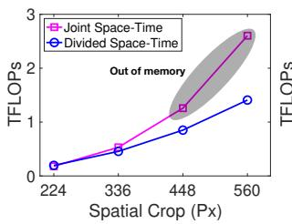
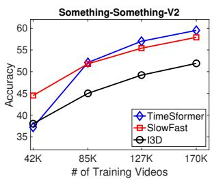
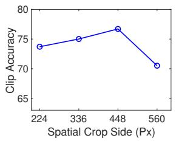
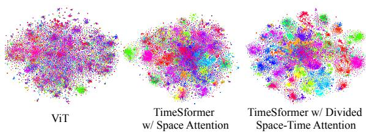

# 视频理解只需要时空注意力吗？（Is Space-Time Attention All You Need for Video Understanding?）

Gedas Bertasius 1 Heng Wang 1 Lorenzo Torresani 1 2

## 摘要

我们提出了一种完全无卷积的视频分类方法，仅在时空上使用自注意力。我们的方法名为「TimeSformer」，通过直接从一系列帧级图像块（framelevel patches）的序列中学习时空特征，将标准的 Transformer 架构适配到视频任务上。我们的实验研究比较了不同的自注意力方案，结果表明在所考虑的设计选择中，「分离式注意力（divided attention）」——即在每个块内分别施加时间注意力和空间注意力——能够带来最佳的视频分类精度。尽管设计上前所未有，TimeSformer 仍在多个动作识别基准上取得了最先进的成果，包括在 Kinetics-400 和 Kinetics-600 上达到了已报告的最佳准确率。最后，与三维卷积网络相比，我们的模型训练速度更快，可以在测试时实现显著更高的效率（仅伴随较小的精度下降），并且还可以应用于更长的视频片段（超过一分钟）。代码和模型已发布在：https://github.com/facebookresearch/TimeSformer。

## 1. 引言

在过去的几年里，自然语言处理（Natural Language Processing, NLP）领域被基于自注意力的方法的出现所革新（Vaswani et al., 2017a）。由于自注意力在捕捉词与词之间长程依赖关系方面具有出色的能力，并具备良好的训练可扩展性，以 Transformer 模型为代表的自注意力架构已成为广泛语言任务中的当前最先进技术，包括机器翻译（Ott et al., 2018; Chen et al., 2018a）、问答（Devlin et al., 2019; Dai et al., 2019）以及自回归词生成（Radford et al., 2019; Brown et al., 2020）。

视频理解与 NLP 在高层面上有几个相似之处。首先，视频和句子都是序列。此外，正如一个词的含义往往只能通过将其与句子中的其他词联系起来才能理解，短时段内的原子动作也需要与视频的其余部分进行上下文化才能被完全消歧。因此，可以预期来自 NLP 的长程自注意力模型在视频建模上也将非常有效。然而，在视频领域，二维或三维卷积仍然是不同视频任务中时空特征学习的核心运算子（Feichtenhofer et al., 2019a; Teed & Deng, 2020; Bertasius & Torresani, 2020）。尽管自注意力已被证明在卷积层之上使用时能带来收益（Wang et al., 2018a），但据我们所知，目前尚无将自注意力作为视频识别模型唯一构建模块的尝试被报告出来。

在这项工作中，我们提出了一个问题：是否有可能通过用自注意力完全替换卷积算子，来构建一个高性能的无卷积视频架构。我们认为，这种设计有可能克服卷积模型在视频分析中存在的一些固有局限性。首先，尽管它们强大的归纳偏置（例如，局部连接和平移等变性）在小训练集上无疑是有益的，但在数据充足且"所有内容"都可以从样本中学习的环境中，它们可能会过度限制模型的表达能力。与卷积神经网络（CNN）相比，Transformer 施加的限制性更少的归纳偏置。这扩大了它们能够表达的函数族（Cordonnier et al., 2020; Zhao et al., 2020），并使它们更适合于现代大数据场景，因为在这种场景中对强归纳先验的需求较小。其次，虽然卷积核被专门设计用于捕获短程时空信息，但它们无法建模超出感受野范围的依赖关系。尽管深度堆叠的卷积（Simonyan & Zisserman, 2015; Szegedy et al., 2015; Carreira & Zisserman, 2017）自然地扩展了感受野，但这些策略在通过聚合较短范围信息来捕获长程依赖方面存在固有的局限性。相反，自注意力机制可以通过直接比较所有时空位置的特征激活来捕获局部和全局的长程依赖，这远超传统卷积滤波器的感受野。最后，尽管 GPU 硬件加速取得了进展，但训练深度 CNN 仍然非常昂贵，尤其是在应用于高分辨率和长视频时。最近在静态图像领域的工作（Dosovitskiy et al., 2020; Carion et al., 2020; Zhao et al., 2020）已经表明，与 CNN 相比，Transformer 享有更快的训练和推理速度，使得在相同计算预算下构建具有更大学习能力的模型成为可能。

基于这些观察，我们提出了一种完全基于自注意力构建的视频架构。我们通过将自注意力机制从图像空间扩展到时空三维体，将图像模型"Vision Transformer"（ViT）（Dosovitskiy et al., 2020）适配到视频领域。我们提出的模型命名为"TimeSformer"（源自 Time-Space Transformer），它将视频视为从各个帧中提取的块（patch）序列。与 ViT 中一样，每个块被线性映射到一个嵌入（embedding）中，并附加位置信息。这使得可以将所产生的向量序列解释为词元（token）嵌入，可以输入到 Transformer 编码器中，类似于在 NLP 中从单词计算的词元特征。

标准 Transformer 中自注意力机制的一个缺点是，它需要为所有 token 对计算相似度。在我们的设定中，由于视频中包含大量 patch，这一计算代价十分高昂。为应对这些挑战，我们提出了若干种针对时空体（space-time volume）的可扩展自注意力设计，并在大规模动作分类数据集上对它们进行了经验性评估。在所提方案中，我们发现最佳设计是一种「分块注意力（divided attention）」架构，它在网络的每个 block 内分别施加时间注意力和空间注意力。与基于卷积的视频架构这一既定范式相比，TimeSformer 遵循一种截然不同的设计。然而，其精度可与该领域的当前最先进方法相媲美，在某些情况下甚至更优。我们还展示了我们的模型可用于对跨越多分钟的视频进行长程建模。

## 2. 相关工作

我们的方法受到了近期一些使用自注意力进行图像分类的工作的影响，这些工作或将自注意力与卷积运算结合使用，或甚至完全以自注意力替代卷积。在前者这一类方法中，Non-Local Networks（Wang 等，2018b）采用了一种非局部均值（non-local mean）运算，有效推广了 Transformers（Vaswani 等，2017b）中的自注意力函数。Bello 等（Bello 等，2019）提出了一种 2D 自注意力机制，作为 2D 卷积的替代方案时已具备竞争力，但当其用于以自注意力特征增强卷积特征时，结果则更为强劲。除图像分类之外，Relation Networks（Hu 等，2018）与 DETR（Carion 等，2020）将自注意力叠加于卷积特征图之上，用于目标检测。

我们的方法与那些利用自注意力替代卷积的图像网络更为密切相关（Parmar et al., 2018; Ramachandran et al., 2019; Cordonnier et al., 2020; Zhao et al., 2020）。由于这些工作以单个像素作为查询，为了维持可管理的计算开销和较小的内存消耗，它们必须将自注意力的范围限制在局部邻域内，或者在大幅缩小尺寸的图像上使用全局自注意力。可扩展到完整图像的替代策略包括稀疏的键-值采样（Child et al., 2019）或将自注意力约束为沿空间轴计算（Ho et al., 2019; Huang et al., 2019; Wang et al., 2020b）。我们在实验中考虑的若干自注意力算子采用了类似的稀疏和轴向计算策略，尽管已推广到时空体。然而，我们方法的效率主要来自于将视频分解为一系列帧级图块（frame-level patch），然后将这些图块的线性嵌入作为输入词元（token）嵌入送入 Transformer。这一策略最近在 Vision Transformer（视觉变换器，ViT）（Dosovitskiy et al., 2020）中被引入，并已在图像分类任务上展现出令人瞩目的性能。在本工作中，我们以 ViT 设计为基础，通过提出并实证比较若干在视频上可扩展的时空自注意力方案，将其扩展到视频领域。

虽然 Transformer 最近已被用于视频生成（Weissenborn et al., 2020），但据我们所知，目前尚无先前的视频识别架构将自注意力作为唯一的构建模块。然而，我们注意到 Transformer 已被应用于卷积特征图之上，用于动作定位与识别（Girdhar et al., 2019）、视频分类（Wang et al., 2018b; Chen et al., 2018b）以及群体活动识别（Gavrilyuk et al., 2020）。我们还注意到，已有大量文献基于文本 Transformer 与视频 CNN 的结合来处理各种视频-语言任务，例如视频描述生成（Zhou et al., 2018）、视频问答（Yang et al., 2020）和视频对话（Le et al., 2019）。最后，多模态视频-文本 Transformer（Sun et al., 2019; Li et al., 2020a）也已通过采用从语言领域改编而来的掩码词元（masked-token）预训练任务（Devlin et al., 2018; Radford et al., 2018），以无监督方式进行训练或预训练。

## 3. TimeSformer 模型

输入片段。TimeSformer 将一段视频片段作为输入，记为 X ∈ RH×W×3×F，该片段由从原始视频中采样的 F 帧大小为 $H \times W$ 的 RGB 图像组成。

分解为图像块（Decomposition into patches）。遵循 ViT（Dosovitskiy 等，2020）的方法，我们将每一帧分解为 $N$ 个不重叠的图像块，每个图像块的尺寸为 $P \times P$，使得这 $N$ 个图像块覆盖整个帧，即 $N = HW / P^{2}$。我们将这些图像块展平为向量 $\mathbf{x}_{(p,t)} \in \mathbb{R}^{3P^{2}}$，其中 $p = 1, \ldots, N$ 表示空间位置，$t = 1, \ldots, F$ 表示帧的索引。

  

图 1. 我们在本文中研究的视频自注意力块（video self-attention blocks）。每个注意力层在帧级图块（frame-level patches）的特定时空邻域上实现自注意力（self-attention）（Vaswani 等人，2017b）（有关邻域的可视化，请参见图 2）。我们使用残差连接（residual connections）来聚合每个块内不同注意力层的信息。在每个块的末尾应用一个 1 隐藏层的多层感知机（MLP）。最终模型通过将这些块反复堆叠在一起而构建。

线性嵌入。我们将每个 patch $\mathbf { x } _ { ( p , t ) }$ 线性映射为嵌入向量 $\mathbf { z } _ { ( p , t ) } ^ { ( 0 ) } \in \check { \mathbb { R } } ^ { D }$，通过一个可学习的矩阵 $E \in \breve { \mathbb { R } ^ { D \times 3 P ^ { 2 } } }$。

$$
\mathbf {z} _ {(p, t)} ^ {(0)} = E \mathbf {x} _ {(p, t)} + \mathbf {e} _ {(p, t)} ^ {p o s}\tag{1}
$$

其中 $\mathbf { e } _ { ( p , t ) } ^ { p o s } \in \mathbb { R } ^ { D }$ 表示一个可学习的位置嵌入（positional embedding），用以编码每个图块（patch）的时空位置。对于 $p = 1 , \ldots , N$ 以及 $t = 1 , \ldots , F$，所得的嵌入向量序列 $\mathbf { z } _ { ( p , t ) } ^ { ( 0 ) }$ 即作为 Transformer 的输入，其作用类似于自然语言处理中馈送给文本 Transformer 的嵌入词序列。与原始的 BERT Transformer（Devlin et al., 2018）相同，我们在序列的起始位置添加一个特殊的可学习向量 $\mathbf { z } _ { ( 0 , 0 ) } ^ { ( 0 ) } \in \mathbb { R } ^ { D }$，用以表示分类标记（classification token）的嵌入。

查询-键-值（Query-Key-Value）计算。我们的 Transformer 由 L 个编码块（encoding blocks）构成。在每个块中，针对每个图块（patch），根据前一个块所得到的表示 $\mathbf { z } _ { ( p , t ) } ^ { ( \ell - 1 ) }$ 计算其查询/键/值（query/key/value）向量：

$$
\mathbf {q} _ {(p, t)} ^ {(\ell , a)} = W _ {Q} ^ {(\ell , a)} \mathrm{LN} \left(\mathbf {z} _ {(p, t)} ^ {(\ell - 1)}\right) \in \mathbb {R} ^ {D _ {h}}\tag{2}
$$

$$
\mathbf {k} _ {(p, t)} ^ {(\ell , a)} = W _ {K} ^ {(\ell , a)} \mathrm{LN} \left(\mathbf {z} _ {(p, t)} ^ {(\ell - 1)}\right) \in \mathbb {R} ^ {D _ {h}}\tag{3}
$$

$$
\mathbf {v} _ {(p, t)} ^ {(\ell , a)} = W _ {V} ^ {(\ell , a)} \mathrm{LN} \left(\mathbf {z} _ {(p, t)} ^ {(\ell - 1)}\right) \in \mathbb {R} ^ {D _ {h}}\tag{4}
$$

其中 LN() 表示 LayerNorm（Ba et al., 2016），$a = 1, \ldots, A$ 是跨多个注意力头的索引，$A$ 表示注意力头的总数。每个注意力头的潜在维度设为 $D _ { h } = D / \mathcal { A }$

自注意力计算。自注意力权重通过点积方式计算。查询块（p, t）的自注意力权重 $\pmb { \alpha } _ { ( p , t ) } ^ { ( \ell , a ) } \in \mathbb { R } ^ { N F + 1 }$ 由下式给出：

$$
\boldsymbol{\alpha}_{(p,t)}^{(\ell ,a)} = \text{SM}\left(\frac{\mathbf{q}_{(p,t)}^{(\ell,a)}}{\sqrt{D_{h}}}\right)^{\top}\cdot \left[\mathbf{k}_{(0,0)}^{(\ell ,a)}\left\{\mathbf{k}_{(p^{\prime},t^{\prime})}^{(\ell ,a)}\right\}_{\substack{p^{\prime} = 1,\ldots ,N\\ t^{\prime} = 1,\ldots ,F}}\right]\Bigg)\tag{5}
$$

其中 SM 表示 softmax 激活函数。注意，当仅在一个维度上计算注意力时（例如，仅空间维度或仅时间维度），计算量会显著减少。例如，在空间注意力的情况下，仅进行 $N + 1$ 次查询-键比较，且使用的键全部来自与查询同一帧：

$$
\boldsymbol {\alpha} _ {(p, t)} ^ {(\ell , a) \text {space}} = \text {SM} \left(\frac {\mathbf {q} _ {(p , t)} ^ {(\ell , a)}}{\sqrt {D _ {h}}} ^ {\top} \cdot \left[ \mathbf {k} _ {(0, 0)} ^ {(\ell , a)} \left\{\mathbf {k} _ {(p ^ {\prime}, t)} ^ {(\ell , a)} \right\} _ {p ^ {\prime} = 1, \ldots , N} \right]\right)\tag{6}
$$

编码。

编码 $\mathbf { z } _ { ( p , t ) } ^ { ( \ell ) }$ 在块 \` 处通过首先使用来自每个注意力头的自注意力系数对值向量进行加权求和得到：

  

图 2. 本研究所考察的五种时空自注意力方案的可视化。每个视频片段被视为由大小为 16 × 16 像素的帧级图像块（patch）组成的序列。为了便于说明，我们用蓝色标注查询图像块（query patch），并用非蓝色显示其在各方案下的自注意力时空邻域。未着色的图像块不参与该蓝色图像块的自注意力计算。同一方案中出现的多种颜色表示注意力分别沿不同维度（例如 (T+S) 方案中沿空间和时间）施加，或在不同的邻域（例如 (L+G) 方案）上施加。需要说明的是，自注意力会对视频片段中的每一个图像块进行计算，即每个图像块都充当一次查询。我们还指出，尽管图中仅展示了相邻两帧之间的注意力模式，但该模式以相同方式扩展至片段中的所有帧。

$$
\mathbf {s} _ {(p, t)} ^ {(\ell , a)} = \alpha_ {(p, t), (0, 0)} ^ {(\ell , a)} \mathbf {v} _ {(0, 0)} ^ {(\ell , a)} + \sum_ {p ^ {\prime} = 1} ^ {N} \sum_ {t ^ {\prime} = 1} ^ {F} \alpha_ {(p, t), (p ^ {\prime}, t ^ {\prime})} ^ {(\ell , a)} \mathbf {v} _ {(p ^ {\prime}, t ^ {\prime})} ^ {(\ell , a)}.\tag{7}
$$

然后，将所有头部的这些向量进行拼接后投影，并通过一个多层感知机（MLP），在每个操作之后使用残差连接：

$$
\mathbf {z} _ {(p, t)} ^ {\prime (\ell)} = W _ {O} \left[ \begin{array}{c} \mathbf {s} _ {(p, t)} ^ {(\ell , 1)} \\ \vdots \\ \mathbf {s} _ {(p, t)} ^ {(\ell , \mathcal {A})} \end{array} \right] + \mathbf {z} _ {(p, t)} ^ {(\ell - 1)}\tag{8}
$$

$$
\mathbf {z} _ {(p, t)} ^ {(\ell)} = \mathrm{MLP} \left(\mathrm{LN} \left(\mathbf {z} _ {(p, t)} ^ {\prime (\ell)}\right)\right) + \mathbf {z} _ {(p, t)} ^ {\prime (\ell)}.\tag{9}
$$

**分类嵌入（Classification embedding）。** 最终的片段嵌入从分类标记的最后一个模块获得：

$$
\mathbf {y} = \mathrm{LN} \left(\mathbf {z} _ {(0, 0)} ^ {(L)}\right) \in \mathbb {R} ^ {D}.\tag{10}
$$

在该表示之上，我们附加一个 1 隐层的 MLP，用于预测最终的视频类别。

**时空自注意力模型（Space-Time Self-Attention Models）。** 我们可以通过仅在每个帧内使用空间注意力（式 6）来替代式 5 中的时空注意力，从而降低计算成本。然而，这种模型忽略了捕捉跨帧之间的时间依赖关系。正如我们的实验所示，与完整的时空注意力相比，这种方法会导致分类准确率下降，尤其是在那些需要强时间建模能力的基准上。

我们提出了一种更高效的时空注意力架构，命名为「分离式时空注意力（Divided Space-Time Attention）」（记为 T+S），其中时间注意力和空间注意力依次分别施加。

该架构与空间注意力以及联合时空注意力的对比如图 1 所示。

不同注意力模型在一个视频示例上的可视化如图 2 所示。

对于分离式注意力，在每个块 ℓ 内，我们首先通过将每个块 (p, t) 与其他帧中相同空间位置的所有块进行比较来计算时间注意力：

$$
\boldsymbol {\alpha} _ {(p, t)} ^ {(\ell , a) \text {time}} = \text {SM} \left(\frac {\mathbf {q} _ {(p , t)} ^ {(\ell , a)}}{\sqrt {D _ {h}}} ^ {\top} \cdot \left[ \mathbf {k} _ {(0, 0)} ^ {(\ell , a)} \left\{\mathbf {k} _ {(p, t ^ {\prime})} ^ {(\ell , a)} \right\} _ {t ^ {\prime} = 1, \ldots , F} \right]\right)\tag{11}
$$

应用公式 8 后由时间注意力得到的编码 $\mathbf{z}_{\mathit{\Pi}(p,t)}^{\prime(\ell)\mathrm{time}}$ 随后被反馈用于空间注意力计算，而非传递给 MLP。换言之，新的 key/query/value 向量由 $\mathbf{z}_{(p,t)}^{\prime(\ell)\mathrm{time}}$ 得到，然后使用公式 6 计算空间注意力。最终得到的向量 $\mathbf{z}_{(p,t)}^{\prime(\ell)\mathrm{space}}$ 被传递给公式 9 中的 MLP，以计算第 $\ell$ 个 block 中 patch 的最终编码 $\mathbf{z}_{(p,t)}^{(\ell)}$。对于分离注意力（Divided Attention）模型，我们在时间和空间维度上分别学习不同的 query/key/value 矩阵 $\{W_{Q^{\mathrm{time}}}^{(\ell,a)}, W_{K^{\mathrm{time}}}^{(\ell,a)}, W_{V^{\mathrm{time}}}^{(\ell,a)}\}$ 和 $\{W_{Q^{\mathrm{space}}}^{(\ell,a)}, W_{K^{\mathrm{space}}}^{(\ell,a)}, W_{V^{\mathrm{space}}}^{(\ell,a)}\}$。注意，与公式 5 的联合时空注意力模型所需的每个 patch $(NF+1)$ 次比较相比，分离注意力每个 patch 仅进行 $(N+F+2)$ 次比较。我们的实验表明，这种时空分解不仅更高效，而且还能提升分类准确率。

<table><tr><td>Attention</td><td>Params</td><td>K400</td><td>SSv2</td></tr><tr><td>Space</td><td>85.9M</td><td>76.9</td><td>36.6</td></tr><tr><td>Joint Space-Time</td><td>85.9M</td><td>77.4</td><td>58.5</td></tr><tr><td>Divided Space-Time</td><td>121.4M</td><td>78.0</td><td>59.5</td></tr><tr><td>Sparse Local Global</td><td>121.4M</td><td>75.9</td><td>56.3</td></tr><tr><td>Axial</td><td>156.8M</td><td>73.5</td><td>56.2</td></tr></table>

表 1. TimeSformer 中不同时空注意力方案的视频级准确率。我们在 Kinetics-400（K400）和 Something-Something-V2（SSv2）验证集上对模型进行评估。我们观察到，分时空注意力（divided space-time attention）在两个数据集上都取得了最佳结果。

我们还实验了"稀疏局部-全局"（Sparse Local Global，L+G）和"轴向"（Axial，T+W+H）注意力模型。它们的结构如图 1 所示，图 2 展示了这些模型在注意力计算时所考虑的图像块（patch）。对于每个图像块 (p, t)，(L+G) 首先考虑相邻的 $F \times H / 2 \times W / 2$ 个图像块计算局部注意力，然后在整个视频片段上以时间维度和两个空间维度各 2 个图像块的步长计算稀疏的全局注意力。因此，它可以视为使用局部-全局分解和稀疏模式的全时空注意力的快速近似，这种稀疏模式与 (Child et al., 2019) 中使用的类似。最后，"轴向"注意力将注意力计算分解为三个独立的步骤：依次在时间、宽度和高度上进行。(Ho et al., 2019; Huang et al., 2019; Wang et al., 2020b) 中提出了图像两个空间轴上的分解注意力，而我们提出的 (T+W+H) 针对视频场景增加了第三个维度（时间）。所有这些模型都通过为每个注意力步骤学习独立的查询/键/值矩阵来实现。

## 4. 实验

我们在四个流行的动作识别数据集上评估 TimeSformer：Kinetics-400（Carreira & Zisserman, 2017）、Kinetics-600（Carreira et al., 2018）、Something-Something-V2（Goyal et al., 2017b）和 Diving-48（Li et al., 2018）。我们采用在 ImageNet-1K 或 ImageNet-21K（Deng et al., 2009）上预训练的"Base" ViT 结构（Dosovitskiy et al., 2020），具体取决于每个实验的要求。除非另有说明，我们使用大小为 $8 \times 2 2 4 \times 2 2 4$ 的片段（clip），帧采样率为 $1 / 3 2$。图像块大小为 $1 6 \times 1 6$ 像素。在推理阶段，除非另有说明，我们在视频中间采样一个时间片段。我们从该时间片段中取 3 个空间裁剪（左上、中心、右下），通过对这 3 个裁剪的得分取平均得到最终预测。

  

图 3. 我们比较了联合时空（Joint Space-Time）注意力与分离时空（Divided Space-Time）注意力在视频分类任务上的计算开销（以 TFLOPs 为单位）。我们将 TFLOPs 数量绘制为空间裁剪尺寸（以像素为单位）的函数（左图），以及输入帧数的函数（右图）。随着空间分辨率（左图）或视频长度（右图）的增加，我们所提出的分离时空注意力相较于联合时空注意力方案能够带来显著的计算开销节省。

## 4.1. 自注意力方案的分析

在这第一组实验中，我们从一个在 ImageNet-21K 上预训练的 ViT 出发。在表 1 中，我们展示了 TimeSformer 在 Kinetics-400（K400）和 Something Something-V2（SSv2）上针对五种所提出的时空注意力方案所获得的结果。首先，我们注意到，使用仅空间注意力（space-only attention, S）的 TimeSformer 在 K400 上表现良好。这是一个有趣的发现。事实上，先前的工作（Sevilla-Lara 等，2021）已经表明，在 K400 上，为了取得较高的准确率，空间线索比时间信息更为重要。在这里，我们展示了在没有任何时间建模的情况下，也可以在 K400 上获得可靠的准确率。然而，需要注意的是，仅空间注意力在 SSv2 上表现较差。这凸显了时间建模在后一个数据集上的重要性。

此外，我们观察到，分时空注意力（divided space-time attention）在 K400 和 SSv2 上都达到了最高的准确率。这是合理的，因为与联合时空注意力（joint space-time attention）相比，分时空注意力具有更大的学习容量（见表 1），因为它包含了用于时间注意力和空间注意力的独立学习参数。

在图 3 中，我们还在使用更高空间分辨率（左）和更长（右）视频时，比较了联合时空注意力与分时空注意力的计算开销。我们注意到，在这两种情况下，分时空方案都能优雅地扩展。相比之下，当分辨率或视频长度增加时，联合时空注意力方案会导致开销急剧增加。在实践中，一旦空间帧分辨率达到 448 像素，或帧数增加到 32 帧，联合时空注意力就会导致 GPU 内存溢出，因此它实际上不适用于大帧或长视频。因此，尽管参数数量更多，但分时空注意力在处理更高空间分辨率或更长视频时比联合时空注意力更高效。因此，在后续的所有实验中，我们使用由分时空自注意力块构建的 TimeSformer。

时空注意力就是你视频理解所需的全部吗？

<table><tr><td>Model</td><td>Pretrain</td><td>K400 Training Time (hours)</td><td>K400 Acc.</td><td>Inference TFLOPs</td><td>Params</td></tr><tr><td>I3D 8x8 R50</td><td>ImageNet-1K</td><td>444</td><td>71.0</td><td>1.11</td><td>28.0M</td></tr><tr><td>I3D 8x8 R50</td><td>ImageNet-1K</td><td>1440</td><td>73.4</td><td>1.11</td><td>28.0M</td></tr><tr><td>SlowFast R50</td><td>ImageNet-1K</td><td>448</td><td>70.0</td><td>1.97</td><td>34.6M</td></tr><tr><td>SlowFast R50</td><td>ImageNet-1K</td><td>3840</td><td>75.6</td><td>1.97</td><td>34.6M</td></tr><tr><td>SlowFast R50</td><td>N/A</td><td>6336</td><td>76.4</td><td>1.97</td><td>34.6M</td></tr><tr><td>TimeSformer</td><td>ImageNet-1K</td><td>416</td><td>75.8</td><td>0.59</td><td>121.4M</td></tr><tr><td>TimeSformer</td><td>ImageNet-21K</td><td>416</td><td>78.0</td><td>0.59</td><td>121.4M</td></tr></table>

**Table 2.** 将 TimeSformer 与 SlowFast 和 I3D 进行比较。我们观察到，尽管 TimeSformer 的参数量更大，但其推理成本较低。此外，即使所有模型都在 ImageNet-1K 上进行了预训练，TimeSformer 在视频数据上的训练成本也远低于 SlowFast 和 I3D。

## 4.2. 与 3D CNN 的比较

在本小节中，我们进行了一项实证研究，旨在理解 TimeSformer 相对于近年来视频理解主流方法——3D 卷积架构——所具有的区分性特征。我们将比较的重点放在两个 3D CNN 模型上：1) SlowFast（Feichtenhofer 等，2019b），它是当前视频分类的最先进方法；2) I3D（Carreira 和 Zisserman，2017），与我们的模型类似，它同样受益于基于图像的预训练。我们在 Table 2 中给出了与这两个网络的定量比较，并在下面突出关键观察结果。

**Model Capacity.** 从 Table 2 中我们首先观察到，尽管 TimeSformer 具有较大的学习容量（参数量为 121.4M），但其推理成本很低（0.59 TFLOPs）。相比之下，SlowFast 8×8 R50 的推理成本更高（1.97 TFLOPs），尽管其参数量仅为 34.6M。类似地，I3D 8×8 R50 的推理成本（1.11 TFLOPs）也更高，尽管其参数量更少（28.0M）。这表明 TimeSformer 更适合涉及大规模学习的场景。相比之下，现代 3D CNN 巨大的计算开销使得在保持效率的同时进一步增加模型容量变得困难。

视频训练时间。ImageNet 预训练的一个显著优势是，它使得 TimeSformer 能够在视频数据上进行非常高效的训练。相反，最先进的 3D CNN 即使在图像数据集上进行了预训练，训练成本也要高得多。在表 2 中，我们比较了 TimeSformer 与 SlowFast 和 I3D 在 Kinetics-400 上的视频训练时间（以 Tesla V100 GPU 小时为单位）。从在 ImageNet-1K 上预训练的 ResNet50 出发，SslowFast 8 8 R50 需要 3 840 个 Tesla V100 GPU 小时才能在 Kinetics-400 上达到 75.6% 的准确率。在类似条件下训练 I3D 则需要 1 440 个 Tesla V100 GPU 小时，准确率为 73.4%。相比之下，同样在 ImageNet-1K 上预训练的 TimeSformer 只需 416 个 Tesla V100 GPU 小时即可达到更高的 75.8% 准确率（见表 2）。此外，如果我们将 SlowFast 的训练计算预算限制在与 TimeSformer 大致相当的水平（即 448 GPU 小时），其准确率将下降至 70.0%。类似地，使用相近的计算预算（即 444 GPU 小时）训练 I3D 得到的准确率更低，为 71.0%。这突出表明，一些最新的 3D CNN（Feichtenhofer 等人，2019b；Feichtenhofer，2020）需要很长的优化调度才能取得良好性能（即使使用了 ImageNet 预训练）。相比之下，TimeSformer 为那些无法使用数百块 GPU 的实验室提供了一种更为高效的替代方案。

<table><tr><td>Method</td><td>Pretraining</td><td>K400</td><td>SSv2</td></tr><tr><td>TimeSformer</td><td>ImageNet-1K</td><td>75.8</td><td>59.5</td></tr><tr><td>TimeSformer</td><td>ImageNet-21K</td><td>78.0</td><td>59.5</td></tr><tr><td>TimeSformer-HR</td><td>ImageNet-1K</td><td>77.8</td><td>62.2</td></tr><tr><td>TimeSformer-HR</td><td>ImageNet-21K</td><td>79.7</td><td>62.5</td></tr><tr><td>TimeSformer-L</td><td>ImageNet-1K</td><td>78.1</td><td>62.4</td></tr><tr><td>TimeSformer-L</td><td>ImageNet-21K</td><td>80.7</td><td>62.3</td></tr></table>

表 3. 在 Kinetics-400（K400）和 Something-Something-V2（SSv2）上比较 ImageNet-1K 与 ImageNet-21K 预训练的效果。在 K400 上，相比 ImageNet-1K 预训练，ImageNet-21K 预训练始终带来更好的性能。在 SSv2 上，ImageNet-1K 和 ImageNet-21K 预训练取得的准确率相近。

预训练的重要性。由于参数量庞大，从头训练我们的模型十分困难。因此，在视频数据上训练 TimeSformer 之前，我们用从 ImageNet 学到的权重对其进行初始化。相比之下，SlowFast 可以从视频数据端到端训练，但代价是极高的训练开销（见表 2）。我们也尝试不借助任何 ImageNet 预训练、直接在 Kinetics-400 上训练 TimeSformer。通过采用更长的训练计划和更多的数据增强，我们发现从头训练模型是可行的，但视频级别的准确率要低得多，仅为 64.8%。因此，基于这些结果，在后续所有研究中我们继续使用 ImageNet 进行预训练（Deng et al., 2009）。

在表 3 中，我们研究了 ImageNet-1K 与 ImageNet-21K 预训练在 K400 和 SSv2 上的收益。对于这些实验，我们使用我们模型的三个变体：（1）TimeSformer，即我们模型的默认版本，在 8×224×224 的视频片段上运行；（2）TimeSformer-HR，一种高空间分辨率变体，在 16×448×448 的视频片段上运行；（3）TimeSformer-L，我们模型的长范围配置，在以 1/4 帧率采样的 96×224×224 视频片段上运行。

基于表 3 中的结果，我们观察到 ImageNet-21K 预训练对 K400 有益，相比 ImageNet-1K 预训练始终带来更高的准确率。另一方面，在 SSv2 上，我们观察到 ImageNet-1K 和 ImageNet-21K 预训练取得的准确率相近。这是合理的，因为 SSv2 需要复杂的时空推理，而 K400 则更偏向于空间场景信息，因此 K400 能从在更大预训练数据集上学到的特征中获益更多。

  

图4. 在 Kinetics-400（K400）和 Something-Something-V2（SSv2）上，精度随训练视频数量的变化关系。在 K400 上，TimeSformer 在所有情况下均表现最佳。在需要更复杂时序推理的 SSv2 上，TimeSformer 仅在使用足够数量的训练视频时才优于其他模型。所有模型均以 ImageNet-1K 进行预训练。

**视频数据规模的影响。** 为了理解视频数据规模对性能的影响，我们在 K400 和 SSv2 的不同数据子集上训练了 TimeSformer：分别为完整数据集的 25%、50%、75% 和 100%。我们在图 4 中展示了这些结果，并将我们的方法与 SlowFast R50（Feichtenhofer 等, 2019b）以及 I3D R50（Carreira 和 Zisserman, 2017）进行了比较，这些方法均在相同的子集上训练并使用相同的预训练。由于我们无法获得在 ImageNet-21K 上预训练的 ResNet，我们对全部 3 种架构均采用 ImageNet-1K 预训练。

图 4 的结果表明，在 K400 上，TimeSformer 在所有训练子集上的表现均优于其他模型。然而，我们在 SSv2 上观察到了不同的趋势：TimeSformer 仅在使用完整数据的 75% 或 100% 进行训练时才成为最强的模型。这可能是因为，相比于 K400，SSv2 需要学习更复杂的时间模式，因此 TimeSformer 需要更多的样本才能有效地学习这些模式。

## 4.3. 改变 token（词元）数量

我们的模型具备良好的可扩展性，与大多数 3D CNN 相比，它能够在更高的空间分辨率下运行并处理更长的视频。我们注意到，这两个因素都会影响输入到 Transformer 的 token 序列长度。具体而言，提高空间分辨率会导致每帧的 patch（图像块）数量（N）增加。使用更多帧时，输入 token 的数量也会增加。为了探究这些优势，我们进行了一项实证研究，沿着这两个轴分别增加 token 的数量。

我们在图 5 中报告了相关结果。我们发现，提高空间分辨率（在一定程度上）会带来性能的提升。同样，我们观察到，增加输入片段（clip）的长度能够带来持续的精度提升。受 GPU 内存限制，我们无法在超过 96 帧的片段上测试我们的模型。但我们仍想指出，使用 96 帧的片段相对于当前的卷积模型是一个显著的差异，因为后者通常仅限于处理 8 至 32 帧的输入。

  

图 5. 在 Kinetics-400 上片段级准确率作为空间裁剪尺寸（像素）（左）和输入帧数（右）的函数变化。

<table><tr><td>Positional Embedding</td><td>K400</td><td>SSv2</td></tr><tr><td>None</td><td>75.4</td><td>45.8</td></tr><tr><td>Space-only</td><td>77.8</td><td>52.5</td></tr><tr><td>Space-Time</td><td>78.0</td><td>59.5</td></tr></table>

Table 4. 关于位置嵌入的消融实验。使用时空位置嵌入的 TimeSformer 版本在 Kinetics-400 和 SSv2 上均取得了最高的准确率。

## 4.4. 位置嵌入的重要性

为了探究我们所学习的时空位置嵌入的重要性，我们还对 TimeSformer 的几个变体进行了实验，这些变体分别使用：(1) 不使用位置嵌入，(2) 仅使用空间位置嵌入，(3) 使用时空位置嵌入。我们在表 4 中报告了这些结果。基于这些结果，我们观察到，在 Kinetics-400 和 Something-Something-V2 上，使用时空位置嵌入的模型变体均取得了最佳的准确率。有趣的是，我们还观察到，仅使用空间位置嵌入在 Kinetics-400 上能够取得不错的结果，但在 Something-Something-V2 上的结果却差得多。这是合理的，因为 Kinetics-400 更偏向于空间信息，而 Something-Something-V2 则需要复杂的时间推理。

## 4.5. 与最先进方法的对比

Kinetics-400 与 Kinetics-600。在表 5 中，我们展示了在 K400 验证集上的结果。对于这些实验，我们使用在 ImageNet-21K 上预训练的 TimeSformer。除了准确率指标外，我们还列出了以 TFLOPs 计的推理成本。我们注意到，尽管大多数先前方法在推理时使用 10 个时间片段与 3 个空间裁剪（共计 30 个时空视图），而 TimeSformer 仅使用 3 个视图（3 个空间裁剪）就取得了不错的准确率，从而降低了推理成本。我们的长程版本 TimeSformer-L 达到了 80.7% 的 top-1 准确率。此外，我们的默认 TimeSformer 在最近的 state-of-the-art 模型中具有最低的推理成本。然而，它仍然提供了 78.0% 的不错准确率，超越了许多计算成本更高的模型。

<table><tr><td>Method</td><td>Top-1</td><td>Top-5</td><td>TFLOPs</td></tr><tr><td>R(2+1)D (Tran et al., 2018)</td><td>72.0</td><td>90.0</td><td>17.5</td></tr><tr><td>bLVNet (Fan et al., 2019)</td><td>73.5</td><td>91.2</td><td>0.84</td></tr><tr><td>TSM (Lin et al., 2019)</td><td>74.7</td><td>N/A</td><td>N/A</td></tr><tr><td>S3D-G (Xie et al., 2018)</td><td>74.7</td><td>93.4</td><td>N/A</td></tr><tr><td>Oct-I3D+NL (Chen et al., 2019)</td><td>75.7</td><td>N/A</td><td>0.84</td></tr><tr><td>D3D (Stroud et al., 2020)</td><td>75.9</td><td>N/A</td><td>N/A</td></tr><tr><td>I3D+NL (Wang et al., 2018b)</td><td>77.7</td><td>93.3</td><td>10.8</td></tr><tr><td>ip-CSN-152 (Tran et al., 2019)</td><td>77.8</td><td>92.8</td><td>3.2</td></tr><tr><td>CorrNet (Wang et al., 2020a)</td><td>79.2</td><td>N/A</td><td>6.7</td></tr><tr><td>LGD-3D-101 (Qiu et al., 2019)</td><td>79.4</td><td>94.4</td><td>N/A</td></tr><tr><td>SlowFast (Feichtenhofer et al., 2019b)</td><td>79.8</td><td>93.9</td><td>7.0</td></tr><tr><td>X3D-XXL (Feichtenhofer, 2020)</td><td>80.4</td><td>94.6</td><td>5.8</td></tr><tr><td>TimeSformer</td><td>78.0</td><td>93.7</td><td>0.59</td></tr><tr><td>TimeSformer-HR</td><td>79.7</td><td>94.4</td><td>5.11</td></tr><tr><td>TimeSformer-L</td><td>80.7</td><td>94.7</td><td>7.14</td></tr></table>

表 5. Kinetics-400 上的视频级准确率。

<table><tr><td>Method</td><td>Top-1</td><td>Top-5</td></tr><tr><td>I3D-R50+Cell (Wang et al., 2020c)</td><td>79.8</td><td>94.4</td></tr><tr><td>LGD-3D-101 (Qiu et al., 2019)</td><td>81.5</td><td>95.6</td></tr><tr><td>SlowFast (Feichtenhofer et al., 2019b)</td><td>81.8</td><td>95.1</td></tr><tr><td>X3D-XL (Feichtenhofer, 2020)</td><td>81.9</td><td>95.5</td></tr><tr><td>TimeSformer</td><td>79.1</td><td>94.4</td></tr><tr><td>TimeSformer-HR</td><td>81.8</td><td>95.8</td></tr><tr><td>TimeSformer-L</td><td>82.2</td><td>95.6</td></tr></table>

表 6. 在 Kinetics-600 数据集上的视频级准确率。

  

图 6. 在 Kinetics-400 上的视频级准确率与推理时所使用时序片段数量之间的关系。TimeSformer-L 仅使用少量片段即可达到出色的准确率，从而在低推理成本下实现强劲性能。

我们还在 Kinetics-400 的 20K 验证视频上测量了实际推理运行时间（使用 8 块 Tesla V100 GPU）。SlowFast 完成推理需要 14.88 小时，而 TimeSformer、TimeSformer-HR 和 TimeSformer-L 分别仅需 36 分钟、1.06 小时和 2.6 小时。因此，尽管 SlowFast 与 TimeSformer-L 在 TFLOPs 方面的成本相当，但实际运行时，我们所有版本的 TimeSformer 都明显更低。

在表 6 中，我们还展示了在 Kinetics-600 上的结果。与在 Kinetics-400 上一样，我们观察到 TimeSformer 在该基准上表现良好，优于所有先前方法。

最后，在图 6 中，我们研究了推理过程中使用多个时间片段（每个片段使用单一空间裁剪）的影响。我们使用 $K \in \{ 1 , 3 , 5 , 1 0 \}$ 个时间片段进行测试，并绘制了相应的精度。我们将我们的模型与 X3D（Feichtenhofer, 2020）以及 SlowFast（Feichtenhofer et al., 2019b）进行了对比。X3D 和 SlowFast 需要多个（约 5 个）片段才能接近其最高精度。相反，我们的长程版本 TimeSformer-L 无需多个片段即可达到其最佳性能，因为它能够在单个片段中跨越 Kinetics 视频的大约 12 秒。

<table><tr><td>Method</td><td>SSv2</td><td>Diving-48**</td></tr><tr><td>SlowFast (Feichtenhofer et al., 2019b)</td><td>61.7</td><td>77.6</td></tr><tr><td>TSM (Lin et al., 2019)</td><td>63.4</td><td>N/A</td></tr><tr><td>STM (Jiang et al., 2019)</td><td>64.2</td><td>N/A</td></tr><tr><td>MSNet (Kwon et al., 2020)</td><td>64.7</td><td>N/A</td></tr><tr><td>TEA (Li et al., 2020b)</td><td>65.1</td><td>N/A</td></tr><tr><td>bLVNet (Fan et al., 2019)</td><td>65.2</td><td>N/A</td></tr><tr><td>TimeSformer</td><td>59.5</td><td>74.9</td></tr><tr><td>TimeSformer-HR</td><td>62.2</td><td>78.0</td></tr><tr><td>TimeSformer-L</td><td>62.4</td><td>81.0</td></tr></table>

Table 7. Something-Something-V2 与 Diving-48 上的视频级准确率。∗∗由于先前发布的结果中所使用的 Diving-48 标签存在问题，我们仅将我们的方法与重新复现的 SlowFast $\mathbf { 1 6 } \times \mathbf { 8 } \mathrm { R 1 0 1 }$ 模型进行比较。所有模型均在 ImageNet-1K 上进行预训练。

Something-Something-V2 与 Diving-48。在 Table 7 中，我们同样在 SSv2 和 Diving-48 上对我们的模型进行验证。由于 ImageNet-21K 预训练并不能提升在 SSv2 上的准确率（参见 Table 3），因此在此情况下，我们使用在 ImageNet-1K 上预训练的 TimeSformer。这同时也允许我们对本次比较中的所有其他模型使用相同的预训练方式，即使用在 ImageNet-1K 上预训练的 ResNet。我们的结果表明，TimeSformer 在该数据集上的准确率低于最优模型。然而，考虑到我们的模型采用了完全不同的设计，我们将这些结果视为一种积极的信号，表明 TimesSformer 即使在像 SSv2 这样对时序依赖较高的、具有挑战性的数据集上，也依然是一种有前景的方法。

在 Table 7 中，我们同样在另一个「对时序依赖较高」的数据集 Diving-48 上展示了我们的方法。由于最近发现的先前版本 Diving-48 标签所存在的问题，此处我们仅将我们的方法与一个重新复现的 SlowFast 16 8 R101 模型进行比较。我们的结果表明，TimeSformer 以较大优势超越了 SlowFast。

## 4.6. 长期视频建模（Long-Term Video Modeling）

最后，我们在长期视频建模任务上对 TimeSformer 进行评估，所使用的数据集为 HowTo100M（Miech et al., 2019）。HowTo100M 是一个教学视频数据集，包含约 1M 个来自 Web 的教学视频，展示了人类执行的超过 23K 种不同任务，例如烹饪、修理、手工制作等。这些视频的平均时长约为 7 分钟，相比于标准动作识别基准数据集中的视频时长要长出数个数量级。每个 HowTo100M 视频都有一个标签，用于指示视频中所展示的任务（即 23K 个类别中的一个），该标签可用于监督训练。因此，它是一个很好的基准，可用于评估模型在极长时间跨度上识别活动的能力。

针对此次评估，我们仅考虑至少包含 100 个视频样本的类别。这得到了 HowTo100M 的一个子集，对应 120K 个视频，涵盖 1059 个任务类别。我们将该集合随机划分为 85K 个训练视频和 35K 个测试视频。

<table><tr><td>Method</td><td># Input Frames</td><td>Single Clip Coverage</td><td># Test Clips</td><td>Top-1 Acc</td></tr><tr><td>SlowFast</td><td>8</td><td>8.5s</td><td>48</td><td>48.2</td></tr><tr><td>SlowFast</td><td>32</td><td>34.1s</td><td>12</td><td>50.8</td></tr><tr><td>SlowFast</td><td>64</td><td>68.3s</td><td>6</td><td>51.5</td></tr><tr><td>SlowFast</td><td>96</td><td>102.4s</td><td>4</td><td>51.2</td></tr><tr><td>TimeSformer</td><td>8</td><td>8.5s</td><td>48</td><td>56.8</td></tr><tr><td>TimeSformer</td><td>32</td><td>34.1s</td><td>12</td><td>61.2</td></tr><tr><td>TimeSformer</td><td>64</td><td>68.3s</td><td>6</td><td>62.2</td></tr><tr><td>TimeSformer</td><td>96</td><td>102.4s</td><td>4</td><td>62.6</td></tr></table>

表 8. 在 HowTo100M 上的长时任务分类。给定一个跨越几分钟的视频，目标是预测该视频中展示的长时任务（例如，做早餐、打扫房屋等）。我们在该任务上评估了 SlowFast 和 TimeSformer 的若干变体。"Single Clip Coverage" 表示单个片段所跨越的秒数。"# Test Clips" 是推理时为覆盖整个视频所需的平均片段数。本比较中的所有模型均在 Kinetics-400 上进行了预训练。

我们在表 8 中给出了结果。作为基线，我们使用了 SlowFast R101 的四种变体，它们都在以 1/32 帧率采样的视频片段上运行，但帧数不同：8、32、64 和 96。我们对 TimeSformer 采用同样的四种配置，从一个在 ImageNet-21K 上预训练的 ViT 出发。本比较中的所有模型均在 Kinetics-400 上进行预训练，然后在 HowTo100M 上进行微调。

在推理阶段，对于每种方法，我们采样足够多的不重叠时间片段以覆盖视频的完整时间跨度，例如，若单个片段跨越 8.5 秒，则需要采样 48 个测试片段来覆盖一个 410 秒的视频。视频级分类通过对各片段的预测取平均来完成。

从表 8 的结果中我们首先注意到，对于相同的单片段覆盖范围，TimeSformer 比对应的 SlowFast 以 8 至 11% 的大幅优势胜出。我们还观察到，覆盖更长范围的 TimeSformer 表现更好，即我们最长范围的变体取得了最佳的视频级分类准确率。这些结果表明，我们的模型非常适合需要长时视频建模的任务。

我们还尝试了直接从在 ImageNet-1K 和 ImageNet-21K 上预训练的 ViT 微调 TimeSformer（跳过 Kinetics-400 训练阶段）。我们报告，当仅在 ImageNet-1K 上预训练时，我们的模型在 8、32、64、96 帧输入下分别达到 52.8、58.4、59.2、59.4 的 top-1 准确率。在 ImageNet-21K 预训练的情况下，TimeSformer 在 8、32、64、96 帧输入下分别取得 56.0、59.2、60.2、62.1 的 top-1 准确率。这些结果表明，无论使用何种预训练数据集，我们的模型都能有效地利用长距离时间依赖关系。

## 4.7. 额外消融实验

更小与更大的 Transformer。除了 "Base" ViT 模型（Dosovitskiy et al., 2020）之外，我们还实验了 "Large" ViT。我们报告称，这使得在 Kinetics-400 和 Something-Something-V2 上的结果都差 1%。鉴于我们的 "Base" 模型已具有 121M 参数，我们怀疑当前数据集规模不足以支撑进一步增大模型容量。我们还尝试了 "Small" ViT 变体，其准确率比默认的 "Base" ViT 模型差约 5%。

  

图 7. 在 Something-Something-V2 上从输出标记到输入空间的时空注意力可视化。我们的模型学会了聚焦视频中的相关部分，以执行时空推理。

  

图 8. 在 Something-Something-V2 上使用 t-SNE（van der Maaten & Hinton, 2008）进行的特征可视化。每个视频被可视化为一个点。属于同一动作类别的视频用相同的颜色表示。采用分离时空注意力（divided space-time attention）的 TimeSformer 比采用纯空间注意力（space-only attention）的 TimeSformer 或 ViT（Dosovitskiy et al., 2020）学习到语义上更具可分性的特征。

更大的 Patch 尺寸。我们还尝试了不同的 patch 尺寸，即 P = 32。我们报告该模型变体的结果比使用 P = 16 的默认变体差约 3%。我们推测 P = 32 时性能下降的原因是空间粒度降低。由于 P 值小于 16 的模型计算成本要高得多，因此我们没有训练任何 P 值低于 16 的模型。

时空自注意力的顺序。我们提出的"分时空注意力（Divided Space-Time Attention）"方案依次执行时间注意力和空间注意力。在这里，我们研究是否反转时间-空间注意力的顺序（即先应用空间注意力，再应用时间注意力）会对我们的结果产生影响。我们报告先应用空间注意力再应用时间注意力会导致在 Kinetics-400 和 Something-Something-V2 上的准确率均下降 0.5%。我们还尝试了并行的时空自注意力。我们报告其准确率比我们采用的"分时空注意力"方案低 0.4%。

## 4.8. 定性结果

可视化习得的时空注意力。在图 7 中，我们展示了在 Something-Something-V2 视频上应用 TimeSformer 得到的时空注意力可视化结果。为了可视化习得的注意力，我们使用了 (Abnar & Zuidema, 2020) 中提出的 Attention Rollout 方案。我们的结果表明，TimeSformer 学会了关注视频中的相关区域，以进行复杂的时空推理。例如，我们可以观察到模型在可见时聚焦于手的构型，而在手不可见时聚焦于物体本身。

可视化习得的特征嵌入。在图 8 中，我们还可视化了 TimeSformer 在 Something-Something-V2 上习得的特征。可视化使用 t-SNE（van der Maaten & Hinton, 2008）完成，其中每个点代表单个视频，不同颜色表示不同的动作类别。基于此图示，我们观察到使用分时空注意力的 TimeSformer 比仅使用空间注意力的 TimeSformer 或 ViT（Dosovitskiy et al., 2020）习得了语义上更可分的特征。

## 5. 结论

在这项工作中，我们引入了 TimeSformer，这是一种与已建立的基于卷积的视频网络范式根本不同的视频建模方法。我们表明可以设计一种有效且可扩展的、完全建立在时空自注意力之上的视频架构。我们的方法（1）概念上简单，（2）在主要动作识别基准上取得了最先进的结果，（3）训练和推理成本低，以及（4）可以应用于超过一分钟的视频片段，从而实现长期视频建模。未来，我们计划将我们的方法扩展到其他视频分析任务，如动作定位、视频字幕和问答。

## 附录

## A. 实现细节

我们的 TimeSformer 实现基于 PySlow-Fast（Fan 等，2020）和 pytorch-image-models（Wightman，2019）这两个工具包搭建。下面，我们将介绍模型训练和推理流程的具体实现细节。

**训练（Training）。** 我们将模型训练 15 个 epoch，初始学习率为 0.005，并在第 11 和第 14 个 epoch 时将其除以 10。训练过程中，我们首先将视频的较短边随机缩放到 [256, 320] 区间内的某个值；然后从缩放后的视频中随机裁取一个 224×224 的片段。对于我们的高分辨率模型 TimeSformer-HR，我们将视频的较短边随机缩放到 [448, 512] 区间内的某个值，然后随机裁取一个 448×448 的片段。我们以 1/32 的帧率从完整长度的视频中随机采样片段。批量大小（batch size）设为 16。所有模型均采用跨 32 块 GPU 的同步 SGD 进行训练。动量设为 0.9，权重衰减设为 0.0001。

除非特别说明，我们在实验中使用的是 "Base" 版 ViT 模型（Dosovitskiy 等，2020）。每个块中的时间注意力层与空间注意力层使用相同的权重进行初始化，这些权重取自 ViT 中对应的注意力层。

**推理（Inference）。** 如正文所述，推理阶段我们在视频的中间位置采样单个时间片段。我们将视频的较短空间边缩放到 224 像素（TimeSformer-HR 为 448 像素），并在该片段内裁取 3 个大小为 224×224（TimeSformer-HR 为 448×448）的空间区域，以覆盖更广的空间范围。最终预测通过对这 3 个预测的 softmax 得分取平均得到。

**对比中的其他模型。** 为了训练 I3D（Carreira 和 Zisserman，2017）以及 SlowFast（Feichtenhofer 等，2019b），我们采用各自原始论文中所使用的训练方案。对于 I3D，我们用一个 2D 的 ImageNet CNN 对其进行初始化，然后以 0.01 的基础学习率训练 118 个 epoch，并在第 44 和第 88 个 epoch 时将其除以 10。我们按照 Goyal 等（2017a）的线性缩放方案（linear scaling recipe），跨 32 块 GPU 使用同步 SGD。动量设为 0.9，权重衰减设为 0.0001，批量大小设为 64。对于 SlowFast 模型，当以 ImageNet 权重初始化时，我们使用与此完全相同的训练方案；当从头训练 SlowFast 时，则采用作者（Feichtenhofer 等，2019b）所述的训练方案。具体而言，在这种情况下训练共进行 196 个 epoch，采用余弦学习率调度（cosine learning rate schedule），初始学习率设为 0.1。前 34 个 epoch 采用线性预热（linear warm-up），起始学习率为 0.01。最终分类层之前使用 0.5 的 dropout。动量设为 0.9，权重衰减设为 0.0001，批量大小设为 64。与之前一样，我们采用线性缩放方案（Goyal 等，2017a）。

数据集。Kinetics-400（Carreira & Zisserman, 2017）包含24万个训练视频和2万个验证视频，涵盖400个人类动作类别。Kinetics-600（Carreira等人, 2018）包含39.2万个训练视频和3万个验证视频，涵盖600个动作类别。Something-Something-V2（Goyal等人, 2017b）包含17万个训练视频和2.5万个验证视频，涵盖174个动作类别。最后，Diving-48（Li等人, 2018）包含1.6万个训练视频和3000个测试视频，涵盖48个细粒度跳水类别。对于所有这些数据集，我们使用标准分类准确率作为主要性能指标。

## 参考文献

Abnar, S. and Zuidema, W. 量化Transformer中的注意力流, 2020.

Ba, L. J., Kiros, J. R., and Hinton, G. E. 层归一化. CoRR, 2016.

Bello, I., Zoph, B., Le, Q., Vaswani, A., and Shlens, J. 注意力增强卷积网络. 发表于：2019 IEEE/CVF International Conference on Computer Vision (ICCV), 2019.

Bertasius, G. and Torresani, L. 通过掩码传播对视频中的目标实例进行分类、分割与跟踪. 发表于：IEEE Conference on Computer Vision and Pattern Recognition (CVPR), 2020年6月.

Carion, N., Massa, F., Synnaeve, G., Usunier, N., Kirillov, A., and Zagoruyko, S. 使用Transformer进行端到端目标检测. 发表于：European Conference on Computer Vision (ECCV), 2020.

Carreira, J. and Zisserman, A. 行动识别路在何方？一个新模型与Kinetics数据集. 发表于：2017 IEEE Conference on Computer Vision and Pattern Recognition (CVPR 2017), 美国夏威夷州檀香山, 2017年7月21-26日, 2017.

Carreira, J., Noland, E., Banki-Horvath, A., Hillier, C., and Zisserman, A. 关于Kinetics-600的简要说明. CoRR, 2018.

Chen, M. X., Firat, O., Bapna, A., Johnson, M., Macherey, W., Foster, G., Jones, L., Schuster, M., Shazeer, N., Parmar, N., Vaswani, A., Uszkoreit, J., Kaiser, L., Chen, Z., Wu, Y., and Hughes, M. 两全其美：结合神经机器翻译的最新进展. 发表于：第56届Association for Computational Linguistics年会论文集. Association for Computational Linguistics, 2018a.

Chen, Y., Kalantidis, Y., Li, J., Yan, S., and Feng, J. A²-Nets：双重注意力网络. 发表于：Advances in Neural Information Processing Systems 31, 2018b.

Chen, Y., Fan, H., Xu, B., Yan, Z., Kalantidis, Y., Rohrbach, M., Yan, S., and Feng, J. Drop an Octave：通过Octave Convolution减少卷积神经网络中的空间冗余. 发表于：Proceedings of the IEEE/CVF

国际计算机视觉大会（ICCV），2019年10月。

Child, R., Gray, S., Radford, A., and Sutskever, I. 用稀疏 Transformer 生成长序列。CoRR，2019。

Cordonnier, J., Loukas, A., and Jaggi, M. 关于自注意力层与卷积层之间关系的研究。载于第八届国际学习表征大会（ICLR 2020），埃塞俄比亚亚的斯亚贝巴，2020年4月26-30日，2020。

Dai, Z., Yang, Z., Yang, Y., Carbonell, J., Le, Q., and Salakhutdinov, R. Transformer-XL：超越固定长度上下文的注意力语言模型。载于第57届计算语言学协会年会论文集，2019。

Deng, J., Dong, W., Socher, R., Li, L., Kai Li, and Li Fei-Fei. ImageNet：一个大规模层次化图像数据库。载于2009年IEEE计算机视觉与模式识别大会，第248–255页，2009。doi: 10.1109/CVPR. 2009.5206848。

Devlin, J., Chang, M.-W., Lee, K., and Toutanova, K. BERT：用于语言理解的深度双向 Transformer 预训练。arXiv 预印本 arXiv:1810.04805，2018。

Devlin, J., Chang, M.-W., Lee, K., and Toutanova, K. BERT：用于语言理解的深度双向 Transformer 预训练。载于2019年北美计算语言学协会人类语言技术大会论文集，第1卷（长文与短文），2019。

Dosovitskiy, A., Beyer, L., Kolesnikov, A., Weissenborn, D., Zhai, X., Unterthiner, T., Dehghani, M., Minderer, M., Heigold, G., Gelly, S., Uszkoreit, J., and Houlsby, N. 一幅图像值 16×16 个词：用于大规模图像识别的 Transformer。CoRR，2020。

Fan, H., Li, Y., Xiong, B., Lo, W.-Y., and Feichtenhofer, C. PySlowFast。https://github.com/ facebookresearch/slowfast，2020。

Fan, Q., Chen, C.-F. R., Kuehne, H., Pistoia, M., and Cox, D. 多即少：通过大小网络与深度可分离时序聚合学习高效视频表示。载于《神经信息处理系统进展》，第32卷，2019。

Feichtenhofer, C. X3D：扩展架构以实现高效视频识别。CVPR，第200–210页，2020。

Feichtenhofer, C., Fan, H., Malik, J., and He, K. SlowFast 网络用于视频识别。载于 IEEE/CVF 国际计算机视觉大会（ICCV）论文集，2019a。

Feichtenhofer, C., Fan, H., Malik, J., and He, K. SlowFast 网络用于视频识别。载于2019年 IEEE/CVF 国际计算机视觉大会，ICCV，2019b。

Gavrilyuk, K., Sanford, R., Javan, M., and Snoek, C. G. M. 用于群体活动识别的 Actor-Transformer。载于2020年 IEEE/CVF 计算机视觉与模式识别大会，CVPR，2020。

Girdhar, R., Carreira, J., Doersch, C., and Zisserman, A. 视频动作 Transformer 网络。载于 IEEE 计算机视觉与模式识别大会，CVPR，2019。

Goyal, P., Dollár, P., Girshick, R., Noordhuis, P., Wesolowski, L., Kyrola, A., Tulloch, A., Jia, Y., 和 He, K. 准确的大批量 SGD：1 小时内训练 ImageNet. arXiv 预印本 arXiv:1706.02677, 2017a.

Goyal, R., Kahou, S. E., Michalski, V., Materzynska, J., Westphal, S., Kim, H., Haenel, V., Fründ, I., Yianilos, P., Mueller-Freitag, M., Hoppe, F., Thurau, C., Bax, I., 和 Memisevic, R. 用于学习和评估视觉常识的"某事某事"视频数据库. CoRR, 2017b.

Ho, J., Kalchbrenner, N., Weissenborn, D., 和 Salimans, T. 多维 Transformer 中的轴向注意力. CoRR, 2019.

Hu, H., Gu, J., Zhang, Z., Dai, J., 和 Wei, Y. 用于目标检测的关系网络. 收录于 2018 年 IEEE 计算机视觉与模式识别会议 (CVPR), 2018.

Huang, Z., Wang, X., Huang, L., Huang, C., Wei, Y., 和 Liu, W. CCNet：用于语义分割的十字交叉注意力. 2019.

Jiang, B., Wang, M., Gan, W., Wu, W., 和 Yan, J. STM：用于动作识别的时空与运动编码. 收录于 IEEE/CVF 国际计算机视觉会议论文集 (ICCV), 2019 年 10 月.

Kwon, H., Kim, M., Kwak, S., 和 Cho, M. MotionSqueeze：用于视频理解的神经运动特征学习. 收录于 ECCV, 2020.

Le, H., Sahoo, D., Chen, N., 和 Hoi, S. 用于端到端视频对话系统的多模态 Transformer 网络. 收录于第 57 届计算语言学协会年度会议论文集, 2019.

Li, L., Chen, Y.-C., Cheng, Y., Gan, Z., Yu, L., 和 Liu, J. HERO：用于视频+语言统一表征预训练的层次化编码器. arXiv 预印本 arXiv:2005.00200, 2020a.

Li, Y., Li, Y., 和 Vasconcelos, N. Resound：迈向无表征偏差的动作识别. 收录于欧洲计算机视觉会议 (ECCV), 2018 年 9 月.

Li, Y., Ji, B., Shi, X., Zhang, J., Kang, B., 和 Wang, L. TEA：用于动作识别的时间激发与聚合. 收录于 IEEE/CVF 计算机视觉与模式识别会议论文集 (CVPR), 2020 年 6 月.

Lin, J., Gan, C., 和 Han, S. TSM：用于高效视频理解的时间位移模块. 收录于 IEEE 国际计算机视觉会议论文集, 2019.

Miech, A., Zhukov, D., Alayrac, J.-B., Tapaswi, M., Laptev, I., 和 Sivic, J. HowTo100M：通过观看一亿个有旁白的视频片段学习文本-视频嵌入. 收录于 ICCV, 2019.

Ott, M., Edunov, S., Grangier, D., 和 Auli, M. 扩展神经机器翻译. 收录于第三届机器翻译大会研究论文集, 2018.

Parmar, N., Vaswani, A., Uszkoreit, J., Kaiser, L., Shazeer, N., Ku, A., 和 Tran, D. 图像 Transformer. 收录于 Dy, J. G. 和 Krause, A. (编), 第 35 届国际机器学习大会论文集 (ICML), 2018.

Qiu, Z., Yao, T., Ngo, C.-W., Tian, X., 和 Mei, T. 通过局部与全局扩散学习时空表征. 收录于 CVPR, 2019.

参考文献

Radford, A., Narasimhan, K., Salimans, T., and Sutskever, I. 通过生成式预训练提升语言理解能力（Improving language understanding by generative pretraining）. 2018.

Radford, A., Wu, J., Child, R., Luan, D., Amodei, D., and Sutskever, I. 语言模型是无监督多任务学习者（Language models are unsupervised multitask learners）. 2019.

Ramachandran, P., Parmar, N., Vaswani, A., Bello, I., Levskaya, A., and Shlens, J. 视觉模型中的独立自注意力（Stand-alone self-attention in vision models）. 载于：神经信息处理系统进展，第 68–80 页，2019.

Sevilla-Lara, L., Zha, S., Yan, Z., Goswami, V., Feiszli, M., and Torresani, L. 只有时间能说明一切：用于时序建模的时序数据发现（Only time can tell: Discovering temporal data for temporal modeling）. 载于：IEEE/CVF 冬季计算机视觉应用会议（WACV）论文集，第 535–544 页，2021 年 1 月.

Simonyan, K. and Zisserman, A. 用于大规模图像识别的极深卷积网络（Very deep convolutional networks for large-scale image recognition）. 载于：ICLR，2015.

Stroud, J., Ross, D., Sun, C., Deng, J., and Sukthankar, R. D3D：用于视频动作识别的蒸馏 3D 网络（D3d: Distilled 3d networks for video action recognition）. 载于：IEEE/CVF 冬季计算机视觉应用会议（WACV）论文集，2020 年 3 月.

Sun, C., Myers, A., Vondrick, C., Murphy, K., and Schmid, C. VideoBERT：视频与语言表示学习的联合模型（Videobert: A joint model for video and language representation learning）. 2019.

Szegedy, C., Liu, W., Jia, Y., Sermanet, P., Reed, S., Anguelov, D., Erhan, D., Vanhoucke, V., and Rabinovich, A. 深入卷积网络（Going deeper with convolutions）. 载于：计算机视觉与模式识别会议（CVPR），2015.

Teed, Z. and Deng, J. RAFT：用于光流的递归全对场变换（RAFT: recurrent all-pairs field transforms for optical flow）. 载于：计算机视觉 - ECCV 2020 - 第 16 届欧洲会议，英国格拉斯哥，2020 年 8 月 23–28 日，论文集第二部分，2020.

Tran, D., Wang, H., Torresani, L., Ray, J., LeCun, Y., and Paluri, M. 深入探究用于动作识别的时空卷积（A closer look at spatiotemporal convolutions for action recognition）. 载于：2018 年 IEEE 计算机视觉与模式识别会议，美国盐湖城，2018.

Tran, D., Wang, H., Feiszli, M., and Torresani, L. 基于通道分离卷积网络的视频分类（Video classification with channel-separated convolutional networks）. ICCV，第 5551–5560 页，2019.

van der Maaten, L. and Hinton, G. 使用 t-SNE 可视化数据（Visualizing data using t-SNE）. 机器学习研究杂志，第 9 卷：第 2579–2605 页，2008. 网址 http://www.jmlr.org/papers/v9/vandermaaten08a.html.

Vaswani, A., Shazeer, N., Parmar, N., Uszkoreit, J., Jones, L., Gomez, A. N., Kaiser, L. u., and Polosukhin, I. 注意力即一切（Attention is all you need）. 载于：神经信息处理系统进展，2017a.

Vaswani, A., Shazeer, N., Parmar, N., Uszkoreit, J., Jones, L., Gomez, A. N., Kaiser, L. u., and Polosukhin, I. 注意力即一切（Attention is all you need）. 载于：神经信息处理系统进展 30. 2017b.

Wang, H., Tran, D., Torresani, L., and Feiszli, M. 基于关联网络的视频建模（Video modeling with correlation networks）. 载于：IEEE/CVF 计算机视觉与模式识别会议（CVPR）论文集，2020 年 6 月.

Wang, H., Zhu, Y., Green, B., Adam, H., Yuille, A. L., and Chen, L. Axial-DeepLab：用于全景分割的独立轴向注意力（Axial-deeplab: Stand-alone axial-attention for panoptic segmentation）. 载于：计算机视觉 - ECCV 2020 - 第 16 届欧洲会议，2020b.

Wang, X., Girshick, R., Gupta, A., and He, K. Non-local neural networks. 非局部神经网络. In Proceedings of the IEEE Conference on Computer Vision and Pattern Recognition (CVPR), June 2018a. 发表于 IEEE 计算机视觉与模式识别会议 (CVPR) 论文集，2018年6月。

Wang, X., Girshick, R. B., Gupta, A., and He, K. Non-local neural networks. 非局部神经网络. In 2018 IEEE Conference on Computer Vision and Pattern Recognition, CVPR 2018, Salt Lake City, UT, USA, June 18-22, 2018, 2018b. 发表于 2018 年 IEEE 计算机视觉与模式识别会议，CVPR 2018，美国犹他州盐湖城，2018年6月18-22日。

Wang, X., Xiong, X., Neumann, M., Piergiovanni, A. J., Ryoo, M. S., Angelova, A., Kitani, K. M., and Hua, W. Attentionnas: Spatiotemporal attention cell search for video classification. AttentionNAS：用于视频分类的时空注意力单元搜索. In Computer Vision - ECCV 2020 - 16th European Conference, Glasgow, UK, August 23-28, 2020, Proceedings, Part VIII, 2020c. 发表于 计算机视觉 - ECCV 2020 - 第 16 届欧洲会议，英国格拉斯哥，2020年8月23-28日，论文集第八部分。

Weissenborn, D., Täckström, O., and Uszkoreit, J. Scaling autoregressive video models. 扩展自回归视频模型. In 8th International Conference on Learning Representations, ICLR, 2020. 发表于 第 8 届国际学习表征会议，ICLR，2020年。

Wightman, R. Pytorch image models. PyTorch 图像模型. https://github.com/rwightman/pytorch-image-models, 2019.

Xie, S., Sun, C., Huang, J., Tu, Z., and Murphy, K. Rethinking spatiotemporal feature learning: Speed-accuracy trade-offs in video classification. 重新思考时空特征学习：视频分类中的速度-精度权衡. In Computer Vision - ECCV 2018 - 15th European Conference, Munich, Germany, September 8-14, 2018, Proceedings, Part XV, pp. 318–335, 2018. doi: 10.1007/978-3-030-01267-0\_19. URL https://doi.org/10.1007/978-3-030-01267-0\_19. 发表于 计算机视觉 - ECCV 2018 - 第 15 届欧洲会议，德国慕尼黑，2018年9月8-14日，论文集第十五部分，第 318–335 页。

Yang, Z., Garcia, N., Chu, C., Otani, M., Nakashima, Y., and Takemura, H. Bert representations for video question answering. 用于视频问答的 BERT 表征. In The IEEE Winter Conference on Applications of Computer Vision, 2020. 发表于 IEEE 计算机视觉应用冬季会议，2020年。

Zhao, H., Jia, J., and Koltun, V. Exploring self-attention for image recognition. 探索自注意力在图像识别中的应用. In 2020 IEEE/CVF Conference on Computer Vision and Pattern Recognition, CVPR, 2020. 发表于 2020 年 IEEE/CVF 计算机视觉与模式识别会议，CVPR，2020年。

Zhou, L., Zhou, Y., Corso, J. J., Socher, R., and Xiong, C. End-to-end dense video captioning with masked transformer. 使用掩码 Transformer 的端到端密集视频描述生成. In Proceedings of the IEEE Conference on Computer Vision and Pattern Recognition, 2018. 发表于 IEEE 计算机视觉与模式识别会议论文集，2018年。