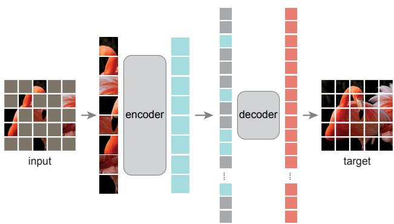
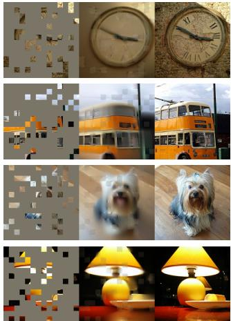
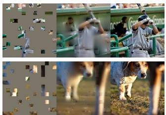
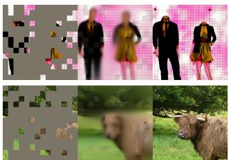
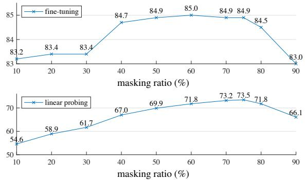
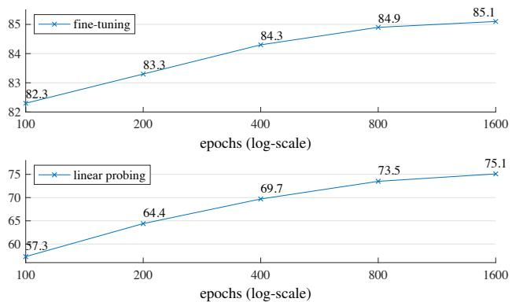
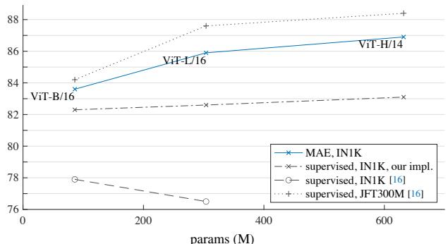
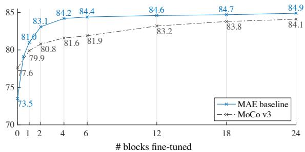
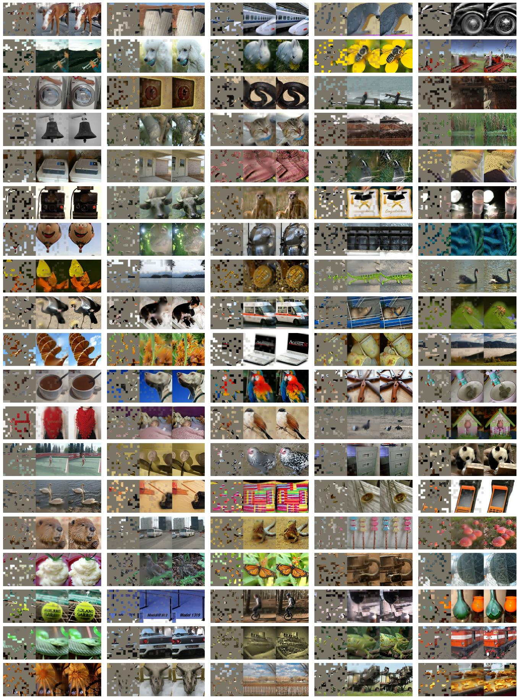

# 掩码自编码器是可扩展的视觉学习器

Kaiming He∗,† Xinlei Chen∗ Saining Xie Yanghao Li Piotr Dollár Ross Girshick

equal technical contribution †project lead

Facebook AI Research (FAIR)

## 摘要

本文表明，掩码自编码器（masked autoencoders, MAE）是计算机视觉中可扩展的自监督学习器。我们的 MAE 方法很简单：我们对输入图像的随机块（patch）进行掩码，然后重建缺失的像素。它基于两个核心设计。首先，我们提出了一种非对称的编码器-解码器架构，其中编码器仅作用于可见的图像块子集（不含掩码 token），搭配一个轻量级解码器，从 latent 表征和掩码 token 中重建原始图像。其次，我们发现对输入图像进行高比例的掩码（例如 75%）会形成一个非平凡且有意义的自监督任务。这两个设计相结合，使我们能够高效且有效地训练大模型：训练速度提升 3 倍以上，准确率也得到提高。我们的可扩展方法允许学习具有高容量的模型，且泛化能力良好：例如，一个 vanilla 的 ViT-Huge 模型在使用仅 ImageNet-1K 数据的方

  

图 1. 我们的 MAE 架构。在预训练阶段，图像块的一个大比例随机子集（例如 75%）被遮蔽。编码器仅作用于可见块（visible patches）的小子集。掩码标记（Mask Tokens）在编码器之后引入，经过编码的全部图像块与掩码标记一起由一个轻量级解码器处理，该解码器在像素层面重建原始图像。预训练完成后，解码器被丢弃，编码器被应用于未损坏的图像（完整的图像块集合）以执行识别任务。

(i) 直到最近，架构是不同的。在视觉领域，卷积网络 [34] 在过去十年中占据主导地位 [33]。卷积通常作用于规则网格，因此将掩码标记（mask tokens）[14] 或位置嵌入（positional embeddings）[57] 等「指示符」整合到卷积网络中并非易事。然而，这一架构差距已随着视觉 Transformer（Vision Transformer，ViT）[16] 的提出而得到弥合，应不再构成障碍。

(ii) 语言与视觉的信息密度不同。语言是人类生成的信号，具有高度的语义性和信息密集性。当训练模型仅预测句子中少数几个缺失的词语时，该任务似乎能够促使模型学到复杂的语言理解能力。相反，图像是自然信号，存在大量的空间冗余——例如，一个缺失的图像块可以借助相邻块加以恢复，几乎无需对部分、物体和场景进行高层理解。为克服这一差异并鼓励模型学习有用的特征，我们展示了一种在计算机视觉中效果良好的简单策略：遮蔽极高比例的随机图像块。该策略大幅降低了冗余度，并构建了一项具有挑战性的自监督任务，要求模型对图像进行超越底层图像统计的全局理解。要对我们的重建任务获得直观感受，请参见图 2–4。

图 2. 在 ImageNet 验证集图像上的示例结果。对于每组三元组，我们展示掩码图像（左）、我们的 MAE 重建†（中）以及真实图像（右）。掩码比例为 80%，仅保留 196 个块中的 39 个。更多示例如附录所示。†由于在可见块上没有计算损失，因此模型在可见块上的输出在质量上较差。可以简单地将输出与可见块叠加以改善视觉效果。我们特意选择不这样做，以便更全面地展示该方法的行为。

  

图 3. 在 COCO 验证图像上的示例结果，使用在 ImageNet 上训练的 MAE（与图 2 中使用的模型权重相同）。请注意最右侧两个示例的重构结果，虽然与真值（ground truth）不同，但在语义上是合理的。

(iii) 自编码器的解码器将潜在表示映射回输入，在重建文本和图像时扮演着不同的角色。在视觉任务中，解码器重建的是像素，因此其输出的语义层级低于常见的识别任务。这与语言任务形成鲜明对比——在语言任务中，解码器预测的是包含丰富语义信息的缺失词。在 BERT 中解码器可以是 trivial 的（一个多层感知机）[14]，而我们发现，对于图像而言，解码器的设计在决定所学潜在表示的语义层级方面起着关键作用。

受上述分析驱动，我们提出了一种用于视觉表示学习的简单、有效且可扩展的掩码自编码器（Masked Autoencoder, MAE）形式。我们的 MAE 从输入图像中随机遮蔽一些 patch，并在像素空间中重建这些被遮蔽的 patch。它采用非对称的编码器—解码器设计。我们的编码器仅对可见的 patch 子集进行操作（不使用 mask token），解码器则非常轻量，负责从潜在表示和 mask token 一起重建出原始输入（图 1）。将 mask token 转移到我们非对称编码器—解码器中的小型解码器中，可以大幅减少计算量。在这种设计下，较高的掩蔽比例（例如 75%）可以带来双赢局面：它在优化精度的同时，使编码器只需处理一小部分（例如 25%）patch。这可以将整体预训练时间减少 3 倍或更多，并相应地降低内存消耗，使我们能够轻松地将 MAE 扩展到大型模型。

我们的 MAE 学到的模型容量很大，且具有良好的泛化能力。通过 MAE 预训练，我们可以在 ImageNet-1K 上训练像 ViT-Large/-Huge [16] 这样对数据需求量大的模型，并获得更好的泛化性能。使用标准的 ViT-Huge 模型，在 ImageNet-1K 上微调后我们达到了 87.8% 的准确率，超过了所有先前仅使用 ImageNet-1K 数据所取得的结果。我们还在目标检测、实例分割和语义分割任务上评估了迁移学习。在这些任务中，我们的预训练效果优于其对应的有监督预训练方法，更重要的是，我们观察到随着模型规模的扩大，性能获得了显著提升。这些观察与 NLP 领域自监督预训练中所见的现象一致 [14, 47, 48, 4]，我们希望它们将推动我们这一领域探索类似的发展轨迹。

  

图4. 使用以 75% 掩码率（masking ratio）预训练的 MAE 对具有更高掩码率的输入进行重建的 ImageNet 验证图像。预测结果与原始图像合理地不同，表明该方法能够泛化。

## 2. 相关工作

掩码语言建模（Masked Language Modeling）及其自回归对应方法，例如 BERT [14] 和 GPT [47, 48, 4]，是自然语言处理（NLP）中非常成功的预训练方法。这些方法将输入序列的一部分遮住，并训练模型来预测被遮住的内容。这些方法已被证明具有出色的可扩展性 [4]，并且大量证据表明这些预训练表示能够很好地泛化到各种下游任务。

自编码（Autoencoding）是学习表示的一种经典方法。它包含一个编码器，将输入映射到潜在表示，以及一个解码器，从潜在表示重建输入。例如，PCA 和 k-means 都是自编码器 [29]。去噪自编码器（Denoising Autoencoder, DAE）[58] 是一类自编码器，它们对输入信号添加扰动，并学习重建原始的、未被扰动的信号。

一系列方法可以被视为在不同扰动方式下的广义 DAE，例如遮蔽像素 [59, 46, 6] 或去除颜色通道 [70]。我们的 MAE 是一种去噪自编码形式，但在许多方面不同于经典的 DAE。

掩码图像编码方法从被遮蔽扰动的图像中学习表示。

[59] 的开创性工作将遮蔽视为 DAE 中的一种噪声类型。Context Encoder [46] 使用卷积网络对大面积缺失区域进行修复。受其在 NLP 中成功经验的启发，最近的相关方法 [6, 16, 2] 基于 Transformer [57]。iGPT [6] 操作于像素序列并预测未知像素。ViT 论文 [16] 研究了用于自监督学习的掩码块预测。最近，BEiT [2] 提出预测离散 token [44, 50]。

自监督学习方法在计算机视觉领域引起了广泛关注，通常侧重于为预训练设计不同的前置任务 [15, 61, 42, 70, 45, 17]。最近，对比学习（Contrastive Learning）[3, 22] 受到了广泛关注，例如 [62, 43, 23, 7]，它在两个或多个视图之间建模图像的相似性与差异性（或仅建模相似性 [21, 8]）。对比学习及相关方法强烈依赖于数据增强 [7, 21, 8]。自编码追求的是一个在概念上不同的方向，正如我们将展示的，它表现出不同的行为特性。

## 3. 方法

我们的掩码自编码器（Masked Autoencoder, MAE）是一种简单的自编码方法，它在给定部分观测信号的情况下重建原始信号。与所有自编码器一样，我们的方法包含一个编码器，将观测信号映射到潜在表示，以及一个解码器，从潜在表示重建原始信号。与经典自编码器不同，我们采用非对称设计，允许编码器仅对部分观测信号（不含掩码 token）进行操作，并使用一个轻量级解码器，从潜在表示和掩码 token 重建完整信号。图 1 展示了这个想法，下文将进行介绍。

掩码。沿用 ViT（Vision Transformer）[16] 的做法，我们将一张图像划分为规则的、不重叠的图块（patch）。随后，我们对图块进行子集采样，将未被采中的图块掩掉（即移除）。我们的采样策略非常简洁：在均匀分布下不放回地随机采样图块。我们将这一策略直接称为"随机采样"（random sampling）。

以高掩码率（即被移除图块所占的比例）进行随机采样，能在很大程度上消除冗余，由此产生的任务难以通过从可见的相邻图块外推来轻易求解（见图 2 – 4）。均匀分布避免了潜在的中心偏置（即图像中心附近被掩掉的图块更多）。最后，这种高度稀疏的输入为设计一个高效的编码器创造了机会，下文将对此进行介绍。

MAE 编码器。我们的编码器就是一个 ViT [16]，但仅作用在可见的、未被掩掉的图块上。与标准 ViT 一致，我们的编码器先通过一个线性投影对图块进行嵌入，并叠加位置嵌入（positional embedding），随后通过一系列 Transformer 块对所得到的集合进行处理。然而，我们的编码器仅对完整集合的一个小子集（例如 25%）进行计算。被掩掉的图块被直接移除；不使用掩码 token（mask token）。这使我们能够仅用一小部分算力和显存来训练非常大的编码器。完整集合由一个轻量级的解码器处理，下文将对此进行介绍。

MAE 解码器。MAE 解码器的输入是由以下两部分组成的完整 token 集合：（i）经过编码的可见图块，以及（ii）掩码 token。见图 1。每个掩码 token [14] 是一个共享的、可学习的向量，用于指示此处有一个缺失的图块有待预测。我们对这个完整集合中的所有 token 都添加位置嵌入；不这样做的话，掩码 token 将无从获取其在图像中位置的相关信息。解码器包含另一系列 Transformer 块。

MAE 解码器仅在预训练阶段用于执行图像重建任务（只有编码器被用来产生用于识别的图像表示）。因此，解码器的架构可以以一种独立于编码器设计的方式灵活地进行设计。我们尝试使用非常小的解码器，使其比编码器更窄、更浅。例如，我们默认的解码器在每个 token 上的计算量不到编码器的 10%。在这种非对称（asymmetrical）设计下，完整的 token 集合仅由这个轻量级解码器处理，从而显著缩短了预训练时间。

重建目标。我们的 MAE 通过预测每个被掩码图块的像素值来重建输入。解码器输出中的每个元素都是一个表示一个图块的像素值向量。解码器的最后一层是一个线性投影，其输出通道数等于一个图块中像素值的数量。解码器的输出被重塑（reshape）为一张重建后的图像。我们的损失函数在像素空间中计算重建图像与原始图像之间的均方误差（MSE）。与 BERT [14] 类似，我们仅在被掩码的图块上计算损失。1

我们还研究了一种变体，其重建目标是每个掩码图像块（patch）的归一化像素值。具体而言，我们计算一个图像块内所有像素的均值和标准差，并据此对该图像块进行归一化。在我们的实验中，使用归一化像素作为重建目标能够提升表示质量。

简单实现。我们的 MAE 预训练能够被高效地实现，并且重要的是，不需要任何专门的稀疏运算（sparse operations）。首先，我们为每一个输入图像块生成一个 token（通过线性投影并加上位置编码）。接着，我们随机打乱 token 列表，并根据掩码比例移除列表的末尾部分。这一过程为编码器生成了一小部分 token 子集，等价于无放回地采样图像块。编码完成后，我们将一个掩码 token 列表追加到已编码图像块的列表之后，并对这个完整列表进行"反向打乱"（即对之前的随机打乱操作求逆），以使所有 token 与其目标对齐。解码器被应用于这个完整列表（同样添加位置编码）。如前所述，不需要任何稀疏运算。这种简单实现几乎没有带来额外开销，因为打乱与反向打乱操作都非常快速。

  

图 5. 掩码率（masking ratio）。较高的掩码率（75%）在微调（上）和线性探测（linear probing，下）两种设置下都表现良好。本论文所有图中的纵轴均为 ImageNet-1K 验证集准确率（%）。

## 4. ImageNet 实验

我们在 ImageNet-1K (IN1K) [13] 训练集上进行自监督预训练。然后进行有监督训练，使用以下两种方式评估表征：(i) 端到端微调 或 (ii) 线性探测。我们报告单张 224×224 裁剪图的 top-1 验证准确率。详情见附录 A.1。

基线方法：ViT-Large。我们在消融研究中使用 ViT-Large (ViT-L/16) [16] 作为骨干网络。ViT-L 非常大（比 ResNet-50 [25] 大一个数量级），并且容易过拟合。以下比较了从头训练的 ViT-L 与从我们的基线 MAE 微调的 ViT-L：

<table><tr><td>scratch, original [16]</td><td>scratch, our impl.</td><td>baseline MAE</td></tr><tr><td>76.5</td><td>82.5</td><td>84.9</td></tr></table>

我们注意到，从零开始训练有监督的 ViT-L 并非易事，需要配合强正则化的良好训练方案（82.5%，参见附录 A.2）。即便如此，我们的 MAE 预训练仍带来了大幅提升。此处的微调仅训练 50 个 epoch（而从零训练为 200 个 epoch），这意味着微调精度在很大程度上依赖于预训练。

## 4.1. 主要性质

我们使用表 1 中的默认设置对 MAE 进行消融实验（见表注）。我们观察到若干引人注意的性质。

掩码率。图 5 展示了掩码率的影响。最优掩码率出乎意料地偏高。无论线性探测还是微调，75% 的掩码率都表现良好。这一行为与 BERT [14] 形成对比，后者典型的掩码率仅为 15%。我们的掩码率也远高于计算机视觉领域相关工作 [6, 16, 2] 中所采用的比率（20% 至 50%）。

模型能够推断出缺失的 patch，从而生成不同却合理的输出（图 4）。它理解了物体和场景的整体形态，而这种理解无法仅通过延伸线条或纹理来简单完成。我们推测这种类似推理的行为与有用表征的学习相关。

图 5 还表明，线性探测与微调的结果遵循不同的趋势。对于线性探测而言，精度随掩码率稳步上升，直至达到最佳点：精度差距最大可达约 20%（54.6% 对比 73.5%）。对于微调而言，结果对掩码率的敏感度较低，较宽范围的掩码率（40–80%）均能取得良好效果。图 5 中所有微调结果均优于从零训练（82.5%）。

<table><tr><td>blocks</td><td>ft</td><td>lin</td></tr><tr><td>1</td><td>84.8</td><td>65.5</td></tr><tr><td>2</td><td>84.9</td><td>70.0</td></tr><tr><td>4</td><td>84.9</td><td>71.9</td></tr><tr><td>8</td><td>84.9</td><td>73.5</td></tr><tr><td>12</td><td>84.4</td><td>73.3</td></tr></table>

<table><tr><td>dim</td><td>ft</td><td>lin</td></tr><tr><td>128</td><td>84.9</td><td>69.1</td></tr><tr><td>256</td><td>84.8</td><td>71.3</td></tr><tr><td>512</td><td>84.9</td><td>73.5</td></tr><tr><td>768</td><td>84.4</td><td>73.1</td></tr><tr><td>1024</td><td>84.3</td><td>73.1</td></tr></table>

(a) 解码器深度（Decoder depth）。更深的解码器可以提升线性探针（linear probing）的准确率。

<table><tr><td>case</td><td>ft</td><td>lin</td><td>FLOPs</td></tr><tr><td>encoder w/ [M]</td><td>84.2</td><td>59.6</td><td>3.3×</td></tr><tr><td>encoder w/o [M]</td><td>84.9</td><td>73.5</td><td>1×</td></tr></table>

(c) 掩码标记（Mask token）。不使用掩码标记的编码器更准确且更快（表 2）。

(b) 解码器宽度。解码器可以比编码器更窄（1024 维）。

<table><tr><td>case</td><td>ft</td><td>lin</td></tr><tr><td>pixel (w/o norm)</td><td>84.9</td><td>73.5</td></tr><tr><td>pixel (w/ norm)</td><td>85.4</td><td>73.9</td></tr><tr><td>PCA</td><td>84.6</td><td>72.3</td></tr><tr><td>dVAE token</td><td>85.3</td><td>71.6</td></tr></table>

（d）重建目标。将像素作为重建目标是有效的。

<table><tr><td>case</td><td>ft</td><td>lin</td></tr><tr><td>none</td><td>84.0</td><td>65.7</td></tr><tr><td>crop, fixed size</td><td>84.7</td><td>73.1</td></tr><tr><td>crop, rand size</td><td>84.9</td><td>73.5</td></tr><tr><td>crop + color jit</td><td>84.3</td><td>71.9</td></tr></table>

(e) 数据增强。我们的 MAE 仅需极少或无需数据增强即可工作。

<table><tr><td>case</td><td>ratio</td><td>ft</td><td>lin</td></tr><tr><td>random</td><td>75</td><td>84.9</td><td>73.5</td></tr><tr><td>block</td><td>50</td><td>83.9</td><td>72.3</td></tr><tr><td>block</td><td>75</td><td>82.8</td><td>63.9</td></tr><tr><td>grid</td><td>75</td><td>84.0</td><td>66.0</td></tr></table>

(f) 掩码采样（Mask sampling）。随机采样效果最好。见图 6 的可视化结果。

Table 1. 在 ImageNet-1K 上使用 ViT-L/16 进行的 MAE 消融实验。我们报告微调（ft）与线性探测（lin）的准确率（%）。除非特别说明，默认设置为：解码器深度为 8、宽度为 512，重建目标为未归一化的像素，数据增强为随机缩放裁剪，掩码比例为 75%，预训练长度为 800 个 epoch。默认设置以灰色标记

**解码器设计。** 我们的 MAE 解码器设计灵活，如表 1a 和 1b 所研究。

表 1a 改变了解码器深度（Transformer 块的数量）。足够深的解码器对线性探测很重要。这可以通过像素重建任务与识别任务之间的差距来解释：自编码器的最后几层更专门用于重建，但与识别的相关性较低。合理深度的解码器可以承接这种重建专门化，使隐表示保持在更抽象的层次。此设计可使线性探测性能提升最多 8%（表 1a，"lin"）。然而，若使用微调，编码器的最后几层可以被调整以适应识别任务。因此解码器深度对提升微调效果的影响较小（表 1a，"ft"）。

有趣的是，我们使用单块解码器的 MAE 在微调下也能表现强劲（84.8%）。注意单个 Transformer 块是将信息从可见 token 传播到掩码 token 的最低要求。如此小的解码器可以进一步加快训练速度。

在表 1b 中我们研究了解码器宽度（通道数）。默认使用 512-d，在微调和线性探测下表现均良好。较窄的解码器在微调下也能很好地工作。

总体而言，我们的默认 MAE 解码器非常轻量。它有 8 个块，宽度为 512-d（表 1 中以灰色标记）。每个 token 的 FLOPs 仅占 ViT-L（24 个块，1024-d）的 9%。因此，尽管解码器处理所有 token，但它仍然是整体计算量中很小的一部分。

<table><tr><td>encoder</td><td>dec. depth</td><td>ft acc</td><td>hours</td><td>speedup</td></tr><tr><td>ViT-L, w/ [M]</td><td>8</td><td>84.2</td><td>42.4</td><td>-</td></tr><tr><td>ViT-L</td><td>8</td><td>84.9</td><td>15.4</td><td> $2.8 \times$ </td></tr><tr><td>ViT-L</td><td>1</td><td>84.8</td><td>11.6</td><td> $\mathbf{3.7} \times$ </td></tr><tr><td>ViT-H, w/ [M]</td><td>8</td><td>-</td><td> $119.6^{\dagger}$ </td><td>-</td></tr><tr><td>ViT-H</td><td>8</td><td>85.8</td><td>34.5</td><td> $3.5 \times$ </td></tr><tr><td>ViT-H</td><td>1</td><td>85.9</td><td>29.3</td><td> $\mathbf{4.1} \times$ </td></tr></table>

表 2. 我们的 MAE 训练（800 个 epoch）的实际耗时，在 128 个 TPU-v3 核心上使用 TensorFlow 进行基准测试。加速比相对于编码器使用掩码标记（灰色）的条目。解码器宽度为 512，掩码比例为 75%。†：此条目通过训练十个 epoch 进行估计。

## 掩码标记（Mask token）

我们 MAE 的一个重要设计是跳过编码器中的掩码标记 [M]，而是在轻量级解码器中稍后应用它。表 1c 研究了这一设计。

如果编码器使用掩码标记，其性能会更差：在线性探测（linear probing）中其精度下降了 14%。在这种情况下，预训练和部署之间存在一个鸿沟：该编码器在预训练时其输入中包含大量掩码标记，而这些在未损坏的图像中并不存在。这种鸿沟可能会降低部署时的精度。通过从编码器中移除掩码标记，我们约束编码器始终看到真实的图块，从而提高精度。

此外，通过跳过编码器中的掩码标记，我们大幅减少了训练计算量。在表 1c 中，我们将整体训练 FLOPs 减少了 3.3×。这在我们的实现中带来了 2.8× 的实际耗时加速比（见表 2）。对于更小的解码器（1-block）、更大的编码器（ViT-H）或两者兼有时，实际耗时加速比更大（3.5–4.1×）。请注意，对于 75% 的掩码比例，加速比可以超过 4×，部分原因是自注意力（self-attention）的复杂度是二次的。此外，内存也大幅减少，这可以支持训练更大的模型，或通过大批量训练进一步加速。时间和内存的效率使我们的 MAE 非常有利于训练非常大的模型。

  

图 6. 掩码采样策略决定了预训练任务的难度，进而影响重建质量与表征学习（表 1f）。此处每个输出均来自使用指定掩码策略训练的 MAE。左：随机采样（我们的默认策略）。中：块状采样 [2]，移除大块的随机区域。右：网格采样，每四个 patch 中保留一个。图像来自验证集。

重建目标。我们在表 1d 中比较了不同的重建目标。到目前为止，我们的结果基于未做（逐 patch）归一化的像素。使用带归一化的像素能够提升精度。这种逐 patch 归一化增强了局部对比度。在另一个变体中，我们在 patch 空间中进行 PCA，并把最大的 PCA 系数（此处为 96 个）作为目标。这样做反而会降低精度。这两项实验表明，高频分量在我们的方法中是有用的。

我们还比较了一种预测 token 的 MAE 变体，即 BEiT [2] 中使用的目标。具体针对该变体，我们按照 [2] 的做法，使用 DALLE 预训练的 dVAE [50] 作为 tokenizer。此时 MAE 解码器使用交叉熵损失来预测 token 索引。相比未归一化的像素，这种 tokenization 将微调准确率提高了 0.4%，但相对于归一化像素并无优势。它还会降低线性探测准确率。在 §5 中我们将进一步表明，tokenization 在迁移学习中并非必需。

我们基于像素的 MAE 比 tokenization 简单得多。dVAE tokenizer 需要一个额外的预训练阶段，并且可能依赖额外的数据（2.5 亿张图像 [50]）。dVAE 编码器是一个大型卷积网络（占 ViT-L 的 40% FLOP），带来了不可忽略的开销。使用像素则不存在这些问题。

数据增强。表 1e 研究了数据增强对我们 MAE 预训练的影响。

我们的 MAE 在仅使用裁剪增强时效果良好，无论是固定尺寸还是随机尺寸的裁剪（两者均带有随机水平翻转）。加入颜色抖动（color jittering）会降低结果，因此我们在其他实验中均未使用它。

令人惊讶的是，即使不使用任何数据增强（仅中心裁剪，不翻转），我们的 MAE 仍表现良好。这一特性与对比学习及相关方法 [62, 23, 7, 21] 截然不同，后者严重依赖数据增强。有文献 [21] 观察到，仅使用裁剪增强会使 BYOL [21] 和 SimCLR [7] 的准确率分别下降 13% 和 28%。此外，没有证据表明对比学习能够在不使用增强的情况下工作：同一图像的两个视图相同，容易满足平凡解。

  

图 7. 训练方案。较长的训练方案带来明显的提升。此处每个点代表一个完整的训练方案。模型为 ViT-L，使用表 1 中的默认设置。

在 MAE 中，数据增强的作用主要由随机掩码来承担（接下来将对其进行消融）。每次迭代的掩码都不同，因此无论是否进行数据增强，它们都会生成新的训练样本。掩码使预训练任务变得更具挑战性，因此只需要较少的数据增强来正则化训练过程。

掩码采样策略。在表 1f 中，我们比较了不同的掩码采样策略，如图 6 所示。

[2] 中提出的块状（block-wise）掩码策略倾向于移除较大的连续块（图 6 中间）。我们采用块状掩码的 MAE 在 50% 掩码率时效果尚可，但在 75% 掩码率时性能下降。由于观察到更高的训练损失，这项任务比随机采样更难。重建结果也更加模糊。

我们还研究了网格状（grid-wise）采样，它规则地保留每四个 patch 中的一个（图 6 右侧）。这是一项更简单的任务，训练损失更低。重建结果更清晰。然而，所学表示的质量较低。

简单的随机采样对我们的 MAE 效果最佳。它允许使用更高的掩码率，从而带来更大的加速收益，同时保持良好的准确率。

训练计划。到目前为止，我们的消融实验都基于 800 epoch 的预训练。图 7 展示了训练计划长度的影响。随着训练时间的延长，准确率稳步提升。事实上，即使在 1600 epoch 时，我们也没有观察到线性探测（linear probing）准确率达到饱和。这一行为不同于对比学习方法，例如 MoCo v3 [9] 在 ViT-L 上仅在 300 epoch 时就达到饱和。需要注意的是，MAE 编码器每个 epoch 仅看到 25% 的 patch，而对比学习中编码器每个 epoch 看到 200%（two-crop）甚至更多（multi-crop）的 patch。

<table><tr><td>method</td><td>pre-train data</td><td>ViT-B</td><td>ViT-L</td><td>ViT-H</td><td> $ViT-H_{448}$ </td></tr><tr><td>scratch, our impl.</td><td>-</td><td>82.3</td><td>82.6</td><td>83.1</td><td>-</td></tr><tr><td>DINO [5]</td><td>IN1K</td><td>82.8</td><td>-</td><td>-</td><td>-</td></tr><tr><td>MoCo v3 [9]</td><td>IN1K</td><td>83.2</td><td>84.1</td><td>-</td><td>-</td></tr><tr><td>BEiT [2]</td><td>IN1K+DALLE</td><td>83.2</td><td>85.2</td><td>-</td><td>-</td></tr><tr><td>MAE</td><td>IN1K</td><td>83.6</td><td>85.9</td><td>86.9</td><td>87.8</td></tr></table>

表 3. 与以往在 ImageNet-1K 上的结果对比。预训练数据为 ImageNet-1K 训练集（其中 BEiT 的分词器是在 2.5 亿条 DALLE 数据 [50] 上预训练的）。所有自监督方法均通过端到端微调进行评估。ViT 模型包括 B/16、L/16、H/14 [16]。每列的最优结果以加下划线标注。除 ViT-H 在 448 图像尺寸上的额外结果外，其余所有结果均在 224 图像尺寸上获得。此处我们的 MAE 重建归一化像素，并预训练了 1600 个 epoch。

  

图 8. MAE 预训练与有监督预训练的对比，通过在 ImageNet-1K（224 分辨率）上进行微调来评估。我们与在 IN1K 或 JFT300M 上训练的原始 ViT 结果 [16] 进行了比较。

## 4.2. 与先前结果的对比

与自监督方法的对比。在表 3 中，我们对比了自监督 ViT（Vision Transformer，视觉 Transformer）模型的微调（fine-tuning）结果。对于 ViT-B，所有方法的表现相近。对于 ViT-L，各方法之间的差距更大，表明对于更大模型而言一项挑战在于降低过拟合。

我们的 MAE（Masked Autoencoder，掩码自编码器）可以轻松扩展，并已展示出随模型增大而稳步提升的改进。我们使用 ViT-H（224 尺寸）取得了 86.9% 的准确率。通过以 448 尺寸进行微调，仅使用 IN1K（ImageNet 1K）数据即达到 87.8% 的准确率。在仅使用 IN1K 数据的所有方法中，此前的最佳准确率为 87.1%（512 尺寸）[67]，其基于先进的网络。我们在 IN1K（不使用外部数据）这一极具竞争力的基准上，以不可忽视的差距改进了当前最优结果。我们的结果基于 vanilla ViT（标准 ViT），我们预期先进的网络将表现得更好。

与 BEiT [2] 的对比，我们的 MAE 在更简单、更快速的同时更加准确。我们的方法重建像素，而 BEiT 预测 token（分词单元）：BEiT [2] 报告了在 ViT-B 上重建像素时会出现 1.8% 的性能下降。2 我们不需要 dVAE（discrete VAE，离散变分自编码器）预训练。此外，如表 1c 中所研究的，由于这一原因，我们的 MAE 比 BEiT 显著更快（每个 epoch 快 3.5×）。

  

图 9. 在表 1 的默认设置下，ViT-L 关于已微调 Transformer 块数量的部分微调结果。微调 0 个块即线性探针（linear probing）；24 个块即全量微调。我们的 MAE 表征的线性可分性较差，但只要微调一个或多个块，其效果就持续优于 MoCo v3。

表 3 中的 MAE 模型预训练了 1600 个 epoch 以获得更好的精度（图 7）。即便如此，在相同硬件上训练时，我们的总预训练时间仍少于其他方法。例如，在 128 块 TPU-v3 核心上训练 ViT-L，我们的 MAE 训练 1600 个 epoch 耗时 31 小时，而 MoCo v3 训练 300 个 epoch 耗时 36 小时 [9]。

与有监督预训练的对比。在原始的 ViT 论文 [16] 中，ViT-L 在 IN1K 上训练时性能会下降。我们对有监督训练的实现（见 A.2 节）效果更好，但精度出现饱和。见图 8。

我们的 MAE 预训练仅使用 IN1K，就能具备更好的泛化能力：相比从头训练，模型容量越大，收益越大。这遵循了 [16] 中 JFT-300M 有监督预训练类似的趋势。这一对比表明，我们的 MAE 有助于扩大模型规模。

## 4.3. 部分微调（Partial Fine-tuning）

表 1 显示，线性探测与微调的结果之间基本不相关。过去几年线性探测曾是一个流行的方案；然而，它错失了追求强非线性特征的机会——而这正是深度学习的优势所在。作为折中方案，我们研究了一种部分微调协议：冻结其它层，只微调最后若干层。该协议在早期工作中也曾使用，例如 [65, 70, 42]。

图 9 展示了结果。值得注意的是，仅微调一个 Transformer 块，就能将精度从 73.5% 大幅提升到 81.0%。此外，如果只微调最后一个块的"一半"（即其 MLP 子块），我们就能得到 79.1%，远优于线性探测。该变体本质上就是在微调一个 MLP 头。微调少数几个块（例如 4 个或 6 个）就能获得接近全量微调的精度。

在图 9 中，我们还与 MoCo v3 [9] 进行了对比，这是一个具有 ViT-L 结果的对比学习方法。MoCo v3 的线性探测精度更高；然而，其所有部分微调结果都不如 MAE。在微调 4 个块时，差距为 2.6%。尽管 MAE 表征的线性可分性较弱，但它们是更强的非线性特征，在微调非线性头时表现良好。

<table><tr><td rowspan="2">method</td><td rowspan="2">pre-train data</td><td colspan="2"> $AP^{box}$ </td><td colspan="2"> $AP^{mask}$ </td></tr><tr><td>ViT-B</td><td>ViT-L</td><td>ViT-B</td><td>ViT-L</td></tr><tr><td>supervised</td><td>IN1K w/ labels</td><td>47.9</td><td>49.3</td><td>42.9</td><td>43.9</td></tr><tr><td>MoCo v3</td><td>IN1K</td><td>47.9</td><td>49.3</td><td>42.7</td><td>44.0</td></tr><tr><td>BEiT</td><td>IN1K+DALLE</td><td>49.8</td><td>53.3</td><td>44.4</td><td>47.1</td></tr><tr><td>MAE</td><td>IN1K</td><td>50.3</td><td>53.3</td><td>44.9</td><td>47.2</td></tr></table>

表 4. 使用 ViT Mask R-CNN 基线的 COCO 目标检测与分割。所有条目均基于我们的实现。自监督条目使用不带标签的 IN1K 数据。Mask AP 与 box AP 呈现相似的趋势。

这些观察表明，线性可分性（linear separability）并非评估表示质量的唯一指标。也有研究观察到（例如 [8]），线性探测（linear probing）与迁移学习性能并不高度相关，例如在目标检测任务中。据我们所知，线性评估（linear evaluation）在自然语言处理（NLP）中并不常被用于预训练的基准测试。

## 5. 迁移学习实验

我们使用表 3 中的预训练模型来评估下游任务中的迁移学习性能。

目标检测与分割。我们在 COCO [37] 上端到端微调 Mask R-CNN [24]。ViT 主干网络经过适配以配合 FPN [36] 使用（见 A.3）。我们对表 4 中的所有条目均采用此方法。我们报告目标检测的 box AP 和实例分割的 mask AP。

与监督预训练相比，我们的 MAE 在所有配置下表现都更优（表 4）。在使用较小的 ViT-B 时，我们的 MAE 比监督预训练高出 2.4 个点（50.3 对 47.9，APbox）。更显著的是，在使用较大的 ViT-L 时，我们的 MAE 预训练以 4.0 个点的优势超过监督预训练（53.3 对 49.3）。

基于像素的 MAE 优于或与基于 token 的 BEiT 相当，同时 MAE 更为简单且更快。MAE 和 BEiT 都优于 MoCo v3，而 MoCo v3 与监督预训练相当。

语义分割。我们使用 UperNet [63] 在 ADE20K [72] 上进行实验（见 A.4）。表 5 显示，我们的预训练显著改善了相对于监督预训练的结果，例如在 ViT-L 上提升了 3.7 个点。我们基于像素的 MAE 也优于基于 token 的 BEiT。这些观察与在 COCO 上的观察一致。

分类任务。表 6 研究了在 iNaturalists [56] 和 Places [71] 任务上的迁移学习（见 A.5）。在 iNat 上，我们的方法表现出良好的可扩展性：随着模型增大，准确率显著提升。我们的结果以较大优势超越了此前的最佳结果。在 Places 上，我们的 MAE 优于此前的最佳结果 [19, 40]，而这些最佳结果是通过在数十亿张图像上进行预训练得到的。

像素与 token。表 7 比较了像素与 token 作为 MAE 重建目标的效果。虽然使用 dVAE token 优于使用未归一化的像素，但在我们测试的所有情况下，其与使用归一化像素在统计上相似。这再次表明，token 化对我们的 MAE 而言并非必需。

<table><tr><td>method</td><td>pre-train data</td><td>ViT-B</td><td>ViT-L</td></tr><tr><td>supervised</td><td>IN1K w/ labels</td><td>47.4</td><td>49.9</td></tr><tr><td>MoCo v3</td><td>IN1K</td><td>47.3</td><td>49.1</td></tr><tr><td>BEiT</td><td>IN1K+DALLE</td><td>47.1</td><td>53.3</td></tr><tr><td>MAE</td><td>IN1K</td><td>48.1</td><td>53.6</td></tr></table>

表 5. 使用 Uper-Net 的 ADE20K 语义分割（mIoU）。BEiT 的结果使用官方代码复现，其余条目基于我们的实现。自监督条目使用不带标签的 IN1K 数据。

<table><tr><td>dataset</td><td>ViT-B</td><td>ViT-L</td><td>ViT-H</td><td> $ViT-H_{448}$ </td><td>prev best</td></tr><tr><td>iNat 2017</td><td>70.5</td><td>75.7</td><td>79.3</td><td>83.4</td><td>75.4 [55]</td></tr><tr><td>iNat 2018</td><td>75.4</td><td>80.1</td><td>83.0</td><td>86.8</td><td>81.2 [54]</td></tr><tr><td>iNat 2019</td><td>80.5</td><td>83.4</td><td>85.7</td><td>88.3</td><td>84.1 [54]</td></tr><tr><td>Places205</td><td>63.9</td><td>65.8</td><td>65.9</td><td>66.8</td><td>66.0 [19] $^{\dagger}$ </td></tr><tr><td>Places365</td><td>57.9</td><td>59.4</td><td>59.8</td><td>60.3</td><td>58.0 [40] $^{\ddagger}$ </td></tr></table>

表 6. 在分类数据集上的迁移学习准确率，使用在 IN1K 上预训练的 MAE 然后进行微调。我们给出了与此前最佳结果的系统级比较。†：在 10 亿张图像上预训练。‡：在 35 亿张图像上预训练。

<table><tr><td rowspan="2"></td><td colspan="3">IN1K</td><td colspan="2">COCO</td><td colspan="2">ADE20K</td></tr><tr><td>ViT-B</td><td>ViT-L</td><td>ViT-H</td><td>ViT-B</td><td>ViT-L</td><td>ViT-B</td><td>ViT-L</td></tr><tr><td>pixel (w/o norm)</td><td>83.3</td><td>85.1</td><td>86.2</td><td>49.5</td><td>52.8</td><td>48.0</td><td>51.8</td></tr><tr><td>pixel (w/ norm)</td><td>83.6</td><td>85.9</td><td>86.9</td><td>50.3</td><td>53.3</td><td>48.1</td><td>53.6</td></tr><tr><td>dVAE token</td><td>83.6</td><td>85.7</td><td>86.9</td><td>50.3</td><td>53.2</td><td>48.1</td><td>53.4</td></tr><tr><td> $\bigtriangleup$ </td><td>0.0</td><td>-0.2</td><td>0.0</td><td>0.0</td><td>-0.1</td><td>0.0</td><td>-0.2</td></tr></table>

Table 7. 以像素（pixels）与以 token 作为 MAE 重建目标的对比。4 为使用 dVAE tokens 与使用归一化像素（normalized pixels）之间的差异。该差异在统计上不显著。

## 6. 讨论与结论

能够良好扩展的简单算法是深度学习的核心。在自然语言处理中，简单的自监督学习方法（例如 [47, 14, 48, 4]）使模型能够从指数级扩展中获益。在计算机视觉中，尽管自监督学习有所进展，实际的预训练范式仍以监督学习为主导（例如 [33, 51, 25, 16]）。在本研究中，我们在 ImageNet 以及迁移学习中观察到，自编码器——一种类似于自然语言处理技术的简单自监督方法——能够带来可扩展的收益。视觉领域的自监督学习如今可能正踏上与自然语言处理相似的轨迹。

另一方面，我们注意到图像与语言是性质不同的信号，这种差异必须谨慎处理。图像仅仅是记录下来的光信号，并不具备类似词语的视觉语义分解方式。我们并不试图去除物体，而是去除那些很可能并不构成语义片段的随机图块。同样地，我们的 MAE 重建的是像素，而像素并非语义实体。尽管如此，我们观察到（例如图 4）MAE 能够推断出复杂的、整体性的重建结果，这表明它已经学习到了许多视觉概念，即语义。我们假设这种行为是通过 MAE 内部丰富的隐藏表征实现的。我们希望这一观点能够激发未来的相关研究。

更广泛的影响。所提出的方法基于训练数据集学到的统计规律来预测内容，因此将反映这些数据中存在的偏差，包括具有负面社会影响的偏差。该模型可能会生成并不存在的内容。在本工作基础上进一步构建图像生成系统时，这些问题值得开展进一步研究与审慎考量。

## 参考文献

[2] Hangbo Bao, Li Dong, and Furu Wei. BEiT: BERT pre-training of image transformers. *BEiT：图像 Transformer 的 BERT 预训练*. arXiv:2106.08254, 2021. 访问于 2021 年 6 月。

[3] Suzanna Becker and Geoffrey E Hinton. Self-organizing neural network that discovers surfaces in random-dot stereograms. *在随机点立体图中发现曲面的自组织神经网络*. Nature, 1992.

[5] Mathilde Caron, Hugo Touvron, Ishan Misra, Herve Jégou, Julien Mairal, Piotr Bojanowski, and Armand Joulin. 自监督视觉 Transformer 的涌现性质（Emerging Properties in Self-Supervised Vision Transformers）。发表于 ICCV，2021 年。

[6] Mark Chen, Alec Radford, Rewon Child, Jeffrey Wu, Heewoo Jun, David Luan, and Ilya Sutskever. 从像素出发的生成式预训练（Generative Pretraining from Pixels）。发表于 ICML，2020 年。

[7] Ting Chen, Simon Kornblith, Mohammad Norouzi, and Geoffrey Hinton. 用于视觉表示对比学习的简单框架（A Simple Framework for Contrastive Learning of Visual Representations）。发表于 ICML，2020 年。

[8] Xinlei Chen and Kaiming He. 探索简单的孪生表示学习（Exploring Simple Siamese Representation Learning）。发表于 CVPR，2021 年。

[9] Xinlei Chen, Saining Xie, and Kaiming He. 训练自监督 Vision Transformer 的实证研究（An Empirical Study of Training Self-Supervised Vision Transformers）。发表于 ICCV，2021 年。

[10] Kevin Clark, Minh-Thang Luong, Quoc V Le, and Christopher D Manning. ELECTRA：将文本编码器预训练为判别器而非生成器（ELECTRA: Pre-training Text Encoders as Discriminators Rather Than Generators）。发表于 ICLR，2020 年。

[11] Corinna Cortes and Vladimir Vapnik. 支持向量网络（Support-Vector Networks）。发表于《Machine Learning》，1995 年。

[12] Ekin D Cubuk, Barret Zoph, Jonathon Shlens, and Quoc V Le. RandAugment：缩减搜索空间的实用自动数据增强方法（RandAugment: Practical Automated Data Augmentation with a Reduced Search Space）。发表于 CVPR Workshops，2020 年。

[13] Jia Deng, Wei Dong, Richard Socher, Li-Jia Li, Kai Li, and Li Fei-Fei. ImageNet：大规模层次化图像数据库（ImageNet: A Large-Scale Hierarchical Image Database）。发表于 CVPR，2009 年。

[14] Jacob Devlin, Ming-Wei Chang, Kenton Lee, and Kristina Toutanova. BERT：用于语言理解的深度双向 Transformer 预训练（BERT: Pre-training of Deep Bidirectional Transformers for Language Understanding）。发表于 NAACL，2019 年。

[15] Carl Doersch, Abhinav Gupta, and Alexei A Efros. 基于上下文预测的无监督视觉表示学习（Unsupervised Visual Representation Learning by Context Prediction）。发表于 ICCV，2015 年。

[17] Spyros Gidaris, Praveer Singh, and Nikos Komodakis. 通过预测图像旋转的无监督表示学习（Unsupervised Representation Learning by Predicting Image Rotations）。发表于 ICLR，2018 年。

[18] Xavier Glorot and Yoshua Bengio. 理解深度前馈神经网络的训练难度（Understanding the Difficulty of Training Deep Feedforward Neural Networks）。发表于 AISTATS，2010 年。

[19] Priya Goyal, Mathilde Caron, Benjamin Lefaudeux, Min Xu, Pengchao Wang, Vivep Pai, Mannat Singh, Vitaliy Liptchinsky, Ishan Misra, Armand Joulin, and Piotr Bojanowski. 野外场景下视觉特征的自监督预训练（Self-Supervised Pretraining of Visual Features in the Wild）。arXiv:2103.01988，2021 年。

[20] Priya Goyal, Piotr Dollar, Ross Girshick, Pieter Noordhuis, Lukasz Wesolowski, Aapo Kyrola, Andrew Tulloch, Yangqing Jia, and Kaiming He. 精确的大批量 SGD：1 小时内训练 ImageNet（Accurate, Large Minibatch SGD: Training ImageNet in 1 Hour）。arXiv:1706.02677，2017 年。

[21] Jean-Bastien Grill, Florian Strub, Florent Altche, Corentin Tallec,´ Pierre Richemond, Elena Buchatskaya, Carl Doersch, Bernardo Avila Pires, Zhaohan Guo, Mohammad Gheshlaghi Azar, Bilal Piot, Koray Kavukcuoglu, Remi Munos, and Michal Valko. 自举你的潜在表示——一种新的自监督学习方法。发表于 NeurIPS，2020 年。

[22] Raia Hadsell, Sumit Chopra, and Yann LeCun. 通过学习不变映射进行降维。发表于 CVPR，2006 年。

[23] Kaiming He, Haoqi Fan, Yuxin Wu, Saining Xie, and Ross Girshick. 用于无监督视觉表征学习的动量对比。发表于 CVPR，2020 年。

[24] Kaiming He, Georgia Gkioxari, Piotr Dollar, and Ross Girshick.´ Mask R-CNN。发表于 ICCV，2017 年。

[25] Kaiming He, Xiangyu Zhang, Shaoqing Ren, and Jian Sun. 图像识别的深度残差学习。发表于 CVPR，2016 年。

[26] Dan Hendrycks, Steven Basart, Norman Mu, Saurav Kadavath, Frank Wang, Evan Dorundo, Rahul Desai, Tyler Zhu, Samyak Parajuli, Mike Guo, et al. 鲁棒性的多副面孔：分布外泛化的批判性分析。发表于 ICCV，2021 年。

[27] Dan Hendrycks and Thomas Dietterich. 神经网络对常见损坏与扰动鲁棒性的基准测试。发表于 ICLR，2019 年。

[28] Dan Hendrycks, Kevin Zhao, Steven Basart, Jacob Steinhardt, and Dawn Song. 自然对抗样本。发表于 CVPR，2021 年。

[29] Geoffrey E Hinton and Richard S Zemel. 自编码器、最小描述长度与亥姆霍兹自由能。发表于 NeurIPS，1994 年。

[30] Gao Huang, Yu Sun, Zhuang Liu, Daniel Sedra, and Kilian Q Weinberger. 具有随机深度的深度网络。发表于 ECCV，2016 年。

[31] Sergey Ioffe and Christian Szegedy. 批归一化：通过减少内部协变量偏移加速深度网络训练。发表于 ICML，2015 年。

[32] Insoo Kim, Seungju Han, Ji-won Baek, Seong-Jin Park, Jae-Joon Han, and Jinwoo Shin. 通过可逆解码器实现质量无关的图像识别。发表于 CVPR，2021 年。

[33] Alex Krizhevsky, Ilya Sutskever, and Geoff Hinton. 基于深度卷积神经网络的 ImageNet 图像分类。发表于 NeurIPS，2012 年。

[34] Yann LeCun, Bernhard Boser, John S Denker, Donnie Henderson, Richard E Howard, Wayne Hubbard, and Lawrence D Jackel. 反向传播在手写邮政编码识别中的应用。发表于《Neural Computation》，1989 年。

[35] Yanghao Li, Saining Xie, Xinlei Chen, Piotr Dollar, Kaiming He,´ and Ross Girshick. 使用视觉 Transformer 对检测迁移学习的基准评估。准备中，2021 年。

[36] Tsung-Yi Lin, Piotr Dollar, Ross Girshick, Kaiming He, Bharath´ Hariharan, and Serge Belongie. 用于目标检测的特征金字塔网络。发表于 CVPR，2017 年。

[37] Tsung-Yi Lin, Michael Maire, Serge Belongie, James Hays, Pietro Perona, Deva Ramanan, Piotr Dollar, and C Lawrence Zitnick. Mi-´ crosoft COCO：上下文中的常见物体。发表于 ECCV，2014 年。

[38] Ilya Loshchilov and Frank Hutter. SGDR：带有热重启的随机梯度下降。发表于 ICLR，2017 年。

[39] Ilya Loshchilov and Frank Hutter. 解耦的权重衰减正则化（Decoupled weight decay regularization）. 发表于：ICLR，2019.

[41] Xiaofeng Mao, Gege Qi, Yuefeng Chen, Xiaodan Li, Ranjie Duan, Shaokai Ye, Yuan He, and Hui Xue. 迈向鲁棒的视觉变换器（Towards robust vision transformer）. arXiv:2105.07926，2021.

[42] Mehdi Noroozi and Paolo Favaro. 通过解决拼图问题进行视觉表示的无监督学习（Unsupervised learning of visual representations by solving jigsaw puzzles）. 发表于：ECCV，2016.

[43] Aaron van den Oord, Yazhe Li, and Oriol Vinyals. 对比预测编码表示学习（Representation learning with contrastive predictive coding）. arXiv:1807.03748，2018.

[44] Aaron van den Oord, Oriol Vinyals, and Koray Kavukcuoglu. 神经离散表示学习（Neural discrete representation learning）. 发表于：NeurIPS，2017.

[45] Deepak Pathak, Ross Girshick, Piotr Dollar, Trevor Darrell, and Bharath Hariharan. 通过观察物体运动学习特征（Learning features by watching objects move）. 发表于：CVPR，2017.

[46] Deepak Pathak, Philipp Krahenbuhl, Jeff Donahue, Trevor Darrell, and Alexei A Efros. 上下文编码器：通过修复进行特征学习（Context encoders: Feature learning by inpainting）. 发表于：CVPR，2016.

[47] Alec Radford, Karthik Narasimhan, Tim Salimans, and Ilya Sutskever. 通过生成式预训练提升语言理解能力（Improving language understanding by generative pretraining）. 2018.

[48] Alec Radford, Jeffrey Wu, Rewon Child, David Luan, Dario Amodei, and Ilya Sutskever. 语言模型是无监督多任务学习者（Language models are unsupervised multitask learners）. 2019.

[49] Colin Raffel, Noam Shazeer, Adam Roberts, Katherine Lee, Sharan Narang, Michael Matena, Yanqi Zhou, Wei Li, and Peter J. Liu. 探索统一文本到文本变换器的迁移学习极限（Exploring the limits of transfer learning with a unified text-to-text transformer）. JMLR，2020.

[51] Karen Simonyan and Andrew Zisserman. 用于大规模图像识别的极深卷积网络（Very deep convolutional networks for large-scale image recognition）. 发表于：ICLR，2015.

[52] Christian Szegedy, Vincent Vanhoucke, Sergey Ioffe, Jonathon Shlens, and Zbigniew Wojna. 重新思考用于计算机视觉的 Inception 架构（Rethinking the inception architecture for computer vision）. 发表于：CVPR，2016.

[53] Hugo Touvron, Matthieu Cord, Matthijs Douze, Francisco Massa, Alexandre Sablayrolles, and Herve J´ egou. 通过注意力机制训练数据高效的图像变换器并进行蒸馏（Training data-efficient image transformers & distillation through attention）. 发表于：ICML，2021.

[54] Hugo Touvron, Alexandre Sablayrolles, Matthijs Douze, Matthieu Cord, and Herve J´ egou. Grafit：通过粗标签学习细粒度图像表示（Grafit: Learning fine-grained image representations with coarse labels）. 发表于：ICCV，2021.

[55] Hugo Touvron, Andrea Vedaldi, Matthijs Douze, and Herve J´ egou. 修正训练-测试分辨率差异（Fixing the train-test resolution discrepancy）. arXiv:1906.06423，2019.

[58] Pascal Vincent, Hugo Larochelle, Yoshua Bengio, and Pierre-Antoine Manzagol. 利用去噪自编码器提取并组合鲁棒特征（Extracting and composing robust features with denoising autoencoders）. In ICML, 2008.

[59] Pascal Vincent, Hugo Larochelle, Isabelle Lajoie, Yoshua Bengio, Pierre-Antoine Manzagol, and Leon Bottou. 堆叠去噪自编码器：在具有局部去噪准则的深度网络中学习有用表示（Stacked denoising autoencoders: Learning useful representations in a deep network with a local denoising criterion）. JMLR, 2010.

[60] Haohan Wang, Songwei Ge, Zachary Lipton, and Eric P Xing. 通过惩罚局部预测能力来学习鲁棒的全局表示（Learning robust global representations by penalizing local predictive power）. In NeurIPS, 2019.

[61] Xiaolong Wang and Abhinav Gupta. 利用视频进行视觉表示的无监督学习（Unsupervised learning of visual representations using videos）. In ICCV, 2015.

[62] Zhirong Wu, Yuanjun Xiong, Stella Yu, and Dahua Lin. 通过非参数实例判别进行无监督特征学习（Unsupervised feature learning via non-parametric instance discrimination）. In CVPR, 2018.

[63] Tete Xiao, Yingcheng Liu, Bolei Zhou, Yuning Jiang, and Jian Sun. 面向场景理解的统一感知解析（Unified perceptual parsing for scene understanding）. In ECCV, 2018.

[64] Tete Xiao, Mannat Singh, Eric Mintun, Trevor Darrell, Piotr Dollár, and Ross Girshick. 早期卷积有助于 Transformer 看得更好（Early convolutions help transformers see better）. In NeurIPS, 2021.

[65] Jason Yosinski, Jeff Clune, Yoshua Bengio, and Hod Lipson. 深度神经网络中的特征可迁移性如何？（How transferable are features in deep neural networks?）In NeurIPS, 2014.

[66] Yang You, Igor Gitman, and Boris Ginsburg. 卷积网络的大批量训练（Large batch training of convolutional networks）. arXiv:1708.03888, 2017.

[67] Li Yuan, Qibin Hou, Zihang Jiang, Jiashi Feng, and Shuicheng Yan. VOLO：用于视觉识别的视觉展望器（VOLO: Vision outlooker for visual recognition）. arXiv:2106.13112, 2021.

[68] Sangdoo Yun, Dongyoon Han, Seong Joon Oh, Sanghyuk Chun, Junsuk Choe, and Youngjoon Yoo. CutMix：利用可定位特征训练强分类器的正则化策略（Cutmix: Regularization strategy to train strong classifiers with localizable features）. In ICCV, 2019.

[69] Hongyi Zhang, Moustapha Cisse, Yann N Dauphin, and David Lopez-Paz. mixup：超越经验风险最小化（mixup: Beyond empirical risk minimization）. In ICLR, 2018.

[70] Richard Zhang, Phillip Isola, and Alexei A Efros. 彩色图像着色（Colorful image colorization）. In ECCV, 2016.

[71] Bolei Zhou, Agata Lapedriza, Jianxiong Xiao, Antonio Torralba, and Aude Oliva. 利用 Places 数据库学习用于场景识别的深度特征（Learning deep features for scene recognition using Places database）. In NeurIPS, 2014.

[72] Bolei Zhou, Hang Zhao, Xavier Puig, Tete Xiao, Sanja Fidler, Adela Barriuso, and Antonio Torralba. 通过 ADE20K 数据集实现场景的语义理解（Semantic understanding of scenes through the ADE20K dataset）. IJCV, 2019.

## A. 实现细节（Implementation Details）

## A.1. ImageNet 实验（ImageNet Experiments）

## ViT 架构

我们遵循标准的视觉 Transformer（Vision Transformer，ViT）架构 [16]。它由一摞 Transformer 块（Transformer blocks）[57] 堆叠而成，每个块由一个多头自注意力（multi-head self-attention）块和一个 MLP 块组成，二者均带有层归一化（LayerNorm，LN）[1]。编码器末端接一个 LN。由于掩码自编码器（Masked Autoencoders，MAE）的编码器与解码器宽度不同，我们在编码器之后采用一个线性投影层以使宽度匹配。我们的 MAE 在编码器和解码器输入中都加入位置嵌入（positional embeddings）[57]（正弦-余弦版本）。我们的 MAE 不使用相对位置编码或层级缩放（这两者在 [2] 的代码中有所使用）。

我们从编码器输出中提取特征，用于微调（fine-tuning）和线性探针（linear probing）。由于 ViT 含有一个类别标记（class token）[16]，为适配这一设计，在 MAE 预训练中，我们会在编码器输入末尾附加一个辅助虚拟标记（auxiliary dummy token）。该标记在线性探针和微调训练分类器时将被视作类别标记。我们的 MAE 在不使用该标记（采用平均池化）时也能达到相近的效果。

## 预训练

默认设置见表 8。我们不使用颜色抖动（color jittering）、DropPath 或梯度截断（gradient clip）。我们遵循 ViT 官方代码 [16]，使用 Xavier 均匀初始化（xavier uniform）[18] 来初始化所有 Transformer 块。我们使用线性学习率缩放规则（linear lr scaling rule）[20]：lr = base_lr × batch_size / 256。

## 端到端微调

我们的微调遵循有监督 ViT 训练的常见做法。默认设置见表 9。我们按照 [2] 使用分层学习率衰减（layer-wise lr decay）[10]。

## 线性探针

我们的线性分类器训练遵循 [9]。见表 10。我们观察到，线性探针需要与端到端微调截然不同的训练策略。特别是，正则化通常对线性探针有害。按照 [9]，我们禁用多种常见正则化策略：不使用 MixUp [69]、CutMix [68]、DropPath [30] 或颜色抖动，并将权重衰减设为零。

在训练经典线性分类器（例如支持向量机 SVM [11]）时，对分类器输入进行归一化是一种常见做法。类似地，在训练线性探针分类器时，对预训练特征做归一化也是有益的。按照 [15]，我们额外采用一个不带仿射变换（affine=False）的批归一化（BatchNorm）层 [31]。该层作用于编码器产生的预训练特征之上，并位于线性分类器之前。我们注意到该层并不破坏线性性质，且训练完成后可以吸收进线性分类器中：它本质上是一个重参数化的线性分类器。3 引入该层有助于校准消融实验中不同变体之间的特征量级，从而它们可使用同一设置而无需再额外搜索学习率。

<table><tr><td>config</td><td>value</td></tr><tr><td>optimizer</td><td>AdamW [39]</td></tr><tr><td>base learning rate</td><td>1.5e-4</td></tr><tr><td>weight decay</td><td>0.05</td></tr><tr><td>optimizer momentum</td><td> $\beta_{1},\beta_{2}=0.9,0.95$  [6]</td></tr><tr><td>batch size</td><td>4096</td></tr><tr><td>learning rate schedule</td><td>cosine decay [38]</td></tr><tr><td>warmup epochs [20]</td><td>40</td></tr><tr><td>augmentation</td><td>RandomResizedCrop</td></tr></table>

表 8. 预训练设置（Pre-training Setting）。

<table><tr><td>config</td><td>value</td></tr><tr><td>optimizer</td><td>AdamW</td></tr><tr><td>base learning rate</td><td>1e-3</td></tr><tr><td>weight decay</td><td>0.05</td></tr><tr><td>optimizer momentum</td><td> $\beta_1, \beta_2=0.9, 0.999$ </td></tr><tr><td>layer-wise lr decay [10, 2]</td><td>0.75</td></tr><tr><td>batch size</td><td>1024</td></tr><tr><td>learning rate schedule</td><td>cosine decay</td></tr><tr><td>warmup epochs</td><td>5</td></tr><tr><td>training epochs</td><td>100 (B), 50 (L/H)</td></tr><tr><td>augmentation</td><td>RandAug (9, 0.5) [12]</td></tr><tr><td>label smoothing [52]</td><td>0.1</td></tr><tr><td>mixup [69]</td><td>0.8</td></tr><tr><td>cutmix [68]</td><td>1.0</td></tr><tr><td>drop path [30]</td><td>0.1 (B/L) 0.2 (H)</td></tr></table>

表 9. 端到端微调设置（End-to-end fine-tuning setting）。

<table><tr><td>config</td><td>value</td></tr><tr><td>optimizer</td><td>LARS [66]</td></tr><tr><td>base learning rate</td><td>0.1</td></tr><tr><td>weight decay</td><td>0</td></tr><tr><td>optimizer momentum</td><td>0.9</td></tr><tr><td>batch size</td><td>16384</td></tr><tr><td>learning rate schedule</td><td>cosine decay</td></tr><tr><td>warmup epochs</td><td>10</td></tr><tr><td>training epochs</td><td>90</td></tr><tr><td>augmentation</td><td>RandomResizedCrop</td></tr></table>

Table 10. 线性探测（Linear probing）设置。我们使用 LARS 配合大批量以加速训练；SGD 在 4096 批次下表现类似。

部分微调（partial fine-tuning）。我们的 MAE 部分微调（§4.3）遵循表 9 中的设置，但我们调整了微调轮数。我们观察到调优较少的块需要更长的调度。我们将微调轮数设置为 {50, 100, 200}，并对每种块数量使用最优的轮数。

## A.2. 从零开始有监督训练 ViT-L/H

我们发现，在 ImageNet-1K 上从零开始训练有监督的 ViT-L/H 并非易事。训练过程不稳定。虽然针对较小模型已有公开实现的强基线 [53]，但针对较大 ViT-L/H 的训练方案尚未被研究。直接将以往的方案应用于这些较大模型并不能奏效。训练过程中经常出现 NaN 损失。

我们在表 11 中给出了我们的方案。我们使用权重衰减（weight decay）为 0.3、4096 的大批量和较长的预热期，遵循原始 ViT [16]。我们使用 $\beta _ { 2 } { = } 0 . 9 5$，遵循 [6]。我们使用表 11 中列出的正则化方法，并禁用其他方法，遵循 [64]。所有这些选择都是为了提高训练稳定性。我们的方案可以在没有 NaN 损失的情况下完成训练。

<table><tr><td>config</td><td>value</td></tr><tr><td>optimizer</td><td>AdamW</td></tr><tr><td>base learning rate</td><td>1e-4</td></tr><tr><td>weight decay</td><td>0.3</td></tr><tr><td>optimizer momentum</td><td> $\beta_1, \beta_2=0.9, 0.95$ </td></tr><tr><td>batch size</td><td>4096</td></tr><tr><td>learning rate schedule</td><td>cosine decay</td></tr><tr><td>warmup epochs</td><td>20</td></tr><tr><td>training epochs</td><td>300 (B), 200 (L/H)</td></tr><tr><td>augmentation</td><td>RandAug (9, 0.5) [12]</td></tr><tr><td>label smoothing [52]</td><td>0.1</td></tr><tr><td>mixup [69]</td><td>0.8</td></tr><tr><td>cutmix [68]</td><td>1.0</td></tr><tr><td>drop path [30]</td><td>0.1 (B), 0.2 (L/H)</td></tr><tr><td>exp. moving average (EMA)</td><td>0.9999</td></tr></table>

表 11. 从零开始（from scratch）监督训练 ViT。

ViT-L 的准确率为 82.6%（不使用 EMA 时为 81.5%），ViT-H 的准确率为 83.1%（不使用 EMA 时为 80.9%）。如果不使用 EMA，ViT-L 和 ViT-H 都呈现出过拟合趋势。

作为副产品，我们针对 ViT-B 的训练方案达到了 82.3% 的准确率（不使用 EMA 时为 82.1%），而文献 [53] 中报告为 81.8%。

## A.3. COCO 上的目标检测与分割

我们将原始 ViT 适配为在 Mask R-CNN [24] 中使用 FPN 骨干网络 [36]。ViT 由一叠 Transformer 块组成，所有这些块都在单一尺度（例如步长 16）上生成特征图。我们将这叠块均匀划分为 4 个子集，并对中间特征图应用卷积进行上采样或下采样，以生成不同尺度的特征图（步长 4、8、16 或 32，与标准 ResNet [25] 相同）。FPN 基于这些多尺度特征图构建。

为了在不同方法之间进行公平比较，我们针对表 4 中的每个条目（包括所有对比方法）搜索超参数。我们搜索的超参数包括学习率、权重衰减、DropPath 率以及微调轮数。我们将发布代码以及具体配置。完整的模型与训练细节，以及更多实验，请参见文献 [35]。

## A.4. ADE20K 上的语义分割

我们采用 UperNet [63]，遵循文献 [2] 中的语义分割代码。我们以批大小（batch size）为 16 进行端到端微调 100 个轮次。我们针对表 5 中的每个条目（包括所有对比方法）搜索最优学习率。

文献 [2] 的语义分割代码使用了相对位置偏置（relative position bias）[49]。我们的 MAE 预训练未使用相对位置偏置。为了公平比较，我们仅在迁移学习阶段启用相对位置偏置，并将其初始化为零。我们指出，按照其官方代码，我们的 BEiT 复现版本在预训练和微调阶段均使用了相对位置偏置。

## A.5. 其他分类任务

我们在 iNaturalist 和 Places 数据集的微调中（表 6）遵循表 9 中的设置。我们针对每个数据集单独调整学习率和微调轮数。

<table><tr><td>method</td><td>model</td><td>params</td><td>acc</td></tr><tr><td>iGPT [6]</td><td>iGPT-L</td><td>1362 M</td><td>69.0</td></tr><tr><td>iGPT [6]</td><td>iGPT-XL</td><td>6801 M</td><td>72.0</td></tr><tr><td>BEiT [2]</td><td>ViT-L</td><td>304 M</td><td> $52.1^†$ </td></tr><tr><td>MAE</td><td>ViT-B</td><td>86 M</td><td>68.0</td></tr><tr><td>MAE</td><td>ViT-L</td><td>304 M</td><td>75.8</td></tr><tr><td>MAE</td><td>ViT-H</td><td>632 M</td><td>76.6</td></tr></table>

表 12. 掩码编码方法的线性探测结果。我们的微调结果在表 3 中。†：我们的实现。

<table><tr><td>dataset</td><td>ViT-B</td><td>ViT-L</td><td>ViT-H</td><td> $\text{ViT-H}_{448}$ </td><td>prev best</td></tr><tr><td>IN-Corruption ↓ [27]</td><td>51.7</td><td>41.8</td><td>33.8</td><td>36.8</td><td>42.5 [32]</td></tr><tr><td>IN-Adversarial [28]</td><td>35.9</td><td>57.1</td><td>68.2</td><td>76.7</td><td>35.8 [41]</td></tr><tr><td>IN-Rendition [26]</td><td>48.3</td><td>59.9</td><td>64.4</td><td>66.5</td><td>48.7 [41]</td></tr><tr><td>IN-Sketch [60]</td><td>34.5</td><td>45.3</td><td>49.6</td><td>50.9</td><td>36.0 [41]</td></tr><tr><td colspan="6">our supervised training baselines:</td></tr><tr><td>IN-Corruption ↓</td><td>45.8</td><td>42.3</td><td>41.3</td><td></td><td></td></tr><tr><td>IN-Adversarial</td><td>27.2</td><td>29.6</td><td>33.1</td><td></td><td></td></tr><tr><td>IN-Rendition</td><td>49.4</td><td>50.9</td><td>50.3</td><td></td><td></td></tr><tr><td>IN-Sketch</td><td>35.6</td><td>37.5</td><td>38.0</td><td></td><td></td></tr></table>

表 13. 在 ImageNet 变体上的鲁棒性评估（top-1 准确率，IN-C [27] 除外，其评估平均损坏误差）。我们在不同的 ImageNet 验证集上测试相同的 MAE 模型（表 3），不进行任何专门的微调。我们提供了与先前最佳结果的系统级比较。

## B. 线性探测结果对比

在 §4.3 中我们已经表明，线性探测准确率与微调准确率大体上不相关，并且它们在线性可分性方面有不同的关注点。我们注意到，现有的掩码图像编码方法在线性探测方面通常竞争力较弱（例如，弱于对比学习）。为了完整性，在表 12 中我们与基于掩码的方法在线性探测准确率上进行了对比。

我们的 MAE 与 ViT-L 具有 75.8% 的线性探测准确率。这大幅优于以往的基于掩码的方法。另一方面，在此协议下它仍然落后于对比方法：例如，MoCo v3 [9] 的 ViT-L 具有 77.6% 的线性探测准确率（图 9）。

## C. 在 ImageNet 上的鲁棒性评估

在表 13 中，我们在不同的 ImageNet 验证集变体上评估了模型的鲁棒性。我们使用在原始 ImageNet 上微调的相同模型（表 3），仅在不同的验证集上进行推理，不进行任何专门的微调。表 13 表明我们的方法具有很强的扩展行为：增大模型规模会带来显著收益。增大图像尺寸在除 IN-C 之外的所有数据集上都有帮助。我们的结果以很大的幅度优于先前的最佳结果（专门系统的结果）。

相比之下，有监督训练的表现要差得多（表 13 底部；模型描述见 A.2）。例如，使用 ViT-H 时，我们的 MAE 预训练在 IN-A 上比有监督对应方法好 35%（68.2% 对 33.1%）。

  

图 10. 在 ImageNet 验证集图像上的未筛选随机样本。对于每组三元组，我们展示了掩码图像（左）、我们的 MAE 重建结果（中）以及真值（右）。掩码比例为 75%。

  

图 11. 在 COCO 验证集图像上使用在 ImageNet 上训练的 MAE 进行的未经筛选的随机样本。对于每个三元组，我们展示了掩码图像（左）、我们的 MAE 重建结果（中）以及真实图像（右）。掩码比例为 75%。