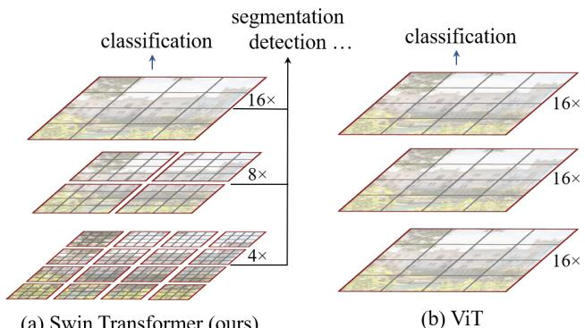
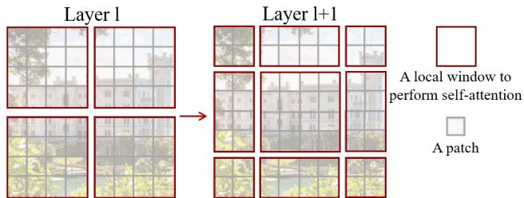
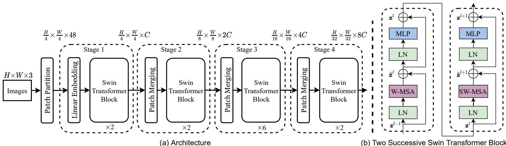
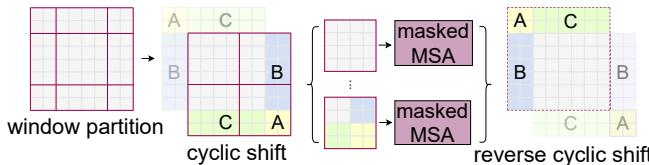

# Swin Transformer：使用移位窗口的层级视觉 Transformer

Ze Liu†\* Yutong Lin†\* Yue Cao\* Han Hu\*‡ Yixuan Wei†

Zheng Zhang Stephen Lin Baining Guo

微软亚洲研究院（Microsoft Research Asia）

{v-zeliu1,v-yutlin,yuecao,hanhu,v-yixwe,zhez,stevelin,bainguo}@microsoft.com

## 摘要

本文提出了一种新的视觉 Transformer，称为 Swin Transformer，它可以胜任通用计算机视觉骨干网络。从语言领域将 Transformer 适配到视觉领域的挑战源于两个领域之间的差异，例如视觉实体尺度变化巨大，以及图像中像素的分辨率远高于文本中的词语。为了应对这些差异，我们提出了一种层级式 Transformer，其表征通过移位窗口（Shifted windows）进行计算。移位窗口方案通过将自注意力计算限制在互不重叠的局部窗口内，同时允许跨窗口连接，从而带来了更高的效率。这种层级架构具有在各种尺度上建模的灵活性，并且相对于图像尺寸具有线性计算复杂度。Swin Transformer 的这些特性使其能够兼容广泛的视觉任务，包括图像分类（在 ImageNet-1K 上达到 87.3 的 top-1 准确率），以及目标检测（在 COCO test-dev 上达到 58.7 box AP 和 51.1 mask AP）和语义分割（在 ADE20K val 上达到 53.5 mIoU）等密集预测任务。其性能大幅超越了之前的最佳水平，在 COCO 上提升了 +2.7 box AP 和 +2.6 mask AP，在 ADE20K 上提升了 +3.2 mIoU，展示了基于 Transformer 的模型作为视觉骨干的潜力。层级设计和移位窗口方案对全 MLP（all-MLP）架构同样有益。代码和模型已在 https://github. com/microsoft/Swin-Transformer 公开。

## 1. 引言

计算机视觉中的建模长期以来由卷积神经网络（CNN）所主导。从 AlexNet [39] 及其在 ImageNet 图像分类挑战赛上的革命性表现开始，CNN 架构通过更大的规模 [30, 76]、更广泛的连接 [34] 以及更复杂的卷积形式 [70, 18, 84] 不断发展壮大。由于 CNN 充当各种视觉任务的骨干网络，这些架构上的进步带来了广泛推动整个领域发展的性能提升。

  

(a) Swin Transformer (ours)

图 1. (a) 我们提出的 Swin Transformer 通过在更深的层中合并图像块（如图中灰色所示）来构建分层特征图，并且由于自注意力仅在每个局部窗口（如图中红色所示）内进行计算，其计算复杂度相对于输入图像大小是线性的。因此它可以作为图像分类和密集识别任务的通用骨干网络。(b) 相比之下，先前的视觉 Transformer [20] 产生单一低分辨率的特征图，并且由于在全局范围内计算自注意力，其计算复杂度相对于输入图像大小是二次的。

另一方面，自然语言处理（Natural Language Processing, NLP）中网络架构的演变走了一条不同的道路，如今主流的架构是 Transformer [64]。Transformer 为序列建模和转导任务而设计，其显著特点是利用注意力机制来建模数据中的长距离依赖关系。它在语言领域的巨大成功促使研究人员探索将其适配到计算机视觉领域，最近在某些任务（特别是图像分类 [20] 和联合视觉-语言建模 [47]）上取得了令人期待的结果。

在本文中，我们致力于拓展 Transformer 的适用性，使其能够像在 NLP 中那样、像 CNN 在视觉中那样，作为计算机视觉的通用骨干网络。我们观察到，将 Transformer 在语言领域的高性能迁移到视觉领域所面临的重大挑战，可以由这两种模态之间的差异来解释。其中一个差异在于尺度。与语言 Transformer 中作为基本处理单元的词元（word tokens）不同，视觉元素在尺度上可以有显著差异，这一问题在目标检测 [42, 53, 54] 等任务中受到了关注。在现有的基于 Transformer 的模型 [64, 20] 中，所有词元都拥有相同的固定尺度，这一特性并不适用于上述视觉应用。另一个差异在于图像中像素的分辨率远高于文本段落中的词汇分辨率。许多视觉任务（如语义分割）需要在像素级别上进行密集预测，而对于 Transformer 来说，在高分辨率图像上完成这一任务是难以处理的，因为其自注意力的计算复杂度相对于图像大小呈平方关系。为了克服这些问题，我们提出了一种称为 Swin Transformer 的通用 Transformer 骨干网络，它构建了层级化的特征图，并且相对于图像大小具有线性计算复杂度。如图 1(a) 所示，Swin Transformer 通过从小尺寸的图像块（以灰色边框标出）开始，并在更深的 Transformer 层中逐渐合并相邻的图像块，来构建层级化的表示。借助这些层级化的特征图，Swin Transformer 模型可以方便地利用用于密集预测的先进技术，例如特征金字塔网络（Feature Pyramid Network, FPN）[42] 或 U-Net [51]。线性计算复杂度的获得，是通过在将图像划分后的非重叠窗口（以红色边框标出）内局部计算自注意力来实现的。每个窗口中的图像块数量是固定的，因此复杂度相对于图像大小呈线性。这些优点使 Swin Transformer 适合作为各种视觉任务的通用骨干网络，这与之前基于 Transformer 的架构 [20]（它们产生单一分辨率的特征图并具有平方复杂度）形成了鲜明对比。

Swin Transformer 的一个关键设计要素是在连续自注意力层之间对窗口划分进行移位（shift），如图 2 所示。移位后的窗口将前一层的窗口桥接起来，在它们之间建立联系，显著增强了建模能力（见表 4）。该策略在真实场景延迟方面同样高效：窗口内的所有查询（query）补丁共享同一组键（key）集合1，这便于硬件中的内存访问。相比之下，早期基于滑动窗口（sliding window）的自注意力方法 [33, 50] 由于不同查询像素对应不同的键集合2，在通用硬件上延迟较高。我们的实验表明，所提出的移位窗口方法延迟远低于滑动窗口方法，但建模能力与之相当（见表 5 和表 6）。移位窗口方法对全 MLP（all-MLP）架构 [61] 同样有效。

  

图 2. 所提出的 Swin Transformer 架构中用于计算自注意力的移位窗口（shifted window）方法示意图。在第 $l$ 层（左）中，采用常规的窗口划分方案，并在每个窗口内进行自注意力计算。在下一层 $l+1$（右）中，窗口划分发生移位，从而产生新的窗口。新窗口中的自注意力计算跨越了第 $l$ 层中先前窗口的边界，在这些窗口之间建立了联系。

所提出的 Swin Transformer 在图像分类、目标检测和语义分割等识别任务上取得了强劲的性能。它在这三项任务上以相近的延迟显著优于 ViT / DeiT [20, 63] 和 ResNe(X)t 模型 [30, 70]。其在 COCO test-dev 数据集上取得的 58.7 box AP 和 51.1 mask AP，分别以 +2.7 box AP（Copy-paste [26]，未使用外部数据）和 +2.6 mask AP（DetectoRS [46]）超越了此前的最优结果。在 ADE20K 语义分割任务中，它在 val 集上取得了 53.5 mIoU，相较此前最优方法（SETR [81]）提升了 +3.2 mIoU。它还在 ImageNet-1K 图像分类上达到了 87.3% 的 top-1 准确率。

我们相信，在计算机视觉与自然语言处理领域使用统一的架构能够使两方面受益，因为统一架构有助于对视觉与文本信号进行联合建模，并且来自两个领域的建模知识也能够得到更深入的共享。我们希望 Swin Transformer 在多种视觉问题上的强劲性能能够使这一信念在社区中更加深入人心，并推动视觉与语言信号的统一建模。

## 2. 相关工作（Related Work）

CNN 及其变体  CNN 一直是计算机视觉中的标准网络模型。尽管 CNN 已有数十年的历史 [40]，但直到 AlexNet [39] 的提出，CNN 才得以迅速发展并成为主流。此后，研究者们提出了更深、更有效的卷积神经网络架构，以进一步推动计算机视觉领域的深度学习浪潮，例如 VGG [52]、GoogleNet [57]、ResNet [30]、DenseNet [34]、HRNet [65] 和 EfficientNet [58]。除了这些架构层面的进展，还有大量工作致力于改进单个卷积层，例如深度可分离卷积（depthwise convolution）[70] 和可变形卷积（deformable convolution）[18, 84]。尽管 CNN 及其变体仍然是计算机视觉应用中的主要骨干架构，但我们着重强调类 Transformer 架构在视觉与语言统一建模方面的巨大潜力。我们的工作在若干基础视觉识别任务上取得了强劲的性能，我们希望它能够为建模方式的转变作出贡献。

基于自注意力的骨干网络架构
同样受 Self-attention layers 和 Transformer 架构在自然语言处理领域取得成功之启发，一些研究采用自注意力层来替换流行的 ResNet [33, 50, 80] 中部分或全部的空间卷积层。在这些研究中，自注意力是在每个像素的局部窗口内计算的，以加快优化速度 [33]，并且它们在精度/FLOPs（浮点运算次数）权衡方面比对应的 ResNet 架构略有提升。然而，其较高的内存访问开销导致其实际延迟显著大于卷积网络 [33]。我们提出在连续层之间移动窗口，而非使用滑动窗口，这种方式通常能够在通用硬件上实现更为高效的部署。

自注意力/Transformer 对卷积卷积神经网络（CNN）的补充
另一条研究路线是用自注意力层或 Transformer 来增强标准的卷积神经网络（CNN）架构。自注意力层可以通过提供编码远距离依赖或异构交互的能力，来对骨干网络 [67, 7, 3, 71, 23, 74, 55] 或头部网络 [32, 27] 进行补充。最近，Transformer 中的编码器-解码器设计已被应用于目标检测和实例分割任务 [8, 13, 85, 56]。我们的工作探索了将 Transformer 适配于基础视觉特征提取，与这些工作是互补的。

## Transformer 视觉骨干网络

与我们工作最相关的是视觉Transformer（Vision Transformer，ViT）[20]及其后续工作[63, 72, 15, 28, 66]。ViT的开创性工作直接将Transformer架构应用于不重叠的中等大小图像块（image patch）上进行图像分类。与卷积网络相比，它在图像分类上实现了令人印象深刻的精度-速度权衡。虽然ViT需要大规模训练数据集（即JFT-300M）才能表现良好，但DeiT [63]引入了多种训练策略，使得ViT在使用较小的ImageNet-1K数据集时也能保持有效。ViT在图像分类上的结果是令人鼓舞的，但由于其低分辨率的特征图以及复杂度随图像尺寸呈二次方增长，其架构不适合用作密集视觉任务的通用骨干网络，或在输入图像分辨率较高时使用。有一些工作通过直接上采样或反卷积将ViT模型应用于目标检测和语义分割等密集视觉任务，但性能相对较低[2, 81]。与我们工作同期，有一些工作修改了ViT架构[72, 15, 28]以获得更好的图像分类效果。经验上，我们发现尽管我们的工作专注于通用性能而非专门针对分类，但我们的Swin Transformer架构在这些方法中实现了最佳的精度-速度权衡。另一个同期工作[66]探索了类似思路来在Transformer上构建多分辨率特征图。其复杂度相对于图像尺寸仍然是二次的，而我们的复杂度是线性的，并且还在局部进行操作，这在建模视觉信号中的高相关性方面已被证明是有益的[36, 25, 41]。我们的方法既高效又有效，在COCO目标检测和ADE20K语义分割上都达到了最先进的精度。

## 3. 方法

### 3.1. 整体架构

Swin Transformer架构的概览如图3所示，图中展示了该架构的微小版本（Swin-T）。它首先通过一个块分割模块（patch splitting module），将输入RGB图像分割成不重叠的块（patch），与ViT类似。每个块被视为一个"令牌"（token），其特征设置为原始像素RGB值的拼接。在我们的实现中，我们使用$4 \times 4$的块大小，因此每个块的特征维度为$4 \times 4 \times 3 = 4 8$。在该原始值特征上应用一个线性嵌入层，将其投影到任意维度（记为C）。

具有改进自注意力计算的若干Transformer块（Swin Transformer块）被应用于这些块令牌。这些Transformer块保持令牌数量为$\begin{array}{r}(\frac{H}{4} \times \frac{W}{4})\end{array}$，并与线性嵌入一起被称为"Stage $1 ^ { \circ }$"。

为了产生层次化表示，随着网络深度的增加，token 数量通过块合并（patch merging）层逐步减少。第一个块合并层将每组 $2 \times 2$ 相邻 patch 的特征进行拼接，并对 4C 维的拼接特征应用一个线性层。这将 token 数量减少了 $2 \times 2 = 4$ 倍（即分辨率 $2 \times$ 下采样），输出维度被设置为 $2 C$。随后应用 Swin Transformer 块进行特征变换，分辨率保持在 ${ \frac { H } { 8 } } \times { \frac { W } { 8 } }$。这个由块合并和特征变换组成的第一阶段被记为"Stage $2 ^ { \circ }$"。该过程重复两次，分别作为"Stage $3 ^ { \circ }$"和"Stage $4 ^ { \circ }$"，输出分辨率分别为 $\frac { H } { 1 6 } \times \frac { W } { 1 6 }$ 和 $\frac { H } { 3 2 } \times \frac { W } { 3 2 }$。这些阶段共同产生一个层次化表示，其特征图分辨率与典型卷积网络（如 VGG [52] 和 ResNet [30]）的分辨率相同。因此，所提出的架构可以方便地替代现有方法中用于各种视觉任务的骨干网络。

  

图 3. (a) Swin Transformer（Swin-T）的架构；(b) 两个连续的 Swin Transformer 块（符号说明见式 (3)）。W-MSA 和 SW-MSA 分别是采用常规窗口划分（regular）和移位窗口划分（shifted window）配置的多头自注意力模块。

Swin Transformer 块 Swin Transformer 通过将 Transformer 块中的标准多头自注意力（MSA）模块替换为基于移位窗口的模块（在第 3.2 节中描述）来构建，其他层保持不变。如图 3(b) 所示，Swin Transformer 块由一个基于移位窗口的 MSA 模块组成，后跟一个 2 层 MLP，中间使用 GELU 非线性。在每个 MSA 模块和每个 MLP 之前应用层归一化（LN）层，并在每个模块之后应用残差连接。

## 3.2. 基于移位窗口的自注意力

标准 Transformer 架构 [64] 及其在图像分类中的适配 [20] 都执行全局自注意力，其中计算一个 token 与所有其他 token 之间的关系。全局计算导致相对于 token 数量的二次复杂度，使其不适用于许多需要大量 token 进行密集预测或表示高分辨率图像的视觉问题。

非重叠窗口中的自注意力 为了高效建模，我们提出在局部窗口内计算自注意力。这些窗口以非重叠的方式均匀划分图像。假设每个窗口包含 $M \times M$ 个 patch，全局 MSA 模块和基于窗口的 MSA 模块在 $h \times w$ 个 patch 的图像上的计算复杂度分别为 $^{3}$ ：

$$
\Omega (\mathrm{MSA}) = 4 h w C ^ {2} + 2 (h w) ^ {2} C,\tag{1}
$$

$$
\Omega (\mathbf {W - M S A}) = 4 h w C ^ {2} + 2 M ^ {2} h w C,\tag{2}
$$

前者与 patch 数量 hw 成二次关系，而后者在 M 固定时（默认设为 7）成线性关系。对于较大的 hw，全局自注意力（self-attention）计算通常难以承受，而基于窗口的自注意力则具有可扩展性。

**连续块中的移位窗口分区** 基于窗口的自注意力模块缺乏跨窗口的连接，这限制了其建模能力。为了在保持非重叠窗口高效计算的同时引入跨窗口连接，我们提出了一种移位窗口分区方法，该方法在连续的 Swin Transformer 块之间交替使用两种分区配置。

如图 2 所示，第一个模块使用从左上角像素开始的常规窗口分区策略，将 $8 \times 8$ 特征图均匀划分为 $2 \times 2$ 个大小为 $4 \times 4 ( M = 4 )$ 的窗口。接着，下一个模块采用相对于前一层的移位窗口配置，将窗口从常规分区的窗口位置偏移 $\begin{array} { r } { \big ( \big \lfloor \frac { M } { 2 } \big \rfloor , \big \lfloor \frac { M } { 2 } \big \rfloor \big ) } \end{array}$ 个像素。

采用移位窗口分区方法后，连续的 Swin Transformer 块的计算方式如下

$$
\begin{array}{l} \hat {\mathbf {z}} ^ {l} = \mathrm{W-MSA} \left(\mathrm{LN} \left(\mathbf {z} ^ {l - 1}\right)\right) + \mathbf {z} ^ {l - 1}, \\ \mathbf {z} ^ {l} = \mathrm{MLP} \left(\mathrm{LN} \left(\hat {\mathbf {z}} ^ {l}\right)\right) + \hat {\mathbf {z}} ^ {l}, \\ \hat {\mathbf {z}} ^ {l + 1} = \mathrm{SW-MSA} \left(\mathrm{LN} \left(\mathbf {z} ^ {l}\right)\right) + \mathbf {z} ^ {l}, \\ \mathbf {z} ^ {l + 1} = \mathrm{MLP} \left(\mathrm{LN} \left(\hat {\mathbf {z}} ^ {l + 1}\right)\right) + \hat {\mathbf {z}} ^ {l + 1}, \end{array}\tag{3}
$$

其中 $\hat { \mathbf { z } } ^ { l }$ 和 $\mathbf { z } ^ { l }$ 分别表示第 $l$ 个块中（S)W-MSA 模块和 MLP 模块的输出特征；

  

图 4. 移位窗口划分中自注意力高效批计算方法的示意图。

W-MSA 和 SW-MSA 分别表示使用常规窗口划分配置和移位窗口划分配置的基于窗口的多头自注意力。

移位窗口划分方法在前一层中相邻的非重叠窗口之间引入了连接，并在图像分类、目标检测和语义分割任务中均被证明是有效的，如表 4 所示。

移位配置下的高效批计算 移位窗口划分存在的一个问题是，它将产生更多的窗口，从 $\begin{array} { r } { \lceil \frac { \mathbf { \bar { h } } } { M } \rceil \times \lceil \frac { w } { M } \rceil ^ { \mathbf { \bar { l } } } \mathrm { t o } \left( \lceil \frac { h } { M } \rceil + 1 \right) \succ } \end{array}$ × $\left( \lceil \frac { w } { M } \rceil + 1 \right)$，且其中部分窗口会小于 $M \times M ^ { 4 }$。一种朴素的解决方法是将这些较小的窗口填充至 $M \times M$ 大小，并在计算注意力时将填充值屏蔽掉。当常规划分下的窗口数量较少时（例如 $2 \times 2$），采用这种朴素做法所带来的额外计算量相当可观（$2 \times 2 \to 3 \times 3$，即增加 2.25 倍）。在此，我们提出一种更高效的批计算方法，通过向左上方向进行循环移位（cyclic shift）来实现，如图 4 所示。在该移位操作之后，一个批窗口可能由特征图中互不相邻的若干子窗口组成，因此我们采用一种掩码机制将自注意力计算限制在各个子窗口内部。通过循环移位，批窗口的数量与常规窗口划分保持一致，因此同样是高效的。该方法的低延迟特性如表 5 所示。

相对位置偏置（relative position bias） 在计算自注意力时，我们遵循 [49, 1, 32, 33] 的做法，在计算相似度时为每个头引入一个相对位置偏置 $\boldsymbol { B } \in \mathbb { R } ^ { M ^ { 2 } \times M ^ { 2 } }$：

$$
\operatorname{Attention} (Q, K, V) = \operatorname{SoftMax} \left(Q K ^ {T} / \sqrt {d} + B\right) V,\tag{4}
$$

其中 $Q , K , V \in \mathbb { R } ^ { M ^ { 2 } \times d }$ 分别为查询（query）、键（key）和值（value）矩阵；$d$ 为查询/键的维度，$M ^ { 2 }$ 为窗口内的块（patch）数量。由于沿每个轴的相对位置取值范围为 $\left[ - M + 1 , M - 1 \right]$，我们参数化一个尺寸更小的偏置矩阵 $\hat { B } \in \mathbb { R } ^ { ( 2 M - 1 ) \times ( \hat { 2 M } - 1 ) }$，$B$ 中的取值取自 $\hat { B }$。

如表 4 所示，相较于不含该偏置项或使用绝对位置嵌入的对应方法，我们观察到本方法带来了显著提升。如 [20] 那样在输入中进一步加入绝对位置嵌入会使性能略有下降，因此我们的实现中未采用这一做法。

预训练中学到的相对位置偏置也可通过双三次插值（bi-cubic interpolation）[20, 63]，用于初始化一个具有不同窗口大小的模型以进行微调。

## 3.3. 架构变体（Architecture Variants）

我们构建的基线模型称为 Swin-B，其模型规模与计算复杂度与 ViT-B/DeiT-B 相当。我们还引入了 Swin-T、Swin-S 和 Swin-L，它们的模型规模与计算复杂度分别约为基线模型的 0.25×、0.5× 和 2×。注意，Swin-T 与 Swin-S 的复杂度分别与 ResNet-50（DeiT-S）和 ResNet-101 相当。默认情况下，窗口大小设为 $M = 7$。在所有实验中，每个头的查询维度为 $d = 3 2$，每个 MLP 的扩展层为 $\alpha = 4$。这些模型变体的架构超参数如下：

• Swin-T：C = 96，层数 = {2, 2, 6, 2}

• Swin-S：C = 96，层数 ={2, 2, 18, 2}

• Swin-B：C = 128，层数 ={2, 2, 18, 2}

$$
\bullet \text { Swin - L: } C = 1 9 2, \text { layer   numbers } = \{2, 2, 1 8, 2 \}
$$

其中 C 是第一阶段隐藏层的通道数。针对 ImageNet 图像分类的模型变体的模型大小、理论计算复杂度（FLOPs）以及吞吐量列于表 1。

## 4. 实验

我们在 ImageNet-1K 图像分类 [19]、COCO 目标检测 [43] 和 ADE20K 语义分割 [83] 上进行了实验。在下文中，我们首先将所提出的 Swin Transformer 架构与先前在这三项任务上的最先进方法进行比较。然后，我们对 Swin Transformer 的重要设计元素进行了消融实验。

## 4.1. 在 ImageNet-1K 上的图像分类

设置：对于图像分类任务，我们在 ImageNet-1K [19] 上对所提出的 Swin Transformer 进行了基准测试，该数据集包含来自 1,000 个类别的 128 万张训练图像和 5 万张验证图像。我们报告了单裁剪的 Top-1 准确率。我们考虑了两种训练设置：

• 常规 ImageNet-1K 训练。该设置主要遵循 [63]。我们使用 AdamW [37] 优化器训练 300 个 epoch，采用余弦衰减学习率调度器，并进行 20 个 epoch 的线性预热。批大小设为 1024，初始学习率为 0.001，权重衰减为 0.05。我们在训练中采用了 [63] 中大部分的数据增强和正则化策略，但未采用重复增强 [31] 和 EMA [45]，因为它们并不能提升性能。请注意，这与 [63] 中的情况相反，在 [63] 中重复增强对稳定 ViT 的训练至关重要。

• 在 ImageNet-22K 上预训练并在 ImageNet-1K 上微调。我们还在更大的 ImageNet-22K 数据集上进行预训练，该数据集包含 1420 万张图像和 22K 个类别。我们使用 AdamW 优化器训练 90 个 epoch，采用线性衰减学习率调度器，并进行 5 个 epoch 的线性预热。批大小设为 4096，初始学习率为 0.001，权重衰减为 0.01。在 ImageNet-1K 微调中，我们以批大小 1024、常数学习率 $1 0 ^ { - 5 }$ 和权重衰减 $1 0 ^ { - 8 }$ 训练模型 30 个 epoch。

常规 ImageNet-1K 训练下的结果：表 1(a) 给出了使用常规 ImageNet-1K 训练时与其他骨干网络的比较，包括基于 Transformer 和基于卷积神经网络（ConvNet）的骨干网络。

与之前最先进的基于 Transformer 的架构（即 DeiT [63]）相比，Swin Transformer 在复杂度相近的情况下明显优于对应的 DeiT 架构：使用 2242 输入时，Swin-T（81.3%）比 DeiT-S（79.8%）高 1.5%；使用 2242/3842 输入时，Swin-B（83.3%/84.5%）比 DeiT-B（81.8%/83.1%）分别高 1.5% 和 1.4%。

与最先进的卷积神经网络（ConvNet），即 RegNet [48] 和 EfficientNet [58] 相比，Swin Transformer 实现了略优的速度-准确率权衡。值得注意的是，尽管 RegNet [48] 和 EfficientNet [58] 是通过详尽的架构搜索得到的，但所提出的 Swin Transformer 是由标准 Transformer 改造而来，并具有进一步改进的强大潜力。

使用 ImageNet-22K 预训练的结果 我们还在 ImageNet-22K 上对更大容量的 Swin-B 和 Swin-L 进行了预训练。在 ImageNet-1K 图像分类任务上微调的结果如表 1(b) 所示。对于 Swin-B，ImageNet-22K 预训练相较于在 ImageNet-1K 上从零开始训练带来了 1.8%∼1.9% 的提升。与此前 ImageNet-22K 预训练的最佳结果相比，我们的模型在速度-准确率权衡方面显著更优：Swin-B 取得了 86.4% 的 top-1 准确率，在推理吞吐量相近的情况下（84.7 vs. 85.9 images/sec），比 ViT 高出 2.4%，且 FLOPs 略低（47.0G vs. 55.4G）。更大的 Swin-L 模型取得了 87.3% 的 top-1 准确率，比 Swin-B 模型高 +0.9%。

<table><tr><td colspan="6">(a) Regular ImageNet-1K trained models</td></tr><tr><td>method</td><td>image size</td><td>#param.</td><td>FLOPs</td><td>throughput (image / s)</td><td>ImageNet top-1 acc.</td></tr><tr><td>RegNetY-4G [48]</td><td> $224^2$ </td><td>21M</td><td>4.0G</td><td>1156.7</td><td>80.0</td></tr><tr><td>RegNetY-8G [48]</td><td> $224^2$ </td><td>39M</td><td>8.0G</td><td>591.6</td><td>81.7</td></tr><tr><td>RegNetY-16G [48]</td><td> $224^2$ </td><td>84M</td><td>16.0G</td><td>334.7</td><td>82.9</td></tr><tr><td>EffNet-B3 [58]</td><td> $300^2$ </td><td>12M</td><td>1.8G</td><td>732.1</td><td>81.6</td></tr><tr><td>EffNet-B4 [58]</td><td> $380^2$ </td><td>19M</td><td>4.2G</td><td>349.4</td><td>82.9</td></tr><tr><td>EffNet-B5 [58]</td><td> $456^2$ </td><td>30M</td><td>9.9G</td><td>169.1</td><td>83.6</td></tr><tr><td>EffNet-B6 [58]</td><td> $528^2$ </td><td>43M</td><td>19.0G</td><td>96.9</td><td>84.0</td></tr><tr><td>EffNet-B7 [58]</td><td> $600^2$ </td><td>66M</td><td>37.0G</td><td>55.1</td><td>84.3</td></tr><tr><td>ViT-B/16 [20]</td><td> $384^2$ </td><td>86M</td><td>55.4G</td><td>85.9</td><td>77.9</td></tr><tr><td>ViT-L/16 [20]</td><td> $384^2$ </td><td>307M</td><td>190.7G</td><td>27.3</td><td>76.5</td></tr><tr><td>DeiT-S [63]</td><td> $224^2$ </td><td>22M</td><td>4.6G</td><td>940.4</td><td>79.8</td></tr><tr><td>DeiT-B [63]</td><td> $224^2$ </td><td>86M</td><td>17.5G</td><td>292.3</td><td>81.8</td></tr><tr><td>DeiT-B [63]</td><td> $384^2$ </td><td>86M</td><td>55.4G</td><td>85.9</td><td>83.1</td></tr><tr><td>Swin-T</td><td> $224^2$ </td><td>29M</td><td>4.5G</td><td>755.2</td><td>81.3</td></tr><tr><td>Swin-S</td><td> $224^2$ </td><td>50M</td><td>8.7G</td><td>436.9</td><td>83.0</td></tr><tr><td>Swin-B</td><td> $224^2$ </td><td>88M</td><td>15.4G</td><td>278.1</td><td>83.5</td></tr><tr><td>Swin-B</td><td> $384^2$ </td><td>88M</td><td>47.0G</td><td>84.7</td><td>84.5</td></tr></table>

(b) ImageNet-22K 预训练模型

<table><tr><td>method</td><td>image size</td><td>#param.</td><td>FLOPs</td><td>throughput (image / s)</td><td>ImageNet top-1 acc.</td></tr><tr><td>R-101x3 [38]</td><td> $384^2$ </td><td>388M</td><td>204.6G</td><td>-</td><td>84.4</td></tr><tr><td>R-152x4 [38]</td><td> $480^2$ </td><td>937M</td><td>840.5G</td><td>-</td><td>85.4</td></tr><tr><td>ViT-B/16 [20]</td><td> $384^2$ </td><td>86M</td><td>55.4G</td><td>85.9</td><td>84.0</td></tr><tr><td>ViT-L/16 [20]</td><td> $384^2$ </td><td>307M</td><td>190.7G</td><td>27.3</td><td>85.2</td></tr><tr><td>Swin-B</td><td> $224^2$ </td><td>88M</td><td>15.4G</td><td>278.1</td><td>85.2</td></tr><tr><td>Swin-B</td><td> $384^2$ </td><td>88M</td><td>47.0G</td><td>84.7</td><td>86.4</td></tr><tr><td>Swin-L</td><td> $384^2$ </td><td>197M</td><td>103.9G</td><td>42.1</td><td>87.3</td></tr></table>

Table 1. 不同骨干网络在 ImageNet-1K 分类任务上的比较。吞吐量使用 [68] 的 GitHub 仓库和 V100 GPU 进行测量，遵循 [63] 的方法。

## 4.2. COCO 上的物体检测

**设置** 物体检测和实例分割实验在 COCO 2017 上进行，该数据集包含 118K 张训练图像、5K 张验证图像和 20K 张 test-dev 图像。消融研究使用验证集进行，系统级比较在 test-dev 上报告。在消融研究中，我们考虑了四种典型的物体检测框架：Cascade Mask R-CNN [29, 6]、ATSS [79]、RepPoints v2 [12] 和 Sparse RCNN [56]，均使用 mmdetection [10] 实现。对于这四个框架，我们采用相同的设置：多尺度训练 [8, 56]（调整输入尺寸使短边介于 480 到 800 之间，长边不超过 1333）、AdamW [44] 优化器（初始学习率为 0.0001，权重衰减为 0.05，批大小为 16）以及 3x 训练计划（36 个 epoch）。在系统级比较中，我们采用改进的 HTC [9]（记为 HTC++），结合 instaboost [22]、更强的多尺度训练 [7]、6x 训练计划（72 个 epoch）、soft-NMS [5]，并以 ImageNet-22K 预训练模型作为初始化。

我们将 Swin Transformer 与标准 ConvNets（即 ResNe(X)t）以及之前的 Transformer 网络（例如 DeiT）进行比较。比较过程中仅替换骨干网络，其他设置保持不变。需要注意的是，由于 Swin Transformer 和 ResNe(X)t 都具有层次化特征图，可以直接应用于上述所有框架；而 DeiT 仅产生单一分辨率的特征图，无法直接应用。为了公平比较，我们遵循 [81] 的方法，使用反卷积层为 DeiT 构建层次化特征图。

<table><tr><td colspan="8">(a) Various frameworks</td></tr><tr><td>Method</td><td>Backbone</td><td> $AP^{box}$ </td><td> $AP_{50}^{box}$ </td><td> $AP_{75}^{box}$ </td><td>#param.</td><td>FLOPs</td><td>FPS</td></tr><tr><td>Cascade</td><td>R-50</td><td>46.3</td><td>64.3</td><td>50.5</td><td>82M</td><td>739G</td><td>18.0</td></tr><tr><td>Mask R-CNN</td><td>Swin-T</td><td>50.5</td><td>69.3</td><td>54.9</td><td>86M</td><td>745G</td><td>15.3</td></tr><tr><td rowspan="2">ATSS</td><td>R-50</td><td>43.5</td><td>61.9</td><td>47.0</td><td>32M</td><td>205G</td><td>28.3</td></tr><tr><td>Swin-T</td><td>47.2</td><td>66.5</td><td>51.3</td><td>36M</td><td>215G</td><td>22.3</td></tr><tr><td rowspan="2">RepPointsV2</td><td>R-50</td><td>46.5</td><td>64.6</td><td>50.3</td><td>42M</td><td>274G</td><td>13.6</td></tr><tr><td>Swin-T</td><td>50.0</td><td>68.5</td><td>54.2</td><td>45M</td><td>283G</td><td>12.0</td></tr><tr><td>Sparse</td><td>R-50</td><td>44.5</td><td>63.4</td><td>48.2</td><td>106M</td><td>166G</td><td>21.0</td></tr><tr><td>R-CNN</td><td>Swin-T</td><td>47.9</td><td>67.3</td><td>52.3</td><td>110M</td><td>172G</td><td>18.4</td></tr></table>

(b) 使用 Cascade Mask R-CNN 的不同骨干网络（Various backbones w. Cascade Mask R-CNN）

<table><tr><td></td><td> $AP^{box}$ </td><td> $AP_{50}^{box}$ </td><td> $AP_{75}^{box}$ </td><td> $AP^{mask}$ </td><td> $AP_{50}^{mask}$ </td><td> $AP_{75}^{mask}$ </td><td>paramFLOPs</td><td>FPS</td></tr><tr><td>DeiT-S $^{\dagger}$ </td><td>48.0</td><td>67.2</td><td>51.7</td><td>41.4</td><td>64.2</td><td>44.3</td><td>80M</td><td>889G 10.4</td></tr><tr><td>R50</td><td>46.3</td><td>64.3</td><td>50.5</td><td>40.1</td><td>61.7</td><td>43.4</td><td>82M</td><td>739G 18.0</td></tr><tr><td>Swin-T</td><td>50.5</td><td>69.3</td><td>54.9</td><td>43.7</td><td>66.6</td><td>47.1</td><td>86M</td><td>745G 15.3</td></tr><tr><td>X101-32</td><td>48.1</td><td>66.5</td><td>52.4</td><td>41.6</td><td>63.9</td><td>45.2</td><td>101M</td><td>819G 12.8</td></tr><tr><td>Swin-S</td><td>51.8</td><td>70.4</td><td>56.3</td><td>44.7</td><td>67.9</td><td>48.5</td><td>107M</td><td>838G 12.0</td></tr><tr><td>X101-64</td><td>48.3</td><td>66.4</td><td>52.3</td><td>41.7</td><td>64.0</td><td>45.1</td><td>140M</td><td>972G 10.4</td></tr><tr><td>Swin-B</td><td>51.9</td><td>70.9</td><td>56.5</td><td>45.0</td><td>68.4</td><td>48.7</td><td>145M</td><td>982G 11.6</td></tr></table>

(c) 系统级对比（System-level Comparison）

<table><tr><td rowspan="2">Method</td><td colspan="2">mini-val</td><td colspan="2">test-dev</td><td rowspan="2" colspan="2">#param. FLOPs</td></tr><tr><td> $AP^{box}$ </td><td> $AP^{mask}$ </td><td> $AP^{box}$ </td><td> $AP^{mask}$ </td></tr><tr><td>RepPointsV2* [12]</td><td>-</td><td>-</td><td>52.1</td><td>-</td><td>-</td><td>-</td></tr><tr><td>GCNet* [7]</td><td>51.8</td><td>44.7</td><td>52.3</td><td>45.4</td><td>-</td><td>1041G</td></tr><tr><td>RelationNet++* [13]</td><td>-</td><td>-</td><td>52.7</td><td>-</td><td>-</td><td>-</td></tr><tr><td>SpineNet-190 [21]</td><td>52.6</td><td>-</td><td>52.8</td><td>-</td><td>164M</td><td>1885G</td></tr><tr><td>ResNeSt-200* [78]</td><td>52.5</td><td>-</td><td>53.3</td><td>47.1</td><td>-</td><td>-</td></tr><tr><td>EfficientDet-D7 [59]</td><td>54.4</td><td>-</td><td>55.1</td><td>-</td><td>77M</td><td>410G</td></tr><tr><td>DetectoRS* [46]</td><td>-</td><td>-</td><td>55.7</td><td>48.5</td><td>-</td><td>-</td></tr><tr><td>YOLOv4 P7* [4]</td><td>-</td><td>-</td><td>55.8</td><td>-</td><td>-</td><td>-</td></tr><tr><td>Copy-paste [26]</td><td>55.9</td><td>47.2</td><td>56.0</td><td>47.4</td><td>185M</td><td>1440G</td></tr><tr><td>X101-64 (HTC++)</td><td>52.3</td><td>46.0</td><td>-</td><td>-</td><td>155M</td><td>1033G</td></tr><tr><td>Swin-B (HTC++)</td><td>56.4</td><td>49.1</td><td>-</td><td>-</td><td>160M</td><td>1043G</td></tr><tr><td>Swin-L (HTC++)</td><td>57.1</td><td>49.5</td><td>57.7</td><td>50.2</td><td>284M</td><td>1470G</td></tr><tr><td>Swin-L (HTC++)*</td><td>58.0</td><td>50.4</td><td>58.7</td><td>51.1</td><td>284M</td><td>-</td></tr></table>

表 2. COCO 目标检测与实例分割结果。†表示使用了额外的反卷积层来产生层级化的特征图。\* 表示多尺度测试。

与 ResNe(X)t 的对比 表 2(a) 列出了 Swin-T 和 ResNet-50 在四个目标检测框架上的结果。我们的 Swin-T 架构相比 ResNet-50 在 box AP 上稳定提升 +3.4∼4.2，同时模型规模、FLOPs 和延迟略大。

表 2(b) 使用 Cascade Mask R-CNN 比较了不同模型容量下的 Swin Transformer 和 ResNe(X)t。Swin Transformer 取得了 51.9 box AP 和 45.0 mask AP 的高检测精度，相比模型规模、FLOPs 和延迟相近的 ResNeXt101-64x4d，分别有 +3.6 box AP 和 +3.3 mask AP 的显著提升。在使用改进的 HTC 框架取得的 52.3 box AP 和 46.0 mask AP 的更高基线上，Swin Transformer 带来的提升也很显著，达到 +4.1 box AP 和 +3.1 mask AP（见表 2(c)）。关于推理速度，虽然 ResNe(X)t 由高度优化的 Cudnn 函数构建，但我们的架构使用 PyTorch 内置函数实现，这些函数并非全部都经过充分优化。彻底的内核优化超出了本文的范围。

<table><tr><td colspan="2">ADE20K</td><td>val</td><td>test</td><td rowspan="2">#param.</td><td rowspan="2">FLOPs</td><td rowspan="2">FPS</td></tr><tr><td>Method</td><td>Backbone</td><td>mIoU</td><td>score</td></tr><tr><td>DANet [23]</td><td>ResNet-101</td><td>45.2</td><td>-</td><td>69M</td><td>1119G</td><td>15.2</td></tr><tr><td>DLab.v3+ [11]</td><td>ResNet-101</td><td>44.1</td><td>-</td><td>63M</td><td>1021G</td><td>16.0</td></tr><tr><td>ACNet [24]</td><td>ResNet-101</td><td>45.9</td><td>38.5</td><td>-</td><td></td><td></td></tr><tr><td>DNL [71]</td><td>ResNet-101</td><td>46.0</td><td>56.2</td><td>69M</td><td>1249G</td><td>14.8</td></tr><tr><td>OCRNet [73]</td><td>ResNet-101</td><td>45.3</td><td>56.0</td><td>56M</td><td>923G</td><td>19.3</td></tr><tr><td>UperNet [69]</td><td>ResNet-101</td><td>44.9</td><td>-</td><td>86M</td><td>1029G</td><td>20.1</td></tr><tr><td>OCRNet [73]</td><td>HRNet-w48</td><td>45.7</td><td>-</td><td>71M</td><td>664G</td><td>12.5</td></tr><tr><td>DLab.v3+ [11]</td><td>ResNeSt-101</td><td>46.9</td><td>55.1</td><td>66M</td><td>1051G</td><td>11.9</td></tr><tr><td>DLab.v3+ [11]</td><td>ResNeSt-200</td><td>48.4</td><td>-</td><td>88M</td><td>1381G</td><td>8.1</td></tr><tr><td>SETR [81]</td><td>T-Large $^{\dagger}$ </td><td>50.3</td><td>61.7</td><td>308M</td><td>-</td><td>-</td></tr><tr><td>UperNet</td><td>DeiT-S $^{\dagger}$ </td><td>44.0</td><td>-</td><td>52M</td><td>1099G</td><td>16.2</td></tr><tr><td>UperNet</td><td>Swin-T</td><td>46.1</td><td>-</td><td>60M</td><td>945G</td><td>18.5</td></tr><tr><td>UperNet</td><td>Swin-S</td><td>49.3</td><td>-</td><td>81M</td><td>1038G</td><td>15.2</td></tr><tr><td>UperNet</td><td>Swin-B $^{\ddagger}$ </td><td>51.6</td><td>-</td><td>121M</td><td>1841G</td><td>8.7</td></tr><tr><td>UperNet</td><td>Swin-L $^{\ddagger}$ </td><td>53.5</td><td>62.8</td><td>234M</td><td>3230G</td><td>6.2</td></tr></table>

表 3. ADE20K 验证集和测试集上的语义分割结果。† 表示使用了额外的反卷积层来产生分层特征图。‡ 表示模型在 ImageNet-22K 上进行了预训练。

与 DeiT 的比较 使用 Cascade Mask R-CNN 框架的 DeiT-S 的性能如表 2(b) 所示。在模型规模相近（86M vs. 80M）的情况下，Swin-T 的结果比 DeiT-S 高 +2.5 框 AP 和 +2.3 掩码 AP，并且推理速度显著更高（15.3 FPS vs. 10.4 FPS）。DeiT 推理速度较低主要是由于其相对于输入图像大小的二次复杂度。

与先前最优方法的比较 表 2(c) 将我们的最佳结果与先前最优模型进行了比较。我们的最佳模型在 COCO test-dev 上达到了 58.7 框 AP 和 51.1 掩码 AP，比先前最佳结果高出 +2.7 框 AP（Copy-paste [26]，未使用外部数据）和 +2.6 掩码 AP（DetectoRS [46]）。

## 4.3. ADE20K 上的语义分割

设置 ADE20K [83] 是一个广泛使用的语义分割数据集，涵盖 150 个广泛的语义类别。它总共有 25K 张图像，其中 20K 用于训练，2K 用于验证，另外 3K 用于测试。我们使用 mmseg [16] 中的 UperNet [69] 作为基础框架，因为它具有很高的效率。更多细节见附录。

<table><tr><td rowspan="2"></td><td colspan="2">ImageNet</td><td colspan="2">COCO</td><td>ADE20k</td></tr><tr><td>top-1</td><td>top-5</td><td> $AP^{box}$ </td><td> $AP^{mask}$ </td><td>mIoU</td></tr><tr><td>w/o shifting</td><td>80.2</td><td>95.1</td><td>47.7</td><td>41.5</td><td>43.3</td></tr><tr><td>shifted windows</td><td>81.3</td><td>95.6</td><td>50.5</td><td>43.7</td><td>46.1</td></tr><tr><td>no pos.</td><td>80.1</td><td>94.9</td><td>49.2</td><td>42.6</td><td>43.8</td></tr><tr><td>abs. pos.</td><td>80.5</td><td>95.2</td><td>49.0</td><td>42.4</td><td>43.2</td></tr><tr><td>abs.+rel. pos.</td><td>81.3</td><td>95.6</td><td>50.2</td><td>43.4</td><td>44.0</td></tr><tr><td>rel. pos. w/o app.</td><td>79.3</td><td>94.7</td><td>48.2</td><td>41.9</td><td>44.1</td></tr><tr><td>rel. pos.</td><td>81.3</td><td>95.6</td><td>50.5</td><td>43.7</td><td>46.1</td></tr></table>

表 4. 在三个基准上对移位窗口方法及不同位置编码方式进行的消融实验，使用 Swin-T 架构。w/o shifting：所有自注意力模块均采用常规窗口划分，不进行移位；abs. pos.：ViT 中的绝对位置编码项；rel. pos.：默认设置，并附加一个相对位置偏置项（见公式 (4)）；app.：公式 (4) 中的第一个缩放点积项。

结果 表 3 列出了不同方法/骨干网络组合在 mIoU、模型大小（#param）、FLOPs 和 FPS 上的结果。从这些结果可以看出，在计算量相近的情况下，Swin-S 比 DeiT-S 高 +5.3 mIoU（49.3 对比 44.0）。它也比 ResNet-101 高 +4.4 mIoU，比 ResNeSt-101 [78] 高 +2.4 mIoU。我们经过 ImageNet-22K 预训练的 Swin-L 模型在 val 集上达到了 53.5 mIoU，比此前最佳模型高出 +3.2 mIoU（之前最佳为 SETR [81] 的 50.3 mIoU，其模型规模更大）。

## 4.4. 消融实验

本节中，我们对所提出的 Swin Transformer 中的重要设计元素进行消融，使用 ImageNet-1K 图像分类、COCO 目标检测上的 Cascade Mask R-CNN，以及 ADE20K 语义分割上的 UperNet 三个任务。

移位窗口 表 4 报告了在三个任务上对移位窗口方法的消融结果。在 ImageNet-1K 上，Swin-T 采用移位窗口划分比在每个阶段仅使用单一窗口划分的对应版本高出 +1.1% top-1 准确率；在 COCO 上高出 +2.8 box AP / +2.2 mask AP；在 ADE20K 上高出 +2.8 mIoU。这些结果表明，在前一层各窗口之间建立连接时，采用移位窗口是有效的。如表 5 所示，移位窗口带来的延迟开销也很小。

相对位置偏置 表 4 展示了不同位置编码方法的对比。在 ImageNet-1K 上，使用相对位置偏置的 Swin-T 相对于不使用位置编码和使用绝对位置编码的版本，分别获得 +1.2% / +0.8% 的 top-1 准确率；在 COCO 上分别获得 +1.3 / +1.5 box AP 和 +1.1 / +1.3 mask AP；在 ADE20K 上分别获得 +2.3 / +2.9 mIoU，这表明相对位置偏置是有效的。另请注意，虽然引入绝对位置编码能够提升图像分类准确率（+0.4%），但它会损害目标检测和语义分割的性能（在 COCO 上 -0.2 box/mask AP，在 ADE20K 上 -0.6 mIoU）。

<table><tr><td rowspan="2">method</td><td colspan="4">MSA in a stage (ms)</td><td colspan="3">Arch. (FPS)</td></tr><tr><td>S1</td><td>S2</td><td>S3</td><td>S4</td><td>T</td><td>S</td><td>B</td></tr><tr><td>sliding window (naive)</td><td>122.5</td><td>38.3</td><td>12.1</td><td>7.6</td><td>183</td><td>109</td><td>77</td></tr><tr><td>sliding window (kernel)</td><td>7.6</td><td>4.7</td><td>2.7</td><td>1.8</td><td>488</td><td>283</td><td>187</td></tr><tr><td>Performer [14]</td><td>4.8</td><td>2.8</td><td>1.8</td><td>1.5</td><td>638</td><td>370</td><td>241</td></tr><tr><td>window (w/o shifting)</td><td>2.8</td><td>1.7</td><td>1.2</td><td>0.9</td><td>770</td><td>444</td><td>280</td></tr><tr><td>shifted window (padding)</td><td>3.3</td><td>2.3</td><td>1.9</td><td>2.2</td><td>670</td><td>371</td><td>236</td></tr><tr><td>shifted window (cyclic)</td><td>3.0</td><td>1.9</td><td>1.3</td><td>1.0</td><td>755</td><td>437</td><td>278</td></tr></table>

表 5. 不同自注意力计算方法及实现在 V100 GPU 上的实际速度。

尽管最近的 ViT/DeiT 模型在图像分类中放弃了平移不变性，而平移不变性长期以来被证明对视觉建模至关重要，我们发现鼓励一定平移不变性的归纳偏置对于通用视觉建模仍然是更可取的，特别是对于目标检测和语义分割等密集预测任务。

不同自注意力方法 不同自注意力计算方法及实现的实际速度在表 5 中进行了比较。我们的循环实现比朴素填充更高效，特别是在更深的阶段。总体而言，它分别在 Swin-T、Swin-S 和 Swin-B 上带来了 13%、18% 和 18% 的加速。

基于所提出的移位窗口方法构建的自注意力模块在四个网络阶段上分别比朴素/核实现中的滑动窗口高效 40.8×/2.5×、20.2×/2.5×、9.3×/2.1× 和 7.6×/1.8×。总体而言，基于移位窗口构建的 Swin Transformer 架构在 Swin-T、Swin-S 和 Swin-B 上分别比基于滑动窗口构建的变体快 4.1/1.5、4.0/1.5、3.6/1.5 倍。表 6 比较了它们在三个任务上的精度，表明它们在视觉建模中具有相似的准确性。

与 Performer [14]（最快的 Transformer 架构之一，参见 [60]）相比，所提出的基于移位窗口的自注意力计算以及整体 Swin Transformer 架构稍快（参见表 5），同时在使用 Swin-T 的 ImageNet-1K 上比 Performer 实现了 +2.3% 的 top-1 准确率（参见表 6）。

## 5. 结论

本文提出了 Swin Transformer，一种新的视觉 Transformer，它产生层次化的特征表示，并且相对于输入图像大小具有线性计算复杂度。Swin Transformer 在 COCO 目标检测和 ADE20K 语义分割上取得了最先进的性能，显著超越了以往的最优方法。我们希望 Swin Transformer 在各种视觉问题上的强大性能将鼓励视觉和语言信号的统一建模。

<table><tr><td rowspan="2"></td><td rowspan="2">Backbone</td><td rowspan="2">ImageNet top-1</td><td rowspan="2">top-5</td><td colspan="2">COCO</td><td rowspan="2">ADE20k mIoU</td></tr><tr><td> $AP^{box}$ </td><td> $AP^{mask}$ </td></tr><tr><td>sliding window</td><td>Swin-T</td><td>81.4</td><td>95.6</td><td>50.2</td><td>43.5</td><td>45.8</td></tr><tr><td>Performer [14]</td><td>Swin-T</td><td>79.0</td><td>94.2</td><td>-</td><td>-</td><td>-</td></tr><tr><td>shifted window</td><td>Swin-T</td><td>81.3</td><td>95.6</td><td>50.5</td><td>43.7</td><td>46.1</td></tr></table>

表 6. Swin Transformer 在三个基准上使用不同方法进行自注意力计算的准确率。

作为 Swin Transformer 的关键组成部分，基于移位窗口（shifted window）的自注意力已被证明在视觉问题上有效且高效，我们也期待探索其在自然语言处理中的应用。

## 致谢

我们感谢 Microsoft 众多同事所提供的帮助，特别是 Li Dong 与 Furu Wei 富有助益的讨论，以及 Bin Xiao、Lu Yuan 和 Lei Zhang 在数据集方面的协助。

## A1. 详细架构

详细的架构规格如表 7 所示，其中所有架构均假定输入图像大小为 224×224。"Concat $n \times n ^ { \prime \prime }$" 表示将一个块（patch）内 $n \times n$ 个相邻特征进行拼接。该操作会以倍率 $n$ 对特征图进行下采样。"96-d" 表示输出维度为 96 的线性层。"win. sz. $7 \times 7 ^ { 5 }$" 表示窗口大小为 $7 \times 7$ 的多头自注意力模块。

## A2. 详细实验设置

## A2.1. ImageNet-1K 上的图像分类

图像分类通过在最后一个阶段的输出特征图上应用全局平均池化层，后接一个线性分类器来实现。我们发现该策略的精度与 ViT [20] 和 DeiT [63] 中所使用的额外类标记（class token）相当。评估时报告单裁剪（single crop）的 top-1 准确率。

**常规 ImageNet-1K 训练** 训练设置主要遵循 [63]。对于所有模型变体，我们采用默认输入图像分辨率 $2 2 4 ^ { 2 }$。对于其他分辨率（如 $3 8 4 ^ { 2 }$），我们对在 $2 2 4 ^ { 2 }$ 分辨率下训练的模型进行微调，而非从头训练，以此降低 GPU 资源占用。

在以 $2 2 4 ^ { 2 }$ 输入从头训练时，我们使用 AdamW [37] 优化器训练 300 个 epoch，采用 cosine 衰减学习率调度器，并设置 20 个 epoch 的线性预热（linear warm-up）。批量大小为 1024，初始学习率为 0.001，权重衰减为 0.05，并对梯度进行最大范数为 1 的裁剪。我们在训练中采用了 [63] 中大部分的数据增强与正则化策略，包括 RandAugment [17]、Mixup [77]、Cutmix [75]、random erasing [82] 和 stochastic depth [35]，但未采用 repeated augmentation [31] 与指数移动平均（Exponential Moving Average，EMA）[45]，因为这些方法并未带来性能提升。需要注意的是，这与 [63] 相反——在 [63] 中 repeated augmentation 对稳定 ViT 的训练至关重要。对于更大的模型，我们采用更大程度的 stochastic depth 增强，即 Swin-T、Swin-S、Swin-B 分别采用 0.2、0.3、0.5。

在以更大分辨率输入进行微调时，我们使用 AdamW [37] 优化器训练 30 个 epoch，采用恒定学习率 $1 0 ^ { - 5 }$，权重衰减为 $1 0 ^ { - 8 }$，数据增强与正则化策略与第一阶段相同，但将 stochastic depth 比例设为 0.1。

ImageNet-22K 预训练：我们还在更大的 ImageNet-22K 数据集上进行预训练，该数据集包含 1420 万张图像和 22K 个类别。训练分两个阶段进行。对于第一阶段，使用 $2 2 4 ^ { 2 }$ 输入，我们采用 AdamW 优化器训练 90 个 epoch，使用线性衰减学习率调度器，并进行 5 个 epoch 的线性预热。批量大小为 4096，初始学习率为 0.001，权重衰减为 0.01。在第二阶段，使用 $2 2 4 ^ { 2 } / 3 8 4 ^ { 2 }$ 输入对 ImageNet-1K 进行微调时，我们训练模型 30 个 epoch，批量大小为 1024，学习率恒定为 $1 0 ^ { - 5 }$，权重衰减为 $1 0 ^ { - 8 }$。

## A2.2. COCO 上的目标检测

为了进行消融研究，我们在 mmdetection [10] 中考虑四种典型的目标检测框架：Cascade Mask R-CNN [29, 6]、ATSS [79]、RepPoints v2 [12] 和 Sparse RCNN [56]。对于这四种框架，我们采用相同的设置：多尺度训练 [8, 56]（调整输入大小，使短边在 480 到 800 之间，长边至多为 1333）、AdamW [44] 优化器（初始学习率为 0.0001，权重衰减为 0.05，批量大小为 16），以及 3x 调度（36 个 epoch，学习率在第 27 和 33 个 epoch 时衰减 10 倍）。

为了进行系统级比较，我们采用改进的 HTC [9]（记为 HTC++），配合 instaboost [22]、更强的多尺度训练 [7]（调整输入大小，使短边在 400 到 1400 之间，长边至多为 1600）、6x 调度（72 个 epoch，学习率在第 63 和 69 个 epoch 时衰减为原来的 0.1 倍）、soft-NMS [5]，并在最后阶段输出后附加一个额外的全局自注意力层，以 ImageNet-22K 预训练模型作为初始化。对所有 Swin Transformer 模型，我们采用随机深度（stochastic depth），其比例为 0.2。

<table><tr><td></td><td>downsp. rate (output size)</td><td colspan="2">Swin-T</td><td colspan="2">Swin-S</td><td colspan="2">Swin-B</td><td colspan="2">Swin-L</td></tr><tr><td rowspan="2">stage 1</td><td rowspan="2">4×(56×56)</td><td colspan="2">concat 4×4, 96-d, LN</td><td colspan="2">concat 4×4, 96-d, LN</td><td colspan="2">concat 4×4, 128-d, LN</td><td colspan="2">concat 4×4, 192-d, LN</td></tr><tr><td colspan="2">[win. sz. 7×7, dim 96, head 3] × 2</td><td colspan="2">[win. sz. 7×7, dim 96, head 3] × 2</td><td colspan="2">[win. sz. 7×7, dim 128, head 4] × 2</td><td colspan="2">[win. sz. 7×7, dim 192, head 6] × 2</td></tr><tr><td rowspan="2">stage 2</td><td rowspan="2">8×(28×28)</td><td colspan="2">concat 2×2, 192-d, LN</td><td colspan="2">concat 2×2, 192-d, LN</td><td colspan="2">concat 2×2, 256-d, LN</td><td colspan="2">concat 2×2, 384-d, LN</td></tr><tr><td colspan="2">[win. sz. 7×7, dim 192, head 6] × 2</td><td colspan="2">[win. sz. 7×7, dim 192, head 6] × 2</td><td colspan="2">[win. sz. 7×7, dim 256, head 8] × 2</td><td colspan="2">[win. sz. 7×7, dim 384, head 12] × 2</td></tr><tr><td rowspan="2">stage 3</td><td rowspan="2">16×(14×14)</td><td colspan="2">concat 2×2, 384-d, LN</td><td colspan="2">concat 2×2, 384-d, LN</td><td colspan="2">concat 2×2, 512-d, LN</td><td colspan="2">concat 2×2, 768-d, LN</td></tr><tr><td colspan="2">[win. sz. 7×7, dim 384, head 12] × 6</td><td colspan="2">[win. sz. 7×7, dim 384, head 12] × 18</td><td colspan="2">[win. sz. 7×7, dim 512, head 16] × 18</td><td colspan="2">[win. sz. 7×7, dim 768, head 24] × 18</td></tr><tr><td rowspan="2">stage 4</td><td rowspan="2">32×(7×7)</td><td colspan="2">concat 2×2, 768-d, LN</td><td colspan="2">concat 2×2, 768-d, LN</td><td colspan="2">concat 2×2, 1024-d, LN</td><td colspan="2">concat 2×2, 1536-d, LN</td></tr><tr><td colspan="2">[win. sz. 7×7, dim 768, head 24] × 2</td><td colspan="2">[win. sz. 7×7, dim 768, head 24] × 2</td><td colspan="2">[win. sz. 7×7, dim 1024, head 32] × 2</td><td colspan="2">[win. sz. 7×7, dim 1536, head 48] × 2</td></tr></table>

表 7. 详细的架构规范。

## A2.3. ADE20K 上的语义分割

ADE20K [83] 是一个广泛使用的语义分割数据集，涵盖了广泛的 150 个语义类别。它总共有 25K 张图像，其中 20K 用于训练，2K 用于验证，另外 3K 用于测试。我们使用 mmsegmentation [16] 中的 UperNet [69] 作为我们的基础框架，因为它具有很高的效率。

在训练中，我们采用 AdamW [44] 优化器，初始学习率为 $6 \times 1 0 ^ { - 5 }$，权重衰减为 0.01，使用线性学习率衰减的调度器，以及 1,500 次迭代的线性预热。模型在 8 个 GPU 上以每 GPU 2 张图像训练 160K 次迭代。对于数据增强，我们采用 mmsegmentation 中的默认设置，包括随机水平翻转、比率范围 [0.5, 2.0] 内的随机重新缩放以及随机光度畸变。所有 Swin Transformer 模型都应用了深度丢弃率（stochastic depth）为 0.2。Swin-T、Swin-S 按照与之前方法相同的标准设置进行训练，输入尺寸为 512×512。带 ‡ 标记的 Swin-B 和 Swin-L 表示这两个模型在 ImageNet-22K 上进行了预训练，并以 640×640 的输入进行训练。

在推理中，采用多尺度测试，使用训练分辨率的 [0.5, 0.75, 1.0, 1.25, 1.5, 1.75]× 范围。按照常见做法 [71]，在报告测试分数时，训练图像和验证图像都用于训练。

## A3. 更多实验

## A3.1. 不同输入尺寸的图像分类

表 8 列出了 Swin Transformer 在不同输入图像尺寸（从 $2 2 4 ^ { 2 }$ 到 3842）下的性能。一般来说，更大的输入分辨率会带来更好的 top-1 准确率，但推理速度会更慢。

<table><tr><td rowspan="2">input size</td><td colspan="2">Swin-T</td><td colspan="2">Swin-S</td><td colspan="2">Swin-B</td></tr><tr><td>top-1 acc</td><td>throughput (image / s)</td><td>top-1 acc</td><td>throughput (image / s)</td><td>top-1 acc</td><td>throughput (image / s)</td></tr><tr><td> $224^2$ </td><td>81.3</td><td>755.2</td><td>83.0</td><td>436.9</td><td>83.3</td><td>278.1</td></tr><tr><td> $256^2$ </td><td>81.6</td><td>580.9</td><td>83.4</td><td>336.7</td><td>83.7</td><td>208.1</td></tr><tr><td> $320^2$ </td><td>82.1</td><td>342.0</td><td>83.7</td><td>198.2</td><td>84.0</td><td>132.0</td></tr><tr><td> $384^2$ </td><td>82.2</td><td>219.5</td><td>83.9</td><td>127.6</td><td>84.5</td><td>84.7</td></tr></table>

表 8. Swin Transformers 在不同输入图像尺寸下的 ImageNet-1K 分类结果。

<table><tr><td>Backbone</td><td>Optimizer</td><td> $AP^{box}$ </td><td> $AP_{50}^{box}$ </td><td> $AP_{75}^{box}$ </td><td> $AP^{mask}$ </td><td> $AP_{50}^{mask}$ </td><td> $AP_{75}^{mask}$ </td></tr><tr><td rowspan="2">R50</td><td>SGD</td><td>45.0</td><td>62.9</td><td>48.8</td><td>38.5</td><td>59.9</td><td>41.4</td></tr><tr><td>AdamW</td><td>46.3</td><td>64.3</td><td>50.5</td><td>40.1</td><td>61.7</td><td>43.4</td></tr><tr><td rowspan="2">X101-32x4d</td><td>SGD</td><td>47.8</td><td>65.9</td><td>51.9</td><td>40.4</td><td>62.9</td><td>43.5</td></tr><tr><td>AdamW</td><td>48.1</td><td>66.5</td><td>52.4</td><td>41.6</td><td>63.9</td><td>45.2</td></tr><tr><td rowspan="2">X101-64x4d</td><td>SGD</td><td>48.8</td><td>66.9</td><td>53.0</td><td>41.4</td><td>63.9</td><td>44.7</td></tr><tr><td>AdamW</td><td>48.3</td><td>66.4</td><td>52.3</td><td>41.7</td><td>64.0</td><td>45.1</td></tr></table>

表 9. 在 COCO 目标检测任务中使用 Cascade Mask R-CNN 框架对 ResNe(X)t 主干网络的 SGD 与 AdamW 优化器的比较。

## A3.2. ResNe(X)t 在 COCO 上的不同优化器

表 9 比较了在 COCO 目标检测中 ResNe(X)t 主干网络使用 AdamW 与 SGD 优化器的情况。该比较采用了 Cascade Mask R-CNN 框架。虽然 Cascade Mask R-CNN 框架默认使用 SGD 作为优化器，但我们通常观察到将其替换为 AdamW 优化器能够带来精度提升，尤其是对于较小的骨干网络。因此，在与所提出的 Swin Transformer 架构进行比较时，我们对 ResNe(X)t 主干网络使用 AdamW。

## A3.3. Swin MLP-Mixer

我们将所提出的层次化设计和移位窗口方法应用于 MLP-Mixer 架构 [61]，称之为 Swin-Mixer。表 10 显示了 Swin-Mixer 与原始 MLP-Mixer 架构 MLP-Mixer [61] 以及其后续方法 ResMLP [61] 的性能对比。Swin-Mixer 以略小的计算预算（10.4G 对比 12.7G）显著优于 MLP-Mixer（81.3% 对比 76.4%）。与 ResMLP [62] 相比，它也具有更好的速度-精度权衡。这些结果表明，所提出的层次化设计和移位窗口方法具有可推广性。

<table><tr><td>method</td><td>image size</td><td>#param.</td><td>FLOPs</td><td>throughput (image / s)</td><td>ImageNet top-1 acc.</td></tr><tr><td>MLP-Mixer-B/16 [61]</td><td> $224^2$ </td><td>59M</td><td>12.7G</td><td>-</td><td>76.4</td></tr><tr><td>ResMLP-S24 [62]</td><td> $224^2$ </td><td>30M</td><td>6.0G</td><td>715</td><td>79.4</td></tr><tr><td>ResMLP-B24 [62]</td><td> $224^2$ </td><td>116M</td><td>23.0G</td><td>231</td><td>81.0</td></tr><tr><td>Swin-T/D24 (Transformer)</td><td> $256^2$ </td><td>28M</td><td>5.9G</td><td>563</td><td>81.6</td></tr><tr><td>Swin-Mixer-T/D24</td><td> $256^2$ </td><td>20M</td><td>4.0G</td><td>807</td><td>79.4</td></tr><tr><td>Swin-Mixer-T/D12</td><td> $256^2$ </td><td>21M</td><td>4.0G</td><td>792</td><td>79.6</td></tr><tr><td>Swin-Mixer-T/D6</td><td> $256^2$ </td><td>23M</td><td>4.0G</td><td>766</td><td>79.7</td></tr><tr><td>Swin-Mixer-B/D24 (no shift)</td><td> $224^2$ </td><td>61M</td><td>10.4G</td><td>409</td><td>80.3</td></tr><tr><td>Swin-Mixer-B/D24</td><td> $224^2$ </td><td>61M</td><td>10.4G</td><td>409</td><td>81.3</td></tr></table>

Table 10. Swin MLP-Mixer 在 ImageNet-1K 分类任务上的性能。D 表示每个注意力头的通道数。吞吐量使用 [68] 的 GitHub 代码库和 V100 GPU 进行测量，遵循 [63] 的方法。

## 参考文献

[1] Hangbo Bao, Li Dong, Furu Wei, Wenhui Wang, Nan Yang, Xiaodong Liu, Yu Wang, Jianfeng Gao, Songhao Piao, Ming Zhou, et al. UniLMv2：用于统一语言模型预训练的伪掩码语言模型（UniLMv2: Pseudo-masked language models for unified language model pre-training）。发表于：国际机器学习大会（International Conference on Machine Learning），第 642–652 页，PMLR，2020 年。5

[2] Josh Beal, Eric Kim, Eric Tzeng, Dong Huk Park, Andrew Zhai, and Dmitry Kislyuk. 迈向基于 Transformer 的目标检测（Toward transformer-based object detection）。arXiv 预印本 arXiv:2012.09958，2020 年。3

[3] Irwan Bello, Barret Zoph, Ashish Vaswani, Jonathon Shlens, and Quoc V. Le. 注意力增强卷积网络（Attention augmented convolutional networks），2020 年。3

[4] Alexey Bochkovskiy, Chien-Yao Wang, and Hong-Yuan Mark Liao. YOLOv4：目标检测的最优速度与精度（YOLOv4: Optimal speed and accuracy of object detection）。arXiv 预印本 arXiv:2004.10934，2020 年。7

[5] Navaneeth Bodla, Bharat Singh, Rama Chellappa, and Larry S. Davis. Soft-NMS——用一行代码改进目标检测（Soft-NMS – improving object detection with one line of code）。发表于：IEEE 国际计算机视觉会议（ICCV）论文集，2017 年 10 月。6, 9

[6] Zhaowei Cai and Nuno Vasconcelos. Cascade R-CNN：深入探究高质量目标检测（Cascade R-CNN: Delving into high quality object detection）。发表于：IEEE 计算机视觉与模式识别会议论文集，第 6154–6162 页，2018 年。6, 9

[7] Yue Cao, Jiarui Xu, Stephen Lin, Fangyun Wei, and Han Hu. GCNet：非局部网络与压缩-激励网络的相遇与超越（GCNet: Non-local networks meet squeeze-excitation networks and beyond）。发表于：IEEE/CVF 国际计算机视觉会议（ICCV）研讨会论文集，2019 年 10 月。3, 6, 7, 9

[8] Nicolas Carion, Francisco Massa, Gabriel Synnaeve, Nicolas Usunier, Alexander Kirillov, and Sergey Zagoruyko. 基于 Transformer 的端到端目标检测（End-to-end object detection with transformers）。发表于：欧洲计算机视觉会议（European Conference on Computer Vision），第 213–229 页，Springer，2020 年。3, 6, 9

[9] Kai Chen, Jiangmiao Pang, Jiaqi Wang, Yu Xiong, Xiaoxiao Li, Shuyang Sun, Wansen Feng, Ziwei Liu, Jianping Shi, Wanli Ouyang, et al. 用于实例分割的混合任务级联（Hybrid task cascade for instance segmentation）。发表于：IEEE/CVF 计算机视觉与模式识别会议论文集，第 4974–4983 页，2019 年。6, 9

[11] Liang-Chieh Chen, Yukun Zhu, George Papandreou, Florian Schroff, and Hartwig Adam. 用于语义图像分割的带空洞可分离卷积的编码-解码器（Encoder-decoder with atrous separable convolution for semantic image segmentation）。发表于：欧洲计算机视觉会议（ECCV）论文集，第 801–818 页，2018 年。7

[12] Yihong Chen, Zheng Zhang, Yue Cao, Liwei Wang, Stephen Lin, and Han Hu. RepPoints v2：验证与回归结合用于目标检测（RepPoints v2: Verification meets regression for object detection）。发表于：NeurIPS，2020 年。6, 7, 9

[13] Cheng Chi, Fangyun Wei, and Han Hu. Relationnet++：通过Transformer解码器桥接视觉表示用于目标检测. 载于NeurIPS, 2020. 3, 7

[15] Xiangxiang Chu, Bo Zhang, Zhi Tian, Xiaolin Wei, and Huaxia Xia. 视觉Transformer真的需要显式位置编码吗？arXiv预印本arXiv:2102.10882, 2021. 3

[16] MMSegmentation Contributors. MMSegmentation：OpenMMLab语义分割工具箱与基准. https://github.com/open-mmlab/mmsegmentation, 2020. 8, 10

[17] Ekin D Cubuk, Barret Zoph, Jonathon Shlens, and Quoc V Le. RandAugment：使用缩减搜索空间的实用自动化数据增强. 载于Proceedings of the IEEE/CVF Conference on Computer Vision and Pattern Recognition Workshops, pages 702–703, 2020. 9

[18] Jifeng Dai, Haozhi Qi, Yuwen Xiong, Yi Li, Guodong Zhang, Han Hu, and Yichen Wei. 可变形卷积网络. 载于Proceedings of the IEEE International Conference on Computer Vision, pages 764–773, 2017. 1, 3

[19] Jia Deng, Wei Dong, Richard Socher, Li-Jia Li, Kai Li, and Li Fei-Fei. ImageNet：一个大规模分层图像数据库. 载于2009 IEEE Conference on Computer Vision and Pattern Recognition, pages 248–255. IEEE, 2009. 5

[21] Xianzhi Du, Tsung-Yi Lin, Pengchong Jin, Golnaz Ghiasi, Mingxing Tan, Yin Cui, Quoc V Le, and Xiaodan Song. SpineNet：用于识别与定位的学习尺度置换骨干网络. 载于Proceedings of the IEEE/CVF Conference on Computer Vision and Pattern Recognition, pages 11592–11601, 2020. 7

[22] Hao-Shu Fang, Jianhua Sun, Runzhong Wang, Minghao Gou, Yong-Lu Li, and Cewu Lu. InstaBoost：通过概率图引导的复制粘贴增强实例分割. 载于Proceedings of the IEEE/CVF International Conference on Computer Vision, pages 682–691, 2019. 6, 9

[23] Jun Fu, Jing Liu, Haijie Tian, Yong Li, Yongjun Bao, Zhiwei Fang, and Hanqing Lu. 用于场景分割的双注意力网络. 载于Proceedings of the IEEE Conference on Computer Vision and Pattern Recognition, pages 3146–3154, 2019. 3, 7

[24] Jun Fu, Jing Liu, Yuhang Wang, Yong Li, Yongjun Bao, Jinhui Tang, and Hanqing Lu. 用于场景解析的自适应上下文网络. 载于Proceedings of the IEEE/CVF International Conference on Computer Vision, pages 6748–6757, 2019. 7

[25] Kunihiko Fukushima. Cognitron: A self-organizing multilayered neural network. 《生物控制论》（Biological Cybernetics），20(3)：121–136，1975年。第3页

[26] Golnaz Ghiasi、Yin Cui、Aravind Srinivas、Rui Qian、Tsung-Yi Lin、Ekin D Cubuk、Quoc V Le 和 Barret Zoph。《简单的复制粘贴是一种用于实例分割的强大数据增强方法》（Simple Copy-Paste is a Strong Data Augmentation Method for Instance Segmentation）。arXiv 预印本，编号 arXiv:2012.07177，2020年。第2、7页

[27] Jiayuan Gu、Han Hu、Liwei Wang、Yichen Wei 和 Jifeng Dai。《用于目标检测的区域特征学习》（Learning Region Features for Object Detection）。载于：《欧洲计算机视觉会议论文集》（Proceedings of the European Conference on Computer Vision, ECCV），2018年。第3页

[28] Kai Han、An Xiao、Enhua Wu、Jianyuan Guo、Chunjing Xu 和 Yunhe Wang。《变换器中的变换器》（Transformer in Transformer）。arXiv 预印本，编号 arXiv:2103.00112，2021年。第3页

[29] Kaiming He、Georgia Gkioxari、Piotr Dollar 和 Ross Girshick。《掩码 R-CNN》（Mask R-CNN）。载于：《IEEE 国际计算机视觉会议论文集》（Proceedings of the IEEE International Conference on Computer Vision），第2961–2969页，2017年。第6、9页

[30] Kaiming He、Xiangyu Zhang、Shaoqing Ren 和 Jian Sun。《用于图像识别的深度残差学习》（Deep Residual Learning for Image Recognition）。载于：《IEEE 计算机视觉与模式识别会议论文集》（Proceedings of the IEEE Conference on Computer Vision and Pattern Recognition），第770–778页，2016年。第1、2、4页

[31] Elad Hoffer、Tal Ben-Nun、Itay Hubara、Niv Giladi、Torsten Hoefler 和 Daniel Soudry。《增强你的批次：通过实例重复提升泛化能力》（Augment Your Batch: Improving Generalization Through Instance Repetition）。载于：《IEEE/CVF 计算机视觉与模式识别会议论文集》（Proceedings of the IEEE/CVF Conference on Computer Vision and Pattern Recognition），第8129–8138页，2020年。第6、9页

[32] Han Hu、Jiayuan Gu、Zheng Zhang、Jifeng Dai 和 Yichen Wei。《用于目标检测的关系网络》（Relation Networks for Object Detection）。载于：《IEEE 计算机视觉与模式识别会议论文集》（Proceedings of the IEEE Conference on Computer Vision and Pattern Recognition），第3588–3597页，2018年。第3、5页

[33] Han Hu、Zheng Zhang、Zhenda Xie 和 Stephen Lin。《用于图像识别的局部关系网络》（Local Relation Networks for Image Recognition）。载于：《IEEE/CVF 国际计算机视觉会议论文集》（Proceedings of the IEEE/CVF International Conference on Computer Vision, ICCV），第3464–3473页，2019年10月。第2、3、5页

[34] Gao Huang、Zhuang Liu、Laurens Van Der Maaten 和 Kilian Q Weinberger。《密集连接的卷积网络》（Densely Connected Convolutional Networks）。载于：《IEEE 计算机视觉与模式识别会议论文集》（Proceedings of the IEEE Conference on Computer Vision and Pattern Recognition），第4700–4708页，2017年。第1、2页

[35] Gao Huang、Yu Sun、Zhuang Liu、Daniel Sedra 和 Kilian Q Weinberger。《具有随机深度的深度网络》（Deep Networks with Stochastic Depth）。载于：《欧洲计算机视觉会议论文集》（European Conference on Computer Vision），第646–661页，Springer 出版，2016年。第9页

[36] David H Hubel 和 Torsten N Wiesel。《猫视觉皮层中的感受野、双眼交互与功能架构》（Receptive Fields, Binocular Interaction and Functional Architecture in the Cat's Visual Cortex）。《生理学杂志》（The Journal of Physiology），160(1)：106–154，1962年。第3页

[37] Diederik P Kingma 和 Jimmy Ba。《Adam：一种随机优化方法》（Adam: A Method for Stochastic Optimization）。arXiv 预印本，编号 arXiv:1412.6980，2014年。第5、9页

[38] Alexander Kolesnikov、Lucas Beyer、Xiaohua Zhai、Joan Puigcerver、Jessica Yung、Sylvain Gelly 和 Neil Houlsby。《大规模迁移学习（BiT）：通用视觉表示学习》（Big Transfer (BiT): General Visual Representation Learning）。arXiv 预印本，编号 arXiv:1912.11370，6(2)：8，2019年。第6页

[39] Alex Krizhevsky, Ilya Sutskever, Geoffrey E Hinton. 基于深度卷积神经网络的 ImageNet 图像分类. 收录于《神经信息处理系统进展》，第 1097–1105 页，2012. 1, 2

[40] Yann LeCun, Leon Bottou, Yoshua Bengio, Patrick Haffner, 等. 基于梯度的学习在文档识别中的应用. Proceedings of the IEEE, 86(11):2278–2324, 1998. 2

[41] Yann LeCun, Patrick Haffner, Leon Bottou, Yoshua Bengio. 基于梯度学习的目标识别. 收录于《计算机视觉中的形状、轮廓与分组》，第 319–345 页. Springer, 1999. 3

[42] Tsung-Yi Lin, Piotr Dollár, Ross Girshick, Kaiming He, Bharath Hariharan, Serge Belongie. 用于目标检测的特征金字塔网络. 收录于 IEEE 计算机视觉与模式识别会议（CVPR），2017 年 7 月. 2

[43] Tsung-Yi Lin, Michael Maire, Serge Belongie, James Hays, Pietro Perona, Deva Ramanan, Piotr Dollár, C Lawrence Zitnick. Microsoft COCO：上下文中的常见目标. 收录于欧洲计算机视觉会议，第 740–755 页. Springer, 2014. 5

[44] Ilya Loshchilov, Frank Hutter. 解耦权重衰减正则化. 收录于国际学习表征会议（ICLR），2019. 6, 9, 10

[45] Boris T Polyak, Anatoli B Juditsky. 通过均值化加速随机近似. SIAM Journal on Control and Optimization, 30(4):838–855, 1992. 6, 9

[46] Siyuan Qiao, Liang-Chieh Chen, Alan Yuille. Detectors：使用递归特征金字塔与可切换空洞卷积进行目标检测. arXiv 预印本 arXiv:2006.02334，2020. 2, 7

[47] Alec Radford, Jong Wook Kim, Chris Hallacy, Aditya Ramesh, Gabriel Goh, Sandhini Agarwal, Girish Sastry, Amanda Askell, Pamela Mishkin, Jack Clark, Gretchen Krueger, Ilya Sutskever. 从自然语言监督中学习可迁移的视觉模型，2021. 1

[48] Ilija Radosavovic, Raj Prateek Kosaraju, Ross Girshick, Kaiming He, Piotr Dollár. 网络设计空间的设计. 收录于 IEEE/CVF 计算机视觉与模式识别会议论文集，第 10428–10436 页，2020. 6

[49] Colin Raffel, Noam Shazeer, Adam Roberts, Katherine Lee, Sharan Narang, Michael Matena, Yanqi Zhou, Wei Li, Peter J. Liu. 利用统一的文本到文本 Transformer 探索迁移学习的极限. Journal of Machine Learning Research, 21(140):1–67, 2020. 5

[50] Prajit Ramachandran, Niki Parmar, Ashish Vaswani, Irwan Bello, Anselm Levskaya, Jon Shlens. 视觉模型中的独立自注意力. 收录于《神经信息处理系统进展》第 32 卷. Curran Associates, Inc., 2019. 2, 3

[51] Olaf Ronneberger, Philipp Fischer, Thomas Brox. U-Net：用于生物医学图像分割的卷积网络. 收录于国际医学图像计算与计算机辅助干预会议（MICCAI），第 234–241 页. Springer, 2015.

[52] K. Simonyan 和 A. Zisserman. 用于大规模图像识别的超深度卷积网络（Very Deep Convolutional Networks for Large-Scale Image Recognition）. 发表于：国际学习表征会议（International Conference on Learning Representations），2015 年 5 月. 2, 4

[53] Bharat Singh 和 Larry S Davis. 目标检测中尺度不变性 SNIP 的分析（An Analysis of Scale Invariance in Object Detection SNIP）. 发表于：IEEE 计算机视觉与模式识别会议论文集（Proceedings of the IEEE Conference on Computer Vision and Pattern Recognition），第 3578–3587 页，2018. 2

[54] Bharat Singh、Mahyar Najibi 和 Larry S Davis. SNIPER：高效多尺度训练（SNIPER: Efficient Multi-Scale Training）. 发表于：神经信息处理系统进展（Advances in Neural Information Processing Systems），第 31 卷. Curran Associates, Inc., 2018. 2

[55] Aravind Srinivas、Tsung-Yi Lin、Niki Parmar、Jonathon Shlens、Pieter Abbeel 和 Ashish Vaswani. 用于视觉识别的瓶颈 Transformer（Bottleneck Transformers for Visual Recognition）. arXiv 预印本 arXiv:2101.11605, 2021. 3

[56] Peize Sun、Rufeng Zhang、Yi Jiang、Tao Kong、Chenfeng Xu、Wei Zhan、Masayoshi Tomizuka、Lei Li、Zehuan Yuan、Changhu Wang 等. Sparse R-CNN：基于可学习候选框的端到端目标检测（Sparse R-CNN: End-to-End Object Detection with Learnable Proposals）. arXiv 预印本 arXiv:2011.12450, 2020. 3, 6, 9

[57] Christian Szegedy、Wei Liu、Yangqing Jia、Pierre Sermanet、Scott Reed、Dragomir Anguelov、Dumitru Erhan、Vincent Vanhoucke 和 Andrew Rabinovich. 深入卷积（Going Deeper with Convolutions）. 发表于：IEEE 计算机视觉与模式识别会议论文集（Proceedings of the IEEE Conference on Computer Vision and Pattern Recognition），第 1–9 页，2015. 2

[58] Mingxing Tan 和 Quoc Le. EfficientNet：重新思考卷积神经网络的模型缩放（EfficientNet: Rethinking Model Scaling for Convolutional Neural Networks）. 发表于：国际机器学习大会（International Conference on Machine Learning），第 6105–6114 页. PMLR, 2019. 3, 6

[59] Mingxing Tan、Ruoming Pang 和 Quoc V Le. EfficientDet：可扩展且高效的目标检测（EfficientDet: Scalable and Efficient Object Detection）. 发表于：IEEE/CVF 计算机视觉与模式识别会议论文集（Proceedings of the IEEE/CVF Conference on Computer Vision and Pattern Recognition），第 10781–10790 页，2020. 7

[60] Yi Tay、Mostafa Dehghani、Samira Abnar、Yikang Shen、Dara Bahri、Philip Pham、Jinfeng Rao、Liu Yang、Sebastian Ruder 和 Donald Metzler. 长距离竞技场：高效 Transformer 的基准测试（Long Range Arena: A Benchmark for Efficient Transformers）. 发表于：国际学习表征会议（International Conference on Learning Representations），2021. 8

[61] Ilya Tolstikhin、Neil Houlsby、Alexander Kolesnikov、Lucas Beyer、Xiaohua Zhai、Thomas Unterthiner、Jessica Yung、Andreas Steiner、Daniel Keysers、Jakob Uszkoreit、Mario Lucic 和 Alexey Dosovitskiy. MLP-Mixer：一种全 MLP 视觉架构（MLP-Mixer: An All-MLP Architecture for Vision），2021. 2, 10, 11

[62] Hugo Touvron、Piotr Bojanowski、Mathilde Caron、Matthieu Cord、Alaaeldin El-Nouby、Edouard Grave、Gautier Izacard、Armand Joulin、Gabriel Synnaeve、Jakob Verbeek 和 Hervé Jégou. ResMLP：采用数据高效训练的前馈网络进行图像分类（ResMLP: Feedforward Networks for Image Classification with Data-Efficient Training），2021. 11

[63] Hugo Touvron、Matthieu Cord、Matthijs Douze、Francisco Massa、Alexandre Sablayrolles 和 Hervé Jégou. 训练数据高效的图像 Transformer 并通过注意力进行蒸馏（Training Data-Efficient Image Transformers & Distillation Through Attention）. arXiv 预印本 arXiv:2012.12877, 2020. 2, 3, 5, 6, 9, 11

[66] Wenhai Wang, Enze Xie, Xiang Li, Deng-Ping Fan, Kaitao Song, Ding Liang, Tong Lu, Ping Luo, and Ling Shao. 金字塔视觉Transformer：一种无需卷积的密集预测通用骨干网络. arXiv预印本 arXiv:2102.12122，2021. 3

[67] Xiaolong Wang, Ross Girshick, Abhinav Gupta, and Kaiming He. 非局部神经网络. 载于：IEEE Conference on Computer Vision and Pattern Recognition，CVPR 2018，2018. 3

[68] Ross Wightman. Pytorch图像模型. https://github.com/rwightman/ pytorch-image-models，2019. 6, 11

[69] Tete Xiao, Yingcheng Liu, Bolei Zhou, Yuning Jiang, and Jian Sun. 面向场景理解的统一感知解析. 载于：Proceedings of the European Conference on Computer Vision (ECCV)，第418–434页，2018. 7, 8, 10

[70] Saining Xie, Ross Girshick, Piotr Dollar, Zhuowen Tu, and Kaiming He. 深度神经网络的聚合残差变换. 载于：Proceedings of the IEEE Conference on Computer Vision and Pattern Recognition，第1492–1500页，2017. 1, 2, 3

[71] Minghao Yin, Zhuliang Yao, Yue Cao, Xiu Li, Zheng Zhang, Stephen Lin, and Han Hu. 解耦的非局部神经网络. 载于：Proceedings of the European conference on computer vision (ECCV)，2020. 3, 7, 10

[72] Li Yuan, Yunpeng Chen, Tao Wang, Weihao Yu, Yujun Shi, Francis EH Tay, Jiashi Feng, and Shuicheng Yan. Tokens-to-token ViT：在ImageNet上从零训练视觉Transformer. arXiv预印本 arXiv:2101.11986，2021. 3

[73] Yuhui Yuan, Xilin Chen, and Jingdong Wang. 面向语义分割的目标上下文表示. 载于：第16届欧洲计算机视觉大会 (ECCV 2020)，2020年8月. 7

[75] Sangdoo Yun, Dongyoon Han, Seong Joon Oh, Sanghyuk Chun, Junsuk Choe, and Youngjoon Yoo. CutMix：以可定位特征训练强分类器的正则化策略. 载于：Proceedings of the IEEE/CVF International Conference on Computer Vision，第6023–6032页，2019. 9

[76] Sergey Zagoruyko and Nikos Komodakis. 宽残差网络. 载于：BMVC，2016. 1

[77] Hongyi Zhang, Moustapha Cisse, Yann N Dauphin, and David Lopez-Paz. Mixup：超越经验风险最小化. arXiv预印本 arXiv:1710.09412，2017. 9

[79] Shifeng Zhang, Cheng Chi, Yongqiang Yao, Zhen Lei, and Stan Z Li. 通过自适应训练样本选择弥合基于锚框与无锚框检测之间的差距. 发表于：IEEE/CVF 计算机视觉与模式识别会议论文集，第 9759–9768 页，2020. 6, 9

[80] Hengshuang Zhao, Jiaya Jia, and Vladlen Koltun. 探索用于图像识别的自注意力机制. 发表于：IEEE/CVF 计算机视觉与模式识别会议论文集，第 10076–10085 页，2020. 3

[81] Sixiao Zheng, Jiachen Lu, Hengshuang Zhao, Xiatian Zhu, Zekun Luo, Yabiao Wang, Yanwei Fu, Jianfeng Feng, Tao Xiang, Philip HS Torr, 等. 以序列到序列的视角借助 Transformer 重新思考语义分割. arXiv 预印本 arXiv:2012.15840, 2020. 2, 3, 7, 8

[82] Zhun Zhong, Liang Zheng, Guoliang Kang, Shaozi Li, and Yi Yang. 随机擦除数据增强. 发表于：AAAI 人工智能会议论文集，第 34 卷，第 13001–13008 页，2020. 9

[83] Bolei Zhou, Hang Zhao, Xavier Puig, Tete Xiao, Sanja Fidler, Adela Barriuso, and Antonio Torralba. 通过 ADE20K 数据集实现场景语义理解. 《计算机视觉国际期刊》，2018. 5, 7, 10

[84] Xizhou Zhu, Han Hu, Stephen Lin, and Jifeng Dai. 可变形卷积网络 v2：更可变形，更优结果（Deformable ConvNets V2: More Deformable, Better Results）. 发表于：IEEE 计算机视觉与模式识别会议论文集，第 9308–9316 页，2019. 1, 3

[85] Xizhou Zhu, Weijie Su, Lewei Lu, Bin Li, Xiaogang Wang, and Jifeng Dai. 可变形 DETR：用于端到端目标检测的可变形 Transformer（Deformable DETR: Deformable Transformers for End-to-End Object Detection）. 发表于：国际学习表征会议（ICLR），2021. 3