# 从自然语言监督中学习可迁移的视觉模型

Alec Radford <sup>\*</sup> <sup>1</sup> Jong Wook Kim <sup>\*</sup> <sup>1</sup> Chris Hallacy <sup>1</sup> Aditya Ramesh <sup>1</sup> Gabriel Goh <sup>1</sup> Sandhini Agarwal <sup>1</sup> Girish Sastry <sup>1</sup> Amanda Askell <sup>1</sup> Pamela Mishkin <sup>1</sup> Jack Clark <sup>1</sup> Gretchen Krueger <sup>1</sup> Ilya Sutskever <sup>1</sup>

## 摘要

当前最先进的计算机视觉系统被训练用于预测一组预先确定的目标类别。这种受限的监督形式限制了它们的通用性和实用性，因为要指定任何其他视觉概念都需要额外的标注数据。直接从关于图像的原始文本中学习是一种有前景的替代方案，它利用了更为广泛的监督源。我们证明，简单地以预测哪段描述与哪张图像配对作为预训练任务，是一种高效且可扩展的方法，可以在一个从互联网上收集的 4 亿对（图像，文本）数据集上从零开始学习最先进的图像表示。在预训练之后，自然语言被用来引用已学到的视觉概念（或描述新概念），从而使模型能够零样本迁移到下游任务。我们通过对 30 多个不同的现有计算机视觉数据集进行基准测试来研究该方法的性能，涵盖诸如 OCR、视频中的动作识别、地理定位以及多种细粒度目标分类等任务。该模型在大多数任务上都能进行非平凡的迁移，并且通常与全监督基线具有竞争力，而无需任何针对特定数据集的训练。例如，我们在 ImageNet（零样本）上达到了原始 ResNet-50 的准确率，而无需使用它训练所用的 128 万张训练样本中的任何一张。我们在 https://github.com/OpenAI/CLIP 上发布了代码和预训练模型权重。

## 1. 引言与动机工作

直接从原始文本学习的预训练方法在过去几年中彻底改变了自然语言处理（NLP）领域（Dai & Le, 2015; Peters et al., 2018; Howard & Ruder, 2018; Radford et al., 2018; Devlin et al., 2018; Raffel et al., 2019）。

诸如自回归和掩码语言建模等与任务无关的目标，在计算量、模型容量和数据规模上跨越了多个数量级地持续扩展，能力也稳步提升。「文本到文本」（text-to-text）作为标准化输入输出接口的发展（McCann et al., 2018; Radford et al., 2019; Raffel et al., 2019），使得与任务无关的架构能够零样本迁移到下游数据集，无需专门的输出头或针对特定数据集的定制。诸如 GPT-3（Brown et al., 2020）这样的旗舰系统现在在许多任务上都能与定制模型相媲美，同时只需要极少甚至不需要针对特定数据集的训练数据。

这些结果表明，现代预训练方法在网络规模的文本集合中能够获得的总体监督信号，已超越了高质量人工标注 NLP 数据集所提供的监督。然而，在计算机视觉等其他领域，目前的标准做法仍然是使用 ImageNet 等人工标注数据集来预训练模型（Deng 等，2009）。那么，可扩展的、直接从网络文本中学习的预训练方法，是否能在计算机视觉领域带来类似的突破？已有的研究令人鼓舞。

二十多年前，Mori 等人（1999）探索了通过训练模型预测与图像配对的文本文档中的名词和形容词，来改进基于内容的图像检索。Quattoni 等人（2007）证明，通过在分类器的权重空间中进行流形学习，而这些分类器被训练用于预测图像对应描述中的词语，可以学习到数据效率更高的图像表示。Srivastava 与 Salakhutdinov（2012）探索了深度表示学习，他们在底层图像和文本标签特征之上训练多模态深度玻尔兹曼机。Joulin 等人（2016）将这一研究路线现代化，并证明通过训练 CNN 预测图像描述中的词语，可以学习到有用的图像表示。他们将 YFCC100M 数据集（Thomee 等，2016）中图像的标题、描述和话题标签元数据转化为词袋形式的多标签分类任务，并表明预训练 AlexNet（Krizhevsky 等，2012）来预测这些标签所学到的表示，在迁移任务上的表现与基于 ImageNet 的预训练相当。随后，Li 等人（2017）将该方法扩展为预测短语 n-gram 而不仅仅是单个词语，并展示了他们的系统通过基于所学视觉 n-gram 词典对目标类别进行打分、选择得分最高的类别，从而向其他图像分类数据集进行零样本迁移的能力。采用更新的架构和预训练方法，VirTex（Desai & Johnson，2020）、ICMLM（Bulent Sariyildiz 等，2020）以及 Con-VIRT（Zhang 等，2020）最近展示了基于 Transformer 的语言建模、掩码语言建模以及对比目标在从文本中学习图像表示方面的潜力。

  

图 1. 我们方法的概述。标准图像模型联合训练一个图像特征提取器和一个线性分类器来预测某个标签，而 CLIP 联合训练一个图像编码器和一个文本编码器来预测一批（图像，文本）训练样本的正确配对。在测试时，学习到的文本编码器通过嵌入目标数据集类别的名称或描述来合成一个零样本（zero-shot）线性分类器。

虽然作为概念验证令人振奋，但将自然语言监督用于图像表征学习仍然少见。这很可能是因为在常见基准上所展示的性能远低于其他方法。例如，Li 等人（2017）在零样本（zero-shot）设置下仅达到 11.5% 的 ImageNet 准确率。这远低于 Xie 等人（2020）所报告的当前最先进水平的 88.4% 准确率，甚至也低于 Deng 等人（2012）经典计算机视觉方法的 50% 准确率。相反，一些范围更窄但针对性更强的弱监督方法则提升了性能。Mahajan 等人（2018）表明，在 Instagram 图像上预测与 ImageNet 相关的标签是一种有效的预训练任务。当对 ImageNet 进行微调时，这些预训练模型将准确率提高了超过 5%，并刷新了彼时的整体最先进水平。Kolesnikov 等人（2019）和 Dosovitskiy 等人（2020）也通过让模型预测含噪标注的 JFT-300M 数据集的类别进行预训练，在更广泛的迁移基准测试集上展示了大幅提升。

这一研究路线代表了从有限数量的监督「金标」（gold-labels）学习与从近乎无限量的原始文本学习之间的务实中间地带。然而，它并非没有代价。上述两项研究都对其监督进行了精心设计，并在此过程中将监督范围分别限制在 1000 和 18291 个类别。自然语言能够凭借其通用性表达并因此监督更为广泛的视觉概念。这两种方法也都使用静态 softmax 分类器进行预测，缺少动态输出机制。这严重削弱了它们的灵活性，并限制了它们的「零样本」能力。

这些弱监督模型与近期直接从自然语言学习图像表征的探索之间，一个关键差异在于规模。Mahajan 等人（2018）和 Kolesnikov 等人（2019）用加速器年（accelerator years）级别的算力，在百万到数十亿张图像上训练他们的模型；VirTex、ICMLM 和 ConVIRT 则用加速器天（accelerator days）级别的算力，在一到二十万张图像上训练。在本文中，我们弥补了这一差距，并研究了在自然语言监督下以大规模训练的图像分类器的行为。借助互联网上公开可用的大量此类形式的数据，我们创建了一个由 4 亿（图像,文本）对构成的新数据集，并证明从头训练的 ConVIRT 简化版本——我们称之为 CLIP，即 Contrastive Language-Image Pre-training（对比语言-图像预训练）——是一种从自然语言监督中学习的高效方法。我们通过训练一系列覆盖将近 2 个数量级算力的八个模型来研究 CLIP 的可扩展性，并观察到迁移性能是算力的平滑可预测函数（Hestness 等人，2017；Kaplan 等人，2020）。我们发现，CLIP 与 GPT 家族类似，在预训练期间学会执行广泛的任务，包括 OCR（光学字符识别）、地理定位（geo-localization）、动作识别以及许多其他任务。我们通过在 30 多个现有数据集上对 CLIP 的零样本迁移性能进行基准测试来衡量这一点，并发现它可以与先前的任务专用监督模型相媲美。我们还通过线性探针（linear-probe）表征学习分析证实了这些发现，并表明 CLIP 在计算效率更高的同时，优于公开可用的最佳 ImageNet 模型。此外，我们发现零样本传输在鲁棒性方面远优于同等精度的监督 ImageNet 模型，这表明对任务无关模型进行零样本评估更能代表模型的能力。这些结果具有重要的政策和伦理影响，我们将在第 7 节中加以讨论。

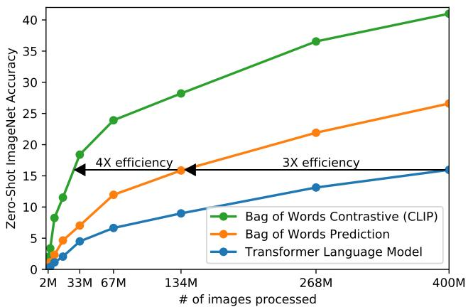  

图 2. CLIP 在零样本迁移方面比我们基于图像描述的基线高效得多。尽管表达能力很强，我们发现基于 Transformer 的语言模型在零样本 ImageNet 分类上表现相对较弱。此处可见，其学习速度比一个预测文本词袋（BoW）编码的基线慢 3 倍（Joulin 等，2016）。将预测目标替换为 CLIP 的对比目标，可将效率再进一步提升 4 倍。

## 2. 方法

## 2.1. 自然语言监督

我们方法的核心思想是从自然语言所包含的监督信号中学习感知。正如引言中所讨论的，这并非什么全新想法，但用于描述该领域工作的术语却多种多样，甚至看似相互矛盾，公开陈述的研究动机也各不相同。Zhang 等人（2020）、Gomez 等人（2017）、Joulin 等人（2016）以及 Desai & Johnson（2020）均提出了从与图像配对的文本中学习视觉表示的方法，但分别将各自的方法描述为无监督、自监督、弱监督和监督学习。

我们强调，贯穿这一系列研究的共同点并非各种具体方法的技术细节，而是把自然语言视作一种训练信号的理念。所有这些方法都在从自然语言监督中学习。尽管早期工作在使用主题模型和 n-gram 表示时曾艰难应对自然语言的复杂性，但深度上下文表示学习的进步表明，我们如今已拥有有效利用这一丰富监督来源的工具（McCann 等人，2017）。

相较于其他训练方法，从自然语言中学习具有若干潜在优势。相比于为图像分类而进行的人工众包标注，自然语言监督的扩展要容易得多，因为它并不要求标注采用经典的"机器学习兼容格式"，例如典型的 1-of-N 多数投票"金标准标签"。相反，能够处理自然语言的方法可以被动地从互联网上浩瀚文本所蕴含的监督信号中学习。从自然语言中学习相较于多数无监督或自监督学习方法还具有一个重要优势，即它并非"仅仅"学习一种表示，而是将该表示与语言相联结，从而实现灵活的零样本迁移。在接下来的小节中，我们将详细阐述最终采用的具体方法。

## 2.2. 构建足够大的数据集

现有工作主要使用了三个数据集：MS-COCO（Lin 等人，2014）、Visual Genome（Krishna 等人，2017）以及 YFCC100M（Thomee 等人，2016）。虽然 MS-COCO 和 Visual Genome 是高质量的众包标注数据集，但以现代标准衡量其规模偏小，各自仅包含约 10 万张训练照片。相比之下，其他计算机视觉系统所训练的 Instagram 照片多达 35 亿张（Mahajan 等人，2018）。YFCC100M 拥有 1 亿张照片，是一种可能的替代方案，但每张图像的元数据稀疏且质量参差不齐。许多图像使用类似 20160716 113957.JPG 这样自动生成的文件名作为"标题"，或包含对相机曝光设置的"描述"。在过滤掉仅保留具有英文自然语言标题和/或描述的图像后，数据集规模缩减为原来的六分之一，仅余 1500 万张照片。这一规模大致与 ImageNet 相当。

使用自然语言监督的一个主要动机是互联网上公开可用的此类数据量极大。由于现有数据集未能充分反映这种可能性，若仅在这些数据集上考量结果，会低估这一研究路线的潜力。为解决这一问题，我们构建了一个新数据集，包含从互联网上各种公开来源收集的 4 亿对（图像，文本）。为了尽可能广泛地涵盖各类视觉概念，在构建过程中，我们搜索那些文本包含 50 万个查询词中某一个的（图像，文本）对。<sup>1</sup> 我们通过每个查询词最多纳入 2 万对（图像，文本）来近似地对结果进行类别平衡。最终数据集的总词数与用于训练 GPT-2 的 WebText 数据集相当。我们将该数据集称为 WIT，即 WebImageText（Web 图像文本）。

## 2.3. 选择高效的预训练方法

当前最先进的计算机视觉系统需要极大的算力。Mahajan 等人（2018）训练其 ResNeXt101-32x48d 需要 19 个 GPU 年，而 Xie 等人（2020）训练其 Noisy Student EfficientNet-L2 则需要 33 个 TPUv3 核心年。考虑到这两个系统都仅被训练用于预测 1000 个 ImageNet 类别，从自然语言中学习开放集合的视觉概念这一任务显得十分艰巨。在我们的工作中，我们发现训练效率是成功扩展自然语言监督的关键，因此我们根据这一指标选择了最终的预训练方法。

我们最初的方法类似于 VirTex，从零开始联合训练一个图像 CNN 和文本 transformer 来预测图像的字幕。然而，我们在高效扩展这种方法时遇到了困难。在图 2 中我们展示了：一个 6300 万参数的 transformer 语言模型，尽管其使用的算力已是其 ResNet-50 图像编码器的两倍，但其学习识别 ImageNet 类别的速度仍比一个更简单、仅预测同一文本词袋（bag-of-words）编码的基线慢三倍。

这两种方法有一个关键的相似之处：它们都试图预测每张图像所对应文本的具体用词。由于与图像共现的描述、评论和相关文本种类繁多，这是一项困难的任务。图像对比表示学习领域的近期研究发现，对比目标（contrastive objective）能够比与之等价的预测目标（predictive objective）学到更好的表示（Tian et al., 2019）。其他研究发现，尽管图像生成模型能够学习高质量的图像表示，但其在相同性能下所需的计算量比对比模型多了一个数量级以上（Chen et al., 2020a）。基于这些发现，我们探索训练一个系统去解决一个可能更容易的代理任务——仅预测哪些文本整体上与哪些图像配对，而非预测这些文本的具体用词。从相同的词袋编码（bag-of-words encoding）基线出发，我们在图 2 中将预测目标替换为对比目标，观察到在 ImageNet 零样本迁移（zero-shot transfer）的速率上获得了进一步的 4 倍效率提升。

给定一批 N 个（图像，文本）对，CLIP 被训练来预测在该批次中 $N \times N$ 种可能的（图像，文本）配对中哪些是实际发生的。为此，CLIP 通过联合训练一个图像编码器和一个文本编码器来学习一个多模态嵌入空间，使批次中 N 个真实配对的图像和文本嵌入之间的余弦相似度最大化，同时使 $N ^ { 2 } - N$ 种错误配对的嵌入之间的余弦相似度最小化。我们在这些相似度分数上优化一个对称的交叉熵损失。在图 3 中我们给出了 CLIP 实现核心的伪代码。据我们所知，这种批次构建技术和目标最早是在深度度量学习领域作为多类 N-pair 损失（Sohn, 2016）被提出的，并由 Oord 等人（2018）以 InfoNCE 损失的形式推广到对比表示学习中，最近由 Zhang 等人（2020）适配到医学影像领域的对比（文本，图像）表示学习中。

由于我们的预训练数据集规模很大，过拟合并非主要顾虑，与 Zhang 等人（2020）的实现相比，CLIP 的训练细节有所简化。我们从头训练 CLIP，没有用 ImageNet 权重初始化图像编码器，也没有用预训练权重初始化文本编码器。我们不使用表征与对比嵌入空间之间的非线性投影——这一改动由 Bachman 等人（2019）提出，并由 Chen 等人（2020b）推广开来。我们仅使用一个线性投影，将每个编码器的表征映射到多模态嵌入空间。我们并未注意到两个版本在训练效率上存在差异，并推测非线性投影可能只在现有的自监督表征学习方法中与图像部分的细节共同适配。我们还去掉了 Zhang 等人（2020）中的文本变换函数 $t_u$，该函数从文本中均匀采样单个句子，因为 CLIP 预训练数据集中许多（图像，文本）对仅有单个句子。我们还简化了图像变换函数 $t_v$。训练期间唯一使用的数据增强是随机从缩放后的图像中裁剪一个正方形区域。最后，控制 softmax 中 logits 范围的温度参数 $\tau$，在训练过程中被直接优化，作为一个对数参数化的乘法标量，以避免将其作为超参数进行调优。

## 2.4. 选择和扩展模型

我们考虑两种不同的图像编码器架构。对于第一种，我们使用 ResNet-50（He 等人，2016a）作为图像编码器的基础架构，因为它被广泛采用且性能已得到验证。我们借助 He 等人（2019）提出的 ResNet-D 改进以及 Zhang（2019）提出的抗混叠 rect-2 模糊池化，对原始版本进行了若干修改。我们还将全局平均池化层替换为注意力池化机制。该注意力池化被实现为单层「Transformer 风格」的多头 QKV 注意力，其中查询以图像的全局平均池化表征为条件。对于第二种架构，我们尝试了近期提出的 Vision Transformer（视觉变换器，ViT）（Dosovitskiy 等人，2020）。我们严格遵循其实现，仅做了少量修改：在 Transformer 之前的 patch 与 position embeddings 拼接之后增加了一层额外的 layer normalization，并采用了略有不同的初始化方案。

```python
# image_encoder - ResNet or Vision Transformer
# text_encoder - CBOW or Text Transformer
# I[n, h, w, c] - minibatch of aligned images
# T[n, l] - minibatch of aligned texts
# W_i[d_i, d_e] - learned proj of image to embed
# W_t[d_t, d_e] - learned proj of text to embed
# t - learned temperature parameter

# extract feature representations of each modality
I_f = image_encoder(I) #[n, d_i]
T_f = text_encoder(T) #[n, d_t]

# joint multimodal embedding [n, d_e]
I_e = l2_normalize(np.dot(I_f, W_i), axis=1)
T_e = l2_normalize(np.dot(T_f, W_t), axis=1)

# scaled pairwise cosine similarities [n, n]
logits = np.dot(I_e, T_e.T) * np.exp(t)

# symmetric loss function
labels = np.arange(n)
loss_i = cross_entropy_loss(logits, labels, axis=0)
loss_t = cross_entropy_loss(logits, labels, axis=1)
loss = (loss_i + loss_t)/2
```

图 3. CLIP 实现核心的类 NumPy 伪代码。

文本编码器是一个 Transformer（Vaswani et al., 2017），采用了 Radford 等人（2019）所述的架构修改。作为基础规模，我们使用了一个 63M 参数、12 层、宽度为 512、配备 8 个注意力头（attention head）的模型。该 Transformer 在文本的小写字节对编码（BPE）表示上运行，词表大小为 49,152（Sennrich et al., 2015）。出于计算效率的考虑，最大序列长度被限制为 76。文本序列以 [SOS] 和 [EOS] 标记包围，Transformer 最高层在 [EOS] 标记处的激活被视为文本的特征表示，经层归一化（layer normalization）处理后线性投影到多模态嵌入空间中。文本编码器中使用了掩码自注意力（masked self-attention），以保留使用预训练语言模型进行初始化的能力，或将语言建模作为辅助目标加入的能力，尽管对这一方向的探索留作未来工作。

虽然以往的计算机视觉研究通常通过单独增加宽度（Mahajan et al., 2018）或深度（He et al., 2016a）来扩展模型，但对于 ResNet 图像编码器，我们借鉴了 Tan & Le（2019）的方法，他们发现在宽度、深度和分辨率三个维度上同时分配额外算力，其效果优于仅在模型单一维度上分配算力。Tan & Le（2019）针对其 EfficientNet 架构对分配到每个维度的算力比例进行了精细调整，而我们采用了一个简单基线，即在增加模型宽度、深度和分辨率上平均分配额外的算力。对于文本编码器，我们仅将模型宽度按 ResNet 计算所得的宽度增幅按比例进行缩放，完全不缩放深度，因为我们发现 CLIP 的性能对文本编码器容量的敏感度较低。

## 2.5. 训练（Training）

我们训练了一系列 5 个 ResNet（残差网络）和 3 个 Vision Transformer（视觉 Transformer，ViT）。对于 ResNet，我们训练了一个 ResNet-50、一个 ResNet-101，然后按照 EfficientNet 风格的模型缩放方法（model scaling）训练了另外 3 个模型，其计算量分别约为 ResNet-50 的 4 倍、16 倍和 64 倍，分别记为 RN50x4、RN50x16 和 RN50x64。对于 Vision Transformer，我们训练了 ViT-B/32、ViT-B/16 和 ViT-L/14。所有模型都训练 32 个 epoch（轮次）。我们使用 Adam 优化器（Kingma & Ba, 2014），并对所有非增益（gain）或偏置（bias）的权重施加解耦的权重衰减正则化（Loshchilov & Hutter, 2017），学习率采用余弦调度（cosine schedule）进行衰减（Loshchilov & Hutter, 2016）。初始超参数是在对基线 ResNet-50 模型进行 1 个 epoch 训练时，通过网格搜索（grid search）、随机搜索（random search）和手动调参的组合来设定的。随后，由于计算资源的限制，我们根据经验对较大模型的超参数进行了调整。可学习的温度参数 τ 被初始化为与 (Wu et al., 2018) 中 0.07 等效的值，并被截断以防止将 logits（logits）缩放超过 100，我们发现这对于防止训练不稳定是必要的。我们使用了 32,768 的超大 minibatch（最小批）大小。为了加速训练并节约显存，采用了混合精度训练（Micikevicius et al., 2017）。为了进一步节约显存，我们还使用了梯度检查点（gradient checkpointing）（Griewank & Walther, 2000; Chen et al., 2016）、半精度的 Adam 统计量（Dhariwal et al., 2020）以及半精度带随机舍入（stochastically rounded）的文本编码器权重。嵌入相似度的计算也进行了分片（sharded），由各个 GPU 仅计算其本地批次嵌入所需的成对相似度的子集。最大的 ResNet 模型 RN50x64 在 592 块 V100 GPU 上训练耗时 18 天，而最大的 Vision Transformer 在 256 块 V100 GPU 上训练耗时 12 天。对于 ViT-L/14，我们还以 336 比特的更高分辨率额外预训练了 1 个 epoch，以类似于 FixRes（Touvron et al., 2019）的方式提升性能。我们将该模型记为 ViT-L/14@336px。除非另有说明，本文中报告为 "CLIP" 的所有结果均使用了该模型，因为我们发现其表现最佳。

## 3. 实验（Experiments）

## 3.1. 零样本迁移（Zero-Shot Transfer）

## 3.1.1. 动机（MOTIVATION）

在计算机视觉中，零样本学习（zero-shot learning）通常指对图像分类中未见物体类别的泛化研究（Lampert 等人，2009）。我们则在一个更宽泛的意义上使用这一术语，研究向未见数据集的泛化。我们将这一设置作为执行未见任务的代理（proxy），正如 Larochelle 等人（2008）的零数据学习（zero-data learning）论文所倡导的那样。尽管无监督学习领域的许多研究聚焦于机器学习系统的表征学习能力，我们仍以研究零样本迁移（zero-shot transfer）作为一种衡量机器学习系统任务学习能力的方式。按照这种观点，一个数据集评估的是系统在特定分布上对某项任务的性能。然而，许多流行的计算机视觉数据集主要是由研究社区作为基准创建的，旨在指导通用图像分类方法的发展，而非衡量在某一特定任务上的性能。虽然可以合理地说 SVHN 数据集衡量的是在 Google 街景照片分布上的门牌号转录任务，但 CIFAR-10 数据集衡量的究竟是什么"真实"任务并不清楚。然而，CIFAR-10 取自怎样的分布是清楚的——TinyImages（Torralba 等人，2008）。在这类数据集上，零样本迁移更像是对 CLIP 在分布偏移（distribution shift）和域泛化（domain generalization）方面鲁棒性的评估，而非任务泛化。请参阅第 3.3 节中针对这一问题的分析。

据我们所知，Visual N-Grams（Li 等人，2017）首次以上述方式研究了向已有图像分类数据集的零样本迁移。它也是我们所知的唯一另一项利用通用预训练模型研究向标准图像分类数据集零样本迁移的工作，因此为 CLIP 的语境化提供了最佳参照点。他们的方法学习了一个包含 142,806 个视觉 n-gram（跨度为 1-gram 到 5-gram）的字典参数，并通过 Jelinek-Mercer 平滑的微分版本对这些 n-gram 进行优化，以最大化给定图像的所有文本 n-gram 的概率。为了执行零样本迁移，他们首先将数据集中每个类名的文本转换为其 n-gram 表示，然后根据模型计算其概率，预测得分最高的那一个。

我们将零样本迁移（zero-shot transfer）作为任务学习（task learning）的评估方法加以研究，这一焦点受到了自然语言处理领域中证明任务学习的相关工作的启发。据我们所知，Liu 等人（2018）首次将任务学习识别为一种"意外的副作用"——当时一个用于生成维基百科文章的语言模型学会了在不同语言之间可靠地音译人名。虽然 GPT-1（Radford 等人，2018）侧重于将预训练作为一种迁移学习方法以改进有监督微调，但它也包含了一项消融研究，表明四种启发式零样本迁移方法的性能在整个预训练过程中稳步提升，且无需任何有监督的适应。这一分析成为 GPT-2（Radford 等人，2019）的基础，而 GPT-2 则专门通过零样本迁移来研究语言模型的任务学习能力。

## 3.1.2. 使用 CLIP 进行零样本迁移（USING CLIP FOR ZERO-SHOT TRANSFER）

CLIP 通过预训练来预测图像和文本片段在其数据集中是否配对。为了执行零样本分类，我们重用了这一能力。对于每个数据集，我们使用数据集中所有类别的名称作为潜在文本配对的集合，并根据 CLIP 预测最可能的（图像，文本）配对。更详细地说，我们首先通过各自的编码器计算图像的特征嵌入以及一组可能文本的特征嵌入。然后计算这些嵌入的余弦相似度，按温度参数 τ 进行缩放，并通过 softmax 归一化为概率分布。需要指出的是，该预测层是一个多项逻辑回归分类器，其输入经过 L2 归一化，权重经过 L2 归一化，无偏置，并采用温度缩放。按此方式理解时，图像编码器是计算机视觉骨干网络，用于计算图像的特征表示；而文本编码器是一个超网络（hypernetwork，Ha 等人，2016），它根据指定类别所代表的视觉概念的文本生成线性分类器的权重。Lei Ba 等人（2015）首次引入了这种形式的零样本图像分类器，而从自然语言生成分类器的思想至少可以追溯到 Elhoseiny 等人（2013）。沿此理解继续，CLIP 预训练的每一步都可以看作是对一个随机创建的计算机视觉数据集代理的性能优化，其中该代理数据集每个类别包含 1 个样本，并通过自然语言描述定义了总共 32,768 个类别。对于零样本评估，我们缓存由文本编码器计算出的零样本分类器，并将其重用于所有后续预测。这使得生成它的成本可以分摊到数据集中的所有预测上。

## 3.1.3. 与 Visual N-Grams 的初步比较（INITIAL COMPARISON TO VISUAL N-GRAMS）

在表 1 中，我们将视觉 N 元组（Visual N-Grams）与 CLIP 进行了对比。最佳 CLIP 模型将 ImageNet 上的准确率从概念验证阶段的 11.5% 提升至 76.2%，并且尽管没有使用该数据集可用的 128 万张众包标注训练样本，其性能仍可与原始 ResNet-50 相媲美。此外，CLIP 模型的 top-5 准确率明显高于其 top-1 准确率，该模型的 top-5 准确率达到 95%，与 Inception-V4（Szegedy 等人，2016）相当。在零样本设置下能够匹配强大全监督基线模型的性能，这表明

<table><tr><td></td><td>aYahoo</td><td>ImageNet</td><td>SUN</td></tr><tr><td>Visual N-Grams</td><td>72.4</td><td>11.5</td><td>23.0</td></tr><tr><td>CLIP</td><td>98.4</td><td>76.2</td><td>58.5</td></tr></table>

Table 1. 将 CLIP 与先前零样本迁移图像分类结果的比较。CLIP 在所有三个数据集上都以较大优势超越了先前工作。这一改进反映了自 Visual N-Grams（Li et al., 2017）提出四年以来所存在的诸多差异。

CLIP 向灵活且实用的零样本计算机视觉分类器迈出了重要一步。如上所述，与 Visual N-Grams 的比较意在为 CLIP 的性能提供上下文参考，而不应被解读为 CLIP 与 Visual N-Grams 之间的直接方法对比，因为两个系统在诸多性能相关差异上并未加以控制。例如，我们在训练时使用的数据集规模为 Visual N-Grams 的 10 倍，使用的视觉模型在每次预测时所需的计算量约为其 100 倍，训练所用的总计算量很可能超过其 1000 倍，并且我们所使用的基于 Transformer 的模型在 Visual N-Grams 发表时尚不存在。作为更接近的对比，我们在 Visual N-Grams 训练所用的同一 YFCC100M 数据集上训练了一个 CLIP ResNet-50，发现其在 ImageNet 上的性能可以在单个 V100 GPU 日以内达到其报告的水平。该基线同样是从零开始训练，而非像 Visual N-Grams 那样从预训练的 ImageNet 权重进行初始化。

CLIP 在另外两个被报告的数据集上也优于 Visual N-Grams。在 aYahoo 上，CLIP 将错误数量减少了 95%；在 SUN 上，CLIP 的准确率是 Visual N-Grams 的两倍以上。为了进行更全面的分析并施加更严格的测试，我们实现了一个规模更大的评估套件，详见附录 A。总体上，我们将 Visual N-Grams 所报告的 3 个数据集扩展为 30 多个数据集，并对比了 50 多个已有的计算机视觉系统，以提供结果的上下文参考。

## 3.1.4. 提示工程与集成（Prompt Engineering and Ensembling）

大多数标准的图像分类数据集在处理对类别进行命名或描述的信息时并未给予充分考虑，而这些信息正是实现基于自然语言的零样本迁移所必需的。绝大多数数据集仅以类别标签的数字编号来标注图像，并附带一个将编号映射回其英文名称的文件。某些数据集，例如 Flowers102 和 GTSRB，其发布的版本中似乎根本未包含此类映射，从而完全阻碍了零样本迁移。<sup>2</sup> 我们观察到，对于许多数据集而言，这些标签的选择往往较为随意，并未考虑到零样本迁移所面临的、依赖任务描述才能成功迁移的相关问题。

  

图 4. 提示工程与集成方法提升零样本性能。与使用无语境类别名称的基线方法相比，提示工程与集成方法在 36 个数据集上将零样本分类性能平均提升了近 5 个百分点。这一改进与使用 4 倍计算量的基线零样本方法所获得的收益相当，但在对大量预测进行分摊时是"免费"的。

一个常见的问题是**一词多义（polysemy）**。当仅将类别名称作为唯一信息输入到 CLIP 的文本编码器时，由于缺乏上下文，编码器无法区分具体指的是哪个义项。在某些情况下，同一个词的多个含义甚至会作为不同类别出现在同一个数据集中！ImageNet 就是如此，其中既包含建筑用的起重机（construction crane），也包含会飞的鹤（crane）。另一个例子出现在 Oxford-IIIT Pet 数据集中——其中的"boxer"一词，从上下文来看显然指的是一种犬种，而对于缺乏上下文的文本编码器来说，它同样可能指一种拳击运动员。

我们遇到的另一个问题是：在预训练数据集中，与图像配对的文本很少是单个单词。通常，文本是以完整句子对图像进行某种描述。为了弥合这一分布差距，我们发现使用提示模板 "A photo of a {label}." 是一个不错的默认选择，它有助于明确文本所指为图像内容。相比于仅使用类别文本作为基线，这种做法通常能提升性能。例如，仅使用该提示模板就使 ImageNet 上的准确率提升了 1.3%。

与围绕 GPT-3 所开展的"提示工程（prompt engineering）"讨论类似（Brown et al., 2020；Gao et al., 2020），我们也观察到，针对每个任务定制提示文本可以显著提升零样本性能。以下给出一些（并不穷尽的）示例。我们发现，在若干细粒度图像分类数据集上，明确指定类别会带来帮助。例如，在 Oxford-IIIT Pets 上，使用 "A photo of a {label}, a type of pet." 来提供上下文效果良好。同样地，在 Food101 上指定食物类型，在 FGVC Aircraft 上指定飞机类型也都带来了提升。对于 OCR 数据集，我们发现将待识别的文本或数字加上引号可以改善性能。我们还发现，在卫星图像分类数据集上，明确指出图像为此类形式是有帮助的，因此我们采用了 "a satellite photo of a {label}." 的若干变体。

我们还尝试通过集成多个零样本分类器来作为提升性能的另一种方式。这些分类器通过使用不同的上下文提示（如 "A photo of a big {label}" 和 "A photo of a small {label}"）来计算。我们在嵌入空间而非概率空间上构建集成。这允许我们缓存一组单一的均值化文本嵌入，使得集成的计算成本在摊销到多次预测后与使用单一分类器相同。我们观察到，对大量生成的零样本分类器进行集成能够稳定地提升性能，并在大多数数据集上采用该方法。在 ImageNet 上，我们集成了 80 个不同的上下文提示，相较于上述单一默认提示方案，性能进一步提升了 3.5%。综合来看，提示工程和集成使 ImageNet 准确率提升了近 5%。在图 4 中，我们可视化了提示工程和集成如何改变一组 CLIP 模型相对于无上下文基线方法（即如 Li et al. (2017) 中所做的那样直接嵌入类名）的性能。

## 3.1.5. 零样本 CLIP 性能分析

由于计算机视觉中与任务无关的零样本分类器研究尚不充分，CLIP 为更好地理解此类模型提供了有前景的机会。在本节中，我们对 CLIP 零样本分类器的若干性质进行了研究。作为第一个问题，我们仅考察零样本分类器的性能表现。为了将其置于具体情境中，我们将其与一个简单的现成基线进行比较：在规范的 ResNet-50 特征上拟合一个完全监督的正则化逻辑回归分类器。在图 5 中，我们展示了这一在 27 个数据集上的比较结果。有关数据集与实验设置的详细信息，请参阅附录 A。

零样本 CLIP（Zero-shot CLIP）在多数情况下略优于该基线，并在 27 个数据集中的 16 个上获胜。观察单个数据集可以发现一些有趣的行为。在细粒度分类任务上，我们观察到性能差异很大。在其中两个数据集 Stanford Cars 和 Food101 上，零样本 CLIP 比基于 ResNet-50 特征的逻辑回归高出 20% 以上；而在另外两个数据集 Flowers102 和 FGVCAircraft 上，零样本 CLIP 则低了 10% 以上。在 OxfordPets 和 Birdsnap 上，二者的性能则要接近得多。我们推测这些差异主要是由于 WIT 与 ImageNet 之间各任务监督量的不同所致。在 ImageNet、CIFAR10/100、STL10 和 PascalVOC2007 等"通用"目标分类数据集上，二者的性能相对接近，零样本 CLIP 在所有情况下都略有优势。在 STL10 上，CLIP 达到了 99.3% 的总体准确率，尽管未使用任何训练样本，但这似乎是一个新的最先进结果（state of the art）。在两个视频动作识别数据集上，零样本 CLIP 显著优于 ResNet-50。在 Kinetics700 上，CLIP 比 ResNet-50 高出 14.5%。在 UCF101 上，零样本 CLIP 也比 ResNet-50 的特征高出 7.7%。我们推测这是由于自然语言为涉及动词的视觉概念提供了更广泛的监督，而 ImageNet 中的监督则是以名词为中心的目标监督。

  

Zero-Shot CLIP 与 ResNet50 上的线性探针（Linear Probe）对比  
图 5. Zero-shot CLIP 与全监督基线具有竞争力。在一个涵盖 27 个数据集的评估套件上，Zero-shot CLIP 分类器在 16 个数据集（含 ImageNet）上优于拟合于 ResNet-50 特征之上的全监督线性分类器。

观察 zero-shot CLIP 显著表现欠佳的领域，我们发现 zero-shot CLIP 在若干专业、复杂或抽象的任务上表现相当薄弱，例如卫星图像分类（EuroSAT 和 RESISC45）、淋巴结肿瘤检测（PatchCamelyon）、合成场景中的物体计数（CLEVRCounts），以及自动驾驶相关任务，如德国交通标志识别（GTSRB）、最近车辆距离判断（KITTI Distance）。这些结果凸显了 zero-shot CLIP 在更复杂任务上的能力不足。相比之下，非专家人类能够稳健地完成其中若干任务，例如计数、卫星图像分类和交通标志识别，这表明该方向仍有显著的提升空间。然而，我们提醒，对于那些学习者毫无先验经验的困难任务（例如对几乎所有人类（甚至可能包括 CLIP）而言的淋巴结肿瘤分类），衡量 zero-shot 迁移而非 few-shot 迁移是否构成一种有意义的评估方式，仍不明确。

  

图 6. 零样本 CLIP 优于少样本线性探针。零样本 CLIP 与在同一特征空间上训练的 4 样本线性分类器的平均性能相当，并且几乎与公开可用模型中 16 样本线性分类器的最佳结果相当。对于 BiT-M 和 SimCLRv2，最佳性能的模型被高亮显示。浅灰色线条表示评估套件中的其他模型。该分析使用了 20 个每个类别至少包含 16 个样本的数据集。

虽然将零样本性能与全监督模型进行比较能够明确 CLIP 的任务学习能力，但与少样本方法的比较更为直接，因为零样本是 CLIP 能力的极端情形。在图 6 中，我们将零样本 CLIP 与基于多种图像模型特征的少样本逻辑回归进行了可视化对比，这些模型包括公开可用的最佳 ImageNet 模型、自监督学习方法以及 CLIP 本身。虽然直观上预期零样本会表现差于单样本，但我们发现零样本 CLIP 在同一特征空间上的性能与 4 样本逻辑回归相当。这可能是由于零样本和少样本方法之间的一个重要差异。首先，CLIP 的零样本分类器是通过自然语言生成的，允许直接指定（「传达」）视觉概念。相比之下，「常规」监督学习必须从训练样本中间接推断概念。脱离上下文的基于示例的学习存在一个缺点：许多不同的假设都可能与数据一致，尤其是在单样本情况下。单个图像通常包含许多不同的视觉概念。尽管有能力的模型能够利用视觉线索和启发式方法（例如假设所展示的概念是图像中的主要对象），但这并不能保证。

解决零样本与少样本性能之间这种差异的一个潜在方案是将 CLIP 的零样本分类器作为少样本分类器权重的先验。虽然对生成的权重施加 L2 惩罚是实现这一想法的直接方法，但我们发现超参数优化经常会选择非常大的正则化强度，以至于最终的少样本分类器「不过是」零样本分类器。研究更好的方法来结合零样本迁移的优势与少样本学习的灵活性，是未来工作中一个有前景的方向。

当将零样本 CLIP 与基于其他模型特征的少样本逻辑回归进行比较时，零样本 CLIP 大致与评估套件中表现最佳的 16 样本分类器相当，该分类器使用了在 ImageNet-21K 上训练的 BiT-M ResNet-152x2 的特征。我们确信在 JFT-300M 上训练的 BiT-L 模型表现会更好，但这些模型尚未公开发布。BiT-M ResNet-152x2 在 16 样本设置中表现最佳多少有些令人惊讶，因为如第 3.2 节所分析，在全监督设置下，Noisy Student EfficientNet-L2 在 27 个数据集上的平均表现优于它近 5%。

除了研究零样本CLIP和少样本逻辑回归的平均性能外，我们还考察了在各个数据集上的表现。在图7中，我们展示了在同一特征空间上，逻辑回归分类器需要多少个每类标注样本才能达到零样本CLIP的性能。由于零样本CLIP本身也是一种线性分类器，这估计了在此设定下零样本迁移的有效数据效率。为了避免训练成千上万个线性分类器，我们基于在每个数据集上训练的1、2、4、8、16样本（若可行）以及一个全监督线性分类器的性能，采用对数线性插值来估计有效数据效率。我们发现，零样本迁移在不同数据集上的效率差异很大，从每类少于1个标注样本到184个不等。有两个数据集——Flowers102和EuroSAT——的表现不及单样本模型。一半的数据集每类所需样本少于5个，中位数为5.4。然而，估计的平均数据效率为每类20.8个样本。这是由于在20%的数据集中，监督分类器需要大量每类标注样本才能达到与之匹配的性能。在ImageNet上，零样本CLIP的性能与在同一特征空间上训练的16样本线性分类器相当。

  

图 7. 零样本迁移的数据效率差异很大。计算在相同的 CLIP 特征空间上，线性分类器需要多少个每个类别的标注样本才能匹配零样本分类器的性能，这有助于将零样本迁移的有效性放在具体情境中加以理解。这些数值是基于 1、2、4、8、16 样本以及全监督结果的对数线性插值估计得出的。性能差异很大，从在两个数据集上仍然不及单样本分类器，到可匹配估计的每个类别 184 个标注样本。

如果我们假设评估数据集足够大，以至于在其上训练的线性分类器的参数能够得到良好估计，那么由于 CLIP 的零样本分类器（zero-shot classifier）本身也是一个线性分类器，全监督分类器的性能大致为零样本迁移（zero-shot transfer）所能达到的性能设定了上界。在图 8 中，我们将 CLIP 的零样本性能与各数据集上的全监督线性分类器进行比较。虚线 y = x 表示一个"最优"的零样本分类器，其性能与其对应的全监督分类器相匹配。对于大多数数据集，零样本分类器的性能仍比全监督分类器低 10% 到 25%，这表明在提升 CLIP 的任务学习（task-learning）与零样本迁移能力方面仍有充足的提升空间。

零样本性能与全监督性能之间存在 0.82 的正相关（p 值 $< 1 0 ^ { - 6 }$），这表明 CLIP 在将底层表示（underlying representation）与任务学习联系起来进行零样本迁移方面具有相对稳定的一致性。然而，零样本 CLIP 仅在 5 个数据集上接近全监督性能：STL10、CI-FAR10、Food101、OxfordPets 和 Caltech101。在这 5 个数据集上，零样本准确率与全监督准确率均超过 90%。这表明 CLIP 在其底层表示质量同样较高的任务上可能更擅长零样本迁移。一个以全监督性能为自变量来预测零样本性能的线性回归模型，其斜率估计为：全监督性能每提升 1%，零样本性能可提升 1.28%。然而，第 95 百分位置信区间仍然包含小于 1 的取值（0.93–1.79）。

  

图 8. 零样本性能与线性探测性能相关，但总体上仍次优。跨数据集比较零样本与线性探测性能，可以看出二者具有强相关性，但零样本性能普遍低 10 到 25 个百分点。仅在 5 个数据集上，零样本性能接近线性探测性能（差距 ≤ 3 个百分点）。

过去几年间，深度学习系统的实证研究表明，性能能够作为训练算力和数据集规模等重要变量的函数进行预测（Hestness 等，2017；Kaplan 等，2020）。GPT 模型系列迄今为止已证明，在训练算力增加 1000 倍的过程中，零样本性能持续提升。在图 9 中，我们检验 CLIP 的零样本性能是否遵循类似的扩展模式。我们在 36 个不同数据集的 39 项评估上，绘制了 5 个 ResNet CLIP 模型的平均错误率曲线，发现在模型算力增加 44 倍的过程中，类似的 log-log 线性扩展趋势同样适用于 CLIP。尽管总体趋势是平滑的，但我们发现，单项评估上的性能波动可能会明显更大。我们尚不确定，这是由子任务上不同训练运行之间的高方差（如 D'Amour 等 (2020) 所记录）掩盖了稳步提升的趋势所致，还是在某些任务上，性能实际上作为算力的函数呈现非单调变化。

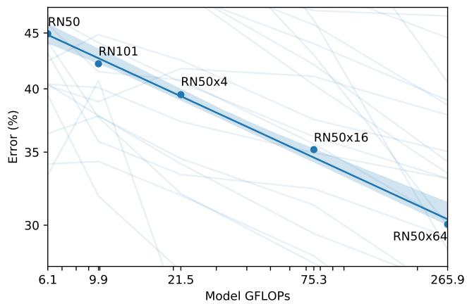  

图 9. 零样本 CLIP 性能随模型算力的变化而平滑缩放。在 36 个不同数据集上的 39 项评估中，平均零样本误差在跨越 5 个不同 CLIP 模型、44 倍算力范围内，可由对数-对数线性趋势良好建模。浅色阴影线表示各单独评估的性能，表明尽管总体趋势平滑，但各评估间的性能差异要大得多。

## 3.2. 表征学习（Representation Learning）

虽然我们在上一节中通过零样本迁移对 CLIP 的任务学习能力进行了广泛分析，但更常见的研究是关注模型的表征学习能力。评估表征质量的方法有很多，但对于"理想"表征应具备哪些属性也存在分歧（Locatello et al., 2020）。一种常见做法是在模型提取的表征上拟合一个线性分类器，并在多个数据集上测量其性能。另一种替代方法是测量模型端到端微调的性能。这种方式提升了灵活性，并且先前的工作已令人信服地证明，在大多数图像分类数据集上，微调优于线性分类（Kornblith et al., 2019; Zhai et al., 2019）。

尽管微调的高性能出于实际原因值得我们研究，我们仍选择基于线性分类器的评估方式，原因有几点。我们的工作聚焦于开发一种高性能的、与任务和数据集无关的预训练方法。微调由于在微调阶段使表征适配每个数据集，可以弥补并潜在地掩盖预训练阶段未能学到通用且鲁棒表征的缺陷。而线性分类器由于灵活性有限，反而能够凸显这些缺陷，并在开发过程中提供清晰的反馈。对于 CLIP 而言，训练有监督的线性分类器还有一个额外的好处，即它与 CLIP 零样本分类器所使用的方法高度相似，这使得我们在第 3.1 节中能够进行广泛的对比与分析。

最后，我们的目标是将 CLIP 与一大批现有模型在众多任务上进行比较。研究 66 个不同模型在 27 个不同数据集上的表现，需要调整 1782 项不同的评估。微调打开了更大的设计和超参数空间，正如其他大规模实证研究所讨论的那样，这使得公平评估各种技术变得困难，且计算开销巨大（Lucic et al., 2018; Choi et al., 2019）。相比之下，线性分类器所需的超参数调整极少，且具有标准化的实现与评估流程。关于评估的更多细节，请参见附录 A。

图 10 总结了我们所得到的研究结论。为了尽可能降低可能引发确认偏差或报告偏差担忧的选择效应，我们首先在 Kornblith 等人（2019）所采用的 12 个数据集评测套件上研究模型性能。虽然诸如 ResNet-50 和 ResNet-101 这样的小型 CLIP 模型在 ImageNet-1K 上训练的 ResNet（包括 BiT-S 以及原始模型）之上表现更优，但它们的表现逊于在 ImageNet-21K 上训练的 ResNet（BiT-M）。这些小型 CLIP 模型的表现同样不及计算开销相近的 EfficientNet 系列模型。然而，采用 CLIP 训练得到的模型扩展性非常好，我们所训练的最大模型（ResNet-50x64）在总体得分和计算效率两方面均略微优于现有最佳模型（一个 Noisy Student EfficientNet-L2）。我们还发现，CLIP 视觉 Transformer 的计算效率约为 CLIP ResNet 的 3 倍，这使得我们能够在既定算力预算内达到更高的总体性能。这些结果在定性层面复现了 Dosovitskiy 等人（2020）的结论：在足够大规模的数据集上进行训练时，视觉 Transformer 比卷积神经网络具有更高的计算效率。我们总体表现最佳的模型是一个 ViT-L/14，该模型在我们的数据集上以 336 像素的更高分辨率再额外微调 1 个 epoch。该模型在该评测套件所有现有最佳模型之上，平均提升幅度达到 2.6%。

如图 21 定性展示的那样，CLIP 模型相较于此前任何从随机初始化端到端训练得到的单一计算机视觉模型，能学习到范围更广的任务集合。这些任务包括地理定位（geo-localization）、光学字符识别（optical character recognition）、人脸情绪识别（facial emotion recognition）以及动作识别（action recognition）。上述任务均未出现在 Kornblith 等人（2019）的评测套件之中。这一点可被视为 Kornblith 等人（2019）的研究在任务选择上存在一定偏差，即偏向于与 ImageNet 存在重叠的任务。为解决这一问题，我们还在一个规模更大的 27 个数据集评测套件上对性能进行了评估。该评测套件的详细说明见附录 A，其中既涵盖了代表上述任务的相应数据集、Stallkamp 等人（2011）提出的德国交通标志识别基准（German Traffic Signs Recognition Benchmark），也包含了由 VTAB（Zhai 等人，2019）改造而来的若干其他数据集。

  

图 10. CLIP 模型与当前最优的计算机视觉模型的线性探针性能比较，包括 EfficientNet (Tan & Le, 2019; Xie et al., 2020)、MoCo (Chen et al., 2020d)、在 Instagram 上预训练的 ResNeXt 模型 (Mahajan et al., 2018; Touvron et al., 2019)、BiT (Kolesnikov et al., 2019)、ViT (Dosovitskiy et al., 2020)、SimCLRv2 (Chen et al., 2020c)、BYOL (Grill et al., 2020)，以及原始 ResNet 模型 (He et al., 2016b)。（左）分数为 Kornblith 等人 (2019) 所研究的 12 个数据集上的平均值。（右）分数为包含更广泛数据分布的 27 个数据集上的平均值。虚线表示以高于预训练时的分辨率对图像进行微调或评估的模型。各数据集的单独分数见表 10，每个数据集的图示见图 20。

在这个更广泛的评估套件上，CLIP 的优势更为明显。所有 CLIP 模型，无论规模大小，在计算效率方面都优于所有被评估的系统。最佳模型相对于先前系统的平均得分提升从 2.6% 增加到 5%。我们还发现，自监督系统在我们更广泛的评估套件上表现明显更好。例如，虽然 SimCLRv2 在 Kornblith 等人（2019）的 12 个数据集上平均表现仍逊于 BiT-M，但 SimCLRv2 在我们包含 27 个数据集的评估套件上优于 BiT-M。这些发现表明，应继续扩展任务的多样性和覆盖范围，以便更好地理解系统的"通用"（general）性能。我们认为，沿 VTAB 思路开展更多评估工作将是有价值的。

除了上述整体分析外，我们还在图 11 中可视化展示了在全部 27 个数据集上，最佳 CLIP 模型与我们评估套件中最佳模型之间的逐数据集性能差异。CLIP 在 27 个数据集中的 21 个上优于 Noisy Student EfficientNet-L2。CLIP 在需要 OCR 的任务（SST2 和 HatefulMemes）、地理定位与场景识别（Country211、SUN397）以及视频中的活动识别（Kinetics700 和 UCF101）上提升最大。此外，CLIP 在细粒度的汽车和交通标志识别（Stanford Cars 和 GTSRB）上也表现出色得多。这可能反映出 ImageNet 中监督信号过于狭窄的问题。例如，在 GTSRB 上提升 14.7% 这样的结果，可能表明 ImageNet-1K 存在问题——它对所有交通和街道标志只赋予单一标签。这可能会促使有监督表示压缩类内细节，从而损害在细粒度下游任务上的准确性。如前所述，CLIP 在若干数据集上仍逊于 EfficientNet。不出所料，EfficientNet 相对于 CLIP 表现最好的数据集，正是它所训练的数据集：ImageNet。EfficientNet 还在 CIFAR10 和 CIFAR100 等低分辨率数据集上略胜于 CLIP。我们认为这至少部分归因于 CLIP 中缺乏基于尺度的数据增强。EfficientNet 在 PatchCamelyon 和 CLEVRCounts 上也略胜一筹，在这些数据集上整体性能仍然

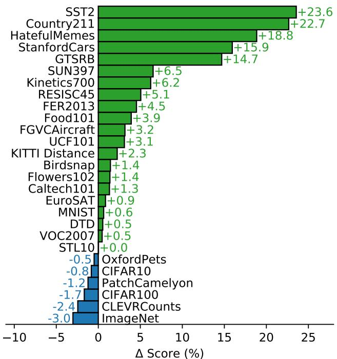  

图 11. CLIP 与 EfficientNet L2 NS 上的逻辑回归对比。CLIP 的特征在多种数据集上优于最佳 ImageNet 模型所提取的特征。在 27 个数据集中，有 21 个数据集上，在 CLIP 的特征上拟合线性分类器的效果优于使用 Noisy Student EfficientNet-L2。

在两种方法上都较低。

## 3.3. 对自然分布偏移的鲁棒性

2015 年，宣布深度学习模型在 ImageNet 测试集上超越了人类水平（He 等，2015）。然而，随后几年的研究反复发现，这些模型仍然会犯许多简单的错误（Dodge & Karam, 2017；Geirhos 等, 2018；Alcorn 等, 2019），并且对这些系统进行测试的新基准往往发现它们的性能远低于其 ImageNet 准确率和人类准确率（Recht 等, 2019；Barbu 等, 2019）。如何解释这种差异？人们已经提出并研究了各种想法（Ilyas 等, 2019；Geirhos 等, 2020）。已提出的解释的一个共同主题是，深度学习模型极其擅长发现和利用那些在其训练数据集中普遍存在的相关性和模式，从而提升分布内性能。然而，其中许多相关性和模式实际上只是虚假相关，在其他分布上并不成立，并导致在其他数据集上性能大幅下降。

我们提醒读者注意，到目前为止，这些研究中的大多数将其评估局限于在 ImageNet 上训练的模型。回顾讨论的主题，过度推广这些初步发现可能是一个错误。这些失败在多大程度上应归因于深度学习、ImageNet，或两者的某种组合？CLIP 模型通过自然语言监督在非常大的数据集上进行训练，并具有较高的零样本性能，为我们提供了一个从不同角度研究这个问题的机会。

Taori 等（2020）是最近一项全面研究，旨在量化和理解 ImageNet 模型的这些行为。Taori 等（2020）研究了 ImageNet 模型在自然分布偏移上的性能变化。他们在一组 7 个分布偏移上测量性能：ImageNetV2（Recht 等, 2019）、ImageNet Sketch（Wang 等, 2019）、Youtube-BB 和 ImageNet-Vid（Shankar 等, 2019）、ObjectNet（Barbu 等, 2019）、ImageNet Adversarial（Hendrycks 等, 2019），以及 ImageNet Rendition（Hendrycks 等, 2020a）。他们将这些数据集——均由来自各种来源的新颖图像组成——与合成分布偏移区分开来，例如 ImageNet-C（Hendrycks & Dietterich, 2019）、Stylized ImageNet（Geirhos 等, 2018）或对抗攻击（Goodfellow 等, 2014），后者是通过以各种方式扰动现有图像而创建的。他们提出这种区分，部分原因是他们发现虽然若干技术已被证明可以提高在合成分布偏移上的性能，但它们往往无法在自然分布上产生一致的性能提升。<sup>3</sup>

在所收集的这些数据集上，ImageNet 模型的准确率远低于 ImageNet 验证集所设定的预期。在接下来的总结讨论中，除非另有说明，我们报告的是全部 7 个自然分布偏移数据集上的平均准确率，以及 ImageNet 对应类别子集上的平均准确率。此外，对于具有两种不同评估设置的 Youtube-BB 和 ImageNet-Vid，我们使用 pm-0 与 pm-10 准确率的平均值。

在自然分布偏移下进行评估时，ResNet-101 所犯的错误数量是在 ImageNet 验证集上的 5 倍。然而令人鼓舞的是，Taori 等人（2020）发现，分布偏移下的准确率会随 ImageNet 准确率可预测地提升，并且可以被很好地建模为 logit 变换后准确率的线性函数。Taori 等人（2020）利用这一发现提出，鲁棒性分析应当区分有效鲁棒性（effective robustness）和相对鲁棒性（relative robustness）。有效鲁棒性衡量的是在分布偏移下，相对于依据已记录的分布内外准确率之间关系所预测出的水平之上的准确率提升。相对鲁棒性则涵盖分布外准确率的任何提升。Taori 等人（2020）认为，鲁棒性技术应当致力于同时提升有效鲁棒性与相对鲁棒性。

Taori 等人（2020）所研究的几乎所有模型都是在 ImageNet 数据集上进行训练或微调的。回到本节引言中的讨论——在 ImageNet 数据集分布上进行训练或适配，是否就是观察到的鲁棒性差距的成因？直观上，零样本模型不应能够利用仅在特定分布上才成立的虚假相关性或模式，因为它并未在该分布上进行训练。<sup>4</sup> 因此，合理预期零样本模型应具有远高得多的有效鲁棒性。在图 13 中，我们在自然分布偏移上将零样本 CLIP 与现有 ImageNet 模型进行了对比。所有零样本 CLIP 模型都大幅提升了有效鲁棒性，并将 ImageNet 准确率与分布偏移下准确率之间的差距最多缩小了 75%。

  

图 12. 与在 ImageNet 上预训练的模型相比，CLIP 的特征对任务迁移更加鲁棒。在两种数据集划分下，基于 CLIP 模型表征训练的线性探针的迁移分数均高于在 ImageNet 上性能相近的其他模型。这表明在 ImageNet 上训练的模型表征在某种程度上过度拟合了它们的任务。

虽然这些结果表明零样本模型可以具备远更高的鲁棒性，但这并不一定意味着在 ImageNet 上的有监督学习导致了鲁棒性差距。CLIP 的其他细节，例如其规模庞大且多样化的预训练数据集，或使用自然语言监督，都可能使模型获得更强的鲁棒性，无论其是零样本还是经过微调。为尝试初步缩小这一范围，我们进一步测量了 CLIP 模型在通过一个 L2 正则化逻辑回归分类器（基于 ImageNet 训练集上的 CLIP 特征拟合得到）适配 ImageNet 分布后，其性能如何变化。我们在图 14 中可视化了相对于零样本分类器的性能变化。尽管将 CLIP 适配到 ImageNet 分布使其在 ImageNet 上的总体准确率提升了 9.2%，达到 85.4%，并追平了 Mahajan 等人（2018）所报告的 2018 年 SOTA 准确率，但在分布偏移下的平均准确率略有下降。

令人惊讶的是，准确率提升了 9.2%，这大约相当于 3 年的 SOTA 进展，却未能转化为分布偏移下平均性能的任何提升。我们还在图 14 中按数据集细分了零样本准确率与线性分类器准确率之间的差异，发现在其中一个数据集 ImageNetV2 上性能仍显著提升。ImageNetV2 严格遵循了原始 ImageNet 数据集的创建过程，这表明通过有监督适配所带来的准确率提升主要集中在 ImageNet 分布附近。性能下降了 4.7%，出现在

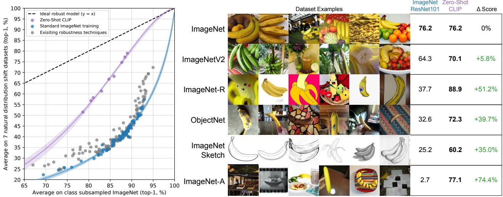  

图 13. 零样本 CLIP 比标准 ImageNet 模型对分布偏移（distribution shift）鲁棒得多。（左图）理想的鲁棒模型（虚线）在 ImageNet 分布和其他自然图像分布上表现同样出色。零样本 CLIP 模型将该"鲁棒性差距"缩小了多达 75%。在对数几率（logit）变换后的值上进行了线性拟合，并显示了通过自助法（bootstrap）估计的 95% 置信区间。（右图）可视化展示香蕉这一类别在 7 个自然分布偏移数据集中 5 个共享类别上的分布偏移效果。表现最佳的零样本 CLIP 模型 ViT-L/14@336px 与在 ImageNet 验证集上具有相同性能的 ResNet-101 模型进行了对比。

在 ImageNet-R 上、ObjectNet 上提升 3.8%、ImageNet Sketch 上提升 2.8%、ImageNet-A 上提升 1.9%。Youtube-BB 和 ImageNet Vid 这两个其他数据集上的准确率变化则不显著。

怎么可能在 ImageNet 数据集上提升 9.2% 的准确率，而在分布偏移下却几乎没有准确率提升呢？这一增益是否主要来自「利用虚假相关性（spurious correlations）」？这种行为是 CLIP、ImageNet 数据集以及所研究的分布偏移的某种特定组合所独有的，还是一种更为普遍的现象？它对于端到端微调以及线性分类器是否同样成立？截至目前，我们尚无法对这些问题给出确信的答案。此前的工作也对在 ImageNet 之外的分布上预训练的模型进行了研究，但通常仅在针对 ImageNet 进行微调之后才对模型加以研究和发布。为了进一步理解预训练的零样本模型是否始终比微调后的模型具有更高的有效鲁棒性，我们鼓励 Mahajan 等人（2018）、Kolesnikov 等人（2019）以及 Dosovitskiy 等人（2020）的作者们，如有可能，也在他们各自的模型上对这些问题加以研究。

我们还研究了另一种由灵活的、基于自然语言的零样本图像分类器所促成的鲁棒性干预。在 7 个迁移数据集中，目标类别并不总是与 ImageNet 的类别完全对齐。Youtube-BB 和 ImageNet-Vid 这两个数据集由 ImageNet 的超类构成。当试图使用 ImageNet 模型固定的 1000 维分类器进行预测时，这就带来了一个问题。Taori 等人（2020）通过按照 ImageNet 的类别层次结构对所有子类的预测进行最大池化（maxpooling）来处理此问题。然而这种映射有时远非完美——以 Youtube-BB 中的 person 类别为例，其预测是通过对 ImageNet 中棒球运动员、新郎与潜水员这三个类别进行池化得到的。借助 CLIP，我们可以直接根据每个数据集自身的类别名称，为其生成一个定制化的零样本分类器。从图 14 可见，这使平均有效鲁棒性提升了 5%，但其提升主要集中在少数几个数据集上的大幅改善。有趣的是，ObjectNet 上的准确率也提升了 2.3%。尽管该数据集在设计上与 ImageNet 类别高度重叠，但相较于使用 ImageNet 类别名称并在必要时对预测进行池化，使用 ObjectNet 创建者所提供的各类别名称仍能带来小幅提升。

虽然零样本（zero-shot）CLIP 提升了有效鲁棒性（effective robustness），但图 14 表明，在完全监督的设置下，这一优势几乎完全消失。

为了更好地理解这一差异，我们研究了有效鲁棒性在从零样本到完全监督这一连续谱上的变化情况。

在图 15 中，我们将 0-shot、1-shot、2-shot、4-shot……、128-shot 以及完全监督的逻辑回归分类器在最佳 CLIP 模型所提取特征上的性能进行了可视化。

我们观察到，虽然少样本（few-shot）模型同样比现有模型展现出更高的有效鲁棒性，但随着训练数据增多、分布内性能提升，这一优势逐渐消退，并在完全监督模型上基本消失（尽管并未完全消失）。

此外，零样本 CLIP 的鲁棒性明显优于具有同等 ImageNet 性能的少样本模型。


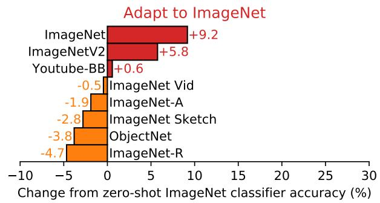

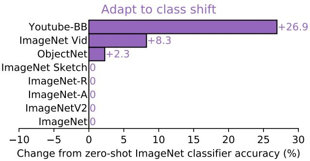  

图 14. 虽然对 ImageNet 的有监督适配使 ImageNet 准确率提升了 9.2%，但略微降低了平均鲁棒性。（左）将零样本 CLIP 定制到每个数据集，相比使用单一的静态零样本 ImageNet 分类器并在类似类别间合并预测（如 Taori 等人（2020）所述）能提升鲁棒性。适配到 ImageNet 的 CLIP 模型具有与此前最佳 ImageNet 模型相当的有效鲁棒性。（右）两种鲁棒性干预下每个数据集准确率变化的细节。适配到 ImageNet 显著提升了在 ImageNetV2 上的准确率，但牺牲了在若干其他分布上的准确率。针对特定数据集的零样本分类器可在较大的幅度上提升准确率，但仅限于那些包含与 ImageNet 类别并不完全一致的类的少数数据集。

在我们的各项实验中，较高的有效鲁棒性似乎源于最小化模型所能接触到的特定于分布的训练数据量，但这要以降低特定数据集上的性能为代价。

综合来看，这些结果表明，最近向大规模任务无关与数据集无关预训练的转变，以及向在广泛评估套件上进行零样本（zero-shot）与少样本（few-shot）基准测试的转向（正如 Yogatama 等人（2019）和 Linzen（2020）所倡导的），有助于开发出更为鲁棒的系统，并能提供对性能更为准确的评估。我们很想知道，同样的结论是否适用于自然语言处理（NLP）领域中的零样本模型，例如 GPT 系列。尽管 Hendrycks 等人（2020b）报告称，预训练提升了情感分析上的相对鲁棒性，但 Miller 等人（2020）对问答模型在自然分布偏移下鲁棒性的研究则发现——与 Taori 等人（2020）的结论类似——迄今为止几乎没有证据表明有效鲁棒性有所提升。

## 4. 与人类表现的对比

CLIP 与人类表现以及人类学习方式相比如何？为了更好地了解人类在与 CLIP 相似的评估设置中表现如何，我们在其中一项任务上对人类进行了评估。我们希望了解人类在这些任务上的零样本（zero-shot）表现有多强，以及当向其展示一两个图像样本时，人类表现能提升多少。这有助于我们比较人类与 CLIP 在任务难度上的差异，并识别两者之间的相关性与差异。

我们让五位不同的人类参与者分别查看 Oxford IIT Pets 数据集（Parkhi 等人，2012）测试划分中的 3669 张图像，并从 37 种猫或狗品种中选出最符合图像的品种（若完全无法确定则选择「我不知道」）。在零样本情况下，人类参与者未获得任何品种示例图像，并被要求在不借助互联网搜索的情况下尽其所能进行标注。在一样本（one-shot）实验中，人类参与者获得每种品种的一张示例图像；在二样本（two-shot）实验中，人类参与者获得每种品种的两张示例图像。<sup>5</sup>

一种可能的顾虑是，人类工作者在零样本任务中并未受到充分的激励。人类在 STL-10 数据集（Coates 等人，2011）上高达 94% 的准确率

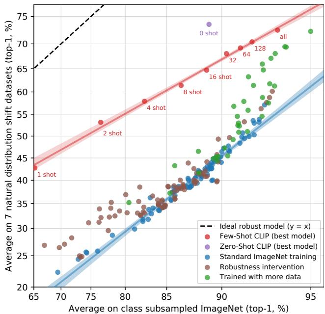  

图 15. 与现有 ImageNet 模型相比，少样本（few-shot）CLIP 也提升了有效鲁棒性，但仍弱于零样本（zero-shot）CLIP。减少适配过程中所使用 ImageNet 训练数据的量，会以降低相对鲁棒性为代价来提高有效鲁棒性。如先前在图 7 中所述，16 样本逻辑回归 CLIP 在 ImageNet 上与零样本 CLIP 表现持平，但鲁棒性较差。

有趣的是，人类只需每个类别一个训练示例，性能平均就从 54% 提升到 76%，而额外增加一个训练示例所带来的边际增益则微乎其其微。从零样本到一样本所带来的准确率提升，几乎完全集中在人类原本就不太确定的图像上。这表明人类"知道自己不知道什么"，并且能够基于单个示例在他们最不确定的图像上更新先验。鉴于此，似乎虽然 CLIP 是一种有前景的零样本性能训练策略（图 5），并且在自然分布偏移的测试上表现良好（图 13），但人类从少数示例中学习的方式与本文中的少样本方法之间存在着巨大的差异。

这表明，如 Lake 等人（2016）以及其他研究者所指出的，在缩小机器与人类样本效率之间的差距方面，仍有算法改进的空间。由于 CLIP 的这些少样本评估并未有效利用先验知识，而人类却做到了，因此我们推测，找到一种将先验知识正确整合进少样本学习的方法，是改进 CLIP 算法的重要一步。据我们所知，在高质量预训练模型的特征之上使用线性分类器是少样本学习中接近最先进水平的方法（Tian 等人，2020），这表明目前最好的少样本机器学习方法与人类的少样本学习之间仍存在差距。

<table><tr><td></td><td>Accuracy</td><td>Majority Vote on Full Dataset</td><td>Accuracy on Guesses</td><td>Majority Vote Accuracy on Guesses</td></tr><tr><td>Zero-shot human</td><td>53.7</td><td>57.0</td><td>69.7</td><td>63.9</td></tr><tr><td>Zero-shot CLIP</td><td>93.5</td><td>93.5</td><td>93.5</td><td>93.5</td></tr><tr><td>One-shot human</td><td>75.7</td><td>80.3</td><td>78.5</td><td>81.2</td></tr><tr><td>Two-shot human</td><td>75.7</td><td>85.0</td><td>79.2</td><td>86.1</td></tr></table>

表 2. 牛津 IIT Pets（Oxford IIT Pets）数据集上人类表现的对比。指标为平均逐类分类准确率，与 Parkhi 等（2012）一致。从人类零样本（zero shot）情况过渡到人类单样本（one shot）情况时所获得的大部分性能提升，来自参与者高度不确定的那些图像。"Guesses（猜测）"指将数据集限制在参与者选择了"我不知道"以外答案的样本上，"majority vote（多数投票）"指对每张图像取出现频率最高的答案（排除平局情况）。

如果我们绘制人类准确率与 CLIP 零样本准确率的关系图（图 16），可以看到对 CLIP 而言最困难的问题对人类同样困难。在错误表现一致的程度上，我们的假设是这至少由两个因素造成：数据集中的噪声（包括标注错误的图像）以及分布外（out of distribution）图像对人类和模型都较困难。

## 5. 数据重叠分析

在非常大规模的网络数据集上进行预训练的一个担忧，是其可能与下游评估数据集发生非预期重叠。调查这一点非常重要，因为在最坏的情况下，某个评估数据集的完整副本可能泄漏到预训练数据中，从而使该评估无法作为对泛化能力的有效检验。一种防止这种情况的方案是在训练模型之前识别并移除所有重复项。虽然这能保证报告真实的留出（hold-out）性能，但它要求事先知道模型可能被评估的所有可能数据。其缺点在于限制了基准测试和研究的范围。增加一项新的评估将需要代价高昂的重新训练，或者承担因重叠而报告出无法量化的性能增益的风险。

相反，我们记录实际发生了多少重叠，以及因这些重叠导致的性能变化。为此，我们采用以下流程：

1) 对于每个评估数据集，我们在其样本上运行重复检测器（见附录 C）。然后我们人工检查所找到的最近邻，并为每个数据集设定一个阈值，以在最大化召回率的同时保持高精确率。利用该阈值，我们随后创建两个新的子集：Overlap，包含与训练样本相似度高于阈值的所有样本；Clean，包含低于该阈值的所有样本。我们将未经修改的完整数据集记为 All 作为参照。由此，我们首先将数据污染程度记录为 Overlap 中的样本数量与 All 大小之比。

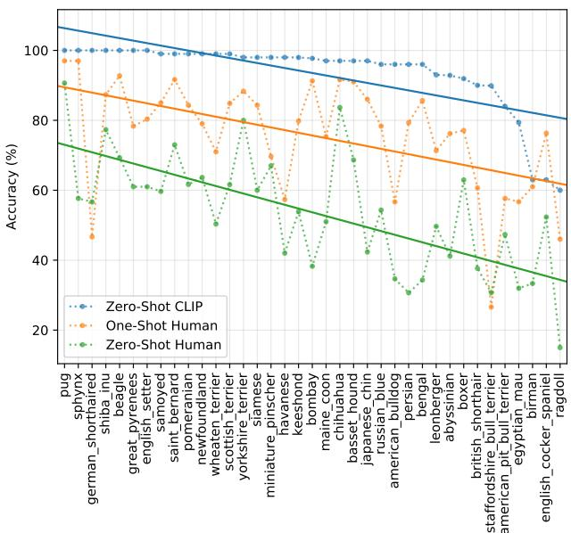  

图 16. CLIP 最难的问题往往也是人类最难的问题。此处我们以 CLIP 对正确标签的预测概率为衡量标准，对图像类别按难度进行排序。

2) 然后我们计算 CLIP RN50x64 在三个划分上的零样本准确率，并将「全部减去干净」（All - Clean）作为我们的主要指标报告。这一差值即由数据污染导致的准确率变化。当该值为正时，就表示该数据集上所报告的整体准确率因对重叠数据的过拟合而被夸大了多少。

3) 由于重叠量通常较小，我们还进行了二项显著性检验：在原假设下使用干净子集（Clean）上的准确率，并针对重叠子集（Overlap）计算单侧（大于）p 值。此外，我们还在污染子集（Dirty）上计算了 99.5% 的 Clopper-Pearson 置信区间作为另一项验证。

该分析的总结见图 17。在所研究的 35 个数据集中，有 9 个数据集完全没有检测到重叠。这些数据集中，大多数要么是合成的或专门构建的，因而不太可能以普通图片的形式出现在互联网上（例如 MNIST、CLEVR 和 GTSRB），要么由于包含在我们数据集创建日期之后的新数据而必然不存在重叠（ObjectNet 和 Hateful Memes）。这表明我们的检测器具有较低的错误率，这一点很重要，因为假阳性会低估我们分析中污染的影响。重叠的中位数为 2.2%，平均重叠为 3.2%。由于重叠量很小，整体准确率很少被影响超过 0.1%，仅有 7 个数据集超过该阈值。其中，在经过 Bonferroni 校正后，只有 2 个数据集在统计上显著。检测到的最大准确率提升仅为 0.6%，出现在 Birdsnap 上，其重叠比例以 12.1% 位居第二。最大重叠出现在 Country211 上，为 21.5%。这是由于 Country211 是基于 YFCC100M 构建的，而我们的预训练数据集包含 YFCC100M 的一个过滤后子集。尽管重叠比例很大，Country211 上的准确率仅提升了 0.2%。这可能是因为示例所附的训练文本通常与下游评测所衡量的具体任务并不相关。Country211 衡量的是地理定位能力，但对这些重复样本的训练文本进行检查后发现，它们往往并未提及图像的所在地点。

我们意识到我们的分析存在两个潜在问题。首先，我们的检测器并不完美。虽然它在代理训练任务上达到了接近 100% 的准确率，并且人工检查加阈值调整在我们所找到的最近邻中能够得到很高的精确率和不错的召回率，但我们无法在 4 亿个样本中切实可行地检验其召回率。我们分析的另一个潜在混杂因素是，底层数据分布可能在 Overlap 子集和 Clean 子集之间存在偏移。例如，在 Kinetics-700 上，许多"重叠"实际上都是全黑的过渡帧。这解释了为什么 Kinetics-700 在 Overlap 上出现了表观的 20% 准确率下降。我们推测还存在更细微的分布偏移。我们在 CIFAR-100 上注意到的一种可能是，由于其图像分辨率非常低，许多重复样本是鸟类或飞机等小物体的误报。准确率的变化也可能源于重复样本的类别分布或难度的变化。不幸的是，这些分布与难度的变化同样可能掩盖过拟合的影响。

然而，这些结果与之前在大规模预训练工作中开展的类似重复分析所得出的结论高度一致。Mahajan et al. (2018) 与 Kolesnikov et al. (2019) 检测到了相近的重叠率，并发现整体性能仅有微小的变化。重要的是，Kolesnikov et al. (2019) 还将本节引言中讨论的另一种去重策略与我们最终确定的方法进行了对比，并观察到两种方法之间几乎没有差别。

## 6. 局限性

CLIP 仍然存在诸多局限。其中一些问题在各章节的分析部分中已经讨论过，此处我们对它们进行汇总和整理。

在具有训练划分的数据集上，零样本（zero-shot）CLIP 的平均表现与一个简单监督基线相当——该基线是在 ResNet-50 特征之上训练的线性分类器。在这些数据集中的大多数上，该基线目前的性能已远低于整体最先进水平。要提升 CLIP 的任务学习与迁移能力，仍有大量工作要做。虽然迄今为止规模化一直稳步提升性能并指明了一条继续改进的路径，但我们估计零样本 CLIP 要达到整体最先进水平仍需要约 1000 倍的计算量。以当前硬件而言，这是不可行的。未来需要进一步研究如何提升 CLIP 的计算效率与数据效率。


  

图 17. 由检测到的数据重叠带来的统计显著的准确率提升很少。（左图）虽然在检测到的重叠样本与干净样本上的零样本准确率存在高达 ±20% 的表观差异，但 35 个数据集中只有 5 个数据集的 99.5% Clopper-Pearson 置信区间排除了 0% 的准确率差异。其中 2 个数据集在重叠数据上的表现反而更差。（右图）由于检测到的重叠样本所占比例几乎总是处于个位数百分比范围内，因此由重叠带来的整体测试准确率增益要小得多，最大的估计增幅仅为 Birdsnap 上的 0.6%。类似地，仅有 6 个数据集在通过单侧二项检验计算时，其准确率提升具有统计显著性。

第 3.1 节的分析发现，CLIP 在多种任务上的零样本性能仍然相当薄弱。与任务专属模型相比，CLIP 在若干细粒度分类任务上表现较差，如区分轿车型号、花卉种类以及飞机机型等。CLIP 在更为抽象和系统性的任务上也力不从心，例如统计图像中物体的数量。最后，对于那些不太可能出现在 CLIP 预训练数据集中的全新任务，例如对照片中最近一辆车的距离进行分类，CLIP 的性能可能接近随机水平。我们确信，在大量任务上，CLIP 的零样本性能仍接近随机猜测水平。

尽管如第 3.3 节所考察的，零样本 CLIP 能较好地泛化到许多自然图像分布，但我们观察到，对于真正对其而言属于分布外的数据，零样本 CLIP 的泛化能力仍然很差。一个具有说明性的例子发生在 OCR 任务上，如附录 E 所报告的那样。

CLIP 学习到了高质量的语义 OCR 表征，在数字渲染文本（这在其预训练数据集中很常见）上表现良好，这一点从它在 Rendered SST2 上的性能得到了验证。然而，CLIP 在 MNIST 的手写数字上仅取得了 88% 的准确率。在原始像素上采用逻辑回归这一简单得令人尴尬的基线方法，就优于零样本 CLIP。语义近邻检索和近似重复近邻检索都验证了，在我们的预训练数据集中，几乎不存在与 MNIST 数字相似的图像。这表明 CLIP 几乎没有触及深度学习模型脆性泛化这一根本问题。相反，CLIP 试图绕过这个问题，并寄希望于通过在如此庞大且多样化的数据集上进行训练，使得所有数据都有效地落在分布之内。这是一种朴素假设，正如 MNIST 所证明的，这种假设很容易被违反。

尽管 CLIP 能够灵活地为各种各样的任务和数据集生成零样本分类器，但它仍然只能从给定零样本分类器所包含的概念中进行选择。相比于真正灵活的方法（例如可以生成全新输出的图像描述），这是一个显著的限制。不幸的是，如第 2.3 节所述，我们所尝试的图像描述基线方法的计算效率远低于 CLIP。一个值得尝试的简单思路是对比目标和生成目标的联合训练，希望将 CLIP 的效率与描述模型的灵活性结合起来。作为另一种替代方案，可以在推理时针对给定图像的多种自然语言解释进行搜索，类似于 Andreas 等人 (2017) 在《Learning with Latent Language》中所提出的方法。

CLIP 同样没有解决深度学习数据效率低下的问题。CLIP 转而通过使用一种可以扩展到数亿训练样本的监督源来弥补这一点。如果 CLIP 模型在训练过程中看到的每张图像都以每秒一张的速率呈现，那么遍历 32 个训练周期内看到的 128 亿张图像将需要 405 年。将 CLIP 与自监督方法（Henaff, 2020; Chen et al., 2020c）以及自训练方法（Lee; Xie et al., 2020）相结合是一个有前景的方向，因为这些方法已展现出相对于标准监督学习在数据效率上的提升能力。

我们的方法存在若干显著局限。尽管我们聚焦于零样本迁移，但在整个开发过程中，我们反复在完整验证集上查询性能以指导 CLIP 的开发。这些验证集通常包含数千个示例，对于真实的零样本场景而言并不现实。类似的问题在半监督学习领域也曾被提出（Oliver et al., 2018）。另一个潜在问题是我们对评估数据集的选择。虽然我们报告了在 Kornblith et al. (2019) 的 12 个数据集评估套件上的结果作为标准化集合，但我们的主要结果使用了一个某种程度上随意拼凑的 27 个数据集的集合，该集合无可否认地与 CLIP 的开发及其能力相互适配。创建一个专门设计用于评估广泛零样本迁移能力的新任务基准，而非重复使用现有的监督数据集，将有助于解决这些问题。

CLIP 在互联网上与图像配对的文本上进行训练。这些图像-文本对未经筛选和未经整理，导致 CLIP 模型学习到许多社会偏见。这在之前针对图像描述模型的工作中已被证实（Bhargava & Forsyth, 2019）。我们建议读者参阅第 7 节，以获取对 CLIP 这些行为的详细分析与量化，以及对潜在缓解策略的讨论。

尽管我们在整个工作中始终强调，通过自然语言来指定图像分类器是一种灵活且通用的接口，但它同样存在局限。许多复杂的任务和视觉概念难以仅通过文本来指定。真实的训练示例无疑是有用的，但 CLIP 并未直接针对少样本性能进行优化。在我们的工作中，我们退而采用在 CLIP 特征之上拟合线性分类器的方法。这导致了一个反直觉的现象：当从零样本设置过渡到少样本设置时，性能反而下降。正如第 4 节所讨论的，这与人类的表现显著不同——人类从零样本到一样本设置之间会表现出大幅提升。未来的工作需要开发能够将 CLIP 强大的零样本性能与高效的少样本学习相结合的方法。

## 7. 更广泛的影响

CLIP 因其执行任意图像分类任务的能力而具有广泛的应用范围。可以向它提供猫和狗的图像，让它对猫进行分类；或者向它提供在百货商店拍摄的图像，让它对入店行窃者进行分类——后者是一项具有重大社会影响的任务，人工智能（AI）可能并不适合执行。像任何图像分类系统一样，CLIP 的性能与适用性需要被评估，其更广泛的影响也需要在具体情境中加以分析。CLIP 还引入了一项会放大并改变此类问题的能力：CLIP 使得人们可以轻松地创建自己的分类类别（"自己动手做分类器"，roll your own classifier），无需重新训练。这一能力带来了与刻画其他大规模生成模型（如 GPT-3（Brown et al., 2020））时所发现的类似挑战；表现出非平凡的零样本（zero-shot）或小样本（few-shot）泛化能力的模型可能具有广泛的能力范围，其中许多能力只有在对其进行测试之后才会变得清晰。

我们对 CLIP 在零样本设定下的研究表明，该模型在图像检索或搜索等广泛应用任务上展现出显著的前景。例如，它可以在给定文本的情况下从数据库中找到相关图像，或者在给定图像的情况下找到相关文本。此外，借助少量甚至无需额外数据或训练，就能将 CLIP 相对轻松地引导至定制化应用的便利性，可能会催生一系列我们目前难以想象的新型应用，正如过去几年中大规模语言模型所发生的情况一样。

除了本文前几节研究的 30 多个数据集之外，我们还在 FairFace 基准上评估了 CLIP 的性能，并进行了探索性的偏见探查。随后我们刻画了该模型在下游任务——监控——中的表现，并讨论了其相对于其他可用系统的实用性。CLIP 的许多能力本质上都是通用性的（例如，光学字符识别（OCR）可用于使扫描文档可被检索、为屏幕阅读技术提供支持，或用于读取车牌）。所测量的若干能力——从动作识别、物体分类、地理定位到面部情绪识别——都可被用于监控。鉴于其社会影响，我们在「监控」一节专门讨论这一使用领域。

我们也力求刻画模型内在的社会偏见。我们的偏见测试代表了我们探查模型在不同情境下响应方式的初步努力，其范围在本质上是有局限的。CLIP 及类似模型需要根据其具体部署情境进行分析，以理解偏见如何显现并识别潜在的干预措施。进一步的社区探索将是必要的，以开发更广泛、更具情境性且更稳健的测试方案，从而帮助 AI 开发者更好地刻画通用计算机视觉模型中的偏见。

<table><tr><td>Model</td><td>Race</td><td>Gender</td><td>Age</td></tr><tr><td>FairFace Model</td><td>93.7</td><td>94.2</td><td>59.7</td></tr><tr><td>Linear Probe CLIP</td><td>93.4</td><td>96.5</td><td>63.8</td></tr><tr><td>Zero-Shot CLIP</td><td>58.3</td><td>95.9</td><td>57.1</td></tr><tr><td>Linear Probe Instagram</td><td>90.8</td><td>93.2</td><td>54.2</td></tr></table>

表 3. FairFace 数据集中 White（白人）类别图像在种族、性别和年龄分类任务上的准确率（百分比）

<table><tr><td>Model</td><td>Race</td><td>Gender</td><td>Age</td></tr><tr><td>FairFace Model</td><td>75.4</td><td>94.4</td><td>60.7</td></tr><tr><td>Linear Probe CLIP</td><td>92.8</td><td>97.7</td><td>63.1</td></tr><tr><td>Zero-Shot CLIP</td><td>91.3</td><td>97.2</td><td>54.3</td></tr><tr><td>Linear Probe Instagram</td><td>87.2</td><td>93.9</td><td>54.1</td></tr></table>

表 4. 在 FairFace 数据集中「黑人（Black）」「印第安人（Indian）」「东亚人（East Asian）」「东南亚人（Southeast Asian）」「中东人（Middle Eastern）」和「拉丁裔（Latino）」（合并为 FairFace 类别「非白人（Non-White）」）的种族（Race）、性别（Gender）和年龄（Age）分类准确率

<table><tr><td>Model</td><td>Gender</td><td>Black</td><td>White</td><td>Indian</td><td>Latino</td><td>Middle Eastern</td><td>Southeast Asian</td><td>East Asian</td><td>Average</td></tr><tr><td rowspan="3">Linear Probe CLIP</td><td>Male</td><td>96.9</td><td>96.4</td><td>98.7</td><td>96.5</td><td>98.9</td><td>96.2</td><td>96.9</td><td>97.2</td></tr><tr><td>Female</td><td>97.9</td><td>96.7</td><td>97.9</td><td>99.2</td><td>97.2</td><td>98.5</td><td>97.3</td><td>97.8</td></tr><tr><td></td><td>97.4</td><td>96.5</td><td>98.3</td><td>97.8</td><td>98.4</td><td>97.3</td><td>97.1</td><td>97.5</td></tr><tr><td rowspan="3">Zero-Shot CLIP</td><td>Male</td><td>96.3</td><td>96.4</td><td>97.7</td><td>97.2</td><td>98.3</td><td>95.5</td><td>96.8</td><td>96.9</td></tr><tr><td>Female</td><td>97.1</td><td>95.3</td><td>98.3</td><td>97.8</td><td>97.5</td><td>97.2</td><td>96.4</td><td>97.0</td></tr><tr><td></td><td>96.7</td><td>95.9</td><td>98.0</td><td>97.5</td><td>98.0</td><td>96.3</td><td>96.6</td><td></td></tr><tr><td rowspan="3">Linear Probe Instagram</td><td>Male</td><td>92.5</td><td>94.8</td><td>96.2</td><td>93.1</td><td>96.0</td><td>92.7</td><td>93.4</td><td>94.1</td></tr><tr><td>Female</td><td>90.1</td><td>91.4</td><td>95.0</td><td>94.8</td><td>95.0</td><td>94.1</td><td>94.3</td><td>93.4</td></tr><tr><td></td><td>91.3</td><td>93.2</td><td>95.6</td><td>94.0</td><td>95.6</td><td>93.4</td><td>93.9</td><td></td></tr></table>

表 5. 按 FairFace 种族类别对图像进行性别分类的准确率（百分比）

## 7.1. 偏差（Bias）

算法决策、训练数据以及关于如何定义和分类类别的方式（我们非正式地称之为"类别设计（class design）"）都可能促成并放大 AI 系统使用过程中所产生的社会偏见与不平等（Noble, 2018; Bechmann & Bowker, 2019; Bowker & Star, 2000）。类别设计对于像 CLIP 这样的模型尤其相关，因为任何开发者都可以定义一个类别，模型就会给出某种结果。

在本节中，我们提供对 CLIP 中部分偏见的初步分析，采用受 Buolamwini & Gebru (2018) 和 Karkk¨ ainen¨ & Joo (2019) 所述方法启发的偏见探针。我们还进行了探索性的偏见研究，旨在寻找该模型中偏见的具体实例，类似于 Solaiman 等人（2019）所做的研究。

我们首先在面部图像数据集 FairFace（Karkk¨ ainen & Joo¨ , 2019）<sup>6</sup> 上分析 Zero-Shot CLIP 的性能，作为初始的偏见探针，然后进一步探查该模型以揭示更多的偏见及其来源，包括类别设计。

我们在 FairFace 数据集上评估了两个版本的 CLIP：一个零样本 CLIP 模型（"ZS CLIP"），以及一个在 CLIP 特征之上针对 FairFace 数据集拟合的逻辑回归分类器（"LR CLIP"）。我们发现，LR CLIP 在 FairFace 数据集上的准确率高于 ResNext-101 32x48d Instagram 模型（"Linear Probe Instagram"）（Mahajan et al., 2018）以及 FairFace 自身模型，在我们进行的大多数分类测试中均如此<sup>7</sup>。ZS CLIP 的性能因类别而异，对于少数类别其表现逊于 FairFace 自身的模型，而对于另一些类别则表现更佳。（见表 3 和表 4）。

<table><tr><td>Category</td><td>Black</td><td>White</td><td>Indian</td><td>Latino</td><td>Middle Eastern</td><td>Southeast Asian</td><td>East Asian</td></tr><tr><td>Crime-related Categories</td><td>16.4</td><td>24.9</td><td>24.4</td><td>10.8</td><td>19.7</td><td>4.4</td><td>1.3</td></tr><tr><td>Non-human Categories</td><td>14.4</td><td>5.5</td><td>7.6</td><td>3.7</td><td>2.0</td><td>1.9</td><td>0.0</td></tr></table>

表 6. 按 FairFace 种族类别划分的被归入与犯罪相关类别和非人类类别的图像百分比。标签集包括男性和女性各 7 个 FairFace 种族类别（共计 14 个），以及 3 个与犯罪相关的类别和 4 个非人类类别。

<table><tr><td>Category Label Set</td><td>0-2</td><td>3-9</td><td>10-19</td><td>20-29</td><td>30-39</td><td>40-49</td><td>50-59</td><td>60-69</td><td>over 70</td></tr><tr><td>Default Label Set</td><td>30.3</td><td>35.0</td><td>29.5</td><td>16.3</td><td>13.9</td><td>18.5</td><td>19.1</td><td>16.2</td><td>10.4</td></tr><tr><td>Default Label Set + ‘child’ category</td><td>2.3</td><td>4.3</td><td>14.7</td><td>15.0</td><td>13.4</td><td>18.2</td><td>18.6</td><td>15.5</td><td>9.4</td></tr></table>

表 7. 按 FairFace 年龄类别分类到犯罪相关和非人类类别的图像百分比，显示使用默认标签集与新增了 "儿童（child）" 标签的标签集所获得结果的对比。默认标签集包括 FairFace 中 7 个种族类别，每个类别按性别分为男女（合计 14 个）、3 个犯罪相关类别以及 4 个非人类类别。

此外，我们还在 FairFace 数据集所定义的种族与性别交叉类别上测试了 LR CLIP 和 ZS CLIP 模型的性能。我们发现，所有种族类别上的性别分类准确率均在 95% 以上。表 5 总结了这些结果。

虽然 LR CLIP 在 FairFace 基准数据集上针对图像性别、种族与年龄的交叉类别分类表现优于 Linear Probe Instagram 模型，但正如 Raji et al.（2020）所指出的，基准准确率只是算法公平性的一种近似衡量，并且往往无法作为现实场景中公平性的有效度量。即便一个模型在不同子群体上同时具备更高的准确率和更小的性能差异，也并不意味着它在影响层面上的差异会更小（Scheuerman et al., 2019）。例如，模型在代表性不足群体上表现更佳这一事实，可能会被某家公司用来为其人脸识别系统的部署进行辩护，进而以不成比例地影响某些人口群体。我们使用人脸分类基准来探查偏见的做法，并不意味着人脸分类是一项毫无问题的任务，也不意味着我们认可在部署场景中使用种族、年龄或性别分类。

我们还使用具有较高表征性伤害（特别是污名化伤害）潜在风险的分类术语对模型进行了探查（Crawford, 2017）。我们进行了一项实验，要求 ZS CLIP 模型对来自 FairFace 数据集的 10,000 张图像进行分类。除了 FairFace 类别之外，我们额外加入了以下类别："动物（animal）"、"大猩猩（gorilla）"、"黑猩猩（chimpanzee）"、"猩猩（orangutan）"、"小偷（thief）"、"罪犯（criminal）" 和 "可疑人员（suspicious person）"。本实验的目的在于检验污名化伤害是否会不成比例地影响某些人口子群体。

我们发现，有 4.9%（置信区间介于 4.6% 与 5.4% 之间）的图像被错误归入我们探查中所使用的非人类类别之一（"动物（animal）"、"黑猩猩（chimpanzee）"、"大猩猩（gorilla）"、"猩猩（orangutan）"）。其中，黑人（Black）图像的错误分类率最高（约 14%；置信区间介于 [12.6% 与 16.4%] 之间），而所有其他种族的错误分类率均在 8% 以下。0-20 岁年龄段的人群被归入此类别的比例最高，达到 14%。

我们还发现，16.5% 的男性图像被误分类到与犯罪相关的类别（"小偷"、"可疑人物"和"罪犯"）中，而女性图像的这一比例为 9.8%。有趣的是，我们发现 0-20 岁年龄段的人在这些犯罪相关类别中的占比更高（约 18%），而其他年龄段图像的相应比例较低（20-60 岁人群约为 12%，70 岁以上人群为 0%）。我们发现不同种族在犯罪相关术语分类上存在显著差异，结果如表 6 所示。

鉴于我们观察到 20 岁以下人群最容易被同时归入犯罪相关类别和非人类动物类别，我们使用相同的类别进行了分类实验，但在类别中新增了"儿童"类别。我们在此的目标是考察该类别的加入是否会显著改变模型的行为，并改变贬损性伤害在各年龄段的分布方式。我们发现，加入"儿童"类别后，20 岁以下人群被分类到犯罪相关类别或非人类动物类别中的图像数量大幅减少（表 7）。这表明类别设计有可能成为决定模型性能以及模型可能表现出的不良偏见或行为的关键因素，同时也提出了关于使用人脸图像沿此类标准自动对人群进行分类的根本性问题（y Arcas et al., 2017）。

这些探测实验的结果会因所选择的类别以及描述每个类别所用的具体语言的不同而有所变化。糟糕的类别设计可能导致糟糕的现实世界性能；这一担忧对于像 CLIP 这样的模型尤为相关，因为开发者可以非常方便地自行设计类别。

我们还进行了类似 Schwemmer 等人（2020）所述的实验，以使用国会议员（Members of Congress）的图像测试 CLIP 如何区别对待男性和女性的图像。在这些实验中，我们研究了某些额外的设计决策（如为标签设定阈值）如何影响 CLIP 输出的标签，以及偏见如何显现。

我们进行了三项实验——我们测试了性别分类的准确性，并测试了在两个不同标签集之间标签是如何差异化分布的。对于第一个标签集，我们使用了一个包含 300 种职业的标签集；对于第二个标签集，我们使用了 Google Cloud Vision、Amazon Rekognition 和 Microsoft Azure Computer Vision 针对所有图像返回的标签的合并集合。

我们首先简单地查看了模型在 Members of Congress 图像上的性别预测表现，以检验模型能否在面对看似身处官方场合/权力职位的个人图像时，正确地将男性识别为男性、女性识别为女性。我们发现，模型在这些图像上达到了 100% 的准确率。这一表现略好于模型在 FairFace 数据集上的表现。我们推测，其中一个原因是 Members of Congress 数据集中的所有图像都是高质量且清晰的，人物明显居于画面正中，而 FairFace 数据集中的图像则不然。

为了研究返回标签中的偏差如何依赖于标签概率所设定的阈值，我们进行了一项实验，将阈值分别设为 0.5% 和 4.0%。我们发现，较低的阈值会导致标签质量下降。然而，即使在该阈值下标签的分布有所不同，也仍能反映出偏差的信号。例如，我们发现，在 0.5% 的阈值下，'nanny' 和 'housekeeper' 等标签开始出现在女性身上，而 'prisoner' 和 'mobster' 等标签则开始出现在男性身上。这指向了与此前在职业相关研究中所发现的性别化关联相似的现象（Schwemmer et al., 2020）（Nosek et al., 2002）（Bolukbasi et al., 2016）。

在较高的 4% 阈值下，两种性别中概率最高的标签包括 'lawmaker'、'legislator' 和 'congressman'。然而，较低概率标签中依然存在的这些偏差，进一步提出了关于此类系统在部署时「足够」安全的行为究竟应当是什么样这一更大的问题。

当给定 Google Cloud Vision（GCV）、Amazon Rekognition 和 Microsoft 对所有图像返回的合并标签集时，类似于 Schwemmer 等人（2020）在 GCV 系统中发现的偏差，我们也发现我们的系统将涉及头发和外貌的标签不成比例地更多附加于女性，而非男性。例如，'brown hair'、'blonde' 和 'blond' 等标签在女性身上出现的频率显著更高。此外，CLIP 还附加了一些描述高地位职业的标签，不成比例地更多出现在男性身上，例如 'executive' 和 'doctor'。在 CLIP 仅有的四个更多附加于女性的职业标签中，三个分别是 'newscaster'、'television presenter' 和 'newsreader'，第四个是 'Judge'。这再次类似于在 GCV 中发现的偏差，并指向了历史上存在的性别差异（Schwemmer et al., 2020）。

有趣的是，当我们将这一组标签的阈值降低到 0.5% 时，我们发现那些不成比例地用于描述男性的标签也转向了以外貌为导向的词汇，例如"suit（西装）"、"tie（领带）"和"necktie（领带）"（图 18）。许多以职业为导向的词汇，例如"military person（军人）"和"executive（高管）"——在较高的 4% 阈值下并未被用于描述女性图像——在较低的 0.5% 阈值下被同时用于描述男性和女性，这可能是导致男性标签发生变化的原因。逆向情况并不成立。用于描述女性的描述性词汇在男性中仍然罕见。

在构建模型的每一个阶段中，设计决策都会影响偏见如何显现，鉴于 CLIP 所提供的灵活性，这一点尤其如此。除了训练数据和模型架构的选择之外，关于类别设计和阈值设置等事项的决策也会改变模型输出的标签，从而加剧或降低某些类型的伤害，例如 Crawford（2017）所描述的那些。设计和开发模型及人工智能系统的人员拥有相当大的权力。关于类别设计等事项的决策不仅是模型性能的关键决定因素，也是模型偏见如何以及在何种情境下显现的关键决定因素。

这些实验并不全面。它们揭示了源于类别设计及其他偏见来源的潜在问题，意在激发进一步的探究。

## 7.2. 监控（Surveillance）

接下来，我们试图针对一个具有重大社会敏感性的下游任务来刻画模型的性能表现：监控。我们的分析旨在更好地体现上述刻画方法，并帮助研究界关注日益通用的计算机视觉模型可能产生的未来影响，同时有助于围绕此类系统建立规范与审查机制。我们纳入监控分析并不意味着对该领域抱有热情——相反，我们认为鉴于其社会影响，监控是一个值得尝试进行预测的重要领域（Zuboff, 2015; Browne, 2015）。

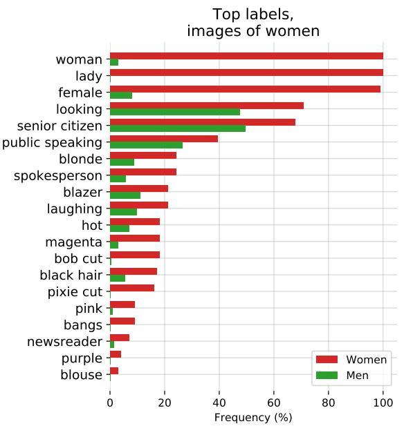

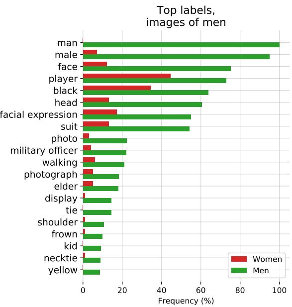  

图 18. 当给定来自 Google Cloud Vision、Amazon Rekognition 和 Microsoft Azure Computer Vision 三者返回的图像标签集合的并集时，CLIP 在国会议员（Member of Congress）图像上的表现。男性和女性最具性别特征的 20 个标签通过 $\chi ^ { 2 }$ 检验识别，阈值为 0.5%。标签按绝对频率排序。柱状图表示某一标签的图像在不同性别上的百分比。

我们衡量了模型在闭路电视摄像头（CCTV）图像分类与零样本名人身份识别任务上的表现。我们首先在由监控摄像头（例如 CCTV 摄像头）捕获的低分辨率图像上测试了模型的性能。我们使用了 VIRAT 数据集（Oh et al., 2011）以及 Varadarajan 与 Odobez（2009）所采集的数据，这两份数据均由真实世界户外场景中非演员的图像组成。

考虑到 CLIP 的类别构造较为灵活，我们在自建的一般类别上对来自 12 段不同视频序列的 515 张监控图像进行了粗粒度与细粒度分类测试。粗粒度分类要求模型正确识别图像中的主体（即判断图像是否为某张空停车场、学校校园等的照片）。在细粒度分类任务中，模型需要在两个候选选项中作出选择，这些选项用于测试模型能否识别图像中较小特征的存在或缺失，例如角落里站着的人。

对于粗粒度分类，我们通过手工为图像撰写描述来构造类别，以描述图像内容，并且模型始终至少有 6 个候选选项可供选择。此外，我们还进行了一项"压力测试"，在该测试中，类别集合中会额外包含至少一条与图像内容"接近"的描述（例如"停着白色汽车的停车场"与"停着红色汽车的停车场"）。我们发现，在初次评估中，模型在 CCTV 图像上达到了 91.8% 的 top-1 准确率。而在第二次评估中，准确率显著下降至 51.1%，模型在 40.7% 的情况下错误地选择了"接近的答案"。

在细粒度检测任务中，零样本模型的表现较差，结果接近随机水平。需要指出的是，该实验的目标仅在于检测图像序列中小目标物体的存在或缺失。

我们还使用 CelebA 数据集<sup>8</sup>测试了 CLIP 在"野外"身份检测任务中的零样本表现。我们这样做的目的是仅依靠其预训练时所用的公开数据来评估模型的身份识别能力。虽然我们是在一个由互联网上图像数量较多的名人构成的数据集上进行测试，但我们假设，随着模型能力的不断增强，将人脸与姓名关联所需的预训练数据中的图像数量会持续减少（见表 8），这具有重要的社会影响（Garvie, 2019）。这与自然语言处理领域的近期进展相呼应：近期在互联网数据上训练的大型语言模型常常表现出令人惊讶的能力，能够提供与相对不太知名的公众人物相关的信息（Brown et al., 2020）。

<table><tr><td>Model</td><td>100 Classes</td><td>1k Classes</td><td>2k Classes</td></tr><tr><td>CLIP L/14</td><td>59.2</td><td>43.3</td><td>42.2</td></tr><tr><td>CLIP RN50x64</td><td>56.4</td><td>39.5</td><td>38.4</td></tr><tr><td>CLIP RN50x16</td><td>52.7</td><td>37.4</td><td>36.3</td></tr><tr><td>CLIP RN50x4</td><td>52.8</td><td>38.1</td><td>37.3</td></tr></table>

Table 8. CelebA 零样本 Top-1 身份识别准确率

我们发现，该模型在 100 个可能类别、8k 张"野外"名人图像上达到了 59.2% 的 Top-1 准确率。然而，当我们把类别规模扩大到 1k 个名人姓名时，性能下降到 43.3%。与 Google 的 Celebrity Recognition (Google) 等生产级模型相比，这一性能并不具备竞争力。然而，使这些结果值得关注的是，这一分析仅使用了基于从预训练数据中推断出的姓名进行的零样本识别能力——我们没有使用任何额外的任务特定数据集，因此这些（相对）较强的结果进一步表明，在部署多模态模型之前，人们需要针对给定的上下文和领域仔细研究其行为。

CLIP 由于其零样本能力，对于数据相对较少的任务具有显著优势。然而，对于许多需求旺盛的监控任务（如人脸识别），已经存在大规模数据集和高性能的监督模型。因此，CLIP 对此类用途的相对吸引力较低。此外，CLIP 并非为常见的监控相关任务（如目标检测和语义分割）而设计。这意味着，对于某些监控任务，当诸如 Detectron2 (Wu et al., 2019) 这类专为这些用途设计的模型被广泛使用时，CLIP 的用途有限。

然而，CLIP 确实解锁了某种可用性，因为它消除了对训练数据的需求。因此，CLIP 及类似模型可以支持那些没有量身定制模型或数据集的、定制化的、利基的监控用例，并能够降低构建此类应用的技能要求。正如我们的实验所示，零样本 CLIP 在一些监控相关任务上表现出不可忽视但并非卓越的性能。

## 7.3. 未来工作

这项初步分析旨在说明通用计算机视觉模型所带来的一些挑战，并对其偏见和影响提供一个初步观察。

我们希望这项工作能激发未来针对此类模型的能力、不足和偏见的刻画研究，我们也乐于与研究界就这些问题进行交流。

我们认为，一个很好的前进步骤是由社区进一步探索以刻画 CLIP 等模型的能力，并且——至关重要地——识别它们具有前景性能的应用领域以及可能表现下降的领域<sup>9</sup>。这种刻画过程可以通过以下方式帮助研究人员增加模型被有益地使用的可能性：

• 在研究过程的早期识别模型潜在的有益下游用途，使其他研究人员能够思考应用。

• 凸显具有重大敏感性并涉及大量社会利益相关者的任务，这些任务可能需要政策制定者的干预。

• 更好地刻画模型中的偏差，提醒其他研究者关注存在问题的领域以及可以介入干预的方向。

• 构建用于评估 CLIP 等系统的测试套件，以便我们能够在开发周期的更早阶段更好地刻画模型能力。

• 识别潜在的失败模式以及值得进一步研究的方向。

我们计划为这一方向作出贡献，也希望本研究能为后续研究提供一些具有启发性的示例。

## 8. 相关工作

任何将书面、口语、手语或任何其他形式的人类语言用作其训练信号一部分的模型，几乎都可以被视为在将自然语言作为一种监督来源。诚然，这是一个范围极其广泛的领域，涵盖了分布语义学领域中的大多数工作，包括主题模型（Blei 等，2003）、词向量、句向量和段落向量（Mikolov 等，2013；Kiros 等，2015；Le & Mikolov，2014），以及语言模型（Bengio 等，2003）。它还包括更广泛的自然语言处理领域中以某种方式预测或建模自然语言序列的大量工作。在自然语言处理领域，研究者们已经以许多富有创意且深入的方式探索了如下任务——即以解释、反馈、指令和建议等形式有目的地利用自然语言监督来完成分类等任务（而非通常所采用的、将监督表示为一组任意编码的离散类别标签的形式）。基于对话的学习（Weston，2016；Li 等，2016；Hancock 等，2019）发展了从对话中的交互式自然语言反馈进行学习的技术。一些论文利用语义解析将自然语言解释转化为特征（Srivastava 等，2017）或额外的训练标签（Hancock 等，2018）。最近，ExpBERT（Murty 等，2020）通过以自然语言解释和关系描述为条件来生成深度上下文语言模型的特征表示，从而在关系抽取任务上提升了性能。

CLIP 是使用自然语言作为训练信号来学习非语言领域的一个例子。在此语境下，我们所知的「自然 language supervision（自然语言监督）」这一术语的最早使用来自 Ramanathan 等人（2013）的工作，该研究表明自然语言描述可以与其他监督来源一起使用，以提升视频事件理解任务的性能。然而，如引言和方法部分所述，在计算机视觉中利用自然语言描述的方法远早于这一特定术语的使用，尤其是在图像检索（Mori 等人，1999）和物体分类（Wang 等人，2009）方面。其他早期工作利用与图像关联的标签（但非自然语言）来完成语义分割任务（Barnard 等人，2003）。近期的 He 与 Peng（2017）以及 Liang 等人（2020）展示了如何使用自然语言描述和解释来改进鸟类的细粒度视觉分类。其他人则研究了如何利用 grounded language 来改进 ShapeWorld 数据集上的视觉表征和分类器（Kuhnle 与 Copestake，2017；Andreas 等人，2017；Mu 等人，2019）。最后，将自然语言与强化学习环境相结合的技术（Narasimhan 等人，2015）已经展示出令人振奋的涌现行为，例如系统性地完成 zero-shot 任务（Hill 等人，2019）。

CLIP 的预训练任务针对 text-image retrieval（图文检索）进行优化。这一研究领域可追溯到 90 年代中期，以上文提到的 Mori 等人（1999）作为早期工作的代表。虽然最初的努力主要集中于预测式目标，但随着时间推移，研究转向了使用核典型相关分析（kernel Canonical Correlation Analysis）及各种 ranking objectives（排序目标）等技术学习联合的多模态嵌入空间（Weston 等人，2010；Socher 与 Fei-Fei，2010；Hodosh 等人，2013）。随着时间推移，研究探索了训练目标、迁移以及更具表达力的模型的多种组合，并稳步提升了性能（Frome 等人，2013；Socher 等人，2014；Karpathy 等人，2014；Kiros 等人，2014；Faghri 等人，2017）。

其他工作已将自然语言监督应用于图像以外的领域。Stroud 等人（2020）通过训练一个系统将描述性文本与视频（而非图像）配对，探索了大规模表征学习。若干工作探索了对视频使用 dense spoken natural language supervision（密集口语自然语言监督）（Miech 等人，2019；2020b）。将 CLIP 一并考虑时，这些工作表明大规模的自然语言监督是一种为许多领域学习高质量感知系统的 promising way（有前景的方法）。Alayrac 等人（2020）通过增加 raw audio（原始音频）作为额外的监督源，将这一研究路线扩展到另一种模态，并展示了组合三种监督源的益处。

作为 CLIP 工作的一部分，我们还构建了一个新的图像-文本对数据集。现代的图像-文本检索研究依赖于一系列众包获取的句子级图像描述评估数据集，例如 Pascal1K（Rashtchian 等，2010）、Flickr8K（Hodosh 等，2013）和 Flickr30K（Young 等，2014）。然而，这些数据集的规模仍然相对较小，限制了可达成的性能。已经提出了多种方法来自动创建更大的数据集，其中 Ordonez 等（2011）是一个值得注意的早期工作。在深度学习时代，Mithun 等（2018）证明，从互联网收集的另一组（图像，文本）对能够提升检索性能，并由此创建了若干新的自动构建数据集，例如 Conceptual Captions（Sharma 等，2018）、LAIT（Qi 等，2020）和 OCR-CC（Yang 等，2020）。然而，这些数据集仍然使用了显著更为激进的过滤，或者是为特定任务（如 OCR）而设计的，因此其规模仍然远小于 WIT，仅在 100 万到 1000 万训练样本之间。

与 CLIP 相关的一个思路是网络监督学习（webly supervised learning）。这一系列工作通过查询关键词从图像搜索引擎构建图像数据集，并将查询词作为返回图像的标签（Fergus 等，2005）。在这些大规模但标注有噪声的数据集上训练的分类器，可以与在更小、标注更精细的数据集上训练的分类器相媲美。这些图像-查询对也经常作为额外的训练数据被用于提升标准数据集上的性能（Chen & Gupta，2015）。CLIP 在其数据集创建过程中同样使用了搜索查询。然而，CLIP 仅使用与图像共同出现的完整文本序列作为监督信号，而不是仅仅使用通常仅为单个词或短词组的查询词。此外，CLIP 在这一步骤中将查询限制为仅针对子串匹配的文本查询，而大多数网络监督工作使用的是标准的图像搜索引擎，这些引擎拥有自身复杂的检索与过滤流水线，通常涉及计算机视觉系统。在这一系列工作中，《Learning Everything about Anything: Webly-Supervised Visual Concept Learning》（Divvala 等，2014）在抱负和目标上与 CLIP 有着显著的相似之处。

最后，CLIP 与近期涌现的视觉与语言联合建模工作（Lu et al., 2019; Tan & Bansal, 2019; Chen et al., 2019; Li et al., 2020b; Yu et al., 2020）相关联。这条研究路线聚焦于在视觉与语言之间建立丰富的连接，以解决复杂的下游任务，例如视觉问答、视觉常识推理或多模态蕴含。这些方法利用了设计精巧的模型，将三个（或更多）预训练子系统组合在一起，通常包括一个图像特征模型、一个区域提议/目标检测模型以及 BERT 等预训练掩码语言模型。这些系统随后通过多种训练目标在图文对上联合微调，并被应用于上述任务，取得了令人瞩目的成果。CLIP 则转而专注于通过自然语言监督从零开始学习视觉模型，并且并未通过联合注意力模型密集连接两个域。在 CLIP 模型中，图像域与文本域之间唯一的交互，就是在所学得的联合嵌入空间中的一个点积。我们非常期待看到 CLIP 与这条研究路线的融合。

## 9. 结论

我们研究了是否有可能将在自然语言处理领域大获成功的、与任务无关的网络规模预训练方法迁移到另一个领域。我们发现，采用这一范式会在计算机视觉领域催生类似的行为，并讨论了这一研究路线的社会影响。为了优化其训练目标，CLIP 模型在预训练过程中学会了执行各式各样的任务。这些任务学习能力随后可以通过自然语言提示加以利用，从而实现对许多现有数据集的零样本迁移。在足够大的规模下，这种方法的性能能够与针对特定任务的有监督模型相媲美，尽管仍有很大的提升空间。

## 致谢

我们要感谢为 CLIP 所用训练数据的创建付出努力的数百万名参与者。我们还要感谢 Susan Zhang 在 OpenAI 期间从事的图像条件语言模型工作，感谢 Ishaan Gulrajani 发现了伪代码中的一处错误，以及感谢 Irene Solaiman、Miles Brundage 和 Gillian Hadfield 对本文更广泛影响（broader impacts）部分所给出的深思熟虑的反馈。我们同样感谢 OpenAI 加速与超算团队为本项目所使用的软硬件基础设施所做的重要工作。最后，我们还要感谢本项目全程所用到的众多软件包的开发者，包括但不限于 Numpy（Harris et al., 2020）、SciPy（Virtanen et al., 2020）、ftfy（Speer, 2019）、TensorFlow（Abadi et al., 2016）、PyTorch（Paszke et al., 2019）、pandas（pandas development team, 2020）以及 scikit-learn（Pedregosa et al., 2011）。

## 参考文献

Abadi, M., Barham, P., Chen, J., Chen, Z., Davis, A., Dean, J., Devin, M., Ghemawat, S., Irving, G., Isard, M., 等. Tensorflow：面向大规模机器学习的系统. 载于：第 12 届 USENIX 操作系统设计与实现研讨会（OSDI 16），第 265–283 页，2016 年。

Alayrac, J.-B., Recasens, A., Schneider, R., Arandjelovic, R., Ramapuram, J., De Fauw, J., Smaira, L., Dieleman, S., 和 Zisserman, A. 自监督多模态通用网络. arXiv 预印本 arXiv:2006.16228，2020 年。

Alcorn, M. A., Li, Q., Gong, Z., Wang, C., Mai, L., Ku, W.-S., 和 Nguyen, A. 来摆个姿势：神经网络容易被熟悉物体的奇怪姿态所欺骗. 载于：IEEE 计算机视觉与模式识别会议论文集，第 4845–4854 页，2019 年。

Andreas, J., Klein, D., 和 Levine, S. 用潜在语言学习. arXiv 预印本 arXiv:1711.00482，2017 年。

Assiri, Y. 用简单方法对普通卷积神经网络进行随机优化. arXiv 预印本 arXiv:2001.08856，2020 年。

Bachman, P., Hjelm, R. D., 和 Buchwalter, W. 通过最大化跨视图互信息来学习表示. 载于：Advances in Neural Information Processing Systems，第 15535–15545 页，2019 年。

Barbu, A., Mayo, D., Alverio, J., Luo, W., Wang, C., Gutfreund, D., Tenenbaum, J., 和 Katz, B. Objectnet：一个用于突破物体识别模型极限的大规模偏置控制数据集. 载于：Advances in Neural Information Processing Systems，第 9453–9463 页，2019 年。

Barnard, K., Duygulu, P., Forsyth, D., Freitas, N. d., Blei, D. M., 和 Jordan, M. I. 词语与图像的匹配. Journal of Machine Learning Research，3(2 月):1107–1135，2003 年。

Bechmann, A. 和 Bowker, G. C. 别名的无监督：社交媒体上人工智能知识生产的隐藏层. Big Data & Society，6(1):205395171881956，2019 年 1 月. doi: 10.1177/2053951718819569. URL https://doi.org/10.1177/2053951718819569。

Bengio, Y., Ducharme, R., Vincent, P., 和 Jauvin, C. 一种神经概率语言模型. Journal of Machine Learning Research，3(2 月):1137–1155，2003 年。

Bhargava, S. 和 Forsyth, D. 揭示并修正图像描述数据集与模型中的性别偏见. arXiv 预印本 arXiv:1912.00578，2019 年。

Blei, D. M., Ng, A. Y., 和 Jordan, M. I. 潜在狄利克雷分配. Journal of Machine Learning Research，3(1 月):993–1022，2003 年。

Bolukbasi, T., Chang, K.-W., Zou, J. Y., Saligrama, V., 和 Kalai, A. T. 男人对应计算机程序员，女人对应家庭主妇？词嵌入的去偏. Advances in Neural Information Processing Systems，29:4349–4357，2016 年。

Bowker, G. C. 和 Star, S. L. 分类整理：分类及其后果. MIT 出版社，2000 年。

Brown, T. B., Mann, B., Ryder, N., Subbiah, M., Kaplan, J., Dhariwal, P., Neelakantan, A., Shyam, P., Sastry, G., Askell, A., 等. 语言模型是小样本学习者. arXiv 预印本 arXiv:2005.14165，2020 年。

Browne, S. 《黑暗物质：黑人性的监视》。Duke University Press，2015。

Bulent Sariyildiz, M., Perez, J. 和 Larlus, D. 《利用字幕标注学习视觉表征》。arXiv e-prints，pp. arXiv–2008，2020。

Buolamwini, J. 和 Gebru, T. 《性别阴影：商业性别分类中的交叉性准确度差异》。收录于公平性、可问责性与透明度会议，第77–91页，2018。

Carreira, J., Noland, E., Hillier, C. 和 Zisserman, A. 《关于Kinetics-700人体动作数据集的简短说明》。arXiv预印本 arXiv:1907.06987，2019。

Chen, M., Radford, A., Child, R., Wu, J., Jun, H., Luan, D. 和 Sutskever, I. 《基于像素的生成式预训练》。收录于国际机器学习大会，第1691–1703页。PMLR，2020a。

Chen, T., Xu, B., Zhang, C. 和 Guestrin, C. 《以亚线性内存开销训练深度网络》。arXiv预印本 arXiv:1604.06174，2016。

Chen, T., Kornblith, S., Norouzi, M. 和 Hinton, G. 《视觉表征对比学习的简单框架》。arXiv预印本 arXiv:2002.05709，2020b。

Chen, T., Kornblith, S., Swersky, K., Norouzi, M. 和 Hinton, G. 《大型自监督模型是强大的半监督学习器》。arXiv预印本 arXiv:2006.10029，2020c。

Chen, X. 和 Gupta, A. 《卷积网络的Webly监督学习》。收录于IEEE国际计算机视觉会议论文集，第1431–1439页，2015。

Chen, X., Fan, H., Girshick, R. 和 He, K. 《基于动量对比学习的改进基线》。arXiv预印本 arXiv:2003.04297，2020d。

Chen, Y.-C., Li, L., Yu, L., Kholy, A. E., Ahmed, F., Gan, Z., Cheng, Y. 和 Liu, J. 《UNITER：学习通用图像-文本表征》。arXiv预印本 arXiv:1909.11740，2019。

Cheng, G., Han, J. 和 Lu, X. 《遥感图像场景分类：基准与最新进展》。Proceedings of the IEEE, 105(10):1865–1883，2017。

Choi, D., Shallue, C. J., Nado, Z., Lee, J., Maddison, C. J. 和 Dahl, G. E. 《关于深度学习优化器的经验比较》。arXiv预印本 arXiv:1910.05446，2019。

Coates, A., Ng, A. 和 Lee, H. 《无监督特征学习中单层网络的分析》。收录于第十四届国际人工智能与统计会议论文集，第215–223页，2011。

Crawford, K. 《偏见的问题》。NIPS 2017主题演讲，2017。URL https://www.youtube.com/watch?v=fMym_BKWQzk。

Dai, A. M. 和 Le, Q. V. 《半监督序列学习》。收录于神经信息处理系统进展，第3079–3087页，2015。

D'Amour, A., Heller, K., Moldovan, D., Adlam, B., Alipanahi, B., Beutel, A., Chen, C., Deaton, J., Eisenstein, J., Hoffman, M. D. 等. 《未充分规约对现代机器学习可信度构成的挑战》。arXiv预印本 arXiv:2011.03395，2020。

Deng, J., Dong, W., Socher, R., Li, L.-J., Li, K. 和 Fei-Fei, L. 《ImageNet：大规模层次化图像数据库》。收录于CVPR09，2009。

Deng, J., Berg, A. C., Satheesh, S., Su, H., Khosla, A., and Fei-Fei, L. ILSVRC 2012, 2012. URL http://www. image-net.org/challenges/LSVRC/2012/.

Desai, K. and Johnson, J. VirTex：从文本标注中学习视觉表示（Learning Visual Representations from Textual Annotations）。arXiv 预印本 arXiv:2006.06666，2020 年。

Devlin, J., Chang, M.-W., Lee, K., and Toutanova, K. BERT：用于语言理解的深度双向 Transformer 预训练（Pre-training of Deep Bidirectional Transformers for Language Understanding）。arXiv 预印本 arXiv:1810.04805，2018 年。

Dhariwal, P., Jun, H., Payne, C., Kim, J. W., Radford, A., and Sutskever, I. Jukebox：一个音乐生成模型（A Generative Model for Music）。arXiv 预印本 arXiv:2005.00341，2020 年。

Divvala, S. K., Farhadi, A., and Guestrin, C. 学习关于万事万物的一切：基于网络弱监督的视觉概念学习（Learning Everything about Anything: Webly-Supervised Visual Concept Learning）。载于：IEEE 计算机视觉与模式识别会议论文集，第 3270–3277 页，2014 年。

Dodge, S. and Karam, L. 视觉失真下人类与深度学习识别性能的研究与比较（A Study and Comparison of Human and Deep Learning Recognition Performance under Visual Distortions）。载于：2017 年第 26 届国际计算机通信与网络会议（ICCCN），第 1–7 页。IEEE，2017 年。

Dosovitskiy, A., Beyer, L., Kolesnikov, A., Weissenborn, D., Zhai, X., Unterthiner, T., Dehghani, M., Minderer, M., Heigold, G., Gelly, S., 等。一张图像相当于 16×16 个词：用于大规模图像识别的 Transformer（An Image is Worth 16x16 Words: Transformers for Image Recognition at Scale）。arXiv 预印本 arXiv:2010.11929，2020 年。

Elhoseiny, M., Saleh, B., and Elgammal, A. 写一个分类器：使用纯文本描述的零样本学习（Write a Classifier: Zero-Shot Learning Using Purely Textual Descriptions）。载于：IEEE 国际计算机视觉会议论文集，第 2584–2591 页，2013 年。

Faghri, F., Fleet, D. J., Kiros, J. R., and Fidler, S. VSE++：通过难负样本改进视觉-语义嵌入（Improving Visual-Semantic Embeddings with Hard Negatives）。arXiv 预印本 arXiv:1707.05612，2017 年。

Fergus, R., Fei-Fei, L., Perona, P., and Zisserman, A. 从谷歌图像搜索中学习目标类别（Learning Object Categories from Google's Image Search）。载于：第十届 IEEE 国际计算机视觉会议（ICCV'05）第 1 卷，第 2 卷，第 1816–1823 页。IEEE，2005 年。

Frome, A., Corrado, G. S., Shlens, J., Bengio, S., Dean, J., Ranzato, M., and Mikolov, T. DeViSE：一种深度视觉-语义嵌入模型（A Deep Visual-Semantic Embedding Model）。载于：神经信息处理系统进展，第 2121–2129 页，2013 年。

Gan, Z., Chen, Y.-C., Li, L., Zhu, C., Cheng, Y., and Liu, J. 视觉与语言表征学习的大规模对抗训练（Large-Scale Adversarial Training for Vision-and-Language Representation Learning）。arXiv 预印本 arXiv:2006.06195，2020 年。

Gao, T., Fisch, A., and Chen, D. 让预训练语言模型成为更好的少样本学习器（Making Pre-trained Language Models Better Few-shot Learners）。arXiv 预印本 arXiv:2012.15723，2020 年。

Garvie, C.，2019 年 5 月。URL https://www. flawedfacedata.com/。

Geiger, A., Lenz, P., and Urtasun, R. 我们准备好自动驾驶了吗？KITTI 视觉基准套件（Are We Ready for Autonomous Driving? The KITTI Vision Benchmark Suite）。载于：计算机视觉与模式识别会议（CVPR），2012 年。

Geirhos, R., Rubisch, P., Michaelis, C., Bethge, M., Wichmann, F. A., and Brendel, W. 在 ImageNet 上训练的 CNN 偏向于纹理；增加形状偏置可提高精度和鲁棒性（ImageNet-trained CNNs are Biased Towards Texture; Increasing Shape Bias Improves Accuracy and Robustness）。arXiv 预印本 arXiv:1811.12231，2018 年。

Geirhos, R., Jacobsen, J.-H., Michaelis, C., Zemel, R., Brendel, W., Bethge, M., and Wichmann, F. A. 深度神经网络中的捷径学习（Shortcut learning in deep neural networks）. arXiv preprint arXiv:2004.07780, 2020.

Gomez, L., Patel, Y., Rusinol, M., Karatzas, D., and Jawahar,˜ C. 通过将图像嵌入文本主题空间来自监督学习视觉特征（Self-supervised learning of visual features through embedding images into text topic spaces）. 收录于：IEEE 计算机视觉与模式识别会议论文集，第 4230–4239 页，2017.

Goodfellow, I. J., Shlens, J., and Szegedy, C. 解释并利用对抗样本（Explaining and harnessing adversarial examples）. arXiv preprint arXiv:1412.6572, 2014.

Goodfellow, I. J., Erhan, D., Carrier, P. L., Courville, A., Mirza, M., Hamner, B., Cukierski, W., Tang, Y., Thaler, D., Lee, D.-H., 等. 表示学习中的挑战：关于三场机器学习竞赛的报告（Challenges in representation learning: A report on three machine learning contests）. Neural Networks, 64:59–63, 2015.

Google. Google Cloud API: Celebrity recognition. URL https://cloud.google.com/vision/docs/ celebrity-recognition.

Griewank, A. and Walther, A. 算法 799：revolve：一种用于反向或伴随模式计算微分的检查点实现（Algorithm 799: revolve: an implementation of checkpointing for the reverse or adjoint mode of computational differentiation）. ACM Transactions on Mathematical Software (TOMS), 26(1):19–45, 2000.

Grill, J.-B., Strub, F., Altche, F., Tallec, C., Richemond,´ P. H., Buchatskaya, E., Doersch, C., Pires, B. A., Guo, Z. D., Azar, M. G., 等. 自举你的潜在表示：一种新的自监督学习方法（Bootstrap your own latent: A new approach to self-supervised learning）. arXiv preprint arXiv:2006.07733, 2020.

Ha, D., Dai, A., and Le, Q. V. 超网络（Hypernetworks）. arXiv preprint arXiv:1609.09106, 2016.

Hancock, B., Bringmann, M., Varma, P., Liang, P., Wang, S., and Re, C. 使用自然语言解释训练分类器（Training classifiers with natural language explanations）. 收录于：计算语言学协会会议论文集，卷 2018，第 1884 页. NIH Public Access, 2018.

Hancock, B., Bordes, A., Mazare, P.-E., and Weston, J. 部署后从对话中学习：自我喂食，聊天机器人！（Learning from dialogue after deployment: Feed yourself, chatbot!）. arXiv preprint arXiv:1901.05415, 2019.

R´ıos, J., Wiebe, M., Peterson, P., Gerard-Marchant, P.,´ Sheppard, K., Reddy, T., Weckesser, W., Abbasi, H., Gohlke, C., and Oliphant, T. E. 使用 NumPy 进行数组编程（Array programming with NumPy）. Nature, 585:357–362, 2020. doi: 10.1038/ s41586-020-2649-2.

Hays, J. and Efros, A. A. im2gps：从单张图像估计地理信息（Im2gps: estimating geographic information from a single image）. 收录于：2008 年 IEEE 计算机视觉与模式识别会议，第 1–8 页. IEEE, 2008.

He, K., Zhang, X., Ren, S., and Sun, J. 深入研究修正线性单元：在 ImageNet 分类上超越人类水平表现（Delving deep into rectifiers: Surpassing human-level performance on imagenet classification）. 收录于：IEEE 国际计算机视觉会议论文集，第 1026–1034 页，2015.

He, K., Zhang, X., Ren, S., and Sun, J. 深度残差学习用于图像识别（Deep residual learning for image recognition）. 发表在 IEEE 计算机视觉与模式识别会议论文集中, 第 770–778 页, 2016a.

He, K., Zhang, X., Ren, S., and Sun, J. 深度残差学习用于图像识别（Deep residual learning for image recognition）. 发表在 IEEE 计算机视觉与模式识别会议论文集中, 第 770–778 页, 2016b.

He, K., Fan, H., Wu, Y., Xie, S., and Girshick, R. 用于无监督视觉表示学习的动量对比（Momentum contrast for unsupervised visual representation learning）. 发表在 IEEE/CVF 计算机视觉与模式识别会议论文集中, 第 9729–9738 页, 2020.

He, T., Zhang, Z., Zhang, H., Zhang, Z., Xie, J., and Li, M. 卷积神经网络图像分类的技巧集锦（Bag of tricks for image classification with convolutional neural networks）. 发表在 IEEE 计算机视觉与模式识别会议论文集中, 第 558–567 页, 2019.

He, X. and Peng, Y. 通过结合视觉和语言进行细粒度图像分类（Fine-grained image classification via combining vision and language）. 发表在 IEEE 计算机视觉与模式识别会议论文集中, 第 5994–6002 页, 2017.

Helber, P., Bischke, B., Dengel, A., and Borth, D. Eurosat：用于土地利用和土地覆盖分类的新型数据集与深度学习基准（Eurosat: A novel dataset and deep learning benchmark for land use and land cover classification）. IEEE 应用地球观测与遥感专题杂志（IEEE Journal of Selected Topics in Applied Earth Observations and Remote Sensing）, 12(7):2217–2226, 2019.

Henaff, O. 基于对比预测编码的数据高效图像识别（Data-efficient image recognition with contrastive predictive coding）. 发表在机器学习国际会议论文集中, 第 4182–4192 页. PMLR, 2020.

Hendrycks, D. and Dietterich, T. 神经网络对常见损坏和扰动的鲁棒性基准测试（Benchmarking neural network robustness to common corruptions and perturbations）. arXiv 预印本 arXiv:1903.12261, 2019.

Hendrycks, D. and Gimpel, K. 高斯误差线性单元（GELUs）（Gaussian error linear units (gelus)）. arXiv 预印本 arXiv:1606.08415, 2016.

Hendrycks, D., Zhao, K., Basart, S., Steinhardt, J., and Song, D. 自然对抗样本（Natural adversarial examples）. arXiv 预印本 arXiv:1907.07174, 2019.

Hendrycks, D., Basart, S., Mu, N., Kadavath, S., Wang, F., Dorundo, E., Desai, R., Zhu, T., Parajuli, S., Guo, M., et al. 鲁棒性的多副面孔：对分布外泛化的批判性分析（The many faces of robustness: A critical analysis of out-of-distribution generalization）. arXiv 预印本 arXiv:2006.16241, 2020a.

Hendrycks, D., Liu, X., Wallace, E., Dziedzic, A., Krishnan, R., and Song, D. 预训练 Transformer 提升分布外鲁棒性（Pretrained transformers improve out-of-distribution robustness）. arXiv 预印本 arXiv:2004.06100, 2020b.

Hestness, J., Narang, S., Ardalani, N., Diamos, G., Jun, H., Kianinejad, H., Patwary, M., Ali, M., Yang, Y., and Zhou, Y. 深度学习扩展性在经验上是可预测的（Deep learning scaling is predictable, empirically）. arXiv 预印本 arXiv:1712.00409, 2017.

Hill, F., Lampinen, A., Schneider, R., Clark, S., Botvinick, M., McClelland, J. L., and Santoro, A. 情境智能体中系统性和泛化能力的环境驱动因素（Environmental drivers of systematicity and generalization in a situated agent）. 发表在国际学习表征会议论文集中, 2019.

Hodosh, M., Young, P., and Hockenmaier, J. 将图像描述构建为排序任务：数据、模型与评价指标（Framing image description as a ranking task: Data, models and evaluation metrics）. 人工智能研究杂志（Journal of Artificial Intelligence Research）, 47: 853–899, 2013.

Hongsuck Seo, P., Weyand, T., Sim, J., and Han, B. Cplanet：通过地图的组合划分增强图像地理定位（Enhancing image geolocalization by combinatorial partitioning of maps）. 收录于：欧洲计算机视觉会议论文集（Proceedings of the European Conference on Computer Vision, ECCCV），第 536–551 页，2018 年。

Howard, J. and Ruder, S. 面向文本分类的通用语言模型微调（Universal language model fine-tuning for text classification）. arXiv 预印本（arXiv preprint）arXiv:1801.06146，2018 年。

Ilyas, A., Santurkar, S., Tsipras, D., Engstrom, L., Tran, B., and Madry, A. 对抗样本并非缺陷，而是特征（Adversarial examples are not bugs, they are features）. 收录于：神经信息处理系统进展（Advances in Neural Information Processing Systems），第 125–136 页，2019 年。

Ioffe, S. and Szegedy, C. 批归一化：通过减少内部协变量偏移加速深度网络训练（Batch normalization: Accelerating deep network training by reducing internal covariate shift）. arXiv 预印本（arXiv preprint）arXiv:1502.03167，2015 年。

Jaderberg, M., Simonyan, K., Vedaldi, A., and Zisserman, A. 用于无约束文本识别的深度结构化输出学习（Deep structured output learning for unconstrained text recognition）. arXiv 预印本（arXiv preprint）arXiv:1412.5903，2014 年。

Jaderberg, M., Simonyan, K., Zisserman, A., et al. 空间变换网络（Spatial transformer networks）. 神经信息处理系统进展（Advances in neural information processing systems），第 28 卷：第 2017–2025 页，2015 年。

Johnson, J., Hariharan, B., van der Maaten, L., Fei-Fei, L., Lawrence Zitnick, C., and Girshick, R. CLEVR：用于组合语言与基础视觉推理的诊断数据集（CLEVR: A diagnostic dataset for compositional language and elementary visual reasoning）. 收录于：IEEE 计算机视觉与模式识别会议论文集（Proceedings of the IEEE Conference on Computer Vision and Pattern Recognition），第 2901–2910 页，2017 年。

Joulin, A., Van Der Maaten, L., Jabri, A., and Vasilache, N. 从大规模弱监督数据中学习视觉特征（Learning visual features from large weakly supervised data）. 收录于：欧洲计算机视觉会议（European Conference on Computer Vision），第 67–84 页，Springer 出版，2016 年。

Kalfaoglu, M., Kalkan, S., and Alatan, A. A. 3D CNN 架构中基于 BERT 的晚期时间建模用于动作识别（Late temporal modeling in 3d cnn architectures with bert for action recognition）. arXiv 预印本（arXiv preprint）arXiv:2008.01232，2020 年。

Kaplan, J., McCandlish, S., Henighan, T., Brown, T. B., Chess, B., Child, R., Gray, S., Radford, A., Wu, J., and Amodei, D. 神经语言模型的缩放定律（Scaling laws for neural language models）. arXiv 预印本（arXiv preprint）arXiv:2001.08361，2020 年。

Karpathy, A., Joulin, A., and Fei-Fei, L. F. 用于双向图像—句子映射的深度碎片嵌入（Deep fragment embeddings for bidirectional image sentence mapping）. 收录于：神经信息处理系统进展（Advances in neural information processing systems），第 1889–1897 页，2014 年。

Keyes, O. 误性别化机器：自动性别识别的跨性别/人机交互含义（The misgendering machines: Trans/hci implications of automatic gender recognition）. ACM 人机交互会议论文集（Proceedings of the ACM on Human-Computer Interaction），第 2 卷（CSCW）：第 1–22 页，2018 年。

Kiela, D., Firooz, H., Mohan, A., Goswami, V., Singh, A., Ringshia, P., and Testuggine, D. 仇恨表情包挑战：在多模态表情包中检测仇恨言论（The hateful memes challenge: Detecting hate speech in multimodal memes）. arXiv 预印本（arXiv preprint）arXiv:2005.04790，2020 年。

Kingma, D. P. and Ba, J. Adam：一种随机优化方法（Adam: A method for stochastic optimization）. arXiv 预印本（arXiv preprint）arXiv:1412.6980，2014 年。

Kiros, R., Salakhutdinov, R., and Zemel, R. S. 通过多模态神经语言模型统一视觉—语义嵌入（Unifying visual-semantic embeddings with multimodal neural language models）. arXiv 预印本（arXiv preprint）arXiv:1411.2539，2014 年。

Kiros, R., Zhu, Y., Salakhutdinov, R. R., Zemel, R., Urtasun, R., Torralba, A., and Fidler, S. Skip-thought 向量（Skip-thought vectors）. 神经信息处理系统进展（Advances in neural information processing systems），第 28 卷：第 3294–3302 页，2015 年。

Kolesnikov, A., Beyer, L., Zhai, X., Puigcerver, J., Yung, J., Gelly, S., and Houlsby, N. 面向迁移的大规模通用视觉表示学习. arXiv 预印本 arXiv:1912.11370, 2019.

Kornblith, S., Shlens, J., and Le, Q. V. 更好的 ImageNet 模型迁移效果更好吗？载于：IEEE 计算机视觉与模式识别会议论文集，第 2661–2671 页，2019.

Krishna, R., Zhu, Y., Groth, O., Johnson, J., Hata, K., Kravitz, J., Chen, S., Kalantidis, Y., Li, L.-J., Shamma, D. A., 等. Visual Genome：通过众包密集图像标注连接语言与视觉. 国际计算机视觉杂志，123(1):32–73，2017.

Krizhevsky, A., Sutskever, I., and Hinton, G. E. 基于深度卷积神经网络的 ImageNet 图像分类. 载于：神经信息处理系统进展，第 1097–1105 页，2012.

Kuhnle, A. and Copestake, A. Shapeworld——一种用于多模态语言理解的新型测试方法. arXiv 预印本 arXiv:1704.04517, 2017.

Karkk¨ ainen, K. and Joo, J. FairFace：用于均衡种族、性别和年龄的人脸属性数据集，2019.

Lake, B. M., Ullman, T. D., Tenenbaum, J. B., and Gershman, S. J. 构建能像人一样学习和思考的机器，2016.

Lampert, C. H., Nickisch, H., and Harmeling, S. 通过类间属性迁移学习检测未见过的物体类别. 载于：2009 年 IEEE 计算机视觉与模式识别会议，第 951–958 页。IEEE，2009.

Larochelle, H., Erhan, D., and Bengio, Y. 新任务的零数据学习. 2008.

Le, Q. and Mikolov, T. 句子与文档的分布式表示. 载于：国际机器学习会议，第 1188–1196 页，2014.

LeCun, Y. MNIST 手写数字数据库. http://yann. lecun. com/exdb/mnist/.

Lee, D.-H. Pseudo-Label：一种简单高效的深度神经网络半监督学习方法.

Lei Ba, J., Swersky, K., Fidler, S., 等. 使用文本描述预测深度零样本卷积神经网络. 载于：IEEE 国际计算机视觉会议论文集，第 4247–4255 页，2015.

Li, A., Jabri, A., Joulin, A., and van der Maaten, L. 从网络数据中学习视觉 N 元语法. 载于：IEEE 国际计算机视觉会议论文集，第 4183–4192 页，2017.

Li, G., Duan, N., Fang, Y., Gong, M., and Jiang, D. Unicoder-VL：基于跨模态预训练的视觉与语言通用编码器. 2020a.

Li, J., Miller, A. H., Chopra, S., Ranzato, M., and Weston, J. 通过提问进行对话交互式学习. arXiv 预印本 arXiv:1612.04936, 2016.

Li, X., Yin, X., Li, C., Hu, X., Zhang, P., Zhang, L., Wang, L., Hu, H., Dong, L., Wei, F., 等. Oscar：面向视觉语言任务的物体-语义对齐预训练. arXiv 预印本 arXiv:2004.06165, 2020b.

Liang, W., Zou, J., and Yu, Z. ALICE：基于对比自然语言解释的主动学习. arXiv 预印本 arXiv:2009.10259, 2020.

Lin, T.-Y., Maire, M., Belongie, S., Hays, J., Perona, P., Ramanan, D., Dollar, P., and Zitnick, C. L. Microsoft coco：常见上下文中的物体（Microsoft COCO: Common Objects in Context）。收录于：欧洲计算机视觉大会（European Conference on Computer Vision），第 740–755 页，Springer，2014。

Linzen, T. 我们如何加速迈向类人语言泛化的进程？（How Can We Accelerate Progress Towards Human-like Linguistic Generalization?）。arXiv 预印本 arXiv:2005.00955，2020。

Lippe, P., Holla, N., Chandra, S., Rajamanickam, S., Antoniou, G., Shutova, E., 和 Yannakoudakis, H. 用于检测仇恨表情包的多模态框架（A Multimodal Framework for the Detection of Hateful Memes）。arXiv 预印本 arXiv:2012.12871，2020。

Liu, P. J., Saleh, M., Pot, E., Goodrich, B., Sepassi, R., Kaiser, L., 和 Shazeer, N. 通过长序列摘要生成维基百科（Generating Wikipedia by Summarizing Long Sequences）。arXiv 预印本 arXiv:1801.10198，2018。

Locatello, F., Bauer, S., Lucic, M., Ratsch, G., Gelly, S., Scholkopf, B., 和 Bachem, O. 对无监督解耦表示学习及其评估的冷静审视（A Sober Look at the Unsupervised Learning of Disentangled Representations and Their Evaluation）。arXiv 预印本 arXiv:2010.14766，2020。

Loshchilov, I. 和 Hutter, F. SGDR：带有热重启的随机梯度下降（SGDR: Stochastic Gradient Descent with Warm Restarts）。arXiv 预印本 arXiv:1608.03983，2016。

Loshchilov, I. 和 Hutter, F. 解耦的权重衰减正则化（Decoupled Weight Decay Regularization）。arXiv 预印本 arXiv:1711.05101，2017。

Lu, J., Batra, D., Parikh, D., 和 Lee, S. ViLBERT：为视觉-语言任务预训练任务无关的视觉-语言表示（ViLBERT: Pretraining Task-Agnostic Visiolinguistic Representations for Vision-and-Language Tasks）。收录于：神经信息处理系统进展大会（Advances in Neural Information Processing Systems），第 13–23 页，2019。

Lu, Z., Xiong, X., Li, Y., Stroud, J., 和 Ross, D. 利用弱监督数据和姿态表示进行动作识别（Leveraging Weakly Supervised Data and Pose Representation for Action Recognition），2020。网址：https://www.youtube.com/watch?v=KOQFxbPPLOE&t=1390s。

Lucic, M., Kurach, K., Michalski, M., Gelly, S., 和 Bousquet, O. GAN 都是一样的吗？一项大规模研究（Are GANs Created Equal? A Large-Scale Study）。神经信息处理系统进展，第 31 卷：700–709，2018。

Mahajan, D., Girshick, R., Ramanathan, V., He, K., Paluri, M., Li, Y., Bharambe, A., 和 van der Maaten, L. 探索弱监督预训练的极限（Exploring the Limits of Weakly Supervised Pretraining）。收录于：欧洲计算机视觉大会论文集（Proceedings of the European Conference on Computer Vision, ECCV），第 181–196 页，2018。

McCann, B., Bradbury, J., Xiong, C., 和 Socher, R. 在翻译中学习：上下文相关的词向量（Learned in Translation: Contextualized Word Vectors）。收录于：神经信息处理系统进展大会（Advances in Neural Information Processing Systems），第 6294–6305 页，2017。

McCann, B., Keskar, N. S., Xiong, C., 和 Socher, R. 自然语言十项全能：以问答形式进行多任务学习（The Natural Language Decathlon: Multitask Learning as Question Answering）。arXiv 预印本 arXiv:1806.08730，2018。

Miech, A., Zhukov, D., Alayrac, J.-B., Tapaswi, M., Laptev, I., 和 Sivic, J. HowTo100M：通过观看一亿个解说视频片段学习文本-视频嵌入（HowTo100M: Learning a Text-Video Embedding by Watching Hundred Million Narrated Video Clips）。收录于：IEEE 国际计算机视觉大会论文集（Proceedings of the IEEE International Conference on Computer Vision），第 2630–2640 页，2019。

Miech, A., Alayrac, J.-B., Laptev, I., Sivic, J., and Zisserman, A. Rareact：一个包含异常交互的视频数据集。arXiv 预印本 arXiv:2008.01018，2020a.

Miech, A., Alayrac, J.-B., Smaira, L., Laptev, I., Sivic, J., and Zisserman, A. 从未经筛选的教学视频中端到端学习视觉表示。发表于 IEEE/CVF 计算机视觉与模式识别会议论文集，第 9879–9889 页，2020b.

Mikolov, T., Sutskever, I., Chen, K., Corrado, G. S., and Dean, J. 词与短语的分布式表示及其组合性。《神经信息处理系统进展》，26:3111–3119，2013.

Miller, J., Krauth, K., Recht, B., and Schmidt, L. 自然分布偏移对问答模型的影响。arXiv 预印本 arXiv:2004.14444，2020.

Mishra, A., Alahari, K., and Jawahar, C. 使用高阶语言先验的场景文本识别。2012.

Mithun, N. C., Panda, R., Papalexakis, E. E., and Roy-Chowdhury, A. K. 用于跨模态图文检索的网络监督联合嵌入。发表于第 26 届 ACM 国际多媒体会议论文集，第 1856–1864 页，2018.

Mori, Y., Takahashi, H., and Oka, R. 基于将图像按词划分并进行矢量量化的图像到词的转换。Citeseer，1999.

Mu, J., Liang, P., and Goodman, N. 利用语言塑造视觉表示以实现小样本分类。arXiv 预印本 arXiv:1911.02683，2019.

Muller-Budack, E., Pustu-Iren, K., and Ewerth, R. 使用分层模型和场景分类估计照片的地理位置。发表于欧洲计算机视觉会议（ECCV）论文集，第 563–579 页，2018.

Murty, S., Koh, P. W., and Liang, P. ExpBERT：使用自然语言解释的表征工程。arXiv 预印本 arXiv:2005.01932，2020.

Narasimhan, K., Kulkarni, T., and Barzilay, R. 使用深度强化学习实现基于文本的游戏中的语言理解。arXiv 预印本 arXiv:1506.08941，2015.

Netzer, Y., Wang, T., Coates, A., Bissacco, A., Wu, B., and Ng, A. Y. 通过无监督特征学习读取自然图像中的数字。2011.

Noble, S. U. 《压迫的算法：搜索引擎如何强化种族主义》。2018.

Nosek, B. A., Banaji, M. R., and Greenwald, A. G. 从一个演示网站中收集隐性的群体态度与信念。《Group Dynamics: Theory, Research, and Practice》，6(1):101，2002.

Oh, S., Hoogs, A., Perera, A., Cuntoor, N., Chen, C.-C., Lee, J. T., Mukherjee, S., Aggarwal, J., Lee, H., Davis, L., et al. 用于监控视频中事件识别的大规模基准数据集。发表于 CVPR 2011，第 3153–3160 页。IEEE，2011.

Oliver, A., Odena, A., Raffel, C. A., Cubuk, E. D., and Goodfellow, I. 深度半监督学习算法的真实评估。《神经信息处理系统进展》，31:3235–3246，2018.

Oord, A. v. d., Li, Y., and Vinyals, O. 基于对比预测编码的表示学习。arXiv 预印本 arXiv:1807.03748，2018.

Ordonez, V., Kulkarni, G., and Berg, T. Im2text: 使用100万张带描述的图像来描述图像。Advances in Neural Information Processing Systems, 24:1143–1151, 2011.

pandas 开发团队, T. pandas-dev/pandas: Pandas, 2020年2月。URL https://doi.org/10.5281/zenodo.3509134.

Parkhi, O. M., Vedaldi, A., Zisserman, A., and Jawahar, C. V. 猫和狗。见：IEEE 计算机视觉与模式识别会议，2012年。

Paszke, A., Gross, S., Massa, F., Lerer, A., Bradbury, J., Chanan, G., Killeen, T., Lin, Z., Gimelshein, N., Antiga, L., Desmaison, A., Kopf, A., Yang, E., DeVito, Z., Raison, M., Tejani, A., Chilamkurthy, S., Steiner, B., Fang, L., Bai, J., and Chintala, S. PyTorch: 一种命令式风格的高性能深度学习库。见：神经信息处理系统进展32，第8024–8035页，2019年。

Pennington, J., Socher, R., and Manning, C. D. GloVe: 词的全局向量表示。见：2014年自然语言处理经验方法会议（EMNLP）论文集，第1532–1543页，2014年。

Peters, M. E., Neumann, M., Iyyer, M., Gardner, M., Clark, C., Lee, K., and Zettlemoyer, L. 深度上下文词表示。arXiv 预印本 arXiv:1802.05365，2018年。

Qi, D., Su, L., Song, J., Cui, E., Bharti, T., and Sacheti, A. ImageBERT: 基于大规模弱监督图文数据的跨模态预训练。arXiv 预印本 arXiv:2001.07966，2020年。

Quattoni, A., Collins, M., and Darrell, T. 使用带描述的图像学习视觉表示。见：2007年IEEE计算机视觉与模式识别会议，第1–8页。IEEE，2007年。

Radford, A., Narasimhan, K., Salimans, T., and Sutskever, I. 通过生成式预训练提升语言理解能力，2018年。

Radford, A., Wu, J., Child, R., Luan, D., Amodei, D., and Sutskever, I. 语言模型是无监督多任务学习器。2019年。

Raffel, C., Shazeer, N., Roberts, A., Lee, K., Narang, S., Matena, M., Zhou, Y., Li, W., and Liu, P. J. 探索基于统一文本到文本Transformer的迁移学习极限。arXiv 预印本 arXiv:1910.10683，2019年。

Raji, I. D., Gebru, T., Mitchell, M., Buolamwini, J., Lee, J., and Denton, E. Saving Face: 调查人脸识别审计的伦理问题，2020年。

Ramanathan, V., Liang, P., and Fei-Fei, L. 使用自然语言描述理解视频事件。见：IEEE国际计算机视觉大会论文集，第905–912页，2013年。

Rashtchian, C., Young, P., Hodosh, M., 和 Hockenmaier, J. 使用亚马逊 Mechanical Turk 收集图像标注数据（Collecting image annotations using amazon's mechanical turk）。载于：第 NAACL HLT 2010 年使用亚马逊 Mechanical Turk 创建语音和语言数据研讨会论文集，2010 年，第 139–147 页。

Recht, B., Roelofs, R., Schmidt, L., 和 Shankar, V. ImageNet 分类器能否泛化到 ImageNet？（Do imagenet classifiers generalize to imagenet?）arXiv 预印本，编号 arXiv:1902.10811，2019 年。

Salimans, T. 和 Kingma, D. P. 权重归一化：一种加速深度神经网络训练的简单重参数化方法（Weight normalization: A simple reparameterization to accelerate training of deep neural networks）。载于：神经信息处理系统进展，第 901–909 页，2016 年。

Scheuerman, M. K., Paul, J. M., 和 Brubaker, J. R. 计算机如何识别性别：商业人脸分析服务中性别分类的评估（How computers see gender: An evaluation of gender classification in commercial facial analysis services）。ACM 人机交互会议论文集（CSCW），3: 1–33，2019 年。

Schwemmer, C., Knight, C., Bello-Pardo, E. D., Oklobdzija, S., Schoonvelde, M., 和 Lockhart, J. W. 诊断图像识别系统中的性别偏见（Diagnosing gender bias in image recognition systems）。Socius，6: 2378023120967171，2020 年。

Sennrich, R., Haddow, B., 和 Birch, A. 使用子词单元对罕见词进行神经机器翻译（Neural machine translation of rare words with subword units）。arXiv 预印本，编号 arXiv:1508.07909，2015 年。

Shankar, V., Dave, A., Roelofs, R., Ramanan, D., Recht, B., 和 Schmidt, L. 图像分类器能否跨时间泛化？（Do image classifiers generalize across time?）arXiv 预印本，编号 arXiv:1906.02168，2019 年。

Sharma, P., Ding, N., Goodman, S., 和 Soricut, R. Conceptual Captions：一个用于自动图像描述的清理后且包含上位词的图像替代文本数据集（Conceptual captions: A cleaned, hypernymed, image alt-text dataset for automatic image captioning）。载于：第 56 届计算语言学协会年度大会论文集（卷 1：长论文），第 2556–2565 页，2018 年。

Singh, A., Natarajan, V., Shah, M., Jiang, Y., Chen, X., Batra, D., Parikh, D., 和 Rohrbach, M. 迈向能够阅读的视觉问答模型（Towards vqa models that can read）。载于：IEEE 计算机视觉与模式识别会议论文集，第 8317–8326 页，2019 年。

Socher, R. 和 Fei-Fei, L. 连接模态：使用未对齐文本语料库的图像半监督分割与标注（Connecting modalities: Semisupervised segmentation and annotation of images using unaligned text corpora）。载于：2010 年 IEEE 计算机学会计算机视觉与模式识别会议论文集，第 966–973 页。IEEE，2010 年。

Socher, R., Perelygin, A., Wu, J., Chuang, J., Manning, C. D., Ng, A. Y., 和 Potts, C. 基于情感树库的语义组合性递归深度模型（Recursive deep models for semantic compositionality over a sentiment treebank）。载于：2013 年自然语言处理经验方法会议论文集，第 1631–1642 页，2013 年。

Socher, R., Karpathy, A., Le, Q. V., Manning, C. D., 和 Ng, A. Y. 基于句子的图像查找与描述的落地组合语义（Grounded compositional semantics for finding and describing images with sentences）。计算语言学协会汇刊，2: 207–218，2014 年。

Sohn, K. 使用多类 N-Pair 损失目标的改进深度度量学习（Improved deep metric learning with multi-class n-pair loss objective）。载于：神经信息处理系统进展，第 1857–1865 页，2016 年。

Solaiman, I., Brundage, M., Clark, J., Askell, A., Herbert-Voss, A., Wu, J., Radford, A., Krueger, G., Kim, J. W., Kreps, S., McCain, M., Newhouse, A., Blazakis, J., McGuffie, K., 和 Wang, J. 《语言模型的发布策略及其社会影响》，2019。

Soomro, K., Zamir, A. R., 和 Shah, M. 《UCF101：来自真实视频的 101 类人类动作数据集》。arXiv 预印本 arXiv:1212.0402，2012。

Speer, R. 《ftfy》。Zenodo，2019。网址 https://doi.org/10.5281/zenodo.2591652。版本 5.5。

Srivastava, N. 和 Salakhutdinov, R. 《基于深度玻尔兹曼机的多模态学习》。载于 NIPS，2012。

Srivastava, S., Labutov, I., 和 Mitchell, T. 《基于自然语言解释的联合概念学习与语义解析》。载于 2017 年自然语言处理经验方法会议论文集，第 1527–1536 页，2017。

Stallkamp, J., Schlipsing, M., Salmen, J., 和 Igel, C. 《德国交通标志识别基准：一个多类别分类竞赛》。载于 IEEE 国际神经网络联合会议，第 1453–1460 页，2011。

Stroud, J. C., Ross, D. A., Sun, C., Deng, J., Sukthankar, R., 和 Schmid, C. 《基于文本网络监督的视频表示学习》。arXiv 预印本 arXiv:2007.14937，2020。

Szegedy, C., Ioffe, S., Vanhoucke, V., 和 Alemi, A. 《Inception-v4、Inception-ResNet 及残差连接对学习的影响》。arXiv 预印本 arXiv:1602.07261，2016。

Tan, H. 和 Bansal, M. 《LXMERT：基于 Transformer 的跨模态编码器表示学习》。arXiv 预印本 arXiv:1908.07490，2019。

Tan, M. 和 Le, Q. V. 《EfficientNet：重新思考卷积神经网络的模型缩放》。arXiv 预印本 arXiv:1905.11946，2019。

Taori, R., Dave, A., Shankar, V., Carlini, N., Recht, B., 和 Schmidt, L. 《衡量图像分类中对自然分布偏移的鲁棒性》。arXiv 预印本 arXiv:2007.00644，2020。

Thomee, B., Shamma, D. A., Friedland, G., Elizalde, B., Ni, K., Poland, D., Borth, D., 和 Li, L.-J. 《YFCC100M：多媒体研究中的新数据》。ACM 通讯，第 59 卷第 2 期，第 64–73 页，2016。

Tian, Y., Krishnan, D., 和 Isola, P. 《对比多视图编码》。arXiv 预印本 arXiv:1906.05849，2019。

Tian, Y., Wang, Y., Krishnan, D., Tenenbaum, J. B., 和 Isola, P. 《重新思考少样本图像分类：一个好的嵌入就够了？》。arXiv 预印本 arXiv:2003.11539，2020。

Torralba, A., Fergus, R., 和 Freeman, W. T. 《8000 万张小图像：用于非参数物体与场景识别的大型数据集》。IEEE 模式分析与机器智能汇刊，第 30 卷第 11 期，第 1958–1970 页，2008。

Touvron, H., Vedaldi, A., Douze, M., 和 Jegou, H. 《修正训练与测试分辨率之间的差异》。载于 神经信息处理系统进展，第 8252–8262 页，2019。

Varadarajan, J. 和 Odobez, J.-M. 《用于场景分析与异常检测的主题模型》。载于 2009 年 IEEE 第 12 届国际计算机视觉会议研讨会，ICCV 研讨会，第 1338–1345 页。IEEE，2009。

Vaswani, A., Shazeer, N., Parmar, N., Uszkoreit, J., Jones, L., Gomez, A. N., Kaiser, Ł., and Polosukhin, I. 注意力就是你所需要的一切（Attention is all you need）。收录于《神经信息处理系统进展》，第 5998–6008 页，2017 年。

Veeling, B. S., Linmans, J., Winkens, J., Cohen, T., and Welling, M. 用于数字病理学的旋转等变卷积神经网络（Rotation equivariant CNNs for digital pathology）。2018 年 6 月。

Vo, N., Jacobs, N., and Hays, J. 在深度学习时代重访 im2gps（Revisiting im2gps in the deep learning era）。收录于《IEEE 国际计算机视觉会议论文集》，第 2621–2630 页，2017 年。

Wang, A., Singh, A., Michael, J., Hill, F., Levy, O., and Bowman, S. R. GLUE：用于自然语言理解的多任务基准与分析平台（GLUE: A multi-task benchmark and analysis platform for natural language understanding）。arXiv 预印本 arXiv:1804.07461，2018 年。

Wang, H., Ge, S., Lipton, Z., and Xing, E. P. 通过惩罚局部预测能力学习鲁棒的全局表征（Learning robust global representations by penalizing local predictive power）。收录于《神经信息处理系统进展》，第 10506–10518 页，2019 年。

Wang, H., Lu, P., Zhang, H., Yang, M., Bai, X., Xu, Y., He, M., Wang, Y., and Liu, W. 你只需要边界：面向任意形状的文本检测（All you need is boundary: Toward arbitrary-shaped text spotting）。收录于《AAAI 人工智能会议论文集》，第 34 卷，第 12160–12167 页，2020 年。

Wang, J., Markert, K., and Everingham, M. 从自然语言描述中学习目标识别模型（Learning models for object recognition from natural language descriptions）。收录于 BMVC，第 1 卷，第 2 页，2009 年。

Weston, J., Bengio, S., and Usunier, N. 大规模图像标注：使用联合词-图像嵌入学习排序（Large scale image annotation: learning to rank with joint word-image embeddings）。《机器学习》（Machine Learning），81(1):21–35，2010 年。

Weston, J. E. 基于对话的语言学习（Dialog-based language learning）。收录于《神经信息处理系统进展》，第 829–837 页，2016 年。

Weyand, T., Kostrikov, I., and Philbin, J. 基于卷积神经网络的星球照片地理定位（Planet-photo geolocation with convolutional neural networks）。收录于《欧洲计算机视觉会议》，第 37–55 页。Springer，2016 年。

Wu, Y., Kirillov, A., Massa, F., Lo, W.-Y., and Girshick, R. Detectron2。https://github.com/facebookresearch/detectron2，2019 年。

Wu, Z., Xiong, Y., Yu, S., and Lin, D. 通过非参数实例级判别进行无监督特征学习（Unsupervised feature learning via non-parametric instance-level discrimination）。arXiv 预印本 arXiv:1805.01978，2018 年。

Xie, Q., Luong, M.-T., Hovy, E., and Le, Q. V. 使用带噪声学生的自训练改进 ImageNet 分类（Self-training with noisy student improves imagenet classification）。收录于《IEEE/CVF 计算机视觉与模式识别会议论文集》，第 10687–10698 页，2020 年。

y Arcas, B. A., Mitchell, M., and Todorov, A. 观相学的新衣（Physiognomy's new clothes）. 2017. URL https://medium.com/@blaisea/ physiognomys-new-clothes-f2d4b59fdd6a.

Yang, Z., Lu, Y., Wang, J., Yin, X., Florencio, D., Wang, L., Zhang, C., Zhang, L., and Luo, J. TAP：面向文本视觉问答与文本描述的文本感知预训练（TAP: Text-aware pre-training for text-vqa and text-caption）. arXiv预印本 arXiv:2012.04638，2020.

Yogatama, D., d'Autume, C. d. M., Connor, J., Kocisky, T., Chrzanowski, M., Kong, L., Lazaridou, A., Ling, W., Yu, L., Dyer, C., 等. 学习与评估通用语言智能（Learning and evaluating general linguistic intelligence）. arXiv预印本 arXiv:1901.11373，2019.

Young, P., Lai, A., Hodosh, M., and Hockenmaier, J. 从图像描述到视觉指代：事件描述语义推理的新相似度度量（From image descriptions to visual denotations: New similarity metrics for semantic inference over event descriptions）. 计算语言学协会会刊（Transactions of the Association for Computational Linguistics），2:67–78，2014.

Yu, F., Tang, J., Yin, W., Sun, Y., Tian, H., Wu, H., and Wang, H. ERNIE-ViL：通过场景图实现的知识增强视觉-语言表示（ERNIE-ViL: Knowledge enhanced vision-language representations through scene graph）. arXiv预印本 arXiv:2006.16934，2020.

Zeiler, M. D. and Fergus, R. 可视化与理解卷积网络（Visualizing and understanding convolutional networks）. 载于：欧洲计算机视觉会议（European conference on computer vision），第818–833页，Springer出版社，2014.

Zhai, X., Puigcerver, J., Kolesnikov, A., Ruyssen, P., Riquelme, C., Lucic, M., Djolonga, J., Pinto, A. S., Neumann, M., Dosovitskiy, A., 等. 基于视觉任务适配基准的大规模表示学习研究（A large-scale study of representation learning with the visual task adaptation benchmark）. arXiv预印本 arXiv:1910.04867，2019.

Zhang, R. 重新赋予卷积网络平移不变性（Making convolutional networks shift-invariant again）. arXiv预印本 arXiv:1904.11486，2019.

Zhang, Y., Jiang, H., Miura, Y., Manning, C. D., and Langlotz, C. P. 基于配对图像与文本的医学视觉表示对比学习（Contrastive learning of medical visual representations from paired images and text）. arXiv预印本 arXiv:2010.00747，2020.

Zuboff, S. 大他者：监控资本主义与信息文明的前景（Big other: surveillance capitalism and the prospects of an information civilization）. 信息技术杂志（Journal of Information Technology），30(1):75–89，2015.

## A. 线性探测评估（Linear-probe evaluation）

我们提供本文线性探测实验的更多细节，包括评估所用数据集与模型的列表。

## A.1. 数据集（Datasets）

我们使用了由 (Kornblith et al., 2019) 提出的、经充分研究的评估套件中的 12 个数据集，并新增了 15 个数据集，以评估模型在更广泛的分布和任务上的表现。这些数据集包括 MNIST、Facial Expression Recognition 2013 数据集（Goodfellow et al., 2015）、STL-10（Coates et al., 2011）、EuroSAT（Helber et al., 2019）、NWPU-RESISC45 数据集（Cheng et al., 2017）、German Traffic Sign Recognition Benchmark（GTSRB）数据集（Stallkamp et al., 2011）、KITTI 数据集（Geiger et al., 2012）、PatchCamelyon（Veeling et al., 2018）、UCF101 动作识别数据集（Soomro et al., 2012）、Kinetics 700（Carreira et al., 2019）、CLEVR 数据集（Johnson et al., 2017）的 2,500 个随机样本、Hateful Memes 数据集（Kiela et al., 2020）以及 ImageNet-1k 数据集（Deng et al., 2012）。对于两个视频数据集（UCF101 和 Kinetics700），我们使用每个视频片段的中间帧作为输入图像。STL-10 和 UCF101 分别具有 10 个和 3 个预定义的训练/验证/测试划分，我们报告所有划分的平均值。每个数据集及对应评估指标的详细信息见表 9。

此外，我们创建了两个数据集，分别称为 Country211 和 Rendered SST2。Country211 数据集旨在评估视觉表征的地理定位能力。我们对 YFCC100m 数据集（Thomee et al., 2016）进行筛选，找出了 211 个拥有至少 300 张带 GPS 坐标照片的国家（以具有 ISO-3166 国家代码为定义），并构建了一个包含 211 个类别的平衡数据集，每个国家采样 200 张照片用于训练、100 张照片用于测试。

Rendered SST2 数据集旨在衡量视觉表征的光学字符识别能力。为此，我们使用了 Stanford Sentiment Treebank 数据集（Socher et al., 2013）中的句子，并将其渲染为图像，采用白底黑字，分辨率为 448×448。该数据集中的两个示例图像如图 19 所示。

## A.2. 模型

结合上述数据集，我们使用线性探针（linear probes）对以下系列模型进行评估。

**LM RN50** 这是一个多模态模型，它使用自回归损失（autoregressive loss）而非对比损失（contrastive loss），同时采用与最小对比模型相同的 ResNet-50 架构。为此，CNN 的输出被投影为四个标记（tokens），这些标记随后作为前缀馈送给语言模型，由其自回归地预测文本标记。除训练目标外，该模型在与其它 CLIP 模型相同的数据集上以相同的训练轮数进行训练。

CLIP-RN 包含了五个基于 ResNet 的对比式 CLIP 模型。如论文中所述，前两个模型分别沿用 ResNet-50 与 ResNet-101 的结构，后三个模型采用 EfficientNet 风格的缩放方法（Tan & Le, 2019），同时对模型宽度、层数与输入分辨率进行放缩，以获得计算量约为 4 倍、16 倍和 64 倍的模型。

CLIP-ViT 我们纳入了四个使用 Vision Transformer（视觉 Transformer）（Dosovitskiy 等，2020）作为图像编码器的 CLIP 模型。其中三个模型在 224×224 像素的图像上训练，分别是 ViT-B/32、ViT-B/16 与 ViT-L/14，另外一个是在 336×336 像素输入图像上微调的 ViT-L/14 模型。

EfficietNet 我们采用了原 EfficientNet 论文（Tan & Le, 2019）中的九个模型（B0–B8），以及其带噪声学生（noisy-student）变体（B0–B7、L2-475 与 L2-800）（Tan & Le, 2019）。其中最大的两个模型（L2-475 与 L2-800）分别使用 475×475 与 800×800 像素的输入分辨率。

Instagram-pretrained ResNeXt 我们采用了（Mahajan 等，2018）发布的四个模型（32x8d、32x16d、32x32d、32x48d），以及它们的两个 FixRes 变体（使用更高的输入分辨率）（Touvron 等，2019）。

Big Transfer（BiT，大迁移）我们采用了 BiT-S 与 BiT-M 模型（Kolesnikov 等，2019），分别在 ImageNet-1k 和 ImageNet-21k 数据集上训练。BiT-L 的模型权重并未公开。

Vision Transformer（ViT，视觉 Transformer）我们同样纳入了四个在 ImageNet-21k 数据集上预训练的 ViT（Dosovitskiy 等，2020）检查点，分别是 ViT-B/32、ViT-B/16、ViT-L/16 与 ViT-H/14。需要指出的是，它们在 JFT-300M 数据集上训练的、性能最佳的模型并未公开。

SimCLRv2 SimCLRv2（Chen 等，2020c）项目发布了多种设置下的预训练与微调模型。我们使用了带有选择性核（selective kernels）的七个仅预训练（pretrain-only）检查点。

BYOL 我们采用了近期发布的 BYOL（Grill 等，2020）模型权重，具体为其 50x1 与 200x2

  

图 19. 来自 Rendered SST2 数据集的两张示例图像

checkpoints.

动量对比（Momentum Contrast, MoCo）我们纳入了 MoCo-v1（He 等，2020）和 MoCo-v2（Chen 等，2020d）的 checkpoints。

VirTex 我们使用 VirTex（Desai & Johnson，2020）的预训练模型。我们注意到 VirTex 与 CLIP-AR 具有相似的模型设计，但训练数据是来自 MSCOCO 的高质量描述，数据量比 CLIP 小 1000 倍。

ResNet 我们加入了（He 等，2016b）发布的原始 ResNet checkpoints，即 ResNet-50、ResNet-101 和 ResNet-152。

## A.3. 评估

我们使用每个模型倒数第二层提取的图像特征，忽略任何提供的分类层。对于 CLIP-ViT 模型，我们使用在线性投影到嵌入空间之前的特征，对应于图 3 中的 $I_f$。我们使用 scikit-learn 的 L-BFGS 实现训练逻辑回归分类器，最多迭代 1,000 次，并报告每个数据集对应的指标。我们通过在验证集上进行超参数扫描，在 $10^{-6}$ 到 $10^{6}$ 范围内以 96 个对数等分步长确定 L2 正则化强度 $\lambda$。为了减少扫描所需的计算量，我们执行参数化二分搜索，从 $\lambda = [10^{-6}, 10^{-4}, 10^{-2}, 1, 10^{2}, 10^{4}, 10^{6}]$ 开始，并在峰值附近迭代地将区间对半缩小，直到达到每十年 8 步的分辨率。超参数扫描在每个数据集的验证划分上进行。对于除了测试划分之外还包含验证划分的数据集，我们使用提供的验证集进行超参数搜索；对于不提供验证划分或尚未公布测试数据标签的数据集，我们将训练数据集划分出一部分进行超参数搜索。对于最终结果，我们将验证划分重新合并到训练划分中，并在未使用的划分上报告性能。

## A.4. 结果

各模型的线性探测得分在表 10 中给出，并在图 20 中绘出。表现最佳的 CLIP 模型使用 ViT-L/14 架构和 336×336 像素图像，在 27 个数据集中的 21 个上达到了 state of the art，即包含在每个数据集最高分的 Clopper-Pearson 99.5% 置信区间内。对于许多数据集，CLIP 的表现显著优于其他模型，展示了自然语言监督相对于基于图像分类的传统预训练方法的优势。有关线性探测结果的更多内容，请参见第 3.2 节。

<table><tr><td>Dataset</td><td>Classes</td><td>Train size</td><td>Test size</td><td>Evaluation metric</td></tr><tr><td>Food-101</td><td>102</td><td>75,750</td><td>25,250</td><td>accuracy</td></tr><tr><td>CIFAR-10</td><td>10</td><td>50,000</td><td>10,000</td><td>accuracy</td></tr><tr><td>CIFAR-100</td><td>100</td><td>50,000</td><td>10,000</td><td>accuracy</td></tr><tr><td>Birdsnap</td><td>500</td><td>42,283</td><td>2,149</td><td>accuracy</td></tr><tr><td>SUN397</td><td>397</td><td>19,850</td><td>19,850</td><td>accuracy</td></tr><tr><td>Stanford Cars</td><td>196</td><td>8,144</td><td>8,041</td><td>accuracy</td></tr><tr><td>FGVC Aircraft</td><td>100</td><td>6,667</td><td>3,333</td><td>mean per class</td></tr><tr><td>Pascal VOC 2007 Classification</td><td>20</td><td>5,011</td><td>4,952</td><td>11-point mAP</td></tr><tr><td>Describable Textures</td><td>47</td><td>3,760</td><td>1,880</td><td>accuracy</td></tr><tr><td>Oxford-IIIT Pets</td><td>37</td><td>3,680</td><td>3,669</td><td>mean per class</td></tr><tr><td>Caltech-101</td><td>102</td><td>3,060</td><td>6,085</td><td>mean-per-class</td></tr><tr><td>Oxford Flowers 102</td><td>102</td><td>2,040</td><td>6,149</td><td>mean per class</td></tr><tr><td>MNIST</td><td>10</td><td>60,000</td><td>10,000</td><td>accuracy</td></tr><tr><td>Facial Emotion Recognition 2013</td><td>8</td><td>32,140</td><td>3,574</td><td>accuracy</td></tr><tr><td>STL-10</td><td>10</td><td>1000</td><td>8000</td><td>accuracy</td></tr><tr><td>EuroSAT</td><td>10</td><td>10,000</td><td>5,000</td><td>accuracy</td></tr><tr><td>RESISC45</td><td>45</td><td>3,150</td><td>25,200</td><td>accuracy</td></tr><tr><td>GTSRB</td><td>43</td><td>26,640</td><td>12,630</td><td>accuracy</td></tr><tr><td>KITTI</td><td>4</td><td>6,770</td><td>711</td><td>accuracy</td></tr><tr><td>Country211</td><td>211</td><td>43,200</td><td>21,100</td><td>accuracy</td></tr><tr><td>PatchCamelyon</td><td>2</td><td>294,912</td><td>32,768</td><td>accuracy</td></tr><tr><td>UCF101</td><td>101</td><td>9,537</td><td>1,794</td><td>accuracy</td></tr><tr><td>Kinetics700</td><td>700</td><td>494,801</td><td>31,669</td><td>mean(top1, top5)</td></tr><tr><td>CLEVR Counts</td><td>8</td><td>2,000</td><td>500</td><td>accuracy</td></tr><tr><td>Hateful Memes</td><td>2</td><td>8,500</td><td>500</td><td>ROC AUC</td></tr><tr><td>Rendered SST2</td><td>2</td><td>7,792</td><td>1,821</td><td>accuracy</td></tr><tr><td>ImageNet</td><td>1000</td><td>1,281,167</td><td>50,000</td><td>accuracy</td></tr></table>

表 9. 用于线性探针（linear probes）的数据集。我们注意到，对于 Birdsnap 和 Kinetics700 数据集，我们使用了在撰写本文时可在线获取的资源。

<table><tr><td colspan="2"></td><td>Food101</td><td>CIFAR10</td><td>CIFAR100</td><td>Birdsnap</td><td>SUN397</td><td>Cars</td><td>Aircraft</td><td>VOC2007</td><td>DTD</td><td>Pets</td><td>Caltech101</td><td>Flowers</td><td>MNIST</td><td>FER2013</td><td>STL10*</td><td>EuroSAT</td><td>RESISC45</td><td>GTSRB</td><td>KITTI</td><td>Country211</td><td>PCAM</td><td>UCF101</td><td>Kinetics700</td><td>CLEVR</td><td>HatefulMeme</td><td>SST</td><td>ImageNet</td></tr><tr><td colspan="2">LM RN50</td><td>81.3</td><td>82.8</td><td>61.7</td><td>44.2</td><td>69.6</td><td>74.9</td><td>44.9</td><td>85.5</td><td>71.5</td><td>82.8</td><td>85.5</td><td>91.1</td><td>96.6</td><td>60.1</td><td>95.3</td><td>93.4</td><td>84.0</td><td>73.8</td><td>70.2</td><td>19.0</td><td>82.9</td><td>76.4</td><td>51.9</td><td>51.2</td><td>65.2</td><td>76.8</td><td>65.2</td></tr><tr><td rowspan="5">CLIP-RN</td><td>50</td><td>86.4</td><td>88.7</td><td>70.3</td><td>56.4</td><td>73.3</td><td>78.3</td><td>49.1</td><td>87.1</td><td>76.4</td><td>88.2</td><td>89.6</td><td>96.1</td><td>98.3</td><td>64.2</td><td>96.6</td><td>95.2</td><td>87.5</td><td>82.4</td><td>70.2</td><td>25.3</td><td>82.7</td><td>81.6</td><td>57.2</td><td>53.6</td><td>65.7</td><td>72.6</td><td>73.3</td></tr><tr><td>101</td><td>88.9</td><td>91.1</td><td>73.5</td><td>58.6</td><td>75.1</td><td>84.0</td><td>50.7</td><td>88.0</td><td>76.3</td><td>91.0</td><td>92.0</td><td>96.4</td><td>98.4</td><td>65.2</td><td>97.8</td><td>95.9</td><td>89.3</td><td>82.4</td><td>73.6</td><td>26.6</td><td>82.8</td><td>84.0</td><td>60.3</td><td>50.3</td><td>68.2</td><td>73.3</td><td>75.7</td></tr><tr><td>50x4</td><td>91.3</td><td>90.5</td><td>73.0</td><td>65.7</td><td>77.0</td><td>85.9</td><td>57.3</td><td>88.4</td><td>79.5</td><td>91.9</td><td>92.5</td><td>97.8</td><td>98.5</td><td>68.1</td><td>97.8</td><td>96.4</td><td>89.7</td><td>85.5</td><td>59.4</td><td>30.3</td><td>83.0</td><td>85.7</td><td>62.6</td><td>52.5</td><td>68.0</td><td>76.6</td><td>78.2</td></tr><tr><td>50x16</td><td>93.3</td><td>92.2</td><td>74.9</td><td>72.8</td><td>79.2</td><td>88.7</td><td>62.7</td><td>89.0</td><td>79.1</td><td>93.5</td><td>93.7</td><td>98.3</td><td>98.9</td><td>68.7</td><td>98.6</td><td>97.0</td><td>91.4</td><td>89.0</td><td>69.2</td><td>34.8</td><td>83.5</td><td>88.0</td><td>66.3</td><td>53.8</td><td>71.1</td><td>80.0</td><td>81.5</td></tr><tr><td>50x64</td><td>94.8</td><td>94.1</td><td>78.6</td><td>77.2</td><td>81.1</td><td>90.5</td><td>67.7</td><td>88.9</td><td>82.0</td><td>94.5</td><td>95.4</td><td>98.9</td><td>98.9</td><td>71.3</td><td>99.1</td><td>97.1</td><td>92.8</td><td>90.2</td><td>69.2</td><td>40.7</td><td>83.7</td><td>89.5</td><td>69.1</td><td>55.0</td><td>75.0</td><td>81.2</td><td>83.6</td></tr><tr><td rowspan="4">CLIP-ViT</td><td>B/32</td><td>88.8</td><td>95.1</td><td>80.5</td><td>58.5</td><td>76.6</td><td>81.8</td><td>52.0</td><td>87.7</td><td>76.5</td><td>90.0</td><td>93.0</td><td>96.9</td><td>99.0</td><td>69.2</td><td>98.3</td><td>97.0</td><td>90.5</td><td>85.3</td><td>66.2</td><td>27.8</td><td>83.9</td><td>85.5</td><td>61.7</td><td>52.1</td><td>66.7</td><td>70.8</td><td>76.1</td></tr><tr><td>B/16</td><td>92.8</td><td>96.2</td><td>83.1</td><td>67.8</td><td>78.4</td><td>86.7</td><td>59.5</td><td>89.2</td><td>79.2</td><td>93.1</td><td>94.7</td><td>98.1</td><td>99.0</td><td>69.5</td><td>99.0</td><td>97.1</td><td>92.7</td><td>86.6</td><td>67.8</td><td>33.3</td><td>83.5</td><td>88.4</td><td>66.1</td><td>57.1</td><td>70.3</td><td>75.5</td><td>80.2</td></tr><tr><td>L/14</td><td>95.2</td><td>98.0</td><td>87.5</td><td>77.0</td><td>81.8</td><td>90.9</td><td>69.4</td><td>89.6</td><td>82.1</td><td>95.1</td><td>96.5</td><td>99.2</td><td>99.2</td><td>72.2</td><td>99.7</td><td>98.2</td><td>94.1</td><td>92.5</td><td>64.7</td><td>42.9</td><td>85.8</td><td>91.5</td><td>72.0</td><td>57.8</td><td>76.2</td><td>80.8</td><td>83.9</td></tr><tr><td>L/14-336px</td><td>95.9</td><td>97.9</td><td>87.4</td><td>79.9</td><td>82.2</td><td>91.5</td><td>71.6</td><td>89.9</td><td>83.0</td><td>95.1</td><td>96.0</td><td>99.2</td><td>99.2</td><td>72.9</td><td>99.7</td><td>98.1</td><td>94.9</td><td>92.4</td><td>69.2</td><td>46.4</td><td>85.6</td><td>92.0</td><td>73.0</td><td>60.3</td><td>77.3</td><td>80.5</td><td>85.4</td></tr><tr><td rowspan="9">EfficientNet</td><td>B0</td><td>74.3</td><td>92.5</td><td>76.5</td><td>59.7</td><td>62.0</td><td>62.5</td><td>55.7</td><td>84.4</td><td>71.2</td><td>93.0</td><td>93.3</td><td>91.7</td><td>98.2</td><td>57.2</td><td>97.1</td><td>97.3</td><td>85.5</td><td>80.0</td><td>73.8</td><td>12.4</td><td>83.1</td><td>74.4</td><td>47.6</td><td>47.9</td><td>55.7</td><td>53.4</td><td>76.9</td></tr><tr><td>B1</td><td>74.2</td><td>93.2</td><td>77.2</td><td>61.3</td><td>62.6</td><td>62.5</td><td>56.1</td><td>84.7</td><td>74.2</td><td>93.4</td><td>93.6</td><td>92.4</td><td>98.3</td><td>57.0</td><td>97.5</td><td>96.8</td><td>84.5</td><td>75.9</td><td>75.5</td><td>12.5</td><td>82.7</td><td>74.7</td><td>48.5</td><td>44.3</td><td>54.5</td><td>54.4</td><td>78.6</td></tr><tr><td>B2</td><td>75.8</td><td>93.6</td><td>77.9</td><td>64.4</td><td>64.0</td><td>63.2</td><td>57.0</td><td>85.3</td><td>73.5</td><td>93.9</td><td>93.5</td><td>92.9</td><td>98.5</td><td>56.6</td><td>97.7</td><td>96.9</td><td>84.4</td><td>76.4</td><td>73.1</td><td>12.6</td><td>84.3</td><td>75.1</td><td>49.4</td><td>42.6</td><td>55.4</td><td>55.2</td><td>79.7</td></tr><tr><td>B3</td><td>77.4</td><td>94.0</td><td>78.0</td><td>66.5</td><td>64.4</td><td>66.0</td><td>59.3</td><td>85.8</td><td>73.1</td><td>94.1</td><td>93.7</td><td>93.3</td><td>98.5</td><td>57.1</td><td>98.2</td><td>97.3</td><td>85.0</td><td>75.8</td><td>76.1</td><td>13.4</td><td>83.3</td><td>78.1</td><td>50.9</td><td>45.1</td><td>53.8</td><td>54.8</td><td>81.0</td></tr><tr><td>B4</td><td>79.7</td><td>94.1</td><td>78.7</td><td>70.1</td><td>65.4</td><td>66.4</td><td>60.4</td><td>86.5</td><td>73.4</td><td>94.7</td><td>93.5</td><td>93.2</td><td>98.8</td><td>57.9</td><td>98.6</td><td>96.8</td><td>85.0</td><td>78.3</td><td>72.3</td><td>13.9</td><td>83.1</td><td>79.1</td><td>52.5</td><td>46.5</td><td>54.4</td><td>55.4</td><td>82.9</td></tr><tr><td>B5</td><td>81.5</td><td>93.6</td><td>77.9</td><td>72.4</td><td>67.1</td><td>72.7</td><td>68.9</td><td>86.7</td><td>73.9</td><td>95.0</td><td>94.7</td><td>94.5</td><td>98.4</td><td>58.5</td><td>98.7</td><td>96.8</td><td>86.0</td><td>78.5</td><td>69.6</td><td>14.9</td><td>84.7</td><td>80.9</td><td>54.5</td><td>46.6</td><td>53.3</td><td>56.3</td><td>83.7</td></tr><tr><td>B6</td><td>82.4</td><td>94.0</td><td>78.0</td><td>73.5</td><td>65.8</td><td>71.1</td><td>68.2</td><td>87.6</td><td>73.9</td><td>95.0</td><td>94.1</td><td>93.7</td><td>98.4</td><td>60.2</td><td>98.7</td><td>96.8</td><td>85.4</td><td>78.1</td><td>72.7</td><td>15.3</td><td>84.2</td><td>80.0</td><td>54.1</td><td>51.1</td><td>53.3</td><td>57.0</td><td>84.0</td></tr><tr><td>B7</td><td>84.5</td><td>94.9</td><td>80.1</td><td>74.7</td><td>69.0</td><td>77.1</td><td>72.3</td><td>87.2</td><td>76.8</td><td>95.2</td><td>94.7</td><td>95.9</td><td>98.6</td><td>61.3</td><td>99.1</td><td>96.3</td><td>86.8</td><td>80.8</td><td>75.8</td><td>16.4</td><td>85.2</td><td>81.9</td><td>56.8</td><td>51.9</td><td>54.4</td><td>57.8</td><td>84.8</td></tr><tr><td>B8</td><td>84.5</td><td>95.0</td><td>80.7</td><td>75.2</td><td>69.6</td><td>76.8</td><td>71.5</td><td>87.4</td><td>77.1</td><td>94.9</td><td>95.2</td><td>96.3</td><td>98.6</td><td>61.4</td><td>99.2</td><td>97.0</td><td>87.4</td><td>80.4</td><td>70.9</td><td>17.4</td><td>85.2</td><td>82.4</td><td>57.7</td><td>51.4</td><td>51.7</td><td>55.8</td><td>85.3</td></tr><tr><td rowspan="10">EfficientNet Noisy Student</td><td>B0</td><td>78.1</td><td>94.0</td><td>78.6</td><td>63.5</td><td>65.5</td><td>57.2</td><td>53.7</td><td>85.6</td><td>75.6</td><td>93.8</td><td>93.1</td><td>94.5</td><td>98.1</td><td>55.6</td><td>98.2</td><td>97.0</td><td>84.3</td><td>74.0</td><td>71.6</td><td>14.0</td><td>83.1</td><td>76.7</td><td>51.7</td><td>47.3</td><td>55.7</td><td>55.0</td><td>78.5</td></tr><tr><td>B1</td><td>80.4</td><td>95.1</td><td>80.2</td><td>66.6</td><td>67.6</td><td>59.6</td><td>53.7</td><td>86.2</td><td>77.0</td><td>94.6</td><td>94.4</td><td>95.1</td><td>98.0</td><td>56.1</td><td>98.6</td><td>96.9</td><td>84.3</td><td>73.1</td><td>67.1</td><td>14.5</td><td>83.9</td><td>79.9</td><td>54.5</td><td>46.1</td><td>54.3</td><td>54.9</td><td>81.1</td></tr><tr><td>B2</td><td>80.9</td><td>95.3</td><td>81.3</td><td>67.6</td><td>67.9</td><td>60.9</td><td>55.2</td><td>86.3</td><td>77.7</td><td>95.0</td><td>94.7</td><td>94.4</td><td>98.0</td><td>55.5</td><td>98.8</td><td>97.3</td><td>84.6</td><td>71.7</td><td>70.0</td><td>14.6</td><td>82.9</td><td>80.1</td><td>55.1</td><td>46.1</td><td>54.1</td><td>55.3</td><td>82.2</td></tr><tr><td>B3</td><td>82.6</td><td>95.9</td><td>82.1</td><td>68.6</td><td>68.8</td><td>60.6</td><td>55.4</td><td>86.5</td><td>77.2</td><td>95.0</td><td>94.8</td><td>95.2</td><td>98.1</td><td>56.0</td><td>99.1</td><td>96.5</td><td>85.0</td><td>70.5</td><td>69.5</td><td>15.1</td><td>83.1</td><td>81.8</td><td>56.8</td><td>45.1</td><td>55.7</td><td>52.0</td><td>83.8</td></tr><tr><td>B4</td><td>85.2</td><td>95.6</td><td>81.0</td><td>72.5</td><td>69.7</td><td>56.1</td><td>52.6</td><td>87.0</td><td>78.7</td><td>94.8</td><td>95.2</td><td>95.3</td><td>98.2</td><td>56.0</td><td>99.3</td><td>95.3</td><td>84.8</td><td>61.9</td><td>64.8</td><td>16.0</td><td>82.8</td><td>83.4</td><td>59.8</td><td>43.2</td><td>55.3</td><td>53.0</td><td>85.4</td></tr><tr><td>B5</td><td>87.6</td><td>96.3</td><td>82.4</td><td>75.3</td><td>71.6</td><td>64.7</td><td>64.8</td><td>87.8</td><td>79.6</td><td>95.5</td><td>95.6</td><td>96.6</td><td>98.8</td><td>60.9</td><td>99.4</td><td>96.1</td><td>87.0</td><td>68.5</td><td>73.7</td><td>16.4</td><td>83.5</td><td>86.4</td><td>61.6</td><td>46.3</td><td>53.4</td><td>55.8</td><td>85.8</td></tr><tr><td>B6</td><td>87.3</td><td>97.0</td><td>83.9</td><td>75.8</td><td>71.4</td><td>67.6</td><td>65.6</td><td>87.3</td><td>78.5</td><td>95.2</td><td>96.4</td><td>97.2</td><td>98.6</td><td>61.9</td><td>99.5</td><td>96.6</td><td>86.1</td><td>70.7</td><td>72.4</td><td>17.6</td><td>84.2</td><td>85.5</td><td>61.0</td><td>49.6</td><td>54.6</td><td>55.7</td><td>86.4</td></tr><tr><td>B7</td><td>88.4</td><td>96.0</td><td>82.0</td><td>76.9</td><td>72.6</td><td>72.2</td><td>71.2</td><td>88.1</td><td>80.5</td><td>95.5</td><td>95.5</td><td>96.6</td><td>98.5</td><td>62.7</td><td>99.4</td><td>96.2</td><td>88.5</td><td>73.4</td><td>73.0</td><td>18.5</td><td>83.8</td><td>86.6</td><td>63.2</td><td>50.5</td><td>57.2</td><td>56.7</td><td>87.0</td></tr><tr><td>L2-475</td><td>91.6</td><td>99.0</td><td>91.0</td><td>74.8</td><td>76.4</td><td>75.1</td><td>66.8</td><td>89.5</td><td>81.9</td><td>95.6</td><td>96.5</td><td>97.7</td><td>98.9</td><td>67.5</td><td>99.6</td><td>97.0</td><td>89.5</td><td>73.4</td><td>68.9</td><td>22.2</td><td>86.3</td><td>89.4</td><td>68.2</td><td>58.3</td><td>58.6</td><td>55.2</td><td>88.3</td></tr><tr><td>L2-800</td><td>92.0</td><td>98.7</td><td>89.0</td><td>78.5</td><td>75.7</td><td>75.5</td><td>68.4</td><td>89.4</td><td>82.5</td><td>95.6</td><td>94.7</td><td>97.9</td><td>98.5</td><td>68.4</td><td>99.7</td><td>97.2</td><td>89.9</td><td>77.7</td><td>66.9</td><td>23.7</td><td>86.8</td><td>88.9</td><td>66.7</td><td>62.7</td><td>58.4</td><td>56.9</td><td>88.4</td></tr><tr><td rowspan="6">Instagram</td><td>32x8d</td><td>84.8</td><td>95.9</td><td>80.9</td><td>63.8</td><td>69.0</td><td>74.2</td><td>56.0</td><td>88.0</td><td>75.4</td><td>95.4</td><td>93.9</td><td>91.7</td><td>97.4</td><td>60.7</td><td>99.1</td><td>95.7</td><td>82.1</td><td>72.3</td><td>69.2</td><td>16.7</td><td>82.3</td><td>80.1</td><td>56.8</td><td>42.2</td><td>53.3</td><td>55.2</td><td>83.3</td></tr><tr><td>32x16d</td><td>85.7</td><td>96.5</td><td>80.9</td><td>64.8</td><td>70.5</td><td>77.5</td><td>56.7</td><td>87.9</td><td>76.2</td><td>95.6</td><td>94.9</td><td>92.5</td><td>97.4</td><td>61.6</td><td>99.3</td><td>95.5</td><td>82.8</td><td>73.8</td><td>66.1</td><td>17.5</td><td>83.4</td><td>81.1</td><td>58.2</td><td>41.3</td><td>54.2</td><td>56.1</td><td>84.4</td></tr><tr><td>32x32d</td><td>86.7</td><td>96.8</td><td>82.7</td><td>67.1</td><td>71.5</td><td>77.5</td><td>55.4</td><td>88.3</td><td>78.5</td><td>95.8</td><td>95.3</td><td>94.4</td><td>97.9</td><td>62.4</td><td>99.3</td><td>95.7</td><td>85.4</td><td>71.2</td><td>66.8</td><td>18.0</td><td>83.7</td><td>82.1</td><td>58.8</td><td>39.7</td><td>55.3</td><td>56.7</td><td>85.0</td></tr><tr><td>32x48d</td><td>86.9</td><td>96.8</td><td>83.4</td><td>65.9</td><td>72.2</td><td>76.6</td><td>53.2</td><td>88.0</td><td>77.2</td><td>95.5</td><td>95.8</td><td>93.6</td><td>98.1</td><td>63.7</td><td>99.4</td><td>95.3</td><td>85.4</td><td>73.0</td><td>67.2</td><td>18.5</td><td>82.7</td><td>82.8</td><td>59.2</td><td>41.3</td><td>55.5</td><td>56.7</td><td>85.2</td></tr><tr><td>FixRes-v1</td><td>88.5</td><td>95.7</td><td>81.1</td><td>67.4</td><td>72.9</td><td>80.5</td><td>57.6</td><td>88.0</td><td>77.9</td><td>95.8</td><td>96.1</td><td>94.5</td><td>97.9</td><td>62.2</td><td>99.4</td><td>96.2</td><td>86.6</td><td>76.5</td><td>64.8</td><td>19.3</td><td>82.5</td><td>83.4</td><td>59.8</td><td>43.5</td><td>56.6</td><td>59.0</td><td>86.0</td></tr><tr><td>FixRes-v2</td><td>88.5</td><td>95.7</td><td>81.1</td><td>67.3</td><td>72.9</td><td>80.7</td><td>57.5</td><td>88.0</td><td>77.9</td><td>95.0</td><td>96.0</td><td>94.5</td><td>98.0</td><td>62.1</td><td>99.4</td><td>96.5</td><td>86.6</td><td>76.3</td><td>64.8</td><td>19.5</td><td>82.3</td><td>83.5</td><td>59.8</td><td>44.2</td><td>56.6</td><td>59.0</td><td>86.0</td></tr><tr><td colspan="29"></td></tr><tr><td colspan="29"></td></tr><tr><td colspan="29"></td></tr><tr><td colspan="29"></td></tr><tr><td colspan="4"></td><td></td><td></td><td></td><td></td><td></td><td></td><td></td><td></td><td></td><td></td><td></td><td></td><td></td><td></td><td></td><td></td><td></td><td></td><td></td><td></td><td></td><td></td><td></td><td></td><td></td></tr><tr><td colspan="4"></td><td></td><td></td><td></td><td></td><td></td><td></td><td></td><td></td><td></td><td></td><td></td><td></td><td></td><td></td><td></td><td></td><td></td><td></td><td></td><td></td><td></td><td></td><td></td><td></td><td></td></tr><tr><td colspan="4"></td><td></td><td></td><td></td><td></td><td></td><td></td><td></td><td></td><td></td><td></td><td></td><td></td><td></td><td></td><td></td><td></td><td></td><td></td><td></td><td></td><td></td><td></td><td></td><td></td><td></td></tr><tr><td colspan="4"></td><td rowspan="5"></td><td rowspan="5"></td><td rowspan="5"></td><td rowspan="5"></td><td rowspan="5"></td><td rowspan="5"></td><td rowspan="5"></td><td rowspan="5"></td><td rowspan="5"></td><td rowspan="5"></td><td rowspan="5"></td><td rowspan="5"></td><td rowspan="5"></td><td rowspan="5"></td><td rowspan="5"></td><td rowspan="5"></td><td rowspan="5"></td><td rowspan="5"></td><td rowspan="5"></td><td rowspan="5"></td><td rowspan="5"></td><td rowspan="5"></td><td rowspan="5"></td><td rowspan="5"></td><td rowspan="5"></td></tr><tr><td colspan="4"></td></tr><tr><td colspan="4"></td></tr><tr><td colspan="4"></td></tr><tr><td colspan="4"></td></tr><tr><td colspan="4"></td><td rowspan="3"></td><td rowspan="3"></td><td rowspan="3"></td><td rowspan="3"></td><td rowspan="3"></td><td rowspan="3"></td><td rowspan="3"></td><td rowspan="3"></td><td rowspan="3"></td><td rowspan="3"></td><td rowspan="3"></td><td rowspan="3"></td><td rowspan="3"></td><td rowspan="3"></td><td rowspan="3"></td><td rowspan="3"></td><td rowspan="3"></td><td rowspan="3"></td><td rowspan="3"></td><td rowspan="3"></td><td rowspan="3"></td><td rowspan="3"></td><td rowspan="3"></td><td rowspan="3"></td><td rowspan="3"></td></tr><tr><td colspan="4"></td></tr><tr><td colspan="4"></td></tr><tr><td colspan="4"></td><td></td><td></td><td></td><td></td><td></td><td></td><td></td><td></td><td></td><td></td><td></td><td></td><td></td><td></td><td></td><td></td><td></td><td></td><td></td><td></td><td></td><td></td><td></td><td></td><td></td></tr><tr><td colspan="4"></td><td rowspan="2"></td><td rowspan="2"></td><td rowspan="2"></td><td rowspan="2"></td><td rowspan="2"></td><td rowspan="2"></td><td rowspan="2"></td><td rowspan="2"></td><td rowspan="2"></td><td rowspan="2"></td><td rowspan="2"></td><td rowspan="2"></td><td rowspan="2"></td><td rowspan="2"></td><td rowspan="2"></td><td rowspan="2"></td><td rowspan="2"></td><td rowspan="2"></td><td rowspan="2"></td><td rowspan="2"></td><td rowspan="2"></td><td rowspan="2"></td><td rowspan="2"></td><td rowspan="2"></td><td rowspan="2"></td></tr><tr><td colspan="4"></td></tr><tr><td colspan="4"></td><td rowspan="2"></td><td rowspan="2"></td><td rowspan="2"></td><td rowspan="2"></td><td rowspan="2"></td><td rowspan="2"></td><td rowspan="2"></td><td rowspan="2"></td><td rowspan="2"></td><td rowspan="2"></td><td rowspan="2"></td><td rowspan="2"></td><td rowspan="2"></td><td rowspan="2"></td><td rowspan="2"></td><td rowspan="2"></td><td rowspan="2"></td><td rowspan="2"></td><td rowspan="2"></td><td rowspan="2"></td><td rowspan="2"></td><td rowspan="2"></td><td rowspan="2"></td><td rowspan="2"></td><td rowspan="2"></td></tr><tr><td colspan="4"></td></tr><tr><td colspan="4"></td><td></td><td></td><td></td><td></td><td></td><td></td><td></td><td></td><td></td><td></td><td></td><td></td><td></td><td></td><td></td><td></td><td></td><td></td><td></td><td></td><td></td><td></td><td></td><td></td><td></td></tr><tr><td colspan="4"></td><td></td><td></td><td></td><td></td><td></td><td></td><td></td><td></td><td></td><td></td><td></td><td></td><td></td><td></td><td></td><td></td><td></td><td></td><td></td><td></td><td></td><td></td><td></td><td></td><td></td></tr><tr><td colspan="4"></td><td></td><td></td><td></td><td></td><td></td><td></td><td></td><td></td><td></td><td></td><td></td><td></td><td></td><td></td><td></td><td></td><td></td><td></td><td></td><td></td><td></td><td></td><td></td><td></td><td></td></tr><tr><td colspan="4"></td><td></td><td></td><td></td><td></td><td></td><td></td><td></td><td></td><td></td><td></td><td></td><td></td><td></td><td></td><td></td><td></td><td></td><td></td><td></td><td></td><td></td><td></td><td></td><td></td><td></td></tr></table>

表 10. 各种预训练模型在 27 个数据集上的线性探测性能。每个数据集最高分 99.5% Clopper-Pearson 置信区间内的得分以粗体显示。

<sup>?</sup> 我们在修复了一个与 CUDA 相关的错误后，更新了本文先前版本中的 STL10 得分。

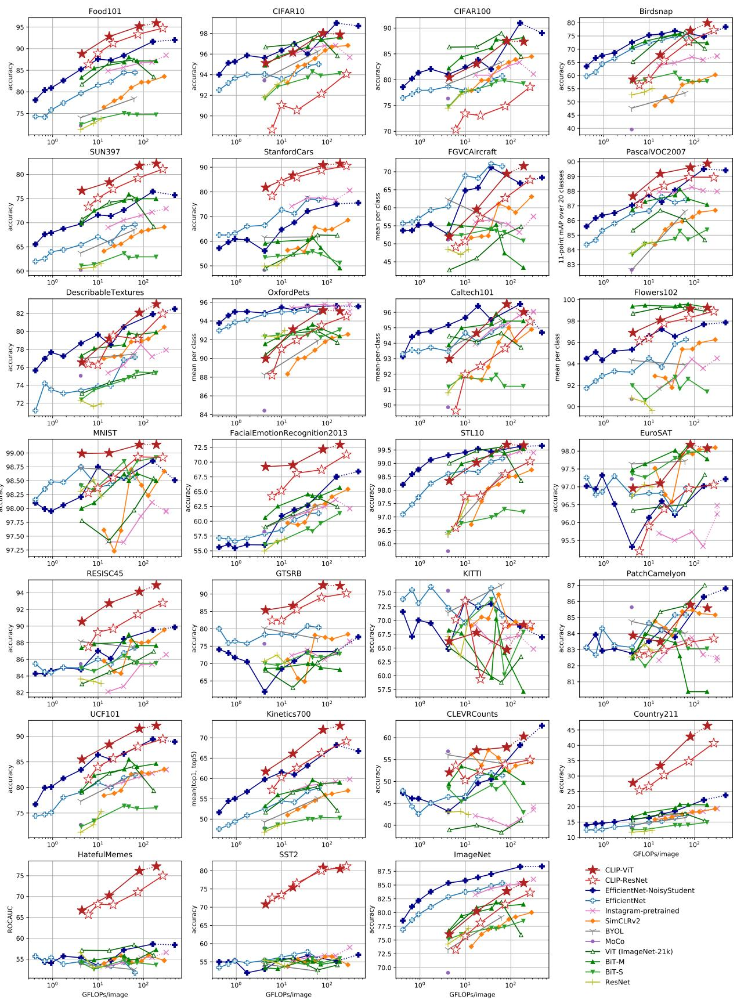  

图 20. 使用表 10 中的数据，对 27 个数据集分别绘制线性探测性能。

  

图21. 36个CLIP零样本分类器预测结果的可视化。除重新选取Hateful Memes以避免冒犯性内容外，所有示例均为随机选取。图中展示了前5个类别的预测概率以及用于表示该类别的文本。当使用多个模板时，显示的是第一个模板。真实标签（ground truth label）以绿色显示，错误预测以橙色显示。

<table><tr><td colspan="2"></td><td>Food101</td><td>CIFAR10</td><td>CIFAR100</td><td>Birdsnap</td><td>SUN397</td><td>Stanford Cars</td><td>FGVC Aircraft</td><td>VOC2007</td><td>DTD</td><td>Oxford Pets</td><td>Caltech101</td><td>Flowers102</td><td>MNIST</td><td>FER2013</td><td>STL10</td><td>EuroSAT</td><td>RESISC45</td><td>GTSRB</td><td>KITTI</td><td>Country211</td><td>PCam</td><td>UCF101</td><td>Kinetics700</td><td>CLEVR</td><td>Hateful Memes</td><td>Rendered SST2</td><td>ImageNet</td></tr><tr><td rowspan="5">CLIP-ResNet</td><td>RN50</td><td>81.1</td><td>75.6</td><td>41.6</td><td>32.6</td><td>59.6</td><td>55.8</td><td>19.3</td><td>82.1</td><td>41.7</td><td>85.4</td><td>82.1</td><td>65.9</td><td>66.6</td><td>42.2</td><td>94.3</td><td>41.1</td><td>54.2</td><td>35.2</td><td>42.2</td><td>16.1</td><td>57.6</td><td>63.6</td><td>43.5</td><td>20.3</td><td>59.7</td><td>56.9</td><td>59.6</td></tr><tr><td>RN101</td><td>83.9</td><td>81.0</td><td>49.0</td><td>37.2</td><td>59.9</td><td>62.3</td><td>19.5</td><td>82.4</td><td>43.9</td><td>86.2</td><td>85.1</td><td>65.7</td><td>59.3</td><td>45.6</td><td>96.7</td><td>33.1</td><td>58.5</td><td>38.3</td><td>33.3</td><td>16.9</td><td>55.2</td><td>62.2</td><td>46.7</td><td>28.1</td><td>61.1</td><td>64.2</td><td>62.2</td></tr><tr><td>RN50x4</td><td>86.8</td><td>79.2</td><td>48.9</td><td>41.6</td><td>62.7</td><td>67.9</td><td>24.6</td><td>83.0</td><td>49.3</td><td>88.1</td><td>86.0</td><td>68.0</td><td>75.2</td><td>51.1</td><td>96.4</td><td>35.0</td><td>59.2</td><td>35.7</td><td>26.0</td><td>20.2</td><td>57.5</td><td>65.5</td><td>49.0</td><td>17.0</td><td>58.3</td><td>66.6</td><td>65.8</td></tr><tr><td>RN50x16</td><td>90.5</td><td>82.2</td><td>54.2</td><td>45.9</td><td>65.0</td><td>72.3</td><td>30.3</td><td>82.9</td><td>52.8</td><td>89.7</td><td>87.6</td><td>71.9</td><td>80.0</td><td>56.0</td><td>97.8</td><td>40.3</td><td>64.4</td><td>39.6</td><td>33.9</td><td>24.0</td><td>62.5</td><td>68.7</td><td>53.4</td><td>17.6</td><td>58.9</td><td>67.6</td><td>70.5</td></tr><tr><td>RN50x64</td><td>91.8</td><td>86.8</td><td>61.3</td><td>48.9</td><td>66.9</td><td>76.0</td><td>35.6</td><td>83.8</td><td>53.4</td><td>93.4</td><td>90.6</td><td>77.3</td><td>90.8</td><td>61.0</td><td>98.3</td><td>59.4</td><td>69.7</td><td>47.9</td><td>33.2</td><td>29.6</td><td>65.0</td><td>74.1</td><td>56.8</td><td>27.5</td><td>62.1</td><td>70.7</td><td>73.6</td></tr><tr><td rowspan="4">CLIP-ViT</td><td>B/32</td><td>84.4</td><td>91.3</td><td>65.1</td><td>37.8</td><td>63.2</td><td>59.4</td><td>21.2</td><td>83.1</td><td>44.5</td><td>87.0</td><td>87.9</td><td>66.7</td><td>51.9</td><td>47.3</td><td>97.2</td><td>49.4</td><td>60.3</td><td>32.2</td><td>39.4</td><td>17.8</td><td>58.4</td><td>64.5</td><td>47.8</td><td>24.8</td><td>57.6</td><td>59.6</td><td>63.2</td></tr><tr><td>B/16</td><td>89.2</td><td>91.6</td><td>68.7</td><td>39.1</td><td>65.2</td><td>65.6</td><td>27.1</td><td>83.9</td><td>46.0</td><td>88.9</td><td>89.3</td><td>70.4</td><td>56.0</td><td>52.7</td><td>98.2</td><td>54.1</td><td>65.5</td><td>43.3</td><td>44.0</td><td>23.3</td><td>48.1</td><td>69.8</td><td>52.4</td><td>23.4</td><td>61.7</td><td>59.8</td><td>68.6</td></tr><tr><td>L/14</td><td>92.9</td><td>96.2</td><td>77.9</td><td>48.3</td><td>67.7</td><td>77.3</td><td>36.1</td><td>84.1</td><td>55.3</td><td>93.5</td><td>92.6</td><td>78.7</td><td>87.2</td><td>57.5</td><td>99.3</td><td>59.9</td><td>71.6</td><td>50.3</td><td>23.1</td><td>32.7</td><td>58.8</td><td>76.2</td><td>60.3</td><td>24.3</td><td>63.3</td><td>64.0</td><td>75.3</td></tr><tr><td>L/14-336px</td><td>93.8</td><td>95.7</td><td>77.5</td><td>49.5</td><td>68.4</td><td>78.8</td><td>37.2</td><td>84.3</td><td>55.7</td><td>93.5</td><td>92.8</td><td>78.3</td><td>88.3</td><td>57.7</td><td>99.4</td><td>59.6</td><td>71.7</td><td>52.3</td><td>21.9</td><td>34.9</td><td>63.0</td><td>76.9</td><td>61.3</td><td>24.8</td><td>63.3</td><td>67.9</td><td>76.2</td></tr></table>

表 11. CLIP 模型在 27 个数据集上的零样本性能。

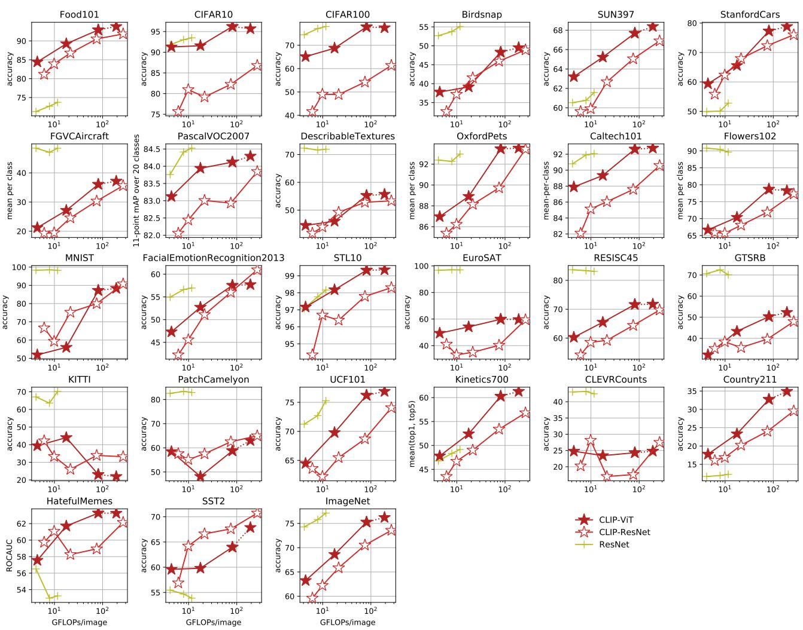  

图22. CLIP 的零样本性能与线性探测（linear-probe）ResNet 性能的比较

## B. 零样本预测（Zero-Shot Prediction）

为了对 CLIP 的零样本（zero-shot）性能提供一个定性的总结 / 概览，我们在 Figure 21 中可视化了 36 个不同零样本 CLIP 分类器的随机选取的预测结果。此外，Table 11 和 Figure 22 给出了每个数据集的零样本性能得分。

## C. 重复图像检测器（Duplicate Detector）

我们早期对重复图像检测与分析的尝试采用了模型所学嵌入空间中的最近邻方法。虽然使用模型自身的相似性概念是很直观的，但我们遇到了一些问题。我们发现模型的特征空间在很大程度上偏向于语义相似性。由于许多不同的物体（例如足球、同一种类的花朵等）描述方式相似，它们之间出现了大量几乎完全相同的相似度，从而导致许多误报。我们还观察到，模型在给某些类型的近似重复图像赋予高相似度方面表现得相当差。我们多次注意到，由不同缩放算法（最近邻 vs. 双线性）预处理的具有高频纹理（例如毛发或条纹图案）的图像，其相似度可能低得出乎意料。这导致了许多漏报。

我们构建了自己的近似重复图像检测器以解决这一问题。我们创建了一个合成数据增强流水线，结合了多种常见的图像操作。该增强流水线结合了随机裁剪与缩放、宽高比扭曲、缩小与放大到不同分辨率、微小旋转、jpeg 压缩以及 HSV 颜色抖动。该流水线还会针对所有相关步骤从不同的插值算法中随机选择。随后我们训练了一个模型，使其最大化一张图像与其变换版本之间的相似度，同时最小化与训练批次中所有其他图像的相似度。我们采用了与 CLIP 相同的 n-pair / InfoNCE 损失函数，但温度参数固定为 0.07。

我们选择了 ResNet-50 作为模型架构。我们使用 (Zhang, 2019) 中的抗混叠改进对基础 ResNet-50 进行了修改，并使用权重归一化（weight norm）(Salimans & Kingma, 2016) 替代批归一化（batch norm）(Ioffe & Szegedy, 2015)，以避免通过批次统计信息泄露重复图像的相关信息——这一问题在 (Henaff, 2020) 中也曾被指出。我们还发现 GELU 激活函数 (Hendrycks & Gimpel, 2016) 在该任务上表现更好。我们以 1,712 的总批次大小，在从我们预训练数据集中采样的约 3000 万张图像上训练了该模型。训练结束时，在其代理训练任务上达到了近乎 100% 的准确率。

<table><tr><td rowspan="2">Dataset</td><td colspan="3">Linear Classifier</td><td colspan="3">Zero Shot</td></tr><tr><td>YFCC</td><td>WIT</td><td> $\Delta$ </td><td>YFCC</td><td>WIT</td><td> $\Delta$ </td></tr><tr><td>Birdsnap</td><td>47.4</td><td>35.3</td><td>+12.1</td><td>19.9</td><td>4.5</td><td>+15.4</td></tr><tr><td>Country211</td><td>23.1</td><td>17.3</td><td>+5.8</td><td>5.2</td><td>5.3</td><td>+0.1</td></tr><tr><td>Flowers102</td><td>94.4</td><td>89.8</td><td>+4.6</td><td>48.6</td><td>21.7</td><td>+26.9</td></tr><tr><td>GTSRB</td><td>66.8</td><td>72.5</td><td>-5.7</td><td>6.9</td><td>7.0</td><td>-0.1</td></tr><tr><td>UCF101</td><td>69.2</td><td>74.9</td><td>-5.7</td><td>22.9</td><td>32.0</td><td>-9.1</td></tr><tr><td>Stanford Cars</td><td>31.4</td><td>50.3</td><td>-18.9</td><td>3.8</td><td>10.9</td><td>-7.1</td></tr><tr><td>ImageNet</td><td>62.0</td><td>60.8</td><td>+1.2</td><td>31.3</td><td>27.6</td><td>+3.7</td></tr><tr><td>Dataset Average</td><td>65.5</td><td>66.6</td><td>-1.1</td><td>29.6</td><td>30.0</td><td>-0.4</td></tr><tr><td>Dataset “Wins”</td><td>10</td><td>15</td><td>-5</td><td>19</td><td>18</td><td>+1</td></tr></table>

Table 12. CLIP 在仅使用 YFCC100M 训练时表现相似。比较仅在 YFCC100M 上训练的 ResNet-50 与在 WIT（WebImageText）同等大小子集上训练的模型，在零样本（zero-shot）和线性分类器（linear classifier）评估中显示出相似的平均性能和胜场数。然而，在特定数据集上的表现存在较大差异。我们展示了在线性探针（linear probe）评估中 YFCC 相对 WIT 表现最好和最差的 3 个数据集上的性能，以突出这一点，同时展示所有线性探针和零样本评估以及规范的 ImageNet 数据集上的总体性能。

## D. 在 YFCC100M 上的数据集消融研究

为了研究我们的自定义数据集是否对 CLIP 的性能至关重要，我们在 YFCC100M 数据集的一个经过筛选的子集上（详见第 2.2 节）训练了一个模型，并将其性能与在同一模型上以 WIT 的同等大小子集训练的结果进行比较。我们对每个模型训练了 32 个 epoch，到此时由于过拟合（overfitting），迁移性能开始趋于平稳。结果如表 12 所示。在我们整个评估套件中，无论在零样本还是线性探针设置下，YFCC 和 WIT 的平均表现都相近。然而，在特定细粒度分类数据集上的表现可能差异很大——有时超过 10%。我们的推测是，这些性能差异反映了每个预训练数据集中相关数据的相对密度。例如，在 YFCC100M 上进行预训练（该数据集可能包含许多鸟类和花朵的照片——这些是摄影师的常见拍摄主题），可以在 Birdsnap 和 Flowers102 上取得更好的性能；而在 WIT 上进行预训练则能产生更好的汽车和宠物分类器（这些在我们的数据集中似乎很常见）。

总体而言，这些结果令人鼓舞，因为它们表明我们的方法可以使用任何经过合理筛选的成对（文本，图像）数据集合。这与最近的工作相呼应，后者报告了在医学影像这一相当不同的领域上使用相同对比预训练（contrastive pre-training）目标所取得的积极成果（Zhang et al., 2020）。这也类似于噪声学生自训练（noisy student self-training）的发现，即使用其 JFT300M 数据集相比 YFCC100M 仅带来略微改进（Xie et al., 2020）。我们怀疑我们的数据集相比现有 YFCC100M 的主要优势在于其规模要大得多。

最后，我们提醒一下，WIT 包含了 YFCC100M 的这一筛选子集。这可能导致我们的消融研究低估了 YFCC100M 与 WIT 其余部分之间的性能差异。我们认为这种情况不太可能，因为 YFCC100M 仅占整体 WIT 数据混合的 3.7%，并且在创建 WIT 期间将其加入现有数据混合时并未明显改变模型的性能。

## E. 选定任务和数据集的结果

由于本工作中涉及的数据集和实验种类繁多，正文主要聚焦于对总体结果进行总结和分析。在以下小节中，我们将报告针对特定任务、数据集和评估设置组的详细性能。

## E.1. 图像与文本检索（Image and Text Retrieval）

CLIP 在我们的含噪网络规模数据集上以图像-文本检索任务为目标进行预训练。虽然本文的核心关注点是面向迁移到众多下游数据集的表征学习与任务学习，但验证 CLIP 在其预训练任务本身上能够取得高迁移性能仍是一项重要的健全性检查 / 概念验证。在表 13 中，我们检验了 CLIP 在 Flickr30k 和 MSCOCO 数据集上针对文本检索与图像检索的零样本迁移性能。零样本 CLIP 在这两个数据集上与之前所有零样本结果持平甚至更优。零样本 CLIP 在 Flickr30k 文本检索任务上也与当前总体 SOTA 具备竞争力。在图像检索方面，CLIP 相对于总体最先进水平的性能明显较低。然而，零样本 CLIP 仍与经过微调的 Unicoder-VL 具备竞争力。在更大的 MS-COCO 数据集上，微调显著提升了性能，而零样本 CLIP 与最新工作无法构成竞争。对于这两个数据集，我们在每张图像的描述前都添加了提示词「a photo of」，我们发现这能将 CLIP 的零样本 R@1 性能提升 1 到 2 个百分点。

## E.2. 光学字符识别（Optical Character Recognition）

虽然可视化研究表明 ImageNet 模型包含对图像中文本存在做出响应的特征（Zeiler & Fergus, 2014），但这些表征对于执行光学字符识别（OCR）任务而言并不足够精细。为了进行补偿，模型会通过附加定制 OCR 引擎的输出和特征来增强，以提升需要此类能力的任务上的性能（Singh et al., 2019; Yang et al., 2020）。在 CLIP 研发过程中早期阶段，我们注意到 CLIP 开始习得初步的 OCR 能力，并且这种能力在整个项目过程中似乎在稳步提升。为了评估这一通过定性观察到的现象，我们衡量了在 5 个需要直接或间接使用 OCR 的数据集上的性能。其中三个数据集 MNIST（LeCun）、SVHN（Netzer et al., 2011）以及 IIIT5K（Mishra et al., 2012）直接检验模型执行低层级字符和单词识别的能力，而 Hateful Memes（Kiela et al., 2020）和 SST-2（Socher et al., 2013）则检验模型利用 OCR 执行语义任务的能力。结果报告于表 14 中。

CLIP 的性能仍然存在很大的波动，并且似乎对域（渲染图像或自然图像）以及待识别文本类型（数字或单词）的某种组合较为敏感。CLIP 在 Hateful Memes 和 SST-2 上的光学字符识别（OCR）性能最强——这两个数据集中的文本都是数字渲染的，并且主要由单词组成。在 IIIT5K（自然图像中单独裁剪出的单词）上，零样本 CLIP 的表现略有提升，其性能与 Jaderberg 等人（2014）早期结合深度学习和结构化预测来执行开放词汇 OCR 的工作相当。然而，在涉及手写数字和街景数字识别的两个数据集上，性能明显较低。CLIP 在完整数字 SVHN 上的准确率仅为 51%，远低于任何已发表的结果。检查表明，CLIP 在处理重复字符以及 SVHN 的低分辨率和模糊图像时存在困难。CLIP 的零样本 MNIST 性能同样较差，并且被在原始像素上训练的有监督逻辑回归——最简单的机器学习基线之一——所超越。

SST-2 是一个句子级别的自然语言处理（NLP）数据集，我们将其渲染为图像。我们将 SST-2 纳入其中，以检查 CLIP 是否能够将低级别的 OCR 能力转化为更高级别的表示。在 CLIP 对渲染句子的表示上拟合一个线性分类器，可达到 80.5% 的准确率。这与使用在 8400 亿个 token 上预训练的 GloVe 词向量（Pennington et al., 2014）的连续词袋基线的 80% 准确率相当。虽然以今天的标准来看这只是一个简单的 NLP 基线，并且远低于当前最优水平（SOTA）的 97.5%，但令人鼓舞的是，CLIP 能够将渲染文本的图像转化为非平凡的句子级表示。全监督 CLIP 在 Hateful Meme 检测方面也表现出惊人的强大性能，仅落后当前单模型 SOTA 0.7 个百分点，并且比原始论文中的最佳基线高出几个百分点。与 SST-2 类似，这些在 Hateful Memes 上的其他结果使用了 CLIP 无法访问的真实文本。最后，我们注意到，零样本 CLIP 的表现优于我们评估套件中包含的所有其他 56 个模型上使用全监督线性探针所取得的最佳结果。这表明，与现有的自监督和有监督表示学习工作相比，CLIP 的 OCR 能力至少具有某种程度的独特性。

<table><tr><td rowspan="3" colspan="2"></td><td colspan="6">Text Retrieval</td><td colspan="6">Image Retrieval</td></tr><tr><td colspan="3">Flickr30k</td><td colspan="3">MSCOCO</td><td colspan="3">Flickr30k</td><td colspan="3">MSCOCO</td></tr><tr><td>R@1</td><td>R@5</td><td>R@10</td><td>R@1</td><td>R@5</td><td>R@10</td><td>R@1</td><td>R@5</td><td>R@10</td><td>R@1</td><td>R@5</td><td>R@10</td></tr><tr><td rowspan="5">Finetune</td><td> $\text{Unicoder-VL}^a$ </td><td>86.2</td><td>96.3</td><td>99.0</td><td>62.3</td><td>87.1</td><td>92.8</td><td>71.5</td><td>90.9</td><td>94.9</td><td>46.7</td><td>76.0</td><td>85.3</td></tr><tr><td> $\text{Uniter}^b$ </td><td>87.3</td><td>98.0</td><td>99.2</td><td>65.7</td><td>88.6</td><td>93.8</td><td>75.6</td><td>94.1</td><td>96.8</td><td>52.9</td><td>79.9</td><td>88.0</td></tr><tr><td> $VILLA^c$ </td><td>87.9</td><td>97.5</td><td>98.8</td><td>-</td><td>-</td><td>-</td><td>76.3</td><td>94.2</td><td>96.8</td><td>-</td><td>-</td><td>-</td></tr><tr><td> $\text{Oscar}^d$ </td><td>-</td><td>-</td><td>-</td><td>73.5</td><td>92.2</td><td>96.0</td><td>-</td><td>-</td><td>-</td><td>57.5</td><td>82.8</td><td>89.8</td></tr><tr><td> $\text{ERNIE-ViL}^e$ </td><td>88.7</td><td>98.0</td><td>99.2</td><td>-</td><td>-</td><td>-</td><td>76.7</td><td>93.6</td><td>96.4</td><td>-</td><td>-</td><td>-</td></tr><tr><td rowspan="5">Zero-Shot</td><td> $Visual\ N-Grams^f$ </td><td>15.4</td><td>35.7</td><td>45.1</td><td>8.7</td><td>23.1</td><td>33.3</td><td>8.8</td><td>21.2</td><td>29.9</td><td>5.0</td><td>14.5</td><td>21.9</td></tr><tr><td> $ImageBERT^g$ </td><td>-</td><td>-</td><td>-</td><td>44.0</td><td>71.2</td><td>80.4</td><td>-</td><td>-</td><td>-</td><td>32.3</td><td>59.0</td><td>70.2</td></tr><tr><td> $\text{Unicoder-VL}^a$ </td><td>64.3</td><td>86.8</td><td>92.3</td><td>-</td><td>-</td><td>-</td><td>48.4</td><td>76.0</td><td>85.2</td><td>-</td><td>-</td><td>-</td></tr><tr><td> $\text{Uniter}^b$ </td><td>83.6</td><td>95.7</td><td>97.7</td><td>-</td><td>-</td><td>-</td><td>68.7</td><td>89.2</td><td>93.9</td><td>-</td><td>-</td><td>-</td></tr><tr><td>CLIP</td><td>88.0</td><td>98.7</td><td>99.4</td><td>58.4</td><td>81.5</td><td>88.1</td><td>68.7</td><td>90.6</td><td>95.2</td><td>37.8</td><td>62.4</td><td>72.2</td></tr></table>

表 13. CLIP 提升了零样本检索性能，并在 Flickr30k 文本检索任务上与最优的微调结果具有竞争力。加粗表示整体最优性能，下划线表示类别内最优性能（零样本或微调）。对于所有其他模型，无论模型规模或变体如何，均报告其在论文中的最佳结果。MSCOCO 上的性能在 5k 测试集上报告。<sup>a</sup>(Li et al., 2020a) <sup>b</sup>(Chen et al., 2019) <sup>c</sup>(Gan et al., 2020) <sup>d</sup>(Li et al., 2020b) <sup>e</sup>(Yu et al., 2020) <sup>f</sup>(Li et al., 2017) <sup>g</sup>(Qi et al., 2020)

<table><tr><td colspan="2"></td><td>MNIST</td><td>SVHN</td><td>IIIT5K1k</td><td>Hateful Memes</td><td>SST-2</td></tr><tr><td rowspan="3">Finetune</td><td>SOTA</td><td> $99.8^a$ </td><td> $96.4^b$ </td><td> $98.9^c$ </td><td> $78.0^d$ </td><td> $97.5^e$ </td></tr><tr><td> $JOINT^f$ </td><td>-</td><td>-</td><td>89.6</td><td>-</td><td>-</td></tr><tr><td> $CBoW^g$ </td><td>-</td><td>-</td><td>-</td><td>-</td><td>80.0</td></tr><tr><td rowspan="3">Linear</td><td>Raw Pixels</td><td>92.5</td><td>-</td><td>-</td><td>-</td><td>-</td></tr><tr><td>ES Best</td><td> $98.9^h$ </td><td>-</td><td>-</td><td> $58.6^h$ </td><td> $59.0^i$ </td></tr><tr><td>CLIP</td><td>99.2</td><td>-</td><td>-</td><td>77.3</td><td>80.5</td></tr><tr><td>ZS</td><td>CLIP</td><td>88.4</td><td>51.0</td><td>90.0</td><td>63.3</td><td>67.9</td></tr></table>

表 14. 5 个数据集上的 OCR 性能。除 Hateful Memes 在 dev 集上报告 ROC AUC 之外，其他所有指标均为测试集上的准确率。SOTA 报告为据我们所知的最佳单模型结果。ES Best 报告了我们评测套件中 56 个非 CLIP 模型中的最佳性能。<sup>a</sup>(Assiri, 2020) <sup>b</sup>(Jaderberg et al., 2015) <sup>c</sup>(Wang et al., 2020) <sup>d</sup>(Lippe et al., 2020) <sup>f</sup>(Jaderberg et al., 2014) <sup>g</sup>(Wang et al., 2018) <sup>h</sup>(Xie et al., 2020) <sup>i</sup>(Mahajan et al., 2018)

## E.3. 视频中的动作识别（Action Recognition in Videos）

为了学习，自然语言的一个潜在重要方面在于它能够表达、并因而能够监督极其广泛的概念集合。由于 CLIP 模型被训练来将半任意的文本与图像配对，它很可能获得涵盖普通名词与专有名词、动词以及形容词的广泛视觉概念的监督。相比之下，ImageNet-1K 仅标注普通名词。ImageNet 中缺乏更广泛的监督，是否会导致 ImageNet 模型在涉及非名词视觉概念识别任务上的迁移能力较弱？

为了探究这一问题，我们在若干衡量模型识别动词能力的视频动作分类数据集上测量并比较了 CLIP 与 ImageNet 模型的性能。在表 15 中，我们报告了在 UCF-101（Soomro 等人，2012）和 Kinetics-700（Carreira 等人，2019）上的结果——这是该任务的两个常用数据集。然而，我们基于 CPU 的线性分类器在视频数据集上的评估耗时过长，因为训练帧数量极其庞大。为应对这一问题，我们对每个视频进行激进的下采样，仅保留单个中心帧，从而有效地将其转换为一个图像分类数据集。因此，我们在线性评估设置下报告的性能可能在一定程度上低估了实际性能。

<table><tr><td rowspan="2" colspan="2"></td><td rowspan="2">UCF101Top-1</td><td rowspan="2">K700AVG</td><td colspan="2">RareAct</td></tr><tr><td>mWAP</td><td>mWSAP</td></tr><tr><td rowspan="4">Finetune</td><td> $R(2+1)D-BERT^a$ </td><td>98.7</td><td>-</td><td>-</td><td>-</td></tr><tr><td>NS ENet-L2b</td><td>-</td><td>84.8</td><td>-</td><td>-</td></tr><tr><td>HT100M S3Dd</td><td>91.3</td><td>-</td><td>-</td><td>-</td></tr><tr><td>Baseline I3De</td><td>-</td><td>70.2</td><td>-</td><td>-</td></tr><tr><td rowspan="3">Linear</td><td>MMV FACf</td><td>91.8</td><td>-</td><td>-</td><td>-</td></tr><tr><td>NS ENet-L2c</td><td>89.4c</td><td>68.2c</td><td>-</td><td>-</td></tr><tr><td>CLIP</td><td>92.0</td><td>73.0</td><td>-</td><td>-</td></tr><tr><td rowspan="2">ZS</td><td>HT100M S3Dd</td><td>-</td><td>-</td><td>30.5</td><td>34.8</td></tr><tr><td>CLIP</td><td>80.3</td><td>69.6</td><td>40.7</td><td>44.8</td></tr></table>

表 15. 在 3 个视频数据集上的动作识别性能。据我们所知，报告了单模型当前最优（SOTA）结果。请注意，linear CLIP 和 linear NS ENet-L2 是在每个数据集的单帧下采样版本上进行训练和评估的，无法与先前工作直接比较。在 Kinetics-700 上，我们报告 ActivityNet 竞赛指标，即 top-1 和 top-5 性能的平均值。<sup>a</sup>(Kalfaoglu 等，2020) <sup>b</sup>(Lu 等，2020) <sup>c</sup>(Xie 等，2020) <sup>d</sup>(Miech 等，2020b) <sup>e</sup>(Carreira 等，2019) <sup>f</sup>(Alayrac 等，2020)

<table><tr><td rowspan="2"></td><td rowspan="2">IN Top-1</td><td rowspan="2">IN-V2 Top-1</td><td rowspan="2">IN-A Top-1</td><td rowspan="2">IN-R Top-1</td><td rowspan="2">ObjectNet Top-1</td><td rowspan="2">IN-Sketch Top-1</td><td colspan="2">IN-Vid</td><td colspan="2">YTBB</td></tr><tr><td>PM0</td><td>PM10</td><td>PM0</td><td>PM10</td></tr><tr><td>NS EfficientNet-L2 $^{a}$ </td><td>88.3</td><td>80.2</td><td>84.9</td><td>74.7</td><td>68.5</td><td>47.6</td><td>88.0</td><td>82.1</td><td>67.7</td><td>63.5</td></tr><tr><td>FixResNeXt101-32x48d V2 $^{b}$ </td><td>86.4</td><td>78.0</td><td>68.4</td><td>80.0</td><td>57.8</td><td>59.1</td><td>85.8</td><td>72.2</td><td>68.9</td><td>57.7</td></tr><tr><td>Linear Probe CLIP</td><td>85.4</td><td>75.9</td><td>75.3</td><td>84.2</td><td>66.2</td><td>57.4</td><td>89.1</td><td>77.2</td><td>68.7</td><td>63.1</td></tr><tr><td>Zero-Shot CLIP</td><td>76.2</td><td>70.1</td><td>77.2</td><td>88.9</td><td>72.3</td><td>60.2</td><td>95.3</td><td>89.2</td><td>95.2</td><td>88.5</td></tr></table>

Table 16. 详细的 ImageNet 鲁棒性性能。IN 是 ImageNet 的缩写。<sup>a</sup>(Xie et al., 2020) <sup>b</sup>(Touvron et al., 2019)

尽管存在这一劣势，CLIP 特征在该任务上的迁移能力却出奇地好。CLIP 在线性探针评估设置下匹配了 UCF-101 上先前最佳结果，并在我们评估套件的所有其他模型中表现最佳。在 Kinetics-700 上，CLIP 也优于原论文中微调后的 I3D 基线。由于不需要训练阶段，我们报告了 CLIP 在所有帧上对预测取平均时的零样本性能。CLIP 在此设置下也表现良好，并且在 Kinetics-700 上其性能与在 545000 个标注视频上训练的全监督 I3D 基线相差不到 1%。受到这些结果的鼓舞，我们还测量了 CLIP 在最近提出的 RareAct 数据集（Miech et al., 2020a）上的表现，该数据集旨在衡量对非常规动作（如"锤打手机"和"钻鸡蛋"）的零样本识别能力。CLIP 比之前的最先进方法——一个在从 1 亿个教学视频中自动提取的字幕上训练的 S3D 模型——高出 10 个百分点。

虽然 CLIP 在动作识别任务上表现令人鼓舞地强劲，但我们注意到，所比较的模型之间除了监督形式之外还存在许多差异，例如模型架构、训练数据分布、数据集规模以及所用算力。还需要进一步的工作来更精确地确定哪些具体设计决策有助于在该任务上实现高性能。

<table><tr><td></td><td>1km</td><td>25km</td><td>200km</td><td>750km</td><td>2500km</td></tr><tr><td> $ISNs^a$ </td><td>16.9</td><td>43.0</td><td>51.9</td><td>66.7</td><td>80.2</td></tr><tr><td> $CPlaNet^b$ </td><td>16.5</td><td>37.1</td><td>46.4</td><td>62.0</td><td>78.5</td></tr><tr><td>CLIP</td><td>13.9</td><td>32.9</td><td>43.0</td><td>62.0</td><td>79.3</td></tr><tr><td> $Deep-Ret+^c$ </td><td>14.4</td><td>33.3</td><td>47.7</td><td>61.6</td><td>73.4</td></tr><tr><td> $PlaNet^d$ </td><td>8.4</td><td>24.5</td><td>37.6</td><td>53.6</td><td>71.3</td></tr></table>

表 17. 在 IM2GPS 测试集上的地理定位性能。指标为在给定半径范围内被定位的图像百分比。模型按平均性能排序。<sup>a</sup>(Muller-Budack 等人, 2018) <sup>b</sup>(Hongsuck Seo 等人, 2018) <sup>c</sup>(Vo 等人, 2017) <sup>c</sup>(Weyand 等人, 2016)

## E.4. 地理定位（Geolocalization）

在 CLIP 的开发过程中，我们注意到的另一种行为是它识别许多地点和位置的能力。为了量化这一点，我们按照附录 A 中所述创建了 Country211 数据集，并在整篇论文中报告了在该数据集上的结果。然而，由于这是一个新的基准，为了与之前在地理定位方面的工作进行比较，我们还在表 17 中报告了 Hays & Efros (2008) 提出的 IM2GPS 测试集上的结果。由于 IM2GPS 是一个回归基准，我们使用 CLIP 的嵌入空间在参考图像集合中猜测最近邻图像的 GPS 坐标。由于使用了最近邻回归，这并非零样本（zero-shot）结果。尽管仅查询了 100 万张图像，远少于之前的工作，CLIP 的表现仍可与若干任务专用模型相媲美。然而，它尚不足以与当前的最先进方法相竞争。

## E.5. 对分布偏移的鲁棒性

第 3.3 节提供了与 ImageNet 相关的鲁棒性结果的高层次总结与分析。我们在本附录中简要提供一些额外的数值细节。表 16 给出了每个数据集上的性能结果，并与 Taori et al. (2020) 评估套件中报告的当前最先进结果进行了对比。零样本 CLIP 在 7 个数据集中的 5 个上刷新了最先进水平，分别是 ImageNet-R、ObjectNet、ImageNet-Sketch、ImageNet-Vid 和 Youtube-BB。CLIP 的提升幅度在 ImageNet-Vid 和 Youtube-BB 上最大，这得益于其灵活的零样本能力；而在 ImageNet-R 上的提升也很大，这可能反映了 CLIP 的预训练分布中包含了大量创意内容。正如 Taori et al. (2020) 中所讨论的，在基于 Instagram 预训练的 ResNeXt 模型上也曾观察到类似的现象。

## F. 模型超参数（Model Hyperparameters）

<table><tr><td>Hyperparameter</td><td>Value</td></tr><tr><td>Batch size</td><td>32768</td></tr><tr><td>Vocabulary size</td><td>49408</td></tr><tr><td>Training epochs</td><td>32</td></tr><tr><td>Maximum temperature</td><td>100.0</td></tr><tr><td>Weight decay</td><td>0.2</td></tr><tr><td>Warm-up iterations</td><td>2000</td></tr><tr><td>Adam  $\beta_1$ </td><td>0.9</td></tr><tr><td>Adam  $\beta_2$ </td><td>0.999 (ResNet), 0.98 (ViT)</td></tr><tr><td>Adam  $\epsilon$ </td><td> $10^{-8}$  (ResNet),  $10^{-6}$  (ViT)</td></tr></table>

表 18. CLIP 常见超参数

<table><tr><td>Model</td><td>Learning rate</td><td>Embedding dimension</td><td>Input resolution</td><td>ResNet blocks</td><td>width</td><td>Text Transformer layers</td><td>width</td><td>heads</td></tr><tr><td>RN50</td><td> $5 \times 10^{-4}$ </td><td>1024</td><td>224</td><td>(3, 4, 6, 3)</td><td>2048</td><td>12</td><td>512</td><td>8</td></tr><tr><td>RN101</td><td> $5 \times 10^{-4}$ </td><td>512</td><td>224</td><td>(3, 4, 23, 3)</td><td>2048</td><td>12</td><td>512</td><td>8</td></tr><tr><td>RN50x4</td><td> $5 \times 10^{-4}$ </td><td>640</td><td>288</td><td>(4, 6, 10, 6)</td><td>2560</td><td>12</td><td>640</td><td>10</td></tr><tr><td>RN50x16</td><td> $4 \times 10^{-4}$ </td><td>768</td><td>384</td><td>(6, 8, 18, 8)</td><td>3072</td><td>12</td><td>768</td><td>12</td></tr><tr><td>RN50x64</td><td> $3.6 \times 10^{-4}$ </td><td>1024</td><td>448</td><td>(3, 15, 36, 10)</td><td>4096</td><td>12</td><td>1024</td><td>16</td></tr></table>

表 19. CLIP-ResNet 超参数

<table><tr><td>Model</td><td>Learning rate</td><td>Embedding dimension</td><td>Input resolution</td><td colspan="3">Vision Transformer layers width heads</td><td colspan="3">Text Transformer layers width heads</td></tr><tr><td>ViT-B/32</td><td> $5 \times 10^{-4}$ </td><td>512</td><td>224</td><td>12</td><td>768</td><td>12</td><td>12</td><td>512</td><td>8</td></tr><tr><td>ViT-B/16</td><td> $5 \times 10^{-4}$ </td><td>512</td><td>224</td><td>12</td><td>768</td><td>12</td><td>12</td><td>512</td><td>8</td></tr><tr><td>ViT-L/14</td><td> $4 \times 10^{-4}$ </td><td>768</td><td>224</td><td>24</td><td>1024</td><td>16</td><td>12</td><td>768</td><td>12</td></tr><tr><td>ViT-L/14-336px</td><td> $2 \times 10^{-5}$ </td><td>768</td><td>336</td><td>24</td><td>1024</td><td>16</td><td>12</td><td>768</td><td>12</td></tr></table>

表 20. CLIP-ViT 超参数