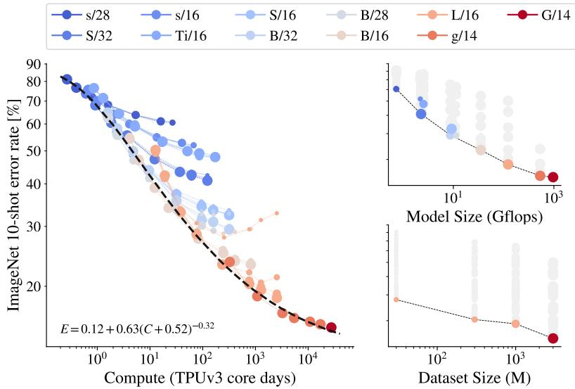
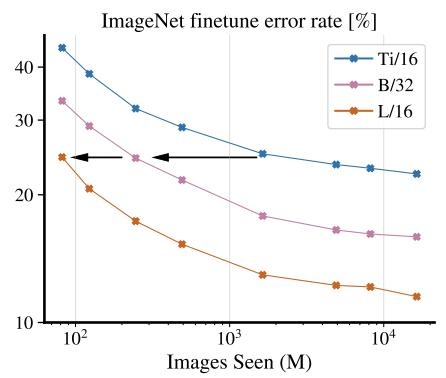
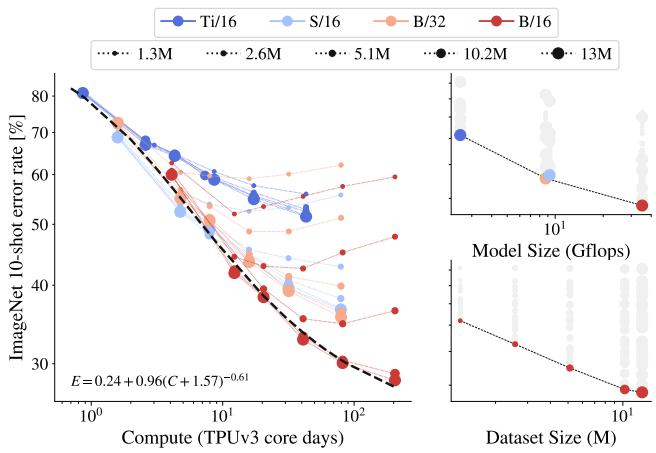
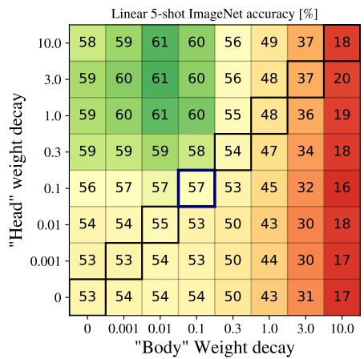
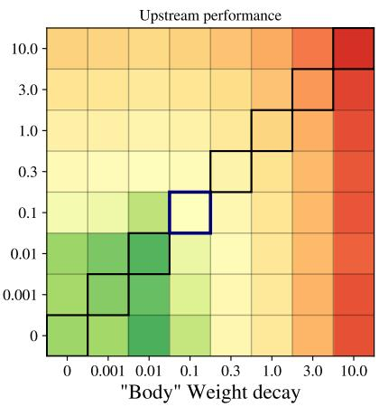
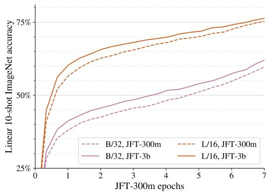
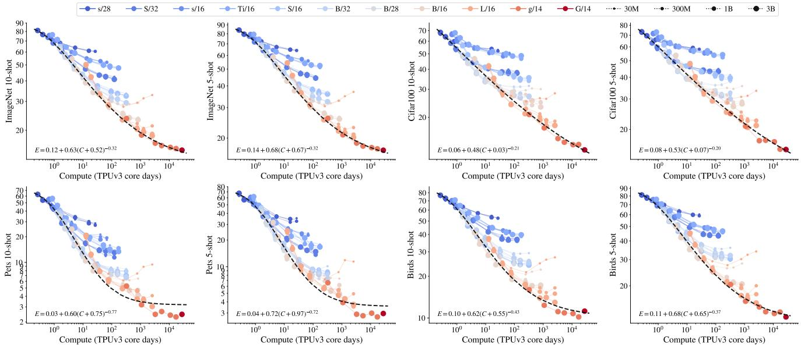

# 视觉 Transformer 的规模化（Scaling Vision Transformers）

Xiaohua Zhai<sup>?</sup>，Alexander Kolesnikov<sup>?</sup>，Neil Houlsby，Lucas Beyer<sup>?</sup>

Google Research, Brain Team，苏黎世（Zürich）

{xzhai, akolesnikov, neilhoulsby, lbeyer}@google.com

## 摘要

基于注意力机制的神经网络，例如视觉 Transformer（Vision Transformer, ViT），最近在许多计算机视觉基准上取得了最先进的结果。规模（Scale）是获得优异结果的首要要素，因此，理解模型的规模化特性是高效设计下一代模型的关键。虽然 Transformer 语言模型的规模化定律（scaling laws）已被研究过，但视觉 Transformer 如何规模化尚不清楚。为了解决这一问题，我们对 ViT 模型和数据同时进行向上和向下的规模化，并刻画了错误率、数据与计算量之间的关系。在此过程中，我们对 ViT 的架构和训练方法进行了改进，在降低显存占用的同时提升了最终模型的精度。由此，我们成功训练了一个参数量达 20 亿（two billion）的 ViT 模型，在 ImageNet 上达到了 90.45% top-1 准确率的新最先进水平。该模型在小样本迁移（few-shot transfer）任务上也表现优异，例如，在每类仅 10 个样本的情况下，即可在 ImageNet 上达到 84.86% 的 top-1 准确率。

## 1. 引言

基于注意力机制的 Transformer 架构 [45] 已在计算机视觉领域掀起了一场风暴 [8, 16]，正日益成为研究与实践中越来越受欢迎的选择。在此之前，Transformer 已广泛应用于自然语言处理（natural language processing, NLP）领域 [7, 15]。Transformer 在 NLP 中的最优规模化在文献 [22] 中得到了细致研究，其主要结论是：更大的模型不仅性能更好，而且能更高效地利用大规模计算预算。然而，这些发现在多大程度上可以迁移到视觉领域仍不清楚，因为视觉领域存在若干重要差异。例如，视觉中最成功的预训练方案是监督式的，而 NLP 中则采用无监督预训练。

在本文中，我们专注于研究在图像分类任务上预训练的 ViT 模型的迁移性能规模化定律。具体而言，我们实验的模型参数量从 500 万到 20 亿不等，数据集规模从 100 万到 30 亿张训练图像不等，计算预算从低于 1 个 TPUv3 核日（core-day）到超过 10 000 核日不等。我们的主要贡献是，在两个数据集上刻画了 ViT 模型在性能–计算量之间的前沿（frontier）。

  

图 1. 少样本迁移结果。我们的 ViT-G 模型在 ImageNet 上采用 10 样本线性评估，达到了 84.86% 的 top-1 准确率。

在此过程中，我们提出了一种改进的大规模训练方案（training recipe）。我们研究了训练超参数，发现一些细微的选择能够显著提升少样本迁移（few-shot transfer）性能。这种少样本迁移评估协议也被之前自然语言处理（NLP, Natural Language Processing）领域的大规模预训练工作所采用 [6]。具体而言，我们发现，仅对最终的线性预测层施加非常强的 L2 正则化（L2 regularization），能够得到具有极强少样本迁移能力的视觉表征。例如，在 ImageNet 数据集（包含 1 000 个类别）上每类仅用一个样本时，我们最好的模型就能达到 69.52% 的准确率；每类用 10 个样本时，准确率可达 84.86%。此外，我们大幅降低了 [16] 中提出的原始 ViT 模型的内存占用。我们通过针对硬件的架构改动和一种不同的优化器实现了这一点。因此，我们训练了一个具有 20 亿参数的模型，并在 ImageNet 上取得了新的最先进（state-of-the-art）准确率 90.45%。



  

图 2. 左/中：以 ImageNet 微调误差率和 10-shot 线性分类误差率衡量的表示质量，随总训练计算量的变化关系。一条饱和幂律（saturating power-law）能相当准确地近似帕累托前沿（Pareto frontier）。需要注意的是，较小的模型（蓝色阴影）或在较少图像上训练的模型（较小的标记）在训练时间较长时会出现饱和并脱离前沿。右上：在以模型大小为瓶颈时的表示质量。对每个模型大小，使用了大规模的数据集和充足的计算量，使得模型容量成为主要瓶颈。浅色阴影标记描绘了每个模型的次优运行结果。右下：按数据集大小划分的表示质量。对于每个数据集大小，突出了具有最佳大小和计算量的模型，因此数据集大小成为主要瓶颈。

## 2. 核心结果

我们首先给出关于规模扩展趋势的主要结果，然后在第 3 节介绍架构和训练流程方面的详细改进。在以下实验中，我们在公开的 ImageNet-21k [14] 数据集以及私有收集的图像上训练多个 ViT 模型，图像数量最多达到三十亿张弱标注图像。我们改变架构规模、训练图像数量以及训练时长。所有模型均在 TPUv3 上训练，因此总计算量以 TPUv3 核心-天（TPUv3 core-days）来衡量。为了评估模型所学到的表征质量，我们测量：（i）通过在冻结权重上训练一个线性分类器进行少样本（few-shot）迁移；（ii）通过在全部数据上对整个模型进行微调进行迁移；两种评估均针对多个基准任务。

### 2.1. 同时扩展计算量、模型规模与数据规模

图 2（Figure 2）展示了在 ImageNet [14] 上的 10 样本（10-shot）线性评估和微调评估结果。在其他数据集——Oxford IIIT Pets [28]、CIFAR-100 [24] 以及 Caltech-UCSD Birds [47]——上的类似趋势见附录中的图 9（Figure 9）。对于每种模型规模与数据规模的组合，我们以不同的步数进行预训练。在图 2 中，连线上的点表示同一个模型以不同步数训练的结果。我们做出如下观察。

首先，同时扩展计算量、模型规模和数据规模能够提升表征质量。在左图和中间图中，右下角的点表示模型规模、数据集规模和计算量均达到最大时取得了最低的错误率。然而，在最大规模下，模型似乎开始出现饱和，并落后于幂律（power law）前沿（即图 2 中双对数图上的线性关系）。

其次，表征质量可能会受限于模型规模。右上图展示了每种模型规模所能达到的最佳性能。由于容量有限，小型模型既无法从最大的数据集中获益，也无法利用更多的计算资源。图 2 的左图和中间图显示，Ti/16 模型即使在大量图像上训练，也倾向于取得较高的错误率。

第三，大型模型能够从额外数据中获益，即使数据量超过 10 亿张。当扩大模型规模时，表征质量可能受限于较小的数据集；即使 3 千万到 3 亿张图像也不足以让最大规模的模型达到饱和。在图 2 的中间图中，L/16 模型在 3 千万数据集上的错误率不会低于 27%；而在更大的数据集上，该模型能够取得 19% 的错误率。此外，当增加数据集规模时，我们观察到大型模型的性能有所提升，但小型模型则不然。当训练集规模从 10 亿增长到 30 亿张图像时，最大规模的模型甚至获得了性能提升（图 2 右下图）。然而，对于像 Ti/16 或 B/32 这样的小型模型，增大数据集规模并无帮助。例如，在图 2 的左图和中间图中，Ti/16 的所有曲线完全重合，表明该模型无论数据集规模如何都达到相同的性能。

### 2.2. 双饱和幂律

图 2 的左图与中图展示了表征质量相对于训练算力的 Pareto 前沿。该前沿包含了在模型形状与训练时长之间实现最佳算力分配的模型。

在跨越两个数量级以上的算力范围内，算力与性能之间的关系服从幂律 $( E = a C ^ { b } )$，在双对数图上表现为一条直线。然而，我们在算力谱的两端都观察到了「饱和」现象。在算力较高的一端，最大的模型并不会趋向于零错误率。如果根据我们的观察进行外推，一个无限容量的模型仍将获得非零的错误。这一现象在生成模型中也被观察到 [19]。[19] 的作者将这种残留误差称为任务的「不可约熵」。由于我们绘制的是错误率，信息论的解释并不适用，但我们的观察支持 ImageNet [4] 存在基本性能上限的观点。从定律的角度来看，这种饱和对应于错误率的一个加性常数：$E = a C ^ { - b } + c$ 中的 $c$。




  

图 3. ImageNet 上的错误率，相对于预训练期间所见图像的数量。更大的模型具有更高的样本效率，这一结论在多种设定下均保持一致：在冻结表征上进行少样本迁移（few-shot transfer）、在 ImageNet 上对网络进行微调，以及在 v2 测试集上对微调后的模型进行评估。

在计算量范围的低端，我们观察到较小模型出现了饱和现象；最小模型的性能优于按幂律（power-law）所预测的水平。出现这种饱和是因为即使是平凡解（trivial solutions）也能获得非零误差。例如，预测多数类（几乎零计算量）将获得与该类别在测试集中出现频率相关的准确率。这一下界在文献 [19] 中并未观察到，可能是因为其最小模型已足够大而避开了该区间，也可能是因为对数损失（log-loss）的饱和点比准确率更差（它最终也会饱和）。这种饱和对应于 x 轴上的一个偏移：$E = a ( C + d ) ^ { - b } + c$ 中的 $d$。该常数表明，零计算量的模型仍能获得非零准确率。

## 2.3. 大模型的样本效率更高

图 3 展示了表征质量相对于预训练期间所「看到」的图像总数（批量大小乘以步数）的关系。除了在公开验证集上的 ImageNet 微调（fine-tuning）和线性 10-shot 结果外，我们还报告了 ImageNet 微调模型在 ImageNet-v2 测试集 [33] 上的结果，作为鲁棒泛化（robust generalization）的一项指标。该图中展示了在三十亿张图像上预训练的三个 ViT 模型。

我们观察到，更大的模型样本效率更高，只需看到更少的图像即可达到相同的错误率水平。对于 10-shot 任务而言，Ti/16 模型需要看到近 100 倍于 L/16 模型的图像才能达到同等的表征质量。而在微调时，这一倍数从 100 降至约 20。我们的结果表明，在数据充足的情况下，训练更大的模型更短的时间是更优选择。这一观察结果与语言建模和机器翻译中的结论相呼应 [22, 26]。

## 2.4. 在更少图像上缩放定律是否仍然适用？

我们将研究扩展到更少的图像规模，范围从一百万到一千三百万张图像，使用公开的 ImageNet-21k 数据集。在图 4 左侧，我们发现，在改变模型大小、数据集大小和计算资源时，双饱和幂律（double-saturation power law）仍然适用。这表明该研究的结论具有良好的泛化能力，可以指导未来视觉 Transformer 架构的设计选择。在图 4 右侧，我们观察到类似的行为：模型性能受到数据集大小的瓶颈制约。当同时扩展计算量、模型和数据时，可以获得最佳的表征质量。

  

图 4. 在 ImageNet-21k 数据集上的结果。左图：表示质量，以 ImageNet linear 10-shot 错误率衡量，作为总训练算力的函数。双重饱和幂律（double-saturating power law）仍然成立。右图：不同模型规模和数据集规模下的表示质量。

表 1. ViT-G/14 的结果，与之前最先进的模型进行比较。

<table><tr><td>Benchmark</td><td>ImageNet</td><td>INet V2</td><td>INet Real</td><td>ObjectNet</td><td>VTAB (light)</td></tr><tr><td>NS (Eff.-L2) [49]</td><td>88.3</td><td>80.2</td><td>-</td><td>68.5</td><td>-</td></tr><tr><td>MPL (Eff.-L2) [29]</td><td>90.2</td><td>-</td><td>91.02</td><td>-</td><td>-</td></tr><tr><td>CLIP (ViT-L/14) [31]</td><td>85.4</td><td>75.9</td><td>-</td><td>72.3</td><td>-</td></tr><tr><td>ALIGN (Eff.-L2) [21]</td><td>88.6</td><td>70.1</td><td>-</td><td>-</td><td>-</td></tr><tr><td>BiT-L (ResNet) [23]</td><td>87.54</td><td>-</td><td>90.54</td><td>58.7</td><td>76.29</td></tr><tr><td>ViT-H/14 [16]</td><td>88.55</td><td>-</td><td>90.72</td><td>-</td><td>77.63</td></tr><tr><td>Our ViT-G/14</td><td> $90.45 \pm 0.03$ </td><td> $83.33 \pm 0.03$ </td><td> $90.81 \pm 0.01$ </td><td> $70.53 \pm 0.52$ </td><td> $78.29 \pm 0.53$ </td></tr></table>

## 2.5. ViT-G/14 结果

我们训练了一个大型 Vision Transformer（视觉 Transformer），即 ViT-G/14，它包含近二十亿参数。第 3.6 节详细介绍了该架构的具体形态。我们在多个下游任务上对 ViT-G/14 模型进行了评估，并将其与近期最先进的结果进行比较。我们在 ImageNet 上进行微调，并报告 ImageNet [34]、ImageNet-v2 [33]、ReaL [4] 和 ObjectNet [2] 上的准确率。此外，我们还在由 19 个任务组成的 VTAB-1k 基准 [53] 上报告了迁移学习结果。

图 1 给出了 ImageNet 上的小样本迁移结果。ViT-G/14 以很大幅度（超过 5%）超越了此前的最优模型 ViT-H/14 [16]，在使用每类 10 个样本时达到了 84.86% 的准确率。每类十张图像还不到 ImageNet 数据的 1%（每类 13 张图像的常用做法，常见于自监督和半监督学习 [52]）。作为参考，图 1 列出了三个最先进（state-of-the-art）的自监督学习模型：Sim-CLR v2 [10]、BYOL [17]（均使用 1% 的 ImageNet 数据）以及 DINO [9]（使用每类 20 个样本）。但需要注意的是，这些方法差别很大：ViT-G/14 使用大规模弱监督数据，并且仅预训练一次，之后迁移到不同任务；与之相对，这些自监督学习模型使用未标注但同领域的数据进行预训练，并针对单一任务。

表 1 给出了其余基准上的结果。ViT-G/14 在 ImageNet 上达到了 90.45% 的 top-1 准确率，刷新了当前最优水平（new state-of-the-art）。在 ImageNet-v2 上，ViT-G/14 比基于 EfficientNet-L2 的 Noisy Student 模型 [49] 提升了 3%。在 ReaL 上，ViT-G/14 仅以很小幅度超越 ViT-H [16] 和 BiT-L [23]，这再次表明 ImageNet 分类任务可能正在接近其饱和点。在 ObjectNet 上，ViT-G/14 大幅领先 BiT-L [23]，并比 Noisy Student 高出 2%，但仍比 CLIP [31] 落后约 2%。需要注意的是，与其他方法不同，CLIP 并没有在 ImageNet 上进行微调，而是直接在 ObjectNet 上进行评估，这可能提升了其鲁棒性。最后，将 ViT-G/14 模型迁移到 VTAB 时，仅使用单一超参数就可在所有任务上获得稳定更优的结果。VTAB 上使用逐任务大规模超参数搜索所得到的当前最优结果为 79.99 [21]，我们把结合 ViT-G/14 进行大规模超参数搜索的工作留给未来。

## 3. 方法细节

我们提出了一系列对 ViT 模型及其训练的改进。这些改进大多数实现起来很简单，却能显著提升显存利用率和模型质量。它们使我们能够仅借助数据并行（data-parallelism）即可训练 ViT-G/14，且整个模型可以装入单个 TPUv3 核心。

### 3.1. 解耦「Head（分类头）」的权重衰减

权重衰减（weight decay）在低数据场景下对模型适配有十分显著的影响。我们以中等规模的模型对该现象展开研究。

我们发现，可以通过解耦最终的线性层（head）和模型中其余权重（body）的权重衰减强度来获益。图 5 展示了这一效应：我们在 JFT-300M 上训练一组 ViT-B/32 模型，每个单元格对应不同的 head/body 权重衰减值的性能。对角线表示两个衰减使用相同的值。可以观察到，最佳性能出现在非对角线位置（即 head 和 body 使用了解耦的权重衰减）。有趣的是，我们观察到 head 中的高权重衰减会降低预训练（上游）任务的性能（未显示），尽管它能提升迁移性能。

我们尚无对这一现象的完整解释。然而，我们假设 head 中更强的权重衰减会导致类别之间间隔更大的表示，从而实现更好的少样本适配。这与 SVMs [12] 的主要思想类似。这种较大的衰减使得在上游预训练期间难以获得高精度，但我们的主要目标是高质量的迁移。





  

Figure 5. 左侧和中间：5-shot ImageNet 准确率与上游性能对权重衰减强度的依赖关系。通常情况下，对所有权重施加单一的权重衰减值（对应于热力图上的对角线）。我们表明，通过对头部（head）和其余权重使用不同的权重衰减值，可以显著提升少样本迁移性能。右侧：不同类型头部在 ImageNet 上的少样本性能。对头部使用较高的权重衰减在所有这些类型上效果相同。

## 3.2. 通过移除 [class] token 来节省显存

文献 [16] 中最大的 ViT 模型使用 14 × 14 的 patch 作用于 224 × 224 的图像。这会产生 256 个视觉"token"，其中每一个对应一个图像 patch。除此之外，ViT 模型还有一个额外的 [class] token，用于生成最终的表示，使 token 总数达到 257。

对于 ViT 模型，当前的 TPU 硬件会将 token 维度填充到 128 的倍数，这可能带来高达 50% 的显存开销。为了克服这个问题，我们研究了不使用额外 [class] token 的替代方案。具体而言，我们评估了全局平均池化（Global Average Pooling, GAP）和多头注意力池化（Multihead Attention Pooling, MAP）[25] 来聚合所有 patch token 的表示。我们将 MAP 中的注意力头数设置为与模型其余部分中的注意力头数相等。为了进一步简化 head 的设计，我们去掉了最终预测层之前的非线性投影，该投影在原始 ViT 论文中存在。

为了选择最优的 head，我们对 [class] token head 与 GAP/MAP head 进行了并排比较。结果汇总在图 5（右）中。我们发现所有 head 的表现相近，而 GAP 和 MAP 由于上述填充方面的原因要高效得多。我们还观察到非线性投影可以安全地移除。因此，我们选择 MAP head，因为它最具表达能力，并且能产生最统一的架构。MAP head 也在文献 [42] 中被探索过，不过是在不同的情境中，出于提升质量而非节省显存的目的。

## 3.3. 扩大数据规模

在本研究中，我们使用专有的 JFT-3B 数据集，它是许多先前大规模计算机视觉模型研究 [16,23,37] 中使用的 JFT-300M 数据集的更大版本。该数据集包含近 30 亿张图像，通过半自动化的标注流程，使用约 30k 标签的类别层级结构进行标注。因此，数据及其标签是带有噪声的。我们忽略标签的层级结构，仅按照 [16, 23] 的做法，将所分配的标签通过 sigmoid 交叉熵损失作为多标签分类的目标。

我们按照文献 [1] 中所述进行了敏感类别关联分析。我们针对每个标签，测量了原始数据、清洗后的数据、在该数据上训练的模型以及由人类评分员验证的标签中敏感类别的分布。人类评分员还协助从数据集中移除了冒犯性内容。

图 6 展示了在不增大模型规模的情况下，把数据集从 JFT-300M 换为 JFT-3B 对模型性能影响的消融实验。图 6 左图展示了在整个训练过程中评估得到的 10-shot 线性 ImageNet 性能。我们观察到，即使模型尚未完整跑完一个 epoch 的 JFT-300M，JFT-3B 也能产生更好的模型。因此，过拟合 JFT-300M 并非性能提升的唯一原因。这一差异在较小的 B/32 模型和较大的 L/16 模型上均能观察到。我们将模型在完整的 ImageNet 数据集（右图）上进行微调，并确认这些改进能够迁移到全量微调（full fine-tuning）设定中。总体而言，无论模型大小，数据集的更换使到 ImageNet 的迁移性能提升约 1%。除性能提升外，JFT-300M 与 JFT-3B 上的训练行为相似。最重要的是，JFT-3B 使我们能够进一步扩大规模，而对过拟合和正则化的担忧更少。

去重（Deduplication）。我们从 JFT-3B 数据集中移除了所有与所评估数据集的训练集和测试集图像近似重复（near-duplicate）的图像。总体而言，我们从 JFT-3B 中识别并移除了 92.7 万张重复图像。



  

图6. 在不进行任何进一步扩展的情况下，从 JFT-300M 切换到 JFT-3B 所带来的效果。小型模型和大型模型均从这一变化中获益，带来的提升约为一个恒定的因子，这一现象在左侧的线性少样本评估和右侧使用完整数据集进行迁移中均成立。

## 3.4. 内存高效优化器

在训练大模型时，模型参数所需的存储空间成为瓶颈。我们最大的模型 ViT-G 大约有二十亿参数，占用 8 GiB 的设备内存。更糟糕的是，常用于训练 Transformer 的 Adam 优化器为每个参数额外存储两个浮点标量，这带来了额外的两倍开销（多 16 GiB）。为解决 Adam 优化器带来的开销，我们探索了两种改进方法。

使用半精度动量的 Adam。我们通过实验观察到，将动量以半精度（bfloat16 类型）存储不会影响训练动态，也不会对结果产生影响。这使得优化器开销从 2 倍降低到 1.5 倍。值得注意的是，使用半精度存储二阶动量会导致显著的性能下降。

Adafactor 优化器。上述优化器仍然带来较大的内存开销。因此，我们将注意力转向 Adafactor 优化器 [35]，它使用秩 1 分解存储二阶动量。从实际角度来看，这带来的内存开销可以忽略不计。然而，Adafactor 优化器不能直接开箱即用，因此我们做了以下修改：

• 我们以半精度重新引入了一阶动量，而推荐的设置根本不使用一阶动量。

• 我们禁用了相对于权重范数缩放学习率这一 Adafactor 的特性。

• Adafactor 在训练过程中逐步将二阶动量从 0.0 增加到 1.0。在我们的初步实验中，我们发现将二阶动量裁剪到 0.999（Adam 的默认值）会带来更好的收敛效果，因此我们采用了这一做法。

所得到的优化器仅在存储模型参数所需空间的基础上增加了 50% 的内存开销。

我们观察到，所提出的两种优化器的性能与原始 Adam 优化器相当或略优。我们也注意到其他内存高效的优化器 [32, 40]，将其探索留待未来工作。

## 3.5. 学习率调度

在我们的研究中，我们希望对每个模型以几种不同的时长进行训练，以衡量模型规模与训练时长之间的权衡。当使用如 [16] 中的线性衰减时，每种训练时长都需要从头开始单独进行一次训练，这将是一个低效的方案。

受 [27] 的启发，我们通过探索学习率（learning-rate）调度策略来解决这一问题。这些策略与训练开始时的预热（warmup）阶段类似，在训练结束时包含一个冷却（cooldown）阶段，在该阶段中学习率被线性退火至零。在预热阶段和冷却阶段之间，学习率不应过快衰减至零。这可以通过在训练的主要部分使用常数调度或倒数平方根（reciprocal square-root）调度来实现。图 7（下半部分）展示了这些选项中的若干种，分别在大约 200k、400k 和 500k 步之后进行冷却。图 7 的上半部分显示了每种选项及其冷却阶段对应的验证分数（越高越好），并以两种线性调度作为参考。尽管在线性调度中，当预先知晓训练时长且不打算进一步训练时，线性调度仍是更优的选择，但这三种替代方案的表现都相当接近，其优势在于允许无限期训练，并且只需一次运行即可评估多种训练时长。对于每种调度，我们都对其学习率及具体形状进行了优化。我们也曾简要尝试了循环学习率（cyclic learning-rate）调度，但它们的表现明显较差，因而未做进一步探究。因此，我们最终选择倒数平方根调度。

  

图 7. 各种"无限"学习率调度方案，以及用于参考的有限线性方案。

## 3.6. 选择模型维度（Selecting model dimensions）

视觉 Transformer（Vision Transformer，ViT）模型有许多控制模型形状的参数，完整细节请参阅原始论文。简而言之，这些参数包括 patch 大小、编码器块的数量（深度）、patch 嵌入和自注意力的维度（宽度）、注意力头的数量以及 MLP 块的隐藏维度（MLP 宽度）。在此基础上，我们依赖 XLA 编译器来优化模型的运行速度和内存占用。在后台，XLA 使用复杂的启发式方法将模型编译为针对特定硬件的代码，以在内存和速度之间实现最优折衷。因此，很难预测哪些模型配置能够装入单个设备的内存中。

因此，我们进行了大规模的模拟，在模拟中实例化了大量各种形状的 ViT，并尝试对其进行几步训练，但不关心训练质量。我们改变了深度、宽度、注意力头数和 MLP 宽度，但保持 patch 大小为 14 像素。通过这种方式，我们测量了它们的速度以及给定模型是否能够装入设备的内存。图 8 总结了该模拟的结果。每个块对应一个模型配置，块的色调对应其训练速度（越亮表示越快）。橙色块显示了哪些原始 ViT 模型（不包含我们任何修改的情况下）在内存中能够容纳的形状。绿色块在此基础上进一步包含了 3.2 节中描述的内存节省以及 3.4 节中描述的半精度 Adam。最后，蓝色块使用了我们修改后的 AdaFactor 优化器。白色区域的形状在所有设置下都无法装入内存。出于篇幅考虑，此处仅展示与所呈现实验相关的模型，但请注意，凭借我们的修改，我们能够装入深度高达 100 个编码器块的瘦长 ViT 模型。

Table 2. 模型架构细节。

<table><tr><td rowspan="2">Name</td><td rowspan="2">Width</td><td rowspan="2">Depth</td><td rowspan="2">MLP</td><td rowspan="2">Heads</td><td rowspan="2">Mio. Param</td><td colspan="2">GFLOPs</td></tr><tr><td> $224^2$ </td><td> $384^2$ </td></tr><tr><td>s/28</td><td>256</td><td>6</td><td>1024</td><td>8</td><td>5.4</td><td>0.7</td><td>2.0</td></tr><tr><td>s/16</td><td>256</td><td>6</td><td>1024</td><td>8</td><td>5.0</td><td>2.2</td><td>7.8</td></tr><tr><td>S/32</td><td>384</td><td>12</td><td>1536</td><td>6</td><td>22</td><td>2.3</td><td>6.9</td></tr><tr><td>Ti/16</td><td>192</td><td>12</td><td>768</td><td>3</td><td>5.5</td><td>2.5</td><td>9.5</td></tr><tr><td>B/32</td><td>768</td><td>12</td><td>3072</td><td>12</td><td>87</td><td>8.7</td><td>26.0</td></tr><tr><td>S/16</td><td>384</td><td>12</td><td>1536</td><td>6</td><td>22</td><td>9.2</td><td>31.2</td></tr><tr><td>B/28</td><td>768</td><td>12</td><td>3072</td><td>12</td><td>87</td><td>11.3</td><td>30.5</td></tr><tr><td>B/16</td><td>768</td><td>12</td><td>3072</td><td>12</td><td>86</td><td>35.1</td><td>111.3</td></tr><tr><td>L/16</td><td>1024</td><td>24</td><td>4096</td><td>16</td><td>303</td><td>122.9</td><td>382.8</td></tr><tr><td>g/14</td><td>1408</td><td>40</td><td>6144</td><td>16</td><td>1011</td><td>533.1</td><td>1596.4</td></tr><tr><td>G/14</td><td>1664</td><td>48</td><td>8192</td><td>16</td><td>1843</td><td>965.3</td><td>2859.9</td></tr></table>

最初的 Vision Transformer 论文在附录 D2 中包含了一项关于缩放不同维度之间权衡的研究，结论表明，最有效的方法是同时按相似比例缩放所有维度（深度（depth）、宽度（width）、MLP 维度（MLP-width）和补丁大小（patch size））。我们遵循这一建议，据此为 ViT-g 和 ViT-G 选择了在内存限制下尽可能大的模型形状，如图 8 所示，并总结于表 2。

## 4. 相关工作

较小的 Vision Transformer 用于视觉的 Transformer 的早期研究聚焦于针对 CIFAR-10 的小型网络 [11]。然而，Vision Transformer [16] 是在最先进的中等和大规模图像识别背景下提出的；其中最小的模型（ViT-B）包含 86M 参数。[41] 提出了更小的 ViT 尺寸用于从头训练，最小可至 ViT-Ti，具有 5M 参数。ViT 的新变体引入了更小、更经济的架构。例如，T2T-ViT [51] 通过一种新的分词化（tokenization）方法和更窄的网络来减少参数量和计算量。为密集预测任务设计的金字塔 ViT（Pyramidal ViTs）[46] 采用了类似 CNN 的金字塔结构，同样减小了模型大小。CNN 与 Transformer 的混合模型通常能使较小的模型表现良好，例如 [16] 中的 ViT-CNN 混合模型、BoTNet [36] 和 HaloNet [44]。然而，另一个方向——扩大 ViT 的规模——却鲜有探索。尽管语言 Transformer 仍然远大于视觉 Transformer，但理解其缩放特性以及本文所介绍的改进，代表了朝这一方向迈出的一步。

缩放定律 [22] 对神经语言模型的实证缩放定律进行了详尽的研究。作者们拟合了描述计算量、数据规模、模型规模和性能之间关系的幂律。依据这些定律，成功训练了拥有 175B 参数的语言模型 GPT-3 [7]。[19] 针对其他模态（包括图像生成）的自回归生成建模提出了相应的定律。本文包含了针对图像判别建模的缩放定律的首次研究。

  

图 8. "Shapefinder" 仿真的综合结果：原始 ViT 以橙色表示，我们结合半精度 Adam（例如 ViT-g）的改进方法以绿色表示，最后是我们改进的 AdaFactor 以蓝色表示。白色区域表示内存耗尽。点的亮度对应其相对训练速度。

### 视觉模型的规模化（Scaling-up Vision Models）

许多论文通过扩展 CNN 来获得更好的性能。EfficientNets [38, 39] 提出了一种在深度、宽度和分辨率之间平衡计算量的扩展策略，并将其应用于 MobileNets。该策略在文献 [3, 48] 中被重新研究，以进一步提升 ResNets [18] 的性能。大型 CNN 已在视觉识别任务中取得了卓越的性能，例如：使用 GPipe 流水线并行训练的 AmoebaNet-B(18, 512)（557M 参数）[20]、在弱标注 Instagram 图像上预训练的 ResNeXt-101 32×48d（829M 参数）[27]、使用 ImageNet 伪标签在 JFT-300M 上训练的 EfficientNet-L2（480M 参数）[50]，以及在 JFT-300M 上预训练的 BiT-L-ResNet152x4（928M 参数）[23]。最近，文献 [42, 54] 探索了扩展 Vision Transformer（ViT）深度的策略。我们是首个将 Vision Transformer 扩展到更大规模并以此取得新的最先进（state-of-the-art）结果的研究团队。与我们同期的工作 [13] 则聚焦于 CNN 与 ViT 的混合架构。

## 5. 讨论（Discussion）

### 局限性（Limitations）

本工作使用专有的 JFT-3B 数据集开展扩展规律研究。为了使我们的洞见更加可靠且具有更好的可泛化性，我们验证了这些扩展规律同样适用于公开的 ImageNet-21k 数据集。

### 社会影响（Societal impact）

本工作可能带来的更广泛代价是开展扩展研究实验所需的能源，尤其是在训练最大的 ViT-G 模型时。然而，这部分成本可以通过两种方式摊销。首先，此类扩展规律的研究只需进行一次；我们希望未来的 ViT 模型开发者能够利用我们的成果，设计只需更少计算资源即可训练的模型。其次，所训练的模型主要面向迁移学习而设计。迁移预训练权重比在下游任务上从头训练便宜得多，且通常能达到更高的精度。因此，通过将我们的模型迁移到众多下游任务中，预训练阶段的计算量得以进一步摊销。

## 6. 结论（Conclusion）

我们证明，当拥有充足的训练数据时，ViT 模型的性能-计算前沿大致遵循一条（饱和的）幂律（power law）。关键在于，要保持在该前沿上，必须同时扩展计算量与模型规模；也就是说，当获得额外计算资源时却不增大模型规模是次优的。我们还证明，更大的模型具有更高的样本效率，并且是非常优秀的少样本学习器。最后，我们提出了一种新的训练方案，能够高效地训练大型且高性能的 ViT 模型。需要注意的是，我们的结论未必能泛化到本研究规模之外，也未必能泛化到 ViT 模型系列之外。

致谢 我们感谢 James Bradbury 和 Vivek Sharma 在使用大规模基础设施方面提供的帮助；感谢 Alexey Dosovitskiy、Joan Puigcerver、Basil Mustafa、Carlos Riquelme 富有洞察力的讨论；感谢 Tom Duerig、Austin Tarango、Daniel Keysers、Howard Zhou、Wenlei Zhou、Yanan Bao 关于 JFT 的讨论；感谢整个 Google Brain 团队营造了良好的研究环境。

## 参考文献

[1] Osman Aka, Ken Burke, Alex Bäuerle, Christina Greer, 和 Margaret Mitchell. 在缺乏真值情况下度量模型偏差（Measuring Model Biases in the Absence of Ground Truth）. arXiv 预印本 arXiv:2103.03417，2021 年。5

[2] Andrei Barbu, D. Mayo, Julian Alverio, William Luo, Christopher Wang, Dan Gutfreund, J. Tenenbaum, 和 Boris Katz. ObjectNet：一个用于突破目标识别模型极限的大规模偏差受控数据集（ObjectNet: A Large-Scale Bias-Controlled Dataset for Pushing the Limits of Object Recognition Models）. 载于 NeurIPS，2019 年。4

[3] Irwan Bello, William Fedus, Xianzhi Du, Ekin D Cubuk, Aravind Srinivas, Tsung-Yi Lin, Jonathon Shlens, 和 Barret Zoph. 再访 ResNet：改进的训练与扩展策略（Revisiting ResNets: Improved Training and Scaling Strategies）. arXiv 预印本 arXiv:2103.07579，2021 年。8

[4] Lucas Beyer, Olivier J. Hénaff, Alexander Kolesnikov, Xiaohua Zhai, 和 Aäron van den Oord. 我们对 ImageNet 的研究是否已经到头？（Are We Done with ImageNet?）. arXiv 预印本 arXiv:2006.07159，2020 年。3, 4

[5] Lucas Beyer, Xiaohua Zhai, 和 Alexander Kolesnikov. Big Vision. https://github.com/google-research/ big\_vision，2022 年。11

[8] Nicolas Carion, Francisco Massa, Gabriel Synnaeve, Nicolas Usunier, Alexander Kirillov, 和 Sergey Zagoruyko. 基于 Transformer 的端到端目标检测（End-to-End Object Detection with Transformers）. arXiv 预印本 arXiv:2005.12872，2020 年。1

[9] Mathilde Caron, Hugo Touvron, Ishan Misra, Hervé Jégou, Julien Mairal, Piotr Bojanowski, 和 Armand Joulin. 自监督视觉 Transformer 中涌现的特性（Emerging Properties in Self-Supervised Vision Transformers）. CoRR, abs/2104.14294，2021 年。4

[10] Ting Chen, Simon Kornblith, Kevin Swersky, Mohammad Norouzi, 和 Geoffrey Hinton. 大型自监督模型是强大的半监督学习者（Big Self-Supervised Models are Strong Semi-Supervised Learners）. arXiv 预印本 arXiv:2006.10029，2020 年。4

[11] Jean-Baptiste Cordonnier, Andreas Loukas, 和 Martin Jaggi. 关于自注意力机制与卷积层之间关系的研究（On the Relationship between Self-Attention and Convolutional Layers）. 载于 ICLR，2020 年。7

[12] Corinna Cortes 和 Vladimir Vapnik. 支持向量网络（Support-Vector Networks）. Machine Learning，1995 年。5

[13] Zihang Dai, Hanxiao Liu, Quoc V. Le, and Mingxing Tan. Coatnet：融合卷积与注意力以适配任意数据规模（Coatnet: Marrying convolution and attention for all data sizes）。CoRR，abs/2106.04803，2021。8

[14] J. Deng, W. Dong, R. Socher, L. Li, Kai Li, and Li Fei-Fei. ImageNet：一个大规模分层图像数据库（Imagenet: A large-scale hierarchical image database）。收录于：CVPR，2009。2

[15] Jacob Devlin, Ming-Wei Chang, Kenton Lee, and Kristina Toutanova. BERT：用于语言理解的深度双向 Transformer 预训练（BERT: Pre-training of deep bidirectional transformers for language understanding）。arXiv 预印本 arXiv:1810.04805，2018。1

[18] Kaiming He, Xiangyu Zhang, Shaoqing Ren, and Jian Sun. 用于图像识别的深度残差学习（Deep residual learning for image recognition）。收录于：CVPR，2016。8

[21] Chao Jia, Yinfei Yang, Ye Xia, Yi-Ting Chen, Zarana Parekh, Hieu Pham, Quoc V. Le, Yunhsuan Sung, Zhen Li, and Tom Duerig. 利用噪声文本监督扩展视觉及视觉-语言表征学习（Scaling up visual and vision-language representation learning with noisy text supervision）。arXiv 预印本 arXiv:2102.05918，2021。4

[23] Alexander Kolesnikov, Lucas Beyer, Xiaohua Zhai, J. Puigcerver, Jessica Yung, S. Gelly, and N. Houlsby. 大迁移（Big Transfer, BiT）：通用视觉表征学习（Big Transfer (BiT): General Visual Representation Learning）。收录于：ECCV，2020。4, 5, 8, 11

[24] Alex Krizhevsky. 从小图像中学习多层特征（Learning multiple layers of features from tiny images）。技术报告，2009。2, 11

[25] Juho Lee, Yoonho Lee, Jungtaek Kim, Adam Kosiorek, Seungjin Choi, and Yee Whye Teh. 集合 Transformer：基于注意力的置换不变神经网络框架（Set transformer: A framework for attention-based permutation-invariant neural networks）。收录于：ICML，2019。5

[26] Dmitry Lepikhin, HyoukJoong Lee, Yuanzhong Xu, Dehao Chen, Orhan Firat, Yanping Huang, Maxim Krikun, Noam Shazeer, and Zhifeng Chen. Gshard：使用条件计算与自动分片扩展巨型模型（Scaling Giant Models with Conditional Computation and Automatic Sharding）。arXiv 预印本 arXiv:2006.16668，2020 年。3

[27] Dhruv Mahajan, Ross Girshick, Vignesh Ramanathan, Kaiming He, Manohar Paluri, Yixuan Li, Ashwin Bharambe, and Laurens van der Maaten. 探索弱监督预训练的极限（Exploring the Limits of Weakly Supervised Pretraining）。载于 ECCV，2018 年 9 月。6, 8

[28] Omkar M. Parkhi, Andrea Vedaldi, Andrew Zisserman, and C. V. Jawahar. 猫与狗（Cats and Dogs）。载于 CVPR，2012 年。2, 11

[29] Hieu Pham, Zihang Dai, Qizhe Xie, Minh-Thang Luong, and Quoc V. Le. 元伪标签（Meta Pseudo Labels）。arXiv 预印本 arXiv:2003.10580，2020 年。4

[30] B. T. Polyak and A. B. Juditsky. 通过平均加速随机逼近（Acceleration of Stochastic Approximation by Averaging）。SIAM 控制与优化杂志（SIAM Journal on Control and Optimization），30(4)：838–855，1992 年。11

[32] Samyam Rajbhandari, Jeff Rasley, Olatunji Ruwase, and Yuxiong He. Zero：面向万亿参数模型训练的内存优化（Zero: Memory Optimization for Training Trillion Parameter Models）。载于 Christine Cuicchi、Irene Qualters 与 William T. Kramer 主编的《高性能计算、网络、存储与分析国际会议论文集》（Proceedings of the International Conference for High Performance Computing, Networking, Storage and Analysis，SC 2020，于 2020 年 11 月 9–19 日在美国佐治亚州亚特兰大虚拟举办），第 20 页。IEEE/ACM，2020 年。6

[33] Benjamin Recht, Rebecca Roelofs, Ludwig Schmidt, and Vaishaal Shankar. ImageNet 分类器能否泛化到 ImageNet 上（Do ImageNet Classifiers Generalize to ImageNet）？arXiv 预印本 arXiv:1902.10811，2019 年。3, 4

[35] Noam Shazeer and Mitchell Stern. Adafactor：具有次线性内存开销的自适应学习率（Adafactor: Adaptive Learning Rates with Sublinear Memory Cost）。载于 ICML，2018 年。6

[36] Aravind Srinivas, Tsung-Yi Lin, Niki Parmar, Jonathon Shlens, Pieter Abbeel, and Ashish Vaswani. 用于视觉识别的瓶颈 Transformer（Bottleneck Transformers for Visual Recognition）。arXiv 预印本 arXiv:2101.11605，2021 年。7

[37] Chen Sun, Abhinav Shrivastava, Saurabh Singh, and Abhinav Gupta. 重审深度学习时代数据的不合理有效性（Revisiting Unreasonable Effectiveness of Data in Deep Learning Era）。ICCV，2017 年 10 月。5

[38] Mingxing Tan and Quoc Le. EfficientNet：重新思考卷积神经网络的模型缩放（EfficientNet: Rethinking Model Scaling for Convolutional Neural Networks）。载于 ICML，2019 年。8

[39] Mingxing Tan and Quoc V. Le. EfficientNetV2：更小的模型与更快的训练（EfficientNetV2: Smaller Models and Faster Training）。载于 Marina Meila 与 Tong Zhang 主编的《第 38 届国际机器学习大会论文集》（Proceedings of the 38th International Conference on Machine Learning，ICML 2021，2021 年 7 月 18–24 日，虚拟会议），《机器学习研究论文集》第 139 卷，第 10096–10106 页。PMLR，2021 年。8

[40] Hanlin Tang, Shaoduo Gan, Ammar Ahmad Awan, Samyam Rajbhandari, Conglong Li, Xiangru Lian, Ji Liu, Ce Zhang, and Yuxiong He. 1比特 Adam：具有 Adam 收敛速度的通信高效大规模训练. 载于 Marina Meila 与 Tong Zhang 主编的《第 38 届国际机器学习大会论文集》，ICML 2021，2021 年 7 月 18–24 日，线上会议，《机器学习研究论文集》第 139 卷，第 10118–10129 页. PMLR, 2021. 6

[41] Hugo Touvron, Matthieu Cord, Matthijs Douze, Francisco Massa, Alexandre Sablayrolles, and Hervé Jégou. 通过注意力机制进行数据高效的图像变换器训练与蒸馏. arXiv 预印本 arXiv:2012.12877, 2020. 7

[42] Hugo Touvron, Matthieu Cord, Alexandre Sablayrolles, Gabriel Synnaeve, and Hervé Jégou. 更深入地研究图像变换器. CoRR, abs/2103.17239, 2021. 5, 8

[43] Hugo Touvron, Andrea Vedaldi, Matthijs Douze, and Hervé Jégou. 修正训练-测试分辨率差异. arXiv 预印本 arXiv:1906.06423, 2020. 11

[44] Ashish Vaswani, Prajit Ramachandran, Aravind Srinivas, Niki Parmar, Blake Hechtman, and Jonathon Shlens. 面向参数高效视觉骨干网络的局部自注意力扩展. arXiv 预印本 arXiv:2103.12731, 2021. 7

[45] Ashish Vaswani, Noam Shazeer, Niki Parmar, Jakob Uszkoreit, Llion Jones, Aidan N. Gomez, Lukasz Kaiser, and Illia Polosukhin. 注意力机制就是你所需的一切. arXiv 预印本 arXiv:1706.03762, 2017. 1

[46] Wenhai Wang, Enze Xie, Xiang Li, Deng-Ping Fan, Kaitao Song, Ding Liang, Tong Lu, Ping Luo, and Ling Shao. 金字塔视觉变换器：一种无需卷积即可适用于密集预测的通用骨干网络. arXiv 预印本 arXiv:2102.12122, 2021. 7

[47] P. Welinder, S. Branson, T. Mita, C. Wah, F. Schroff, S. Belongie, and P. Perona. Caltech-UCSD Birds 200. 技术报告 CNS-TR-2010-001，加州理工学院, 2010. 2, 11

[48] Ross Wightman, Hugo Touvron, and Hervé Jégou. ResNet 卷土重来：timm 中改进的训练流程. CoRR, abs/2110.00476, 2021. 8

[49] Qizhe Xie, Minh-Thang Luong, Eduard Hovy, and Quoc V. Le. 使用含噪学生的自训练改进 ImageNet 分类. arXiv 预印本 arXiv:1911.04252, 2019. 4

[50] Qizhe Xie, Minh-Thang Luong, Eduard Hovy, and Quoc V. Le. 使用含噪学生的自训练改进 ImageNet 分类. 载于 CVPR，2020 年 6 月. 8

[51] Li Yuan, Yunpeng Chen, Tao Wang, Weihao Yu, Yujun Shi, Zihang Jiang, Francis EH Tay, Jiashi Feng, and Shuicheng Yan. Token 到 Token 的 ViT：在 ImageNet 上从零开始训练视觉变换器. arXiv 预印本 arXiv:2101.11986, 2021. 7

[52] Xiaohua Zhai, Avital Oliver, Alexander Kolesnikov, and Lucas Beyer. S4L：自监督半监督学习. 载于 ICCV，第 1476–1485 页, 2019. 4

[54] Daquan Zhou, Bingyi Kang, Xiaojie Jin, Linjie Yang, Xi aochen Lian, Qibin Hou, and Jiashi Feng. Deepvit：迈向更深的视觉 Transformer（Deepvit: Towards deeper vision transformer）. CoRR, abs/2103.11886, 2021. 8

## A. 更多小样本迁移结果

我们在更多数据集上观察到类似的尺度规律（scaling laws），包括 Oxford IIIT Pets [28]、CIFAR-100 [24] 和 Caltech-UCSD Birds [47]。结果如图 9 所示。

## B. 预训练细节

我们使用 adafactor 优化器以半精度动量（half-precision momentum）预训练所有 ViT 模型。对 adafactor，我们使用默认的 $\beta _ { 1 } = 0 . 9$ 和 $\beta _ { 2 } ~ = ~ 0 . 9 9 9$（裁剪阈值）。对于所有小于 ViT-g 的模型，我们使用批大小 4096。对于 $W I { - } g$ 和 ViT-G 模型，为加速训练，我们将批大小最多扩展至 32 768，并将训练分布到 2048 个 TPUv3 芯片上。我们将「head」的权重衰减设为 3.0，将「body」的权重衰减设为 0.03。所有模型均在 224×224 分辨率下进行预训练，并采用 inception crop 后接随机水平翻转的预处理。我们采用倒数平方根（reciprocal square-root）调度，并进行 10k 步的线性学习率 warmup。我们在第 G 节各表中所标注的多个步骤处对训练进行 cooldown。

## C. 预训练 ViT-g 的配置文件

我们给出用于训练 ViT-g/14 模型的完整配置。该配置遵循 big_vision 代码库 [5] 的规范。

```python
def get_config():
    config = mlc.ConfigDict()

    config.dataset = 'jft_3b'
    config.val_split = 'val'
    config.train_split = 'train'
    config.num_classes = 29_593
    config.init_head_bias = -10.0

    # Fits 32 images per TPUv3 core with ViT-g/14.
    config.batch_size = 4096*4

    pp_common = '|value_range(-1, 1)'
    pp_common += f'|onehot({config.num_classes}')
    pp_common += '|keep("image", "labels")'
    config.pp_train = 'inception_crop(224)|flip_lr' + pp_common
    config.pp_eval = 'resize_small(256) | central_crop(224)' + pp_common
    config.shuffle_buffer_size = 250_000

    config.log_training_steps = 50
    config.log_eval_steps = 1000

    config.checkpoint_steps = 1000
    config.keep_checkpoint_steps = 10_000

    config.prefetch_to_device = 1
    config.trial = 0

    # Model section
    config.model_name = 'vit'
    config.model = mlc.ConfigDict()
```

```python
config.model.variant = 'g/14'
config.model.pool_type = 'map'

# Optimizer section
config.optax_name = 'big_vision.
scale_by_adafactor'
config.grad_clip_norm = 1.0
config.lr = 8e-4
config.wd = 0.03 * 8e-4
config.wd_mults = [
    ('.*head/kernel', 100.0),
    ('.*/kernel', 1.0),
]
config.schedule = dict(
    decay_type='rsqrt', timescale=10_000,
    warmup_steps=10_000,
    cooldown_steps=50_000)
config.total_steps = 1_000_000

# Few-shot eval section
config.fewshot = get_fewshot()
config.fewshot.log_steps = 10_000

return config
```

## D. 适应细节

我们在多个数据集上报告了少样本线性回归（few-shot linear regression）和微调（finetune）的结果。对于少样本线性回归，我们直接求解 l2 正则化的线性回归问题，使用从 $2 2 4 \times 2 2 4$ 分辨率图像中提取的冻结嵌入。

对于微调评估，我们使用带动量的 SGD 优化器。批量大小为 512，并在全局范数 1 处进行梯度裁剪。微调时不使用权重衰减。参照 [23, 43]，我们在微调中使用更高分辨率。具体而言，对于小于 ViT-g 的 ViT 模型，我们使用 384 × 384 分辨率；对于 ViT-g 和 ViT-G，均使用 518 × 518 分辨率。我们仅对 ViT-G 模型在微调过程中使用 Polyak 平均 [30]，与 [16] 类似。默认情况下，我们对 20k 步采用余弦学习率调度，但对采用 Polyak 平均的 ViT-G 则使用平坦学习率。我们对学习率进行 500 步的线性预热。我们遍历两个学习率 {0.03, 0.01}，并使用预留的 2% 训练划分选择更优的一个。在 VTAB 任务上，我们使用固定的 0.01 学习率和余弦学习率调度，总共训练 2 500 步。

## E. 分辨率与块大小（patch size）的影响

在本节中，我们回答这样一个问题："如果保持 token 数量固定不变，增大分辨率会发生什么？"。我们在 ImageNet-21K 上进行实验来验证这一点，方法是将分辨率与块大小按相同比例一起放大。我们从表 3 中观察到，如果同时增大块大小和分辨率，质量差异相当微小。对 ViT 架构而言，真正重要的是块的总数，这一点已经通过不同的块大小（32、28、16 和 14）在表 2 中讨论过。

  

图 9. 表征质量作为总训练算力的函数。表征质量通过四个数据集上的少样本错误率来衡量。有时，例如在 pets 5/10-shot 中，该规律并不能完美地拟合证据，也许是模型不够理想，或是该规律并非普遍适用。

表 3. 不同分辨率和块大小（patch size）的结果

<table><tr><td>Model</td><td>B/32</td><td>B/48</td><td>B/64</td><td>S/16</td><td>S/24</td><td>S/32</td></tr><tr><td>Res.</td><td>224</td><td>336</td><td>448</td><td>224</td><td>336</td><td>448</td></tr><tr><td>INet10</td><td>64.43</td><td>64.65</td><td>64.67</td><td>63.42</td><td>63.79</td><td>63.50</td></tr></table>

a few missing rows, which do not affect the trend for the scaling laws plot. We show the total steps and the cooldown steps for each model, as well as the best finetune learning rate selected on ImageNet held-out 2% training split.

## F. 少样本结果完整表格

我们提供了在 Figure 9 中四个数据集上的 5-shot learning 与 10-shot learning 结果。$W T – g / l 4$ 与 ViT-G/14 的结果汇总于 Table 4。注意，ViT-g/14 与 ViT-G/14 最多使用 32 768 的 batch size。为使下表更易读，我们在 Table 4 中将训练步数按 batch size 始终为 4096 进行归一化，即 Images Seen/4096。所有其他较小的 ViT 模型汇总于 Table 5、Table 6、Table 7、Table 8、Table 9、Table 10、Table 11、Table 12、Table 13。我们注意到存在少量缺失行，但这些缺失行不会影响 scaling laws 图的整体趋势。

## G. 微调结果完整表格

我们提供了在 ImageNet 上的微调结果，以及在另外两个测试集 ImageNet V2 与 ImageNet ReaL 上的评测结果。所有模型的结果可见 Table 14、Table 15、Table 16、Table 17、Table 18、Table 19、Table 20、Table 21、Table 22。我们注意到

Table 4. ViT-g/14 与 ViT-G/14 模型少样本结果（%）的表格表示。

<table><tr><td>Data Size</td><td>Steps</td><td>INet5</td><td>INet10</td><td>Cifar5</td><td>Cifar10</td><td>Pets5</td><td>Pets10</td><td>Birds5</td><td>Birds10</td></tr><tr><td colspan="10">ViT-g/14</td></tr><tr><td>3B</td><td>120K</td><td>74.0</td><td>76.4</td><td>75.3</td><td>79.2</td><td>93.4</td><td>94.7</td><td>79.6</td><td>84.0</td></tr><tr><td>3B</td><td>400K</td><td>79.1</td><td>81.3</td><td>79.1</td><td>82.9</td><td>96.1</td><td>96.8</td><td>84.2</td><td>87.7</td></tr><tr><td>3B</td><td>1.2M</td><td>81.3</td><td>83.3</td><td>82.8</td><td>85.3</td><td>97.1</td><td>97.5</td><td>85.6</td><td>88.9</td></tr><tr><td>3B</td><td>2M</td><td>82.0</td><td>83.9</td><td>82.7</td><td>86.1</td><td>97.2</td><td>97.3</td><td>86.6</td><td>89.1</td></tr><tr><td>3B</td><td>4M</td><td>82.4</td><td>84.3</td><td>83.0</td><td>86.5</td><td>97.0</td><td>97.6</td><td>87.0</td><td>89.2</td></tr><tr><td>3B</td><td>6.3M</td><td>82.7</td><td>84.5</td><td>84.6</td><td>86.5</td><td>97.3</td><td>97.7</td><td>86.7</td><td>89.8</td></tr><tr><td colspan="10">ViT-G/14</td></tr><tr><td>3B</td><td>5M</td><td>83.0</td><td>84.9</td><td>84.7</td><td>87.5</td><td>97.0</td><td>97.5</td><td>87.6</td><td>88.8</td></tr></table>

表 5. 模型 L/16 的少样本结果（%）表格展示。

<table><tr><td>Data Size</td><td>Steps</td><td>INet5</td><td>INet10</td><td>Cifar5</td><td>Cifar10</td><td>Pets5</td><td>Pets10</td><td>Birds5</td><td>Birds10</td></tr><tr><td>30M</td><td>20K</td><td>45.5</td><td>49.6</td><td>52.3</td><td>58.0</td><td>74.4</td><td>81.1</td><td>55.1</td><td>63.0</td></tr><tr><td>30M</td><td>30K</td><td>53.3</td><td>57.4</td><td>58.8</td><td>64.5</td><td>82.8</td><td>87.0</td><td>61.1</td><td>68.3</td></tr><tr><td>30M</td><td>60K</td><td>62.6</td><td>66.0</td><td>66.2</td><td>71.3</td><td>90.3</td><td>91.6</td><td>68.6</td><td>74.6</td></tr><tr><td>30M</td><td>120K</td><td>66.5</td><td>69.3</td><td>67.2</td><td>72.8</td><td>91.2</td><td>92.7</td><td>70.8</td><td>77.1</td></tr><tr><td>30M</td><td>400K</td><td>69.5</td><td>72.2</td><td>70.2</td><td>74.8</td><td>92.8</td><td>93.9</td><td>72.5</td><td>78.6</td></tr><tr><td>30M</td><td>1.2M</td><td>67.1</td><td>70.6</td><td>69.2</td><td>73.6</td><td>91.3</td><td>92.6</td><td>69.8</td><td>75.2</td></tr><tr><td>30M</td><td>2M</td><td>65.1</td><td>68.7</td><td>68.7</td><td>73.9</td><td>88.2</td><td>91.1</td><td>67.7</td><td>73.7</td></tr><tr><td>30M</td><td>4M</td><td>63.1</td><td>67.2</td><td>66.6</td><td>71.7</td><td>88.6</td><td>90.6</td><td>66.0</td><td>72.6</td></tr><tr><td>300M</td><td>20K</td><td>45.0</td><td>49.7</td><td>52.1</td><td>57.3</td><td>74.4</td><td>79.1</td><td>55.5</td><td>63.2</td></tr><tr><td>300M</td><td>30K</td><td>54.0</td><td>57.4</td><td>60.5</td><td>65.5</td><td>83.1</td><td>87.5</td><td>61.3</td><td>68.3</td></tr><tr><td>300M</td><td>60K</td><td>63.0</td><td>66.5</td><td>68.0</td><td>72.8</td><td>90.2</td><td>92.2</td><td>68.7</td><td>74.7</td></tr><tr><td>300M</td><td>120K</td><td>68.5</td><td>71.4</td><td>70.9</td><td>75.4</td><td>92.1</td><td>93.7</td><td>74.1</td><td>79.5</td></tr><tr><td>300M</td><td>400K</td><td>74.6</td><td>77.0</td><td>71.5</td><td>77.1</td><td>94.2</td><td>95.1</td><td>78.8</td><td>83.3</td></tr><tr><td>300M</td><td>1.2M</td><td>76.0</td><td>78.0</td><td>74.8</td><td>79.0</td><td>95.4</td><td>95.2</td><td>79.8</td><td>83.5</td></tr><tr><td>300M</td><td>2M</td><td>77.5</td><td>79.5</td><td>77.0</td><td>81.5</td><td>95.8</td><td>96.3</td><td>82.5</td><td>84.8</td></tr><tr><td>300M</td><td>4M</td><td>77.0</td><td>78.7</td><td>77.4</td><td>81.1</td><td>95.1</td><td>95.9</td><td>80.0</td><td>83.5</td></tr><tr><td>1B</td><td>20K</td><td>45.9</td><td>50.6</td><td>52.6</td><td>58.9</td><td>75.8</td><td>80.2</td><td>55.8</td><td>63.4</td></tr><tr><td>1B</td><td>30K</td><td>54.7</td><td>58.4</td><td>60.8</td><td>66.0</td><td>84.5</td><td>88.0</td><td>62.4</td><td>69.5</td></tr><tr><td>1B</td><td>60K</td><td>63.4</td><td>66.9</td><td>68.2</td><td>72.1</td><td>91.0</td><td>92.3</td><td>69.3</td><td>75.0</td></tr><tr><td>1B</td><td>120K</td><td>68.5</td><td>71.3</td><td>70.7</td><td>75.7</td><td>92.5</td><td>94.2</td><td>73.5</td><td>78.4</td></tr><tr><td>1B</td><td>400K</td><td>74.6</td><td>76.9</td><td>74.7</td><td>77.4</td><td>94.1</td><td>94.9</td><td>78.5</td><td>82.4</td></tr><tr><td>1B</td><td>1.2M</td><td>77.1</td><td>79.2</td><td>76.3</td><td>79.8</td><td>94.6</td><td>95.4</td><td>80.7</td><td>84.5</td></tr><tr><td>1B</td><td>2M</td><td>78.5</td><td>80.0</td><td>77.6</td><td>80.8</td><td>95.7</td><td>96.2</td><td>82.9</td><td>85.8</td></tr><tr><td>1B</td><td>4M</td><td>79.1</td><td>81.0</td><td>77.5</td><td>82.3</td><td>96.5</td><td>96.9</td><td>82.4</td><td>85.0</td></tr><tr><td>3B</td><td>20K</td><td>45.7</td><td>49.7</td><td>51.9</td><td>58.1</td><td>74.6</td><td>79.2</td><td>54.9</td><td>62.6</td></tr><tr><td>3B</td><td>30K</td><td>54.1</td><td>57.7</td><td>59.7</td><td>64.9</td><td>84.0</td><td>87.6</td><td>62.4</td><td>69.4</td></tr><tr><td>3B</td><td>60K</td><td>63.6</td><td>66.9</td><td>67.2</td><td>71.5</td><td>89.8</td><td>92.1</td><td>69.9</td><td>75.5</td></tr><tr><td>3B</td><td>120K</td><td>68.9</td><td>71.5</td><td>70.8</td><td>76.0</td><td>92.0</td><td>93.8</td><td>74.8</td><td>79.2</td></tr><tr><td>3B</td><td>400K</td><td>74.5</td><td>76.8</td><td>74.8</td><td>78.9</td><td>94.4</td><td>95.1</td><td>79.0</td><td>82.6</td></tr><tr><td>3B</td><td>1.2M</td><td>78.0</td><td>79.7</td><td>77.3</td><td>80.8</td><td>95.3</td><td>96.3</td><td>82.8</td><td>86.1</td></tr><tr><td>3B</td><td>2M</td><td>78.6</td><td>80.5</td><td>79.4</td><td>82.4</td><td>95.7</td><td>96.4</td><td>83.6</td><td>86.0</td></tr><tr><td>3B</td><td>4M</td><td>79.8</td><td>81.5</td><td>78.9</td><td>82.2</td><td>96.3</td><td>97.0</td><td>84.7</td><td>87.1</td></tr></table>

表 6. 模型 B/16 少样本结果（%）的表格表示。

<table><tr><td>Data Size</td><td>Steps</td><td>INet5</td><td>INet10</td><td>Cifar5</td><td>Cifar10</td><td>Pets5</td><td>Pets10</td><td>Birds5</td><td>Birds10</td></tr><tr><td>30M</td><td>20K</td><td>40.8</td><td>45.4</td><td>47.2</td><td>53.5</td><td>68.6</td><td>74.8</td><td>49.3</td><td>57.8</td></tr><tr><td>30M</td><td>30K</td><td>48.0</td><td>52.2</td><td>53.1</td><td>58.7</td><td>79.1</td><td>81.4</td><td>56.7</td><td>64.5</td></tr><tr><td>30M</td><td>60K</td><td>56.6</td><td>60.5</td><td>60.1</td><td>64.8</td><td>87.0</td><td>88.6</td><td>64.1</td><td>71.3</td></tr><tr><td>30M</td><td>120K</td><td>61.6</td><td>65.4</td><td>63.4</td><td>68.4</td><td>89.1</td><td>90.8</td><td>69.0</td><td>75.1</td></tr><tr><td>30M</td><td>400K</td><td>67.1</td><td>70.4</td><td>66.0</td><td>70.8</td><td>91.5</td><td>93.3</td><td>72.8</td><td>78.2</td></tr><tr><td>30M</td><td>1.2M</td><td>68.8</td><td>71.4</td><td>65.2</td><td>70.5</td><td>92.0</td><td>93.8</td><td>73.8</td><td>79.4</td></tr><tr><td>30M</td><td>2M</td><td>68.2</td><td>71.1</td><td>65.7</td><td>69.7</td><td>92.5</td><td>93.8</td><td>73.5</td><td>78.4</td></tr><tr><td>30M</td><td>4M</td><td>67.2</td><td>70.5</td><td>64.4</td><td>70.0</td><td>92.7</td><td>93.6</td><td>71.8</td><td>77.7</td></tr><tr><td>300M</td><td>20K</td><td>41.0</td><td>45.6</td><td>48.4</td><td>54.6</td><td>69.7</td><td>76.1</td><td>49.9</td><td>57.6</td></tr><tr><td>300M</td><td>30K</td><td>48.6</td><td>52.6</td><td>53.5</td><td>58.7</td><td>78.5</td><td>83.1</td><td>56.5</td><td>64.2</td></tr><tr><td>300M</td><td>60K</td><td>57.3</td><td>60.6</td><td>60.0</td><td>65.9</td><td>86.8</td><td>89.8</td><td>63.7</td><td>70.8</td></tr><tr><td>300M</td><td>120K</td><td>62.3</td><td>65.5</td><td>63.8</td><td>69.4</td><td>89.3</td><td>91.1</td><td>68.9</td><td>75.3</td></tr><tr><td>300M</td><td>400K</td><td>69.3</td><td>72.1</td><td>68.8</td><td>73.1</td><td>92.3</td><td>94.1</td><td>75.5</td><td>80.5</td></tr><tr><td>300M</td><td>1.2M</td><td>72.3</td><td>74.9</td><td>68.4</td><td>72.2</td><td>93.1</td><td>94.4</td><td>77.7</td><td>81.1</td></tr><tr><td>300M</td><td>2M</td><td>73.3</td><td>76.0</td><td>71.2</td><td>74.7</td><td>94.5</td><td>95.5</td><td>78.4</td><td>82.7</td></tr><tr><td>300M</td><td>4M</td><td>73.6</td><td>76.3</td><td>70.8</td><td>74.9</td><td>94.4</td><td>95.4</td><td>79.2</td><td>82.7</td></tr><tr><td>1B</td><td>20K</td><td>40.9</td><td>45.0</td><td>47.0</td><td>53.0</td><td>69.3</td><td>75.8</td><td>49.4</td><td>58.1</td></tr><tr><td>1B</td><td>30K</td><td>48.5</td><td>52.6</td><td>53.2</td><td>59.1</td><td>78.3</td><td>83.4</td><td>56.6</td><td>63.6</td></tr><tr><td>1B</td><td>60K</td><td>57.3</td><td>61.0</td><td>60.0</td><td>65.2</td><td>87.9</td><td>89.6</td><td>65.0</td><td>71.0</td></tr><tr><td>1B</td><td>120K</td><td>62.3</td><td>65.9</td><td>63.4</td><td>68.8</td><td>89.5</td><td>90.6</td><td>69.8</td><td>75.2</td></tr><tr><td>1B</td><td>400K</td><td>69.2</td><td>72.2</td><td>67.9</td><td>71.1</td><td>93.0</td><td>93.6</td><td>74.6</td><td>80.5</td></tr><tr><td>1B</td><td>1.2M</td><td>71.9</td><td>74.4</td><td>71.5</td><td>75.7</td><td>94.3</td><td>94.8</td><td>77.1</td><td>81.6</td></tr><tr><td>1B</td><td>2M</td><td>73.8</td><td>75.9</td><td>72.2</td><td>76.2</td><td>94.8</td><td>95.2</td><td>79.0</td><td>82.8</td></tr><tr><td>1B</td><td>4M</td><td>74.3</td><td>76.7</td><td>71.1</td><td>75.2</td><td>93.8</td><td>95.3</td><td>79.3</td><td>83.4</td></tr><tr><td>3B</td><td>20K</td><td>41.3</td><td>45.7</td><td>46.4</td><td>53.5</td><td>68.3</td><td>75.4</td><td>50.0</td><td>58.9</td></tr><tr><td>3B</td><td>30K</td><td>49.2</td><td>53.1</td><td>54.0</td><td>59.5</td><td>78.2</td><td>83.6</td><td>57.9</td><td>65.8</td></tr><tr><td>3B</td><td>60K</td><td>57.4</td><td>61.0</td><td>61.0</td><td>65.3</td><td>87.0</td><td>89.6</td><td>65.0</td><td>71.7</td></tr><tr><td>3B</td><td>120K</td><td>62.5</td><td>66.0</td><td>63.8</td><td>68.6</td><td>90.0</td><td>92.0</td><td>68.9</td><td>75.8</td></tr><tr><td>3B</td><td>400K</td><td>69.8</td><td>72.4</td><td>68.2</td><td>72.9</td><td>93.0</td><td>93.8</td><td>75.3</td><td>81.0</td></tr><tr><td>3B</td><td>1.2M</td><td>72.3</td><td>74.9</td><td>71.3</td><td>75.3</td><td>94.3</td><td>94.7</td><td>78.9</td><td>83.2</td></tr><tr><td>3B</td><td>2M</td><td>73.8</td><td>76.3</td><td>72.9</td><td>74.6</td><td>94.7</td><td>95.3</td><td>79.0</td><td>82.9</td></tr><tr><td>3B</td><td>4M</td><td>74.3</td><td>76.8</td><td>71.9</td><td>76.8</td><td>95.1</td><td>95.9</td><td>79.4</td><td>82.8</td></tr></table>

表 7. 模型 B/28 的少样本结果（%）的表格表示。

<table><tr><td>Data Size</td><td>Steps</td><td>INet5</td><td>INet10</td><td>Cifar5</td><td>Cifar10</td><td>Pets5</td><td>Pets10</td><td>Birds5</td><td>Birds10</td></tr><tr><td>30M</td><td>20K</td><td>33.9</td><td>37.8</td><td>46.9</td><td>52.3</td><td>60.5</td><td>66.2</td><td>38.7</td><td>46.7</td></tr><tr><td>30M</td><td>30K</td><td>40.1</td><td>44.3</td><td>51.3</td><td>57.1</td><td>70.7</td><td>74.2</td><td>45.1</td><td>51.9</td></tr><tr><td>30M</td><td>60K</td><td>48.6</td><td>52.9</td><td>56.8</td><td>61.9</td><td>80.0</td><td>84.4</td><td>52.3</td><td>60.2</td></tr><tr><td>30M</td><td>120K</td><td>54.2</td><td>58.3</td><td>59.6</td><td>66.0</td><td>84.1</td><td>87.2</td><td>56.7</td><td>64.6</td></tr><tr><td>30M</td><td>400K</td><td>61.4</td><td>64.8</td><td>62.6</td><td>68.4</td><td>90.2</td><td>92.1</td><td>63.6</td><td>70.3</td></tr><tr><td>30M</td><td>1.2M</td><td>64.2</td><td>67.4</td><td>63.9</td><td>69.3</td><td>91.0</td><td>92.2</td><td>66.4</td><td>73.9</td></tr><tr><td>30M</td><td>2M</td><td>64.4</td><td>67.5</td><td>64.0</td><td>69.0</td><td>91.6</td><td>92.2</td><td>68.4</td><td>73.7</td></tr><tr><td>300M</td><td>20K</td><td>33.6</td><td>37.5</td><td>44.7</td><td>51.1</td><td>58.3</td><td>67.2</td><td>38.5</td><td>46.1</td></tr><tr><td>300M</td><td>30K</td><td>40.0</td><td>44.6</td><td>51.7</td><td>57.0</td><td>70.4</td><td>75.1</td><td>44.2</td><td>52.0</td></tr><tr><td>300M</td><td>60K</td><td>48.2</td><td>52.8</td><td>55.9</td><td>61.3</td><td>80.2</td><td>83.8</td><td>52.0</td><td>59.7</td></tr><tr><td>300M</td><td>120K</td><td>54.4</td><td>58.3</td><td>60.9</td><td>65.9</td><td>84.2</td><td>88.6</td><td>57.6</td><td>65.5</td></tr><tr><td>300M</td><td>400K</td><td>63.1</td><td>66.1</td><td>65.8</td><td>70.8</td><td>90.2</td><td>91.4</td><td>64.5</td><td>71.9</td></tr><tr><td>300M</td><td>1.2M</td><td>66.5</td><td>69.6</td><td>68.2</td><td>72.1</td><td>92.3</td><td>92.9</td><td>68.4</td><td>74.7</td></tr><tr><td>300M</td><td>2M</td><td>67.9</td><td>70.9</td><td>68.1</td><td>72.7</td><td>92.7</td><td>92.8</td><td>70.0</td><td>76.2</td></tr><tr><td>1B</td><td>20K</td><td>33.6</td><td>37.9</td><td>45.6</td><td>51.8</td><td>58.9</td><td>64.5</td><td>38.7</td><td>46.0</td></tr><tr><td>1B</td><td>30K</td><td>39.8</td><td>44.6</td><td>50.9</td><td>56.6</td><td>70.5</td><td>75.5</td><td>45.0</td><td>51.4</td></tr><tr><td>1B</td><td>60K</td><td>48.3</td><td>53.1</td><td>56.6</td><td>62.4</td><td>79.6</td><td>84.0</td><td>52.6</td><td>60.1</td></tr><tr><td>1B</td><td>120K</td><td>54.8</td><td>58.5</td><td>61.2</td><td>66.9</td><td>84.9</td><td>88.1</td><td>57.9</td><td>65.0</td></tr><tr><td>1B</td><td>400K</td><td>63.1</td><td>66.6</td><td>65.3</td><td>70.2</td><td>89.9</td><td>91.5</td><td>65.5</td><td>72.4</td></tr><tr><td>1B</td><td>1.2M</td><td>67.1</td><td>69.8</td><td>66.3</td><td>70.8</td><td>92.0</td><td>92.9</td><td>69.2</td><td>75.6</td></tr><tr><td>3B</td><td>20K</td><td>33.3</td><td>37.6</td><td>45.6</td><td>51.9</td><td>58.3</td><td>65.1</td><td>38.5</td><td>46.3</td></tr><tr><td>3B</td><td>30K</td><td>40.0</td><td>44.2</td><td>50.5</td><td>56.4</td><td>69.0</td><td>75.1</td><td>45.4</td><td>52.1</td></tr></table>

表 8. 模型 B/32 的少样本（few-shot）结果（%）表格表示。

<table><tr><td>Data Size</td><td>Steps</td><td>INet5</td><td>INet10</td><td>Cifar5</td><td>Cifar10</td><td>Pets5</td><td>Pets10</td><td>Birds5</td><td>Birds10</td></tr><tr><td>30M</td><td>20K</td><td>30.6</td><td>34.8</td><td>44.2</td><td>50.2</td><td>54.7</td><td>62.6</td><td>34.7</td><td>42.0</td></tr><tr><td>30M</td><td>30K</td><td>37.5</td><td>41.4</td><td>49.5</td><td>55.0</td><td>66.9</td><td>72.0</td><td>41.9</td><td>49.1</td></tr><tr><td>30M</td><td>60K</td><td>46.1</td><td>50.0</td><td>55.9</td><td>60.7</td><td>77.0</td><td>81.0</td><td>48.8</td><td>57.1</td></tr><tr><td>30M</td><td>120K</td><td>51.7</td><td>55.8</td><td>59.7</td><td>64.2</td><td>82.2</td><td>85.2</td><td>54.1</td><td>62.1</td></tr><tr><td>30M</td><td>400K</td><td>59.5</td><td>63.4</td><td>63.3</td><td>68.3</td><td>88.5</td><td>90.6</td><td>62.3</td><td>68.3</td></tr><tr><td>30M</td><td>1.2M</td><td>63.2</td><td>66.7</td><td>64.1</td><td>68.8</td><td>90.8</td><td>91.8</td><td>64.3</td><td>70.7</td></tr><tr><td>30M</td><td>2M</td><td>63.8</td><td>66.7</td><td>63.6</td><td>68.8</td><td>90.6</td><td>91.3</td><td>64.7</td><td>70.9</td></tr><tr><td>30M</td><td>4M</td><td>63.2</td><td>67.3</td><td>62.4</td><td>68.5</td><td>89.9</td><td>91.6</td><td>64.0</td><td>70.6</td></tr><tr><td>300M</td><td>20K</td><td>30.5</td><td>35.2</td><td>45.1</td><td>50.0</td><td>54.7</td><td>60.6</td><td>35.8</td><td>42.7</td></tr><tr><td>300M</td><td>30K</td><td>37.3</td><td>41.0</td><td>50.2</td><td>55.6</td><td>64.4</td><td>70.2</td><td>40.8</td><td>48.0</td></tr><tr><td>300M</td><td>60K</td><td>45.7</td><td>49.9</td><td>56.6</td><td>62.2</td><td>75.6</td><td>80.8</td><td>48.8</td><td>56.1</td></tr><tr><td>300M</td><td>120K</td><td>51.9</td><td>55.8</td><td>61.2</td><td>66.0</td><td>82.3</td><td>86.2</td><td>53.5</td><td>61.2</td></tr><tr><td>300M</td><td>400K</td><td>60.1</td><td>64.1</td><td>65.4</td><td>70.6</td><td>88.9</td><td>90.7</td><td>61.5</td><td>68.1</td></tr><tr><td>300M</td><td>1.2M</td><td>64.0</td><td>67.7</td><td>66.3</td><td>71.4</td><td>90.9</td><td>91.9</td><td>65.1</td><td>71.2</td></tr><tr><td>300M</td><td>2M</td><td>66.4</td><td>69.3</td><td>67.7</td><td>73.1</td><td>91.6</td><td>92.1</td><td>67.5</td><td>73.7</td></tr><tr><td>300M</td><td>4M</td><td>67.5</td><td>70.1</td><td>68.4</td><td>73.1</td><td>91.7</td><td>92.2</td><td>68.3</td><td>74.1</td></tr><tr><td>1B</td><td>20K</td><td>30.6</td><td>35.2</td><td>43.9</td><td>50.4</td><td>57.1</td><td>61.9</td><td>35.1</td><td>41.9</td></tr><tr><td>1B</td><td>30K</td><td>37.1</td><td>41.9</td><td>49.5</td><td>55.4</td><td>65.3</td><td>71.8</td><td>41.6</td><td>48.5</td></tr><tr><td>1B</td><td>60K</td><td>46.3</td><td>50.2</td><td>56.0</td><td>61.3</td><td>76.2</td><td>80.3</td><td>48.3</td><td>56.7</td></tr><tr><td>1B</td><td>120K</td><td>51.9</td><td>55.9</td><td>60.8</td><td>65.2</td><td>81.5</td><td>85.7</td><td>54.6</td><td>62.3</td></tr><tr><td>1B</td><td>400K</td><td>60.8</td><td>64.5</td><td>65.7</td><td>70.3</td><td>88.6</td><td>90.7</td><td>62.5</td><td>69.1</td></tr><tr><td>1B</td><td>1.2M</td><td>65.1</td><td>68.1</td><td>66.6</td><td>72.3</td><td>90.7</td><td>91.7</td><td>66.6</td><td>72.9</td></tr><tr><td>1B</td><td>2M</td><td>66.1</td><td>69.4</td><td>68.1</td><td>71.8</td><td>91.4</td><td>92.7</td><td>66.9</td><td>74.1</td></tr><tr><td>1B</td><td>4M</td><td>67.5</td><td>70.7</td><td>67.4</td><td>73.3</td><td>91.7</td><td>93.1</td><td>68.2</td><td>74.2</td></tr><tr><td>3B</td><td>20K</td><td>31.5</td><td>35.2</td><td>44.9</td><td>51.0</td><td>53.9</td><td>62.7</td><td>35.1</td><td>43.6</td></tr><tr><td>3B</td><td>30K</td><td>37.6</td><td>41.8</td><td>50.1</td><td>55.9</td><td>63.7</td><td>70.0</td><td>42.0</td><td>48.8</td></tr><tr><td>3B</td><td>60K</td><td>46.2</td><td>50.1</td><td>56.7</td><td>62.3</td><td>77.0</td><td>80.7</td><td>49.6</td><td>57.1</td></tr><tr><td>3B</td><td>120K</td><td>52.0</td><td>56.4</td><td>60.5</td><td>66.6</td><td>81.7</td><td>85.6</td><td>55.2</td><td>62.5</td></tr><tr><td>3B</td><td>400K</td><td>61.6</td><td>64.3</td><td>65.7</td><td>70.3</td><td>88.0</td><td>90.9</td><td>62.5</td><td>69.8</td></tr><tr><td>3B</td><td>1.2M</td><td>65.3</td><td>68.7</td><td>67.7</td><td>72.6</td><td>90.6</td><td>92.0</td><td>67.3</td><td>73.0</td></tr><tr><td>3B</td><td>2M</td><td>66.2</td><td>69.1</td><td>68.7</td><td>73.5</td><td>91.9</td><td>92.7</td><td>68.3</td><td>74.0</td></tr><tr><td>3B</td><td>4M</td><td>67.6</td><td>70.6</td><td>70.0</td><td>72.9</td><td>92.7</td><td>93.4</td><td>68.1</td><td>75.1</td></tr></table>

表 9. 模型 S/16 的少样本（few-shot）结果 (%) 的表格表示。

<table><tr><td>Data Size</td><td>Steps</td><td>INet5</td><td>INet10</td><td>Cifar5</td><td>Cifar10</td><td>Pets5</td><td>Pets10</td><td>Birds5</td><td>Birds10</td></tr><tr><td>30M</td><td>20K</td><td>32.1</td><td>36.4</td><td>39.2</td><td>44.5</td><td>56.1</td><td>62.3</td><td>38.4</td><td>45.8</td></tr><tr><td>30M</td><td>30K</td><td>39.1</td><td>43.3</td><td>46.3</td><td>51.4</td><td>67.2</td><td>74.1</td><td>46.8</td><td>53.7</td></tr><tr><td>30M</td><td>60K</td><td>47.1</td><td>51.2</td><td>50.7</td><td>55.7</td><td>78.4</td><td>83.1</td><td>54.0</td><td>61.6</td></tr><tr><td>30M</td><td>120K</td><td>51.8</td><td>55.4</td><td>53.8</td><td>59.1</td><td>82.2</td><td>86.1</td><td>58.8</td><td>66.3</td></tr><tr><td>30M</td><td>400K</td><td>58.4</td><td>61.8</td><td>57.2</td><td>62.6</td><td>88.3</td><td>90.6</td><td>65.0</td><td>71.6</td></tr><tr><td>30M</td><td>1.2M</td><td>61.1</td><td>64.4</td><td>57.1</td><td>63.2</td><td>90.5</td><td>91.3</td><td>68.4</td><td>73.7</td></tr><tr><td>30M</td><td>2M</td><td>61.9</td><td>65.6</td><td>58.8</td><td>64.1</td><td>91.0</td><td>92.0</td><td>68.0</td><td>74.0</td></tr><tr><td>30M</td><td>4M</td><td>63.2</td><td>66.5</td><td>58.7</td><td>65.2</td><td>91.3</td><td>92.1</td><td>69.7</td><td>74.7</td></tr><tr><td>300M</td><td>20K</td><td>31.3</td><td>36.4</td><td>38.9</td><td>43.9</td><td>57.4</td><td>62.2</td><td>37.4</td><td>45.4</td></tr><tr><td>300M</td><td>60K</td><td>47.4</td><td>51.1</td><td>50.8</td><td>56.6</td><td>78.3</td><td>83.8</td><td>53.4</td><td>62.0</td></tr><tr><td>300M</td><td>120K</td><td>52.6</td><td>56.4</td><td>53.0</td><td>58.1</td><td>83.1</td><td>87.0</td><td>58.7</td><td>66.2</td></tr><tr><td>300M</td><td>400K</td><td>58.9</td><td>62.7</td><td>56.1</td><td>61.5</td><td>88.6</td><td>90.2</td><td>65.6</td><td>72.2</td></tr><tr><td>300M</td><td>1.2M</td><td>62.3</td><td>66.0</td><td>58.2</td><td>63.9</td><td>90.9</td><td>91.8</td><td>69.5</td><td>74.9</td></tr><tr><td>300M</td><td>2M</td><td>63.3</td><td>66.4</td><td>60.1</td><td>64.9</td><td>91.9</td><td>93.0</td><td>69.9</td><td>75.5</td></tr><tr><td>300M</td><td>4M</td><td>64.5</td><td>67.5</td><td>61.1</td><td>65.9</td><td>92.1</td><td>93.3</td><td>70.3</td><td>75.4</td></tr><tr><td>1B</td><td>20K</td><td>31.8</td><td>35.8</td><td>37.1</td><td>42.9</td><td>56.1</td><td>63.3</td><td>38.2</td><td>46.0</td></tr><tr><td>1B</td><td>30K</td><td>39.2</td><td>43.1</td><td>44.2</td><td>50.3</td><td>68.1</td><td>75.1</td><td>44.6</td><td>52.6</td></tr><tr><td>1B</td><td>60K</td><td>47.2</td><td>51.3</td><td>50.6</td><td>55.8</td><td>78.2</td><td>84.5</td><td>53.9</td><td>60.8</td></tr><tr><td>1B</td><td>120K</td><td>51.5</td><td>55.8</td><td>53.6</td><td>59.4</td><td>83.3</td><td>86.8</td><td>59.0</td><td>66.8</td></tr><tr><td>1B</td><td>400K</td><td>58.9</td><td>62.6</td><td>56.7</td><td>62.3</td><td>88.0</td><td>90.6</td><td>65.7</td><td>72.2</td></tr><tr><td>1B</td><td>1.2M</td><td>61.5</td><td>65.2</td><td>59.6</td><td>64.4</td><td>90.7</td><td>92.1</td><td>67.3</td><td>75.0</td></tr><tr><td>1B</td><td>2M</td><td>62.8</td><td>66.6</td><td>60.8</td><td>66.0</td><td>90.7</td><td>92.0</td><td>69.1</td><td>75.5</td></tr><tr><td>1B</td><td>4M</td><td>64.0</td><td>67.4</td><td>61.4</td><td>66.2</td><td>91.2</td><td>92.1</td><td>69.5</td><td>74.9</td></tr><tr><td>3B</td><td>20K</td><td>32.3</td><td>36.5</td><td>38.4</td><td>43.8</td><td>56.2</td><td>59.7</td><td>37.7</td><td>45.4</td></tr><tr><td>3B</td><td>30K</td><td>38.8</td><td>43.1</td><td>43.8</td><td>50.7</td><td>68.8</td><td>75.1</td><td>45.9</td><td>53.9</td></tr><tr><td>3B</td><td>120K</td><td>52.6</td><td>56.3</td><td>53.5</td><td>58.8</td><td>83.8</td><td>87.6</td><td>58.5</td><td>66.0</td></tr><tr><td>3B</td><td>400K</td><td>59.1</td><td>62.7</td><td>56.9</td><td>62.2</td><td>88.7</td><td>90.8</td><td>65.8</td><td>72.1</td></tr><tr><td>3B</td><td>1.2M</td><td>62.1</td><td>65.7</td><td>58.7</td><td>63.6</td><td>91.0</td><td>92.2</td><td>68.6</td><td>74.9</td></tr><tr><td>3B</td><td>2M</td><td>63.7</td><td>66.5</td><td>59.5</td><td>65.3</td><td>91.4</td><td>92.5</td><td>68.8</td><td>75.7</td></tr><tr><td>3B</td><td>4M</td><td>64.1</td><td>67.6</td><td>60.3</td><td>64.6</td><td>91.6</td><td>93.0</td><td>69.7</td><td>75.9</td></tr></table>

表 10. 模型 Ti/16 少样本实验结果（%）的表格形式呈现。

<table><tr><td>Data Size</td><td>Steps</td><td>INet5</td><td>INet10</td><td>Cifar5</td><td>Cifar10</td><td>Pets5</td><td>Pets10</td><td>Birds5</td><td>Birds10</td></tr><tr><td>30M</td><td>20K</td><td>20.2</td><td>23.5</td><td>26.9</td><td>32.0</td><td>37.8</td><td>44.6</td><td>24.2</td><td>29.2</td></tr><tr><td>30M</td><td>30K</td><td>25.7</td><td>28.6</td><td>31.9</td><td>38.0</td><td>50.1</td><td>54.9</td><td>29.7</td><td>35.5</td></tr><tr><td>30M</td><td>60K</td><td>32.9</td><td>36.0</td><td>36.6</td><td>41.7</td><td>61.9</td><td>65.7</td><td>36.9</td><td>43.1</td></tr><tr><td>30M</td><td>120K</td><td>36.5</td><td>40.6</td><td>39.1</td><td>44.3</td><td>67.2</td><td>74.2</td><td>41.1</td><td>48.0</td></tr><tr><td>30M</td><td>400K</td><td>42.3</td><td>46.7</td><td>41.7</td><td>48.2</td><td>76.1</td><td>82.0</td><td>47.4</td><td>55.2</td></tr><tr><td>30M</td><td>1.2M</td><td>45.6</td><td>49.8</td><td>45.4</td><td>50.6</td><td>80.8</td><td>84.9</td><td>52.3</td><td>58.9</td></tr><tr><td>30M</td><td>2M</td><td>47.4</td><td>50.5</td><td>45.1</td><td>51.0</td><td>81.0</td><td>84.1</td><td>53.6</td><td>59.4</td></tr><tr><td>30M</td><td>4M</td><td>48.2</td><td>51.6</td><td>46.3</td><td>52.7</td><td>82.2</td><td>85.6</td><td>53.3</td><td>59.5</td></tr><tr><td>300M</td><td>20K</td><td>20.7</td><td>23.7</td><td>28.0</td><td>32.6</td><td>43.3</td><td>45.3</td><td>23.8</td><td>30.0</td></tr><tr><td>300M</td><td>30K</td><td>25.8</td><td>28.8</td><td>32.2</td><td>36.8</td><td>49.7</td><td>55.0</td><td>29.6</td><td>35.6</td></tr><tr><td>300M</td><td>60K</td><td>33.1</td><td>36.4</td><td>37.6</td><td>42.7</td><td>62.2</td><td>68.2</td><td>37.3</td><td>44.0</td></tr><tr><td>300M</td><td>120K</td><td>37.3</td><td>41.1</td><td>39.9</td><td>45.4</td><td>67.0</td><td>75.1</td><td>42.6</td><td>48.2</td></tr><tr><td>300M</td><td>400K</td><td>43.2</td><td>47.3</td><td>42.9</td><td>49.3</td><td>74.4</td><td>81.7</td><td>47.7</td><td>55.6</td></tr><tr><td>300M</td><td>1.2M</td><td>46.4</td><td>50.8</td><td>45.6</td><td>51.7</td><td>81.7</td><td>85.4</td><td>51.3</td><td>59.1</td></tr><tr><td>300M</td><td>2M</td><td>48.0</td><td>51.6</td><td>46.1</td><td>51.8</td><td>82.3</td><td>85.7</td><td>53.3</td><td>60.2</td></tr><tr><td>300M</td><td>4M</td><td>49.0</td><td>51.9</td><td>46.6</td><td>52.6</td><td>83.1</td><td>86.3</td><td>54.3</td><td>61.4</td></tr><tr><td>1B</td><td>20K</td><td>20.4</td><td>23.5</td><td>27.7</td><td>32.8</td><td>40.5</td><td>45.3</td><td>24.0</td><td>29.8</td></tr><tr><td>1B</td><td>30K</td><td>26.0</td><td>28.6</td><td>31.7</td><td>37.5</td><td>54.3</td><td>54.9</td><td>29.5</td><td>35.4</td></tr><tr><td>1B</td><td>60K</td><td>32.7</td><td>36.0</td><td>36.1</td><td>42.1</td><td>59.5</td><td>66.7</td><td>36.1</td><td>42.8</td></tr><tr><td>1B</td><td>120K</td><td>36.4</td><td>40.2</td><td>39.2</td><td>45.0</td><td>68.2</td><td>73.1</td><td>41.3</td><td>47.8</td></tr><tr><td>1B</td><td>400K</td><td>42.9</td><td>47.2</td><td>43.9</td><td>49.3</td><td>77.8</td><td>80.8</td><td>47.9</td><td>54.6</td></tr><tr><td>1B</td><td>1.2M</td><td>46.4</td><td>49.9</td><td>44.9</td><td>50.2</td><td>81.9</td><td>85.1</td><td>52.1</td><td>59.1</td></tr><tr><td>1B</td><td>2M</td><td>47.5</td><td>51.8</td><td>46.3</td><td>51.9</td><td>83.7</td><td>86.4</td><td>53.9</td><td>60.2</td></tr><tr><td>1B</td><td>4M</td><td>48.3</td><td>52.2</td><td>47.8</td><td>53.4</td><td>83.5</td><td>85.3</td><td>54.3</td><td>60.2</td></tr><tr><td>3B</td><td>20K</td><td>20.6</td><td>23.6</td><td>26.9</td><td>32.2</td><td>38.2</td><td>43.6</td><td>24.0</td><td>29.0</td></tr><tr><td>3B</td><td>30K</td><td>25.6</td><td>28.5</td><td>31.7</td><td>36.9</td><td>50.6</td><td>53.4</td><td>29.2</td><td>35.3</td></tr><tr><td>3B</td><td>60K</td><td>32.9</td><td>35.7</td><td>37.3</td><td>43.1</td><td>63.1</td><td>66.7</td><td>36.2</td><td>42.5</td></tr><tr><td>3B</td><td>120K</td><td>37.1</td><td>41.0</td><td>40.0</td><td>45.9</td><td>68.8</td><td>74.6</td><td>40.5</td><td>47.0</td></tr><tr><td>3B</td><td>400K</td><td>42.9</td><td>46.7</td><td>42.7</td><td>48.3</td><td>78.0</td><td>80.3</td><td>48.7</td><td>55.4</td></tr><tr><td>3B</td><td>1.2M</td><td>46.0</td><td>50.1</td><td>43.0</td><td>49.8</td><td>78.9</td><td>84.0</td><td>50.9</td><td>58.2</td></tr><tr><td>3B</td><td>2M</td><td>47.1</td><td>50.8</td><td>46.3</td><td>51.6</td><td>82.5</td><td>85.7</td><td>52.3</td><td>60.0</td></tr><tr><td>3B</td><td>4M</td><td>47.6</td><td>52.1</td><td>45.9</td><td>51.3</td><td>83.2</td><td>86.6</td><td>53.4</td><td>60.2</td></tr></table>

表 11. 模型 s/16 的少样本结果（%）表格表示。

<table><tr><td>Data Size</td><td>Steps</td><td>INet5</td><td>INet10</td><td>Cifar5</td><td>Cifar10</td><td>Pets5</td><td>Pets10</td><td>Birds5</td><td>Birds10</td></tr><tr><td>30M</td><td>20K</td><td>20.3</td><td>23.8</td><td>27.2</td><td>32.7</td><td>36.8</td><td>47.1</td><td>24.2</td><td>30.0</td></tr><tr><td>30M</td><td>30K</td><td>26.3</td><td>29.6</td><td>32.3</td><td>37.9</td><td>47.6</td><td>54.4</td><td>30.2</td><td>37.4</td></tr><tr><td>30M</td><td>60K</td><td>32.7</td><td>36.0</td><td>36.9</td><td>43.6</td><td>58.9</td><td>65.3</td><td>36.6</td><td>44.0</td></tr><tr><td>30M</td><td>120K</td><td>36.2</td><td>39.7</td><td>39.0</td><td>45.7</td><td>65.0</td><td>69.9</td><td>42.2</td><td>48.7</td></tr><tr><td>30M</td><td>400K</td><td>40.9</td><td>44.9</td><td>41.9</td><td>48.1</td><td>74.2</td><td>79.0</td><td>48.7</td><td>55.3</td></tr><tr><td>30M</td><td>1.2M</td><td>43.2</td><td>47.6</td><td>43.7</td><td>49.5</td><td>75.9</td><td>78.7</td><td>51.3</td><td>57.3</td></tr><tr><td>30M</td><td>2M</td><td>43.7</td><td>48.2</td><td>43.8</td><td>49.2</td><td>76.3</td><td>81.6</td><td>51.2</td><td>59.0</td></tr><tr><td>300M</td><td>20K</td><td>20.4</td><td>23.7</td><td>28.1</td><td>32.7</td><td>42.3</td><td>43.9</td><td>24.6</td><td>29.7</td></tr><tr><td>300M</td><td>30K</td><td>25.5</td><td>29.3</td><td>33.5</td><td>39.2</td><td>49.6</td><td>55.0</td><td>30.2</td><td>36.1</td></tr><tr><td>300M</td><td>60K</td><td>31.4</td><td>35.3</td><td>37.5</td><td>43.4</td><td>59.3</td><td>66.7</td><td>37.0</td><td>43.8</td></tr><tr><td>300M</td><td>120K</td><td>35.8</td><td>39.4</td><td>38.4</td><td>44.6</td><td>65.3</td><td>71.2</td><td>41.6</td><td>48.9</td></tr><tr><td>300M</td><td>400K</td><td>40.7</td><td>44.7</td><td>42.5</td><td>48.8</td><td>72.6</td><td>79.2</td><td>48.6</td><td>55.6</td></tr><tr><td>300M</td><td>1.2M</td><td>43.5</td><td>47.3</td><td>43.8</td><td>50.1</td><td>77.2</td><td>80.0</td><td>51.8</td><td>57.8</td></tr><tr><td>300M</td><td>2M</td><td>44.3</td><td>48.1</td><td>44.4</td><td>50.2</td><td>77.3</td><td>80.6</td><td>51.2</td><td>57.8</td></tr><tr><td>1B</td><td>20K</td><td>20.6</td><td>24.0</td><td>27.8</td><td>32.8</td><td>38.5</td><td>44.1</td><td>23.7</td><td>30.1</td></tr><tr><td>1B</td><td>30K</td><td>26.1</td><td>29.9</td><td>31.7</td><td>37.7</td><td>49.3</td><td>55.9</td><td>30.3</td><td>37.3</td></tr><tr><td>1B</td><td>60K</td><td>32.1</td><td>36.3</td><td>36.8</td><td>42.6</td><td>60.3</td><td>66.1</td><td>37.0</td><td>43.6</td></tr><tr><td>1B</td><td>120K</td><td>35.5</td><td>40.1</td><td>40.0</td><td>46.1</td><td>66.0</td><td>72.2</td><td>41.6</td><td>48.9</td></tr><tr><td>1B</td><td>400K</td><td>41.0</td><td>45.2</td><td>43.0</td><td>49.4</td><td>73.3</td><td>79.1</td><td>48.8</td><td>55.0</td></tr><tr><td>1B</td><td>1.2M</td><td>42.8</td><td>47.2</td><td>45.0</td><td>51.8</td><td>76.3</td><td>81.5</td><td>50.7</td><td>57.2</td></tr><tr><td>3B</td><td>20K</td><td>20.7</td><td>24.5</td><td>28.4</td><td>33.8</td><td>39.7</td><td>44.9</td><td>24.8</td><td>29.8</td></tr><tr><td>3B</td><td>30K</td><td>26.2</td><td>30.0</td><td>33.5</td><td>39.6</td><td>51.2</td><td>56.2</td><td>29.5</td><td>36.4</td></tr></table>

表 12. 模型 S/32 少样本结果（%）的表格表示。

<table><tr><td>Data Size</td><td>Steps</td><td>INet5</td><td>INet10</td><td>Cifar5</td><td>Cifar10</td><td>Pets5</td><td>Pets10</td><td>Birds5</td><td>Birds10</td></tr><tr><td>30M</td><td>20K</td><td>23.0</td><td>26.7</td><td>34.1</td><td>40.3</td><td>43.3</td><td>48.1</td><td>26.1</td><td>32.2</td></tr><tr><td>30M</td><td>30K</td><td>28.8</td><td>32.6</td><td>40.0</td><td>46.3</td><td>51.9</td><td>59.6</td><td>31.2</td><td>37.1</td></tr><tr><td>30M</td><td>60K</td><td>36.4</td><td>39.9</td><td>45.9</td><td>51.8</td><td>64.5</td><td>71.5</td><td>39.0</td><td>45.2</td></tr><tr><td>30M</td><td>120K</td><td>40.3</td><td>44.4</td><td>49.8</td><td>55.7</td><td>71.0</td><td>76.9</td><td>43.7</td><td>50.7</td></tr><tr><td>30M</td><td>400K</td><td>47.9</td><td>51.7</td><td>54.8</td><td>60.1</td><td>79.5</td><td>83.1</td><td>50.5</td><td>57.6</td></tr><tr><td>30M</td><td>1.2M</td><td>51.6</td><td>55.9</td><td>55.2</td><td>60.7</td><td>84.0</td><td>86.6</td><td>54.3</td><td>60.6</td></tr><tr><td>30M</td><td>2M</td><td>52.5</td><td>56.6</td><td>56.0</td><td>60.1</td><td>84.9</td><td>88.1</td><td>55.7</td><td>62.5</td></tr><tr><td>30M</td><td>4M</td><td>54.5</td><td>57.6</td><td>55.3</td><td>61.3</td><td>86.0</td><td>87.9</td><td>56.7</td><td>63.2</td></tr><tr><td>300M</td><td>20K</td><td>23.1</td><td>27.0</td><td>36.1</td><td>41.5</td><td>42.6</td><td>47.0</td><td>25.8</td><td>32.0</td></tr><tr><td>300M</td><td>30K</td><td>28.4</td><td>31.9</td><td>42.2</td><td>47.1</td><td>48.9</td><td>58.9</td><td>30.3</td><td>36.6</td></tr><tr><td>300M</td><td>60K</td><td>35.0</td><td>39.3</td><td>47.7</td><td>52.5</td><td>62.9</td><td>69.5</td><td>36.9</td><td>44.8</td></tr><tr><td>300M</td><td>120K</td><td>40.8</td><td>44.9</td><td>50.4</td><td>55.4</td><td>71.4</td><td>75.6</td><td>43.4</td><td>50.3</td></tr><tr><td>300M</td><td>400K</td><td>48.4</td><td>52.4</td><td>54.5</td><td>59.9</td><td>79.3</td><td>83.9</td><td>50.6</td><td>57.5</td></tr><tr><td>300M</td><td>1.2M</td><td>52.9</td><td>56.2</td><td>57.3</td><td>62.6</td><td>83.0</td><td>85.5</td><td>54.6</td><td>61.8</td></tr><tr><td>300M</td><td>2M</td><td>53.4</td><td>57.4</td><td>57.1</td><td>62.9</td><td>84.5</td><td>87.7</td><td>55.2</td><td>62.4</td></tr><tr><td>300M</td><td>4M</td><td>55.2</td><td>58.5</td><td>57.6</td><td>62.8</td><td>85.4</td><td>87.1</td><td>55.5</td><td>62.6</td></tr><tr><td>1B</td><td>30K</td><td>28.3</td><td>32.2</td><td>41.4</td><td>47.1</td><td>50.2</td><td>56.2</td><td>29.9</td><td>36.6</td></tr><tr><td>1B</td><td>60K</td><td>35.7</td><td>39.7</td><td>47.1</td><td>53.1</td><td>63.4</td><td>70.0</td><td>36.9</td><td>44.7</td></tr><tr><td>1B</td><td>120K</td><td>40.8</td><td>44.7</td><td>50.7</td><td>56.0</td><td>68.6</td><td>75.3</td><td>43.2</td><td>50.1</td></tr><tr><td>1B</td><td>400K</td><td>48.3</td><td>52.4</td><td>54.0</td><td>59.6</td><td>80.2</td><td>83.4</td><td>50.5</td><td>57.7</td></tr><tr><td>1B</td><td>1.2M</td><td>52.6</td><td>56.7</td><td>55.8</td><td>61.1</td><td>83.2</td><td>86.4</td><td>55.7</td><td>62.4</td></tr><tr><td>1B</td><td>2M</td><td>54.3</td><td>58.0</td><td>56.7</td><td>61.2</td><td>84.9</td><td>86.6</td><td>56.3</td><td>63.7</td></tr><tr><td>1B</td><td>4M</td><td>55.4</td><td>58.8</td><td>56.3</td><td>61.6</td><td>86.4</td><td>88.6</td><td>56.5</td><td>64.0</td></tr><tr><td>3B</td><td>20K</td><td>22.5</td><td>26.3</td><td>36.8</td><td>41.7</td><td>43.4</td><td>46.8</td><td>25.1</td><td>31.5</td></tr><tr><td>3B</td><td>30K</td><td>28.2</td><td>32.0</td><td>40.4</td><td>46.2</td><td>49.6</td><td>56.9</td><td>31.2</td><td>37.2</td></tr><tr><td>3B</td><td>60K</td><td>36.0</td><td>39.6</td><td>46.5</td><td>52.0</td><td>63.1</td><td>71.2</td><td>37.5</td><td>44.8</td></tr><tr><td>3B</td><td>120K</td><td>40.5</td><td>44.5</td><td>50.6</td><td>56.0</td><td>70.0</td><td>75.9</td><td>42.1</td><td>49.1</td></tr><tr><td>3B</td><td>400K</td><td>48.8</td><td>52.8</td><td>53.5</td><td>59.6</td><td>79.1</td><td>83.2</td><td>50.8</td><td>58.2</td></tr><tr><td>3B</td><td>1.2M</td><td>52.9</td><td>56.6</td><td>55.9</td><td>61.6</td><td>83.3</td><td>86.1</td><td>55.7</td><td>62.9</td></tr><tr><td>3B</td><td>2M</td><td>53.6</td><td>57.5</td><td>56.6</td><td>62.0</td><td>84.7</td><td>86.2</td><td>56.4</td><td>63.5</td></tr><tr><td>3B</td><td>4M</td><td>55.6</td><td>59.1</td><td>56.8</td><td>62.2</td><td>85.2</td><td>86.9</td><td>56.8</td><td>63.2</td></tr></table>

表 13. 模型 s/28 的少样本结果（%）表格表示。

<table><tr><td>Data Size</td><td>Steps</td><td>INet5</td><td>INet10</td><td>Cifar5</td><td>Cifar10</td><td>Pets5</td><td>Pets10</td><td>Birds5</td><td>Birds10</td></tr><tr><td>30M</td><td>20K</td><td>16.0</td><td>18.9</td><td>24.9</td><td>31.9</td><td>37.0</td><td>36.5</td><td>18.6</td><td>24.6</td></tr><tr><td>30M</td><td>30K</td><td>20.3</td><td>23.4</td><td>30.5</td><td>35.9</td><td>40.4</td><td>46.8</td><td>23.0</td><td>28.2</td></tr><tr><td>30M</td><td>60K</td><td>24.6</td><td>28.4</td><td>34.7</td><td>41.1</td><td>48.7</td><td>54.4</td><td>28.2</td><td>34.3</td></tr><tr><td>30M</td><td>120K</td><td>27.7</td><td>32.0</td><td>37.4</td><td>43.3</td><td>51.6</td><td>58.5</td><td>29.7</td><td>37.2</td></tr><tr><td>30M</td><td>400K</td><td>32.0</td><td>36.3</td><td>39.1</td><td>45.2</td><td>62.0</td><td>68.1</td><td>35.7</td><td>42.9</td></tr><tr><td>30M</td><td>1.2M</td><td>34.8</td><td>38.6</td><td>40.8</td><td>46.3</td><td>66.5</td><td>70.1</td><td>40.1</td><td>46.1</td></tr><tr><td>30M</td><td>2M</td><td>35.9</td><td>39.3</td><td>41.9</td><td>47.0</td><td>64.7</td><td>71.3</td><td>39.7</td><td>47.4</td></tr><tr><td>300M</td><td>20K</td><td>16.5</td><td>19.1</td><td>26.8</td><td>31.9</td><td>32.9</td><td>35.8</td><td>19.7</td><td>23.8</td></tr><tr><td>300M</td><td>30K</td><td>19.9</td><td>23.2</td><td>29.9</td><td>36.2</td><td>42.0</td><td>44.0</td><td>23.7</td><td>29.1</td></tr><tr><td>300M</td><td>60K</td><td>24.8</td><td>28.4</td><td>34.9</td><td>41.3</td><td>50.3</td><td>56.0</td><td>28.5</td><td>33.6</td></tr><tr><td>300M</td><td>120K</td><td>27.6</td><td>31.6</td><td>37.0</td><td>43.2</td><td>54.5</td><td>58.4</td><td>32.0</td><td>37.5</td></tr><tr><td>300M</td><td>400K</td><td>32.9</td><td>36.6</td><td>39.4</td><td>45.4</td><td>63.9</td><td>65.5</td><td>37.3</td><td>43.1</td></tr><tr><td>300M</td><td>1.2M</td><td>35.4</td><td>39.3</td><td>41.2</td><td>47.7</td><td>68.2</td><td>69.8</td><td>40.3</td><td>45.9</td></tr><tr><td>300M</td><td>2M</td><td>35.9</td><td>39.5</td><td>41.8</td><td>47.9</td><td>67.4</td><td>72.7</td><td>41.1</td><td>47.5</td></tr><tr><td>1B</td><td>20K</td><td>16.0</td><td>19.0</td><td>27.6</td><td>33.1</td><td>34.3</td><td>37.9</td><td>19.1</td><td>24.1</td></tr><tr><td>1B</td><td>30K</td><td>20.2</td><td>23.3</td><td>30.1</td><td>35.9</td><td>41.3</td><td>45.8</td><td>23.2</td><td>27.3</td></tr><tr><td>1B</td><td>60K</td><td>24.5</td><td>28.2</td><td>33.9</td><td>39.9</td><td>47.1</td><td>53.3</td><td>26.6</td><td>32.8</td></tr><tr><td>1B</td><td>120K</td><td>27.6</td><td>31.8</td><td>36.5</td><td>43.3</td><td>53.6</td><td>60.3</td><td>30.2</td><td>36.6</td></tr><tr><td>1B</td><td>400K</td><td>33.0</td><td>36.3</td><td>39.8</td><td>45.5</td><td>63.1</td><td>66.4</td><td>37.1</td><td>43.0</td></tr><tr><td>1B</td><td>1.2M</td><td>35.2</td><td>38.9</td><td>40.8</td><td>46.3</td><td>65.4</td><td>71.2</td><td>40.2</td><td>46.9</td></tr><tr><td>3B</td><td>20K</td><td>16.0</td><td>18.9</td><td>26.6</td><td>31.8</td><td>32.5</td><td>37.1</td><td>18.6</td><td>23.2</td></tr><tr><td>3B</td><td>30K</td><td>20.4</td><td>23.3</td><td>30.4</td><td>36.0</td><td>43.0</td><td>46.2</td><td>21.7</td><td>27.0</td></tr></table>

表 14. 模型 ViT-L/16 在 ImageNet、ImageNet V2 测试集和 ImageNet ReaL 测试集上的微调结果（%）的表格表示。

<table><tr><td>Data Size</td><td>Steps</td><td>Cooldown</td><td>LR</td><td>ImageNet</td><td>ImageNet V2</td><td>ImageNet Real</td></tr><tr><td>30M</td><td>20K</td><td>10K</td><td>0.03</td><td>75.4</td><td>63.3</td><td>82.1</td></tr><tr><td>30M</td><td>30K</td><td>10K</td><td>0.03</td><td>78.8</td><td>67.5</td><td>85.0</td></tr><tr><td>30M</td><td>60K</td><td>10K</td><td>0.03</td><td>82.4</td><td>72.5</td><td>87.6</td></tr><tr><td>30M</td><td>120K</td><td>50K</td><td>0.03</td><td>83.8</td><td>74.8</td><td>88.3</td></tr><tr><td>30M</td><td>400K</td><td>50K</td><td>0.03</td><td>85.5</td><td>76.5</td><td>89.0</td></tr><tr><td>30M</td><td>1.2M</td><td>50K</td><td>0.03</td><td>85.3</td><td>76.0</td><td>88.7</td></tr><tr><td>30M</td><td>2M</td><td>50K</td><td>0.03</td><td>85.1</td><td>76.2</td><td>88.7</td></tr><tr><td>30M</td><td>4M</td><td>50K</td><td>0.01</td><td>85.6</td><td>77.0</td><td>89.1</td></tr><tr><td>300M</td><td>20K</td><td>10K</td><td>0.03</td><td>75.1</td><td>63.5</td><td>81.9</td></tr><tr><td>300M</td><td>30K</td><td>10K</td><td>0.03</td><td>79.1</td><td>67.7</td><td>85.2</td></tr><tr><td>300M</td><td>60K</td><td>10K</td><td>0.03</td><td>82.7</td><td>72.9</td><td>87.9</td></tr><tr><td>300M</td><td>120K</td><td>50K</td><td>0.03</td><td>84.7</td><td>75.4</td><td>89.1</td></tr><tr><td>300M</td><td>400K</td><td>50K</td><td>0.03</td><td>86.5</td><td>77.5</td><td>89.8</td></tr><tr><td>300M</td><td>1.2M</td><td>50K</td><td>0.03</td><td>87.3</td><td>78.8</td><td>89.8</td></tr><tr><td>300M</td><td>2M</td><td>50K</td><td>0.03</td><td>87.7</td><td>78.6</td><td>89.8</td></tr><tr><td>300M</td><td>4M</td><td>50K</td><td>0.01</td><td>88.0</td><td>79.5</td><td>90.3</td></tr><tr><td>1B</td><td>20K</td><td>10K</td><td>0.03</td><td>75.9</td><td>63.9</td><td>82.7</td></tr><tr><td>1B</td><td>30K</td><td>10K</td><td>0.03</td><td>79.5</td><td>68.4</td><td>85.5</td></tr><tr><td>1B</td><td>60K</td><td>10K</td><td>0.03</td><td>82.5</td><td>72.6</td><td>87.8</td></tr><tr><td>1B</td><td>120K</td><td>50K</td><td>0.03</td><td>84.5</td><td>75.4</td><td>88.9</td></tr><tr><td>1B</td><td>400K</td><td>50K</td><td>0.03</td><td>86.7</td><td>78.3</td><td>89.8</td></tr><tr><td>1B</td><td>1.2M</td><td>50K</td><td>0.03</td><td>87.2</td><td>78.6</td><td>89.8</td></tr><tr><td>1B</td><td>2M</td><td>50K</td><td>0.03</td><td>87.9</td><td>78.9</td><td>90.0</td></tr><tr><td>1B</td><td>4M</td><td>50K</td><td>0.03</td><td>88.0</td><td>79.5</td><td>90.1</td></tr><tr><td>3B</td><td>20K</td><td>10K</td><td>0.03</td><td>75.5</td><td>63.0</td><td>82.2</td></tr><tr><td>3B</td><td>30K</td><td>10K</td><td>0.03</td><td>79.3</td><td>68.3</td><td>85.4</td></tr><tr><td>3B</td><td>60K</td><td>10K</td><td>0.03</td><td>82.7</td><td>73.5</td><td>87.7</td></tr><tr><td>3B</td><td>120K</td><td>50K</td><td>0.03</td><td>84.7</td><td>75.6</td><td>89.0</td></tr><tr><td>3B</td><td>400K</td><td>50K</td><td>0.03</td><td>87.0</td><td>78.5</td><td>90.1</td></tr><tr><td>3B</td><td>1.2M</td><td>50K</td><td>0.03</td><td>87.8</td><td>79.4</td><td>90.0</td></tr><tr><td>3B</td><td>2M</td><td>50K</td><td>0.03</td><td>87.9</td><td>79.6</td><td>90.0</td></tr><tr><td>3B</td><td>4M</td><td>50K</td><td>0.01</td><td>88.5</td><td>80.4</td><td>90.4</td></tr></table>

表 15. 模型 ViT-B/16 在 ImageNet、ImageNet V2 测试集和 ImageNet ReaL 测试集上的微调结果（%）的表格表示。

<table><tr><td>Data Size</td><td>Steps</td><td>Cooldown</td><td>LR</td><td>ImageNet</td><td>ImageNet V2</td><td>ImageNet Real</td></tr><tr><td>30M</td><td>20K</td><td>10K</td><td>0.03</td><td>73.0</td><td>60.4</td><td>80.0</td></tr><tr><td>30M</td><td>30K</td><td>10K</td><td>0.03</td><td>76.9</td><td>64.9</td><td>83.4</td></tr><tr><td>30M</td><td>60K</td><td>10K</td><td>0.03</td><td>80.5</td><td>69.5</td><td>86.1</td></tr><tr><td>30M</td><td>120K</td><td>50K</td><td>0.03</td><td>82.2</td><td>72.3</td><td>87.4</td></tr><tr><td>30M</td><td>400K</td><td>50K</td><td>0.03</td><td>84.4</td><td>74.6</td><td>88.5</td></tr><tr><td>30M</td><td>1.2M</td><td>50K</td><td>0.03</td><td>84.9</td><td>75.0</td><td>88.7</td></tr><tr><td>30M</td><td>2M</td><td>50K</td><td>0.03</td><td>84.8</td><td>74.8</td><td>88.6</td></tr><tr><td>30M</td><td>4M</td><td>50K</td><td>0.01</td><td>84.9</td><td>75.3</td><td>88.8</td></tr><tr><td>300M</td><td>20K</td><td>10K</td><td>0.03</td><td>73.5</td><td>61.0</td><td>80.5</td></tr><tr><td>300M</td><td>30K</td><td>10K</td><td>0.03</td><td>77.2</td><td>65.2</td><td>83.8</td></tr><tr><td>300M</td><td>60K</td><td>10K</td><td>0.03</td><td>80.6</td><td>69.9</td><td>86.3</td></tr><tr><td>300M</td><td>120K</td><td>50K</td><td>0.03</td><td>82.3</td><td>72.5</td><td>87.5</td></tr><tr><td>300M</td><td>400K</td><td>50K</td><td>0.03</td><td>84.9</td><td>75.5</td><td>89.0</td></tr><tr><td>300M</td><td>1.2M</td><td>50K</td><td>0.03</td><td>86.0</td><td>76.7</td><td>89.4</td></tr><tr><td>300M</td><td>2M</td><td>50K</td><td>0.01</td><td>86.2</td><td>76.8</td><td>89.5</td></tr><tr><td>300M</td><td>4M</td><td>50K</td><td>0.01</td><td>86.7</td><td>77.6</td><td>89.7</td></tr><tr><td>1B</td><td>20K</td><td>10K</td><td>0.03</td><td>73.2</td><td>60.7</td><td>80.2</td></tr><tr><td>1B</td><td>30K</td><td>10K</td><td>0.03</td><td>77.0</td><td>65.7</td><td>83.6</td></tr><tr><td>1B</td><td>60K</td><td>10K</td><td>0.03</td><td>80.6</td><td>70.7</td><td>86.4</td></tr><tr><td>1B</td><td>120K</td><td>50K</td><td>0.03</td><td>82.3</td><td>72.0</td><td>87.5</td></tr><tr><td>1B</td><td>400K</td><td>50K</td><td>0.03</td><td>85.1</td><td>75.2</td><td>89.1</td></tr><tr><td>1B</td><td>1.2M</td><td>50K</td><td>0.03</td><td>86.0</td><td>77.0</td><td>89.5</td></tr><tr><td>1B</td><td>2M</td><td>50K</td><td>0.03</td><td>86.5</td><td>77.3</td><td>89.6</td></tr><tr><td>1B</td><td>4M</td><td>50K</td><td>0.01</td><td>86.8</td><td>77.5</td><td>89.8</td></tr><tr><td>3B</td><td>20K</td><td>10K</td><td>0.03</td><td>73.4</td><td>61.0</td><td>80.4</td></tr><tr><td>3B</td><td>30K</td><td>10K</td><td>0.03</td><td>77.1</td><td>65.5</td><td>83.7</td></tr><tr><td>3B</td><td>60K</td><td>10K</td><td>0.03</td><td>80.5</td><td>70.0</td><td>86.2</td></tr><tr><td>3B</td><td>120K</td><td>50K</td><td>0.03</td><td>82.5</td><td>72.7</td><td>87.6</td></tr><tr><td>3B</td><td>400K</td><td>50K</td><td>0.03</td><td>85.1</td><td>75.7</td><td>89.1</td></tr><tr><td>3B</td><td>1.2M</td><td>50K</td><td>0.03</td><td>86.0</td><td>77.1</td><td>89.4</td></tr><tr><td>3B</td><td>2M</td><td>50K</td><td>0.03</td><td>86.3</td><td>77.0</td><td>89.6</td></tr><tr><td>3B</td><td>4M</td><td>50K</td><td>0.03</td><td>86.6</td><td>77.4</td><td>89.7</td></tr></table>

表 16. 模型 ViT-B/28 在 ImageNet、ImageNet V2 测试集和 ImageNet ReaL 测试集上的微调结果（%）表格表示。

<table><tr><td>Data Size</td><td>Steps</td><td>Cooldown</td><td>LR</td><td>ImageNet</td><td>ImageNet V2</td><td>ImageNet Real</td></tr><tr><td>30M</td><td>20K</td><td>10K</td><td>0.03</td><td>68.8</td><td>55.6</td><td>76.1</td></tr><tr><td>30M</td><td>30K</td><td>10K</td><td>0.03</td><td>72.8</td><td>59.6</td><td>79.8</td></tr><tr><td>30M</td><td>60K</td><td>10K</td><td>0.03</td><td>76.7</td><td>64.5</td><td>83.4</td></tr><tr><td>30M</td><td>120K</td><td>50K</td><td>0.03</td><td>79.1</td><td>68.3</td><td>85.3</td></tr><tr><td>30M</td><td>400K</td><td>50K</td><td>0.03</td><td>82.2</td><td>72.1</td><td>87.4</td></tr><tr><td>30M</td><td>1.2M</td><td>50K</td><td>0.03</td><td>83.3</td><td>73.1</td><td>87.8</td></tr><tr><td>30M</td><td>2M</td><td>50K</td><td>0.03</td><td>83.5</td><td>73.4</td><td>87.8</td></tr><tr><td>300M</td><td>20K</td><td>10K</td><td>0.03</td><td>68.9</td><td>56.0</td><td>76.2</td></tr><tr><td>300M</td><td>30K</td><td>10K</td><td>0.03</td><td>72.8</td><td>60.2</td><td>80.0</td></tr><tr><td>300M</td><td>60K</td><td>10K</td><td>0.03</td><td>77.0</td><td>65.0</td><td>83.5</td></tr><tr><td>300M</td><td>120K</td><td>50K</td><td>0.03</td><td>79.4</td><td>68.2</td><td>85.3</td></tr><tr><td>300M</td><td>400K</td><td>50K</td><td>0.03</td><td>82.8</td><td>72.6</td><td>87.7</td></tr><tr><td>300M</td><td>1.2M</td><td>50K</td><td>0.03</td><td>84.1</td><td>74.6</td><td>88.5</td></tr><tr><td>300M</td><td>2M</td><td>50K</td><td>0.03</td><td>84.4</td><td>74.6</td><td>88.5</td></tr><tr><td>1B</td><td>20K</td><td>10K</td><td>0.03</td><td>68.6</td><td>55.5</td><td>75.9</td></tr><tr><td>1B</td><td>30K</td><td>10K</td><td>0.03</td><td>72.8</td><td>60.1</td><td>79.9</td></tr><tr><td>1B</td><td>60K</td><td>10K</td><td>0.03</td><td>76.9</td><td>65.1</td><td>83.6</td></tr><tr><td>1B</td><td>120K</td><td>50K</td><td>0.03</td><td>79.4</td><td>69.0</td><td>85.5</td></tr><tr><td>1B</td><td>400K</td><td>50K</td><td>0.03</td><td>82.7</td><td>73.0</td><td>87.6</td></tr><tr><td>1B</td><td>1.2M</td><td>50K</td><td>0.03</td><td>84.0</td><td>74.4</td><td>88.3</td></tr><tr><td>3B</td><td>20K</td><td>10K</td><td>0.03</td><td>68.8</td><td>55.3</td><td>75.9</td></tr><tr><td>3B</td><td>30K</td><td>10K</td><td>0.03</td><td>72.6</td><td>60.2</td><td>79.7</td></tr></table>

表 17. 模型 ViT-B/32 在 ImageNet、ImageNet V2 测试集和 ImageNet ReaL 测试集上的微调结果（%）的表格化呈现。

<table><tr><td>Data Size</td><td>Steps</td><td>Cooldown</td><td>LR</td><td>ImageNet</td><td>ImageNet V2</td><td>ImageNet Real</td></tr><tr><td>30M</td><td>20K</td><td>10K</td><td>0.03</td><td>66.6</td><td>53.8</td><td>73.8</td></tr><tr><td>30M</td><td>30K</td><td>10K</td><td>0.03</td><td>71.0</td><td>57.9</td><td>78.0</td></tr><tr><td>30M</td><td>60K</td><td>10K</td><td>0.03</td><td>75.6</td><td>63.5</td><td>82.3</td></tr><tr><td>30M</td><td>120K</td><td>50K</td><td>0.03</td><td>78.0</td><td>66.4</td><td>84.3</td></tr><tr><td>30M</td><td>400K</td><td>50K</td><td>0.03</td><td>81.4</td><td>70.8</td><td>86.8</td></tr><tr><td>30M</td><td>1.2M</td><td>50K</td><td>0.03</td><td>82.7</td><td>72.4</td><td>87.5</td></tr><tr><td>30M</td><td>2M</td><td>50K</td><td>0.03</td><td>83.1</td><td>72.7</td><td>87.7</td></tr><tr><td>30M</td><td>4M</td><td>50K</td><td>0.01</td><td>83.0</td><td>72.8</td><td>87.7</td></tr><tr><td>300M</td><td>20K</td><td>10K</td><td>0.03</td><td>66.6</td><td>53.4</td><td>73.9</td></tr><tr><td>300M</td><td>30K</td><td>10K</td><td>0.03</td><td>70.8</td><td>58.0</td><td>78.0</td></tr><tr><td>300M</td><td>60K</td><td>10K</td><td>0.03</td><td>75.5</td><td>63.2</td><td>82.2</td></tr><tr><td>300M</td><td>120K</td><td>50K</td><td>0.03</td><td>78.3</td><td>66.7</td><td>84.5</td></tr><tr><td>300M</td><td>400K</td><td>50K</td><td>0.03</td><td>81.8</td><td>71.4</td><td>87.0</td></tr><tr><td>300M</td><td>1.2M</td><td>50K</td><td>0.03</td><td>83.3</td><td>73.4</td><td>87.9</td></tr><tr><td>300M</td><td>2M</td><td>50K</td><td>0.03</td><td>83.7</td><td>73.9</td><td>88.2</td></tr><tr><td>300M</td><td>4M</td><td>50K</td><td>0.01</td><td>83.9</td><td>74.3</td><td>88.3</td></tr><tr><td>1B</td><td>20K</td><td>10K</td><td>0.03</td><td>66.8</td><td>53.7</td><td>74.1</td></tr><tr><td>1B</td><td>30K</td><td>10K</td><td>0.03</td><td>71.1</td><td>58.5</td><td>78.1</td></tr><tr><td>1B</td><td>60K</td><td>10K</td><td>0.03</td><td>75.5</td><td>63.1</td><td>82.2</td></tr><tr><td>1B</td><td>120K</td><td>50K</td><td>0.03</td><td>78.5</td><td>66.9</td><td>84.7</td></tr><tr><td>1B</td><td>400K</td><td>50K</td><td>0.03</td><td>82.0</td><td>71.6</td><td>87.2</td></tr><tr><td>1B</td><td>1.2M</td><td>50K</td><td>0.03</td><td>83.4</td><td>73.5</td><td>87.9</td></tr><tr><td>1B</td><td>2M</td><td>50K</td><td>0.03</td><td>83.7</td><td>73.9</td><td>88.1</td></tr><tr><td>1B</td><td>4M</td><td>50K</td><td>0.03</td><td>84.1</td><td>74.4</td><td>88.4</td></tr><tr><td>3B</td><td>20K</td><td>10K</td><td>0.03</td><td>66.7</td><td>53.7</td><td>73.9</td></tr><tr><td>3B</td><td>30K</td><td>10K</td><td>0.03</td><td>71.0</td><td>58.4</td><td>78.1</td></tr><tr><td>3B</td><td>60K</td><td>10K</td><td>0.03</td><td>75.6</td><td>63.4</td><td>82.3</td></tr><tr><td>3B</td><td>120K</td><td>50K</td><td>0.03</td><td>78.3</td><td>67.3</td><td>84.6</td></tr><tr><td>3B</td><td>400K</td><td>50K</td><td>0.03</td><td>82.2</td><td>71.8</td><td>87.1</td></tr><tr><td>3B</td><td>1.2M</td><td>50K</td><td>0.03</td><td>83.5</td><td>73.5</td><td>87.9</td></tr><tr><td>3B</td><td>2M</td><td>50K</td><td>0.03</td><td>83.8</td><td>74.0</td><td>88.2</td></tr><tr><td>3B</td><td>4M</td><td>50K</td><td>0.03</td><td>84.1</td><td>74.4</td><td>88.2</td></tr></table>

表 18. 模型 ViT-S/16 在 ImageNet、ImageNet V2 测试集和 ImageNet ReaL 测试集上微调结果（%）的表格表示。

<table><tr><td>Data Size</td><td>Steps</td><td>Cooldown</td><td>LR</td><td>ImageNet</td><td>ImageNet V2</td><td>ImageNet Real</td></tr><tr><td>30M</td><td>20K</td><td>10K</td><td>0.03</td><td>67.4</td><td>54.5</td><td>74.7</td></tr><tr><td>30M</td><td>30K</td><td>10K</td><td>0.03</td><td>72.5</td><td>59.9</td><td>79.6</td></tr><tr><td>30M</td><td>60K</td><td>10K</td><td>0.03</td><td>76.8</td><td>65.0</td><td>83.2</td></tr><tr><td>30M</td><td>120K</td><td>50K</td><td>0.03</td><td>78.8</td><td>67.8</td><td>85.1</td></tr><tr><td>30M</td><td>400K</td><td>50K</td><td>0.03</td><td>81.5</td><td>70.9</td><td>87.1</td></tr><tr><td>30M</td><td>1.2M</td><td>50K</td><td>0.03</td><td>82.5</td><td>72.0</td><td>87.7</td></tr><tr><td>30M</td><td>2M</td><td>50K</td><td>0.03</td><td>82.8</td><td>72.2</td><td>87.8</td></tr><tr><td>30M</td><td>4M</td><td>50K</td><td>0.01</td><td>83.5</td><td>72.8</td><td>88.2</td></tr><tr><td>300M</td><td>20K</td><td>10K</td><td>0.03</td><td>67.8</td><td>54.8</td><td>75.0</td></tr><tr><td>300M</td><td>30K</td><td>10K</td><td>0.03</td><td>72.6</td><td>60.3</td><td>79.7</td></tr><tr><td>300M</td><td>60K</td><td>10K</td><td>0.03</td><td>76.8</td><td>65.3</td><td>83.4</td></tr><tr><td>300M</td><td>120K</td><td>50K</td><td>0.03</td><td>79.0</td><td>68.0</td><td>85.3</td></tr><tr><td>300M</td><td>400K</td><td>50K</td><td>0.03</td><td>81.7</td><td>71.2</td><td>87.3</td></tr><tr><td>300M</td><td>1.2M</td><td>50K</td><td>0.03</td><td>82.9</td><td>72.9</td><td>87.9</td></tr><tr><td>300M</td><td>2M</td><td>50K</td><td>0.01</td><td>83.3</td><td>73.4</td><td>88.3</td></tr><tr><td>300M</td><td>4M</td><td>50K</td><td>0.01</td><td>83.9</td><td>74.2</td><td>88.5</td></tr><tr><td>1B</td><td>20K</td><td>10K</td><td>0.03</td><td>67.3</td><td>54.5</td><td>74.6</td></tr><tr><td>1B</td><td>30K</td><td>10K</td><td>0.03</td><td>72.3</td><td>60.0</td><td>79.6</td></tr><tr><td>1B</td><td>60K</td><td>10K</td><td>0.03</td><td>76.6</td><td>64.9</td><td>83.4</td></tr><tr><td>1B</td><td>120K</td><td>50K</td><td>0.03</td><td>78.8</td><td>67.9</td><td>85.2</td></tr><tr><td>1B</td><td>400K</td><td>50K</td><td>0.03</td><td>81.9</td><td>70.6</td><td>87.3</td></tr><tr><td>1B</td><td>1.2M</td><td>50K</td><td>0.03</td><td>82.8</td><td>72.4</td><td>87.8</td></tr><tr><td>1B</td><td>2M</td><td>50K</td><td>0.01</td><td>83.2</td><td>72.8</td><td>88.2</td></tr><tr><td>1B</td><td>4M</td><td>50K</td><td>0.03</td><td>83.5</td><td>72.7</td><td>88.3</td></tr><tr><td>3B</td><td>20K</td><td>10K</td><td>0.03</td><td>67.5</td><td>54.5</td><td>74.9</td></tr><tr><td>3B</td><td>30K</td><td>10K</td><td>0.03</td><td>72.3</td><td>60.0</td><td>79.4</td></tr><tr><td>3B</td><td>60K</td><td>10K</td><td>0.03</td><td>76.7</td><td>64.8</td><td>83.3</td></tr><tr><td>3B</td><td>120K</td><td>50K</td><td>0.03</td><td>79.1</td><td>67.9</td><td>85.4</td></tr><tr><td>3B</td><td>400K</td><td>50K</td><td>0.03</td><td>81.9</td><td>71.1</td><td>87.3</td></tr><tr><td>3B</td><td>1.2M</td><td>50K</td><td>0.01</td><td>82.8</td><td>72.7</td><td>87.9</td></tr><tr><td>3B</td><td>2M</td><td>50K</td><td>0.03</td><td>83.2</td><td>73.2</td><td>88.1</td></tr><tr><td>3B</td><td>4M</td><td>50K</td><td>0.01</td><td>84.0</td><td>73.8</td><td>88.5</td></tr></table>

表 19. 模型 ViT-Ti/16 在 ImageNet、ImageNet V2 测试集和 ImageNet ReaL 测试集上的微调结果（%）的表格表示。

<table><tr><td>Data Size</td><td>Steps</td><td>Cooldown</td><td>LR</td><td>ImageNet</td><td>ImageNet V2</td><td>ImageNet Real</td></tr><tr><td>30M</td><td>20K</td><td>10K</td><td>0.03</td><td>55.5</td><td>43.6</td><td>62.5</td></tr><tr><td>30M</td><td>30K</td><td>10K</td><td>0.03</td><td>61.8</td><td>49.2</td><td>69.2</td></tr><tr><td>30M</td><td>60K</td><td>10K</td><td>0.03</td><td>67.8</td><td>55.2</td><td>75.5</td></tr><tr><td>30M</td><td>120K</td><td>50K</td><td>0.03</td><td>71.2</td><td>58.6</td><td>78.5</td></tr><tr><td>30M</td><td>400K</td><td>50K</td><td>0.03</td><td>74.9</td><td>62.8</td><td>82.1</td></tr><tr><td>30M</td><td>1.2M</td><td>50K</td><td>0.01</td><td>76.5</td><td>64.5</td><td>83.4</td></tr><tr><td>30M</td><td>2M</td><td>50K</td><td>0.03</td><td>76.7</td><td>64.7</td><td>83.4</td></tr><tr><td>30M</td><td>4M</td><td>50K</td><td>0.01</td><td>77.5</td><td>65.6</td><td>84.2</td></tr><tr><td>300M</td><td>20K</td><td>10K</td><td>0.03</td><td>55.9</td><td>43.7</td><td>62.9</td></tr><tr><td>300M</td><td>30K</td><td>10K</td><td>0.03</td><td>61.7</td><td>49.3</td><td>69.0</td></tr><tr><td>300M</td><td>60K</td><td>10K</td><td>0.03</td><td>68.5</td><td>55.7</td><td>76.0</td></tr><tr><td>300M</td><td>120K</td><td>50K</td><td>0.03</td><td>71.4</td><td>58.8</td><td>78.7</td></tr><tr><td>300M</td><td>400K</td><td>50K</td><td>0.03</td><td>75.2</td><td>62.8</td><td>82.2</td></tr><tr><td>300M</td><td>1.2M</td><td>50K</td><td>0.03</td><td>76.7</td><td>64.7</td><td>83.7</td></tr><tr><td>300M</td><td>2M</td><td>50K</td><td>0.01</td><td>77.1</td><td>65.5</td><td>84.1</td></tr><tr><td>300M</td><td>4M</td><td>50K</td><td>0.01</td><td>77.8</td><td>66.1</td><td>84.4</td></tr><tr><td>1B</td><td>20K</td><td>10K</td><td>0.03</td><td>55.8</td><td>43.2</td><td>62.8</td></tr><tr><td>1B</td><td>30K</td><td>10K</td><td>0.03</td><td>61.6</td><td>49.1</td><td>69.0</td></tr><tr><td>1B</td><td>60K</td><td>10K</td><td>0.03</td><td>67.9</td><td>54.8</td><td>75.4</td></tr><tr><td>1B</td><td>120K</td><td>50K</td><td>0.03</td><td>71.1</td><td>58.3</td><td>78.5</td></tr><tr><td>1B</td><td>400K</td><td>50K</td><td>0.03</td><td>74.9</td><td>63.0</td><td>82.1</td></tr><tr><td>1B</td><td>1.2M</td><td>50K</td><td>0.03</td><td>76.7</td><td>64.6</td><td>83.6</td></tr><tr><td>1B</td><td>2M</td><td>50K</td><td>0.01</td><td>77.1</td><td>65.4</td><td>83.8</td></tr><tr><td>1B</td><td>4M</td><td>50K</td><td>0.01</td><td>77.7</td><td>66.2</td><td>84.4</td></tr><tr><td>3B</td><td>20K</td><td>10K</td><td>0.03</td><td>55.6</td><td>43.3</td><td>62.5</td></tr><tr><td>3B</td><td>30K</td><td>10K</td><td>0.03</td><td>61.4</td><td>49.2</td><td>68.7</td></tr><tr><td>3B</td><td>60K</td><td>10K</td><td>0.03</td><td>68.1</td><td>55.5</td><td>75.7</td></tr><tr><td>3B</td><td>120K</td><td>50K</td><td>0.03</td><td>71.2</td><td>58.6</td><td>78.7</td></tr><tr><td>3B</td><td>400K</td><td>50K</td><td>0.03</td><td>75.0</td><td>62.8</td><td>82.1</td></tr><tr><td>3B</td><td>1.2M</td><td>50K</td><td>0.03</td><td>76.4</td><td>64.7</td><td>83.4</td></tr><tr><td>3B</td><td>2M</td><td>50K</td><td>0.03</td><td>76.9</td><td>64.7</td><td>83.7</td></tr><tr><td>3B</td><td>4M</td><td>50K</td><td>0.01</td><td>77.6</td><td>65.6</td><td>84.3</td></tr></table>

表 20. 模型 ViT-s/16 在 ImageNet、ImageNet V2 测试集和 ImageNet ReaL 测试集上的微调结果（%）的表格表示。

<table><tr><td>Data Size</td><td>Steps</td><td>Cooldown</td><td>LR</td><td>ImageNet</td><td>ImageNet V2</td><td>ImageNet Real</td></tr><tr><td>30M</td><td>20K</td><td>10K</td><td>0.03</td><td>56.0</td><td>43.2</td><td>63.0</td></tr><tr><td>30M</td><td>30K</td><td>10K</td><td>0.03</td><td>62.2</td><td>49.4</td><td>69.5</td></tr><tr><td>30M</td><td>60K</td><td>10K</td><td>0.03</td><td>67.8</td><td>54.8</td><td>75.3</td></tr><tr><td>30M</td><td>120K</td><td>50K</td><td>0.03</td><td>70.0</td><td>57.5</td><td>77.7</td></tr><tr><td>30M</td><td>400K</td><td>50K</td><td>0.03</td><td>73.7</td><td>60.9</td><td>81.0</td></tr><tr><td>30M</td><td>1.2M</td><td>50K</td><td>0.03</td><td>75.0</td><td>62.4</td><td>82.0</td></tr><tr><td>30M</td><td>2M</td><td>50K</td><td>0.01</td><td>75.2</td><td>63.0</td><td>82.3</td></tr><tr><td>300M</td><td>20K</td><td>10K</td><td>0.03</td><td>56.3</td><td>43.2</td><td>63.3</td></tr><tr><td>300M</td><td>30K</td><td>10K</td><td>0.03</td><td>62.0</td><td>49.5</td><td>69.4</td></tr><tr><td>300M</td><td>60K</td><td>10K</td><td>0.03</td><td>67.4</td><td>54.3</td><td>75.0</td></tr><tr><td>300M</td><td>120K</td><td>50K</td><td>0.03</td><td>70.1</td><td>57.8</td><td>77.6</td></tr><tr><td>300M</td><td>400K</td><td>50K</td><td>0.03</td><td>73.6</td><td>61.2</td><td>80.6</td></tr><tr><td>300M</td><td>1.2M</td><td>50K</td><td>0.03</td><td>74.9</td><td>62.8</td><td>82.0</td></tr><tr><td>300M</td><td>2M</td><td>50K</td><td>0.01</td><td>75.4</td><td>63.4</td><td>82.6</td></tr><tr><td>1B</td><td>20K</td><td>10K</td><td>0.03</td><td>56.2</td><td>44.1</td><td>63.2</td></tr><tr><td>1B</td><td>30K</td><td>10K</td><td>0.03</td><td>62.4</td><td>49.7</td><td>69.8</td></tr><tr><td>1B</td><td>60K</td><td>10K</td><td>0.03</td><td>68.0</td><td>54.9</td><td>75.6</td></tr><tr><td>1B</td><td>120K</td><td>50K</td><td>0.03</td><td>70.5</td><td>57.5</td><td>77.8</td></tr><tr><td>1B</td><td>400K</td><td>50K</td><td>0.03</td><td>73.9</td><td>61.6</td><td>81.1</td></tr><tr><td>1B</td><td>1.2M</td><td>50K</td><td>0.03</td><td>75.1</td><td>63.2</td><td>82.1</td></tr><tr><td>3B</td><td>20K</td><td>10K</td><td>0.03</td><td>56.4</td><td>43.6</td><td>63.3</td></tr><tr><td>3B</td><td>30K</td><td>10K</td><td>0.03</td><td>62.6</td><td>49.9</td><td>70.1</td></tr></table>

表 21. 模型 ViT-S/32 在 ImageNet、ImageNet V2 测试集和 ImageNet ReaL 测试集上的微调结果（%）的表格表示。

<table><tr><td>Data Size</td><td>Steps</td><td>Cooldown</td><td>LR</td><td>ImageNet</td><td>ImageNet V2</td><td>ImageNet Real</td></tr><tr><td>30M</td><td>20K</td><td>10K</td><td>0.03</td><td>59.3</td><td>47.1</td><td>66.3</td></tr><tr><td>30M</td><td>30K</td><td>10K</td><td>0.03</td><td>64.3</td><td>51.8</td><td>71.7</td></tr><tr><td>30M</td><td>60K</td><td>10K</td><td>0.03</td><td>70.3</td><td>58.1</td><td>77.5</td></tr><tr><td>30M</td><td>120K</td><td>50K</td><td>0.03</td><td>73.4</td><td>61.2</td><td>80.5</td></tr><tr><td>30M</td><td>400K</td><td>50K</td><td>0.03</td><td>77.1</td><td>65.7</td><td>83.6</td></tr><tr><td>30M</td><td>1.2M</td><td>50K</td><td>0.03</td><td>79.0</td><td>67.3</td><td>84.9</td></tr><tr><td>30M</td><td>2M</td><td>50K</td><td>0.03</td><td>79.1</td><td>67.9</td><td>85.1</td></tr><tr><td>30M</td><td>4M</td><td>50K</td><td>0.01</td><td>79.7</td><td>68.2</td><td>85.6</td></tr><tr><td>300M</td><td>20K</td><td>10K</td><td>0.03</td><td>59.3</td><td>47.1</td><td>66.2</td></tr><tr><td>300M</td><td>30K</td><td>10K</td><td>0.03</td><td>64.2</td><td>51.0</td><td>71.5</td></tr><tr><td>300M</td><td>60K</td><td>10K</td><td>0.03</td><td>70.1</td><td>57.6</td><td>77.4</td></tr><tr><td>300M</td><td>120K</td><td>50K</td><td>0.03</td><td>73.4</td><td>60.5</td><td>80.6</td></tr><tr><td>300M</td><td>400K</td><td>50K</td><td>0.03</td><td>77.5</td><td>66.3</td><td>84.0</td></tr><tr><td>300M</td><td>1.2M</td><td>50K</td><td>0.03</td><td>79.0</td><td>67.9</td><td>85.1</td></tr><tr><td>300M</td><td>2M</td><td>50K</td><td>0.03</td><td>79.6</td><td>67.8</td><td>85.6</td></tr><tr><td>300M</td><td>4M</td><td>50K</td><td>0.03</td><td>79.9</td><td>68.5</td><td>85.8</td></tr><tr><td>1B</td><td>20K</td><td>10K</td><td>0.03</td><td>59.0</td><td>46.2</td><td>66.2</td></tr><tr><td>1B</td><td>30K</td><td>10K</td><td>0.03</td><td>64.0</td><td>51.4</td><td>71.4</td></tr><tr><td>1B</td><td>60K</td><td>10K</td><td>0.03</td><td>70.5</td><td>57.7</td><td>77.7</td></tr><tr><td>1B</td><td>120K</td><td>50K</td><td>0.03</td><td>73.6</td><td>60.8</td><td>80.7</td></tr><tr><td>1B</td><td>400K</td><td>50K</td><td>0.03</td><td>77.6</td><td>65.7</td><td>84.0</td></tr><tr><td>1B</td><td>1.2M</td><td>50K</td><td>0.03</td><td>79.5</td><td>68.0</td><td>85.5</td></tr><tr><td>1B</td><td>2M</td><td>50K</td><td>0.03</td><td>79.7</td><td>68.2</td><td>85.5</td></tr><tr><td>1B</td><td>4M</td><td>50K</td><td>0.03</td><td>80.2</td><td>68.1</td><td>85.9</td></tr><tr><td>3B</td><td>20K</td><td>10K</td><td>0.03</td><td>59.3</td><td>47.3</td><td>66.4</td></tr><tr><td>3B</td><td>30K</td><td>10K</td><td>0.03</td><td>64.3</td><td>51.5</td><td>71.6</td></tr><tr><td>3B</td><td>60K</td><td>10K</td><td>0.03</td><td>70.2</td><td>57.2</td><td>77.6</td></tr><tr><td>3B</td><td>120K</td><td>50K</td><td>0.03</td><td>73.5</td><td>61.3</td><td>80.7</td></tr><tr><td>3B</td><td>400K</td><td>50K</td><td>0.03</td><td>77.6</td><td>65.7</td><td>84.0</td></tr><tr><td>3B</td><td>1.2M</td><td>50K</td><td>0.03</td><td>79.4</td><td>67.4</td><td>85.4</td></tr><tr><td>3B</td><td>2M</td><td>50K</td><td>0.01</td><td>79.5</td><td>68.5</td><td>85.6</td></tr><tr><td>3B</td><td>4M</td><td>50K</td><td>0.01</td><td>79.9</td><td>69.4</td><td>86.0</td></tr></table>

表 22. 模型 ViT-s/28 在 ImageNet、ImageNet V2 测试集和 ImageNet ReaL 测试集上的微调结果（%）的表格表示。

<table><tr><td>Data Size</td><td>Steps</td><td>Cooldown</td><td>LR</td><td>ImageNet</td><td>ImageNet V2</td><td>ImageNet Real</td></tr><tr><td>30M</td><td>20K</td><td>10K</td><td>0.03</td><td>50.3</td><td>38.0</td><td>56.9</td></tr><tr><td>30M</td><td>30K</td><td>10K</td><td>0.03</td><td>55.8</td><td>43.4</td><td>62.8</td></tr><tr><td>30M</td><td>60K</td><td>10K</td><td>0.03</td><td>61.5</td><td>48.5</td><td>68.8</td></tr><tr><td>30M</td><td>120K</td><td>50K</td><td>0.03</td><td>64.1</td><td>51.4</td><td>71.6</td></tr><tr><td>30M</td><td>400K</td><td>50K</td><td>0.03</td><td>68.4</td><td>55.5</td><td>75.7</td></tr><tr><td>30M</td><td>1.2M</td><td>50K</td><td>0.03</td><td>69.8</td><td>57.2</td><td>77.4</td></tr><tr><td>30M</td><td>2M</td><td>50K</td><td>0.01</td><td>70.2</td><td>57.5</td><td>77.8</td></tr><tr><td>300M</td><td>20K</td><td>10K</td><td>0.03</td><td>50.3</td><td>38.2</td><td>56.9</td></tr><tr><td>300M</td><td>30K</td><td>10K</td><td>0.03</td><td>55.7</td><td>43.6</td><td>62.7</td></tr><tr><td>300M</td><td>60K</td><td>10K</td><td>0.03</td><td>61.1</td><td>48.8</td><td>68.5</td></tr><tr><td>300M</td><td>120K</td><td>50K</td><td>0.03</td><td>64.0</td><td>51.1</td><td>71.5</td></tr><tr><td>300M</td><td>400K</td><td>50K</td><td>0.03</td><td>68.6</td><td>55.5</td><td>76.0</td></tr><tr><td>300M</td><td>1.2M</td><td>50K</td><td>0.03</td><td>70.1</td><td>57.1</td><td>77.6</td></tr><tr><td>300M</td><td>2M</td><td>50K</td><td>0.03</td><td>70.5</td><td>57.1</td><td>77.9</td></tr><tr><td>1B</td><td>20K</td><td>10K</td><td>0.03</td><td>49.9</td><td>37.8</td><td>56.5</td></tr><tr><td>1B</td><td>30K</td><td>10K</td><td>0.03</td><td>55.2</td><td>42.8</td><td>62.3</td></tr><tr><td>1B</td><td>60K</td><td>10K</td><td>0.03</td><td>61.0</td><td>47.9</td><td>68.4</td></tr><tr><td>1B</td><td>120K</td><td>50K</td><td>0.03</td><td>64.0</td><td>51.1</td><td>71.5</td></tr><tr><td>1B</td><td>400K</td><td>50K</td><td>0.03</td><td>68.5</td><td>55.7</td><td>75.9</td></tr><tr><td>1B</td><td>1.2M</td><td>50K</td><td>0.03</td><td>70.0</td><td>57.3</td><td>77.3</td></tr><tr><td>3B</td><td>20K</td><td>10K</td><td>0.03</td><td>49.9</td><td>38.0</td><td>56.3</td></tr><tr><td>3B</td><td>30K</td><td>10K</td><td>0.03</td><td>55.4</td><td>43.5</td><td>62.4</td></tr></table>