# 基于时空 Transformer 的三维人体姿态估计

Ce Zheng1，Sijie Zhu1，Matias Mendieta1，Taojiannan Yang1，Chen Chen1，Zhengming Ding2

1Center for Research Computer Vision（中佛罗里达大学计算机视觉研究中心），美国

2Department of Computer Science, Tulane University（杜兰大学计算机科学系），美国

{cezheng,sizhu,mendieta,taoyang1122}@knights.ucf.edu;

chen.chen@crcv.ucf.edu；zding1@tulane.edu

## 摘要

Transformer 架构已成为自然语言处理中的首选模型，并正在被引入到计算机视觉任务中，如图像分类、目标检测和语义分割。然而，在人体姿态估计领域，卷积架构仍占据主导地位。在本文中，我们提出了 PoseFormer，一种纯粹基于 Transformer 的视频三维人体姿态估计方法，不涉及任何卷积架构。受近期视觉 Transformer 发展的启发，我们设计了一种时空 Transformer 结构，全面建模每一帧内的人体关节关系以及跨帧的时间相关性，然后输出中间帧的精确三维人体姿态。我们在两个流行且标准的基准数据集 Human3.6M 和 MPI-INF-3DHP 上对我们的方法进行了定量与定性评估。大量实验表明，PoseFormer 在两个数据集上都达到了最先进的性能。代码已在 https://github.com/zczcwh/PoseFormer 上公开。

## 1. 引言

人体姿态估计（Human Pose Estimation, HPE）旨在从图像和视频等输入数据中定位人体关节点并构建人体表征（例如骨骼位置）。HPE 提供人体的几何与运动信息，可广泛应用于多种场景（例如人机交互、运动分析、医疗健康）。

现有工作大体可以分为两类：（1）直接估计方法；（2）2D 到 3D 提升方法。

直接估计方法 [31, 29] 从二维图像或视频帧中推断三维人体姿态，无需中间估计二维姿态表征。

2D 到 3D 提升方法 [25, 5, 43, 38] 从中间估计得到的二维姿态推断三维人体姿态。

得益于当前最先进二维姿态检测器的优异表现，2D 到 3D 提升方法通常优于直接估计方法。

然而，将这些二维姿态映射到三维并非易事；由于深度歧义和遮挡，相同的二维姿态可能生成多种潜在的三维姿态。

为缓解其中一些问题并保持自然的连贯性，许多近期工作已将视频中的时序信息整合到其方法中。

例如，[25, 5] 利用时序卷积神经网络（Convolutional Neural Network, CNN）从相邻帧中捕获全局依赖关系，[33] 则使用循环结构以达到类似效果。

然而，这两类架构的时序关联窗口均有限。

基于 CNN 的方法通常依赖空洞（扩张）技术，这本质上具有有限的时序连通性；而循环网络则主要受限于简单的顺序关联。

近年来，Transformer（变换器）[37] 凭借其高效性、可扩展性和强大的建模能力，已成为自然语言处理（Natural Language Processing, NLP）领域事实上的标准模型。

得益于 Transformer 的自注意力机制，可以显著地捕获长输入序列中的全局关联。

这使其成为特别契合序列数据问题的架构，从而可自然地扩展到三维 HPE 中。

凭借全面的连通性与表达能力，Transformer 提供了跨帧学习更强时序表征的机会。

然而，近期工作 [12, 36] 表明，Transformer 在视觉任务中需要特定的设计才能达到与 CNN 对应方法相当的性能。

具体而言，它们通常要么需要极其大规模的训练数据集 [12]，要么在应用于较小数据集时需要增强的数据增广与正则化 [36]。

此外，现有的视觉 Transformer 主要局限于图像分类 [12, 36]、目标检测 [4, 50] 和分割 [41, 47]，但如何利用 Transformer 的强大能力解决三维 HPE 问题仍不清晰。

为了开始回答这个问题，我们首先将 Transformer 直接应用于二维到三维人体姿态提升估计（Human Pose Estimation, HPE）。在这种情况下，我们将给定序列中每一帧的整个二维姿态视为一个 token（图 1(a)）。虽然这种基线方法在一定程度上是可行的，但它忽略了空间关系的天然差异（即关节与关节之间的关系），留下了潜在的改进空间。对该基线的一种自然扩展是，将每个二维关节坐标视为一个 token，并提供一个由该序列中所有帧的这些关节组成的输入（图 1(b)）。然而，在这种情况下，当使用较长的帧序列时，token 的数量会变得非常大（在三维人体姿态估计中，常见多达 243 帧且每帧 17 个关节，token 的数量将达到 243×17=4131）。由于 Transformer 在每个 token 与另一个 token 之间计算直接注意力，模型的内存需求将达到难以承受的水平。

  

图1. 两种基线方法。

因此，作为应对这些挑战的有效方案，我们提出了 PoseFormer，这是首个用于视频中二维到三维提升（2D-to-3D lifting）人体姿态估计（Human Pose Estimation，HPE）的纯 Transformer 网络。PoseFormer 通过针对空间和时间两个维度的不同 Transformer 模块，直接对空间和时间特性进行建模。PoseFormer 不仅能在空间和时间元素上产生强表征，而且对于较长的输入序列也不会引入过多的 token 数量。从高层视角来看，PoseFormer 只需将来自现成二维姿态估计器检测到的一系列二维姿态作为输入，即可输出中间帧的三维姿态。更具体地说，我们构建了一个空间 Transformer 模块来编码每一帧中二维关节点之间的局部关系。空间自注意力层考虑二维关节点的位置信息，并返回该帧的潜在特征表示。接下来，我们的时间 Transformer 模块分析每个空间特征表示之间的全局依赖关系，并生成准确的三维姿态估计结果。

在两个人体姿态估计（Human Pose Estimation，HPE）领域的流行基准数据集 Human3.6M [16] 和 MPI-INF-3DHP [27] 上的实验评估表明，PoseFormer 在两个数据集上都取得了当前最优的性能。我们将所估计的三维姿态与当前最优方法进行了可视化对比，发现 PoseFormer 生成的结果更加平滑、更加可靠。此外，在消融研究中我们还提供了 PoseFormer 注意力图的可视化与分析，以理解模型内部的工作机制并展示其有效性。我们的贡献有以下三个方面：

• 我们提出了首个基于纯 Transformer 的模型 PoseFormer，用于二维到三维提升（2D-to-3D lifting）类别的三维人体姿态估计。

• 我们设计了一个有效的空间-时间 Transformer 模型，其中空间 Transformer 模块编码人体关节点之间的局部关系，时间 Transformer 模块捕捉整个序列跨帧的全局依赖关系。

• 在不使用任何额外技巧的前提下，我们的 PoseFormer 模型在 Human3.6M 和 MPI-INF-3DHP 数据集上都取得了当前最优的结果。

## 2. 相关工作（Related Works）

在此我们专门对三维单人物单视角人体姿态估计方法进行总结。直接估计方法从二维图像直接推断三维人体姿态，无需中间估计二维姿态表示。二维到三维提升方法则利用二维姿态作为输入来生成对应的三维姿态，这在当前该领域的最优方法中更为流行。任何现成的二维姿态估计器都可以有效地与这些方法兼容。我们所提出的方法 PoseFormer 也遵循二维到三维提升的流程，因此本节将主要聚焦于此类方法。

二维到三维提升 人体姿态估计（2D-to-3D Lifting HPE）。二维到三维提升方法利用从输入图像或视频帧中估计出的二维姿态作为中间表示。OpenPose [3]、CPN [6]、AlphaPose [13] 和 HR-Net [35] 已被广泛用作二维姿态检测器。基于这一中间表示，三维姿态可以通过多种方法生成。Martinez 等人 [26] 提出了一种简单而有效的全连接残差网络，仅基于单帧的二维关节位置回归出三维关节位置。然而，与从单目图像估计三维人体姿态不同，视频能够提供时间信息以提高精度和鲁棒性 [49, 10, 32, 8, 2, 44, 38]。Hossain 和 Little [33] 提出了一种使用长短期记忆（Long Short-Term Memory, LSTM）单元的循环神经网络，以利用输入序列中的时间信息。多项工作 [10, 2, 21] 利用了时空关系与约束，例如骨骼长度和左右对称性，来提升性能。Pavllo 等人 [32] 引入了一个时间卷积网络，从连续的二维关键点序列估计三维姿态。基于 [32] 的工作，Chen 等人 [5] 添加了骨骼方向模块和骨骼长度模块以确保跨视频帧的时间一致性，而 Liu 等人 [25] 利用注意力机制来识别显著帧。然而，先前的最先进方法（例如 [25, 5]）依赖于扩张时间卷积来捕获全局依赖关系，这在时间连通性方面存在固有的局限性。此外，这些工作中的大多数 [25, 5, 33, 32] 仅通过简单操作将关节坐标投影到潜在空间，没有考虑人体关节的运动学相关性。

三维人体姿态估计中的图神经网络（Graph Neural Networks, GNNs）。人体姿态天然可以表示为图的形式，其中关节点是节点，骨骼是边。图神经网络（Graph Neural Networks, GNNs）也已被应用于二维到三维姿态提升问题，并展现出了有前景的性能 [9, 45, 24]。Ci 等人 [9] 提出了一个名为局部连接网络（Locally Connected Networks, LCN）的框架，该框架结合了全连接网络和图神经网络（Graph Neural Network, GNN）操作，以编码局部关节邻域之间的关系。Zhao 等人 [45] 解决了图卷积网络（Graph Convolutional Network, GCN）[19] 操作的一个局限性，即权重矩阵在所有节点间共享的问题。他们引入了语义图卷积操作，以学习边上的逐通道权重。

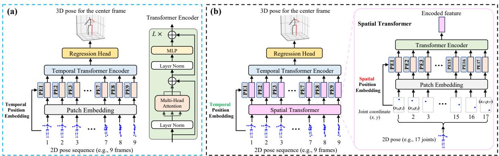  

图 2. (a) 时间 Transformer 基线方法。(b) 时空 Transformer（PoseFormer）架构，由三个模块组成：一个空间 Transformer 模块，用于在考虑每个个体骨架关节相关性的前提下提取特征；一个时间 Transformer 模块，用于学习整个序列的全局依赖关系；一个回归头模块，对中心帧的最终 3D 姿态进行回归。Transformer 编码器的示意图参照了 ViT [12]。

对于我们的 PoseFormer，Transformer 可以被视为一种具有独特且通常有利的图操作的图神经网络。具体而言，Transformer 编码器模块本质上构成一个全连接图（fully-connected graph），其中边的权重通过以输入为条件的多头自注意力（multi-headed self-attention）来计算。该操作还包括节点特征的归一化、跨注意力头输出的前馈聚合器，以及使多层堆叠能够有效扩展的残差连接。与其他图操作相比，这种操作具有显著优势。例如，节点之间连接的强度由 Transformer 的自注意力机制决定，而不是像本任务中典型的基于 GCN 的方法那样通过邻接矩阵预先定义。这使得模型能够灵活地根据每个输入姿态调整关节之间的相对重要性。此外，Transformer 全面的缩放和归一化组件可能有助于缓解许多 GNN 操作变体在多层堆叠时面临的过度平滑（over-smoothing）问题 [48]。

视觉 Transformer（Vision Transformers）。最近，将 Transformer 应用于视觉任务引起了越来越多的关注 [17, 14]。Carion 等人 [4] 提出了用于目标检测和全景分割的 DEtection TRansformer（DETR）。Dosovitskiy 等人 [12] 提出了一种纯 Transformer 架构——视觉 Transformer（Vision Transformer，ViT），在图像分类任务上取得了最先进的性能。然而，ViT 是在大规模数据集 ImageNet-21k 和 JFT-300M 上训练的，需要巨大的计算资源。随后，Touvron 等人 [36] 提出了一种数据高效的图像 Transformer（DeiT），该方法在 ViT 的基础上引入了知识蒸馏。对于人体姿态估计（Human Pose Estimation，HPE）等回归问题，Yang 等人 [40] 提出了 Transformer 网络 Transpose，该网络仅从图像中估计 2D 姿态。Lin 等人 [23] 在其方法 METRO（MEsh TRansfOrmer）中将 CNN 与 Transformer 网络相结合，以从单张图像重建 3D 姿态和网格顶点。与我们的方法不同，METRO 属于直接估计的范畴。此外，METRO 忽略了时间一致性，这限制了其估计结果的鲁棒性。我们的时空 Transformer 架构利用了每一帧中的关键点相关性，并在视频中保持了自然的时间连贯性。

## 3. 方法

我们沿用了与 [26, 32, 25, 5] 相同的视频中 3D HPE 的 2D 到 3D 提升流程（2D-to-3D lifting pipeline）。每帧的 2D 姿态由现成的 2D 姿态检测器获得，然后将连续帧的 2D 姿态序列作为输入，用于估计中间帧的 3D 姿态。与之前基于 CNN 的最先进模型相比，我们提出了一个极具竞争力的无卷积 Transformer 网络。

## 3.1. 时间 Transformer 基线

作为 Transformer 在二维到三维（2D-to-3D）提升（lifting）任务中的一个基线应用，我们将每个二维（2D）姿态视为一个输入标记（token），并采用 Transformer 来捕捉输入之间的全局依赖关系，如图 2(a) 所示。我们将每个输入标记称为一个 patch（块），这与 ViT [12] 中的术语类似。对于输入序列 $X \in \mathbb { R } ^ { f \times ( J \cdot 2 ) }$ )，其中 f 是输入序列的帧数，J 是每个二维姿态的关节数，2 表示关节在二维空间中的坐标。$\{ \mathbf { x } ^ { i } \overset { \cdot } { \in } \mathbb { R } ^ { 1 \times ( J \cdot 2 ) } | i = 1 , 2 , \overset { \cdot } { \dots } f \}$ 表示每一帧的输入向量。Patch 嵌入（patch embedding）是一个可训练的线性投影层，用于将每个 patch 嵌入到高维特征空间中。Transformer 网络利用位置嵌入（positional embeddings）来保留序列的位置信息。该过程可以形式化表示为：

$$
Z _ {0} = [ \mathbf {x} ^ {1} E; \mathbf {x} ^ {2} E; \dots ; \mathbf {x} ^ {f} E ] + E _ {p o s}.\tag{1}
$$

通过线性投影矩阵 $E \in$ $\mathbb { R } ^ { ( J \cdot 2 ) \times C }$ 进行嵌入，并与位置嵌入 $E _ { p o s } \in \mathbb { R } ^ { f \times C }$ 相加后，输入序列 $\overset { \cdot } { X } \in \mathbb { R } ^ { f \times ( J \cdot 2 ) }$ 变为 $\dot { Z _ { 0 } } \in \mathbb { R } ^ { f \times C }$，其中 $C$ 是嵌入维度。$Z _ { 0 }$ 被送入时间 Transformer 编码器。

作为 Transformer 的核心功能，自注意力（self-attention）被设计用于关联输入序列中不同位置与嵌入特征之间的关系。我们的 Transformer 编码器由多头自注意力块（Multi-head Self Attention blocks）和多层感知机（MLP）块组成，结构与文献 [12] 相同。LayerNorm 被应用于每个块之前，残差连接被应用于每个块之后 [39, 1]。

缩放点积注意力（Scaled Dot-Product Attention）可被描述为一个将查询矩阵 $Q .$、键矩阵 $K$ 和值矩阵 $V$ 映射到输出注意力矩阵的映射函数。其中 $Q , K , V \in \mathbb { R } ^ { N \times d }$，$N$ 为序列中向量的数量，$d$ 为维度。在该注意力操作中使用缩放因子 $\textstyle { \frac { 1 } { \sqrt { d } } }$ 进行适当的归一化，以防止当 $d$ 较大时点积的数值过大而导致梯度极小。因此，缩放点积注意力的输出可表示为：

$$
\operatorname{Attention} (Q, K, V) = \operatorname{Softmax} (Q K ^ {\top} / \sqrt {d}) V.\tag{2}
$$

在我们的时序变换器（temporal transformer）中，$d = C$ 且 $N = f$。$Q$、$K$ 和 $V$ 通过线性变换 $W_Q$、$W_K$ 和 $W_V \in \mathbb{R}^{C \times C}$ 由嵌入特征 $Z \in \mathbb{R}^{f \times C}$ 计算得到。

$$
Q = Z W _ {Q}, \quad K = Z W _ {K}, \quad V = Z W _ {V}.\tag{3}
$$

多头自注意力层（Multi-head Self Attention Layer, MSA）利用多个注意力头，从不同位置的各个表示子空间中联合建模信息。每个注意力头并行地应用缩放点积注意力。MSA 的输出将由 h 个注意力头的输出拼接而成。

$$
\operatorname{MSA} (Q, K, V) = \operatorname{Concat} \left(H _ {1}, H _ {2}, \dots , H _ {h}\right) W _ {\text { out }}\tag{4}
$$

$$
\text { where } \quad H _ {i} = \operatorname{Attention} (Q _ {i}, K _ {i}, V _ {i}), i \in [ 1,..., h ]\tag{5}
$$

给定我们嵌入特征 $Z _ { 0 } \in \mathbb { R } ^ { f \times C }$ 的 $L$ 层时序 Transformer 编码器（Temporal Transformer Encoder）结构可表示如下：

$$
Z _ {\ell} ^ {'} = \mathrm{MSA} (\mathrm{LN} (Z _ {\ell - 1})) + Z _ {\ell - 1}, \quad \ell = 1, 2 \dots L\tag{6}
$$

$$
Z _ {\ell} = \mathrm{MLP} (\mathrm{LN} (Z _ {\ell} ^ {'})) + Z _ {\ell} ^ {'}, \qquad \ell = 1, 2, \ldots L\tag{7}
$$

$$
Y = \mathrm{LN} (Z _ {L}),\tag{8}
$$

其中 LN(·) 表示层归一化算子（与 ViT 中相同）。时序 Transformer 编码器由 L 个相同层组成，编码器输出 $Y \in \mathbb { R } ^ { f \times C }$ 与编码器输入 $Z _ { 0 } \in \bar { \mathbb { R } ^ { f \times C } }$ 保持相同大小。

为了预测中心帧的三维姿态，编码器输出 $\bar { Y } \in \mathbb { R } ^ { f \times C }$ 通过在帧维度上取平均，压缩为向量 $y \in \mathbb { R } ^ { 1 \times C }$。最后，一个 MLP 模块将输出回归到 $\mathbf { y } \in \mathbb { R } ^ { 1 \times ( J \cdot 3 ) }$ ，即中心帧的三维姿态。

## 3.2. PoseFormer：时空 Transformer

我们观察到，时序 Transformer 基线主要关注输入序列中帧之间的全局依赖关系。Patch 嵌入是一个线性变换，用于将关节点坐标投影到隐藏维度。然而，由于简单的线性投影层无法学习注意力信息，时序 Transformer 基线未能充分建模局部关节点坐标之间的运动学信息。一种可行的解决思路是将每个关节点坐标视为一个独立的 patch，并将所有帧的关节点作为输入送入 Transformer（见图 1(b)）。然而，patch 数量会迅速增加（帧数 f 乘以关节点数 J），导致模型计算复杂度为 $O ( ( f \cdot J ) ^ { 2 } )$ ）。例如，若对每个二维姿态使用 81 帧和 17 个关节点，则 patch 数量将达到 1377（ViT 模型使用 576 个 patch（输入尺寸 $\mathrm { s i z e = 3 8 4 \times 3 8 4 }$ ，patch ${ \mathrm { s i z e } } = 1 6 \times 1 6$ ））。

为了高效地学习局部关节点相关性，我们分别采用两个独立的 Transformer 来建模空间和时间信息。如图 2(b) 所示，PoseFormer 由三个模块组成：空间 Transformer 模块、时序 Transformer 模块和回归头模块。

空间变换器模块（Spatial Transformer Module）。空间变换器模块用于从单帧中提取高维特征嵌入。给定具有 J 个关节点的 2D 姿态，我们将每个关节点（即两个坐标）视为一个 patch，并按照通用视觉变换器（vision transformer）流程在所有 patch 之间执行特征提取。首先，我们将每个关节点的坐标通过一个可训练的线性投影映射到高维空间，这被称为空间 patch 嵌入（spatial patch embedding）。我们将其与可学习的空间位置嵌入（spatial positional embedding）[12] $E _ { S P o s } ~ \in ~ \mathbb { R } ^ { J \times c }$ 相加，因此第 i 帧的输入 $\mathbf { x } _ { i } \in \mathbb { R } ^ { 1 \times \left( J \cdot 2 \right) }$ 变为 $\boldsymbol { z } _ { 0 } ^ { i } \in \mathbb { R } ^ { J \times c }$，其中 2 表示每一帧中的 2D 坐标，c 是空间嵌入维度。得到的关节点特征序列 $z _ { 0 } ^ { i }$ 被送入空间变换器编码器（spatial transformer encoder），后者应用自注意力机制来整合所有关节点之间的信息。对于第 i 帧，具有 L 层的空间变换器编码器的输出为 $\boldsymbol { z } _ { L } ^ { i } \in \mathbb { R } ^ { J \times c }$。

时间变换器模块（Temporal Transformer Module）。由于空间变换器模块对每一帧单独编码高维特征，时间变换器模块的目标是对跨帧序列的依赖关系进行建模。对于第 i 帧，空间变换器的输出 $z _ { L } ^ { i } \in \mathbb { R } ^ { J \times c }$ 被展平为一个向量 $\mathbf { z } ^ { i } \in \mathbb { R } ^ { 1 \times ( J \cdot c ) }$。然后我们将来自 f 个输入帧的这些向量 $\{ \mathbf { z } ^ { 1 } , \mathbf { z } ^ { 2 } , \hdots , \mathbf { z } ^ { f } \}$ 拼接为 $Z _ { 0 } ~ \in ~ \mathbb { R } ^ { f \times ( J \cdot c ) }$。在送入时间变换器模块之前，我们加入可学习的时间位置嵌入（temporal positional embedding）[12] $E _ { T P o s } \in \mathbb { R } ^ { f \times ( J \cdot c ) }$ 以保留帧的位置信息。对于时间变换器编码器，我们采用与空间变换器编码器相同的架构，其由多头自注意力块（multihead self-attention blocks）和 MLP 块组成。时间变换器模块的输出为 $Y \in \mathbb { R } ^ { f \times ( J \cdot c ) }$。

回归头（Regression Head）。由于我们使用一个帧序列来预测中间帧的 3D 姿态，时间变换器模块的输出 $Y \in \mathbb { R } ^ { f \times ( J \cdot c ) }$ 需要被归约为 $\mathbf { y } \in \mathbb { R } ^ { 1 \times ( J \cdot c ) }$。我们在帧维度上施加一个加权平均操作（使用可学习的权重）来实现这一点。最后，一个带有层归一化（Layer norm）和一个线性层的简单 MLP 块输出 $\mathbf { y } \in \mathbb { R } ^ { 1 \times ( J \cdot 3 ) }$，即为中间帧的预测 3D 姿态。

损失函数。为了训练我们的时空 Transformer 模型，我们采用标准的 MPJPE（Mean Per Joint Position Error，平均关节点位置误差）损失，以最小化预测姿态与真实姿态之间的误差，如

$$
\mathcal {L} = \frac {1}{J} \Sigma_ {k = 1} ^ {J} \| p _ {k} - \hat {p} _ {k} \| _ {2},\tag{9}
$$

其中 $p_k$ 和 $\hat{p}_k$ 分别是第 $k$ 个关节的真实 3D 关节位置和估计 3D 关节位置。

## 4. 实验

## 4.1. 数据集与评估指标

我们在两个常用的 3D 人体姿态估计（Human Pose Estimation, HPE）数据集 Human3.6M [16] 和 MPI-INF-3DHP [27] 上评估我们的模型。

Human3.6M [16] 是目前最广泛使用的 3D 单人 HPE 室内数据集。数据集包含 11 名专业演员，执行包括坐着、行走和打电话等在内的 17 种动作。每个受试者的视频在室内环境中从 4 个不同视角进行录制。该数据集包含 360 万个视频帧，并由精确的基于标记点的运动捕捉系统提供 3D 真实标注。遵循先前工作 [32, 25, 5]，我们采用相同的实验设置：使用全部 15 种动作进行训练和测试，模型在五个被试（S1, S5, S6, S7, S8）的数据上进行训练，并在两个被试（S9 和 S11）的数据上进行测试。

MPI-INF-3DHP [27] 是一个更具挑战性的 3D 姿态数据集。它既包含受约束的室内场景，也包含复杂的室外场景。8 位演员在 14 个相机视角下执行 8 种动作，涵盖了更多样化的姿态。MPI-INF-3DHP 提供了一个包含 6 位受试者的、场景各异的测试集。我们遵循文献 [22, 5, 38] 中的设置。

对于 Human3.6M 数据集，我们使用最常见的评估指标（MPJPE 和 P-MPJPE）[46] 来评估我们估计结果相对于真实 3D 姿态的性能。MPJPE（Mean Per Joint Position Error，平均每关节位置误差）以毫米为单位计算估计关节与真实关节之间的平均欧氏距离；我们将 MPJPE 称为协议一（Protocol 1）。P-MPJPE 是对估计的 3D 姿态与真实姿态进行刚性对齐后处理后的 MPJPE，它对单个关节预测失败具有更强的鲁棒性。我们将 P-MPJPE 称为协议二（Protocol 2）。

对于 MPI-INF-3DHP 数据集，我们使用 MPJPE、150 毫米范围内的正确关键点百分比（Percentage of Correct Keypoint, PCK）[22, 5, 38] 以及曲线下面积（Area Under Curve, AUC）。

## 4.2. 实现细节

我们使用 Pytorch [30] 实现了所提出的方法。训练和测试使用了两块 NVIDIA RTX 3090 GPU。我们在实验中选择了三种不同的帧序列长度，即 $f=9$、$f=27$、$f=81$。关于帧数及其结果的具体细节将在消融研究（第 4.4 节）中讨论。遵循文献 [32, 25, 5]，我们在训练和测试时都采用水平翻转姿态作为数据增强。我们采用 Adam [18] 优化器对模型进行 130 个 epoch 的训练，权重衰减为 0.1。我们采用指数衰减的学习率调度策略，初始学习率为 2e-4，每经过一个 epoch 衰减因子为 0.98。我们将批量大小设置为 1024，并对 Transformer 编码器层采用随机深度（Stochastic Depth）[15]，丢弃率为 0.1。对于 2D 姿态检测器，在 Human3.6M 上我们遵循文献 [32, 25, 5] 使用级联金字塔网络（Cascaded Pyramid Network, CPN）[7]；对于 MPI-INF-3DHP，我们遵循文献 [28, 22]，以真实的 2D 姿态作为输入。

## 4.3. 与现有方法的对比（Comparison with State-of-the-Art）

Human3.6M。我们在表 1 中报告了测试集（S9 和 S11）上全部 15 个动作的结果。最后一列给出了在整个测试集上的平均性能。遵循 2D-to-3D 提升方法，我们使用 CPN 网络作为 2D 姿态检测器，然后以检测得到的 2D 姿态作为输入进行训练与测试。PoseFormer 在协议 1 和协议 2 下分别以较大的幅度（6.1% 和 6.4%）优于我们的基线（即第 3.1 节中的时间 Transformer 基线）。这清楚地展示了使用空间 Transformer 来表达性地建模每一帧中各关节点之间相关性的优势。如表 1（上）所示，PoseFormer 在协议 1 下取得了最低的平均 MPJPE，即 44.3 mm。与基于 Transformer 的方法 METRO [23] 相比，PoseFormer 将 MPJPE 降低了约 18%；而 METRO 由于是从单张图像估计 3D 姿态，因此忽略了时间一致性。在协议 2 下，我们同样取得了最佳的整体结果，如表 1（下）所示。此外，PoseFormer 在 Photo、SittingDown、WalkDog 和 Smoke 等困难动作上取得了更精确的姿态预测结果。与其他简单动作不同，这些动作中的姿态变化更为迅速，且某些长距离帧之间具有很强的相关性。在这种情况下，全局依赖关系起着重要作用，而 Transformer 的注意力机制在此具有特别突出的优势。

表 1. 在 Human3.6M 数据集上，使用检测得到的 2D 姿态作为输入时，估计的 3D 姿态与真实 3D 姿态之间平均每关节点位置误差（Mean Per Joint Position Error, MPJPE）的定量对比。上表：协议 1（MPJPE）下的结果。下表：协议 2（P-MPJPE）下的结果。f 表示每个方法所使用的输入帧数；∗ 表示输入的 2D 姿态由级联金字塔网络（Cascaded Pyramid Network, CPN）检测得到；† 表示该模型基于 Transformer。（红色：最佳；蓝色：次佳）

<table><tr><td>Protocol 1</td><td></td><td>Dir.</td><td>Disc.</td><td>Eat.</td><td>Greet</td><td>Phone</td><td>Photo</td><td>Pose</td><td>Purch.</td><td>Sit</td><td>SitD.</td><td>Somke</td><td>Wait</td><td>WalkD.</td><td>Walk</td><td>WalkT.</td><td>Average</td></tr><tr><td>Dabral et al. [11]</td><td>ECCV&#x27;18</td><td>44.8</td><td>50.4</td><td>44.7</td><td>49.0</td><td>52.9</td><td>61.4</td><td>43.5</td><td>45.5</td><td>63.1</td><td>87.3</td><td>51.7</td><td>48.5</td><td>52.2</td><td>37.6</td><td>41.9</td><td>52.1</td></tr><tr><td>Cai et al. [2] (f = 7)</td><td>ICCV&#x27;19</td><td>44.6</td><td>47.4</td><td>45.6</td><td>48.8</td><td>50.8</td><td>59.0</td><td>47.2</td><td>43.9</td><td>57.9</td><td>61.9</td><td>49.7</td><td>46.6</td><td>51.3</td><td>37.1</td><td>39.4</td><td>48.8</td></tr><tr><td>Pavllo et al. [32] (f = 243)*</td><td>CVPR&#x27;19</td><td>45.2</td><td>46.7</td><td>43.3</td><td>45.6</td><td>48.1</td><td>55.1</td><td>44.6</td><td>44.3</td><td>57.3</td><td>65.8</td><td>47.1</td><td>44.0</td><td>49.0</td><td>32.8</td><td>33.9</td><td>46.8</td></tr><tr><td>Lin et al. [22] (f = 50)</td><td>BMVC&#x27;19</td><td>42.5</td><td>44.8</td><td>42.6</td><td>44.2</td><td>48.5</td><td>57.1</td><td>52.6</td><td>41.4</td><td>56.5</td><td>64.5</td><td>47.4</td><td>43.0</td><td>48.1</td><td>33.0</td><td>35.1</td><td>46.6</td></tr><tr><td>Yeh et al. [42]</td><td>NIPS&#x27;19</td><td>44.8</td><td>46.1</td><td>43.3</td><td>46.4</td><td>49.0</td><td>55.2</td><td>44.6</td><td>44.0</td><td>58.3</td><td>62.7</td><td>47.1</td><td>43.9</td><td>48.6</td><td>32.7</td><td>33.3</td><td>46.7</td></tr><tr><td>Liu et al. [25] (f = 243)*</td><td>CVPR&#x27;20</td><td>41.8</td><td>44.8</td><td>41.1</td><td>44.9</td><td>47.4</td><td>54.1</td><td>43.4</td><td>42.2</td><td>56.2</td><td>63.6</td><td>45.3</td><td>43.5</td><td>45.3</td><td>31.3</td><td>32.2</td><td>45.1</td></tr><tr><td>SRNet [43]*</td><td>ECCV&#x27;20</td><td>46.6</td><td>47.1</td><td>43.9</td><td>41.6</td><td>45.8</td><td>49.6</td><td>46.5</td><td>40.0</td><td>53.4</td><td>61.1</td><td>46.1</td><td>42.6</td><td>43.1</td><td>31.5</td><td>32.6</td><td>44.8</td></tr><tr><td>UGCN [38] (f = 96)</td><td>ECCV&#x27;20</td><td>41.3</td><td>43.9</td><td>44.0</td><td>42.2</td><td>48.0</td><td>57.1</td><td>42.2</td><td>43.2</td><td>57.3</td><td>61.3</td><td>47.0</td><td>43.5</td><td>47.0</td><td>32.6</td><td>31.8</td><td>45.6</td></tr><tr><td>Chen et al. [5] (f = 81)*</td><td>TCSVT&#x27;21</td><td>42.1</td><td>43.8</td><td>41.0</td><td>43.8</td><td>46.1</td><td>53.5</td><td>42.4</td><td>43.1</td><td>53.9</td><td>60.5</td><td>45.7</td><td>42.1</td><td>46.2</td><td>32.2</td><td>33.8</td><td>44.6</td></tr><tr><td>METRO [23] (f = 1) †</td><td>CVPR&#x27;21</td><td>-</td><td>-</td><td>-</td><td>-</td><td>-</td><td>-</td><td>-</td><td>-</td><td>-</td><td>-</td><td>-</td><td>-</td><td>-</td><td>-</td><td>-</td><td>54.0</td></tr><tr><td>Baseline (f = 81)*†</td><td></td><td>43.8</td><td>47.9</td><td>43.8</td><td>45.5</td><td>49.7</td><td>55.7</td><td>44.3</td><td>45.8</td><td>57.7</td><td>66.3</td><td>47.4</td><td>45.4</td><td>48.6</td><td>32.5</td><td>33.8</td><td>47.2</td></tr><tr><td>PoseFormer (f = 81)*†</td><td></td><td>41.5</td><td>44.8</td><td>39.8</td><td>42.5</td><td>46.5</td><td>51.6</td><td>42.1</td><td>42.0</td><td>53.3</td><td>60.7</td><td>45.5</td><td>43.3</td><td>46.1</td><td>31.8</td><td>32.2</td><td>44.3</td></tr><tr><td>Protocol 2</td><td></td><td>Dir.</td><td>Disc.</td><td>Eat.</td><td>Greet</td><td>Phone</td><td>Photo</td><td>Pose</td><td>Purch.</td><td>Sit</td><td>SitD.</td><td>Somke</td><td>Wait</td><td>WalkD.</td><td>Walk</td><td>WalkT.</td><td>Average</td></tr><tr><td>Pavlakos et al. [31]</td><td>CVPR&#x27;18</td><td>34.7</td><td>39.8</td><td>41.8</td><td>38.6</td><td>42.5</td><td>47.5</td><td>38.0</td><td>36.6</td><td>50.7</td><td>56.8</td><td>42.6</td><td>39.6</td><td>43.9</td><td>32.1</td><td>36.5</td><td>41.8</td></tr><tr><td>Hossain et al. [33]</td><td>ECCV&#x27;18</td><td>35.7</td><td>39.3</td><td>44.6</td><td>43.0</td><td>47.2</td><td>54.0</td><td>38.3</td><td>37.5</td><td>51.6</td><td>61.3</td><td>46.5</td><td>41.4</td><td>47.3</td><td>34.2</td><td>39.4</td><td>44.1</td></tr><tr><td>Cai et al. [2] (f = 7)</td><td>ICCV&#x27;19</td><td>35.7</td><td>37.8</td><td>36.9</td><td>40.7</td><td>39.6</td><td>45.2</td><td>37.4</td><td>34.5</td><td>46.9</td><td>50.1</td><td>40.5</td><td>36.1</td><td>41.0</td><td>29.6</td><td>32.3</td><td>39.0</td></tr><tr><td>Lin et al. [22] (f = 50)</td><td>BMVC&#x27;19</td><td>32.5</td><td>35.3</td><td>34.3</td><td>36.2</td><td>37.8</td><td>43.0</td><td>33.0</td><td>32.2</td><td>45.7</td><td>51.8</td><td>38.4</td><td>32.8</td><td>37.5</td><td>25.8</td><td>28.9</td><td>36.8</td></tr><tr><td>Pavllo et al. [32] (f = 243)*</td><td>CVPR&#x27;19</td><td>34.1</td><td>36.1</td><td>34.4</td><td>37.2</td><td>36.4</td><td>42.2</td><td>34.4</td><td>33.6</td><td>45.0</td><td>52.5</td><td>37.4</td><td>33.8</td><td>37.8</td><td>25.6</td><td>27.3</td><td>36.5</td></tr><tr><td>Liu et al. [25] (f = 243)*</td><td>CVPR&#x27;20</td><td>32.3</td><td>35.2</td><td>33.3</td><td>35.8</td><td>35.9</td><td>41.5</td><td>33.2</td><td>32.7</td><td>44.6</td><td>50.9</td><td>37.0</td><td>32.4</td><td>37.0</td><td>25.2</td><td>27.2</td><td>35.6</td></tr><tr><td>UGCN [38] (f = 96)</td><td>ECCV&#x27;20</td><td>32.9</td><td>35.2</td><td>35.6</td><td>34.4</td><td>36.4</td><td>42.7</td><td>31.2</td><td>32.5</td><td>45.6</td><td>50.2</td><td>37.3</td><td>32.8</td><td>36.3</td><td>26.0</td><td>23.9</td><td>35.5</td></tr><tr><td>Chen et al. [5] (f = 81)*</td><td>TCSVT&#x27;21</td><td>33.1</td><td>35.3</td><td>33.4</td><td>35.9</td><td>36.1</td><td>41.7</td><td>32.8</td><td>33.3</td><td>42.6</td><td>49.4</td><td>37.0</td><td>32.7</td><td>36.5</td><td>25.5</td><td>27.9</td><td>35.6</td></tr><tr><td>Baseline (f = 81)*†</td><td></td><td>33.6</td><td>37.1</td><td>35.4</td><td>36.7</td><td>37.8</td><td>42.2</td><td>33.9</td><td>34.7</td><td>47.0</td><td>53.4</td><td>38.2</td><td>34.3</td><td>37.6</td><td>25.3</td><td>27.8</td><td>37.0</td></tr><tr><td>PoseFormer (f = 81)*†</td><td></td><td>32.5</td><td>34.8</td><td>32.6</td><td>34.6</td><td>35.3</td><td>39.5</td><td>32.1</td><td>32.0</td><td>42.8</td><td>48.5</td><td>34.8</td><td>32.4</td><td>35.3</td><td>24.5</td><td>26.0</td><td>34.6</td></tr></table>

为了进一步探究我们方法的下界，我们直接使用真值（ground truth）二维姿态作为输入，以缓解噪声二维姿态数据带来的误差。结果如表 2 所示。使用干净的二维姿态数据后，MPJPE 从 44.3 毫米降低到 31.3 毫米，约下降 29.7%。PoseFormer 在 9 个动作中取得最佳成绩，在 6 个动作中取得次佳成绩，平均成绩相较于 SRNet [43] 提升约 2%。

在图 3 中，我们还对 Human3.6M 测试集 S11 上 Photo 动作中误差最大的部分单关节 MPJPE 进行了对比。在这些困难关节上，PoseFormer 的表现优于 [32, 5]。

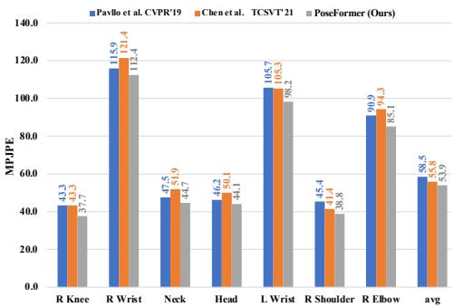  

图 3. 在 Human3.6M 测试集 S11 的 Photo 动作所有帧上的平均关节误差对比。

MPI-INF-3DHP。表 3 报告了 PoseFormer 与其他方法在 MPI-INF-3DHP 上的定量结果。该数据集的训练样本数比 Human3.6M 少，且部分样本取自室外场景。由于该数据集的序列长度通常较短，我们使用 9 帧的 2D 姿态作为模型输入。我们的方法在所有三个评估指标（PCK、AUC 和 MPJPE）上再次取得了最佳性能。

定性结果。我们还提供了 3D 估计姿态与真值之间的可视化对比。我们在 Human3.6M 测试集 S11 的 Photo 动作上评估了 PoseFormer，这是最具挑战性的动作之一（所有方法的 MPJPE 都较高）。如图 4 所示，与当前最先进的方法 [5] 相比，我们的 PoseFormer 实现了更准确的预测。

## 4.4. 消融实验

为了验证 PoseFormer 各组成部件的贡献以及超参数对性能的影响，我们在 Protocol 1 下使用 Human3.6M 数据集进行了广泛的消融实验。

PoseFormer 的设计。我们在表 4 中研究了空间 transformer 的影响，以及空间和时序 transformer 中位置嵌入的影响。我们输入 9 帧 CPN 检测的 2D 姿态 $( J ~ = ~ 1 7 )$ 来预测 3D 姿态。为公平比较每个模块的影响，所有架构参数均保持固定；空间 transformer 嵌入维度为 $1 7 \times 3 2 = 5 4 4$，空间 transformer 编码器层数为 4。对于时序 transformer，嵌入维度与空间 transformer 保持一致（即 544），我们同样采用 4 个时序 transformer 层。为了验证我们时空设计的影响，我们首先与第 3.1 节中所使用的初始 transformer 基线进行比较。表 4 中的结果表明，我们的时空 transformer 带来了显著影响（MPJPE 从 52.5 降至 49.9），这是因为关节间的相关性被更强地建模了。这与表 1 中 $f = 8 1$ 时（Baseline vs. PoseFormer）的结果也保持一致。接下来，我们评估了位置嵌入的影响。我们探索了四种可能的组合：无位置嵌入、仅空间位置嵌入、仅时序位置嵌入、同时使用空间和时序位置嵌入。通过比较这些组合的结果，可以明显看出位置嵌入能够提升性能。通过在空间和时序模块上都应用位置嵌入，可以取得最佳的整体结果。

表 2. 在 Human3.6M 数据集 Protocol 1 下，使用真值 2D 姿态作为输入，估计 3D 姿态与真值 3D 姿态之间平均逐关节位置误差（MPJPE）的定量比较。（红色：最佳；蓝色：次佳）

<table><tr><td>GT Protocol 1</td><td></td><td>Dir.</td><td>Disc.</td><td>Eat.</td><td>Greet</td><td>Phone</td><td>Photo</td><td>Pose</td><td>Purch.</td><td>Sit</td><td>SitD.</td><td>Somke</td><td>Wait</td><td>WalkD.</td><td>Walk</td><td>WalkT.</td><td>Average</td></tr><tr><td>Hossain et al. [33]</td><td>ECCV&#x27;18</td><td>35.2</td><td>40.8</td><td>37.2</td><td>37.4</td><td>43.2</td><td>44.0</td><td>38.9</td><td>35.6</td><td>42.3</td><td>44.6</td><td>39.7</td><td>39.7</td><td>40.2</td><td>32.8</td><td>35.5</td><td>39.2</td></tr><tr><td>Pavllo et al. [32] (f = 243)</td><td>CVPR&#x27;19</td><td>-</td><td>-</td><td>-</td><td>-</td><td>-</td><td>-</td><td>-</td><td>-</td><td>-</td><td>-</td><td>-</td><td>-</td><td>-</td><td>-</td><td>-</td><td>37.2</td></tr><tr><td>Liu et al. [25] (f = 243)</td><td>CVPR&#x27;20</td><td>34.5</td><td>37.1</td><td>33.6</td><td>34.2</td><td>32.9</td><td>37.1</td><td>39.6</td><td>35.8</td><td>40.7</td><td>41.4</td><td>33.0</td><td>33.8</td><td>33.0</td><td>26.6</td><td>26.9</td><td>34.7</td></tr><tr><td>SRNet [43]</td><td>ECCV&#x27;20</td><td>34.8</td><td>32.1</td><td>28.5</td><td>30.7</td><td>31.4</td><td>36.9</td><td>35.6</td><td>30.5</td><td>38.9</td><td>40.5</td><td>32.5</td><td>31.0</td><td>29.9</td><td>22.5</td><td>24.5</td><td>32.0</td></tr><tr><td>Chen et al. [5] (f = 243)</td><td>TCSVT&#x27;21</td><td>-</td><td>-</td><td>-</td><td>-</td><td>-</td><td>-</td><td>-</td><td>-</td><td>-</td><td>-</td><td>-</td><td>-</td><td>-</td><td>-</td><td>-</td><td>32.3</td></tr><tr><td>PoseFormer (f = 81)</td><td></td><td>30.0</td><td>33.6</td><td>29.9</td><td>31.0</td><td>30.2</td><td>33.3</td><td>34.8</td><td>31.4</td><td>37.8</td><td>38.6</td><td>31.7</td><td>31.5</td><td>29.0</td><td>23.3</td><td>23.1</td><td>31.3</td></tr></table>

  

图 4. 在 Human3.6M 测试集 S11 的 Photo 动作上，我们的方法（PoseFormer）与 Chen 等人 [5] 提出的当前最先进方法（SOTA）的定性比较。绿色箭头突出显示了 PoseFormer 明显具有更好结果的位置。

表 3. 在 MPI-INF-3DHP 数据集上与先前方法的定量比较。最佳得分以粗体标出。

<table><tr><td></td><td></td><td>PCK ↑</td><td>AUC ↑</td><td>MPJPE ↓</td></tr><tr><td>Mehta et al. [27]</td><td>3DV&#x27;17</td><td>75.7</td><td>39.3</td><td>117.6</td></tr><tr><td>Mehta et al. [28]</td><td>ACM ToG&#x27;17</td><td>76.6</td><td>40.4</td><td>124.7</td></tr><tr><td>Pavllo et al. [32] (81 frames)</td><td>CVPR&#x27;19</td><td>86.0</td><td>51.9</td><td>84.0</td></tr><tr><td>Pavllo et al. [32] (243 frames)</td><td>CVPR&#x27;19</td><td>85.5</td><td>51.5</td><td>84.8</td></tr><tr><td>Lin et al. [22] (25 frames)</td><td>BMVC&#x27;19</td><td>83.6</td><td>51.4</td><td>79.8</td></tr><tr><td>Li et al. [20]</td><td>CVPR&#x27;20</td><td>81.2</td><td>46.1</td><td>99.7</td></tr><tr><td>Chen et al. [5] (81 frames)</td><td>TCSVT&#x27;21</td><td>87.9</td><td>54.0</td><td>78.8</td></tr><tr><td>PoseFormer (9 frames)</td><td></td><td>88.6</td><td>56.4</td><td>77.1</td></tr></table>

表 4. 关于 PoseFormer 中不同组件的消融实验。评估在 Human3.6M（协议 1）上进行，使用检测到的 2D 姿态作为输入。（T：仅时序；S-T：时空）

<table><tr><td>Input length (f)</td><td>T</td><td>S-T</td><td>Spatial Pos Emb</td><td>Temporal Pos Emb</td><td>MPJPE</td></tr><tr><td>9</td><td>√</td><td>✕</td><td>✕</td><td>√</td><td>52.5</td></tr><tr><td>9</td><td>✕</td><td>√</td><td>✕</td><td>✕</td><td>51.6</td></tr><tr><td>9</td><td>✕</td><td>√</td><td>√</td><td>✕</td><td>50.7</td></tr><tr><td>9</td><td>✕</td><td>√</td><td>✕</td><td>√</td><td>50.5</td></tr><tr><td>9</td><td>✕</td><td>√</td><td>√</td><td>√</td><td>49.9</td></tr></table>

表 5. PoseFormer 中不同架构参数的消融研究。评估在 Human3.6M（Protocol 1）上进行，使用检测到的 2D 姿态作为输入。c 是空间 Transformer 的 patch 嵌入维度。$L _ { S }$ 和 $L _ { T }$ 分别表示空间 Transformer 和时间 Transformer 中的层数。

<table><tr><td>c</td><td>16</td><td>16</td><td>16</td><td>32</td><td>32</td><td>32</td><td>48</td><td>48</td><td>48</td></tr><tr><td> $L_S$ </td><td>2</td><td>4</td><td>6</td><td>2</td><td>4</td><td>6</td><td>2</td><td>4</td><td>6</td></tr><tr><td> $L_T$ </td><td>2</td><td>4</td><td>6</td><td>2</td><td>4</td><td>6</td><td>2</td><td>4</td><td>6</td></tr><tr><td>MPJPE</td><td>52.8</td><td>51.7</td><td>50.4</td><td>52.4</td><td>49.9</td><td>50.3</td><td>51.7</td><td>50.4</td><td>50.5</td></tr></table>

架构参数分析。我们在表 5 中探索了多种参数组合，以寻找最优的网络架构。c 表示空间变换器中的嵌入特征维度，L 表示变换器编码器中使用的层数。在 Pose-Former 中，空间变换器的输出被展平，并与时间位置嵌入相加，以构成时间变换器编码器的输入。因此，时间变换器编码器中的嵌入特征维度为 c × J。我们模型的最优参数为 $c = 3 2 \AA$ $L _ { S } = 4 ,$ and $L _ { T } = 4$

表 6. 计算复杂度、MPJPE 与推理速度（每秒帧数（FPS））的对比。评估在 Human3.6M 数据集上使用检测得到的 2D 姿态作为输入，依据协议 1 进行。FPS 基于单块 GeForce GTX 2080 Ti GPU 测得。

<table><tr><td></td><td>f</td><td>Parameters (M)</td><td>FLOPs (M)</td><td>MPJPE</td><td>FPS</td></tr><tr><td>Hossain and Little [33]</td><td>-</td><td>16.95</td><td>33.88</td><td>58.3</td><td>-</td></tr><tr><td>Pavllo et al. [32]</td><td>27</td><td>8.56</td><td>17.09</td><td>48.8</td><td>1492</td></tr><tr><td>Pavllo et al. [32]</td><td>81</td><td>12.79</td><td>25.48</td><td>47.7</td><td>1121</td></tr><tr><td>Pavllo et al. [32]</td><td>243</td><td>16.95</td><td>33.87</td><td>46.8</td><td>863</td></tr><tr><td>Chen et al. [5]</td><td>27</td><td>31.88</td><td>61.7</td><td>45.3</td><td>410</td></tr><tr><td>Chen et al. [5]</td><td>81</td><td>45.53</td><td>88.9</td><td>44.6</td><td>315</td></tr><tr><td>Chen et al. [5]</td><td>243</td><td>59.18</td><td>116</td><td>44.1</td><td>264</td></tr><tr><td>PoseFormer</td><td>9</td><td>9.58</td><td>150</td><td>49.9</td><td>320</td></tr><tr><td>PoseFormer</td><td>27</td><td>9.59</td><td>452</td><td>47.0</td><td>297</td></tr><tr><td>PoseFormer</td><td>81</td><td>9.60</td><td>1358</td><td>44.3</td><td>269</td></tr></table>

计算复杂度分析。我们在表 6 中报告了模型性能、总参数量、每帧的浮点运算次数（FLOPs），以及在不同输入序列长度（f）下的输出每秒帧数（FPS）。当序列长度增加时，我们的模型能够获得更高的精度，而总参数量增加不多。这是因为帧数仅影响时间位置嵌入层，而该层不需要大量参数。与其他模型相比，我们的模型在保持竞争力的同时，总参数量更少。我们按照文献 [5] 中相同的设置，在单块 GeForce RTX 2080 Ti GPU 上报告了不同模型的推理 FPS。尽管我们模型的推理速度并非最快，但该速度仍可满足实时推理的需求。对于完整的 3D 人体姿态估计（HPE）处理流程，先由 2D 姿态检测器检测 2D 姿态，再由我们的方法估计 3D 姿态。常用 2D 姿态检测器的 FPS 通常低于 80，这意味着我们模型的推理速度不会成为瓶颈。

  

图 5. 空间变换器中自注意力机制的可视化。横轴（水平方向）和纵轴（垂直方向）分别对应查询（queries）与预测输出。像素 $w _ { i , j }$（i：行，j：列）表示第 j 个查询对第 i 个输出的注意力权重。红色表示更强的注意力。注意力输出归一化到 0 到 1 之间。

  

图 6. 时间变换器（temporal transformer）中自注意力机制（self-attention）的可视化。横轴（水平方向）和纵轴（垂直方向）分别对应查询（queries）和预测输出（predicted outputs）。像素 $w_{i,j}$（i：行，j：列）表示第 j 个查询对第 i 个输出的注意力权重。红色表示更强的注意力。注意力输出经过归一化处理，范围从 0 到 1。

注意力可视化（Attention Visualization）。为了通过多头自注意力块（multi-head self attention blocks）说明注意力机制，我们在 Human3.6M 测试集 S11 上针对特定动作（坐下动作，SittingDown）对模型进行评估，并分别可视化空间和时间 Transformer 的自注意力图，如图 5 和图 6 所示。对于空间自注意力图，横轴对应 17 个关节的查询（query），纵轴表示注意力输出。如图 5 所示，不同注意力头返回不同的注意力强度，这反映了在输入关节之间学习到的多种局部关系。我们发现，头部 3 关注的是关节 15 和 16，即右肘（right elbow）和右腕（right wrist）。头部 5 在左腿（关节 4、5、6）和左臂（关节 11、12、13）之间建立联系。这些关节可以归为身体的左侧部分，而头部 7 则集中关注右侧（关节 1、2、3 与关节 12、13、14）。

对于图 6 中的时间自注意力图，横轴对应 81 帧的查询，纵轴表示注意力输出。不同注意力头学习到了长程全局依赖。头部 3 的注意力与中心帧右侧的某些帧（例如第 58、62 和 69 帧）高度相关。头部 7 捕获了第 1、20、22、42、78 帧之间的依赖关系，尽管这些帧之间距离较远。空间和时间注意力图表明，PoseFormer 成功地建模了关节之间的局部关系，同时也捕获了整个输入序列的长程全局依赖。

表 7. 在 HumanEva 测试集上的 MPJPE 评估。FT 表示使用在 Human3.6M 上预训练的模型进行微调。

<table><tr><td></td><td colspan="3">walk</td><td colspan="3">jog</td></tr><tr><td></td><td>S1</td><td>S2</td><td>S3</td><td>S1</td><td>S2</td><td>S3</td></tr><tr><td>PoseFormer ( $f = 43$ )</td><td>16.3</td><td>11.0</td><td>47.1</td><td>25.0</td><td>15.2</td><td>15.1</td></tr><tr><td>PoseFormer ( $f = 43$ ) FT</td><td>14.4</td><td>10.2</td><td>46.6</td><td>22.7</td><td>13.4</td><td>13.4</td></tr></table>

推广到小数据集

之前的工作如 [12] 得出结论：当训练数据量不足时，transformers 的泛化能力较差。我们用我们的模型进行了一项实验，以研究 transformer 在一个小数据集——HumanEva [34] 上的学习能力。与 Human3.6M（>1M 帧）相比，这是一个小得多的数据集（<50K 帧）。表 7 展示了从头训练以及使用在 Human3.6M 上预训练的模型进行微调的结果。我们发现，通过微调可以大幅提升性能，这符合之前的观察 [12, 36]：在大型数据集上预训练后，transformers 能够表现良好。

## 5. 结论

在本文中，我们提出了 PoseFormer，一种基于纯 transformer 的、用于 2D 视频 3D 姿态估计的方法。空间 transformer 模块对 2D 关节点之间的局部关系进行编码，时间 transformer 模块捕获任意帧之间的全局依赖关系，不受距离限制。大量实验表明，我们的模型在两个主流 3D 姿态数据集上达到了最先进的性能。

致谢：本工作得到美国国家科学基金会（National Science Foundation）部分资助，资助编号 1910844。

## 参考文献

[1] Alexei Baevski 和 Michael Auli. 神经语言建模的自适应输入表示（Adaptive input representations for neural language modeling）. arXiv 预印本 arXiv:1809.10853, 2018.

[2] Y. Cai, L. Ge, J. Liu, J. Cai, T. Cham, J. Yuan, 和 N. M. Thalmann. 通过图卷积网络利用时空关系进行 3D 姿态估计（Exploiting spatial-temporal relationships for 3d pose estimation via graph convolutional networks）. 发表于 ICCV, 2019.

[3] Zhe Cao, Tomas Simon, Shih-En Wei, 和 Yaser Sheikh. 使用部位亲和力场的实时多人 2D 姿态估计（Realtime multi-person 2d pose estimation using part affinity fields）. 发表于 CVPR, 2017.

[4] Nicolas Carion, Francisco Massa, Gabriel Synnaeve, Nicolas Usunier, Alexander Kirillov, 和 Sergey Zagoruyko. 基于 transformers 的端到端目标检测（End-to-end object detection with transformers）. 发表于 European Conference on Computer Vision, 第 213–229 页. Springer, 2020.

[5] Tianlang Chen, Chen Fang, Xiaohui Shen, Yiheng Zhu, Zhili Chen, 和 Jiebo Luo. 基于骨骼姿态分解的解剖学感知 3D 人体姿态估计（Anatomy-aware 3d human pose estimation with bone-based pose decomposition）. IEEE Transactions on Circuits and Systemsfor Video Technology, 2021.

[6] Yilun Chen, Zhicheng Wang, Yuxiang Peng, Zhiqiang Zhang, Gang Yu, 和 Jian Sun. 用于多人姿态估计的级联金字塔网络（Cascaded pyramid network for multi-person pose estimation）. 发表于 CVPR, 2018.

[7] Yilun Chen, Zhicheng Wang, Yuxiang Peng, Zhiqiang Zhang, Gang Yu, 和 Jian Sun. 用于多人姿态估计的级联金字塔网络（Cascaded pyramid network for multi-person pose estimation）. 发表于 Proceedings of the IEEE conference on computer vision and pattern recognition, 第 7103–7112 页, 2018.

[8] Y. Cheng, B. Yang, B. Wang, Y. Wending, 和 R. Tan. 用于视频中 3D 人体姿态估计的遮挡感知网络（Occlusion-aware networks for 3d human pose estimation in video）. 发表于 ICCV, 2019.

[9] H. Ci, C. Wang, X. Ma, 和 Y. Wang. 针对 3D 人体姿态估计优化网络结构（Optimizing network structure for 3d human pose estimation）. 发表于 ICCV, 2019.

[10] Rishabh Dabral, Anurag Mundhada, Uday Kusupati, Safeer Afaque, Abhishek Sharma, and Arjun Jain. 从结构与运动中学习三维人体姿态（Learning 3d human pose from structure and motion）. 发表于欧洲计算机视觉国际会议（ECCV），2018年。

[11] Rishabh Dabral, Anurag Mundhada, Uday Kusupati, Safeer Afaque, Abhishek Sharma, and Arjun Jain. 从结构与运动中学习三维人体姿态（Learning 3d human pose from structure and motion）. 发表于欧洲计算机视觉国际会议论文集（ECCV），第 668–683 页，2018年。

[13] Hao-Shu Fang, Shuqin Xie, Yu-Wing Tai, and Cewu Lu. RMPE：区域多人姿态估计（Rmpe: Regional multi-person pose estimation）. 发表于国际计算机视觉大会（ICCV），2017年。

[15] Gao Huang, Yu Sun, Zhuang Liu, Daniel Sedra, and Kilian Q Weinberger. 具有随机深度的深度网络（Deep networks with stochastic depth）. 发表于欧洲计算机视觉国际会议论文集，第 646–661 页，Springer 出版社，2016年。

[16] C. Ionescu, D. Papava, V. Olaru, and C. Sminchisescu. Human3.6M：自然环境下三维人体感知的大规模数据集与预测方法（Human3.6m: Large scale datasets and predictive methods for 3d human sensing in natural environments）. IEEE TPAMI 期刊，2014年。

[17] Salman Khan, Muzammal Naseer, Munawar Hayat, Syed Waqas Zamir, Fahad Shahbaz Khan, and Mubarak Shah. 视觉中的 Transformer：综述（Transformers in vision: A survey）. arXiv 预印本，编号 arXiv:2101.01169，2021年。

[18] Diederik P Kingma and Jimmy Ba. Adam：一种随机优化方法（Adam: A method for stochastic optimization）. arXiv 预印本，编号 arXiv:1412.6980，2014年。

[19] Thomas N. Kipf and Max Welling. 基于图卷积网络的半监督分类（Semi-supervised classification with graph convolutional networks）. 发表于国际学习表征会议（ICLR），2017年。

[20] Shichao Li, Lei Ke, Kevin Pratama, Yu-Wing Tai, Chi-Keung Tang, and Kwang-Ting Cheng. 使用进化训练数据的级联深度单目三维人体姿态估计（Cascaded deep monocular 3d human pose estimation with evolutionary training data）. 发表于 IEEE/CVF 计算机视觉与模式识别会议论文集（CVPR），2020年6月。

[21] Z. Li, X. Wang, F. Wang, and P. Jiang. 通过单目视频提升单帧三维人体姿态估计（On boosting single-frame 3d human pose estimation via monocular videos）. 发表于国际计算机视觉大会（ICCV），2019年。

[22] Jiahao Lin and Gim Hee Lee. 基于深度视频的三维人体姿态估计的轨迹空间分解（Trajectory space factorization for deep video-based 3d human pose estimation）. 发表于英国机器视觉大会（BMVC），2019年。

[23] Kevin Lin, Lijuan Wang, and Zicheng Liu. 基于 Transformer 的端到端人体姿态与网格重建（End-to-end human pose and mesh reconstruction with transformers）. arXiv 预印本，编号 arXiv:2012.09760，2020年。

[24] Kenkun Liu, Rongqi Ding, Zhiming Zou, Le Wang, and Wei Tang. 图网络中权值共享在三维人体姿态估计中的综合研究（A comprehensive study of weight sharing in graph networks for 3d human pose estimation）. 发表于欧洲计算机视觉国际会议（ECCV），2020年。

[25] Ruixu Liu, Ju Shen, He Wang, Chen Chen, Sen-ching Cheung, and Vijayan Asari. 注意力机制利用时间上下文：实时三维人体姿态重建（Attention mechanism exploits temporal contexts: Real-time 3d human pose reconstruction）. 发表于 IEEE/CVF 计算机视觉与模式识别会议（CVPR），2020年。

[26] Julieta Martinez, Rayat Hossain, Javier Romero, and James J. Little. 一个简单而有效的 3D 人体姿态估计基线方法. 发表于 ICCV, 2017.

[27] Dushyant Mehta, Helge Rhodin, Dan Casas, Pascal Fua, Oleksandr Sotnychenko, Weipeng Xu, and Christian Theobalt. 使用改进 CNN 监督的野外单目 3D 人体姿态估计. 发表于 2017 国际三维视觉大会 (3DV), 第 506–516 页. IEEE, 2017.

[29] Gyeongsik Moon and Kyoung Mu Lee. I2L-MeshNet：从单个 RGB 图像进行精确 3D 人体姿态与网格估计的图像到体素预测网络. 发表于 ECCV, 2020.

[31] Georgios Pavlakos, Xiaowei Zhou, and Kostas Daniilidis. 用于 3D 人体姿态估计的序数深度监督. 发表于 CVPR, 2018.

[32] Dario Pavllo, Christoph Feichtenhofer, David Grangier, and Michael Auli. 基于时间卷积与半监督训练的视频 3D 人体姿态估计. 发表于 CVPR, 2019.

[33] Mir Rayat Imtiaz Hossain and James J. Little. 利用时间信息进行 3D 人体姿态估计. 发表于欧洲计算机视觉大会 (ECCV), 2018.

[34] L. Sigal, A. Balan, and M. J. Black. HumanEva：用于评估关节化人体运动的同步视频与运动捕捉数据集及基线算法. IJCV, 2010.

[35] Ke Sun, Bin Xiao, Dong Liu, and Jingdong Wang. 用于人体姿态估计的深度高分辨率表示学习. 发表于 CVPR, 2019.

[36] Hugo Touvron, Matthieu Cord, Matthijs Douze, Francisco Massa, Alexandre Sablayrolles, and Hervé Jégou. 通过注意力机制训练数据高效图像 Transformer 与知识蒸馏. arXiv 预印本 arXiv:2012.12877, 2020.

[38] Jingbo Wang, Sijie Yan, Yuanjun Xiong, and Dahua Lin. 运动引导的视频 3D 姿态估计. 发表于欧洲计算机视觉大会, 第 764–780 页. Springer, 2020.

[39] Qiang Wang, Bei Li, Tong Xiao, Jingbo Zhu, Changliang Li, Derek F Wong, and Lidia S Chao. 面向机器翻译的深度 Transformer 模型学习. arXiv 预印本 arXiv:1906.01787, 2019.

[40] Sen Yang, Zhibin Quan, Mu Nie, and Wankou Yang. TransPose：基于 Transformer 的可解释人体姿态估计. arXiv 预印本 arXiv:2012.14214, 2020.

[41] Linwei Ye, Mrigank Rochan, Zhi Liu, and Yang Wang. 用于指代图像分割的跨模态自注意力网络. 发表于 Proceedings of the IEEE/CVF Conference on Computer Vision and Pattern Recognition, 2019 年, 第 10502–10511 页.

[42] Raymond A Yeh, Yuan-Ting Hu, and Alexander G Schwing. 用于人体姿态回归的手性网络. 2019.

[43] Ailing Zeng, Xiao Sun, Fuyang Huang, Minhao Liu, Qiang Xu, and Stephen Lin. SRNet：通过分-合方法提升三维人体姿态估计的泛化能力. 发表于 ECCV, 2020 年.

[44] Tianshu Zhang, Buzhen Huang, and Yangang Wang. 从单张彩色图像估计物体遮挡下的人体形状与姿态. 发表于 CVPR, 2020 年.

[45] Long Zhao, Xi Peng, Yu Tian, Mubbasir Kapadia, and Dimitris N. Metaxas. 用于三维人体姿态回归的语义图卷积网络. 发表于 CVPR, 2019 年.

[46] Ce Zheng, Wenhan Wu, Taojiannan Yang, Sijie Zhu, Chen Chen, Ruixu Liu, Ju Shen, Nasser Kehtarnavaz, and Mubarak Shah. 基于深度学习的人体姿态估计：综述. 2020.

[47] Sixiao Zheng, Jiachen Lu, Hengshuang Zhao, Xiatian Zhu, Zekun Luo, Yabiao Wang, Yanwei Fu, Jianfeng Feng, Tao Xiang, Philip HS Torr, 等. 以 Transformer 从序列到序列视角重新思考语义分割. arXiv preprint arXiv:2012.15840, 2020.

[48] Kaixiong Zhou, Xiao Huang, Yuening Li, Daochen Zha, Rui Chen, and Xia Hu. 通过可微分组归一化迈向更深的图神经网络. 收录于 Advances in Neural Information Processing Systems（主编：H. Larochelle, M. Ranzato, R. Hadsell, M. F. Balcan, and H. Lin），第 33 卷, 第 4917–4928 页. Curran Associates, Inc., 2020.

[49] Xingyi Zhou, Qixing Huang, Xiao Sun, Xiangyang Xue, and Yichen Wei. 迈向野外三维人体姿态估计：一种弱监督方法. 发表于 ICCV, 2017 年.

[50] Xizhou Zhu, Weijie Su, Lewei Lu, Bin Li, Xiaogang Wang, and Jifeng Dai. Deformable DETR：用于端到端目标检测的可变形 Transformer. arXiv preprint arXiv:2010.04159, 2020.

## 附录

在本附录中，我们提供以下内容：

• 空间与时间注意力图的全方位可视化。

• 逐帧对比，跟踪所有关节点跨帧的平均 MPJPE。

• 更多估计三维姿态的定性对比。

• 使用所提出的 PoseFormer 在从 YouTube 收集的野外视频上估计的三维姿态。

我们还提供演示视频，以展示所提出的 PoseFormer 的三维人体姿态估计结果。欲了解更多详情，请访问 https://github.com/zczcwh/PoseFormer

## A. 注意力可视化

我们展示了在 Human3.6M 测试集 S11 上的 SittingDown 动作下评估 PoseFormer 模型时，全部 8 个注意力头的空间注意力图与时间注意力图的更多可视化示例。对于图 7 中的空间自注意力图，横轴对应 17 个关节的查询（query），纵轴表示注意力输出。不同的注意力头返回不同的注意力强度，反映了在输入关节之间学到的不同局部关联。对于图 8 中的时间自注意力图，横轴对应 81 帧的查询，纵轴表示注意力输出。不同的注意力头捕获了长程全局依赖关系。空间注意力图和时间注意力图表明，PoseFormer 成功地编码了 2D 关节之间的局部关系，并对跨任意距离的帧之间的全局依赖进行了建模，无论帧之间的距离如何。

## B. 逐帧分析

我们通过计算每帧中所有估计关节的平均 MPJPE 来进行逐帧估计分析。如图 9 所示，我们在 Human3.6M [16] 测试集 S11 上的 Eating 和 Photo 动作下测量了逐帧 MPJPE。在这两个动作的大多数帧中，与我们的基线（仅使用时间 Transformer）以及当前最先进的方法 [5] 相比，我们的 PoseFormer（红线）取得了更低的 MPJPE。

## C. 更多定性结果

我们提供了 3D 估计姿态与真实标注（ground truth）之间更多的可视化对比。我们在 Human3.6M 测试集 S11 上的 Greeting 和 Walk-Dog 动作下评估 PoseFormer。如图 10 所示，与当前最先进的方法 [5] 以及我们的基线相比，PoseFormer 取得了更精确的估计结果。

## D. 野外视频上的性能

我们的模型在室内数据集 Human3.6M 上进行训练，该数据集的背景是静态的，且相机拍摄设置是已知的。由于动态的环境和未知的相机拍摄设置，从野外视频中估计 3D 人体姿态更具挑战性。在非受控环境中，前景/背景物体的外观常常存在高度变化，并且存在严重的遮挡。我们还在一些来自 YouTube 的在线视频上评估了 PoseFormer 的性能，如图 11 所示。我们首先使用 AlphaPose [13] 作为 2D 姿态检测器，从视频帧中生成 2D 姿态，然后应用 PoseFormer 进行 3D 姿态估计。我们观察到，PoseFormer 在大多数帧中都取得了可接受的性能，但由于不准确的 2D 姿态检测、遮挡和快速运动，仍然存在一些失败的情况（见图 11）。由于 PoseFormer 是一种 2D 到 3D 的提升方法（2D-to-3D lifting approach），任何被错误检测到的 2D 姿态都可能导致不准确的 3D 姿态估计。遮挡是 3D 人体姿态估计（HPE）中仍然存在的一个关键挑战，因为信息缺失。此外，来自极端快速运动的估计可能会受到帧的运动模糊的影响。

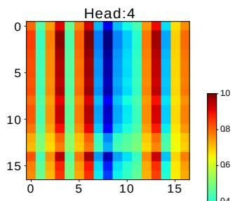

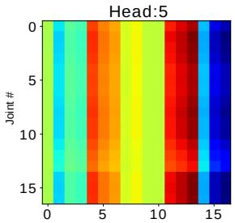

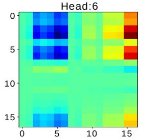

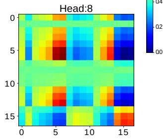  

图 7. 空间变换器（Spatial Transformer）中自注意力（Self-Attention）机制的可视化。x 轴（水平方向）和 y 轴（垂直方向）分别对应查询（Query）和预测输出（Predicted Output）。像素 w（i：行，j：列）表示第 j 个查询对第 i 个输出的注意力权重。红色表示更强的注意力。注意力输出被归一化到 0 到 1 之间。

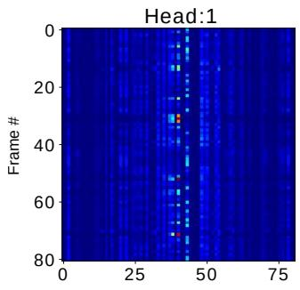

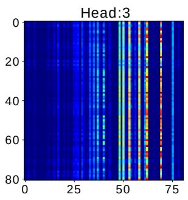

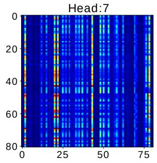

  

图 8. 时间 Transformer 中自注意力的可视化。x 轴（水平方向）和 y 轴（垂直方向）分别对应查询（queries）和预测输出（predicted outputs）。像素 $w _ { i , j }$（i：行，$j \colon$ 列）表示第 j 个查询对第 i 个输出的注意力权重。红色表示更强的注意力。注意力输出被归一化到 0 到 1 之间。

  

图 9. 我们的方法（PoseFormer）、我们的基线方法与 Chen 等人 [5] 所提出的最先进（SOTA）方法在 Human3.6M 测试集上的逐帧对比。上图：S11 的 Eating（吃东西）动作。下图：S11 的 Photo（拍照）动作。

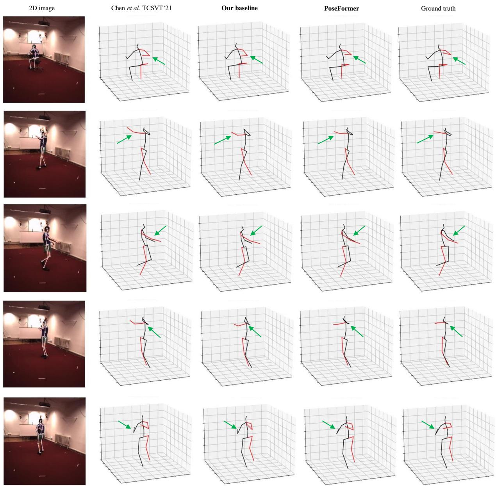  

图 10. 我们的方法（PoseFormer）、我们的基线方法以及当前最优方法 Chen 等人 [5] 在 Human3.6M 测试集 S11 上的 Greeting（问候）和 WalkDog（遛狗）动作上的定性对比。绿色箭头突出显示了 PoseFormer 明显具有更好结果的位置。

遮挡

合理情况

不准确情况

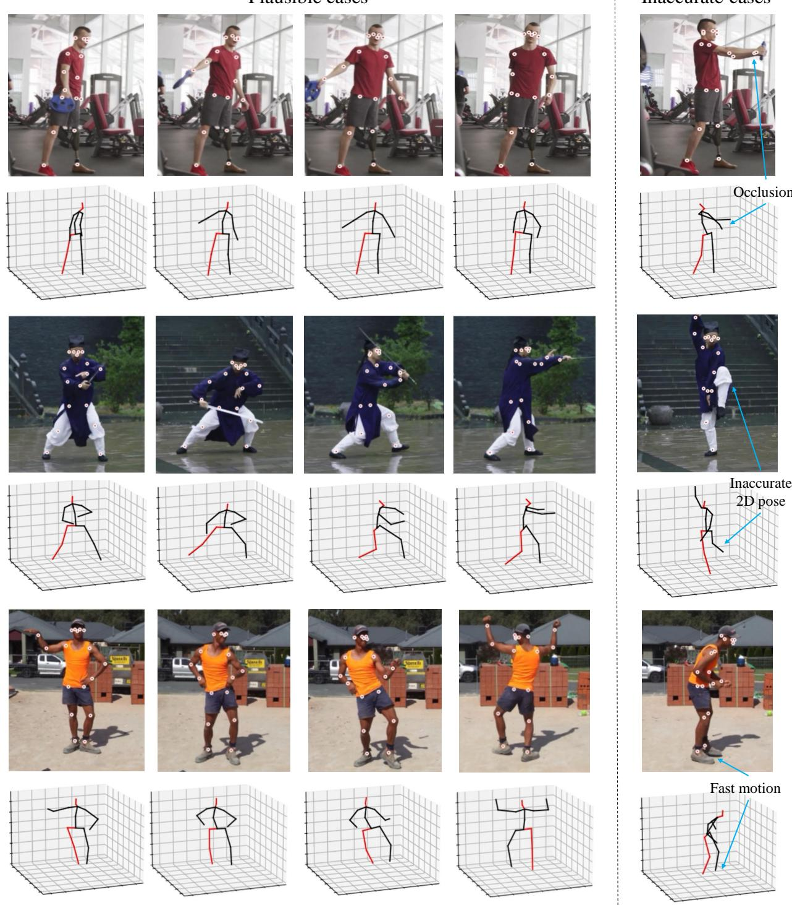

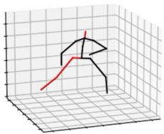  

快速运动

图 11. 野外视频（in-the-wild videos）上的定性结果：使用 PoseFormer 恢复的带有检测到的 2D 关节点的原始帧序列与对应的 3D 姿态。